# From Local Recovery to Unified Generation: Discovering Triple Set in Knowledge Graphs via Observation-Anchored Latent Difusion

Jiaqi Wang1,2 Yisen Gao3 Huayang Shi1 Junhao Hou1 Wengen Li1,\* Jihong Guan1,\* Yichao Zhang1 Shuigeng Zhou4 Yangqiu Song3 Hong Cheng2,\*

1Tongji University 2The Chinese University of Hong Kong 3The Hong Kong University of Science and Technology 4Fudan University \*Corresponding authors: lwengen@tongji.edu.cn, jhguan@tongji.edu.cn, hcheng@se.cuhk.edu.hk

## Abstract

Triple set prediction (TSP) is to recover missing relational triples in a knowledge graph by predicting the triple set instead of isolated links. Existing approaches for TSP predominantly rely on the subgraph-based completion paradigm, where the original graph is first partitioned into subgraphs which are then independently completed. However, such a paradigm sufers from fragmented structural reasoning, limited cross subgraph dependency modeling, and missing predictions across subgraphs. This paper proposes LatentDif, a novel unified latent generative framework for TSP, which reformulates knowledge graph completion as latent space graph generation. LatentDif first learns a compact latent representation using a relation-aware residual-quantized knowledge graph autoencoder, which encodes the whole graph into relation-aware latent embeddings, quantizes them with chunked residual codebooks, and reconstructs triples through a factorized decoder. On top of this latent space, we introduce an observation-anchored latent graph difusion model, where the target latent graph representation is perturbed toward the observed latent, and the reverse process recovers missing triples through progressive latent denoising. Experiments on three benchmark datasets show that LatentDif outperforms the SOTA in terms of �TSP by 5.4 percentage points on average. Code: https://anonymous.4open.science/r/LKGDif-44A5.

## CCS Concepts

• Computing methodologies → Knowledge representation and reasoning; Semantic networks; Reasoning about belief and knowledge.

## Keywords

Knowledge Graph, Latent Difusion Model, Triple Set Prediction

## 1 Introduction

Knowledge Graphs (KGs) have become fundamental infrastructures for a wide range of intelligent applications [14, 35, 39], including recommendation systems [20], question answering [16, 25], infor mation retrieval [18, 23], and scientific discovery [8, 11, 46]. Despite their broad applicability, real-world KGs are inherently incomplete, motivating extensive research on knowledge graph completion (KGC) [10, 43]. Traditional KGC methods mainly focus on predicting missing links independently through embedding-based scoring functions [2, 3, 24, 45] or graph neural reasoning mechanisms [7, 51]. However, in many scenarios, the goal is not to predict a single missing triple, but to recover a set of missing triples that complete the observed graph [50]. Thus, Triple Set Prediction (TSP) has recently emerged as a promising direction that achieves KG completion by predicting an entire set of missing triples conditioned on the observed graph [17, 49]. Compared with conventional link prediction [5, 6], TSP emphasizes structured generation and holistic graph completion. TSP can also be formulated as conditional graph generation, a perspective explored by DifTSP [17].

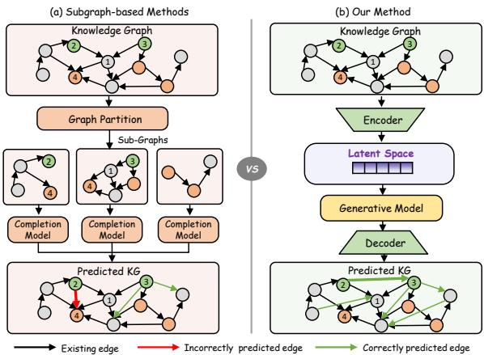  
Figure 1: Comparison between subgraph-based completion paradigm and our unified latent generation paradigm.

Existing TSP methods predominantly follow a subgraph-based completion paradigm. As illustrated in Figure 1(a), these approaches first partition the original knowledge graph into local subgraphs and then perform completion in each subgraph [17, 50]. While such a paradigm reduces computational complexity and improves local reasoning capability, this computational simplification can limit candidate coverage and access to cross-subgraph context. First, as shown in Figure 1, it breaks cross-subgraph dependencies, so that a target relation such as the connection between nodes 2 and 3 cannot be recovered by any isolated local completion model. Second, partitioning may discard boundary context. For example, removing the edge between nodes 2 and 1 makes node 2 locally ambiguous and leads to a spurious prediction between nodes 2 and 4. More broadly, independently completed subgraphs lack a unified global latent space, which weakens graph-level semantic coordination and can yield missing or inconsistent predictions after merging.

These limitations motivate a central question: can we recover missing triples across the whole knowledge graph without restricting prediction to subgraphs, while keeping generation computationally manageable? Directly generating a dense multi-relational adjacency remains costly, as its size grows quadratically with the number of entities and linearly with the number of relation types. Our key idea is to compress the state on which generation operates, rather than restrict the prediction domain through graph partitioning. To this end, we propose unified latent generation. As illustrated in Figure 1(b), this paradigm performs graph completion in a compact latent space, allowing triples to be generated without requiring their endpoints to co-occur in a local subgraph.

While unified latent modeling avoids the structural fragmentation caused by graph partitioning, recovering the target KG still requires transforming the observed representation into the target one. To instantiate this paradigm, we use conditional latent difusion to learn recovery from perturbed target representations in TSP. Difusion performs generation through iterative refinement [1, 30, 31], which is suitable for TSP because missing triples are structurally correlated. The denoising process progressively refines the latent graph representation and adjusts correlated relational patterns among triples [15, 38]. However, there are two challenges in applying a generic latent difusion model to TSP. First, a straightforward VQ-VAE [40] is not suficient for TSP since KGs are sparse and multi-relational [9, 32, 47], while standard VQ-VAE is not designed to preserve relational adjacency patterns. Second, standard difusion [19] is not ideal for TSP since the observed KG already provides a strong structural anchor. Standard difusion gradually perturbs the latent representation toward an isotropic Gaussian prior, which may unnecessarily destroy the structural information already contained in the observed graph.

To address these challenges, we propose LatentDif, a unified conditional latent generative model for TSP. For the first challenge, we propose a relation-aware residual-quantized knowledge graph autoencoder. Its encoder constructs latent embeddings from relational adjacency and uses relational view attention to capture dependencies among diferent relational contexts. To improve the expressiveness of latent space, we use chunked residual vector quantization, which decomposes each latent vector into multiple chunks and quantizes them through multi-level residual vector quantiza tion progressively to enhance reconstruction capacity. Finally, a factorized triple decoder injects relational reasoning bias into KG reconstruction.

For the second challenge, we develop an observation-anchored latent graph difusion module. Building upon the mean-reverting difusion principle, its forward process gradually perturbs the target latent representation toward the observed latent. The reverse process is parameterized by a dual-view latent graph denoiser, which captures dependencies along both the relation and entity axes and progressively reconstructs the missing relational information. Our main contributions include: (1) We formulate knowledge graph triple set prediction as a unified conditional latent generation problem, avoiding the candidate space and contextual restrictions induced by subgraph partitioning. (2) We propose a relation-aware residual-quantized knowledge graph autoencoder to construct a compact shared latent space for reconstructing relation-specific adjacency patterns. (3) We introduce an observation-anchored latent graph difusion model that combines a mean-reverting difusion process with a dual-view latent graph denoiser to progressively recover missing relational information in the latent space. (4) Extensive experiments demonstrate that our method outperforms state-of-the-art baselines across multiple datasets.

## 2 Related Work

## 2.1 Triple Set Prediction

Triple set prediction extends conventional KGC from predicting individual triples to recovering a set of missing triples from an observed KG and provides a more comprehensive setting for automatic KGC. Recent studies address this task from various angles: GPHT [50] introduces dedicated evaluation protocols and metrics for this task, LLMTSP [49] and SMuRT [48] leverage an LLM to generate the triple set, and DifTSP [17] designs a discrete difusion model for TSP. To make set-level prediction tractable on KGs, existing models often decompose the original graph into smaller subgraphs and perform local subgraph prediction. However, subgraph partitioning sufers from separating target entities and fragmenting the relational evidence required to predict the connecting triples.

## 2.2 Difusion Models for Graphs

Difusion models have demonstrated remarkable success in continuous domains such as image synthesis [26, 29, 36, 44] and sequential generation [34]. Several recent works [21, 33, 42, 53] attempt to extend difusion models to graphs by performing iterative denoising over graph structures or learned representations [21, 42]. Recent studies further perform difusion in compact latent spaces. LGD [53] develops an encoder decoder latent difusion framework for graph generation and prediction, while HypDif [12] incorporates geometry-aware latent difusion to better preserve graph topology. These studies mostly focus on generic graph generation or prediction. Triple set prediction instead requires recovering missing relational facts from an observed multi-relational graph, where the latent space must preserve relation-specific structures while supporting conditional graph completion. Diferent from these studies, we focus on conditional triple set recovery in multi-relational KGs. Beyond graph generation, difusion models have also been explored for knowledge graph completion. For example, some methods use difusion to learn triple embeddings for KGC [27, 28], while others use difusion as the hard negative samples generator [22]. However, these methods primarily evaluate link prediction, whereas TSP requires selecting a set of missing triples from the candidate space defined by the observed KG.

## 3 Problem Definition

Formally, a knowledge graph is usually represented as $\mathcal { G } = ( \mathcal { E } , \mathcal { R } , \mathcal { T } )$ where E and R denote the entity set and relation set, respectively, and $\mathcal { T } \subseteq \mathcal { E } \times \mathcal { R } \times \mathcal { E }$ is the set of factual triples. Each triple $( h , r , t ) \in \mathcal { T }$ describes a relation � from a head entity ℎ to a tail entity �. In TSP, we are given an observed incomplete knowledge graph $\mathcal { G } _ { \mathrm { o b s } } = ( \mathcal { E } , \mathcal { R } , \mathcal { T } _ { \mathrm { o b s } } )$ , where $\mathcal { T } _ { \mathrm { o b s } }$ is a subset of the triples in the target graph. The goal is to recover a set of missing triples $\mathcal { T } _ { \mathrm { m i s s } } = \mathcal { T } _ { \mathrm { t a r } } \ \backslash \ \mathcal { T } _ { \mathrm { o b s } }$ , where $\mathcal { G } _ { \mathrm { t a r } } = ( \mathcal { E } , \mathcal { R } , \mathcal { T } _ { \mathrm { t a r } } )$ denotes the target KG.

The predicted KG can then be written as

$$
\begin{array} { r } { G _ { \mathrm { p r e d } } = ( \mathcal { E } , \mathcal { R } , \mathcal { T } _ { \mathrm { o b s } } \cup \widehat { \mathcal { T } } _ { \mathrm { m i s s } } ) , } \end{array}\tag{1}
$$

where $\widehat { \mathcal { T } } _ { \mathrm { m i s s } }$ is the predicted missing triple set. The learning objective is to generate a triple set $\widehat { \mathcal { T } } _ { \mathrm { m i s s } }$ that approximates the ground-truth missing set $\mathcal { T } _ { \mathrm { m i s s } }$ . During inference, the predicted triples that already appear in $\mathcal { T } _ { \mathrm { o b s } }$ are filtered out, and the final output is evaluated against the missing set.

## 4 Method

## 4.1 Overview

As illustrated in Figure 2, LatentDif is a two-stage framework that first learns a compact KG latent space and then performs conditional generation within it. In Stage I, a relation-aware residualquantized knowledge graph autoencoder (details in Sec. 4.2), consisting of a relation-aware graph encoder, a chunked residual vector quantizer, and a factorized triple decoder, maps a KG to $\mathbf { Z } \in \mathbb { R } ^ { | \mathbf { \dot { \mathcal { E } } } | \times | \mathbf { \mathcal { R } } | \times d }$ , where each embedding $\mathbf { z } _ { h , r }$ represents a head relation context for reconstructing its tail entities. In Stage II, an observation-anchored latent graph difusion model generates the target latent conditioned on the observed latent (details in Sec. 4.3). The forward corruption uses the observed representation as its mean-reversion reference, and iterative latent recovery produces a continuous estimate for triple decoding.

## 4.2 Relation-aware Residual-Quantized KG AutoEncoder

The goal of LatentDif’s first stage (Stage I) is to learn a compact and reconstructive latent space for KGs. To better preserve relationspecific adjacency patterns, we design a relation-aware residualquantized KG autoencoder.

4.2.1 Variable-Density KG Construction. Stage I is trained as an autoencoder, where the input graph itself serves as the reconstruction target. To expose the autoencoder to KGs with diferent sparsity levels, we randomly sparsify the training graph at each iteration. For each training iteration, we sample a ratio $\rho \sim \mathcal { U } ( 0 , 1 )$ , and construct a masked KG $\mathcal { G } _ { \rho } = ( \mathcal { E } , \mathcal { R } , \mathcal { T } _ { \rho } )$ by independently keeping each positive triple in the training graph with probability $\rho .$ The autoencoder takes $\scriptstyle { G _ { \rho } }$ as input and is trained to reconstruct the input.

4.2.2 Relation-aware Graph Encoder. For each head entity ℎ and relation �, we define a tail indicator vector $\mathbf { a } _ { h , r } \in \{ 0 , 1 \} ^ { | \mathcal { E } | }$ , where the �-th entry is 1 if $( h , r , t )$ is in the KG and 0 otherwise. The relationaware graph encoder maps each sparse tail indicator vector into a dense latent embedding: ${ \bf x } _ { h , r } = W _ { a } { \bf a } _ { h , r }$ , where $W _ { a }$ is a projection matrix. For each head entity ℎ, we collect its relation-specific latent as $\mathbf { X } _ { h } ;$

$$
{ \bf X } _ { h } = \big [ { \bf x } _ { h , 1 } , { \bf x } _ { h , 2 } , \ldots , { \bf x } _ { h , | \mathcal { R } | } \big ] .\tag{2}
$$

To model dependencies among diferent relational views, we propose relational view attention:

$$
\widetilde { \mathbf { X } } _ { h } = { \mathrm { A t t n } } _ { R } ( \mathbf { X } _ { h } ) ,\tag{3}
$$

where attention is performed along the relation dimension. The output is combined with the original projected representation through a residual connection: ${ \bf X } _ { h } = { \bf X } _ { h } + \widetilde { { \bf X } } _ { h }$ . Stacking all head entities gives the encoder output $\mathbf { X } = E _ { \phi } ( { \cal G } _ { \rho } ) \in \mathbb { R } ^ { | \mathcal { E } | \times | \mathcal { R } | \times d }$ , where $E _ { \phi }$ is the encoder.

4.2.3 Chunked Residual Vector Quantization. The continuous encoder output is further discretized by a chunked residual vector quantizer. Specifically, we decompose each latent embedding into � chunks: $\mathbf { x } _ { h , r } = [ \mathbf { x } _ { h , r } ^ { ( 1 ) } , \mathbf { \dot { x } } _ { h , r } ^ { ( 2 ) } , \ldots , \mathbf { x } _ { h , r } ^ { ( \hat { K } ) } ]$ ]. For each chunk, we apply residual vector quantization with $L _ { c }$ codebooks. Let $\mathbf { r } ^ { ( k , 1 ) } = \mathbf { x } _ { h , r } ^ { ( k ) }$ be the initial residual of the �-th chunk. At the ℓ-th residual quantization level, the nearest codeword is selected as

$$
c ^ { ( k , \ell ) } = \arg \operatorname* { m i n } _ { j } \left\| \mathbf { r } ^ { ( k , \ell ) } - \mathbf { e } _ { j } ^ { ( k , \ell ) } \right\| _ { 2 } ^ { 2 } ,\tag{4}
$$

where $\mathbf { e } _ { i } ^ { ( k , \ell ) }$ is the �-th codeword in the ℓ-th codebook of the �-th chunk. The residual is then updated by

$$
\mathbf { r } ^ { ( k , \ell + 1 ) } = \mathbf { r } ^ { ( k , \ell ) } - \mathbf { e } _ { c ^ { ( k , \ell ) } } ^ { ( k , \ell ) } .\tag{5}
$$

The quantized representation of the �-th chunk is

$$
{ \bf q } _ { h , r } ^ { ( k ) } = \sum _ { \ell = 1 } ^ { L _ { c } } { \bf e } _ { c ^ { \left( k , \ell \right) } } ^ { ( k , \ell ) } .\tag{6}
$$

Finally, the quantized latent embedding is obtained by concatenating all quantized chunks: $\mathbf { z } _ { \mathrm { q } , h , r } = [ \mathbf { q } _ { h , r } ^ { ( 1 ) } , \mathbf { q } _ { h , r } ^ { ( 2 ) } , \ldots , \mathbf { q } _ { h , r } ^ { ( K ) } ]$ . We adopt the straight-through estimator for the non-diferentiable nearestneighbor assignment:

$$
{ \bf z } _ { h , r } = { \bf x } _ { h , r } + \mathrm { s g } \big ( { \bf z } _ { \mathrm { q } , h , r } - { \bf x } _ { h , r } \big ) ,\tag{7}
$$

which equals $\mathbf { z } _ { \mathrm { q } , h , r }$ in the forward pass while propagating gradients to $\mathbf { x } _ { h , r }$ in the backward pass, $\mathbf { z } _ { h , r }$ is used as the decoder input and sg(·) is the stop-gradient operator. The chunk-level VQ training objective is

$$
\begin{array} { c } { \displaystyle \mathcal { L } _ { \mathrm { V Q } } = \frac { 1 } { | \Omega | K } \sum _ { ( h , r ) \in \Omega } { \sum _ { k = 1 } ^ { K } \left[ \left\| \mathbf { s g } ( \mathbf { x } _ { h , r } ^ { ( k ) } ) - \mathbf { q } _ { h , r } ^ { ( k ) } \right\| _ { 2 } ^ { 2 } \right. } } \\ { \displaystyle \left. + \lambda _ { m } \left\| \mathbf { x } _ { h , r } ^ { ( k ) } - \mathbf { s g } ( \mathbf { q } _ { h , r } ^ { ( k ) } ) \right\| _ { 2 } ^ { 2 } \right] } ,  \end{array}\tag{8}
$$

where $\Omega$ denotes the set of head-relation pairs, � is the number of chunks, and $\lambda _ { m }$ is the commitment weight.

4.2.4 Factorized Triple Decoder. The decoder reconstructs triples from the quantized latent embeddings. For a triple $( h , r , t )$ , the factorized scoring function is defined as

$$
s ( h , r , t ) = \left. U ( \mathbf { z } _ { h , r } ) , \mathbf { e } _ { t } \right. + b _ { r } ,\tag{9}
$$

where $\mathbf { z } _ { h , r }$ is the quantized latent representation ofthe head-relation pair $( h , r ) , \mathbf { e } _ { t }$ is the tail entity embedding, � (·) is the projection function, and $b _ { r }$ is relation bias. The probability of a triple being positive is then $\boldsymbol { p } ( h , r , t ) = \sigma ( s ( h , r , t ) )$

4.2.5 Training Objective. We train the relation-aware residualquantized KG autoencoder with negative sampling. For each positive triple $( h , r , t ) \in \mathcal { T } _ { \rho } ,$ , we sample $K _ { \mathrm { n e g } }$ negative triples by corrupting the tail entity:

$$
N ( h , r ) = \{ ( h , r , t _ { i } ^ { - } ) \} _ { i = 1 } ^ { K _ { \mathrm { n e g } } } , \quad ( h , r , t _ { i } ^ { - } ) \notin \mathcal { T } _ { \rho } .\tag{10}
$$

The reconstruction loss is

$$
\begin{array} { r l } & { \mathcal { L } _ { \mathrm { r e c } } = - \displaystyle \sum _ { ( h , r , t ) \in \mathcal { T } _ { \rho } } \log \sigma ( s ( h , r , t ) ) } \\ & { \quad \quad \quad - \lambda _ { \mathrm { n e g } } \displaystyle \sum _ { ( h , r , t ^ { - } ) \in N } \log \sigma ( - s ( h , r , t ^ { - } ) ) . } \end{array}\tag{11}
$$

Stage Ⅰ Relation-aware Residual-Quantized Knowledge Graph AutoEncoder  
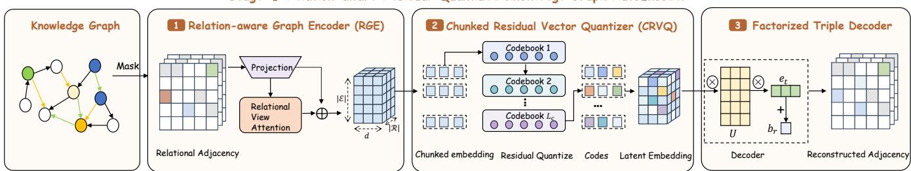

Stage Ⅱ Observation-Anchored Latent Graph Diffusion  
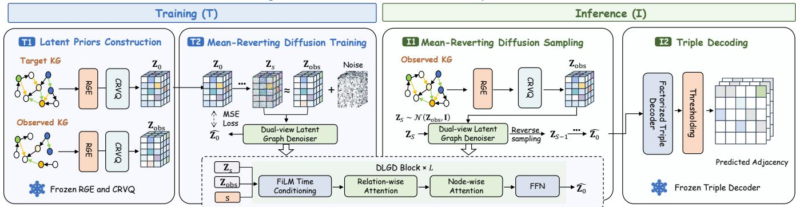  
Figure 2: Overview of LatentDif. Stage I learns a relation-aware residual-quantized latent space for KG reconstruction. Stage II performs observation-anchored latent difusion to recover the target KG from the observed KG.

The overall Stage-I objective is

$$
\begin{array} { r } { \mathcal { L } _ { \mathrm { A E } } = \mathcal { L } _ { \mathrm { r e c } } + \lambda _ { \mathrm { V Q } } \mathcal { L } _ { \mathrm { V Q } } . } \end{array}\tag{12}
$$

Here, $\mathcal { L } _ { \mathrm { r e c } }$ encourages the quantized latent to preserve information needed for triple reconstruction, while $\mathcal { L } _ { \mathrm { V Q } }$ aligns the continuous encoder outputs with the discrete residual codebook space.

Reconstruction Fidelity Metrics. We report reconstruction recall (���������), precision (������������), and their harmonic mean $( R F _ { 1 } )$ as diagnostics of how faithfully the learned latent space reconstructs input triples. Detailed definitions are provided in the Appendix.

## 4.3 Observation-Anchored Latent Graph Difusion

After the knowledge graph autoencoder is trained, we use it to map both observed and target KGs into the latent space. The second stage (Stage II) of LatentDif is to learn a conditional difusion model $p _ { \theta } ( \mathbf { Z } _ { 0 } \mid \mathbf { Z } _ { \mathrm { o b s } } )$ , where $\mathbf { Z } _ { \mathrm { o b s } }$ is the latent representation of the observed KG and $\mathbf { Z } _ { 0 }$ is the latent representation of the target KG.

4.3.1 Latent Priors Construction. During Stage-II training, we construct paired observed-target KGs from the training graph. Specif ically, we sample $\rho _ { \mathrm { t a r } } ~ \sim ~ { \mathcal U } ( \rho _ { \mathrm { m i n } } , 1 . 0 )$ and retain each training triple with probability $\rho _ { \mathrm { t a r } }$ to construct $\mathcal { G } _ { \mathrm { t a r } }$ . Then, we obtain $\mathcal { G } _ { \mathrm { o b s } }$ by retaining each triple in $\mathcal { G } _ { \mathrm { t a r } }$ with probability $\rho _ { \mathrm { o b s } ; }$ , ensuring ${ \mathcal { T } } _ { \mathrm { o b s } } \subseteq { \mathcal { T } } _ { \mathrm { t a r } } \subseteq { \mathcal { T } } _ { \mathrm { t r a i n } }$ . With the trained encoder and quantizer in Stage I, we have

$$
\begin{array} { r } { \mathbf { Z } _ { \mathrm { o b s } } = Q _ { \phi } \big ( E _ { \phi } \big ( \mathcal { G } _ { o b s } \big ) \big ) , \quad \mathbf { Z } _ { 0 } = Q _ { \phi } \big ( E _ { \phi } \big ( \mathcal { G } _ { t a r } \big ) \big ) , } \end{array}\tag{13}
$$

where $E _ { \phi }$ is the relation-aware graph encoder and $Q _ { \phi }$ is the chunked residual quantizer. The autoencoder parameters are frozen during difusion training.

4.3.2 Mean-Reverting Forward Process. Standard difusion models perturb data toward an unconditional Gaussian prior. However, for TSP, the observed graph already provides a strong structural anchor. Therefore, we adopt a mean-reverting forward process following prior restoration difusion models [30] and specialize its endpoint and conditioning structure for TSP. Let $\mathbf { Z } _ { 0 }$ denote the clean latent representation of the target KG and $\mathbf { Z _ { o b s } }$ denote the latent representation of the observed KG. We define a linear variance schedule $\{ \beta _ { s } \} _ { s = 1 } ^ { S } ,$ where � is the total number of difusion steps. Following DDPM, we set

$$
\alpha _ { s } = 1 - \beta _ { s } , \qquad \bar { \alpha } _ { s } = \prod _ { i = 1 } ^ { s } \alpha _ { i } .\tag{14}
$$

Here, $\bar { \alpha } _ { s }$ controls the signal-to-noise ratio at difusion step �. The mean-reverting forward process is defined as

$$
q ( \mathbf { Z } _ { s } \mid \mathbf { Z } _ { 0 } , \mathbf { Z } _ { \mathrm { o b s } } ) = N \left( \mathbf { Z } _ { \mathrm { o b s } } + \sqrt { \bar { \alpha } _ { s } } ( \mathbf { Z } _ { 0 } - \mathbf { Z } _ { \mathrm { o b s } } ) , ( 1 - \bar { \alpha } _ { s } ) \mathbf { I } \right) .\tag{15}
$$

When � is small, $\bar { \alpha } _ { s }$ is close to 1, and the noisy latent remains close to the target latent. When � approaches $S , \bar { \alpha } _ { s }$ becomes close to 0, and the noisy latent is mainly centered around the observed-graph latent with Gaussian noise. Equivalently, by defining the missinginformation residual $\Delta _ { 0 } = Z _ { 0 } - Z _ { \mathrm { o b s } }$ and $\Delta _ { s } = Z _ { s } - Z _ { \mathrm { o b s } }$ , Eq. 15 reduces to the standard DDPM marginal $q ( \Delta _ { s } | \Delta _ { 0 } ) = N ( \sqrt { \bar { \alpha } _ { s } } \Delta _ { 0 } , ( 1 -$ $\bar { \alpha } _ { s } ) I )$ . Therefore, observation-anchored difusion performs residual denoising in the latent representation. We instantiate meanreverting difusion on the proposed relation-aware latent space and couple it with observation conditioning and dual-view denoising for TSP.

4.3.3 Dual-view Latent Graph Denoiser. The denoising network predicts the clean target latent from the noisy latent $\mathbf { Z } _ { s }$ , the observedgraph latent $\mathbf { Z } _ { \mathrm { o b s } }$ , and the difusion step �:

$$
\widehat { \bf Z } _ { 0 } = { \cal W } _ { \mathrm { o u t } } \mathrm { D L G D } _ { L } ( \mathrm { F i L } { \bf M } _ { s } ( { \cal W } _ { \mathrm { i n } } [ { \bf Z } _ { s } ; { \bf Z } _ { \mathrm { o b s } } ] ) ) .\tag{16}
$$

Here, $[ \cdot ; \cdot ]$ denotes feature-wise concatenation, $W _ { \mathrm { i n } }$ and $W _ { \mathrm { o u t } }$ are learnable input and output projections, respectively, and DL $. \mathrm { G D } _ { L }$ denotes a stack of � Dual-view Latent Graph Denoiser (DLGD) blocks. The difusion step is incorporated through FiLM conditioning, i.e., $\mathrm { F i L M } _ { s } ( \cdot )$ . To eficiently capture dependencies along both the relation and entity axes, each block performs a dual-view linear attention:

$$
\begin{array} { r l } & { \mathbf { H } _ { R } = \mathbf { H } + \mathrm { L i n A t t n } _ { R } \big ( \mathrm { L N } ( \mathbf { H } ) \big ) , } \\ & { \mathbf { H } _ { N } = \mathbf { H } _ { R } + \mathrm { L i n A t t n } _ { N } \big ( \mathrm { L N } ( \mathbf { H } _ { R } ) \big ) , } \\ & { \mathbf { H } ^ { \mathrm { o u t } } = \mathbf { H } _ { N } + \mathrm { F F N } \big ( \mathrm { L N } ( \mathbf { H } _ { N } ) \big ) . } \end{array}\tag{17}
$$

Here, H and $\mathbf { H } ^ { \mathrm { o u t } }$ are the block input and output, while $\mathbf { H } _ { R }$ and $\mathbf { H } _ { N }$ are intermediate representations after relation-wise and nodewise linear attention, respectively. LN denotes layer normalization and FFN denotes a feed-forward network. Specifically, LinAtn� exchanges information across relations associated with the same head entity, whereas LinAtn� aggregates information across head entities under the same relation. Their combination enables eficient dual-view dependency modeling over the unified latent representation.

4.3.4 Difusion Training Objective. During training, we randomly sample a difusion step $s \ \sim \ \mathrm { U n i f o r m } ( \{ 1 , . . . , S \} )$ and Gaussian noise $\epsilon \sim { \cal N } ( 0 , { \bf { I } } )$ . The noisy latent $\mathbf { Z } _ { s }$ is constructed by the meanreverting forward process. The denoiser is trained to predict the clean target latent $\mathbf { Z } _ { 0 } \mathbf { : }$

$$
\mathcal { L } _ { \mathrm { d i f f } } = \mathbb { E } _ { s , \epsilon } \left[ \| f _ { \theta } ( \mathbf { Z } _ { s } , \mathbf { Z } _ { \mathrm { o b s } } , s ) - \mathbf { Z } _ { 0 } \| _ { 2 } ^ { 2 } \right] .\tag{18}
$$

4.3.5 Inference and Triple Set Decoding. At inference, the observed KG $\mathcal { G } _ { \mathrm { o b s } }$ is encoded into $\mathbf { Z _ { o b s } } .$ . Since $\begin{array} { r } { \bar { \alpha } _ { S } \ \approx \ 0 , } \end{array}$ , we initialize $\mathbf { Z } _ { S } \ =$ $\mathbf { Z } _ { \mathrm { 0 b s } } + \epsilon ,$ where $\epsilon \sim { \cal N } ( 0 , { \bf I } )$ . At each reverse step $s = S , \ldots , 1$ , the denoiser predicts $\widehat { \mathbf { Z } } _ { 0 } = f _ { \theta } ( \mathbf { Z } _ { s } , \mathbf { Z } _ { \mathrm { o b s } } , s )$ , followed by DDPM sampling:

$$
\begin{array} { r l r } {  { \pmb { \mu } _ { s } = \mathbf { Z } _ { \mathrm { o b s } } + \frac { \sqrt { \bar { \alpha } _ { s - 1 } } \beta _ { s } } { 1 - \bar { \alpha } _ { s } } \big ( \widehat { \mathbf { Z } } _ { 0 } - \mathbf { Z } _ { \mathrm { o b s } } \big ) } } \\ & { } & { + \frac { \sqrt { \alpha _ { s } } \big ( 1 - \bar { \alpha } _ { s - 1 } \big ) } { 1 - \bar { \alpha } _ { s } } \big ( \mathbf { Z } _ { s } - \mathbf { Z } _ { \mathrm { o b s } } \big ) , } \\ & { } & { \mathbf { Z } _ { s - 1 } = \pmb { \mu } _ { s } + \mathbb { I } \big [ s > 1 \big ] \sqrt { \tilde { \beta } _ { s } } \xi , \qquad \xi \sim \mathcal { N } ( \mathbf { 0 } , \mathbf { I } ) , } \end{array}\tag{19}
$$

where $\tilde { \beta } _ { s } = \beta _ { s } ( 1 - \bar { \alpha } _ { s - 1 } ) / ( 1 - \bar { \alpha } _ { s } )$ is the posterior variance, and $\mathbb { I } [ s > 1 ]$ removes the stochastic noise at the final reverse step. After the final reverse step, we obtain the generated latent $\widehat { \mathbf { Z } } _ { 0 } .$ . We decode this representation without an additional quantization step. Since the factorized decoder operates on latent vectors instead of discrete code indices, it maps $\widehat { \mathbf { Z } } _ { 0 }$ to candidate triple scores as:

$$
\begin{array} { r } { s ( h , r , t ) = \left. U ( \widehat { \mathbf { z } } _ { 0 , h , r } ) , \mathbf { e } _ { t } \right. + b _ { r } . } \end{array}\tag{20}
$$

Triples already contained in $\mathcal { T } _ { \mathrm { o b s } }$ are filtered out. Following the standard TSP evaluation protocol, a single validation-selected score threshold is applied to the remaining candidates to obtain the final predicted missing triple set $\hat { \mathcal { T } } _ { \mathrm { m i s s } }$ . The same threshold-selection procedure is applied to all compared methods to ensure a consistent evaluation.

Method Details. Detailed dual-view linear attention and complexity analysis are provided in the Appendix.

## 5 Experiments

## 5.1 Experimental Setup

5.1.1 Datasets. We evaluate our method on three common benchmark datasets for TSP: Wiki79k, Wiki143k, and CFamily. Table 1 lists the entity, relation, and triple counts for each dataset. We strictly use the original data partitions and definitions provided by GPHT [50], which guarantees that our results are comparable with existing methods.

Table 1: Statistics of datasets in experiments.
<table><tr><td>Datasets</td><td>Entity</td><td>Relation</td><td>Train</td><td>Valid</td><td>Test</td></tr><tr><td>Wiki79k</td><td>7,983</td><td>85</td><td>57,033</td><td>6,337</td><td>15,843</td></tr><tr><td>Wiki143k</td><td>13,928</td><td>109</td><td>103,415</td><td>11,490</td><td>28,727</td></tr><tr><td>CFamily</td><td>2,378</td><td>12</td><td>16,549</td><td>1,839</td><td>4,598</td></tr></table>

5.1.2 Evaluation Metrics. To ensure a fair and comprehensive comparison, we adopt the evaluation metrics proposed for the TSP task in GPHT [50], including Joint Precision (JPrecision), Square-root Test Recall (STRecall), and TSP Score $( F _ { \mathrm { T S P } } )$ . Because �������� is the square root of conventional test recall, $F _ { \mathrm { T S P } }$ difers from conventional $F _ { 1 }$ . More details are in the Appendix.

## 5.2 Main Results

Table 2 and Table 3 report the main results on all datasets. For LatentDif, we report the mean and standard deviation over three independent runs. We take $F _ { \mathrm { T S P } }$ as the primary comparison metric because it balances the precision of the predicted triple set and the recovery of ground-truth triples. Therefore, we rank diferent methods mainly according to $F _ { \mathrm { T S P } }$ , while using ���������� and �������� to interpret the precision-recall behavior of each method. We also report the standard $F _ { 1 ; }$ , reconstructed from the reported mean triple counts. Overall, LatentDif achieves the best $F _ { \mathrm { T S P } }$ on all three datasets, outperforming the strongest baseline by absolute 5.4 percentage points on average.

## 5.3 Ablation Study

Table 4 reports the ablation results on three datasets using � as the primary metric. The full LatentDif achieves the best performance on all datasets, demonstrating the efectiveness of the overall design. LatentDif-Subgraph retains the same modules as LatentDif, but partitions the KG into local subgraphs like GPHT. The performance drop provides a controlled comparison that supports the benefit of operating in a unified graph latent space. For Stage I, w/o CRVQ replaces CRVQ with a codebook parameter matched VQ-VAE while keeping the encoder, decoder, latent dimensionality, training protocol, and total number of learnable codebook parameters comparable. Its substantial degradation is therefore not attributable to a smaller parameter budget. VQ-VAE exhibits poor Stage-I reconstruction fidelity and provides an inadequate latent space for subsequent difusion. Detailed results are provided in the Appendix. w/o Quantization removes the quantization module and directly uses the continuous encoder output as the latent representation. The degradation of w/o Quantization suggests that unconstrained continuous latents are less suitable for difusion-based TSP, supporting the role of quantization in constructing a structured latent space. Removing the relational-view attention (w/o Relational view Attention) or replacing the factorized decoder (w/o Factorized Decoder) with MLPs also leads to clear performance drops. w/o Stage II directly decodes the observed latent. Its poor performance shows that our proposed Stage-II module provides the conditional latent transformation required for TSP.

Table 2: The results on Wiki79k and Wiki143k, where $\mathcal { T } _ { \mathrm { p r e d } } ^ { \mathrm { P O W A + } }$ is the number of correctly predicted test triples, and $\mathcal { T } _ { \mathrm { p r e d } } ^ { \mathrm { P O W A } }$ is the triple set that can be judged under the RS-POWA assumption. The best results are in bold, and the second-best results are underlined. $F _ { \mathrm { T S P } }$ is the primary comparison metric. †: Standard $F _ { 1 }$ under RS-POWA.
<table><tr><td colspan="2">Datasets Models</td><td colspan="3">Number of Triples in</td><td colspan="4">RS-POWA Metrics</td><td colspan="2">CWA Metrics</td></tr><tr><td></td><td></td><td> $\mathcal { T } _ { \mathrm { p r e d } }$ </td><td> $\mathcal { T } _ { \mathrm { p r e d } } ^ { \mathrm { P O W A } }$ </td><td> $\mathcal { T } _ { \mathrm { p r e d } } ^ { \mathrm { P O W A + } }$ </td><td>JPrecision</td><td>STRecall</td><td> $F _ { \mathrm { T S P } }$ </td><td> $F _ { 1 } ^ { \dagger }$ </td><td>JPrecision</td><td> $F _ { \mathrm { T S P } }$ </td></tr><tr><td rowspan="9">Wiki79k</td><td>HAKE [52]</td><td>125±87</td><td> $1 1 9 { \pm } 8 3$ </td><td>30±7</td><td> $0 . 2 4 6 { \pm } 1 4 . 8 \%$ </td><td> $0 . 0 4 4 { \pm } 0 . 4 \%$ </td><td> $0 . 0 7 5 { \scriptstyle \pm 0 . 3 \% }$ </td><td>0.004</td><td>0.240</td><td>0.074</td></tr><tr><td>PairRE [4]</td><td> $2 9 7 4 2 { \pm } 1 0 5$ </td><td> $1 0 2 1 7 { \pm } 5 1$ </td><td> $2 9 0 1 { \pm } 7$ </td><td> $0 . 1 9 1 { \pm } 0 . 1 \%$ </td><td> $0 . 4 2 8 { \pm } 0 . 0 \%$ </td><td> $0 . 2 6 4 { \pm } 0 . 2 \%$ </td><td>0.187</td><td>0.097</td><td>0.158</td></tr><tr><td>AstarNet [54]</td><td> $5 6 8 9 { \pm } 2 8 7$ </td><td> $1 7 5 0 { \pm } 1 1 6$ </td><td> $1 3 2 8 { \pm } 5 2$ </td><td> $0 . 4 9 6 { \pm } 0 . 8 \%$ </td><td> $0 . 2 8 9 { \pm } 0 . 5 \%$ </td><td> $0 . 3 6 5 { \pm } 0 . 2 \%$ </td><td>0.143</td><td>0.233</td><td>0.258</td></tr><tr><td>ULTRA [13]</td><td> $9 7 4 3 { \pm } 0$ </td><td> $2 9 4 5 { \pm } 0$ </td><td> $1 0 6 2 { \pm } 0$ </td><td> $0 . 2 3 5 { \scriptstyle \pm 0 . 0 \% }$ </td><td> $0 . 2 5 8 { \pm } 0 . 0 \%$ </td><td> $0 . 2 4 6 { \pm } 0 . 0 \%$ </td><td>0.104</td><td>0.109</td><td>0.153</td></tr><tr><td>GPHT(HAKE) [50]</td><td>209±47</td><td> $1 9 1 { \pm } 4 7 $ </td><td>44±8</td><td> $0 . 2 2 0 { \scriptstyle \pm 8 . 0 \% }$ </td><td> $0 . 0 5 3 { \pm } 0 . 4 \%$ </td><td> $0 . 0 8 5 { \pm } 1 . 1 \%$ </td><td>0.006</td><td>0.210</td><td>0.084</td></tr><tr><td>GPHT(PairRE) [50]</td><td> $1 2 3 9 2 { \pm } 3 8 1 3$ </td><td> $5 8 6 6 { \pm } 1 2 6 2$ </td><td> $2 0 1 8 { \pm } 3 3 2$ </td><td> $0 . 2 5 3 { \pm } 1 . 6 \%$ </td><td> $0 . 3 5 7 { \scriptstyle \pm 2 . 8 \% }$ </td><td> $0 . 2 9 6 { \pm } 0 . 4 \%$ </td><td>0.170</td><td>0.162</td><td>0.224</td></tr><tr><td>SMuRT [48]</td><td>13450±0</td><td> $3 1 9 7 { \pm } 0$ </td><td>1245±0</td><td> $0 . 2 4 1 { \pm } 0 . 0 \%$ </td><td> $0 . 2 8 0 { \pm } 0 . 0 \%$ </td><td> $0 . 2 5 9 { \scriptstyle \pm 0 . 0 \% }$ </td><td>0.118</td><td>0.093</td><td>0.139</td></tr><tr><td>DiffTSP [17]</td><td> $7 4 7 2 { \pm } 1 0 3$ </td><td> $4 3 5 5 { \pm } 5 1$ </td><td>3472±87</td><td> $0 . 6 3 0 { \pm } 1 . 2 \%$ </td><td> $0 . 4 6 8 { \pm } 0 . 5 \%$ </td><td> $0 . 5 3 7 { \pm } 0 . 5 \%$ </td><td>0.325</td><td>0.464</td><td>0.466</td></tr><tr><td>LatentDiff</td><td> $7 3 8 4 \pm 5 2$ </td><td> $4 8 7 1 { \pm } 3 4$ </td><td>4060±23</td><td> $\mathbf { 0 . 6 9 2 { \pm } 0 . 5 \% }$ </td><td> $\mathbf { 0 . 5 0 6 { \pm 0 . 1 \% } }$ </td><td> $\mathbf { 0 . 5 8 5 \pm 0 . 3 \% }$ </td><td>0.374</td><td>0.550</td><td>0.527</td></tr><tr><td rowspan="9">Wiki143k</td><td>HAKE [52]</td><td> $2 2 2 1 5 { \pm } 1 2 8 3$ </td><td> $6 1 8 2 { \pm } 4 3$ </td><td>3044±72</td><td> $0 . 3 1 5 { \pm } 0 . 2 \%$ </td><td> $0 . 3 2 6 { \pm } 0 . 3 \%$ </td><td> $0 . 3 2 { \pm } 0 . 3 \%$ </td><td>0.159</td><td>0.137</td><td>0.193</td></tr><tr><td>PairRE [4]</td><td> $1 9 2 2 8 { \pm } 2 0 7 5$ </td><td> $3 3 1 3 { \pm } 7 2 2$ </td><td> $1 1 9 1 { \pm } 7 7$ </td><td> $0 . 2 1 1 { \pm } 3 . 0 \%$ </td><td> $0 . 2 0 4 { \pm } 0 . 7 \%$ </td><td> $0 . 2 0 7 { \scriptstyle \pm 1 . 0 \% }$ </td><td>0.070</td><td>0.061</td><td>0.095</td></tr><tr><td>AstarNet [54]</td><td>6001±231</td><td> $2 5 8 9 { \pm } 1 2 9$ </td><td> $2 2 7 5 { \pm } 3 1$ </td><td> $\underline { { 0 . 6 2 9 \pm 0 . 8 \% } }$ </td><td> $0 . 2 8 1 { \pm } 0 . 2 \%$ </td><td> $0 . 3 8 9 { \pm } 0 . 2 \%$ </td><td>0.140</td><td>0.379</td><td>0.323</td></tr><tr><td>ULTRA [13]</td><td>3844±0</td><td>1349±0</td><td>692±0</td><td> $0 . 3 4 6 { \pm } 0 . 0 \%$ </td><td> $0 . 1 5 5 { \pm } 0 . 0 \%$ </td><td> $0 . 2 1 4 { \pm } 0 . 0 \%$ </td><td>0.045</td><td>0.180</td><td>0.166</td></tr><tr><td>GPHT(HAKE) [50]</td><td> $1 7 7 0 2 { \pm } 7 9 3 5$ </td><td> $4 7 0 9 { \pm } 6 0$ </td><td> $2 7 0 0 { \pm } 6 8 1$ </td><td> $0 . 3 6 3 { \pm } 4 . 8 \%$ </td><td> $0 . 3 0 7 { \scriptstyle \pm 4 . 2 \% }$ </td><td> $0 . 3 3 3 { \scriptstyle \pm 4 . 6 \% }$ </td><td>0.150</td><td>0.152</td><td>0.204</td></tr><tr><td>GPHT(PairRE) [50]</td><td> $3 0 1 1 { \pm } 2 3 3$ </td><td> $1 9 5 4 { \pm } 1 9 1$ </td><td> $9 0 9 { \pm } 3 4 ^ { }$ </td><td> $0 . 3 8 4 \pm 1 . 9 \%$ </td><td> $0 . 1 7 8 { \pm } 0 . 3 \%$ </td><td> $0 . 2 4 3 { \pm } 0 . 1 \%$ </td><td>0.059</td><td>0.302</td><td>0.224</td></tr><tr><td>DiffTSP [17]</td><td> $1 0 1 6 2 { \pm } 5 3 0$ </td><td> $6 8 0 4 { \pm } 2 7 5$ </td><td> $4 5 4 3 { \pm } 1 0 5$ </td><td> $0 . 5 5 7 { \scriptstyle \pm 0 . 3 \% }$ </td><td> $0 . 3 9 7 { \scriptstyle \pm 0 . 4 \% }$ </td><td> $0 . 4 6 4 \pm 0 . 6 \%$ </td><td>0.246</td><td>0.447</td><td>0.420</td></tr><tr><td>LatentDiff</td><td>11211±57</td><td>5748±20</td><td> $5 1 4 9 { \pm } 4 2$ </td><td> $\mathbf { 0 . 6 7 7 { \pm } 0 . 5 \% }$ </td><td> $\mathbf { 0 . 4 2 3 { \pm } 0 . 2 \% }$ </td><td> $\mathbf { 0 . 5 2 1 { \pm } 0 . 1 \% }$ </td><td>0.283</td><td>0.459</td><td></td></tr><tr><td></td><td></td><td></td><td></td><td></td><td></td><td></td><td></td><td></td><td>0.440</td></tr></table>

Table 3: The results on the CFamily dataset, where $\mathcal { T } _ { \mathrm { p r e d } } ^ { \mathrm { C W A + } }$ is the set of correctly predicted test triples. The best results are in bold, and the second-best results are underlined. � is the primary comparison metric. †: Standard $F _ { 1 }$ under CWA.
<table><tr><td>Models</td><td colspan="3">Number of Triples in</td><td colspan="4">CWA Metrics</td></tr><tr><td></td><td> $\mathcal { T } _ { \mathrm { p r e d } }$ </td><td> $\mathcal { T } _ { \mathrm { p r e d } } ^ { \mathrm { C W A } }$ </td><td> $\mathcal { T } _ { \mathrm { p r e d } } ^ { \mathrm { C W A + } }$ </td><td> $J P r e c i s i o n$ </td><td>STRecall</td><td> $F _ { \mathrm { T S P } }$ </td><td> $F _ { 1 } ^ { \dagger }$ </td></tr><tr><td>HAKE [52]</td><td> $3 1 8 6 \pm 5 4 3$ </td><td> $3 1 8 6 \pm 5 4 3$ </td><td> $1 7 8 8 { \pm } 3 2 1$ </td><td> $0 . 5 6 1 { \pm } 1 . 8 \%$ </td><td> $0 . 6 2 4 { \pm } 5 . 9 \%$ </td><td> $0 . 5 9 1 { \pm } 3 . 1 \%$ </td><td>0.459</td></tr><tr><td>PairRE [4]</td><td> $5 7 3 2 { \pm } 2 0 6 2$ </td><td> $5 7 3 2 { \pm } 2 0 6 2$ </td><td> $1 7 4 7 { \pm } 6 9 4$ </td><td> $0 . 3 0 5 { \pm } 1 . 8 \%$ </td><td> $0 . 6 1 6 { \pm } 1 3 . 7 \%$ </td><td> $0 . 4 0 8 { \pm } 4 . 9 \%$ </td><td>0.338</td></tr><tr><td>RGCN [37]</td><td> $3 0 6 0 8 { \pm } 3 4 4 3$ </td><td> $3 0 6 0 8 { \pm } 3 4 4 3$ </td><td> $3 0 2 6 { \pm } 1 3 7$ </td><td> $0 . 0 9 9 { \scriptstyle \pm 6 . 0 \% }$ </td><td> $\mathbf { 0 . 8 1 1 \pm 0 . 5 \% }$ </td><td> $0 . 1 7 6 { \pm } 5 . 2 \%$ </td><td>0.172</td></tr><tr><td>CompGCN [41]</td><td> $3 8 9 3 1 { \pm } 3 7 4 5$ </td><td> $3 8 9 3 1 { \pm } 3 7 4 5$ </td><td> $2 5 9 9 { \pm } 4 7$ </td><td> $0 . 0 6 7 { \scriptstyle \pm 4 . 8 \% }$ </td><td> $\underline { { 0 . 7 5 2 } } \pm 0 . 3 \%$ </td><td> $0 . 1 2 3 { \pm } 1 . 7 \%$ </td><td>0.119</td></tr><tr><td>AstarNet [54]</td><td> $2 0 7 5 { \pm } 3 6 0$ </td><td> $2 0 7 5 { \pm } 3 6 0$ </td><td> $9 1 1 { \pm } 1 8 7$ </td><td> $0 . 4 3 9 { \pm } 1 . 7 \%$ </td><td> $0 . 4 4 5 { \pm } 4 . 6 \%$ </td><td> $0 . 4 4 2 { \scriptstyle \pm 3 . 3 \% }$ </td><td>0.273</td></tr><tr><td>ULTRA [13]</td><td>32761±0</td><td> $3 2 7 6 1 { \pm } 0$ </td><td>763±0</td><td> $0 . 0 2 3 { \pm } 0 . 0 \%$ </td><td> $0 . 4 0 7 { \scriptstyle \pm 0 . 0 \% }$ </td><td> $0 . 0 4 4 { \pm } 0 . 0 \%$ </td><td>0.041</td></tr><tr><td>GPHT(HAKE) [50]</td><td> $1 8 9 6 { \pm } 1 4 9$ </td><td> $1 8 9 6 { \pm } 1 4 9$ </td><td> $1 2 2 2 { \pm } 5 8 $ </td><td> $0 . 6 4 5 { \scriptstyle \pm 2 . 6 \% }$ </td><td> $0 . 5 1 6 { \pm } 1 . 2 \%$ </td><td> $0 . 5 7 3 { \scriptstyle \pm 0 . 4 \% }$ </td><td>0.376</td></tr><tr><td>GPHT(PairRE) [50]</td><td> $3 7 3 9 { \pm } 5 9 3$ </td><td> $3 7 3 9 { \pm } 5 9 3$ </td><td> $1 4 7 1 { \pm } 1 8 7$ </td><td> $0 . 3 9 3 { \scriptstyle \pm 1 . 3 \% }$ </td><td> $0 . 5 6 6 { \pm } 3 . 4 \%$ </td><td> $0 . 4 6 4 { \pm } 0 . 7 \%$ </td><td>0.353</td></tr><tr><td>LLMTSP(GPT-3.5) [49]</td><td> $3 4 0 3 { \pm } 1 5 8$ </td><td> $3 4 0 3 { \pm } 1 5 8$ </td><td>96±12</td><td> $0 . 0 2 8 { \pm } 0 . 3 \%$ </td><td> $0 . 1 4 5 { \pm } 0 . 8 \%$ </td><td> $0 . 0 4 7 { \scriptstyle \pm 0 . 4 \% }$ </td><td>0.024</td></tr><tr><td>LLMTSP(GPT-40) [49]</td><td>1276±147</td><td>1276±147</td><td>179±17</td><td> $0 . 1 4 0 { \pm } 0 . 5 \%$ </td><td> $0 . 1 9 7 { \scriptstyle \pm 0 . 9 \% }$ </td><td> $0 . 1 6 4 \pm 0 . 3 \%$ </td><td>0.061</td></tr><tr><td>SMuRT [48]</td><td>2358±0</td><td>2358±0</td><td>657±0</td><td> $0 . 2 7 9 { \scriptstyle \pm 0 . 0 \% }$ </td><td> $0 . 3 7 8 { \pm } 0 . 0 \%$ </td><td> $0 . 3 2 1 { \pm } 0 . 0 \%$ </td><td>0.189</td></tr><tr><td>DiffTSP [17]</td><td>2453±35</td><td>2453±35</td><td>1657±18</td><td> $\underline { { 0 . 6 7 5 \pm 0 . 2 \% } }$ </td><td> $0 . 6 0 0 { \scriptstyle \pm 0 . 3 \% }$ </td><td> $0 . 6 3 5 { \pm } 0 . 2 \%$ </td><td>0.470</td></tr><tr><td>LatentDiff</td><td>3299±60</td><td>3299±60</td><td>2252±39</td><td>0.683±0.5%</td><td>0.700±0.5%</td><td>0.691±0.2%</td><td>0.570</td></tr></table>

For Stage II, standard Gaussian difusion decreases the average score to 0.542, confirming the importance of the mean-reverting difusion process that anchors generation on the observed KG. w/o Iterative Difusion replaces difusion with a one-step predictor while retaining the same denoiser backbone, the resulting performance drop demonstrates the benefit of progressive latent difusion refinement. We further compare LatentDif with a deterministic iterative refinement baseline using the same denoiser backbone and refinement steps. Unlike difusion, this baseline learns to progressively update the latent representation without a noise-based forward process. Its lower performance suggests that the benefit of LatentDif extends beyond repeated latent refinement. In addition, removing either relation-wise (w/o Relation-wise Linear Attention) or node-wise linear attention (w/o Node-wise Linear Attention) consistently hurts performance, suggesting that both relation-level and node-level dependencies contribute to efective latent generation.

Table 4: Ablation study of LatentDif on three datasets. We report $F _ { \mathrm { T S P } }$ for TSP evaluation.
<table><tr><td>Variant</td><td>Wiki79k</td><td>Wiki143k</td><td>CFamily</td><td>Avg.</td></tr><tr><td>LatentDiff</td><td>0.585</td><td>0.521</td><td>0.691</td><td>0.599</td></tr><tr><td>LatentDiff-Subgraph</td><td>0.539</td><td>0.472</td><td>0.653</td><td>0.555</td></tr><tr><td>w/o Relational view Attention</td><td>0.576</td><td>0.495</td><td>0.674</td><td>0.582</td></tr><tr><td>w/o CRVQ (VQ-VAE)</td><td>0.030</td><td>0.075</td><td>0.455</td><td>0.187</td></tr><tr><td>w/o Quantization (Vanilla AE)</td><td>0.498</td><td>0.414</td><td>0.332</td><td>0.415</td></tr><tr><td>w/o Factorized Decoder</td><td>0.557</td><td>0.481</td><td>0.659</td><td>0.566</td></tr><tr><td>w/o Stage ⅡI (Direct Decoding)</td><td>0.277</td><td>0.221</td><td>0.351</td><td>0.283</td></tr><tr><td>w/o Iterative Diffusion</td><td>0.458</td><td>0.442</td><td>0.518</td><td>0.473</td></tr><tr><td>Deterministic Iterative Refinement</td><td>0.501</td><td>0.471</td><td>0.615</td><td>0.529</td></tr><tr><td>Standard Gaussian Diffusion</td><td>0.513</td><td>0.476</td><td>0.637</td><td>0.542</td></tr><tr><td>w/o Relation-wise Linear Attention</td><td>0.538</td><td>0.493</td><td>0.554</td><td>0.528</td></tr><tr><td>w/o Node-wise Linear Attention</td><td>0.546</td><td>0.508</td><td>0.602</td><td>0.552</td></tr></table>

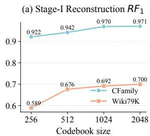

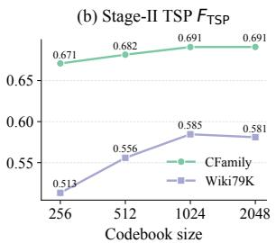  
Figure 3: Efect of codebook size in CFamily and Wiki79k.

Construction ofLatentDif-Subgraph. We use exactly the graph partitioning procedure and partition hyperparameters of GPHT for each dataset. The same LatentDif parameters are shared across all subgraphs. Predictions produced by multiple overlapping subgraphs are merged by union, while triples whose endpoints never co-occur in a subgraph cannot be generated. The prediction threshold is independently selected on the validation set for this variant. All hyperparameters are re-tuned using the same search space and validation budget as LatentDif.

## 5.4 Hyperparameter Sensitivity Analysis

5.4.1 Efect ofCodebook Size. We study the efect of codebook size in the CRVQ module. As shown in Figure 3, increasing the codebook size consistently improves the reconstruction quality in Stage I. However, the TSP performance saturates when the codebook size reaches 1024.

5.4.2 Efect ofCRVQ Configuration. We analyze the two key hy perparameters in CRVQ: the number of chunks and the number of residual quantization levels. As shown in Figure 4, increasing the number of chunks substantially improves reconstruction quality, while a moderate number of residual codebooks further benefits TSP performance.

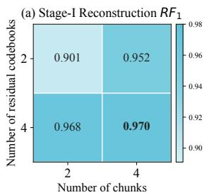

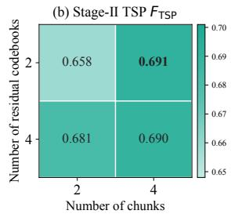  
Figure 4: Performance under diferent CRVQ configurations in CFamily.

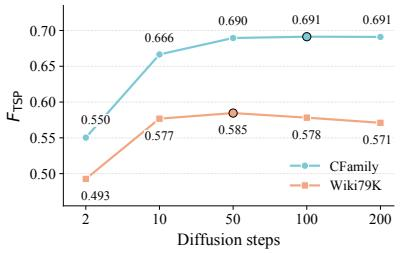  
Figure 5: Efect of difusion steps in CFamily and Wiki79k.

5.4.3 Efect ofDifusion Steps. We further investigate the efect of the number of difusion steps. As shown in Figure 5, using only 2 difusion steps leads to clearly inferior performance. When the number of steps increases from 2 to 10 and then to 50, the $F _ { \mathrm { T S P } }$ score improves substantially. However, the performance saturates after 50 or 100 steps, and further increasing the steps to 200 does not yield consistent gains.

## 5.5 Case Study

We provide a qualitative case study to illustrate the failure mode of subgraph-based TSP baselines. A cross-subgraph triple refers to a test triple whose head and tail entities do not appear in any common subgraph of subgraph-based methods. Table 6 shows representative cross-subgraph test triples recalled by LatentDif using the same validation-selected threshold as in the main evaluation. The compared subgraph-based methods do not generate these triples.

## 5.6 Analysis of Cross Subgraph Recovery

A key motivation of our framework is that subgraph partitioning may fragment relational dependencies. To directly examine this issue, we construct a cross-subgraph test subset based on the parti tions used by the subgraph-based baseline. A test triple $( h , r , t )$ is considered cross-subgraph if its head entity ℎ and tail entity � are not contained in any common subgraph. Such triples are dificult for subgraph-based methods because the evidence associated with ℎ and � is separated by the partition boundary.

We examine how much structural information is afected by the partition process. Given the subgraph collection used by the subgraph-based baseline, we define a training triple as covered if it appears in at least one subgraph. Otherwise, this triple is counted as partition-uncovered. Similarly, a test triple is defined as crosssubgraph if its head and tail entities do not appear in any common subgraph. Table 5 reports the statistics. On Wiki79k, 5.43% training triples are uncovered after partitioning, and 21.40% of test triples are partition-boundary triples. The efect is more pronounced on Wiki143k. CFamily shows smaller fragmentation, with 1.02% partition-boundary test triples. These results suggest that the impact of subgraph partitioning varies across datasets, but can be non-negligible on larger KGs. This motivates our unified graph latent formulation, where all head-relation latent embeddings are represented in a globally shared code latent space.

Table 5: Partition-induced fragmentation statistics on three datasets.
<table><tr><td>Dataset</td><td>#Train</td><td>#Retained</td><td>#Uncovered</td><td>Uncovered Ratio</td><td>#Test</td><td>#Same-subgraph</td><td>#Partition-boundary</td><td>Boundary Ratio</td></tr><tr><td>CFamily</td><td>16,549</td><td>16,514</td><td>35</td><td>0.21%</td><td>4,598</td><td>4,551</td><td>47</td><td>1.02%</td></tr><tr><td>Wiki79k</td><td>57,033</td><td>53,937</td><td>3,096</td><td>5.43%</td><td>15,843</td><td>12,452</td><td>3,391</td><td>21.40%</td></tr><tr><td>Wiki143k</td><td>103,415</td><td>88,984</td><td>14,431</td><td>13.95%</td><td>28,727</td><td>16,781</td><td>11,946</td><td>41.58%</td></tr></table>

Table 6: Cases of cross-subgraph triples.
<table><tr><td>Target Triple</td><td>GPHT</td><td>DiffTSP</td><td>LatentDiff</td></tr><tr><td>(October, follows, September)</td><td>Missed</td><td>Missed</td><td>Recalled (s = 0.98)</td></tr><tr><td>(2006 Asian Games, follows, 2002 Asian Games)</td><td>Missed</td><td>Missed</td><td>Recalled (s = 0.97)</td></tr><tr><td>(Châlons-en-Champagne, twinned with, Neuss)</td><td>Missed</td><td>Missed</td><td>Recalled (s = 0.95)</td></tr><tr><td>(Épinal, located in, Vosges)</td><td>Missed</td><td>Missed</td><td>Recalled (s = 0.91)</td></tr><tr><td>(Braga, shares border with, Guimarães)</td><td>Missed</td><td>Missed</td><td>Recalled (s = 0.89)</td></tr><tr><td>(Bonn, country, Weimar  $R e p u b l i c )$ </td><td>Missed</td><td>Missed</td><td>Recalled  $( s = 0 . 7 5 )$ </td></tr></table>

Performance on partition-boundary triples. We further conduct a subset-level evaluation on partition-boundary test triples, whose head and tail entities do not occur in any common subgraph constructed by the subgraph-based models. As shown in Table 7, GPHT and DifTSP recover none of these triples. In contrast, LatentDif can score the partition-boundary triples, resulting in �� ������bd values of 0.229 and 0.195 on Wiki79k and Wiki143k, respectively.

Partition-boundary triples remain dificult because their supporting evidence can be sparse or structurally distant, and the decoding threshold is selected according to overall validation � rather than boundary-specific performance. Nevertheless, the nonzero recovery of LatentDif, compared with zero recovery by the subgraph-based methods, provides quantitative evidence that the unified latent generation framework enables the recovery of triples excluded by subgraph-restricted candidate construction.

## 5.7 Eficiency Study

We further compare LatentDif with DifTSP and GPHT under the same hardware environment. As shown in Table 8, LatentDif achieves faster inference. These results show that performing generation in the latent space can provide favorable inference eficiency despite the iterative nature of difusion sampling. LatentDif also avoids explicitly constructing the raw $| \mathcal { E } | \times | \mathcal { R } | \times | \mathcal { E } |$ adjacency tensor and instead performs generation over $\mathbf { Z } \in \mathbb { R } ^ { | \mathcal { E } | \times | \mathcal { R } | \times d }$ . Moreover, head-wise chunking reduces peak latent memory without partitioning the graph or introducing separate local model parameters. More details are in the Appendix.

Table 7: Diagnostic evaluation on partition-boundary test triples. $S T R e c a l l _ { \mathrm { b d } }$ is computed only over the partitionboundary subset.
<table><tr><td>Dataset</td><td>Method</td><td>Recalled</td><td> $S T R e c a l l _ { \mathrm { b d } }$ </td></tr><tr><td rowspan="3">Wiki79k</td><td>GPHT</td><td>0/3,391</td><td>0.000</td></tr><tr><td>DiffTSP</td><td>0/3,391</td><td>0.000</td></tr><tr><td>LatentDiff</td><td>178/3,391</td><td>0.229</td></tr><tr><td rowspan="3">Wiki143k</td><td>GPHT</td><td>0/11,946</td><td>0.000</td></tr><tr><td>DiffTSP</td><td>0/11,946</td><td>0.000</td></tr><tr><td>LatentDiff</td><td>456/11,946</td><td>0.195</td></tr></table>

Table 8: Inference time (s) comparison and speedup. The speedup is computed against the fastest baseline DifTSP.
<table><tr><td>Dataset</td><td>GPHT</td><td>DiffTSP</td><td>LatentDiff</td><td>Speedup</td></tr><tr><td>CFamily</td><td>46.25</td><td>8.13</td><td>1.64</td><td>4.9×</td></tr><tr><td>Wiki79k</td><td>151.94</td><td>83.77</td><td>12.79</td><td>6.5×</td></tr><tr><td>Wiki143k</td><td>583.69</td><td>101.07</td><td>35.93</td><td>2.8X</td></tr></table>

More Experimental Details. Additional analysis on ablation studies, implementation details, observed ratios, and inference memory consumption are reported in the Appendix.

## 6 Conclusion

In this work, we proposed LatentDif, a two-stage conditional latent generative framework, for knowledge graph triple set prediction. LatentDif first learns a relation-aware residual-quantized latent space, and then performs observation-anchored difusion in this space to recover missing relational residuals. Instead of relying on subgraph-level local prediction, LatentDif performs completion in a globally shared latent space. Experimental results demonstrate that LatentDif achieves state-of-the-art performance. This work focuses on establishing the efectiveness ofunified latent generation for TSP, and a systematic investigation of its scalability to larger knowledge graphs is left for future work.

## References

[1] Jacob Austin, Daniel D Johnson, Jonathan Ho, Daniel Tarlow, and Rianne Van Den Berg. 2021. Structured denoising difusion models in discrete state-spaces. Advances in neural information processing systems 34 (2021), 17981–17993.

[2] Ivana Balažević, Carl Allen, and Timothy Hospedales. 2019. Tucker: Tensor factorization for knowledge graph completion. In Proceedings ofthe 2019 conference on empirical methods in natural language processing and the 9th international joint conference on natural language processing (EMNLP-IJCNLP). 5185–5194.

[3] Antoine Bordes, Nicolas Usunier, Alberto García-Durán, Jason Weston, and Oksana Yakhnenko. 2013. Translating Embeddings for Modeling Multi-Relational Data. In Advances in Neural Information Processing Systems 26: 27th Annual Conference on Neural Information Processing Systems 2013. Proceedings ofa Meeting Held December 5-8, 2013, Lake Tahoe, Nevada, United States, Christopher J. C. Burges, Léon Bottou, Zoubin Ghahramani, and Kilian Q. Weinberger (Eds.). 2787–2795.

[4] Linlin Chao, Jianshan He, Taifeng Wang, and Wei Chu. 2020. Pairre: Knowledge graph embeddings via paired relation vectors. arXiv preprint arXiv:2011.03798 (2020).

[5] Kai Chen, Xin Song, Ye Wang, Liqun Gao, Aiping Li, Xiaojuan Zhao, Bin Zhou, and Yalong Xie. 2025. LLM-DR: A Novel LLM-Aided Difusion Model for Rule Generation on Temporal Knowledge Graphs. In Proceedings of the AAAI Conference on Artificial Intelligence, Vol. 39. 11481–11489.

[6] Haoxiang Cheng, Yunfei Wang, Chao Chen, Kewei Cheng, Zhipeng Lin, Haoxuan Li, Changjun Fan, and Shixuan Liu. 2026. Generating Graph-like Rules for Knowl edge Graph Reasoning via Difusion Models. arXiv preprint arXiv:2605.30747 (2026).

[7] Yuanning Cui, Zequn Sun, and Wei Hu. 2024. A prompt-based knowledge graph foundation model for universal in-context reasoning. Advances in Neural Information Processing Systems 37 (2024), 7095–7124.

[8] Keyan Ding, Jing Yu, Junjie Huang, Yuchen Yang, Qiang Zhang, and Huajun Chen. 2025. Scitoolagent: a knowledge-graph-driven scientific agent for multitool integration. Nature Computational Science 5, 10 (2025), 962–972.

[9] Ling Ding, Lei Huang, Zhizhi Yu, Di Jin, and Dongxiao He. 2025. Towards global-topology relation graph for inductive knowledge graph completion. In Proceedings ofthe AAAIConference on Artificial Intelligence, Vol. 39. 11581–11589.

[10] Enjun Du, Siyi Liu, and Yongqi Zhang. 2026. GraphOracle: Eficient fully inductive knowledge graph reasoning via relation-dependency graphs. In Proceedings ofthe AAAI Conference on Artificial Intelligence, Vol. 40. 19055–19063.

[11] Yin Fang, Qiang Zhang, Ningyu Zhang, Zhuo Chen, Xiang Zhuang, Xin Shao, Xiaohui Fan, and Huajun Chen. 2023. Knowledge graph-enhanced molecular contrastive learning with functional prompt. Nature Machine Intelligence 5, 5 (2023), 542–553.

[12] Xingcheng Fu, Yisen Gao, Yuecen Wei, Qingyun Sun, Hao Peng, Jianxin Li, and Xianxian Li. 2024. Hyperbolic geometric latent difusion model for graph generation. arXiv preprint arXiv:2405.03188 (2024).

[13] Mikhail Galkin, Xinyu Yuan, Hesham Mostafa, Jian Tang, and Zhaocheng Zhu. 2024. Towards foundation models for knowledge graph reasoning. In International Conference on Learning Representations, Vol. 2024. 31598–31619.

[14] Yisen Gao, Yixi Cai, Tianshi Zheng, Jiaxin Bai, and Yangqiu Song. 2026. HypoA gent: An Agentic Framework for Interactive Abductive Hypothesis Generation over Knowledge Graphs. arXiv preprint arXiv:2605.31370 (2026).

[15] Yisen Gao, Xingcheng Fu, Qingyun Sun,Jianxin Li, and Xianxian Li. 2026. Toward a unified geometry understanding: Riemannian difusion framework for graph generation and prediction. Advances in Neural Information Processing Systems 38 (2026), 74249–74275.

[16] Zhaoyan Gong, Zhiqiang Liu, Songze Li, Xiaoke Guo, Yuanxiang Liu, Xinle Deng, Zhizhen Liu, Lei Liang, Huajun Chen, and Wen Zhang. 2026. Temp-R1: A Unified Autonomous Agent for Complex Temporal KGQA via Reverse Curriculum Reinforcement Learning. arXiv preprint arXiv:2601.18296 (2026).

[17] Jihong Guan, Jiaqi Wang, Wengen Li, Hanchen Yang, Yichao Zhang, and Shuigeng Zhou. 2026. One Pass for All: A Discrete Difusion Model for Knowledge Graph Triple Set Prediction. arXiv preprint arXiv:2604.18344 (2026).

[18] Zirui Guo, Lianghao Xia, Yanhua Yu, Tian Ao, and Chao Huang. 2024. Lightrag: Simple and fast retrieval-augmented generation. arXiv preprint arXiv:2410.05779 2, 3 (2024).

[19] Jonathan Ho, Ajay Jain, and Pieter Abbeel. 2020. Denoising difusion probabilistic models. Advances in neural information processing systems 33 (2020), 6840–6851.

[20] Yangqin Jiang, Yuhao Yang, Lianghao Xia, and Chao Huang. 2024. Difkg: Knowledge graph difusion model for recommendation. In Proceedings of the 17th ACM international conference on web search and data mining. 313–321.

[21] Jaehyeong Jo, Seul Lee, and Sung Ju Hwang. 2022. Score-based generative modeling of graphs via the system of stochastic diferential equations. In International conference on machine learning. PMLR, 10362–10383.

[22] Haoning Li and Qinghua Huang. 2026. DANS-KGC: Difusion Based Adaptive Negative Sampling for Knowledge Graph Completion. In Proceedings ofthe AAAI Conference on Artificial Intelligence, Vol. 40. 22913–22921.

[23] Lei Liang, Zhongpu Bo, Zhengke Gui, Zhongshu Zhu, Ling Zhong, Peilong Zhao, Mengshu Sun, Zhiqiang Zhang, Jun Zhou, Wenguang Chen, et al. 2025. Kag: Boosting llms in professional domains via knowledge augmented generation. In Companion Proceedings of the ACM on Web Conference 2025. 334–343.

[24] Yankai Lin, Zhiyuan Liu, Maosong Sun, Yang Liu, and Xuan Zhu. 2015. Learning entity and relation embeddings for knowledge graph completion. In Proceedings ofthe AAAI conference on artificial intelligence, Vol. 29.

[25] Yuanxiang Liu, Songze Li, Xiaoke Guo, Zhaoyan Gong, Qifei Zhang, Huajun Chen, and Wen Zhang. 2026. CoG: Controllable Graph Reasoning via Relational Blueprints and Failure-Aware Refinement over Knowledge Graphs. arXiv preprint arXiv:2601.11047 (2026).

[26] Yi Liu, Wengen Li, Jihong Guan, Shuigeng Zhou, and Yichao Zhang. 2025. Efective cloud removal for remote sensing images by an improved mean-reverting denoising model with elucidated design space. In Proceedings of the Computer Vision and Pattern Recognition Conference. 17851–17861.

[27] Xiao Long, Liansheng Zhuang, Aodi Li, Houqiang Li, and Shafei Wang. 2024. Fact embedding through difusion model for knowledge graph completion. In Proceedings ofthe ACM Web Conference 2024. 2020–2029.

[28] Xiao Long, Liansheng Zhuang, Aodi Li, Jiuchang Wei, Houqiang Li, and Shafei Wang. 2024. KGDM: A difusion model to capture multiple relation semantics for knowledge graph embedding. In Proceedings ofthe AAAI Conference on Artificial Intelligence, Vol. 38. 8850–8858.

[29] Andreas Lugmayr, Martin Danelljan, Andres Romero, Fisher Yu, Radu Timofte, and Luc Van Gool. 2022. Repaint: Inpainting using denoising difusion probabilistic models. In Proceedings ofthe IEEE/CVF conference on computer vision and pattern recognition. 11461–11471.

[30] Ziwei Luo, Fredrik K Gustafsson, Zheng Zhao, Jens Sjölund, and Thomas B Schön. 2023. Image restoration with mean-reverting stochastic diferential equations. arXiv preprint arXiv:2301.11699 (2023).

[31] Ziwei Luo, Fredrik K Gustafsson, Zheng Zhao, Jens Sjölund, and Thomas B Schön. 2023. Refusion: Enabling large-size realistic image restoration with latent-space difusion models. In Proceedings ofthe IEEE/CVF conference on computer vision and pattern recognition. 1680–1691.

[32] Tengfei Ma, Yujie Chen, Liang Wang, Xuan Lin, Bosheng Song, and Xiangxiang Zeng. 2025. S2DN: Learning to Denoise Unconvincing Knowledge for Inductive Knowledge Graph Completion. In Proceedings ofthe AAAIConference on Artificial Intelligence, Vol. 39. 12355–12363.

[33] Van Khoa Nguyen, Yoann Boget, Frantzeska Lavda, and Alexandros Kalousis. 2024. Glad: Improving latent graph generative modeling with simple quantization. arXiv preprint arXiv:2403.16883 (2024).

[34] Shen Nie, Fengqi Zhu, Zebin You, Xiaolu Zhang, Jingyang Ou, Jun Hu, Jun Zhou, Yankai Lin, Ji-Rong Wen, and Chongxuan Li. 2025. Large language difusion models. arXiv preprint arXiv:2502.09992 (2025).

[35] Shirui Pan, Linhao Luo, Yufei Wang, Chen Chen, Jiapu Wang, and Xindong Wu. 2024. Unifying large language models and knowledge graphs: A roadmap. IEEE Transactions on Knowledge and Data Engineering 36, 7 (2024), 3580–3599.

[36] Robin Rombach, Andreas Blattmann, Dominik Lorenz, Patrick Esser, and Björn Ommer. 2022. High-resolution image synthesis with latent difusion models. In Proceedings ofthe IEEE/CVF conference on computer vision and pattern recognition. 10684–10695.

[37] Michael Schlichtkrull, Thomas N Kipf, Peter Bloem, Rianne Van Den Berg, Ivan Titov, and Max Welling. 2018. Modeling relational data with graph convolutional networks. In European semantic web conference. Springer, 593–607.

[38] Jiawei Sheng, Taoyu Su, Xixun Lin, Xiaodong Li, and Tingwen Liu. 2026. Conditional Difusion Guided Knowledge Transfer for Multi-Domain Knowledge Graph Completion. In Proceedings of the ACM Web Conference 2026. 3744–3754.

[39] Hong Ting Tsang, Jiaxin Bai, Haoyu Huang, Qiao Xiao, Tianshi Zheng, Baixuan Xu, Shujie Liu, and Yangqiu Song. 2026. Autograph-r1: End-to-end reinforcement learning for knowledge graph construction. In Proceedings of the 64th Annual Meeting of the Association for Computational Linguistics (Volume 1: Long Papers). 23351–23374.

[40] Aaron Van Den Oord, Oriol Vinyals, et al. 2017. Neural discrete representation learning. Advances in neural information processing systems 30 (2017).

[41] Shikhar Vashishth, Soumya Sanyal, Vikram Nitin, and Partha Talukdar. 2019. Composition-based multi-relational graph convolutional networks. arXiv preprint arXiv:1911.03082 (2019).

[42] Clement Vignac, Igor Krawczuk, Antoine Siraudin, Bohan Wang, Volkan Cevher, and Pascal Frossard. 2022. Digress: Discrete denoising difusion for graph generation. arXiv preprint arXiv:2209.14734 (2022).

[43] Zexuan Wan, Bo Wang, Kuofei Fang, and Bin Wu. 2026. TGCA-LLM: Time-Aware Graph-Text Contrastive Alignment for Enhancing LLMs in Temporal Knowledge Graph Completion. In Proceedings of the AAAI Conference on Artificial Intelligence, Vol. 40. 15806–15814.

[44] Bin Xia, Yulun Zhang, Shiyin Wang, Yitong Wang, Xinglong Wu, Yapeng Tian, Wenming Yang, and Luc Van Gool. 2023. Difir: Eficient difusion model for image restoration. In Proceedings ofthe IEEE/CVF international conference on computer vision. 13095–13105.

[45] Bishan Yang, Wen-tau Yih, Xiaodong He, Jianfeng Gao, and Li Deng. 2014. Embedding entities and relations for learning and inference in knowledge bases. arXiv preprint arXiv:1412.6575 (2014).

[46] Hanchen Yang, Jiaqi Wang, Jiannong Cao, Wengen Li, Jialun Zheng, Yangning Li, Chunyu Miao, Jihong Guan, Shuigeng Zhou, and Philip S Yu. 2026. OKG-LLM: Aligning ocean knowledge graph with observation data via LLMs for global sea surface temperature prediction. IEEE Transactions on Knowledge and Data Engineering (2026).

[47] Duanyang Yuan, Sihang Zhou, Xiaoshu Chen, Dong Wang, Ke Liang, Xinwang Liu, and Jian Huang. 2025. Knowledge graph completion with relation-aware an chor enhancement. In Proceedings of the AAAI Conference on Artificial Intelligence, Vol. 39. 15239–15247.

[48] Yuan Yuan, Juan Li, Songze Li, Huajun Chen, and Wen Zhang. 2026. SMuRT: A Structured Multi-Stage Rule-guided LLM Framework for Triple Set Prediction. In 2026 International Joint Conference on Neural Networks (IJCNN). IEEE, 1–6.

[49] Yuan Yuan, Yajing Xu, and Wen Zhang. 2024. Is Large Language Model Good at Triple Set Prediction? An Empirical Study. In 2024 IEEE International Conference on Knowledge Graph (ICKG). IEEE, 470–476.

[50] Wen Zhang, Yajing Xu, Peng Ye, Zhiwei Huang, Zezhong Xu, Jiaoyan Chen, Jef Z Pan, and Huajun Chen. 2024. Start from zero: Triple set prediction for automatic knowledge graph completion. IEEE Transactions on Knowledge and Data Engineering 36, 11 (2024), 7087–7101.

[51] Yongqi Zhang and Quanming Yao. 2022. Knowledge graph reasoning with relational digraph. In Proceedings ofthe ACM web conference 2022. 912–924.

[52] Zhanqiu Zhang, Jianyu Cai, Yongdong Zhang, and Jie Wang. 2020. Learning hierarchy-aware knowledge graph embeddings for link prediction. In Proceedings ofthe AAAI conference on artificial intelligence, Vol. 34. 3065–3072.

[53] Cai Zhou, Xiyuan Wang, and Muhan Zhang. 2024. Unifying generation and prediction on graphs with latent graph difusion. Advances in Neural Information Processing Systems 37 (2024), 61963–61999.

[54] Zhaocheng Zhu, Xinyu Yuan, Michael Galkin, Louis-Pascal Xhonneux, Ming Zhang, Maxime Gazeau, and Jian Tang. 2023. A\* net: A scalable path-based reasoning approach for knowledge graphs. Advances in neural information processing systems 36 (2023), 59323–59336.

## A Method Details

## A.1 Dual-view Linear Attention

Given a sequence $\mathbf { X } \in \mathbb { R } ^ { L \times d } ;$ , each attention head computes

$$
{ \bf Q } = { \bf X } { \bf W } _ { Q } , \quad { \bf K } = { \bf X } { \bf W } _ { K } , \quad { \bf V } = { \bf X } { \bf W } _ { V } ,\tag{21}
$$

and uses the positive feature map $\phi ( x ) = \mathrm { E L U } ( x ) + 1 \colon$

$$
\operatorname { L i n A t t n } ( \mathbf { X } ) _ { i } = { \frac { \phi ( \mathbf { q } _ { i } ) ^ { \top } \left( \sum _ { j = 1 } ^ { L } \phi ( \mathbf { k } _ { j } ) \mathbf { v } _ { j } ^ { \top } \right) } { \phi ( \mathbf { q } _ { i } ) ^ { \top } \left( \sum _ { j = 1 } ^ { L } \phi ( \mathbf { k } _ { j } ) \right) + \epsilon } } .\tag{22}
$$

We employ multi-head attention and concatenate the outputs of all heads. Relation-wise attention applies this operation over the � relation tokens for each entity, whereas node-wise attention applies it over the � entity tokens for each relation. The two branches use independent projection parameters.

## A.2 Complexity Analysis

Let $N = | { \mathcal { E } } | , R = | { \mathcal { R } } | $ , and � denote the entity count, relation count, and latent dimension. Let $L _ { e } , L _ { d } ,$ , and $L _ { c }$ denote the encoder, denoiser, and residual quantization depths, � the codebook size, and � the number of reverse difusion steps. Raw adjacency space reconstruction or difusion requires $O ( N ^ { 2 } R )$ memory and at least $O ( N ^ { 2 } R d )$ computation. Instead, LatentDif generates head-relation latents $\dot { \boldsymbol { Z } } \in \mathbb { R } ^ { \hat { N } \times R \times d }$ with $O ( N R d )$ latent memory.

Stage I. For input triples $\mathcal { T } _ { \rho } \mathrm { : }$ , sparse projection costs $O ( | \mathcal { T } _ { \rho } | d )$ while reconstruction with $K _ { \mathrm { n e g } }$ negatives per positive costs $O ( ( 1 +$ $K _ { \mathrm { n e g } } ) | \mathcal { T } _ { \rho } | d )$ . Relation-wise encoding and CRVQ respectively cost

$$
O \big ( L _ { e } N ( R d ^ { 2 } + R ^ { 2 } d ) \big ) \mathrm { ~ a n d ~ } O ( N R L _ { c } C d ) .\tag{23}
$$

CRVQ uses $O ( L _ { c } C d )$ codebook memory. Splitting embeddings into proportionally smaller chunks leaves its leading order computation and parameter memory unchanged.

Stage II. Dual-view linear attention avoids dense $R \times R$ and $N \times N$ attention maps and their $O ( N R ^ { 2 } d + R N ^ { 2 } d )$ computation. With attention feature dimension and FFN width both $O ( d )$ , each denoiser evaluation costs $O ( L _ { d } N R d ^ { 2 } )$ . Training samples one timestep and has the same per-instance asymptotic cost, whereas �-step DDPM sampling costs $O ( S L _ { d } N R d ^ { 2 } )$ . Reverse steps execute sequentially without accumulating activations across steps, so peak memory does not scale with �.

Chunking and decoding. Scoring a candidate set C costs $O ( | C | d )$ or $O ( N ^ { 2 } R d )$ for exhaustive decoding, while scores can be generated and thresholded incrementally. In both stages, processing $B _ { h }$ head entities per chunk reduces active latent memory and exhaustive score bufer memory, respectively, as

$$
{ \cal O } ( N R d )  { \cal O } ( B _ { h } R d ) , \quad { \cal O } ( N ^ { 2 } R )  { \cal O } ( B _ { h } R N ) .\tag{24}
$$

Total asymptotic computation remains unchanged. Chunking manages memory rather than partitioning the graph: all chunks share the encoder, codebooks, denoiser, and decoder within a common latent space. Global node-wise interactions can be preserved by accumulating key-value statistics across chunks rather than computing attention independently within each chunk.

## A.3 Stage-I Reconstruction Fidelity Metrics

Stage I learns a compact latent representation by reconstructing its input graph. Its reconstruction metrics measure how faithfully an input is encoded and decoded. The diagnostic evaluation below supplies an evaluation graph containing test triples to the encoder, so its scores describe reconstruction with access to those triples. These diagnostic inputs and scores are excluded from TSP training and hyperparameter selection. Stage-I reconstruction evaluation is performed by feeding an evaluation KG containing both training and test triples:

$$
\mathcal G _ { \mathrm { e v a l } } = ( \mathcal E , \mathcal R , \mathcal T _ { \mathrm { e v a l } } ) , \quad \mathcal T _ { \mathrm { e v a l } } = \mathcal T _ { \mathrm { t r a i n } } \cup \mathcal T _ { \mathrm { t e s t } } .\tag{25}
$$

After encoding, quantization, and decoding, we obtain a reconstructed triple set ${ \mathcal { T } } _ { \mathrm { r e c } } .$ . Since training triples are already trained in our model and should not inflate the reconstruction score, we remove them from the reconstructed set:

$$
\mathcal { T } _ { \mathrm { r e c } } ^ { \mathrm { e v a l } } = \mathcal { T } _ { \mathrm { r e c } } \setminus \mathcal { T } _ { \mathrm { t r a i n } } .\tag{26}
$$

The reconstruction metrics are then computed only against the test triples:

$$
R e c P r e c i s i o n = \frac { | \mathcal { T } _ { \mathrm { r e c } } ^ { \mathrm { e v a l } } \cap \mathcal { T } _ { \mathrm { t e s t } } | } { | \mathcal { T } _ { \mathrm { r e c } } ^ { \mathrm { e v a l } } | } ,\tag{27}
$$

$$
R e c R e c a l l = \frac { | \mathcal { T } _ { \mathrm { r e c } } ^ { \mathrm { e v a l } } \cap \mathcal { T } _ { \mathrm { t e s t } } | } { | \mathcal { T } _ { \mathrm { t e s t } } | } ,\tag{28}
$$

$$
R F _ { 1 } = \frac { 2 \cdot R e c P r e c i s i o n \cdot R e c R e c a l l } { R e c P r e c i s i o n + R e c R e c a l l } .\tag{29}
$$

Here, $R F _ { 1 }$ is used as the primary diagnostic metric for Stage-I reconstruction analysis.

LatentDif

## B Experiment Details

## B.1 Baselines

We select both link prediction methods and TSP methods as baselines. The representative link prediction methods, including HAKE [52], PairRE [4], RGCN [37], CompGCN [41], AstarNet [54] and UL-TRA [13], are modified for TSP by scoring all candidate triples in the graph and selecting those above a threshold as the predicted results. The threshold is determined through grid search on the vali dation set to achieve the best performance. The latest TSP methods, such as GPHT [50], LLMTSP [49], SMuRT [48] and DifTSP [17], are also included.

## B.2 Evaluation Metrics

TSP Evaluation Metrics. JPrecision measures the precision of the predicted triple set while accounting for the size of the set itself. STRecall measures the percentage of test triples successfully recovered by the model with a square-root transformation. � is the harmonic mean of JPrecision and STRecall. Higher values indicate better performance for all metrics.

Following GPHT, we denote the predicted missing triple set as $\mathcal { T } _ { \mathrm { p r e d } }$ . This corresponds to $\widehat { \mathcal { T } } _ { \mathrm { m i s s } }$ in our problem definition. Under the closed-world assumption (CWA), the predicted triples are divided into correct and incorrect parts:

$$
\mathcal { T } _ { \mathrm { p r e d } } ^ { \mathrm { C W A + } } = \mathcal { T } _ { \mathrm { p r e d } } \cap \mathcal { T } _ { \mathrm { t e s t } } ,\tag{30}
$$

$$
\mathcal { T } _ { \mathrm { p r e d } } ^ { \mathrm { C W A - } } = \mathcal { T } _ { \mathrm { p r e d } } \backslash \mathcal { T } _ { \mathrm { p r e d } } ^ { \mathrm { C W A + } } ,\tag{31}
$$

$$
\mathcal { T } _ { \mathrm { p r e d } } ^ { \mathrm { C W A } } = \mathcal { T } _ { \mathrm { p r e d } } ^ { \mathrm { C W A + } } \cup \mathcal { T } _ { \mathrm { p r e d } } ^ { \mathrm { C W A - } } = \mathcal { T } _ { \mathrm { p r e d } } .\tag{32}
$$

Under the relation-similarity partial open-world assumption (RS POWA), the positive predictions are defined as

$$
\mathcal { T } _ { \mathrm { p r e d } } ^ { \mathrm { P O W A + } } = \mathcal { T } _ { \mathrm { t e s t } } \cap \mathcal { T } _ { \mathrm { p r e d } } .\tag{33}
$$

The negative part is defined as

$$
\begin{array} { r l } & { \mathcal { T } _ { \mathrm { p r e d } } ^ { \mathrm { P O W A - } } = \big \{ ( h , r , t ) ~ | ~ ( h , r , t ) \in \mathcal { T } _ { \mathrm { p r e d } } , ~ ( h , r , t ) \not \in \mathcal { T } _ { \mathrm { t e s t } } , } \\ & { ~ \exists r ^ { \prime } \in \mathcal { R } , ~ ( h , r ^ { \prime } , t ) \in ( \mathcal { T } _ { \mathrm { t r a i n } } \cup \mathcal { T } _ { \mathrm { t e s t } } ) ~ \land ~ \mathrm { s i m } ( r , r ^ { \prime } ) < \theta \big \} . } \end{array}\tag{34}
$$

Then the valid predicted set under RS-POWA is

$$
\mathcal { T } _ { \mathrm { p r e d } } ^ { \mathrm { P O W A } } = \mathcal { T } _ { \mathrm { p r e d } } ^ { \mathrm { P O W A + } } \cup \mathcal { T } _ { \mathrm { p r e d } } ^ { \mathrm { P O W A - } } .\tag{35}
$$

For $W A \in \{ \mathrm { C W A } , \mathrm { P O W A } \}$ , the three metrics are computed as

$$
\widetilde { g } P r e c i s i o n = \frac { 1 } { 2 } \left( \frac { | \mathcal { T } _ { \mathrm { p r e d } } ^ { W A + } | } { | \mathcal { T } _ { \mathrm { p r e d } } ^ { W A } | } + \frac { | \mathcal { T } _ { \mathrm { p r e d } } ^ { W A + } | } { | \mathcal { T } _ { \mathrm { p r e d } } | } \right) ,\tag{36}
$$

$$
S T R e c a l l = \left( \frac { | \mathcal { T } _ { \mathrm { p r e d } } ^ { W A + } | } { | \mathcal { T } _ { \mathrm { t e s t } } | } \right) ^ { \frac { 1 } { 2 } } ,\tag{37}
$$

$$
F _ { \mathrm { T S P } } = \frac { 2 \cdot S T R e c a l l \cdot \mathcal { J } P r e c i s i o n } { S T R e c a l l + \mathcal { J } P r e c i s i o n } .\tag{38}
$$

Since $F _ { \mathrm { T S P } }$ is the harmonic mean of ���������� and ��������, it summarizes the trade-of between set precision and test triple recov ery. Therefore, we use $F _ { \mathrm { T S P } }$ as the primary metric for model compar ison, following the TSP evaluation protocol in GPHT. ���������� and �� ������ are reported as complementary metrics to analyze whether the improvement comes from more accurate predicted sets or better recovery of test triples. Unless otherwise specified, our discussion mainly focuses on $F _ { \mathrm { T S P } }$ . We report micro-averaged results over all predicted triples.

## B.3 Triple Set Decoding and Threshold Selection

For each method, the final predicted triple set is obtained by thresholding its predicted triple scores. Let $s _ { m } ( h , r , t )$ denote the score assigned by method � to a candidate triple $( h , r , t )$ ). Given a threshold $\tau ,$ the predicted triple set is

$$
\mathcal { T } _ { \mathrm { p r e d } } ( \tau ) = \{ ( h , r , t ) \in C \ | \ s _ { m } ( h , r , t ) \geq \tau \} ,\tag{39}
$$

where C denotes the candidate triple set after filtering out observed training triples. Following the evaluation protocol used in GPHT and DifTSP, we select the threshold on the validation set for each method and each dataset. Specifically, we search over a predefined threshold grid Θ and choose

$$
\tau _ { m } ^ { * } = \arg \operatorname* { m a x } _ { \tau \in \Theta } F _ { \mathrm { T S P } } ^ { \mathrm { v a l } } \big ( \mathcal { T } _ { \mathrm { p r e d } } ( \tau ) \big ) .\tag{40}
$$

The selected threshold $\tau _ { m } ^ { * }$ is then fixed and used to generate the predicted triple set on the test set. All reported ����������, �� ������, and $F _ { \mathrm { T S P } }$ values are computed on the test set using this validationselected threshold. This protocol is applied consistently to Latent-Dif and all compared baselines to ensure a fair comparison.

## B.4 Implementation Details

All experiments are conducted on one NVIDIA A100 GPU. We use the Adam optimizer. Hyperparameters are selected by grid search on the validation set, more details are in Table 9. To further reduce peak memory usage, both Stage I and Stage II support head-wise chunking implementation. Specifically, the latent tensor is processed in chunks along the head-entity dimension instead of materializing all head-relation embeddings at once. This is an engineering strategy for memory-eficient training and inference, not a subgraph partitioning strategy.

## B.5 Ablation Study Details

Table 10 reports the Stage-I reconstruction ablations. For the VQ-VAE comparison, we match the total learnable codebook parameter budget while keeping the encoder, decoder, latent dimensionality, and training protocol identical to those of LatentDif. Replacing CRVQ with VQ-VAE causes the largest drop in reconstruction fidelity, supporting the efectiveness of CRVQ in preserving KG structure. Removing relational-view attention or replacing the factorized decoder also reduces reconstruction quality, highlighting the contributions of relation-aware encoding and factorized decoding.

Although the Vanilla AE achieves slightly higher reconstruction fidelity, its TSP performance is substantially worse (Table 4). This contrast suggests that reconstruction fidelity alone is insuficient for efective latent generation and is consistent with a regularizing role of quantization. Stage-I reconstruction fidelity is a diagnostic of latent representation quality rather than a strict upper bound on TSP performance, since Stage II directly decodes continuous latent predictions without re-quantization.

## B.6 Sensitivity to the Observed Ratio

We further study the efect of the observed ratio, i.e., the proportion of triples retained as the observed graph for conditioning in the difusion training process. Figure 6 shows that the performance is relatively stable across diferent observed ratios, but the best results are achieved when the observed ratio is around 0.7–0.8. When the observed ratio becomes too high, the prediction task becomes less informative because fewer target triples remain to be recovered, and the model may also receive reduced supervision on the missing part. These results suggest that a moderate observed ratio provides a good balance between observation information and prediction dificulty. Therefore, we use an observed ratio of 0.8 as the default setting.

Table 9: Training hyperparameters on three datasets.
<table><tr><td>Hyperparameter</td><td>CFamily</td><td>Wiki79k</td><td>Wiki143k</td></tr><tr><td colspan="4">Stage-I Training</td></tr><tr><td>Encoder hidden dimension</td><td>64</td><td>64</td><td>32</td></tr><tr><td>Chunks of CRVQ K</td><td>4</td><td>4</td><td>4</td></tr><tr><td>Number of residual quantizers  $L _ { c }$ </td><td>4</td><td>4</td><td>2</td></tr><tr><td>Latent dimension</td><td>16</td><td>16</td><td>16</td></tr><tr><td>Codebook size C</td><td>1024</td><td>1024</td><td>2048</td></tr><tr><td>Commitment loss weight  $\lambda _ { m }$ </td><td>1</td><td>1</td><td>1</td></tr><tr><td>CRVQ loss weight  $\lambda _ {  { \mathrm { V Q } } }$ </td><td>0.25</td><td>0.25</td><td>0.25</td></tr><tr><td>Number of negative samples  $K _ { \mathrm { n e g } }$ </td><td>512</td><td>256</td><td>256</td></tr><tr><td>Learning rate</td><td> $5 \times 1 0 ^ { - 4 }$ </td><td> $5 \times 1 0 ^ { - 4 }$ </td><td> $5 \times 1 0 ^ { - 4 }$ </td></tr><tr><td colspan="4">Stage-II Training</td></tr><tr><td>Ratio ρmin</td><td>0.7</td><td>0.7</td><td>0.7</td></tr><tr><td>Observed KG ratio  $\rho _ { \mathrm { o b s } }$ </td><td>0.8</td><td>0.8</td><td>0.8</td></tr><tr><td>Variance schedule</td><td>Linear</td><td> $\operatorname { L i n e a r }$ </td><td>Linear</td></tr><tr><td>Variance schedule  $\beta _ { \mathrm { m i n } }$ </td><td> $1 \times 1 0 ^ { - 3 }$ </td><td> $2 \times 1 0 ^ { - 3 }$ </td><td> $2 \times 1 0 ^ { - 3 }$ </td></tr><tr><td>Variance schedule  $\beta _ { \mathrm { m a x } }$ </td><td> $2 \times 1 0 ^ { - 1 }$ </td><td> $4 \times 1 0 ^ { - 1 }$ </td><td> $4 \times 1 0 ^ { - 1 }$ </td></tr><tr><td>Diffusion steps</td><td>100</td><td>50</td><td>50</td></tr><tr><td>Denoising hidden dimension</td><td>128</td><td>128</td><td>64</td></tr><tr><td>Condition dimension</td><td>128</td><td>128</td><td>64</td></tr><tr><td>Time embedding dimension</td><td>128</td><td>128</td><td>64</td></tr><tr><td>Denoiser depth L</td><td>3</td><td>2</td><td>2</td></tr><tr><td></td><td></td><td></td><td></td></tr><tr><td>Learning rate</td><td> $5 \times 1 0 ^ { - 4 }$ </td><td> $5 \times 1 0 ^ { - 4 }$ </td><td> $5 \times 1 0 ^ { - 4 }$ </td></tr></table>

Table 10: Stage-I reconstruction ablation results. We report reconstruction �� on three datasets.
<table><tr><td>Variant</td><td>CFamily</td><td>Wiki79k</td><td>Wiki143k</td></tr><tr><td>LatentDiff</td><td>0.9703</td><td>0.6918</td><td>0.7145</td></tr><tr><td>w/o Relational view Attention</td><td>0.9057</td><td>0.6229</td><td>0.6927</td></tr><tr><td>w/o CRVQ (VQ-VAE)</td><td>0.4591</td><td>0.0575</td><td>0.1098</td></tr><tr><td>w/o Quantization (Vanilla AE)</td><td>0.9898</td><td>0.7187</td><td>0.7339</td></tr><tr><td>w/o Factorized Decoder</td><td>0.8895</td><td>0.5891</td><td>0.6219</td></tr></table>

## B.7 Efect of CRVQ Configurations

As shown in Figure 7, we also analyze two key hyperparameters of CRVQ on Wiki79k. Increasing either the number of chunks or the number ofresidual codebooks improves both Stage-I reconstruction fidelity and TSP performance.

## B.8 Inference Eficiency and Memory Cost

We evaluate the inference eficiency of LatentDif on one A100 GPU. Table 11 reports the prediction time and peak memory under diferent difusion steps. The inference time increases with �, since

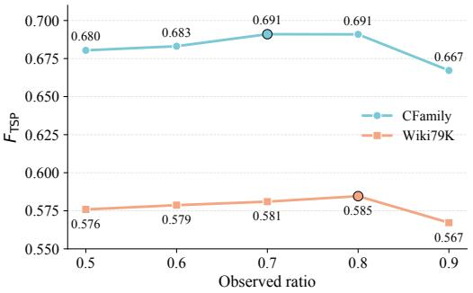  
Figure 6: Sensitivity to the observed ratio $\rho _ { \mathrm { o b s } }$ . We vary the ratio of observed triples from 0.5 to 0.9 and report $F _ { \mathrm { T S P } }$ on CFamily and Wiki79k.

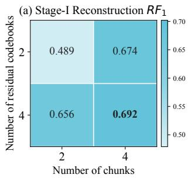

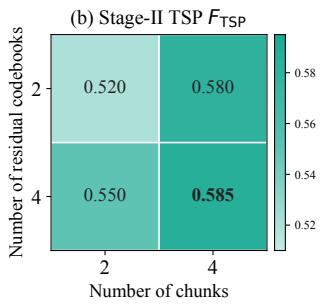  
Figure 7: Performance under diferent CRVQ configurations in Wiki79k.

Table 11: Inference eficiency of LatentDif under diferent difusion steps.
<table><tr><td rowspan="2">Dataset</td><td colspan="2">Prediction Time (s)</td><td colspan="2">Peak Memory (MB)</td></tr><tr><td> $S = 5 0$ </td><td> $S = 1 0 0$ </td><td> $S = 5 0$ </td><td> $S = 1 0 0$ </td></tr><tr><td>CFamily</td><td>0.72</td><td>1.64</td><td>2,136</td><td>2,136</td></tr><tr><td>Wiki79k</td><td>12.79</td><td>22.96</td><td>12,366</td><td>12,366</td></tr><tr><td>Wiki143k</td><td>35.93</td><td>45.76</td><td>19,872</td><td>19,872</td></tr></table>

DDPM sampling requires iterative reverse denoising. In contrast, the peak memory remains unchanged when increasing �, because the reverse process is executed sequentially and does not store activations from all denoising steps.