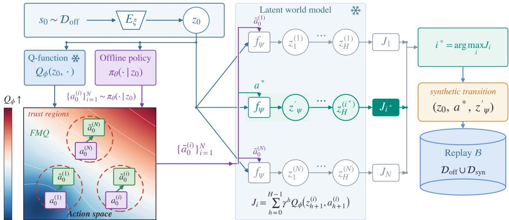

# Generating Critic-Guided Synthetic Experience in Latent World Models

Jorge de Freitas∗ Christos Ziakas Alessandra Russo Imperial College London

## Abstract

Learning from offline datasets is limited in scalability, as collecting new experience is often costly or unsafe in the real world. World models offer an alternative way to generate new experience through a learned dynamics model, yet learning policies in latent space is limited due to compounding errors in imagined rollouts. To this end, we propose using the world model as a local transition generator, leveraging critic guidance to choose actions inside a latent world model to generate synthetic experiences. We introduce action refinement methodologies for experience generation in world models, including Critic-Guided Synthetic Experience (CGSE). Specifically, CGSE augments an existing offline dataset by sampling candidate actions using an offline policy and refining each to maximize a first-order approximation of the Q-function within a trust region. Then, our method uses a frozen latent world model to imagine the future state given each updated action and appends the one maximizing the Q-function under the critic as a synthetic transition to the replay buffer. Our method requires no additional environment interaction or test-time planner, as it generates synthetic experience offline using the world model. On three OGBench manipulation tasks, CGSE improves an offline policy by a relative improvement of 7.1% on the average success rate.

## 1 Introduction

World models learn to predict the consequences of actions, providing an internal simulator in which agents can imagine and learn from experience [Ha and Schmidhuber, 2018]. They have been applied across robotics [Yang et al., 2023, Agarwal et al., 2025], autonomous driving [Hu et al., 2024], and video games [Bruce et al., 2024], with the promise of serving as a scalable substitute for costly real-world interaction in reinforcement learning [Hafner et al., 2020, 2025]. The appeal is a limitless source of synthetic experience: an agent could practice inside its own learned simulator before deployment, potentially unlocking artificial superhuman intelligence [Hughes et al., 2024]. However, world models are statistical approximations learned from data, lacking the explicit rules and underlying dynamics that govern traditional simulators. Consequently, latent representations in high-dimensional visual domains are optimized for prediction rather than task completion, and proximity in latent space does not necessarily correspond to meaningful progress toward a goal. Moreover, errors accumulate over imagined rollouts, causing value estimates to drift toward states that are unlikely to occur in the real environment [Yu et al., 2020, Janner et al., 2019].

In this work, we propose that world models need not be faithful simulators to be useful: they can instead serve as controlled generators of additional experience, enabling policy improvement. Rather than treating the world model as a simulator for long-horizon planning, we use it as a generator of synthetic experience for offline reinforcement learning. Starting from states grounded in the offline dataset, we optimize candidate actions within the learned dynamics model and score them with an offline-trained critic rather than by latent-space distance. Trust-region guidance constrains optimization to remain local to the data distribution, limiting model exploitation and error compounding over rollouts. The resulting synthetic transitions augment the offline dataset, while value estimation remains anchored to real experience.

We summarize our key contributions as follows:

• We introduce CGSE, a method that uses a frozen latent world model as a critic-guided generator of synthetic transitions, improving an offline policy without real-environment interaction or a test-time planner.

• We show that bootstrapping value estimates on imagined successors can degrade performance, while keeping the critic grounded in offline data supports actor-only improvement.

• On three robotic manipulation tasks from OGBench [Park et al., 2025b], our method achieves a 7.1% relative improvement in average task success over offline FQL.

## 2 Preliminaries

Markov Decision Process. Markov Decision Process (MDP) is defined by the tuple $( S , { \mathcal { A } } , P , R , \gamma )$ [Puterman, 2014]. The state space S consists of high-dimensional observations, while the transition dynamics are given by $P ( \bar { s } ^ { \prime } \mid s , a )$ . The policy $\pi ( a \mid s )$ maps states to action distributions to maximize the expected discounted return. The action-value function encodes this objective for a given state-action pair:

$$
Q ^ { \pi } ( s , a ) = \mathbb { E } _ { \pi } \left[ \sum _ { t = 0 } ^ { \infty } \gamma ^ { t } r ( s _ { t } , a _ { t } ) \Bigg | s _ { 0 } = s , a _ { 0 } = a \right] .\tag{1}
$$

To circumvent the intractability of planning directly in the high-dimensional observation space, all policy optimization, transition generation, and value estimation in our method are performed in a learned latent space $\mathcal { Z }$

Latent World Model. We utilize the LeWM latent action-conditioned world model [Maes et al., 2026], a Joint-Embedding Predictive Architecture (JEPA) comprising an encoder $E _ { \xi }$ and a Transformer-based forward predictor $f _ { \psi }$ . The encoder maps observations to latent states $z = E _ { \xi } ( s ) \in \mathcal { Z }$ . The predictor advances the latent state conditioned on a temporally extended action chunk $a \in { \mathcal { A } } \colon$

$$
z ^ { \prime } = f _ { \psi } ( z , a ) .\tag{2}
$$

The model is self-supervised on offline play data using a latent prediction loss and the SIGReg regularizer to maintain a well-scaled latent distribution. Crucially, $E _ { \xi }$ and $f _ { \psi }$ remain strictly frozen throughout our framework: the encoder provides a stable state space, while the predictor acts as a differentiable, one-step deterministic simulator.

Flow Q-Learning. Our base agent uses an action-chunked, best-of-N variant of Flow Q-Learning (FQL) [Park et al., 2025c, Li et al., 2025]. FQL models complex action distributions with a conditional flow and, in its original formulation, distills a separate one-step actor using critic guidance. Our implementation uses the flow policy directly and selects actions with the critic. For a dataset action chunk $^ { a , }$ Gaussian noise $\epsilon \sim \mathcal { N } ( 0 , \dot { I } )$ , and $\begin{array} { r } { i \sim \mathcal { U } [ 0 , 1 ] . } \end{array}$ its velocity network $v _ { \theta }$ is trained by

$$
\begin{array} { r } { \mathcal { L } _ { \mathrm { F l o w } } ( \theta ; \mathcal { D } ) = \mathbb { E } _ { ( z , a ) \sim \mathcal { D } , \epsilon , t } \left[ \left\| v _ { \theta } \big ( z , ( 1 - t ) \epsilon + t a , t \big ) - ( a - \epsilon ) \right\| _ { 2 } ^ { 2 } \right] . } \end{array}\tag{3}
$$

Integrating this flow defines the proposal policy $\pi _ { \theta }$ . During offline pretraining, the ensemble critic $Q _ { \phi }$ is trained by chunk-level temporal-difference learning using recorded rewards and successors. At deployment, the agent selects the highest-valued of four flow samples using the critic. Both components are pretrained in the frozen LeWM latent space; subsequent actor-only fine-tuning applies Eq. 3 to mixed replay.

## 3 Critic-Guided Synthetic Generation in World Models

Instead of utilizing the world model for unconstrained, long-horizon simulation, we deploy it as a generator of synthetic transitions to augment offline policy learning. The offline critic provides

  
Figure 1: CGSE transition generation in world model. Starting from an offline latent $z _ { \mathrm { 0 } } ,$ the fixed BC-flow actor samples N candidate first actions and FMQ-style guidance applies a one-step trustregion critic-gradient refinement to each candidate. The refined candidates are rolled out under $f _ { \psi } ,$ , scored with $Q _ { \phi } ,$ , and the best branch supplies only its first action $a ^ { * }$ and first model successor $z _ { \psi } ^ { \prime } = f _ { \psi } ( z _ { 0 } , a ^ { * } )$ . The resulting synthetic transition $( z _ { 0 } , a ^ { * } , z _ { \psi } ^ { \prime } )$ is appended to the replay buffer.

a task objective for improving candidate actions, and short model rollouts expose their predicted consequences. We transfer the selected behavior into the actor while retaining value estimates learned from real offline experience.

## 3.1 Critic-guided Action Refinement

To generate high-quality synthetic experience, the generator requires an action selector $\mathcal { M } ( z )$ that proposes an optimized action chunk for a given latent state z. Its proposal actor $\pi _ { 0 }$ and critic are fixed at their offline-pretrained values. Policy samples provide plausible starting actions, but need not maximize task value. Flow Map Q-Guidance (FMQ) [Ziakas et al., 2026b] improves such proposals by maximizing a first-order approximation of the critic within a Euclidean trust region. This yields a single normalized gradient displacement, avoiding iterative action optimization. We adapt this guidance rule to a short model-based rollout score, using the offline flow policy to supply proposals.

For each candidate $a _ { 0 } = a \sim \pi _ { 0 } ( \cdot \mid z )$ , set $z _ { 0 } = z$ and recursively compute $z _ { h + 1 } = f _ { \psi } ( z _ { h } , a _ { h } )$ and $a _ { h + 1 } \sim \pi _ { 0 } ( \cdot \mid z _ { h + 1 } )$ . The H-step score is

$$
J ( a ; z ) = \sum _ { h = 0 } ^ { H - 1 } \gamma ^ { h } Q _ { \phi } ( z _ { h + 1 } , a _ { h + 1 } ) .\tag{4}
$$

Here $Q _ { \phi }$ is the ensemble mean. Because each $Q \cdot$ -value already summarizes future rewards, J is an action-ranking surrogate, not an H-step return estimate. With sampled continuation actions held fixed, let $\boldsymbol { g } = \nabla _ { a } J ( a ; z )$ . The linearized trust-region problem has the solution

$$
\Delta ^ { \star } = \arg \operatorname* { m a x } _ { \| \Delta \| _ { 2 } \leq \eta } \big [ J ( a ; z ) + g ^ { \top } \Delta \big ] = \eta \frac { g } { \| g \| _ { 2 } } , \qquad g \neq 0 .\tag{5}
$$

We refine each of N proposals and clip to the action bounds:

$$
\tilde { a } = \mathrm { c l i p } \bigg ( a + \eta { \frac { g } { \| g \| _ { 2 } } } , - 1 , 1 \bigg ) .\tag{6}
$$

Gradients pass through the latent predictions; continuation actions are detached and their sampling noise is fixed during differentiation. A fresh scoring pass evaluates the refined proposals, and $a ^ { \star }$ is the candidate with the largest J. The trust-region optimum applies to the linearized surrogate before clipping, not to true environment return.

Algorithm 1 CGSE: synthetic transition generation in a learned world model (single-task).   
Require: offline dataset D, frozen WM $( E _ { \xi } , f _ { \psi } )$ , fixed offline actor $\pi _ { 0 }$ and critic $Q _ { \phi }$   
1: buffer $B  D ;$ initialize $\pi _ { \boldsymbol { \theta } }  \pi _ { 0 } ;$ sample $z \sim \mathcal { D }$   
2: for step $= 1 , \ldots , T$ do   
3: $a \gets \mathcal { M } ( z ; \pi _ { 0 } , Q _ { \phi } , f _ { \psi } )$ ▷ FMQ-style refinement and rollout scoring   
4: $z ^ { \prime } \gets f _ { \psi } \dot { ( z , a ) }$ ▷ single model step   
5: append $( z , a , z ^ { \prime } )$ to B   
6: sample minibatch from B; actor-only gradient step on πθ $( Q _ { \phi }$ frozen)   
$\begin{array} { r l r l } { { 7 } : } & { { } } & { } & { { } z \gets \top } \end{array}$ if not done, else resample $z \sim \mathcal { D }$ ▷ restart rule: Appendix B   
8: end for

## 3.2 Generating Synthetic Transitions

From a sampled empirical latent state $z \sim \mathcal { D }$ , the action selector M computes an optimized action chunk a (using FMQ-style refinement). We then query the forward model for a single step, yielding $z ^ { \prime } = f _ { \psi } ( z , a ) \overbar { \mathbf { \Omega } }$ and the synthetic transition $( z , a , \bar { z } ^ { \prime } )$ . Multi-step lookahead is reserved for action scoring; each stored transition represents a one-step prediction. Generation continues from $z ^ { \prime } .$ , so current states can accumulate prediction error along imagined chains. The real-state re-anchoring control instead samples an offline latent before every transition.

## 3.3 Policy Improvement with Synthetic Experience

The critical constraint of our framework is the treatment of the offline-trained critic $Q _ { \phi }$ during data consumption. Generated transitions are appended to a replay buffer B initialized with the offline dataset D. As the FQL actor $\pi _ { \theta }$ is updated using mixed batches from $B , Q _ { \phi }$ remains frozen. The actor loss consumes only sampled states and actions, matching the behaviors proposed by M through Eq. 3 with D replaced by B. Neither synthetic rewards nor successor states enter this loss directly. In chained rollouts, however, generated successors become current states of later transitions, so mode error can still affect the actor’s training distribution. Reward information guides action selection through the offline-trained critic. Figure 1 illustrates this generation process, and Algorithm 1 shows how it is interleaved with policy updates. Keeping the proposal actor, critic, and world model fixed maintains a stable action-supervision rule. This constrained, Dyna-style generation [Sutton, 1991] adds no real-environment interaction and requires no world-model planner at test time.

## 4 Experiments

## 4.1 Setup

We use OGBench [Park et al., 2025b] visual manipulation tasks (224×224 RGB for our method, 5-D actions in chunks of $h { = } 5 )$ . The world model and the base action-chunked FQL agent are trained on the same OGBench play data; the world model is trained self-supervised and then frozen, while the policy and critic form the offline checkpoint used to initialize our method. The FQL agent uses discount $\gamma { = } 0 . 9 9$ , a two-critic ensemble, and best-of-four flow action selection. We report task-1 results and selector ablations on cube-single, scene, and puzzle-3x3. The metric is native MuJoCo success. CGSE reports mean±std over three seeds, with 500,000 generation/update steps. Imagined trajectories restart from an offline latent after predicted goal attainment or a maximum of 40 model steps (Appendix B). We use N=32, H=2, and $\scriptstyle \eta = 0 . 0 2$

As the baseline, we train offline FQL from scratch for 1M updates on the same task-specific play data with three independent seeds, sharing each task’s frozen LeWM encoder. CGSE fine-tunes a checkpoint pretrained for 500,000 updates with 500,000 generation/update steps, so all methods in Table 1 receive the same 1M gradient steps. Table 2 additionally reports ablations on cube-single in which all variants start from the same offline checkpoint.

For action-selection ablations, No critic guidance uses a single unrefined sample from the offline flow policy, Best-of-N ranks 32 unrefined proposals with Eq. 4, and GradPlan performs five gradientascent steps on the first chunk with step size 0.01. The model-based selectors share H=2 lookahead.

Table 1: Success rate (mean ± std over three seeds, 250 episodes). Best per task in bold, second best underlined.
<table><tr><td>Method</td><td>cube-single</td><td>scene</td><td>puzzle-3x3</td><td>Average</td></tr><tr><td>Offline FQL</td><td> $8 4 . 0 \pm 4 . 2$ </td><td> $1 5 . 3 \pm 3 . 5$ </td><td> $4 5 . 2 \pm 1 0 . 2$ </td><td> $4 8 . 2 \pm 1 . 2$ </td></tr><tr><td>Synthetic experience generation</td><td></td><td></td><td></td><td></td></tr><tr><td>No critic guidance</td><td> $8 0 . 4 \pm 3 . 2$ </td><td> $9 . 1 \pm 2 . 1$ </td><td> $3 7 . 2 \pm 3 . 0$ </td><td> $4 2 . 2 \pm 1 . 4$ </td></tr><tr><td>Best-of-N</td><td> $8 6 . 3 \pm 3 . 1$ </td><td> $1 3 . 2 \pm 3 . 7$ </td><td> ${ \bf 5 0 . 5 \pm 2 . 7 }$ </td><td> $5 0 . 0 \pm 1 . 3$ </td></tr><tr><td>GradPlan</td><td> $8 8 . 9 \pm 0 . 2 $ </td><td> ${ \bf 1 8 . 7 \pm 1 . 6 }$ </td><td> $4 6 . 4 \pm 3 . 5$ </td><td> $5 1 . 3 \pm 1 . 0$ </td></tr><tr><td>CGSE (Ours)</td><td> $\mathbf { 9 0 . 7 \pm 0 . 9 }$ </td><td> $\underline { { 1 7 . 1 \pm 2 . 4 } }$ </td><td> $\underline { { 4 6 . 9 \pm 3 . 6 } }$ </td><td> ${ \overline { { 5 1 . 6 \pm 1 . 8 } } }$ </td></tr></table>

Weaker learned dynamics on scene and puzzle-3x3 (§4.3) likely limit the benefit of model-guided generation on these tasks.

## 4.2 Results

Table 1 compares CGSE with offline FQL trained from scratch in the same frozen LeWM latent space under the same number of gradient steps. CGSE outperforms offline FQL by a relative improvement of 8.0% on cube-single (84.0% to 90.7%) and of 7.1% on the average success rate, with no additional real interaction or test-time planner. scene improves by 11.8% and puzzle-3x3 by 3.8%, both within the seed variability of the baseline. Table 2 isolates the contribution of the world model: critic-guided action refinement with and without model-based lookahead. All variants start from the same pretrained cube checkpoint, use the same frozen latent representation and critic, and receive 500,000 additional actor updates. Table 2b reports the generation cost per transition in milliseconds on an NVIDIA A100 GPU, with N=32 and H=2 for the model-based selectors.

No world model applies the same critic-guided refinement as CGSE (normalized gradient step on $Q _ { \phi } ( z , a )$ with $\scriptstyle \eta = 0 . 0 2$ , best of 32 proposals) but without any world-model rollout. Re-anchoring uses the model-based selector but samples an offline latent before every transition. CGSE improves over the no-world-model variant by 1.8% relative (95% paired interval on the difference: [−2.1, 5.6] points). Critic-guided refinement therefore accounts for most of the improvement; these experiments do not establish a significant additional benefit from model-based lookahead. Re-anchoring achieves similar success to chaining without a goal threshold.

## 4.3 Impact of Locality and Critic Grounding

The generator is useful only in a local operating regime. The first diagnostic is prediction drift: the latent error $\lVert \hat { z } _ { t + \Delta } - z _ { t + \Delta } \rVert _ { 2 }$ between rolled-out and true latents increases with horizon (Table 3). One model step (∆=5 frames) has drift 3.40, and two steps (∆=10) have drift 6.10, comparable to the ≈ 7.4 average distance between latent states; at longer horizons, drift exceeds the scale of meaningful state differences. Our generator therefore stores only single-step transitions and uses H=2 only for action scoring. Empirically, generated successors remain close to offline latents (nearest-neighbour $L _ { 2 } \approx 0 . 6 2 )$ and have norms on the same 7.8±1.2 shell as real states.

The ablation rows of Table 1 compare action selection mechanisms and critic updates. Generating transitions with unrefined offline policy samples produces 80.4 ± 3.2% final success on cube. Best-of-N critic selection is already useful, reaching 86.3±3.1%. GradPlan provides an iterative optimization baseline, while CGSE provides our headline generator, reaching $9 0 . { \overset { \cdot } { 7 } } \pm 0 . 9 \%$ . Their average success rates are close (51.3% versus 51.6%), and these ablations do not establish a general performance advantage for CGSE. Its measured selector cost is lower: 5.34 ms versus 14.63 ms for GradPlan (Table 2b). When generated transitions also update the critic, success falls to $3 0 . 7 \pm 2 5 . 5 \%$ . This comparison changes rewards, successors, and actor-update conditions together and does not isolate their effects.

Table 2: (a) Ablation on cube-single: all rows start from the same offline checkpoint and receive 500k additional actor updates; success (%), mean ± std over three seeds. (b) Generation cost per transition.
<table><tr><td colspan="2">(a) Ablation Study</td><td colspan="2">(b) Time Complexity</td></tr><tr><td>Training</td><td>Success (%)</td><td>Selector</td><td>Time (ms)</td></tr><tr><td>No world model</td><td> $8 9 . 3 \pm 2 . 1$ </td><td>Best-of-N</td><td>2.52</td></tr><tr><td>CGSE, re-anchoring</td><td> $9 1 . 2 \pm 3 . 2$ </td><td>GradPlan</td><td>14.63</td></tr><tr><td>CGSE, chaining</td><td> ${ \bf 9 0 . 9 \pm 1 . 3 }$ </td><td>CGSE</td><td>5.34</td></tr></table>

Table 3: Mean latent prediction drift $\lVert \hat { z } _ { t + \Delta } - z _ { t + \Delta } \rVert _ { 2 }$ vs. rollout horizon on visual-cube-single.
<table><tr><td>Horizon ∆ (frames)</td><td>1</td><td>5</td><td>10</td><td>25</td><td>50</td></tr><tr><td>Mean drift</td><td>1.77</td><td>3.40</td><td>6.10</td><td>11.80</td><td>16.54</td></tr></table>

## 5 Related work

Model-based RL. Model-based reinforcement learning methods use rollouts from a learned dynamics model to augment policy or value learning [Sutton, 1991, Janner et al., 2019, Hafner et al., 2020, 2025], and offline variants penalize or constrain model use in uncertain regions [Yu et al., 2020, 2021, Park et al., 2025a]. Separately, joint-embedding predictive architectures (JEPAs) predict future representations rather than reconstructing pixels [LeCun, 2022, Assran et al., 2023]. Latent world models have been used for planning and control [Hansen et al., 2022, 2024, Sobal et al., 2025, Bagatella et al., 2025, Zhang et al., 2026, Ziakas et al., 2026a]. We build on a frozen action-conditioned latent world model [Maes et al., 2026], but use it as a source of synthetic experience rather than as a test-time planner.

Offline RL. Offline RL algorithms learn policies from fixed datasets [Levine et al., 2020]. Standard approaches include behavioral regularization [Fujimoto et al., 2019, Wu et al., 2019, Nair and Dalal, 2020], pessimistic value estimates [Kumar et al., 2020, An et al., 2021], and in-sample maximization [Kostrikov et al., 2022, Garg et al., 2023]. Diffusion and flow-matching policies [Chi et al., 2023, Pearce et al., 2023] are typically steered by the critic via weighted behavioral cloning [Lu et al., 2023, Kang et al., 2023], reparameterized gradients [Wang et al., 2023, Ding and Jin, 2023, Zhang et al., 2024], or best-of-N rejection sampling [Chen et al., 2024, Hansen-Estruch et al., 2023, He et al., 2024]. Specifically, we leverage flow Q-learning with action chunking [Park et al., 2025c, Li et al., 2025] and FMQ [Ziakas et al., 2026b], which provides a closed-form trust-region step along the critic gradient. In fact, we refine N flow-policy proposals using the FMQ step, score the resulting sequences through latent world-model rollouts, and execute the best candidate.

## 6 Conclusion

We show that a latent world model can generate local, critic-guided synthetic interaction. Actions are selected by short-horizon search, successors are single model steps, and the resulting transitions train the actor while the offline critic remains fixed. Relative to fixed offline starting checkpoints, CGSE-generated transitions improve average task success by 7.1% relative without real-environment interaction or test-time planning, with gains concentrated on cube-single. Our matched controls show that zero-step critic-guided action refinement accounts for the majority of this improvement, while our diagnostics reveal that weaker action-contingent dynamics and frozen visual representations bottleneck performance on multi-object tasks like scene and puzzle-3x3. Future work should expand this evaluation to a broader range of environments using stronger world models. A more systematic study of compute-budget scaling and task-aware representation learning methods would further strengthen our work.

## Acknowledgments

This work was carried out as part of the MEng thesis of Jorge de Freitas at Imperial College London. This work was supported by UKRI (EP/Y037111/1) as part of the ProSafe project (EU Horizon 2020, MSCA, grant no. 101119358).

## References

Niket Agarwal et al. Cosmos world foundation model platform for physical ai. arXiv preprint arXiv:2501.03575, 2025.

Gaon An, Seungyong Moon, Jang-Hyun Kim, and Hyun Oh Song. Uncertainty-based offline reinforcement learning with diversified q-ensemble. Advances in neural information processing systems, 34:7436–7447, 2021.

Mahmoud Assran, Quentin Duval, Ishan Misra, Piotr Bojanowski, Pascal Vincent, Michael Rabbat, Yann LeCun, and Nicolas Ballas. Self-supervised learning from images with a joint-embedding predictive architecture, 2023. URL https://arxiv.org/abs/2301.08243.

Marco Bagatella, Matteo Pirotta, Ahmed Touati, Alessandro Lazaric, and Andrea Tirinzoni. Tdjepa: Latent-predictive representations for zero-shot reinforcement learning, 2025. URL https: //arxiv.org/abs/2510.00739.

Jake Bruce, Michael Dennis, Ashley Edwards, Jack Parker-Holder, Yuge Shi, et al. Genie: Generative interactive environments. In International Conference on Machine Learning (ICML), 2024.

Tianyu Chen, Zhendong Wang, and Mingyuan Zhou. Diffusion policies creating a trust region for offline reinforcement learning. Advances in Neural Information Processing Systems, 37: 50098–50125, 2024.

Cheng Chi, Siyuan Feng, Yilun Du, Zhenjia Xu, Eric Cousineau, Benjamin Burchfiel, and Shuran Song. Diffusion policy: Visuomotor policy learning via action diffusion. In Robotics: Science and Systems, 2023.

Zihan Ding and Chi Jin. Consistency models as a rich and efficient policy class for reinforcement learning. arXiv preprint arXiv:2309.16984, 2023.

Scott Fujimoto, David Meger, and Doina Precup. Off-policy deep reinforcement learning without exploration. In International Conference on Machine Learning, pages 2052–2062. PMLR, 2019.

Divyansh Garg, Joey Hejna, Matthieu Geist, and Stefano Ermon. Extreme q-learning: Maxent rl without entropy. In International Conference on Learning Representations, 2023.

David Ha and Jürgen Schmidhuber. Recurrent world models facilitate policy evolution. In Advances in Neural Information Processing Systems, volume 31, pages 2451–2463, 2018.

Danijar Hafner, Timothy P. Lillicrap, Jimmy Ba, and Mohammad Norouzi. Dream to control: Learning behaviors by latent imagination. In International Conference on Learning Representations, 2020.

Danijar Hafner, Wilson Yan, and Timothy Lillicrap. Training agents inside of scalable world models, 2025. URL https://arxiv.org/abs/2509.24527.

Nicklas Hansen, Xiaolong Wang, and Hao Su. Temporal difference learning for model predictive control, 2022. URL https://arxiv.org/abs/2203.04955.

Nicklas Hansen, Hao Su, and Xiaolong Wang. Td-mpc2: Scalable, robust world models for continuous control, 2024. URL https://arxiv.org/abs/2310.16828.

Philippe Hansen-Estruch, Ilya Kostrikov, Michael Janner, Jakub Grudzien Kuba, and Sergey Levine. Idql: Implicit q-learning as an actor-critic method with diffusion policies. arXiv preprint arXiv:2304.10573, 2023.

Longxiang He, Li Shen, and Xueqian Wang. Aligniql: Policy alignment in implicit q-learning through constrained optimization. arXiv preprint arXiv:2405.18187, 2024.

Anthony Hu, Lloyd Russell, Hudson Yeo, Zak Murez, George Fedoseev, et al. GAIA-1: A generative world model for autonomous driving. In Proceedings of the IEEE/CVF Conference on Computer Vision and Pattern Recognition (CVPR), 2024.

Edward Hughes, Michael D. Dennis, Jack Parker-Holder, Feryal M. P. Behbahani, Aditi Mavalankar, Yuge Shi, Tom Schaul, and Tim Rocktäschel. Position: Open-endedness is essential for artificial superhuman intelligence. In International Conference on Machine Learning, 2024.

Michael Janner, Justin Fu, Marvin Zhang, and Sergey Levine. When to trust your model: Model-based policy optimization, 2019. URL https://arxiv.org/abs/1906.08253.

Bingyi Kang, Xiao Ma, Chao Du, Tianyu Pang, and Shuicheng Yan. Efficient diffusion policies for offline reinforcement learning. Advances in Neural Information Processing Systems, 36: 67195–67212, 2023.

Ilya Kostrikov, Ashvin Nair, and Sergey Levine. Offline reinforcement learning with implicit q-learning. In International Conference on Learning Representations, 2022.

Aviral Kumar, Aurick Zhou, George Tucker, and Sergey Levine. Conservative q-learning for offline reinforcement learning. In Advances in Neural Information Processing Systems, volume 33, pages 1179–1191, 2020.

Yann LeCun. A path towards autonomous machine intelligence, version 0.9.2, 2022. URL https: //openreview.net/pdf?id=BZ5a1r-kVsf.

Sergey Levine, Aviral Kumar, George Tucker, and Justin Fu. Offline reinforcement learning: Tutorial, review, and perspectives on open problems. arXiv preprint arXiv:2005.01643, 2020.

Qiyang Li, Zhiyuan Zhou, and Sergey Levine. Reinforcement learning with action chunking, 2025. URL https://arxiv.org/abs/2507.07969.

Cheng Lu, Yang Hu, et al. Contrastive energy prediction for exact energy-guided diffusion sampling in offline reinforcement learning. In International Conference on Machine Learning. PMLR, 2023.

Lucas Maes, Quentin Le Lidec, Damien Scieur, Yann LeCun, and Randall Balestriero. Leworldmodel: Stable end-to-end joint-embedding predictive architecture from pixels, 2026. URL https:// arxiv.org/abs/2603.19312.

Ashvin Nair and Murtaza reinforcement learning with offline datasets Dalal. Accelerating online reinforcement learning with offline datasets. arXiv preprint arXiv:2006.09359, 2020.

Kwanyoung Park, Seohong Park, Youngwoon Lee, and Sergey Levine. Scalable offline model-based rl with action chunks, 2025a. URL https://arxiv.org/abs/2512.08108.

Seohong Park, Kevin Frans, Benjamin Eysenbach, and Sergey Levine. Ogbench: Benchmarking offline goal-conditioned rl. In International Conference on Learning Representations, 2025b. URL https://arxiv.org/abs/2410.20092.

Seohong Park, Qiyang Li, and Sergey Levine. Flow q-learning, 2025c. URL https://arxiv.org/ abs/2502.02538.

Tim Pearce, Tabish Rashid, Anssi Kanervisto, David Bignell, Mingfei Sun, Raluca Georgescu, Sergio Valcarcel Macua, Shan Zheng Tan, Ida Momennejad, Katja Hofmann, and Sam Devlin. Imitating human behaviour with diffusion models. ArXiv, abs/2301.10677, 2023. URL https: //api.semanticscholar.org/CorpusID:256231177.

Martin L. Puterman. Markov Decision Processes: Discrete Stochastic Dynamic Programming. Wiley, 2014.

Vlad Sobal, Wancong Zhang, Kyunghyun Cho, Randall Balestriero, Tim G. J. Rudner, and Yann LeCun. Learning from reward-free offline data: A case for planning with latent dynamics models, 2025. URL https://arxiv.org/abs/2502.14819.

Richard S. Sutton. Dyna, an integrated architecture for learning, planning, and reacting. SIGART Bulletin, 2(4):160–163, 1991. doi: 10.1145/122344.122377. URL https://doi.org/10.1145/ 122344.122377.

Zhendong Wang, Jonathan J Hunt, and Mingyuan Zhou. Diffusion policies as an expressive policy class for offline reinforcement learning. In International Conference on Learning Representations, 2023.

Yifan Wu, George Tucker, and Ofir Nachum. Behavior regularized offline reinforcement learning. arXiv preprint arXiv:1911.11361, 2019.

Ze Yang, Yiming Zhang, Jerry Yu, Junru Cai, and Ming-Hsuan Yang. UniSim: A neural closed-loop sensor simulator. In Proceedings ofthe IEEE/CVF Conference on Computer Vision and Pattern Recognition (CVPR), 2023.

Tianhe Yu, Garrett Thomas, Lantao Yu, Stefano Ermon, James Zou, Sergey Levine, Chelsea Finn, and Tengyu Ma. Mopo: Model-based offline policy optimization, 2020. URL https://arxiv. org/abs/2005.13239.

Tianhe Yu, Aviral Kumar, Rafael Rafailov, Aravind Rajeswaran, Sergey Levine, and Chelsea Finn. Combo: Conservative offline model-based policy optimization, 2021. URL https://arxiv. org/abs/2102.08363.

Ruoqi Zhang, Ziwei Luo, Jens Sjölund, Thomas B Schön, and Per Mattsson. Entropy-regularized dif fusion policy with q-ensembles for offline reinforcement learning. Advances in neural information processing systems, 37:98871–98897, 2024.

Wancong Zhang, Basile Terver, Artem Zholus, Soham Chitnis, Harsh Sutaria, Mido Assran, Randall Balestriero, Amir Bar, Adrien Bardes, Yann LeCun, and Nicolas Ballas. Hierarchical planning with latent world models, 2026. URL https://arxiv.org/abs/2604.03208.

Christos Ziakas, Amir Bar, and Alessandra Russo. Grounding generated videos in feasible plans via world models. arXiv preprint arXiv:2602.01960, 2026a.

Christos Ziakas, Alessandra Russo, and Avishek Joey Bose. Aligning flow map policies with optimal q-guidance, 2026b. URL https://arxiv.org/abs/2605.12416.

## A Implementation details

The world models follow the LeWM architecture [Maes et al., 2026]: a ViT-Tiny encoder to $\mathbb { R } ^ { 1 9 2 }$ and a Transformer latent predictor, with each step spanning h=5 primitive actions (25-D action chunks), trained on each task family’s OGBench play data with a latent prediction loss plus SIGReg regularization and then frozen. The agent is action-chunked FQL [Park et al., 2025c, Li et al., 2025] with a best-of-N flow actor $( N _ { \mathrm { a c t } } { = } 4 )$ , a two-critic ensemble, discount $\gamma { = } 0 . 9 9$ , and target Polyak τ=0.005 during offline pretraining, which runs for 500,000 updates. Synthetic generation and actor training then run for 500,000 steps with batch size 256 and learning rate $1 0 ^ { - 4 }$ . The replay buffer starts with 200k offline chunk transitions and appends one generated transition per update. Uniform sampling from all retained data gives an expected generated fraction of $t / ( 2 0 0 , 0 0 0 + t )$ after t updates, reaching 71.4% at 500k; the 2M capacity avoids eviction during these runs. CGSE uses FMQ-style refinement with N=32 proposals, look-ahead H=2, Q-at-every-step scoring, and trust-region radius $\scriptstyle \eta = 0 . 0 2 ;$ ; imagined episodes truncate at 40 steps. Evaluation is the native OGBench success rate over 250 episodes with no world-model planner; we report mean±std over three seeds.

The offline FQL baseline uses 1M offline updates, batch size 256, and learning rate $3 \times 1 0 ^ { - 4 }$ . Selector timing uses an NVIDIA A100 GPU and excludes compilation, rendering, and policy-update time; it measures generation cost rather than total training time.

## B Imagined trajectory restarts

In chained generation, a trajectory ends when $\| z ^ { \prime } - z _ { \mathrm { g o a l } } \| _ { 2 } < 2 . 0$ or after 40 model steps, then restarts from an offline latent. The distance check controls only trajectory termination; action scoring and actor training require no synthetic reward. Its sensitivity has not been tested. Real-state re-anchoring samples an offline latent before every transition and therefore requires no goal threshold.