# Going deep, reaching further: What can Boltzmann machines eficiently represent?

Tobias Reinhart∗1 and Gemma De les Coves1,2,3

1Institute for Theoretical Physics, University of Innsbruck,, Technikerstr. 21a, A-6020 Innsbruck, Austria 2ICREA, Instituci´o Catalana d’Estudis i Recerca Avan¸cats, Passeig Llu´ıs Companys 23, 08010 Barcelona 3Departament d’Enginyeria, Universitat Pompeu Fabra, Carrer T\`anger 122, 08018 Barcelona

October 30, 2026

## Abstract

While universal approximation theorems theoretically underpin the representation capabilities of machine learning models, they have two shortcomings: They do not focus on eficient representations and they tend to be insensitive to depth and other heuristically important properties. In this work we show that these two shortcomings are intertwined. We prove that machine learning models which are deeper or have higher-order interactions can eficiently represent a larger set of functions, i.e. have larger eficient reach. It follows that deep Boltzmann machines (DBMs) have maximal eficient reach, restricted Boltzmann machines (RBMs) sub-maximal, and k-body generalizations of RBMs form a hierarchy between the two, even though all are universal. More generally, (i) we provide a full characterization of machine learning models with maximal eficient reach; (ii) we derive separations between deep and shallow models for three representation tasks; and (iii) we prove that the eficient reach of shallow models constitutes an infinite hierarchy indexed by the interaction order. The proofs draw on diferent methodologies, namely on (i) a recent characterization of universal spin models; (ii) computational complexity bounds for spin models; and (iii) communication complexity bounds applied to shallow models. This work shows that universal machine learning models can strongly difer in their eficient representation capabilities, and provides a theoretical foundation for heuristic observations.

## Contents

## 1 Introduction

2 Universal spin models and their role in machine learning 5   
2.1 Spin systems, spin models and simulations . . 6   
2.2 Universal spin models are universal approximators 10   
3 Eficiency of universal models 11   
3.1 Eficient simulations and maximality . . . 12   
3.2 Characterizations of p-maximality and (v,p)-maximality . . 13   
4 Complexity separations between maximal and shallow models 16   
4.1 Computational complexity assumptions 17   
4.2 The hard reference model 18   
4.3 Separation 1: Simulations 19   
4.4 Separation 2: Unnormalized marginals 20   
4.5 Separation 3: Normalized marginals 23   
5 The eficient reach of shallow models 25   
5.1 Shallow k-local models with small weights . . . . . 25   
5.2 Upper bounds on the eficient reach of shallow k-local systems . 26   
5.3 Lower bounds and separation hierarchy of shallow k-local systems 30   
6 Conclusion and outlook 32   
6.1 Summary of results . 32   
6.2 Outlook . . 33   
6.3 Acknowledgments and disclosures 35   
A Complexity theory toolbox 35   
A.1 Computational complexity basics . 35   
A.2 Computational complexity of the reference model . 37   
A.3 Pseudo-Boolean functions 43   
A.4 Communication complexity theory 45   
B Proofs of Section 5 46   
B.1 Proof of Lemma 28 . 46   
B.2 Proof of Lemma 34 49   
C Examples & remarks 51   
C.1 Simulation vs approximation 52   
C.2 Extensions of GSE simulation 52   
C.3 Explicit DBM simulation 53   
C.4 On the computability of simulations 54   
C.5 Increasing energy gaps through simulations 55   
D Learning separation between RBMs and 3RBMs 56   
D.1 Target distribution and model families . 56   
D.2 The likelihood objective and its gradient . 56   
D.3 Approximating the gradient — mini-batches and Monte Carlo evolutions . 57   
D.4 Updating the weights . 58   
D.5 Learning results . 58

## 1 Introduction

Several machine learning models are theoretically supported by so-called universal approximation theorems (UATs), that is, proofs that the respective model can represent or approximate any function from a certain function class. Restricted Boltzmann machines (RBMs), deep Boltzmann machines (DBMs) and deep belief networks (DBNs) are universal approximators of probability distributions [27, 26, 33], feedforward neural networks with at least one hidden layer are universal approximators of continuous functions with compact support [20, 9], and transformers are universal approximators of sequence-to-sequence functions [47].

Although theoretically foundational, practically, these UATs have two major shortcomings. First, they do not consider the eficiency of the representation. For instance, the UATs for RBMs, DBMs and DBNs, require exponentially many hidden units and hence exponentially many parameters to represent a generic target function [27, 26, 33]. Consequently, they provide limited insight into the representation capabilities of eficient models. Second, these UATs often are insensitive to heuristically important model hyperparameters such as depth. For example UATs exist for feedforward networks with just one hidden layer as well as for both RBMs and DBMs. They therefore do not explain the widely observed superiority of deep models [32, 43, 45, 42]. This raises two questions:

Are all universal machine learning models equal with regard to their eficient representation capabilities? (Q1)

$$
. I f ~ n o t , ~ w h a t ~ p r o p e r t i e s ~ c h a r a c t e r i z e ~ ^ { \textit {  } } e f f i c i e n t ~ u n i v e r s a l ~ m o d e l s ^ { \prime \prime } \%\tag{Q2}
$$

For (Q2), we are thinking of properties such as depth or other model hyperparameters.

Recently, we have shown that UATs of certain, energy-based machine learning models such as RBMs, DBMs and generalizations thereof can be proven by means of a characterization of so-called universal spin models [40]. The latter are spin models which can encode arbitrary energy functions in their low-energy sector. This way of deriving UATs has two main advantages for addressing (Q1) and (Q2). First, the characterization of universal spin models provides a handle on the resource requirements of UATs in the following sense. Spin models have a local structure that is respected by the universality characterization. If the target is compatible with this local structure, the derived UAT will only require a polynomial overhead. Second, the characterization of universal spin models is fundamentally based on a notion of composition. As a consequence, the resulting UATs should favour deep models, since depth arises by constructing representations in a compositional way, layer by layer.

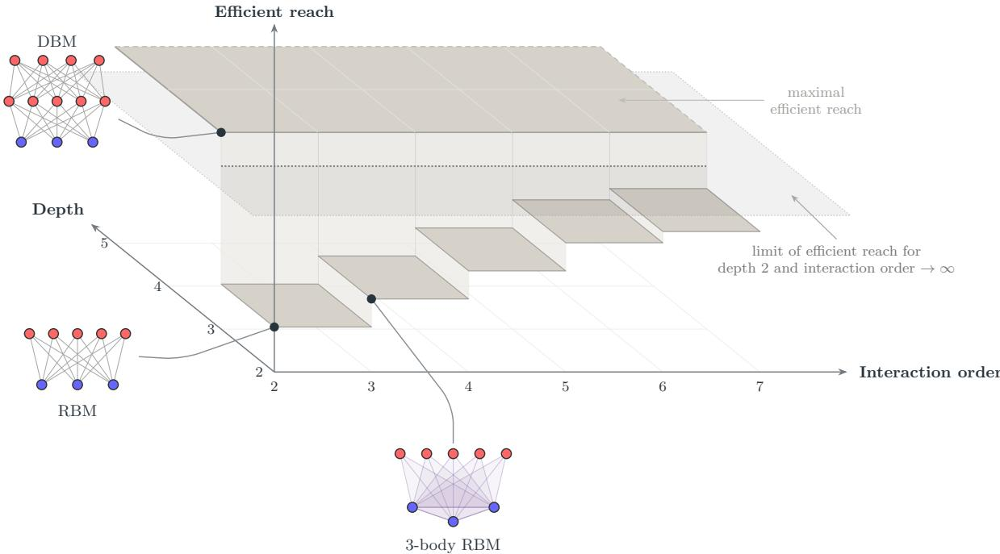  
Figure 1: Eficient reach of machine learning models. The eficient reach (vertical axis), i.e. the eficient representation capabilities of several machine learning models, as a function of their depth and interaction order (horizontal axes), where the latter is the number of units involved in each interaction. Height depicts ordinal inclusion, so that larger eficient reach means the respective models can eficiently represent more targets. We prove that, for depth ≥ 3, there are models whose eficient reach is maximal, irrespective of the interaction order. Models of depth 2 form an infinite hierarchy for increasing interaction order that saturates strictly below the maximal eficient reach (gray limit surface for depth 2 and interaction order → ∞). RBMs (depth 2 and interaction order 2), 3-body RBMs (depth 2 and interaction order 3) and DBMs (depth ≥ 3 and interaction order 2) are located in the figure with visible spins/units in blue and hidden spins/units in red. They all have diferent eficient reach.

In this work, we leverage the characterization of universal spin models to tackle (Q1) and (Q2). We find the following answers:

No, they have diferent eficient representation capabilities, forming a rich landscape (see Fig. 1). (A1)

The properties that determine the eficient representation capabilities are depth (or, more precisely, visible closure) and interaction order. (A2)

Our work provides a theoretical underpinning for the heuristic observation that deep models perform better. It also shows that the two shortcomings of UATs mentioned above are deeply intertwined. More generally, it illustrates how insightful connecting diferent fields through a common notion of universality can be — the characterization of universal spin models gives us an edge in the study of “eficient universality” of machine learning models.

Statement of results. We study the eficient reach, i.e. the eficient representation capabilities, of machine learning models from three diferent angles.

(i) Characterization of maximal models. Models which have maximal eficient reach are called maximal. Here we provide a characterization of maximal models. More precisely, we study the eficient reach of spin and machine learning models through the notion of simulations (that is, encoding target functions in the low-energy sector) and the characterization of universal spin models, using that simulations imply approximations (in terms of marginal distributions). We prove that, for spin models, universality and maximality are equivalent (Theorem 10), so the characterization of universality also applies to maximal eficient reach. In contrast, for machine learning models with visible and hidden spins (or units) another property becomes decisive: visible closure (Definition 12), which formalizes the intuition that hidden-hidden interactions are required to compose simulations and approximations. We then prove that any two of the three properties of universality, visible closure and maximality imply the third (Theorem 16, see also Fig. 2). Thus, among universal machine learning models, visible closure precisely characterizes those with maximal eficient reach. This extends the connection between universality and universal approximation established in [40] to the setting of polynomial resources. It follows that DBMs with at least two hidden layers are maximal (Corollary 17).

## (ii) Separation between shallow and maximal models.

We establish separations for three representation tasks: simulating functions (in the low-energy sector), approximating functions as unnormalized visible spin marginals, and approximating functions as normalized visible spin marginals (see Table 1). All three are based on reasonable assumptions on computational complexity, namely the non-collapse of the polynomial hierarchy.1 For the first task, we show that maximal models can eficiently simulate certain NP-hard functions that shallow models cannot (Theorem 20). For the latter two tasks, on the one hand we show that maximal models can approximate certain #P-hard functions up to a common positive factor, and the corresponding normalized distributions to arbitrary uniform relative precision, provided that the respective maximal models are visible closed in a strong sense. On the other hand, shallow models cannot achieve these two approximations eficiently (Theorems 24 and 26). Consequently, these separation results imply that shallow models such as RBMs do not have maximal eficient reach.

## (iii) Separation hierarchy for shallow models.

We establish that the eficient simulation reach of shallow models is described by an infinite hierarchy indexed by their interaction order, that is, their maximal number of spins per local interaction (see Fig. 3). Namely, for each k ≥ 2 there exist functions that shallow k-local models cannot eficiently simulate (Theorem 32 and Corollary 33) but shallow k+1-local models can (Theorem 36), under reasonable assumptions on the size of the model weights. To derive these results, we relate the eficient reach of shallow k-local models to sums of polynomial threshold functions (PTFs) of degree at most k − 1 (Lemma 28), and use communication complexity bounds to exclude eficient simulations of certain target functions, such as the k-party inner product modulo 2 (Theorems 31 and 32). We then prove that increasing the interaction order from k to k +1 allows one to eficiently simulate these targets, by first characterizing the eficient reach of RBMs through sums of small ridge functions (Lemma 34), and then extending them to shallow k-local models (Lemma 35).

<table><tr><td>Representation task</td><td>shallow</td><td>maximal</td><td>maximal and strongly visible closed</td></tr><tr><td>Simulate NP-hard ground-state energies  $G _ { n }$  (Theorem 20)</td><td>× No</td><td>√ Yes</td><td>√ Yes</td></tr><tr><td>Approximate #P-hard partition functions Zn in unnormal- ized marginals (Theorem 24)</td><td>× No</td><td></td><td>√ Yes</td></tr><tr><td>Approximate #P-hard distributions  $q _ { n } \propto Z _ { n }$  in normalized marginals (Theorem 26)</td><td>× No</td><td></td><td>√ Yes</td></tr></table>

Table 1: Separation between shallow and maximal models. We consider three representation tasks and prove separations between shallow and maximal models. NP-hard functions such as the Ising ground-state function $G _ { n }$ can be eficiently simulated by maximal models, but not by shallow models. #Phard functions such as the Ising partition function $Z _ { n }$ (and respective probability distribution $q _ { n } \propto Z _ { n } )$ can be eficiently approximated by maximal and strongly visible closed models in their unnormalized (normalized) visible spin marginals. Shallow models cannot carry out these tasks.

Comparison with previous work. The characterization of maximal models is based on [40] and extends those results to the setting of eficient representations.

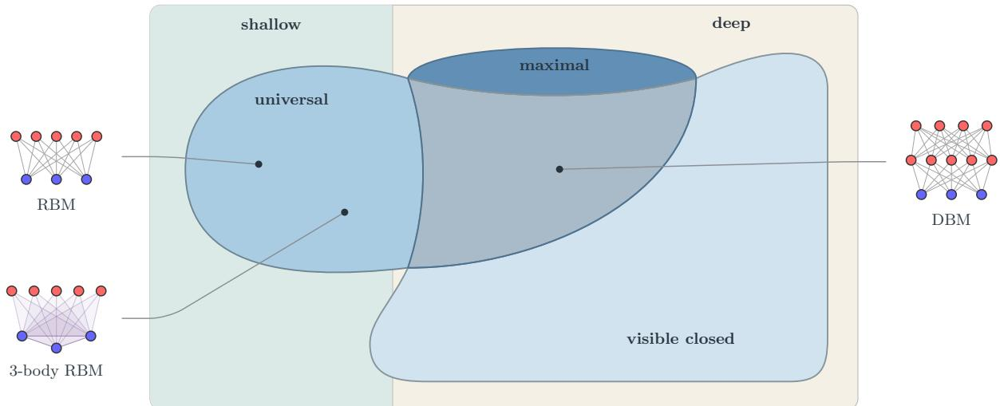  
Figure 2: Characterization of maximal models. Set diagram showing properties of machine learning models and their interplay in our characterization of maximal models. Inclusions are not necessarily strict. The three properties given by universal, visible closed and maximal, are such that any two of them imply the third. The area where the three properties hold is depicted in a blue-gray shade. Maximal models are necessarily deep. DBMs are maximal. RBMs and 3-body RBMs are universal, but are not deep, and thus not maximal. We expect most “natural” deep models to be visible closed, and hence most deep universal models to be maximal.

The separation between shallow and maximal models extends the work of [12] to include new representation tasks and reach beyond example models. Namely, whereas [12] derives a separation between RBMs and DBMs for the task of eficiently representing quantum states in their unnormalized visible spin marginals, we derive separations for general deep versus shallow models and for the additional tasks of simulating functions and approximating functions in the normalized visible spin marginals. The latter reveals that the potentially #P-hard normalization factor of shallow models does not prevent the separation by computational complexity bounds.

Finally, the separation hierarchy for shallow models extends results from [31], which studies the eficient approximation capabilities of RBMs through a relation to linear threshold functions, in particular proving the non-existence of eficient RBM approximations of the inner product modulo 2. We derive a similar relation between arbitrary shallow models and PTFs, proving similar non-existence results for shallow models and the k-party inner product modulo two functions. We further relate these results to the communication complexity of the inner product functions. We also prove that increasing the interaction order frees the model from these non-existence results.

Structure of the paper. In Section 2 we provide basic concepts and definitions regarding spin models and simulations. We then devote one section to each of our three main results: Section 3 for the characterization of maximal models, Section 4 for the separations between shallow and maximal models, and Section 5 for the separation hierarchy of shallow models. Each of these sections contains an informal statement of the main results, before deriving these results in more detail. In Section 6 we summarize our main findings and provide an outlook. Finally, an appendix provides background on complexity theory (Section A), additional details to our main results, such as proofs (Section B) as well as further supplemental results (Section C), and numerical learning experiments on the separation hierarchy of shallow models (Section D).

## 2 Universal spin models and their role in machine learning

Here we introduce basic definitions and concepts regarding spin models, related machine learning models and the respective notions of simulation and approximation. Details can be found in [41, 40].

In Section 2.1 we first define spin systems, finite systems of interacting classical degrees of freedom, the spins, and spin models, potentially infinite families of spin systems often containing systems with common local interaction pattern but diferent system sizes, e.g. all Ising-type interactions on 2d-lattices of arbitrary system size. We then define simulations between spin systems. Intuitively, S simulates T if

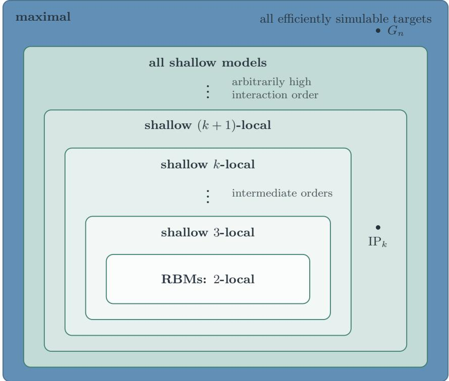  
Figure 3: Separation hierarchy for shallow models. Set diagram showing the eficient reach of var ious machine learning model classes. Each rounded rectangle depicts the maximal set of target functions that the respective model class can eficiently simulate. All shown inclusions are proven to be strict. By definition maximal models have maximal eficient reach, i.e. can eficiently simulate all targets that can be eficiently simulated, including NP-hard functions such as the Ising ground-state function $G _ { n } .$ Shallow models have strictly smaller eficient reach; for example, they cannot eficiently simulate $G _ { n } .$ The eficient reach of shallow models is given by an infinite, strict inclusion hierarchy indexed by their interaction order $k .$ Shallow (k + 1)-local models can eficiently simulate certain functions with large k-party communication complexity such as the k-party inner product modulo 2, $\operatorname { I P } _ { k }$ , whereas shallow k-local models cannot.

$S$ encodes T in a subset of its spins, in the low-energy sector. Finally, we define universal spin models, that is, spin models which can simulate arbitrary target systems, and provide an overview of existing characterizations of universality.

In Section 2.2, we extend these definitions to machine learning models. We define spin ML models, that is, spin models with an additional partition of spins into visible and hidden ones, for each of their spin systems. The respective notions of simulation (in their low-energy sector) and approximation (in the marginals of their Boltzmann distribution) then must all be compatible with this visible-hidden split.

## 2.1 Spin systems, spin models and simulations

Spin systems are systems consisting of finitely many, interacting, classical degrees of freedom, the spins. The interactions between spins are prescribed in terms of local energy functions whose sum defines the global energy function or Hamiltonian.

Definition 1 (spin system). A spin system S is a hypergraph $( V _ { S } , E _ { S } )$ together with a real-valued, local energy function $J _ { S } ( e )$ on each hyperedge $e \in E _ { S }$ . Evaluating $J _ { S } ( e )$ on a configuration v: $V _ { S } $ $\mathbf { 2 } : = \{ - 1 , + 1 \}$ yields the local energy contribution of spins from e. The sum of local energy contributions defines the Hamiltonian of S,

$$
H _ { S } ( \mathbf { v } ) = \sum _ { e \in E _ { S } } J _ { S } ( e ) ( \mathbf { v } | _ { e } ) .\tag{2.1}
$$

We define the size of a spin system $S$ as the number of real parameters required to fully specify all of its local energy functions, that is,

$$
| S | = \sum _ { e \in E _ { S } } 2 ^ { | e | } .\tag{2.2}
$$

Further, we call these parameters the couplings or weights of S. Similarly, $| f | = 2 ^ { n }$ for a generic function $f \colon { \bf 2 } ^ { n }  \mathbb { R }$ , considering $f$ a trivial spin system. We also define $| f | _ { \operatorname* { m i n } }$ to be the minimal size of any spin system with Hamiltonian $f .$

We call a spin system S that has local energy functions involving at most k spins k-local (see Section A.3) and refer to k as the interaction order or locality. Note that our choice of representing local energy functions w.r.t. the indicator basis (Section A.3), i.e. defining them by listing their values implies local energy functions of k spins might have a Fourier degree of $< k ,$ i.e. k-local spin systems might have a Hamiltonian with Fourier degree $< k .$ . The interaction order of a spin system hence only provides an upper bound for the Fourier degree of its Hamiltonian.

The size of any k-local spin system is essentially determined by the number of spins $n ,$ i.e. $| S | =$ poly(n), assuming that $k$ does not depend on the system size. Here $f = \mathrm { p o l y } ( n )$ is shorthand for $f = { \mathcal { O } } ( p )$ for some polynomial $p$ in $n ,$ , i.e. $f$ is asymptotically upper bounded by some polynomial $p .$ However, the size of a generic spin system is exponential in the number of spins, i.e. $2 ^ { n }$

A spin model is a set of spin systems. Typically, spin models are infinite and defined in terms of properties shared by the respective interaction hypergraphs and local energy functions.

$$
e = \{ a , b \}
$$

$$
J _ { S } ( e )
$$

$$
\begin{array} { r } { J _ { S } ( e ) ( v _ { a } , v _ { b } ) = \lambda _ { e } v _ { a } v _ { b } , } \end{array}\tag{2.3}
$$

where $v _ { a } = \mathbf { v } ( a ) \in \mathbf { 2 }$ denotes the state of configuration v on spin a and $\lambda _ { e }$ is a coupling parameter that depends on the edge e. This defines a 2d Ising system (Fig. 4a). If $\lambda _ { e }$ is constant (i.e. does not depend on $e )$ the 2d Ising system is called homogeneous, else inhomogeneous. The (homogeneous) 2d Ising model is the spin model that consists of all such (homogeneous) 2d Ising systems, i.e. defined on arbitrarily sized square lattices and for all possible choices of $\lambda _ { e }$ (Fig. 4b).

(a)  
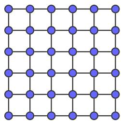

(b)  
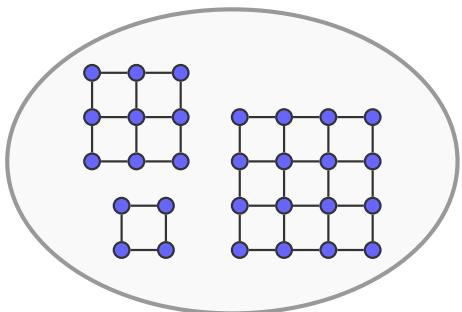  
Figure 4: Ising system and model. A 2d (square lattice) Ising system $^ \mathrm { 4 a , }$ spins are blue vertices, their interactions are attached to edges of the graph and are not explicitly shown, and the 2d Ising model 4b, that is, the set of all such 2d Ising systems, for arbitrary system size and local couplings. Both are defined in Example 2.

Definition 3 (simulation). A spin system $S$ is said to simulate a spin system T if $V _ { T } \subseteq V _ { S }$ and there exists a global energy shift Γ such that for each configuration $\mathbf { v } \in \mathbf { 2 } ^ { V _ { T } }$

$$
\operatorname* { m i n } _ { \mathbf { h } } H _ { S } ( \mathbf { v } , \mathbf { h } ) = H _ { T } ( \mathbf { v } ) + \Gamma .\tag{2.4}
$$

We then

1. call S the source and T the target of the simulation, and call the respective spins and configurations source and target spins and configurations,

2. call $V _ { T }$ the physical spins and $V _ { S } \setminus V _ { T }$ the auxiliary spins of the simulation and the respective configurations v and h physical and auxiliary configurations,

3. write $S \longrightarrow T$ as shorthand for S simulates $T _ { i }$

4. for a given physical configuration v, denote the set $o f \ ^ {  } c o r r e c t ^ { \cdots }$ auxiliary configurations that minimize $H _ { S } ( \mathbf { v } , - )$ as $\mathcal { C } _ { \mathrm { s i m } } ( \mathbf { v } )$ , i.e. $\mathcal { C } _ { \mathrm { s i m } } ( \mathbf { v } ) = \mathrm { a r g m i n } ( H _ { S } ( \mathbf { v } , - ) )$ and for any $\mathbf { h } _ { \operatorname* { m i n } } \in \mathcal { C } _ { \mathrm { s i m } } ( \mathbf { v } )$ , it holds that $H _ { S } ( \mathbf { v } , \mathbf { h } _ { \operatorname* { m i n } } ) = H _ { T } ( \mathbf { v } ) + \Gamma$

5. call the function $\mathrm { d } ( \mathbf { v } ) = \vert \mathcal { C } _ { \mathrm { s i m } } ( \mathbf { v } ) \vert$ the degeneracy of the simulation and say $S \longrightarrow T$ has constant degeneracy if d does not depend on $\mathbf { v } ,$ and

6. call the minimal energy gap

$$
\Delta = \operatorname* { m i n } _ { \mathbf { v } } \operatorname* { m i n } _ { \mathbf { h } \notin \mathcal { C } _ { \mathrm { s i m } } ( \mathbf { v } ) } \bigl ( H _ { S } ( \mathbf { v } , \mathbf { h } ) - H _ { T } ( \mathbf { v } ) - \Gamma \bigr )\tag{2.5}
$$

between “correct” and “incorrect” auxiliary configurations (see $F i g . \ 5 )$ the cut-of of the simulation.

We call the function on the LHS of Eq. (2.4) the efective Hamiltonian of $S$ over physical spins $V _ { T }$ This means that whenever $S \longrightarrow T$ then the efective Hamiltonian of $S$ over physical spins $V _ { T }$ agrees with the target Hamiltonian, up to an energy shift. Similarly, we define the efective Hamiltonian of $S$ over any subset $V ^ { \prime } \subseteq V _ { S } , H _ { S } | _ { V ^ { \prime } }$ as the minimum of $H _ { S }$ over all spins not contained in $V ^ { \prime }$ Note that trivially $S \longrightarrow H _ { S } \vert _ { V ^ { \prime } }$ . Note that the cut-of of $S \longrightarrow T$ serves as an error parameter where large cut-of means small error. In the following, when saying that $S \longrightarrow T$ with cut-of $\Delta$ we mean that the cut-of of this simulation is at least $\Delta$ or that there exists a simulation of target $T$ with source $S$ and cut-of at least $\Delta .$ We also introduce the short-hand notation $\Delta ( S , T )$ for the cut-of of simulation $S \longrightarrow T$

Finally, note that pseudo-Boolean functions $f \colon 2 ^ { n } \to$ R are trivial examples of spin systems (namely such with a single local energy function equal to $f )$ . Hence, simulations in particular apply to pseudo-Boolean functions.

Remark 4 (comparison of definition of simulation to [41, 40]). This definition of simulation slightly difers from the respective definitions in [41] and [40]. First, in the definition of the cut-of: both in [41] and [40] the cut-of $\Delta ^ { \prime }$ of a simulation is defined as global energy threshold such that source configurations with “incorrec $\mathrm { t } ^ { \dag \dag }$ auxiliary spins have energy above $\Delta ^ { \prime }$ and the matching-energy condition $\left( \mathrm { E q . \ ( 2 . 4 ) } \right)$ is only required for target configurations with energy below $\Delta ^ { \prime } .$ . Note that this definition of cut-of is related to Definition 3 by the minimum of $H _ { S }$ and whenever simulations of a target $T$ exist for arbitrary cut-ofs the two definitions are equivalent.

Second, in the identification of target configurations with source configurations: [41] requires constant degeneracy and [40] even requires degeneracy $d = 1$ . [41] also allows for a more general way of identifying physical spins as subset of $V _ { S }$ , which is necessary to extend several results to systems with q-level spins, for varying q.

Simulations can be composed, scaled and added, allowing the construction of complicated simulations from simpler ones. This property is termed modularity of simulations in [41, 40]. Specifically, the composition of simulations means given simulation $S \longrightarrow T$ with cut-of $\Delta$ and $T \longrightarrow R$ with cut-of $\Delta ^ { \prime }$ then, one can construct a simulation $S \longrightarrow R$ with cut-of $\operatorname* { m i n } ( \Delta , \Delta ^ { \prime } )$ . Note that if both initial simulations have constant degeneracy then so does their composition.

Both the addition and the scaling of simulations are based on the respective spin system operations. Scaling a spin system S with $\lambda > 0 ^ { 2 }$ means scaling all its local energy functions pointwise and hence resulting in a system λS with $H _ { \lambda S } = \lambda H _ { S }$ . It is easy to see that then, whenever $S \longrightarrow T$ with cut-of $\Delta$ also $\lambda S \longrightarrow \lambda T$ with cut-of $\lambda \Delta$

The addition of spin systems $S + T$ is based on the hypergraph union of their interaction hypergraphs. Note that this allows for a potential overlap between S and $T _ { \mathrm { : } }$ that is, spins that are contained in both systems. Specifically, $S + T$ has spins $V _ { S } \cup V _ { T }$ , hyperedges $E _ { S } \cup E _ { T }$ and local energy functions

$$
J _ { S + T } ( e ) = \left\{ \begin{array} { l l } { J _ { S } ( e ) + J _ { T } ( e ) } & { \mathrm { ~ i f ~ } e \in E _ { T } \cap E _ { S } } \\ { J _ { T } ( e ) } & { \mathrm { ~ i f ~ } e \in E _ { T } \setminus E _ { S } } \\ { J _ { S } ( e ) } & { \mathrm { ~ i f ~ } e \in E _ { S } \setminus E _ { T } . } \end{array} \right.\tag{2.6}
$$

This implies that

$$
H _ { S + T } ( \mathbf { v } ) = H _ { S } ( \mathbf { v } | _ { V _ { S } } ) + H _ { T } ( \mathbf { v } | _ { V _ { T } } ) .\tag{2.7}
$$

Now, let $S _ { 1 , 2 } \longrightarrow T _ { 1 , 2 }$ with cut-of $\Delta _ { 1 , 2 }$ such that $V _ { S _ { 1 } } \cap V _ { S _ { 2 } } = V _ { T _ { 1 } } \cap V _ { T _ { 2 } }$ . This means that the auxiliary spins of each individual simulation $S _ { 1 } \longrightarrow T _ { 1 } ( S _ { 2 } \longrightarrow T _ { 2 } )$ do not intersect with the source spins of the respective other simulation $V _ { S _ { 2 } } \ ( V _ { S _ { 1 } } )$ . Then $S _ { 1 } + S _ { 2 } \longrightarrow T _ { 1 } + T _ { 2 }$ with cut-of min $( \Delta _ { 1 } , \Delta _ { 2 } )$ . If both initial simulations have constant degeneracy then so does their addition. Details on the composition, scaling and addition of simulations can be found in [41].

(b)

Given a simulation $T \longrightarrow R ,$ it is not necessary to simulate all of $T ,$ i.e. have $S \longrightarrow T$ in order to construct a simulation $S \longrightarrow R .$ Instead, it sufices if S simulates the regime of T in which $H _ { T } = H _ { R }$ By Eq. $( 2 . 4 )$ this is exactly the efective Hamiltonian of $T$ over physical spins $V _ { R }$ . Thus, given $T \longrightarrow R$ and $S \longrightarrow H _ { T } | _ { V _ { R } }$ then $S \longrightarrow R$ and the cut-of of this simulation equals that of $S  H _ { T } | _ { V _ { R } }$

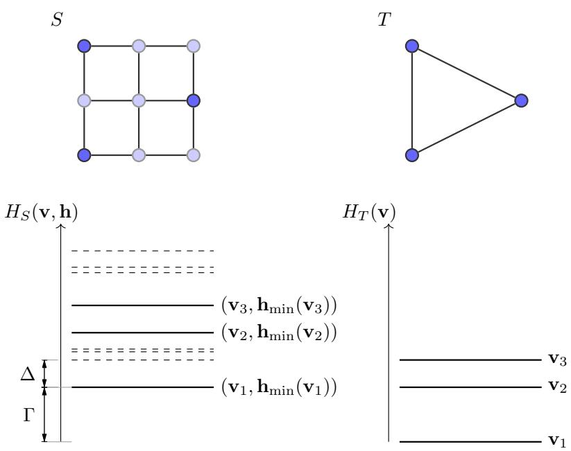  
Figure 5: Example of a simulation. A source system $S \ ( 5 \mathrm { a }$ , LHS) physical spins in opaque, auxiliary spins in transparent) simulates a target system T (5a, RHS) if minh $H _ { S } ( \mathbf { v } , \mathbf { h } ) = H _ { T } ( \mathbf { v } ) + \Gamma$ . This condition relates the two respective energy functions, as shown in 5b. In this example, the simulation has constant degeneracy $d = 1$ , so each target configuration (5b, RHS) $\mathbf { v } _ { i }$ has a unique source configuration (5b, LHS) $\left( \mathbf { v } _ { i } , \mathbf { h } _ { \operatorname* { m i n } } ( \mathbf { v } _ { i } ) \right)$ with up to a shift of $\Gamma _ { \mathrm { {  } } }$ equal energy. The cut-of $\Delta$ of the simulation is the minimal energy gap between “correct” auxiliary configuration $( \mathbf { h } _ { \operatorname* { m i n } } ( \mathbf { v } )$ , thick lines), and “incorrect” auxiliary configurations (dashed lines).

Simulations are promoted to spin models as follows:

1. A spin model M simulates a target system T with cut-of ∆, if there exists a system $S \in { \mathcal { M } }$ such that $S \longrightarrow T$ with cut-of ∆. We then write ${ \mathcal { M } } \longrightarrow T$

2. A spin model M simulates a target model N with cut-of $\Delta$ if for every $T \in \mathcal { N } , \mathcal { M } \longrightarrow T$ with cut-of ∆. We then write $\mathcal { M } \longrightarrow \mathcal { N }$

We call the maximal set of targets (i.e. the maximal spin model) that a given spin model M can simulate its reach (under simulations). We call M universal, if its constant degeneracy reach is maximal, for all cut-ofs, i.e. if it can simulate all spin systems (and hence also all pseudo-Boolean functions) for all cut-ofs and with constant degeneracy.

Definition 5 (universality). A spin model is called universal if it can simulate all spin systems for all cut-ofs and for constant degeneracy, such that any target T can be simulated by an at most polynomially larger source $S , \ i . e . \ | S | = \mathrm { p o l y } ( | T | )$ , and the respective polynomial does not depend on the cut-of.

Interestingly, seemingly weak properties of spin systems sufice to characterize universality. In [41] (building on [10]) universal spin models are fully characterized by functional completeness and closure. A spin model is functionally complete if it can simulate arbitrary pair interactions —note that there are only four linearly independent pair interactions. A spin model is closed if up to simulation (subject to the same size constraint as Definition $5 , | S | = \mathrm { p o l y } ( | T | ) )$ it contains all pairwise sums and scalings of its spin systems. Intuitively, functional completeness ensures that the spin model can encode two-bit Boolean logic in its ground states. Closure, together with the modular structure of simulations, allows the model to then also simulate linear combinations and certain compositions of these Boolean functions, which ultimately sufice to simulate arbitrary targets.

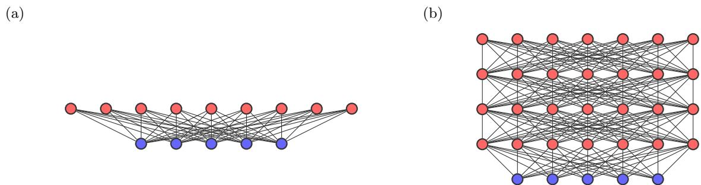  
Figure 6: RBM 6a and DBM 6b, visible spins (or units) in blue, hidden spins (or units) in red. Both have pair-interactions, attached to edges between spins and fields, attached to the individual spins. The respective couplings (or weights) of both are not explicitly shown.

In [40], universal spin models are instead fully characterized by flag completeness and closure. A spin model is flag complete if it contains suficiently many flag systems, spin systems that can flag an arbitrary configuration v in their ground state, i.e. in the state of a distinguished flag spin (or the configurations of a distinguished set of flag spins) signal whether or not a fixed subset of spins is in configuration v. Scaling such flag systems appropriately then allows one to adjust the energy of the flagged configuration at will. Linear combinations of flag systems hence can simulate arbitrary energy functions and closure ensures that these linear combinations can be simulated by the universal model3.

Both these characterizations imply that already fairly simple spin models, such as the 2d Ising model with fields, the 3d Ising model or the spin models that underlie restricted Boltzmann machines and deep, narrow Boltzmann machines are universal [41, 40].

## 2.2 Universal spin models are universal approximators

Energy-based machine learning models such as restricted Boltzmann machines (RBMs) and deep Boltzmann machines (DBMs) can be defined in terms of spin models. The spins (often called units) then are additionally divided into visible spins, with configuration $\mathbf { v } = ( v _ { 1 } , \ldots , v _ { n } )$ and hidden spins, with configuration $\mathbf { h } = ( h _ { 1 } , \ldots , h _ { m } )$ . RBMs (Fig. 6a) are spin systems with complete bipartite interaction graph (between visible and hidden spins) and local energy functions that lead to the following Hamiltonian:

$$
H ( \mathbf { v } , \mathbf { h } ) = \sum _ { i = 1 } ^ { m } h _ { i } \mathbf { W } _ { i } \mathbf { v } + \sum _ { i = 1 } ^ { m } b _ { i } ^ { ( h ) } h _ { i } + \sum _ { j = 1 } ^ { n } b _ { j } ^ { ( v ) } v _ { j } .\tag{2.8}
$$

The weights of an RBM are usually divided into the vector $\mathbf { W } _ { i } = ( W _ { i , 1 } , \ldots , W _ { i , n } )$ called the weight vector of hidden spin i and the real numbers $b _ { i } ^ { ( v ) }$ and $b _ { i } ^ { ( h ) }$ called the bias of visible spin i and hidden spin i, respectively.

DBMs (Fig. 6b) are defined in terms of interaction graphs that consist of one visible and $k > 1$ hidden layers, such that any two neighbouring layers are complete bipartite. Denoting hidden configurations as $\mathbf { h } = ( \mathbf { h } ^ { ( 1 ) } , \dots , \mathbf { h } ^ { ( k ) } )$ and $\mathbf { h } ^ { ( j ) } = ( h _ { 1 } ^ { ( j ) } , \dots , h _ { m _ { j } } ^ { ( j ) } )$ the DBM Hamiltonian reads

$$
H ( { \mathbf { h } } ^ { ( 0 ) } , \ldots , { \mathbf { h } } ^ { ( k ) } ) = \sum _ { j = 1 } ^ { k } \sum _ { i = 1 } ^ { m _ { j } } h _ { i } ^ { ( j ) } { \mathbf { W } } _ { i } ^ { ( j ) } { \mathbf { h } } ^ { ( j - 1 ) } + \sum _ { j = 0 } ^ { k } \sum _ { i = 1 } ^ { m _ { j } } b _ { i } ^ { ( j ) } h _ { i } ^ { ( j ) } ,\tag{2.9}
$$

where $\mathbf { W } _ { i } ^ { ( j ) }$ is the weight vector and $b _ { i } ^ { ( j ) }$ is the bias of spin i of layer j and we use the identification $\mathbf { v } = \mathbf { h } ^ { ( 0 ) }$ and $m _ { 0 } = n$ . Often we assume that all hidden layers contain an equal number of m hidden spins. We call the maximal number of hidden spins per layer the width of the RBM/DBM and the number of total layers, visible or hidden, the depth of the RBM/DBM.

Given some machine learning model M the learning objective then is of the following form: Given some target probability distribution $q ( \mathbf { v } )$ compute weights such that the system $S \in { \mathcal { M } }$ defined by these weights best approximates4 q(v) over its visible spins, that is,

$$
\sum _ { \mathbf { h } } p _ { S } ( \mathbf { v , h } ) \approx q ( \mathbf { v } ) ,\tag{2.10}
$$

where

$$
p _ { S } ( { \bf v , h } ) : = \frac { 1 } { Z _ { S } } e ^ { - H ( { \bf v , h } ) }\tag{2.11}
$$

is the Boltzmann distribution of $S \in \mathcal { M } \ ( \mathrm { a t } \ \beta = 1 )$ and the normalization $Z _ { S }$ its partition function. In the following we call the maximal set of distributions $p ( \mathbf { v } )$ that a given machine learning model can approximate to arbitrary precision its approximation reach and call models that can approximate arbitrary probability distributions universal approximators. Thus, we can consider the reach of M under simulations, as well as under approximations (in terms of its visible-spin marginals).5

In [40] we prove that simulations with constant degeneracy preserve Boltzmann distributions, that is, whenever $S \longrightarrow T$ with cut-of ∆ and constant degeneracy then $\begin{array} { r } { \sum _ { \mathbf { h } } p _ { S } ( \mathbf { v } , \mathbf { h } ) \approx p _ { T } ( \mathbf { v } ) } \end{array}$ up to errors of order $\mathcal { O } ( e ^ { - \Delta } )$ . This implies that Eq. (2.10) is satisfied whenever $S \mathrm { \ s i m u l a t e s \ - l o g ( } q ( \mathbf { v } ) )$ , with constant degeneracy, subject to the additional constraint that the physical spins of the simulation are precisely the visible spins of S. This leads to the following observations.

1. The approximation reach of an energy-based machine learning model M can be studied through its reach under constant degeneracy simulations (Definition 3). Whenever M is universal (according to Definition 5) it is a universal approximator.

2. To prove universal approximation theorems for M it sufices to prove its universality which is attainable by means of the characterizations of universality [41, 40].

This motivates the following definitions.

Definition 6 (spin ML model).

1. A spin machine learning model (spin ML model) M is a spin model together with a partition into visible and hidden spins, $V _ { S } = \operatorname { V i s } _ { S } \cup \operatorname { H i d } _ { S }$ for each of its spin systems S.

2. A simulation of some target system or model $\mathcal { M } \longrightarrow . . .$ is called visible if additionally to Definition 3 physical spins and visible spins agree, we then write $\mathcal { M } \xrightarrow { \textrm { v } } . .$

3. A spin ML model is called v-universal6 if it is universal (Definition 5) using only visible simulations.

In [40] we explicitly apply this new perspective to RBMs and DBMs and, by means of the characterization of universality, prove that both are v-universal and hence universal approximators. Note that proving in this sense universality is suficient for universal approximation, in Section C.1 we study to what extent it can also be considered as necessary.

## 3 Eficiency of universal models

Here we introduce the central notion of eficient simulations and characterize those models with maximal reach under eficient simulations.

In Section 3.1, we first define eficient simulations as simulations with polynomial overhead, that is, simulating a target system of n spins requires a source system that can be specified by most poly(n) parameters. We then define maximal models as models that can eficiently simulate all targets that can be eficiently simulated, i.e. that have maximal reach under eficient simulations.

In Section 3.2, we characterize maximality both for spin models and spin ML models. For spin ML models this leads to the definition of visible closure, the property that up to simulation, visible spins can be made hidden. Visible closure is suficient to ensure that the visible-hidden split does not obstruct the composition of spin ML model simulations. Hence, for visible closed models, simulations can be constructed in a modular, compositional way. Since visible closure might introduce additional hidden-hidden interactions it favors deep over shallow models.

The main results of this section are the following:

Results (informal) (characterization of maximality).

Theorem 10 A spin model is maximal if and only if it is universal.

Theorem 16 For spin ML models, the following holds:

maximal and visible closed ⇔ maximal and universal ⇔ universal and visible closed.

## 3.1 Eficient simulations and maximality

Specifying a generic target system T of n spins, in general, requires $| T | = \mathcal { O } ( 2 ^ { n } )$ real parameters, so simulating it requires a source of size $| S | \ge | T | = \mathcal { O } ( 2 ^ { n } )$ . Thus v-universal spin ML models, require an exponential overhead, the number of weights (of the source) grows exponentially with the number of target spins. This agrees with all established universal approximation theorems ([27, 26, 33], see also [40] for an overview), yet, in practice, limits the applicability of v-universal spin ML models or universal approximation theorems.

In contrast to this, we call a simulation eficient if its overhead is at most polynomial.

Definition 7 (eficient simulation).

1. The overhead of a simulation $\mathcal { M } \longrightarrow \mathcal { N }$ is the function that maps a given number of target spins n to the maximal source size |S| that is required to simulate any target system T of n spins.

2. A simulation is called eficient if its overhead is asymptotically upper bounded by some polynomial in n, i.e. is (at most) poly(n). We then write $\mathcal { M } \xrightarrow { \mathrm { ~ p ~ } } \mathcal { N }$

Eficiency of a simulation characterizes its asymptotic behaviour when changing the number of target spins. As such it is only meaningful when the target is an infinite spin model in contrast to a single system. In the following, whenever we call a simulation of a single target system $S \longrightarrow T$ eficient we implicitly consider it in the context of a simulation $\mathcal { M } \longrightarrow \mathcal { N }$ . If we state that $\mathcal { M } \xrightarrow { \mathrm { ~ p ~ } } \mathcal { N }$ for multiple cut-ofs (e.g. for arbitrary cut-of) then we further require that the specific polynomial overhead does not depend on the cut-of.

Note that in contrast to the above notion of eficiency, universality (see Definition 5 and [41]) requires that $| S | = \mathrm { p o l y } ( | T | )$ . This implies eficiency of the simulation only $\mathrm { i f ~ } | T | = \operatorname { p o l y } ( n )$ . Further note that the composition and scaling of eficient simulations is eficient, so eficient simulations admit the same modular structure as regular simulations do. Finally, whenever a simulation is both visible and eficient, we write $S \xrightarrow { \mathrm { \ v , p } } T$

The existence of spin models that cannot be eficiently simulated (e.g. any infinite set of generic target systems) implies that there exists no spin model that is universal when restricted to eficient simulations. However, there might still exist spin models that under eficient simulations can simulate at least as many targets as any other spin model. We call such spin models p-maximal (see Fig. 7).

Definition 8 $\left( { \mathrm { p } } { \mathrm { - m a x i m a l i t y } } \right)$ . A spin model M is called p-maximal7 $i f$ whenever there exists some eficient simulation $\mathcal { M } ^ { \prime } \xrightarrow { \mathrm { ~ p ~ } } \mathcal { N }$ with $c u t { - } o f f \Delta$ then $\mathcal { M } \xrightarrow { \mathrm { ~ p ~ } } \mathcal { N }$ with $c u t { - } o f f \Delta$ and whenever $\mathcal { M } ^ { \prime } \xrightarrow { \mathrm { ~ p ~ } } \mathcal { N }$ has constant degeneracy then also $\mathcal { M } \xrightarrow { \mathrm { ~ p ~ } } \mathcal { N }$ with constant degeneracy.

In words, a p-maximal spin model can simulate all those targets that can be eficiently simulated and whenever a target can be eficiently simulated with constant degeneracy then it can also the p-maximal model can simulate it with constant degeneracy. When considering eficient simulations, having access to a single p-maximal spin model hence is as good as having access to all spin systems. Thus, considering eficient simulations, p-maximal spin models play a similar role as universal spin models do for generic simulations.

Similar to eficient simulation we define the concept of eficient approximation. A spin model M eficiently approximates a target function $f$ of n spins through a quantity AT defined in terms of spin systems $T \in { \mathcal { M } }$ if there exists such a $T _ { : }$ such that

$A _ { T }$ approximates $f ,$ i.e. for all configurations v ${ \cal A } _ { T } ( { \bf v } ) \approx f ( { \bf v } )$ , and

2. the overhead of $T$ is at most polynomial, i.e. $| T | = \mathrm { p o l y } ( n )$ and, whenever the approximation works for multiple approximation errors, the respective polynomial does not depend on the error.

(a)  
(b)  
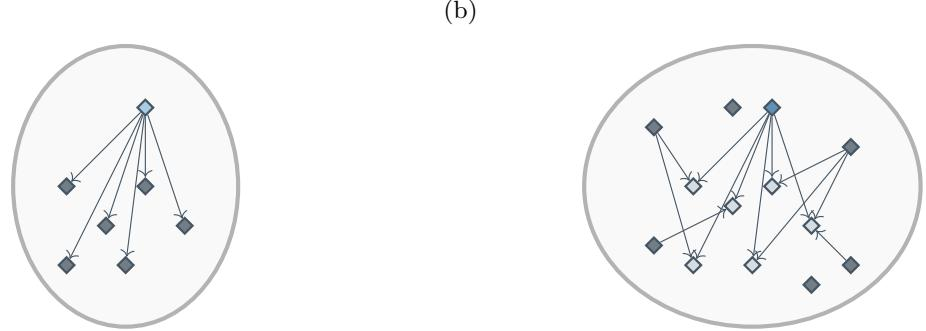  
Figure 7: The elliptic shapes depict the set of all spin models, with squares representing individual models. Fig. 7a A universal spin model (light blue square) can simulate (indicated by arrows) all spin models (dark grey squares). Fig. 7b In contrast to that a p-maximal model (dark blue square) can eficiently simulate (indicated by arrows) all models that can be eficiently simulated, i.e. are reached by an arrow (light blue-grey squares). There exist models that cannot be eficiently simulated, i.e. are not reached by an arrow (dark grey squares).

The most important examples of this are eficient approximations in terms of (unnormalized) marginals of the Boltzmann distributions of M.

Importantly, similar to universal spin models being universal approximators of probability distributions, [40], the eficient approximation reach of p-maximal spin models is maximal.

Proposition 9 (simulations preserve eficient approximations). Whenever some target probability distribution q over n spins can be eficiently approximated by the marginal distribution8 of some spin system $T ,$ that is,

$$
q ( \mathbf { v } ) \approx \sum _ { \mathbf { h } } p _ { T } ( \mathbf { v , h } )\tag{3.1}
$$

and $| T | = \mathrm { p o l y } ( n )$ , then q can be eficiently approximated by the marginals of any p-maximal spin model.

Proof. Let M be p-maximal. Since $| T | = \mathrm { p o l y } ( n )$ , trivially $T \xrightarrow { \mathrm { ~ p ~ } } T \mathrm { ~ s o ~ } { \mathcal { M } } \xrightarrow { \mathrm { ~ p ~ } } T$ with constant degeneracy. The claim then follows since constant degeneracy simulations preserve Boltzmann distributions [40]. □

Thus, also when considering eficient approximations of target distributions, having access to a single p-maximal spin model is as good as having access to all spin systems.

Note, however that this does not directly provide insights into which targets can be eficiently simulated (or approximated). While the reach of a universal model under generic simulations by definition is the set of all spin systems, the reach of a p-maximal model under eficient simulations is left implicit in Definition 8. In fact characterizing the latter, i.e. the set of all spin systems that can be eficiently simulated is not straightforward. Whenever $| T | = \mathrm { p o l y } ( | V _ { T } | )$ then trivially $T \ \xrightarrow { \textrm { p } } T ,$ so it contains at least all such systems. However, we shall see later that it also contains functions that cannot be expressed as Hamiltonian of polynomially sized spin systems (Lemma 18).

## 3.2 Characterizations of p-maximality and (v,p)-maximality

For spin models p-maximality and universality are equivalent. This is a consequence of the compositional structure of simulations and the universality characterization of [41]. Note that it in particular implies that the characterization of universality also applies to p-maximality.

Theorem 10 (characterization of p-maximality). For spin models

$$
u n i v e r s a l i t y \Leftrightarrow p \ – m a x i m a l i t y .\tag{3.2}
$$

Proof. We first prove the $\ " \Rightarrow \ "$ -implication then the $^ { 6 6 } { \Leftarrow } \Leftarrow \ '$ -implication.

$^ { 6 6 } \Longrightarrow ^ { 9 9 }$ Let M be universal and assume that some target R of n spins can be eficiently simulated by some system T with cut-of $\Delta _ { 1 }$

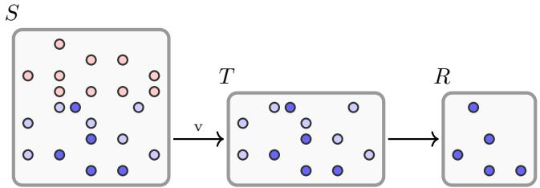  
Figure 8: Compositions of visible simulations are not visible. A spin ML system $S$ and two spin systems $T$ and $R ,$ all depicted as abstract sets (gray boxes) of spins (blue and red dots, blue spins are visible red spins are hidden). The systems provide a chain of simulations $T \longrightarrow R$ and $S \xrightarrow { \textrm { v } } T$ so their composition yields $S \longrightarrow R$ Physical spins of this composition simulation are opaque, auxiliary spins are transparent. The composition $S \longrightarrow R$ is not visible as visible spins of $S$ agree with spins of $T$ while physical spins of $S \longrightarrow R$ (blue, opaque) agree with spins of $R .$

Since $\mathcal { M }$ is universal, for any cut-of $\Delta _ { 2 }$ there exists $S \in { \mathcal { M } }$ that simulates T with constant degeneracy. Since simulations can be composed, then $S \longrightarrow R$ , with cut-of $\Delta = \operatorname* { m i n } ( \Delta _ { 1 } , \Delta _ { 2 } )$ , so choosing $\Delta _ { 2 }$ large enough implies $\Delta = \Delta _ { 1 }$ . Note that if $T \longrightarrow R$ has constant degeneracy, then so does $S \longrightarrow R$

Eficiency of $T \xrightarrow { \mathrm { ~ p ~ } } R$ means that $| T | = \mathrm { p o l y } ( n )$ and universality ensures that $| S | = \mathrm { p o l y } ( | T | )$ [41]. Hence, also the simulation $S \xrightarrow { \mathrm { ~ p ~ } } R$ is eficient.

$^ { 6 6 } { \Leftarrow } \Leftarrow ^ { 9 }$ Let $\mathcal { M }$ be p-maximal. Let R be any target and take any universal spin model $\mathcal { N }$ that for all its systems $T$ satisfies $| T | = \mathrm { p o l y } ( | V _ { T } | )$ . Existence of such a model is proven in [41], an explicit example is the 2d Ising with fields. Since $\mathcal { N }$ is universal, for any cut-of, there exists some $T \in \mathcal { N }$ with $T \longrightarrow R$ with constant degeneracy.

Now since $| T | = \mathrm { p o l y } ( | V _ { T } | )$ , trivially $T \xrightarrow { \mathrm { ~ p ~ } } T$ , for any cut-of and with constant degeneracy. Thus $T$ can be eficiently simulated for any cut-of and with constant degeneracy and since M is p-maximal, for any cut-of, there exists some $S \in { \mathcal { M } }$ such that $S \xrightarrow { \mathrm { ~ p ~ } } T$ with constant degeneracy. Since simulations can be composed, then, for any cut-of $S \longrightarrow R$ with constant degeneracy. The final simulation, $S \longrightarrow R$ satisfies $| S | = \mathrm { p o l y } ( | R | )$ since $S \xrightarrow { \mathrm { ~ p ~ } } T$ and since universality of $\mathcal { N }$ implies that $| T | = \mathrm { p o l y } ( | R | )$ □

Following Definition 6, an appropriate notion of p-maximality for spin ML models is obtained by requiring that all relevant simulations (of Definition 8) are visible, i.e. it is p-maximal with visible simulations only. We call such spin ML models $( v , p ) – m a x i m a l .$

Definition 11 ((v,p)-maximality). A spin ML model M is called $\mathbf { \Psi } ( v , p )$ -maximal9 if it is p-maximal using only visible simulations.

Characterizing (v,p)-maximality is less straightforward than characterizing p-maximality. The additional partition into visible and hidden spins obstructs the composition of simulations, specifically, the composition of a visible simulation $S \xrightarrow { \textrm { v } } T$ with any other simulation $T \longrightarrow R$ is not necessarily visible, even when $T \longrightarrow R$ . The reason for this is that when considering the composition $S \longrightarrow R ,$ physical spins agree with $V _ { R }$ but since $S \xrightarrow { \mathrm { ~ v ~ } } T$ visible spins of S agree with $V _ { T }$ and whenever $T \longrightarrow R$ uses auxiliary spins, $V _ { R }$ is a proper subset of $V _ { T }$ (see Fig. 8). This, in particular prevents us from replicating the proof of Theorem 10 for spin ML models.

Constructing a visible simulation of R is nevertheless possible, if there exists some system $S ^ { \prime }$ that sufices to replace $S$ at least in the context of the simulation $S \longrightarrow R$ but has visible spins $V _ { R } \subseteq V _ { T }$ , i.e. compared to $S _ { ; }$ restricted to a subset. Therefore, whenever a spin ML model, in the context of simulations is closed under restricting its visible spins to any subset we can replicate the proof of Theorem 10. We call such spin ML models visible closed (Fig. 9).

Definition 12 (visible closure). Let M be a spin ML model, $S \in { \mathcal { M } }$ and $V ^ { \prime } \subseteq \operatorname { V i s } _ { S }$ . Further, let $S ^ { \prime }$ be the system that equals S but has visible spins $V ^ { \prime }$ . Then, M is

1. strictly visible closed if for any such $( S , V ^ { \prime } ) , S ^ { \prime } \in { \mathcal { M } } ,$

2. strongly visible closed if for any such $( S , V ^ { \prime } )$ , and any $\Delta$ there exists some $S ^ { \prime \prime } \in \mathcal { M }$ with visible spins $V ^ { \prime } { } _ { ; }$ , with $| S ^ { \prime \prime } | = \mathrm { p o l y } ( | S | )$ such that $S ^ { \prime \prime } \longrightarrow S$ with constant degeneracy and with cut-of at least $\Delta _ { z }$ , and

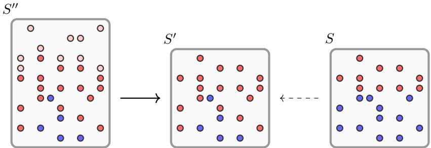  
Figure 9: Visible closure and composition of simulations. Spin ML systems $S , S ^ { \prime }$ and $S ^ { \prime \prime }$ depicted as abstract sets (gray boxes) of spins (visible spins in blue hidden spins in red). $S ^ { \prime }$ is obtained from $S$ by restricting visible spins to a subset $V ^ { \prime }$ , i.e. visible spins outside of $V ^ { \prime }$ are made hidden. This yields a system $S ^ { \prime } . \enspace \mathrm { I f } \enspace S \in \mathcal { M }$ and M is strictly visible closed then also $S ^ { \prime } \in { \mathcal { M } }$ . If M is strongly visible closed then it simulates $S ^ { \prime }$ , i.e. there exists some system $S ^ { \prime \prime } \in \mathcal { M }$ with visible spins $V ^ { \prime }$ that simulates $S ^ { \prime }$ (physical spins opaque, auxiliary spins transparent, note that by definition, all auxiliary spins must be hidden). If $\mathcal { M }$ is visible closed then it visibly simulates the efective Hamiltonian of $S ^ { j }$ over its visible spins ${ \dot { V } } ^ { \prime }$ (not shown).

3. visible closed if for any such $( S , V ^ { \prime } )$ , there exists an $S ^ { \prime \prime } \in \mathcal { M }$ with $| S ^ { \prime \prime } | = \mathrm { p o l y } ( | S | + | H _ { S } | _ { V ^ { \prime } } | \mathrm { m i n } )$ such that $S ^ { \prime \prime } \xrightarrow { \mathrm { ~ v ~ } } H _ { S } | _ { V ^ { \prime } }$ with cut-of at least $\Delta ( S , H _ { S } | _ { V ^ { \prime } } )$ Whenever the trivial simulation $S \longrightarrow$ $H _ { S } | _ { V }$ ′ has constant degeneracy, then so does $S ^ { \prime \prime } \xrightarrow { \mathrm { ~ v ~ } } H _ { S } | _ { V ^ { \prime } }$

Whenever $V ^ { \prime }$ is such that $| S | = \mathrm { p o l y } ( | V ^ { \prime } | )$ we additionally require that the simulations in $\it 3$ are eficient, for 2 eficiency then follows from $| S ^ { \prime \prime } | = \mathrm { p o l y } ( | S | )$ .

Note that visible closure requires that $S ^ { \prime \prime }$ is at most polynomially larger than $| S | + | H _ { S } | _ { V ^ { \prime } } | _ { \mathrm { m i n } } ,$ where $| H _ { S } | _ { V ^ { \prime } | \operatorname* { m i n } }$ is the minimal size of a spin system with Hamiltonian $H _ { S } | _ { V ^ { \prime } }$ . This ensures that the additional overhead introduced by visible closure is compatible with the polynomial size constraint of universality (Definition 5).

Note that strictly visible closed implies strongly visible closed since then $S ^ { \prime } \in { \mathcal { M } }$ trivially satisfies $S ^ { \prime } \longrightarrow S$ and strongly visible closed implies visible closed since trivially $S \longrightarrow H _ { S } \vert _ { V ^ { \prime } }$ so when the cut-of of $S ^ { \prime \prime } \longrightarrow S$ is chosen high enough, $S ^ { \prime \prime } \xrightarrow { \mathrm { ~ v ~ } } H _ { S } | _ { V ^ { \prime } }$ with cut-of $\Delta ( S , H _ { S } | _ { V ^ { \prime } } )$

Importantly, visible closure ensures that visible simulations can be composed, similar to generic ones.

Lemma 13 (visible closure and composition of simulations). If M is visible closed, $\mathcal { M } \stackrel { \mathrm { ~ v ~ } } { \longrightarrow } T$ and $T \longrightarrow R$ with $c u t { - } o f f s \ \Delta _ { 1 }$ and $\Delta _ { 2 }$ then $\mathcal { M } \xrightarrow { \textrm { v } } R$ with cut-of min $( \Delta _ { 1 } , \Delta _ { 2 } )$ . $I f \mathcal { M } \xrightarrow { \textrm { v } } T$ and $T \longrightarrow R$ are eficient or have constant degeneracy then the same holds true $f o r \mathcal { M } \xrightarrow { \mathrm { ~ v ~ } } R$ . Moreover, denote the source of $\mathcal { M } \xrightarrow { \mathrm { ~ v ~ } } T$ by $S$ then the constructed source $S ^ { \prime \prime }$ of $\mathcal { M } \xrightarrow { \textrm { v } } R$ can be chosen with size $\mathrm { p o l y } ( | S | + | R | )$ .

Proof. Choose $S \in { \mathcal { M } }$ with $S \xrightarrow { \textrm { v } } T$ and cut-of $\Delta _ { 1 }$ . Composing with $T \longrightarrow R$ gives $S \longrightarrow R$ with cut-of $\Delta : = \mathrm { m i n } ( \Delta _ { 1 } , \Delta _ { 2 } )$ , but this simulation need not be visible.

If M is visible closed then there exists $S ^ { \prime \prime } \in \mathcal { M }$ with $S ^ { \prime \prime } \xrightarrow { \mathrm { ~ v ~ } } H _ { S } | _ { V _ { R } }$ with cut-of at least that of the trivial simulation, $\Delta ( S , H _ { S } | _ { V _ { R } } )$ . Note that since $S \longrightarrow R$ with cut-of ∆, $\Delta ( S , H _ { S } | _ { V _ { R } } ) = \Delta$ . Thus, $S ^ { \prime \prime } \xrightarrow { \textbf { v } } R$ with cut-of $\Delta$

If $S \xrightarrow { \textrm { v } } T$ and $T \longrightarrow R$ are eficient then so is $S \longrightarrow R$ . This means that $| S | = \mathrm { p o l y } ( | V _ { R } | )$ , which by Definition 12 implies that $S ^ { \prime \prime } \stackrel { \mathrm { v , p } } { \longrightarrow } H _ { S } | _ { V _ { R } }$ and hence also $S ^ { \prime \prime } \stackrel { \mathrm { \scriptsize ~ v , p } } { \longrightarrow } R$ , i.e. both these simulations are eficient.

If the two initial simulations have constant degeneracy then so does their composition $S \longrightarrow R$ Constant degeneracy of $S \longrightarrow R$ in particular implies that the trivial simulation $S \longrightarrow H _ { S } | _ { V _ { R } }$ has constant degeneracy, which by Definition 12 implies that also $S ^ { \prime \prime } \xrightarrow { \mathrm { ~ v ~ } } H _ { S } | _ { V _ { R } }$ has constant degeneracy. Thus, also the final composition $S ^ { \prime \prime } \xrightarrow { \mathrm { ~ v ~ } } R$ has constant degeneracy.

Finally, by Definition 12, the final source satisfies $| S ^ { \prime \prime } | = \mathrm { p o l y } ( | S | + | H _ { S } | _ { V _ { R } } | \mathrm { m i n } )$ . Since $S \longrightarrow R ,$ up to a potential energy shift, $H _ { S } | _ { V _ { R } } = H _ { R }$ . This implies that $| H _ { S } | _ { V _ { R } } | _ { \operatorname* { m i n } } \leq | R |$ , so in total, $| S ^ { \prime \prime } | =$ $\mathrm { \ p o l y } ( | S | + | R | )$ . □

Lemma 14 (characterization of $\left( \mathrm { v , p } \right)$ -maximality for visible closed models). For visible closed spin ML models

$$
v - u n i v e r s a l i t y \Leftrightarrow ( v , p ) - m a x i m a l i t y .\tag{3.3}
$$

Proof. The $\ " \Rightarrow \ "$ -direction follows immediately from the $^ { 6 6 } \Longrightarrow ^ { 5 9 }$ -direction of (the proof of) Theorem 10 and Lemma 13.

We now prove the $^ { 6 6 } { \Leftarrow } = ^ { 5 9 }$ -direction. Let R be any target. Following the $^ { 6 6 } { \Leftarrow } \Leftarrow \ '$ -direction of the proof of Theorem 10, existence of the universal model N (see Theorem 10) implies that for any cut-of there exists some spin system T with $| T | = \mathrm { p o l y } ( | V _ { T } | )$ such that $T \longrightarrow R$ with constant degeneracy. Since for any cut-of, trivially $T \xrightarrow { \mathrm { ~ p ~ } } T$ with constant degeneracy and M is $\left( \mathrm { v , p } \right)$ -maximal, for any cut-of there exists ${ \mathrm { ~ a ~ } } S \in { \mathcal { M } }$ such that $S \xrightarrow { \mathrm { \ v , p } } T$ with constant degeneracy. Thus, by Lemma 13, for any cut-of there exists $S ^ { \prime \prime } \in \mathcal { M }$ such that $S ^ { \prime \prime } \xrightarrow { \mathrm { ~ v ~ } } R$ with constant degeneracy. By Lemma 13, the final simulation, $S ^ { \prime \prime } \xrightarrow { \textbf { v } } R$ satisfies $| S ^ { \prime \prime } | = \mathrm { p o l y } ( | R | )$ since $S \xrightarrow { \mathrm { \ v , p } } T$ and since universality of N implies that $| T | = \mathrm { p o l y } ( | R | )$ □

Lemma 15 (suficient conditions for visible closure). For spin ML models

$$
v - u n i v e r s a l ~ a n d ~ ( v , p ) – m a x i m a l \Rightarrow v i s i b l e ~ c l o s e d .\tag{3.4}
$$

Proof. Let M be a v-universal and $\displaystyle ( \boldsymbol { \mathrm { v } } , \boldsymbol { \mathrm { p } } )$ -maximal spin ML model and let $S \in { \mathcal { M } }$ and $V ^ { \prime }$ be a subset of the visible spins of S. Since $\mathcal { M }$ is v-universal, for any cut-of $\mathcal { M } \xrightarrow { \mathrm { ~ v ~ } } H _ { S } \vert _ { V ^ { \prime } }$ with constant degeneracy. Moreover, by definition of $| - | _ { \operatorname* { m i n } } , H _ { S } | _ { V ^ { \prime } }$ can be realized by a spin system of size at most $| H _ { S } | _ { V ^ { \prime } } | _ { \mathrm { m i n } } ,$ so universality of M yields a source $S ^ { \prime \prime } \in \mathcal { M }$ that simulates $H _ { S } | _ { V ^ { \prime } }$ and satisfies $| S ^ { \prime \prime } | = \mathrm { p o l y } ( | H _ { S } | _ { V ^ { \prime } } | \mathrm { m i n } )$

If additionally $| S | = \mathrm { p o l y } ( | V ^ { \prime } | )$ (cf. Definition 12), then, the trivial simulation $S \ \xrightarrow { \mathrm { ~ \textsc ~ { ~ p ~ } ~ } } H _ { S } | _ { V ^ { \prime } }$ with cut-of $\Delta$ is eficient. Since $\mathcal { M }$ is $\left( \mathrm { v , p } \right)$ -maximal there exists $E \in { \mathcal { M } }$ that eficiently simulates $H _ { S } | _ { V ^ { \prime } }$ with cut-of at least $\Delta$ , and with constant degeneracy whenever the original simulation has constant degeneracy. Thus, both $S ^ { \prime \prime }$ (from universality) and E (from $\displaystyle ( \boldsymbol { \mathrm { v } } , \boldsymbol { \mathrm { p } } )$ -maximality) simulate $H _ { S } | _ { V ^ { \prime } , \ S ^ { \prime \prime } }$ satisfies the sizebound $| S ^ { \prime \prime } | = \mathrm { p o l y } ( | H _ { S } | _ { V ^ { \prime } } | _ { \mathrm { m i n } } )$ and $E$ satisfies the eficiency requirement of Definition 12. Taking the smaller source between $S ^ { \prime \prime }$ and E then satisfies both the size bound and the eficiency requirement of Definition 12. □

Combining Lemma 14 and Lemma 15 the relation between visible closure, (v,p)-maximality and $\mathrm { v - }$ universality can be summarized as follows.

Theorem 16 (characterization of $\left( \mathrm { v , p } \right)$ -maximality, v-universality and visible closure). For spin ML models any two of the three properties “visible closed”, $^ { \mathfrak { a } } ( v , p )$ -maximal” and “v-universal” imply the respective other.

Proof. Follows directly from Lemma 14 and Lemma 15.

In the context of simulations, visible closure allows one to change visible spins to hidden spins. In general doing so introduces new hidden-hidden interactions. Thus, intuitively, while models with enough hidden-hidden interactions might be trivially, i.e. strictly visible closed, models without hidden-hidden connections should not be visible closed. In the following, we call a spin ML model deep if it has hiddenhidden interactions $( \mathrm { e . g . { D B M s } ) }$ , that is, if it has local energy functions that contain more than one hidden unit, else we call it shallow (e.g. RBMs). Then, visible closure and by Lemma 14 $\left( \mathrm { v , p } \right)$ -maximality should require deep models. This intuition is supported by Corollary 17. In Section 4 we study consequences of $\left( \mathrm { v , p } \right)$ -maximality that prove that shallow models and hence in particular RBMs are not $\left( \mathrm { v , p } \right)$ -maximal.

Corollary 17 ((v,p)-maximality of DBMs). DBMs of depth at least 3 are $( v , p )$ -maximal.

Proof. We prove that DBMs of depth at least 3 are strictly visible closed. In [40] it is proven that DBMs are v-universal, $\left( \mathrm { v , p } \right)$ -maximality then follows from Theorem 16. Consider any DBM S and change any number of its visible spins to hidden spins, resulting in a system $S ^ { \prime }$ that contains hidden spins in the bottommost layer (Fig. 10, right). These hidden spins in the bottom layer can equivalently be considered as spins in the second hidden layer (Fig. 10, left), meaning that $S ^ { \prime }$ is also a DBM. □

## 4 Complexity separations between maximal and shallow models

Here we derive explicit separations between $( \mathrm { v , p } ) .$ -maximal and shallow models for three related representation tasks, simulating functions, approximating functions in their unnormalized visible spin marginals and approximating probability distributions in their normalized visible spin marginals.

We first lay out our assumptions on computational complexity, in Section 4.1. We then define a computationally maximally hard reference model $\mathcal { M } _ { \mathrm { I s i n g } } ,$ in Section 4.2. Based on this reference model we construct the three target functions, the NP-hard function ${ \mathcal G } = \{ G _ { n } \}$ of computing ground-state energies of $\mathcal { M } _ { \mathrm { I s i n g } }$ , the #P-hard function $\mathcal { Z } = \{ Z _ { n } \}$ of computing partition functions from $\mathcal { M } _ { \mathrm { I s i n g } }$ and the #P-hard probability distributions ${ \mathcal { Q } } = \{ q _ { n } \propto Z _ { n } \}$ corresponding to the partition functions of $\mathcal { M } _ { \mathrm { I s i n g } } .$ Then, we study the tasks of eficiently simulating G (in Section 4.3), eficiently approximating $\mathcal { Z }$ in the unnormalized visible spin marginals (in Section 4.4) and eficiently approximating Q in the normalized visible spin marginals (in Section 4.5). For each task we derive a separation between shallow and maximal models, under reasonable assumptions on computational complexity. The respective results are

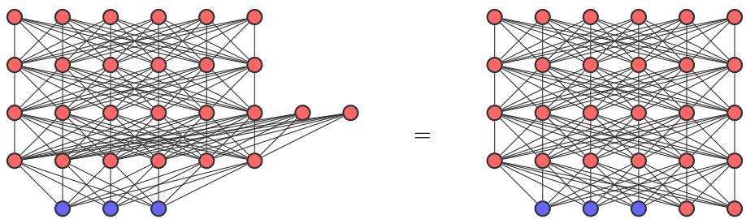  
Figure 10: Visible closure of DBMs. DBMs of depth at least 3 are strictly visible closed; making visible spins hidden introduces hidden spins (red) in the bottom layer (RHS system). However, these can equivalently be considered as belonging to the second hidden layer (LHS system). The two systems are equivalent and only difer w.r.t. their drawing.

Results (informal) (separation between shallow and maximal models). Maximal models can eficiently and shallow models cannot

Theorem 20 simulate the NP-hard ground-state energy function ${ \mathcal { G } } _ { : }$

Theorem 24 approximate the #P-hard partition function $\mathcal { Z }$ to arbitrary relative precision in their unnormalized visible marginals (assuming the maximal model is additionally strongly visible closed), and

Theorem 26 approximate the $\# \mathsf { P } .$ -hard probability distributions Q to arbitrary uniform relative precision in their normalized visible marginals. (assuming the maximal model is additionally strongly visible closed).

## 4.1 Computational complexity assumptions

Here we lay out our assumptions on computational complexity. Details on computational complexity can be found in Section A.1.

Throughout this section and Section A.2 we use the following conventions for the representation of parameters and the evaluation of numerical quantities.

1. All local energy values specifying a spin system S are rational numbers represented in binary. For the polynomial-size families considered below, these values have polynomial bit length, so the full description of each system also has polynomial length.

2. Simulation shifts and cut-ofs are likewise rational numbers represented in binary. We assume that the simulations used below admit parameters of polynomial bit length in the target description length and the bit length of the requested cut-of. For approximations with relative error $\varepsilon ,$ parameter lengths may additionally depend polynomially on $\log ( 1 / \varepsilon )$ . Thus, a size bound independent of ε does not require the parameter descriptions to be independent of $\varepsilon .$

3. Irrational quantities are evaluated numerically. Computing such a quantity to additive precision b means producing a rational approximation with error at most $2 ^ { - b }$ ; whenever relative error is intended, this is stated explicitly. Polynomial-time evaluation means polynomial runtime in the input description length and b.

For rational computations, a polynomial number of arithmetic operations and comparisons sufices provided that all intermediate values have polynomial bit length. This condition holds for the sums and minima used to evaluate shallow efective energies. For expressions involving exponentials or logarithms, numerical evaluation requires a separate precision analysis. In particular, the logarithmic evaluation of shallow marginals is established in Corollary 23.

The rational arithmetic involved in the compositions, additions and scalings of simulations used below preserves polynomial bit length, provided that only polynomially many terms and polynomial-bit scaling factors are involved. The parameters of the reference model $\mathcal { M } _ { \mathrm { I s i n g } }$ satisfy these conditions. We additionally assume that applications of maximality and visible closure admit simulating systems with the parameter bounds specified above. This is an assumption on the existence of simulations with polynomiallength descriptions; it does not require that these descriptions can be constructed in polynomial time (cf. [41]). Where eficient construction is needed, we state that additional assumption explicitly.

Finally, the following separation results between shallow and maximal models are derived based on the assumption that there is no collapse of the polynomial hierarchy [44]. The polynomial hierarchy is a hierarchy of complexity classes that generalizes the classes P, NP and the assumption that there is no collapse of the polynomial hierarchy is a generalization of the widely believed conjecture ${ \mathsf { P } } \neq { \mathsf { N P } }$ . Hence, assuming there is no such collapse is considered very reasonable.

## 4.2 The hard reference model

We consider the homogeneous, antiferromagnetic Ising model without fields as reference model. That is, given any graph $G = ( V , E )$ , where for simplicity we take $V = [ n ] : = \{ 1 , \dots , n \}$ , we define the Ising system $S _ { G }$ with interaction graph G and Hamiltonian

$$
H _ { S _ { G } } ( \mathbf { v } ) = \sum _ { \{ i , j \} \in E } v _ { i } v _ { j } .\tag{4.1}
$$

and consider the spin model $\mathcal { M } _ { \mathrm { I s i n g } }$ that contains all such systems, for arbitrary interaction graphs $G .$

Note that any graph with vertices [n] can be fully specified by a “binary” graph encoding $\mathbf { m } \in \mathbf { 2 } ^ { \frac { n ( n - 1 ) } { 2 } }$ with $\mathbf { m } = ( m _ { 1 , 2 } , m _ { 1 , 3 } , \ldots , m _ { n - 1 , n } )$ , where

$$
m _ { i , j } = { \left\{ \begin{array} { l l } { + 1 } & { { \mathrm { ~ i f ~ } } \{ i , j \} \in E } \\ { - 1 } & { { \mathrm { ~ i f ~ } } \{ i , j \} \notin E . } \end{array} \right. }\tag{4.2}
$$

We thus identify $G \equiv \mathbf { m }$ . With this, $\mathcal { M } _ { \mathrm { I s i n g } }$ is given by

$$
\mathcal { M } _ { \mathrm { I s i n g } } = \left\{ S _ { \mathbf { m } } \ | \ \mathbf { m } \in \mathbf { 2 } ^ { \frac { n ( n - 1 ) } { 2 } } , \ n \in \mathbb { N } \right\} .\tag{4.3}
$$

In Section A.2 we prove that $\mathcal { M } _ { \mathrm { I s i n g } }$ is maximally hard. Specifically we prove that

1. Computing ground-state energies for $\mathcal { M } _ { \mathrm { I s i n g } } ,$ i.e. the function

$$
\mathcal { G } ( \mathbf { m } ) = \operatorname* { m i n } _ { \mathbf { v } } H _ { S _ { \mathbf { m } } } ( \mathbf { v } )\tag{4.4}
$$

is NP-hard (Lemma 41).

2. Computing partition functions for $\mathcal { M } _ { \mathrm { I s i n g } } .$ , i.e. the function

$$
\mathcal { Z } ( \mathbf { m } ) = Z _ { S _ { \mathbf { m } } } ( \beta = 1 ) = \sum _ { \mathbf { v } } e ^ { - H _ { S _ { \mathbf { m } } } ( \mathbf { v } ) }\tag{4.5}
$$

is #P-hard (Lemma 43).

3. Computing partition function ratios for $\mathcal { M } _ { \mathrm { I s i n g } } .$ i.e. the function

$$
\mathcal { C } ( \mathbf { m } _ { 1 } , \mathbf { m } _ { 2 } ) = \frac { \mathcal { Z } ( \mathbf { m } _ { 1 } ) } { \mathcal { Z } ( \mathbf { m } _ { 2 } ) } ,\tag{4.6}
$$

for $\mathbf { m } _ { 1 }$ and $\mathbf { m } _ { 2 }$ of the same length, is $\# \mathsf { P } .$ -hard (Lemma 44).

Note that the functions ${ \mathcal { G } } , { \mathcal { Z } } , { \mathcal { C } }$ are defined for graph encodings m for arbitrarily many spins. We can equivalently consider them as function families ${ \mathcal { G } } = \{ G _ { n } ~ | ~ n \in \mathbb { N } \}$ , where $G _ { n }$ is the restriction of $\mathcal { G }$ to graph encodings of n spins, and similar for $\mathcal { Z }$ and $\mathcal { C } .$ Then n is the number of spins of the reference Ising systems for which $G _ { n }$ denotes ground-state energies, $Z _ { n }$ denotes partition functions and $C _ { n }$ denotes partition function ratios.

## 4.3 Separation 1: Simulations

Here we show that $\left( \mathrm { v , p } \right)$ -maximal spin ML models can simulate certain NP-hard functions, while shallow spin ML models cannot (Theorem 20). We start with the first part of the statement.

Lemma 18 (eficient GSE simulation). Any $( v , p )$ -maximal spin ML model can eficiently simulate the NP-hard ground-state energy function G of $\mathcal { M } _ { \mathrm { I s i n g } }$ with cut-of at least $\Delta = 1$

Proof. For system size n, we construct a spin system $S _ { n }$ acting on spins $( \mathbf { m } , \mathbf { v } )$ that eficiently simulates the restriction of $\mathcal { G }$ to systems of n spins, $G _ { n } ( \mathbf { m } )$ . The claim then follows by definition of (v,p)-maximality (Definition 11).

For $i , j$ consider the spin system $S _ { i , j }$ with Hamiltonian

$$
H _ { S _ { i , j } } ( v _ { i } , v _ { j } , m _ { i , j } ) = \left\{ { v _ { i } v _ { j } \quad \begin{array} { l l } { { \mathrm { i f } \ m _ { i , j } = + 1 } } \\ { { 0 } } \end{array} } \right.\tag{4.7}
$$

Define

$$
S _ { n } : = \sum _ { i = 1 } ^ { n - 1 } \sum _ { j = i + 1 } ^ { n } S _ { i , j } .\tag{4.8}
$$

Then

$$
H _ { S _ { n } } ( \mathbf { m } , \mathbf { v } ) = H _ { S _ { \mathbf { m } } } ( \mathbf { v } ) .\tag{4.9}
$$

This implies that

$$
\operatorname* { m i n } _ { \mathbf { v } } H _ { S _ { n } } ( \mathbf { m } , \mathbf { v } ) = \operatorname* { m i n } _ { \mathbf { v } } H _ { S _ { \mathbf { m } } } ( \mathbf { v } ) = G _ { n } ( \mathbf { m } ) .\tag{4.10}
$$

Hence, $S _ { n }$ simulates $G _ { n } .$ . Since $\begin{array} { r } { | S _ { i , j } | = 2 ^ { 3 } , | S _ { n } | = \frac { n ( n - 1 ) } { 2 } 2 ^ { 3 } = \mathcal { O } ( n ^ { 2 } ) } \end{array}$ this simulation is eficient. Since by construction $H _ { S _ { n } }$ is integer valued, the cut-of of this simulation is at least $\Delta = 1$ □

Note that scaling all target systems $\lambda S _ { \mathbf { m } }$ and denoting the respective ground-state function by λG, the above construction yields an eficient simulation of the NP-hard function λG with cut-of $\Delta = \lambda$ However, without scaling the target, in general, increasing the cut-of is not possible (see Section C.5). An explicit example simulation of $\mathcal { G }$ with DBMs as source model is provided in Section C.3 and extension to other ground-state energy functions can be found in Section C.2.

We now turn to the second part of the separation statement we seek to prove, namely that shallow models cannot simulate hard functions.

Lemma 19 (computability of shallow efective energies). For a shallow spin ML model M, its visible spin efective energies minh $H _ { S } ( { \bf v } , { \bf h } )$ are polytime computable.

Proof. The statement claims that given a full descriptio $\mathrm { \Omega } _ { \mathrm { l } } { 1 0 }$ of any $S \in { \mathcal { M } }$ and any of its visible configurations v, then minh $H _ { S } ( { \bf v } , { \bf h } )$ is polytime computable. To prove it, note first that the input contains a full description of S, so evaluating any of its local energy functions is trivially polytime computable. In the following, we show that computing minh $H _ { S } ( { \bf v } , { \bf h } )$ requires at most poly(|S|) such evaluations.

Given $S \in { \mathcal { M } }$ and v, we first compute any minimizer $\mathbf { h } _ { \mathrm { m i n } } ( \mathbf { v } )$ of $H _ { S } ( { \bf v } , - )$ . Take any hidden spin i and consider all those hyperedges of S that contain $i ,$ i.e. $E _ { i } : = \{ e \in E _ { S } \mid i \in e \}$ . Since $S$ is shallow, each of these contains no hidden spins other than i. So the respective local energy functions satisfy

$$
\begin{array} { r } { J _ { S } ( e ) ( { \bf v } | _ { e } , { \bf h } | _ { e } ) = J _ { S } ( e ) ( { \bf v } | _ { e } , h _ { i } ) . } \end{array}\tag{4.11}
$$

Let us define

$$
H _ { i } ( \mathbf { v } , h _ { i } ) = \sum _ { e \in E _ { i } } J _ { S } ( e ) ( \mathbf { v } | _ { e } , h _ { i } ) .\tag{4.12}
$$

Since $H _ { i }$ only depends on one hidden spin, computing the state $h _ { i }$ that minimizes $H _ { i }$ for given v requires only 2 evaluations of $H _ { i }$ , and thus $2 | E _ { i } |$ evaluations of local energy functions of S.

Since for diferent hidden spins $i \neq j , E _ { i }$ and $E _ { j }$ are disjoint, the Hamiltonian of $S$ can be expressed as

$$
H _ { S } ( \mathbf { v } , \mathbf { h } ) = \sum _ { i = 1 } ^ { m } H _ { i } ( \mathbf { v } , h _ { i } ) + H ^ { \prime } ( \mathbf { v } )\tag{4.13}
$$

where m is the number of hidden spins of $S ,$ and $H ^ { \prime }$ is the sum of all local energy functions that contain no hidden spins. Minimizing $H _ { S }$ for given v hence amounts to minimizing each $H _ { i }$ . Thus, computing a minimizer $\mathbf { h } _ { \mathrm { m i n } } ( \mathbf { v } )$ requires

$$
\sum _ { i = 1 } ^ { m } 2 | E _ { i } | \leq 2 | E _ { S } | \leq 2 | S |\tag{4.14}
$$

evaluations of local energy functions of S.

Finally, computing the minimum $H _ { S } ( \mathbf { v } , \mathbf { h } _ { \operatorname* { m i n } } ( \mathbf { v } ) )$ requires another evaluation of each local energy function. In total, computing min $\mathbf { \nabla } _ { \mathbf { h } } H _ { S } ( \mathbf { v } , \mathbf { h } )$ requires at most $3 | S | = \mathrm { p o l y } ( | S | )$ evaluations of local energy functions. Under our rational-encoding assumptions, these sums and comparisons can be performed exactly in polynomial time, since all intermediate rational values have polynomial bit length. Hence, $H _ { S } ( \mathbf { v } , \mathbf { h } _ { \operatorname* { m i n } } ( \mathbf { v } ) )$ is polytime computable. □

This leads to the separation of simulations.

Theorem 20 (complexity separation for simulations). The NP-hard function $\mathcal { G }$ can be eficiently simulated by any $( v , p )$ -maximal spin ML model, but not by shallow spin ML models, unless the polynomial hierarchy collapses to its second level.

Proof. By Lemma 18, any $\left( \mathrm { v , p } \right)$ -maximal model can eficiently simulate the ground-state energy function G of $\mathcal { M } _ { \mathrm { I s i n g } }$ . By Lemma 41, computing $\mathcal { G }$ is NP-hard.

We now prove that if there existed a shallow model M with ${ \mathcal { M } } { \xrightarrow { \mathrm { v , p } } } { \mathcal { G } }$ , then $\mathcal { G } \in \mathsf { F P / p o l y }$ . Since $\mathcal { G }$ is NP-hard, by the Karp–Lipton theorem [24] this would imply that the polynomial hierarchy collapses to its second level, which is believed to be very unlikely.

Assuming a shallow M with ${ \mathcal { M } } \ { \xrightarrow { \mathrm { v , p } } } \ { \mathcal { G } }$ , we construct the following FP/poly-algorithm for ${ \mathcal { G } } .$ For graph encodings of n-spin systems, take as advice string the full description of the system $S _ { n } \in { \mathcal { M } }$ that simulates $G _ { n } ,$ , the restriction of $\mathcal { G }$ to encodings of n spins, and the respective energy shift $\Gamma _ { n } .$ Since $\mathcal { M } \stackrel { \mathrm { v , p } } { \longrightarrow } \mathcal { G } , | S _ { n } | = \mathrm { p o l y } ( n )$ so assuming that all parameters have polynomial bit complexity, the length of this is polynomial in n. Computing $G _ { n } ( \mathbf { v } )$ amounts to computing the efective energy minh $H _ { S _ { n } } ( \mathbf { v } , \mathbf { h } )$ up to a potential energy shift $\Gamma _ { n } .$ Since M is shallow, by Lemma 19, given a full description of $S _ { n } ,$ this requires a runtime of $\mathrm { p o l y } ( | S _ { n } | ) = \mathrm { p o l y } ( n )$ . Thus, for each $n ,$ given a full description of $S _ { n }$ and the respective energy shift $\Gamma _ { n }$ as advice, $G _ { n }$ can be computed in polynomial time. This implies that $\mathcal { G } \in \sf { F P / p o l y }$ □

Note that, in general, if a shallow model eficiently simulates a function, then that function is necessarily in $\mathsf { F P / p o l y }$

The separation Theorem 20 can be further strengthened whenever the eficient simulations can additionally be eficiently computed, an additional assumption that we study in Section C.4 (see also [41]).

## 4.4 Separation 2: Unnormalized marginals

Since the complexity separation for simulations (Theorem 20) uses a constant cut-of $( \mathrm { o f } \ \Delta = 1 )$ it need not imply a separation for the corresponding approximations (cf. Section C.5). Here we extend the complexity separation to unnormalized visible spin marginals, in Theorem 24.

We denote the unnormalized Boltzmann distribution of S by $p _ { S } ^ { * } = Z _ { S } p _ { S }$ . Unnormalized visible spin marginals are given by

$$
p _ { S } ^ { * } ( \mathbf { v } ) = \sum _ { \mathbf { h } } e ^ { - H _ { S } ( \mathbf { v } , \mathbf { h } ) } .\tag{4.15}
$$

Constant-degeneracy simulations preserve unnormalized visible spin marginals up to a common positive factor and a relative error controlled by the cut-of. For normalized distributions, this common factor cancels. We consider probability ratios of normalized marginals in Section 4.5.

We use that the partition function $\mathcal { Z }$ of our reference model $\mathcal { M } _ { \mathrm { I s i n g } }$ is $\# \mathsf { P } .$ -hard by Lemma 43.

Lemma 21 (eficient partition function approximation). Any (v,p)-maximal and strongly visible closed spin ML model can eficiently approximate the partition function Z of $\mathcal { M } _ { \mathrm { I s i n g } }$ in its unnormalized visible spin marginals, to arbitrary relative error, up to a common positive factor.

More precisely, for every n and $0 < \varepsilon < 1$ , there exist a system $T _ { n , \varepsilon } \circ f$ size $\mathrm { p o l y } ( n )$ and a factor $\alpha _ { n , \varepsilon } > 0$ such that

$$
\operatorname* { m a x } _ { \mathbf { m } } \left| \frac { p _ { T _ { n , \varepsilon } } ^ { * } ( \mathbf { m } ) } { \alpha _ { n , \varepsilon } Z _ { n } ( \mathbf { m } ) } - 1 \right| \leq \varepsilon .\tag{4.16}
$$

The polynomial size bound is independent $o f \varepsilon$ . The factor $\alpha _ { n , \varepsilon }$ may depend on n and $\varepsilon ,$ but not on m.

Approximating $\mathcal { Z }$ to suficient precision is itself #P-hard (Corollary 45). Thus, in the above sense, $\left( \mathrm { v , p } \right)$ -maximal and strongly visible closed models can eficiently represent $\# \mathsf { P } .$ -hard functions in their unnormalized visible spin marginals.

Proof. Fix n and $0 < \varepsilon < 1$ . We construct a system $T _ { n , \varepsilon } \in { \mathcal { M } }$ of size poly(n) and a factor $\alpha _ { n , \varepsilon } > 0$ such that, for every graph encoding m,

$$
p _ { T _ { n , \varepsilon } } ^ { * } ( \mathbf { m } ) = \alpha _ { n , \varepsilon } Z _ { n } ( \mathbf { m } ) \big ( 1 + r _ { n , \varepsilon } ( \mathbf { m } ) \big ) , \qquad 0 \leq r _ { n , \varepsilon } ( \mathbf { m } ) \leq \varepsilon .\tag{4.17}
$$

Consider the system $S _ { n }$ from Lemma 18. It has size $\mathrm { p o l y } ( n )$ and satisfies

$$
H _ { S _ { n } } ( \mathbf { m } , \mathbf { v } ) = H _ { S _ { \mathbf { m } } } ( \mathbf { v } ) , \qquad \sum _ { \mathbf { v } } e ^ { - H _ { S _ { n } } ( \mathbf { m } , \mathbf { v } ) } = Z _ { n } ( \mathbf { m } ) .\tag{4.18}
$$

Since $\mathcal { M }$ is (v,p)-maximal, for any cut-of there exists a system $U \in { \mathcal { M } }$ that visibly and eficiently simulates $S _ { n }$ with constant degeneracy. The visible spins of $U$ correspond to $( \mathbf { m } , \mathbf { v } )$ . By strong visible closure, for any cut-of there exists a system $T \in { \mathcal { M } }$ that simulates $U$ with constant degeneracy and has visible spins corresponding only to m. Both simulations are eficient, so $| T | = \mathrm { p o l y } ( n )$

Their composition simulates $S _ { n }$ with constant degeneracy. Moreover, the eficiency assumptions provide a polynomial $q ( n )$ , independent of the cut-ofs, that bounds the number of auxiliary spins in this composed simulation. Choose both cut-ofs to be at least

$$
\Delta = q ( n ) \log 2 + \log ( 1 / \varepsilon ) ,\tag{4.19}
$$

and denote the resulting system by $T _ { n , \varepsilon } .$ . The composed simulation then has cut-of at least $\Delta .$

Write h for its auxiliary configuration, excluding the original spins (m, v). Let $a \ \leq \ q ( n )$ be the number of these auxiliary spins, Γ the energy shift, and d the constant degeneracy. For each fixed $( \mathbf { m } , \mathbf { v } )$ exactly d auxiliary configurations have energy $H _ { S _ { n } } ( \mathbf { m } , \mathbf { v } ) + \Gamma$ , while every other auxiliary configuration has energy at least $H _ { S _ { n } } ( \mathbf { m } , \mathbf { v } ) + \Gamma + \Delta$ . Consequently,

$$
\begin{array} { l } { { \displaystyle d e ^ { - \Gamma } e ^ { - H _ { S _ { n } } ( \mathbf { m } , \mathbf { v } ) } \leq \sum _ { \mathbf { h } } e ^ { - H _ { T _ { n , \varepsilon } } ( \mathbf { m } , \mathbf { v } , \mathbf { h } ) } } \ ~ } \\ { { \displaystyle \leq d e ^ { - \Gamma } e ^ { - H _ { S _ { n } } ( \mathbf { m } , \mathbf { v } ) } \left( 1 + \frac { 2 ^ { a } - d } { d } e ^ { - \Delta } \right) . } } \end{array}\tag{4.20}
$$

Since $d \geq 1$ , our choice of $\Delta$ ensures that

$$
{ \frac { 2 ^ { a } - d } { d } } e ^ { - \Delta } \leq 2 ^ { q ( n ) } e ^ { - \Delta } = \varepsilon .\tag{4.21}
$$

Summing over v and setting $\alpha _ { n , \varepsilon } = d e ^ { - \Gamma } > 0$ therefore gives

$$
\alpha _ { n , \varepsilon } Z _ { n } ( \mathbf { m } ) \leq p _ { T _ { n , \varepsilon } } ^ { * } ( \mathbf { m } ) \leq \alpha _ { n , \varepsilon } Z _ { n } ( \mathbf { m } ) ( 1 + \varepsilon ) .\tag{4.22}
$$

This proves the required relative-error bound uniformly over m. The common factor $\alpha _ { n , \varepsilon }$ may depend on the chosen accuracy through the simulation’s degeneracy and energy shift, but it is independent of m. □

Lemma 22 (computability of shallow unnormalized marginals). If M is shallow then its unnormalized visible spin marginals can be evaluated using polynomially many arithmetic operations and exponential evaluations.

Proof. By Eq. (4.13), the Hamiltonian of a shallow system $S$ can be decomposed into a sum of m terms each depending on a single hidden spin i, and a term independent of hidden spins. This implies that

$$
p _ { S } ^ { * } ( \mathbf { v } ) = \sum _ { \mathbf { h } } e ^ { - H _ { S } ( \mathbf { v } , \mathbf { h } ) } = e ^ { - H ^ { \prime } ( \mathbf { v } ) } \cdot \prod _ { i = 1 } ^ { m } \sum _ { h _ { i } } e ^ { - H _ { i } ( \mathbf { v } , h _ { i } ) } .\tag{4.23}
$$

It follows that computing $p _ { S } ^ { * } ( \mathbf { v } )$ requires one evaluation of $H ^ { \prime }$ and two evaluations of each $H _ { i } ,$ , hence $\mathrm { p o l y } ( | S | )$ evaluations of local energy functions of S (see the proof of Lemma 19 for details). □

Corollary 23 (computability of approximating shallow unnormalized marginals and ratios). For a shallow spin ML system $S ,$ both

$$
\begin{array} { c c c } { { \log p _ { S } ^ { * } ( { \bf v } ) } } & { { { } } } & { { a n d \quad \quad \log \frac { p _ { S } ( { \bf v } _ { 1 } ) } { p _ { S } ( { \bf v } _ { 2 } ) } } } \end{array}\tag{4.24}
$$

can be approximated to additive error $2 ^ { - b }$ in time polynomial in the description length of S and b.

Proof. By the factorization in Lemma 22,

$$
\log p _ { S } ^ { * } ( \mathbf { v } ) = - H ^ { \prime } ( \mathbf { v } ) + \sum _ { i = 1 } ^ { m } \log \Big ( e ^ { - H _ { i } ( \mathbf { v } , - 1 ) } + e ^ { - H _ { i } ( \mathbf { v } , + 1 ) } \Big ) .\tag{4.25}
$$

To avoid forming potentially large or small exponentials, set

$$
L _ { i } = \operatorname* { m i n } \{ H _ { i } ( \mathbf { v } , - 1 ) , H _ { i } ( \mathbf { v } , + 1 ) \} , \qquad D _ { i } = | H _ { i } ( \mathbf { v } , + 1 ) - H _ { i } ( \mathbf { v } , - 1 ) | .\tag{4.26}
$$

Then

$$
\log p _ { S } ^ { * } ( \mathbf { v } ) = - H ^ { \prime } ( \mathbf { v } ) - \sum _ { i = 1 } ^ { m } L _ { i } + \sum _ { i = 1 } ^ { m } \log ( 1 + e ^ { - D _ { i } } ) .\tag{4.27}
$$

The rational quantities $H ^ { \prime } , L _ { i }$ and $D _ { i }$ are polynomial-time computable.

Each remaining correction lies in [0, log 2] and satisfies

$$
0 \leq \log ( 1 + e ^ { - D _ { i } } ) \leq e ^ { - D _ { i } } .\tag{4.28}
$$

If $D _ { i }$ is suficiently large, the correction can therefore be replaced by zero at the requested accuracy. Otherwise, $D _ { i }$ is bounded by the required number of precision bits, and standard finite-precision evaluation of the exponential and logarithm takes polynomial time.

Approximating each correction to additive error at most $2 ^ { - b } / \operatorname* { m a x } \{ 1 , m \}$ gives total error at most $2 ^ { - b } .$ . This requires only $b + \mathcal { O } ( \log ( m + 1 ) )$ precision bits per correction and proves the first claim.

For the second claim, the global partition function cancels:

$$
\log { \frac { p _ { S } ( \mathbf { v } _ { 1 } ) } { p _ { S } ( \mathbf { v } _ { 2 } ) } } = \log p _ { S } ^ { * } ( \mathbf { v } _ { 1 } ) - \log p _ { S } ^ { * } ( \mathbf { v } _ { 2 } ) .\tag{4.29}
$$

Evaluating each term to additive error $2 ^ { - ( b + 1 ) }$ gives the desired error bound for their diference.

Theorem 24 (complexity separation for unnormalized marginals). Any $( v , p )$ -maximal and strongly visible closed spin ML model can eficiently approximate the #P-hard reference partition-function $\mathcal { Z }$ to arbitrary relative precision in its unnormalized visible spin marginals, up to a common positive factor independent of the visible configuration. Shallow models cannot admit such polynomial-size approximations unless the polynomial hierarchy collapses to MA.

Proof. By Lemma 21, any $\mathrm { ( v , p ) }$ -maximal and strongly visible closed model can eficiently approximate $\mathcal { Z }$ to arbitrary relative precision in its unnormalized visible spin marginals, up to a common positive factor independent of the visible configuration.

We show that polynomial-size shallow approximations with this property would imply $\# \mathsf { P } \subseteq \mathsf { F P / p o l y }$ Let $0 < \rho _ { n } < 1$ be a suficient relative accuracy from Corollary 45, with log $\langle 1 / \rho _ { n } \rangle = \mathrm { p o l y } ( n )$

Suppose that a shallow model admits the stated approximations. For each $n ,$ choose a system $T _ { n }$ of size poly(n) satisfying

$$
p _ { T _ { n } } ^ { \ast } ( \mathbf { m } ) = \alpha _ { n } Z _ { n } ( \mathbf { m } ) ( 1 + r _ { \mathbf { m } } ) , \qquad | r _ { \mathbf { m } } | \leq \rho _ { n } / 8 ,\tag{4.30}
$$

where $\alpha _ { n } > 0$ is independent of m. Use the description of $T _ { n }$ as advice. Its length is polynomial under our bit-complexity assumptions.

To eliminate the unknown factor $\alpha _ { n }$ , let ${ \bf m } _ { 0 } = - { \bf 1 } _ { K }$ , where $K = { \binom { n } { 2 } }$ , encode the edgeless graph. Since $Z _ { n } ( \mathbf { m } _ { 0 } ) = 2 ^ { n }$ , define

$$
\widehat { Z } _ { n } ( \mathbf { m } ) = 2 ^ { n } \frac { p _ { T _ { n } } ^ { * } ( \mathbf { m } ) } { p _ { T _ { n } } ^ { * } ( \mathbf { m } _ { 0 } ) } = Z _ { n } ( \mathbf { m } ) \frac { 1 + r _ { \mathbf { m } } } { 1 + r _ { \mathbf { m } _ { 0 } } } .\tag{4.31}
$$

Consequently,

$$
\left| \frac { \widehat { Z } _ { n } ( { \bf m } ) } { Z _ { n } ( { \bf m } ) } - 1 \right| \leq \frac { 2 ( \rho _ { n } / 8 ) } { 1 - \rho _ { n } / 8 } \leq \frac { \rho _ { n } } { 2 } .\tag{4.32}
$$

By Corollary 23, the logarithms of the unnormalized marginals of $T _ { n }$ are polynomial-time computable to any requested additive precision. We therefore evaluate ${ \widehat { Z } } _ { n }$ through

$$
\log \widehat { Z } _ { n } ( \mathbf { m } ) = n \log 2 + \log p _ { T _ { n } } ^ { * } ( \mathbf { m } ) - \log p _ { T _ { n } } ^ { * } ( \mathbf { m } _ { 0 } ) .\tag{4.33}
$$

Since

$$
2 ^ { n } e ^ { - K } \leq Z _ { n } ( \mathbf { m } ) \leq 2 ^ { n } e ^ { K }\tag{4.34}
$$

and $\log ( 1 / \rho _ { n } ) = \mathrm { p o l y } ( n )$ , polynomially many precision bits sufice to obtain a numerical value $\widetilde { Z } _ { n } ( \mathbf { m } )$ with relative error at most $\rho _ { n } / 4$ with respect to ${ \widehat { Z } } _ { n } ( \mathbf { m } )$ . Combining the representation and numerical errors gives

$$
\left| \frac { \widetilde { Z } _ { n } ( \mathbf { m } ) } { Z _ { n } ( \mathbf { m } ) } - 1 \right| \le \frac { \rho _ { n } } { 2 } + \frac { \rho _ { n } } { 4 } \left( 1 + \frac { \rho _ { n } } { 2 } \right) < \rho _ { n } .\tag{4.35}
$$

Thus polynomial advice would sufice to approximate $\mathcal { Z }$ to the relative accuracy required by Corollary 45. This implies $\# \mathsf { P } \subseteq \mathsf { F P / p o l y }$ , which collapses the polynomial hierarchy to MA [3]. Unless this collapse occurs, no shallow model admits the stated polynomial-size approximations. □

## 4.5 Separation 3: Normalized marginals

The separation for unnormalized marginals relies on their eficient evaluation for shallow models. For normalized marginals, the same argument does not apply directly: the global partition function of a shallow system can itself be computationally hard to evaluate11. We therefore consider a target distribution whose hardness remains accessible through probability ratios, in which this normalization cancels. We then prove a corresponding complexity separation between $\left( \mathrm { v , p } \right)$ -maximal and shallow models in terms of the approximation reach of their normalized visible marginals,

$$
p _ { S } ( \mathbf { v } ) = \frac { 1 } { Z _ { S } } \sum _ { \mathbf { h } } e ^ { - H _ { S } ( \mathbf { v , h } ) } .\tag{4.36}
$$

Define the probability distribution on graph encodings (cf. Section 4.2)

$$
q _ { n } ( \mathbf { m } ) = \frac { Z _ { n } ( \mathbf { m } ) } { \sum _ { \mathbf { m ^ { \prime } } } Z _ { n } ( \mathbf { m ^ { \prime } } ) } ,\tag{4.37}
$$

where the sum runs over all encodings of graphs on n spins. Further define the function family $\mathcal { Q } = \{ q _ { n } \ \middle \vert$ $n \in \mathbb { N } \}$

For the edgeless graph, encoded by ${ \bf m } _ { 0 } = - { \bf 1 } _ { K }$ with $K = { \binom { n } { 2 } }$ , we have $Z _ { n } ( \mathbf { m } _ { 0 } ) = 2 ^ { n }$ . Consequently,

$$
2 ^ { n } { \frac { q _ { n } ( \mathbf { m } ) } { q _ { n } ( \mathbf { m } _ { 0 } ) } } = Z _ { n } ( \mathbf { m } ) .\tag{4.38}
$$

Thus, approximating these probability ratios to suficient relative precision is #P-hard by Corollary 45. The same holds for evaluating $q _ { n }$ to suficient relative precision, since two such evaluations determine the ratio.

We first show that the positive approximation result for unnormalized marginals survives normalization.

Lemma 25 (eficient probability distribution approximation ). Any $( v , p )$ -maximal and strongly visible closed spin ML model can eficiently approximate $q _ { n }$ in its normalized visible spin marginals to arbitrary uniform relative precision.

More precisely, for every n and $0 < \varepsilon < 1$ , there exists a system $T _ { n , \varepsilon }$ of size $\mathrm { p o l y } ( n )$ such that

$$
\operatorname* { m a x } _ { \mathbf { m } } \left| \frac { p _ { T _ { n , \varepsilon } } ( \mathbf { m } ) } { q _ { n } ( \mathbf { m } ) } - 1 \right| \leq \varepsilon .\tag{4.39}
$$

The same system approximates the reference partition-function ratios with relative error at most ε:

$$
\operatorname* { m a x } _ { \mathbf { m } _ { 1 } , \mathbf { m } _ { 2 } } \left. \frac { p _ { T _ { n , \varepsilon } } ( \mathbf { m } _ { 1 } ) / p _ { T _ { n , \varepsilon } } ( \mathbf { m } _ { 2 } ) } { C _ { n } ( \mathbf { m } _ { 1 } , \mathbf { m } _ { 2 } ) } - 1 \right. \leq \varepsilon .\tag{4.40}
$$

The polynomial size bound is independent $o f \varepsilon$ .

Proof. By Lemma 21 and its proof, there exists $T = T _ { n , \varepsilon }$ of size poly(n) with

$$
p _ { T } ^ { \ast } ( \mathbf { m } ) = \alpha Z _ { n } ( \mathbf { m } ) ( 1 + r _ { \mathbf { m } } ) , \qquad 0 \leq r _ { \mathbf { m } } \leq \varepsilon ,\tag{4.41}
$$

where $\alpha > 0$ is independent of m. Set

$$
\bar { r } = \sum _ { \mathbf { m } } q _ { n } ( \mathbf { m } ) r _ { \mathbf { m } } .\tag{4.42}
$$

Since $q _ { n }$ is a probability distribution, $0 \leq \bar { r } \leq \varepsilon$ . Normalizing $p _ { T } ^ { * }$ gives

$$
p _ { T } ( \mathbf { m } ) = q _ { n } ( \mathbf { m } ) \frac { 1 + r _ { \mathbf { m } } } { 1 + \bar { r } } .\tag{4.43}
$$

Therefore,

$$
\left| \frac { p _ { T } ( \mathbf { m } ) } { q _ { n } ( \mathbf { m } ) } - 1 \right| = \frac { | r _ { \mathbf { m } } - \bar { r } | } { 1 + \bar { r } } \leq \varepsilon .\tag{4.44}
$$

For probability ratios, both normalization factors cancel:

$$
\frac { p _ { T } ( \mathbf { m } _ { 1 } ) } { p _ { T } ( \mathbf { m } _ { 2 } ) } = C _ { n } ( \mathbf { m } _ { 1 } , \mathbf { m } _ { 2 } ) \frac { 1 + r _ { \mathbf { m } _ { 1 } } } { 1 + r _ { \mathbf { m } _ { 2 } } } .\tag{4.45}
$$

Their relative error is at most $\varepsilon ,$ since

$$
\frac { | r _ { \mathbf { m } _ { 1 } } - r _ { \mathbf { m } _ { 2 } } | } { 1 + r _ { \mathbf { m } _ { 2 } } } \leq \varepsilon .\tag{4.46}
$$

For shallow models, probability ratios are polynomial-time evaluable in logarithmic form by Corollary 23. This prevents suficiently accurate relative approximation of $q _ { n } .$ regardless of the complexity of the shallow model’s global partition function.

Theorem 26 (complexity separation for normalized marginals). Any $( v , p )$ -maximal and strongly visible closed spin ML model can eficiently approximate the distributions $q _ { n }$ in its normalized visible spin marginals to arbitrary uniform relative precision. Shallow models cannot admit such polynomial-size approximations unless the polynomial hierarchy collapses to MA.

Proof. The positive statement follows from Lemma 25.

Let $0 ~ < ~ \rho _ { n } ~ < ~ 1$ be a suficient relative accuracy for the hardness result in Corollary 45, with $\log ( 1 / \rho _ { n } ) = \mathrm { p o l y } ( n )$ . Suppose that shallow models admit the stated polynomial-size approximations. For each $n ,$ choose a shallow system $T _ { n }$ such that

$$
p _ { T _ { n } } ( \mathbf { m } ) = q _ { n } ( \mathbf { m } ) ( 1 + s _ { \mathbf { m } } ) , \qquad | s _ { \mathbf { m } } | \leq \rho _ { n } / 8 .\tag{4.47}
$$

Its description has polynomial length and can therefore be used as advice.

Using the edgeless graph as a reference, define

$$
\widehat { Z } _ { n } ( \mathbf { m } ) = 2 ^ { n } \frac { p _ { T _ { n } } ( \mathbf { m } ) } { p _ { T _ { n } } ( \mathbf { m } _ { 0 } ) } = Z _ { n } ( \mathbf { m } ) \frac { 1 + s _ { \mathbf { m } } } { 1 + s _ { \mathbf { m } _ { 0 } } } .\tag{4.48}
$$

The representation error satisfies

$$
\left| \frac { \widehat { Z } _ { n } ( { \bf m } ) } { Z _ { n } ( { \bf m } ) } - 1 \right| \leq \frac { 2 ( \rho _ { n } / 8 ) } { 1 - \rho _ { n } / 8 } \leq \frac { \rho _ { n } } { 2 } .\tag{4.49}
$$

The global partition function of $T _ { n }$ cancels from this ratio. By Corollary 23, we can evaluate

$$
\log \widehat { Z } _ { n } ( \mathbf { m } ) = n \log 2 + \log p _ { T _ { n } } ^ { * } ( \mathbf { m } ) - \log p _ { T _ { n } } ^ { * } ( \mathbf { m } _ { 0 } )\tag{4.50}
$$

to any requested additive precision in polynomial time. Since

$$
2 ^ { n } e ^ { - K } \leq Z _ { n } ( \mathbf { m } ) \leq 2 ^ { n } e ^ { K } , \qquad K = { \binom { n } { 2 } } ,\tag{4.51}
$$

and $\log ( 1 / \rho _ { n } ) = \mathrm { p o l y } ( n )$ , we can obtain a numerical value $\widetilde { Z } _ { n } ( \mathbf { m } )$ with relative error at most $\rho _ { n } / 4$ with respect to $\widehat { Z } _ { n } ( \mathbf { m } )$ in polynomial time. Combining the two errors gives

$$
\bigg | \frac { \widetilde { Z } _ { n } ( \mathbf { m } ) } { Z _ { n } ( \mathbf { m } ) } - 1 \bigg | \leq \frac { \rho _ { n } } { 2 } + \frac { \rho _ { n } } { 4 } \left( 1 + \frac { \rho _ { n } } { 2 } \right) < \rho _ { n } .\tag{4.52}
$$

Thus polynomial advice sufices to approximate $\mathcal { Z }$ to the relative accuracy required by Corollary 45. This implies $\# \mathsf { P } \subseteq \mathsf { F P / p o l y }$ , and hence the polynomial hierarchy collapses to MA [3]. □

A computationally hard global partition function therefore cannot overcome the restriction on shallow models: it changes the common normalization, while the target distribution requires computationally hard relative probabilities.

## 5 The eficient reach of shallow models

In this section we study the eficient reach of shallow models and characterize it based on their interaction order, their maximal number of spins per local interaction. In Section 5.1 we introduce shallow k-local models and lay out an additional assumption used in this section, namely that of small weights, i.e. polynomially bounded rational weights with polynomially bounded common denominator. In Section 5.2, we characterize the eficient reach of shallow k-local models by linear combinations of polynomial threshold functions (Lemma 28) of degree $k - 1$ . This allows us to upper bound the eficient reach of shallow k-local functions in terms of small k-party communication complexity. This bound is violated by the k-party inner product modulo two function, $\operatorname { I P } _ { k }$ , implying that it cannot be eficiently simulated by shallow k-local models. In Section 5.3, we characterize the eficient reach of RBMs and extend these results to shallow k-local models. This implies that shallow k-local models can eficiently simulate the k − 1-party inner product modulo $2 , \mathrm { I P } _ { k - 1 }$ . The main results of this section are thus:

Results (informal) (characterization of the eficient reach of shallow k-local models). The eficient reach of shallow k-local models is characterized by an infinite hierarchy. For each k, shallow, k-local models cannot eficiently simulate functions with large k-party communication complexity (Theorems 31 and 32), but shallow, k + 1-local models can eficiently simulate some of them, e.g. the k-party inner product modulo 2, $\operatorname { I P } _ { k }$ (Theorem 36).

## 5.1 Shallow k-local models with small weights

In many aspects, shallow k-local models, for fixed k, can be considered generalizations of RBMs. Since they are shallow, each k-body interaction can contain at most 1 hidden spin, which implies that their efective energies as well as unnormalized visible spin marginals are eficiently computable (see Section 4). For $k = 3$ consider e.g. the 3-body generalization of RBMs, that is, 3-body RBMs or 3RBMs [38]. For each pair of visible spins $( v _ { i } , v _ { j } )$ , and for each hidden spin $h _ { k }$ , 3RBMs additionally contain the respective 3-body interaction (see Fig. 11). They are thus described by the following Hamiltonian

$$
\begin{array} { l } { { \displaystyle { \cal H } ( { \bf v } , { \bf h } ) = \sum _ { j = 1 } ^ { n } b _ { j } ^ { ( v ) } v _ { j } + \sum _ { r = 1 } ^ { m } b _ { r } ^ { ( h ) } h _ { r } } } \\ { { \displaystyle ~ + \sum _ { r = 1 } ^ { m } \sum _ { j = 1 } ^ { n } W _ { r j } h _ { r } v _ { j } + \sum _ { r = 1 } ^ { m } \sum _ { i < j } C _ { r i j } h _ { r } v _ { i } v _ { j } } . } \end{array}\tag{5.1}
$$

Note, however, that in contrast to RBMs, for shallow k-local models, visible spins are not generally conditionally independent given a hidden configuration. Hence, certain advantages of RBMs do not directly extend to all shallow k-local models, e.g. training via contrastive divergence can no longer rely on the eficient parallel sampling of visible spins [19].

Throughout this section we consider pseudo-Boolean target functions instead of generic target systems, since this is more appropriate in the context of threshold functions and communication complexity. When stating that a shallow k-local system S eficiently simulates a function f, this is always to be understood in the context of a shallow k-local model M with $S \in { \mathcal { M } }$ and such that f is defined for inputs of arbitrary length n, so strictly speaking f is a family of functions (cf. Section 4). Importantly, we then assume that the interaction order k does not depend on the target size n.

Finally, throughout this section, we additionally require that all spin ML models have small weights, that is, intuitively, rational weights of polynomially bounded magnitude and precision.

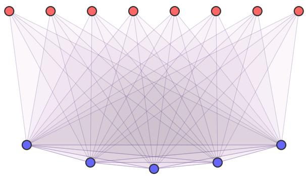  
Figure 11: A fully connected 3-body RBM. Visible spins in blue hidden spins in red. Each translucent triangle denotes a three-body interaction involving one hidden spin and two distinct visible spins.

Definition 27 (small weights). We say that a spin model M has

• polynomially bounded weights if all its n-spin systems have weights (i.e. local energy values, cf. Definition 1) of magnitude at most poly(n);

• weights of polynomial precision if for any of its n-spin systems S there exists an integer $q _ { S } =$ poly(n) such that all weights of S can be expressed as p/qS, for some integer p;

• small weights if its weights are polynomially bounded and of polynomial precision.

Note that this assumption of small weights is stronger than the assumption of weights of polynomial bit complexity used in Section 4.

In the context of machine learning models, the assumption of bounded weights is reasonable, since there are several results that link models with bounded weights to better performance [7, 6]. Similar constraints are also common in other computational models, such as circuits of threshold gates [1, 15], as well as in physics contexts, where the weights of a spin model are usually considered constant and not to scale with the system size.

The additional polynomial-precision assumption can be understood as a finite-resolution restriction: all weights then lie on a common grid with inverse-polynomial spacing. Such a grid sufices to approximate the Hamiltonian of a polynomial-size system uniformly to inverse-polynomial accuracy.

The property of small weights does not depend on the chosen representation of the spin system: If, when specifying weights as values of the local energy functions of S (see Definition 1) all such weights of S are polynomially bounded and/or of polynomial precision then, by the Fourier decomposition of pseudo-Boolean functions (Eq. (A.79)), also all Fourier coeficients of S, that is, its weights w.r.t. the Fourier basis, are polynomially bounded and/or of polynomial precision.

We conjecture that under mild additional assumptions, the separation results of Section 4 (Theo rem 20, Theorem 24 and Theorem 26) are compatible with the constraint of small weights, specifically with the constraint that targets with small weights must be simulated by a source with small weights, i.e. weights must remain small under simulation. More precisely, we conjecture this to be the case, whenever for a (v,p)-maximal model, it holds for all simulations that characterize (v,p)-maximality (i.e. visible closure and universality, through closure and functional completeness, see Definition 12 and Theorem 16, and also [41]).

## 5.2 Upper bounds on the eficient reach of shallow k-local systems

In this subsection we characterize those target functions f that can be eficiently simulated by shallow k-local models.

We first prove that eficiently simulating a pseudo-Boolean function f with a shallow source S essentially is equivalent to representing f as a linear combination of polynomially many polynomial threshold functions (PTFs).

Lemma 28 (PTF representation). If a target family f can be eficiently simulated by shallow k-local systems, then it admits a PTF representation

$$
f ( \mathbf { v } ) = \sum _ { i = 1 } ^ { M } w _ { i } \operatorname { s g n } ( P _ { i } ( \mathbf { v } ) ) , \qquad M = \operatorname { p o l y } ( n ) ,\tag{5.2}
$$

where each polynomial $P _ { i }$ has degree at most $k - 1 . ^ { 1 2 } \quad I f$ the simulation weights and energy shifts are polynomially bounded or have polynomial precision, the PTF representation can be chosen with the corresponding property, for all its parameters.

Conversely, if f admits such a PTF representation with small parameters13, then it can be eficiently simulated by a shallow k-local system with small weights and energy shifts.

Proof. See Section B.1 in the appendix.

It follows from Lemma 28 that any function that can be eficiently simulated by an RBM can be represented by a linear combination of linear threshold functions (LTFs) (see Section A.3).

Next, we prove that under the assumption of small weights, Lemma 28 implies that functions $f$ that can be eficiently simulated by k-local models necessarily have large correlation $\langle \operatorname { s g n } ( P ) , f \rangle$ with some PTF. By definition of $\langle , \rangle$ , the inner product of pseudo-Boolean functions (see Section A.3) this means that the PTF $\operatorname { s g n } ( P )$ provides a reasonable approximation of $f .$

Lemma 29 (simulation implies correlation). If a target function f with $\begin{array} { r } { \langle f , f \rangle = \frac { 1 } { \mathrm { p o l y } ( n ) } } \end{array}$ can be eficiently simulated by a shallow, k-local system $S$ with polynomially bounded weights and energy shift Γ, then $f$ has large (inverse polynomial) correlation with some degree $k - 1 \ P T F \operatorname { s g n } ( P )$ , i.e.

$$
\langle f , \operatorname { s g n } ( P ) \rangle = { \frac { 1 } { \operatorname { p o l y } ( n ) } } .\tag{5.3}
$$

Proof. By Lemma 28, f can be represented by a linear combination of $\mathrm { P T F s }$

$$
f ( \mathbf { v } ) = \sum _ { I } w _ { I } \mathrm { s g n } ( P _ { I } ( \mathbf { v } ) ) .\tag{5.4}
$$

W.l.o.g. the polynomials $P _ { I }$ never vanish on Boolean inputs and all coeficients $w _ { i }$ are positive. Indeed, for each I, choose $0 < \eta _ { I } \leq 1$ smaller than every nonzero value $| P _ { I } ( { \bf v } ) |$ . Replacing $P _ { I }$ by $P _ { I } + \eta _ { I }$ preserves its sign, degree and polynomially bounded coeficients, and removes all zeros. We may then absorb the signs of the nonzero $w _ { I }$ into the polynomials. Thus

$$
{ \frac { 1 } { \mathrm { p o l y } ( n ) } } = \langle f , f \rangle = { \frac { 1 } { 2 ^ { n } } } \sum _ { \mathbf { v } } ( f ( \mathbf { v } ) ) ^ { 2 } = \sum _ { I } w _ { I } { \frac { 1 } { 2 ^ { n } } } \sum _ { \mathbf { v } } f ( \mathbf { v } ) \mathrm { s g n } ( P _ { I } ( \mathbf { v } ) ) = \sum _ { I } w _ { I } \langle f , \mathrm { s g n } ( P _ { I } ) \rangle .\tag{5.5}
$$

Let $\operatorname { s g n } ( P )$ be the PTF of Eq. (5.4) that has maximal correlation with $f ,$ i.e.

$$
\langle f , \mathrm { s g n } ( P ) \rangle = \operatorname* { m a x } _ { I } \langle f , \mathrm { s g n } ( P _ { I } ) \rangle .\tag{5.6}
$$

Since all coeficients satisfy $w _ { I } \geq 0$

$$
{ \frac { 1 } { \mathrm { p o l y } ( n ) } } \leq \langle f , \mathrm { s g n } ( P ) \rangle \cdot \left( \sum _ { I } w _ { I } \right) .\tag{5.7}
$$

Dividing by $\begin{array} { r } { \sum _ { I } w _ { I } = \mathrm { p o l y } ( n ) } \end{array}$ (see Lemma 28) proves the claim.

Note that by Lemma 28 $P$ has polynomially bounded coeficients. $\operatorname { I f } ,$ additionally, the weights of $S$ are of polynomial precision then so are the coeficients of $P .$

Lemma 29 assumes that $\begin{array} { r } { \langle f , f \rangle = \frac { 1 } { \mathrm { p o l y } ( n ) } } \end{array}$ . This is e.g. the case $\textstyle \operatorname { i f } | f ( \mathbf { v } ) | = { \frac { 1 } { \operatorname { p o l y } ( n ) } }$ for all configurations v and thus in particular whenever $f$ is Boolean valued or has suficient margin around 0.

In the following we prove that even if this is not the case, if $f$ can be eficiently simulated with small weights then $\operatorname { s g n } ( f )$ has large correlation with some PTF.

Lemma 30 (shallow simulation sign correlation). If a target function f can be eficiently simulated by a shallow k-local source $S$ with small weights and energy shift Γ then $\operatorname { s g n } ( f )$ has large (inverse polynomial) correlation with some degree $k - 1 ~ P T F$ sgn(P)

$$
\langle \operatorname { s g n } ( f ) , \operatorname { s g n } ( P ) \rangle = { \frac { 1 } { \operatorname { p o l y } ( n ) } } .\tag{5.8}
$$

Proof. We prove that if $f$ can be eficiently simulated with small weights then we can construct a scaled and shifted function $f ^ { \prime }$ and an eficient simulation of $f ^ { \prime }$ such that sgn $( f ) = \operatorname { s g n } ( f ^ { \prime } )$ and $f ^ { \prime }$ has margin around 0. Then, similar to Lemma 29, we prove that $\operatorname { s g n } ( f ^ { \prime } )$ and hence also $\operatorname { s g n } ( f )$ has large correlation with some PTF.

Specifically, if some shallow, k-local system S eficiently simulates $f$ with small weights and energy shift, then all target values $f ( \mathbf { v } )$ can be expressed as a sum of at most polynomially many fractions $\frac { p } { q _ { S } }$ for polynomially bounded integers $p , q _ { S }$ . This implies that non-zero target values $f ( \mathbf { v } ) \neq 0$ satisfy

$$
| f ( \mathbf { v } ) | \geq { \frac { 1 } { q _ { S } } } = { \frac { 1 } { \mathrm { p o l y } ( n ) } } .\tag{5.9}
$$

Then $f ^ { \prime } = 2 q _ { S } f + 1$ preserves the sign while having absolute value at least 1.

Note that scaling and shifting S appropriately yields a shallow k-local system $S ^ { \prime }$ that eficiently simulates $f ^ { \prime }$ with small weights and energy shift and hence, by Lemma $2 8 , f ^ { \prime }$ can be expressed as a linear combination of PTFs (see Eq. (5.4)).

Now since all target values satisfy $| f ^ { \prime } ( \mathbf { v } ) | \geq 1$ and sgn $( f ) = \operatorname { s g n } ( f ^ { \prime } )$ ,

$$
\begin{array} { l } { { 1 } \leq \displaystyle \frac { 1 } { 2 ^ { n } } \sum _ { \mathbf { v } } | f ^ { \prime } ( \mathbf { v } ) | } \\ { = \displaystyle \frac { 1 } { 2 ^ { n } } \sum _ { \mathbf { v } } \mathrm { s g n } ( f ( \mathbf { v } ) ) f ^ { \prime } ( \mathbf { v } ) } \\ { = \displaystyle \sum _ { I } w _ { I } \displaystyle \frac { 1 } { 2 ^ { n } } \sum _ { \mathbf { v } } \mathrm { s g n } ( f ( \mathbf { v } ) ) \mathrm { s g n } ( P _ { I } ( \mathbf { v } ) ) } \\ { = \displaystyle \sum _ { I } w _ { I } \langle \mathrm { s g n } ( f ) , \mathrm { s g n } ( P _ { I } ) \rangle . } \end{array}\tag{5.10}
$$

Now similar to Lemma 29, let $\operatorname { s g n } ( P )$ be the PTF that has maximal correlation with $\operatorname { s g n } ( f )$ , then

$$
1 \leq \langle \mathrm { s g n } ( f ^ { \prime } ) , \mathrm { s g n } ( P ) \rangle \cdot \left( \sum _ { I } w _ { I } \right)\tag{5.11}
$$

and dividing by $\begin{array} { r } { \sum _ { I } w _ { I } = \mathrm { p o l y } ( n ) } \end{array}$ proves the claim.

Theorem 31 (shallow simulation communication complexity). Whenever a target function $f$ can be eficiently simulated by a shallow, k-local system with small weights and energy shift Γ then sgn(f) has an eficient, O(log(n)), k-party NOF communication protocol with success rate at least ${ \frac { 1 } { 2 } } + { \frac { 1 } { \mathrm { p o l y } ( n ) } } \quad$

Proof. We first argue that proving the claim amounts to proving that any degree $k - 1 \mathrm { P T F }$ with small parameters has a ${ \mathcal { O } } ( \log ( n ) )$ k-party communication protocol with success rate 1. For any Boolean-valued target function $f ^ { \prime } ( \mathbf { v } )$ , the success rate $\mathrm { S } ( \Pi )$ of a communication protocol that on input v returns $\Pi ( \mathbf { v } )$ can be expressed as

$$
\mathrm { S } ( \Pi ) = \frac { 1 } { 2 } \left( 1 + \langle f ^ { \prime } , \Pi \rangle \right) .\tag{5.12}
$$

Since by Lemma 30, sgn(f) has large correlation with some PTF $\operatorname { s g n } ( P )$ , defining the output of the protocol for $\operatorname { s g n } ( f )$ to be $\Pi = \operatorname { s g n } ( P )$ yields an eficient ${ \mathcal { O } } ( \log ( n ) )$ k-party communication protocol with success rate at least $\textstyle { \frac { 1 } { 2 } } + { \frac { 1 } { \mathrm { p o l y } ( n ) } }$

We now prove that any PTF sgn(PI) has a ${ \mathcal { O } } ( \log ( n ) )$ k-party communication protocol. Recall that in the k-party NOF communication setting the input $\mathbf { v } = ( \mathbf { v } _ { 1 } , \ldots , \mathbf { v } _ { k } )$ is split amongst the k players such that player $j$ has access to all blocks $\mathbf { v } _ { i }$ for $i \neq j$ . Since each polynomial has degree $k - 1$ it cannot contain monomials that depend on inputs from all k blocks. We can thus decompose $P _ { I }$ into polynomials $Q _ { j }$

$$
P _ { I } ( { \bf v } ) = \sum _ { j = 1 } ^ { k } Q _ { j } ( { \bf v } ) ,\tag{5.13}
$$

such that $Q _ { j }$ does not depend on $\mathbf { v } _ { j }$ . This implies that $Q _ { j }$ can be computed locally by player $j$ . Thus, the protocol for sgn $( P _ { I } )$ can be designed as follows: Each player $j$ for $j \le k - 1$ locally computes $Q _ { j } ( \mathbf { v } )$ and communicates the value to player k. Player k then locally computes $Q _ { k } ( { \mathbf v } )$ and, using the communicated values, $P _ { I } ( \mathbf { v } )$ to output $\mathrm { s g n } ( P _ { I } ( { \bf v } ) )$ . By construction this protocol has success rate 1.

To finish the proof, we argue that each value $Q _ { j } ( \mathbf { v } )$ can be communicated in ${ \mathcal { O } } ( \log ( n ) )$ bi ${ \mathrm { 5 } } ,$ so the overall communication requires $( k - 1 ) \cdot \mathcal { O } ( \log ( n ) )$ bits, i.e. the protocol has communication complexity ${ \mathcal { O } } ( \log ( n ) )$ . Recall that $P _ { I }$ and hence also each $Q _ { j }$ is a linear combination of $\mathrm { p o l y } ( n )$ monomials, with polynomially bounded parameters of polynomial precision $2 ^ { k } q s$ . So all parameters of these linear combinations are of the form $\scriptstyle { \frac { p } { 2 ^ { k } q s } }$ for an integer p with $| p | = \mathrm { p o l y } ( n )$ . Therefore, also the value of each $Q _ { j }$ can be expressed as $\frac { p _ { j } } { 2 ^ { k } q _ { S } }$ with $| p _ { j } | = \mathrm { p o l y } ( n )$ and thus, communicating $Q _ { j }$ amounts to communicating $p _ { j }$ , which requires ${ \mathcal { O } } ( \log ( n ) )$ bits. □

Theorem 32 (shallow simulation randomized communication complexity). Whenever a target function f can be eficiently simulated $b y$ a shallow, k-local system with small weights and energy shift Γ then sgn(f) has an eficient, ${ \mathcal { O } } ( \log ( n ) )$ , randomized k-party NOF communication protocol that for any input v has success probability at least $\textstyle { \frac { 1 } { 2 } } + { \frac { 1 } { \mathrm { p o l y } ( n ) } }$

Note that this is strictly stronger than Theorem 31 since any such randomized communication protocol Π would immediately yield success probability $\geq { \frac { 1 } { 2 } } + { \frac { 1 } { \mathrm { p o l y } ( n ) } }$ . Since a randomized communication protocol is a probability distribution over deterministic protocols this implies that Π must contain at least one deterministic protocol that has success rate over uniformly distributed inputs $\geq { \frac { 1 } { 2 } } + { \frac { 1 } { \mathrm { p o l y } ( n ) } }$

Proof. First, w.l.o.g. assume that for all inputs $\mathbf { v } , | f ( \mathbf { v } ) | \geq 1$ , since else, following the proof of Lemma 30, we construct a scaled and shifted function $f ^ { \prime } { } _ { ; }$ that satisfies $| f ^ { \prime } ( \mathbf { v } ) | \geq 1$ for all inputs, can be eficiently simulated with small weights and satisfies $\operatorname { s g n } ( f ) = \operatorname { s g n } ( f ^ { \prime } )$ . Thus we can equivalently construct the protocol for $\operatorname { s g n } ( f ^ { \prime } )$

Recall that by Lemma 28, f can be represented by a linear combination of degree $k - 1 \mathrm { P T F s } .$ , i.e.

$$
f ( \mathbf { v } ) = \sum _ { I } w _ { I } \mathrm { s g n } ( P _ { I } ( \mathbf { v } ) ) .\tag{5.14}
$$

Similar to Lemma 29, w.l.o.g. all parameters $w _ { I }$ are positive since else we can simply absorb signs by redefining the respective polynomial $P _ { I }$ . Following the proof of Theorem 31, each individual PTF sgn $( P _ { I } )$ can be exactly computed by a protocol with communication complexity ${ \mathcal { O } } ( \log ( n ) )$

The randomized protocol Π for sgn(f) is constructed as follows: First, define $\begin{array} { r } { W = \sum _ { I } w _ { I } } \end{array}$ The players start by using the shared randomness to sample an index I with probability $\begin{array} { r } { p _ { I } = \frac { w _ { I } } { W } } \end{array}$ . They then follow the deterministic ${ \mathcal { O } } ( \log ( n ) )$ protocol from Theorem 31 to return $\mathrm { s g n } ( P _ { I } ( { \bf v } ) )$

To finish the proof, fix an input v. Since Π(v) and $\operatorname { s g n } ( f ( \mathbf { v } ) )$ take values in $\{ - 1 , + 1 \}$ , the success probability satisfies

$$
\mathrm { P r } [ \Pi ( \mathbf { v } ) = \operatorname { s g n } ( f ( \mathbf { v } ) ) ] = \frac { 1 + \mathbb { E } [ \Pi ( \mathbf { v } ) \operatorname { s g n } ( f ( \mathbf { v } ) ) ] } { 2 } ,\tag{5.15}
$$

where the expectation is over the shared randomness of the protocol. This expectation can be expressed as

$$
\begin{array} { r l r } & { } & { { \displaystyle \mathbb { E } } [ \Pi ( { \mathbf { v } } ) \cdot \mathrm { s g n } ( f ( { \mathbf { v } } ) ) ] = \mathrm { s g n } ( f ( { \mathbf { v } } ) ) \cdot \left( \sum _ { I } \frac { w _ { I } } { W } \mathrm { s g n } ( P _ { I } ( { \mathbf { v } } ) ) \right) } \\ & { } & { ~ = \displaystyle \frac { 1 } { W } \mathrm { s g n } ( f ( { \mathbf { v } } ) ) \cdot f ( { \mathbf { v } } ) = \frac { | f ( { \mathbf { v } } ) | } { W } \geq \frac { 1 } { W } = \frac { 1 } { \mathrm { p o l y } ( n ) } . } \end{array}\tag{5.16}
$$

Through this connection to communication complexity, the eficient reach of shallow, k-local models is in turn connected to various measures of communication complexity, including discrepancy [4], margin complexity [29], approximate $\gamma _ { 2 }$ factorization norms [30], and sign rank [37].

Corollary 33 (non-existence of shallow, k-local $\operatorname { I P } _ { k }$ simulation). Shallow k-local systems with small weights cannot eficiently simulate the $k { - } p a r t y$ inner product modulo 2, $\mathrm { I P } _ { k }$ (see Section A.3).

Proof. Note that sgn $( \mathrm { I P } _ { k } ) \ : = \ : \mathrm { I P } _ { k }$ . By Theorem 31, the existence of a shallow, k-local system that simulates $\operatorname { I P } _ { k }$ would induce a ${ \mathcal { O } } ( \log ( n ) )$ communication protocol for $\operatorname { I P } _ { k }$ with success rate at least $\frac { 1 } { 2 } +$ $\frac { 1 } { \mathrm { p o l y } ( n ) }$ , but by [4, Theorem 2] any such protocol requires the communication of at least $\Omega ( n )$ bits.

## 5.3 Lower bounds and separation hierarchy of shallow k-local systems

In this subsection we lower bound the eficient reach of shallow k-local models. Note that several lower bounds can be directly derived from the characterization of universal spin models ([41, 40]). It e.g. implies that shallow k-local models can eficiently simulate all functions that have a sparse representation in either the indicator or the Fourier basis (Section A.3), i.e. that have at most polynomially many, non-zero coeficients.

We first prove that RBMs can eficiently simulate arbitrary, small ridge functions, that is, functions $f ( \mathbf { v } ) = g ( \mathbf { A } \mathbf { v } )$ where A has small components (see Section A.3).

Lemma 34 (RBM ridge function simulation). RBMs can eficiently simulate all small ridge functions, for arbitrary cut-ofs.

Conversely, if a target can be eficiently simulated by RBMs with small weights and energy shift then it can be expressed as a sum of polynomially many small ridge functions.

Proof. See Section B.2 in the appendix.

In particular, Lemma 34 implies that the cut-of of an eficient RBM simulation with small weights and energy shift can be increased to any prescribed polynomially bounded value, while retaining small weights and energy shift (cf. Section C.5).

The class of ridge functions contains many interesting examples. Consider a ridge function $f ( \mathbf { v } ) =$ $g ( \mathbf { A } \mathbf { v } )$ for $\mathbf { A } = \mathbf { 1 }$ then, since

$$
{ \bf 1 v } = 2 \mathrm { d } _ { H } ( { \bf v } ) - n ,\tag{5.17}
$$

f only depends on the Hamming weight $\mathrm { d } _ { H } ( \mathbf { v } )$ of the input configuration, the number of bits i with $v _ { i } = + 1$ . Similarly, consider a ridge function with $\mathbf { A } = - \mathbf { w } \in \mathbf { 2 } ^ { n }$ , then

$$
- \mathbf { w } \mathbf { v } = 2 \mathrm { d } _ { H } ( \mathbf { v } , \mathbf { w } ) - n ,\tag{5.18}
$$

where $\mathrm { d } _ { H } ( \mathbf { v } , \mathbf { w } )$ is the Hamming distance between v and $\mathbf { w } ,$ the number of bits i with $v _ { i } \neq w _ { i }$ . This shows that ridge functions contain all distance functions, that is, functions that only depend on the (Hamming) distance to some fixed configuration. Important examples of distance functions include indicator functions, that is,

$$
\delta _ { \mathbf { s } } ( \mathbf { v } ) = { \left\{ \begin{array} { l l } { 1 } & { { \mathrm { ~ i f ~ } } \mathbf { v } = \mathbf { s } } \\ { 0 } & { { \mathrm { ~ e l s e } } , } \end{array} \right. }\tag{5.19}
$$

for any $\mathbf { s } \in \mathbf { 2 } ^ { n }$ . Indicator functions provide the canonical basis for the space of pseudo-Boolean functions. Other important examples of ridge functions are parity functions, that is, functions that only depend on the parity of a subconfiguration of v. Consider $S \subseteq [ n ]$ and define

$$
\pi _ { S } ( \mathbf { v } ) = \prod _ { i \in S } v _ { i } .\tag{5.20}
$$

Note that $\pi _ { S } ( \mathbf { v } )$ yields +1 if the subconfiguration ${ \bf v } | _ { S }$ has even parity, i.e. an even number of $( - 1 )$ s and −1 else. Parity functions provide a basis of the space of pseudo-Boolean functions. The resulting decomposition

$$
f ( \mathbf { v } ) = \sum _ { S \subseteq [ n ] } { \widehat { f } } ( S ) \pi _ { S } ( \mathbf { v } )\tag{5.21}
$$

is called the Fourier decomposition of $f$ and the coeficients ${ \widehat { f } } ( S )$ are called Fourier coeficients of $f .$ To see that π is a ridge function, consider the weight vector $\mathbf { A } _ { S } \in \{ 0 , 1 \} ^ { n }$ such that $( A _ { S } ) _ { i } = + 1$ if $i \in S$ and $( A _ { S } ) _ { i } = 0 { \mathrm { ~ i f ~ } } i \notin S$ . Denote the number of (−1)s in the subconfiguration ${ \bf v } | _ { S }$ as $n _ { - } ( \mathbf { v } | _ { S } )$ then

$$
\mathbf { A } _ { S } \mathbf { v } = | S | - 2 n _ { - } ( \mathbf { v } | _ { S } ) .\tag{5.22}
$$

thus, choosing $g ( k ) = ( - 1 ) ^ { \frac { | S | - k } { 2 } }$ yields

$$
g ( \mathbf { A } _ { S } \mathbf { v } ) = ( - 1 ) ^ { n _ { - } ( \mathbf { v } | _ { S } ) } = \pi _ { S } ( \mathbf { v } ) .\tag{5.23}
$$

Finally, ridge functions also include linear threshold functions (LTFs)

$$
f ( \mathbf { v } ) = \mathrm { s g n } ( \mathbf { A } \mathbf { v } + b ) ,\tag{5.24}
$$

where we use the convention $\mathrm { s g n } ( 0 ) = + 1$ Similar to circuits of logical gates for $\mathrm { ^ { 6 } a n d ^ { 3 } , ~ ^ { 6 } o r ^ { 3 } }$ and “negation”, circuits of LTFs provide a model of computation. The minimal number of LTFs or circuit depth necessary to represent a given function f then defines a complexity measure for $f .$

Note that ridge functions, by construction, depend on v linearly. Thus, ridge functions do not necessarily include PTFs (cf. Lemma 28). We now extend Lemma 34 to functions with higher-order v dependency. This, however, requires spin systems with local interactions of higher Fourier degree. Specifically, in the following, we prove that shallow k-local systems can eficiently simulate functions that can be decomposed as an RBM acting on an “efective” configuration of degree $k - 1$ polynomials in v.

Lemma 35 (shallow simulation RBM decomposition). Let f be any target function such that

$$
f ( \mathbf { v } ) = g \left( P _ { 1 } ( \mathbf { v } ) , \ldots , P _ { m } ( \mathbf { v } ) \right) ,\tag{5.25}
$$

where $m = \mathrm { p o l y } ( n )$ and $P _ { I }$ are degree $\le k - 1$ polynomials (each involving at most $\mathrm { p o l y } ( n )$ monomials) with values in 2 and $g$ can be eficiently simulated by an RBM then f can be eficiently simulated by a shallow k-local system.

Proof. By assumption there exists an RBM R such that

$$
g ( { \mathbf { u } } ) = \operatorname* { m i n } _ { { \mathbf { h } } } H _ { R } ( { \mathbf { u } } , { \mathbf { h } } ) - \Gamma = \operatorname* { m i n } _ { { \mathbf { h } } } \bigl ( \sum _ { j } \sum _ { i } W _ { i , j } u _ { i } h _ { j } + \sum _ { i } b _ { i } u _ { i } + \sum _ { j } c _ { j } h _ { j } \bigr ) - \Gamma .\tag{5.26}
$$

Inserting

$$
u _ { i } = P _ { i } ( \mathbf { v } ) = \sum _ { I _ { i } } \lambda _ { I _ { i } } \prod _ { j \in I _ { i } } v _ { j }\tag{5.27}
$$

and regrouping terms yields the minimum over hidden configurations h of a degree $\leq k$ polynomial in $v _ { i } , h _ { j }$ , such that each monomial involves at most one hidden spin $h _ { j }$ . This is precisely the efective energy of a shallow k-local spin system S and by Eq. (5.25), S simulates $f .$

The cut-of of $S \longrightarrow f$ is at least as large as the cut-of of $R \longrightarrow g \colon \mathrm { B y }$ definition the cut-of of $R \longrightarrow g$ is the minimal energy gap $H _ { R } ( \mathbf { u } , h ) - H _ { R } ( \mathbf { u } , h _ { \operatorname* { m i n } } ( \mathbf { u } ) )$ , minimized over all u and all incorrect hidden configurations $\textbf { h } \neq \mathbf { h } ( \mathbf { u } )$ . In contrast, the cut-of of $S \longrightarrow f$ is obtained similarly, but the minimizing does not involve all configurations u, but only those that are reached by $( P _ { 1 } ( \mathbf { v } ) , \ldots , P _ { m } ( \mathbf { v } ) )$ Decreasing the scope of the minimization can only increase the cut-of.

Since $m = \mathrm { p o l y } ( n )$ and the RBM simulation $R \longrightarrow g$ is eficient, also the simulation $S \longrightarrow f$ is eficient.

Finally, note that the weights of $S$ are products of weights of R and coeficients of $P _ { i }$ . If both are polynomially bounded or have polynomial precision then the same applies to the weights of S. □

Theorem 36 (shallow, k-local $\mathrm { I P } _ { k - 1 }$ simulation). The $( k - 1 )$ )-party inner product modulo 2 function $\mathrm { I P } _ { k - 1 }$ can be eficiently simulated by a shallow, k-local system with small weights.

Since by Corollary 33, $\mathrm { I P } _ { k - 1 }$ cannot be eficiently simulated by shallow $\left( k - 1 \right)$ )-local systems, for each k $\mathrm { I P } _ { k - 1 }$ certifies the separation between shallow $( k - 1 )$ -local and shallow k-local systems in terms of their eficient reach (Fig. 3).

Proof. Let $\mathbf { v } = ( \mathbf { v } ^ { ( 1 ) } \ldots , \mathbf { v } ^ { ( k - 1 ) } )$ . W.l.o.g. we consider states $v _ { i } \in \{ 0 , 1 \}$ (see Section A.3), then

$$
\begin{array} { r } { \mathrm { I P } _ { k - 1 } \big ( \mathbf { v } ^ { ( 1 ) } , \dots , \mathbf { v } ^ { ( k - 1 ) } \big ) = ( - 1 ) ^ { \sum _ { i = 1 } ^ { n } \prod _ { l = 1 } ^ { k - 1 } v _ { i } ^ { ( l ) } \mod 2 } . } \end{array}\tag{5.28}
$$

Define

$$
P _ { i } ( { \bf v } ) = \prod _ { l = 1 } ^ { k - 1 } v _ { i } ^ { ( l ) } ,\tag{5.29}
$$

and $g ( \mathbf { w } ) = ( - 1 ) ^ { \sum _ { i } }$ i wi mod 2. Then

$$
\begin{array} { r } { \mathrm { I P } _ { k - 1 } ( { \bf v } ) = g \big ( P _ { 1 } ( { \bf v } ) , \ldots , P _ { n } ( { \bf v } ) \big ) . } \end{array}\tag{5.30}
$$

Note that $P _ { i }$ has degree $k { - } 1$ . By Lemma 35 constructing the required simulation of $\mathrm { I P } _ { k - 1 }$ thus amounts to proving that g can be eficiently simulated by an RBM with polynomially bounded weights of polynomial precision. Finally, since g is a distance function, this follows from Lemma 34. □

Example 37 (3RBM simulation of $\mathrm { { I P } _ { 2 } ) }$ . We work with states from $\{ 0 , 1 \}$ . Let $\mathbf { x } , \mathbf { y } \in \{ 0 , 1 \} ^ { n }$ and write $\begin{array} { r } { t = \sum _ { i = 1 } ^ { n } x _ { i } y _ { i } } \end{array}$ , so that $\operatorname { I P } _ { 2 } ( \mathbf { x } , \mathbf { y } ) = ( - 1 ) ^ { t }$ . Following Theorem 36, we apply the ridge-function construction to parity and substitute $u _ { i } = x _ { i } y _ { i }$

For a desired cut-of $\Delta > 0$ , choose

$$
D = { \mathrm { m a x } } \{ 1 , [ \Delta ] \} , \qquad L = 4 n + D , \qquad B = L n + D , \qquad a _ { j } = 2 L + 8 ( j - 1 ) ( - 1 ) ^ { j + 1 } .\tag{5.31}
$$

Introduce 2n hidden spins $\mathbf { h } , \mathbf { s } \in \{ 0 , 1 \} ^ { n }$ and define

$$
\begin{array} { l } { { \displaystyle { \cal H } ( { \bf x } , { \bf y } , { \bf h } , { \bf s } ) = ( B - 2 ) t - \sum _ { j = 1 } ^ { n } a _ { j } h _ { j } \left( t - j + \frac { 1 } { 2 } \right) } \ ~ } \\ { { \displaystyle ~ - \sum _ { i = 1 } ^ { n } s _ { i } \left[ B - L t - ( B + D ) ( 1 - x _ { i } y _ { i } ) \right] } . } \end{array}\tag{5.32}
$$

Expanding t shows that every interaction contains at most three spins and at most one hidden spin. The visible–visible terms can be replaced by three-body interactions with one additional hidden spin, pinned $\mathrm { t o } + 1$ by a suficiently strong field. With this additional modification, H is a 3-body RBM Hamiltonian.

To verify the simulation, write $[ z ] _ { + } = \operatorname* { m a x } \{ 0 , z \}$ . For integer $t \in \{ 0 , \ldots , n \}$ , the parity specialization of the ridge construction gives

$$
\sum _ { j = 1 } ^ { n } a _ { j } [ t - j + \textstyle { \frac { 1 } { 2 } } ] _ { + } = L t ^ { 2 } - ( - 1 ) ^ { t } + 1 - 2 t .\tag{5.33}
$$

Moreover, $B - L t - ( B + D ) ( 1 - x _ { i } y _ { i } )$ is positive precisely when $x _ { i } y _ { i } = 1$ , so its positive parts sum to $B t - L t ^ { 2 }$ . Minimizing each hidden spin independently therefore yields

$$
\operatorname* { m i n } _ { \mathbf { h } , \mathbf { s } } H ( \mathbf { x } , \mathbf { y } , \mathbf { h } , \mathbf { s } ) = ( - 1 ) ^ { t } - 1 = \mathrm { I P } _ { 2 } ( \mathbf { x } , \mathbf { y } ) - 1 .\tag{5.34}
$$

The simulation has energy shift $\Gamma = - 1$ . Every hidden-spin coeficient has absolute value at least $D ;$ this follows from $a _ { j } \geq 2 D$ , the half-integer breakpoints, and the two cases $x _ { i } y _ { i } = 0 , 1$ . Hence the minimizing hidden configuration is unique and the cut-of is at least $\Delta .$

The construction uses $2 n$ visible spins, $2 n + 1$ hidden spins, and $\mathcal { O } ( n ^ { 2 } )$ interactions. Its weights are integers of magnitude $O ( n ^ { 2 } + n D )$ , and thus are small whenever $\Delta$ is polynomially bounded.

## 6 Conclusion and outlook

Let us summarize our results (Section 6.1) and look beyond (Section 6.2).

## 6.1 Summary of results

Characterization of maximal models. One of the central notions of this work is that of visible closure (Definition 12; Fig. 9), which can be thought of as a more nuanced notion of depth. More precisely, visible closure captures the compositional properties of deep models. It allows visible spins to become hidden (up to simulation), and thereby preserves the visible-hidden split when composing simulations (Lemma 13). Note that when visible spins become hidden this efectively introduces new hidden-hidden interactions. We thus conjecture that most (non-trivial) deep models are visible closed, and that the converse also holds. The following separation results also support this conjecture. The paradigmatic deep models, DBMs, are visible closed in a straightforward manner (Fig. 10); technically, they are strictly visible closed.

Now, visible closure characterizes what a spin ML model needs to go from universality to maximality: a universal spin ML model is maximal if and only if it is visible closed. More generally, for spin ML models any two of the three properties “universal”, “maximal” and “visible closed” imply the third (Theorem 16). This can be interpreted as follows: if a spin ML model has a suficient amount of depth (visible closure) then any statements about its unconstrained representation capabilities (universality) also apply to its eficient representation capabilities (maximality), and vice versa.

Overall, since DBMs are universal and visible closed, it follows that they are maximal (Corollary 17).

Separation between shallow and maximal models. Could it happen that a shallow model is, for some reason, visible closed and thus powerful enough to be maximal? The answer is no (under reasonable assumptions), because there are some functions that all maximal models can eficiently represent but shallow models can’t (Table 1).

Specifically, maximal models can eficiently simulate certain NP-hard functions (Theorem 20), approximate certain #P-hard functions in their unnormalized visible spin marginals (Theorem 24) and approximate the corresponding #P-hard probability distribution in their normalized visible spin marginal (Theorem 26). In contrast, shallow models can do none of the above, under reasonable assumptions on computational complexity. This provides an explicit separation between RBMs and DBMs. In particular, RBMs are not maximal.

So, these separations prove that maximal models are necessarily deep. However, this statement is contingent on certain computational complexity assumptions, in contrast to the results involving visible closure, which stand on their own (cf. conjecture above).

Separation hierarchy for shallow models. Is there anything else we can say concerning the gap (in eficient representation capabilities) between RBMs and DBMs? Namely, is there a sharp transition, or are there some internal levels that bridge between the two? The latter is the answer, if we consider RBMs with increasing interaction order. These models are not often considered in the literature. In this work, we find that RBMs with (k + 1)-body interactions can eficiently represent more functions than RBMs with k-body interactions, for any k (Fig. 1). They thus build an infinite separation hierarchy which does not saturate at maximality but underneath. Recall that, without the eficiency constraint, all models considered here are equally powerful, namely universal!

The separation between (k + 1)- and k-body RBMs is witnessed by some functions with large kparty communication complexity, such as the k-party inner product modulo 2 (Theorems 32 and 36 and Corollary 33). It relies on the assumption of small weights (Definition 27).

In summary, while the separation between sub-maximal and maximal models is controlled by depth, within the space of shallow models the eficient simulation capabilities are determined by the interaction order. It follows that 3-body RBMs can eficiently simulate certain targets that conventional RBMs can’t (Example 37).

## 6.2 Outlook

How much do our results depend on the assumptions? This question must be considered for four separate themes. First, we have assumed small bit complexity of all weights and simulation parameters to prove the separations between deep and shallow models in Section 4. And we have assumed small weights (Section 5.1) to prove the separation hierarchy of Section 5. To what extent are these assumptions justified? Do they apply to common examples of simulations/approximations?

Second, we have used common computational complexity assumptions such as the non-collapse of the polynomial hierarchy (Section 4.1). This is widely believed to be true, and can be considered a generalization of the standard assumption that P ̸= NP. More generally, most statements in computational complexity are in fact conditional on similar conjectures separating complexity classes.

Third, do the separation results for simulations extend to approximations? Several of our separation results are statements about existence and non-existence of simulations (specifically Theorem 20 and the entirety of Section 5). The translation of separations from simulations to approximations can fail for two reasons. The first one is that if a certain simulation does not exist, the corresponding approximation may still exist, as far as we know. We partially address this question in Section C.1, showing that approximations lead to simulations in some cases. The second reason has to do with the cut-of. We have argued that if simulations with suficiently large cut-of exist, then the corresponding approximations with small error exist too. Note that Theorem 20 only proves existence of simulations for a fixed cut-of of $\Delta = 1$

Finally, what is the relevance of our asymptotic analysis in practice? Our notion of eficiency requires polynomial overhead, but we ignore which specific polynomial is in play. But, in practice, this may matter, and models within one level of the landscape of Fig. 1 may strongly difer in the polynomial overhead they require to represent a target. We study some of these diferences with our learning experiments in Section D. We consider physics-motivated targets with high order interactions which we know, from the theory developed in this paper, admit an eficient representation by both RBMs and 3-body RBMs. Yet, the numerical experiments show an advantage for 3-body RBMs. It would be interesting to develop a finer analysis that quantifies over such polynomial budgets.

Can one quantify the trade-ofs of resources for eficient reach? Our results suggest that representational capabilities depend on the interplay between several resources: the overhead (i.e. number of weights), depth, interaction order, and the magnitude and precision of weights. But we would like to disentangle their role. On the one hand, we have seen that increasing depth can compensate for restrictions on interaction order: deep models with pair interactions (e.g. DBMs) have maximal eficient reach, while shallow models exhibit a strict hierarchy as interaction order increases. On the other hand, certain targets that require an exponential overhead in shallow models or models of small interaction order can be eficiently represented by deep ones or such with higher-order interactions. Yet, the role of weights is less clear. Especially, our small weight assumption raises the question of whether larger weights or greater numerical precision can overcome some of the limitations of shallow models. Can these observations be developed into a quantitative account of which resources can compensate for one another, and at what cost?

What do our separations imply for learning? One very important aspect we have not considered throughout the main text is learning (but see Section D). Do our separations for the existence of eficient representations transfer to separations for eficiently learning them? Broadly, this transfer may fail for two reasons.

First, can the weights of eficient representations be learned from finite training data? We would need that a representation that witnesses a separation, e.g. between RBMs and DBMs, can be learnt, so that the separations are accessible through training. We provide some insights into this question in Section D, where we numerically study the learning of RBMs and 3-body RBMs for the inner product modulo 2. For the tested system sizes, parameter budgets and training procedure, we observe a learning advantage for 3-body RBMs. This suggests that at least some of our separations are accessible through training.

A second issue is: does eficient representability imply eficient learnability? Even if eficient representations can be learned, the learning itself may be ineficient, because of the following. Eficient representations have at most polynomially many weights, which is necessary for eficient learning. Yet, learning typically introduces other bottlenecks, e.g. the amount of training data required or the computational cost of sampling from the model or minimizing the objective. For which models are these aspects also guaranteed to be eficient?

On a related note, we would like to understand what universal approximation and our eficiency results imply for practical learning, specifically where models must generalize beyond the training data. In particular, when does greater (eficient) representational power help capture underlying structure, and when does it instead facilitate overfitting?

Where do practical learning targets lie within our hierarchy? Our results leave open which levels of the eficient reach landscape (see Fig. 1) are occupied in practice. Conversely, given a target, or a data sample thereof, we do not know how to determine where it sits in the landscape. For which targets do deep models, or models with higher-order interactions, work actually better? This question is also studied in [35]. In Section D we also partially address this question for RBMs and 3-body RBMs for certain physics-motivated targets.

Do other notions of universality show similar behavior under eficiency constraints? This investigation started from the realization that universal spin models are intimately related to the universal approximation theorem in some machine learning models. But there are other notions of universality, which obey a common structure [17, 16]. For spin models and machine learning models, the additional requirement of eficiency has given rise to a split in their capabilities: for spin models universality implies maximality, whereas for machine learning models, universal approximation is compatible with strictly diferent eficient reaches. What would happen if we applied the eficiency requirement to the other notions of universality? Would it also give rise to a separation of capabilities? A first, much more concrete step in this direction would be to study other types of machine learning models such as feedforward neural networks. For the latter it is known that one hidden layer sufices for universal approximation, but depth can yield substantial representational advantages [45]. More generally, which structural features determine whether eficiency constraints preserve a universality classification or refine it into a hierarchy? The framework for universality [17] may allow one to study these questions in a broad manner.

## 6.3 Acknowledgments and disclosures

Acknowledgments. This research was funded in part by the Start Prize of the Austrian Science Fund 10.55776/Y1261. For open access purposes, the authors have applied a CC BY public copyright license to any author accepted manuscript version arising from this submission.

Use of artificial intelligence. The authors used OpenAI’s GPT-6 and GPT-5.6 as research assistants to support literature searches, the development and checking of mathematical arguments, and manuscript preparation. The authors reviewed and revised the AI-assisted material and take full responsibility for the content of this work.

## A Complexity theory toolbox

In this section we provide an introduction to computational complexity theory (Section A.1), detailed proofs of the complexity of the hard reference model $\mathcal { M } _ { \mathrm { I s i n g } }$ introduced in Section 4.2 (Section A.2), as well as an introduction to the theory of pseudo-Boolean functions (Section A.3) and to communication complexity (Section A.4).

## A.1 Computational complexity basics

Computational complexity theory studies the computational cost (e.g. runtime or memory/space) of functions [2, 34]. One usually considers functions that are defined for inputs of arbitrary length, e.g. $f \colon \textstyle \bigcup _ { n \geq 0 } { \bf 2 } ^ { n }  \bigcup _ { n \geq 0 } { \bf 2 } ^ { n }$ , or equivalently, that map strings over some input alphabet to strings over some output alphabet, such that both inputs and outputs can have arbitrary length. Functions f that for all inputs yield an output in 2 play a special role in computational complexity. Such functions are completely defined by their set of yes-instances, the set of inputs x with $f ( x ) = + 1$ . They are called decision problems since computing f(x) amounts to deciding whether x is a yes-instance. In practice, the set of yes-instances is usually defined by some property and computing f(x) amounts to deciding whether x has that property.

Instead of considering the computational cost of each input, among other things computational complexity focuses on the asymptotic scaling of the worst-case runtime with the input size, that is,

1. The computational complexity of an algorithm is the asymptotic scaling n → ∞ of the worst case computational cost for inputs of size/length n.

2. The computational complexity of a function is the computational complexity of the best algorithm for it.

Note that above, the concepts algorithm, as well as computational cost, i.e. runtime and space, are defined w.r.t. a model of computation, usually that of Turing machines.

Grouping functions that asymptotically have similar computational cost defines so-called complexity classes. In this work we only consider the time-complexity of functions (see Section 4).

Definition 38 (useful complexity classes). The following is a list of the most relevant complexity classes (for this work).

1. P (FP): the class of decision problems (functions) that can be computed with a runtime that increases at most polynomially with the input length14.

2. NP: the class of decision problems for which yes-instances can be verified in P, that is, each decision problem f ∈ NP has a polynomial-time verifier, namely an algorithm R ∈ P such that x is a yesinstance of f if there exists a certificate y of length at most poly(n) such that $R ( x , y ) = 1$

3. co-NP: the class of decision problems for which no-instances can be verified in P, f is in co-NP if swapping yes- and no-instances yields a problem in NP.

4. co-A, for any complexity class A of decision problems: the class of decision problems for which swapping yes- and no-instances yields a problem in A.

5. #P: the class ofcounting problems (functions with outputs in N) that count the number ofcertificates of NP-problems. That is, for each $f \in \# \mathsf { P }$ there exists some related NP-problem g and verifier R such that f(x) is the number of certificates y of x w.r.t. R.

6. P/poly (FP/poly): the class of decision problems (functions) that can be computed in P (FP), when provided with advice strings $a _ { n }$ of polynomial length. For $f \in \mathsf { P } / \mathrm { p o l } _ { \mathrm { J } }$ $( f \in \mathsf { F P / p o l y } )$ there exists a sequence of advice strings $( a _ { n } ) _ { n \in \mathbb { N } } ,$ , such that $a _ { n }$ is of length poly(n) and given any input of length n and the corresponding advice string $a _ { n } , f ( x )$ can be computed in P (FP). Importantly, the advice strings $a _ { n }$ need not be computable in any way. The advice strings can e.g. encode Boolean circuits of polynomial size. Hence, P/poly can equivalently be defined as the complexity class of functions that can be computed by polynomially sized Boolean circuits.

7. A/poly for any complexity class A: the class of decision problems or functions that can be computed in A, when provided with advice strings $a _ { n }$ of polynomial length (cf. P/poly).

8. $\mathsf { A } ^ { \mathsf { B } }$ , for any two complexity classes, A, B: the class of decision problems or functions that can be computed with complexity A, assuming the algorithm has access to an oracle for any function from B (see Definition 39).

In computational complexity theory, the computational hardness of functions is studied in a relational way; f is at least as hard as $g , \ ( f \geq g )$ if an eficient algorithm for f would allow one to construct an eficient algorithm for g, where ‘eficient’ here usually means within some fixed complexity class A. The process of constructing the g-algorithm by using the f-algorithm as subroutine is called reducing g to f or constructing a reduction from g to f. There exist several notions of reductions, that mainly difer in how exactly the g-algorithm is allowed to use the f-subroutine. In this work, we mainly consider the most general such notion, that of an oracle reduction or Turing reduction.

Definition 39 (reduction). A polynomial time oracle reduction from g to f is a polynomial-time algorithm for g that has access to an oracle for f, i.e. a hypothetical subroutine that on any input x can compute f(x) in O(1), i.e. instantly.

Note that oracle reductions might use polynomially many oracle calls and might post-process the oracle answers. For stricter notions of reductions this is prohibited: many-to-one reductions (or Karp reductions) are oracle reductions that use a single oracle call and return the oracle answer as final output, without post-processing it. Many-to-one reductions are commonly used for decision problems, only.

Definition 40 (hardness and completeness). A function f is called hard w.r.t. complexity class A (or A-hard) if every problem in A can be reduced to f. It is called complete w.r.t. complexity class A (or A-complete) if it is A-hard and $f \in \mathsf { A }$

Note that, depending on the complexity class A, it might be necessary to impose restrictions on the reduction to ensure that, relative to A, the overhead introduced by the reduction is negligible. In this work, hardness results for decision problems (e.g. Lemma 41) are proven w.r.t. many-to-one reductions, while hardness results for function problems (including #P-hardness) are proven w.r.t. oracle reductions.

Finally, separation results between shallow and (v,p)-maximal models in Section 4 are derived based on the assumption that there is no collapse of the polynomial hierarchy [44]. The polynomial hierarchy is an infinite hierarchy of complexity classes that generalize the classes P, NP and co-NP. That there is no collapse of the polynomial hierarchy can be seen as a generalization of the widely believed conjecture that ${ \mathsf { P } } \neq { \mathsf { N P } }$

More precisely, the 0th level of the polynomial hierarchy is the complexity class P. Define

$$
\Delta _ { 0 } = \Sigma _ { 0 } = \Pi _ { 0 } = { \sf P } .\tag{A.1}
$$

Further levels of the polynomial hierarchy are defined iteratively, by oracle complexity classes

$$
\Delta _ { k + 1 } = \mathsf { P } ^ { \Sigma _ { k } } , \qquad \Sigma _ { k + 1 } = \mathsf { N P } ^ { \Sigma _ { k } } , \qquad \Pi _ { k + 1 } = \mathsf { c o } \lnot \mathsf { N P } ^ { \Sigma _ { k } } .\tag{A.2}
$$

The polynomial hierarchy then is the union of all these classes, for all k.

Note that due to relations amongst the above complexity classes, the polynomial hierarchy can be defined as

$$
{ \mathsf { P } } { \mathsf { H } } = \bigcup _ { k \geq 0 } \Sigma _ { k } = \bigcup _ { k \geq 0 } \Pi _ { k } .\tag{A.3}
$$

A collapse of the polynomial hierarchy to level k then means that for any $k ^ { \prime } > k$

$$
\Sigma _ { k ^ { \prime } } , \Pi _ { k ^ { \prime } } , \Delta _ { k ^ { \prime } } \subseteq \Sigma _ { k } ,\tag{A.4}
$$

and thus $\mathsf { P } \mathsf { H } = \Sigma _ { k }$ . Note that a collapse to the 0th level is equivalent to $\mathsf { P } = \mathsf { N P }$

## A.2 Computational complexity of the reference model

In this subsection we prove that, for $\mathcal { M } _ { \mathrm { I s i n g } }$ , computing the ground-state energies (i.e. the function $\mathcal { G } ( \mathbf { m } ) )$ is NP-hard, and computing partition functions and partition function ratios both is #P-hard. We further prove that approximating partition functions and partition function ratios to suficient precision is #P-hard.

Lemma 41 (complexity of $\mathcal { G } ( \mathbf { m } ) )$ ). Computing ground-state energies G(m) of $\mathcal { M } _ { \mathrm { I s i n g } }$ is NP-hard.

Proof. This is a well established result (see e.g. [5, 21]). We nevertheless provide an explicit proof. Specifically, we prove that an oracle for ground-state energies $\mathcal { G } ( \mathbf { m } )$ of $\mathcal { M } _ { \mathrm { I s i n g } }$ would yield a polytime algorithm for the maximum graph cut decision problem MaxCut, which is ${ \mathsf { N P } } .$ -complete [13].

Recall that given a graph $G = ( V , E ) ^ { 1 5 }$ , a cut is a partition of vertices V into two disjoint sets $V = V _ { + } \cup V _ { - }$ . The size of a cut is the number of edges $| E _ { + - } |$ that connect a vertex from $V _ { + }$ with one from $V _ { - }$ . Given a graph G and an integer k, MaxCut then asks if the graph G has a cut of size at least $k .$

Consider now the Ising system $S _ { G } \ ( \mathrm { E q . \ ( 4 . 1 ) } )$ corresponding to graph G. Any configuration v specifies a graph cut of $G ,$ into $V _ { + } ( \mathbf { v } )$ , spins in state +1, and $V _ { - } ( \mathbf { v } )$ , spins in state −1. The energy of v can be expressed as

$$
H _ { S _ { G } } ( \mathbf { v } ) = | E | - 2 | E _ { + - } ( \mathbf { v } ) | .\tag{A.5}
$$

Thus, the maximal cut size of $G$ can be computed from the minimal energy of $S _ { G }$ , which proves that computing minimal energies of $\mathcal { M } _ { \mathrm { I s i n g } }$ is NP-hard.

Note that considering the two respective decision problems the reduction is a many-to-one reduction (cf. Definition 39). This implies that the ground-state energy decision problem of $\mathcal { M } _ { \mathrm { I s i n g } }$ is NP-complete under many-to-one reductions. □

Lemma 42 (complexity of approximating $\mathcal { Z } ( \mathbf { m } ) )$ . Approximating partition functions of $\mathcal { M } _ { \mathrm { I s i n g } } , \mathcal { Z } ( \mathbf { m } )$ to suficient, additive precision is as hard as computing them exactly.

Specifically, there exists an eficiently computable accuracy $\delta _ { n } = 2 ^ { - \mathrm { p o l y } ( n ) }$ such that, for every n-spin system $S _ { \mathbf { m } } \in \mathcal { M } _ { \mathrm { I s i n g } }$ , a rational approximation z satisfying $| z - Z _ { n } ( \mathbf { m } ) | \leq \delta _ { n }$ allows polynomial-time recovery of its energy degeneracy vector a(m), and hence its exact partition function in the symbolic form $e ^ { - K } \textstyle \sum _ { l = 0 } ^ { 2 K } a _ { l } ( { \mathbf { m } } ) e ^ { l }$ , where $K = { \binom { n } { 2 } }$

The hardness of approximating Ising partition functions has been studied extensively. Jerrum and Sinclair [22] established that under reasonable assumptions, the general antiferromagnetic Ising partition function admits no fully polynomial randomized approximation scheme; Goldberg, Jerrum and Paterson [14] obtained similar results for fixed antiferromagnetic couplings. Here we require a diferent statement: for our specific reference model, approximation to suficiently high additive precision is #P-hard.

Proof. Denote the restriction of $\mathcal { Z }$ to n-spin systems by $Z _ { n }$ . Let G, encoded by m, be an input graph, and suppose that we are given a rational approximation z satisfying

$$
| Z _ { n } ( \mathbf { m } ) - z | \leq \delta _ { n } .\tag{A.6}
$$

At $\beta = 1$ , the partition function is uniquely determined by the integer vector a(m) that records the degeneracy of each energy level. A quantitative version of the transcendence of e implies that, for a suficiently small inverse-exponential error $\delta _ { n } ,$ there is a unique bounded integer vector a whose corresponding partition-function value is compatible with z. Recovering the exact partition function amounts to recovering $\mathbf { a } ( \mathbf { m } )$ from z. We formulate this as a bounded integer-relation problem and, following the standard idea of reducing closest-vector problems to shortest-vector problems, embed it into a higherdimensional integer lattice (see [23] and [11, Chapter 18]). The lattice is constructed using suficiently accurate rational approximations to the powers of e and to z; this does not change the partition function itself, which remains defined at $\beta = 1$ . We choose the scaling of the lattice such that a vector encoding the correct degeneracy vector is short, whereas every vector encoding an incorrect bounded vector, or having coeficients outside the prescribed bound, is longer than the approximation guarantee of the LLL algorithm. Applying LLL [28] therefore produces a vector from which $\mathbf { a } ( \mathbf { m } )$ , and hence the exact partition function $Z _ { n } ( \mathbf { m } )$ , can be recovered in polynomial time.

Encoding $Z _ { n } ( \mathbf { m } )$ by a bounded integer vector: Recall that, at inverse temperature $\beta = 1$

$$
Z _ { n } ( \mathbf { m } ) = \sum _ { \mathbf { v } } e ^ { - H _ { S _ { \mathbf { m } } } ( \mathbf { v } ) } .\tag{A.7}
$$

Every system $S _ { \mathbf { m } }$ has at most K interactions, each contributing either $- 1 \ \mathrm { o r \ + 1 }$ . Consequently, its Hamiltonian takes integer values in the interval $[ - K , K ]$ , where $K : = { \binom { n } { 2 } }$ . Define its degeneracy vector $\mathbf { a } ( \mathbf { m } )$ by components $a _ { l } ( \mathbf { m } )$ being the number of configurations of $S _ { \mathbf { m } }$ with energy $K - l ,$ for $0 \leq l \leq 2 K$ then

$$
Z _ { n } ( \mathbf { m } ) = F ( \mathbf { a } ( \mathbf { m } ) ) : = e ^ { - K } \sum _ { l = 0 } ^ { 2 K } a _ { l } ( \mathbf { m } ) e ^ { l } .\tag{A.8}
$$

Thus, recovering the exact partition function $Z _ { n } ( \mathbf { m } )$ from an approximation z amounts to recovering the bounded integer vector a(m). Note that a(m) has $2 K + 1$ non-negative integer components that sum to $2 ^ { n }$

We first observe that the map F is injective on integer vectors. Suppose that for some $\mathbf { a } \in \mathbb { Z } ^ { 2 K + 1 }$

$$
0 = F ( \mathbf { a } ) = e ^ { - K } \sum _ { l = 0 } ^ { 2 K } a _ { l } e ^ { l } .\tag{A.9}
$$

Since $e ^ { - K } \neq 0$ , the number e is then a root of the integer polynomial

$$
P ( x ) = \sum _ { l = 0 } ^ { 2 K } a _ { l } x ^ { l } .\tag{A.10}
$$

Because e is transcendental [8], this is possible only if P is the zero polynomial. Therefore,

$$
\mathbf { a } = \mathbf { 0 } .\tag{A.11}
$$

It follows that distinct integer vectors give distinct partition-function values.

For suficiently small $\delta _ { n } ,$ the degeneracy vector is uniquely determined by z: For integer vectors with arbitrarily large coeficients, the diference $| F ( \mathbf { a } ) - F ( \mathbf { b } ) |$ can be arbitrarily small. The degeneracy vectors relevant here, however, have bounded components of size at most $2 ^ { n }$ . We now use a transcendence measure of e to obtain a lower bound on the distance between distinct values $F ( \mathbf { a } )$ and $F ( \mathbf { b } )$ when the components of a and b are bounded.

Let ${ \bf a } , { \bf b } \in \mathbb { Z } ^ { 2 K + 1 }$ be distinct vectors whose components have magnitude at most B. By linearity of $F ,$

$$
\left. F ( \mathbf { a } ) - F ( \mathbf { b } ) \right. = \left. F ( \mathbf { a } - \mathbf { b } ) \right. = e ^ { - K } \left. P _ { \mathbf { a , b } } ( e ) \right. ,\tag{A.12}
$$

where

$$
P _ { \mathbf { a } , \mathbf { b } } ( x ) : = \sum _ { l = 0 } ^ { 2 K } ( a _ { l } - b _ { l } ) x ^ { l }\tag{A.13}
$$

is a nonzero integer polynomial of degree at most 2K and with coeficients of magnitude at most 2B.

The transcendence of e can be quantified by a transcendence measure. In particular, [8, Theorem 1] implies that there exists an efectively computable constant $C > 0$ such that every nonzero integer polynomial q of degree at most d and coeficient height at most h satisfies

$$
| q ( e ) | > \exp \left( - C d ^ { 2 } { \big ( } d + \log h { \big ) } \right) .\tag{A.14}
$$

For $H \geq 2 .$ , define

$$
\epsilon ( K , H ) : = \exp \left( - K - C ( 2 K ) ^ { 2 } \big ( 2 K + \log H \big ) \right) .\tag{A.15}
$$

It follows that

$$
| F ( \mathbf { a } ) - F ( \mathbf { b } ) | \geq \epsilon ( K , 2 B ) .\tag{A.16}
$$

In particular, two distinct degeneracy vectors have components bounded by $2 ^ { n }$ and hence satisfy

$$
| F ( \mathbf { a } ) - F ( \mathbf { b } ) | \geq \epsilon \left( K , 2 ^ { n + 1 } \right) .\tag{A.17}
$$

If both $F ( \mathbf { a } )$ and $F ( \mathbf { b } )$ were within $\delta _ { n }$ of the same approximation $z ,$ then the triangle inequality would give

$$
| F ( \mathbf { a } ) - F ( \mathbf { b } ) | \leq 2 \delta _ { n } .\tag{A.18}
$$

Therefore, choosing

$$
\delta _ { n } < \frac { 1 } { 2 } \epsilon ( K , 2 ^ { n + 1 } )\tag{A.19}
$$

ensures that at most one valid degeneracy vector is compatible with z. The more restrictive choice of $\delta _ { n }$ required by the LLL construction below automatically satisfies this condition.

Embedding the bounded recovery problem into an SVP instance: We now construct an integer lattice Λ(L) such that, given z, recovering the correct degeneracy vector a(m) amounts to finding a suficiently short vector in Λ(L).

Set $D : = 2 K + 2$ . Let A be a positive integer whose value will be fixed below. For $0 \leq l \leq 2 K$ , choose integers $q _ { l }$ and $q _ { z }$ satisfying

$$
\left| q \ i - A e ^ { - K + l } \right| \le 1 , \qquad \left| q _ { z } - A z \right| \le 1 .\tag{A.20}
$$

These integers can be computed in polynomial time by approximating the corresponding real numbers to suficiently many binary digits; the required precision is polynomial in the bit length of A and in $K$

The lattice $\Lambda ( { \bf L } )$ has rank $D$ and is embedded in $\mathbb { R } ^ { D + 1 }$ . It is spanned by the rows of the integer matrix

$$
\mathbf { L } = \left( \begin{array} { c c c c c c } { 1 } & { 0 } & { \cdots } & { 0 } & { 0 } & { q _ { 0 } } \\ { 0 } & { 1 } & { \cdots } & { 0 } & { 0 } & { q _ { 1 } } \\ { \vdots } & { \vdots } & { \ddots } & { \vdots } & { \vdots } & { \vdots } \\ { 0 } & { 0 } & { \cdots } & { 1 } & { 0 } & { q _ { 2 K } } \\ { 0 } & { 0 } & { \cdots } & { 0 } & { 1 } & { q _ { z } } \end{array} \right) .\tag{A.21}
$$

Every lattice vector $\mathbf { v } \in \Lambda ( \mathbf { L } )$ is an integer linear combination of the rows of L and hence has the form

$$
\mathbf { v } ( \mathbf { a } , y ) = ( \mathbf { a } , y , Q ( \mathbf { a } , y ) ) ,\tag{A.22}
$$

where $\mathbf { a } \in \mathbb { Z } ^ { 2 K + 1 } , y \in \mathbb { Z }$ , and

$$
Q ( \mathbf { a } , y ) : = \sum _ { l = 0 } ^ { 2 K } a _ { l } q _ { l } + y q _ { z } .\tag{A.23}
$$

By the choice of $q _ { l }$ and $q _ { z } ,$ , we can write

$$
Q ( \mathbf { a } , y ) = A { \big ( } F ( \mathbf { a } ) + y z { \big ) } + R ( \mathbf { a } , y ) ,\tag{A.24}
$$

where the rounding error satisfies

$$
| R ( \mathbf { a } , y ) | \leq \| \mathbf { a } \| _ { 1 } + | y | .\tag{A.25}
$$

We now characterize the lengths of vectors in $\Lambda ( { \bf L } )$ and argue that suficiently short vectors encode a(m), i.e. given $z ,$ finding the correct degeneracy vector amounts to finding short vectors in Λ(L). Let $B \geq 2 ^ { n }$ be an integer bound, whose value will also be fixed below. We distinguish the following cases.

## 1. Bounded components: Suppose that

$$
\| \mathbf { a } \| _ { \infty } \leq B , \qquad | y | \leq B .\tag{A.26}
$$

Then

$$
\| \mathbf { a } \| _ { 1 } + | y | \leq ( 2 K + 2 ) B = D B .\tag{A.27}
$$

We consider two subcases.

(a) Suppose that

$$
\mathbf { a } + y \mathbf { a } ( \mathbf { m } ) = \mathbf { 0 } .\tag{A.28}
$$

For a nonzero lattice vector, this implies $y \ne 0 ,$ , since $y = 0$ would also imply $\mathbf { a } = \mathbf { 0 }$ . Whenever this is the case, a(m) can immediately be recovered from the components of $\mathbf { v } ( \mathbf { a } , y )$ as

$$
\mathbf { a } ( \mathbf { m } ) = - { \frac { \mathbf { a } } { y } } .\tag{A.29}
$$

By linearity of $F _ { \mathrm { { ; } } }$

$$
\begin{array} { c } { { F ( \mathbf { a } ) + y z = F ( \mathbf { a } ) + y F \big ( \mathbf { a ( m ) } \big ) + y \big ( z - F \big ( \mathbf { a ( m ) } \big ) \big ) } } \\ { { = y \big ( z - F \big ( \mathbf { a ( m ) } \big ) \big ) . } } \end{array}\tag{A.30}
$$

Using

$$
\begin{array} { r } { | z - F ( \mathbf { a } ( \mathbf { m } ) ) | < \delta _ { n } , } \end{array}\tag{A.31}
$$

together with Eqs. (A.24) and (A.25), gives

$$
| Q ( \mathbf { a } , y ) | \leq A | y | \delta _ { n } + D B \leq A B \delta _ { n } + D B .\tag{A.32}
$$

Consequently,

$$
\| \mathbf { v } ( \mathbf { a } , y ) \| _ { 2 } \leq 2 D B + A B \delta _ { n } .\tag{A.33}
$$

This case contains, in particular, the choice

$$
\mathbf { a } = \mathbf { a ( m ) } , \qquad y = - 1 .\tag{A.34}
$$

Since

$$
\| \mathbf { a } ( \mathbf { m } ) \| _ { 1 } = 2 ^ { n } ,\tag{A.35}
$$

the corresponding lattice vector satisfies the stronger bound

$$
\left\| \mathbf { v } ( \mathbf { a } ( \mathbf { m } ) , - 1 ) \right\| _ { 2 } \leq 2 ^ { n + 1 } + 2 + A \delta _ { n } .\tag{A.36}
$$

(b) Suppose instead that

$$
\mathbf { a } + y \mathbf { a } ( \mathbf { m } ) \neq \mathbf { 0 } .\tag{A.37}
$$

Since

$$
\| \mathbf { a } \| _ { \infty } \leq B , \qquad | y | \leq B , \qquad \| \mathbf { a } ( \mathbf { m } ) \| _ { \infty } \leq 2 ^ { n } \leq B ,\tag{A.38}
$$

the components of ${ \bf a } + y { \bf a } ( { \bf m } )$ have magnitude at most $B ^ { 2 } + B$ . The transcendence estimate used in Eq. (A.16) therefore gives

$$
\begin{array} { r } { \left| F ( \mathbf { a } ) + y F \big ( \mathbf { a } ( \mathbf { m } ) \big ) \right| \geq \epsilon \left( K , B ^ { 2 } + B \right) . } \end{array}\tag{A.39}
$$

Moreover,

$$
\begin{array} { r } { \left| y \left( z - F ( \mathbf { a } ( \mathbf { m } ) ) \right) \right| \leq B \delta _ { n } . } \end{array}\tag{A.40}
$$

It follows that

$$
| F ( \mathbf { a } ) + y z | \geq \epsilon \left( K , B ^ { 2 } + B \right) - B \delta _ { n } .\tag{A.41}
$$

Using Eqs. (A.24) and (A.25), we obtain

$$
\begin{array} { r l } & { \| \mathbf { v } ( \mathbf { a } , y ) \| _ { 2 } \geq | Q ( \mathbf { a } , y ) | } \\ & { \qquad \geq A \left( \epsilon \left( K , B ^ { 2 } + B \right) - B \delta _ { n } \right) - D B . } \end{array}\tag{A.42}
$$

2. Unbounded components: Finally, suppose that either

$$
\| \mathbf { a } \| _ { \infty } > B\tag{A.43}
$$

or

$$
| y | > B .\tag{A.44}
$$

Then, directly from Eq. (A.22),

$$
\left\| \mathbf { v } ( \mathbf { a } , y ) \right\| _ { 2 } > B .\tag{A.45}
$$

An appropriate parameter choice ensures that LLL yields a correct vector from case 1, subcase 1a: Since $\Lambda ( { \bf L } )$ has rank $D = 2 K + 2$ , the LLL algorithm applied to L returns a nonzero lattice vector $\mathbf { v } _ { \mathrm { L L L L } }$ satisfying

$$
\| \mathbf { v } _ { \mathrm { L L L } } \| _ { 2 } \leq 2 ^ { ( D - 1 ) / 2 } \lambda _ { 1 } \big ( \Lambda ( \mathbf { L } ) \big ) = 2 ^ { K + \frac { 1 } { 2 } } \lambda _ { 1 } \big ( \Lambda ( \mathbf { L } ) \big ) ,\tag{A.46}
$$

where $\lambda _ { 1 } \left( \Lambda ( \mathbf { L } ) \right)$ denotes the length of a shortest nonzero lattice vector [11, Theorem 17.2.12].

The vector $\mathbf { v } ( \mathbf { a } ( \mathbf { m } ) , - 1 )$ belongs to the lattice and, by the preceding estimates, satisfies

$$
\left\| \mathbf { v } { \big ( } \mathbf { a ( m ) } , - 1 { \big ) } \right\| _ { 2 } \leq 2 ^ { n + 1 } + 2 + A \delta _ { n } .\tag{A.47}
$$

Consequently,

$$
\left\| \mathbf { v } _ { \mathrm { L L L } } \right\| _ { 2 } \leq 2 ^ { K + \frac { 1 } { 2 } } \left( 2 ^ { n + 1 } + 2 + A \delta _ { n } \right) .\tag{A.48}
$$

We now choose the parameters16 as follows. Define

$$
\epsilon _ { B } : = \epsilon ( K , B ^ { 2 } + B ) ,\tag{A.49}
$$

and set

$$
\begin{array} { l } { B : = 2 ^ { K + n + 4 } , } \\ { A : = 2 ^ { 1 + \left\lceil \log _ { 2 } \left( \frac { ( D + 3 ) B } { \epsilon _ { B } } \right) \right\rceil } , } \\ { \delta _ { n } : = \cfrac { 1 } { A } . } \end{array}\tag{A.50}
$$

In particular,

$$
A \epsilon _ { B } > ( D + 3 ) B\tag{A.51}
$$

and $A \delta _ { n } = 1$

For $n \geq 1$ , we have

$$
2 ^ { n + 1 } + 2 + A \delta _ { n } = 2 ^ { n + 1 } + 3 < 2 ^ { n + 2 } .\tag{A.52}
$$

It follows from Eq. (A.48) that

$$
\begin{array} { r l } & { \left\| \mathbf { v } _ { \mathrm { L L L } } \right\| _ { 2 } < 2 ^ { K + \frac { 1 } { 2 } } 2 ^ { n + 2 } } \\ & { \qquad = 2 ^ { K + n + \frac { 5 } { 2 } } < 2 ^ { K + n + 4 } = B . } \end{array}\tag{A.53}
$$

Therefore, case 2 cannot contain $\mathbf { v } _ { \mathrm { L L I } }$

Next, every vector in case 1, subcase 1b, satisfies

$$
\begin{array} { r l } & { \| \mathbf { v } ( \mathbf { a } , y ) \| _ { 2 } \geq A \left( \epsilon _ { B } - B \delta _ { n } \right) - D B } \\ & { \quad \quad = A \epsilon _ { B } - B - D B } \\ & { \quad \quad > ( D + 3 ) B - ( D + 1 ) B } \\ & { \quad \quad = 2 B . } \end{array}\tag{A.54}
$$

By Eq. (A.53), such a vector also cannot be $\mathbf { v } _ { \mathrm { L L L L } }$

Hence $\mathbf { v } _ { \mathrm { L L L L } }$ belongs to case 1, subcase 1a, and therefore satisfies

$$
\mathbf { a } + y \mathbf { a } ( \mathbf { m } ) = \mathbf { 0 } .\tag{A.55}
$$

Since $\mathbf { v } _ { \mathrm { L L L L } }$ is nonzero, this implies $y \ne 0$ , and the desired degeneracy vector can be recovered as

$$
\mathbf { a ( m ) } = - { \frac { \mathbf { a } } { y } } .\tag{A.56}
$$

The entire algorithm, including LLL, is polynomial-time computable. We now describe the complete algorithm for recovering $Z _ { n } ( \mathbf { m } )$ from a suficiently accurate approximation.

Given m, we first compute K, D, and the parameters A, B, and $\delta _ { n }$ from Eq. (A.50). We then query the approximation oracle to obtain a rational number z satisfying

$$
| Z _ { n } ( \mathbf { m } ) - z | < \delta _ { n } .\tag{A.57}
$$

Using A and $z ,$ we construct the integer lattice basis L from Eq. (A.21) and apply the LLL algorithm. By the preceding argument, the resulting vector has the form

$$
\mathbf { v } _ { \mathrm { L L L } } = \mathbf { v } ( \mathbf { a } , y ) ,\tag{A.58}
$$

where

$$
\mathbf { a } + y \mathbf { a } ( \mathbf { m } ) = \mathbf { 0 }\tag{A.59}
$$

and $y \ne 0$ . We can therefore recover the degeneracy vector exactly as

$$
\mathbf { a ( m ) } = - { \frac { \mathbf { a } } { y } } .\tag{A.60}
$$

This determines the partition function exactly through

$$
Z _ { n } ( \mathbf { m } ) = F \big ( \mathbf { a ( m ) } \big ) = e ^ { - K } \sum _ { l = 0 } ^ { 2 K } a _ { l } ( \mathbf { m } ) e ^ { l } .\tag{A.61}
$$

In order to prove that the entire algorithm and in particular LLL runs in polynomial time, it remains to verify that parameters that specify L have polynomial bit complexity. First, $K = \mathcal { O } ( n ^ { 2 } )$ and

$$
\log _ { 2 } B = K + n + 4 = \mathcal { O } ( n ^ { 2 } ) .\tag{A.62}
$$

The transcendence estimate gives

$$
- \log \epsilon _ { B } = \mathcal { O } \left( K ^ { 2 } \big ( K + \log B \big ) \right) = \mathcal { O } ( n ^ { 6 } ) .\tag{A.63}
$$

Consequently, the parameter choice in Eq. (A.50) satisfies

$$
\log _ { 2 } A = \mathcal { O } ( n ^ { 6 } ) , \qquad \log _ { 2 } \left( \frac { 1 } { \delta _ { n } } \right) = \mathcal { O } ( n ^ { 6 } ) .\tag{A.64}
$$

Thus A, B, and $\delta _ { n }$ all have descriptions of polynomial length. Here we use that the transcendence bound is efective, so a suficiently large integer value of A can be computed from the explicit bound.

The integers ql can be computed by approximating $A e ^ { - K + l }$ to absolute error at most 1/4 and rounding the result to the nearest integer. This produces

$$
\left| q _ { l } - A e ^ { - K + l } \right| < 1 .\tag{A.65}
$$

Since z is rational, $q _ { z }$ can be obtained by exact rational arithmetic and rounding Az to the nearest integer.

Moreover,

$$
\begin{array} { r } { | q _ { l } | \leq A e ^ { K } + 1 . } \end{array}\tag{A.66}
$$

Since

$$
Z _ { n } ( \mathbf { m } ) \leq 2 ^ { n } e ^ { K }\tag{A.67}
$$

and

$$
| z | \leq 2 ^ { n } e ^ { K } + \delta _ { n } ,\tag{A.68}
$$

we also have

$$
\left| q _ { z } \right| \leq A \left( 2 ^ { n } e ^ { K } + \delta _ { n } \right) + 1 .\tag{A.69}
$$

It follows that the largest entry of L has bit length

$$
\log _ { 2 } { ( 1 + \left\| \mathbf { L } \right\| _ { \infty } ) } = \mathcal { O } \left( \log A + n + K \right) = \operatorname { p o l y } ( n ) .\tag{A.70}
$$

The LLL algorithm applied to an integer basis runs in time polynomial in the rank, the ambient dimension, and the bit length of the basis entries [11, Section 17.5]. In our construction, the rank is $D = 2 K + 2 = { \mathcal { O } } ( n ^ { 2 } )$ , the ambient dimension is $D + 1$ , and all basis entries have polynomial bit length. Hence the LLL step, and therefore the entire recovery algorithm, runs in polynomial time. □

Lemma 43 (Complexity of computing $\mathcal { Z } ( \mathbf { m } ) )$ . Computing partition functions $\mathcal { Z } ( \mathbf { m } )$ of $\mathcal { M } _ { \mathrm { I s i n g } }$ is $\# \mathsf { P } .$ hard.

Proof. We remark that this result is also well established in the literature (see e.g. [22, 21]), however often for more general parameter regimes, e.g. allowing for an additional coupling $J \neq 1$ or variable temperature $\beta \neq 1$ . We hence provide an explicit proof.

We will prove that an oracle for partition functions $\mathcal { Z } ( \mathbf { m } )$ would yield a polytime algorithm for the counting version of MaxCut, #MaxCut, which is $\# \mathsf { P } .$ -complete [18].

Given a graph G and an integer k, #MaxCut asks for the number of graph cuts of G of size k. Recall from Lemma 41, that

$$
H _ { S _ { G } } ( \mathbf { v } ) = | E | - 2 | E _ { + - } ( \mathbf { v } ) |\tag{A.71}
$$

where $| E _ { + - } ( \mathbf { v } ) |$ is the size of the graph cut corresponding to configuration v. Note that each graph cut corresponds to precisely two configurations v and the flipped configuration v¯ that difers from v on every spin. This implies that the number of graph cuts of a certain size can be computed from the number of configurations with a certain energy, i.e. the degeneracy of the respective energy level.

Finally, following the proof of Lemma 42, given the partition function value $\mathcal { Z } ( \mathbf { m } )$ , the full degeneracy vector of $S _ { \mathbf { m } } , \mathbf { a } ( \mathbf { m } )$ can be computed in polynomial time. Thus, given $\mathcal { Z } ( \mathbf { m } )$ also the number of graph cuts of the respective graph G can be computed in polynomial time. □

Lemma 44 (Complexity of approximating $\mathcal { C } ( \mathbf { m } _ { 1 } , \mathbf { m } _ { 2 } ) ,$ . Computing partition function ratios of $\mathcal { M } _ { \mathrm { I s i n g } } ,$ $\mathcal { C } ( \mathbf { m } _ { 1 } , \mathbf { m } _ { 2 } )$ or approximating them to suficient precision is #P-hard.

Proof. We prove that both would allow one to compute partition functions of $\mathcal { M } _ { \mathrm { I s i n g } } .$ , which by Lemma 43 is #P-hard.

To this end note that for system size $n , K = { \binom { n } { 2 } }$ ,

$$
\mathcal { Z } ( - { \bf 1 } _ { K } ) = 2 ^ { n } ,\tag{A.72}
$$

since $S _ { - 1 \kappa }$ is the Ising system of n spins and no edges so $H _ { S _ { - 1 _ { K } } }$ is identically zero.

Thus, $\mathcal { Z } ( \mathbf { m } )$ can be computed as

$$
\mathcal { Z } ( \mathbf { m } ) = 2 ^ { n } \mathcal { C } ( \mathbf { m } , - \mathbf { 1 } _ { K } ) .\tag{A.73}
$$

Similarly, an approximation $z \in \mathbb { R }$ of ${ \mathcal { C } } ( { \bf m } , - { \bf 1 } _ { K } )$ of additive errors at most $2 ^ { - n } \delta _ { n }$ (where $\delta _ { n }$ is defined in Lemma 42) satisfies

$$
| 2 ^ { n } z - \mathcal { Z } ( \mathbf { m } ) | \leq \delta _ { n } ,\tag{A.74}
$$

so by Lemma 42, it allows one to compute the exact value $\mathcal { Z } ( \mathbf { m } )$ in polynomial time.

Corollary 45 (Complexity of approximating $\mathcal { Z }$ and $\mathcal { C }$ to relative errors). Approximating $\mathcal { Z }$ and C to suficiently small relative error $2 ^ { - \mathrm { p o l y } ( n ) }$ is $\# \mathsf { P }$ -hard.

Proof. Let $K = { \binom { n } { 2 } }$ and let $\delta _ { n }$ be the additive accuracy required by Lemma 42. Since $Z _ { n } ( \mathbf { m } ) \leq 2 ^ { n } e ^ { K }$ ， relative error at most $\delta _ { n } / ( 2 ^ { n } e ^ { K } )$ implies additive error at most $\delta _ { n }$ . The required number of precision bits is polynomial in n.

For partition-function ratios, let $\mathbf { m } _ { 0 }$ encode the edgeless graph. Since $Z _ { n } ( \mathbf { m } _ { 0 } ) = 2 ^ { n }$ , multiplying an approximation to $C _ { n } ( \mathbf { m } , \mathbf { m } _ { 0 } )$ by $2 ^ { n }$ gives an approximation to $Z _ { n } ( \mathbf { m } )$ with the same relative error.

## A.3 Pseudo-Boolean functions

The local energy functions and Hamiltonians of spin systems are functions of type $f \colon { \mathbf { 2 } } ^ { n } \to \mathbb { R }$ . Such functions are called pseudo-Boolean functions [36]. They form $\mathrm { ~ a ~ } 2 ^ { n }$ -dimensional real vector space. In Definition 1 we consider all local energy functions expanded in the basis of indicator functions

$$
\delta _ { \mathbf { s } } ( \mathbf { v } ) = { \left\{ \begin{array} { l l } { 1 } & { { \mathrm { ~ i f ~ } } \mathbf { v } = \mathbf { s } } \\ { 0 } & { { \mathrm { ~ e l s e . } } } \end{array} \right. }\tag{A.75}
$$

The respective coeficients precisely correspond to the $2 ^ { n }$ values of f (cf. Definition 1).

Pseudo-Boolean functions can also be expanded in the basis of parity functions

$$
\pi _ { S } ( \mathbf { v } ) = \prod _ { i \in S } v _ { i } ,\tag{A.76}
$$

for $S \subseteq [ n ] = \{ 1 , . . . , n \}$ . This basis is also called Fourier basis. The resulting coeficients are denoted ${ \widehat { f } } ( S )$ and the corresponding decomposition

$$
f ( \mathbf { v } ) = \sum _ { s } { \widehat { f } } ( S ) \pi _ { S } ( \mathbf { v } )\tag{A.77}
$$

is called the Fourier decomposition of $f .$ The cardinality of the largest subset S with non-zero Fourier coeficient ${ \widehat { f } } ( S )$ is called the Fourier degree of $f .$ . Note that the Fourier decomposition of f is a multilinear polynomial in $v _ { i }$

The parity functions $\pi _ { S }$ provide an orthonormal basis w.r.t. the inner product

$$
\langle \pi _ { S } , \pi _ { S ^ { \prime } } \rangle : = \frac { 1 } { 2 ^ { n } } \sum _ { \bf v } \pi _ { S } ( { \bf v } ) \pi _ { S ^ { \prime } } ( { \bf v } ) = \delta _ { S , S ^ { \prime } } .\tag{A.78}
$$

This implies that

$$
{ \widehat { f } } ( S ) = \langle \pi _ { S } , f \rangle .\tag{A.79}
$$

Further, the Fourier basis also satisfies

$$
{ \frac { 1 } { 2 ^ { n } } } \sum _ { S } \pi _ { S } ( \mathbf { v } ) \pi _ { S } ( \mathbf { w } ) = \delta _ { \mathbf { v } , \mathbf { w } } .\tag{A.80}
$$

There exist several sub-classes of pseudo-Boolean functions. For this work, the following are the most important.

Definition 46 (useful pseudo-Boolean functions). Let f : $2 ^ { n } \to \mathbb { R }$ be a pseudo-Boolean function. We call f

1. a distance function if $f ( \mathbf { v } ) = g ( \mathrm { d } _ { H } ( \mathbf { v } , \mathbf { s } ) )$ , where $\mathbf { s } \in { \mathbf { 2 } } ^ { n }$ is some fixed configuration, g is some fixed, real-valued function and $\mathrm { d } _ { H } ( \mathbf { v } , \mathbf { s } )$ is the Hamming distance between v and s, that is, the number of components j with $v _ { j } \neq s _ { j }$

2. a ridge function if $f ( \mathbf { v } ) = g ( \mathbf { A } \mathbf { v } )$ , where A is a fixed vector with real components and g is a fixed, real-valued function. We call a ridge function small if its weight vector A has small components and $g ( \mathbf { A } \mathbf { v } )$ has small values.

3. a linear threshold function (LTF) if $f ( \mathbf { v } ) = \mathrm { s g n } ( L ( \mathbf { v } ) )$ , and L is (at most) linear, i.e. $L ( \mathbf { v } ) =$ $\mathbf { W } \mathbf { v } + b$ for a real vector W and real scalar b.

4. a polynomial threshold function (PTF) $i f ~ f ( \mathbf { v } ) = \operatorname { s g n } ( P ( \mathbf { v } ) )$ and $P ( \mathbf { v } )$ is a polynomial in the components of v.

Note that we might equivalently express pseudo-Boolean functions such as local energy functions of spin systems as functions of type $\{ 0 , 1 \} ^ { n } \to \mathbb { R }$ , by identifying $\mathbf { 2 } = \{ - 1 , + 1 \}$ with {0, 1}. Also functions of type $\{ 0 , 1 \} ^ { n } \to \mathbb { R }$ can be expressed as multilinear polynomials and the degree of this polynomial representation equals the Fourier degree of the transformed function, of type $2 ^ { n } \to \mathbb { R }$ , given any identification of 2 with {0, 1} [36]. This implies that we can equivalently define pseudo-Boolean functions and hence also spin system (cf. Definition 1) in terms of inputs, i.e. states from {0, 1}, and notions such as Fourier degree or interaction order of the spin system remain unchanged (see e.g. Lemma 34).

Finally, the separation results on shallow models of Section 5 are witnessed by the inner product modulo 2 function and its k-party generalizations. These functions are best defined for states from {0, 1}.

Definition 47 (inner product modulo 2). Let $k \geq 2$ and $\mathbf { v } = ( \mathbf { v } ^ { ( 1 ) } , \ldots , \mathbf { v } ^ { ( k ) } )$ where each $\mathbf { v } ^ { ( l ) }$ is an n-component vector with entries in {0, 1}. The k-party inner product modulo 2, $\mathrm { I P } _ { k }$ is defined by

$$
\begin{array} { r } { \mathrm { I P } _ { k } ( \mathbf { v } ^ { ( 1 ) } , \ldots , \mathbf { v } ^ { ( k ) } ) = ( - 1 ) ^ { \sum _ { i = 1 } ^ { n } \prod _ { l = 1 } ^ { k } v _ { i } ^ { ( l ) } \mod 2 } . } \end{array}\tag{A.81}
$$

## A.4 Communication complexity theory

While computational complexity theory (see Section A) studies the computational cost to compute a function $f ,$ communication complexity theory studies the communication cost of computing $f ,$ that is, the minimum amount of communication that is required to compute $f ,$ assuming the input is split between parties [39, 2].

In the 2-party scenario the setting is as follows: Fix some function $f \colon { \mathbf { 2 } } ^ { 2 n } \to { \mathbf { 2 } }$ and split the input $\mathbf { v } = ( \mathbf { v } ^ { ( 1 ) } , \mathbf { v } ^ { ( 2 ) } )$ between two parties or players, that is, player 1 only has access to input $\mathbf { v } ^ { ( 1 ) }$ and player 2 only has access to input $\mathbf { v } ^ { ( 2 ) }$ . The players agree on some communication protocol Π, that is, a strategy that on any given input v, after a finite number of rounds produces some output $\boldsymbol { \Pi } ( \mathbf { v } ) \in \mathbf { 2 }$ . Their goal is to compute $f ( \mathbf { v } )$ , i.e. come up with a protocol with $\Pi ( \mathbf { v } ) = f ( \mathbf { v } )$ for all inputs v. At each round of the protocol, each player might perform any sequence of the following two actions:

1. communicate any number of bits to the respective other player,

2. perform any computation on their half of the input and any previously received bits.

The players proceed in rounds until either of them returns the final output $\Pi ( \mathbf { v } )$ . Note that the protocol must not depend on the input v, the players must agree on one protocol that they apply to any input.

In communication complexity, the players are assumed to have infinite computational resources. The communication complexity of a protocol is the total number of bits that in the worst case, i.e. for the hardest input $\mathbf { v } ,$ is communicated between players. Any computational cost of the individual computations performed by the players is neglected. The communication complexity of a function $f$ then is the complexity of the best protocol for $f .$ Similar to computational complexity, communication complexity then usually considers the asymptotic behavior $( n  \infty )$ of the communication complexity of protocols or functions, that is, one usually considers protocols and functions that are defined for inputs of arbitrary length (see e.g. Definition $4 7 )$ . Note that it requires exactly n bits of communication for player 1 to communicate their entire half of the input $\mathbf { v } ^ { ( 1 ) }$ with player 2. Then player 2 has access to the entire input and therefore, for any function $f$ can compute and return $f ( \mathbf { v } )$ in the next round. Thus, the communication complexity of any function $f$ is at most ${ \mathcal { O } } ( n )$ . In this work, we consider communication protocols to be eficient when they require at most a logarithmic amount of communication, i.e. have complexity ${ \mathcal { O } } ( \log ( n ) )$ ).

The number on the forehead (NOF) k-party communication scenario generalizes communication complexity to $k > 2$ parties and equals the standard 2-party setting for $k = 2 .$ . Consider a function $f \colon { \mathbf { 2 } } ^ { k n }  { \mathbf { 2 } }$ In the k-party NOF setting, the input is split between k players, $\mathbf { v } = ( \mathbf { v } ^ { ( 1 ) } , \ldots , \mathbf { v } ^ { ( k ) } )$ . This is done such that player i has access to all input parts $\mathbf { v } ^ { ( j ) }$ except for $\mathbf { v } ^ { ( i ) }$ . All of the above definitions for the 2-party setting extend to the k-party setting. Usually, we consider k to be fixed, then a trivial protocol that communicates all input parts to the last player then still requires ${ \mathcal { O } } ( n )$ bits of communication.

There are several variants of communication complexity that loosen some of the requirements of the communication protocol. The above can be considered the exact setting: In order to successfully compute a function $f ,$ the protocol is required to return $f ( \mathbf { v } )$ for all inputs v. In the so-called ϵ-distributional setting, a protocol Π for $f$ only is required to return the correct output $f ( \mathbf { v } )$ for a fraction of at least $\frac { 1 + \epsilon } { 2 }$ of the inputs. We call this fraction of inputs on which the protocol correctly computes $f$ the success rate of the protocol

$$
\operatorname { S } ( \Pi ) = { \frac { 1 } { 2 ^ { k n } } } | \{ \mathbf { v } \in \mathbf { 2 } ^ { k n } \mid \Pi ( \mathbf { v } ) = f ( \mathbf { v } ) \} | .\tag{A.82}
$$

In the ϵ-distributional setting, the communication complexity of $f , C _ { \epsilon } ( f )$ , is the minimal communication cost of any protocol that returns $f$ with success rate at least $\frac { 1 + \epsilon } { 2 }$ . Note that random guessing the output for any input leads to a success rate of $1 / 2 ,$ so protocols with success rate at least $\scriptstyle { \frac { 1 + \epsilon } { 2 } }$ have at least an $\epsilon / 2$ advantage over random guessing. The success rate can also be interpreted as success probability when the input is randomly sampled from the uniform distribution on $\mathbf { 2 } ^ { k n }$ . Similarly, one can also consider the case of drawing inputs from a non-uniform distribution. One may also consider randomized protocols, in which players have access to a shared source of randomness. Their actions, in each round, might depend on the output of this source of randomness. Then, one can consider the success probability of such a protocol Π, for each input $\mathbf { v } ,$ separately. Note that when such a randomized protocol, for any fixed input v has success probability

$$
\operatorname* { P r } [ \Pi ( \mathbf { v } ) = \operatorname { s g n } ( f ( \mathbf { v } ) ) ] \geq { \frac { 1 + \epsilon } { 2 } } ,\tag{A.83}
$$

then when v is sampled uniformly, Π also has success rate at least $\frac { 1 + \epsilon } { 2 }$

Finally, it is worth pointing out that for any $k \geq 2 .$ the k-party inner product modulo 2 (Definition 47) has maximal k-party communication complexity. Specifically, for $\begin{array} { r } { \epsilon = \frac { 1 } { \mathrm { p o l y } ( n ) } } \end{array}$ the deterministic, ϵ-distributional k-party NOF communication complexity of the k-party inner product modulo 2 is

$$
C _ { \epsilon } ( \mathrm { I P } _ { k } ) = \Omega ( n ) .\tag{A.84}
$$

Similarly, even when considering randomized protocols that merely are required to succeed with probability at least $\frac { 1 + \epsilon } { 2 }$ when the inputs are sampled uniformly, the communication complexity of $\operatorname { I P } _ { k }$ is $\Omega ( n )$ [4].

## B Proofs of Section 5

In this section we provide proofs for Lemma 28 (Section B.1) and Lemma 34 (Section B.2).

## B.1 Proof of Lemma 28

Subsequently, we prove Lemma 28, that is, we prove that a function (family) f can be eficiently simulated by a shallow, k-local system S if and only if it can be represented as a linear combination of polynomially many PTFs of degree at most $k - 1$ ，

$$
f ( \mathbf { v } ) = \sum _ { I } w _ { I } \mathrm { s g n } ( P _ { I } ( \mathbf { v } ) ) .\tag{B.1}
$$

The precise statement of Lemma 28 additionally includes the following results on the respective weights of the simulation and parameters of the PTF representation of $f .$ . If the simulation weights and energy shifts are polynomially bounded or have polynomial precision, then the same applies to the PTF representation. The converse direction only applies to PTF representation with small parameters and the same then applies to the respective simulation.

If $S \xrightarrow { \mathrm { { v , p } } } { f }$ then $f$ can be represented by a linear combination of polynomially many PTFs. We construct polynomials $P _ { I }$ and coeficients $w _ { I }$ that satisfy

$$
\operatorname* { m i n } _ { \mathbf { h } } H _ { S } ( \mathbf { v } , \mathbf { h } ) = \sum _ { I } w _ { I } \operatorname { s g n } ( P _ { I } ( \mathbf { v } ) ) ,\tag{B.2}
$$

such that

1. the sum runs over at most $\mathrm { p o l y } ( n )$ terms,

2. the degree of all polynomials $P _ { I }$ is at most $k - 1$ , and

3. whenever all weights of S and Γ are polynomially bounded or of polynomial precision then the same applies for all coeficients $w _ { I }$ of the linear combination and all parameters of the polynomials $P _ { I }$

Eq. (B.2) yields a PTF representation of the target function $f ,$ since $S \longrightarrow f ,$ , so minh $H _ { S } ( \mathbf { v } , \mathbf { h } ) - \Gamma = f ( \mathbf { v } )$ and the constant energy shift Γ can trivially be realized as a PTF with constant polynomial.

We construct the $\mathrm { P T F }$ representation of $f ~ ( \mathrm { E q . \ ( B . 2 ) } )$ by first expanding $H _ { S }$ as a linear combination of polynomials in v and h. Since $S$ is shallow, the efective energy minh $H _ { S } ( { \bf v } , { \bf h } )$ can be obtained by minimizing each hidden spin $h _ { i }$ separately, leading to minimizers $h _ { i , \operatorname* { m i n } } ( \mathbf { v } )$ . Thus constructing the PTF representation (Eq. (B.2)) amounts to finding PTF representations for terms of the form $h _ { i , \operatorname* { m i n } } \prod _ { j } v _ { j }$

We start by expanding $H _ { S }$ . Since $S$ is shallow, by Lemma 19,

$$
H _ { S } ( \mathbf { v } , \mathbf { h } ) = H ^ { \prime } ( \mathbf { v } ) + \sum _ { i = 1 } ^ { m } H _ { i } ( \mathbf { v } , h _ { i } ) ,\tag{B.3}
$$

where $H ^ { \prime }$ is a sum of all local interactions $J _ { S } ( e )$ that involve no hidden spins and $H _ { i }$ is a sum of all local interactions $J _ { S } ( e )$ that involve the hidden spin $h _ { i }$ . We now expanded $H _ { S }$ in the Fourier basis (see Section A.3). Then $H _ { S }$ is a linear combination of monomials that either only involve visible spins $\prod _ { j } v _ { j }$ or precisely involve one hidden spin $h _ { i } \prod _ { j } v _ { j } , \mathrm { i . e }$

$$
H _ { S } ( \mathbf { v } , \mathbf { h } ) = \sum _ { I _ { 0 } } w _ { I _ { 0 } } \prod _ { j \in I _ { 0 } } v _ { j } + \sum _ { i = 1 } ^ { m } \sum _ { I _ { i } } w _ { I _ { i } } h _ { i } \prod _ { j \in I _ { i } } v _ { j } ,\tag{B.4}
$$

where $I _ { 0 }$ are all subsets of hyperedges of S that only involve visible spins and $I _ { i }$ are all subsets of hyperedges of S that involve hidden spin i.

Note that Eq. (B.4) is a sum of at most poly(n) terms: Each j-local interaction of S is described by at most $2 ^ { j }$ non-zero Fourier coeficients so each corresponding hyperedge of S contributes at most $2 ^ { j }$ summands to Eq. (B.4) but also contributes exactly $2 ^ { j }$ to |S|. Thus, the overall number of summands in Eq. (B.4) is upper bounded by |S| and since S eficiently simulates $f , | S | = \mathrm { p o l y } ( n )$

Since S is shallow hidden spins $h _ { i }$ can be minimized independently. Define $\begin{array} { r } { P _ { i } ( \mathbf { v } ) = \sum _ { I _ { i } } w _ { I _ { i } } \prod _ { j \in I _ { i } } } \end{array}$ vj then the second term in Eq. (B.4) can be expressed as $\scriptstyle \sum _ { i = 1 } ^ { m } h _ { i } P _ { i } ( \mathbf { v } )$ . This leads to

$$
\begin{array} { l } { \displaystyle \operatorname* { m i n } _ { \mathbf { h } } H _ { S } ( \mathbf { v } , \mathbf { h } ) = H ^ { \prime } ( \mathbf { v } ) + \sum _ { i = 1 } ^ { m } h _ { i , \mathrm { m i n } } ( \mathbf { v } ) P _ { i } ( \mathbf { v } ) } \\ { \displaystyle = \sum _ { I _ { 0 } } w _ { I _ { 0 } } \prod _ { j \in I _ { 0 } } v _ { j } + \sum _ { i = 1 } ^ { m } \sum _ { I _ { i } } w _ { I _ { i } } h _ { i , \mathrm { m i n } } ( \mathbf { v } ) \prod _ { j \in I _ { i } } v _ { j } , } \end{array}\tag{B.5}
$$

where

$$
h _ { i , \mathrm { m i n } } ( \mathbf { v } ) = - \mathrm { s g n } ( P _ { i } ( \mathbf { v } ) ) .\tag{B.6}
$$

This is a linear combination of two types of terms, monomials in v, i.e. $\prod _ { j } v _ { j }$ and products involving $h _ { i , \operatorname* { m i n } } ( \mathbf { v } )$ , i.e. $\begin{array} { r } { h _ { i , \operatorname* { m i n } } ( \mathbf { v } ) \prod _ { j } v _ { j } } \end{array}$ . In the following, we prove that terms of both types can be expressed as linear combinations of PTFs.

First, we construct a PTF representation for terms of the first type, i.e. $\Pi _ { j } v _ { j }$ . Note such terms can trivially be expressed as PTF, since $\begin{array} { r } { \prod _ { j } v _ { j } = \operatorname { s g n } ( \prod _ { j } v _ { j } ) } \end{array}$ . However, for products of k terms this leads to degree k polynomials, i.e. violates condition 2. We now prove that products of k terms can be expressed as linear combination of degree $k - 1 \ \mathrm { P T F s }$ . For $a , b \in { \bf 2 }$ define the four indicator functions

$$
f _ { a , b } ( v , w ) = { \left\{ \begin{array} { l l } { + 1 } & { { \mathrm { ~ i f ~ } } ( v , w ) = ( a , b ) } \\ { - 1 } & { { \mathrm { ~ e l s e } } . } \end{array} \right. }\tag{B.7}
$$

These four functions provide a basis of function space $\mathbb { R } ^ { 2 ^ { 2 } }$ . Let $I _ { 0 }$ be the index set of a k-body interaction and consider $\Pi _ { j \in I _ { 0 } } v _ { j }$ . We can express this in terms of $f _ { a , b } ,$ as

$$
\prod _ { j \in I _ { 0 } } v _ { j } = v _ { j _ { 0 } } \cdot \prod _ { \substack { j \in I _ { 0 } , j \neq j _ { 0 } } } v _ { j } = \sum _ { a , b } \frac { a b } { 2 } f _ { a , b } ( v _ { j _ { 0 } } , \prod _ { \substack { j \in I _ { 0 } , j \neq j _ { 0 } } } v _ { j } ) .\tag{B.8}
$$

Constructing a PTF representation for $\Pi _ { j \in I _ { 0 } } v _ { j }$ amounts to constructing degree k − 1 polynomials $P _ { a , b , I _ { 0 } } ( { \mathbf { v } } )$ such that

$$
\mathrm { s g n } ( P _ { a , b , I _ { 0 } } ( \mathbf { v } ) ) = f _ { a , b } ( v _ { j _ { 0 } } , \prod _ { j \in I _ { 0 } , j \ne j _ { 0 } } v _ { j } ) ,\tag{B.9}
$$

i.e.

$$
P _ { a , b , I _ { 0 } } ( \mathbf { v } ) > 0 \quad \Leftrightarrow \quad v _ { j 0 } = a \mathrm { a n d } \quad \prod _ { \substack { j \in I _ { 0 } , j \neq j _ { 0 } } } v _ { j } = b .\tag{B.10}
$$

This is satisfied by

$$
P _ { a , b , I _ { 0 } } ( \mathbf { v } ) = a v _ { j _ { 0 } } + b \left( \prod _ { j \in I _ { 0 } , j \neq j _ { 0 } } v _ { j } \right) - 1 .\tag{B.11}
$$

Second, we construct the PTF representation for terms of the second type, i.e. $\begin{array} { r } { h _ { i , \mathrm { m i n } } ( \mathbf { v } ) \prod _ { j } v _ { j } } \end{array}$ . Again, we expand $\begin{array} { r } { h _ { i , \mathrm { m i n } } ( \mathbf { v } ) \prod _ { j } v _ { j } } \end{array}$ as

$$
h _ { i , \mathrm { m i n } } ( \mathbf { v } ) \cdot \prod _ { j \in I _ { i } } v _ { j } = \sum _ { a , b } { \frac { a b } { 2 } } f _ { a , b } ( h _ { i , \mathrm { m i n } } ( \mathbf { v } ) , \prod _ { j \in I _ { i } } v _ { j } ) .\tag{B.12}
$$

Therefore, constructing a PTF representation for terms of the second type amounts to constructing degree k − 1 polynomials $P _ { a , b , i , I _ { i } } ( \mathbf { v } )$ such that

$$
\mathrm { s g n } ( P _ { a , b , i , I _ { i } } ( \mathbf { v } ) ) = f _ { a , b } ( h _ { i , \operatorname* { m i n } } ( \mathbf { v } ) , \prod _ { j \in I _ { i } } v _ { j } ) .\tag{B.13}
$$

The polynomials thus need to satisfy

$$
P _ { a , b , i , I _ { i } } ( \mathbf { v } ) > 0 \quad \Leftrightarrow \quad h _ { i , \operatorname* { m i n } } ( \mathbf { v } ) = a \mathrm { a n d } \quad \prod _ { j \in I _ { i } } v _ { j } = b .\tag{B.14}
$$

We construct $P _ { a , b , i , I _ { i } } ( \mathbf { v } )$ as follows: Choose $0 < \eta \leq 1$ smaller than every nonzero value $| P _ { i } ( { \bf v } ) |$ , and set $\widetilde { P } _ { i } = P _ { i } + \eta$ . Under the polynomial-precision assumption, take $\eta = 1 / ( 2 q )$ , where $q$ is a polynomially bounded common denominator of all coeficients $w _ { I _ { 0 } }$ and $w _ { I _ { i } }$ in $\mathrm { E q . ~ ( B . 4 ) }$ , and of the energy shift Γ. Then, ${ \widetilde { P } } _ { i }$ never vanishes on Boolean inputs and $\operatorname { s g n } ( \widetilde { P } _ { i } ) = \operatorname { s g n } ( P _ { i } )$

Let $Q _ { i } > \frac { 1 } { 2 } \operatorname* { m a x } ( | \widetilde { P } _ { i } ( \mathbf { v } ) | )$ , define

$$
{ { P } _ { a , b , i , I _ { i } } } ( \mathbf { v } ) = - a { \widetilde { P } } _ { i } ( \mathbf { v } ) - { Q } _ { i } ( 1 - b \prod _ { j \in { I } _ { i } } v _ { j } ) .\tag{B.15}
$$

This is a degree $k - 1$ polynomial. It is straightforward to see that $P _ { a , b , i , I _ { i } } ( \mathbf { v } ) > 0$ if and only $\operatorname { i f } - a \widetilde { P } _ { i } ( \mathbf { v } ) >$ 0 and $\begin{array} { r } { b \prod _ { j \in I _ { i } } v _ { j } \ = \ 1 \colon } \end{array}$ : the second term contributes either $- 2 Q _ { i }$ or 0 and since $Q _ { i } > \frac { 1 } { 2 } \operatorname* { m a x } ( | \widetilde { P } _ { i } ( \mathbf { v } ) | )$ any positive contribution of the first term cannot outweigh the negative contribution o $\therefore - 2 Q _ { i }$ . Now $- a \bar { P } _ { i } ( { \bf { v } } ) > 0$ if and only if $a = - \mathrm { s g n } ( \widetilde P _ { i } ( \mathbf { v } ) ) = - \mathrm { s g n } ( P _ { i } ( \mathbf { v } ) ) = h _ { i , \mathrm { m i n } } ( \mathbf { v } )$ and $b \Pi _ { j \in I _ { i } } v _ { j } = 1$ if and only if $\textstyle b = \prod _ { i \in I _ { i } } v _ { j }$ . Thus $P _ { a , b , i , I _ { i } } ( \mathbf { v } )$ satisfies $\mathrm { E q . \ ( B . 1 4 ) }$

The final PTF representation of f thus is

$$
\begin{array} { l } { { \displaystyle f ( { \bf v } ) = \sum _ { I _ { 0 } , | I _ { 0 } | \le k - 1 } w _ { I _ { 0 } } \mathrm { s g n } \left( \prod _ { j \in I _ { 0 } } v _ { j } \right) } } \\ { { \displaystyle ~ + \sum _ { I _ { 0 } , | I _ { 0 } | = k } w _ { I _ { 0 } } \sum _ { a , b } \frac { a b } { 2 } \mathrm { s g n } ( P _ { a , b , I _ { 0 } } ( { \bf v } ) ) } } \\ { { \displaystyle ~ + \sum _ { i = 1 } ^ { m } \sum _ { I _ { i } } w _ { I _ { i } } \sum _ { a , b } \frac { a b } { 2 } \mathrm { s g n } ( P _ { a , b , i , I _ { i } } ( { \bf v } ) ) - \Gamma . } } \end{array}\tag{B.16}
$$

Finally, we argue that the construction satisfies the three conditions 1, 2 and 3. We have argued above that the number of summands in Eq. (B.5) is at most $\mathrm { p o l y } ( n )$ so clearly the same holds true for Eq. (B.16), i.e. Eq. (B.16) satisfies condition 1. Further, all polynomials involved in Eq. (B.16) are of degree at most $k - 1$ , by construction, so Eq. (B.16) satisfies condition 2.

To finish the proof, we show that Eq. (B.16) also satisfies condition 3. Recall that the parameters $w _ { I _ { 0 } }$ and $w _ { I _ { i } }$ are Fourier coeficients of local interactions of S. Write $\begin{array} { r } { \widetilde { P } _ { i } ( \mathbf { v } ) = \sum _ { J } c _ { i , J } \prod _ { j \in J } v _ { j } } \end{array}$ including $J = \emptyset$ for the constant term, with $\textstyle \prod _ { j \in { \boldsymbol { \mathcal { O } } } } v _ { j } = 1$ , and set

$$
Q _ { i } = 1 + \sum _ { J } | c _ { i , J } | .\tag{B.17}
$$

Then $\begin{array} { r } { Q _ { i } > \frac { 1 } { 2 } \operatorname* { m a x } _ { \mathbf { v } } | \widetilde { P } _ { i } ( \mathbf { v } ) | } \end{array}$ |. If the source weights and energy shift are polynomially bounded, so are all resulting coeficients, since each sum contains polynomially many terms and $\eta \leq 1$ . If they have polynomial precision, all resulting coeficients lie in $( 2 q ) ^ { - 1 } \mathbb { Z }$ . Thus the construction preserves polynomially bounded magnitude and polynomial precision separately.

If f has a PTF representation with small parameters then there exists a shallow, k-local system S such that $S \xrightarrow { \mathrm { { v , p } } } { f }$ with small weights and energy shift. We prove the converse using Lemma 34.

Let

$$
{ \mathcal { T } } = \{ J \subseteq [ n ] : | J | \leq k - 1 \} , \qquad u _ { J } ( \mathbf { v } ) = \prod _ { j \in J } v _ { j } ,\tag{B.18}
$$

with $u _ { \mathcal { O } } = 1$ . Since k is fixed, $| \mathcal { T } | = \mathrm { p o l y } ( n )$ . Write

$$
P _ { i } ( \mathbf { v } ) = \sum _ { J \in \mathcal { T } } a _ { i , J } u _ { J } ( \mathbf { v } ) .\tag{B.19}
$$

Treating the coordinates $u _ { J }$ as independent spins, define

$$
F _ { i } ( \mathbf { u } ) = w _ { i } \mathrm { s g n } \left( \sum _ { J \in \mathcal { T } } a _ { i , J } u _ { J } \right) .\tag{B.20}
$$

This is a small ridge function: its ridge vector has small components, and its values belong to $\left\{ - w _ { i } , w _ { i } \right\}$ Fix a polynomially bounded cut-of $\Delta > 0$ . By Lemma 34 and its construction, there is a polynomialsize RBM $R _ { i }$ satisfying

$$
\operatorname* { m i n } _ { \mathbf { h } _ { i } } H _ { R _ { i } } ( \mathbf { u } , \mathbf { h } _ { i } ) = F _ { i } ( \mathbf { u } ) + \Gamma _ { i } ,\tag{B.21}
$$

with small weights and shift, degeneracy one, and cut-of at least $\Delta$

Now substitute $u _ { J } = u _ { J } ( \mathbf { v } )$ in this Hamiltonian and denote the resulting system by $S _ { i }$ . An RBM interaction $h _ { i , a } u _ { J }$ becomes

$$
h _ { i , a } \prod _ { j \in J } v _ { j } ,\tag{B.22}
$$

which involves at most $k$ spins and only one hidden spin. Visible biases become interactions of degree at most $k - 1$ . Thus $S _ { i }$ is shallow and k-local, and

$$
\operatorname* { m i n } _ { \mathbf { h } _ { i } } H _ { S _ { i } } ( \mathbf { v } , \mathbf { h } _ { i } ) = w _ { i } \operatorname { s g n } ( P _ { i } ( \mathbf { v } ) ) + \Gamma _ { i } .\tag{B.23}
$$

Restricting the RBM inputs to those of the form $\mathbf { u } ( \mathbf { v } )$ preserves degeneracy one and cannot decrease the cut-of.

Finally, choose disjoint hidden spins for the diferent systems $S _ { i }$ and set

$$
H _ { S } ( \mathbf { v } , \mathbf { h } ) = \sum _ { i = 1 } ^ { M } H _ { S _ { i } } ( \mathbf { v } , \mathbf { h } _ { i } ) .\tag{B.24}
$$

The hidden configurations can be minimized independently, so

$$
\operatorname* { m i n } _ { \mathbf { h } } H _ { S } ( \mathbf { v } , \mathbf { h } ) = f ( \mathbf { v } ) + \sum _ { i = 1 } ^ { M } \Gamma _ { i } .\tag{B.25}
$$

The resulting system remains shallow and k-local, has degeneracy one, and has cut-of at least $\Delta$

There are polynomially many polynomial-size summands, so the total size and parameter magnitudes remain polynomially bounded. The ridge constructions can use the common denominator of the given parameters, up to fixed factors; hence their addition also preserves polynomial precision. The total energy shift is small for the same reason.

## B.2 Proof of Lemma 34

Subsequently, we prove Lemma 34, that is, we prove that a function (family) f can be eficiently simulated by RBMs with small weights and energy shift if and only if it can be represented as a sum of polynomially many, jointly small ridge functions.

Ridge representation ⇒ RBM simulation. For this direction we work with spins in $\{ 0 , 1 \}$ ; converting between this convention and $\{ - 1 , + 1 \}$ preserves the RBM structure, energy gaps, and smallness of the weights.

We first construct a simulation of a single small ridge function. For a sum of jointly small ridge functions, use their common denominator uniformly in the constructions. The resulting RBMs have a common polynomially bounded denominator, up to a fixed factor. Adding their Hamiltonians with disjoint hidden spins therefore preserves polynomial size, polynomially bounded parameter magnitudes, and polynomial precision, including that of the total energy shift.

Let $f$ be a small ridge function, i.e. $f ( \mathbf { v } ) = g ( \mathbf { A } \mathbf { v } )$ and A has components $\begin{array} { r } { A _ { i } = \frac { p _ { i } } { q } } \end{array}$ and $g ( \mathbf { A } \mathbf { v } )$ takes values $\frac { g _ { i } } { q }$ for polynomially bounded integers $p _ { i } , g _ { i } , q .$

First, we may assume that

$$
f ( \mathbf { v } ) = g ( \mathbf { A } \mathbf { v } ) , \qquad A _ { i } \in \mathbb { Z } _ { \geq 0 } , \qquad K : = \sum _ { i } A _ { i } = \mathrm { p o l y } ( n ) .\tag{B.26}
$$

Indeed, write the original ridge vector as $A _ { i } = p _ { i } / q \mathrm { . }$ , with polynomially bounded integers $p _ { i } , q .$ . Absorb $q$ into the argument of $g .$ For each negative $p _ { i } .$ , replace $v _ { i }$ by $1 - v _ { i }$ and absorb the resulting constant into the argument of $g .$ This yields the nonnegative integer coeficients $| p _ { i } |$ . These spin relabellings can be reversed in the final RBM.

The transformed function has the same attained values as the original one. Define its values at any unattained integers in $\{ 0 , \ldots , K \}$ to be zero. Thus, for polynomially bounded positive integers $G , Q$ , we may assume

$$
| g ( x ) | \leq G , \qquad g ( x ) \in Q ^ { - 1 } \mathbb { Z } \qquad { \mathrm { f o r ~ } } x = 0 , \ldots , K .\tag{B.27}
$$

If $K = 0$ , the target is constant and the claim is immediate. Hence assume $K \geq 1$

The construction has two parts. Adding a suficiently large quadratic term to $g$ allows us to interpolate it exactly by ReLU functions with positive coeficients and half-integer breakpoints. A second collection of ReLUs cancels the quadratic term, up to a linear term that can be absorbed into visible biases. Both collections are constructed so that, for every visible configuration, changing any hidden spin from its minimizing state increases the energy by at least $\Delta$

Fix $\Delta > 0$ and choose

$$
D = \operatorname* { m a x } \{ 1 , \lceil \Delta \rceil \} , \qquad L = 4 K G + D .\tag{B.28}
$$

Write $\mathrm { R e L U } ( z ) = \operatorname* { m a x } \{ 0 , z \}$

Interpolation with half-integer breakpoints. Set

$$
b = g ( 1 ) - g ( 0 ) , \qquad a _ { 1 } = 2 L ,\tag{B.29}
$$

and define recursively, for $j = 1 , \ldots , K - 1$

$$
a _ { j + 1 } = 4 L + 2 \big ( g ( j + 1 ) - 2 g ( j ) + g ( j - 1 ) \big ) - a _ { j } .\tag{B.30}
$$

We claim that, for every integer $x \in \{ 0 , \ldots , K \}$ ，

$$
g ( x ) + L x ^ { 2 } = g ( 0 ) + b x + \sum _ { j = 1 } ^ { K } a _ { j } \mathrm { R e L U } \left( x - j + { \textstyle { \frac { 1 } { 2 } } } \right) .\tag{B.31}
$$

Both sides agree at $x = 0 .$ , and their increments from 0 to 1 agree because $a _ { 1 } = 2 L$ . At each interior integer $j ,$ the second diference of the ReLU sum is $( a _ { j } + a _ { j + 1 } ) / 2$ . By the recurrence, this equals

$$
2 L + g ( j + 1 ) - 2 g ( j ) + g ( j - 1 ) ,\tag{B.32}
$$

the second diference of the left-hand side. This proves (B.31).

Since each second diference of $g$ has magnitude at most 4G, the recurrence also gives

$$
| a _ { j } - 2 L | \leq 8 ( j - 1 ) G .\tag{B.33}
$$

Our choice of L therefore ensures that $a _ { j } \geq 2 D > 0$ . Consequently, each summand in (B.31) is a single ReLU with afine function

$$
\begin{array} { r } { \ell _ { j } ( { \bf v } ) = a _ { j } \left( { \bf A } { \bf v } - j + \frac { 1 } { 2 } \right) . } \end{array}\tag{B.34}
$$

Because Av is an integer,

$$
| \ell _ { j } ( \mathbf { v } ) | \geq a _ { j } / 2 \geq D .\tag{B.35}
$$

Cancelling the quadratic term. Set

$$
B = L K + D , \qquad M = B + D .\tag{B.36}
$$

For each l with $A _ { l } > 0$ , introduce the afine preactivation

$$
P _ { l } ( \mathbf { v } ) = A _ { l } \big ( B - L \mathbf { A } \mathbf { v } - M ( 1 - v _ { l } ) \big ) .\tag{B.37}
$$

Writing $x = \mathbf { A } \mathbf { v }$ , we have

$$
P _ { l } ( \mathbf { v } ) = \left\{ \begin{array} { l l } { A _ { l } ( B - L x ) \geq D , } & { v _ { l } = 1 , } \\ { - A _ { l } ( L x + D ) \leq - D , } & { v _ { l } = 0 . } \end{array} \right.\tag{B.38}
$$

Thus this ReLU is active precisely when $v _ { l } = 1$ , and

$$
\sum _ { l : A _ { l } > 0 } \mathrm { R e L U } ( P _ { l } ( { \bf v } ) ) = \sum _ { l } A _ { l } v _ { l } ( B - L x ) = B x - L x ^ { 2 } .\tag{B.39}
$$

Combining (B.31) and (B.39) yields

$$
\begin{array} { l } { { \displaystyle f ( { \bf v } ) = g ( 0 ) + ( b - B ) { \bf A } { \bf v } } \ ~ } \\ { { \displaystyle ~ + \sum _ { j = 1 } ^ { K } \mathrm { R e L U } ( \ell _ { j } ( { \bf v } ) ) + \sum _ { l : A _ { l } > 0 } \mathrm { R e L U } ( P _ { l } ( { \bf v } ) ) . } } \end{array}\tag{B.40}
$$

RBM realization and cut-of. Introduce one hidden spin for each ReLU in (B.40), and define

$$
H ( { \mathbf v } , { \mathbf h } , { \mathbf t } ) = - ( b - B ) { \mathbf A } { \mathbf v } - \sum _ { j = 1 } ^ { K } h _ { j } \ell _ { j } ( { \mathbf v } ) - \sum _ { l : A _ { l } > 0 } t _ { l } P _ { l } ( { \mathbf v } ) .\tag{B.41}
$$

Every preactivation is afine in the visible spins, so this is an RBM Hamiltonian. Using min $\iota _ { h \in \{ 0 , 1 \} } ( - h z ) =$ $- \operatorname { R e L U } ( z )$ gives

$$
\operatorname* { m i n } _ { \mathbf { h , t } } H ( \mathbf { v } , \mathbf { h , t } ) = - f ( \mathbf { v } ) + g ( 0 ) .\tag{B.42}
$$

Thus the RBM simulates −f up to a constant energy shift. Applying the construction to $- g$ instead gives a simulation of $f .$

Every preactivation has absolute value at least D, by (B.35) and the gating bounds above. Hence each hidden spin has a unique minimizing state. Since hidden spins do not interact, any incorrect hidden configuration costs at least $D$ above the minimum. The simulation therefore has constant degeneracy one and cut-of at least $\Delta$

Size and weights. The construction uses at most $K + n = \mathrm { p o l y } ( n )$ hidden units and polynomially many interactions, independently of $\Delta .$ . Moreover,

$$
a _ { j } = \mathcal { O } ( K G + D ) , \qquad B , M = \mathcal { O } ( K ^ { 2 } G + K D ) ,\tag{B.43}
$$

so all weights and biases have magnitude $\mathrm { p o l y } ( n , D )$

Finally, the recurrence involves only integer multiples and sums of values in $Q ^ { - 1 } \mathbb { Z }$ . Thus every $a _ { j }$ and $b$ belongs to $Q ^ { - 1 } \mathbb { Z } ,$ and all RBM weights and biases have the common denominator $2 Q$ . Returning to the $\{ - 1 , + 1 \}$ convention changes this denominator by at most a fixed factor. The weights therefore have polynomial precision, and for $\Delta = \mathrm { p o l y } ( n )$ they are small.

RBM Simulation ⇒ ridge representation. For this direction we work with the standard spin convention $\{ - 1 , + 1 \}$ . Suppose that an RBM S eficiently simulates $f$ with small weights and energy shift Γ. Write its Hamiltonian as

$$
H _ { S } ( \mathbf { v } , \mathbf { h } ) = c + \mathbf { a v } + \sum _ { i = 1 } ^ { m } h _ { i } \big ( b _ { i } + \mathbf { W } _ { i } \mathbf { v } \big ) ,\tag{B.44}
$$

where $m = \mathrm { p o l y } ( n )$ . Since the hidden spins can be minimized independently,

$$
f ( \mathbf { v } ) = c - \Gamma + \mathbf { a v } - \sum _ { i = 1 } ^ { m } \left| b _ { i } + \mathbf { W } _ { i } \mathbf { v } \right| .\tag{B.45}
$$

The afine term is a ridge function, and each remaining summand is a ridge function with ridge vector $\mathbf { W } _ { i }$ and scalar function $g _ { i } ( t ) = - | b _ { i } + t |$ . Smallness of the RBM weights and shift implies that these ridge vectors and attained values are jointly small.

## C Examples & remarks

In this section we provide additional examples and remarks that go beyond the main results of this work. Specifically, we discuss the relation between simulations and approximations (Section C.1), we provide a generalization of the eficient simulation of the hard simulations and approximations of Section 4 to target Ising models with inhomogeneous couplings and fields (Section C.2), we construct an explicit, eficient DBM simulation of the ${ \mathsf { N P } } .$ -hard GSE function $\mathcal { G }$ following Lemma 18 (Section C.3), we discuss potential stronger separation results that would follow from the additional assumption that simulations be eficiently computable (Section C.4) and we argue that complexity theoretic results imply that eficient simulations cannot be used to “increase” the ground-state energy gap of certain target spin models and hence the cut-of of the eficient ground-state simulation of Lemma 18 cannot be increased arbitrarily (Section C.5).

## C.1 Simulation vs approximation

If $S \longrightarrow T$ with constant degeneracy then $S$ also approximates $p _ { T }$ in the visible spin marginal of its Boltzmann distribution and hence spin ML models that are universal are also universal approximators, i.e.

$$
\mathrm { \ u n i v e r s a l \ s p i n \ M L \ m o d e l } \quad \Rightarrow \quad \mathrm { \ u n i v e r s a l \ a p p r o x i m a t o r } .\tag{C.1}
$$

In this remark we argue that a partial converse holds true. Specifically, we argue that under mild additional assumptions universal approximators can approximately simulate arbitrary target systems. Note however, that the respective simulations do not necessarily have constant degeneracy (cf. Definition 6).

First, define the free energy of a spin ML system S

$$
F _ { S } ( { \bf v } ) = - \log \left( \sum _ { \bf h } e ^ { - H _ { S } ( { \bf v , h } ) } \right) .\tag{C.2}
$$

By definition,

$$
\frac { 1 } { Z _ { S } } e ^ { - F _ { S } ( \mathbf { v } ) } = \frac { 1 } { Z _ { S } } \sum _ { \mathbf { h } } e ^ { - H _ { S } ( \mathbf { v , h } ) } ,\tag{C.3}
$$

so whenever the visible spin marginal of $S$ (the RHS of Eq. (C.3)) approximates the Boltzmann distribution of some target system T then

$$
F _ { S } ( \mathbf { v } ) \approx H _ { T } ( \mathbf { v } ) + \log \left( \frac { Z _ { T } } { Z _ { S } } \right) .\tag{C.4}
$$

In other words, whenever $S$ approximates $p _ { T }$ then the free energy $F _ { S }$ and $H _ { T }$ agree (approximately) up to a constant energy shift.

We now argue that a universal approximator M sufices to “approximately” simulate arbitrary targets $T$ to arbitrary precision, i.e. there exists $S \in { \mathcal { M } }$ with

$$
\operatorname* { m i n } _ { \mathbf { h } } H _ { S } ( \mathbf { v } , \mathbf { h } ) \approx H _ { T } ( \mathbf { v } ) + \Gamma ,\tag{C.5}
$$

We assume that M is closed under positive rescaling of its Hamiltonians. Then, for any $\lambda > 0$ , there exists a $S _ { \lambda } \in { \mathcal { M } }$ that approximates $p _ { \lambda T }$ , i.e.

$$
\frac { 1 } { Z _ { S _ { \lambda } } } e ^ { - F _ { S _ { \lambda } } ( \mathbf { v } ) } \approx \frac { 1 } { Z _ { \lambda T } } e ^ { - \lambda H _ { T } ( \mathbf { v } ) } ,\tag{C.6}
$$

Therefore

$$
\frac { 1 } { \lambda } F _ { S _ { \lambda } } ( \mathbf { v } ) \approx H _ { T } ( \mathbf { v } ) + \frac { 1 } { \lambda } \log \left( \frac { Z _ { \lambda T } } { Z _ { S _ { \lambda } } } \right) .\tag{C.7}
$$

Note that $- \log ( \sum _ { i } e ^ { - x _ { i } } )$ smoothly approximates the minimum over $\{ x _ { i } \}$ . In particular,

$$
\vert \operatorname* { m i n } _ { \mathbf { h } } H _ { S _ { \lambda } } ( \mathbf { v } , \mathbf { h } ) - F _ { S _ { \lambda } } ( \mathbf { v } ) \vert \leq m \log ( 2 ) ,\tag{C.8}
$$

where m is the number of hidden spins of $S _ { \lambda }$ . We assume that m does not depend on λ. Define $\begin{array} { r } { S = \frac { 1 } { \lambda } S _ { \lambda } } \end{array}$ then

$$
\vert \operatorname* { m i n } _ { \mathbf { h } } H _ { S } ( \mathbf { v } , \mathbf { h } ) - \frac { 1 } { \lambda } F _ { S _ { \lambda } } ( \mathbf { v } ) \vert \leq \frac { 1 } { \lambda } m \log ( 2 ) .\tag{C.9}
$$

Choosing λ suficiently large, we thus have

$$
\operatorname* { m i n } _ { \mathbf { h } } H _ { S } ( \mathbf { v } , \mathbf { h } ) \approx \frac { 1 } { \lambda } F _ { S _ { \lambda } } ( \mathbf { v } ) \approx H _ { T } ( \mathbf { v } ) + \frac { 1 } { \lambda } \log \left( \frac { Z _ { \lambda T } } { Z _ { S _ { \lambda } } } \right) .\tag{C.10}
$$

## C.2 Extensions of GSE simulation

The key idea in Lemma 18 is to encode the parameters m that specify a spin system $S _ { \mathbf { m } }$ of a spin model with NP-hard ground-state energy problem in the sub-configuration of another spin system $S _ { n }$ . In Section 4.4 and Section 4.5 we use a similar strategy to prove that (v,p)-maximal models can represent #P-hard function.

<table><tr><td>configuration  $( v _ { i } , v _ { j } , m _ { i , j } , a _ { i , j } )$ </td><td>energy  $H _ { T _ { i , j } } ( v _ { i } , v _ { j } , m _ { i , j } , a _ { i , j } )$ </td></tr><tr><td>(−1, −1, −1, −1)</td><td>2 + 4∆</td></tr><tr><td>(−1,−1,−1,1)</td><td>0</td></tr><tr><td>(−1,−1,1,−1)</td><td>3 + 12∆</td></tr><tr><td>(−1,−1,1,1)</td><td>1</td></tr><tr><td>(−1,1,−1,−1)</td><td>0</td></tr><tr><td>(−1,1,−1,1)</td><td>-2 + 4∆</td></tr><tr><td>(−1,1,1,−1)</td><td>1 + 4∆</td></tr><tr><td>(−1,1,1,1)</td><td>-1</td></tr><tr><td>(1, −1, −1, −1)</td><td>0</td></tr><tr><td>(1, −1,−1,1)</td><td>-2 + 4∆</td></tr><tr><td>(1, −1,1,−1)</td><td>1 + 4∆</td></tr><tr><td>(1, −1,1,1)</td><td>-1</td></tr><tr><td>(1,1, −1,−1)</td><td>0</td></tr><tr><td>(1,1, −1,1)</td><td>−2 + 12∆</td></tr><tr><td>(1, 1,1,−1)</td><td>1</td></tr><tr><td>(1, 1, 1, 1)</td><td>-1 + 4∆</td></tr></table>

Table 2: Values of $H _ { T _ { i , j } }$ simulating $S _ { i , j }$

It is straightforward to generalize these constructions to allow the eficient simulation of arbitrary Ising systems with fields. Spin systems $S _ { i }$ with

$$
H _ { S _ { i } } ( v _ { i } , m _ { i } ) = \left\{ { v _ { i } \atop 0 } \right. \stackrel { \mathrm { i f } \ m _ { i } = + 1 } { \mathrm { i f } \ m _ { i } = - 1 }\tag{C.11}
$$

add fields to the target system $S _ { \mathbf { m } }$ , using an additional bit of m per spin to switch the field on and of. k-bit couplings $\begin{array} { r } { J _ { i , j } = \sum _ { r } \frac { ( m _ { r } + 1 ) } { 2 } 2 ^ { r - a } } \end{array}$ (where a is used to tune the range of $J _ { i , j } )$ can be simulated via

$$
J _ { i , j } v _ { i } v _ { j } = \sum _ { r } 2 ^ { r - a } H _ { S _ { i , j } } ( v _ { i } , v _ { j } , m _ { r } ) ,\tag{C.12}
$$

where $S _ { i , j }$ is defined in Lemma 18. The simulation of k-bit fields can be constructed similarly.

## C.3 Explicit DBM simulation

While the concrete simulation of G of Lemma 18 is implicitly obtained from the universality construction [41, 40], here we explicitly provide this simulation for the $\left( \mathrm { v , p } \right)$ -maximal model of DBMs.

First, we construct an Ising system $T _ { i , j }$ that for arbitrary cut-ofs simulates $S _ { i , j }$ from Lemma 18. This system has one auxiliary spin $a _ { i , j }$ and is defined by

$$
\begin{array} { r l } { H _ { T _ { i , j } } ( v _ { i } , v _ { j } , m _ { i , j } , a _ { i , j } ) = ( \Delta + \frac { 1 } { 2 } ) v _ { i } v _ { j } - \Delta v _ { i } m _ { i , j } - \Delta v _ { j } m _ { i , j } } & { } \\ { + 2 \Delta v _ { i } a _ { i , j } + 2 \Delta v _ { j } a _ { i , j } - 2 \Delta m _ { i , j } a _ { i , j } } & { } \\ { - \cfrac { 1 } { 2 } v _ { i } - \cfrac { 1 } { 2 } v _ { j } + \cfrac { 1 } { 2 } m _ { i , j } - a _ { i , j } + 3 \Delta . } & { } \end{array}\tag{C.13}
$$

The values of $T _ { i , j }$ are listed in Table 2. This proves that $T _ { i , j }$ simulates $S _ { i , j }$ with cut-of $4 \Delta - 2$

Since $T _ { i , j }$ has a fully connected interaction graph, the sum $\textstyle \sum _ { i , j } T _ { i , j }$ is not a DBM. To remedy this, we construct a system $T _ { i , j } ^ { \prime }$ that simulates $T _ { i , j }$ for arbitrary cut-ofs $\Delta ^ { \prime }$ and such that $\textstyle \sum _ { i , j } T _ { i , j } ^ { \prime }$ is a DBM.

$T _ { i , j } ^ { \prime }$ has spins $v _ { i } , v _ { j } , m _ { i , j } , a _ { i , j } , v _ { i } ^ { \prime } , v _ { j } ^ { \prime }$ and is defined by

$$
\begin{array} { l } { { H _ { T _ { i , j } ^ { \prime } } ( v _ { i } , v _ { j } , m _ { i , j } , a _ { i , j } , v _ { i } ^ { \prime } , v _ { j } ^ { \prime } ) = - \Delta ^ { \prime } v _ { i } v _ { i } ^ { \prime } - \Delta ^ { \prime } v _ { j } v _ { j } ^ { \prime } } } \\ { { \ \qquad + ( \Delta + \displaystyle \frac 1 2 ) v _ { i } ^ { \prime } v _ { j } - \Delta v _ { i } m _ { i , j } - \Delta v _ { j } m _ { i , j } } } \\ { { \ \qquad + 2 \Delta v _ { i } ^ { \prime } a _ { i , j } + 2 \Delta v _ { j } ^ { \prime } a _ { i , j } - 2 \Delta m _ { i , j } a _ { i , j } } } \\ { { \ \qquad - \displaystyle \frac 1 2 v _ { i } - \displaystyle \frac 1 2 v _ { j } + \displaystyle \frac 1 2 m _ { i , j } - a _ { i , j } + 3 \Delta . } } \end{array}\tag{C.14}
$$

$T _ { i , j } ^ { \prime }$ is illustrated in Fig. 12.

Finally, choosing $\Delta ^ { \prime }$ large enough the sum $\begin{array} { r } { S _ { n } ^ { \prime } = \sum _ { i , j } T _ { i , j } ^ { \prime } } \end{array}$ simulates $S _ { n }$ for arbitrary cut-of. $S _ { n } ^ { \prime }$ defines a 3-layer DBM, where the three layers correspond to the configurations m, $( { \bf v } , { \bf a } ) , { \bf v } ^ { \prime }$ from bottom to top. Any interaction of the form $m _ { i , j } - v _ { k }$ or $m _ { i , j } - a _ { k , l }$ is an interaction between layer 0 and layer 1. Any interaction $v _ { i } - v _ { j }$ or $v _ { i } - a _ { j , k }$ is replaced by an equivalent interaction involving $\boldsymbol { v } _ { i } ^ { \prime }$ instead of $v _ { i }$ , and such interactions are between layer 1 and layer 2.

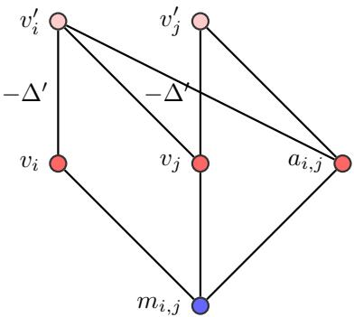  
Figure 12: System $T _ { i , j } ^ { \prime }$ that simulates $T _ { i , j }$ . The additional spins $v _ { i } ^ { \prime } , v _ { j } ^ { \prime }$ ensure that $T _ { i , j } ^ { \prime }$ is compatible with the DBM constraints. They are coupled to $v _ { i } , v _ { j }$ with strong ferromagnetic coupling $- \Delta ^ { \prime }$ such that in the low-energy sector $v _ { i } ^ { \prime } = v _ { i }$ and $v _ { j } ^ { \prime } = v _ { j }$

## C.4 On the computability of simulations

We now provide an assumption, termed the computability assumption, which provides even stronger evidence for the separation between shallow and $\left( \mathrm { v , p } \right)$ -maximal models (cf. Theorem 20). Under the computability assumption, shallow models cannot be $\displaystyle ( \boldsymbol { \mathrm { v } } , \boldsymbol { \mathrm { p } } )$ -maximal unless ${ \mathsf { P } } = { \mathsf { N P } }$ , i.e. the polynomial hierarchy collapses completely. Specifically, under the computability assumption, Lemma 18 implies that for $\displaystyle ( \boldsymbol { \mathrm { v } } , \boldsymbol { \mathrm { p } } )$ -maximal models, computing visible spin efective energies minh $H _ { S } ( { \bf v } , { \bf h } )$ is NP-hard, while it is polytime computable for shallow models by Lemma 19.

We first state the computability assumption and argue that it is justified. Note that in Lemma $^ { 1 8 , }$ for any n we explicitly construct the system $S _ { n }$ that eficiently simulates $G _ { n }$ . This essentially means that the eficient simulation of G is itself polytime computable. So for given n we can compute the respective $S _ { n }$ and energy shift of $S _ { n } \longrightarrow G _ { n }$ in polynomial time.

In [41] we consider a stronger version of simulation between spin models, which additionally requires polytime computability in the above sense. Namely, if ${ \mathcal { M } } \longrightarrow { \mathcal { N } }$ then for any $T \in \mathcal { N }$ the respective $S \in { \mathcal { M } }$ that satisfies $S \longrightarrow T$ can be computed in polynomial time. We then also prove that universal models satisfy this property for arbitrary targets.

Now say a spin ML model M is polytime $\displaystyle ( \boldsymbol { \mathrm { v } } , \boldsymbol { \mathrm { p } } )$ -maximal, that is, it is (v,p)-maximal such that all respective simulations (see Definition 8) are polytime computable. Following Theorem 16, this is the case if M is visible closed and universal such that both the visible closure and the universality simulations can be constructed in polynomial time. In particular, this is satisfied for DBMs, using that they are strictly visible closed (cf. Corollary 17) and polytime universal [40].

We now prove that for a polytime $\left( \mathrm { v , p } \right)$ -maximal model M, Lemma 18 implies that computing visible spin efective energies mi $\mathbf { 1 } _ { \mathbf { h } } H _ { S } ( \mathbf { v } , \mathbf { h } )$ is NP-hard, because the NP-hard ground-state function $\mathcal { G }$ can be reduced to it. Given an input m of $G _ { n } \in \mathcal { G }$ , first compute $S _ { n } \in \mathcal { M }$ that simulates $G _ { n }$ and then compute

$$
\operatorname* { m i n } _ { \mathbf { h } } H _ { S _ { n } } ( \mathbf { m } , \mathbf { h } ) = G _ { n } ( \mathbf { m } ) ,\tag{C.15}
$$

up to a potential energy shift that by assumption can also be computed in polynomial time. If, additionally, M were shallow, by Lemma 19 this would provide a polytime algorithm for the NP-hard function G, implying ${ \mathsf { P } } = { \mathsf { N P } }$

## C.5 Increasing energy gaps through simulations

By Lemma 18, (v,p)-maximal models can eficiently simulate an NP-hard function with cut-of at least $\Delta = 1$ . To obtain approximations of the corresponding probability distributions, however, we would need constant degeneracy and in particular, suficiently large cut-of, that ultimately controls the approximation error. Can these simulations be extended to arbitrary cut-ofs? We argue that, unless the polynomial hierarchy collapses, such an extension is impossible.

Let $\mathcal { G } = \{ G _ { n } \colon { \bf 2 } ^ { n }  \mathbb { R } \mid n \in \mathbb { N } \}$ be any family for which the decision problem

$$
L _ { \mathcal { G } } = \{ ( \mathbf { v } , k ) \mid G _ { n } ( \mathbf { v } ) \leq k \}\tag{C.16}
$$

is NP-complete (see e.g. Lemma 18).

Suppose that G admits eficient simulations with arbitrary cut-ofs. For each n, choose

$$
\Delta _ { n } > 2 \operatorname* { m a x } _ { \mathbf { v } } | G _ { n } ( \mathbf { v } ) | ,\tag{C.17}
$$

and let $S _ { n }$ be a corresponding simulator of size poly(n), with energy shift $\Gamma _ { n }$ and cut-of at least $\Delta _ { n } .$ Thus, for every v,

$$
\begin{array} { r l r } & { H _ { S _ { n } } ( \mathbf v , \mathbf h ) = G _ { n } ( \mathbf v ) + \Gamma _ { n } , } & { \mathbf h \in \mathcal { C } _ { \mathrm { s i m } } ( \mathbf v ) , } \\ & { H _ { S _ { n } } ( \mathbf v , \mathbf h ) \ge G _ { n } ( \mathbf v ) + \Gamma _ { n } + \Delta _ { n } , } & { \mathbf h \notin \mathcal { C } _ { \mathrm { s i m } } ( \mathbf v ) . } \end{array}\tag{C.18}
$$

The key observation is that such a large cut-of makes minimizing hidden configurations easy to recognize. Indeed, our choice of $\Delta _ { n }$ gives

$$
- \frac { \Delta _ { n } } { 2 } < G _ { n } ( \mathbf v ) < \frac { \Delta _ { n } } { 2 } .\tag{C.19}
$$

Consequently, minimizing configurations have shifted energy below $\Delta _ { n } / 2$ , whereas all other configurations have shifted energy strictly above $\Delta _ { n } / 2$ . Hence

$$
\mathbf { h } \in \mathcal { C } _ { \mathrm { s i m } } ( \mathbf { v } ) \quad \Longleftrightarrow \quad H _ { S _ { n } } ( \mathbf { v } , \mathbf { h } ) - \Gamma _ { n } < \frac { \Delta _ { n } } { 2 } .\tag{C.20}
$$

We now show directly that $L _ { \mathcal { G } } \in \mathsf { c o - N P / p o l y }$ . Use $( S _ { n } , \Gamma _ { n } , \Delta _ { n } )$ as polynomial-length advice. A certificate for a no-instance $( \mathbf { v } , k )$ is a hidden configuration h satisfying

$$
k < H _ { S _ { n } } ( \mathbf { v } , \mathbf { h } ) - \Gamma _ { n } < \frac { \Delta _ { n } } { 2 } .\tag{C.21}
$$

Both inequalities can be checked in polynomial time. The upper inequality guarantees that h is minimizing, so the lower inequality establishes $G _ { n } ( \mathbf { v } ) > k .$ . Conversely, whenever $G _ { n } ( \mathbf { v } ) > k$ , any minimizing hidden configuration provides such a certificate. The simulator is supplied as advice, so the verifier does not need to check whether an arbitrary proposed system satisfies the simulation assumptions. 17

Since $L _ { \mathcal { G } }$ is ${ \mathsf { N P } } .$ -complete, this implies

$$
{ \mathsf { N P \subseteq \mathsf { c o } } } { \mathsf { c o } } { \mathsf { \Lambda } } \mathsf { N P / p o l y } .\tag{C.22}
$$

By [46], this inclusion collapses the polynomial hierarchy to its third level. Unless such a collapse occurs, eficient simulations with arbitrary cut-ofs therefore cannot exist. Notice that this obstruction does not require constant degeneracy: the large cut-of alone would provide eficiently verifiable certificates of minimality.

A related obstruction applies to polynomial-time constructions (such as simulations) that preserve the target ground-state energy up to an eficiently computable shift. If such a construction could produce a source whose global ground-state energy gap exceeds a known range containing the target groundstate energy, then source ground states would provide polynomially verifiable certificates that the target ground-state energy exceeds a given threshold. For an NP-hard ground-state energy decision problem, this would imply ${ \mathsf { N P } } = { \mathsf { c o } } { - } { \mathsf { N P } } .$

## D Learning separation between RBMs and 3RBMs

The separation results in Section 5 concern the existence of eficient representations, but they do not establish whether suitable weights can be learned from a dataset of observed configurations. Here, we investigate this question by training RBMs and 3RBMs (Eq. (5.1)) on samples from known target distributions. We consider an equal budget in terms of the number of adjustable parameters and the amount of training data. We then measure the approximation error as well as the computation time. These finite-size experiments are a first test toward establishing whether the separation result of Section 5 manifests itself in learning. The code for the learning experiments is publicly available in the accompanying repository.18

## D.1 Target distribution and model families

We consider a target distribution defined in terms of $\mathrm { { I P } _ { 2 } }$ . Section 5 proves that $\mathrm { { I P } _ { 2 } }$ can be eficiently simulated by 3RBMs but not by RBMs, and Section C.1 suggests that a similar separation applies to approximating the corresponding probability distribution $q ( \mathbf { v } ) \propto e ^ { \beta \mathrm { I P } _ { 2 } ( \mathbf { v } ) }$ in the respective visible spin marginals.

We work with states from {0, 1}. Write $\mathbf { v } = ( \mathbf { x } , \mathbf { y } )$ , where $\mathbf { x } , \mathbf { y } \in \{ 0 , 1 \} ^ { r }$ n, so there are $d = 2 n$ visible spins. Define the target T by

$$
\begin{array} { r l r l r l } & { s ( \mathbf { v } ) = \mathrm { I P } _ { 2 } ( \mathbf { x } , \mathbf { y } ) = ( - 1 ) ^ { \sum _ { i = 1 } ^ { n } x _ { i } y _ { i } } , } & & { H _ { T } ( \mathbf { v } ) = - \beta s ( \mathbf { v } ) , } & & { q ( \mathbf { v } ) = Z _ { T } ^ { - 1 } e ^ { - H _ { T } ( \mathbf { v } ) } . } \end{array}\tag{D.1}
$$

We consider the task of learning $q ( \mathbf { v } )$ in the visible spin marginals of 3RBMs and RBMs. Note that $q ( \mathbf { v } )$ distinguishes configurations based on their inner product modulo 2, and an even-IP configuration is $e ^ { 2 \dot { \beta } }$ times as probable as an odd-IP configuration.

The target can be eficiently sampled as follows: we propose independent uniform configurations, accepting even-IP proposals with probability one and odd-IP proposals with probability $e ^ { - 2 \beta }$ . The accepted configurations then are independent draws from q. We generate a fixed dataset $\mathcal { D } = ( \mathbf { v } ^ { ( 1 ) } , \ldots , \mathbf { v } ^ { ( N ) } )$ before training. Repeated configurations are allowed. Training receives these configurations, not their IP values or target energies.

With m hidden spins, the 3RBM Hamiltonian (Eq. (5.1)) can be expressed as

$$
H _ { S } ( \mathbf { v } , \mathbf { h } ; \boldsymbol { \theta } ) = \sum _ { i = 1 } ^ { d } b _ { i } ^ { ( v ) } v _ { i } + \sum _ { r = 1 } ^ { m } h _ { r } \ell _ { r } ( \mathbf { v } ) , \qquad \ell _ { r } ( \mathbf { v } ) = b _ { r } ^ { ( h ) } + \sum _ { i } W _ { r i } v _ { i } + \sum _ { i < j } C _ { r i j } v _ { i } v _ { j } .\tag{D.2}
$$

The RBM Hamiltonian is obtained by setting $C = 0$

Summing over the hidden spins yields free energy (see Section C.1). The visible spin marginal then can be written as follows:

$$
F _ { S } ( { \bf v } ; \theta ) = \sum _ { i } b _ { i } ^ { ( v ) } v _ { i } - \sum _ { r } \log \bigl ( 1 + e ^ { - \ell _ { r } ( { \bf v } ) } \bigr ) , \qquad p _ { S } ^ { \mathrm { v i s } } ( { \bf v } ; \theta ) = \sum _ { \bf h } p _ { S } ( { \bf v } , { \bf h } ; \theta ) = \frac { e ^ { - F _ { S } ( { \bf v } ; \theta ) } } { Z _ { S } ( \theta ) } .\tag{D.3}
$$

Since both RBMs and 3RBMs are shallow, $F _ { S }$ and its derivatives are eficiently computable for any given visible configuration (see Section 4), although $\begin{array} { r } { Z _ { S } = \sum _ { \mathbf { v } } e ^ { - F _ { S } ( \mathbf { v } ) } } \end{array}$ generally is not.

## D.2 The likelihood objective and its gradient

The objective we aim to minimize in training is the Kullback–Leibler divergence between the target distribution q and the model distribution $p _ { S } ^ { \mathrm { v i s } }$

$$
D _ { \mathrm { K L } } ( q \| p _ { S } ^ { \mathrm { v i s } } ) = \sum _ { \mathbf { v } } q ( \mathbf { v } ) \log \frac { q ( \mathbf { v } ) } { p _ { S } ^ { \mathrm { v i s } } ( \mathbf { v } ) } .\tag{D.4}
$$

Note that in the training we do not have access to the distribution $q ( \mathbf { v } )$ , but only the dataset D sampled from it.

We hence approximate Eq. (D.4) by accessible quantities as follows. First, inserting the model distribution (Eq. (D.3)) into Eq. (D.4) yields

$$
D _ { \mathrm { K L } } ( q \| p _ { S } ^ { \mathrm { v i s } } ) = \mathbb { E } _ { q } [ F _ { S } ] + \log Z _ { S } - \mathcal { H } ( q ) ,\tag{D.5}
$$

where $\mathcal { H } ( q ) = - \textstyle \sum q$ log q is independent of the model weights $\theta ,$ so minimization only concerns the first two summands. Next, replacing the target average $\mathbb { E } _ { q } [ F _ { S } ]$ by the average over observations defines the negative log likelihood per observation,

$$
\mathcal { L } _ { N } ( \theta ) = \frac { 1 } { N } \sum _ { a = 1 } ^ { N } F _ { S } ( \mathbf { v } ^ { ( a ) } ; \theta ) + \log Z _ { S } ( \theta ) .\tag{D.6}
$$

This objective is accessible from the dataset and the model parameters. For fixed parameters, the first term approximates the target average, by the law of large numbers. Hence minimizing Eq. (D.6) can be seen as a reasonable approximation of minimizing $\mathrm { E q . ~ ( D . 4 ) }$

Finally, we minimize Eq. (D.6) by gradient descent, that is, we compute its gradient w.r.t. the model parameters and then adjust these in the direction of the negative gradient, by an amount parametrized by the so-called learning rate. Diferentiating Eq. (D.6) yields

$$
\nabla _ { \boldsymbol { \theta } } \mathcal { L } _ { N } = \frac { 1 } { N } \sum _ { a } \nabla _ { \boldsymbol { \theta } } F _ { S } ( { \mathbf { v } } ^ { ( a ) } ) - \mathbb { E } _ { p _ { S } ^ { \mathrm { v i s } } } [ \nabla _ { \boldsymbol { \theta } } F _ { S } ( { \mathbf { v } } ) ] .\tag{D.7}
$$

Note that here $\mathbb { E } _ { p _ { S } ^ { \mathrm { v i s } } } [ \nabla _ { \theta } F _ { S } ( \mathbf { v } ) ]$ is the model average of the gradient of the free energy. Thus, computing $\nabla _ { \boldsymbol { \theta } } \mathcal { L } _ { N }$ requires the computation of the average of $\nabla _ { \boldsymbol { \theta } } F _ { S } ( \mathbf { v } )$ w.r.t. the dataset and the average of $\nabla _ { \boldsymbol { \theta } } F _ { S } ( \mathbf { v } )$ w.r.t. the model distribution. This, in principle, would entail iterating over all samples as well as computing the full model distribution (including $Z _ { S } )$ , for each individual update. To avoid this, we use further approximations.

## D.3 Approximating the gradient — mini-batches and Monte Carlo evolutions

First, in order to avoid computing averages over the entire dataset, we divide it into so-called mini-batches, that is, groups of b observations from D and, for each update, compute averages over one minibatch. That is, we use the following approximation

$$
\frac { 1 } { N } \sum _ { a } \nabla _ { \theta } F _ { S } ( { \mathbf { v } } ^ { ( a ) } ) \approx \frac { 1 } { b } \sum _ { a = 1 } ^ { b } \nabla _ { \theta } F _ { S } ( { \mathbf { v } } ^ { ( a ) } ) .\tag{D.8}
$$

Second, in order to avoid computing the full model distribution $p _ { S } ^ { \mathrm { v i s } }$ , or averages w.r.t. it (which is intractable), we sample from it by Markov chain Monte Carlo (MCMC) methods. That is, we set up $b ^ { \prime }$ Markov chains with starting points $\mathbf { v } _ { a ^ { \prime } } ^ { ( 0 ) }$ . At each step i the Markov chain first updates the hidden spins by sampling from the conditional distribution $\mathbf { h } _ { a ^ { \prime } } ^ { ( i ) } \sim p _ { S } ( \mathbf { h } \mid \mathbf { v } _ { a ^ { \prime } } ^ { ( i ) } )$ .

Since both RBMs and 3RBMs are shallow, i.e. contain no hidden-hidden interactions, the hidden spins are conditionally independent given the visible configuration and hence can be sampled in parallel, i.e. the entire hidden configuration can be sampled at once.

For RBMs, there are also no visible-visible interactions. Thus also visible spins are conditionally independent given the hidden configuration. The Markov chain then proceeds by updating the visible spins, by sampling from the conditional distribution $\mathbf { v } _ { a ^ { \prime } } ^ { ( i + 1 ) } \sim p _ { S } ( \mathbf { v } \mid \mathbf { h } _ { a ^ { \prime } } ^ { ( i ) } )$

For 3RBMs there are visible-visible interactions and therefore the visible spins cannot be sampled in parallel. Fixing the hidden configuration the resulting system consisting of visible spins, only, efectively is an all-to-all Ising system. Its partition function and probability distribution hence remain intractable. For 3RBMs we hence first divide the visible spins into blocks of 4. We then iterate through these blocks, for each block $j$ we update the respective configuration $\mathbf { v } _ { a ^ { \prime } , j } ^ { ( i ) }$ by sampling from the conditional distribution

$$
\mathbf { v } _ { a ^ { \prime } , j } ^ { ( i + 1 ) } \sim p _ { S } ( \mathbf { v } _ { j } \mid \mathbf { h } _ { a ^ { \prime } } ^ { ( i ) } , \mathbf { v } _ { a ^ { \prime } , 1 } ^ { ( i + 1 ) } , \ldots , \mathbf { v } _ { a ^ { \prime } , j - 1 } ^ { ( i + 1 ) } , \mathbf { v } _ { a ^ { \prime } , j + 1 } ^ { ( i ) } , \ldots ) .\tag{D.9}
$$

That means, when updating block $j$ in iteration $i ,$ i.e. when sampling $\mathbf { v } _ { a ^ { \prime } , j } ^ { ( i + 1 ) }$ those visible blocks l for $l < j$ are fixed to their post-update configuration $\mathbf v _ { a ^ { \prime } , l } ^ { ( i + 1 ) }$ while those blocks with $l > j$ are fixed to their pre-update configuration $\mathbf { v } _ { a ^ { \prime } , l } ^ { ( i ) }$

The total number of iterations in this Markov chain is also referred to as sweeps. Especially for RBMs, the corresponding training algorithm with k update rounds is called contrastive divergence k or CD-k [19]. It is common practice to use an equal number of observations per minibatch b and Markov chains $b ^ { \prime }$

and to further initialize the Markov chains at the respective minibatch observation, i.e. use $\mathbf { v } _ { a } ^ { ( 0 ) } = \mathbf { v } ^ { ( a ) }$ With this the CD-k gradient approximation becomes

$$
\widehat { g } = \frac { 1 } { b } \sum _ { a = 1 } ^ { b } \left[ \nabla _ { \theta } F _ { S } ( \mathbf { v } _ { a } ^ { ( 0 ) } ; \theta ) - \nabla _ { \theta } F _ { S } ( \mathbf { v } _ { a } ^ { ( k ) } ; \theta ) \right] .\tag{D.10}
$$

Importantly, for large enough minibatch size b and large enough $k ,$ i.e. long enough Markov chains $\widehat g$ is a reasonable approximation of the true gradient $\nabla _ { \boldsymbol { \theta } } \mathcal { L } _ { N }$ .

## D.4 Updating the weights

Learning by gradient descent updates the model parameters as $\theta _ { t + 1 } = \theta _ { t } - \eta _ { t } \widehat { g } _ { t }$ , where the positive learning rate $\eta _ { t }$ sets the size of each parameter change. We use Adam [25], which additionally accounts for recent update directions and their typical magnitudes. Its coordinatewise update is

$$
\theta _ { t + 1 } = \Pi _ { [ - B , B ] ^ { P } } \left[ \theta _ { t } - \eta _ { t } \frac { M _ { t } / ( 1 - \rho _ { 1 } ^ { t } ) } { \sqrt { V _ { t } / ( 1 - \rho _ { 2 } ^ { t } ) } + \varepsilon } \right] ,\tag{D.11}
$$

where $M _ { t } = \rho _ { 1 } M _ { t - 1 } + ( 1 - \rho _ { 1 } ) g _ { t } , V _ { t } = \rho _ { 2 } V _ { t - 1 } + ( 1 - \rho _ { 2 } ) g _ { t } ^ { 2 } , M _ { 0 } = V _ { 0 } = 0 , \rho _ { 1 } = 0 . 9 , \rho _ { 2 } = 0 . 9$ .999 and $\varepsilon = 1 0 ^ { - 8 }$ . Products, squares and division act coordinatewise. Further $g _ { t } = { \widehat { g } } _ { t }$ min $( 1 , 1 0 / \| \widehat { g } _ { t } \| _ { 2 } )$ , with $g _ { t } = 0$ when the gradient vanishes; this ensures that unusually large gradients (with $\| \widehat { g } _ { t } \| _ { 2 } > 1 0 )$ are rescaled before the update. The projection $\Pi _ { [ - B , B ] ^ { P } }$ clips each coeficient to $[ - B , B ]$ ; this is compatible with the small weight assumption in Section 5.

Finally, couplings are initialized independently from a centered Gaussian with standard deviation 0.05, and visible and hidden fields are initialized to zero.

We now compare the two model families on the IP target, always with $\beta = 1$ and coeficient bound $B = 4$ . The 3RBMs include all visible pairs $i < j$ in the hidden fields, rather than being restricted to the products $x _ { i } y _ { i }$ . The numbers of adjustable parameters are

$$
P _ { \mathrm { R B M } } = d + ( d + 1 ) m , \qquad P _ { \mathrm { 3 R B M } } = d + \left( 1 + d + { \binom { d } { 2 } } \right) m , \qquad d = 2 n .\tag{D.12}
$$

We choose diferent hidden-layer sizes to match these numbers as closely as possible. The following comparisons separate approximation by direct population optimization from learning using only observed configurations.

## D.5 Learning results

All experiments were performed on a MacBook Air with an Apple M4 chip and 16 GB of unified memory, running macOS 26.6.2, Python 3.12.14, and PyTorch 2.13.0. Sample-based training used the Apple MPS backend with single-precision arithmetic (float32), whereas exact population optimization used CPUbased $\mathrm { L } { \mathrm { - B F G S { - B } } }$ with double-precision arithmetic (float64).

Exact population optimization at $n = 6 .$ . As a small-system reference, we enumerate all $2 ^ { 1 2 } = 4 0 9 6$ visible configurations and evaluate $D _ { \mathrm { K L } } ( q \vert \vert p _ { S } ^ { \mathrm { v i s } } )$ and its gradient without sampling error. We minimize this objective with the bounded quasi-Newton method L-BFGS-B, which uses gradients and an approximation to local curvature. There is no sampled training set and no CD approximation in this experiment. Each model receives five starts: one with zero coeficients and four with independent Gaussian coeficients of standard deviation 0.25. The limits per start are 3000 optimizer iterations and 6000 objective evaluations; the function and projected-gradient tolerances are $1 0 ^ { - 1 3 }$ and $1 0 ^ { - 9 }$ . Table 3 reports the lowest KL found for each model. At the smallest budget the RBM is slightly better. At the middle budget the 3RBM error is about half the RBM error, and at the largest budget it is about 74 times smaller. This is consistent with the explicitly constructed 3RBM IP simulation that following Theorem 36 uses 2n visible spins, $m = 2 n + 1$ hidden spins, and $\scriptstyle { \mathcal { O } } ( n ^ { 2 } )$ interactions (see Example 37). The respective KL values are numerical upper bounds on the best achievable errors, not certified optima: every best fit in the table reached the iteration limit. This comparison removes finite-data and Monte Carlo errors, but not the uncertainty of nonconvex optimization.

<table><tr><td colspan="3">RBM</td><td colspan="3">3RBM</td></tr><tr><td>m</td><td>P</td><td>Best KL</td><td>m</td><td>P</td><td>Best KL</td></tr><tr><td>24</td><td>324</td><td>0.247303</td><td>4</td><td>328</td><td>0.253821</td></tr><tr><td>73</td><td>961</td><td>0.136275</td><td>12</td><td>960</td><td>0.065374</td></tr><tr><td>219</td><td>2859</td><td>0.014836</td><td>36</td><td>2856</td><td>0.000200</td></tr></table>

Table 3: Exact population optimization of the IP target at $n = 6 , \beta = 1 , B = 4$ . Each entry is the best of five starts with the same optimization limits. The $\mathrm { K L }$ values are evaluated by full enumeration, but the minima are not certified.

Sample-based learning conventions. For sample-based learning, Table 4 fixes the budgets. Each size has three independent repetitions, with a new dataset and new random initialization. Within a repetition, the two architectures use the same dataset and minibatch order. Training traverses shufled copies of this fixed dataset repeatedly; Ub is the number of processed observations, counting repeated uses, rather than the number of independent draws. Both architectures use CD-2 and Adam as described above. In the 3RBM, each visible sweep uses a new random partition into four-spin blocks and samples each block’s conditional distribution exactly. All learning results below use the final update, without selecting the best intermediate checkpoint. The settings were informed by earlier exploratory experiments; the three repetitions assess reproducibility at these settings, not exhaustive optimization of each architecture.

At $n = 8$ we evaluate population KL by summing over all $2 ^ { 1 6 }$ states. ${ \mathrm { A t ~ } } n = 1 2 .$ , where the state space has $2 ^ { 2 4 }$ elements, these runs do not evaluate the model partition function. Instead we compare the learned free energy with the target Hamiltonian through

$$
R _ { S } ^ { 2 } = \frac { \mathrm { V a r } _ { u _ { d } } [ F _ { S } ( \mathbf { v } ; \boldsymbol { \theta } ) - H _ { T } ( \mathbf { v } ) ] } { \mathrm { V a r } _ { u _ { d } } [ H _ { T } ( \mathbf { v } ) ] } , \qquad u _ { d } ( \mathbf { v } ) = 2 ^ { - d } .\tag{D.13}
$$

Subtracting the mean diference inside the variance removes the irrelevant additive energy constant. Consequently $R _ { S } = 0$ means exact agreement of the distributions, whereas a constant $F _ { S }$ gives $R _ { S } = 1$ We estimate both variances on independent uniform probe configurations, shared between models within a repetition. This tests the shape of the energy landscape, including variations within each $\mathrm { I P }$ sector; it is not an estimate of KL divergence. In particular, a small average energy error alone does not exclude rare configurations with large probability errors. We report this diagnostic also at $n = 8$ , alongside exact KL, in Table 5.

<table><tr><td>Quantity</td><td> $n = 8$ </td><td> $n = 1 2$ </td></tr><tr><td>Visible spins d</td><td>16</td><td>24</td></tr><tr><td>Hidden spins m, RBM / 3RBM</td><td>516/64</td><td>1734/144</td></tr><tr><td>Parameters  $P ,$  RBM / 3RBM</td><td>8788/8784</td><td>43374/43368</td></tr><tr><td>Independent training draws N</td><td>131 072</td><td>33554432</td></tr><tr><td>Minibatch size b (also b′)</td><td>256</td><td>4096</td></tr><tr><td>Parameter updates U</td><td>50 000</td><td>480 000</td></tr><tr><td>Processed observations Ub</td><td>12 800 000</td><td>1 966 080 000</td></tr><tr><td>Equivalent dataset passes  $U b / N$ </td><td>97.65625</td><td>58.59375</td></tr><tr><td>CD sweeps k per update</td><td>2</td><td>2</td></tr><tr><td>Initial learning rate ηo</td><td>0.002</td><td>0.00133333...</td></tr><tr><td>Learning-rate schedule</td><td>see caption</td><td>constant</td></tr><tr><td>Independent repetitions</td><td>3</td><td>3</td></tr><tr><td>Uniform energy-evaluation probes</td><td>8192</td><td>32 768</td></tr><tr><td>Population KL evaluation</td><td>exact</td><td>not performed</td></tr></table>

Table 4: Budgets for learning the IP distribution. All runs use $\beta = 1 , B = 4$ zero initial fields, Gaussian initial couplings of standard deviation 0.05, and gradient-norm clipping at 10. $\mathrm { A t } \ n = 8$ the learning rate stays at 0.002 for the first 25 000 updates, then decreases along a cosine schedule to 0.0002. At n = 12 it remains 0.004/3 throughout. These are matched budgets within each size, not a comparison at fixed resources across sizes.

Learning from samples at $n = 8 .$ . With $6 4 = n ^ { 2 }$ hidden spins for the 3RBM and a parameter-matched RBM, all three repetitions show a clear advantage for the 3RBM (Fig. 13, top row). The median final

KL is 0.10414 for the 3RBM, compared with 0.32633 for the RBM. For reference, the uniform visible distribution has KL 0.32648 relative to the target. Thus the 3RBM removes about 68% of this reference error, whereas the RBM remains close to it. The energy diagnostic is consistent with this conclusion: the median $R _ { S }$ is 0.562 for the 3RBM and 0.999 for the RBM. This is substantial but incomplete learning of $\mathrm { I P } ,$ not near-exact recovery of the distribution. The 3RBM takes longer per run at this size (median 5.17 versus 3.36 minutes), but its error already improves below the RBM level within the common time interval. The advantage therefore is not solely due to its longer total runtime.
<table><tr><td>Size</td><td>Model</td><td>Final KL</td><td>Final  $R s$ </td><td>Training time</td></tr><tr><td> $n = 8$ </td><td>RBM</td><td>0.32633 [0.32614, 0.32647]</td><td>0.999 [0.998, 0.999]</td><td>3.36 min</td></tr><tr><td></td><td>3RBM</td><td>0.10414 [0.10107,0.10547]</td><td>0.562 [0.558, 0.565]</td><td>5.17 min</td></tr><tr><td> $n = 1 2$ </td><td>RBM</td><td></td><td>1.003 [1.002, 1.003]</td><td>3.07 h</td></tr><tr><td></td><td>3RBM</td><td></td><td>0.512 [0.505, 0.553]</td><td>1.82 h</td></tr></table>

Table 5: Final-checkpoint results: median and full range in brackets over three repetitions. Ranges describe run-to-run variation, not confidence intervals. KL is exact at $n = 8$ and unavailable here at $n = 1 2 ; R _ { S }$ is estimated from uniform probes at both sizes. Times are medians of measured training wall time, excluding subsequent checkpoint evaluation and dataset generation.

Learning from samples at $n = 1 2 .$ . We next increase the 3RBM width to $1 4 4 = n ^ { 2 }$ and enlarge both the data and optimization budgets. Relative to $n = 8 ,$ the dataset is 256 times larger, the minibatch is 16 times larger, and the number of updates is 9.6 times larger. All three 3RBM repetitions now learn substantial $\mathrm { I P }$ structure, with final energy errors between 0.505 and 0.553, whereas all three RBMs remain close to the constant-energy reference (Fig. 13, bottom row). The median correlation between $F _ { S }$ and $H _ { T }$ on uniform probes is 0.860 for the 3RBM and −0.003 for the RBM. As an additional check, the diference between the mean free energies in the odd- and even-IP sectors is about 70% of the target diference 2β for the 3RBM, but essentially zero for the RBM. These observations show recovery of the IP-dependent energy structure on independently drawn evaluation configurations. They do not establish a numerical KL value at this size. The 3RBM is also faster here: its median training time is 1.82 hours, compared with 3.07 hours for the parameter-matched RBM. Parameter matching gives the RBM many more hidden spins, so its simpler conditional sampling does not necessarily make it faster. This timing comparison depends on the implementation, hardware and minibatch size; it is not an architecture-independen complexity bound.

Unsuccessful extension to $n = 1 6 .$ . We retain the $n = 1 2$ learning procedure and budgets $( N =$ 33 554 432, b = 4096, U = 480 000, CD-2, constant learning rate $0 . 0 0 4 / 3 , \beta = 1 , B = 4 )$ , but increase the 3RBM width to $2 5 6 \ : = \ : n ^ { 2 }$ and the parameter-matched RBM width to 4104 (135 456 and 135 464 parameters, respectively). In this single paired repetition, the final energy errors are $R _ { S } ~ = ~ 0 . 9 9 6 6$ for the 3RBM and 1.0057 for the RBM. Both therefore remain close to the constant-energy reference. The 3RBM recovers only about 0.5% of the target mean energy diference between $\mathrm { I P }$ sectors. This failure is measured with the same diagnostic and 32 768 uniform probes as at $n = 1 2$ , so it cannot be attributed simply to switching error measures. A possible explanation is that increasing n makes the IP-dependent direction in the learning gradient harder to resolve, while the minibatch size, number of updates and CD chain length remain unchanged. Statistical fluctuations, incomplete equilibration in CD-2 and the optimization landscape could then prevent the model from finding a useful representation. A follow-up replaces dataset reuse by fresh independent observations at every update, keeping the 3RBM initialization and other learning settings fixed. Even with 1 966 080 000 independent draws, its final error remains $R _ { S } = 0 . 9 9 6 6$ . This weakens the explanation that the fixed dataset alone was too small, but does not test larger minibatches, longer chains or more updates. With only one realization per condition, these results locate a limitation of the tested learning procedure; they neither identify its precise cause nor demonstrate a failure of 3RBM representability.

Larger-budget learning at $n = 1 6 .$ . To test whether the preceding failure could be overcome by increasing the learning resources, we perform a further 3RBM run with $m = 2 5 6$ hidden spins, retaining $\beta = 1 , B = 4$ , the previous random initialization and the constant learning rate $0 . 0 0 4 / 3 .$ . We increase the minibatch size from 4096 to 32 768 and the number of Gibbs sweeps from two to four. Each update uses fresh independent target observations. To keep the runtime manageable, we use 160 000 parameter updates, giving 5 242 880 000 observations in total and a measured training time of 13.8 hours. The final energy error is $R _ { S } = 0 . 9 9 4 8$ , compared with 0.9966 in the previous fresh-data run. The energy correlation increases slightly to 0.108, but the learned mean energy diference between IP sectors reaches only 0.77% of the target diference. Moreover, the error already reaches $R _ { S } = 0 . 9 9 6 4$ after 40 000 updates and subsequently improves only marginally. Thus the larger budget does not recover the substantial IP structure learned at $n = 1 2$ . This weakens the explanation that the earlier failure resulted solely from an insuficient fixed dataset. A weak useful gradient, dificulties in the optimization landscape, bias from the finite CD chains, or the coeficient bound remain possible explanations. The experiment does not distinguish these mechanisms: several resources change simultaneously, the number of updates is smaller than in the preceding $n = 1 6$ runs, and only one initialization is tested. The result therefore documents a persistent limitation of the tested learning procedure, rather than a failure of 3RBM representability.

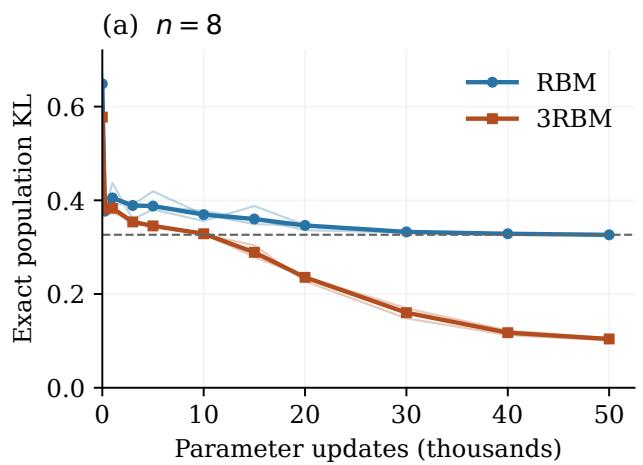

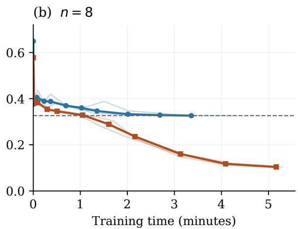

(c) $n = 1 2$  
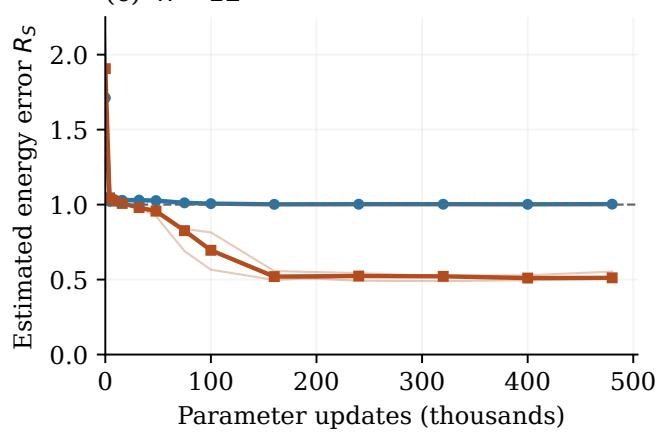

(d) n = 12  
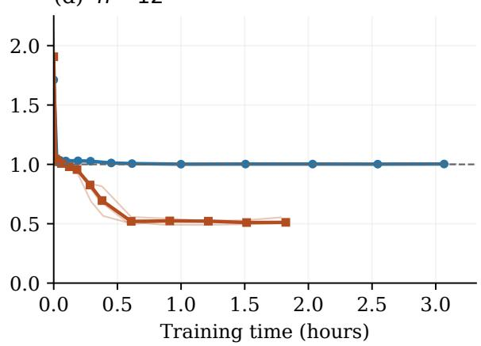  
Figure 13: Learning the IP target with parameter-matched RBMs and all-pairs 3RBMs. Top: exact population KL at $n = 8 .$ . Bottom: estimated energy error $R _ { S }$ at $n = 1 2$ . Left: error versus parameter updates; right: the same checkpoints versus measured training time. Thin lines show all three repetitions. Thick lines join checkpoint medians; in the time panels, both time and error are medians at each common update count, rather than interpolated equal-time averages. Dashed lines give the uniform-distribution KL (top) and constant-energy error $R _ { S } = 1$ (bottom). The two rows use diferent error measures and time units.

Other targets: advantages and controls. To test whether a learning advantage extends beyond IP, we consider $d \ = \ 1 6$ visible spins $v _ { i }$ with states in 2. We sample $q ( \mathbf { v } ) \propto e ^ { - H _ { T } ( \mathbf { v } ) }$ for diferent target systems T that involve four-body interactions described by hyperedges $A = \{ i , j , k , l \}$ , i.e. $\begin{array} { r } { H _ { T } = - M ^ { - 1 / 2 } \sum _ { A } J _ { A } \prod _ { i \in A } v _ { i } } \end{array}$ , with $J _ { A } \in \{ - 1 , 1 \}$ . Specifically, we either consider four disjoint quartets $A _ { 1 } , \ldots , A _ { 4 }$ and then set $M = 4$ or we consider a ring with $A _ { i } = \{ i , r ( i ) , 8 + i , 8 + r ( i ) \}$ for $i = 1 , \dots , 8$ and $M = 8 ,$ , where $r ( i ) = 1 + ( i$ mod 8).

Considering appropriate product spins, both cases result in a particularly simple structure. For each disjoint quartet $A _ { i } = \{ a _ { i } , b _ { i } , c _ { i } , d _ { i } \}$ , set $z _ { i , 1 } = v _ { a _ { i } } v _ { b _ { i } }$ and $z _ { i , 2 } = v _ { c _ { i } } v _ { d _ { i } }$ . Then the respective interaction is proportional to $z _ { i , 1 } z _ { i , 2 }$ . For the ring, set $z _ { i } = v _ { i } v _ { 8 + i } ;$ then interactions are proportional to $z _ { i } z _ { r ( i ) }$ . We expect the 3RBM structure to be better suited to encode the state of such product spins in its hidden configuration and hence to better learn these targets.

Controls are pairwise Ising models on an open two-leg ladder, with random couplings $J _ { i j } ~ = ~ \pm 1$ and energy divided by its standard deviation under uniform configurations, and independent spins with $\begin{array} { r } { { \cal H } _ { T } = - \sum _ { i } h _ { i } v _ { i } , h _ { i } \sim \mathrm { U n i f } [ - 0 . 7 , 0 . 7 ] } \end{array}$ . For each family we use two coupling/field instances and three paired dataset/initialization repetitions. RBMs and all-pairs 3RBMs have $m = 5 1 6$ and 64 hidden spins (8788 and 8784 parameters), $N = 1 3 1 0 7 2$ , b = 256 and $B = 4$ . Both CD-1 and CD-2 are trained for 30 000 updates (20 000 for independent spins), using Adam with learning rate 0.002, constant for the first half and cosine-decayed to 0.0002 thereafter; initialization, gradient clipping and four-spin Gibbs blocks are as above. Fig. 14 shows exact population KL after validation-based selection. Across the four four-spin instances, median errors are 0.446–0.474 for RBMs and 0.0149–0.0191 for 3RBMs. Independentspin errors are comparable (0.0028–0.0035), whereas the two ladder instances give RBM/3RBM errors 0.00702/0.0104 and 0.00750/0.00619: the 3RBM is worse on one and better on the other. Thus the observed advantage extends to some non-IP targets, but is not universal. This is consistent with an architectural preference for certain higher-order structures under the tested training procedure; it neither isolates the mechanism nor establishes an asymptotic representation separation for these targets.

Conclusion. Taken together, the successful $n = 8$ and $n = 1 2$ experiments provide finite-size evidence that an advantage of 3RBMs on the IP target can survive learning from samples, including with all visible-pair interactions allowed. The stronger claim of eficient learning as n grows is not established. In particular, the $n = 1 2$ success uses 153.6 times as many processed observations as the $n = 8$ experiment, and several budgets change simultaneously. These comparisons alone cannot identify which increase was essential. Nor does a positive learned RBM error certify an approximation lower bound: it may reflect limited optimization or the biased CD-2 gradient as well as model capacity. The results therefore test a learning consequence suggested by the separation theorems, without constituting a numerical proof of their asymptotic statement. The additional non-IP comparisons suggest that this learning advantage extends to some higher-order spin targets, while independent-spin and pairwise controls show comparable performance or, in some instances, lower errors for the RBM, rather than a universal benefit of three-body couplings.

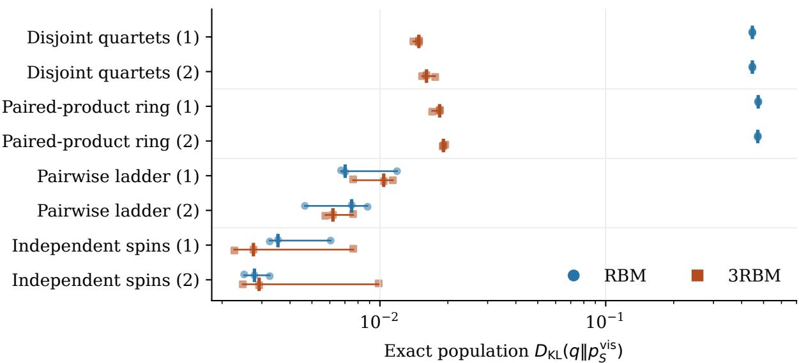  
Figure 14: Representative non-IP comparisons at $d = 1 6 .$ . Smaller KL is better; the horizontal axis is logarithmic. Each target has two instances, each with three training repetitions (small symbols); vertical ticks mark medians and horizontal lines span the full range, not confidence intervals. Unlike the finalcheckpoint IP results, CD depth and checkpoint are chosen by maximizing mean single-bit conditional log probability on 2048 independent validation configurations, not by minimizing the plotted KL. Candidate checkpoints are 250, 1000, 3000, 10 000, 20 000, and additionally 30 000 for interacting targets. Both architectures receive the same data and search budgets, but not equal wall time. These are selected families from a broader exploratory comparison.

## References

[1] K. Amano. “On the size of depth-two threshold circuits for the inner product mod 2 function”. In: Language and Automata Theory and Applications. Vol. 12038. Lecture Notes in Computer Science. Springer International Publishing, 2020, pp. 235–247. doi: 10.1007/978-3-030-40608-0\_16.

[2] S. Arora and B. Barak. Computational complexity: a modern approach. Cambridge University Press, 2009. doi: 10.1017/CBO9780511804090.

[3] L. Babai, L. Fortnow, and C. Lund. “Nondeterministic exponential time has two-prover interactive protocols”. In: Proceedings of the 31st Annual Symposium on Foundations of Computer Science. IEEE Computer Society, 1990, pp. 16–25. doi: 10.1109/FSCS.1990.89520.

[4] L. Babai, N. Nisan, and M. Szegedy. “Multiparty protocols, pseudorandom generators for logspace, and time-space trade-ofs”. In: Journal of Computer and System Sciences 45.2 (1992), pp. 204–232. doi: 10.1016/0022-0000(92)90047-M.

[5] F. Barahona. “On the computational complexity of Ising spin glass models”. In: Journal of Physics A: Mathematical and General 15.10 (1982), pp. 3241–3253. doi: 10.1088/0305-4470/15/10/028.

[6] P. L. Bartlett. “The sample complexity of pattern classification with neural networks: the size of the weights is more important than the size of the network”. In: IEEE Transactions on Information Theory 44.2 (1998), pp. 525–536. doi: 10.1109/18.661502.

[7] Y. Bengio and O. Delalleau. “Justifying and generalizing contrastive divergence”. In: Neural Computation 21.6 (2009), pp. 1601–1621. doi: 10.1162/neco.2008.11-07-647.

[8] P. L. Cijsouw. “Transcendence measures of exponentials and logarithms of algebraic numbers”. In: Compositio Mathematica 28.2 (1974), pp. 163–178. url: https://www.numdam.org/item/CM\_ 1974\_\_28\_2\_163\_0/.

[9] G. Cybenko. “Approximation by superpositions of a sigmoidal function”. In: Mathematics of Control, Signals and Systems 2.4 (1989), pp. 303–314. doi: 10.1007/BF02551274.

[10] G. De las Cuevas and T. S. Cubitt. “Simple universal models capture all classical spin physics”. In: Science 351.6278 (2016), pp. 1180–1183. doi: 10.1126/science.aab3326.

[11] S. D. Galbraith. Mathematics of public key cryptography. Cambridge University Press, 2012. doi: 10.1017/CBO9781139012843.

[12] X. Gao and L.-M. Duan. “Eficient representation of quantum many-body states with deep neural networks”. In: Nature Communications 8.1 (2017), p. 662. doi: 10.1038/s41467-017-00705-2.

[13] M. R. Garey, D. S. Johnson, and L. Stockmeyer. “Some simplified NP-complete graph problems”. In: Theoretical Computer Science 1.3 (1976), pp. 237–267. doi: 10.1016/0304-3975(76)90059-1.

[14] L. A. Goldberg, M. Jerrum, and M. Paterson. “The computational complexity of two-state spin systems”. In: Random Structures & Algorithms 23.2 (2003), pp. 133–154. doi: 10.1002/rsa.10090.

[15] M. Goldmann, J. H˚astad, and A. A. Razborov. “Majority gates vs. general weighted threshold gates”. In: Computational Complexity 2.4 (1992), pp. 277–300. doi: 10.1007/BF01200426.

[16] T. Gonda and G. De les Coves. An invitation to universality in physics, computer science, and beyond. 2024. arXiv: 2406.16607 [cs.CC].

[17] T. Gonda et al. “A framework for universality in physics, computer science, and beyond”. In: Compositionality 6 (2024), p. 3. doi: 10.46298/compositionality-6-3.

[18] A. J. Goodall and S. D. Noble. Counting cocircuits and convex two-colourings is #P-complete. 2008. arXiv: 0810.2042 [math.CO].

[19] G. E. Hinton. “Training products of experts by minimizing contrastive divergence”. In: Neural Computation 14.8 (2002), pp. 1771–1800. doi: 10.1162/089976602760128018.

[20] K. Hornik, M. Stinchcombe, and H. White. “Multilayer feedforward networks are universal approximators”. In: Neural Networks 2.5 (1989), pp. 359–366. doi: 10.1016/0893-6080(89)90020-8.

[21] S. Istrail. “Statistical mechanics, three-dimensionality and NP-completeness: I. Universality of intractability for the partition function of the Ising model across non-planar lattices (extended abstract)”. In: Proceedings of the Thirty-Second Annual ACM Symposium on Theory of Computing. Association for Computing Machinery, 2000, pp. 87–96. doi: 10.1145/335305.335316.

[22] M. Jerrum and A. Sinclair. “Polynomial-time approximation algorithms for the Ising model”. In: SIAM Journal on Computing 22.5 (1993), pp. 1087–1116. doi: 10.1137/0222066.

[23] R. Kannan. “Minkowski’s convex body theorem and integer programming”. In: Mathematics of Operations Research 12.3 (1987), pp. 415–440. doi: 10.1287/moor.12.3.415.

[24] R. M. Karp and R. J. Lipton. “Turing machines that take advice”. In: L’Enseignement Math´ematique 28.1-2 (1982), pp. 191–209. doi: 10.5169/seals-52237.

[25] D. P. Kingma and J. Ba. “Adam: a method for stochastic optimization”. In: International Conference on Learning Representations. 2015.

[26] N. Le Roux and Y. Bengio. “Deep belief networks are compact universal approximators”. In: Neural Computation 22.8 (2010), pp. 2192–2207. doi: 10.1162/neco.2010.08-09-1081.

[27] N. Le Roux and Y. Bengio. “Representational power of restricted Boltzmann machines and deep belief networks”. In: Neural Computation 20.6 (2008), pp. 1631–1649. doi: 10.1162/neco.2008.04- 07-510.

[28] A. K. Lenstra, H. W. Lenstra Jr., and L. Lov´asz. “Factoring polynomials with rational coeficients”. In: Mathematische Annalen 261.4 (1982), pp. 515–534. doi: 10.1007/BF01457454.

[29] N. Linial and A. Shraibman. “Learning complexity vs communication complexity”. In: Combinatorics, Probability and Computing 18.1-2 (2009), pp. 227–245. doi: 10.1017/S0963548308009656.

[30] N. Linial and A. Shraibman. “Lower bounds in communication complexity based on factorization norms”. In: Random Structures & Algorithms 34.3 (2009), pp. 368–394. doi: 10.1002/rsa.20232.

[31] J. Martens et al. “On the representational eficiency of restricted Boltzmann machines”. In: Advances in Neural Information Processing Systems. Vol. 26. Curran Associates, Inc., 2013, pp. 2877–2885. url: https : / / proceedings . neurips . cc / paper \_ files / paper / 2013 / hash / 7bb060764a818184ebb1cc0d43d382aa-Abstract.html.

[32] H. Mhaskar, Q. Liao, and T. Poggio. “When and why are deep networks better than shallow ones?” In: Proceedings of the Thirty-First AAAI Conference on Artificial Intelligence. Vol. 31. AAAI Press, 2017, pp. 2343–2349. doi: 10.1609/aaai.v31i1.10913.

[33] G. Mont´ufar. “Deep narrow Boltzmann machines are universal approximators”. In: International Conference on Learning Representations. 2015.

[34] C. Moore and S. Mertens. The nature of computation. Oxford University Press, 2011. doi: 10. 1093/acprof:oso/9780199233212.001.0001.

[35] A. Morningstar and R. G. Melko. “Deep learning the Ising model near criticality”. In: Journal of Machine Learning Research 18.163 (2018), pp. 1–17. url: https://www.jmlr.org/papers/v18/ 17-527.html.

[36] R. O’Donnell. Analysis of Boolean functions. Cambridge University Press, 2014. doi: 10.1017/ CBO9781139814782.

[37] R. Paturi and J. Simon. “Probabilistic communication complexity”. In: Journal of Computer and System Sciences 33.1 (1986), pp. 106–123. doi: 10.1016/0022-0000(86)90046-2.

[38] M. Ranzato, A. Krizhevsky, and G. Hinton. “Factored 3-way restricted Boltzmann machines for modeling natural images”. In: Proceedings of the Thirteenth International Conference on Artificial Intelligence and Statistics. Vol. 9. Proceedings of Machine Learning Research. PMLR, 2010, pp. 621– 628. url: https://proceedings.mlr.press/v9/ranzato10a.html.

[39] A. Rao and A. Yehudayof. Communication complexity and applications. Cambridge University Press, 2020. doi: 10.1017/9781108671644.

[40] T. Reinhart and G. De les Coves. “Universal spin models are universal approximators in machine learning”. In: Physical Review E 113.4 (2026), p. L043301. doi: 10.1103/b3xp-wtwx.

[41] T. Reinhart, B. Engel, and G. De les Coves. “The structure of emulations in classical spin models: modularity and universality”. In: Journal of Mathematical Physics 67.7 (2026), p. 073303. doi: 10.1063/5.0252369.

[42] A. Romero et al. “FitNets: hints for thin deep nets”. In: International Conference on Learning Representations. 2015.

[43] R. Salakhutdinov. “Learning deep generative models”. In: Annual Review of Statistics and Its Application 2.1 (2015), pp. 361–385. doi: 10.1146/annurev-statistics-010814-020120.

[44] L. J. Stockmeyer. “The polynomial-time hierarchy”. In: Theoretical Computer Science 3.1 (1976), pp. 1–22. doi: 10.1016/0304-3975(76)90061-X.

[45] M. Telgarsky. “Benefits of depth in neural networks”. In: 29th Annual Conference on Learning Theory. Vol. 49. Proceedings of Machine Learning Research. PMLR, 2016, pp. 1517–1539. url: https://proceedings.mlr.press/v49/telgarsky16.html.

[46] C. K. Yap. “Some consequences of non-uniform conditions on uniform classes”. In: Theoretical Computer Science 26.3 (1983), pp. 287–300. doi: 10.1016/0304-3975(83)90020-8.

[47] C. Yun et al. “Are transformers universal approximators of sequence-to-sequence functions?” In: International Conference on Learning Representations. 2020. url: https://openreview.net/ forum?id=ByxRM0Ntvr.