# Grounding Predictive Reliability through Masked Observability

Shang Gao∗1, Bernhard Sick†1, and Franz Götz-Hahn‡1

1University of Kassel, Germany

## Abstract

An uncertainty estimate is meaningful only if its semantics can be tied to observable predictive behavior. Normal-Inverse-Gamma (NIG) evidential regression provides a structured decomposition of predictive variability into data-scale and predictive-mean components, but marginal likelihood does not identify their allocation. We address this semantic ambiguity in masked representation learning. MORSE (Masked Observability for Reliable Structured Encoding) predicts the same hidden target under controlled changes in visible context and uses normalized cross-context variation to ground predictive-mean uncertainty, while a Gaussian objective learns the conditional mean and data scale. The normalized variation plays the role of the NIG factor 1/ν, which the marginal leaves unidentified; this yields a policy-relative observability variance that measures dependence on visible evidence, distinct from variation induced by resampling the training set. On a Gaussian-process benchmark with a contextual reference built from analytic Bayes conditional means, MORSE has the lowest log-variance error among compared evidential, ensemble, and dropout estimators in all nine tested settings, while the estimator closest to training-set variation perturbs the model rather than its context in every setting, so the two references separate the estimators empirically. MORSE amortizes observability estimation into one forward pass per observation state. On a heteroscedastic pulse benchmark, its predictor’s cross-context variance approaches a large-sample reference as training data increase. MORSE also improves low-label transfer on PTB-XL and in-distribution trajectory prediction on IMPTC.

## 1 Introduction

Two regression models can output the same predictive distribution, meaning the same mean and total variance, and still disagree about why they are uncertain: one blames noise in the target, the other blames what it cannot infer from the evidence it sees. If nothing in the data distinguishes these two accounts, an uncertainty estimate that claims to make the distinction reports a quantity it was never taught to produce. This is the situation in Deep Evidential Regression (DER) (Amini et al., 2020), whose Normal-Inverse-Gamma (NIG) head names a data-scale component and a predictive-mean component that the likelihood then collapses: a continuum of allocations yields the same fit (Figure 1). Recent work has made this concrete: the reported uncertainty is leaky (Meinert et al., 2023), unidentifiable (Jürgens et al., 2024), and often useful only as an out-of-distribution signal rather than a faithful one (Shen et al., 2024). Because the marginal cannot fix the allocation, its meaning has to come from information beyond the likelihood. The missing ingredient is an observable, target-specific behavioral signal for the allocation.

Masked representation learning supplies a controlled way to vary the evidence available about a target. We keep the target hidden, sample diferent visible contexts, and measure the variance of the resulting predictions with the model held fixed. By the law of total variance, this response is the between-context component of the mask-induced predictive mixture. Dividing it by the fitted local data scale gives a dimensionless response that occupies the same structural position as $U _ { \mathrm { m e a n } } / U _ { \mathrm { d a t a } } = 1 / \nu$ in the NIG decomposition. This correspondence provides an observable, policy-relative training target for the factor left unidentified by the marginal likelihood.

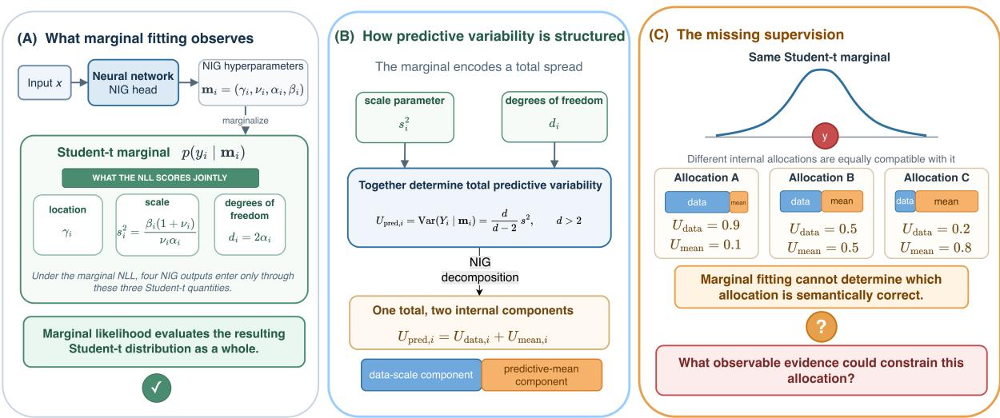  
Figure 1: Marginal fitting leaves the internal allocation open. (A) Under standard DER, the four NIG outputs enter the marginal likelihood only through the location, scale, and degrees of freedom of a Student-t distribution. (B) Its total predictive variance can be written as a data-scale component plus a predictive-mean component. (C) The same marginal is compatible with diferent internal allocations, so fitting it cannot determine which allocation is appropriate for a target. MORSE supplies the missing evidence through controlled changes in visible context.

MORSE (Masked Observability for Reliable Structured Encoding) learns this target from K masked views that share the same hidden positions. A Gaussian objective fits the predictive mean and data scale, while magnitude and ranking losses supervise 1/ν using the detached cross-context response. This separates their direct output-level supervision paths. The score is trained to estimate context sensitivity under the chosen masking policy. We compare it with contextual and training-set references and test the pretrained representations on downstream tasks.

## Our contributions are:

• We observe that the normalized between-context variance of a mask-induced predictive mixture occupies the position of the NIG factor 1/ν, the coordinate the marginal likelihood leaves free, and adopt this correspondence as the definition of what 1/ν reports. This correspondence gives the allocation a policy-relative observable target and gives ν an observable training target as an efective count of the evidence the policy varies; we also characterize the population limit of the target (Section 3).

• We introduce MORSE, a common-target K-view objective that supervises this factor from context sensitivity, separates it from the direct residual path, and amortizes the multi-view response into one forward pass per observation state (Section 4).

• We validate the learned score with a Gaussian-process audit in nine settings against two distinct references, contextual and training-set variation, stress-test its mechanism and population behavior on a pulse benchmark, and test downstream representation transfer on PTB-XL and IMPTC (Sections 5–6).

## 2 Related Work

DER trains the NIG head with the induced Student-t negative log-likelihood and an evidence regularizer that scales total evidence by the prediction residual (Amini et al., 2020). Meinert et al. (2023) show that this coupling lets observation noise drive the reported uncertainty, and propose two remedies: normalizing the residual by the predictive Student-t width (RN-DER, their Eq. 11) and a Gaussian mean-variance reparameterization that drops α (Gaussian-MV, their Eq. 12). Natural posterior networks instead tie the evidence count to a learned density (Charpentier et al., 2022). Bengs et al. (2022) expose a more general pitfall: minimizing a second-order loss does not incentivize faithful epistemic uncertainty. Jürgens et al. (2024) confirm this empirically by comparing second-order predictions with reference distributions from repeated training-set sampling, and conclude that evidential scores support relative rather than absolute interpretation. Jimenez et al. (2026) argue that every current second-order estimator captures only a subset of the sources of epistemic uncertainty. These criteria characterize uncertainty induced by model or training-set variation; MORSE targets a complementary source, arising from changes in the visible evidence.

A second line of work supplies what the fitting objective cannot: observable variation in the predictions themselves. MC dropout and deep ensembles expose this variation through stochastic inference and independently trained models (Gal and Ghahramani, 2016; Lakshminarayanan et al., 2017), and their disagreement is widely treated as an epistemic signal. Ensemble distribution distillation trains one model to reproduce the mean and spread of an ensemble (Malinin et al., 2020), and Shen et al. (2024) reinject model uncertainty into evidential learning by distilling a bootstrap ensemble; self-distribution distillation trains such a teacher and its student within one network (Fathullah and Gales, 2022). What these methods resample is the model: parameters, initializations, or training sets. Because the observed input is held fixed, the resulting variation does not directly measure how much a prediction changes when the visible evidence itself changes, although it can correlate with that change (Section 6). Test-time augmentation perturbs the input instead and reads the resulting prediction variance as aleatoric uncertainty (Ayhan and Berens, 2018; Wang et al., 2019).

Masked autoencoders learn representations by reconstructing hidden content from visible input (He et al., 2022), adapted to time series through masked patch reconstruction (Nie et al., 2023), multiple masked views (Dong et al., 2023), and spatio-temporal masking for ECG (Na et al., 2024); evidential objectives have also been combined with temporal imputation (Ragab et al., 2025). This setting permits a complementary intervention: the model is held fixed while the evidence available about a chosen target is varied, so predictive variation becomes attributable to observability rather than to the estimator. SimMTM aggregates several masked views to improve reconstruction; MORSE instead keeps the per-view predictions separate and learns their disagreement as a score. To our knowledge, no prior work uses the variation that masked pretraining already generates as target-specific supervision for the evidential allocation.

## 3 Making the Allocation Observable

Marginal allocation. For target i, a positive NIG-shaped head outputs $\mathbf { m } _ { i } = \left( \gamma _ { i } , \nu _ { i } , \alpha _ { i } , \beta _ { i } \right)$ with $\nu _ { i } > 0 , \alpha _ { i } > 1$ , and $\beta _ { i } > 0$ . Marginalizing the Gaussian mean and variance induces a Student-t distribution with location $\gamma _ { i }$ , scale $s _ { i } ^ { 2 } = \beta _ { i } ( 1 + \nu _ { i } ) / ( \nu _ { i } \alpha _ { i } )$ , and $d _ { i } = 2 \alpha _ { i }$ degrees of freedom (Figure 1A). The marginal likelihood therefore observes the four head outputs only through these three quantities. For $d _ { i } > 2$ , its variance admits the structured allocation

$$
\operatorname { V a r } ( Y _ { i } \mid \mathbf { m } _ { i } ) = \underbrace { \frac { \beta _ { i } } { \alpha _ { i } - 1 } } _ { U _ { \mathrm { d a t a } , i } } + \underbrace { \frac { \beta _ { i } } { \nu _ { i } ( \alpha _ { i } - 1 ) } } _ { U _ { \mathrm { m e a n } , i } } ,\tag{1}
$$

$$
U _ { \mathrm { r e l } , i } : = \frac { U _ { \mathrm { m e a n } , i } } { U _ { \mathrm { d a t a } , i } } = \frac { 1 } { \nu _ { i } } .\tag{2}
$$

This allocation is not identified by the marginal. Fix any Student-t marginal $( \gamma , s ^ { 2 } , d )$ with $d > 2$ . For any $\nu > 0$ , the choice $\alpha = d / 2$ and $\beta = \alpha s ^ { 2 } \nu / ( 1 + \nu )$ preserves the location, scale, and degrees of freedom, while Equation (2) gives $U _ { \mathrm { r e l } } = 1 / \nu$ . As ν spans the positive reals, the same marginal admits every positive relative allocation (Proposition 1). An auxiliary regularizer may select a numerical parameterization, but it does not supply target-specific evidence for what the allocation means. MORSE retains $( U _ { \mathrm { d a t a } } , U _ { \mathrm { r e l } } , U _ { \mathrm { m e a n } } )$ only as structured coordinates and uses the Gaussian-form fitting objective defined below.

Observable bridge. We obtain such evidence by keeping a target hidden while varying its visible context. Fixing sequence X, target t, and predictor $\theta ,$ let $M \sim \pi _ { t }$ denote an observation state conditioned on t remaining hidden. Let the corresponding first-order predictive component have mean $\mu _ { \theta } ( X , M )$ and finite variance $v _ { \theta } ( X , M )$ The policy induces a mixture of these components, for which the law of total variance gives

$$
\operatorname { V a r } _ { q _ { \theta , \pi _ { t } } } ( Y _ { t } \mid X ) = \operatorname { \mathbb { E } } _ { M \sim \pi _ { t } } [ v _ { \theta } ] + \underbrace { \operatorname { V a r } _ { M \sim \pi _ { t } } [ \mu _ { \theta } ] } _ { R _ { \mathrm { o b s } } ( X , t ; \pi _ { t } ) } .\tag{3}
$$

Hence $R _ { \mathrm { o b s } }$ is the observable between-context variance of predictive means under the specified observation policy (Proposition 2). The decomposition has the within/between form of Rubin’s combining rules for multiple imputation (Rubin, 1987), and $R _ { \mathrm { o b s } }$ is the main-efect variance of the observation state in variance-based sensitivity analysis (Sobol’, 2001). It is relative to both that policy and the trained predictor. To construct a dimensionless target, MORSE uses the fitted local data scale as an operational proxy for $v _ { \theta }$ . With $\boldsymbol { U } _ { \mathrm { d a t a } } ( \boldsymbol { X } , t ; \pi _ { t } ) = \mathbb { E } _ { \boldsymbol { M } \sim \pi _ { t } } [ U _ { \mathrm { d a t a } } ( \boldsymbol { M } ) ]$

$$
r _ { \mathrm { o b s } } ( X , t ; \pi _ { t } ) : = \frac { R _ { \mathrm { o b s } } ( X , t ; \pi _ { t } ) } { \overline { { U } } _ { \mathrm { d a t a } } ( X , t ; \pi _ { t } ) + \epsilon } .\tag{4}
$$

Matching decompositions. With this choice, the two variance decompositions sit side by side:

$$
\begin{array} { r l } { \underbrace { U _ { \mathrm { d a t a } } \left( 1 + U _ { \mathrm { r e l } } \right) } _ { \mathrm { N I G ~ p r e d i c t i v e ~ v a r i a n c e } } \quad } & { \mathrm { a n d } \qquad \underbrace { \overline { { U } } _ { \mathrm { d a t a } } \left( 1 + r _ { \mathrm { o b s } } \right) } _ { \mathrm { m a s k - m i x t u r e ~ v a r i a n c e } } . } \end{array}\tag{5}
$$

The observability response $r _ { \mathrm { o b s } }$ occupies the position of $U _ { \mathrm { r e l } } = 1 / \nu \mathrm { : }$ both measure the variance of the mean in units of the data variance. Proposition 1 shows that the marginal leaves exactly this coordinate free, and MORSE supplies its value by adopting the correspondence $U _ { \mathrm { r e l } }  r _ { \mathrm { o b s } }$ as the definition of what $U _ { \mathrm { r e l } }$ reports. Then $U _ { \mathrm { m e a n } } = U _ { \mathrm { d a t a } } U _ { \mathrm { r e l } }$ tracks $R _ { \mathrm { o b s } } ,$ and the observation policy, rather than a Bayesian posterior, sets its meaning. The correspondence also gives ν a measured meaning. In the NIG hierarchy, ν counts the virtual observations that support the mean (Amini et al., 2020); matching $1 / \nu$ to $r _ { \mathrm { o b s } }$ gives the efective count $\nu _ { \mathrm { e f f } } = \overline { { U } } _ { \mathrm { d a t a } } / R _ { \mathrm { o b s } }$ (Appendix A). If the predictive mean varies across contexts with one quarter of the noise variance, the varying context is worth about four noisy observations of the target. Because $R _ { \mathrm { { o b s } } } ^ { * } = 0$ both when every admissible context pins down the target’s mean and when no admissible context informs it (Proposition 3), $\nu _ { \mathrm { e f f } }$ counts only evidence that the policy varies; uncertainty about evidence withheld in every observation state is reported through $U _ { \mathrm { d a t a } }$ , not $U _ { \mathrm { m e a n } }$

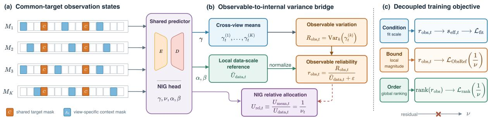  
Figure 2: MORSE overview. (a) Common targets C remain hidden in all K views, while view-specific masks $A _ { k }$ alter their supporting context. (b) Cross-context predictive-mean variance is normalized by the local data scale to form the observability response, which takes the position of $U _ { \mathrm { r e l } } = 1 / \nu$ in the NIG decomposition. (c) The detached response conditions fitting, bounds the local magnitude of the relative mean-uncertainty factor, and supervises its ordering. All masked positions train reconstruction, whereas only C provides matched K-view supervision.

Population limit. Let $\mu ^ { * } ( X , M )$ be the population-optimal mean predictor for the same policy and write $\delta = \mu _ { \theta } - \mu ^ { * }$ . Then

$$
R _ { \mathrm { o b s } } ( \theta ) = R _ { \mathrm { o b s } } ^ { * } + \mathrm { V a r } _ { M } ( \delta ) + 2 \mathrm { C o v } _ { M } ( \mu ^ { * } , \delta ) ,\tag{6}
$$

where $R _ { \mathrm { o b s } } ^ { * } = \operatorname { V a r } _ { M } ( \mu ^ { * } )$ (Proposition 3). As the predictor converges, $R _ { \mathrm { o b s } } ( \theta )  R _ { \mathrm { o b s } } ^ { * }$ , which is positive whenever changing the visible context changes the optimal mean. Variation of the prediction across training sets at a fixed mask involves only $\delta ,$ so it vanishes in the same limit up to optimization noise. When $R _ { \mathrm { { o b s } } } ^ { * } > 0$ , contextual and training-set variation converge to diferent limits, so any agreement between them is a finite-sample coincidence rather than an identity; our evaluation compares the learned score with each of them separately.

## 4 MORSE

Figure 2 operationalizes the correspondence above, and three design choices follow from it. The target is normalized by the data scale, so it is dimensionless. It supervises $U _ { \mathrm { r e l } } = 1 / \nu$ alone, so its gradients reach ν but not the data scale, which separates the two supervision paths at the output. And the fitting scale uses the bounded factor $1 + \lambda _ { \mathrm { c o n d } } h ( r _ { \mathrm { o b s } } )$ , the counterpart of $1 + U _ { \mathrm { r e l } }$ in the NIG predictive variance.

Finite-view response. We sample a common target set C and independently draw additional masks $A _ { k } \subseteq C ^ { c }$ under a fixed masking policy, allowing the $A _ { k }$ to overlap. For each common target, MORSE computes

$$
\begin{array} { r l } { M _ { k } = C \cup A _ { k } , ~ } & { k = 1 , \ldots , K , } \\ { ~ } & { ~ } \\ { ~ \displaystyle \hbar = \frac { 1 } { K } \sum _ { k = 1 } ^ { K } \gamma _ { k , i } , } \\ { ~ } & { } \\ { \hat { R } _ { \mathrm { 0 i s s } , t } = \frac { 1 } { K } \sum _ { k = 1 } ^ { K } \left( \gamma _ { k , i } - \gamma _ { t } \right) ^ { 2 } , } \\ { ~ } & { } \\ { U _ { \mathrm { d a s t } , t } ^ { \mathrm { r e f } } = \frac { 1 } { K } \sum _ { k = 1 } ^ { K } U _ { \mathrm { d a s t } , k } , ~ } \\ { ~ } & { } \\ { r _ { \mathrm { 0 i s s } , t } = \frac { \mathrm { s g } \left( \hat { R } _ { \mathrm { 0 i s s } , t } \right) } { \mathrm { s g } \left( U _ { \mathrm { d a s t } , t } ^ { \mathrm { a d } } \right) + \epsilon } , ~ } & { t \in C , } \end{array}\tag{7}
$$

(8)

where ${ \gamma } _ { k , t } = \mu _ { \theta } ( X , M _ { k } ) _ { i }$ is the NIG location predicted for target t in view k and sg denotes the stop-gradient operator. Only common targets define the detached response and the uncertainty losses, whereas every $t \in M _ { k }$ contributes to reconstruction fitting. The view count K and the masking policy are part of the operational definition of the target; full settings are given in Appendix B.

Conditioned fitting. We set $r _ { \mathrm { o b s } , t } = 0$ outside C and use the bounded gate $h ( r ) = r / ( 1 + r )$ The efective scale and fitting objective are

$$
s _ { k , t } ^ { \mathrm { e f f } } = U _ { \mathrm { d a t a } , k , t } \left[ 1 + \lambda _ { \mathrm { c o n d } } h ( r _ { \mathrm { o b s } , t } ) \right] ,
$$

$$
\begin{array} { r l r } {  { \mathcal { L } _ { \mathrm { f i t } } = \frac { 1 } { K } \sum _ { k = 1 } ^ { K } \operatorname { A v g } \Big [ \log \Big ( s _ { k , t } ^ { \mathrm { e f f } } + \epsilon \Big ) } } \\ & { } & { + \frac { \displaystyle ( y _ { t } - \gamma _ { k , t } ) ^ { 2 } } { \displaystyle s _ { k , t } ^ { \mathrm { e f f } } + \epsilon } \Big ] . } \end{array}\tag{9}
$$

The gate limits the adjustment to $U _ { \mathrm { d a t a } , k , t } \leq s _ { k , t } ^ { \mathrm { e f f } } < ( 1 + \lambda _ { \mathrm { c o n d } } ) U _ { \mathrm { d a t a } , k , t }$ . Because the response is detached, it conditions fitting without receiving gradients from ${ \mathcal { L } } _ { \mathrm { f i t } }$ . The efective scale is used only for optimization; reported moments use the base $U _ { \mathrm { d a t a } , k , t }$ and $U _ { \mathrm { m e a n } , k , t }$ . Thus ${ \mathcal { L } } _ { \mathrm { f i t } }$ is Gaussian-form, contains no $\nu ,$ and does not invoke the Student-t marginal.

Bound and order. Finite views provide a noisy local response rather than an exact label. We therefore define $T _ { t } = \mathrm { s g } ( r _ { \mathrm { o b s } , t } ) + f _ { B }$ , where $f _ { B }$ is a detached ofset equal to the $q _ { f } .$ -quantile of the response over valid common targets in the batch, lower-bounded by ϵ. With $[ x ] _ { + } = \operatorname* { m a x } ( x , 0 )$ magnitude supervision is

$$
\ell _ { \mathrm { r e f } } ( U , T ) = [ \log T - \log U ] _ { + } + \omega [ \log U - \log T - m ] _ { + } ,\tag{10}
$$

and averaging $\ell _ { \mathrm { r e f } } ( U _ { \mathrm { r e l } , k , t } , T _ { t } )$ over views and common targets defines the observable-reference loss $\mathcal { L } _ { \mathrm { r e f } }$ on the real-data tasks; the synthetic trainer applies $\ell _ { \mathrm { r e f } }$ once per common target to the view average $\begin{array} { r } { \bar { U } _ { \mathrm { r e l } , t } = K ^ { - 1 } \sum _ { k } U _ { \mathrm { r e l } , k , t } } \end{array}$ (Appendix B). For ordering, let $z _ { t } = K ^ { - 1 } \sum _ { k } \log U _ { \mathrm { r e l } , k , t }$ and let H and L index valid common targets in the upper and lower response quartiles. Then

$$
\mathcal { L } _ { \mathrm { r a n k } } = \mathbb { E } _ { i \in H , j \in L } \left[ \rho - ( z _ { i } - z _ { j } ) \right] _ { + } ,\tag{11}
$$

$$
{ \mathcal { L } } _ { M O R S E } = { \mathcal { L } } _ { \mathrm { f i t } } + \lambda _ { \mathrm { { r e f } } } { \mathcal { L } } _ { \mathrm { { r e f } } } + \lambda _ { \mathrm { { r a n k } } } { \mathcal { L } } _ { \mathrm { { r a n k } } } .\tag{12}
$$

The envelope admits the zero-loss range $T _ { t } \le U _ { \mathrm { r e l } , k , t } \le e ^ { m } T _ { t }$ , constraining local magnitude, while $\mathcal { L } _ { \mathrm { r a n k } }$ preserves the ordering induced by cross-context sensitivity. Because the envelope is a quantile-type loss, its population minimizer is a quantile-type functional of the finite-view response rather than its mean (Appendix A.6). Since ${ \mathcal { L } } _ { \mathrm { f i t } }$ contains no $\nu ,$ these losses alone supervise $U _ { \mathrm { r e l } }$ at the output, and the residual has no direct path to it. This output-level decoupling does not preclude co-adaptation through the shared encoder.

## 5 Evaluation Design

We ask three questions. Semantic agreement: does the learned score align with policy-relative contextual variation, and how does this difer from training-set variation? Mechanism: which MORSE components control magnitude, interval behavior, and ordering? Transfer: does MORSE pretraining improve low-label downstream performance?

Gaussian-process benchmark. The GP benchmark provides a contextual reference built from analytic Bayes conditional means. Length-128 windows are drawn from a zero-mean Matérn-5/2 Gaussian process with unit signal variance and length scale .05, observed with noise whose standard deviation switches from .05 to .30 at a boundary sampled uniformly in [.2, .8]. Given the known kernel and noise variances, the Bayes conditional mean for any visible set is available in closed form (Rasmussen and Williams, 2006). Its variance over 128 fixed masks from the training policy defines the contextual reference, a finite-mask approximation of the population contextual variance; the learned models never receive the kernel, the noise variances, or the per-window noise boundary, so the reference is a known-noise Bayes target (Appendix E). Each method is trained on five paired datasets of N = 2048 windows and evaluated on a shared test bank of 1,024 windows. Alongside DER, RN-DER, Gaussian-MV, and MORSE, we evaluate five-member deep and bootstrap ensembles and 50-pass MC dropout with and without attention-probability dropout. All learned scores are averaged over the same four evaluation contexts. A separate bank of 20 first-order models trained on disjoint datasets defines the training-set reference $V _ { \mathrm { r e f } }$ (Appendix E).

Pulse benchmark. The pulse benchmark serves as a mechanism and population-limit stress test. It extends the heteroscedastic pulse diagnostic of Meinert et al. (2023), which is pointwise and has fixed pulse and noise locations, to length-128 windows with independently sampled locations, so there is context to withhold. The observation-noise standard deviation changes from .01 to .10 at the sampled boundary, so noise level and reconstruction dificulty vary independently across the window. All second-order methods share the same two-layer Transformer, serialized datasets, normalization, optimization budget, and common-target masks, with $K = 4 ,$ , a per-view mask rate of .50, a shared-target rate of .25, and ten paired seeds. For the training-size audit, we train MORSE at N ∈ {512, 2048, 8192, 32768} with ten paired anchors per size and compare the cross-context variance of its predictor with a large-sample reference from networks trained on unlimited freshly generated data (Appendix D).

Real datasets. PTB-XL and IMPTC serve as downstream representation-transfer experiments. PTB-XL (Wagner et al., 2020) uses public 100-Hz, 12-lead ECGs and five diagnostic superclasses; we use the oficial patient-separated folds $1 { - } 8 / 9 / 1 0$ , pretrain only on the training folds, and fine-tune with 5% or 10% labeled training records. On IMPTC (Hetzel et al., 2023a), we construct a three-class future-event prediction task from 50-step observation and prediction windows with 46 motion and contextual features; the in-distribution setting uses 30% labels and partial fine-tuning, and a separate evaluation holds out environment 5. Both use five seeds and validation-only checkpoint selection.

Metrics. Agreement with a reference variance is measured by log-variance MAE (scale), Spearman correlation (ordering only), and center RMSE (location of the predictive mean). The pulse mechanism study adds predictive fit, noise sensitivity $( L _ { \mathrm { r e l } }$ and $L _ { \mathrm { m e a n } } .$ , absolute log-ratios of the high- to low-noise means of $U _ { \mathrm { r e l } }$ and $U _ { \mathrm { m e a n } } )$ , error ranking, and the coverage gap and width of 90% intervals (Appendix C). Downstream evaluation uses task metrics, Brier score, ECE, and AURC (Brier, 1950; Guo et al., 2017; Geifman and El-Yaniv, 2017). We report mean ± sample standard deviation over paired anchors or seeds; paired intervals are in the appendix.

## 6 Results

Contextual alignment and target separation. Table 1 compares each learned score with both targets in the default setting. Against the contextual reference, MORSE has the lowest LogVar MAE (.774) and, in this setting, the highest Spearman correlation among the primary comparators on all five anchors; MC dropout follows at .807. Against training-set variation, the ranking reverses: the bootstrap ensemble is closest (.548), while MORSE is farther (1.499). Figure 3 shows that the reversal is a diference in level, so the two references are separable targets: an estimator can align closely with one and not the other. MC dropout lies between the references because its attention-probability dropout also removes context: retrained without it, its contextual error rises to 1.012 and its training-set error falls to .732, and the shift recurs in all nine settings (Appendix E.3). Across nine settings varying length scale and noise shape, MORSE keeps the lowest mean contextual LogVar MAE against both variants, and the estimator closest to $V _ { \mathrm { r e f } }$ always perturbs the model rather than the context (Appendix E.2). Against all-site MC dropout, the margin is large only at the shortest length scale, two paired intervals at length scale .10 include zero, and MC dropout has the higher Spearman correlation in five settings; the stable advantage is in scale, not ordering.

Table 1: Agreement with two distinct GP uncertainty targets $( N = 2 0 4 8 ;$ five paired anchors; LogVar MAE, mean ± sample SD; lower is better). Contextual: variance of analytic Bayes conditional means over 128 fixed masks; Appendix E.2 re-scores these checkpoints on an independent bank. Training set: variance across 20 independent first-order fits at fixed masks. All learned scores average the same four evaluation contexts; evidential heads, including MORSE, use one forward pass per context, MC dropout 50 draws, and each ensemble five members. Bold marks the best unrounded mean. The no-attention MC dropout row is retrained without attention-probability dropout (Appendix E.3).
<table><tr><td rowspan="2">Method</td><td colspan="2">LogVar MAE↓</td></tr><tr><td>Contextual</td><td>Training set</td></tr><tr><td>DER</td><td> $2 . 1 5 0 \pm 0 . 1 0 5$ </td><td> $3 . 4 3 2 \pm 0 . 1 0 5$ </td></tr><tr><td>RN-DER</td><td> $2 . 4 1 4 \pm 0 . 0 7 1$ </td><td> $3 . 7 0 4 \pm 0 . 0 7 0$ </td></tr><tr><td>Gaussian-MV</td><td> $4 . 3 3 6 \pm 0 . 1 1 1$ </td><td> $5 . 6 3 2 \pm 0 . 1 1 1$ </td></tr><tr><td>Deep ensemble (5)</td><td> $2 . 1 6 6 \pm 0 . 1 4 0$ </td><td> $0 . 9 1 5 \pm 0 . 0 9 1$ </td></tr><tr><td>Bootstrap ensemble (5)</td><td> $1 . 6 0 7 \pm 0 . 0 9 2$ </td><td> $\mathbf { 0 . 5 4 8 \pm 0 . 0 2 7 }$ </td></tr><tr><td>MC dropout (50)</td><td> $0 . 8 0 7 \pm 0 . 0 1 3$ </td><td> $1 . 1 8 5 \pm 0 . 1 0 7$ </td></tr><tr><td>no attention (50)</td><td> $1 . 0 1 2 \pm 0 . 0 6 5$ </td><td> $0 . 7 3 2 \pm 0 . 0 7 0$ </td></tr><tr><td>MORSE</td><td> $\mathbf { 0 . 7 7 4 \pm 0 . 0 2 2 }$ </td><td> $1 . 4 9 9 \pm 0 . 0 9 8$ </td></tr></table>

Score quality versus predictor quality. The GP result concerns the learned score, not the underlying predictor. All seven comparators have lower center RMSE than MORSE (.129–.139 versus .144), and RN-DER’s raw 128-mask variance is closer to the contextual reference than MORSE’s (.615 versus .673). MORSE’s score also compresses the contextual target’s range, about five-fold too high in the lowest decile and 2.4-fold too low in the highest. On the pulse proxy, five-member ensembles are closer than MORSE’s score to both references, and MORSE’s score is itself closer to $V _ { \mathrm { r e f } }$ than to the contextual proxy (LogVar MAE 1.545 versus 3.332; Table 20), so the separation observed on GP does not carry over to that generator.

Amortization. Each four-context MORSE score in Table 1 costs four deterministic forward passes, against 200 for MC dropout and 20 for each five-member ensemble. At the same cost, the raw variance of a trained predictor over four masks has LogVar MAE near 1.2, against .774 for MORSE’s score, and repeated masking needs 16 to 128 passes to overtake it (Appendix E). This is an inference-time result; training uses four masked views per step.

Training-size audit. On the pulse benchmark, the cross-context variance of MORSE’s predictor approaches the large-sample reference as data grow: its LogVar MAE falls from 1.987 at $N = 5 1 2$ to .917 at $N = 3 2 7 6 8$ on all ten paired anchors (Table 18). The learned score follows the same trend at a larger error (4.477 to 1.687). Meanwhile the training-set reference contracts from .043 to .020, as Proposition 3 predicts.

$$
\begin{array} { l l l } { { \Phi \mathrm { - } \mathrm { ~ T a r g e t ~ } \mathrm { ~ -- } \mathrm { ~ M O R S E ~ } } } & { { \mathrm { - } \mathrm { -- } \mathrm { ~ M C ~ d r o p o u t ~ } } } & { { \mathrm { - } \mathrm { a - } \mathrm { \cdot } \mathrm { ~ B o o t s t r a p } } } \\ { { \mathrm { -- } \mathrm { ~ D E R ~ } \mathrm { ~ \cdots \cdot } \mathrm { ~ R N \mathrm { - } D E R ~ } \mathrm { ~ - } \mathrm { \odot \mathrm { - } ~ \mathrm { G a u s s i a n \mathrm { - } M V ~ } \mathrm { ~ -- } ~ D e e p ~ e n s e m b l e } } } \end{array}
$$

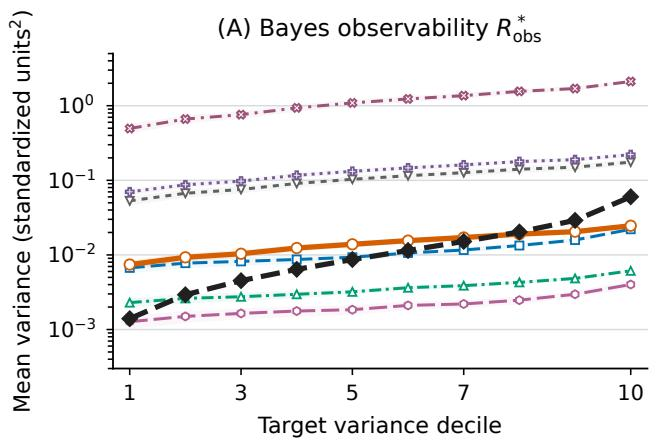

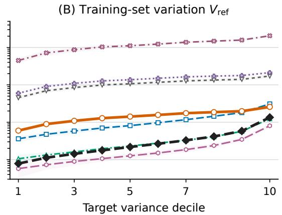  
Figure 3: Diferent estimators align with diferent variance targets. Mean variance of each estimator within ten equal-count deciles of each target on the GP benchmark. Axes share a log scale. The deciles are formed separately in each panel from that panel’s target, and all estimators share them; lines are means over five anchors and bands are anchor standard deviations. (A) Contextual target: variance of analytic Bayes conditional means over 128 fixed masks. (B) Training-set target $V _ { \mathrm { r e f } } { \mathrm { : } }$ variance across 20 independently trained first-order models at fixed masks.

Checks of the correspondence. Equation (5) suggests three checks. First, normalization removes units, not noise dependence; on the pulse benchmark, whose noise level changes tenfold, the noise sensitivity $L _ { \mathrm { r e l } }$ of the relative factor is .34 for MORSE against .53 to 1.49 for the evidential baselines (Table 6). Second, the normalized response is the right target: supervising $U _ { \mathrm { r e l } }$ with the raw cross-view variance instead raises GP scale error from .735 to 1.697 in a matched control (Appendix C.9). Third, Proposition 4 predicts $U _ { \mathrm { m e a n } } \approx 0 . 6 6 8 R _ { \mathrm { o b s } } ( \theta )$ under a Gaussian working assumption; the GP ratios (.50 to .85 on four anchors, .970 on the fifth) are near it, but the pulse ratios (3.6 to 4.4) are not, so the envelope does not fix the constant in general (Appendix A.6).

Mechanism. Table 7 (Appendix C) isolates the roles of the components on the pulse benchmark. Among the model comparisons, RN-DER gives the lowest MSE and NLL and Gaussian-MV the strongest error ranking, while MORSE combines the lowest $L _ { \mathrm { m e a n } } ,$ coverage gap, and interval width with near-best error ranking; a constant score can make $L _ { \mathrm { m e a n } }$ look favorable, so we read it with coverage and width. Without ObsRef, interval width grows from 1.45 to 14.89; without Rank, $L _ { \mathrm { m e a n } }$ , coverage, and width worsen; restoring the residual path (MORSE-RC) slightly improves error ranking but degrades NLL, $L _ { \mathrm { m e a n } } ,$ coverage, and width. A matched factorial over the components and heads on GP and pulse (Appendix C.9) assigns the scale gain to the supervised target: removing Bound raises GP scale error from .735 to 1.954 and restoring the residual path to 2.075, whereas Condition and Order mainly improve fitting and ranking.

## 7 Discussion

In the GP experiments, observable supervision mainly improves variance magnitude. In the default setting, the evidential baselines have contextual Spearman correlations comparable to MORSE (.506–.526 versus .537), but substantially larger median variance ratios to the reference (8–79 versus 1.17; Tables 21 and 22). The matched ablations show the largest scale improvement from Bound, while Condition and Order afect fitting and ranking (Appendix C.9). Explicit, fixed-α, and direct-variance heads achieve similar GP scale alignment, showing that the target can be learned with diferent parameterizations.

Table 2: PTB-XL low-label transfer at the 10% label budget (five-seed mean ± sample standard deviation).
<table><tr><td>Method</td><td> $\mathrm { A U R O C } \uparrow$ </td><td> $\mathrm { M a c r o - F 1 }$  ←</td><td> $\operatorname { E C E } \downarrow$ </td><td> $\mathrm { A U R C } \downarrow$ </td></tr><tr><td>Supervised</td><td> $. 8 2 7 { \pm } . 0 0 5$ </td><td> $. 5 9 2 { \pm } . 0 1 1$ </td><td> $. 0 6 9 { \pm } . 0 1 0 $ </td><td> $. 1 1 0 { \pm } . 0 1 1$ </td></tr><tr><td>DAE</td><td> $. 8 2 6 { \pm } . 0 0 6$ </td><td> $. 5 9 6 { \pm } . 0 1 2$ </td><td> $. 0 7 9 { \pm } . 0 1 6$ </td><td> $. 0 9 6 { \pm } . 0 0 8$ </td></tr><tr><td>MAE</td><td> $. 8 4 2 { \pm } . 0 0 6$ </td><td> $. 6 2 0 { \pm } . 0 0 5$ </td><td> $. 0 4 3 { \pm } . 0 2 0 $ </td><td> $. 0 9 9 { \pm } . 0 0 8 $ </td></tr><tr><td>PatchTST</td><td> $. 8 2 3 { \pm } . 0 1 1$ </td><td> $. 5 9 0 { \pm } . 0 1 5$ </td><td> ${ \bf . 0 3 0 } { \pm . 0 1 6 }$ </td><td> $. 1 2 0 { \pm } . 0 1 4 $ </td></tr><tr><td>SimMTM</td><td> $. 8 4 9 { \pm } . 0 0 5$ </td><td> $. 6 2 2 { \pm } . 0 0 8$ </td><td> $. 0 4 3 { \pm } . 0 1 3$ </td><td> $. 0 9 0 { \pm } . 0 0 7$ </td></tr><tr><td>ST-MEM</td><td> $. 8 3 5 { \pm } . 0 1 0 $ </td><td>.604±.012</td><td> $. 0 5 2 { \pm } . 0 2 0 $ </td><td> $. 1 0 6 { \pm } . 0 1 2$ </td></tr><tr><td>MORSE</td><td> $\mathbf { . 8 6 1 } 2 . 0 0 6$ </td><td> ${ \bf . 6 3 8 \pm . 0 0 7 }$ </td><td> $. 0 4 1 { \pm } . 0 1 3 $ </td><td> $\mathbf { . 0 8 5 { \pm } . 0 0 3 }$ </td></tr></table>

The GP results distinguish contextual from training-set variation empirically. Across all nine settings, MORSE has the lowest mean contextual log-variance error among the primary comparators, while the estimator closest to the training-set reference perturbs the model. Retraining MC dropout without attention-probability dropout raises its contextual error to 1.012 and lowers its training-set error to .732. This shift recurs in all nine settings (Appendix E.3). On the pulse proxy, ensembles are closer to both references, so the contextual advantage observed on GP is benchmark-dependent.

Variance alignment and interval coverage remain separate outcomes. MORSE’s intervals cover 82% at a nominal 95% on GP and 83% in the pulse reference audit. The envelope and ranking losses do not enforce nominal coverage; in the GP audit, MORSE-IS approaches nominal coverage while overestimating variance (Appendices A.6 and E). The observation policy also determines the contexts over which variance is measured and afects both the scale and accuracy of the score (Appendix E). A deployment-oriented policy should therefore reflect the patterns of missing evidence expected in use. Validation against reference contextual variances is restricted to the synthetic benchmarks; PTB-XL and IMPTC evaluate representation transfer.

## 8 Conclusion

An uncertainty estimate is interpretable only if something outside the fitting objective constrains what it means. The NIG marginal leaves the allocation between data-scale and predictive-mean variance unidentified; masked representation learning supplies an observable behavioral signal by holding a target hidden while varying its visible context. Normalized by the data scale, this signal takes the position of the NIG factor $1 / \nu ,$ which turns the unidentified evidence count into a measured count of the evidence the policy varies. MORSE learns a score grounded in this response and produces it in one forward pass per observation state. Against a contextual reference built from analytic Bayes conditional means, MORSE has the lowest log-variance error among the compared estimators in nine GP settings, while an independent training-set reference separates contextual from resampling-based variation. Because the target is defined by a stated observation policy, it can be matched to the evidence a system may lose. A quantity tied to a stated intervention can be checked; one asserted only by a loss cannot.

## Acknowledgments

This research has been partly funded by the Hessian State Ministry for Higher Education, Research, Science and the Arts (HMWK) as part of the LOEWE program (Kapitel 15 02, Förder-

buchungskreis 2995, Förderprodukt 11 – Landes-Ofensive zur Entwicklung Wissenschaftlichökonomischer Exzellenz).

## AI Use Statement

In this work, we used generative AI tools to help develop the conceptual framing of the added audits, to propose and refine their hypotheses, to design and provide feedback on the research methodology and experiments, to formulate mathematical claims, to provide ingredients for their proofs and assist in writing the proofs of Propositions 3 and 4, to implement methods and experiment code (including the code that generates the synthetic datasets), to interpret results, and to assist with translation between Chinese and English. Cleaning or reformatting datasets and qualitative or thematic data analysis are not applicable to this work. Additionally, we used generative AI tools to draft and edit parts of the paper, to prepare and format the manuscript, to create and modify figures and tables, and to suggest the structure and title of the paper. We have reviewed all AI-assisted work. AI-assisted code was reviewed by the authors and checked with unit tests and an independent validation script covering input checksums, training manifests, and paired-anchor integrity; all reported tables and figures were regenerated from saved per-run artifacts; and all AI-assisted mathematical arguments were checked line by line by the authors. We take responsibility for the final content of this work, including text, claims, or artifacts produced with the aid of generative AI.

## References

Amini, A., Schwarting, W., Soleimany, A., and Rus, D. (2020). Deep evidential regression. In Advances in Neural Information Processing Systems.

Ayhan, M. S. and Berens, P. (2018). Test-time data augmentation for estimation of heteroscedastic aleatoric uncertainty in deep neural networks. In Medical Imaging with Deep Learning.

Bengs, V., Hüllermeier, E., and Waegeman, W. (2022). Pitfalls of epistemic uncertainty quantification through loss minimisation. In Koyejo, S., Mohamed, S., Agarwal, A., Belgrave, D., Cho, K., and Oh, A., editors, Advances in Neural Information Processing Systems, volume 35, pages 29205–29216. Curran Associates, Inc.

Brier, G. W. (1950). Verification of forecasts expressed in terms of probability. Monthly Weather Review, 78(1):1–3.

Charpentier, B., Borchert, O., Zügner, D., Geisler, S., and Günnemann, S. (2022). Natural posterior network: Deep Bayesian predictive uncertainty for exponential family distributions. In International Conference on Learning Representations.

Dong, J., Wu, H., Zhang, H., Zhang, L., Wang, J., and Long, M. (2023). SimMTM: A simple pre-training framework for masked time-series modeling. Advances in Neural Information Processing Systems.

Fathullah, Y. and Gales, M. J. F. (2022). Self-distribution distillation: Eficient uncertainty estimation. In Proceedings of the 38th Conference on Uncertainty in Artificial Intelligence, volume 180 of Proceedings of Machine Learning Research.

Gal, Y. and Ghahramani, Z. (2016). Dropout as a bayesian approximation: Representing model uncertainty in deep learning. In Proceedings of the 33rd International Conference on Machine Learning, pages 1050–1059.

Geifman, Y. and El-Yaniv, R. (2017). Selective classification for deep neural networks. In Advances in Neural Information Processing Systems.

Guo, C., Pleiss, G., Sun, Y., and Weinberger, K. Q. (2017). On calibration of modern neural networks. In Proceedings of the 34th International Conference on Machine Learning, pages 1321–1330.

He, K., Chen, X., Xie, S., Li, Y., Dollár, P., and Girshick, R. (2022). Masked autoencoders are scalable vision learners. In IEEE/CVF Conference on Computer Vision and Pattern Recognition, pages 16000–16009.

Hetzel, M., Reichert, H., Reitberger, G., Doll, K., and Sick, B. (2023a). The IMPTC dataset: An infrastructural multi-person trajectory and context dataset. Dataset, version 1.0, Zenodo. doi:10.5281/zenodo.14811016.

Hetzel, M., Reichert, H., Reitberger, G., Doll, K., and Sick, B. (2023b). The IMPTC dataset: An infrastructural multi-person trajectory and context dataset. In 2023 IEEE Intelligent Vehicles Symposium.

Jimenez, S., Jürgens, M., and Waegeman, W. (2026). Position: Epistemic uncertainty estimation methods are fundamentally incomplete. In Forty-third International Conference on Machine Learning Position Paper Track.

Jürgens, M., Meinert, N., Bengs, V., Hüllermeier, E., and Waegeman, W. (2024). Is epistemic uncertainty faithfully represented by evidential deep learning methods? In Proceedings of the 41st International Conference on Machine Learning, pages 22624–22642.

Lakshminarayanan, B., Pritzel, A., and Blundell, C. (2017). Simple and scalable predictive uncertainty estimation using deep ensembles. In Advances in Neural Information Processing Systems.

Malinin, A., Mlodozeniec, B., and Gales, M. (2020). Ensemble distribution distillation. In International Conference on Learning Representations.

Meinert, N., Gawlikowski, J., and Lavin, A. (2023). The unreasonable efectiveness of deep evidential regression. In Proceedings of the AAAI Conference on Artificial Intelligence, volume 37, pages 9134–9142.

Na, Y., Park, M., Tae, Y., and Joo, S. (2024). Guiding masked representation learning to capture spatio-temporal relationship of electrocardiogram. In International Conference on Learning Representations.

Nie, Y., Nguyen, N. H., Sinthong, P., and Kalagnanam, J. (2023). A time series is worth 64 words: Long-term forecasting with transformers. In International Conference on Learning Representations.

Ragab, M., Gong, P., Eldele, E., Zhang, W., Wu, M., Foo, C.-S., Zhang, D., Li, X., and Chen, Z. (2025). Evidentially calibrated source-free time-series domain adaptation with temporal imputation. IEEE Transactions on Knowledge & Data Engineering, (01):1–15.

Rasmussen, C. E. and Williams, C. K. I. (2006). Gaussian Processes for Machine Learning. MIT Press.

Rubin, D. B. (1987). Multiple Imputation for Nonresponse in Surveys. Wiley, New York.

Shen, M., Ryu, J. J., Ghosh, S., Bu, Y., Sattigeri, P., Das, S., and Wornell, G. W. (2024). Are uncertainty quantification capabilities of evidential deep learning a mirage? In Advances in Neural Information Processing Systems.

Sobol’, I. M. (2001). Global sensitivity indices for nonlinear mathematical models and their Monte Carlo estimates. Mathematics and Computers in Simulation, 55(1–3):271–280.

Wagner, P., Strodthof, N., Bousseljot, R.-D., Kreiseler, S., Lunze, F. I., Samek, W., and Schaefter, T. (2020). PTB-XL, a large publicly available electrocardiography dataset. Scientific Data, 7:154.

Wagner, P., Strodthof, N., Bousseljot, R.-D., Kreiseler, S., Lunze, F. I., Samek, W., and Schaefter, T. (2022). PTB-XL, a large publicly available electrocardiography dataset. Dataset, version 1.0.3, PhysioNet. doi:10.13026/kfzx-aw45.

Wang, G., Li, W., Aertsen, M., Deprest, J., Ourselin, S., and Vercauteren, T. (2019). Aleatoric uncertainty estimation with test-time augmentation for medical image segmentation with convolutional neural networks. Neurocomputing, 338:34–45.

## Appendix

Appendix A gives the formal results and Appendix B the complete method. The evidence follows the three questions of Section 5. Semantic agreement: the GP audits, including the nine-setting scan and the MC dropout-site study (Appendix E), the finite-training-set audit (Appendix C.8), and the pulse proxy and training-size audit (Appendix D). Mechanism: the pulse-window results and ablations and the matched component and head study (Appendix C). Transfer: the real-data protocols (Appendices F.1 and F.2). Appendix G covers reproducibility, and its final table maps each claim to its evidence. Tables and figures are numbered continuously with the main paper.

## A Formal Results and Claim Boundaries

## A.1 Marginal Allocation Is Not Identified

For one target, let a Normal-Inverse-Gamma (NIG)-shaped head output $\mathbf { m } = \left( \gamma , \nu , \alpha , \beta \right)$ with $\nu > 0 , \alpha > 1$ , and $\beta > 0$ . Its Student-t marginal has location $\gamma ,$ scale

$$
s ^ { 2 } = \frac { \beta ( 1 + \nu ) } { \nu \alpha } ,\tag{13}
$$

and degrees of freedom $d = 2 \alpha$ . For $d > 2$ , its predictive variance is

$$
U _ { \mathrm { { p r e d } } } = \frac { d } { d - 2 } s ^ { 2 } = \underbrace { \frac { \beta } { \alpha - 1 } } _ { U _ { \mathrm { { d a t a } } } } + \underbrace { \frac { \beta } { \nu ( \alpha - 1 ) } } _ { U _ { \mathrm { { m e a n } } } } , \qquad \frac { U _ { \mathrm { { m e a n } } } } { U _ { \mathrm { { d a t a } } } } = \frac { 1 } { \nu } .\tag{14}
$$

Proposition 1 (Continuum of marginally equivalent allocations). Fix any Student-t marginal $( \gamma , s ^ { 2 } , d )$ with $s ^ { 2 } > 0$ and $d > 2$ . For every desired relative allocation $r > 0$ , there exists a valid NIG tuple with the same marginal and $U _ { \mathrm { m e a n } } / U _ { \mathrm { d a t a } } = r$

Proof. Choose

$$
\alpha = \frac { d } { 2 } , \qquad \nu = \frac { 1 } { r } , \qquad \beta = \frac { \alpha s ^ { 2 } } { 1 + r } .\tag{15}
$$

All positivity conditions hold. Substitution into Equation (13) gives

$$
\frac { \beta ( 1 + \nu ) } { \nu \alpha } = \frac { \alpha s ^ { 2 } } { 1 + r } \frac { 1 + 1 / r } { ( 1 / r ) \alpha } = s ^ { 2 } ,
$$

while $2 \alpha = d$ and the location remains $\gamma .$ Finally, $U _ { \mathrm { m e a n } } / U _ { \mathrm { d a t a } } = 1 / \nu = r$ . Because r is arbitrary, a continuum of internal allocations produces the identical marginal predictive density. □

Proposition 1 concerns evidence supplied by the marginal likelihood. A regularizer, architectural constraint, or optimization bias may select one tuple, but that selection does not create target-specific observable evidence that its allocation has the intended meaning. MORSE addresses this semantic supervision gap.

## A.2 Policy-Relative Total-Variance Derivation

Fix an input sequence X, a target index t, and the event that t is hidden. Let $M \sim \pi _ { t }$ be an observation state sampled from a specified masking policy conditional on this event. For every admissible M, let $q _ { \theta } ( y _ { t } \mid X , M )$ have finite first and second moments,

$$
\begin{array} { r l } & { \mu _ { \theta } ( X , M ) = \operatorname { \mathbb { E } } [ Y _ { t } \mid X , M ] , } \\ & { v _ { \theta } ( X , M ) = \operatorname { V a r } ( Y _ { t } \mid X , M ) . } \end{array}\tag{16}
$$

The policy induces

$$
q _ { \theta , \pi _ { t } } ( y _ { t } \mid X ) = \mathbb { E } _ { M \sim \pi _ { t } } [ q _ { \theta } ( y _ { t } \mid X , M ) ] .\tag{17}
$$

Proposition 2 (Between-context variance under a masking policy). Under the setup above,

$$
\begin{array} { r l } { \operatorname { V a r } _ { q _ { \theta , \pi _ { t } } } ( Y _ { t } \mid X ) = \operatorname { \mathbb { E } } _ { M \sim \pi _ { t } } [ v _ { \theta } ( X , M ) ] ~ } & { } \\ { + \operatorname { V a r } _ { M \sim \pi _ { t } } [ \mu _ { \theta } ( X , M ) ] . } \end{array}\tag{18}
$$

Thus $R _ { \mathrm { o b s } } ( X , t ; \pi _ { t } ) : = \operatorname { V a r } _ { M \sim \pi _ { t } } [ \mu _ { \theta } ( X , M ) ]$ is exactly the between-context predictive-mean component of the mask-policy-induced mixture.

Proof. Introduce the joint distribution that first samples $M \sim \pi _ { t }$ and then $Y _ { t } \sim q _ { \theta } ( \cdot \mid X , M )$ Conditioning on fixed X and the target event, the law of total variance gives

$$
\begin{array} { r l } { \operatorname { V a r } ( Y _ { t } \mid X ) = \operatorname { \mathbb { E } } _ { M } [ \operatorname { V a r } ( Y _ { t } \mid X , M ) ] } & { } \\ { + \operatorname { V a r } _ { M } ( \operatorname { \mathbb { E } } [ Y _ { t } \mid X , M ] ) . } \end{array}
$$

Substitution of $v _ { \theta }$ and $\mu _ { \theta }$ proves Equation (18).

The equality in Proposition 2 is exact for the mask-induced mixture. The connection to the NIG slot is structural: $R _ { \mathrm { o b s } }$ occupies a between-mean position for variation over observation states, whereas $U _ { \mathrm { m e a n } }$ is the predictive-mean slot in the NIG hierarchy. $R _ { \mathrm { o b s } }$ is defined over observation states, whereas Bayesian parameter uncertainty and cross-training-set variation are defined over parameters and training sets (Proposition 3).

## A.3 Finite-View Estimation and Scale Normalization

For conditionally independent masks $M _ { 1 } , \dots , M _ { K } \sim \pi _ { t }$ , MORSE computes

$$
\widehat { R _ { \mathrm { o b s } } } = \frac { 1 } { K } \sum _ { k = 1 } ^ { K } ( \mu _ { k } - \bar { \mu } ) ^ { 2 } .\tag{19}
$$

With divisor K, $\mathbb { E } [ \widehat { R _ { \mathrm { o b s } } } ] = ( K - 1 ) R _ { \mathrm { o b s } } / K$ . The estimator is downward-biased and consistent under the stated sampling assumption. The final method fixes $K = 4$ and treats both K and $\pi _ { t }$ as part of the operational definition of the target.

Because $\widehat { R _ { \mathrm { o b s } } }$ is variance-valued, MORSE divides it by the mean local data scale,

$$
r _ { \mathrm { o b s } t } = \frac { \mathrm { s g } ( \widehat { R _ { \mathrm { o b s } t } } ) } { \mathrm { s g } ( K ^ { - 1 } \sum _ { k } U _ { \mathrm { d a t a } k , t } ) + \epsilon } .\tag{20}
$$

The response is dimensionless and structurally comparable to $U _ { \mathrm { m e a n } } / U _ { \mathrm { d a t a } } ~ = ~ 1 / \nu .$ The comparison has a direct reading in the NIG hierarchy, where $\mu \ : \mid \ : \sigma ^ { 2 } \ : \sim \ : { \mathcal { N } } ( \gamma , \sigma ^ { 2 } / \nu )$ and $\sigma ^ { 2 }$ ∼ InvGamma $( \alpha , \beta )$ . Then $\operatorname { V a r } ( \mu ) = \mathbb { E } [ \sigma ^ { 2 } ] / \nu = U _ { \mathrm { d a t a } } / \nu ,$ so $1 / \nu$ is the variance of the mean in units of the data variance, and ν is the number of noisy observations whose average would carry this much uncertainty about the mean. The normalized response measures the same ratio for the variation of the mean across observation states, which gives the efective count $\nu _ { \mathrm { e f f } } = \overline { { U } } _ { \mathrm { d a t a } } / R _ { \mathrm { o b s } }$ . Because $R _ { \mathrm { { o b s } } } ^ { * } = 0$ whenever the optimal mean does not change across admissible contexts, including when no admissible context informs the target, $\nu _ { \mathrm { e f f } }$ counts only the evidence that the policy varies. Proposition 4, under a Gaussian working assumption, gives the constant with which the envelope alone matches the two (Appendix A.6). Detaching numerator and denominator prevents the reference loss from reducing itself by collapsing cross-view means or inflating its own denominator. Repeated optimization can still produce slower co-adaptation through the shared network, so detachment is not an independence guarantee.

## A.4 Direct-Path Decoupling

The final fitting surrogate is

$$
\mathcal { L } _ { \mathrm { f i t } } = \log ( s _ { \mathrm { e f f } } + \epsilon ) + \frac { ( y - \mu ) ^ { 2 } } { s _ { \mathrm { e f f } } + \epsilon } ,\tag{21}
$$

where $s _ { \mathrm { e f f } }$ depends on $U _ { \mathrm { d a t a } }$ and detached $r _ { \mathrm { o b s } } ,$ but not on ν. Hence $\partial \mathcal { L } _ { \mathrm { f i t } } / \partial \nu = 0$ at the output level. The relative factor is directly trained by ObsRef and Rank only. Shared encoder parameters still receive the sum of all representation gradients; this is direct-path decoupling, not statistical independence of output variables.

## A.5 Population Limit of the Observability Response

Fix X, a hidden target t, and a policy $\pi _ { t } .$ . Let $\mu ^ { * } ( X , M )$ be a population-optimal mean predictor for the observation state M (for squared loss, the conditional mean of $Y _ { t }$ given the visible context under $M )$ , and let $\mu _ { \theta } ( X , M )$ be a trained predictor. Assume both are square-integrable over $M \sim \pi _ { t }$ and write $\delta _ { \theta } = \mu _ { \theta } - \mu ^ { * }$

Proposition 3 (Decomposition and population limit). Under the assumptions above,

$$
R _ { \mathrm { o b s } } ( \theta ) = \mathrm { V a r } _ { M } [ \mu _ { \theta } ] = R _ { \mathrm { o b s } } ^ { * } + \mathrm { V a r } _ { M } [ \delta _ { \theta } ] + 2 \mathrm { C o v } _ { M } ( \mu ^ { * } , \delta _ { \theta } ) , \qquad R _ { \mathrm { o b s } } ^ { * } : = \mathrm { V a r } _ { M } [ \mu ^ { * } ] .\tag{22}
$$

$I f \mathbb { E } _ { M } [ \delta _ { \theta _ { n } } ^ { 2 } ] \to 0$ for a sequence of predictors $\theta _ { n }$ , then $R _ { \mathrm { o b s } } ( \theta _ { n } ) \to R _ { \mathrm { o b s } } ^ { * }$ . Moreover, $R _ { \mathrm { { o b s } } } ^ { * } = 0$ if and only if $\mu ^ { * } ( X , M )$ is πt-almost surely constant in M, that is, if changing the visible context under the policy never changes the conditional mean of the target. For a fixed state $M _ { 0 }$ , the variance of $\mu _ { \theta _ { D } } ( X , M _ { 0 } )$ over training sets D equals $\mathrm { V a r } _ { D } [ \delta _ { \theta _ { D } } ( X , M _ { 0 } ) ]$ ] and tends to zero whenever $\mathbb { E } _ { D } [ \delta _ { \theta _ { D } } ( X , M _ { 0 } ^ { \mathrm { - } } ) ^ { 2 } ] \to 0$

Proof. The first identity is the variance of a sum, Var $( a + b ) = \operatorname { V a r } ( a ) + \operatorname { V a r } ( b ) + 2 \operatorname { C o v } ( a , b )$ with $a = \mu ^ { * }$ and $b = \delta _ { \theta }$ . By Cauchy–Schwarz, $| \operatorname { C o v } _ { M } ( \mu ^ { * } , \delta _ { \theta _ { n } } ) | \leq ( R _ { \mathrm { o b s } } ^ { * } ) ^ { 1 / 2 } \operatorname { V a r } _ { M } [ \delta _ { \theta _ { n } } ] ^ { 1 / 2 }$ , and Var $\cdot _ { M } [ \delta _ { \theta _ { n } } ] \leq \mathbb { E } _ { M } [ \delta _ { \theta _ { n } } ^ { 2 } ] \to 0$ , so both correction terms vanish. A variance is zero exactly when its argument is almost surely constant. At fixed $M _ { 0 } , \mu ^ { * } ( X , M _ { 0 } )$ does not depend on D, so the variance over D is that of $\delta _ { \theta _ { D } } ( X , M _ { 0 } )$ , which is bounded by its second moment. □

Proposition 3 explains why agreement with a training-set reference can only be a finite-sample phenomenon. In practice, the variance over training sets does not reach zero because initialization and optimization add a floor; the pulse proxies in Appendix D give an empirical estimate of that floor. The decomposition also shows that $R _ { \mathrm { o b s } } ( \theta )$ can approach $R _ { \mathrm { o b s } } ^ { \ast }$ from below when a finite-sample predictor shrinks toward context-averaged predictions, which makes $\operatorname { C o v } _ { M } ( \mu ^ { * } , \delta _ { \boldsymbol { \theta } } )$ negative.

## A.6 What the Envelope Targets

Write $z = \log T$ for the finite-view target and $u = \log U$ for the head output. For fixed $u ,$ the envelope loss of Equation (10) is $( z - u ) _ { + } + \omega ( u - z - m ) _ { + }$

Proposition 4 (Population minimizer of the envelope). Let z have a continuous distribution with finite first moment, and let $\omega > 0$ and $m \geq 0$ . Every minimizer $u ^ { * }$ of $g ( u ) = \mathbb { E } [ ( z - u ) _ { + } +$ $\omega ( u - z - m ) _ { + } ]$ satisfies $P ( z > u ^ { * } ) = \omega P ( z < u ^ { * } - m )$ . For $\omega = 1$ and a distribution of z symmetric about its median $z _ { 0 . 5 } , u ^ { * } = z _ { 0 . 5 } + m / 2$

Proof. g is convex, and its derivative is $g ^ { \prime } ( u ) = - P ( z > u ) + \omega P ( z < u - m )$ , which is continuous for continuous z. Setting $g ^ { \prime } ( u ^ { * } ) = 0$ gives the first claim. Under symmetry, $P ( z > z _ { 0 . 5 } + m / 2 ) =$ $P ( z < z _ { 0 . 5 } - m / 2 )$ , so $u ^ { * } = z _ { 0 . 5 } + m / 2$ solves the equation. □

The envelope therefore targets a quantile-type functional of the finite-view response, not its mean. Under a Gaussian working assumption for the $K = 4$ view predictions, $K \widehat { R _ { \mathrm { o b s } } } / R _ { \mathrm { o b s } } \sim$ $\chi _ { K - 1 } ^ { 2 }$ , and Monte Carlo simulation with a fixed data scale and no batch ofset gives $\exp ( u ^ { * } ) \approx$ 0.668 $R _ { \mathrm { { o b s } } } / \overline { { U } } _ { \mathrm { { d a t a } } }$ , that is $U _ { \mathrm { m e a n } } \approx 0 . 6 6 8 R _ { \mathrm { o b s } }$ , for the synthetic setting $( m , \omega ) = ( . 2 5 , 1 )$ , and $U _ { \mathrm { m e a n } } \approx 1 . 1 9 5 R _ { \mathrm { o b s } }$ for the real-data setting $( m , \omega ) = ( 1 , . 5 )$ . The calculation treats the envelope in isolation, without the fitting and ranking terms. On the GP benchmark, the median ratio of MORSE’s $U _ { \mathrm { m e a n } }$ to its own 128-mask response lies in [.50, .85] for four of five anchors and equals .970 for the fifth, in line with this prediction. On the pulse benchmark the corresponding ratios are between 3.6 and 4.4, so the prediction does not transfer to that generator.

A mean-targeting alternative replaces the envelope with the Itakura–Saito loss exp(τ − $\boldsymbol { u } ) - ( \tau - \boldsymbol { u } ) - 1$ on the bias-corrected target $\tau = \log ( K \widehat { R _ { \mathrm { o b s } } } / ( ( K - 1 ) ( \overline { { U } } _ { \mathrm { d a t a } } + \epsilon ) ) + \epsilon )$ , applied separately in each view. Its population minimizer satisfies $\exp ( u ^ { * } ) = \mathbb { E } [ \exp \tau ]$ , the conditional mean of the bias-corrected ratio. With $\overline { { U } } _ { \mathrm { d a t a } }$ held fixed and independent views, this ratio is unbiased for $R _ { \mathrm { o b s } } / ( \overline { { U } } _ { \mathrm { d a t a } } + \epsilon )$ up to the added $\epsilon ;$ because the denominator is estimated from the same views, it is not exactly unbiased in general. In practice this variant (MORSE-IS) overestimated the model’s own response on every anchor (median ratios 1.66–2.08 on GP and 5.0–7.2 on pulse) and was less accurate than the envelope against the GP Bayes reference (LogVar MAE 1.109 versus .774; paired diference +.335, 95% interval [.301, .375], envelope better on $5 / 5$ anchors). We therefore retain the envelope as the method and report MORSE-IS only as a control; we have not isolated whether finite-view teacher noise, the moving self-teacher, or the interaction with conditioned fitting causes the discrepancy.

## B Complete Method Specification

## B.1 Observation-State Construction

For each input, the sampler first draws a common target set C and then draws independent additional masks $A _ { k }$ for $k = 1 , \ldots , K$ . View k masks $M _ { k } = C \cup A _ { k }$ . Every position in C is therefore predicted in every view, while $A _ { k }$ changes the visible supporting context. The final policy uses four views, 50% total masking per view, and 25% shared targets.

All masked positions in every $M _ { k }$ contribute to reconstruction fitting, but only positions in C have enough matched predictions to define $\widehat { R _ { \mathrm { o b s } t } }$ and $r _ { \mathrm { o b s t } }$ . No single view is privileged: all K NIG outputs participate symmetrically in fitting, the reference denominator, and supervision of the relative mean-uncertainty factor. This common-target construction is what makes cross-view variance interpretable as variation for the same hidden quantity.

## B.2 Fitting, Envelope, and Rank Objectives

With $h ( r ) = r / ( 1 + r )$ , the efective scale and fitting objective are

$$
s _ { k , t } ^ { \mathrm { e f f } } = U _ { \mathrm { d a t a } k , t } \left[ 1 + \lambda _ { \mathrm { c o n d } } h ( r _ { \mathrm { o b s } t } ) \right] ,\tag{23}
$$

$$
\mathcal { L } _ { \mathrm { f i t } } = \frac { 1 } { K } \sum _ { k = 1 } ^ { K } \underset { t \in M _ { k } } { \mathrm { A v g } } \left[ \log ( s _ { k , t } ^ { \mathrm { e f f } } + \epsilon ) + \frac { ( y _ { t } - \mu _ { k , t } ) ^ { 2 } } { s _ { k , t } ^ { \mathrm { e f f } } + \epsilon } \right] .\tag{24}
$$

The bounded transform prevents a large finite-view response from making the conditional scale arbitrarily large.

Let $T _ { t } = r _ { \mathrm { o b s } t } + f$ , where $f$ is a robust nonnegative floor. MORSE uses

$$
\ell _ { \mathrm { r e f } } ( U , T ) = [ \log T - \log U ] _ { + } + \omega [ \log U - \log T - m ] _ { + } .\tag{25}
$$

On the real-data tasks, $\mathcal { L } _ { \mathrm { r e f } }$ averages this loss for $U = U _ { \mathrm { r e l } k , t } = 1 / \nu _ { k , t }$ across views and common targets; the synthetic trainer applies it once per common target to the view average

Table 3: Confirmed frozen MORSE settings. All reported main-method runs use the decoupled objective, so $\lambda _ { \nu } = 0 .$
<table><tr><td>Setting</td><td>Synthetic</td><td>PTB-XL</td><td>IMPTC</td></tr><tr><td>Views K</td><td>4</td><td>4</td><td>4</td></tr><tr><td>Mask rate per view / shared-target rate</td><td>.50 / .25</td><td>.50 / .25</td><td>.50 / .25</td></tr><tr><td> $\lambda _ { \mathrm { c o n d } } \mathrm { ~ / ~ } \lambda _ { \nu }$ </td><td>1/0</td><td>1/0</td><td>1/0</td></tr><tr><td> $\lambda _ { \mathrm { { r e f } } } ~ / ~ \lambda _ { \mathrm { { r a n k } } }$ </td><td>.01 / .05</td><td>.05 / .05</td><td>.05 / .05</td></tr><tr><td>ObsRef margin m / upper weight ω</td><td>.25 / 1</td><td>1 / .5</td><td>1 / .5</td></tr><tr><td>Target-floor quantile f</td><td>0</td><td>.10</td><td>.10</td></tr><tr><td>ObsRef aggregation over views</td><td>view average</td><td>per view</td><td>per view</td></tr><tr><td>Rank margin  $\rho ;$  high/low quantiles</td><td>.10; .25/.25</td><td>.10; .25/.25</td><td>.10; .25/.25</td></tr><tr><td>Rank-weight ramp</td><td>linear, first 20%</td><td>none</td><td>none</td></tr><tr><td>Positive-parameter / arithmetic €</td><td> $1 0 ^ { - 4 } / 1 0 ^ { - 6 }$ </td><td>same</td><td>same</td></tr></table>

$\begin{array} { r } { U = K ^ { - 1 } \sum _ { k } U _ { \mathrm { r e l } k , t } } \end{array}$ (Table 3). The first hinge discourages an under-responsive factor; the weighted second hinge permits a controlled upper margin rather than enforcing pointwise equality to a noisy finite-K target. We call this the observable-reference (ObsRef) loss.

Let H and L be the upper and lower quartiles of detached $r _ { \mathrm { o b s } }$ in a batch, and let $z =$ log $U _ { \mathrm { r e l } } = - \log \nu .$ . The ordinal term and final objective are

$$
\mathcal { L } _ { \mathrm { { r a n k } } } = \mathbb { E } _ { i \in H , j \in L } [ \rho - ( z _ { i } - z _ { j } ) ] _ { + } ,\tag{26}
$$

$$
{ \mathcal { L } } _ { M O R S E } = { \mathcal { L } } _ { \mathrm { f i t } } + \lambda _ { \mathrm { { r e f } } } { \mathcal { L } } _ { \mathrm { { r e f } } } + \lambda _ { \mathrm { { r a n k } } } { \mathcal { L } } _ { \mathrm { { r a n k } } } .\tag{27}
$$

The envelope provides local magnitude control; Rank prevents a solution that fits a common magnitude without preserving between-target ordering.

## B.3 Frozen Main Configuration

Table 3 records the objective settings recovered from the executed configurations. The target floor is zero in the strict synthetic trainer and the 0.10 quantile on the two real-data tasks. In strict-synthetic training the rank weight is ramped linearly from the first epoch and reaches its full value after 20% of training; the task-specific PTB-XL and IMPTC trainers use no ramp, so the rank term is active with $\lambda _ { \mathrm { { r a n k } } } = . 0 5$ from the first epoch.

## C Synthetic Protocols and Expanded Results

## C.1 Diagnostic Hierarchy

The synthetic evaluation has three levels. Fixed one-dimensional pulses verify the Deep Evidential Regression (DER) and Meinert loss implementations under familiar signal/noise regions. Parameterized pulses vary pulse and noise location across tasks. The main length-128 windowed benchmark samples pulse and noise boundaries independently and evaluates masked reconstruction with a latent anchor. The first two levels are diagnostic reproductions; the windowed task supplies the controlled mechanism and reference-distribution evidence used in the main claims. For direct diagnostics, $x \in [ 0 , 1 ]$ and the fixed pulse has center .5, half-width .025, unit amplitude, and noise standard deviations $. 0 1 / . 1 0$ on the two sides of a boundary at .5. Parameterized tasks independently sample the pulse center from U(.25, .75), the noise boundary from U(.20, .80), a background from U(−.05, .05), a half-width multiplier from U(.55, 1.45), and an amplitude from U(.65, 1.45). Independence is essential: the model cannot infer the noise boundary by memorizing the pulse location.

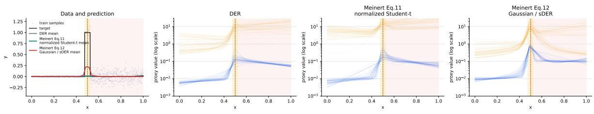  
aleatoric proxy wSt = (1 + )/( ) epistemic proxy 1/ noise boundary pulse cente  
Figure 4: Exact fixed-pulse diagnostic. From left to right, the panels show the datagenerating process with predictive means and 50 independently fitted DER, RN-DER, and Gaussian-MV models. Blue is the predictive data-width proxy $\sqrt { \beta ( 1 + \nu ) / ( \alpha \nu ) }$ and orange is the relative mean-uncertainty width $1 / \sqrt \nu ,$ matching the original diagnostic’s plotting convention; its legend names them aleatoric and epistemic proxies. This is an implementation check; the scale-sensitive metrics in Table 4 prevent a visually flat response from being treated as suficient evidence of a correct allocation. The supplied diagnostic’s compact Eq.11/Eq.12 labels map to RN-DER/Gaussian-MV, respectively.

## C.2 Direct One-Dimensional Diagnostics

Following the main paper, we call Meinert et al.’s residual-normalized DER objective RN-DER (their Eq. 11) and their Gaussian mean–variance fitting objective Gaussian-MV (their Eq. 12) (Meinert et al., 2023). The direct models use a 1–64–64–64–4 rectified-linear-unit multilayer perceptron (ReLU MLP), Adam with learning rate $1 0 ^ { - 3 }$ , batch size 100, 1,000 training samples, and 600 epochs. DER uses its residual-evidence coeficient .01; RN-DER uses normalized-residual coeficient .01 with $p = 2 ;$ Gaussian-MV uses $\lambda _ { \nu } = . 0 1$ . The fixed diagnostic contains 50 independent fits of one task. The parameterized diagnostic contains 50 independently sampled tasks.

For high-noise region H and low-noise region L, the direct audit reports

$$
L _ { 1 / \sqrt \nu } = \left| \log \frac { \mathbb { E } _ { H } [ 1 / \sqrt \nu ] } { \mathbb { E } _ { L } [ 1 / \sqrt \nu ] } \right| ,\tag{28}
$$

$$
L _ { \mathrm { r e l } } = \left| \log \frac { \mathbb { E } _ { H } [ 1 / \nu ] } { \mathbb { E } _ { L } [ 1 / \nu ] } \right| ,\tag{29}
$$

$$
L _ { \mathrm { m e a n } } = \left| \log \frac { \mathbb { E } _ { H } [ U _ { \mathrm { m e a n } } ] } { \mathbb { E } _ { L } [ U _ { \mathrm { m e a n } } ] } \right| .\tag{30}
$$

The first matches the orange standard-deviation-level quantity in the Meinert-style visualization, the second audits the relative factor used by MORSE, and the third audits absolute NIG mean variance. None is suficient alone: constant uncertainty gives zero. Error AUROC therefore asks whether $U _ { \mathrm { m e a n } }$ identifies the top 20% squared-error tokens; selective excess is the area between its risk–coverage curve and oracle error ordering; coverage gap is the absolute error from nominal 90% coverage; and Width is the average 90% interval width. Here AUROC denotes area under the receiver operating characteristic curve. Tables use mean squared error (MSE) and negative log-likelihood (NLL) for predictive fitting.

## C.3 Parameterized Pulse-Window Protocol

Each sequence has 128 tokens, with 2,048/1,024 train/test windows generated from the parameterized process above. Targets are standardized using training statistics. All masked methods use the same two-layer Transformer $( d = 6 4 .$ , four heads), AdamW with learning rate 10−3 and weight decay $1 0 ^ { - 4 }$ , batch size 64, and 100 epochs.

Table 4: Fixed-pulse direct diagnostic, 50 independent fits (mean ± sample standard deviation). Leakage metrics are accompanied by external utility and interval diagnostics because a constant score can obtain low leakage.
<table><tr><td>Method</td><td>MSE↓</td><td>NLL↓</td><td> $L _ { 1 / { \sqrt { \nu } } } \downarrow$ </td><td> $L _ { \mathrm { r e l } } \downarrow$ </td><td> $L _ { \mathrm { m e a n } } \downarrow$ </td></tr><tr><td>DER</td><td> $. 0 4 9 8 { \pm } . 0 0 0 8$ </td><td> $- 2 . 0 9 2 0 { \pm } . 1 4 8 3$ </td><td> $2 . 2 5 2 6 { \pm } 1 . 1 0 6 5$ </td><td> $4 . 4 8 2 3 { \pm } 2 . 2 0 0 5$ </td><td> $6 . 1 4 8 1 { \scriptstyle \pm 2 . 0 9 1 1 }$ </td></tr><tr><td>RN-DER</td><td> $. 0 4 8 8 { \pm } . 0 0 2 0 $ </td><td> $- 2 . 0 1 6 4 { \pm } . 1 6 4 1$ </td><td> $\mathbf { 1 . 3 6 3 9 } { \scriptstyle \pm . 9 3 9 5 }$ </td><td> $\mathbf { 2 . 7 4 5 7 { \pm } 1 . 8 7 2 2 }$ </td><td> $\mathbf { 5 . 0 4 3 3 } { \pm } 1 . 7 4 4 0$ </td></tr><tr><td>Gaussian-MV</td><td> $\mathbf { . 0 3 6 2 } \pm . 0 1 6 3$ </td><td> $- 1 . 9 5 7 3 { \pm } . 1 2 5 8$ </td><td> $1 . 4 9 9 1 { \pm } 1 . 0 4 1 0$ </td><td> $3 . 0 7 2 4 { \pm } 2 . 0 0 6 6$ </td><td> $7 . 4 2 5 4 { \pm } 2 . 1 0 6 4$ </td></tr></table>

<table><tr><td>Method</td><td>Error AUROC ↑ Sel. excess ↓</td><td></td><td> ${ \mathrm { C o v . ~ g a p ~ \downarrow ~ } }$ </td><td>Width↓</td></tr><tr><td>DER</td><td> $. 7 5 6 3 { \pm } . 1 5 9 4$ </td><td> $. 0 2 3 5 { \pm } . 0 1 3 6$ </td><td> $. 0 5 1 9 { \pm } . 0 1 8 8$ </td><td> $\mathbf { . 1 7 5 3 { \pm } . 0 2 8 0 }$ </td></tr><tr><td>RN-DER</td><td> $. 7 3 3 9 { \pm } . 2 1 2 7$ </td><td> $. 0 0 8 5 { \pm } . 0 1 1 6$ </td><td> $\mathbf { . 0 4 9 7 { \pm } . 0 1 8 8 }$ </td><td> $. 2 1 8 8 { \pm } . 0 2 7 6$ </td></tr><tr><td>Gaussian-MV</td><td> $\mathbf { . 8 5 5 2 \pm . 1 5 0 1 }$ </td><td> $\mathbf { . 0 0 0 2 } \pm . 0 0 0 2$ </td><td> $. 0 7 5 8 { \pm } . 0 1 0 9$ </td><td> $. 3 2 6 3 { \pm } . 0 4 8 4$ </td></tr></table>

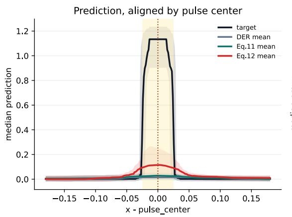

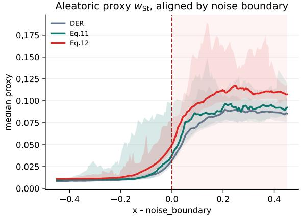

Epistemic proxy 1/√, aligned by noise boundary  
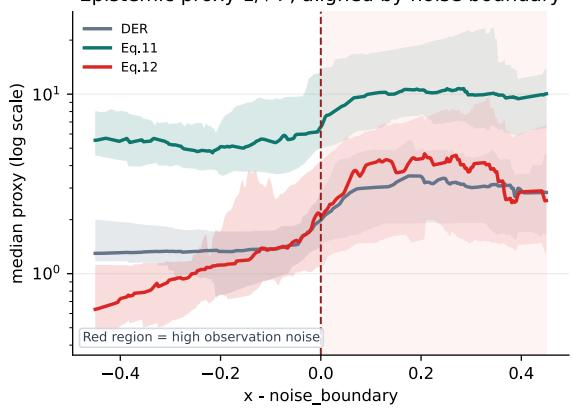  
Figure 5: Parameterized direct diagnostic. From upper left to lower center: prediction aligned by latent pulse center, data-scale response aligned by the independently sampled noise boundary, and relative mean-uncertainty response aligned by that boundary. Curves show the median and bands the interquartile range across 50 tasks. Alignment is used only for visualization, not for training or metric computation. Panel titles keep the original diagnostic’s aleatoric and epistemic proxy names. The supplied diagnostic’s compact Eq.11/Eq.12 labels map to RN-DER/Gaussian-MV, respectively.

Table 5: Parameterized direct diagnostic over 50 independently sampled tasks (mean ± sample standard deviation).
<table><tr><td>Method</td><td>MSE↓</td><td>NLL↓</td><td> $L _ { 1 / { \sqrt { \nu } } } \downarrow$ </td><td> $L _ { \mathrm { r e l } } \downarrow$ </td><td> $L _ { \mathrm { m e a n } } \downarrow$ </td></tr><tr><td>DER</td><td> $. 0 5 9 1 { \pm } . 0 2 8 2$ </td><td> $- 2 . 0 7 9 7 { \scriptstyle \pm . 3 3 1 7 }$ </td><td> $\mathbf { . 9 2 3 4 } 2 . 7 8 6 2$ </td><td> $\mathbf { 1 . 8 4 6 7 { \pm } 1 . 5 5 6 2 }$ </td><td> $\mathbf { 3 . 2 4 1 2 { \pm } 1 . 7 6 3 5 }$ </td></tr><tr><td>RN-DER</td><td></td><td> $. 0 5 7 3 { \pm } . 0 2 8 3 - 1 . 9 7 5 6 { \pm } . 3 3 1 0$ </td><td> $1 . 0 2 7 6 { \pm } . 8 9 1 2$ </td><td> $2 . 0 1 2 6 { \pm } 1 . 7 0 4 1$ </td><td> $3 . 9 3 2 1 { \scriptstyle \pm 1 . 7 1 8 0 }$ </td></tr><tr><td>Gaussian-MV</td><td> $\mathbf { . 0 4 2 2 \pm . 0 2 8 3 - 1 . 9 3 7 7 \pm . 3 5 8 7 }$ </td><td></td><td> $1 . 2 8 8 7 { \pm } 1 . 0 2 5 3 $ </td><td> $2 . 5 4 9 4 { \pm } 1 . 9 8 3 0$ </td><td> $5 . 5 3 1 6 { \scriptstyle \pm 2 . 7 2 0 7 }$ </td></tr></table>

<table><tr><td>Method</td><td>Error AUROC ↑ Sel. excess ↓</td><td></td><td> ${ \mathrm { C o v . ~ g a p ~ \downarrow ~ } }$ </td><td>Width↓</td></tr><tr><td>DER</td><td> $. 7 6 7 5 { \pm } . 2 0 0 3$ </td><td> $. 0 2 5 4 { \pm } . 0 3 5 2$ </td><td> $. 0 5 2 8 { \pm } . 0 1 4 9$ </td><td> $\mathbf { . 1 8 3 7 \pm . 0 8 9 8 }$ </td></tr><tr><td>RN-DER</td><td> $. 7 6 0 5 { \pm } . 2 2 8 2$ </td><td> $. 0 0 6 4 { \pm } . 0 1 3 9$ </td><td> $\mathbf { . 0 5 2 7 } { \scriptstyle \pm . 0 1 9 0 }$ </td><td> $. 2 3 0 4 { \pm } . 0 7 0 2$ </td></tr><tr><td>Gaussian-MV</td><td> $\mathbf { . 8 7 4 9 \pm . 1 2 9 7 }$ </td><td> $\mathbf { . 0 0 0 5 \pm . 0 0 2 1 }$ </td><td> $. 0 7 7 4 { \pm } . 0 1 3 0$ </td><td> $. 3 3 6 0 { \pm } . 0 7 6 6$ </td></tr></table>

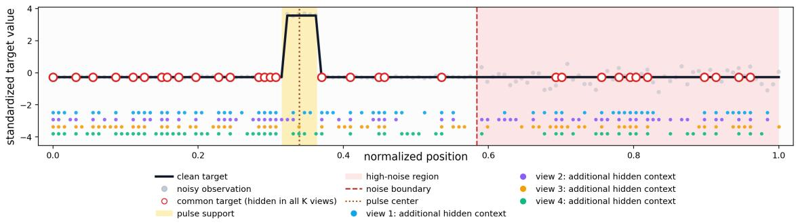  
Figure 6: Common-target observation policy. One sequence is shown, with the legend below. Red circles mark the common targets C, hidden in all four views; the four rows of dots beneath the signal mark each view’s additional hidden context $A _ { k }$ . The pulse and noise boundary vary independently. Every cross-view prediction therefore refers to the same target while its supporting evidence changes.

Table 6: Parameterized pulse-window backbone comparison over ten paired seeds (mean ± sample standard deviation).
<table><tr><td>Method</td><td>MSE↓</td><td>NLL ↓</td><td> $L _ { \mathrm { r e l } } \downarrow$ </td><td> $L _ { \mathrm { m e a n } } \downarrow$ </td><td>Err. AUROC ↑ Sel. excess ↓ Cov. gap ↓</td><td></td><td></td></tr><tr><td>Masked DER .6188±.1811 −.2508±.0516 1.4947±.2270</td><td></td><td></td><td></td><td> $. 5 5 6 2 { \scriptstyle \pm . 4 3 0 2 }$ </td><td> $. 8 2 7 1 { \pm } . 0 2 2 8$ </td><td> $. 0 8 9 5 { \pm } . 0 4 7 0$ </td><td> $. 0 4 6 0 { \pm } . 0 1 6 6$ </td></tr><tr><td>RN-DER</td><td></td><td> $\mathbf { . 5 1 5 1 { \pm } . 0 5 8 8 - . 2 5 6 5 { \pm } . 0 2 6 8 }$ </td><td> $1 . 1 0 6 1 { \pm } . 2 6 7 9$ </td><td> $. 3 1 4 9 { \pm } . 4 6 0 9$ </td><td> $. 8 3 1 9 { \pm } . 0 0 8 7$ </td><td> $. 0 3 6 0 { \pm } . 0 0 4 0$ </td><td> $. 0 5 1 2 { \pm } . 0 0 8 5$ </td></tr><tr><td>Gaussian-MV</td><td></td><td> $. 5 4 1 6 { \pm } . 0 4 2 3 - . 0 9 9 6 { \pm } . 0 4 9 9$ </td><td> $. 5 3 4 3 { \pm } . 2 2 5 7$ </td><td> $. 5 7 7 2 { \pm } . 1 0 0 8$ </td><td> $. 8 7 8 5 { \pm } . 0 1 6 8$ </td><td> $\mathbf { . 0 2 8 9 { \pm } . 0 0 2 5 }$ </td><td> $. 0 9 3 4 { \pm } . 0 0 2 0$ </td></tr><tr><td>MORSE</td><td></td><td> $\cdot 5 3 3 1 { \pm } . 0 3 7 1 \quad - . 1 6 8 1 { \pm } . 0 2 9 8$ </td><td>.3424±.0906</td><td> $\mathbf { 1 2 5 3 3 4 . 1 0 9 2 }$ </td><td> $. 8 7 0 5 { \pm } . 0 0 7 0$ </td><td> $. 0 2 9 5 { \pm } . 0 0 3 4$ </td><td>.0176±.0086</td></tr></table>

## C.4 Full Ten-Seed Backbone Comparison

$L _ { \mathrm { r e l } }$ measures undesired sensitivity of the relative factor to the heteroscedastic noise mechanism. $L _ { \mathrm { m e a n } }$ is the absolute log-ratio between average $U _ { \mathrm { m e a n } }$ in high- and low-noise regions after pooling tokens within each seed. A constant score can make the latter small, so it must be interpreted with coverage, interval width, error AUROC, and selective excess.

RN-DER remains strongest for reconstruction MSE and evaluation NLL, while Gaussian-MV gives the highest error AUROC and smallest selective excess. MORSE gives the smallest leakage diagnostics and coverage gap while remaining close on selective utility. These complementary outcomes motivate treating MORSE as a balanced method rather than counting metric wins.

## C.5 Full Ten-Seed Core Ablations

Table 8 reports full ten-seed statistics for the three core variants available in the frozen snapshot. Removing ObsRef destroys scale control, while removing Rank retains useful error ordering but weakens relative-factor separation and coverage.

Table 7: Parameterized pulse-window results (ten-seed mean ± sample standard deviation). MORSE-RC restores the direct residual-to-ν gradient. $L _ { \mathrm { m e a n } }$ measures pooled high/low-noise sensitivity, and $\mathrm { W i d t h } ^ { \dagger }$ is the mean 90% moment-interval width, to be read jointly with CovGap. Bold marks the best mean within each block.
<table><tr><td rowspan="2">Method</td><td colspan="2">Predictive fit</td><td>Mean uncertainty</td><td colspan="2">Error ranking</td><td colspan="2">Intervals</td></tr><tr><td>MSE↓</td><td>NLL ↓</td><td> $L _ { \mathrm { m e a n } } \downarrow$ </td><td>AUROC↑</td><td>SelEx ↓</td><td> $\mathrm { C o v G a p \downarrow }$ </td><td>Width†</td></tr><tr><td colspan="8">Model comparison</td></tr><tr><td>Masked DER</td><td> $. 6 1 9 \pm . 1 8 1$ </td><td> $- . 2 5 1 \pm . 0 5 2$ </td><td> $. 5 5 6 \pm . 4 3 0$ </td><td> $. 8 2 7 \pm . 0 2 3$ </td><td> $. 0 8 9 5 \pm . 0 4 7 0$ </td><td> $. 0 4 6 0 \pm . 0 1 6 6$ </td><td> $1 8 . 9 3 \pm 3 5 . 8 4$ </td></tr><tr><td>RN-DER</td><td> ${ \bf . 5 1 5 \pm . 0 5 9 }$ </td><td> $\mathbf { - . 2 5 6 \pm . 0 2 7 }$ </td><td> $. 3 1 5 \pm . 4 6 1$ </td><td> $. 8 3 2 \pm . 0 0 9$ </td><td> $. 0 3 6 0 \pm . 0 0 4 0$ </td><td> $. 0 5 1 2 \pm . 0 0 8 5$ </td><td> $2 . 3 6 \pm 1 . 4 4$ </td></tr><tr><td>Gaussian-MV</td><td> $. 5 4 2 \pm . 0 4 2$ </td><td> $- . 1 0 0 \pm . 0 5 0$ </td><td> $. 5 7 7 \pm . 1 0 1$ </td><td> ${ \bf 8 7 9 \pm . 0 1 7 }$ </td><td> $\mathbf { 0 2 8 9 \pm . 0 0 2 5 }$ </td><td> $. 0 9 3 4 \pm . 0 0 2 0$ </td><td> $2 . 7 9 \pm . 3 0$ </td></tr><tr><td>MORSE</td><td> $. 5 3 3 \pm . 0 3 7$ </td><td> $- . 1 6 8 \pm . 0 3 0$ </td><td> ${ \bf . 1 2 5 \pm . 1 0 9 }$ </td><td> $. 8 7 0 \pm . 0 0 7$ </td><td> $. 0 2 9 5 \pm . 0 0 3 4$ </td><td> $\mathbf { . 0 1 7 6 \pm . 0 0 8 6 }$ </td><td> ${ \bf 1 . 4 5 \pm . 0 7 }$ </td></tr><tr><td colspan="8">Component and coupling ablations</td></tr><tr><td>MORSE w/o ObsRef</td><td> $. 5 4 4 \pm . 0 4 1$ </td><td> $1 . 4 1 8 \pm . 1 1 7$ </td><td> $. 2 5 3 \pm . 1 2 3$ </td><td> $. 8 6 6 \pm . 0 0 9$ </td><td> $. 0 3 6 4 \pm . 0 0 4 0$ </td><td> $. 1 0 0 0 \pm . 0 0 0 1$ </td><td> $1 4 . 8 9 \pm 1 . 9 6$ </td></tr><tr><td>MORSE w/o Rank</td><td> $. 5 4 1 \pm . 0 4 5$ </td><td> $- . 1 0 6 \pm . 0 3 4$ </td><td> $. 3 1 9 \pm . 1 6 0$ </td><td> $. 8 7 4 \pm . 0 1 2$ </td><td> $. 0 2 9 2 \pm . 0 0 3 2$ </td><td> $. 0 7 6 8 \pm . 0 0 4 0$ </td><td> $2 . 0 0 \pm . 1 4$ </td></tr><tr><td>MORSE-RC</td><td> ${ \bf . 5 3 3 \pm . 0 2 0 }$ </td><td> $- . 1 0 3 \pm . 0 3 5$ </td><td> $. 2 5 5 \pm . 0 9 9$ </td><td> ${ \bf 8 7 5 \pm . 0 0 9 }$ </td><td> $\mathbf { 0 2 8 1 } \pm . \mathbf { 0 0 2 1 }$ </td><td> $. 0 7 6 1 \pm . 0 0 4 4$ </td><td> $2 . 0 5 \pm . 1 0$ </td></tr><tr><td>MORSE</td><td> ${ \bf . 5 3 3 \pm . 0 3 7 }$ </td><td> $- . 1 6 8 \pm . 0 3 0$ </td><td> ${ \bf . 1 2 5 \pm . 1 0 9 }$ </td><td> $. 8 7 0 \pm . 0 0 7$ </td><td> $. 0 2 9 5 \pm . 0 0 3 4$ </td><td> $\mathbf { . 0 1 7 6 \pm . 0 0 8 6 }$ </td><td> ${ \bf 1 . 4 5 \pm . 0 7 }$ </td></tr></table>

Table 8: Core MORSE ablations over ten paired seeds (mean ± sample standard deviation; the same component cohort as Table 7).
<table><tr><td>Variant</td><td>MSE↓</td><td>NLL ↓</td><td> $L _ { \mathrm { r e l } } \downarrow$ </td><td> $L _ { \mathrm { m e a n } } \downarrow$ </td><td>Err. AUROC ↑ Sel. excess ↓</td><td></td><td>Cov. gap ↓</td></tr><tr><td>MORSE</td><td></td><td> $\mathbf { . 5 3 3 1 { \pm } . 0 3 7 1 - . 1 6 8 1 { \pm } . 0 2 9 8 }$ </td><td> $. 3 4 2 4 { \pm } . 0 9 0 6$ </td><td> $\mathbf { . 1 2 5 3 \pm . 1 0 9 2 }$ </td><td> $. 8 7 0 5 { \pm } . 0 0 7 0$ </td><td> $. 0 2 9 5 { \pm } . 0 0 3 4$ </td><td>.0176±.0086</td></tr><tr><td>MORSE without ObsRef</td><td></td><td> $5 4 4 0 { \pm } . 0 4 0 8 \quad 1 . 4 1 8 2 { \pm } . 1 1 7 2$ </td><td> $. 8 0 4 4 { \pm } . 1 0 8 5$ </td><td> $. 2 5 3 1 { \pm } . 1 2 3 3$ </td><td> $. 8 6 6 4 { \pm } . 0 0 9 5$ </td><td> $. 0 3 6 4 { \pm } . 0 0 4 0$ </td><td>.1000±.0001</td></tr><tr><td>MORSE without Rank</td><td> $. 5 4 1 1 \pm . 0 4 5 0 - . 1 0 5 9 \pm . 0 3 3 8$ </td><td></td><td> $\mathbf { . 0 1 1 4 } 2 . 0 0 5 0$ </td><td> $. 3 1 9 1 { \pm } . 1 5 9 7$ </td><td> $. 8 7 3 7 { \scriptstyle \pm . 0 1 1 7 }$ </td><td> $\mathbf { . 0 2 9 2 } 2 2 . 0 0 3 2$ </td><td>.0768±.0040</td></tr></table>

Table 9: Extended mechanism controls over ten paired seeds (mean ± sample standard deviation; the same component cohort as Table 7).
<table><tr><td>Variant</td><td>MSE</td><td>NLL</td><td> $L _ { \mathrm { r e l } }$ </td><td> $L _ { \mathrm { m e a n } }$ </td><td>AUROC</td><td>Sel.</td><td>Cov. gap</td><td>Width</td></tr><tr><td> $U _ { \mathrm { d a t a } }$  base</td><td></td><td>.5474±.0266 −.1098±.0406.1650±.0167.2632±.0519.8732±.0081 .0293±.0027.0779±.0041</td><td></td><td></td><td></td><td></td><td></td><td>2.0594±.1027</td></tr><tr><td>Condition only .5384±.0393 2.5312±.1932 .4731±.3790.8549±.3924.8360±.0171 .0729±.0319 .1000±.0000 39.4471±10.3392</td><td></td><td></td><td></td><td></td><td></td><td></td><td></td><td></td></tr></table>

Table 10: MORSE versus residual-coupled MORSE-RC over 20 paired seeds (mean ± sample standard deviation). Lower is better except Error AUROC.
<table><tr><td>Metric</td><td>MORSE-RC</td><td>MORSE</td></tr><tr><td>MSE</td><td> $. 5 3 2 0 { \pm } . 0 1 9 8$ </td><td> $. 5 6 1 8 { \pm } . 0 7 8 7$ </td></tr><tr><td>NLL</td><td> $- . 1 1 1 0 { \pm } . 0 3 7 6$ </td><td> $- . 1 5 1 9 { \pm } . 0 5 0 9$ </td></tr><tr><td>Error AUROC</td><td> $. 8 7 2 1 { \pm } . 0 0 8 2$ </td><td> $. 8 6 9 2 { \pm } . 0 1 2 5$ </td></tr><tr><td>Selective excess</td><td> $. 0 2 8 1 { \pm } . 0 0 1 8$ </td><td> $. 0 3 0 2 { \pm } . 0 0 4 4$ </td></tr><tr><td>Coverage gap</td><td> $. 0 7 6 2 { \pm } . 0 0 3 5$ </td><td> $. 0 1 8 8 { \pm } . 0 1 0 0$ </td></tr><tr><td>Interval width</td><td> $2 . 0 1 5 3 { \pm } . 1 0 3 3$ </td><td> $1 . 4 8 0 4 { \scriptstyle \pm . 0 7 0 8 }$ </td></tr></table>

The two additional controls are reported in Table 9. The $U _ { \mathrm { d a t a } } .$ -base control removes observability conditioning from fitting while retaining supervision of the relative factor. The Condition-only control retains conditioning but removes the explicit ObsRef and Rank objectives. Their failures separate reconstruction conditioning from semantic supervision.

A separate 20-seed paired comparison evaluates MORSE with residual coupling (MORSE-RC), which adds a direct residual-to-ν path. MORSE-RC improves MSE slightly and has similar ranking, but it worsens NLL and sharply worsens coverage and interval width. Accordingly, the residual-coupled variant provides no consistent external gain that justifies a second direct teacher. Table 10 reports the external metrics used for this choice; teacher-adjacent alignment metrics are not used as the selection criterion.

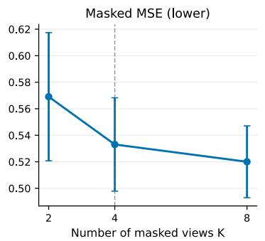

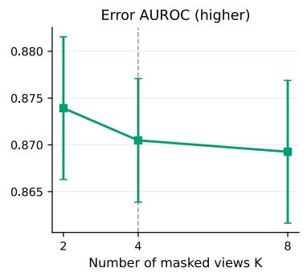

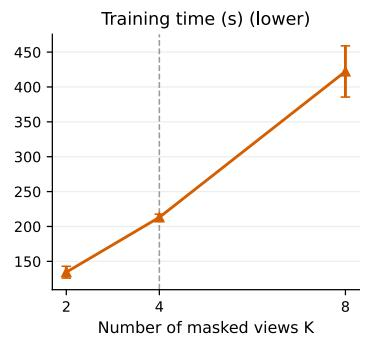  
Figure 7: Quality–cost trade-of for common-target views. Every point and its error bar show mean ± standard deviation (divisor n) over ten paired seeds. Increasing K reduces reconstruction error but does not improve error ranking, while cost grows almost linearly; $K = 4$ is the prespecified compromise used throughout the paper.

Table 11: Common-target view ablation over ten paired seeds (mean $\pm$ sample standard deviation). Training time is total wall-clock seconds per run. Forward passes per step include one reference pass.
<table><tr><td>K</td><td>MSE</td><td>NLL</td><td>Error AUROC</td><td>train  $\mathrm { s / r u n }$ </td><td>passes</td></tr><tr><td>2</td><td> $. 5 6 9 1 { \pm } . 0 5 1 0$ </td><td> $- . 1 3 2 5 { \pm } . 0 2 4 6$ </td><td> $. 8 7 3 9 { \pm } . 0 0 8 0$ </td><td> $1 3 4 . 5 { \pm } 8 . 9$ </td><td>3</td></tr><tr><td>4</td><td> $. 5 3 3 1 { \pm } . 0 3 7 1$ </td><td> $- . 1 6 8 1 { \pm } . 0 2 9 8$ </td><td> $. 8 7 0 5 { \pm } . 0 0 7 0$ </td><td> $2 1 3 . 1 { \pm } 4 . 8 $ </td><td>5</td></tr><tr><td>8</td><td> $. 5 2 0 0 { \pm } . 0 2 8 6$ </td><td> $- . 1 6 4 1 { \pm } . 0 5 8 8$ </td><td> $. 8 6 9 3 { \pm } . 0 0 8 0$ </td><td> $4 2 2 . 2 { \pm } 3 8 . 7 \ $ </td><td>9</td></tr></table>

Table 12: NIG-shaped MORSE versus explicit independent heads over ten paired seeds.
<table><tr><td>Head</td><td>MSE</td><td>NLL Err. AUROC</td><td></td><td>Sel. Cov. gap</td><td>Width</td></tr><tr><td>NIG-shaped</td><td>.5331</td><td>-.1681 .8705</td><td>.0295</td><td>.0176</td><td>1.4485</td></tr><tr><td>Explicit</td><td> $\mathbf { . 5 1 4 0 } \quad - . 1 5 0 9$ </td><td></td><td>.8543 .0402</td><td>.0094</td><td>1.4328</td></tr></table>

## C.6 Number of Views

Figure 7 and Table 11 vary the number of common-target views over ten paired seeds. More views lower reconstruction error but do not improve error ranking, while training time grows almost linearly; the final method fixes $K = 4$

## C.7 Structured Head Control

To test whether the NIG-shaped factorization is merely redundant notation, an explicit-head control predicts the mean, a positive data scale, and a positive relative mean-uncertainty channel directly. It improves MSE slightly but weakens error ranking and selective prediction. On this benchmark the two parameterizations therefore trade reconstruction error against error ranking; the comparison does not show that the NIG-shaped factorization is necessary, and α and $\beta$ are not individually identified posterior parameters. Appendix C.9 repeats the head comparison in a matched factorial on GP and pulse.

## C.8 Finite-Training-Set Reference Audit

This subsection reports the original finite-training-set audit of the four evidential methods; the extended comparison with ensembles is in Appendix D.

The strict reference follows the cross-training-set logic of Jürgens et al. (2024). Fifty Gaussian first-order reconstruction models are trained on independently sampled window datasets. On one fixed test and mask bank, their predictive means define an empirical distribution with center and variance $V _ { \mathrm { r e f } }$ . The second-order methods are then trained on five paired anchor datasets that are disjoint from the reference-model datasets. MORSE never observes $V _ { \mathrm { r e f } }$ during training.

Table 13: Strict Jürgens-aligned reference audit over five paired anchor datasets (mean ± sample standard deviation). The empirical target is fixed and independent: 50 Gaussian first-order models trained on resampled datasets. Width ratio is ideal at one.
<table><tr><td>Method</td><td>Center</td><td>Log-var</td><td>W1</td><td>Cov. gap</td><td>Width</td></tr><tr><td>DER</td><td> $. 2 5 6 2 { \pm } . 0 1 4 6$ </td><td> $3 . 8 5 3 5 { \pm } . 0 8 9 7$ </td><td> $. 3 7 5 7 { \pm } . 0 3 3 3$ </td><td> $. 0 3 2 3 { \pm } . 0 0 2 3$ </td><td> $6 . 1 2 1 2 { \scriptstyle \pm . 5 0 5 1 }$ </td></tr><tr><td>RN-DER</td><td> $. 2 3 0 7 { \scriptstyle \pm . 0 1 3 2 }$ </td><td> $4 . 2 0 5 6 { \pm } . 1 3 6 9$ </td><td> $. 4 4 1 8 { \pm } . 0 2 6 9$ </td><td> $. 0 4 7 1 { \scriptstyle \pm . 0 0 1 2 }$ </td><td> $8 . 3 3 7 8 { \scriptstyle \pm . 5 6 7 7 }$ </td></tr><tr><td>Gaussian-MV</td><td> $. 2 3 5 4 { \pm } . 0 8 1 4$ </td><td> $4 . 6 8 2 8 { \pm } . 1 0 8 3$ </td><td> $. 5 1 9 0 { \pm } . 0 5 2 6$ </td><td> $. 0 4 8 0 { \pm } . 0 0 0 8$ </td><td> $1 0 . 5 1 4 4 { \pm } 1 . 4 9 0 1$ </td></tr><tr><td>MORSE</td><td> $\mathbf { . 1 5 8 4 \pm . 0 1 8 2 }$ </td><td> $\mathbf { 1 . 5 4 9 6 { \scriptstyle \pm . 0 5 1 3 } }$ </td><td> $\mathbf { . 0 7 8 5 { \pm } . 0 0 8 6 }$ </td><td> $. 1 2 0 3 { \pm } . 1 0 8 5$ </td><td> $\mathbf { 1 . 3 4 8 0 { \pm } . 1 2 5 3 }$ </td></tr></table>

<table><tr><td>Method</td><td>Noisy AUROC Clean AUROC</td><td></td><td>AURC</td><td>Spearman</td></tr><tr><td>DER</td><td> $. 8 4 4 5 { \pm } . 0 0 3 2$ </td><td> $. 8 4 6 9 { \pm } . 0 2 4 0$ </td><td> $. 0 5 5 2 { \pm } . 0 0 2 2$ </td><td> $. 8 0 5 2 { \pm } . 0 1 1 9$ </td></tr><tr><td>RN-DER</td><td> $. 8 3 4 9 { \pm } . 0 1 3 6$ </td><td> $. 8 6 9 9 { \pm } . 0 3 5 2$ </td><td> $. 0 5 2 2 { \pm } . 0 0 3 4$ </td><td> $\mathbf { . 8 6 0 6 { \pm } . 0 0 6 3 }$ </td></tr><tr><td>Gaussian-MV</td><td> $. 8 7 7 2 { \scriptstyle \pm . 0 0 6 9 }$ </td><td> $. 9 2 6 5 { \pm } . 0 0 7 2$ </td><td> $. 0 5 5 6 { \pm } . 0 0 5 9$ </td><td> $. 8 3 0 9 { \pm } . 0 0 9 6$ </td></tr><tr><td>MORSE</td><td> $. 8 6 1 0 { \pm } . 0 0 4 0$ </td><td> $\mathbf { . 9 3 2 7 { \pm } . 0 3 4 5 }$ </td><td> $\mathbf { . 0 5 2 2 } 2 2 . 0 0 1 5$ </td><td> $. 8 5 4 8 { \pm } . 0 1 1 4$ </td></tr></table>

Table 14: Paired MORSE improvement over each baseline across the five anchor datasets. Intervals are paired 95% bootstrap confidence intervals (CIs). Positive diferences favor MORSE for all three lower-is-better metrics. The smallest attainable two-sided exact sign-test p value with five consistently signed pairs is $1 / 1 6 = . 0 6 2 5 ;$ we therefore emphasize intervals and win counts.
<table><tr><td>Baseline</td><td>Center benefit [95% CI]</td><td></td><td>Log-var benefit [95% CI]</td><td></td><td>W1 benefit [95% CI]</td></tr><tr><td>DER</td><td></td><td>.0978 [.0776,.1186]</td><td>2.3039 [2.1914,2.3870]</td><td></td><td>.2972 [.2631,.3273]</td></tr><tr><td>RN-DER</td><td></td><td>.0723 [.0548,.0898]</td><td>2.6560 [2.5830,2.7289]</td><td></td><td>.3632 [.3473,.3794]</td></tr><tr><td>Gaussian-MV</td><td></td><td>.0770 [.0011,.1515]</td><td>3.1332 [3.0243,3.2521]</td><td></td><td>.4405 [.4047,.4840]</td></tr></table>

Each first-order learner uses the same two-layer Transformer hypothesis class and 100- epoch optimization budget as the window methods, but outputs only a reconstruction mean and one positive scalar variance per token and minimizes Gaussian NLL. The same 50-model reference bank, deterministic test bank, and fixed $K = 4$ evaluation-mask bank are reused for all five anchors. Within anchor $s ,$ DER, RN-DER, Gaussian-MV, and MORSE receive the identical serialized training set. Saved content hashes verify this pairing, and reference-data seeds are disjoint from anchor-data seeds. Only the anchor dataset changes across the five paired repetitions.

Center root mean squared error (RMSE) compares a second-order predicted center with the empirical reference center. Log-variance mean absolute error (MAE) compares log Umean with log $V _ { \mathrm { r e f } } .$ . Wasserstein-1 compares the parametric predictive-mean distribution with the empirical first-order model means. Coverage and width refer to intervals over model means, not noisy observations. Clean-error AUROC and area under the risk–coverage curve (AURC) are training-independent utility checks, whereas Spearman correlation tests ordering without validating magnitude.

MORSE wins log-variance error and W1 on all five anchors against every baseline, and Center RMSE on all five anchors against DER and RN-DER and four of five against Gaussian-MV. DER retains the smallest nominal coverage gap, while MORSE has the largest and most variable coverage gap despite its near-reference width ratio. RN-DER retains the highest Spearman correlation. These exceptions are reported because internal ordering, interval width, and nominal coverage do not validate one another.

The finite-training-set audit across training sizes is reported with the proxy-based training-size audit in Appendix D.

## C.9 Matched Component and Head Study

Design. We cross the three components, Condition (C), Bound/ObsRef (B), and Order/Rank (O), in a full $2 \times 2 \times 2$ factorial with two heads: the four-output NIG head and a three-output explicit head that predicts the data scale and the relative factor directly. Four further controls use all components: α fixed to 2, a head that outputs the predictive-mean variance directly, an unnormalized teacher that supervises $U _ { \mathrm { r e l } }$ with the raw cross-view variance instead of $r _ { \mathrm { o b s } } ,$ and residual coupling (MORSE-RC). Each of the 20 variants is trained on five GP anchors and ten pulse seeds, 300 fits in total. This GP benchmark fixes the noise boundary at .5, so the oracle and the learner face the same noise information, and its contextual reference uses the 124 recorded masks that remain after removing the four scoring contexts; its MORSE error (.7349) is therefore not comparable with Table 1. The pulse cohort redraws training masks every epoch and normalizes on training data only. For every head, NLL uses the Gaussian variance $U _ { \mathrm { d a t a } } + U _ { \mathrm { m e a n } }$ . The primary endpoints are GP contextual LogVar MAE and pulse NLL, with six declared comparisons per domain and Holm correction. The settings were fixed after earlier results were available, and a single model initializer is used.

Table 15: Matched component and head study on the fixed-boundary GP benchmark (five paired anchors; mean ± sample SD). C, B, and O switch Condition, Bound (ObsRef), and Order (Rank) on or of. LogVar and Spearman compare the four-context score with the 124-mask oracle response; NLL uses the Gaussian variance $U _ { \mathrm { d a t a } } + U _ { \mathrm { m e a n } }$ for every head. Bold marks the best mean; width is not ranked.
<table><tr><td>Variant</td><td>LogVar ↓</td><td>Spearman ↑</td><td>Center RMSE ↓</td><td>NLL ↓</td><td>CovGap ↓</td><td>Width</td></tr><tr><td></td><td></td><td>.5932±.0074</td><td>.1395±.0018</td><td>.1702±.0214</td><td>.0806±.0031</td><td>1.4128±.0485</td></tr><tr><td>NIG C0B0O0 NIG C0B0O1</td><td>2.0910±.1165 2.0641±.0798</td><td>.6246±.0041</td><td>.1416±.0047</td><td>.1701±.0159</td><td>.0809±.0022</td><td>1.3938±.0273</td></tr><tr><td>NIG C0B1O0</td><td>.7135±.0081</td><td>.5878±.0070</td><td>.1425±.0056</td><td>.0601±.0090</td><td>.0291±.0045</td><td>1.0448±.0168</td></tr><tr><td>NIG C0B1O1</td><td>.7313±.0118</td><td>.6215±.0034</td><td>.1408±.0061</td><td>.0595±.0107</td><td>.0348±.0042</td><td>1.0669±.0191</td></tr><tr><td>NIG C1B0O0</td><td>1.9900±.1392</td><td>.5933±.0065</td><td>.1434±.0049</td><td>.1497±.0302</td><td>.0747±.0046</td><td>1.3445±.0588</td></tr><tr><td>NIG C1B0O1</td><td>1.9544±.1345</td><td>.6247±.0029</td><td>.1382±.0015</td><td>.1396±.0167</td><td>.0744±.0063</td><td>1.3342±.0599</td></tr><tr><td>NIG C1B1O0</td><td>.7097±.0063</td><td>.5873±.0063</td><td>.1388±.0077</td><td>.0437±.0125</td><td>.0221±.0010</td><td>1.0068±.0138</td></tr><tr><td>NIG C1B1O1 (MORSE)</td><td>.7349±.0120</td><td>.6215±.0025</td><td>.1379±.0029</td><td>.0464±.0065</td><td>.0232±.0056</td><td>1.0198±.0191</td></tr><tr><td>Explicit C0B0O0</td><td>2.1103±.0823</td><td>.5865±.0093</td><td>.1459±.0039</td><td>.1834±.0243</td><td>.0821±.0025</td><td>1.4472±.0390</td></tr><tr><td>Explicit C0B0O1</td><td>2.3762±.0375</td><td>.6193±.0035</td><td>.1444±.0020</td><td>.2240±.0138</td><td>.0873±.0011</td><td>1.5100±.0233</td></tr><tr><td>Explicit C0B1O0</td><td>.7197±.0110</td><td>.5600±.0210</td><td>.1410±.0056</td><td>.0693±.0179</td><td>.0303±.0012</td><td>1.0506±.0110</td></tr><tr><td>Explicit C0B1O1</td><td>.7157±.0114</td><td>.6204±.0033</td><td>.1390±.0057</td><td>.0633±.0137</td><td>.0351±.0041</td><td>1.0655±.0259</td></tr><tr><td>Explicit C1B0O0</td><td>1.9857±.0693</td><td>.5894±.0160</td><td>.1430±.0038</td><td>.1487±.0207</td><td>.0753±.0031</td><td>1.3677±.0301</td></tr><tr><td>Explicit C1B0O1</td><td>2.2765±.0595</td><td>.6198±.0042</td><td>.1424±.0036</td><td>.1939±.0176</td><td>.0838±.0022</td><td>1.4450±.0271</td></tr><tr><td>Explicit C1B1O0</td><td>.7196±.0093</td><td>.5688±.0156</td><td>.1393±.0050</td><td>.0585±.0143</td><td>.0269±.0052</td><td>1.0316±.0162</td></tr><tr><td>Explicit C1B1O1</td><td>.7249±.0105</td><td>.6199±.0026</td><td>.1419±.0011</td><td>.0654±.0075</td><td>.0282±.0036</td><td>1.0442±.0158</td></tr><tr><td>Fixed α = 2</td><td>.7308±.0123</td><td>.6246±.0057</td><td>.1421±.0051</td><td>.0549±.0040</td><td>.0227±.0050</td><td>1.0238±.0205</td></tr><tr><td>Direct mean variance</td><td>.7311±.0104</td><td>.6272±.0039</td><td>.1492±.0032</td><td>.0676±.0045</td><td>.0216±.0076</td><td>1.0311±.0283</td></tr><tr><td>Raw teacher</td><td>1.6972±.0390</td><td>.6192±.0037</td><td>.1383±.0030</td><td>.0445±.0082</td><td>.0165±.0053</td><td>.9929±.0170</td></tr><tr><td>MORSE-RC</td><td>2.0748±.0337</td><td>.6223±.0055</td><td>.1386±.0057</td><td>.1550±.0099</td><td>.0785±.0020</td><td>1.3660±.0143</td></tr></table>

Findings. Bound has the clearest efect: removing it raises GP scale error from .7349 to 1.9544 and pulse NLL from −.1837 to −.0831, with the full model better on all ten pulse seeds (Holm $p = . 0 1 2 ;$ Table 17). Restoring the residual path raises GP scale error to 2.0748, and the unnormalized teacher to 1.6972, so decoupling and normalization by the data scale both matter. Condition improves GP NLL and coverage but not scale error (.7313 without it), and Order improves ranking (Spearman .6215 versus .5873) at a small cost in scale error (.7097 without it).

Table 16: Matched component and head study on the pulse benchmark (ten seeds; mean ± sample SD). This cohort is not mixed with Tables 6–9. NLL uses the Gaussian variance $U _ { \mathrm { d a t a } } + U _ { \mathrm { m e a n } }$ for every head. Bold marks the best mean; width is not ranked.
<table><tr><td>Variant</td><td>MSE</td><td>NLL</td><td>AUROC</td><td>AURC</td><td>CovGap</td><td>Width</td><td> $L _ { \mathrm { m e a n } }$ </td></tr><tr><td></td><td>↓</td><td>↓</td><td>↑</td><td>↓</td><td>↓</td><td></td><td>↓</td></tr><tr><td>NIG C0B0O0 NIG C0B0O1</td><td>.5137±.0326 .5183±.0366</td><td>−.0565±.0714 −.0538±.0416</td><td>.8715±.0074 .8792±.0079</td><td>.0543±.0030 .0553±.0043</td><td>.0694±.0062 .0803±.0050</td><td>2.4342±.1679 2.1985±.2129</td><td>.1608±.0765 .2314±.1294</td></tr><tr><td>NIG C0B1O0</td><td>.5115±.0294</td><td>−.1705±.0419</td><td>.8748±.0114</td><td>.0534±.0030</td><td> $. 0 1 4 9 { \pm } . 0 0 9 0$ </td><td>1.4983±.0932</td><td>.2773±.1708</td></tr><tr><td>NIG C0B1O1</td><td>.5143±.0242</td><td>−.1550±.0664</td><td>.8758±.0064</td><td>.0542±.0025</td><td> $. 0 1 9 1 { \pm } . 0 0 8 0$ </td><td>1.4646±.0627</td><td>.1402±.0827</td></tr><tr><td>NIG C1B0O0</td><td>.5265±.0181</td><td>−.0571±.0445</td><td>.8761±.0088</td><td>.0557±.0026</td><td>.0707±.0069</td><td>2.5693±.3079</td><td>.1911±.1393</td></tr><tr><td>NIG C1B0O1</td><td>.5030±.0256</td><td>−.0831±.0352</td><td>.8731±.0057</td><td>.0532±.0022</td><td>.0798±.0053</td><td>2.0578±.1394</td><td>.2815±.1012</td></tr><tr><td>NIG C1B1O0</td><td>.4961±.0358</td><td>−.1735±.0309</td><td>.8733±.0071</td><td>.0530±.0029</td><td>.0126±.0080</td><td>1.4676±.0968</td><td>.2508±.1637</td></tr><tr><td>NIG C1B1O1 (MORSE)</td><td>.5101±.0323</td><td>−.1837±.0210</td><td>.8722±.0105</td><td>.0537±.0032</td><td>.0109±.0072</td><td>1.4317±.0599</td><td>.1086±.1071</td></tr><tr><td>Explicit C0B0O0</td><td>.4882±.0384</td><td>−.1148±.0342</td><td>.8728±.0071</td><td>.0518±.0032</td><td>.0717±.0073</td><td>1.9160±.0878</td><td></td></tr><tr><td>Explicit C0B0O1</td><td>.5153±.0342</td><td>−.0655±.0362</td><td>.8753±.0079</td><td>.0560±.0033</td><td>.0810±.0030</td><td>2.1485±.1368</td><td>.3483±.1042 .2792±.0971</td></tr><tr><td>Explicit C0B1O0</td><td>.4919±.0300</td><td>−.1957±.0349</td><td>.8524±.0099</td><td>.0609±.0048</td><td>.0076±.0055</td><td>1.3846±.0579</td><td>.4495±.2551</td></tr><tr><td>Explicit C0B1O1</td><td>.5071±.0288</td><td>−.1852±.0290</td><td>.8586±.0099</td><td>.0644±.0038</td><td>.0125±.0048</td><td>1.4439±.0766</td><td>.2178±.1071</td></tr><tr><td>Explicit C1B0O0</td><td>.4947±.0459</td><td>−.1201±.0337</td><td>.8705±.0091</td><td>.0525±.0038</td><td>.0704±.0061</td><td>1.8761±.1276</td><td>.3223±.1464</td></tr><tr><td>Explicit C1B0O1</td><td>.5018±.0309</td><td>−.0760±.0462</td><td>.8701±.0079</td><td>.0545±.0039</td><td>.0798±.0050</td><td>2.0581±.1628</td><td>.2313±.1137</td></tr><tr><td>Explicit C1B1O0</td><td>.5141±.0570</td><td>−.1723±.0605</td><td>.8612±.0109</td><td>.0663±.0096</td><td>.0121±.0074</td><td>1.4689±.1170</td><td>.3996±.2293</td></tr><tr><td>Explicit C1B1O1</td><td>.4942±.0257</td><td>−.1966±.0318</td><td>.8584±.0076</td><td>.0643±.0040</td><td>.0072±.0040</td><td>1.4304±.0378</td><td>.2164±.2445</td></tr><tr><td>Fixed α = 2</td><td>.4941±.0348</td><td>−.1687±.0544</td><td>.8690±.0065</td><td>.0531±.0035</td><td>.0151±.0073</td><td>1.4221±.0455</td><td>.2021±.1203</td></tr><tr><td>Direct mean variance</td><td>.4999±.0269</td><td>−.1702±.0316</td><td>.8515±.0108</td><td>.0631±.0027</td><td>.0090±.0085</td><td>1.4115±.0584</td><td>.2443±.1461</td></tr><tr><td>Raw teacher</td><td>.5048±.0320</td><td>−.1855±.0348</td><td>.8750±.0053</td><td>.0538±.0038</td><td>.0152±.0051</td><td>1.4642±.0943</td><td>.3786±.3094</td></tr><tr><td>MORSE-RC</td><td>.5050±.0220</td><td>−.0870±.0359</td><td>.8747±.0075</td><td>.0529±.0023</td><td>.0770±.0049</td><td>2.0331±.1325</td><td>.2813±.0667</td></tr></table>

Table 17: Declared primary comparisons in the component study: full MORSE minus each control (negative favors MORSE), paired 95% intervals from 20,000 whole-anchor or whole-seed draws, wins, and Holm-adjusted exact sign-flip p within each domain. The five GP anchors are descriptive.
<table><tr><td>Endpoint</td><td>Control</td><td>Difference [95% interval]</td><td></td><td>Wins</td><td>Holm p</td></tr><tr><td>GP (LogVar)</td><td>no Condition</td><td>+0.00356</td><td>[-0.00845, +0.01383]</td><td>1/5</td><td>1.000</td></tr><tr><td>GP (LogVar)</td><td>no Bound</td><td>-1.21951</td><td>[-1.32962, -1.11433]</td><td>5/5</td><td>0.375</td></tr><tr><td>GP (LogVar)</td><td>no Order</td><td>+0.02515</td><td>[+0.01646, +0.03384]</td><td>0/5</td><td>0.375</td></tr><tr><td>GP (LogVar)</td><td>explicit head</td><td>+0.00994</td><td>[+0.00080, +0.01802]</td><td>1/5</td><td>0.750</td></tr><tr><td>GP (LogVar)</td><td>fixed α = 2</td><td>+0.00411</td><td>[-0.00470, +0.01234]</td><td>1/5</td><td>1.000</td></tr><tr><td>GP (LogVar)</td><td>direct mean variance</td><td>+0.00379</td><td>[-0.00625, +0.01383]</td><td>2/5</td><td>1.000</td></tr><tr><td>Pulse (NLL)</td><td>no Condition</td><td>-0.02863</td><td>[-0.06976, +0.00845]</td><td>6/10</td><td>1.000</td></tr><tr><td>Pulse (NLL)</td><td>no Bound</td><td>-0.10055</td><td>[-0.12413, -0.07871]</td><td>10/10</td><td>0.012</td></tr><tr><td>Pulse (NLL)</td><td>no Order</td><td>-0.01011</td><td>[-0.02622, +0.00600]</td><td>5/10</td><td>1.000</td></tr><tr><td>Pulse (NLL)</td><td>explicit head</td><td>+0.01298</td><td>[−0.00524, +0.03242]</td><td>5/10</td><td>1.000</td></tr><tr><td>Pulse (NLL)</td><td>fixed α = 2</td><td>-0.01501</td><td>[-0.05050, +0.01475]</td><td>6/10</td><td>1.000</td></tr><tr><td>Pulse (NLL)</td><td>direct mean variance</td><td>-0.01342</td><td>[-0.03901, +0.00644]</td><td>7/10</td><td>1.000</td></tr></table>

Table 18: Pulse training-size audit on the 32,594 resolvable common targets (ten paired anchors per N). The first column is the 128-mask response of each MORSE predictor, $R _ { \mathrm { o b s } } ( \theta )$ , against the corrected proxy reference $R _ { c } ^ { * }$ (mean ± sample standard deviation); the second is MORSE’s learned $U _ { \mathrm { m e a n } }$ against the same reference. The mean of $R _ { c } ^ { * }$ is .03395 at every N. The last column is the finite-training-set reference on the same targets.
<table><tr><td>N  $R _ { \mathrm { o b s } } ( \theta )$  VS</td><td> $R _ { c } ^ { * } ~ \mathrm { L o g V a r }$  →</td><td> $U _ { \mathrm { m e a n } }$  VS  $R _ { c } ^ { * }$   $\mathrm { L o g V a r }$  ↓</td><td>Mean  $R _ { \mathrm { o b s } } ( \theta )$ </td><td>Mean  $V _ { \mathrm { r e f } }$ </td></tr><tr><td>512</td><td> $1 . 9 8 7 { \scriptstyle \pm . 1 8 7 }$ </td><td>4.477</td><td>.009</td><td>.0427</td></tr><tr><td>2048</td><td> $1 . 5 6 2 { \pm } . 0 9 2$ </td><td>3.327</td><td>.022</td><td>.0445</td></tr><tr><td>8192</td><td> $1 . 2 8 1 { \pm } . 0 9 1$ </td><td>2.345</td><td>.038</td><td>.0361</td></tr><tr><td>32768</td><td> $. 9 1 7 { \pm } . 0 8 7$ </td><td>1.687</td><td>.040</td><td>.0200</td></tr></table>

The NIG head is not necessary for contextual scale alignment: the explicit head (.7249), fixed α (.7308), and direct mean variance (.7311) align as well. On pulse, the NIG head gives better error AUROC and AURC than the explicit and direct-variance heads, whereas the explicit head has lower mean MSE, NLL, and coverage gap. The study therefore supports distinct roles for the components, not the necessity of each component or of the four NIG outputs.

## D Pulse Proxy and Training-Size Audit

Reference construction. Exact Bayes inference is not practical for the pulse generator: self-normalized importance sampling over its five latent parameters reached the pre-specified minimum efective sample size of 200 over all 128 masks in none of 64 test windows (median window-level ESS 9.45). We therefore approximate the population-optimal predictor with firstorder networks trained on freshly generated windows at every step (unlimited data). Eight proxies use the standard two-layer, width-64 architecture and four use a four-layer, width-128 architecture; all use exponential moving averages of the weights (decay .9995), a cosine schedule to a final learning rate of $1 0 ^ { - 6 }$ , and batch size 256. For each architecture, the ensemble mean over seeds is evaluated on 128 fixed masks per common target. We subtract the seednoise contribution $\widehat { N } ( t ) = S ^ { - 1 } \operatorname * { m e a n } _ { s < s ^ { \prime } } \mathrm { V a r } _ { j } ( \mu _ { s , j , t } - \mu _ { s ^ { \prime } , j , t } ) / 2$ from the cross-mask variance of the ensemble mean, which gives the corrected reference $R _ { c } ^ { * } ( t )$ , and call a target resolvable if $R _ { c } ^ { * } ( t ) \geq 1 0 \widehat { N } ( t )$ . Resolvability is defined from proxy quantities only.

Quality checks. A split of the standard seeds into two halves gives corrected references that agree to LogVar MAE .117 on resolvable targets (threshold .2). The two architectures difer by .241 (threshold .2), and the Bayes check could not arbitrate, so the larger architecture was selected by its lower validation clean-target MSE (.19960 versus .20312), as specified in advance for this case. Its ensemble mean has clean-target MSE .19930, below the best of the 160 finite-N method anchors (.22550), and 99.47% of common targets are resolvable (32,594 targets). These checks establish a usable operational reference; they do not show that it equals the Bayes predictor.

Training-size results. Table 18 compares the 128-mask response of each MORSE predictor with $R _ { c } ^ { * }$ on the resolvable targets. The predictor’s error decreases at every step and improves from $N = 5 1 2$ to 32,768 on all ten paired anchors. The learned $U _ { \mathrm { m e a n } }$ follows the same trend at a much larger error. The mean predictor response rises from .009 at $N = 5 1 2$ to .040 at $N = 3 2$ ,768 and passes the fixed reference mean of .034, while the finite-training-set reference decreases; the early deficit is consistent with the shrinkage mechanism described after Proposition 3.

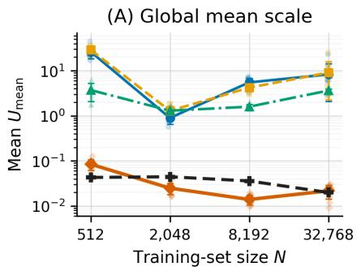

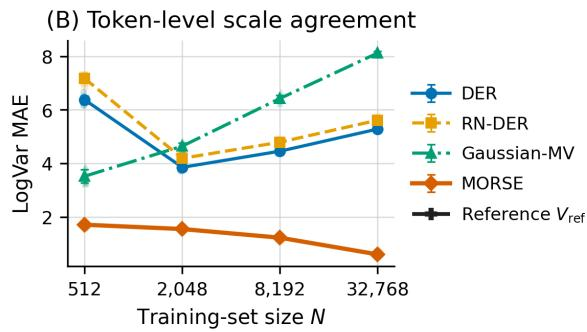  
Figure 8: Finite-training-set audit with ten paired anchors and an independent 50-model reference bank per N. (A) Mean $U _ { \mathrm { m e a n } }$ and mean $V _ { \mathrm { r e f } }$ . (B) Token-level log-variance MAE to $V _ { \mathrm { r e f } } ;$ ; lower is better. Curves show mean ± standard deviation; pale markers show individual anchors.

Checkpoint provenance. The original synthetic runs did not retain model checkpoints. For this audit, models were retrained with the frozen protocol and seeds, and a retrained model was accepted as equivalent only if its fixed-bank predictions matched the archived ones to $1 0 ^ { - 6 }$ MAE. Some $N = 3 2 , 7 6 8$ anchors could not be reproduced exactly on the available hardware and were retrained on a diferent GPU type; the audit uses these retrained models consistently, so their $V _ { \mathrm { r e f } ^ { - } } \mathrm { b a s e d }$ values can difer slightly from Table 19.

Finite-training-set audit across sizes. The original finite-training-set construction was repeated at seven training sizes, each with an independent bank of 50 first-order models and ten paired second-order anchors (Figure 8 and Table 19). Training uses 100 epochs at every size, so larger datasets receive proportionally more gradient updates. MORSE has the lowest LogVar MAE to $V _ { \mathrm { r e f } }$ at every size and its error decreases at all six transitions, whereas baseline magnitudes vary sharply and non-monotonically. The pooled MORSE mean contracts from .084 to .014 at $N = 8 { , } 1 9 2$ and then rises to .022 at N = 32,768 (a 55% increase), while $V _ { \mathrm { r e f } }$ keeps decreasing; the close match of the two means at N = 32,768 is therefore a crossing of opposite trends rather than convergence, as Proposition 3 predicts.

Data-scale calibration by noise region. The generator provides the normalized local noise variance of every target: .00166 in the low-noise region and .16614 in the high-noise region. Averaging $\lvert \log ( \overline { { U } } _ { \mathrm { d a t a } , t } + \epsilon ) - \log ( \sigma _ { t } ^ { 2 } + \epsilon ) \rvert$ over each region at $N = 3 2 , 7 6 8$ , MORSE obtains low/high-noise errors of 1.053/.294, compared with 1.089/.306 for Gaussian-MV, 1.461/4.959 for DER, and 3.680/5.152 for RN-DER. This separates the calibration of $U _ { \mathrm { d a t a } }$ from the reference alignment of $U _ { \mathrm { m e a n } } .$

Extended comparison with ensembles. Table 20 adds five-member deep and bootstrap ensembles to the N = 2048 pulse comparison on the resolvable targets. Both ensembles are closer than MORSE’s learned score to the contextual proxy and to $V _ { \mathrm { r e f } }$ . Ensembles are closer on this proxy, so the contextual advantage observed on GP is benchmark-dependent; the ensembles also use five separately trained models per anchor.

## E Gaussian-Process Reference Audits

## E.1 Default Setting

Generator and oracle. Length-128 windows come from a zero-mean Matérn-5/2 Gaussian process with unit signal variance and length scale .05. Independent noise has standard deviation .05 or .30, separated by a boundary sampled uniformly from [.2, .8]. A separate calibration bank of 20,000 windows defines one afine normalization shared by every model and by the oracle. The Bayes oracle computes the exact conditional mean at hidden positions from the known covariance kernel and local noise variances (Rasmussen and Williams, 2006); the learned models receive only their masked observations and positions. Because the oracle conditions on each window’s true noise variances, including the boundary, it is a known-noise Bayes target. The population-optimal predictor $\mu ^ { * }$ of Proposition 3 for models that see only the visible values would instead average the conditional mean over the boundary’s posterior. All compared models receive the same information, so this distinction concerns what the reference represents rather than the inputs available to any one method. The fixed test bank contains 1,024 windows and 32,768 common targets. The variance of the 128 exact conditional means is a finite-mask approximation to the population contextual response.

Table 19: Finite-training-set audit across seven training sizes. Panel A: ten paired second-order anchors per size (mean ± sample standard deviation); mean $U _ { \mathrm { m e a n } }$ is descriptive. LogVar MAE is the common-target average of $| \log ( U _ { \mathrm { m e a n } } + \epsilon ) - \log ( V _ { \mathrm { r e f } } + \epsilon ) |$ . Panel B: empirical reference variance; each row uses an independent bank of 50 first-order models on the same fixed test and mask bank.
<table><tr><td rowspan="2">N</td><td colspan="4">A. Mean  $U _ { \mathrm { m e a n } }$ </td><td colspan="4">A. LogVar MAE to  $V _ { \mathrm { r e f } } \downarrow$ </td></tr><tr><td>DER</td><td>RN-DER</td><td>Gaussian-MV</td><td>MORSE</td><td>DER</td><td>RN-DER</td><td>Gaussian-MV</td><td>MORSE</td></tr><tr><td>512</td><td> $2 6 . 2 1 { \pm } 7 . 6 5$ </td><td> $2 8 . 9 0 { \pm } 5 . 4 3 $ </td><td> $3 . 7 2 { \pm } 1 . 6 1$ </td><td>.084±.022</td><td> $6 . 3 7 1 { \pm } . 1 5 3$ </td><td> $7 . 1 6 6 { \pm } . 1 3 9$ </td><td> $3 . 5 1 7 { \scriptstyle \pm . 2 4 5 }$ </td><td> $\mathbf { 1 . 7 0 8 } { \pm . 0 6 1 }$ </td></tr><tr><td>1024</td><td> $4 1 1 . 2 2 \pm 2 2 7 . 1 5$ </td><td> $3 0 7 . 8 1 { \pm } 2 3 6 . 5 6 $ </td><td> $1 . 5 4 2 { \pm } . 3 5 1 $ </td><td>.0479±.0065</td><td> $7 . 7 1 9 { \pm } . 5 2 9$ </td><td> $6 . 3 1 5 { \pm } 1 . 1 6 1$ </td><td> $3 . 8 9 3 { \pm } . 1 3 7$ </td><td> $\mathbf { 1 . 5 6 4 \pm . 0 7 9 }$ </td></tr><tr><td>2048</td><td> $. 8 9 7 { \pm } . 2 5 2$ </td><td> $1 . 2 9 3 { \pm } . 3 4 0 $ </td><td> $1 . 2 9 7 { \scriptstyle \pm . 2 8 6 }$ </td><td>.0249±.0069</td><td> $3 . 8 5 0 { \pm } . 0 8 5$ </td><td> $4 . 1 8 6 { \pm } . 1 1 1$ </td><td> $4 . 6 4 1 { \pm } . 1 1 9$ </td><td> $\mathbf { 1 . 5 4 6 { \scriptstyle \pm . 0 4 0 } }$ </td></tr><tr><td>4096</td><td> $. 8 1 5 { \pm } . 1 8 0 \ $ </td><td> $. 9 9 1 { \pm } . 2 0 2$ </td><td> $1 . 5 8 5 { \pm . 3 0 2 }$ </td><td>.0159±.0032</td><td> $4 . 0 6 9 { \pm } . 1 2 2$ </td><td> $4 . 4 3 4 { \pm } . 0 6 1$ </td><td> $5 . 7 5 9 { \pm } . 2 2 6$ </td><td> $\mathbf { 1 . 5 0 5 \pm . 0 3 8 }$ </td></tr><tr><td>8192</td><td> $5 . 5 0 { \pm } 1 . 3 9$ </td><td> $4 . 2 1 { \pm } . 7 7$ </td><td> $1 . 5 9 2 { \pm } . 2 0 2$ </td><td>.0140±.0033</td><td> $4 . 4 5 2 { \pm } . 0 7 3$ </td><td> $4 . 7 8 8 { \pm } . 0 5 1$ </td><td> $6 . 4 2 1 { \pm } . 1 1 8$ </td><td> $\mathbf { 1 . 2 2 3 2 . 0 3 0 }$ </td></tr><tr><td>16384</td><td> $6 . 7 3 { \pm } 4 . 1 5$ </td><td> $6 . 4 0 { \pm } 4 . 6 5$ </td><td> $2 . 6 2 7 { \scriptstyle \pm . 2 2 9 }$ </td><td>.0147±.0037</td><td> $4 . 8 0 4 { \scriptstyle \pm . 0 6 0 }$ </td><td> $5 . 1 9 5 { \pm } . 0 4 7$ </td><td> $7 . 3 3 1 { \pm } . 0 7 8$ </td><td> ${ \bf . 8 6 3 \pm . 0 4 8 }$ </td></tr><tr><td>32768</td><td> $8 . 2 8 { \pm } 6 . 1 8$ </td><td> $9 . 0 7 { \pm } 6 . 8 0 $ </td><td> $3 . 6 2 9 { \pm } . 2 6 8$ </td><td> $. 0 2 1 7 { \pm } . 0 0 7 4$ </td><td> $5 . 2 7 8 { \pm } . 0 5 8$ </td><td> $5 . 6 0 9 { \scriptstyle \pm . 0 5 4 }$ </td><td> $8 . 1 1 6 { \pm } . 0 5 8$ </td><td> ${ \bf . 6 0 0 } { \bf \pm . 0 4 6 }$ </td></tr></table>

<table><tr><td colspan="2">N B. Mean  $V _ { \mathrm { r e f } }$ </td><td>Median 90th percentile</td><td></td></tr><tr><td>512</td><td>.04305</td><td>.000713</td><td>.17473</td></tr><tr><td>1024</td><td>.04812</td><td>.000515</td><td>.18551</td></tr><tr><td>2048</td><td>.04449</td><td>.000406</td><td>.14018</td></tr><tr><td>4096</td><td>.03994</td><td>.000270</td><td>.08216</td></tr><tr><td>8192</td><td>.03591</td><td>.000203</td><td>.06683</td></tr><tr><td>16384</td><td>.02501</td><td>.000130</td><td>.03738</td></tr><tr><td>32768</td><td>.01992</td><td>.000088</td><td>.03799</td></tr></table>

Table 20: Pulse proxy audit on five paired anchors and 32,594 resolvable targets (mean ± sample SD). Context variance uses the selected four-model large-architecture proxy, not an exact Bayes reference. The independent training-set reference contains 50 first-order models. Both ensemble controls outperform MORSE in LogVar MAE to both targets in this benchmark.
<table><tr><td>Method</td><td>Context LogVar ↓</td><td> ${ \mathrm { C o n t e x t ~ } } \rho \uparrow$ </td><td> $V _ { \mathrm { r e f } } ~ \mathrm { L o g V a r } \downarrow$ </td><td> $V _ { \mathrm { r e f } } ~ \rho ~ \uparrow$ </td></tr><tr><td>DER</td><td> $6 . 1 4 0 \pm 0 . 0 9 6$ </td><td> $0 . 4 5 8 \pm 0 . 0 0 8$ </td><td> $3 . 8 4 7 \pm 0 . 0 8 9$ </td><td> $0 . 8 0 6 \pm 0 . 0 1 2$ </td></tr><tr><td>RN-DER</td><td> $6 . 5 4 1 \pm 0 . 1 4 3$ </td><td> $0 . 4 6 4 \pm 0 . 0 0 9$ </td><td> $4 . 2 0 1 \pm 0 . 1 3 6$ </td><td> $0 . 8 6 1 \pm 0 . 0 0 6$ </td></tr><tr><td>Gaussian-MV</td><td> $7 . 0 4 0 \pm 0 . 1 0 4$ </td><td> $\mathbf { 0 . 4 6 4 \pm 0 . 0 1 6 }$ </td><td> $4 . 6 7 8 \pm 0 . 1 0 8$ </td><td> $0 . 8 3 1 \pm 0 . 0 1 0$ </td></tr><tr><td>MORSE</td><td> $3 . 3 3 2 \pm 0 . 0 3 7$ </td><td> $0 . 4 2 8 \pm 0 . 0 1 5$ </td><td> $1 . 5 4 5 \pm 0 . 0 5 1$ </td><td> $0 . 8 5 5 \pm 0 . 0 1 1$ </td></tr><tr><td>MORSE-IS</td><td> $3 . 5 2 6 \pm 0 . 0 5 2$ </td><td> $0 . 4 4 7 \pm 0 . 0 1 0$ </td><td> $1 . 4 8 5 \pm 0 . 0 7 3$ </td><td> $\mathbf { 0 . 8 6 7 \pm 0 . 0 0 5 }$ </td></tr><tr><td>Deep ensemble (5)</td><td> $\mathbf { 2 . 5 5 5 \pm 0 . 2 1 0 }$ </td><td> $0 . 4 2 9 \pm 0 . 0 5 7$ </td><td> $\mathbf { 0 . 7 2 2 \pm 0 . 1 0 0 }$ </td><td> $0 . 7 5 1 \pm 0 . 1 0 9$ </td></tr><tr><td>Bootstrap ensemble (5)</td><td> $2 . 6 6 1 \pm 0 . 2 1 0$ </td><td> $0 . 3 7 2 \pm 0 . 0 3 8$ </td><td> $0 . 7 4 8 \pm 0 . 1 0 8$ </td><td> $0 . 6 0 9 \pm 0 . 2 4 6$ </td></tr></table>

Training protocol. Five paired anchor datasets contain 2,048 windows each. All models use the frozen two-layer, width-64, four-head Transformer, AdamW with learning rate $1 0 ^ { - 3 }$ and weight decay $1 0 ^ { - 4 } ;$ batch size 64, and 100 epochs, with four views that mask half of the tokens and a shared-target rate of .25. Deep ensembles vary the initialization on each anchor; bootstrap ensembles resample each anchor with replacement and fix the initialization. MC dropout selects its probability from {.05, .10, .20} by Gaussian NLL on a deterministic 10% holdout of the anchor and then refits on the complete anchor; four anchors select .10 and one selects .20. The selection uses no test or reference quantities.

Table 21: GP two-reference audit on five paired anchors (mean ± sample SD). Center is RMSE of first-order conditional means against analytic Bayes means. The same four evaluation contexts are used for every learned score and for the 20-model independent $V _ { \mathrm { r e f } }$ bank; model-axis variances are computed before averaging over contexts. Raw rows use 4 or 128 masks and estimate context variation directly. The two reference quantities measure diferent sources of variation. The no-attention MC dropout row is retrained without attention-probability dropout (Appendix E.3).
<table><tr><td>Method</td><td>Center RMSE↓</td><td> $\mathrm { C o n t e x t \ L o g V a r \ L }$ </td><td> ${ \mathrm { C o n t e x t ~ } } \rho \uparrow$ </td><td> $V _ { \mathrm { r e f } } ~ \mathrm { L o g V a r } \downarrow$ </td><td> $V _ { \mathrm { r e f } } \ \rho \ \uparrow$ </td></tr><tr><td>DER</td><td> $0 . 1 3 5 \pm 0 . 0 0 4$ </td><td> $2 . 1 5 0 \pm 0 . 1 0 5$ </td><td> $0 . 5 2 6 \pm 0 . 0 0 6$ </td><td> $3 . 4 3 2 \pm 0 . 1 0 5$ </td><td> $0 . 4 8 6 \pm 0 . 0 0 9$ </td></tr><tr><td>RN-DER</td><td> $\mathbf { 0 . 1 2 9 \pm 0 . 0 0 4 }$ </td><td> $2 . 4 1 4 \pm 0 . 0 7 1$ </td><td> $0 . 5 2 5 \pm 0 . 0 0 6$ </td><td> $3 . 7 0 4 \pm 0 . 0 7 0$ </td><td> $0 . 4 8 1 \pm 0 . 0 0 6$ </td></tr><tr><td>Gaussian-MV</td><td> $0 . 1 3 9 \pm 0 . 0 0 8$ </td><td> $4 . 3 3 6 \pm 0 . 1 1 1$ </td><td> $0 . 5 0 6 \pm 0 . 0 1 7$ </td><td> $5 . 6 3 2 \pm 0 . 1 1 1$ </td><td> $0 . 4 5 5 \pm 0 . 0 2 1$ </td></tr><tr><td>Deep ensemble (5)</td><td> $0 . 1 3 2 \pm 0 . 0 0 2$ </td><td> $2 . 1 6 6 \pm 0 . 1 4 0$ </td><td> $0 . 3 0 3 \pm 0 . 0 4 6$ </td><td> $0 . 9 1 5 \pm 0 . 0 9 1$ </td><td> $0 . 6 8 0 \pm 0 . 0 5 2$ </td></tr><tr><td>Bootstrap ensemble (5)</td><td> $0 . 1 2 9 \pm 0 . 0 0 2$ </td><td> $1 . 6 0 7 \pm 0 . 0 9 2$ </td><td> $0 . 3 0 3 \pm 0 . 0 5 5$ </td><td> $\mathbf { 0 . 5 4 8 \pm 0 . 0 2 7 }$ </td><td> $0 . 6 9 7 \pm 0 . 0 3 5$ </td></tr><tr><td>MC dropout (50)</td><td> $0 . 1 3 3 \pm 0 . 0 0 2$ </td><td> $0 . 8 0 7 \pm 0 . 0 1 3$ </td><td> $0 . 4 6 7 \pm 0 . 0 2 6$ </td><td> $1 . 1 8 5 \pm 0 . 1 0 7$ </td><td> $\mathbf { 0 . 7 9 7 \pm 0 . 0 1 7 }$ </td></tr><tr><td>no attention (50)</td><td> $0 . 1 3 5 \pm 0 . 0 0 7$ </td><td> $1 . 0 1 2 \pm 0 . 0 6 5$ </td><td> $0 . 4 1 6 \pm 0 . 0 5 5$ </td><td> $0 . 7 3 2 \pm 0 . 0 7 0$ </td><td> $0 . 7 2 8 \pm 0 . 0 2 9$ </td></tr><tr><td>MORSE</td><td> $0 . 1 4 4 \pm 0 . 0 0 5$ </td><td> $0 . 7 7 4 \pm 0 . 0 2 2$ </td><td> $0 . 5 3 7 \pm 0 . 0 0 8$ </td><td> $1 . 4 9 9 \pm 0 . 0 9 8$ </td><td> $0 . 5 5 3 \pm 0 . 0 3 5$ </td></tr><tr><td>MORSE-IS</td><td> $0 . 1 4 4 \pm 0 . 0 0 6$ </td><td> $1 . 1 0 9 \pm 0 . 0 6 7$ </td><td> $0 . 5 3 9 \pm 0 . 0 0 8$ </td><td> $2 . 2 6 3 \pm 0 . 0 8 6$ </td><td> $0 . 5 5 0 \pm 0 . 0 3 4$ </td></tr><tr><td>MORSE raw (4)</td><td> $0 . 1 4 4 \pm 0 . 0 0 5$ </td><td> $1 . 2 1 2 \pm 0 . 0 0 7$ </td><td> $0 . 4 7 4 \pm 0 . 0 1 0$ </td><td> $1 . 5 1 2 \pm 0 . 0 2 7$ </td><td> $0 . 4 4 3 \pm 0 . 0 0 7$ </td></tr><tr><td>RN-DER raw (4)</td><td> $\mathbf { 0 . 1 2 9 \pm 0 . 0 0 4 }$ </td><td> $1 . 1 9 3 \pm 0 . 0 0 5$ </td><td> $0 . 4 9 8 \pm 0 . 0 0 7$ </td><td> $1 . 4 9 3 \pm 0 . 0 1 6$ </td><td> $0 . 4 2 9 \pm 0 . 0 0 6$ </td></tr><tr><td>MORSE raw (128)</td><td> $0 . 1 4 4 \pm 0 . 0 0 5$ </td><td> $0 . 6 7 3 \pm 0 . 0 3 2$ </td><td> $0 . 7 1 8 \pm 0 . 0 1 6$ </td><td> $1 . 6 8 2 \pm 0 . 0 4 4$ </td><td> $0 . 6 0 5 \pm 0 . 0 0 9$ </td></tr><tr><td>RN-DER raw (128)</td><td> $\mathbf { 0 . 1 2 9 \pm 0 . 0 0 4 }$ </td><td> $\mathbf { 0 . 6 1 5 \pm 0 . 0 2 4 }$ </td><td> $\mathbf { 0 . 7 5 6 \pm 0 . 0 1 3 }$ </td><td> $1 . 6 3 5 \pm 0 . 0 3 3$ </td><td> $0 . 5 8 3 \pm 0 . 0 1 1$ </td></tr></table>

Two variation axes. The contextual reference varies the mask while fixing the predictor. The training-set reference $V _ { \mathrm { r e f } }$ comes from 20 first-order models trained on disjoint datasets: at each fixed evaluation context we compute the cross-model variance and then average over the four shared contexts. Ensemble and dropout scores use the same operation on their model or stochastic-pass axis, and evidential scores average $U _ { \mathrm { m e a n } }$ over the same four contexts, so no table mixes model variance with variance caused by changing masks.

MORSE has the lowest contextual LogVar MAE among the primary comparators, while bootstrap ensembles better match $V _ { \mathrm { r e f } }$ (.548 versus 1.499). Relative to bootstrap member variance, MORSE’s score is closer to the contextual reference on all five anchors (paired diference −.833, 95% interval [−.911, −.757]) and farther from $V _ { \mathrm { r e f } }$ on all five (+.951, [.881, 1.041]); relative to MC dropout, the corresponding diferences are −.033 ([−.041, −.023]) and +.314 ([.209, .447]). RN-DER’s raw 128-mask variance is closer to the contextual reference than MORSE’s raw variance (.615 versus .673; paired diference +.058, interval [.029, .095], RN-DER better on $5 / 5$ anchors), and every comparator’s predictive mean is closer to the Bayes mean than MORSE’s (center RMSE .129–.139 versus .144; RN-DER better on $5 / 5$ anchors). These results distinguish the learned score’s eficiency from the quality of the underlying predictive mean.

Intervals. Table 22 shows that MORSE’s median score-to-reference ratio is 1.17, close to one, but its Gaussian moment intervals cover 82% of the Bayes conditional means at a nominal 95%. MORSE-IS nearly reaches nominal coverage by overestimating the variance (ratio 2.5, width ratio 1.6). The evidential baselines overcover with intervals three to nine times too wide, while ensembles underestimate the contextual spread.

Table 22: GP context-distribution diagnostics (five-anchor mean ± sample SD). A Gaussian moment interval is centered at the four-context average prediction with variance equal to the reported score. Coverage is measured against the 128 Bayes conditional means, not noisy outcomes. Width is relative to their empirical central 95% interval. Variance ratio is the within-anchor median score/reference ratio. These are operational intervals, not native NIG posteriors.
<table><tr><td>Method</td><td>Variance ratio → 1</td><td> $\mathrm { C o v e r a g e }  . 9 5$ </td><td> $\mathrm { C o v G a p } _ { 9 5 } \downarrow$ </td><td>Width ratio → 1</td></tr><tr><td>DER</td><td> $8 . 3 5 7 \pm 0 . 8 9 1$ </td><td> $0 . 9 9 2 \pm 0 . 0 0 1$ </td><td> $0 . 0 4 2 \pm 0 . 0 0 1$ </td><td> $2 . 9 1 1 \pm 0 . 1 5 7$ </td></tr><tr><td>RN-DER</td><td> $1 0 . 8 5 9 \pm 0 . 7 9 9$ </td><td> $0 . 9 9 5 \pm 0 . 0 0 1$ </td><td> $0 . 0 4 5 \pm 0 . 0 0 1$ </td><td> $3 . 3 0 6 \pm 0 . 1 2 1$ </td></tr><tr><td>Gaussian-MV</td><td> $7 9 . 2 6 7 \pm 8 . 8 5 8$ </td><td> $1 . 0 0 0 \pm 0 . 0 0 0$ </td><td> $0 . 0 5 0 \pm 0 . 0 0 0$ </td><td> $9 . 2 5 0 \pm 0 . 4 5 7$ </td></tr><tr><td>Deep ensemble (5)</td><td> $0 . 1 1 5 \pm 0 . 0 2 1$ </td><td> $0 . 3 9 5 \pm 0 . 0 3 3$ </td><td> $0 . 5 5 5 \pm 0 . 0 3 3$ </td><td> $0 . 3 7 3 \pm 0 . 0 2 8$ </td></tr><tr><td>Bootstrap ensemble (5)</td><td> $0 . 2 2 3 \pm 0 . 0 2 6$ </td><td> $0 . 5 2 3 \pm 0 . 0 2 3$ </td><td> $0 . 4 2 7 \pm 0 . 0 2 3$ </td><td> $0 . 5 0 1 \pm 0 . 0 2 3$ </td></tr><tr><td>MC dropout (50)</td><td> $0 . 8 0 9 \pm 0 . 0 8 3$ </td><td> $0 . 7 7 6 \pm 0 . 0 2 4$ </td><td> $0 . 1 7 4 \pm 0 . 0 2 4$ </td><td> $0 . 9 2 9 \pm 0 . 0 4 7$ </td></tr><tr><td>no attention (50)</td><td> $0 . 4 8 4 \pm 0 . 0 5 5$ </td><td> $0 . 6 6 1 \pm 0 . 0 1 7$ </td><td> $0 . 2 8 9 \pm 0 . 0 1 7$ </td><td> $0 . 7 1 4 \pm 0 . 0 4 9$ </td></tr><tr><td>MORSE</td><td> $1 . 1 6 8 \pm 0 . 1 2 2$ </td><td> $0 . 8 2 3 \pm 0 . 0 2 1$ </td><td> $0 . 1 2 7 \pm 0 . 0 2 1$ </td><td> $1 . 0 8 3 \pm 0 . 0 5 3$ </td></tr><tr><td>MORSE-IS</td><td> $2 . 5 4 5 \pm 0 . 2 2 0$ </td><td> $0 . 9 3 6 \pm 0 . 0 1 0$ </td><td> $0 . 0 1 4 \pm 0 . 0 1 0$ </td><td> $1 . 5 9 7 \pm 0 . 0 6 5$ </td></tr></table>

Amortization. On an independently reserved bank of test-time masks, the raw cross-mask variance of MORSE’s predictor has LogVar MAE 1.227 with four masks and that of RN-DER 1.212, compared with .774 for MORSE’s learned score averaged over four contexts (four forward passes); the learned score wins on all five anchors against both. The raw MORSE variance first becomes more accurate than the learned score at 32 masked passes on four anchors and at 128 on one; RN-DER requires 16 passes on one anchor and 32 on four. At 128 passes RN-DER’s raw variance remains better than MORSE’s (.662 versus .716 on this bank). These reserved-bank errors exceed the raw rows of Table 21, which reuse masks from the reference bank. These are inference-time pass counts, not a claim of lower training cost.

Observation-policy sweep. Fifteen additional MORSE models were trained on the same five anchors at total mask rates .30, .50, and .70 (common-target rates .15, .25, and .35), each scored against its own 128-mask exact reference. The rate-.50 models are retrained with new mask draws, so their error (.787) difers slightly from that of Table 1 (.774). Mean LogVar MAE is 1.227, .787, and .711. On the shared rate-.50 evaluation bank, the mean $U _ { \mathrm { m e a n } }$ of these models is .0126, .0154, and .0202. The reported scale therefore depends on the training policy, and so does its accuracy: the rate-.30 models are 56% less accurate than the rate-.50 models.

Computation. On the recorded V100-SXM2-32GB runs, mean training time per anchor was 83.1 seconds for MORSE, 296.2 seconds for the five-member deep ensemble, and 290.1 seconds for the bootstrap ensemble. MC dropout’s selected fit took 57.6 seconds plus 159.2 seconds for the three validation candidates. These timers cover training, not inference or earlier method development. The GP trainer uses four masked passes per step for every model, so five-member ensemble training is not compute-matched to a single MORSE fit. Inference uses one, five, or 50 passes per context for MORSE, ensembles, and MC dropout; the four-context averages multiply these counts by four.

Statistical reporting. Anchors are the units of replication. We report mean and sample standard deviation, paired diferences, and percentile intervals from 20,000 anchor bootstrap draws. The paired MORSE-minus-MC-dropout LogVar diference is −.0326 with interval [−.0413, −.0232] and MORSE better on all five anchors; with five anchors the smallest attainable two-sided exact sign-flip p-value is .0625, so we make no significance claim. The intervals condition on the fixed test and reference banks. All tables use the same four contexts for every

learned score and for $V _ { \mathrm { r e f } }$

## E.2 Robustness Across GP Configurations

Settings. The audit above is repeated in nine settings that cross Matérn-5/2 length scales .025, .05, and .10 with three noise shapes: the step profile of the default setting; a windowhomoscedastic profile, constant within each window and equal to that window’s average step variance; and a smooth profile with transition width .05 and the same window-average variance. Each setting has five paired anchors of 2,048 training windows, a test bank of 1,024 windows, an oracle reference over 128 masks, and its own independent 20-model $V _ { \mathrm { r e f } }$ bank. The seven estimators, the frozen MORSE settings, and the four-context scoring rule are unchanged, and no loss weight difers across settings. As in the default setting, the oracle conditions on each window’s true noise profile. The default row reuses the checkpoints behind Table 1 but scores them against an independent 128-mask oracle bank, which gives 0.779 and 0.809 for MORSE and MC dropout instead of 0.774 and 0.807; the diference reflects the evaluation bank, not retraining. Logged training for the new settings, including MC dropout selection, took 14.9 GPU-hours on V100-SXM2-32GB GPUs.

Table 23: GP configuration scan (five paired anchors per setting; LogVar MAE, mean ± sample SD; lower is better; ℓ is the length scale). (A) Contextual reference; $\Delta$ is MORSE minus MC dropout with a descriptive 95% interval from 20,000 paired anchor bootstrap draws, and wins count anchors on which MORSE is lower. (B) Training-set reference $V _ { \mathrm { r e f } }$ . In every row, MORSE has the lowest mean contextual error and the bootstrap ensemble the lowest mean $V _ { \mathrm { r e f } }$ error among the seven estimators; all seven are listed in the supplement (results/gp\_config\_scan/), and Table 24 adds MC dropout without attention-probability dropout. The default row re-scores the checkpoints of Table 1 on an independent oracle bank.  
(A) Contextual reference
<table><tr><td>l</td><td>Noise</td><td>MORSE</td><td>MC dropout</td><td>Bootstrap</td><td></td><td>∆ [95% interval]</td><td>Wins</td></tr><tr><td></td><td>.025 Step</td><td> $0 . 7 4 9 \pm 0 . 0 1 2$ </td><td> $1 . 1 7 6 \pm 0 . 0 3 4$ </td><td> $2 . 2 1 0 \pm 0 . 0 2 8$ </td><td>-0.427</td><td> $[ - 0 . 4 6 1 , - 0 . 3 9 5 ]$ </td><td> $5 / 5$ </td></tr><tr><td>.025</td><td>Window-homosc.</td><td> $0 . 7 4 2 \pm 0 . 0 1 4$ </td><td> $1 . 1 9 6 \pm 0 . 0 3 7$ </td><td> $2 . 1 6 3 \pm 0 . 1 4 9$ </td><td>-0.454</td><td> $\left[ - 0 . 4 7 7 , - 0 . 4 3 1 \right]$ </td><td> $5 / 5$ </td></tr><tr><td>.025</td><td>Smooth</td><td> $0 . 7 4 9 \pm 0 . 0 0 9$ </td><td> $1 . 1 7 5 \pm 0 . 0 3 5$ </td><td> $2 . 2 0 7 \pm 0 . 0 4 2$ </td><td>-0.426</td><td> $[ - 0 . 4 6 4 , - 0 . 3 9 9 ]$ </td><td> $5 / 5$ </td></tr><tr><td>.05</td><td>Step (default)</td><td> $0 . 7 7 9 \pm 0 . 0 2 2$ </td><td> $0 . 8 0 9 \pm 0 . 0 1 3$ </td><td> $1 . 6 0 6 \pm 0 . 0 9 2$ </td><td></td><td>-0.029 [−0.039, -0.019]</td><td> $5 / 5$ </td></tr><tr><td>.05</td><td>Window-homosc.</td><td> $0 . 6 5 7 \pm 0 . 0 0 5$ </td><td> $0 . 7 7 2 \pm 0 . 0 2 6$ </td><td> $1 . 7 1 3 \pm 0 . 1 4 7$ </td><td></td><td>-0.114 [−0.137, -0.094]</td><td> $5 / 5$ </td></tr><tr><td>.05</td><td>Smooth</td><td> $0 . 7 3 8 \pm 0 . 0 1 6$ </td><td> $0 . 8 0 1 \pm 0 . 0 1 5$ </td><td> $1 . 6 5 4 \pm 0 . 0 8 0$ </td><td></td><td>-0.063 [−0.072, -0.051]</td><td> $5 / 5$ </td></tr><tr><td>.10</td><td>Step</td><td> $0 . 8 4 5 \pm 0 . 0 0 7$ </td><td> $0 . 8 6 8 \pm 0 . 0 4 7$ </td><td> $1 . 1 8 8 \pm 0 . 0 5 9$ </td><td></td><td>-0.023 [−0.064, 0.000]†</td><td> $4 / 5$ </td></tr><tr><td>.10</td><td>Window-homosc.</td><td> $0 . 5 8 9 \pm 0 . 0 1 1$ </td><td> $0 . 6 8 2 \pm 0 . 0 1 5$ </td><td> $1 . 4 2 4 \pm 0 . 1 0 8$ </td><td></td><td> $- 0 . 0 9 3 \ [ - 0 . 1 1 0 , - 0 . 0 7 6 ]$ </td><td> $5 / 5$ </td></tr><tr><td>.10</td><td>Smooth</td><td> $0 . 7 7 6 \pm 0 . 0 4 1$ </td><td> $0 . 8 0 1 \pm 0 . 0 2 7$ </td><td> $1 . 2 5 0 \pm 0 . 0 8 0$ </td><td></td><td> $- 0 . 0 2 6 \ [ - 0 . 0 5 7 , 0 . 0 0 7 ]$ </td><td> $4 / 5$ </td></tr></table>

<table><tr><td colspan="4">(B) Training-set reference  $V _ { \mathrm { r e f } }$ </td></tr><tr><td>l</td><td>Noise</td><td>MORSE MC dropout</td><td>Bootstrap</td></tr><tr><td>.025</td><td>Step  $1 . 6 7 8 \pm 0 . 0 4 6$ </td><td> $0 . 9 0 9 \pm 0 . 0 4 7$ </td><td> $0 . 5 6 6 \pm 0 . 0 2 8$ </td></tr><tr><td>.025</td><td>Window-homosc.</td><td> $1 . 7 5 6 \pm 0 . 0 5 0$   $0 . 9 9 0 \pm 0 . 0 3 8$ </td><td> $0 . 5 4 9 \pm 0 . 0 2 2$ </td></tr><tr><td>.025</td><td>Smooth</td><td> $1 . 6 6 9 \pm 0 . 0 4 6$   $0 . 9 0 8 \pm 0 . 0 4 0$ </td><td> $0 . 5 6 4 \pm 0 . 0 2 7$ </td></tr><tr><td>.05</td><td>Step (default)</td><td> $1 . 4 9 9 \pm 0 . 0 9 8$   $1 . 1 8 5 \pm 0 . 1 0 7$ </td><td> $0 . 5 4 8 \pm 0 . 0 2 7$ </td></tr><tr><td>.05</td><td>Window-homosc.</td><td> $1 . 4 3 5 \pm 0 . 0 8 1$   $1 . 0 9 0 \pm 0 . 0 7 4$ </td><td> $0 . 6 0 1 \pm 0 . 0 2 9$ </td></tr><tr><td>.05</td><td>Smooth</td><td> $1 . 5 0 3 \pm 0 . 0 6 2$   $1 . 1 7 6 \pm 0 . 1 0 0$ </td><td> $0 . 5 5 7 \pm 0 . 0 3 8$ </td></tr><tr><td>.10</td><td>Step</td><td> $1 . 1 0 3 \pm 0 . 0 1 3$   $0 . 7 9 5 \pm 0 . 1 0 6$ </td><td> $0 . 5 6 2 \pm 0 . 0 3 8$ </td></tr><tr><td>.10</td><td>Window-homosc.</td><td> $1 . 2 6 6 \pm 0 . 0 5 5$   $0 . 7 9 6 \pm 0 . 0 2 8$ </td><td> $0 . 5 8 4 \pm 0 . 0 4 1$ </td></tr><tr><td>.10</td><td>Smooth</td><td> $1 . 2 5 5 \pm 0 . 0 7 4$   $0 . 9 1 9 \pm 0 . 1 1 3$ </td><td> $0 . 5 8 1 \pm 0 . 0 4 7$ </td></tr></table>

†The unrounded upper endpoint is +0.00003.

Results. Table 23 lists MORSE, MC dropout (its closest comparator in the default setting), and the bootstrap ensemble against both references. In all nine settings, MORSE has the lowest mean contextual LogVar MAE among the seven estimators and the bootstrap ensemble the lowest mean LogVar MAE against $V _ { \mathrm { r e f } } .$ so the reversal of Table 1 recurs in every setting; averaged over settings, MORSE minus bootstrap is −0.977 against the contextual reference and +0.895 against $V _ { \mathrm { r e f } } .$ . The margin over MC dropout depends on the length scale: paired diferences are −0.43 to −0.45 at .025 but −0.02 to −0.11 at .05 and .10, and the intervals of the step and smooth settings at .10 include zero. The stable advantage is in scale rather than ordering: MC dropout has the higher mean contextual Spearman correlation in five settings, all three at .025 and the window-homoscedastic settings at .05 and .10. Nor does the advantage come from a uniformly better predictor: RN-DER’s raw 128-mask response is closer to the oracle reference than MORSE’s in seven settings, all except the window-homoscedastic settings at .025 and .10. With five anchors per setting we make no significance claim; the settings share anchor seed roles, so configuration–anchor pairs are not independent replicates.

## E.3 Dropout Sites in MC Dropout

The MC dropout baseline activates dropout at two attention-probability sites and six activation and residual sites. A second variant sets the attention-probability sites to zero during candidate fitting, refitting, and inference, and keeps the other six. Both variants select $p \in \{ . 0 5 , . 1 0 , . 2 0 \}$ by Gaussian NLL on an anchor-only holdout and refit for 100 epochs; the selected p difers between the variants in 22 of 45 cases, so the comparison involves refitting rather than an inference-only switch. Both use 50 draws in each of the four contexts.

Table 24: MC dropout with all dropout sites active (All) and with attention-probability dropout disabled (No attn.) in the nine GP settings (five paired anchors; LogVar MAE, mean ± sample SD; lower is better; ℓ is the length scale). $\Delta$ is No attn. minus All with a descriptive 95% interval from 20,000 paired anchor bootstrap draws. (A) Contextual reference, with MORSE. (B) Training-set reference $V _ { \mathrm { r e f } } .$ , with the bootstrap ensemble.  
(A) Contextual reference
<table><tr><td>l</td><td>Noise</td><td>All</td><td>No attn.</td><td>MORSE</td><td>∆ [95% interval]</td><td></td></tr><tr><td>.025</td><td>Step</td><td> $1 . 1 7 6 \pm 0 . 0 3 4$ </td><td> $1 . 9 1 4 \pm 0 . 1 0 2$ </td><td> $0 . 7 4 9 \pm 0 . 0 1 2$ </td><td></td><td>+0.738 [+0.625, +0.827]</td></tr><tr><td>.025</td><td>Window-homosc.</td><td> $1 . 1 9 6 \pm 0 . 0 3 7$ </td><td> $1 . 8 8 3 \pm 0 . 1 0 9$ </td><td> $0 . 7 4 2 \pm 0 . 0 1 4$ </td><td></td><td>+0.687 [+0.608, +0.777]</td></tr><tr><td>.025</td><td>Smooth</td><td> $1 . 1 7 5 \pm 0 . 0 3 5$ </td><td> $1 . 9 0 9 \pm 0 . 1 3 4$ </td><td> $0 . 7 4 9 \pm 0 . 0 0 9$ </td><td></td><td>+0.735 [+0.593, +0.841]</td></tr><tr><td>.05</td><td>Step (default)</td><td> $0 . 8 0 9 \pm 0 . 0 1 3$ </td><td> $1 . 0 1 2 \pm 0 . 0 6 4$ </td><td> $0 . 7 7 9 \pm 0 . 0 2 2$ </td><td></td><td>+0.203 [+0.151, +0.240]</td></tr><tr><td>.05</td><td>Window-homosc.</td><td> $0 . 7 7 2 \pm 0 . 0 2 6$ </td><td> $1 . 0 5 2 \pm 0 . 0 7 3$ </td><td> $0 . 6 5 7 \pm 0 . 0 0 5$ </td><td></td><td>+0.281 [+0.208, +0.348]</td></tr><tr><td>.05</td><td>Smooth</td><td> $0 . 8 0 1 \pm 0 . 0 1 5$ </td><td> $1 . 0 4 1 \pm 0 . 0 6 6$ </td><td> $0 . 7 3 8 \pm 0 . 0 1 6$ </td><td></td><td>+0.240 [+0.188, +0.272]</td></tr><tr><td>.10</td><td>Step</td><td> $0 . 8 6 8 \pm 0 . 0 4 7$ </td><td> $0 . 9 1 2 \pm 0 . 0 0 3$ </td><td> $0 . 8 4 5 \pm 0 . 0 0 7$ </td><td></td><td>+0.043 [−0.0004, +0.068]</td></tr><tr><td>.10</td><td>Window-homosc.</td><td> $0 . 6 8 2 \pm 0 . 0 1 5$ </td><td> $0 . 8 9 4 \pm 0 . 0 5 6$ </td><td> $0 . 5 8 9 \pm 0 . 0 1 1$ </td><td></td><td>+0.213 [+0.180, +0.269]</td></tr><tr><td>.10</td><td>Smooth</td><td> $0 . 8 0 1 \pm 0 . 0 2 7$ </td><td> $0 . 9 3 8 \pm 0 . 0 2 8$ </td><td> $0 . 7 7 6 \pm 0 . 0 4 1$ </td><td></td><td>+0.136 [+0.101, +0.168]</td></tr><tr><td>(B)</td><td>Training-set reference</td><td> $V _ { \mathrm { r e f } }$ </td><td></td><td></td><td></td><td></td></tr><tr><td>l</td><td>Noise</td><td>All</td><td>No attn.</td><td>Bootstrap</td><td></td><td>∆ [95% interval]</td></tr><tr><td>.025</td><td>Step</td><td>0.909 ± 0.047</td><td> $0 . 4 5 3 \pm 0 . 0 1 2$ </td><td> $0 . 5 6 6 \pm 0 . 0 2 8$ </td><td></td><td>-0.456 [−0.487, −0.425]</td></tr><tr><td>.025</td><td>Window-homosc.</td><td> $0 . 9 9 0 \pm 0 . 0 3 8$ </td><td> $0 . 4 5 4 \pm 0 . 0 1 7$ </td><td> $0 . 5 4 9 \pm 0 . 0 2 2$ </td><td></td><td>-0.536 [−0.575, -0.512]</td></tr><tr><td>.025</td><td>Smooth</td><td> $0 . 9 0 8 \pm 0 . 0 4 0$ </td><td></td><td>0.564 ± 0.027</td><td></td><td>-0.449 [−0.474, -0.414]</td></tr><tr><td></td><td></td><td></td><td> $0 . 4 5 9 \pm 0 . 0 1 0$ </td><td></td><td></td><td></td></tr><tr><td>.05 .05</td><td>Step (default)</td><td> $1 . 1 8 5 \pm 0 . 1 0 7$ </td><td> $0 . 7 3 2 \pm 0 . 0 7 0$ </td><td>0.548 ± 0.027</td><td></td><td>-0.453 [−0.542, -0.379]</td></tr><tr><td>.05</td><td>Window-homosc. Smooth</td><td> $1 . 0 9 0 \pm 0 . 0 7 4$   $1 . 1 7 6 \pm 0 . 1 0 0$ </td><td>0.663 ± 0.070</td><td>0.601 ± 0.029</td><td></td><td>-0.428 [−0.523, −0.321]</td></tr><tr><td></td><td></td><td></td><td>0.690 ± 0.068</td><td>0.557 ± 0.038</td><td></td><td>-0.486 [−0.573, −0.409]</td></tr><tr><td>.10</td><td>Step</td><td> $0 . 7 9 5 \pm 0 . 1 0 6$ </td><td>0.599 ± 0.054</td><td>0.562 ± 0.038</td><td></td><td>-0.196 [−0.326, -0.096]</td></tr><tr><td>.10</td><td>Window-homosc.</td><td> $0 . 7 9 6 \pm 0 . 0 2 8$ </td><td>0.598 ± 0.082</td><td>0.584 ± 0.041</td><td></td><td>-0.198 [−0.271, -0.129]</td></tr><tr><td>.10</td><td>Smooth</td><td> $0 . 9 1 9 \pm 0 . 1 1 3$ </td><td> $0 . 6 0 6 \pm 0 . 1 4 3$ </td><td>0.581 ± 0.047</td><td></td><td>-0.313 [−0.467, -0.153]</td></tr></table>

Table 25: Paired PTB-XL diferences over five matched seeds. Positive values favor MORSE; intervals are paired bootstrap 95% intervals.
<table><tr><td>Labels</td><td>Metric</td><td>Benefit</td><td>Paired 95% CI</td><td>Wins</td></tr><tr><td colspan="5">MORSE versus SimMTM</td></tr><tr><td>5%</td><td>AUROC AUPRC Macro-F1</td><td>.0169 .0277</td><td>[.0121, .0208] [.0251, .0308]</td><td>5/5 5/5 5/5</td></tr><tr><td></td><td>Brier AURC</td><td>.0147 .0026 .0009</td><td>[.0090, .0223] [−.0043, .0096] [−.0078, .0109]</td><td>2/5 2/5</td></tr><tr><td>10%</td><td>AUROC</td><td>.0120</td><td>[.0100, .0141]</td><td>5/5</td></tr><tr><td></td><td>AUPRC</td><td>.0212</td><td>[.0148, .0280]</td><td>5/5</td></tr><tr><td></td><td>Macro-F1</td><td>.0160</td><td></td><td></td></tr><tr><td></td><td></td><td></td><td>[.0135, .0184]</td><td>5/5</td></tr><tr><td></td><td>Brier</td><td>.0064</td><td>[.0042, .0100]</td><td>5/5</td></tr><tr><td></td><td>AURC</td><td>.0047</td><td>[.0004, .0105]</td><td>4/5</td></tr><tr><td></td><td>ECE, MORSE versus PatchTST</td><td></td><td></td><td></td></tr><tr><td></td><td></td><td></td><td></td><td></td></tr><tr><td>5% 10%</td><td>ECE ECE</td><td>-.0123 -.0107</td><td>[−.0206, .0013] [−.0295, .0033]</td><td>1/5 2/5</td></tr></table>

Table 24 reports both references in the nine settings of Appendix E.2. Disabling attentionprobability dropout raises contextual error and lowers $V _ { \mathrm { r e f } }$ error in all nine settings; in the default setting of Table 1, the two errors move from .807 and 1.185 to 1.012 and .732. The contextual interval crosses zero only at length scale .10 with step noise. At length scale .025 the variant is the estimator closest to $V _ { \mathrm { r e f } } ,$ so in every setting the estimator closest to $V _ { \mathrm { r e f } }$ perturbs the model. MORSE has lower contextual error than the variant in every setting, on all five anchors of each. Activation and residual dropout still change later attention maps, so the variant is not a pure parameter-posterior estimator, and its $V _ { \mathrm { r e f } }$ Spearman correlation falls from .797 to .728 in the default setting even as its scale error improves.

## F Real-Data Protocols and Additional Results

## F.1 PTB-XL

PTB-XL version 1.0.3 contains public 100-Hz, 12-lead electrocardiogram (ECG) records with patient identifiers (Wagner et al., 2020, 2022). We use the five diagnostic superclasses, oficial patient-separated folds 1–8 for training, fold 9 for validation, and fold 10 for testing. Selfsupervised pretraining sees only the training folds. Fine-tuning uses fixed 5% and 10% subsets of labeled training records, with validation Macro-AUROC for checkpoint selection.

Inputs are 12 leads by 1,000 samples and are divided into 40 patches of length 25. The shared encoder has dimension 128, three Transformer layers, four heads, feed-forward dimension 512, and dropout .10. Self-supervised learning (SSL) pretraining uses AdamW $( 1 0 ^ { - 3 }$ learning rate, 10−4 weight decay) for 50 epochs; fine-tuning uses AdamW at $5 \times 1 0 ^ { - 4 }$ for 80 epochs. Batch size is 64, mixed precision and early stopping are disabled, and the best validation Macro-AUROC checkpoint is retained. Main results use seeds 1–5 with identical patient splits and seed-matched labeled subsets.

Tables 25 and 26 report both label budgets. MORSE leads AUROC, AUPRC, Macro-F1, Brier score, and AURC at both budgets, while PatchTST retains the lowest ECE. The results therefore support low-label transfer rather than calibration dominance.

Checkpoint provenance. The reported PTB-XL numbers are computed from logged perepoch test metrics at the epoch selected by validation Macro-AUROC. The corresponding selected-epoch weights were not retained; the archived fine-tuned weights are those of the final

Table 26: PTB-XL low-label fine-tuning over five matched seeds (mean ± sample standard deviation). All methods use the oficial patient-separated folds, identical seed-specific labeled subsets, and validation Macro-AUROC selection. Bold marks the best mean within each label budget.
<table><tr><td>Method</td><td>AUROC↑</td><td>AUPRC↑</td><td>Macro-F1↑</td><td>Brier↓</td><td>ECE↓</td><td>AURC↓</td></tr><tr><td colspan="7">5% labeled records</td></tr><tr><td>Supervised</td><td> $. 8 0 8 { \pm } . 0 0 5$ </td><td>.587±.010</td><td>.578±.004</td><td> $. 1 6 6 { \pm } . 0 0 3$ </td><td> $. 0 6 7 { \pm } . 0 1 6$ </td><td> $. 1 2 0 { \pm } . 0 0 3$ </td></tr><tr><td>DAE</td><td>.809±.011</td><td>.588±.019</td><td>.569±.017</td><td> $. 1 7 0 { \pm } . 0 1 0 $ </td><td> $. 1 1 1 \pm . 0 3 6$ </td><td> $. 1 1 0 { \pm } . 0 1 0 $ </td></tr><tr><td>MAE</td><td>.835±.002</td><td>.628±.012</td><td>.610±.005</td><td> $. 1 5 2 { \pm } . 0 0 6$ </td><td> $. 0 4 6 { \pm } . 0 2 1$ </td><td> $. 1 0 5 { \pm } . 0 0 5$ </td></tr><tr><td>PatchTST</td><td>.809±.009</td><td>.587±.021</td><td>.575±.007</td><td>.165±.010</td><td>.026±.013</td><td>.128±.014</td></tr><tr><td>SimMTM</td><td>.835±.005</td><td>.634±.006</td><td>.607±.009</td><td>.151±.005</td><td> $. 0 4 9 { \pm } . 0 1 9$ </td><td>.098±.008</td></tr><tr><td>ST-MEM</td><td> $. 8 1 8 { \pm } . 0 0 5$ </td><td>.612±.010</td><td>.591±.007</td><td>.161±.007</td><td> $. 0 4 9 { \pm } . 0 3 0 $ </td><td> $. 1 1 6 { \pm } . 0 1 0$ </td></tr><tr><td>MORSE</td><td> ${ \bf . 8 5 2 \pm . 0 0 4 }$ </td><td>.662±.005</td><td>.622±.004</td><td>.148±.007</td><td> $. 0 3 8 { \pm } . 0 1 4$ </td><td> ${ \bf . 0 9 7 \pm . 0 0 7 }$ </td></tr><tr><td colspan="7">10% labeled records</td></tr><tr><td>Supervised .827±.005</td><td></td><td>.624±.009</td><td>.592±.011</td><td>.159±.011</td><td>.069±.010</td><td>.110±.011</td></tr><tr><td>DAE</td><td>.826±.006</td><td>.613±.012</td><td>.596±.012</td><td>.154±.006</td><td>.079±.016</td><td>.096±.008</td></tr><tr><td>MAE</td><td> $. 8 4 2 { \pm } . 0 0 6$ </td><td>.640±.015</td><td>.620±.005</td><td>.148±.005</td><td>.043±.020</td><td> $. 0 9 9 { \pm } . 0 0 8 $ </td></tr><tr><td>PatchTST</td><td>.823±.011</td><td>.612±.026</td><td>.590±.015</td><td>.162±.012</td><td>.030±.016</td><td>.120±.014</td></tr><tr><td>SimMTM</td><td>.849±.005</td><td>.659±.007</td><td>.622±.008</td><td>.144±.005</td><td>.043±.013</td><td>.090±.007</td></tr><tr><td>ST-MEM</td><td>.835±.010</td><td>.637±.022</td><td>.604±.012</td><td>.156±.011</td><td>.052±.020</td><td>.106±.012</td></tr><tr><td>MORSE</td><td>.861±.006</td><td>.680±.010</td><td>.638±.007</td><td>.138±.003</td><td>.041±.013</td><td>.085±.003</td></tr></table>

epoch.

Frozen $U _ { \mathrm { r e l } }$ readout. On a separately retained three-seed checkpoint set, each test record receives the temperature $T _ { 0 } \exp ( \gamma z )$ , where $T _ { 0 }$ is the global temperature, z is the standardized frozen $U _ { \mathrm { r e l } }$ of the pretrained model, and $\gamma$ is chosen by validation BCE. Compared with the global temperature alone, this lowers ECE from .024 to .016 and AURC from .098 to .087 on clean test records, and ECE from .079 to .040 and AURC from .180 to .177 when 50% of each record is masked. Because $\gamma ,$ including its sign, is fitted on validation data, the result shows that $U _ { \mathrm { r e l } }$ carries sample-wise information; it is not a zero-shot error score, and ranked directly it orders errors inversely (error-AUROC .34 on clean records).

## F.2 IMPTC

The Infrastructural Multi-Person Trajectory and Context (IMPTC) dataset, version 1.0, provides multi-person trajectories and contextual features (Hetzel et al., 2023b,a). The balanced threeclass future-event-mode task (FEM3) uses 50-step input windows with 46 motion and context features and predicts three future-event modes: continuation/free flow, yield/slow/stop, and directional/crossing/avoidance. The main protocol fine-tunes partially with 30% labels and evaluates both an in-distribution split and held-out environment 5.

Windows use horizon 50 and stride 25. The encoder/decoder have three/two Transformer layers, dimension 128, feed-forward dimension 256, eight heads, and dropout .10. RAdam uses learning rate $1 0 ^ { - 4 }$ , batch size 32, maximum gradient norm $^ { 4 , }$ and ten SSL/fine-tuning epochs; the learning rate is halved each epoch. Partial fine-tuning updates the final encoder block and classifier. A stratified 10% validation split (seed 2026) selects Macro-F1. Main results use seeds 1–5. The split audit confirms disjoint source tracks and sequences, with no overlap between input/future windows across partitions.

Models are selected only by validation Macro-F1. Five-seed in-distribution means favor MORSE across the displayed task, Brier, and AURC metrics, whereas the held-out-environment comparison is mixed across MORSE, the masked autoencoder, and $\mathrm { P a t c h T S T - s t y l e }$ . This contrast is treated as a claim boundary: contextual observability transfers to the trajectory task but does not ensure universal environment robustness. The reconstruction baselines are a denoising autoencoder (DAE), a masked autoencoder (Masked AE), and controlled PatchTSTand SimMTM-style adaptations.

Table 27: IMPTC in-distribution Balanced FEM3, 30% labels and partial fine-tuning over five seeds (mean ± sample standard deviation).
<table><tr><td>Method</td><td>Accuracy↑</td><td>Macro-F1↑</td><td></td><td>Balanced↑ Directional F1↑</td><td>Brier↓</td><td>ECE↓</td><td>AURC↓</td></tr><tr><td>Supervised</td><td> $. 7 1 5 4 { \pm } . 0 0 2 9$ </td><td>.6362±.0178</td><td> $. 6 4 7 9 { \pm } . 0 1 0 9$ </td><td> $. 2 9 5 1 { \pm } . 0 5 5 2$ </td><td> $. 3 7 5 1 { \pm } . 0 0 0 9$ </td><td> $. 0 2 4 3 { \pm } . 0 0 7 4$ </td><td> $. 1 4 3 5 { \pm } . 0 0 1 0$ </td></tr><tr><td>DAE</td><td>.7240±.0027</td><td>.6565±.0074</td><td>.6622±.0052</td><td> $. 3 3 9 2 { \pm } . 0 2 1 5$ </td><td> $. 3 5 3 9 { \pm } . 0 0 1 9$ </td><td> $. 0 2 1 1 { \pm } . 0 0 0 7$ </td><td> $. 1 3 0 9 { \pm } . 0 0 1 6$ </td></tr><tr><td>Masked AE</td><td>.7304±.0027</td><td>.6645±.0049</td><td>.6693±.0032</td><td>.3539±.0161</td><td> $. 3 4 5 9 { \pm } . 0 0 2 6$ </td><td>.0171±.0034</td><td> $. 1 2 8 4 { \pm } . 0 0 3 0$ </td></tr><tr><td>PatchTST-style .7363±.0015</td><td></td><td>.6742±.0150</td><td>.6783±.0102</td><td>.3697±.0503</td><td> $. 3 3 4 6 { \pm } . 0 0 5 9$ </td><td>.0244±.0064</td><td> $. 1 1 9 3 { \pm } . 0 0 4 9$ </td></tr><tr><td>SimMTM-style</td><td> $. 7 3 3 8 { \pm } . 0 0 1 8$ </td><td>.6563±.0049</td><td> $. 6 6 5 5 { \pm } . 0 0 3 0$ </td><td> $. 3 1 5 2 { \pm } . 0 1 7 5$ </td><td> $. 3 4 1 4 { \pm } . 0 0 2 4$ </td><td> $. 0 2 4 8 { \pm } . 0 0 5 6$ </td><td> $. 1 2 4 4 { \pm } . 0 0 2 0$ </td></tr><tr><td>MORSE</td><td></td><td></td><td>.7407±.0018.6882±.0087.6878±.0066</td><td>.4084±.0339</td><td> $\mathbf { . 3 2 7 3 { \scriptstyle \pm . 0 0 3 6 } }$ </td><td>.0319±.0038</td><td> $\mathbf { . 1 0 8 1 \pm . 0 0 3 4 }$ </td></tr></table>

Table 28: IMPTC held-out environment 5 under the same protocol (five seeds, mean ± sample standard deviation). The mixed ranking is an explicit boundary on the paper’s out-of-distribution claim.
<table><tr><td>Method</td><td>Accuracy↑</td><td>Macro-F1↑</td><td></td><td>Balanced↑ Directional F1↑</td><td>Brier↓</td><td>ECE↓</td><td>AURC↓</td></tr><tr><td>Supervised</td><td>.6194±.0495</td><td>.4714±.0422</td><td>.5352±.0430</td><td>.0030±.0046</td><td>.4956±.0657</td><td>.0435±.0175</td><td>.2688±.0781</td></tr><tr><td>DAE</td><td>.7134±.0029</td><td>.6022±.0149</td><td>.6311±.0059</td><td>.1711±.0506</td><td>.3822±.0025</td><td>.0212±.0038</td><td>.1621±.0044</td></tr><tr><td>Masked AE</td><td>.7199±.0032</td><td>.6202±.0140</td><td>.6418±.0067</td><td>.2196±.0455</td><td>.3731±.0023</td><td>.0237±.0099</td><td> $. 1 5 6 9 { \pm } . 0 0 2 9$ </td></tr><tr><td>PatchTST-style .7256±.0052</td><td></td><td>.6158±.0095</td><td>.6418±.0068</td><td>.1899±.0264</td><td>.3708±.0077</td><td></td><td>.0249±.0088.1568±.0084</td></tr><tr><td>SimMTM-style</td><td>.7198±.0025</td><td>.6022±.0090</td><td>.6335±.0041</td><td>.1570±.0264</td><td> $. 3 8 0 7 { \pm } . 0 0 2 4$ </td><td> $. 0 3 4 6 { \pm } . 0 0 6 6$ </td><td> $. 1 6 5 6 { \pm } . 0 0 3 2$ </td></tr><tr><td>MORSE</td><td>.7225±.0084</td><td></td><td>.6129±.0122.6425±.0078</td><td>.1891±.0203</td><td> $. 3 7 6 1 { \pm } . 0 1 3 1$ </td><td>.0411±.0224</td><td> $. 1 5 9 5 { \pm } . 0 1 2 6$ </td></tr></table>

Table 29: Matched-seed IMPTC comparisons with the two closest reconstruction baselines. Positive $\Delta$ favors MORSE. Intervals are deterministic paired bootstrap 95% CIs (20,000 replicates); $d _ { z }$ is the paired standardized efect. With five pairs, the minimum two-sided exact sign-test p is .0625; intervals, wins, and efects are reported without significance claims.
<table><tr><td>Split</td><td>Baseline</td><td>Metric</td><td>Oriented ∆</td><td>[95% CI]</td><td>Wins/5</td><td> $d _ { z }$ </td></tr><tr><td>In-dist.</td><td>Masked AE</td><td>Macro-F1</td><td>.0237</td><td>[.0154, .0313]</td><td>5</td><td>2.30</td></tr><tr><td>In-dist.</td><td>Masked AE</td><td>Brier</td><td></td><td>.0186 [.0144, .0228]</td><td>5</td><td>3.41</td></tr><tr><td>In-dist.</td><td>Masked AE</td><td>ECE</td><td>-.0147 [−.0179, −.0111]</td><td></td><td>0</td><td>-3.46</td></tr><tr><td>In-dist.</td><td>Masked AE</td><td>AURC</td><td>.0203</td><td>[.0159, .0247]</td><td>5</td><td>3.62</td></tr><tr><td>In-dist.</td><td>PatchTST-style</td><td>Macro-F1</td><td>.0140</td><td>[.0078, .0218</td><td>5</td><td>1.57</td></tr><tr><td>In-dist.</td><td>PatchTST-style</td><td>Brier</td><td></td><td>.0073 [.0005, .0140]</td><td>3</td><td>.85</td></tr><tr><td>In-dist.</td><td>PatchTST-style</td><td>ECE</td><td></td><td>-.0075 [−.0129, -.0021]</td><td>0</td><td>-1.03</td></tr><tr><td>In-dist.</td><td>PatchTST-style</td><td>AURC</td><td></td><td>.0112 [.0055, .0169]</td><td>5</td><td>1.54</td></tr><tr><td>Held-out env. 5</td><td>Masked AE</td><td>Macro-F1</td><td>-.0072</td><td>[-.0211, .0059]</td><td>2</td><td>-.41</td></tr><tr><td>Held-out env. 5</td><td>Masked AE</td><td>Brier</td><td>-.0031</td><td>-.0130, .0079]</td><td>2</td><td>-.23</td></tr><tr><td>Held-out env. 5</td><td>Masked AE</td><td>ECE</td><td>-.0174</td><td>-.0412, .0043</td><td>2</td><td>-.58</td></tr><tr><td>Held-out env. 5</td><td>Masked AE</td><td>AURC</td><td>-.0026</td><td>-.0117,.0081]</td><td>2</td><td>-.20</td></tr><tr><td>Held-out env. 5</td><td>PatchTST-style</td><td>Macro-F1</td><td>-.0028</td><td>[−.0133, .0088]</td><td>2</td><td>-.20</td></tr><tr><td>Held-out env. 5</td><td>PatchTST-style</td><td>Brier</td><td>-.0053</td><td>-.0143, .0033</td><td>1</td><td>-.46</td></tr><tr><td>Held-out env. 5</td><td>PatchTST-style</td><td>ECE</td><td>-.0163</td><td>-.0383, .0010]</td><td>1</td><td>-.65</td></tr><tr><td>Held-out env. 5</td><td>PatchTST-style</td><td>AURC</td><td>-.0027</td><td>-.0104, .0049]</td><td>2</td><td>-.27</td></tr></table>

The paired audit sharpens the aggregate interpretation. MORSE improves the in-distribution Macro-F1, Brier, and AURC over the masked autoencoder on all five paired seeds, but its in-distribution ECE is worse on all five. The held-out-environment intervals cross zero for the task, Brier, and AURC comparisons, so that split supports no uniform out-of-distribution advantage. Table 31 masks a random fraction of feature tokens at evaluation on the same held-out environment. Accuracy and both selective-risk scores degrade beyond 25% missingness, and the native score $U _ { \mathrm { r e l } }$ ranks errors worse than softmax confidence at every level, so the reconstruction factor is not a substitute for task confidence.

Table 30: IMPTC split-integrity audit. Windows include the 50-step observation and futurelabel horizons; all overlaps are computed before training.
<table><tr><td>Partition</td><td>Windows</td><td>Tracks</td><td>Sequences</td></tr><tr><td>Train</td><td>52,533</td><td>1,925</td><td>189</td></tr><tr><td>Validation</td><td>9,575</td><td>365</td><td>40</td></tr><tr><td>Test</td><td>10,437</td><td>375</td><td>41</td></tr><tr><td></td><td>Track</td><td>Sequence</td><td>Full-window</td></tr><tr><td>Pair</td><td>overlap</td><td>overlap</td><td>overlap</td></tr><tr><td>Train-validation</td><td>0</td><td>0</td><td>0</td></tr><tr><td>Train-test</td><td>0</td><td>0</td><td>0</td></tr><tr><td>Validation-test</td><td>0</td><td>0</td><td>0</td></tr></table>

Table 31: MORSE under random feature-token missingness at evaluation (held-out environment 5, 30% labels, partial fine-tuning; mean of three seeds). Conf. AURC defers by softmax confidence and native AURC by the relative factor $U _ { \mathrm { r e l } } .$
<table><tr><td>Missing</td><td>gAccuracy</td><td>F1</td><td>ECE</td><td>Conf. AURC</td><td>Native AURC</td></tr><tr><td>0</td><td>.7269</td><td>.6166</td><td>.0323</td><td>.1519</td><td>.2035</td></tr><tr><td>.10</td><td>.7249</td><td>.6098</td><td>.0422</td><td>.1531</td><td>.2056</td></tr><tr><td>.25</td><td>.7167</td><td>.5972</td><td>.0518</td><td>.1700</td><td>.2157</td></tr><tr><td>.50</td><td>.5928</td><td>.4421</td><td>.0912</td><td>.3176</td><td>.3998</td></tr><tr><td>.75</td><td>.4835</td><td>.2409</td><td>.1899</td><td>.5148</td><td>.5223</td></tr></table>

## F.3 Metric and Selection Conventions

AUROC, area under the precision–recall curve (AUPRC), Macro-F1, balanced accuracy, and classwise F1 measure predictive transfer. Brier score measures probabilistic accuracy, ECE summarizes binned calibration, and AURC integrates error risk as low-confidence examples are deferred (Brier, 1950; Guo et al., 2017; Geifman and El-Yaniv, 2017). Lower AURC is better. No test metric is used for checkpoint selection or temperature fitting.

Main tables report mean and sample standard deviation when seed-level outputs are available. Matched methods should additionally be compared through paired diferences, bootstrap confidence intervals, and efect sizes. With five real-data seeds, intervals and consistency of paired efects are more informative than a binary significance label.

## G Reproducibility and Artifact Map

## G.1 Runs and Selection

The fixed and parameterized pointwise diagnostics contain 50 fits/tasks. Main window mechanism studies contain ten paired seeds. The strict empirical reference contains 50 first-order models and five paired second-order anchor datasets. The residual-coupling control uses 20 paired seeds. PTB-XL and IMPTC main tables use five seeds. The GP audit uses five paired anchors per method, a 20-model reference bank, and fifteen additional models for the policy sweep; the configuration scan (Appendix E.2) covers nine settings, each with five paired anchors and its own 20-model reference bank, and reuses the default checkpoints; the MC dropout-site study adds 45 final models from 180 candidate and refit fits, and the matched component study 300 fits; the pulse proxy reference uses twelve proxy models. PTB-XL checkpoints are selected by validation Macro-AUROC and IMPTC checkpoints by validation Macro-F1.

## G.2 Frozen Configuration and Seed Axes

The machine-readable freeze is configs/protocols.json in the supplementary archive. It records the final objective, dataset-specific settings, every reported seed axis, and SHA-256 hashes of implementation and result files. The compact seed ledger is shown below; model seeds and evaluation seeds are deliberately kept separate.

Table 32: Frozen seed axes for reported experiments. Ranges are inclusive.
<table><tr><td>Experiment</td><td>Model/data seeds</td><td>Fixed auxiliary seeds</td></tr><tr><td>Fixed and parameterized one-dimensional tasks</td><td>10000-10049</td><td>fixed-generator settings in merge manifests</td></tr><tr><td>Pulse-window comparison/</td><td>1-10</td><td>paired masks and data within each seed</td></tr><tr><td>components/K MORSE versus MORSE-RC</td><td>1-20</td><td>paired data, initialization, and masks</td></tr><tr><td>Strict five-anchor</td><td>anchors 900001–900005;</td><td>test 424242; normalization 777777;</td></tr><tr><td>reference Strict N sensitivity</td><td>reference 1-50 anchors 900001–900010;</td><td>init/mask/eval/loader 12001-12004 same 424242, 777777, and</td></tr><tr><td>Pulse proxy reference</td><td>reference 1–50 at each N standard 700011–700018; large</td><td>12001-12004 128-mask bank 424243</td></tr><tr><td>GP audit</td><td>700021-700024 anchors 830001–830005;</td><td>test 830101; calibration 830000</td></tr><tr><td>GP configuration scan</td><td>reference 830011–830030; ensembles 830031–830080 the GP audit seeds in every</td><td>oracle masks 971000; reserved</td></tr><tr><td>MC dropout sites</td><td>setting the GP audit seeds in every</td><td>masks 971001; interval bootstrap 971002 holdout 820000+anchor; draws</td></tr><tr><td>Component study, GP</td><td>setting anchors 830001–830005; reference 830011-830030</td><td>from 820001; interval bootstrap 971002 normalization 830000; test 830101; init/loader/dropout</td></tr><tr><td>Component study, pulse</td><td></td><td>12001/12004/12005; intervals 730001 training masks 220001+epoch;</td></tr><tr><td></td><td>seeds 1-10</td><td>response bank 424271</td></tr><tr><td>PTB-XL low-label IMPTC Balanced FEM3</td><td>1-5 1-5</td><td>official folds; matched label subsets validation/split seed 2026</td></tr><tr><td></td><td></td><td></td></tr></table>

## G.3 Data and Split Integrity

PTB-XL version 1.0.3 is used under CC BY 4.0. IMPTC version 1.0 is obtained from Zenodo record 14811016 under CC BY-NC 4.0. Synthetic data are generated entirely by supplied code. Raw external datasets and model checkpoints are not redistributed. Reproduction scripts should verify PTB-XL patient separation and IMPTC sequence/track/window separation before training. The validation-selected PTB-XL fine-tuning weights were not retained (Appendix F.1). The code base includes utilities adapted from Time-Series-Library (MIT license), some of which that library adapted from other projects; THIRD\_PARTY\_NOTICES.md in the supplement lists the files and licenses.

## G.4 Environment and Compute

The recovered environment uses Python 3.12.9, PyTorch 2.6.0+cu124, NVIDIA Compute Unified Device Architecture (CUDA) 12.4, NumPy 2.3.4, SciPy 1.16.3, scikit-learn 1.6.1, pandas 2.3.3, and Matplotlib 3.10.1. Runs use single NVIDIA A100- or V100-family graphics processing units (GPUs) and no mixed precision; the GP audit and part of the checkpoint retraining ran on V100-SXM2-32GB GPUs. The exact central processing unit (CPU) model, accelerator-memory variant, driver revision, and total project-wide compute were not preserved in the frozen logs and are therefore not used for any eficiency claim. The measured K-view window costs are reported in Table 11 and the GP training times in Appendix E. The matched component study took 6.6 and the MC dropout-site study 3.2 V100 GPU-hours of logged training.

Table 33: Claim-to-evidence map for this paper.
<table><tr><td>Claim</td><td>Primary evidence</td><td>Scope</td></tr><tr><td>Marginal fitting does not identify the relative allocation</td><td>Proposition 1</td><td>Concerns evidence from the marginal, not uniqueness under arbitrary regularization</td></tr><tr><td>Cross-context mean variance1 is observable and has a population limit</td><td>Propositions 2 and 3</td><td>Policy-relative; not a parameter posterior</td></tr><tr><td>The learned score aligns with GP audit, Tables 1, 21, 22, the contextual reference</td><td>and 23</td><td>Four-context score; scale error in nine GP settings, five anchors each, not ordering (MC dropout has the higher Spearman correlation in five); MC dropout close at length scale .10;</td></tr><tr><td rowspan="2">inference passes than direct repeated masking of comparable accuracy Contextual and training-set variation are distinct</td><td>The learned score costs fewer GP amortization audit, Appendix E</td><td>undercoverage; benchmark-dependent (Table 20) Default setting; four passes versus 16 to 128; inference only, not training cost</td></tr><tr><td>GP two-reference audit in nine settings (Table 23); Proposition 3</td><td>MORSE-bootstrap reversal in all nine GP settings; disabling attention dropout moves MC dropout toward Vref (Table 24), by refitting rather than an inference-only switch; not</td></tr><tr><td>The predictor&#x27;s contextual response converges with N MORSE pretraining improves low-label transfer</td><td>Pulse training-size audit, Table 18 PTB-XL 5%/10% tables and IMPTC in-distribution table</td><td>observed on the pulse benchmark Approximate proxy reference, not exact Bayes Controlled baselines; no calibration or out-of-distribution</td></tr><tr><td>Bound, decoupling, and normalization drive scale alignment; the head is interchangeable</td><td>Matched component and head study, Appendix C.9</td><td>claim; selected-epoch weights not retained Fixed-boundary GP and a new pulse cohort; one initializer; Condition and Order help fitting and ranking, not scale; NIG improves pulse selective metrics</td></tr></table>

## G.5 Claim-to-Evidence Map

Table 33 maps each claim to its primary evidence and to the boundary it requires.

## G.6 Artifact Validation

The supplementary code archive contains the final MORSE implementation, the synthetic generators, the PTB-XL and IMPTC preprocessing, launchers, aggregation code, seed-level results, and table exporters. Its validator (scripts/validate\_reproducibility\_package.py) checks expected method sets and seed counts, shared hashes for paired anchors, disjoint anchor and reference seeds, and checksums for the retained artifacts. scripts/reproduce\_gp.py recomputes Table 1 and every Figure 3 bin on a CPU from the released scores. The recorded GP validation (results/gp/validation.json) covers 227 input checksums, 90 training manifests, and 60 paired rows.

## G.7 Claim Summary

MORSE learns a score grounded in policy-relative observability: how strongly a prediction depends on its visible context. Its contribution is to replace an unobserved semantic allocation with a controlled behavioral target whose assumptions can be tested.