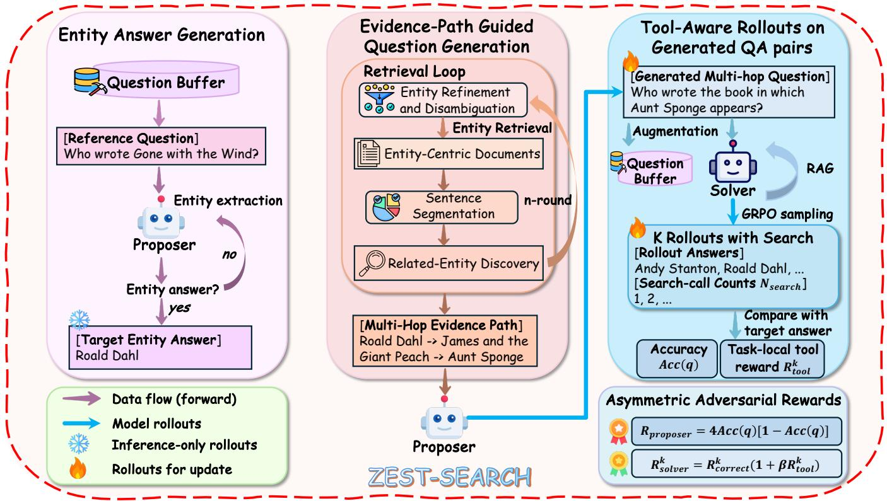
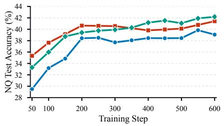
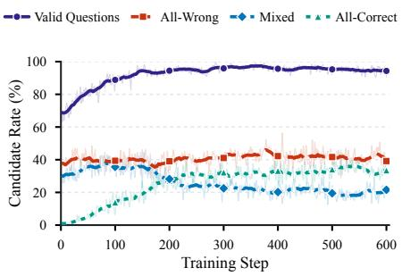
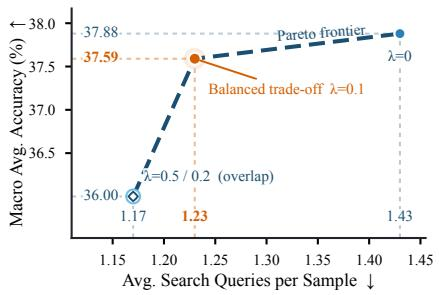
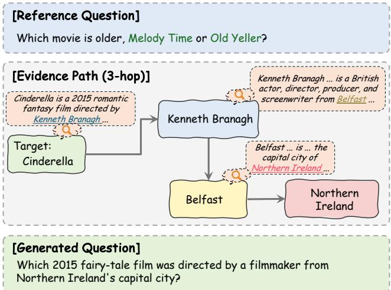
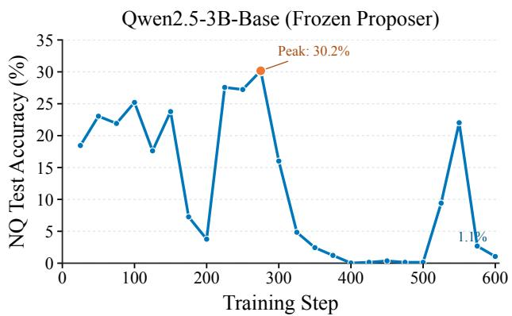
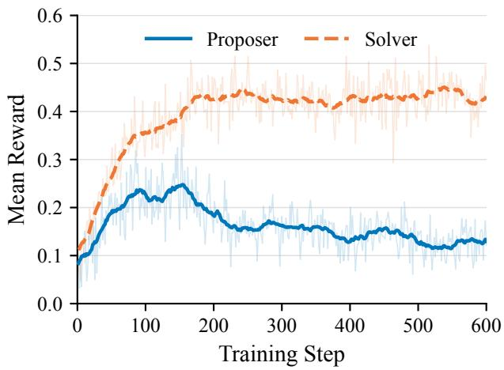

# Heterogeneous Co-Evolution Learning for Tool-Eficient Search Agents with Zero Labels

Qin-Wen Luo1, Sheng Ren1, Xiang Chen1∗, Rui Liu2, Jun Fang2, Naiqiang Tan2, Jun Wang2, Hua Chai2, Sheng-Jun Huang1∗

1Nanjing University of Aeronautics and Astronautics, Nanjing, China 2Didichuxing Co. Ltd, Beijing, China {luoqw8,xiang\_chen,huangsj}@nuaa.edu.cn

## Abstract

Deep search agents extend language models by interleaving reasoning with external retrieval. However, efective search- agent training requires addressing two challenges beyond final-answer optimization. First, the capability frontier of agents is largely determined by training questions, whereas fixed or labeled task collections cannot adapt as agents im- prove. Second, outcome-only reinforcement learning treats all successful trajectories equally, even when some correct answers rely on redundant searches, creating an inherent ten- sion between answer accuracy and tool eficiency. To address these issues, we introduce ZEST-Search, a zero-label and tool-eficient framework for search-agent training via het- erogeneous co-evolution. Starting from unlabeled reference questions, ZEST-Search constructs validated search tasks online through an answer-first and evidence-path-guided gen- eration process. A heterogeneous proposer adaptively con-structs training tasks around the solver’s evolving capability boundary, while the solver learns search-augmented reason- ing through reinforcement learning. To jointly optimize task dificulty and search eficiency, ZEST-Search employs an intermediate-dificulty reward for the proposer and a task- local tool-aware reward for the solver, encouraging informa- tive tasks and correct answers with fewer redundant searches. Experiments on seven general-domain and multi-hop question answering benchmarks demonstrate that ZEST-Search con- sistently improves search-agent performance while achieving higher tool eficiency without labeled search-training data or expert search trajectories. Further analyses show that hetero-geneous generation, adaptive dificulty control, and tool-aware optimization enable more efective search-agent training.

## Introduction

Deep search agents tackle challenging questions by inter- leaving reasoning with external retrieval. Unlike standard retrieval-augmented generation, they must determine not only which evidence to use, but also when and how to search. Retrieval-augmented models established external ev- idence as central to knowledge-intensive question answer- ing (Guu et al. 2020; Karpukhin et al. 2020; Lewis et al. 2020), while multi-hop benchmarks highlighted the need to integrate evidence across documents and entities (Yang et al. 2018; Trivedi et al. 2022). More recent tool-using and retrieval-aware agents integrate search into the reasoning loop, enabling adaptive tool use during inference (Nakano et al. 2021; Yao et al. 2023; Asai et al. 2024; Trivedi et al. 2023). Accordingly, training search agents requires optimizing both final-answer correctness and search behavior to pro- duce evidence-grounded trajectories.

Reinforcement learning (RL) has become a prominent approach for training such search behavior. Early studies train language models to invoke search during reasoning us- ing outcome-based rewards derived from final-answer cor- rectness (Jin et al. 2025; Song et al. 2025; Chen et al. 2025b). Subsequent studies further explore search-cost mod-eling, stepwise feedback, and data-eficient RL for search agents (Sun et al. 2025; Zheng et al. 2025; Jiang et al. 2025b). Despite this progress, existing methods still fail to jointly control two key determinants of search-agent learning. First, training questions largely define the frontier of learnable ca- pabilities. A fixed question set can become a static curricu- lum, preventing RL from exposing new agent weaknesses. Second, outcome-only rewards cannot distinguish concise successful search trajectories from redundant ones. Conse-quently, optimizing answer correctness alone may improve accuracy while increasing tool-use costs.

To address the first limitation, recent self-play methods for- mulate learning as an adaptive proposer–solver game (Zhao et al. 2025; Chen et al. 2025a; Fang et al. 2025; Liang et al. 2025). In search-agent training, the proposer generates verifi-able uestions, while the solver answers them throu h search. The performance of the solver then guides proposer updates, allowing task dificulty to evolve with the solver throughout training (Lu et al. 2025; Yue et al. 2026; Wu et al. 2026). However, task generation is typically constrained by fixed predefined sources, such as answer pools, limiting explo- ration beyond the initial task space. Assigning both roles to the same model further couples online generation cost to solver scale and limits signal complementarity, since shared knowledge priors can confine generated questions to famil- iar regions. This coupling is especially problematic early in training, when base models may produce fewer valid and in- formative questions, yielding fewer efective training groups and slower optimization. Moreover, adaptive task generation alone does not resolve the second limitation and may even ex- acerbate tool ineficiency. As generated tasks become harder, a solver optimized solely for final-answer correctness may re- sort to increasingly extensive search, even when additional queries provide little marginal value.

To address these limitations, we propose ZEST-Search, a heterogeneous proposer–solver co-evolution framework for Zero-label, tool-Eficient Search-agent Training. Rather than sampling answers from a fixed pool, the proposer first gener- ates target entities conditioned on unlabeled reference ques- tions. Each target is validated for semantic compatibility, en- tity type, extractability, and retrieval support. ZEST-Search then constructs source-supported multi-hop evidence paths terminating at the validated targets and conditions ques- tion generation on these paths. Programmatic verification filters malformed, answer-leaking, and insuficiently sup- ported tasks before solver training. These target-validation, evidence-construction, and task-filtering stages rely only on lightweight retrieval and NLP components, requiring no ad- ditional LLM inference. Decoupling task generation from solving enables lightweight or cross-family proposers to gen- erate complementary tasks around the solver’s evolving capa- bility boundary. Role-specific objectives coordinate their co-evolution: an intermediate-dificulty reward steers the pro- poser toward validated questions near the solver’s learning frontier, while a task-local tool-aware reward favors correct trajectories with lower relative search costs. Together, these components expand the training space beyond predefined answer pools and enable zero-label learning of evidence- grounded and tool-eficient search behavior.

Our contributions are summarized as follows:

• We propose a zero-label, answer-first pipeline that con-structs validated target entities, source-supported multi- hop evidence paths, and verifiable search tasks without labeled QA pairs or expert search trajectories.

• By formulating search-agent training as heterogeneous proposer–solver co-evolution, our framework enables lightweight or cross-family proposers to generate com- plementary tasks around the solver’s evolving frontier.

• Role-specific objectives jointly optimize task dificulty and search eficiency, favoring informative questions near the solver’s learning frontier and correct trajectories with fewer redundant searches.

## Preliminaries

Reinforcement Learning with Verifiable Rewards. Reinforcement learning with verifiable rewards (RLVR) trains language models using outcomes that can be checked by pro- grammatic verifiers (Shao et al. 2024; Yu et al. 2025). Let x denote an input prompt and $a ^ { \star }$ denote its target answer. A policy πθ generates the response $y = \left( o , a \right)$ , where o is the reasoning trace, and a is the final answer. A verifier assigns the reward $r ( x , y ) = \mathbb { I } ( a = a ^ { \star } )$ .

Group Relative Policy Optimization (GRPO) (Shao et al. 2024) leverages group-wise advantage estimation to en-able critic-free policy optimization. For a prompt-target pair $( x , a ^ { \star } )$ , the policy generates K responses $\begin{array} { r l } { ) ^ { \flat } } & { { } = } \end{array}$ $\left\{ y ^ { 1 } , \ldots , y ^ { \dot { K } } \right\}$ , where $y ^ { k } = \mathbf { \check { ( } } o ^ { k } , a ^ { k } )$ , and obtains rewards by matching final answers with the target answers. The group- relative advantages are computed by normalizing rewards

with group statistics:

$$
A ^ { k } = \frac { r ^ { k } - \mu _ { R } } { \sigma _ { R } + \xi } ,\tag{1}
$$

where $\mu _ { R }$ and $\sigma _ { R }$ denote the mean and standard deviation of rewards in Y, and $\xi$ avoids division by zero. Denote that $\rho ^ { k } ( \theta ) = \pi _ { \theta } ( y ^ { k } \mid x ) / \pi _ { \theta _ { \mathrm { o l d } } } ( y ^ { k } \mid x )$ is the importance sam- pling ratio. GRPO optimizes the clipped objective

$$
J _ { \mathrm { G R P O } } ( \theta ) = \mathbb { E } _ { x , y } [ A _ { \mathrm { I S } } ^ { k } - \alpha \mathbb { D } _ { \mathrm { K L } } ( \pi _ { \theta }  \pi _ { \mathrm { r e f } } ) ] ,\tag{2}
$$

where

$$
A _ { \mathrm { I S } } ^ { k } = \operatorname* { m i n } { \left[ \rho ^ { k } ( \theta ) A ^ { k } , \mathrm { c l i p } ( \rho ^ { k } ( \theta ) , 1 - \epsilon , 1 + \epsilon ) A ^ { k } \right] } ,\tag{3}
$$

ϵ controls the trust region and α weights the reference-policy regularizer.

Search-Agent Rollouts A search agent interacts with a retrieval environment during response generation. Given the input prompt x, the agent maintains a history

$$
h _ { t } = ( x , u _ { < t } , z _ { < t } ) ,\tag{4}
$$

where $u _ { < t }$ are generated segments and $z _ { < t }$ are retrieved observations. At step $t ,$ the policy emits either a normal reasoning segment, a search action, or a final-answer action:

$$
u _ { t } \sim \pi _ { \theta } ( \cdot \mid h _ { t } ) .\tag{5}
$$

If $u _ { t }$ is a valid parsed search action with query $s _ { t } ,$ the envi- ronment returns

$$
z _ { t } = \mathcal { R } ( s _ { t } ; k _ { \mathrm { r e t } } ) ,\tag{6}
$$

where $\mathcal { R }$ is the retriever and $k _ { \mathrm { r e t } }$ is the top-k retrieval depth. If $u _ { t }$ is a final-answer action, the response terminates with final answer a. A complete response keeps the same notation as above:

$$
y = ( o , a ) , \qquad o = ( u _ { 1 } , z _ { 1 } , \ldots , u _ { T } , z _ { T } ) .\tag{7}
$$

Only valid parsed search actions are counted as tool calls:

$$
N ( \boldsymbol y ) = \sum _ { t = 1 } ^ { T } \mathbb { I } _ { \mathrm { s e a r c h } } ( \boldsymbol u _ { t } ) .\tag{8}
$$

Invalid tool syntax is kept in the textual trajectory but does not increase $\mathbf { \bar { \boldsymbol { N } } } ( \boldsymbol { y } )$ . Retrieved observations condition later actions, but they are not policy-generated tokens; therefore, they are masked in the actor objective.

## Methodology

## Framework Overview

ZEST-Search trains search agents through an answer- anchored task generation and optimization process, as shown in Figure 1. Given an unlabeled reference question, the pro- poser generates a target entity for a new search task. From this target, the framework retrieves entity-centric documents, identifies sentences mentioning queried entities, and extracts co-occurring entities. Recursively querying selected entities yields a source-traceable multi-hop evidence path. Condi- tioned on the target and evidence context, the proposer gen- erates a multi-hop question whose answer is the target. After validation, the accepted QA pairs are passed to the solver for grouped search rollouts and GRPO optimization. A ver- ifier compares each final answer against the target, while valid search calls quantify tool use. These signals define role-specific rewards: the proposer is encouraged to generate tasks of intermediate dificulty, while the solver is rewarded for correct trajectories with lower relative search cost.

  
Figure 1: Overview of ZEST-Search. From left to right, an unlabeled reference question provides a semantic template for target-entity generation; retrieved evidence is organized into a source-supported path for generating a new question; and a heterogeneous solver produces grouped search rollouts that yield role-specific rewards for proposer–solver co-evolution.

## Entity Answer Generation

To avoid reliance on a fixed data source, we derive target entities online from abundant unlabeled questions. Given a reference question x, the proposer determines whether its expected answer is entity-valued. If so, it generates an entity of the implied semantic type. Otherwise, it identifies a salient entity in x and generates an entity of the same type. This procedure maps both cases to entity-valued targets suitable for entity-centric retrieval, without reference answers.

Formally, the proposer samples

$$
u ^ { a } \sim \pi _ { p } ^ { \phi } \big ( \cdot \mid P _ { a } ( x ) \big ) , \qquad \widetilde a = E _ { a } ( u ^ { a } ) ,\tag{9}
$$

where $P _ { a }$ is the target-entity generation prompt and $E _ { a }$ extracts the candidate entity from the structured output. The prompt requests one concrete, distinct, and retrievable en- tity rather than a direct answer to x, avoiding the complex and error-prone process of answer inference. The candidate ea is then screened by a lightweight validation pipeline based on deterministic parsing, entity recognition, and answer-side retrieval verification. These non-generative checks require no additional LLM inference and eficiently filter out mal- formed outputs and non-entity candidates. Candidates pass- ing all checks are accepted as a⋆. The validated target anchors evidence-path construction and serves as the verification tar- get for the generated search task.

## Evidence-Path Guided Question Generation

Given a retrieval-supported target entity $a ^ { \star }$ , we construct a source-grounded evidence context for multi-hop question generation. We treat $a ^ { \star }$ as the answer node of a compact ev- idence graph and initialize the document pool with retrieval results obtained for $a ^ { \star }$

At each hop, each selected frontier entity is normalized and disambiguated before retrieval. Retrieved documents are segmented into sentences, and those mentioning both the selected entity and another valid entity are retained as evi- dence. Each co-occurring entity defines an evidence-backed edge and becomes a frontier candidate for the next hop. This process recursively expands the frontier until no valid can- didate remains or the maximum hop budget is reached. An evidence path from an outer clue to $a ^ { \star }$ is then constructed:

$$
p = ( v _ { 0 } \to v _ { 1 } \to \cdot \cdot \cdot \to a ^ { \star } ) ,\tag{10}
$$

where the entities are ordered toward the target answer. Each edge is paired with its source document and supporting sen- tence. Paths with repeated entities, discontinuous transitions, or insuficient evidence are discarded. Remaining candidates are ranked b evidence ualit and retrieval relevance, and the top-ranked path is selected. The resulting evidence con- text is represented as

$$
\boldsymbol { e } = \left( p , \boldsymbol { S } , \mathcal { D } \right) ,\tag{11}
$$

where $s$ contains the supporting sentences and D contains the corresponding documents. The proposer then samples a question conditioned on the target and evidence context:

$$
u ^ { q } \sim \pi _ { p } ^ { \phi } \left( \cdot \mid P _ { q } ( a ^ { \star } , e ) \right) , \qquad q = E _ { q } ( u ^ { q } ) ,\tag{12}
$$

where $P _ { q }$ is the evidence-conditioned generation prompt and $E _ { q }$ extracts the question from the structured output. The prompt instructs the proposer to conceal the target while preserving the relational clues encoded by the path, yielding a multi-hop search task with the intended answer $a ^ { \star }$

Evidence path construction uses only lightweight retrieval and NLP components, while the proposer is invoked for ques- tion generation. Validated questions are then added to the ref- erence pool to support later rounds and progressively expand the training distribution.

## Tool-Aware Rollouts on Generated QA Pairs

Given a validated task $( q , a ^ { \star } )$ , the solver interacts with the retrieval environment according to the rollout protocol. For each task, we sample a group of K independent trajectories:

$$
\{ y ^ { k } \} _ { k = 1 } ^ { K } \sim \pi _ { s } ^ { \theta } ( \cdot \mid q ) .\tag{13}
$$

Each rollout terminates when the solver produces a valid final answer or exhausts the search-turn budget. The final answer $a ^ { k }$ of rollout k is compared with the target $a ^ { \star }$ to obtain a verifiable exact-match reward:

$$
R _ { \mathrm { c o r r e c t } } ^ { k } = \mathbb { I } _ { \mathrm { E M } } \left[ a ^ { k } = a ^ { \star } \right] .\tag{14}
$$

The grouped rollouts yield the task-level solver accuracy

$$
\mathrm { A c c } ( q ) = \frac { 1 } { K } \sum _ { k = 1 } ^ { K } R _ { \mathrm { c o r r e c t } } ^ { k } ,\tag{15}
$$

together with the per-rollout search-call counts $\{ N ( y ^ { k } ) \} _ { k = 1 } ^ { K } .$ The former characterizes the task’s current dificulty for the solver, whereas the latter quantifies trajectory-level tool use. These task- and trajectory-level statistics are subsequently used to define the role-specific rewards for proposer and solver optimization.

## Asymmetric Adversarial Rewards

ZEST-Search formulates search-agent training as heteroge- neous proposer–solver co-evolution. The proposer generates tasks around the solver’s evolving capability boundary, while the solver learns from these tasks. Unlike self-play methods, the two roles can be instantiated with heterogeneous mod- els. We therefore use an intermediate-dificulty reward for the proposer to encourage informative tasks and a task-local tool-aware reward for the solver to favor correct answers with less unnecessary tool use.

Intermediate-Dificulty Reward for the Proposer. The proposer should generate questions that remain informa- tive for the current solver. Prior curriculum-learning studies suggest that questions with intermediate pass rates provide stronger optimization signals than those almost always solved or missed (Leng et al. 2025; Jiang et al. 2025a; Zeng et al. 2025; Zhu et al. 2026). We therefore define the proposer reward using the grouped solver accuracy $\operatorname { A c c } ( q )$

$$
R _ { \mathrm { p r o p o s e r } } = 4 \mathrm { A c c } ( q ) \left[ 1 - \mathrm { A c c } ( q ) \right] .\tag{16}
$$

Invalid questions receive a fixed negative reward $\beta _ { \mathrm { i n v a l i d } } < 0 .$ For valid questions, Eq. 16 is maximized at $\operatorname { A c c } ( q ) = 0 . 5$ 5 and vanishes for all-correct or all-wrong groups, thereby favoring tasks near the solver’s current learning frontier.

A monotonic alternative, $1 - \operatorname { A c c } ( q )$ , assigns its maximum reward when all solver rollouts fail. However, complete fail- ure may reflect an incorrect target, an ambiguous question, or insuficient evidence rather than meaningful dificulty. By assigning zero reward to all-wrong groups, the intermediate- dificulty reward avoids this failure mode.

Tool-Aware Reward for the Solver. External search should be used only when the solver’s parametric knowl- edge and available evidence are insuficient. Unnecessary retrieval increases inference cost and may introduce irrele- vant information. For each task, we define a task-local tool reward by normalizing search calls across its K rollouts:

$$
R _ { \mathrm { t o o l } } ^ { k } = - \frac { N ( y ^ { k } ) } { \operatorname* { m a x } _ { \ell \leq K } N ( y ^ { \ell } ) + 1 } .\tag{17}
$$

The reward is non-positive, so trajectories with fewer search calls receive smaller penalties. Because normalization is per- formed within each task, it accounts for question-specific re- trieval demands and is naturally compatible with GRPO. The final solver reward is

$$
R _ { \mathrm { s o l v e r } } ^ { k } = R _ { \mathrm { c o r r e c t } } ^ { k } \left( 1 + \lambda R _ { \mathrm { t o o l } } ^ { k } \right) ,\tag{18}
$$

where $\lambda > 0$ controls the tool-cost discount. Multiplying the tool reward by correctness prevents incorrect rollouts from benefiting from less search. Among correct rollouts, fewer search calls receive higher rewards, encouraging the solver to preserve accuracy while selectively using retrieval.

## Experiments

To comprehensively evaluate ZEST-Search, we investigate its efectiveness, scalability across heterogeneous proposer– solver settings, and component contributions.

## Experimental Setup

Benchmarks and Evaluation Metrics. We evaluate on three general-domain QA benchmarks: NQ (Kwiatkowski et al. 2019), TriviaQA (Joshi et al. 2017), and PopQA (Mallen et al. 2023), and four multi-hop benchmarks: Hot-potQA (Yang et al. 2018), 2Wiki (Ho et al. 2020), MuSiQue (Trivedi et al. 2022), Bamboogle (Press et al. 2023), requiring iterative retrieval and evidence integration. We report normalized exact match (EM) on each benchmark, the unweighted macro-average EM across all benchmarks, and Queries, defined as the average number of successfully parsed search actions per example.

<table><tr><td rowspan="2">Proposer / Solver</td><td rowspan="2">Method</td><td colspan="2">GeneralQA</td><td colspan="3">Multi-HopQA</td><td rowspan="2">Avg(↑)</td><td rowspan="2">Queries(↓)</td></tr><tr><td>NQ</td><td></td><td></td><td></td><td>TriviaQA PopQA HotpotQA 2Wiki MuSiQue Bamboogle</td></tr><tr><td colspan="9">Zero-Label Training from Base Models</td></tr><tr><td>Qwen2.5-3B-Instruct /</td><td>Solver Base</td><td>16.7 30.7</td><td>17.8</td><td>12.4 7.2</td><td>2.3</td><td>6.4</td><td>13.4</td><td>0.85</td></tr><tr><td>Qwen2.5-3B-Base</td><td>Ours</td><td>36.0 57.0</td><td>38.2</td><td>26.0 25.4</td><td>5.3</td><td>7.2</td><td>27.9 (+14.5)1.01</td><td>(+0.16)</td></tr><tr><td>Qwen2.5-7B-Base /</td><td>Solver Base</td><td>25.8 43.3</td><td>28.3</td><td>15.8 9.2</td><td>6.4</td><td>24.1</td><td>21.8</td><td>1.59</td></tr><tr><td>Qwen2.5-7B-Base</td><td>Ours</td><td>37.1 61.9</td><td>40.3</td><td>34.7 31.8</td><td>11.7</td><td>32.0</td><td></td><td>35.6 (+13.8)1.17 (-0.42)</td></tr><tr><td>Qwen2.5-7B-Instruct7 Qwen2.5-7B-Base</td><td>Solver Base</td><td>25.8 43.3</td><td>28.3</td><td>15.8 9.2</td><td>6.4</td><td>24.1</td><td>21.8</td><td>1.59</td></tr><tr><td></td><td>Ours</td><td>40.2 64.5</td><td>43.8 36.3</td><td>35.4</td><td>12.0</td><td>35.2</td><td></td><td>38.2 (+16.4)1.16 (-0.43)</td></tr><tr><td colspan="9">Scaling to Larger Solvers with Lightweight Proposers</td></tr><tr><td>Qwen2.5-3B-Base /</td><td>Solver Base</td><td>25.8 43.3</td><td>28.3 15.8</td><td>9.2</td><td>6.4</td><td>24.1</td><td>21.8</td><td>1.59</td></tr><tr><td>Qwen2.5-7B-Base</td><td>Ours</td><td>39.1 61.9</td><td>41.9</td><td>33.7 31.7</td><td>9.9</td><td>29.6</td><td></td><td>35.4 (+13.6)1.29 (-0.30)</td></tr><tr><td>Qwen2.5-3B-Instruct7</td><td>Solver Base</td><td>25.8 43.3</td><td>28.3</td><td>15.8 9.2</td><td>6.4</td><td>24.1</td><td>21.8</td><td>1.59</td></tr><tr><td>Qwen2.5-7B-Base</td><td>Ours</td><td>38.6 61.5</td><td>41.6</td><td>32.2 30.3</td><td>11.7</td><td>36.0</td><td></td><td>36.0 (+14.2)1.17 (-0.42)</td></tr><tr><td colspan="9">Generalization Across Model Families</td></tr><tr><td>Qwen3-4B /</td><td>Solver Base</td><td>25.8 43.3</td><td>28.3</td><td>15.8</td><td>6.4</td><td>24.1</td><td>21.8</td><td>1.59</td></tr><tr><td>Qwen2.5-7B-Base</td><td>Ours</td><td>40.0 62.9</td><td>43.0</td><td>34.3</td><td>33.5 11.8</td><td>32.8</td><td></td><td>36.9 (+15.1)1.08 (-0.51)</td></tr><tr><td>LLaMA3.2-3B-Instruct7</td><td>Solver Base</td><td>26.7 46.4</td><td>29.4</td><td>20.6</td><td>16.6 9.5</td><td>31.2</td><td>25.8</td><td>1.60</td></tr><tr><td>LLaMA3-8B-Instruct</td><td>Ours</td><td>38.6 64.3</td><td>40.6</td><td>33.0</td><td>12.1</td><td>41.6</td><td></td><td>36.9 (+11.1)1.50 (-0.10)</td></tr><tr><td colspan="9">Adaptation of Search-Specialized Agents</td></tr><tr><td>Qwen2.5-7B-Instruct /</td><td>Solver Base</td><td>30.1</td><td>45.4 29.8</td><td>23.1</td><td>12.9 8.2</td><td>27.2</td><td>25.2</td><td>2.26</td></tr><tr><td>Search-R1</td><td>Ours</td><td>34.4 50.4</td><td>34.0</td><td>28.3</td><td>22.6 10.6</td><td></td><td>32.0</td><td>30.3 (+4.9) 1.58 (-0.68)</td></tr><tr><td>Qwen2.5-7B-Instruct7</td><td>Solver Base</td><td>35.1 56.9</td><td>35.9</td><td>29.6</td><td>30.6 9.5</td><td></td><td>25.0 31.8</td><td>1.12</td></tr><tr><td>ZeroSearch</td><td>Ours</td><td>41.7 65.1</td><td>41.9</td><td>33.1</td><td>33.2</td><td>10.3</td><td>24.8</td><td>35.7 (+3.9) 1.09 (-0.03)</td></tr></table>

Table 1: Main experimental results. Results above the base model are in bold, while those below it are underlined.

Training and Evaluation Settings. Training uses only question text from an unlabeled reference bufer initialized with questions from the NQ training split. Target answers, evidence paths, and QA pairs are constructed online. Each accepted task receives five solver rollouts, each allowing up to three search turns, with three retrieved passages per query. The proposer is optimized with REINFORCE++ (Hu et al. 2025) using task-level rewards derived from grouped solver outcomes, whereas the solver is optimized with GRPO over tool-interleaved trajectories. At evaluation time, we use temperature-zero decoding with three search turns.

## Main Results

RQ1: Can ZEST-Search improve search-augmented reasoning without labeled search-training data? We com- pare each solver before and after ZEST-Search training. Since existing self-play search-agent methods often adopt diferent model APIs, datasets, LLM-as-Judges, or retrieval environments, direct comparisons under identical training budgets remain challenging. We therefore additionally eval- uate ZEST-Search through continual training on search- specialized agents. Because training uses only unlabeled questions and constructs tasks online, these comparisons as- sess whether search-augmented reasoning improves without labeled QA pairs or expert trajectories. As shown in Table 1, ZEST-Search substantially improves search-augmented rea- soning using only unlabeled questions for task construction.

Across all seven benchmarks, solvers of diferent scales and model families consistently benefit from training under di- verse proposer configurations, demonstrating robust gains on both general-domain and multi-hop question answering. The same procedure also improves search-specialized solvers, in- cluding Search-R1 (Jin et al. 2025) and ZeroSearch (Sun et al. 2025), showing that ZEST-Search can further enhance existing search agents. These results show that ZEST-Search can both develop search-augmented reasoning from base mod- els and further improve agents that have already undergone search-oriented training. Overall, ZEST-Search improves the performance of search agents without labeled training data.

RQ2: Can ZEST-Search efectively train solvers with lightweight proposers? We evaluate whether proposers smaller than the solver can generate efective training tasks, as reported in Table 1. Smaller proposers provide efective training signals for larger solvers. In particular, Qwen3-4B performs comparably to the larger Qwen2.5-7B proposer, while Qwen2.5-3B-Instruct also produces strong gains. The smaller but newer proposers, such as Qwen3 and LLaMA-3.2 models, can generate higher-quality training tasks, providing more efective supervision for solver improvement. These results show that online task generation can be delegated to lightweight models without matching the solver’s parameter scale. Although task quality varies across proposer check- points, solvers consistently benefit from both smaller and cross-family proposers.

  
Figure 2: Training and eficiency analyses. (a) The training dynamics of proposers with diferent scales. (b) Question-generation quality during the training process. (c) Accuracy–eficiency trade-of under diferent tool-cost coeficients.

RQ3: Does ZEST-Search improve the trade-of between answer accuracy and search cost? As shown in Table 1, ZEST-Search improves answer accuracy while reducing av- erage search calls for most solvers. This indicates that the correctness-gated tool-aware objective encourages selective retrieval while preserving answer accuracy. Qwen2.5-3B-Base is the only exception, showing a slight increase in search calls alongside a substantial accuracy gain. Because this weak base model initially underuses search, the increase indicates more appropriate tool invocation rather than degraded ef- ficiency. After training, the solver learns to better balance parametric knowledge and retrieval. Overall, ZEST-Search improves the accuracy–cost trade-of by promoting selective search and avoiding redundant queries.

RQ4: How doesproposer heterogeneity afect task gener-ation and training dynamics? To analyze how proposer het- erogeneity afects training, we compare proposers with difer- ent model scales, families, and instruction alignment. First, cross-family proposers such as Qwen3-4B and LLaMA3.2- 3B-Instruct introduce complementary knowledge priors and reasoning patterns, enabling larger solvers to benefit from di- verse task distributions without requiring the matching scale of the proposer. This indicates that task generation qual- ity is not strictly bounded by solver capacity. Beyond task diversity, proposer heterogeneity also afects how quickly useful supervision emerges during training. As shown in Figure 2(a), newer or instruction-tuned proposers generate a higher proportion of valid and informative questions at the beginning of training, providing stronger optimization sig- nals and accelerating solver improvement. Overall, hetero- geneous proposer–solver training decouples task generation cost, knowledge priors, and generation quality from solver capacity.

## Ablation and Analysis

Intermediate-Dificulty Reward Analysis. Table 2 com-pares the proposed intermediate-dificulty reward with the monotonic adversarial objective. The latter over-rewards allwrong groups, concentrating generation on unsolved ques- tions. In contrast, the intermediate-dificulty reward increases the proportion of mixed groups while reducing all-wrong cases. Mixed groups provide informative relative signals for policy optimization because they contain both successful and failed solver trajectories. Figure 2(b) further shows that the mixed-group proportion remains stable throughout training. These results indicate that the proposed reward more efec- tively targets the solver’s current learnable boundary.

<table><tr><td>Reward Type</td><td>4Acc[1 − Acc]</td><td>1 − Acc</td></tr><tr><td>Valid QA Distribution (%)</td><td></td><td></td></tr><tr><td>Mixed Questions ↑</td><td>21.63</td><td>12.81</td></tr><tr><td>All-Wrong Questions ↓</td><td>43.80</td><td>83.95</td></tr><tr><td>All-Right Questions</td><td>34.57</td><td>3.24</td></tr><tr><td>Performance</td><td></td><td></td></tr><tr><td>Avg. Accuracy ↑</td><td>37.59</td><td>36.00</td></tr><tr><td>Avg. Queries ↓</td><td>1.23</td><td>1.17</td></tr></table>

Table 2: Efect of proposer rewards on generated task difi- culty and solver performance.
<table><tr><td>Metric</td><td>Answer Retrieval</td><td>EPG</td><td>EPG + RL</td></tr><tr><td>Question Quality (%)</td><td></td><td></td><td></td></tr><tr><td>Answer leakage ↓</td><td>9.6</td><td>21.2</td><td>2.0</td></tr><tr><td>Valid question ↑</td><td>29.2</td><td>27.6</td><td>42.4</td></tr><tr><td colspan="4">Hop Distribution among Valid Questions (%)</td></tr><tr><td>1-hop</td><td>95.2</td><td>71.7</td><td>54.7</td></tr><tr><td>2-hop</td><td>4.8</td><td>26.1</td><td>37.7</td></tr><tr><td>3-hop</td><td>0.00</td><td>2.2</td><td>7.6</td></tr></table>

Table 3: Comparison of question quality under answer- retrieval and evidence-path guided (EPG) generation.

Tool-Eficient Search Optimization Analysis. Figure 2(c) shows the accuracy–eficiency trade-of across diferent tool- cost coeficients with 400 training steps. Without the tool- aware reward, the solver achieves the highest accuracy but uses the most searches. A moderate coeficient markedly re- duces search calls with only a minor accuracy loss, providing the best overall balance. This demonstrates that the objective is not to minimize retrieval, but to optimize the accuracy- eficiency trade-of. Larger coeficients further suppress re- trieval but increasingly degrade accuracy. These results show that the tool-aware reward provides controllable search reg- ularization: moderate penalties discourage redundant re- trieval, whereas excessive penalties can suppress searches

  
Figure 3: A case study of evidence-path guided generation.

necessary for correct answers.

Evidence-Path Guided Generation Analysis. Table 3 compares direct answer-retrieval generation (AR), which conditions question generation on documents containing the target answer, with the proposed evidence-path-guided gener- ation (EPG). Even before proposer optimization, EPG yields substantially more multi-hop questions among examples, indicating that explicit evidence paths promote composi- tional generation beyond direct answer–document associa- tions. However, its lower initial validity and higher answer leakage indicate that structural guidance alone is insuficient for generating well-formed tasks. After training, EPG im- proves validity and leakage control while further increasing the proportion of multi-hop questions. Thus, evidence paths provide compositional structure, while proposer optimiza- tion converts them into valid and non-leaking QA pairs.

Task Generation Case Study. Figure 3 illustrates how ZEST-Search constructs a multi-hop search task from an unlabeled reference question. Instead of transforming the ref- erence question, the proposer identifies the expected answer type and generates a target entity, Cinderella. Starting from this target, the framework constructs a source-supported evi- dence path connecting it to its director Kenneth Branagh, then to Belfast and Northern Ireland. Conditioned on this path, the proposer generates a multi-hop question requiring the solver to recover the target through intermediate evidence. This ex- ample demonstrates that evidence-path guidance encourages compositional question generation while maintaining veri- fiable answer grounding, enabling ZEST-Search to create challenging search tasks without labeled QA pairs.

## Related Work

Search-Augmented Language Models. Retrieval-augmented language models use external knowledge to improve generation on knowledge-intensive tasks (Guu et al. 2020; Karpukhin et al. 2020; Lewis et al. 2020). Later systems integrate retrieval directly into reasoning, enabling models to issue queries, inspect evidence, and refine their answers (Nakano et al. 2021; Yao et al. 2023; Asai et al. 2024; Trivedi et al. 2023). Search-agent reinforcement learning further optimizes when and how to search, initially through final-answer rewards and later through search-cost modeling, retrieval simulation, process supervision, and step-wise feedback (Jin et al. 2025; Song et al. 2025; Chen et al. 2025b; Shi et al. 2025; Sun et al. 2025; Zheng et al. 2025; Jiang et al. 2025b; Ji et al. 2025). Unlike these methods, which mainly optimize solver behavior on given questions, ZEST-Search also brings evidence-grounded task construction into the training loop and explicitly optimizes trajectory-level search eficiency.

Proposer–Solver Training for Search Agents. More broadly, LLM self-improvement methods generate training data online, with some casting task generation and solving as interacting roles (Wang et al. 2023; Zhao et al. 2025; Chen et al. 2025a; Zhang et al. 2025b; Castanyer et al. 2026). For search-agent training, EvolveSearch, Search Self-Play, and Dr. Zero adapt generated tasks according to solver feedback, allowing task dificulty to evolve during training (Zhang et al. 2025a; Lu et al. 2025; Yue et al. 2026). Recent work further incorporates structured evidence or finer-grained process sig- nals. For example, knowledge-graph paths can guide ques- tion generation and provide waypoint rewards, while source- level contribution scores can assign credit to retrieved evi- dence (Wu et al. 2026; Arai and Ichikawa 2026). In contrast, ZEST-Search generates retrieval-supported target entities and source-supported textual evidence paths online, rather than restricting task construction to fixed answer pools or precomputed graph paths. It also decouples the proposer and solver policies and coordinates their co-evolution through ob- jectives for intermediate task dificulty and search eficiency.

## Conclusion

We introduced ZEST-Search, a zero-label framework for tool-eficient search-agent training through heterogeneous proposer–solver co-evolution. Rather than relying on pre- defined answer pools or labeled QA pairs, ZEST-Search constructs validated tasks online through answer-first gen- eration and source-supported multi-hop evidence paths. Lightweight, non-generative components perform target val- idation, path construction, and task filtering without ad- ditional LLM inference. Decoupling the two roles allows lightweight, instruction-tuned, and cross-family proposers to generate complementary tasks around the solver’s evolv- ing capability boundary. Role-specific objectives coordi-nate their co-evolution by steering the proposer toward intermediate-dificulty tasks and rewarding correct solver trajectories with lower relative search costs. Experiments on multiple benchmarks show that ZEST-Search improves answer accuracy and tool eficiency without labeled search- ing data. The framework remains efective with smaller and cross-family proposers, while analyses validate the reward design and task generation. Overall, ZEST-Search provides a scalable approach to expanding the training frontier and optimizing search eficiency.

## References

Arai, Y.; and Ichikawa, Y. 2026. EVE-Agent: Evidence- Verifiable Self-Evolving Agents. CoRR, abs/2605.22905.

Asai, A.; Wu, Z.; Wang, Y.; Sil, A.; and Hajishirzi, H. 2024. Self-RAG: Learning to Retrieve, Generate, and Cri- tique through Self-Reflection. In The Twelfth International Conference on Learning Representations, ICLR 2024, Vienna, Austria, May 7-11, 2024. OpenReview.net.

Castanyer, R. C.; Bradway, G.; Wolf, L.; Lin, M.; Mavor- Parker, A. N.; and Sargent, M. J. 2026. PopuLoRA: Co- Evolving LLM Populations for Reasoning Self-Play. CoRR, abs/2605.16727.

Chen, L.; Prabhudesai, M.; Fragkiadaki, K.; Liu, H.; and Pathak, D. 2025a. Self-Questioning Language Models. CoRR, abs/2508.03682.

Chen, M.; Li, T.; Sun, H.; Zhou, Y.; Zhu, C.; Wang, H.; Pan, J. Z.; Zhang, W.; Chen, H.; Yang, F.; Zhou, Z.; and Chen, W. 2025b. ReSearch: Learning to Reason with Search for LLMs via Reinforcement Learning. CoRR, abs/2503.19470.

Fang, W.; Liu, S.; Zhou, Y.; Zhang, K.; Zheng, T.; Chen, K.; Song, M.; and Tao, D. 2025. SeRL: Self-play Reinforcement Learning for Large Language Models with Limited Data. In Belgrave, D.; Zhang, C.; Montoya, L. N.; Lin, H.; Pascanu, R.; Koniusz, P.; Ghassemi, M.; Chen, N.; Ruíz, I. V. M.; and Loaiza-Bonilla, A., eds., Advances in Neural Information Processing Systems 38: Annual Conference on Neural Information Processing Systems 2025, NeurIPS 2025, San Diego, CA, USA, December 2-7, 2025 / Mexico City, Mexico, November 30 - December 5, 2025.

Guu, K.; Lee, K.; Tung, Z.; Pasupat, P.; and Chang, M. 2020. Retrieval Augmented Language Model Pre-Training. In Proceedings of the 37th International Conference on Machine Learning, ICML 2020, 13-18 July 2020, Virtual Event, volume 119 of Proceedings of Machine Learning Research, 3929–3938. PMLR.

Ho, X.; Duong Nguyen, A.; Sugawara, S.; and Aizawa, A. 2020. Constructing A Multi-hop QA Dataset for Comprehensive Evaluation of Reasoning Steps. In Proceedings of the 28th International Conference on Computational Linguistics, 6609–6625. International Committee on Computational Linguistics.

Hu, J.; Liu, J. K.; Xu, H.; and Shen, W. 2025. REIN- FORCE++: Stabilizing Critic-Free Policy Optimization with Global Advantage Normalization. arXiv:2501.03262.

Ji, Y.; Meng, R.; Li, Z.; and He, D. 2025. Curriculum Guided Reinforcement Learning for Eficient Multi Hop Retrieval Augmented Generation. CoRR, abs/2505.17391.

Jiang, G.; Feng, W.; Quan, G.; Hao, C.; Zhang, Y.; Liu, G.; and Wang, H. 2025a. VCRL: Variance-based Curriculum Reinforcement Learning for Large Language Models. CoRR, abs/2509.19803.

Jiang, P.; Xu, X.; Lin, J.; Xiao, J.; Wang, Z.; Sun, J.; and Han, J. 2025b. s3: You Don’t Need That Much Data to Train a Search Agent via RL. In Christodoulopoulos, C.; Chakraborty, T.; Rose, C.; and Peng, V., eds., Proceedings of

the 2025 Conference on Empirical Methods in Natural Language Processing, EMNLP 2025, Suzhou, China, November 4-9, 2025, 21599–21617. Association for Computational Linguistics.

Jin, B.; Zeng, H.; Yue, Z.; Wang, D.; Zamani, H.; and Han, J. 2025. Search-R1: Training LLMs to Reason and Lever- age Search Engines with Reinforcement Learning. CoRR, abs/2503.09516.

Joshi, M.; Choi, E.; Weld, D.; and Zettlemoyer, L. 2017. TriviaQA: A Large Scale Distantly Supervised Challenge Dataset for Reading Comprehension. In Proceedings of the 55th Annual Meeting of the Association for Computational Linguistics (Volume 1: Long Papers), 1601–1611. Association for Computational Linguistics.

Karpukhin, V.; Oguz, B.; Min, S.; Lewis, P.; Wu, L.; Edunov, S.; Chen, D.; and Yih, W. 2020. Dense Passage Retrieval for Open-Domain Question Answering. In Webber, B.; Cohn, T.; He, Y.; and Liu, Y., eds., Proceedings ofthe 2020 Conference on Empirical Methods in Natural Language Processing, EMNLP 2020, Online, November 16-20, 2020, 6769–6781. Association for Computational Linguistics.

Kwiatkowski, T.; Palomaki, J.; Redfield, O.; Collins, M.; Parikh, A.; Alberti, C.; Epstein, D.; Polosukhin, I.; Devlin, J.; Lee, K.; Toutanova, K.; Jones, L.; Kelcey, M.; Chang, M.; Dai, A. M.; Uszkoreit, J.; Le, Q.; and Petrov, S. 2019. Natural Questions: A Benchmark for Question Answering Research. Transactions ofthe Associationfor Computational Linguistics, 7: 452–466.

Leng, S.; Wang, J.; Li, J.; Zhang, H.; Hu, Z.; Zhang, B.; Jiang, Y.; Zhang, H.; Li, X.; Bing, L.; Zhao, D.; Lu, W.; Rong, Y.; Sun, A.; and Lu, S. 2025. MMR1: Enhancing Multimodal Reasoning with Variance-Aware Sampling and Open Resources. CoRR, abs/2509.21268.

Lewis, P.; Perez, E.; Piktus, A.; Petroni, F.; Karpukhin, V.; Goyal, N.; Küttler, H.; Lewis, M.; Yih, W.; Rocktäschel, T.; Riedel, S.; and Kiela, D. 2020. Retrieval-Augmented Gen- eration for Knowledge-Intensive NLP Tasks. In Larochelle, H.; Ranzato, M.; Hadsell, R.; Balcan, M.; and Lin, H., eds., Advances in Neural Information Processing Systems 33: Annual Conference on Neural Information Processing Systems 2020, NeurIPS 2020, December 6-12, 2020, virtual.

Liang, X.; Li, Z.; Gong, Y.; Shen, Y.; Wu, Y. N.; Guo, Z.; and Chen, W. 2025. Beyond Pass@1: Self-Play with Variational Problem Synthesis Sustains RLVR. CoRR, abs/2508.14029.

Lu, H.; Wen, Y.; Cheng, P.; Ding, R.; Xu, H.; Guo, J.; Wang, C.; Chen, H.; Jiang, X.; and Jiang, G. 2025. Search Self-play: Pushing the Frontier of Agent Capability without Supervi- sion. CoRR, abs/2510.18821.

Mallen, A.; Asai, A.; Zhong, V.; Das, R.; Khashabi, D.; and Hajishirzi, H. 2023. When Not to Trust Language Models: In-vestigating Efectiveness of Parametric and Non-Parametric Memories. In Proceedings of the 61st Annual Meeting of the Association for Computational Linguistics (Volume 1: Long Papers), 9802–9822. Association for Computational Linguistics.

Nakano, R.; Hilton, J.; Balaji, S.; Wu, J.; Ouyang, L.; Kim,C.; Hesse, C.; Jain, S.; Kosaraju, V.; Saunders, W.; Jiang, X.;

Cobbe, K.; Eloundou, T.; Krueger, G.; Button, K.; Knight, M.; Chess, B.; and Schulman, J. 2021. WebGPT: Browser- assisted question-answering with human feedback. CoRR, abs/2112.09332.

Press, O.; Zhang, M.; Min, S.; Schmidt, L.; Smith, N. A.; and Lewis, M. 2023. Measuring and Narrowing the Com- positionality Gap in Language Models. In Findings of the Association for Computational Linguistics: EMNLP 2023, 5687–5711. Association for Computational Linguistics.

Shao, Z.; Wang, P.; Zhu, Q.; Xu, R.; Song, J.; Zhang, M.; Li, Y. K.; Wu, Y.; and Guo, D. 2024. DeepSeekMath: Pushing the Limits of Mathematical Reasoning in Open Language Models. CoRR, abs/2402.03300.

Shi, Y.; Li, S.; Wu, C.; Liu, Z.; Fang, J.; Cai, H.; Zhang, A.; and Wang, X. 2025. Search and Refine During Think: Facilitating Knowledge Refinement for Improved Retrieval- Augmented Reasoning. In Belgrave, D.; Zhang, C.; Mon- toya, L. N.; Lin, H.; Pascanu, R.; Koniusz, P.; Ghassemi, M.; Chen, N.; Ruíz, I. V. M.; and Loaiza-Bonilla, A., eds., Advances in Neural Information Processing Systems 38:Annual Conference on Neural Information Processing Systems 2025, NeurIPS 2025, San Diago, CA, USA, December 2-7, 2025 / Mexico City, Mexico, November 30 - December 5, 2025.

Song, H.; Jiang, J.; Min, Y.; Chen, J.; Chen, Z.; Zhao, W. X.; Fang, L.; and Wen, J. 2025. R1-Searcher: Incentivizing the Search Capability in LLMs via Reinforcement Learn- ing. CoRR, abs/2503.05592.

Sun, H.; Qiao, Z.; Guo, J.; Fan, X.; Hou, Y.; Jiang, Y.; Xie, P.; Zhang, Y.; Huang, F.; and Zhou, J. 2025. ZeroSearch: In- centivize the Search Capability of LLMs without Searching. CoRR abs/2505.04588.

Trivedi, H.; Balasubramanian, N.; Khot, T.; and Sabharwal, A. 2022. MuSiQue: Multihop Questions via Single-hop Question Composition. Trans. Assoc. Comput. Linguistics, 10: 539–554.

Trivedi, H.; Balasubramanian, N.; Khot, T.; and Sabharwal, A. 2023. Interleaving Retrieval with Chain-of-Thought Rea- soning for Knowledge-Intensive Multi-Step Questions. In Rogers, A.; Boyd-Graber, J. L.; and Okazaki, N., eds., Proceedings of the 61st Annual Meeting of the Association for Computational Linguistics (Volume 1: Long Papers), ACL 2023, Toronto, Canada, July 9-14, 2023, 10014–10037. As-sociation for Computational Linguistics.

Wang, Y.; Kordi, Y.; Mishra, S.; Liu, A.; Smith, N. A.; Khashabi, D.; and Hajishirzi, H. 2023. Self-Instruct: Aligning Language Models with Self-Generated Instructions. In Rogers, A.; Boyd-Graber, J. L.; and Okazaki, N., eds., Proceedings of the 61st Annual Meeting of the Association for Computational Linguistics (Volume 1: Long Papers), ACL 2023, Toronto, Canada, July 9-14, 2023, 13484–13508. As-sociation for Computational Linguistics.

Wu, H.; Liu, J.; Wei, X.; Gao, Y.; Wu, Y.; and Hu, Y. 2026. Knowledge-Graph Paths as Intermediate Supervision for Self-Evolving Search Agents. CoRR, abs/2605.05702.

Yang, Z.; Qi, P.; Zhang, S.; Bengio, Y.; Cohen, W. W.; Salakhutdinov, R.; and Manning, C. D. 2018. HotpotQA:

A Dataset for Diverse, Explainable Multi-hop Question An-swering. In Rilof, E.; Chiang, D.; Hockenmaier, J.; and Tsujii, J., eds., Proceedings of the 2018 Conference on Empirical Methods in Natural Language Processing, Brussels, Belgium, October 31 - November 4, 2018, 2369–2380. As-sociation for Computational Linguistics.

Yao, S.; Zhao, J.; Yu, D.; Du, N.; Shafran, I.; Narasimhan, K. R.; and Cao, Y. 2023. ReAct: Synergizing Reasoning and Acting in Language Models. In The Eleventh International Conference on Learning Representations, ICLR 2023, Kigali, Rwanda, May 1-5, 2023. OpenReview.net.

Yu, Q.; Zhang, Z.; Zhu, R.; Yuan, Y.; Zuo, X.; Yue, Y.; Fan, T.; Liu, G.; Liu, L.; Liu, X.; Lin, H.; Lin, Z.; Ma, B.; Sheng, G.; Tong, Y.; Zhang, C.; Zhang, M.; Zhang, W.; Zhu, H.; Zhu, J.; Chen, J.; Chen, J.; Wang, C.; Yu, H.; Dai, W.; Song, Y.; Wei, X.; Zhou, H.; Liu, J.; Ma, W.; Zhang, Y.; Yan, L.; Qiao, M.; Wu, Y.; and Wang, M. 2025. DAPO: An Open-Source LLM Reinforcement Learning System at Scale. CoRR, abs/2503.14476.

Yue, Z.; Upasani, K.; Yang, X.; Ge, S.; Nie, S.; Mao, Y.; Liu, Z.; and Wang, D. 2026. Dr. Zero: Self-Evolving Search Agents without Training Data. CoRR, abs/2601.07055.

Zeng, Y.; Sun, Z.; Ji, B.; Min, E.; Cai, H.; Wang, S.; Yin, D.; Zhang, H.; Chen, X.; and Wang, J. 2025. CurES: From Gradient Analysis to Eficient Curriculum Learning for Rea- soning LLMs. CoRR, abs/2510.01037.

Zhang, D.; Zhao, Y.; Wu, J.; Zhang, L.; Li, B.; Yin, W.; Jiang, Y.; Li, Y.; Tu, K.; Xie, P.; and Huang, F. 2025a. EvolveSearch: An Iterative Self-Evolving Search Agent. In Christodoulopoulos, C.; Chakraborty, T.; Rose, C.; and Peng, V., eds., Proceedings of the 2025 Conference on Empirical Methods in Natural Language Processing, EMNLP 2025, Suzhou, China, November 4-9, 2025, 13123–13136. Associ-ation for Computational Linguistics.

Zhang, Z.; Huang, C.; Li, A. O.; and Cardie, C. 2025b. Better LLM Reasoning via Dual-Play. CoRR, abs/2511.11881.

Zhao, A.; Wu, Y.; Yue, Y.; Wu, T.; Xu, Q.; Yue, Y.; Lin, M.; Wang, S.; Wu, Q.; Zheng, Z.; and Huang, G. 2025. Absolute Zero: Reinforced Self-play Reasoning with Zero Data. CoRR, abs/2505.03335.

Zheng, X.; An, K.; Wang, Z.; Wang, Y.; and Wu, Y. 2025. StepSearch: Igniting LLMs Search Ability via Step-Wise Proximal Policy Optimization. In Christodoulopoulos, C.; Chakraborty, T.; Rose, C.; and Peng, V., eds., Proceedings of the 2025 Conference on Empirical Methods in Natural Language Processing, EMNLP 2025, Suzhou, China, November 4-9, 2025, 21805–21830. Association for Computational Linguistics.

Zhu, T.; Zhang, W.; Zuo, X.; Tian, L.; Zhao, H.; Zeng, Y.; Gu, J.; Dong, D.; Wu, J.; Yin, D.; and Shen, D. 2026. Rollout Pass-Rate Control: Steering Binary-Reward RL Toward Its Most Informative Regime. CoRR, abs/2605.05112.

## Appendix A: Implementation details

This section summarizes the training configurations, includ- ing general model-training parameters and method-specific parameters. We follow Search-R1 (Jin et al. 2025) for the default search-related configurations, including the retriever, search protocol, and other implementation details.

<table><tr><td>Parameter</td><td>Value</td></tr><tr><td>(A) General model-training parameters</td><td></td></tr><tr><td>Actor learning rate</td><td> $3 \times 1 0 ^ { - 7 }$ </td></tr><tr><td>Proposer KL</td><td>0.005</td></tr><tr><td>Solver KL</td><td>0.001</td></tr><tr><td>Train batch</td><td>128</td></tr><tr><td>Rollout nums</td><td>5</td></tr><tr><td>Start-context tokens</td><td>2,048</td></tr><tr><td>Observation tokens</td><td>1,024</td></tr><tr><td>Response tokens</td><td>1,024</td></tr><tr><td>Temperature</td><td>1.0</td></tr><tr><td>Top-p</td><td>0.95</td></tr><tr><td>Top-k</td><td>-1</td></tr><tr><td>Training steps</td><td>600</td></tr><tr><td>Retriever</td><td>E5-base-v2</td></tr><tr><td>Retrieval corpus</td><td>Wikipedia (Dec. 20, 2018)</td></tr><tr><td>GPU</td><td>Nvidia A100×16</td></tr><tr><td>(B) Method-specific parameters</td><td></td></tr><tr><td>Initial QA-buffer load cap</td><td>200,000</td></tr><tr><td>Generated-QA extra capacity</td><td>20,000 3</td></tr><tr><td>Solver retrieval top-k</td><td></td></tr><tr><td>Maximum target hops</td><td></td></tr><tr><td>Max search-enabled turns</td><td></td></tr><tr><td>Evidence retrieval top-k</td><td></td></tr><tr><td>Path sample top-N</td><td></td></tr><tr><td>Path sample width</td><td></td></tr><tr><td>Question paths/answer</td><td></td></tr><tr><td>Random top-path pool</td><td></td></tr><tr><td>Tool penalty coefficient λ</td><td>0.1</td></tr><tr><td>Tool-reward warm-up steps</td><td>20</td></tr><tr><td>Invalid-info penalty  $\beta _ { \mathrm { i n v a l i d } }$ </td><td>-1.0</td></tr></table>

Table 4: Training, generation, and retrieval configurations.

  
Figure 4: Training-time test accuracy of ZEST-Search with a frozen Qwen2.5-3B-Base proposer and a Qwen2.5-3B-Base solver

## Appendix B: Additional Analyses

This section presents additional experimental results on frozen proposers, multi-hop question construction, and com- parisons with existing self-play approaches.

## B.1 Additional Ablation Study

Frozen-Proposer Control. As shown in Table 5, Qwen2.5-7B-Instruct, as an instruction-tuned model, can generate relatively high-quality questions through evidence- path guided generation, leading to improvements on general QA tasks. However, without co-evolution with the solver, the fixed proposer struggles to continuously generate high- quality multi-hop tasks aligned with the solver’s evolving capability boundary, resulting in limited gains and even per- formance degradation on some multi-hop benchmarks. For base models with weaker instruction-following ability, such as a frozen Qwen2.5-3B-Base proposer shown in Figure 4, the quality of generated tasks is more constrained by the pro- poser itself. Since task validation relies on lightweight NLP components rather than additional LLM-based filtering, low- quality tasks may accumulate when the proposer cannot adapt to the solver. This can weaken the training signal and lead to degraded solver performance.

Together, these results demonstrate the efectiveness and necessity of proposer–solver co-evolution for generating ef- fective training tasks, adapting to the solver’s evolving capa- bility, and improving search-agent training.

Ablation on Multi-Hop Task Complexity. We further investigate whether increasing the complexity of gener- ated tasks improves the solver’s multi-hop search capability. Specifically, we increase the maximum target path length to 4, allowing EPG to construct evidence paths containing up to four entities. To provide the solver with suficient interac- tion budget for resolving these longer paths, we also increase the maximum number of search turns to 4, while keeping all other training and evaluation configurations unchanged. This controlled setting isolates the efect of longer evidence paths and more demanding multi-hop supervision.

<table><tr><td rowspan="2">Proposer / Solver</td><td rowspan="2">Method</td><td colspan="3">GeneralQA</td><td colspan="4">Multi-HopQA</td><td rowspan="2">Avg(↑)</td><td rowspan="2">Queries(↓)</td></tr><tr><td>NQ</td><td></td><td></td><td></td><td>TriviaQA PopQA HotpotQA 2Wiki MuSiQue Bamboogle</td><td></td><td></td></tr><tr><td colspan="10">Training Solvers with Different Proposer Configurations</td></tr><tr><td>Qwen2.5-7B-Instruct /</td><td>Solver Base</td><td>25.8</td><td>43.3</td><td>28.3</td><td>15.8</td><td>9.2</td><td>6.4</td><td>24.1</td><td>21.8</td><td>1.59</td></tr><tr><td>Qwen2.5-7B-Base</td><td>Ours (3-Hops)</td><td>40.2</td><td>64.5</td><td>43.8</td><td>36.3</td><td>35.4</td><td>12.0</td><td>35.2</td><td></td><td>38.2 (+16.4)1.16 (-0.43)</td></tr><tr><td>Qwen2.5-7B-Instruct/</td><td>Solver Base</td><td>25.8</td><td>43.3</td><td>28.3</td><td>15.8</td><td>9.2</td><td>6.4</td><td>24.1</td><td>21.8</td><td>1.59</td></tr><tr><td>Qwen2.5-7B-Base</td><td>Frozen</td><td>40.5</td><td>61.5</td><td>42.6</td><td>32.8</td><td>29.4</td><td>9.1</td><td>20.0</td><td></td><td>33.7 (+11.9)1.48 (-0.11)</td></tr><tr><td>Qwen2.5-7B-Instruct</td><td>Solver Base</td><td>25.8</td><td>43.3</td><td>28.3</td><td>15.8</td><td>9.2</td><td>6.4</td><td>24.1</td><td>21.8</td><td>1.59</td></tr><tr><td>Qwen2.5-7B-Base</td><td>4 Target Hops</td><td>41.0</td><td>64.3</td><td>43.3</td><td>37.4</td><td>35.8</td><td>14.1</td><td>39.2</td><td></td><td>39.3 (+17.5)1.28 (-0.31)</td></tr><tr><td>Qwen2.5-7B-Instruct</td><td>Dr.Zero</td><td>40.6</td><td>60.8</td><td>41.6</td><td>36.2</td><td>34.7</td><td>10.4</td><td>36.0</td><td>37.2</td><td></td></tr></table>

Table 5: Additional experiment results. Parenthesized numbers are training steps. Results above the base model are in bold. The results below the base model or below our method are in gray and underlined.

<table><tr><td>Stage</td><td>Accepted</td><td>Rate (%)</td></tr><tr><td>Target format and entity filtering</td><td>486/500</td><td>97.2</td></tr><tr><td>Retrieval-support verification</td><td>411/486</td><td>84.6</td></tr><tr><td>Overall target validation</td><td>411/500</td><td>82.2</td></tr><tr><td>Evidence-path construction</td><td>411/411</td><td>100.0*</td></tr><tr><td>Static QA verification</td><td>302/411</td><td>73.5</td></tr><tr><td>Final task acceptance</td><td>302/500</td><td>60.4</td></tr></table>

Table 6: Acceptance rates across the EPG filtering stages. \*Path construction is evaluated only on targets that pass retrieval-support verification.
<table><tr><td>Stage</td><td>Total (s) Per Task (s)</td><td></td></tr><tr><td>Target generation and validation</td><td>142.53</td><td>0.472</td></tr><tr><td>Evidence-path construction</td><td>59.24</td><td>0.196</td></tr><tr><td>Question generation and static verification</td><td>111.15</td><td>0.368</td></tr><tr><td>Full pipeline</td><td>312.92</td><td>1.036</td></tr></table>

Table 7: Runtime breakdown of EPG over 500 reference questions. Per-task runtime is amortized over 302 accepted tasks with a generation batch size of 64.

As shown in Table 5, generating higher-hop tasks provides limited improvements on general QA benchmarks but leads to more substantial gains on multi-hop QA tasks. This sug- gests that the proposed evidence-path guided generation can efectively construct training tasks with stronger composi- tional reasoning requirements, enabling the solver to acquire genuine multi-hop search capabilities rather than merely im- proving single-step retrieval or answer matching.

## B.2 EPG Runtime

Eficiency and Acceptance Analysis of EPG. We analyze the filtering behavior and runtime eficiency of the evidence- path guided generation (EPG) pipeline using 500 reference questions generated by a Qwen2.5-7B-Instruct proposer. As shown in Table 6, 82.2% of the generated target entities pass target validation, and 302 questions remain after static QA verification, yielding an overall task acceptance rate of

60.4%. Notably, evidence paths can be constructed for all retrieval-supported targets without additional LLM-based verification or inference.

Table 7 reports the runtime breakdown of EPG. Evidence- path construction takes only 59.24 seconds, substantially less than target generation and question generation, which re- quire 142.53 and 111.15 seconds, respectively. Unlike prior approaches that rely on an LLM judge or additional reasoning calls to validate generated questions (Lu et al. 2025; Zhang et al. 2025a; Wu et al. 2026), our pipeline uses only lightweight retrieval and NLP components. It there- fore avoids extra LLM inference, reduces validation over- head, and eficiently filters generated tasks while preserving source-supported evidence for multi-hop question genera- tion.

  
Figure 5: Training reward dynamics of the Qwen2.5-7B-Instruct proposer and Qwen2.5-7B-Base solver.

## B.3 Reward Dynamics

Reward Dynamics. Figure 5 shows distinct but coupled reward dynamics for the proposer and solver. The solver re- ward rises rapidly during early training and then stabilizes at a high level, indicating that the solver progressively ac- quires and maintains correct, tool-eficient search behavior. In contrast, the proposer reward first increases and then grad- ually decreases to a stable positive range. This decline should not be inter reted as de raded ro oser erformance. Un- der the intermediate-dificulty objective, questions that are initially informative become easier as the solver improves, reducing their proposer reward and continuously shifting the preferred task distribution toward the solver’s evolving ca- pability boundary. The sustained positive proposer reward suggests that the proposer continues to generate useful fron- tier tasks, while the stable solver reward indicates that this adaptive task generation does not destabilize solver optimiza- tion. Short-term fluctuations arise naturally from stochastic online task generation and grouped rollouts. Since the two roles use diferent reward definitions, their absolute reward values are not directly comparable; the key observation is their stable and coordinated evolution over training.

## B.4 Comparison with Self-Play Methods.

A strictly controlled comparison with existing self-play methods is dificult because they difer substantially in task sources, validation mechanisms, and search protocols. Many methods rely on predefined supports, such as answer pools (Lu et al. 2025) or knowledge graphs (Wu et al. 2026), and additionally use LLM-based judging or reasoning to verify the validity and correctness of generated questions and answers. Such verification is sensitive to the choice of judge model, and diferent LLMs may produce diferent filtering decisions and results. Moreover, these methods did not release trained checkpoints, making it dificult to reeval- uate them under a unified search protocol and evaluation standard. We therefore compare with the reported results of Dr. Zero (Yue et al. 2026), which is closest to our zero-label setting, while treating this comparison as indicative rather than fully controlled. Dr. Zero uses Qwen2.5-7B-Instruct for both roles and allows u to five search turns, whereas ZEST- Search trains a Qwen2.5-7B-Base solver with at most three search turns. Despite using a base rather than instruction- tuned solver and a smaller search budget, our default 3-hop setting improves the average score from 37.2 to 38.2. In- creasing the target path length to four hops further raises the average to 39.3 and outperforms Dr. Zero on all seven bench- marks. As reported in the original paper, Dr. Zero improves over Search-R1 on several individual datasets but achieves a slightly lower average performance. In contrast, our main results demonstrate substantially larger improvements over Search-R1 and ZeroSearch (Sun et al. 2025) without any labeled search data.

## Appendix C: Lightweight Evidence-Path Construction and Static Question Validation C.1 Overview

This section describes the implementation of the evidence- path guided question construction pipeline used in our train- ing framework. The goal of this module is to automatically construct corpus-supported candidate questions from un- labeled references without invoking additional LLM-based judges or human annotation. Given a reference question, the pipeline first generates a searchable target entity, verifies its existence through dense retrieval, constructs an evidence- supported entity path using lightweight NLP components, and finally generates and validates a new question.

Unlike approaches that employ an additional language model or NLI-based verifier to assess generated questions, our validation procedure relies on retrieval grounding, entity- level consistency, and deterministic rules. This design sig- nificantly reduces verification overhead while maintaining reliable control over the generated training distribution.

The complete pipeline consists of four stages: (1) tar-get entity generation and retrieval-based verification, (2) lightweight evidence-path construction, (3) evidence-path guided question generation, and (4) static question validation before solver rollout.

## C.2 Retrieval-based Target Verification

Dense retrieval backbone. All retrieval operations in the evidence construction module use the same dense retrieval service. Specifically, we adopt intfloat/e5-base-v2 with a pre-built FAISS index over the Wikipedia-2018 cor- pus. Each query is encoded with the required query: prefix, truncated to 256 tokens, mean-pooled using the attention mask, and $\ell _ { 2 }$ normalized before nearest-neighbor search.

For target verification and evidence expansion, the re- triever returns the top-8 passages. This setting is independent from the solver search environment, where each search action retrieves top-3 passages. The retrieval results are only used as corpus grounding signals and do not directly determine answer correctness.

Target entity generation. The first proposer call does not answer the reference question. Instead, it is instructed to in- fer the semantic type of the expected answer and generate a diferent searchable entity with a similar semantic category. For example, if the reference question expects a person, or- ganization, location, or work, the proposer generates another entity belonging to the same category. For questions whose answers are numerical or temporal values, the proposer iden- tifies the corresponding entity or topic that determines such values and uses it as the target anchor.

The generated target $a ^ { \star }$ must satisfy two requirements:

1. it should represent a concrete searchable entity;

2. it should be supported by the retrieval corpus.

Before retrieval verification, candidates undergo determin- istic surface filtering to remove malformed outputs, includ- ing empty strings, placeholders, non-entity values, URLs, question-like generations, and residual generation tags.

Retrieval support verification. A candidate is considered retrieval-supported if its normalized form satisfies at least one of the following conditions: (i) it exactly matches a retrieved title; (ii) it and a retrieved title are mutually contained, with both normalized strings containing at least four charac- ters; (iii) its token-set Jaccard similarity with a retrieved title is at least 0.8; or (iv) it contains at most six tokens and appears within the first 1,200 characters of a retrieved passage.

This stage only verifies that the target entity has corpus support. It does not perform entity linking, factual verifica- tion, or relation verification.

## C.3 Evidence Path Construction

After obtaining a retrieval-supported target entity $a ^ { \star }$ , we con-struct a lightweight evidence graph from retrieved passages. The objective is not to build a complete knowledge graph, but to extract local evidence chains that provide controllable generation context for the proposer.

The evidence graph is represented as:

$$
G = ( V , E ) ,
$$

where each node $v \in V$ corresponds to a normalized entity mention and each edge $e \in E$ denotes a sentence-level entity association supported by co-mention and lexical cues. Each edge stores its source passage, verbatim supporting sentence, entity endpoints, and lexical support indicators.

Entity Extraction and Normalization Entity extraction combines lightweight NLP tools and deterministic rules. When spaCy NER is available, we retain mentions labeled PERSON, ORG, GPE, LOC, FAC, WORK\_OF\_ART, EVENT, and PRODUCT. Numeric and temporal mentions are removed because they are less suitable for constructing stable entity- centered paths.

When a document title appears in a sentence, it is treated as a high-confidence entity mention. A capitalization-based extractor is used only as a fallback when no valid NER entity is detected.

Unlike external entity-linking systems such as Wikidata- based linking, our method performs local within-corpus nor- malization. Entity mentions are normalized by Unicode nor- malization, case folding, punctuation removal, and surface matching. Each entity receives a deterministic identifier de- rived from its canonical representation.

This lightweight design avoids dependency on external knowledge bases while providing suficient consistency for evidence-path construction.

Evidence Edge Construction Starting from the target entity $a ^ { \star }$ , retrieved passages are segmented into sentences. If a sentence contains both $a ^ { \star }$ and another valid entity v, we construct a directed edge:

$$
v \to a ^ { \star } .
$$

The edge direction follows the reverse traversal order of question construction, where the final node is always the tar- get answer. Each edge preserves the original evidence sen- tence and its document metadata. During expansion, the cur- rent frontier entity is used as a new retrieval query. Newly discovered entities form additional edges:

$$
v _ { i }  v _ { i + 1 } .
$$

To avoid shortcut paths, documents containing the final answer entity are excluded after the initial seed retrieval stage.

<table><tr><td>Criterion</td><td>Requirement</td></tr><tr><td>Endpoint</td><td>The final node corresponds to the target an- swer  $a ^ { \star }$ </td></tr><tr><td>Continuity</td><td>Adjacent edges have consistent entity end- points.</td></tr><tr><td>Acyclicity</td><td>No entity identifier is repeated within a path.</td></tr><tr><td>Evidence grounding</td><td>Each supporting sentence occurs verbatim in its source document.</td></tr><tr><td>Entity support</td><td>Each evidence sentence contains both edge endpoints.</td></tr><tr><td>Relation validity</td><td>Each edge satisfies the specified lexical re- lation constraints.</td></tr></table>

Table 8: Evidence-path structural certification criteria.

Edge quality is determined through deterministic lexical signals rather than a learned relation extraction model. Ex- plicit relational patterns produce strong edges, while weaker co-occurrence patterns receive lower confidence.

Candidate edges are ranked lexicographically by relation strength, title support, entity confidence, ascending retrieval rank, and descending retrieval score. This deterministic pri- ority order favors better-supported candidate edges without introducing an additional neural relation extractor.

Path Sampling and Certification The evidence-path builder expands the graph iteratively from the target entity. Instead of exhaustively enumerating all possible paths, which can lead to combinatorial growth, we adopt a lightweight sampling-based expansion strategy.

At each expansion step, candidate entities are ranked ac- cording to the edge quality score. Among the top-8 candidates, the highest-ranked candidate is always preserved, while one additional candidate is randomly sampled with a fixed training-step-dependent seed. Therefore, the default branching width is two. With a maximum hop budget of three, each target produces at most $2 ^ { 3 } = 8$ candidate paths before certification.

The hop budget is treated as an upper bound rather than a fixed requirement. When no reliable frontier entity can be expanded, the current shorter path is retained. This allows the system to avoid introducing unsupported relations while maintaining suficient generation coverage.

Each candidate path is represented as:

$$
P = ( v _ { 0 } , e _ { 1 } , v _ { 1 } , \ldots , e _ { h } , v _ { h } ) ,
$$

where $v _ { h } = a ^ { \star }$ is the target answer entity. Paths satisfying the following constraints are marked as certified:

Expansion may terminate before reaching the maximum hop budget, in which case the current shorter path is re- tained. If no supported edge is found, the retrieved answer passages form an answer-only grounding context. If no can- didate passes the structural checker, the highest-ranked can- didate may still be retained as an explicitly logged uncertified fallback. Accordingly, context availability should not be con- flated with successful path certification.

Importantly, path certification only measures structural and lexical consistency with retrieved corpus evidence. It does not perform external fact checking, natural language in- ference, or LLM-based judgment. Therefore, certified paths should be interpreted as retrieval-supported generation con- texts rather than formally verified knowledge representations.

## C.4 Evidence-path Guided Question Generation

After path construction, one evidence path is selected for each target entity and provided to the proposer for question generation. The input context contains:

• the target answer entity a⋆;

• the ordered entity chain from the outer entity to the target;

• intermediate bridge entities;

• supporting evidence sentences;

• source document information and relation indicators.

Conditioned on the target entity, selected path, and sup- porting documents, the proposer generates a question whose answer is expected to be exactly a⋆. The generation objective is to produce a self-contained question whose answer is exactly a⋆, while avoiding direct leakage of the answer entity. The proposer is encouraged to utilize multiple evidence steps when supported by the context, but shorter questions are allowed when a shorter composition provides clearer and more reliable evidence.

The generation prompt specifies two desiderata: the ques- tion should be consistent with the supplied evidence context, and the target answer should not appear explicitly in the ques- tion. The deterministic validator directly enforces the second requirement through normalized alias matching. The first is encouraged through evidence-conditioned generation but is not separately verified by an entailment model or an LLM judge.

The complete evidence path is therefore used as a con- trollable generation signal rather than merely as additional retrieval information.

## C.5 Static Question Validation

Before entering solver rollout, generated questions undergo a deterministic validation procedure. The purpose of this stage is to remove malformed generations and prevent trivia answer leakage.

The validator operates only on the generated question and the serialized materials produced during evidence construc- tion.

The validation criteria are summarized in Table 9.

Specifically, the validator performs the following checks:

Output format. The final non-empty question block is extracted from the proposer output. Missing or empty question generations are rejected.

Length constraint. Questions shorter than 10 characters or longer than 200 characters are removed. A minimum whitespace-separated word count is also applied to avoid degenerate outputs.

<table><tr><td>Criterion</td><td>Check</td><td>Purpose</td></tr><tr><td>Format</td><td>Valid question block Ensure parseability. and non-empty con- tent</td><td></td></tr><tr><td>Length</td><td>level constraints</td><td>Character- and word- Remove malformed outputs.</td></tr><tr><td>Support</td><td>materials</td><td>Non-empty evidence Ensure grounding is avail- able.</td></tr><tr><td>Leakage</td><td>alias matching</td><td>Normalized target- Prevent trivial answer expo- sure.</td></tr><tr><td>sure</td><td>entity checks</td><td>Entity expo- Optional path-based Control entity exposure.</td></tr></table>

Table 9: Static question validation criteria.

Answer leakage detection. The validator constructs multiple normalized forms of the target answer, including:

• original surface form;

• punctuation-normalized form;

• compact alphanumeric form;

• case-folded representation.

A generated question is rejected if any normalized target form appears in the question text.

Evidence availability. A question is accepted only when the serialized evidence materials are non-empty. The val- idator does not independently retrieve new documents or perform additional semantic evaluation.

Consequently, static validation ensures that a question is structurally well formed, accompanied by non-empty evi- dence materials, and free from direct target leakage under the implemented alias-matching rules. It does not establish evidence entailment, answer uniqueness, factual correctness, or multi-hop necessity.

## C.6 Computational Eficiency

The evidence construction and validation stages introduce no additional LLM inference beyond the two proposer calls used for target and question generation. As quantified in Table 7, evidence-path construction requires 59.24 seconds over 500 reference questions, compared with 142.53 seconds for target generation and validation and 111.15 seconds for question generation and static verification. Thus, the non-generative evidence stage contributes substantially less wall-clock time than either LLM-generation stage while preserving explicit evidence provenance for each accepted candidate.

Static acceptance is deliberately separated from solver- based evaluation. The former removes malformed candidates and direct answer leakage before rollout, whereas the latter supplies dynamic correctness, dificulty, and tool-use signals only after acceptance. This ordering avoids spending solver rollouts on candidates that already violate inexpensive deter- ministic constraints.