# A Scaling Theory of Multi-Epoch Pretraining: Late-Time Overfitting and Ensembling

Zhen Yang∗ University of Texas at Austin

Yidi Miao∗ Carnegie Mellon University

Blake Bordelon University ofTexas at Austin

ZHEN.YANG@UTEXAS.EDU

YIDIM@ANDREW.CMU.EDU

BLAKE.BORDELON@AUSTIN.UTEXAS.EDU

## Abstract

In the near future language model pretraining will become bound by total data rather than total compute. Such a regime requires revisiting scaling laws and scaling law theory. Motivated by prior works that have found utility in ensembling, we study how the number of training epochs and ensemble size jointly shape generalization when training data are fixed. In language-model experiments on FineWeb, logit averaging reduces late-training deterioration, delays optimal stopping, and can outperform wider or deeper single models at matched parameter-token budgets over a common training horizon. To analyze this interaction between data reuse and ensembling, we derive a dynamical mean-field theory (DMFT) for multi-epoch stochastic gradient descent in power-law random-feature ensembles, tracking error correlations across epochs and models. Ensembling reduces the prediction variance responsible for late-time growth in expected test error, changing the optimal stopping time. We use these stopping times to derive compute-allocation laws at fixed data and individual model sizes. Under this allocation, ensemble size grows with compute at least as fast as training time per member, while excess test loss above the limiting loss decreases as a power of compute.

## 1 Introduction

Scaling laws for one-pass training prescribe how model size and training data should grow with compute (Hoffmann et al., 2022; Kaplan et al., 2020). The supply of high-quality unique text, however, need not grow at the same rate as compute (Kim et al., 2025; Muennighoff et al., 2023; Villalobos et al., 2024). Once a corpus is reused, additional optimization has two opposing effects: it continues to fit the available data, but it can also amplify noise tied to that particular dataset, model, or training order. The resulting validation curve is often non-monotone even though training loss keeps falling.

Non-Monotone → Monotone Validation with Epoching. In this data-reuse regime, simple small scale language-model experiments can reproduce how validation loss evolves over repeated training epochs and how ensembling changes this trajectory. At fixed model size, across 10–100 million unique FineWeb tokens, validation loss reaches its minimum after roughly 9–14 epochs and then rises with further training (Figure 1). Averaging independently trained models’ logits reduces this rise and can outperform a wider or deeper model at matched compute (Figure 2 and Appendix A.2). These observations motivate two questions:

which component of late-training error can be reduced by averaging independently trained models, and how does this reduction change the loss-minimizing training time?

Theoretical Model. We address these questions using an ensemble of E random-feature models, each with N trainable parameters and an independently sampled feature matrix. The models train on the same P examples using fixed-order stochastic gradient descent (SGD), which reuses the same ordered minibatches in every epoch. We derive a dynamical mean-field theory (DMFT) for the training and test losses of individual models and their averaged predictions. The theory describes these losses through error correlations within and across epochs and between ensemble members, together with response functions that measure sensitivity to small perturbations and quantify overfitting dynamics that build up across epochs.

Relevant Prior Works Our closest theoretical starting point is the DMFT framework of Bordelon et al. (2024), which describes finite-data and finite-width learning dynamics, including overfitting and ensembling. We extend this framework to fixed-order, multi-epoch SGD and derive ensemble-dependent stopping and compute-allocation laws for noiseless gradient flow at $N = P$

The analysis also draws on spectral learning curves (Bordelon et al., 2020; Maloney et al., 2022; Simon et al., 2021), high-dimensional SGD dynamics (Gerbelot et al., 2022; Mignacco et al., 2020; Paquette et al., 2021), and scaling-law analyses based on Volterra equations (Paquette et al., 2024) and linear-regression risk bounds (Lin et al., 2024; Yan et al., 2025). Our experiments are motivated by data-constrained scaling (Muennighoff et al., 2023) and fixed-data, high-compute pretraining (Kim et al., 2025).

Contributions. (i) We derive a multi-epoch SGD dynamical mean field theory (DMFT) and prove a finite-horizon loss-approximation bound for Gaussian features. Our theory quantifies how both train loss and validation loss evolve over both steps within epochs and across epochs. The theory requires computing correlation and response functions which characterize both optimization progress across steps and also overfitting effects across epoch timescales. (ii) We derive ensemble-dependent stopping laws for noiseless Gaussian gradient flow at $N = P$ , and compute-allocation laws under power-law source/capacity conditions at fixed data and member sizes, with each ensemble trained to its own optimal stopping time. (iii) In language-model experiments on fixed FineWeb corpora, we show that logit averaging reduces late-training deterioration and delays optimal stopping. Ensembles can outperform wider or deeper single models at matched parameter-token budgets over a common training horizon.

## 2 Multi-Epoch Pretraining Phenomena

We measure validation cross-entropy for autoregressive Transformers trained repeatedly on fixed FineWeb subsets, varying model and corpus size and averaging logits from independently trained models. Appendix A gives training and evaluation details.

Repeated training eventually hurts validation performance. Validation loss follows a U-shaped trajectory while training loss continues to fall (Figure 1), consistent with earlier observations under repeated pretraining data (Kim et al., 2025; Muennighoff et al., 2023). At fixed model size, validation loss reaches its minimum after roughly 9–14 epochs across the tested corpus sizes; at fixed data size, larger models reach their minima earlier (Section 3.8).

Ensembling improves the use of a fixed training budget. Logit averaging lowers validation loss and reduces its late-time rise (Figure 2A). At matched parameter-token compute, an ensemble of four base models attains a validation loss 0.16 nats per token lower than a single model with twice the width (Figure 2B; Appendix A.2). Related work also finds gains from ensembling on fixed data (Kim et al., 2025) and allocating multi-epoch budgets to diverse predictors (Mandal et al., 2026).

These observations motivate a model of repeated data use that tracks both within-model errors and the errors shared across ensemble members.

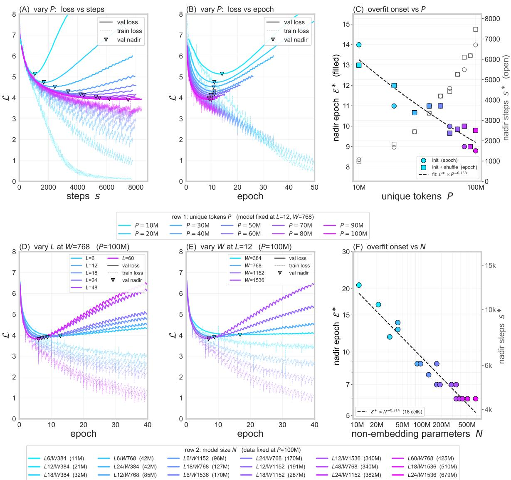  
Figure 1: Repeated training lowers training loss but eventually raises validation loss. Top: corpussize sweep at fixed model size; bottom: model-size sweep at fixed corpus size. Dashed/solid curves show training/validation loss; triangles mark minima. (C, F) Optimal stopping in epochs (filled) and steps (open). Larger models reach their optimum in fewer epochs; optimal epochs vary less across corpus sizes. Settings: Table 3.

## 3 A Dynamical Mean-Field Theory of Fixed-Data Reuse

## 3.1 Random-Feature Model and Multi-Epoch Dynamics

Model and observables. We study a random-feature predictor of width N, with N trainable parameters and P training examples. SGD uses minibatches of size B:

$$
f ( { \pmb x } ) = \frac { 1 } { N } { \pmb w } ^ { \top } { \pmb A } \psi ( { \pmb x } ) , \qquad { \pmb y } ( { \pmb x } ) = { \pmb w } ^ { \star } \cdot { \pmb \psi } ( { \pmb x } ) + \sigma \epsilon ,\tag{1}
$$

where the training feature vectors are independent draws from $\mathcal { N } ( \mathbf { 0 } , \pmb { \Lambda } )$ , with $\pmb { \Lambda } = \mathrm { d i a g } ( \lambda _ { 1 } , \lambda _ { 2 } , . . . )$ . The matrix $\pmb { A } \in \mathbb { R } ^ { N \times \bar { M } }$ has independent standard Gaussian entries, and $\epsilon \sim \mathcal { N } ( 0 , 1 )$ . The population features, random-feature matrix, and label noises are mutually independent. Here $\sigma ^ { 2 }$ is the variance of additive label noise, drawn once per training example, and M is the population feature dimension. We initialize the trainable weights at ${ \pmb w } _ { 0 } ( 0 ) = 0 ;$ ensemble members use independent draws of A on the same dataset. The DMFT allows $\sigma \geq 0 .$ . We first analyze late-time scaling for noiseless targets and then give the labelnoise extension; the compute-allocation result uses the noiseless scaling form. Setting $\sigma = 0$ removes label noise, while the dataset and random features remain random. Table 1 collects the size and traininghorizon notation. For the scaling analysis, we allow infinitely many population features with summable eigenvalues, $\textstyle \sum _ { k = 1 } ^ { \infty } \lambda _ { k } < \infty$ , as in dimension-free analyses of random-feature regression (Defilippis et al., 2024). Appendix B.1 separates this setting from an isotropic finite-dimensional proportional specialization.

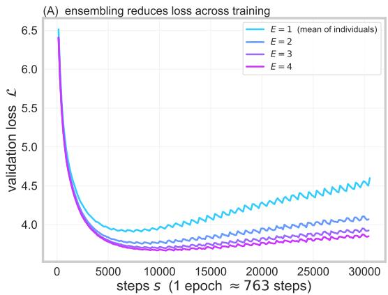

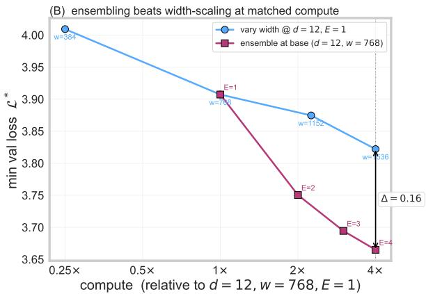  
Figure 2: Ensembling reduces late-time deterioration and improves loss at matched training budgets. (A) Validation trajectories by ensemble size. (B) Four base models outperform one twice-wider model by 0.16 nats. Both panels use $P = 1 0 0 \mathrm { M } ;$ settings and evaluation coverage: Table 3.

Table 1: Size and training-horizon notation for the random-feature model.
<table><tr><td>Symbol</td><td>Meaning</td><td>Symbol</td><td>Meaning</td></tr><tr><td>N</td><td>Model width</td><td>M</td><td>Population feature dimension</td></tr><tr><td>P</td><td>Training samples</td><td>B</td><td>Samples per update</td></tr><tr><td>E</td><td>Ensemble members</td><td>E</td><td>Training epochs</td></tr><tr><td> $T = P / B$ </td><td>Updates per epoch</td><td> $S = T \mathcal { E }$ </td><td>Total updates</td></tr></table>

The discrepancy between the target and learned feature coefficients is

$$
\pmb { v } _ { n } ^ { 0 } ( t ) : = \pmb { w } ^ { \star } - \frac { 1 } { N } \pmb { A } ^ { \top } \pmb { w } _ { n } ( t ) .
$$

For a fixed realization of the training data and random features, the test mean-squared error is

$$
\begin{array} { r } { \mathcal { L } _ { N , B } ( n , t ) = { \pmb v } _ { n } ^ { 0 } ( t ) ^ { \top } \pmb { \Lambda } { \pmb v } _ { n } ^ { 0 } ( t ) + \sigma ^ { 2 } . } \end{array}
$$

Epoch and minibatch indices. We use $n \in \{ 0 , \ldots , \mathcal { E } - 1 \}$ for the epoch index and $t \in \{ 0 , \ldots , T - 1 \}$ for the step within that epoch. The global update index and effective training time are

$$
s = n T + t , \qquad \tau = \eta s .
$$

Thus $s / T$ counts the elapsed epochs. In the fixed-order setting, the same feature block $\Psi ( t ) \in \mathbb { R } ^ { B \times M }$ and

its fixed label-noise vector $\mathbf { \epsilon } \epsilon ( t )$ reappear at position t in every epoch. The exact residual recursion is

$$
\begin{array} { r l } & { v _ { n } ^ { 0 } ( t + 1 ) = v _ { n } ^ { 0 } ( t ) - \eta \left( \frac { 1 } { N } A ^ { \top } A \right) \frac { 1 } { B } \Psi ( t ) ^ { \top } \left( \Psi ( t ) v _ { n } ^ { 0 } ( t ) + \sigma \epsilon ( t ) \right) , } \\ & { v _ { n + 1 } ^ { 0 } ( 0 ) = v _ { n } ^ { 0 } ( T ) . } \end{array}\tag{2}
$$

Here η is the N-rescaled learning rate; the corresponding learning rate on w is $\eta N$

Causality and fixed-data reuse. To simplify the equations, we use the combined epoch-step index $\alpha = \left( n , t \right)$ , where n denotes the epoch and t the step within that epoch. The causal matrix Θ and the projection D distinguish ordinary temporal dependence from repeated-data dependence:

$$
\Theta _ { \alpha , \beta } = \delta _ { n n ^ { \prime } } { \bf 1 } \{ t > t ^ { \prime } \} + { \bf 1 } \{ n > n ^ { \prime } \} , { \boldsymbol { \alpha } } = ( n , t ) , { \boldsymbol \beta } = ( n ^ { \prime } , t ^ { \prime } ) , [ \mathcal { D } ( { \bf Q } ) ] _ { \alpha , \beta } = Q _ { ( n , t ) , ( n ^ { \prime } , t ^ { \prime } ) } \delta _ { t t ^ { \prime } } .
$$

The matrix Θ sums updates that occur before a given state. The map D sets entries with $t \neq t ^ { \prime }$ to zero, thereby retaining cross-epoch correlations only between repeated uses of the same minibatch.

## 3.2 High Level Findings from Theory

Overfitting Effects from Multi-Pass SGD and Cross-Epoch Response Functions. The theory describes how cross-epoch correlations build up as the same data are reused. These effects are captured by the DMFT response and correlation functions, which predict how validation loss and training loss separate as epoch count grows.

Regimes of Training in Terms of Compute. Our theory predicts that Chinchilla-style compute-optimal scaling breaks down around the compute scale $C \sim P ^ { \chi }$ , where $\chi = b + 1$ for the power-law spectrum studied below.

• Effectively Online Regime: At low compute, when data-reuse effects are small, the leading scaling follows the effectively online approximation used for one-pass training.

• Possible Overfit Regime: Once the model size selected by the online allocation becomes comparable to the dataset size, overfitting can affect the optimal use of compute. Optimal stopping and approaches such as ensembling then become important. With more compute, training time, model size, and ensemble count can be adjusted to further reduce test loss using the same data.

Optimal Stopping and Ensembling as a Function of Compute. For noiseless gradient flow at the interpolation threshold, the theory predicts growing expected validation loss at late times. This growth can be controlled through a combination of early stopping and ensembling. We characterize how the optimal stopping time and ensemble count depend on compute at fixed data and member size (Section 3.6).

## 3.3 DMFT Characterization

Averaging over the random matrices reused in (2), DMFT gives a Gaussian single-site process (Bordelon and Pehlevan, 2026; Bordelon et al., 2024; Gerbelot et al., 2022; Mignacco et al., 2020). The response $R _ { \alpha , \beta }$ measures the effect at α of a perturbation at $\beta ; C _ { \alpha , \beta }$ is a two-time correlation. Bold symbols denote matrices on the $S = T \mathcal { E }$ epoch-step indices. The response equations are

$$
\begin{array} { l l } { { { \displaystyle { \cal H } _ { k } = \left[ I + \eta \lambda _ { k } \Theta R _ { 3 } R _ { 1 } \right] ^ { - 1 } , } } } & { { { \qquad \bar { \cal H } = \sum _ { k } \lambda _ { k } { \cal H } _ { k } , } } } \\ { { { } } } & { { { } } } \\ { { { \displaystyle { \cal R } _ { 1 } = \left[ I + \frac { \eta } { B } { \cal D } ( \bar { \cal H } \Theta R _ { 3 } ) \right] ^ { - 1 } , } } } & { { { \qquad \cal R } _ { 3 } = \left[ I + \frac { \eta } { N } R _ { 1 } \bar { \cal H } \Theta \right] ^ { - 1 } . } } \end{array}\tag{3}
$$

The transfer matrix $\pmb { H } _ { k }$ propagates spectral mode k. The responses $R _ { 1 }$ and $R _ { 3 }$ contain the finite-data and finite-width feedback, respectively.

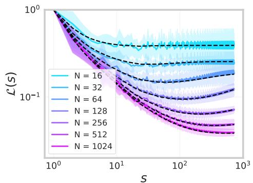

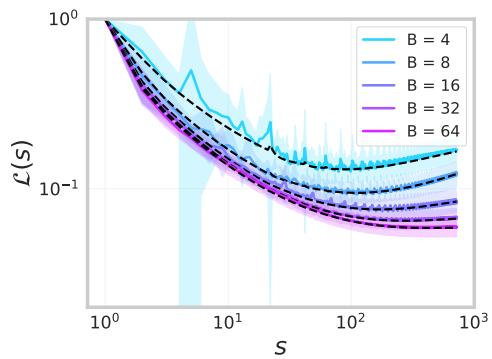

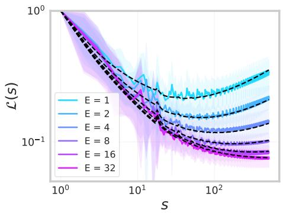

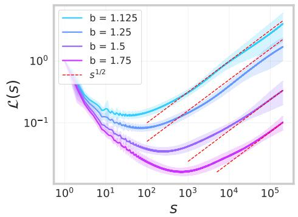  
Figure 3: Microscopic random-feature simulations and DMFT predictions (dashed black) versus global step. Panels vary model width N, batch size B, ensemble size $E _ { : }$ , and capacity exponent b at interpolation.

Writing $v _ { \alpha } ^ { 1 }$ for the residual on a current minibatch example, including label noise, the correlations and losses are

$$
\begin{array} { l } { { \displaystyle [ C _ { 0 } ] _ { \alpha , \beta } = \sum _ { k } \lambda _ { k } \left. v _ { k , \alpha } ^ { 0 } v _ { k , \beta } ^ { 0 } \right. , } } \\ { { \displaystyle } } \\ { { \displaystyle \mathcal { L } _ { \mathrm { t e s t } } ( \alpha ) = [ C _ { 0 } ] _ { \alpha \alpha } + \sigma ^ { 2 } } , } \end{array}
$$

$$
\begin{array} { r } { [ C _ { 1 } ] _ { \alpha , \beta } = \left. v _ { \alpha } ^ { 1 } v _ { \beta } ^ { 1 } \right. , } \\ { ~ } \\ { \widehat { \mathcal { L } } _ { \mathrm { t r a i n } } ( \alpha ) = [ C _ { 1 } ] _ { \alpha \alpha } . } \end{array}
$$

The brackets average over the effective process. The correlation equations close with (3); the minibatch feature field has covariance proportional to $\mathcal { D } ( C _ { 1 } )$ , retaining correlations between repeated uses of the same minibatch. Appendices B.8 and B.9 derive the process, and Appendices B.3–B.7 give the full equations.

Figure 3 compares the closed DMFT equations with direct simulation of the microscopic random-feature model. The theory tracks changes in width $N .$ , batch size $B ,$ and ensemble size $E ,$ as well as the late-time growth at interpolation.

## 3.4 Late-Time Growth Near Interpolation

We study the gradient-flow limit under power-law source and capacity conditions (Bordelon et al., 2024):

$$
\lambda _ { k } \sim k ^ { - b } , \qquad \lambda _ { k } ( w _ { k } ^ { \star } ) ^ { 2 } \sim k ^ { - a } , \qquad a > 1 , \quad b > 1 .
$$

Here b describes feature-spectrum decay and a describes target power; $b > 1$ makes the eigenvalue tail summable. Write $\mathcal { L } ( \tau , N , P , E )$ for ensemble test loss at effective time τ. We first take $\sigma = 0$ and $1 < a <$ $b + 1$ , for which the full signal source scales as $P ^ { - ( a - 1 ) }$ (Appendix F).

At $N \ = \ P$ , the response becomes marginal at low frequencies on the scale $\tau _ { c } \ \asymp \ P ^ { b }$ . Under the conditions of Theorem 2, the growing contribution $\mathcal { L } _ { \mathrm { g r o w } } ( \tau )$ to a single model’s test loss $( E = 1 )$ is

$$
\begin{array} { r } { \mathcal { L } _ { \mathrm { g r o w } } ( \tau ) \asymp P ^ { - ( a - 1 + b / 2 ) } \tau ^ { 1 / 2 } , \qquad \tau \gtrsim \tau _ { c } \asymp P ^ { b } . } \end{array}\tag{4}
$$

On the regular GF branch at fixed $N / P \ne 1$ , a positive low-frequency denominator cuts off this critical growth. Before finite data limit learning, the unlearned modes give a contribution of order $\tau ^ { - ( a - 1 ) / b }$ for $\tau \ll P ^ { b }$ . To determine when to stop an ensemble, we also need the time dependence of the error that remains after averaging over models, which we analyze next.

Label noise adds a source to the correlation equations without changing the responses. Its conditional late-time growth and weak-noise stopping conditions are derived in Appendices F.3 and I.4; the stopping and allocation laws below concern noiseless targets.

## 3.5 Ensembling and Optimal Stopping

Consider E models with independent random projections trained on a shared dataset in a common fixed order. Write $C _ { \mathrm { s e l f } } ( \tau )$ for one member’s expected squared error and $C _ { \mathrm { c r o s s } } ( \tau )$ for the expected product of errors from two distinct members on the same input. At $N = P$ , the ensemble loss is

$$
\mathcal { L } ( \tau , P , P , E ) = C _ { \mathrm { c r o s s } } ( \tau ) + \frac { C _ { \mathrm { s e l f } } ( \tau ) - C _ { \mathrm { c r o s s } } ( \tau ) } { E } .
$$

The difference $C _ { \mathrm { s e l f } } - C _ { \mathrm { c r o s s } }$ is the prediction variance across random projections, averaged over datasets. Ensembling reduces it by $1 / E$ at fixed time, while cross includes both bias and error due to the shared data, as in previous analyses of ensembling (Adlam and Pennington, 2020; Bordelon et al., 2024; Geiger et al., 2020; Ruben and Pehlevan, 2023; Ruben et al., 2025). Appendix C derives the ensemble process.

For Gaussian data and random features, zero initialization, and the pure-power continuum spectrum $\lambda _ { k } = k ^ { - b } , ( w _ { k } ^ { \star } ) ^ { 2 } = k ^ { b - a }$ , with $b > 1$ and $1 < a < b + 1$ , noiseless GF equations at $N = P$ give

$$
\begin{array} { r l } & { C _ { \mathrm { c r o s s } } ( \tau ) = C _ { \infty } + J \tau ^ { - 1 / 2 } + D \tau ^ { - 1 } + O ( \tau ^ { - 3 / 2 } ) , } \\ & { ~ C _ { \mathrm { s e l f } } ( \tau ) = H \sqrt { \tau } + O ( 1 ) , ~ D , H > 0 . } \end{array}
$$

Here $C _ { \infty } \asymp P ^ { - ( a - 1 ) }$ , and J has the sign of $a - b$ . Since cross stays bounded, only the variance grows at late times. At fixed $P$ and large E, the loss-minimizing time $\tau _ { \star } ( P , E )$ balances this growth with the cross correction: $J \tau ^ { - 1 / 2 }$ for $a > b ,$ , or $D / \tau$ when $a = b$ and $J = 0 ,$ . For $a < b ,$ cross approaches $C _ { \infty }$ from below and attains a finite-time minimum; stopping times approach its minimizer set. These cases give the stopping laws in Table 2 (Appendix H).

The $a = b$ cancellation follows from equal squared target coefficients, not merely equal tail exponents. For the finite noiseless Gaussian model with zero initialization, $N = P$ , a positive spectrum, $M > P + 1$ and $( w _ { k } ^ { \star } ) ^ { 2 } = q > 0$ , Theorem 3 proves $\tau _ { \star } \asymp E ^ { 2 / 3 }$ for the expected loss at fixed $P ,$ M as $E  \infty$ . The additional $P ^ { b }$ scaling comes from the continuum calculation.

To connect this variance reduction with our language-model experiments, we consider logit averaging under cross-entropy. For a fixed dataset and evaluation input, a Taylor expansion of cross-entropy gives a leading $1 / E$ correction under logit averaging at a fixed checkpoint (Appendix C.7).

## 3.6 Compute Allocation at Optimal Stopping

We study how to allocate additional compute between ensemble size and training time when dataset and individual model sizes are fixed. Under the noiseless continuum assumptions of Section 3.5, we fix P and $N = P$ . For each ensemble size $E ,$ let $\tau _ { \star } ( P , E )$ be the loss-minimizing training time and $\mathcal { L } ^ { * } ( P , E )$ the corresponding minimum test loss. At fixed batch size and learning rate, this training requires compute $E P \tau _ { \star } ( P , E )$ , giving the allocation problem

$$
\operatorname* { m i n } _ { E \in \mathbb { N } _ { \geq 1 } } \mathcal { L } ^ { * } ( P , E ) \quad \mathrm { s u b j e c t t o } \quad E P \tau _ { \star } ( P , E ) \leq C , \qquad P \mathrm { ~ f i x e d . }\tag{5}
$$

Ensembling reduces prediction variance, so the minimum loss is nonincreasing in E. An optimal choice $E _ { \star } ( C ; P )$ is therefore the largest ensemble that can reach its loss minimum within budget.

Write $\mathcal { L } ^ { * } ( C ; P )$ for the resulting minimum loss. The excess loss in Table 2 is measured relative to $\mathcal { L } _ { \infty } ( P )$ , the best test loss approached as ensemble size grows and training time is chosen optimally. This limit is of order $P ^ { - ( a - 1 ) }$ and reflects the error shared across models (Appendix I). For $a < b ,$ the excess-loss rate assumes positive minimum prediction variance over the times minimizing $C _ { \mathrm { c r o s s } }$

Table 2: Optimal stopping and compute allocation at fixed $N = P .$ . Entries give scalings up to positive constants as $E \to \infty$ for stopping and $C / P ^ { b + 1 } \to \infty$ for allocation and loss.
<table><tr><td></td><td>Condition Optimal stopping Ensemble size  $\tau _ { \star } ( P , E ) / P ^ { b }$ </td><td> $E _ { \star } ( C ; P )$ </td><td>Excess loss  $P ^ { a - 1 } [ \mathcal { L } ^ { * } ( C ; P ) - \mathcal { L } _ { \infty } ( P ) ]$ </td><td></td></tr><tr><td> $a > b$ </td><td>E</td><td> $( C / P ^ { b + 1 } ) ^ { 1 / 2 }$ </td><td> $( C / P ^ { b + 1 } ) ^ { - 1 / 4 }$ </td><td></td></tr><tr><td> $a = b$ </td><td> $E ^ { 2 / 3 }$ </td><td> $( \dot { C } / P ^ { b + 1 } ) ^ { 3 / 5 }$ </td><td> $( \dot { C } / P ^ { b + 1 } ) ^ { - 2 / 5 }$ </td><td></td></tr><tr><td> $a < b$ </td><td>1</td><td> $C / P ^ { b + 1 }$ </td><td> $( \dot { C } / P ^ { b + 1 } ) ^ { - 1 }$ </td><td></td></tr></table>

At large budgets, ensemble size grows at least as fast as training time per model. For $a > b ,$ , the two grow with the same power of compute; for equal squared target coefficients $( a = b )$ , ensemble size grows faster. In both cases, averaging suppresses the growing variance enough to make longer training worthwhile. For $a < b ,$ the optimal training horizon remains bounded, so further compute increases support more ensemble members.

Allowing any affordable checkpoint gives a broader optimization over ensemble size and training time. $\mathbf { A } \mathbf { t } \ N = P$ with equal squared target coefficients, this compute frontier retains the $- 2 / 5$ excess-loss exponent, with a different leading coefficient (Appendix I.1).

For finite-step SGD, batch size and learning rate also affect the effective training time available at fixed compute (Appendix D). Figure 4 illustrates these choices in the finite random-feature model.

## 3.7 Testing the Theoretical Predictions

We first give a finite-horizon guarantee for the loss approximation, then examine the stopping and computeallocation predictions numerically.

Finite-horizon accuracy. For Gaussian population features, fixed feature dimension M, and a fixed horizon S, Theorem 1 bounds the absolute loss error by $\widetilde { \mathcal { O } } _ { M , S } ( N ^ { - 1 / 2 } + B ^ { - 1 / 2 } )$ , simultaneously for all $\alpha \leq S ,$ , at a sufficiently small fixed learning rate. The same rate holds for relative loss error when the reference loss is bounded below on this horizon. Appendix J proves the bound by comparison with population gradient descent.

Compute allocation in the random-feature model. Figure 4 compares ways to use additional compute at fixed data size. In (A), the dashed curve and inset implement the stopped allocation in (5); the solid curve jointly selects ensemble size and an affordable checkpoint. Panel (B) starts below interpolation and compares increasing width with ensembling, while (C, D) show how learning-rate selection changes the batch-size comparison. Appendix K gives the full learning curves, self/cross correlations, stopping-law comparisons, and numerical checks, together with allocation results for widths above interpolation.

## 3.8 Language-Model Experiments

We now return to the FineWeb experiments to examine whether ensembling suppresses late-time deterioration and delays optimal stopping in language models, and to compare its benefits with those of increasing model size. The experiments use the FineWeb setup introduced in Section 2; Appendix A collects the configurations and fitting procedures.

(A) Stopping and ensembling: N = P  
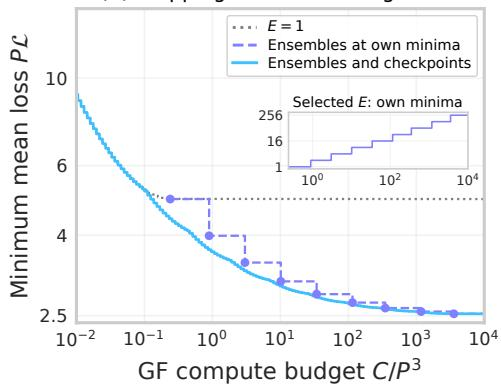

(B) Width versus ensembles: N ≤ P  
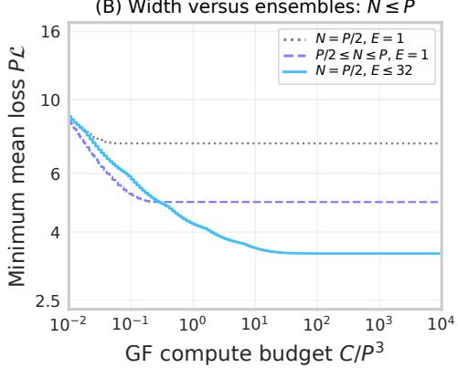

(C) Batch size: fixed η = 0.04  
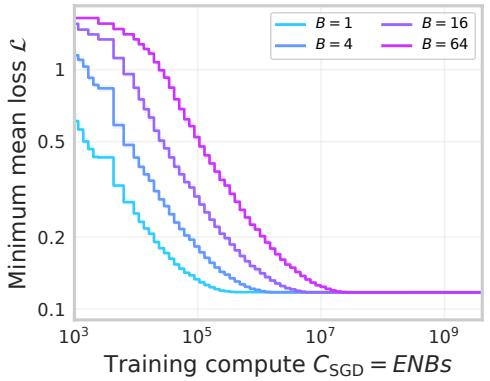

(D) Batch size: η selected from grid  
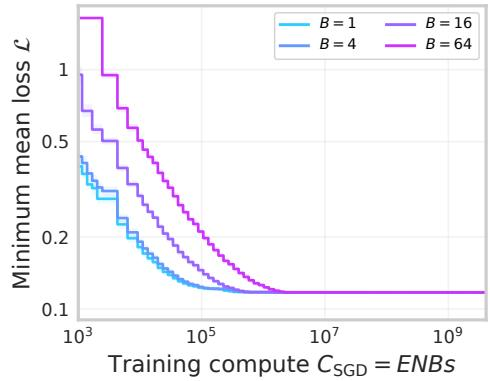  
Figure 4: Compute allocation at fixed data size. Noiseless random-feature simulations with $a = b = 2$ (A) In GF at $N = P$ , ensembling lowers loss beyond the single-model minimum. Inset: selected $E$ when ensembles are trained to their own minima. (B) Starting from $N = P / 2 .$ , ensembling outperforms increasing width up to $P$ at large budgets on this grid. (C, D) For cyclic SGD at $N = P / 2$ and $E = 1$ , selecting learning rates separately narrows the small-batch advantage. Shading indicates 95% dataset-bootstrap intervals. See Appendix K for settings and comparisons.

Ensembling suppresses the late-time rise. The loss trajectories in Figure 2 show that averaging independently trained models reduces late-time deterioration. At fixed training steps, validation loss also decreases with ensemble size for both shared and independently shuffled data orders. Appendix A.2 shows that reducible loss decays approximately as $E ^ { - 1 }$ for both, as the theory predicts.

Model size affects attainable loss and optimal stopping. We next vary model depth and width while holding the corpus at 100M tokens. Figure 5A shows that larger models generally attain lower validation loss. The separable relation $\mathcal { L } ^ { * } ( L , W ) - \mathcal { L } _ { \infty } = c L ^ { - b _ { L } } W ^ { - b _ { W } }$ captures additional variation across architectures (Figure 5B,C). At approximately 170M parameters, a deeper, narrower model attains a loss 0.06 nats per token below a shallower, wider model. Model size therefore summarizes the main trend, with architecture accounting for some of the remaining variation.

Larger models also reach their minimum validation loss earlier: the optimal epoch count falls from 21 to 6 over the tested model-size range (Figure 1F). By comparison, it varies from 14 to 9 across the data-size sweep at fixed model size. Over the tested ranges, optimal epoch counts decrease more rapidly with model size than with corpus size. Appendix A.3 collects the fitted exponents and compares attainable loss along the model and data axes.

The ensemble advantage persists across model sizes. We compare ensembles of six model configurations with larger single models, holding the corpus and training horizon fixed. Matching effective size EN (total non-embedding parameters) therefore matches parameter-token training budgets. Four-member ensembles achieve validation losses 0.12–0.20 nats lower than the corresponding wider or deeper single models (Figure 6A). Ensembling also shifts the minimum to later training epochs (Figure 6B). This later stopping is qualitatively consistent with the RF mechanism in Section 3.5: averaging suppresses a growing error, allowing further training to remain beneficial.

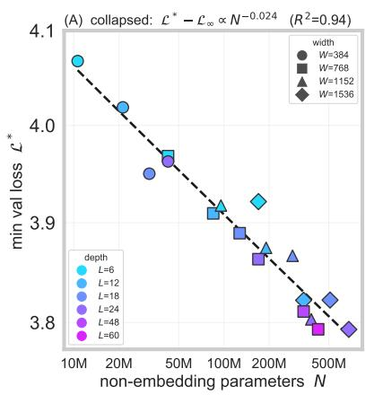

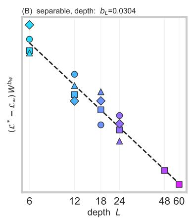

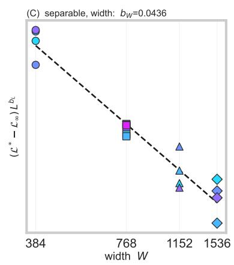

Figure 5: Larger models attain lower loss, with additional depth and width effects. At $P = 1 0 0 \mathbf { M } \colon ( \mathbf { A } )$ minimum validation loss versus non-embedding parameter count; (B, C) depth and width dependence after removing the other variable’s fitted contribution (joint $R ^ { 2 } = 0 . 9 7 )$ . Shape denotes width and colour denotes depth. Shared floor: Appendix A.3; fitted coefficients: Table 7.  
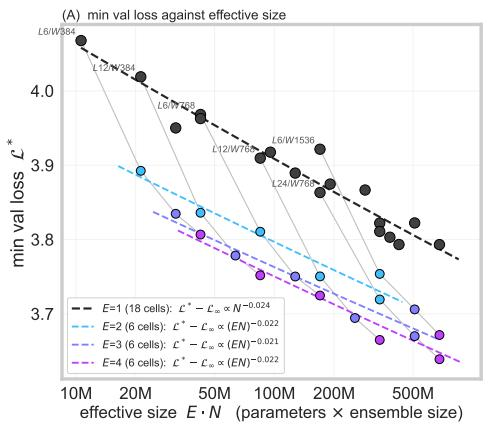

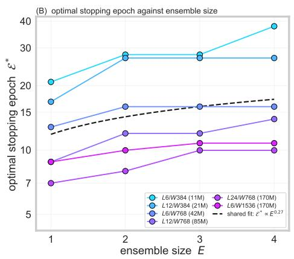  
Figure 6: Ensembles outperform larger single models and reach their minimum later. At $P = 1 0 0 \mathrm { M } ;$ (A) minimum validation loss versus effective size $E N$ ; black circles show single models, coloured points ensembles of six configurations. (B) Optimal stopping epoch versus ensemble size. Dashed lines show fitted power laws, with a shared slope in (B); details: Appendix A.3.

## 4 Discussion and Conclusion

Our results show how repeated training epochs and ensembling jointly shape generalization on a fixed dataset. The multi-epoch DMFT tracks error correlations within and across epochs and between ensem ble members. For noiseless Gaussian RF gradient flow at $N = P$ , a component of the expected test error grows at late training times. Averaging the predictions of E models reduces this component by a factor of E, changing the balance that determines optimal stopping. The pure-power continuum analysis translates the resulting stopping laws into rules for allocating compute between ensemble size and training duration, with data and member sizes fixed and each ensemble trained to its own loss minimum.

Our language-model experiments show lower validation loss and later optimal stopping with ensembling, qualitatively consistent with this mechanism. They also show gains over wider or deeper single models at matched parameter-token training budgets. A quantitative connection to the RF theory requires accounting for feature learning and optimizer dynamics, and relating RF feature and sample counts to Transformer parameter and token counts.

Our label-noise analysis provides a starting point for extending these stopping and allocation laws to noisy targets. Reshuffling requires further analysis of how changing the data order affects correlations across epochs. Together, the theory and experiments motivate choosing the number of training epochs and ensemble members jointly when allocating compute to a fixed dataset.

## References

Ben Adlam and Jeffrey Pennington. Understanding double descent requires a fine-grained bias-variance decomposition. Advances in neural information processing systems, 33:11022–11032, 2020.

Blake Bordelon and Cengiz Pehlevan. Disordered dynamics in high dimensions: Connections to random matrices and machine learning. arXiv preprint arXiv:2601.01010, 2026.

Blake Bordelon, Abdulkadir Canatar, and Cengiz Pehlevan. Spectrum dependent learning curves in kernel regression and wide neural networks. In International Conference on Machine Learning, pages 1024– 1034. PMLR, 2020.

Blake Bordelon, Alexander Atanasov, and Cengiz Pehlevan. A dynamical model of neural scaling laws. In International Conference on Machine Learning, pages 4345–4382. PMLR, 2024.

Abdulkadir Canatar, Blake Bordelon, and Cengiz Pehlevan. Spectral bias and task-model alignment explain generalization in kernel regression and infinitely wide neural networks. Nature communications, 12(1): 2914, 2021.

A Crisanti and H Sompolinsky. Path integral approach to random neural networks. Physical Review E, 98 (6):062120, 2018.

Leonardo Defilippis, Bruno Loureiro, and Theodor Misiakiewicz. Dimension-free deterministic equivalents and scaling laws for random feature regression. Advances in Neural Information Processing Systems, 37: 104630–104693, 2024.

Mario Geiger, Arthur Jacot, Stefano Spigler, Franck Gabriel, Levent Sagun, Stephane d’Ascoli, Giulio´ Biroli, Clement Hongler, and Matthieu Wyart. Scaling description of generalization with number of´ parameters in deep learning. Journal ofStatistical Mechanics: Theory and Experiment, 2020(2):023401, 2020.

Cedric Gerbelot, Emanuele Troiani, Francesca Mignacco, Florent Krzakala, and Lenka Zdeborova. Rigorous dynamical mean field theory for stochastic gradient descent methods. arXiv preprint arXiv:2210.06591, 2022.

Moritz Helias and David Dahmen. Statisticalfield theoryfor neural networks, volume 970. Springer, 2020.

Jordan Hoffmann, Sebastian Borgeaud, Arthur Mensch, Elena Buchatskaya, Trevor Cai, Eliza Rutherford, Diego de Las Casas, Lisa Anne Hendricks, Johannes Welbl, Aidan Clark, et al. Training compute-optimal large language models. arXiv preprint arXiv:2203.15556, 2022.

Jared Kaplan, Sam McCandlish, Tom Henighan, Tom B Brown, Benjamin Chess, Rewon Child, Scott Gray, Alec Radford, Jeffrey Wu, and Dario Amodei. Scaling laws for neural language models. arXiv preprint arXiv:2001.08361, 2020.

Konwoo Kim, Suhas Kotha, Percy Liang, and Tatsunori Hashimoto. Pre-training under infinite compute. arXiv preprint arXiv:2509.14786, 2025.

Licong Lin, Jingfeng Wu, Sham M Kakade, Peter L Bartlett, and Jason D Lee. Scaling laws in linear regression: Compute, parameters, and data. arXiv preprint arXiv:2406.08466, 2024.

Alexander Maloney, Daniel A Roberts, and James Sully. A solvable model of neural scaling laws. arXiv preprint arXiv:2210.16859, 2022.

Bishwas Mandal, Shmuel Berman, Akshay Vegesna, and Samip Dahal. q0: Primitives for hyper-epoch pretraining. arXiv preprint arXiv:2606.03938, 2026. doi: 10.48550/arXiv.2606.03938. URL https: //arxiv.org/abs/2606.03938.

Francesca Mignacco, Florent Krzakala, Pierfrancesco Urbani, and Lenka Zdeborova. Dynamical mean-field´ theory for stochastic gradient descent in gaussian mixture classification. Advances in Neural Information Processing Systems, 33:9540–9550, 2020.

Niklas Muennighoff, Alexander Rush, Boaz Barak, Teven Le Scao, Nouamane Tazi, Aleksandra Piktus, Sampo Pyysalo, Thomas Wolf, and Colin A Raffel. Scaling data-constrained language models. Advances in Neural Information Processing Systems, 36:50358–50376, 2023.

Courtney Paquette, Kiwon Lee, Fabian Pedregosa, and Elliot Paquette. Sgd in the large: Average-case analysis, asymptotics, and stepsize criticality. In Conference on Learning Theory, pages 3548–3626. PMLR, 2021.

Elliot Paquette, Courtney Paquette, Lechao Xiao, and Jeffrey Pennington. 4+ 3 phases of compute-optimal neural scaling laws. arXiv preprint arXiv:2405.15074, 2024.

Ben Ruben and Cengiz Pehlevan. Learning curves for noisy heterogeneous feature-subsampled ridge ensembles. Advances in Neural Information Processing Systems, 36:50041–50093, 2023.

Benjamin Samuel Ruben, William Lingxiao Tong, Hamza Tahir Chaudhry, and Cengiz Pehlevan. No free lunch from random feature ensembles: Scaling laws and near-optimality conditions. In International Conference on Machine Learning, pages 52198–52224. PMLR, 2025.

James B Simon, Madeline Dickens, Dhruva Karkada, and Michael R DeWeese. The eigenlearning framework: A conservation law perspective on kernel regression and wide neural networks. arXiv preprint arXiv:2110.03922, 2021.

Pablo Villalobos, Anson Ho, Jaime Sevilla, Tamay Besiroglu, Lennart Heim, and Marius Hobbhahn. Will we run out of data? limits of llm scaling based on human-generated data, 2024.

Tingkai Yan, Haodong Wen, Binghui Li, Kairong Luo, Wenguang Chen, and Kaifeng Lyu. Larger datasets can be repeated more: A theoretical analysis of multi-epoch scaling in linear regression. arXiv preprint arXiv:2511.13421, 2025.

## A Experimental Protocol and Additional Fits

This appendix collects the experiment designs, training settings, measurement conventions, and fit results supporting Section 2 and the language-model experiments. Figures and numerical results retain their reported training recipes.

## A.1 Experiment designs and training settings

Table 3: Language-model experiments. All listed sweeps use constant learning rates; λ is the AdamW weight-decay coefficient.
<table><tr><td>Experiment</td><td>Models and data</td><td>Horizon and replication</td></tr><tr><td>Data-size sweep Fig. 1, top</td><td> $L = 1 2 , W = 7 6 8 ( 8 5 \mathrm { { M } ) ; }$   $P \in \{ 1 0 , 2 0 , \dots , 1 0 0 \} \mathrm { M } ; \lambda = 0$ </td><td>About 8,000 updates (1.0–1.1B tokens), or 11–101 epochs; one run per strategy at each P</td></tr><tr><td>Model-size grid Figs. 1, bottom, 5, 8</td><td> $L \in \{ 6 , 1 2 , 1 8 , 2 4 \} \times W \in$   $\{ 3 8 4 , 7 6 8 , 1 1 5 2 , 1 5 3 6 \}$  , plus  $L \in \{ 4 8 , 6 0 \} \ \mathrm { a t } \ W = 7 6 8 ; P = 1 0 0 \mathrm { M } ;$   $\lambda = 0$ </td><td>40 epochs; one run per cell; 18 cells spanning 11M–680M parameters</td></tr><tr><td>Matched-budget comparison Figs. 2, 9</td><td>Base  $L = 1 2 , W = 7 6 8 ;$  ensembles versus wider/deeper single models;  $P = 1 0 0 \mathbf { M } ; \lambda = 0$ </td><td>40-epoch training budget; ensembles in Fig. 2 evaluated from saved model states through epoch</td></tr><tr><td>Ensemble-size scaling Fig. 7</td><td> $L = 1 2 , W = 7 6 8 ; P = 2 0 { \bf M } ; \lambda = 0 ;$  shared or independent data orders</td><td>31 40 epochs; 20 trained members per strategy; 10 random member orderings per strategy</td></tr><tr><td>Ensembles across model sizes Fig. 6</td><td> $\mathrm { S i x \ r e p l i c a t e d \ c e l l s \ ( 1 1 M { - } 1 7 0 M ) } ;$   $P = 1 0 0 \mathbf { M } ; \lambda = 0 ; E = 2 , 3 , 4$ </td><td>40 epochs; at least four independent members per cell; up</td></tr><tr><td>Additional joint-fit data Seven-cell model-size ladder at</td><td> $P = 2 0 \mathbf { M } ; \lambda = 0$ </td><td>to 680M total counted parameters 50 epochs; one run per configuration</td></tr></table>

Table 4: Language-model training configuration.
<table><tr><td colspan="2">Taoie 4. Language-moducr urammng comguration.</td></tr><tr><td>Data</td><td>FineWeb; GPT-2 BPE tokenizer (vocabulary 50,257); 10M held-out validation tokens</td></tr><tr><td>Architecture</td><td>Decoder-only Transformer, depth L, width W, head dimension 64  $( W / 6 4$  heads); rotary embeddings, QK-norm, RMSNorm without weights, no biases, no dropout; SwiGLU MLP with hidden width  $8 W / 3 ;$  untied input and output embeddings; learned residual, input-injection, and U-Net skip gains; sliding-</td></tr><tr><td>Parameterization</td><td>window attention on three of every four layers CompleteP with base L=12, W=768; truncated-normal initialization, std 0.02</td></tr><tr><td>Sequence length</td><td>at base width 2048 tokens</td></tr><tr><td>Batch size</td><td>131,072 tokens (64 sequences) per update</td></tr><tr><td>Optimizer Learning rates</td><td>AdamW,  $\beta = ( 0 . 8 , 0 . 9 5 ) , \epsilon = 1 0 ^ { - 1 0 }$  matrices 0.01, embeddings 0.0375, output head 0.0005, scalar gains 0.025</td></tr><tr><td>Schedule</td><td>constant, no warmup  $_ { ( \lambda = 0 \mathrm { r u n s } ) }$  ; last 20% linear decay to zero (runs with  $\lambda > 0$  and cooldown)</td></tr><tr><td>Precision, hardware</td><td>bfloat16 autocast; one NVIDIA H100-80GB per run</td></tr><tr><td></td><td></td></tr><tr><td>Seeds</td><td>one run per configuration; ensemble members differ in initialization and, where</td></tr></table>

## A.2 Evaluation, ensembling, and compute accounting

Table 5: Measurement and selection conventions.
<table><tr><td>Definition or procedure</td><td>Table 5: Measurement and selection conventions.</td></tr><tr><td>Quantity Validation loss</td><td>Cross-entropy in nats per token on a held-out FineWeb split.</td></tr><tr><td>Epoch and step</td><td>Each update processes 131,072 tokens; one epoch is  $P / 1 3 1 { , } 0 7 2$  updates</td></tr><tr><td>Evaluation cadence</td><td>(763 at  $P = 1 0 0 \mathbf { M } ; 1 5 2$  at  $P = 2 0 \mathbf { M } )$  Every 76 updates in the data sweep and 152 updates in the model grids,</td></tr><tr><td>Saved model state</td><td>corresponding to about 10M and 19.9M training tokens. A checkpoint stores the model parameters at a training step. The optimal</td></tr><tr><td>Optimal stopping</td><td>checkpoint is the evaluated state with minimum validation loss.  $s ^ { * }$  is the evaluated step with minimum validation loss.</td></tr><tr><td>Data-sweep aggregation 1</td><td> $\mathcal { E } ^ { * } = s ^ { * } / ( P / 1 3 1 , 0 7 2 )$  is the corresponding epoch count. One minimum per strategy at each corpus size; the reported minimum loss</td></tr><tr><td>Ensemble prediction</td><td>and optimal epoch average the two strategies&#x27; minima. Average member logits before computing validation cross-entropy. Initialization-only members share the data order; initialization-plus-shuffle</td></tr></table>

Ensemble fits and resampling. At optimizer step s, each data-order strategy is fitted separately with

$$
\mathcal { L } _ { s , E } = \alpha _ { s } E ^ { - \beta } + \mathcal { L } _ { s , \infty } ,\tag{6}
$$

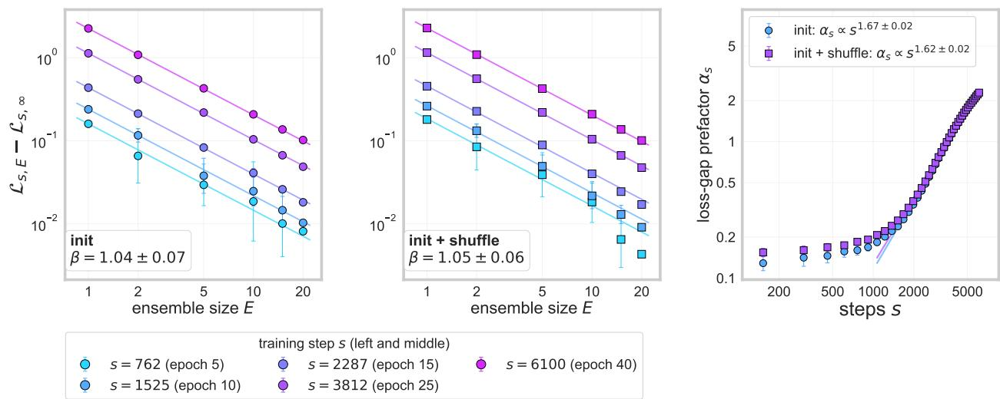  
Figure 7: The reducible ensemble loss decays approximately as $E ^ { - 1 }$ under both sources of member diversity. Left and middle: loss above the fitted infinite-ensemble asymptote against ensemble size, for members with shared or independently shuffled data orders; colour marks the training step and lines are fits of (6). Right: fitted amplitude $\alpha _ { s }$ against step. P = 20M, 40 epochs.

with one exponent $\beta$ per strategy and an amplitude $\alpha _ { s }$ and asymptote $\mathcal { L } _ { s , \infty }$ at each step. The asymptote is strategy-specific because initialization-only members share one data order, which their infinite ensemble retains. Each of 10 resampling iterations draws a random ordering of the 20 trained members of each strategy; the ensemble of size E consists of the first E members, and (6) is refitted per iteration. Error bars show the spread over iterations.

The fitted ensemble-size exponents are close to one (Figure 7, left and middle), consistent with the $E ^ { - 1 }$ dependence predicted by the fixed-checkpoint cross-entropy expansion (Appendix C.7). The amplitude $\alpha _ { s }$ is nearly constant over the first 1,000 steps and grows about tenfold by epoch 40 (right).

Training-budget proxy. We count the attention and MLP matrices as $N = 1 2 L W ^ { 2 }$ : each layer has four $W \times W$ attention matrices and a gated MLP with hidden width 8W/3 (three matrices totalling $8 W ^ { 2 } )$ . Token embeddings, the output head, and per-layer scalar gains are excluded. With D training tokens per member, the compute proxy is $C = E N D$ . For the matched-budget experiments, $D = 4 0 P \mathrm { : }$ we charge the full 40-epoch run and report the best evaluated checkpoint within the available evaluation horizon. Thus four base models and one twice-wider model have the same proxy cost (4 × 85M = 340M counted parameters at the same D). The fixed-horizon LM comparison differs from the RF allocation, which charges training up to each ensemble’s own optimal stopping time. The weight-decay coefficient λ is unrelated to the featurespectrum eigenvalues $\lambda _ { k }$ in Section 3.

## A.3 Loss laws and fitted exponents

Shared loss floor. Loss laws in N, L, W, and P use the shared floor $\mathcal { L } _ { \infty } = 1 . 2 5$ . Table 6 gives its joint-fit source and the observations used in each subsequent fit.

Figure 8 collects the model-size stopping curve and the attainable-loss fits along the model and data axes.

Table 6: Fitting conventions for attainable loss and optimal stopping.
<table><tr><td>Fit</td><td>Model and observations</td></tr><tr><td>Joint N, P law</td><td> $\mathcal { L } ^ { * } = \mathcal { L } _ { \infty } + A N ^ { - \alpha } + B P ^ { - \alpha }$  on 35 observations: the 18-cell 100M grid, seven-cell 20M ladder, and ten data-sweep settings. Shared exponent  $\alpha = 0 . 1 9 ,$  floor  $1 . 2 5 , R ^ { 2 } = 0 . 9 9 6 .$ </td></tr><tr><td>Model-size laws</td><td>One minimum per cell on the 18-cell 100M grid. Fit  $\mathcal { L } ^ { * } - \mathcal { L } _ { \infty }$  against N, or against  $L , W$  with separate exponents. Optimal-epoch fits use the same cells.</td></tr><tr><td>Data-size laws</td><td>Ten corpus sizes at fixed  $L = 1 2 , W = 7 6 8$  , using the strategy-averaged minima and optimal epochs defined in Table 5.</td></tr><tr><td>Ensemble/model-size laws</td><td>A separate power law in total counted parameters EN for each  $E = 2 , 3 , 4 ,$  using the six replicated cells and the same loss floor.</td></tr><tr><td>Ensemble stopping</td><td>Fit log  $\mathcal { E } _ { j } ^ { * } =$  log  $c _ { j } + \gamma$  log  $E$  over  $E = 1 , 2 , 3 ,$  4 for six model configurations  $j ,$  with a shared exponent  $\gamma = 0 . 2 7$  and separate prefactors  $c _ { j }$  The dashed guide in Figure 6B uses the geometric mean of these prefactors.</td></tr><tr><td>Ensemble-size law</td><td>Equation (6) fits an infinite-ensemble asymptote for each strategy at each checkpoint; this is distinct from the shared  $N , P$  loss floor.</td></tr></table>

Table 7: Fitted exponents for optimal epochs $\mathcal { E } ^ { * }$ and minimum loss above the shared floor, $\Delta \mathcal { L } ^ { * } = \mathcal { L } ^ { * } - 1 . 2 5 .$ Table 6 specifies the observations and fitting conventions.
<table><tr><td></td><td>Quantity Fitted dependence</td><td>Exponent(s)</td><td> $R ^ { 2 }$ </td><td>Points</td></tr><tr><td> $\mathcal { E } ^ { * }$ </td><td> $N ^ { - \alpha }$ </td><td>0.314</td><td>0.938</td><td>18</td></tr><tr><td> $\mathcal { E } ^ { * }$ </td><td> $L ^ { - a _ { L } } W ^ { - a _ { W } }$ </td><td> $a _ { L } = 0 . 3 3 6 , a _ { W } = 0 . 6 0 8$ </td><td>0.940</td><td>18</td></tr><tr><td> $\mathcal { E } ^ { * }$ </td><td> $P ^ { - \alpha }$ </td><td>0.158</td><td>0.917</td><td>10</td></tr><tr><td> $\Delta \mathcal { L } ^ { * }$ </td><td> $N ^ { - \beta _ { N } }$ </td><td>0.024</td><td>0.943</td><td>18</td></tr><tr><td> $\Delta \mathcal { L } ^ { * }$ </td><td> $L ^ { - b _ { L } } W ^ { - b _ { W } }$ </td><td> $b _ { L } = 0 . 0 3 0 4 , b _ { W } = 0 . 0 4 3 6$ </td><td>0.969</td><td>18</td></tr><tr><td> $\Delta \mathcal { L } ^ { * }$ </td><td> $P ^ { - \beta _ { P } }$ </td><td>0.169</td><td>0.997</td><td>10</td></tr></table>

Table 8: Additional fit diagnostics and quantitative comparisons.
<table><tr><td>Comparison</td><td>Result on the measured configurations</td></tr><tr><td>Depth/width loss fit</td><td> $b _ { L } = 0 . 0 3 0 4 , b _ { W } = 0 . 0 4 3 6 ,$  each stable to ±0.002 under leave-one-out. The fitted sensitivity ratio is  $b _ { W } / ( 2 b _ { L } ) = 0 . 7 2 .$ </td></tr><tr><td>Matched-size example</td><td> $\mathrm { A t } \ N \approx 1 7 0 \mathrm { M } , L = 6 , W = 1 5 3 6$  attains loss 3.92, versus 3.86 for  $L = 2 4 , W = 7 6 8 .$ </td></tr><tr><td>Depth/width stopping fit</td><td> $a _ { L } = 0 . 3 3 6 , a _ { W } = 0 . 6 0 8 , \mathrm { s o } a _ { W } / ( 2 a _ { L } ) = 0 . 9 0 .$  Its rounded  $R ^ { 2 } = 0 . 9 4$  matches the fit using N alone. Dependence solely on  $N \propto L W ^ { 2 }$  would give  $a _ { W } = 2 a _ { L }$ </td></tr><tr><td>Resource scaling</td><td>Optimal epochs fall by a fitted factor of 1.4 per decade of data scaling, versus 2.1 per decade of model scaling.</td></tr><tr><td>Ensemble/model-size fitsExponents 0.022, 0.021, 0.022 for</td><td> $E = 2 , 3 , 4 ,$  versus 0.024 for single models. The E = 4 fitted law lies about 0.15 nats below the single-model law over the comparison range.</td></tr></table>

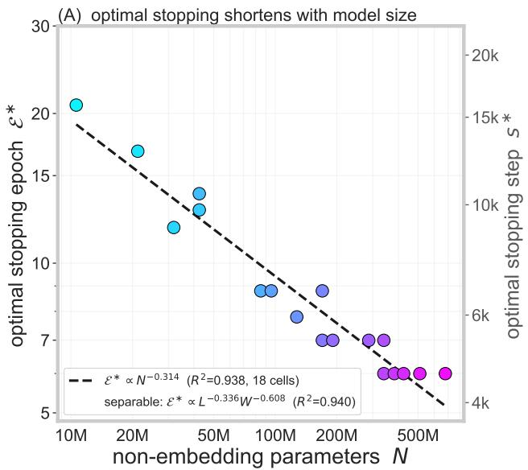

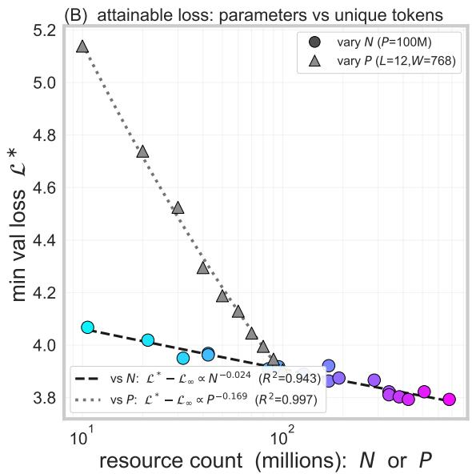  
Figure 8: Model size changes both the best stopping point and the attainable loss. (A) Optimal stopping versus model size on the 100M-token corpus, shown in epochs and optimizer steps. (B) Minimum validation loss when varying model size at fixed data (circles) or data size at fixed model (triangles). Dashed curves show power-law fits over the respective measured ranges. The loss fits in (B) use the shared floor from Appendix A.3. Colour denotes model size.

## A.4 Additional matched-budget comparisons

Ensembling beats model-size scaling at matched compute (df=1.0, 100M tokens, d12/w768 base, init\_shuffle)

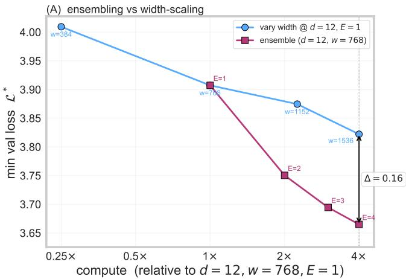

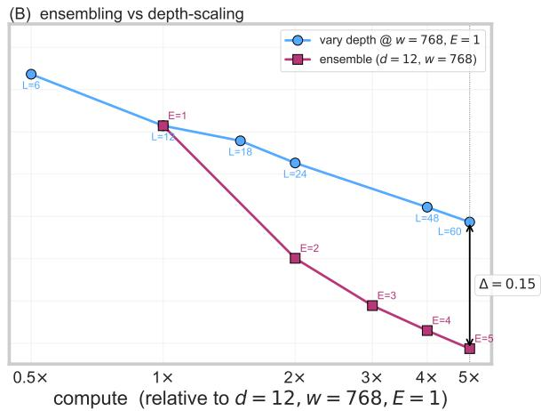  
Figure 9: Ensembles compared with wider (left) or deeper (right) single models at matched parameter-token training budgets. Both comparisons use $P = 1 0 0 \mathbf { M }$ , constant learning rates, zero weight decay, and a 40- epoch budget.

## B Derivation of the Multi-Epoch DMFT Equations

We derive the dynamical mean-field theory (DMFT) for fixed-order multi-epoch training with independent Gaussian population features $\psi ( \pmb { x } _ { \mu } ) \sim \mathcal { N } ( \mathbf { 0 } , \pmb { \Lambda } )$ . The population features, Gaussian random-feature matrix, and label noises are mutually independent. Feature-space quantities are written in the eigenbasis of the population covariance,

$$
\begin{array} { r } { \pmb { \Lambda } = \mathrm { d i a g } ( \lambda _ { 1 } , \lambda _ { 2 } , \ldots ) , \qquad \big \langle \psi _ { k } ( \pmb { x } ) \psi _ { \ell } ( \pmb { x } ) \big \rangle = \lambda _ { k } \delta _ { k \ell } . } \end{array}
$$

The target has coefficients $\boldsymbol { w } _ { k } ^ { \star }$ , so that

$$
y ( \pmb { x } ) = \psi ( \pmb { x } ) \cdot \pmb { w } ^ { \star } + \sigma \epsilon .
$$

The DMFT equations allow an arbitrary spectrum and target. We impose power laws only in Appendix F.

We first state the finite-horizon single-site equations and derive them by cavity and MSR methods. Later sections treat finite-size error, ensembles, continuum limits, and the low-frequency scaling near interpola tion.

## B.1 Asymptotic settings

We first derive the closure at finite feature dimension M and trajectory length $S = T \mathcal { E }$ . The population features enter through Λ and the target coefficients. The closure retains finite-width and finite-minibatch contributions through its $N ^ { - 1 }$ and $B ^ { - 1 }$ terms. The loss approximation in Theorem 1 keeps M, S fixed as $N ,$ B grow. The spectral, small-learning-rate, and long-time limits used for scaling are specified separately below. We distinguish two settings for the population spectrum.

Dimension-free power-law setting. For the scaling analysis, we let $M \to \infty$ along a trace-class population spectrum and assume

$$
\sum _ { k = 1 } ^ { \infty } \lambda _ { k } < \infty , \qquad \sum _ { k = 1 } ^ { \infty } \lambda _ { k } ( w _ { k } ^ { \star } ) ^ { 2 } < \infty .
$$

This is the dimension-free setting in which the power laws $\lambda _ { k } \sim k ^ { - b }$ and $\lambda _ { k } ( w _ { k } ^ { \star } ) ^ { 2 } \sim k ^ { - a }$ , with $a , b > 1$ are imposed in Appendix F.

Finite-dimensional isotropic specialization. For comparison, we also consider a proportional sequence with

$$
M , N , P \to \infty , \qquad \frac { N } { M } \to \phi \in ( 0 , \infty ) , \qquad \frac { P } { M } \to \gamma \in ( 0 , \infty ) , \qquad \mathbf { A } _ { M } = I _ { M } .
$$

We choose a sequence of targets satisfying

$$
\| \mathbf { w } _ { M } ^ { \star } \| _ { 2 } ^ { 2 } \to \rho \in ( 0 , \infty ) .
$$

Equivalently, an isotropically oriented target may be generated with coordinates of order $M ^ { - 1 / 2 }$ , for example ${ \pmb w } _ { M } ^ { \star } = \sqrt { \rho / M } { \pmb g }$ with $\pmb { g } \sim \mathcal { N } ( \mathbf { 0 } , \pmb { I } _ { M } )$ . Since

$$
\mathbb { E } _ { \pmb { x } } \big [ ( \pmb { w } _ { M } ^ { \star } \cdot \pmb { \psi } ( \pmb { x } ) ) ^ { 2 } \big ] = \pmb { w } _ { M } ^ { \star \top } \pmb { \Lambda } _ { M } \pmb { w } _ { M } ^ { \star } = \| \pmb { w } _ { M } ^ { \star } \| _ { 2 } ^ { 2 } ,
$$

this scaling keeps the target signal and loss of order one. This proportional isotropic sequence is not an instance of the infinite-dimensional trace-class limit, since $\mathrm { T r } ( \pmb { \Lambda } _ { M } ) = M$

We use a combined epoch-step index

$$
\alpha = ( n , t ) , \qquad n = 0 , \ldots , \mathcal { E } - 1 , \qquad t = 0 , \ldots , T - 1 ,
$$

and let $S = T \mathcal { E }$ be the total number of update times. Greek indices $\alpha , \beta , \gamma , \ldots$ . always denote epoch-step indices. We write sums over epoch-step indices explicitly unless matrix notation is used. The global update index is $s = n T + t$ , and effective training time is $\tau = \eta s ,$ , as in the main text. Whenever an inequality such as $\alpha \leq S$ is used, the pairs are ordered causally through the one-based index $s + 1 \in \{ 1 , . . . , S \}$

Define the causal matrix Θ by

$$
\Theta _ { \alpha \beta } = \Theta _ { ( n , t ) , ( n ^ { \prime } , t ^ { \prime } ) } = \delta _ { n n ^ { \prime } } { \bf 1 } \{ t > t ^ { \prime } \} + { \bf 1 } \{ n > n ^ { \prime } \} .
$$

Thus $\Theta _ { \alpha \beta } = 1$ when update $\beta$ precedes state α. It sums the past gradient updates in the residual recursion. For any $S \times S$ matrix A, define D by

$$
[ { \cal D } ( A ) ] _ { ( n , t ) , ( n ^ { \prime } , t ^ { \prime } ) } = A _ { ( n , t ) , ( n ^ { \prime } , t ) } \delta _ { t t ^ { \prime } } .
$$

The map $\mathcal { D }$ retains pairs with the same minibatch label t and sets all other entries to zero. It appears in covariance and response terms generated by reusing $\Psi ( t )$ in each epoch.

## B.2 Decomposing the dynamics

We begin from the feature-space residual

$$
{ \pmb v } _ { n } ^ { 0 } ( t ) = { \pmb w } ^ { \star } - \frac { 1 } { N } { \pmb A } ^ { \top } { \pmb w } _ { n } ( t ) \in \mathbb { R } ^ { M } ,
$$

where $\pmb { A } \in \mathbb { R } ^ { N \times M }$ is the random feature matrix, ${ \pmb w } _ { n } ( t ) \in \mathbb { R } ^ { N }$ is the trainable weight vector, and $\pmb { w } ^ { \star } \in \mathbb { R } ^ { M }$ is the target coefficient vector. The minibatch feature matrix at within-epoch step t is

$$
\Psi ( t ) \in \mathbb { R } ^ { B \times M } .
$$

In the fixed-order multi-epoch setting, the same $\Psi ( t )$ is reused at within-epoch step t of every epoch.

The feature-space residual update, including label noise, is

$$
{ \pmb v } _ { n } ^ { 0 } ( t + 1 ) = { \pmb v } _ { n } ^ { 0 } ( t ) - \eta \left( \frac { 1 } { N } { \pmb A } ^ { \top } { \pmb A } \right) \frac { 1 } { B } { \pmb \Psi } ( t ) ^ { \top } \left( { \pmb \Psi } ( t ) { \pmb v } _ { n } ^ { 0 } ( t ) + \sigma \epsilon ( t ) \right) ,\tag{7}
$$

with epoch boundary condition

$$
{ \pmb v } _ { n + 1 } ^ { 0 } ( 0 ) = { \pmb v } _ { n } ^ { 0 } ( T ) .
$$

Here $\pmb \epsilon ( t ) \sim \mathcal { N } ( \mathbf 0 , \pmb { I } _ { B } )$ is drawn once with minibatch t, reused at the same within-epoch step of every epoch, and is independent across different minibatch labels. Under the normalization $f ( \pmb { x } ) = N ^ { - 1 } \pmb { w } ^ { \top } \pmb { A } \psi ( \pmb { x } )$ , the learning rate $\eta$ in (7) denotes the N-rescaled learning rate; equivalently, the parameter-space learning rate for w is $\eta N$ . The noiseless case is recovered by setting $\sigma = 0$

Following the standard random-feature construction Bordelon and Pehlevan (2026); Bordelon et al. (2024); Paquette et al. (2024), introduce four auxiliary fields. Each equation below contains only one of the random matrices $\Psi ( t )$ and $A { \mathrm { i } }$

$$
\begin{array} { r l } & { v _ { n } ^ { 1 } ( t ) = \Psi ( t ) v _ { n } ^ { 0 } ( t ) + \sigma \epsilon ( t ) \in \mathbb { R } ^ { B } , } \\ & { v _ { n } ^ { 2 } ( t ) = \displaystyle \frac { 1 } { B } \Psi ( t ) ^ { \top } v _ { n } ^ { 1 } ( t ) \in \mathbb { R } ^ { M } , } \\ & { v _ { n } ^ { 3 } ( t ) = A v _ { n } ^ { 2 } ( t ) \in \mathbb { R } ^ { N } , } \\ & { v _ { n } ^ { 4 } ( t ) = \displaystyle \frac { 1 } { N } A ^ { \top } v _ { n } ^ { 3 } ( t ) \in \mathbb { R } ^ { M } . } \end{array}\tag{8}
$$

(9)

The entries of ${ \pmb v } _ { n } ^ { 1 } ( t )$ are the residuals on minibatch $t ,$ including label noise. Mapping them back to feature space gives

$$
{ \pmb v } _ { n } ^ { 2 } ( t ) = \frac { 1 } { B } \sum _ { \mu \in \mathrm { b a t c h } ( t ) } \psi ( { \pmb x } _ { \mu } ) { \boldsymbol v } _ { \mu , n } ^ { 1 } ( t ) .
$$

so ${ \pmb v } _ { n } ^ { 2 } ( t )$ is the empirical gradient with respect to the feature coefficient. The trained parameter is $w _ { n } ( t ) \in$ $\mathbb { R } ^ { N }$ , and ${ \pmb v } _ { n } ^ { 3 } ( t ) = { \pmb A } { \pmb v } _ { n } ^ { 2 } ( t )$ is its update direction. The induced change in the feature coefficient is

$$
{ \pmb v } _ { n } ^ { 4 } ( t ) = \frac { 1 } { N } { \pmb A } ^ { \top } { \pmb v } _ { n } ^ { 3 } ( t ) = \left( \frac { 1 } { N } { \pmb A } ^ { \top } { \pmb A } \right) { \pmb v } _ { n } ^ { 2 } ( t )
$$

Thus ${ \pmb v } _ { n } ^ { 4 } ( t )$ is ${ \pmb v } _ { n } ^ { 2 } ( t )$ filtered by the random-feature Gram matrix $A ^ { \top } A / N$ , and it is the direction that enters the residual update.

Equations (8)–(9) reduce (7) to

$$
\pmb { v } _ { n } ^ { 0 } ( t + 1 ) = \pmb { v } _ { n } ^ { 0 } ( t ) - \eta \pmb { v } _ { n } ^ { 4 } ( t ) , \qquad \pmb { v } _ { n + 1 } ^ { 0 } ( 0 ) = \pmb { v } _ { n } ^ { 0 } ( T ) .
$$

The label-noise contribution is contained in ${ \pmb v } _ { n } ^ { 4 } ( t )$ through ${ \pmb v } _ { n } ^ { 1 } ( t )$

Define the initial residual

$$
\pmb { v } _ { \mathrm { i n i t } } ^ { 0 } = \pmb { w } ^ { \star } - \frac { 1 } { N } \pmb { A } ^ { \top } \pmb { w } _ { 0 } ( 0 ) .
$$

The full trajectory is

$$
{ \pmb v } _ { \alpha } ^ { 0 } = { \pmb v } _ { \mathrm { i n i t } } ^ { 0 } - \eta \sum _ { \beta } \Theta _ { \alpha \beta } { \pmb v } _ { \beta } ^ { 4 } .
$$

For zero initialization, ${ \pmb w } _ { 0 } ( 0 ) = 0$ , this reduces to $\pmb { v } _ { \mathrm { i n i t } } ^ { 0 } = \pmb { w } ^ { \star }$

Here ${ \pmb v } _ { \alpha } ^ { i } = { \pmb v } _ { n } ^ { i } ( t )$ for $\alpha = ( n , t )$ . Stacked notation collects the $S$ vectors into one vector; for example,

$$
{ \pmb v } ^ { 0 } = \left( \begin{array} { l } { { \pmb v } _ { 1 } ^ { 0 } } \\ { \vdots } \\ { { \pmb v } _ { S } ^ { 0 } } \end{array} \right) \in \mathbb { R } ^ { S M } .
$$

In this notation,

$$
{ \pmb v } ^ { 0 } = { \bf 1 } \otimes { \pmb v } _ { \mathrm { i n i t } } ^ { 0 } - \eta { \pmb \Theta } { \pmb v } ^ { 4 } ,\tag{10}
$$

where $\otimes$ denotes the Kronecker product and ${ \bf 1 } \otimes { \pmb v } _ { \mathrm { i n i t } } ^ { 0 }$ repeats the initial residual across all S epoch-step indices. The matrix $\Theta$ acts only on the epoch-step indices; equivalently, the last term is $( \Theta \otimes I _ { M } ) v ^ { 4 }$

## B.3 Single-site stochastic processes

The DMFT fixed point is as follows. Appendices B.8 and B.9 give its cavity and MSR derivations. In the population eigenbasis, the effective variables are a representative minibatch coordinate $v ^ { 1 }$ , a representative random-feature coordinate $v ^ { 3 }$ , and a spectral mode $( \bar { v } _ { k } ^ { 0 } , v _ { k } ^ { 2 } , v _ { k } ^ { 4 } )$ . Each variable retains the epoch-step index $\alpha = ( n , t )$

The effective process is

$$
v _ { k , \alpha } ^ { 0 } = v _ { \mathrm { i n i t } , k } ^ { 0 } - \eta \sum _ { \beta } \Theta _ { \alpha \beta } v _ { k , \beta } ^ { 4 } ,\tag{11}
$$

$$
v _ { \alpha } ^ { 1 } = u _ { \alpha } ^ { 1 } + \sigma \epsilon _ { \alpha } + \frac { 1 } { B } \sum _ { \beta } [ \mathcal { D } ( R _ { 0 , 2 } ) ] _ { \alpha \beta } v _ { \beta } ^ { 1 } ,\tag{12}
$$

$$
v _ { k , \alpha } ^ { 2 } = u _ { k , \alpha } ^ { 2 } + \lambda _ { k } \sum _ { \beta } R _ { 1 ; \alpha \beta } v _ { k , \beta } ^ { 0 } ,\tag{13}
$$

$$
v _ { \alpha } ^ { 3 } = u _ { \alpha } ^ { 3 } + \frac { 1 } { N } \sum _ { \beta } [ R _ { 2 , 4 } ] _ { \alpha \beta } v _ { \beta } ^ { 3 } ,\tag{14}
$$

$$
v _ { k , \alpha } ^ { 4 } = u _ { k , \alpha } ^ { 4 } + \sum _ { \beta } R _ { 3 ; \alpha \beta } v _ { k , \beta } ^ { 2 } .\tag{15}
$$

Here $v _ { \mathrm { i n i t } , k } ^ { 0 }$ is the k-th coordinate of the initial feature-space residual. For zero initialization, $v _ { \mathrm { i n i t } , k } ^ { 0 } = w _ { k } ^ { \star }$ For $\alpha = ( n , t )$ , the scalar $\epsilon _ { \alpha } \equiv \epsilon _ { t }$ is the effective single-site label-noise variable inherited from $\epsilon ( t )$ . It is therefore the same variable at the same within-epoch label t in every epoch.

The zero-mean Gaussian fields have covariances

$$
\begin{array} { c } { { \displaystyle \left. u _ { \alpha } ^ { 1 } u _ { \beta } ^ { 1 } \right. = [ { \mathcal D } ( C _ { 0 } ) ] _ { \alpha \beta } , } } \\ { { \displaystyle \left. u _ { k , \alpha } ^ { 2 } u _ { \ell , \beta } ^ { 2 } \right. = \delta _ { k \ell } \frac { \lambda _ { k } } { B } [ { \mathcal D } ( C _ { 1 } ) ] _ { \alpha \beta } , } } \\ { { \displaystyle \left. u _ { \alpha } ^ { 3 } u _ { \beta } ^ { 3 } \right. = [ C _ { 2 } ] _ { \alpha \beta } , } } \\ { { \displaystyle \left. u _ { k , \alpha } ^ { 4 } u _ { \ell , \beta } ^ { 4 } \right. = \delta _ { k \ell } \frac { 1 } { N } [ C _ { 3 } ] _ { \alpha \beta } . } } \end{array}
$$

All omitted cross-covariances among the Gaussian fields and the label-noise field vanish. The label-noise covariance is

$$
\begin{array} { r } { \left. \epsilon _ { \alpha } \epsilon _ { \beta } \right. = [ { \cal D } ( \mathbf { 1 1 } ^ { \top } ) ] _ { \alpha \beta } . } \end{array}
$$

Both $u ^ { 1 }$ and the label noise are correlated across epochs only when the minibatch labels agree.

The correlations $C _ { i }$ and responses $R _ { i , j }$ are determined self-consistently below.

## B.4 Correlation functions

The Gaussian covariances depend on the following correlation functions:

$$
[ C _ { 0 } ] _ { \alpha \beta } = \sum _ { k } \lambda _ { k } \left. v _ { k , \alpha } ^ { 0 } v _ { k , \beta } ^ { 0 } \right. ,
$$

$$
[ C _ { 1 } ] _ { \alpha \beta } = \left. v _ { \alpha } ^ { 1 } v _ { \beta } ^ { 1 } \right. ,
$$

$$
[ C _ { 2 } ] _ { \alpha \beta } = \sum _ { k } \left. v _ { k , \alpha } ^ { 2 } v _ { k , \beta } ^ { 2 } \right. ,
$$

$$
[ C _ { 3 } ] _ { \alpha \beta } = \left. v _ { \alpha } ^ { 3 } v _ { \beta } ^ { 3 } \right. .
$$

These are uncentered second moments. In particular, $v _ { k } ^ { 0 }$ generally has a nonzero mean, so $C _ { 0 }$ includes both bias and variance. The test and train losses are read from the diagonal entries

$$
{ \mathcal { L } } _ { \mathrm { t e s t } } ( \alpha ) = [ C _ { 0 } ] _ { \alpha \alpha } + \sigma ^ { 2 } , \qquad { \widehat { \mathcal { L } } } _ { \mathrm { t r a i n } } ( \alpha ) = [ C _ { 1 } ] _ { \alpha \alpha } .
$$

The additive $\sigma ^ { 2 }$ is the irreducible label-noise contribution to the test mean-squared error.

The $v ^ { 1 }$ and $v ^ { 3 }$ equations give

$$
\begin{array} { r l } & { C _ { 1 } = R _ { 1 } \mathcal { D } \left( C _ { 0 } + \sigma ^ { 2 } \mathbf { 1 } \mathbf { 1 } ^ { \top } \right) R _ { 1 } ^ { \top } , } \\ & { C _ { 3 } = R _ { 3 } C _ { 2 } R _ { 3 } ^ { \top } . } \end{array}
$$

Here $C _ { 0 }$ is the full two-time residual correlation. The projection $\mathcal { D }$ enters when this residual is sampled through the fixed minibatches.

## B.5 Response functions

The response functions use the standard random-feature DMFT convention. $R _ { 0 , 2 }$ and $R _ { 2 , 4 }$ measure the responses of $v ^ { 0 }$ to $u ^ { 2 }$ and of $v ^ { 2 } : 0 u ^ { 4 } ; R _ { 1 }$ and $R _ { 3 }$ are the site responses to $u ^ { 1 }$ and $\dot { u } ^ { 3 }$ . Label noise changes correlations but not these linear responses.

For each mode $k ,$ define

$$
R _ { 0 , 2 ; k ; \alpha \beta } = \left. \frac { \delta v _ { k , \alpha } ^ { 0 } } { \delta u _ { k , \beta } ^ { 2 } } \right. ,
$$

$$
R _ { 2 , 4 ; k ; \alpha \beta } = \left. \frac { \delta v _ { k , \alpha } ^ { 2 } } { \delta u _ { k , \beta } ^ { 4 } } \right. .
$$

The spectrum-averaged responses are

$$
[ { \pmb R } _ { 0 , 2 } ] _ { \alpha \beta } = \sum _ { k } \lambda _ { k } R _ { 0 , 2 ; k ; \alpha \beta } ,
$$

$$
[ { \pmb R } _ { 2 , 4 } ] _ { \alpha \beta } = \sum _ { k } R _ { 2 , 4 ; k ; \alpha \beta } .
$$

The site responses are

$$
R _ { 1 ; \alpha \beta } = \left. \frac { \delta v _ { \alpha } ^ { 1 } } { \delta u _ { \beta } ^ { 1 } } \right. ,
$$

$$
R _ { 3 ; \alpha \beta } = \left. \frac { \delta v _ { \alpha } ^ { 3 } } { \delta u _ { \beta } ^ { 3 } } \right. .
$$

From (12) and (14), these responses obey

$$
\pmb { R } _ { 1 } = \left[ \pmb { I } - \frac { 1 } { B } \pmb { \mathcal { D } } ( \pmb { R } _ { 0 , 2 } ) \right] ^ { - 1 } ,\tag{16}
$$

$$
R _ { 3 } = \left[ I - \frac { 1 } { N } R _ { 2 , 4 } \right] ^ { - 1 } .\tag{17}
$$

These equations contain the feedback through the remaining sites.

## B.6 Mode transfer functions

Combining (11), (13), and (15) gives the residual equation for each mode:

$$
v _ { k , \alpha } ^ { 0 } = v _ { \mathrm { i n i t } , k } ^ { 0 } - \eta \sum _ { \beta } \Theta _ { \alpha \beta } \left[ u _ { k , \beta } ^ { 4 } + \sum _ { \gamma } R _ { 3 ; \beta \gamma } u _ { k , \gamma } ^ { 2 } + \lambda _ { k } \sum _ { \gamma , \rho } R _ { 3 ; \beta \gamma } R _ { 1 ; \gamma \rho } v _ { k , \rho } ^ { 0 } \right] .
$$

Solving for $\pmb { v } _ { k } ^ { 0 }$ gives

$$
\pmb { v } _ { k } ^ { 0 } = \pmb { H } _ { k } \left[ v _ { \mathrm { i n i t } , k } ^ { 0 } \pmb { 1 } - \eta \Theta \left( \pmb { u } _ { k } ^ { 4 } + \pmb { R } _ { 3 } \pmb { u } _ { k } ^ { 2 } \right) \right] ,
$$

where

$$
\pmb { H } _ { k } = [ \pmb { I } + \eta \lambda _ { k } \Theta R _ { 3 } \pmb { R } _ { 1 } ] ^ { - 1 } .
$$

We also define the spectrum-averaged transfer operator

$$
\bar { \cal H } = \sum _ { k } \lambda _ { k } { \cal H } _ { k } .
$$

The auxiliary responses can now be written in terms of the transfer functions:

$$
\begin{array} { r l } & { R _ { 0 , 2 ; k } = - \eta H _ { k } \Theta R _ { 3 } , \qquad R _ { 0 , 2 } = - \eta \bar { H } \Theta R _ { 3 } , } \\ & { R _ { 2 , 4 ; k } = - \eta \lambda _ { k } R _ { 1 } H _ { k } \Theta , \qquad R _ { 2 , 4 } = - \eta R _ { 1 } \bar { H } \Theta . } \end{array}
$$

Substituting these into (16)–(17) gives the closed response equations

$$
\begin{array} { l } { { \displaystyle { \cal R } _ { 1 } = \left[ I + \frac { \eta } { B } { \cal D } ( { \bar { \cal H } } \Theta R _ { 3 } ) \right] ^ { - 1 } , } } \\ { { \displaystyle { \cal R } _ { 3 } = \left[ I + \frac { \eta } { N } R _ { 1 } { \bar { \cal H } } \Theta \right] ^ { - 1 } . } } \end{array}
$$

## B.7 Closed Matrix Equations for the Multi-Epoch DMFT

The equations used for numerical solution are collected here. Every matrix is indexed by the $S = T \mathcal { E }$ epoch-step pairs. Define

$$
M _ { k } = I - \eta \lambda _ { k } R _ { 1 } H _ { k } \Theta R _ { 3 } .\tag{18}
$$

This matrix propagates the Gaussian field $\boldsymbol { u } _ { k } ^ { 2 } ,$ , generated by the minibatch features, into $v _ { k } ^ { 2 } .$

The closed response equations are

$$
{ \pmb H } _ { k } = [ { \pmb I } + \eta \lambda _ { k } { \pmb \Theta } { \pmb R } _ { 3 } { \pmb R } _ { 1 } ] ^ { - 1 } , \qquad { \pmb { \bar { H } } } = \sum _ { k } \lambda _ { k } { \pmb H } _ { k } ,\tag{19}
$$

$$
R _ { 1 } = \left[ I + \frac { \eta } { B } { \cal D } ( \bar { H } \Theta R _ { 3 } ) \right] ^ { - 1 } ,
$$

$$
R _ { 3 } = \left[ I + \frac { \eta } { N } R _ { 1 } \bar { H } \Theta \right] ^ { - 1 } .\tag{20}
$$

The closed correlation equations are

$$
\begin{array} { r } { C _ { 1 } = R _ { 1 } \mathcal { D } \left( C _ { 0 } + \sigma ^ { 2 } \mathbf { 1 } \mathbf { 1 } ^ { \top } \right) R _ { 1 } ^ { \top } , \qquad C _ { 3 } = R _ { 3 } C _ { 2 } R _ { 3 } ^ { \top } , } \end{array}\tag{21}
$$

$$
C _ { 0 } = \sum _ { k } \lambda _ { k } \pmb { H } _ { k } \Bigg [ ( v _ { \mathrm { i n i t } , k } ^ { 0 } ) ^ { 2 } \pmb { 1 } \pmb { 1 } ^ { \top } + \frac { \eta ^ { 2 } } { N } \Theta R _ { 3 } C _ { 2 } R _ { 3 } ^ { \top } \Theta ^ { \top } + \frac { \eta ^ { 2 } \lambda _ { k } } { B } \Theta R _ { 3 } \mathcal { D } ( C _ { 1 } ) R _ { 3 } ^ { \top } \Theta ^ { \top } \Bigg ] \pmb { H } _ { k } ^ { \top } ,\tag{22}
$$

$$
C _ { 2 } = \sum _ { k } \lambda _ { k } ^ { 2 } R _ { 1 } H _ { k } \left[ ( v _ { \mathrm { i n i t } , k } ^ { 0 } ) ^ { 2 } \mathbf { 1 } \mathbf { 1 } ^ { \top } + \frac { \eta ^ { 2 } } { N } \Theta R _ { 3 } C _ { 2 } R _ { 3 } ^ { \top } \boldsymbol { \Theta } ^ { \top } \right] H _ { k } ^ { \top } R _ { 1 } ^ { \top } + \frac { 1 } { B } \sum _ { k } \lambda _ { k } M _ { k } D ( C _ { 1 } ) M _ { k } ^ { \top } .\tag{23}
$$

For zero initialization, these equations reduce to the same expressions with $v _ { \mathrm { i n i t } , k } ^ { 0 } = w _ { k } ^ { \star }$

Finally, for $\alpha = ( n , t )$ , the test and train losses are

$$
{ \mathcal { L } } _ { \mathrm { t e s t } } ( n , t ) = [ C _ { 0 } ] _ { \alpha \alpha } + \sigma ^ { 2 } , \qquad { \widehat { \mathcal { L } } } _ { \mathrm { t r a i n } } ( n , t ) = [ C _ { 1 } ] _ { \alpha \alpha } .
$$

The additive $\sigma ^ { 2 }$ is the irreducible label-noise contribution to the test mean-squared error. In noiseless experiments, set $\sigma = 0$

## B.8 Cavity Derivation of the DMFT

We derive the single-site process in Appendix B.3 by adding one coordinate to the system and expanding the old trajectory to first order in its coupling to that coordinate. The fields $\pmb { v } ^ { 0 } , \ldots , \pmb { v } ^ { 4 }$ are defined in Appendix B.2.

Throughout, $\alpha = ( n , t )$ and $\beta = ( n ^ { \prime } , t ^ { \prime } )$ . The operators Θ and D enforce causality and fixed-minibatch reuse.

Adding a spectral mode. Add a population feature mode $k = 0$ with eigenvalue $\lambda _ { 0 }$ . The added mode has variables $v _ { 0 , \alpha } ^ { 0 } , v _ { 0 , \alpha } ^ { 2 } , v _ { 0 , \alpha } ^ { 4 }$ . It couples weakly to many data and random-feature sites, so its leading effect is given by linear response. Tildes denote the enlarged system. The data field responds to $\psi _ { b 0 } ( t _ { \beta } ) v _ { 0 , \beta } ^ { 0 }$ as

$$
\widetilde { v } _ { b , \alpha } ^ { 1 } = v _ { b , \alpha } ^ { 1 } + \sum _ { \beta } R _ { 1 ; \alpha \beta } \psi _ { b 0 } ( t _ { \beta } ) v _ { 0 , \beta } ^ { 0 } + o ( 1 ) .
$$

Similarly, the old random-feature-site field responds to the perturbation $A _ { i 0 } v _ { 0 , \beta } ^ { 2 } .$

$$
\widetilde { v } _ { i , \alpha } ^ { 3 } = v _ { i , \alpha } ^ { 3 } + \sum _ { \beta } R _ { 3 ; \alpha \beta } A _ { i 0 } v _ { 0 , \beta } ^ { 2 } + o ( 1 ) .
$$

The added $v ^ { 2 }$ coordinate is

$$
\begin{array} { l } { { \displaystyle v _ { 0 , \alpha } ^ { 2 } = \frac { 1 } { B } \sum _ { b = 1 } ^ { B } \psi _ { b 0 } ( t _ { \alpha } ) \widetilde v _ { b , \alpha } ^ { 1 } } } \\ { { \displaystyle \ = \underbrace { \frac { 1 } { B } \sum _ { b = 1 } ^ { B } \psi _ { b 0 } ( t _ { \alpha } ) v _ { b , \alpha } ^ { 1 } } _ { u _ { 0 , \alpha } ^ { 2 } } + \frac { 1 } { B } \sum _ { b = 1 } ^ { B } \sum _ { \beta } \psi _ { b 0 } ( t _ { \alpha } ) \psi _ { b 0 } ( t _ { \beta } ) R _ { 1 ; \alpha \beta } v _ { 0 , \beta } ^ { 0 } + o ( 1 ) . } } \end{array}
$$

The first term is asymptotically Gaussian, with covariance

$$
\left. u _ { 0 , \alpha } ^ { 2 } u _ { 0 , \beta } ^ { 2 } \right. = \frac { \lambda _ { 0 } } { B } [ { \cal D } ( { \cal C } _ { 1 } ) ] _ { \alpha \beta } .
$$

Only equal minibatch labels share the same data, which gives D. The second term self-averages to the Onsager term

$$
v _ { 0 , \alpha } ^ { 2 } = u _ { 0 , \alpha } ^ { 2 } + \lambda _ { 0 } \sum _ { \beta } R _ { 1 ; \alpha \beta } v _ { 0 , \beta } ^ { 0 } .
$$

Likewise,

$$
\begin{array} { l } { { \displaystyle v _ { 0 , \alpha } ^ { 4 } = \frac { 1 } { N } \sum _ { i = 1 } ^ { N } A _ { i 0 } \widetilde v _ { i , \alpha } ^ { 3 } } } \\ { { \displaystyle \quad = \underbrace { \frac { 1 } { N } \sum _ { i = 1 } ^ { N } A _ { i 0 } v _ { i , \alpha } ^ { 3 } } _ { u _ { 0 , \alpha } ^ { 4 } } + \frac { 1 } { N } \sum _ { i = 1 } ^ { N } \sum _ { \beta } A _ { i 0 } ^ { 2 } R _ { 3 ; \alpha \beta } v _ { 0 , \beta } ^ { 2 } + o ( 1 ) . } } \end{array}
$$

The random term is Gaussian with covariance

$$
\left. u _ { 0 , \alpha } ^ { 4 } u _ { 0 , \beta } ^ { 4 } \right. = \frac { 1 } { N } [ \cal { C } _ { 3 } ] _ { \alpha \beta } ,
$$

and the deterministic part self-averages to

$$
v _ { 0 , \alpha } ^ { 4 } = u _ { 0 , \alpha } ^ { 4 } + \sum _ { \beta } R _ { 3 ; \alpha \beta } v _ { 0 , \beta } ^ { 2 } .
$$

Together with

$$
v _ { 0 , \alpha } ^ { 0 } = v _ { \mathrm { i n i t , 0 } } ^ { 0 } - \eta \sum _ { \beta } \Theta _ { \alpha \beta } v _ { 0 , \beta } ^ { 4 } ,
$$

this gives the mode part of the effective process.

Adding a data site. Add one data coordinate at a fixed within-epoch minibatch label. Its contribution to $v ^ { 2 }$ perturbs the residual according to

$$
\widetilde { v } _ { k , \alpha } ^ { 0 } = v _ { k , \alpha } ^ { 0 } + \frac { 1 } { B } \sum _ { \beta } R _ { 0 , 2 ; k ; \alpha \beta } \psi _ { 0 k } ( t _ { \beta } ) v _ { 0 , \beta } ^ { 1 } + o ( 1 ) .
$$

The new data-site field is

$$
\begin{array} { l } { { \displaystyle v _ { 0 , \alpha } ^ { 1 } = \sum _ { k } \psi _ { 0 k } ( t _ { \alpha } ) \tilde { v } _ { k , \alpha } ^ { 0 } + \sigma \epsilon _ { \alpha } } } \\ { { \displaystyle \ = \underbrace { \sum _ { k } \psi _ { 0 k } ( t _ { \alpha } ) v _ { k , \alpha } ^ { 0 } } _ { u _ { \alpha } ^ { 1 } } + \sigma \epsilon _ { \alpha } + \frac { 1 } { B } \sum _ { \beta } \sum _ { k } \psi _ { 0 k } ( t _ { \alpha } ) \psi _ { 0 k } ( t _ { \beta } ) R _ { 0 , 2 ; k ; \alpha \beta } v _ { 0 , \beta } ^ { 1 } + o ( 1 ) . } } \end{array}
$$

The Gaussian source satisfies

$$
\left. u _ { \alpha } ^ { 1 } u _ { \beta } ^ { 1 } \right. = [ { \cal D } ( C _ { 0 } ) ] _ { \alpha \beta } .
$$

Rows from different minibatches are independent, while the row at a given label is reused across epochs. The second term therefore self-averages to

$$
v _ { 0 , \alpha } ^ { 1 } = u _ { \alpha } ^ { 1 } + \sigma \epsilon _ { \alpha } + \frac { 1 } { B } \sum _ { \beta } [ \mathcal { D } ( \pmb { R } _ { 0 , 2 } ) ] _ { \alpha \beta } v _ { 0 , \beta } ^ { 1 } .
$$

The label-noise field has the same reuse pattern:

$$
\begin{array} { r } { \left. \epsilon _ { \alpha } \epsilon _ { \beta } \right. = [ { \cal D } ( \mathbf { 1 1 } ^ { \top } ) ] _ { \alpha \beta } . } \end{array}
$$

Adding a random-feature site. Add one random-feature coordinate $i = 0$ . Its contribution to $v ^ { 4 }$ perturbs $v ^ { 2 }$ according to

$$
\widetilde { v } _ { k , \alpha } ^ { 2 } = v _ { k , \alpha } ^ { 2 } + \frac { 1 } { N } \sum _ { \beta } R _ { 2 , 4 ; k ; \alpha \beta } A _ { 0 k } v _ { 0 , \beta } ^ { 3 } + o ( 1 ) .
$$

The newly added random-feature-site field is

$$
\begin{array} { l } { { \displaystyle v _ { 0 , \alpha } ^ { 3 } = \sum _ { k } A _ { 0 k } \widetilde v _ { k , \alpha } ^ { 2 } } } \\ { { \displaystyle \quad = \sum _ { k } A _ { 0 k } v _ { k , \alpha } ^ { 2 } + \frac { 1 } { N } \sum _ { \beta } \sum _ { k } A _ { 0 k } ^ { 2 } R _ { 2 , 4 ; k ; \alpha \beta } v _ { 0 , \beta } ^ { 3 } + o ( 1 ) . } } \end{array}
$$

The random part is Gaussian with covariance

$$
\left. u _ { \alpha } ^ { 3 } u _ { \beta } ^ { 3 } \right. = [ C _ { 2 } ] _ { \alpha \beta } ,
$$

and the deterministic part gives

$$
v _ { 0 , \alpha } ^ { 3 } = u _ { \alpha } ^ { 3 } + \frac { 1 } { N } \sum _ { \beta } [ R _ { 2 , 4 } ] _ { \alpha \beta } v _ { 0 , \beta } ^ { 3 } .
$$

Closure. The three additions give the effective process (11)–(15). The response functions are the averaged linear sensitivities appearing in the cavity expansions:

$$
R _ { 1 ; \alpha \beta } = \left. \frac { \delta v _ { \alpha } ^ { 1 } } { \delta u _ { \beta } ^ { 1 } } \right. ,
$$

$$
R _ { 3 ; \alpha \beta } = \left. \frac { \delta v _ { \alpha } ^ { 3 } } { \delta u _ { \beta } ^ { 3 } } \right. ,
$$

$$
R _ { 0 , 2 ; k ; \alpha \beta } = \left. \frac { \delta v _ { k , \alpha } ^ { 0 } } { \delta u _ { k , \beta } ^ { 2 } } \right. ,
$$

$$
R _ { 2 , 4 ; k ; \alpha \beta } = \left. \frac { \delta v _ { k , \alpha } ^ { 2 } } { \delta u _ { k , \beta } ^ { 4 } } \right. .
$$

Combining the equations for $( v _ { k } ^ { 0 } , v _ { k } ^ { 2 } , v _ { k } ^ { 4 } )$ gives

$$
\pmb { H } _ { k } = [ \pmb { I } + \eta \lambda _ { k } \Theta R _ { 3 } \pmb { R } _ { 1 } ] ^ { - 1 } .
$$

Substitution gives the response closure (19)–(20). Taking second moments of the Gaussian effective process gives the correlation closure (21)–(23).

## B.9 MSR Path Integral Derivation of the DMFT

We derive the same DMFT with the Martin–Siggia–Rose (MSR) generating functional. We extend the random-feature derivation of Bordelon et al. (2024) to multi-epoch SGD by retaining the epoch-step index $\alpha = ( n , t )$ . The operators Θ and D encode causality and reuse of fixed minibatches, respectively.

We use the fields from Appendix B.2; their stacked residual equation is (10). Dot products below include the epoch-step and site indices.

Generating functional, normalization, and response convention. For a finite trajectory, we use the Fourier representation

$$
\delta ( g ) = \int _ { \mathbb { R } } \frac { d \hat { v } } { 2 \pi } \exp ( i \hat { v } g ) .
$$

Accordingly, Dv denotes the product of Lebesgue measures over all ordinary fields, and Dvˆ includes one factor $d { \hat { v } } / ( 2 \pi )$ for every MSR response field. The discrete-time constraints are ordered causally and have unit coefficients on their ordinary fields. Their Jacobian is therefore block triangular with unit diagonal and contributes no trajectory-dependent determinant.

Introduce MSR response fields $\hat { \pmb v } ^ { 0 } , \hat { \pmb v } ^ { 1 } , \hat { \pmb v } ^ { 2 } , \hat { \pmb v } ^ { 3 } , \hat { \pmb v } ^ { 4 }$ to enforce the constraints. We also add auxiliary kicks $h ^ { 1 } , h ^ { 2 } , h ^ { 3 } , h ^ { 4 }$ to the right-hand sides:

$$
\begin{array} { r l } & { v ^ { 0 } = { \bf 1 } \otimes v _ { \mathrm { i n i t } } ^ { 0 } - \eta \Theta v ^ { 4 } , } \\ & { v _ { \alpha } ^ { 1 } = \Psi ( t _ { \alpha } ) v _ { \alpha } ^ { 0 } + \sigma \epsilon ( t _ { \alpha } ) + h _ { \alpha } ^ { 1 } , } \\ & { v _ { \alpha } ^ { 2 } = \cfrac { 1 } { B } \Psi ( t _ { \alpha } ) ^ { \top } v _ { \alpha } ^ { 1 } + h _ { \alpha } ^ { 2 } , } \\ & { v _ { \alpha } ^ { 3 } = A v _ { \alpha } ^ { 2 } + h _ { \alpha } ^ { 3 } , } \\ & { v _ { \alpha } ^ { 4 } = \cfrac { 1 } { N } A ^ { \top } v _ { \alpha } ^ { 3 } + h _ { \alpha } ^ { 4 } . } \end{array}
$$

With a source J coupled to $\boldsymbol { v } ^ { 0 }$ , the generating functional is

$$
\begin{array} { c } { { Z [ J , h ] =  \displaystyle \int D v ~ D \hat { v } \exp \{ i \hat { v } ^ { 0 } \cdot ( v ^ { 0 } - { \bf 1 } \otimes v _ { \mathrm { i n i t } } ^ { 0 } + \eta \Theta v ^ { 4 } ) + \sum _ { \alpha } J _ { \alpha } \cdot v _ { \alpha } ^ { 0 }  } } \\ { {  + i \hat { v } ^ { 1 } \cdot ( v ^ { 1 } - \Psi v ^ { 0 } - \sigma \epsilon - h ^ { 1 } ) + i \hat { v } ^ { 2 } \cdot ( v ^ { 2 } - \frac 1 B \Psi ^ { \top } v ^ { 1 } - h ^ { 2 } )  } } \\ { {  + i \hat { v } ^ { 3 } \cdot ( v ^ { 3 } - A v ^ { 2 } - h ^ { 3 } ) + i \hat { v } ^ { 4 } \cdot ( v ^ { 4 } - \frac 1 N A ^ { \top } v ^ { 3 } - h ^ { 4 } )  _ { A , \Psi , \epsilon } } . }  \end{array}
$$

For every fixed kick, normalization of the deterministic trajectory measure gives

$$
Z [ 0 , h ] = 1 .\tag{24}
$$

This identity fixes both the response sign and the pure-response correlators. Because a kick enters a constraint ${ \mathrm { a s } } - h ^ { a }$

$$
\left. \frac { \delta \langle v _ { \alpha } ^ { a } \rangle } { \delta h _ { \beta } ^ { b } } \right| _ { h = 0 } = - i \left. v _ { \alpha } ^ { a } \hat { v } _ { \beta } ^ { b } \right. _ { c } .\tag{25}
$$

At zero source, $\left. \hat { v } _ { \alpha } ^ { a } \right. \ = \ 0$ , so the connected correlator can be replaced by the ordinary one. Repeated derivatives of (24) with respect to the kicks also give $\langle \hat { v } _ { \alpha } ^ { a } \hat { v } _ { \beta } ^ { b } \rangle = 0$ (Crisanti and Sompolinsky, 2018; Helias and Dahmen, 2020). The additive kicks enter the same equations as the Gaussian fields $u ^ { a }$ in the effective process; hence (25) agrees with the functional-derivative definitions in Appendix B.5.

Average over the random-feature matrix. The entries of A and the whitened minibatch features are independent Gaussians with the covariances specified below. The disorder averages in this step are therefore exact.

The terms depending on A are

$$
- i \sum _ { i , k , \alpha } A _ { i k } \left[ \hat { v } _ { i , \alpha } ^ { 3 } v _ { k , \alpha } ^ { 2 } + \frac { 1 } { N } \hat { v } _ { k , \alpha } ^ { 4 } v _ { i , \alpha } ^ { 3 } \right] .
$$

Define

$$
Y _ { i k } = \sum _ { \alpha } \left[ \hat { v } _ { i , \alpha } ^ { 3 } { v } _ { k , \alpha } ^ { 2 } + \frac { 1 } { N } \hat { v } _ { k , \alpha } ^ { 4 } { v } _ { i , \alpha } ^ { 3 } \right] .
$$

For Gaussian $A _ { i k }$ with unit variance,

$$
\left. \exp \left( - i \sum _ { i , k } A _ { i k } Y _ { i k } \right) \right. _ { A } = \exp \left( - { \frac { 1 } { 2 } } \sum _ { i , k } Y _ { i k } ^ { 2 } \right) .
$$

Expanding the square gives three types of contractions:

$$
\begin{array} { r } { - \frac { 1 } { 2 } \displaystyle \sum _ { \alpha , \beta } \left( \sum _ { k } v _ { k , \alpha } ^ { 2 } v _ { k , \beta } ^ { 2 } \right) \left( \sum _ { i } \hat { v } _ { i , \alpha } ^ { 3 } \hat { v } _ { i , \beta } ^ { 3 } \right) , } \\ { - \frac { 1 } { 2 N ^ { 2 } } \displaystyle \sum _ { \alpha , \beta } \left( \sum _ { i } v _ { i , \alpha } ^ { 3 } v _ { i , \beta } ^ { 3 } \right) \left( \sum _ { k } \hat { v } _ { k , \alpha } ^ { 4 } \hat { v } _ { k , \beta } ^ { 4 } \right) , } \\ { - \frac { 1 } { N } \displaystyle \sum _ { \alpha , \beta } \left( \sum _ { k } v _ { k , \alpha } ^ { 2 } \hat { v } _ { k , \beta } ^ { 4 } \right) \left( \sum _ { i } \hat { v } _ { i , \alpha } ^ { 3 } v _ { i , \beta } ^ { 3 } \right) . } \end{array}
$$

The first two contractions generate the Gaussian fields $u ^ { 3 }$ and $u _ { k } ^ { 4 }$ , with covariances $C _ { 2 }$ and $N ^ { - 1 } C _ { 3 }$ . The third contraction is the Onsager reaction term involving the responses $R _ { 2 , 4 }$ and $R _ { 3 }$

Average over the fixed minibatch matrices. The terms depending on the data matrix at within-epoch label t are

$$
- i \sum _ { b , k } \Psi _ { b k } ( t ) \sum _ { \alpha : t _ { \alpha } = t } \left[ \hat { v } _ { b , \alpha } ^ { 1 } v _ { k , \alpha } ^ { 0 } + \frac { 1 } { B } \hat { v } _ { k , \alpha } ^ { 2 } v _ { b , \alpha } ^ { 1 } \right] .
$$

Define

$$
X _ { b k } ( t ) = \sum _ { \alpha : t _ { \alpha } = t } \left[ \hat { v } _ { b , \alpha } ^ { 1 } v _ { k , \alpha } ^ { 0 } + \frac { 1 } { B } \hat { v } _ { k , \alpha } ^ { 2 } v _ { b , \alpha } ^ { 1 } \right] .
$$

Since $\langle \Psi _ { b k } ( t ) \Psi _ { b ^ { \prime } \ell } ( t ^ { \prime } ) \rangle = \delta _ { b b ^ { \prime } } \delta _ { t t ^ { \prime } } \delta _ { k \ell } \lambda _ { k }$ , the average over $\Psi ( t )$ gives

$$
\left. \exp \left( - i \sum _ { t , b , k } \Psi _ { b k } ( t ) X _ { b k } ( t ) \right) \right. _ { \Psi } = \exp \left( - \frac { 1 } { 2 } \sum _ { t , b , k } \lambda _ { k } X _ { b k } ( t ) ^ { 2 } \right) .
$$

Expanding this square gives

$$
\begin{array} { r l r } & { } & { - \frac { 1 } { 2 } \displaystyle \sum _ { \alpha , \beta } \left( \sum _ { k } \lambda _ { k } v _ { k , \alpha } ^ { 0 } v _ { k , \beta } ^ { 0 } \right) \left( \sum _ { b } \hat { v } _ { b , \alpha } ^ { 1 } \hat { v } _ { b , \beta } ^ { 1 } \right) \mathbf { 1 } \{ t _ { \alpha } = t _ { \beta } \} , } \\ & { } & { - \frac { 1 } { 2 B ^ { 2 } } \displaystyle \sum _ { \alpha , \beta } \left( \sum _ { k } \lambda _ { k } \hat { v } _ { k , \alpha } ^ { 2 } \hat { v } _ { k , \beta } ^ { 2 } \right) \left( \sum _ { b } v _ { b , \alpha } ^ { 1 } v _ { b , \beta } ^ { 1 } \right) \mathbf { 1 } \{ t _ { \alpha } = t _ { \beta } \} , } \\ & { } & { - \frac { 1 } { B } \displaystyle \sum _ { \alpha , \beta } \left( \sum _ { k } \lambda _ { k } v _ { k , \alpha } ^ { 0 } \hat { v } _ { k , \beta } ^ { 2 } \right) \left( \sum _ { b } \hat { v } _ { b , \alpha } ^ { 1 } v _ { b , \beta } ^ { 1 } \right) \mathbf { 1 } \{ t _ { \alpha } = t _ { \beta } \} . } \end{array}\tag{26}
$$

The first contraction generates the $u ^ { 1 }$ covariance $\mathcal { D } ( C _ { 0 } )$ . The second generates the $u _ { k } ^ { 2 }$ covariance

$$
\delta _ { k \ell } \frac { \lambda _ { k } } { B } [ { \cal D } ( C _ { 1 } ) ] _ { \alpha \beta } .
$$

The third generates the Onsager term associated with the minibatch features, $\mathcal { D } ( R _ { 0 , 2 } )$ in the $v ^ { 1 }$ process and $\scriptstyle { R _ { 1 } }$ in the $v _ { k } ^ { 2 }$ process. The projection $\mathcal { D }$ appears because only epoch-step pairs with the same within-epoch minibatch label share the same data matrix.

Averaging over the fixed label-noise vectors similarly produces the quadratic term

$$
- \frac { \sigma ^ { 2 } } { 2 } \sum _ { \alpha , \beta } \left( \sum _ { b } \hat { v } _ { b , \alpha } ^ { 1 } \hat { v } _ { b , \beta } ^ { 1 } \right) \mathbf { 1 } \{ t _ { \alpha } = t _ { \beta } \} .
$$

Equivalently, this term can be represented by the explicit Gaussian field $\sigma \epsilon _ { \alpha }$ in the effective process, with

$$
\begin{array} { r } { \left. \sigma \epsilon _ { \alpha } \sigma \epsilon _ { \beta } \right. = \sigma ^ { 2 } [ { \cal D } ( \mathbf { 1 1 } ^ { \top } ) ] _ { \alpha \beta } . } \end{array}
$$

Order parameters and delta-functional insertions. Introduce the path-level order parameters below. In the generating functional, these are integration variables; their saddle-point values give the DMFT correlations and responses.

$$
[ C _ { 0 } ] _ { \alpha \beta } = \sum _ { k } \lambda _ { k } v _ { k , \alpha } ^ { 0 } v _ { k , \beta } ^ { 0 } ,
$$

$$
[ C _ { 1 } ] _ { \alpha \beta } = \frac { 1 } { B } \sum _ { b } v _ { b , \alpha } ^ { 1 } v _ { b , \beta } ^ { 1 } ,
$$

$$
[ C _ { 2 } ] _ { \alpha \beta } = \sum _ { k } v _ { k , \alpha } ^ { 2 } v _ { k , \beta } ^ { 2 } ,
$$

$$
[ C _ { 3 } ] _ { \alpha \beta } = \frac { 1 } { N } \sum _ { i } v _ { i , \alpha } ^ { 3 } v _ { i , \beta } ^ { 3 } ,
$$

and the two site responses

$$
R _ { 1 ; \alpha \beta } = - \frac { i } { B } \sum _ { b } v _ { b , \alpha } ^ { 1 } \hat { v } _ { b , \beta } ^ { 1 } ,
$$

$$
R _ { 3 ; \alpha \beta } = - \frac { i } { N } \sum _ { i } v _ { i , \alpha } ^ { 3 } \hat { v } _ { i , \beta } ^ { 3 } .
$$

The factors $1 / B$ and $1 / N$ make these the empirical versions of the single-site responses. Their conjugate order parameters are denoted by $\hat { C } _ { i } , \hat { R } _ { 1 } , \hat { R } _ { 3 }$

For matrices over epoch-step indices, define

$$
X : Y : = \sum _ { \alpha , \beta } X _ { \alpha \beta } Y _ { \alpha \beta } .
$$

Each definition is imposed by a Fourier representation of a delta functional. For example, with normalization constants chosen so that each identity equals one,

$$
\begin{array} { l } { { \displaystyle 1 = \mathcal { N } _ { C } \int D C _ { 1 } D \hat { C } _ { 1 } \exp \left\{ \frac { B } { 2 } \hat { C } _ { 1 } : \left( C _ { 1 } - \frac { 1 } { B } \sum _ { b } v _ { b } ^ { 1 } v _ { b } ^ { 1 \top } \right) \right\} , } } \\ { { \displaystyle 1 = \mathcal { N } _ { R } \int D R _ { 1 } D \hat { R } _ { 1 } \exp \left\{ - R _ { 1 } : \hat { R } _ { 1 } ^ { \top } - \frac { i } { B } \sum _ { b , \alpha , \beta } \hat { R } _ { 1 ; \alpha \beta } \hat { v } _ { b , \alpha } ^ { 1 } v _ { b , \beta } ^ { 1 } \right\} . } } \end{array}\tag{27}
$$

The conjugate integrations run along the corresponding Fourier contours. Analogous identities impose $C _ { 0 } , C _ { 2 } , C _ { 3 }$ and $R _ { 3 }$ . The transpose in (27) is an index-ordering convention chosen so that the first index of every response is the responding time.

Explicit factorized action. Inserting these identities into the disorder-averaged generating functional factorizes the microscopic variables into a representative data-site path, a representative random-feature-site path, and one path for each spectral mode:

$$
Z [ J , h ] = \int { \cal D } \mathcal { Q } { \cal D } \hat { \mathcal { Q } } \exp \left\{ S _ { \mathrm { o p } } \right\} \mathcal { Z } _ { 1 } ^ { B } \mathcal { Z } _ { 3 } ^ { N } \prod _ { k = 1 } ^ { M } \mathcal { Z } _ { 0 , 2 , 4 ; k } .\tag{28}
$$

Here

$$
\mathcal { Q } = \{ C _ { 0 } , C _ { 1 } , C _ { 2 } , C _ { 3 } , R _ { 1 } , R _ { 3 } \} ,
$$

and $\hat { \mathcal { Q } }$ contains the corresponding conjugates. The order-parameter part of the action is

$$
\begin{array} { c } { { S _ { \mathrm { o p } } = \displaystyle \frac { 1 } { 2 } \left( \hat { C } _ { 0 } : C _ { 0 } + B \hat { C } _ { 1 } : C _ { 1 } + \hat { C } _ { 2 } : C _ { 2 } + N \hat { C } _ { 3 } : C _ { 3 } \right) } } \\ { { - R _ { 1 } : \hat { R } _ { 1 } ^ { \top } - R _ { 3 } : \hat { R } _ { 3 } ^ { \top } . } } \end{array}
$$

The three factors keep the B, N, and spectral-mode contributions separate.

The data-site factor is

$$
\mathcal { Z } _ { 1 } = \mathbb { E } _ { \epsilon } \int D \pmb { v } ^ { 1 } D \hat { \pmb { v } } ^ { 1 } \exp \left\{ S _ { 1 } \right\} ,
$$

where $\epsilon _ { ( n , t ) } = \epsilon _ { t }$ , the $T$ variables $\left\{ \epsilon _ { t } \right\}$ are independent standard Gaussians, and

$$
\begin{array} { l } { { \displaystyle { \mathcal { S } } _ { 1 } = i \sum _ { \alpha } \hat { v } _ { \alpha } ^ { 1 } \left[ v _ { \alpha } ^ { 1 } - h _ { \alpha } ^ { 1 } - \sigma \epsilon _ { \alpha } - \frac { 1 } { B } \sum _ { \beta } \hat { R } _ { 1 ; \alpha \beta } v _ { \beta } ^ { 1 } \right] } } \\ { { \displaystyle ~ - \frac { 1 } { 2 } \hat { v } ^ { 1 \top } \mathcal { D } ( C _ { 0 } ) \hat { v } ^ { 1 } - \frac { 1 } { 2 } \hat { C } _ { 1 } : \Big ( v ^ { 1 } v ^ { 1 \top } \Big ) . } } \end{array}
$$

The path in $\mathcal { Z } _ { 1 }$ spans all epoch-step indices. The operator D makes its components at different within-epoch labels independent, while retaining reuse of the same label across epochs.

The random-feature-site factor is

$$
\mathcal { Z } _ { 3 } = \int D v ^ { 3 } D \hat { v } ^ { 3 } \exp \left\{ S _ { 3 } \right\} ,
$$

with

$$
\begin{array} { c } { { S _ { 3 } = i \displaystyle \sum _ { \alpha } { \hat { v } _ { \alpha } } ^ { 3 } \left[ v _ { \alpha } ^ { 3 } - h _ { \alpha } ^ { 3 } - \frac 1 N \sum _ { \beta } { \hat { R } _ { 3 ; \alpha \beta } } v _ { \beta } ^ { 3 } \right] } } \\ { { - \displaystyle \frac 1 2 { \hat { v } ^ { 3 \top } } C _ { 2 } { \hat { v } ^ { 3 } } ^ { 3 } - \frac 1 2 { \hat { C } _ { 3 } } : \left( v ^ { 3 } v ^ { 3 \top } \right) . } } \end{array}
$$

Finally, the factor for spectral mode k is

$$
\mathcal { Z } _ { 0 , 2 , 4 ; k } = \int D v _ { k } ^ { 0 } D \hat { v } _ { k } ^ { 0 } D v _ { k } ^ { 2 } D \hat { v } _ { k } ^ { 2 } D v _ { k } ^ { 4 } D \hat { v } _ { k } ^ { 4 } \exp \left\{ S _ { 0 , 2 , 4 ; k } \right\} ,
$$

where

$$
\begin{array} { l } { { S _ { 0 , 2 , 4 ; k } = i \hat { v } _ { k } ^ { 0 \top } \left( v _ { k } ^ { 0 } - v _ { \mathrm { i n i t } , k } ^ { 0 } 1 + \eta \Theta v _ { k } ^ { 4 } \right) + J _ { k } ^ { \top } v _ { k } ^ { 0 } } } \\ { { \ } } \\ { { \displaystyle ~ + i \hat { v } _ { k } ^ { 2 \top } \left[ v _ { k } ^ { 2 } - h _ { k } ^ { 2 } - \lambda _ { k } \mathcal { D } ( R _ { 1 } ) v _ { k } ^ { 0 } \right] } } \\ { { \ } } \\ { { \displaystyle ~ + i \hat { v } _ { k } ^ { 4 \top } \left[ v _ { k } ^ { 4 } - h _ { k } ^ { 4 } - R _ { 3 } v _ { k } ^ { 2 } \right] } } \\ { { \ } } \\ { { \displaystyle ~ - \frac { \lambda _ { k } } { 2 B } \hat { v } _ { k } ^ { 2 \top } \mathcal { D } ( C _ { 1 } ) \hat { v } _ { k } ^ { 2 } - \frac { 1 } { 2 N } \hat { v } _ { k } ^ { 4 \top } C _ { 3 } \hat { v } _ { k } ^ { 4 } } } \\ { { \ } } \\ { { \displaystyle ~ - \frac { \lambda _ { k } } { 2 } \hat { C } _ { 0 } : \left( v _ { k } ^ { 0 } v _ { k } ^ { 0 \top } \right) - \frac { 1 } { 2 } \hat { C } _ { 2 } : \left( v _ { k } ^ { 2 } v _ { k } ^ { 2 \top } \right) . } } \end{array}
$$

The projection $\mathcal { D }$ in the $ { \boldsymbol { v } } _ { k } ^ { 2 }$ response term follows directly from (26). At the physical saddle, $\scriptstyle { R _ { 1 } }$ itself has this block support, so $\mathcal { D } ( R _ { 1 } ) = R _ { 1 }$

Saddle-point equations. At fixed training horizon, we obtain the DMFT closure by evaluating the orderparameter integral in (28) in the saddle-point approximation. The preceding Gaussian disorder averages are exact; Theorem 1 establishes the loss approximation separately at fixed feature dimension and training horizon. Let $\langle \cdot \rangle _ { 1 } , \langle \cdot \rangle _ { 3 }$ , and $\langle \cdot \rangle _ { k }$ denote normalized averages under $\mathcal { Z } _ { 1 } , \mathcal { Z } _ { 3 }$ , and $\mathcal { Z } _ { 0 , 2 , 4 ; k }$ , respectively. Variation with respect to the conjugate correlations gives

$$
\begin{array} { l } { { [ C _ { 0 } ] _ { \alpha \beta } = \displaystyle \sum _ { k } \lambda _ { k } \left. v _ { k , \alpha } ^ { 0 } v _ { k , \beta } ^ { 0 } \right. _ { k } , } } \\ { { [  C _ { 2 } ] _ { \alpha \beta } = \displaystyle \sum _ { k } \left. v _ { k , \alpha } ^ { 2 } v _ { k , \beta } ^ { 2 } \right. _ { k } , } } \end{array}
$$

$$
\begin{array} { r } { [ C _ { 1 } ] _ { \alpha \beta } =  v _ { \alpha } ^ { 1 } v _ { \beta } ^ { 1 }  _ { 1 } , } \\ {  \vphantom { \frac { 1 } { 1 } } [ C _ { 3 } ] _ { \alpha \beta } =  v _ { \alpha } ^ { 3 } v _ { \beta } ^ { 3 }  _ { 3 } . } \end{array}
$$

Variation with respect to the conjugate responses gives the response-sign relations derived independently in (25):

$$
R _ { 1 ; \alpha \beta } = - i \left. v _ { \alpha } ^ { 1 } \hat { v } _ { \beta } ^ { 1 } \right. _ { 1 } ,
$$

$$
R _ { 3 ; \alpha \beta } = - i \left. v _ { \alpha } ^ { 3 } \hat { v } _ { \beta } ^ { 3 } \right. _ { 3 } .
$$

The variations with respect to the physical site responses determine their conjugates. Define

$$
R _ { 0 , 2 ; k ; \alpha \beta } = - i \left. v _ { k , \alpha } ^ { 0 } \hat { v } _ { k , \beta } ^ { 2 } \right. _ { k } ,
$$

$$
[ { \pmb R } _ { 0 , 2 } ] _ { \alpha \beta } = \sum _ { k } \lambda _ { k } R _ { 0 , 2 ; k ; \alpha \beta } ,
$$

$$
\begin{array} { r l } & { R _ { 2 , 4 ; k ; \alpha \beta } = - i \left. v _ { k , \alpha } ^ { 2 } \hat { v } _ { k , \beta } ^ { 4 } \right. _ { k } , } \\ & { [ R _ { 2 , 4 } ] _ { \alpha \beta } = \displaystyle \sum _ { k } R _ { 2 , 4 ; k ; \alpha \beta } . } \end{array}
$$

The conjugate-response saddle equations are then

$$
\hat { R } _ { 1 } = \mathcal { D } ( R _ { 0 , 2 } ) , \qquad \hat { R } _ { 3 } = R _ { 2 , 4 } .\tag{29}
$$

Thus the two response functions that appear as feedback on representative sites are the conjugates of the site responses.

Variation with respect to the physical correlations gives

$$
\begin{array} { r l r l } & { \hat { C } _ { 0 } = B \mathcal { D } \left( \left. \hat { v } ^ { 1 } \hat { v } ^ { 1 \top } \right. _ { 1 } \right) , \quad } & & { \hat { C } _ { 1 } = \cfrac { 1 } { B ^ { 2 } } \mathcal { D } \left( \displaystyle \sum _ { k } \lambda _ { k } \left. \hat { v } _ { k } ^ { 2 } \hat { v } _ { k } ^ { 2 \top } \right. _ { k } \right) , } \\ & { \hat { C } _ { 2 } = N \left. \hat { v } ^ { 3 } \hat { v } ^ { 3 \top } \right. _ { 3 } , \quad } & & { \hat { C } _ { 3 } = \cfrac { 1 } { N ^ { 2 } } \displaystyle \sum _ { k } \left. \hat { v } _ { k } ^ { 4 } \hat { v } _ { k } ^ { 4 \top } \right. _ { k } . } \end{array}
$$

All pure-response correlators on the right-hand side vanish by (24). Therefore the physical saddle has

$$
\hat { C } _ { 0 } = \hat { C } _ { 1 } = \hat { C } _ { 2 } = \hat { C } _ { 3 } = \mathbf { 0 } .\tag{30}
$$

Hubbard–Stratonovich reduction. For any positive semidefinite covariance $\kappa _ { \ast }$ , use

$$
\exp \left( - \frac { 1 } { 2 } \hat { \pmb { v } } ^ { \top } \pmb { K } \hat { \pmb { v } } \right) = \int d \mu _ { \pmb { K } } ( \pmb { u } ) \exp \left( - i \hat { \pmb { v } } ^ { \top } \pmb { u } \right) ,\tag{31}
$$

where $d \mu _ { K }$ is the normalized centered Gaussian measure with covariance K. Singular covariance matrices are understood through their Gaussian law on the support of $\kappa$

Substituting (29) and (30) into $\mathcal { Z } _ { 1 }$ , and applying (31), gives

$$
\begin{array} { c } { \displaystyle \mathcal { Z } _ { 1 } = \mathbb { E } _ { u ^ { 1 } , \epsilon } \int D \boldsymbol { v } ^ { 1 } D \hat { \boldsymbol { v } } ^ { 1 } \exp \Bigg \{ i \sum _ { \alpha } \hat { v } _ { \alpha } ^ { 1 } \Big [ v _ { \alpha } ^ { 1 } - h _ { \alpha } ^ { 1 } - u _ { \alpha } ^ { 1 } - \sigma \epsilon _ { \alpha } } \\ { \displaystyle - \frac { 1 } { B } \sum _ { \beta } [ { \mathcal D } ( { \boldsymbol R } _ { 0 , 2 } ) ] _ { \alpha \beta } v _ { \beta } ^ { 1 } \Big ] \Bigg \} , } \end{array}
$$

where

$$
\begin{array} { r } { \pmb { u } ^ { 1 } \sim \mathcal { N } \left( \mathbf { 0 } , \mathcal { D } ( \pmb { C } _ { 0 } ) \right) . } \end{array}
$$

The $\hat { v } ^ { 1 }$ integral is now a delta functional, yielding

$$
v _ { \alpha } ^ { 1 } = h _ { \alpha } ^ { 1 } + u _ { \alpha } ^ { 1 } + \sigma \epsilon _ { \alpha } + \frac { 1 } { B } \sum _ { \beta } [ \mathcal { D } ( \pmb { R } _ { 0 , 2 } ) ] _ { \alpha \beta } v _ { \beta } ^ { 1 } .\tag{32}
$$

The identical steps for the random-feature site give

$$
v _ { \alpha } ^ { 3 } = h _ { \alpha } ^ { 3 } + u _ { \alpha } ^ { 3 } + \frac { 1 } { N } \sum _ { \beta } [ \pmb { R } _ { 2 , 4 } ] _ { \alpha \beta } v _ { \beta } ^ { 3 } , \qquad \pmb { u } ^ { 3 } \sim \mathcal { N } ( \mathbf { 0 } , C _ { 2 } ) .
$$

For each spectral mode, the two quadratic response-field terms introduce independent Gaussian fields $u _ { k } ^ { 2 } , u _ { k } ^ { 4 }$ . Integrating $\hat { v } _ { k } ^ { 2 } , \hat { v } _ { k } ^ { 4 }$ , and $\hat { v } _ { k } ^ { 0 }$ gives

$$
\begin{array} { r l } & { { \pmb v } _ { k } ^ { 0 } = v _ { \mathrm { i n i t } , k } ^ { 0 } { \bf 1 } - \eta \Theta v _ { k } ^ { 4 } , } \\ & { v _ { k } ^ { 2 } = h _ { k } ^ { 2 } + { \pmb u } _ { k } ^ { 2 } + \lambda _ { k } { \pmb R } _ { 1 } v _ { k } ^ { 0 } , } \\ & { v _ { k } ^ { 4 } = h _ { k } ^ { 4 } + { \pmb u } _ { k } ^ { 4 } + { \pmb R } _ { 3 } v _ { k } ^ { 2 } , } \end{array}\tag{33}
$$

where we used $\mathcal { D } ( R _ { 1 } ) = R _ { 1 }$ . The Gaussian covariances are

$$
\left. u _ { k , \alpha } ^ { 2 } u _ { \ell , \beta } ^ { 2 } \right. = \delta _ { k \ell } \frac { \lambda _ { k } } { B } [ { \mathcal D } ( C _ { 1 } ) ] _ { \alpha \beta } , \qquad \ \left. u _ { k , \alpha } ^ { 4 } u _ { \ell , \beta } ^ { 4 } \right. = \delta _ { k \ell } \frac { 1 } { N } [ C _ { 3 } ] _ { \alpha \beta } .
$$

The support statement $\mathcal { D } ( R _ { 1 } ) = R _ { 1 }$ follows directly from (32): its forcing and feedback connect only equal within-epoch labels, so the response to $h _ { \beta } ^ { 1 }$ vanishes whenever $t _ { \alpha } \neq t _ { \beta }$

Setting the kicks to zero in (32)–(33) recovers (11)–(15), including the fixed-order label-noise covariance. Differentiating these linear equations recovers the response closure, while taking second moments recovers the correlation closure in Appendix B.7.

## B.10 Finite-Horizon Error Estimate

We prove a loss approximation for Gaussian population features at fixed feature dimension M and horizon $S = T \mathcal { E }$ . The comparison uses population gradient descent as a common reference for the finite system and the closed DMFT equations.

Write ${ C } _ { 0 } ^ { N , B }$ for the empirical residual correlation and $C _ { 0 }$ for the solution of Appendix B.7 at the same $N , B , M \colon$

$$
[ \pmb { C } _ { 0 } ^ { N , B } ] _ { \alpha \beta } : = \sum _ { k = 1 } ^ { M } \lambda _ { k } v _ { k , \alpha } ^ { 0 , N , B } v _ { k , \beta } ^ { 0 , N , B } .
$$

Their test losses are

$$
\begin{array} { r } { \mathcal { L } _ { N , B } ( \alpha ) = [ G _ { 0 } ^ { N , B } ] _ { \alpha \alpha } + \sigma ^ { 2 } , \qquad \mathcal { L } _ { \mathrm { D M F T } } ( \alpha ) = [ C _ { 0 } ] _ { \alpha \alpha } + \sigma ^ { 2 } . } \end{array}
$$

The population trajectory and loss are

$$
\bar { v } _ { s } = ( \bar { \mathbf { I } } - \eta \mathbf { A } ) ^ { s } w ^ { \star } , \qquad \mathcal { L } _ { \mathrm { p o p } } ( s ) = \bar { v } _ { s } ^ { \top } \mathbf { A } \bar { v } _ { s } + \sigma ^ { 2 } , \quad 0 \leq s < S .\tag{34}
$$

Here $s = n T + t$ corresponds to the one-based index $\alpha = s + 1$

Theorem 1 (Fixed-horizon DMFT approximation). Fix $M , T , { \mathcal { E } } ,$ a finite spectrum $\lambda _ { k } > 0 ,$ , a deterministic target $\omega ^ { \star }$ , and $\sigma \geq 0$ . Let the entries of A be independent standard Gaussians, the training features be independent $\mathcal { N } ( \mathbf { 0 } , \pmb { \Lambda } )$ vectors, and the label noises be independent standard Gaussians, with these three collections mutually independent. Use zero initialization, fixed-order minibatch reuse, and a fixed learning rate satisfying $0 < \eta \| \mathbf { A } \| _ { \mathrm { o p } } \le 1 - \rho$ for some $\rho \in ( 0 , 1 )$ . For $\delta \in ( 0 , 1 )$ , set

$$
h = \log \frac { 8 ( T + 1 ) } { \delta } , \qquad \varepsilon = \sqrt { \frac { M + h } { N } } + \sqrt { \frac { M + h } { B } } .\tag{35}
$$

There are constants $K _ { M , S } < \infty$ and $c _ { 0 } > 0 ,$ , depending on the fixed parameters but independent of N, B, δ, such that, whenever $\varepsilon \leq c _ { 0 }$ , with probability at least $1 - \delta ,$

$$
\operatorname* { m a x } _ { \alpha \leq S } \left| \mathcal L _ { N , B } ( \alpha ) - \mathcal L _ { \mathrm { D M F T } } ( \alpha ) \right| \leq K _ { M , S } \varepsilon .\tag{36}
$$

If

$$
\ell _ { S } : = \operatorname* { m i n } _ { 0 \leq s < S } { \mathcal { L } } _ { \mathrm { p o p } } ( s ) > 0 ,
$$

the constants can be chosen so that, on the same event,

$$
\operatorname* { m a x } _ { \alpha \leq S } \frac { \vert \mathcal { L } _ { N , B } ( \alpha ) - \mathcal { L } _ { \mathrm { D M F T } } ( \alpha ) \vert } { \mathcal { L } _ { \mathrm { D M F T } } ( \alpha ) } \leq \frac { 2 K _ { M , S } } { \ell _ { S } } \varepsilon .\tag{37}
$$

The condition $\ell _ { S } > 0$ holds when $\sigma > 0 .$ , or when $\boldsymbol { w } ^ { \star } \neq \mathbf { 0 }$ under the stated positive spectrum and learning rate. The constants depend on the fixed spectrum and horizon; extending the bounds to growing cutoffs or horizons requires control of this dependence.

Proof outline. Concentration of the fixed feature and minibatch covariance matrices gives a uniform comparison of the finite trajectory with population gradient descent. Causality makes the finite-horizon DMFT solution polynomial in $1 / N$ and $1 / B ;$ at $1 / N = 1 / B = 0$ , it equals the same population trajectory. The triangle inequality gives the absolute loss bound. The relative bound uses only the positive minimum of the reference loss. Appendix J gives the proof.

Stability of the causal equations. Let $\mathfrak { Q } = ( C _ { 0 } , C _ { 1 } , C _ { 2 } , C _ { 3 } , R _ { 1 } , R _ { 3 } )$ , and define the absolute product norm by

$$
\| \ b { \Omega } \| _ { \operatorname* { m a x } } : = \operatorname* { m a x } \left\{ \operatorname* { m a x } _ { 0 \leq j \leq 3 } \| \ b { C } _ { j } \| _ { \operatorname* { m a x } } , \| \pmb { R } _ { 1 } \| _ { \operatorname* { m a x } } , \| \pmb { R } _ { 3 } \| _ { \operatorname* { m a x } } \right\} .
$$

Each matrix norm on the right is the maximum absolute entry.

Lemma 1 (Causal closure at a fixed horizon). Fix M, S and the model parameters. Add residuals r to the six correlation and response equations in Appendix B.7, keeping $\pmb { H } _ { k }$ and $M _ { k }$ defined by (19) and (18). Take the response residuals to be strictly lower triangular and the correlation residuals to be symmetric, with $r _ { 0 , 1 1 } = 0$ for the fixed initial residual. The perturbed equations have a unique causal solution, polynomial in the residual entries and in $1 / N , 1 / B .$ . For sufficiently small residuals,

$$
\begin{array} { r } { \| \beth ( \pmb { r } ) - \ b { \Omega } ( \mathbf { 0 } ) \| _ { \operatorname* { m a x } } \leq K _ { M , S } \| \pmb { r } \| _ { \operatorname* { m a x } } . } \end{array}\tag{38}
$$

The local constant can be chosen uniformly for $N , B \geq 1$ , with the remaining parameters fixed.

The lemma establishes algebraic stability of the closed equations at each fixed horizon through their triangular time dependence.

## C DMFT for Ensembling

Consider E models indexed by $e = 1 , \ldots , E$ . Their random feature matrices $A ^ { ( e ) }$ are independent, while the dataset and fixed minibatch order are shared.

For ensemble member e, the residual field is

$$
{ \pmb v } _ { \alpha } ^ { 0 , ( e ) } = { \pmb w } ^ { \star } - \frac { 1 } { N } { \pmb A } ^ { ( e ) \top } { \pmb w } _ { \alpha } ^ { ( e ) } .
$$

The ensemble residual is the average across members,

$$
\bar { \pmb { v } } ^ { 0 } = \frac { 1 } { E } \sum _ { e = 1 } ^ { E } \pmb { v } ^ { 0 , ( e ) } .
$$

Its residual correlation is therefore

$$
\bar { C } _ { 0 } = \frac { 1 } { E ^ { 2 } } \sum _ { e , e ^ { \prime } } C _ { 0 } ^ { ( e , e ^ { \prime } ) } , \qquad [ C _ { 0 } ^ { ( e , e ^ { \prime } ) } ] _ { \alpha \beta } = \sum _ { k } \lambda _ { k } \left. v _ { k , \alpha } ^ { 0 , ( e ) } v _ { k , \beta } ^ { 0 , ( e ^ { \prime } ) } \right. .
$$

## C.1 Within-Model and Cross-Model Correlations

The replicated generating functional contains $E ^ { 2 }$ correlation matrices. Independence of the random feature matrices makes the response diagonal in the ensemble indices, $R _ { e , e ^ { \prime } } = \delta _ { e , e ^ { \prime } } R$ . For the disorder-averaged correlations, exchangeability of ensemble members gives the exact form

$$
C _ { 0 } ^ { ( e , e ^ { \prime } ) } = \left\{ \begin{array} { l l } { C _ { 0 } ^ { \mathrm { s e l f } } , } & { e = e ^ { \prime } , } \\ { C _ { 0 } ^ { \mathrm { c r o s s } } , } & { e \neq e ^ { \prime } , } \end{array} \right.
$$

where “self” denotes a within-model correlation and “cross” a correlation between two distinct models. Averaging over the ensemble indices gives

$$
\bar { C } _ { 0 } = \frac { 1 } { E } C _ { 0 } ^ { \mathrm { s e l f } } + \frac { E - 1 } { E } C _ { 0 } ^ { \mathrm { c r o s s } } = C _ { 0 } ^ { \mathrm { c r o s s } } + \frac { 1 } { E } \left( C _ { 0 } ^ { \mathrm { s e l f } } - C _ { 0 } ^ { \mathrm { c r o s s } } \right) .\tag{39}
$$

The difference between within-model and cross-model correlations is reduced by $1 / E .$ . For models that are independent conditional on the dataset, this difference is the conditional covariance averaged over datasets. The cross-model term is the second moment of the conditional mean residual.

## C.2 Effective Process for the Ensemble

Each ensemble member obeys the same effective single-site process as in Appendix B.7:

$$
\boldsymbol { v } _ { k } ^ { 0 , ( e ) } = \boldsymbol { H } _ { k } \left[ w _ { k } ^ { \star } \boldsymbol { 1 } - \eta \Theta \left( u _ { k } ^ { 4 , ( e ) } + R _ { 3 } u _ { k } ^ { 2 , ( e ) } \right) \right] , \qquad \boldsymbol { H } _ { k } = [ \boldsymbol { I } + \eta \lambda _ { k } \Theta R _ { 3 } \boldsymbol { R } _ { 1 } ] ^ { - 1 } .
$$

The response operators $H _ { k } , R _ { 1 } , R _ { 3 }$ are determined by the single-model dynamics and therefore do not depend on $E .$

The Gaussian fields generated by $A ^ { ( e ) }$ are independent across models:

$$
\Big \langle { \pmb u } _ { k } ^ { 4 , ( e ) } { \pmb u } _ { \ell } ^ { 4 , ( e ^ { \prime } ) \top } \Big \rangle = \delta _ { k \ell } \delta _ { e e ^ { \prime } } \frac { 1 } { N } C _ { 3 } ^ { \mathrm { s e l f } } .
$$

The fields generated by the minibatch features remain correlated because the data and their order are shared:

$$
\Big \langle { \pmb u } _ { k } ^ { 2 , ( e ) } { \pmb u } _ { \ell } ^ { 2 , ( e ^ { \prime } ) \top } \Big \rangle = \delta _ { k \ell } \frac { \lambda _ { k } } { B } { \cal D } ( C _ { 1 } ^ { ( e , e ^ { \prime } ) } ) .
$$

Since label noise is also part of the shared dataset, it contributes equally to the within-model and cross-model correlations:

$$
\begin{array} { r } { C _ { 1 } ^ { \mathrm { s e l f } } = R _ { 1 } { \mathcal { D } } \left( C _ { 0 } ^ { \mathrm { s e l f } } + \sigma ^ { 2 } \mathbf { 1 } \mathbf { 1 } ^ { \top } \right) R _ { 1 } ^ { \top } , \qquad C _ { 1 } ^ { \mathrm { c r o s s } } = R _ { 1 } { \mathcal { D } } \left( C _ { 0 } ^ { \mathrm { c r o s s } } + \sigma ^ { 2 } \mathbf { 1 } \mathbf { 1 } ^ { \top } \right) R _ { 1 } ^ { \top } . } \end{array}
$$

If label noise were independently resampled across ensemble members, the $\sigma ^ { 2 }$ -term would appear only in the within-model correlation.

## C.3 Within-Model Correlations

The within-model equations are the single-model DMFT equations with $C _ { i }$ replaced by $C _ { i } ^ { \mathrm { s e l f } }$ :

$$
\begin{array} { l } { { { \cal C } _ { 0 } ^ { \mathrm { s u f f } } = \displaystyle \sum _ { k } \lambda _ { k } { \cal H } _ { k } \left[ ( w _ { k } ^ { * } ) ^ { 2 } { \bf 1 } { \bf 1 } ^ { \top } + \frac { \eta ^ { 2 } } { N } \Theta { \cal R } _ { 3 } C _ { 2 } ^ { \mathrm { s u f } } { \bf R } _ { 3 } ^ { \top } \Theta ^ { \top } \right] { \cal H } _ { k } ^ { \top } } } \\ { { ~ + \displaystyle \frac { \eta ^ { 2 } } { B } \sum _ { k } \lambda _ { k } ^ { 2 } { \cal H } _ { k } \Theta { \cal R } _ { 3 } \mathcal { D } ( C _ { 1 } ^ { \mathrm { s u f } } ) { \cal R } _ { 3 } ^ { \top } \Theta ^ { \top } { \cal H } _ { k } ^ { \top } , } } \\ { { { \cal C } _ { 2 } ^ { \mathrm { s e l f } } = \displaystyle \sum _ { k } \lambda _ { k } ^ { 2 } { \cal R } _ { 1 } { \cal H } _ { k } ( w _ { k } ^ { * } ) ^ { 2 } { \bf 1 } { \bf 1 } ^ { \top } { \cal H } _ { k } ^ { \top } { \cal R } _ { 1 } ^ { \top } } } \\ { { ~ + \displaystyle \frac { \eta ^ { 2 } } { N } \sum _ { k } \lambda _ { k } ^ { 2 } { \cal R } _ { 1 } { \cal H } _ { k } \Theta { \cal R } _ { 3 } C _ { 2 } ^ { \mathrm { s u f } } { \cal R } _ { 3 } ^ { \top } \Theta ^ { \top } { \cal H } _ { k } ^ { \top } { \cal R } _ { 1 } ^ { \top } } } \\ { { ~ + \displaystyle \frac { 1 } { B } \sum _ { k } \lambda _ { k } { \cal M } _ { k } \mathcal { D } ( C _ { 1 } ^ { \mathrm { s u f } } ) { \cal M } _ { k } ^ { \top } . } } \end{array}
$$

## C.4 Cross-Model Correlations

For $e \neq e ^ { \prime }$ , the Gaussian fields generated by the random feature matrices have zero cross-model covariance:

$$
\begin{array} { r } { \left. u _ { k } ^ { 4 , ( e ) } u _ { \ell } ^ { 4 , ( e ^ { \prime } ) \top } \right. = 0 . } \end{array}
$$

Therefore the explicit $1 / N$ variance term is absent from the cross-model correlation equation:

$$
C _ { 0 } ^ { \mathrm { c r o s s } } = \sum _ { k } \lambda _ { k } \pmb { H } _ { k } \left[ ( w _ { k } ^ { \star } ) ^ { 2 } \pmb { 1 } \pmb { 1 } ^ { \top } + \frac { \eta ^ { 2 } \lambda _ { k } } { B } \Theta R _ { 3 } \mathcal { D } ( C _ { 1 } ^ { \mathrm { c r o s s } } ) \pmb { R } _ { 3 } ^ { \top } \Theta ^ { \top } \right] \pmb { H } _ { k } ^ { \top } .\tag{40}
$$

The corresponding auxiliary cross-model correlation is

$$
C _ { 2 } ^ { \mathrm { c r o s s } } = \sum _ { k } \lambda _ { k } ^ { 2 } R _ { 1 } H _ { k } ( \boldsymbol { w } _ { k } ^ { \star } ) ^ { 2 } \boldsymbol { \mathbf { 1 } } \boldsymbol { \mathbf { 1 } } ^ { \top } H _ { k } ^ { \top } R _ { 1 } ^ { \top } + \frac { 1 } { B } \sum _ { k } \lambda _ { k } M _ { k } \mathcal { D } ( C _ { 1 } ^ { \mathrm { c r o s s } } ) M _ { k } ^ { \top } .
$$

In the present closure, $C _ { 2 } ^ { \mathrm { c r o s s } }$ does not feed back into $C _ { 0 } ^ { \mathrm { c r o s s } }$ , because fluctuations generated independently by the random feature matrices have zero cross-model covariance.

## C.5 Variance Reduction by Ensembling

Define

$$
\Delta C _ { 0 } = C _ { 0 } ^ { \mathrm { s e l f } } - C _ { 0 } ^ { \mathrm { c r o s s } } .
$$

Subtracting the cross equation from the self equation gives

$$
\Delta C _ { 0 } = \sum _ { k } \lambda _ { k } H _ { k } \left[ \frac { \eta ^ { 2 } } { N } \Theta R _ { 3 } C _ { 2 } ^ { \mathrm { s e l f } } R _ { 3 } ^ { \top } \Theta ^ { \top } + \frac { \eta ^ { 2 } \lambda _ { k } } { B } \Theta R _ { 3 } \mathcal { D } \Big ( R _ { 1 } \Delta C _ { 0 } R _ { 1 } ^ { \top } \Big ) R _ { 3 } ^ { \top } \Theta ^ { \top } \right] H _ { k } ^ { \top } .
$$

The explicit shared label-noise term cancels on subtraction. Random-feature fluctuations generate the conditional covariance $\Delta C _ { 0 }$ , and minibatch feedback propagates it through training. Label noise can still affect this covariance through $C _ { 2 } ^ { \mathrm { s e l f } }$

## C.6 Ensemble loss

Using $\Delta C _ { 0 }$ in (39) gives

$$
\bar { C } _ { 0 } = C _ { 0 } ^ { \mathrm { c r o s s } } + \frac { 1 } { E } \Delta C _ { 0 } = \frac { 1 } { E } C _ { 0 } ^ { \mathrm { s e l f } } + \frac { E - 1 } { E } C _ { 0 } ^ { \mathrm { c r o s s } } .\tag{41}
$$

Thus the ensemble test loss at epoch-step $\alpha = ( n , t )$ is

$$
\mathcal { L } _ { \mathrm { e n s } } ( n , t ) = [ \bar { C } _ { 0 } ] _ { \alpha \alpha } + \sigma ^ { 2 } .
$$

In effective time, this is $\mathcal { L } ( \tau , N , P , E )$ with $\tau = \eta ( n T + t )$

For $E = 1 , \bar { C } _ { 0 } = C _ { 0 } ^ { \mathrm { s e l f } }$ , recovering the single-model DMFT. $\mathrm { A s } E  \infty , { \bar { C } } _ { 0 }  C _ { 0 } ^ { \mathrm { c r o s s } }$ : variance across random-feature realizations vanishes. The remaining correlation includes the bias of the mean predictor and its dependence on the shared data and labels.

Equation (41) is exact at the symmetric saddle. Suppressing late-time growth by $1 / E$ further requires that the growing contribution lie in $\Delta C _ { 0 }$ , as specified in Appendix F.2.

Independent shuffles. The equations above correspond to fixed-order training with the same minibatch order for every ensemble member. If each member uses an independent data shuffle, D in (40) should be replaced by $\mathcal { D } _ { \mathrm { c r o s s } }$ , defined to measure the probability that two members see the same example at the same update time. For independent random shuffles, this overlap is heuristically $O ( 1 / T )$ , so the shared-minibatch feedback is weaker.

## C.7 Cross-Entropy of Averaged Logits

Fix a training checkpoint and condition on the training data, any shared training randomness, and a validation example with label $y .$ Let $z _ { 1 } , \dots , z _ { E } \in \mathbb { R } ^ { K }$ be conditionally independent, identically distributed member logits, with mean m, covariance $\Sigma .$ , and finite third centered moment. For $\begin{array} { r } { \bar { z } _ { E } = E ^ { - 1 } \sum _ { e } z _ { e } } \end{array}$ and $\ell ( z , y ) =$ log $\textstyle \sum _ { j = 1 } ^ { K } e ^ { z _ { j } } - z _ { y }$ , Taylor expansion gives

$$
\mathbb { E } \ell ( \bar { z } _ { E } , y ) = \ell ( m , y ) + \frac { 1 } { 2 E } \mathrm { t r } \Big [ \big ( \mathrm { d i a g } ( p ) - p p ^ { \top } \big ) \Sigma \Big ] + O ( E ^ { - 3 / 2 } ) , \qquad p = \mathrm { s o f t m a x } ( m ) .
$$

Indeed, the centered average has mean zero and covariance $\Sigma / E$ . The third directional derivative of logsum-exp obeys $| D ^ { 3 } \ell ( z , y ) [ { \pmb u } , { \pmb u } , { \pmb u } ] | \leq 8 \| { \pmb u } \| _ { 2 } ^ { 3 }$ , since it is the third centered moment of $u _ { j }$ under the softmax probabilities. The finite third moment and independence give $\mathbb { E } \Vert \bar { z } _ { E } - \pmb { m } \Vert _ { 2 } ^ { 3 } = O ( E ^ { - \bar { 3 } / 2 } )$ , which controls the Taylor remainder. Averaging over validation examples gives the same expansion when the conditional third moments and leading loss are integrable. The $1 / E$ coefficient is nonnegative and measures the effect of member logit variation at a fixed checkpoint; it vanishes when that variation is only a common additive shift of all logits.

## D Batch Size in Finite-Step SGD

Fix a realization of the dataset, random-feature matrix, and label noise, and let the integer batch size B divide $P ,$ with $T = P / B$ . The same ordered partition is reused every epoch. The following identities hold at any width N. Define

$$
\begin{array} { l l } { { \displaystyle { \cal W } = \frac { { \cal A } ^ { \top } { \cal A } } { N } , } } & { { \widehat { \Sigma } _ { t } = \frac { \Psi ( t ) ^ { \top } \Psi ( t ) } { B } , } } \\ { { \displaystyle { \cal K } _ { t } = { \cal W } \widehat { \Sigma } _ { t } , } } & { { { \bf g } _ { t } = \frac { \Psi ( t ) ^ { \top } \epsilon ( t ) } { B } . } } \end{array}
$$

Thus one update is $\pmb { v } _ { n } ^ { 0 } ( t + 1 ) = ( \pmb { I } - \eta \pmb { K } _ { t } ) \pmb { v } _ { n } ^ { 0 } ( t ) - \eta \sigma \pmb { W } \pmb { g } _ { t }$

Exact update over one epoch. Composing the $T$ updates gives

$$
\begin{array} { r l r } {  { \pmb { v } _ { n + 1 } ^ { 0 } ( 0 ) = \pmb { U } _ { \eta } \pmb { v } _ { n } ^ { 0 } ( 0 ) + \pmb { d } _ { \eta } , } } \\ & { } & { \pmb { U } _ { \eta } = ( \pmb { I } - \eta \pmb { K } _ { T - 1 } ) \cdot \cdot \cdot ( \pmb { I } - \eta \pmb { K } _ { 0 } ) , } \\ & { } & { \pmb { d } _ { \eta } = - \eta \sigma \sum _ { t = 0 } ^ { T - 1 } ( \pmb { I } - \eta \pmb { K } _ { T - 1 } ) \cdot \cdot \cdot ( \pmb { I } - \eta \pmb { K } _ { t + 1 } ) \pmb { W } \pmb { g } _ { t } . } \end{array}\tag{42}
$$

The product in the last line is the identity when $t = T - 1$ . Since the matrices and noisy labels are fixed, the same affine update applies every epoch, and

$$
{ \pmb v } _ { n } ^ { 0 } ( 0 ) = { \pmb U } _ { \eta } ^ { n } { \pmb w } ^ { \star } + \sum _ { j = 0 } ^ { n - 1 } { \pmb U } _ { \eta } ^ { j } { \pmb d } _ { \eta } .
$$

This expression also permits direct evaluation at late checkpoints by composing epoch updates. A checkpoint after n complete epochs and t further steps applies the first t batch updates to this state.

Comparison with gradient flow. For the noiseless compute analysis, set $\sigma = 0$ . Write

$$
h = \eta T , \quad \quad \bar { K } = \frac { 1 } { T } \sum _ { t = 0 } ^ { T - 1 } K _ { t } = W \frac { \Psi ^ { \top } \Psi } { P } , \quad \quad L = \operatorname* { m a x } _ { t < T } \| K _ { t } \| _ { \mathrm { o p } } ,
$$

where $\Psi$ contains all $P$ training examples and h is the effective duration of one epoch. The GF update over this duration is $e ^ { - h \bar { K } }$ . Expanding both updates to second order yields

$$
\begin{array} { l } { { \displaystyle U _ { \eta } - e ^ { - h \bar { K } } = \frac { \eta ^ { 2 } } { 2 } \left( \sum _ { 0 \le i < j < T } [ K _ { j } , K _ { i } ] - \sum _ { t = 0 } ^ { T - 1 } K _ { t } ^ { 2 } \right) + R _ { \eta } , } } \\ { { \displaystyle \| R _ { \eta } \| _ { \mathrm { o p } } \le \frac { ( h L ) ^ { 3 } } { 3 } e ^ { h L } } , \qquad [ K _ { j } , K _ { i } ] = K _ { j } K _ { i } - K _ { i } K _ { j } . }  \end{array}\tag{43}
$$

Indeed, the product has quadratic term $\begin{array} { r } { \eta ^ { 2 } \sum _ { i < j } K _ { j } K _ { i } } \end{array}$ , whereas the exponential has $\begin{array} { r } { \eta ^ { 2 } ( \sum _ { t } { K _ { t } } ) ^ { 2 } / 2 } \end{array}$ . Their difference gives the displayed commutators and squared matrices. In operator norm, each tail from degree three onward is bounded by $( h L ) ^ { 3 } e ^ { h L } / 6$ . This proves the remainder estimate without requiring $W$ to be invertible or the $\pmb { K } _ { t }$ to be symmetric.

The squared-matrix term is the finite-step correction already present in full-batch gradient descent. The commutators record the order of distinct batch updates; they vanish when the $\pmb { K } _ { t }$ commute. $\mathbf { A } \mathbf { t } \ { \boldsymbol { B } } = { \boldsymbol { P } } ,$ $T = 1$ and the leading difference is $- \eta ^ { 2 } \bar { K } ^ { 2 } / 2$ . For a fixed dataset, changing its batch partition leaves $\bar { \kappa }$ unchanged but changes the two correction terms. Equation (43) is a small-step expansion when $h L \ll 1$

The comparison also controls a fixed effective training horizon. The first-order expansions give $\Vert \pmb { U } _ { \eta } -$ $e ^ { - h \bar { K } } \Vert _ { \mathrm { o p } } \leq ( h L ) ^ { 2 } e ^ { h L }$ , while both update norms are at most $e ^ { h L }$ . Telescoping their nth powers therefore gives, at $\tau = n h$

$$
\| \boldsymbol { U } _ { \eta } ^ { n } - e ^ { - \tau \bar { \boldsymbol { K } } } \| _ { \mathrm { o p } } \le n ( h L ) ^ { 2 } e ^ { n h L } = \tau h L ^ { 2 } e ^ { \tau L } .
$$

Multiplying by $\scriptstyle w ^ { \star }$ bounds the residual difference. The corresponding loss difference is controlled by

$$
\begin{array} { r } { \left| \| \pmb { v } \| _ { \pmb { \Lambda } } ^ { 2 } - \| \pmb { u } \| _ { \pmb { \Lambda } } ^ { 2 } \right| \leq \| \pmb { \Lambda } \| _ { \mathrm { o p } } ( \| \pmb { v } \| _ { 2 } + \| \pmb { u } \| _ { 2 } ) \| \pmb { v } - \pmb { u } \| _ { 2 } . } \end{array}
$$

At fixed $P , N , M , B$ , a fixed realization, and fixed τ, the noiseless SGD loss at epoch boundaries approaches GF with error $O ( h )$ as $\eta  0$ . The displayed bound specifies the dependence on the training horizon and batch matrices.

Batch size under a training budget. At s updates, the training cost of $E$ members is proportional to $E N B s .$ and the effective time is $\tau = \eta s$ . At fixed $N , E , B , \eta ,$ spending an unnormalized budget $C _ { \mathrm { S G D } }$ therefore gives $\tau = ( \eta / B ) C _ { \mathrm { S G D } } / ( E N )$ , up to integer checkpoint rounding. At fixed epoch count, the same relation is expressed by $h = \eta P / B$ . Holding $\eta / B$ fixed matches the GF duration per epoch, while the finitestep corrections still depend on the partition and learning rate. A finite-step compute frontier evaluates (42) at all affordable checkpoints, with the learning rate specified or optimized over the allowed choices.

For noiseless targets, independent feature draws give the exact ensemble decomposition $\mathcal { L } _ { E } = C _ { \mathrm { c r o s s } } +$ $( C _ { \mathrm { s e l f } } - C _ { \mathrm { c r o s s } } ) / E$ at any common checkpoint. Here changing B changes the self and cross correlations through the epoch update, while averaging predictions reduces the conditional variance.

At fixed learning rate, a smaller batch therefore allows a longer effective training time at the same compute. Increasing the learning rate with batch size can compensate for this change in time, subject to the stability of the discrete updates. Appendix K.5 compares both learning-rate conventions. It evaluates the full epoch update, including the finite-step terms, over the tested batch sizes and learning rates.

## E Formal Continuum Reductions: Noisy SGD and Gradient Flow

We use two small-learning-rate reductions. The first keeps the epoch index discrete and takes a continuum limit within each epoch. The second averages over infinitesimal passes and gives gradient flow on the empirical loss. These are different formal limits of the discrete equations. Appendix D gives a direct finitestep comparison with GF for each integer batch size and fixed dataset.

## E.1 SGD limit: integer epochs, continuum within-epoch time

Consider the scaling

$$
\eta = \frac { 1 } { T }  0 , \qquad B = \frac { P } { T } , \qquad P = B T \mathrm { ~ f x e d } , \qquad n = 0 , 1 , \ldots .
$$

Define the within-epoch time

$$
u = \frac { t } { T } \in [ 0 , 1 ] .
$$

The global effective time remains $\tau = \eta ( n T + t ) = \eta T ( n + u )$ . Under $\eta = 1 / T$ , this gives $\tau = n + u ;$ the coordinate u resets at each epoch. The relation $B = P / T$ is a continuum idealization, since minibatch size is integer in the original dynamics. One epoch still processes $P$ examples. The drift is $O ( 1 )$ per epoch and the data-noise covariance is $O ( P ^ { - 1 } )$ , so this limit retains SGD noise.

We use the combined index

$$
\alpha = ( n , u ) , \qquad n = 0 , 1 , \ldots , \qquad u \in [ 0 , 1 ] .
$$

The continuum causal operator is the integral operator

$$
[ \Theta f ] _ { n } ( u ) = \sum _ { m < n } \int _ { 0 } ^ { 1 } d u ^ { \prime } f _ { m } ( u ^ { \prime } ) + \int _ { 0 } ^ { u } d u ^ { \prime } f _ { n } ( u ^ { \prime } ) .
$$

Equivalently, its kernel is

$$
\Theta _ { n m } ( u , u ^ { \prime } ) = \delta _ { n m } { \bf 1 } \{ u > u ^ { \prime } \} + { \bf 1 } \{ n > m \} .
$$

The fixed-order reuse of the same within-epoch minibatch label is encoded by

$$
[ \mathcal { D } ( C ) ] _ { n m } ( u , u ^ { \prime } ) = C _ { n m } ( u , u ^ { \prime } ) \delta ( u - u ^ { \prime } ) .
$$

Thus $\mathcal { D }$ is local in u but can couple different epochs.

The corresponding single-site stochastic process is

$$
v _ { k , n } ^ { 0 } ( u ) = w _ { k } ^ { \star } - [ \Theta v _ { k } ^ { 4 } ] _ { n } ( u ) ,
$$

$$
v _ { n } ^ { 1 } ( u ) = u _ { n } ^ { 1 } ( u ) + \sigma \epsilon _ { n } ( u ) + \frac { 1 } { P } [ \mathscr { D } ( R _ { 0 , 2 } ) \pmb { v } ^ { 1 } ] _ { n } ( u ) ,
$$

$$
v _ { k , n } ^ { 2 } ( u ) = u _ { k , n } ^ { 2 } ( u ) + \lambda _ { k } [ \mathbf { R } _ { 1 } \pmb { v } _ { k } ^ { 0 } ] _ { n } ( u ) ,
$$

$$
v _ { n } ^ { 3 } ( u ) = u _ { n } ^ { 3 } ( u ) + \frac { 1 } { N } [ { R } _ { 2 , 4 } v ^ { 3 } ] _ { n } ( u ) ,
$$

$$
v _ { k , n } ^ { 4 } ( u ) = u _ { k , n } ^ { 4 } ( u ) + [ R _ { 3 } v _ { k } ^ { 2 } ] _ { n } ( u ) .
$$

Here all products denote integral-operator products over $( n , u )$ . The label field is reused across epochs, $\epsilon _ { n } ( u ) \equiv \epsilon ( u )$ , and has covariance $\langle \epsilon _ { n } ( u ) \epsilon _ { m } ( u ^ { \prime } ) \rangle = \delta ( u - u ^ { \prime } )$ . The Gaussian fields have covariances

$$
\begin{array} { r l r } {  {  u _ { n } ^ { 1 } ( u ) u _ { m } ^ { 1 } ( u ^ { \prime } )  = [ \mathcal { D } ( C _ { 0 } ) ] _ { n m } ( u , u ^ { \prime } ) , } } \\ & { } & {  u _ { k , n } ^ { 2 } ( u ) u _ { \ell , m } ^ { 2 } ( u ^ { \prime } )  = \delta _ { k \ell } \frac { \lambda _ { k } } { P } [ \mathcal { D } ( C _ { 1 } ) ] _ { n m } ( u , u ^ { \prime } ) , } \\ & { } & {  u _ { n } ^ { 3 } ( u ) u _ { m } ^ { 3 } ( u ^ { \prime } )  = C _ { 2 ; n m } ( u , u ^ { \prime } ) , } \\ & { } & {  u _ { k , n } ^ { 4 } ( u ) u _ { \ell , m } ^ { 4 } ( u ^ { \prime } )  = \delta _ { k \ell } \frac { 1 } { N } C _ { 3 ; n m } ( u , u ^ { \prime } ) . } \end{array}
$$

Compared to the discrete-time equations, $\eta \Theta$ has become the continuum integral operator $\Theta ,$ , and the minibatch-variance prefactor becomes $1 / P$

The closed response equations are

$$
\begin{array} { l } { { \displaystyle H _ { k } = \left[ I + \lambda _ { k } \Theta R _ { 3 } R _ { 1 } \right] ^ { - 1 } , \qquad \bar { \cal H } = \sum _ { k } \lambda _ { k } { \cal H } _ { k } , } } \\ { ~ } \\ { { \displaystyle R _ { 1 } = \left[ I + \frac { 1 } { P } \mathcal { D } ( \bar { \cal H } \Theta R _ { 3 } ) \right] ^ { - 1 } , } } \\ { { \displaystyle R _ { 3 } = \left[ I + \frac { 1 } { N } R _ { 1 } \bar { \cal H } \Theta \right] ^ { - 1 } } . } \end{array}
$$

Define

$$
M _ { k } = I - \lambda _ { k } R _ { 1 } H _ { k } \Theta R _ { 3 } .
$$

Then the closed correlation equations are

$$
\begin{array} { l } { { { \displaystyle C _ { 1 } = R _ { 1 } \mathcal { D } \left( C _ { 0 } + \sigma ^ { 2 } { \bf 1 } ^ { \top } \right) R _ { 1 } ^ { \top } , \qquad C _ { 3 } = R _ { 3 } C _ { 2 } R _ { 3 } ^ { \top } , } } } \\ { { \ } } \\ { { \displaystyle C _ { 0 } = \sum _ { k } \lambda _ { k } H _ { k } \left[ ( w _ { k } ^ { \star } ) ^ { 2 } { \bf 1 } { \bf 1 } ^ { \top } + \frac { 1 } { N } \Theta R _ { 3 } C _ { 2 } R _ { 3 } ^ { \top } \Theta ^ { \top } \right. } } \\ { { \ } } \\ { { \displaystyle \left. \qquad + \frac { \lambda _ { k } } { P } \Theta R _ { 3 } \mathcal { D } ( C _ { 1 } ) R _ { 3 } ^ { \top } \Theta ^ { \top } \right] H _ { k } ^ { \top } , } } \\ { { \ } } \\ { { \displaystyle C _ { 2 } = \sum _ { k } \lambda _ { k } ^ { 2 } R _ { 1 } H _ { k } \left[ ( w _ { k } ^ { \star } ) ^ { 2 } { \bf 1 } { \bf 1 } ^ { \top } + \frac { 1 } { N } \Theta R _ { 3 } C _ { 2 } R _ { 3 } ^ { \top } \Theta ^ { \top } \right] H _ { k } ^ { \top } R _ { 1 } ^ { \top } } } \\ { { \ } } \\ { { \displaystyle \qquad + \frac { 1 } { P } \sum _ { k } \lambda _ { k } M _ { k } \mathcal { D } ( C _ { 1 } ) M _ { k } ^ { \top } . } } \end{array}
$$

The epoch index remains explicit, so the response and correlation functions need not be time-translation invariant. The projection $\mathcal { D }$ retains the same within-epoch label across epochs.

## E.2 Gradient-flow limit

For the gradient-flow limit, let many infinitesimal passes occur over an $O ( 1 )$ interval of macroscopic time. The auxiliary parameter $\mathcal { N }$ counts passes per unit time and is distinct from the model width $N ;$ both $N$ and $P$ remain fixed in this limit:

$$
\tau = \eta ( n T + t ) , \qquad \eta = \frac { 1 } { T \mathcal { N } } , \qquad N , P \mathrm { ~ f x e d } , \qquad \mathcal { N } \to \infty .
$$

One epoch has duration

$$
\Delta \tau = \eta T = \frac { 1 } { \mathcal { N } } .
$$

Over an $O ( 1 )$ interval, the algorithm makes N infinitesimal passes. The accumulated minibatch variance is $O ( ( P \mathcal { N } ) ^ { - 1 } )$ and vanishes, while the label-noise vector remains fixed. The limit is gradient flow on the noisy empirical loss:

$$
\begin{array} { l } { { \displaystyle \partial _ { \tau } { \pmb v } ^ { 0 } ( \tau ) = - \left( \frac { 1 } { N } { \pmb A } ^ { \top } { \pmb A } \right) \frac { 1 } { P } { \pmb \Psi } ^ { \top } \left( { \pmb \Psi } { \pmb v } ^ { 0 } ( \tau ) + \sigma \epsilon \right) } \ ~ } \\ { { \displaystyle ~ = - \left( \frac { 1 } { N } { \pmb A } ^ { \top } { \pmb A } \right) \left[ \frac { 1 } { P } { \pmb \Psi } ^ { \top } { \pmb \Psi } { \pmb v } ^ { 0 } ( \tau ) + \frac { \sigma } { P } { \pmb \Psi } ^ { \top } { \pmb \epsilon } \right] . } \ } \end{array}
$$

Here $\epsilon \in \mathbb { R } ^ { P }$ collects the label-noise variables drawn once with the $P$ training examples. It is fixed throughout gradient flow, whereas the stochasticity from minibatch sampling vanishes in the limit.

The auxiliary fields are now defined using the full dataset:

$$
\begin{array} { l } { { \displaystyle v ^ { 1 } ( \tau ) = \Psi v ^ { 0 } ( \tau ) + \sigma \epsilon , } } \\ { { \displaystyle v ^ { 2 } ( \tau ) = \frac { 1 } { P } \Psi ^ { \top } v ^ { 1 } ( \tau ) , } } \\ { { \displaystyle v ^ { 3 } ( \tau ) = A v ^ { 2 } ( \tau ) , } } \\ { { \displaystyle v ^ { 4 } ( \tau ) = \frac { 1 } { N } A ^ { \top } v ^ { 3 } ( \tau ) , } } \end{array}
$$

with

$$
\begin{array} { r } { \partial _ { \tau } v ^ { 0 } ( \tau ) = - v ^ { 4 } ( \tau ) . } \end{array}
$$

The corresponding single-site stochastic process is

$$
\begin{array} { l } { { \partial _ { \tau } v _ { k } ^ { 0 } ( \tau ) = - v _ { k } ^ { 4 } ( \tau ) , } } \\ { { \displaystyle v ^ { 1 } ( \tau ) = u ^ { 1 } ( \tau ) + \sigma \epsilon + \frac { 1 } { P } \int _ { 0 } ^ { \tau } d \bar { \tau } R _ { 0 , 2 } ( \tau , \bar { \tau } ) v ^ { 1 } ( \bar { \tau } ) , } } \\ { { \displaystyle v _ { k } ^ { 2 } ( \tau ) = u _ { k } ^ { 2 } ( \tau ) + \lambda _ { k } \int _ { 0 } ^ { \tau } d \bar { \tau } R _ { 1 } ( \tau , \bar { \tau } ) v _ { k } ^ { 0 } ( \bar { \tau } ) , } } \\ { { \displaystyle v ^ { 3 } ( \tau ) = u ^ { 3 } ( \tau ) + \frac { 1 } { N } \int _ { 0 } ^ { \tau } d \bar { \tau } R _ { 2 , 4 } ( \tau , \bar { \tau } ) v ^ { 3 } ( \bar { \tau } ) , } } \\ { { \displaystyle v _ { k } ^ { 4 } ( \tau ) = u _ { k } ^ { 4 } ( \tau ) + \int _ { 0 } ^ { \tau } d \bar { \tau } R _ { 3 } ( \tau , \bar { \tau } ) v _ { k } ^ { 2 } ( \bar { \tau } ) . } } \end{array}
$$

The Gaussian fields have covariances

$$
\begin{array} { r l } & { \Big \langle u ^ { 1 } ( \tau ) u ^ { 1 } ( \tau ^ { \prime } ) \Big \rangle = C _ { 0 } ( \tau , \tau ^ { \prime } ) , } \\ & { \Big \langle u _ { k } ^ { 2 } ( \tau ) u _ { \ell } ^ { 2 } ( \tau ^ { \prime } ) \Big \rangle = \delta _ { k \ell } \frac { \lambda _ { k } } { P } C _ { 1 } ( \tau , \tau ^ { \prime } ) , } \\ & { \Big \langle u ^ { 3 } ( \tau ) u ^ { 3 } ( \tau ^ { \prime } ) \Big \rangle = C _ { 2 } ( \tau , \tau ^ { \prime } ) , } \\ & { \Big \langle u _ { k } ^ { 4 } ( \tau ) u _ { \ell } ^ { 4 } ( \tau ^ { \prime } ) \Big \rangle = \delta _ { k \ell } \frac { 1 } { N } C _ { 3 } ( \tau , \tau ^ { \prime } ) . } \end{array}
$$

The projection D is absent because every infinitesimal update averages over the full dataset. The data term therefore contains the full two-time correlation $C _ { 1 } ( \tau , \tau ^ { \prime } )$

Let

$$
\Theta ( \tau , \tau ^ { \prime } ) = \mathbf { 1 } \{ \tau > \tau ^ { \prime } \} .
$$

In operator notation, the response equations are

$$
\begin{array} { l } { { H _ { k } = { [ I + { \lambda _ { k } } \Theta R _ { 3 } R _ { 1 } ] } ^ { - 1 } , \qquad { \bar { H } } = \displaystyle \sum _ { k } { \lambda _ { k } } H _ { k } , } } \\ { { { } } } \\ { { R _ { 1 } = { \Bigl [ { I + \frac { 1 } { P } \bar { H } } \Theta R _ { 3 } { \Bigr ] } ^ { - 1 } } , } } \\ { { { } } } \\ { { R _ { 3 } = { \Bigl [ { I + \frac { 1 } { N } R _ { 1 } \bar { H } \Theta } { \Bigr ] } ^ { - 1 } } . } } \end{array}
$$

The correlation equations are

$$
\begin{array} { l } { { { \displaystyle C _ { 1 } = R _ { 1 } \left( C _ { 0 } + \sigma ^ { 2 } { \bf 1 } { \bf 1 } ^ { \top } \right) R _ { 1 } ^ { \top } } , \qquad C _ { 3 } = R _ { 3 } C _ { 2 } R _ { 3 } ^ { \top } , } } \\ { { \ } } \\ { { \displaystyle C _ { 0 } = \sum _ { k } \lambda _ { k } H _ { k } \left[ ( w _ { k } ^ { \star } ) ^ { 2 } { \bf 1 } { \bf 1 } ^ { \top } + \frac { 1 } { N } \Theta R _ { 3 } C _ { 2 } R _ { 3 } ^ { \top } \Theta ^ { \top } \right. } } \\ { { \ } } \\ { { \displaystyle \left. \qquad + \frac { \lambda _ { k } } { P } \Theta R _ { 3 } C _ { 1 } R _ { 3 } ^ { \top } \Theta ^ { \top } \right] H _ { k } ^ { \top } , } } \\ { { \ } } \\ { { \displaystyle C _ { 2 } = \sum _ { k } \lambda _ { k } ^ { 2 } R _ { 1 } H _ { k } \left[ ( w _ { k } ^ { \star } ) ^ { 2 } { \bf 1 } { \bf 1 } ^ { \top } + \frac { 1 } { N } \Theta R _ { 3 } C _ { 2 } R _ { 3 } ^ { \top } \Theta ^ { \top } \right] H _ { k } ^ { \top } R _ { 1 } ^ { \top } } } \\ { { \ } } \\ { { \displaystyle \qquad + \frac { 1 } { P } \sum _ { k } \lambda _ { k } M _ { k } C _ { 1 } M _ { k } ^ { \top } , } } \end{array}\tag{44}
$$

(45)

where

$$
M _ { k } = I - \lambda _ { k } R _ { 1 } H _ { k } \Theta R _ { 3 } .
$$

For the stationary response solution,

$$
R ( \tau , \tau ^ { \prime } ) = R ( \tau - \tau ^ { \prime } ) .
$$

Using the Fourier convention

$$
R ( \tau - \tau ^ { \prime } ) = \int \frac { d \omega } { 2 \pi } e ^ { i \omega ( \tau - \tau ^ { \prime } ) } R ( \omega ) ,
$$

we introduce the causal mode resolvent

$$
H _ { k } ( \omega ) : = [ \Theta H _ { k } ] ( \omega ) .
$$

Thus $H _ { k } ( \omega )$ below is not the literal Fourier transform of the transfer operator $H _ { k } ;$ ; the extra causal integration contributes a factor $( i \omega ) ^ { - 1 }$ . With this convention, the response equations reduce to

$$
H _ { k } ( \omega ) = \frac { 1 } { i \omega + \lambda _ { k } R _ { 1 } ( \omega ) R _ { 3 } ( \omega ) } ,\tag{46}
$$

$$
R _ { 1 } ( \omega ) = 1 - \frac { 1 } { P } \sum _ { k } \frac { \lambda _ { k } R _ { 1 } ( \omega ) R _ { 3 } ( \omega ) } { i \omega + \lambda _ { k } R _ { 1 } ( \omega ) R _ { 3 } ( \omega ) } ,\tag{47}
$$

$$
R _ { 3 } ( \omega ) = 1 - \frac { 1 } { N } \sum _ { k } \frac { \lambda _ { k } R _ { 1 } ( \omega ) R _ { 3 } ( \omega ) } { i \omega + \lambda _ { k } R _ { 1 } ( \omega ) R _ { 3 } ( \omega ) } .\tag{48}
$$

The correlations still depend on both times through the initial signal. Define their two-frequency Fourier transform by

$$
C ( \omega , \omega ^ { \prime } ) = \int d \tau d \tau ^ { \prime } e ^ { - i \omega \tau - i \omega ^ { \prime } \tau ^ { \prime } } C ( \tau , \tau ^ { \prime } ) .
$$

For $\sigma = 0$ , the Fourier-domain correlation equations are

$$
\begin{array} { r l r } {  { C _ { 0 } ( \omega , \omega ^ { \prime } ) = \sum _ { k } \lambda _ { k } H _ { k } ( \omega ) H _ { k } ( \omega ^ { \prime } ) \Bigg [ ( w _ { k } ^ { \star } ) ^ { 2 } + \frac { 1 } { N } C _ { 3 } ( \omega , \omega ^ { \prime } ) } } \\ & { } & { \qquad + \frac { \lambda _ { k } } { P } R _ { 3 } ( \omega ) R _ { 3 } ( \omega ^ { \prime } ) C _ { 1 } ( \omega , \omega ^ { \prime } ) \Bigg ] , } \end{array}\tag{49}
$$

$$
C _ { 1 } ( \omega , \omega ^ { \prime } ) = R _ { 1 } ( \omega ) R _ { 1 } ( \omega ^ { \prime } ) C _ { 0 } ( \omega , \omega ^ { \prime } ) ,
$$

$$
\begin{array} { l } { \displaystyle C _ { 2 } ( \omega , \omega ^ { \prime } ) = \frac { ( i \omega ) ( i \omega ^ { \prime } ) } { P } C _ { 1 } ( \omega , \omega ^ { \prime } ) \sum _ { k } \lambda _ { k } H _ { k } ( \omega ) H _ { k } ( \omega ^ { \prime } ) } \\ { \displaystyle ~ + ~ R _ { 1 } ( \omega ) R _ { 1 } ( \omega ^ { \prime } ) \sum _ { k } \lambda _ { k } ^ { 2 } H _ { k } ( \omega ) H _ { k } ( \omega ^ { \prime } ) ( w _ { k } ^ { \star } ) ^ { 2 } } \\ { \displaystyle ~ + \frac { R _ { 1 } ( \omega ) R _ { 1 } ( \omega ^ { \prime } ) } { N } C _ { 3 } ( \omega , \omega ^ { \prime } ) \sum _ { k } \lambda _ { k } ^ { 2 } H _ { k } ( \omega ) H _ { k } ( \omega ^ { \prime } ) , } \\ { \displaystyle C _ { 3 } ( \omega , \omega ^ { \prime } ) = R _ { 3 } ( \omega ) R _ { 3 } ( \omega ^ { \prime } ) C _ { 2 } ( \omega , \omega ^ { \prime } ) . } \end{array}\tag{50}
$$

(51)

These Fourier-domain equations use $\sigma = 0$ . For $\sigma > 0$ , the fixed label-noise vector adds a zero-frequency source; the noisy analysis uses the time-domain closure in (44)–(45).

The test and train losses are obtained from the diagonal:

$$
\begin{array} { r } { \mathcal { L } _ { \mathrm { t e s t } } ( \tau ) = C _ { 0 } ( \tau , \tau ) + \sigma ^ { 2 } , \qquad \widehat { \mathcal { L } } _ { \mathrm { t r a i n } } ( \tau ) = C _ { 1 } ( \tau , \tau ) . } \end{array}
$$

## F Scaling Form for Interpolation-Induced Late-Time Growth

We analyze the low-frequency equations underlying (4). An equal-frequency calculation first identifies the relevant scales. The cross asymptotics and stopping laws are derived separately in Appendices G and H. Appendix F.2 then gives the equal-time result under joint double-Laplace assumptions. We set $\sigma = 0$ throughout this analysis, except in Appendix F.3, which derives the additional contribution from label noise.

At the interpolation threshold $N = P$ , the finite-data and finite-width responses agree. Write

$$
R _ { 1 } ( \omega ) \simeq R _ { 3 } ( \omega ) = R ( \omega ) , \qquad H _ { k } ( \omega ) = { \frac { 1 } { i \omega + \lambda _ { k } R ( \omega ) ^ { 2 } } } .
$$

The corresponding response equation is

$$
R ( \omega ) = 1 - \frac { 1 } { P } R ( \omega ) ^ { 2 } \sum _ { k } \lambda _ { k } H _ { k } ( \omega ) .\tag{52}
$$

The frequency $\omega$ is conjugate to the global effective time $\tau$ defined in Appendix E.2. At fixed learning rate, replacing effective time by update count changes prefactors but leaves the exponents unchanged.

Fourier-domain correlation equations. Let $C _ { 0 } ( \omega , \omega ^ { \prime } )$ and $C _ { 2 } ( \omega , \omega ^ { \prime } )$ be the double Fourier transforms of the residual and feature-gradient correlations.

Their coupled equations are

$$
\begin{array} { r l } & { C _ { 0 } ( \omega , \omega ^ { \prime } ) = { \cal B } _ { 0 } ( \omega , \omega ^ { \prime } ) + \displaystyle \frac { 1 } { P } T _ { 2 } ( \omega , \omega ^ { \prime } ) { \cal R } ( \omega ) ^ { 2 } { \cal R } ( \omega ^ { \prime } ) ^ { 2 } { \cal C } _ { 0 } ( \omega , \omega ^ { \prime } ) } \\ & { \quad \quad \quad \quad + \displaystyle \frac { 1 } { P } { \cal R } ( \omega ) { \cal R } ( \omega ^ { \prime } ) T _ { 1 } ( \omega , \omega ^ { \prime } ) { \cal C } _ { 2 } ( \omega , \omega ^ { \prime } ) , } \\ & { { \cal C } _ { 2 } ( \omega , \omega ^ { \prime } ) = { \cal B } _ { 2 } ( \omega , \omega ^ { \prime } ) + \displaystyle \frac { 1 } { P } ( i \omega ) ( i \omega ^ { \prime } ) T _ { 1 } ( \omega , \omega ^ { \prime } ) { \cal R } ( \omega ) { \cal R } ( \omega ^ { \prime } ) { \cal C } _ { 0 } ( \omega , \omega ^ { \prime } ) } \\ & { \quad \quad \quad \quad + \displaystyle \frac { 1 } { P } T _ { 2 } ( \omega , \omega ^ { \prime } ) { \cal R } ( \omega ) ^ { 2 } { \cal R } ( \omega ^ { \prime } ) ^ { 2 } { \cal C } _ { 2 } ( \omega , \omega ^ { \prime } ) . } \end{array}\tag{53}
$$

(54)

Here

$$
\begin{array} { l } { { \displaystyle B _ { 0 } ( \omega , \omega ^ { \prime } ) = \sum _ { k } \lambda _ { k } ( w _ { k } ^ { \star } ) ^ { 2 } H _ { k } ( \omega ) H _ { k } ( \omega ^ { \prime } ) , } } \\ { { \displaystyle B _ { 2 } ( \omega , \omega ^ { \prime } ) = R ( \omega ) R ( \omega ^ { \prime } ) \sum _ { k } \lambda _ { k } ^ { 2 } ( w _ { k } ^ { \star } ) ^ { 2 } H _ { k } ( \omega ) H _ { k } ( \omega ^ { \prime } ) , } } \end{array}
$$

and

$$
T _ { q } ( \omega , \omega ^ { \prime } ) = \sum _ { k } \lambda _ { k } ^ { q } H _ { k } ( \omega ) H _ { k } ( \omega ^ { \prime } ) , \qquad q \in \{ 1 , 2 \} .\tag{55}
$$

Here $B _ { 0 } , B _ { 2 }$ contain the target coefficients. The terms containing $T _ { 2 }$ couple each correlation to itself, while those containing $T _ { 1 }$ couple $C _ { 0 }$ and $C _ { 2 }$

Equations (53)–(54) can be written as

$$
\begin{array} { r } {  { \boldsymbol { G } } ( \omega , \omega ^ { \prime } ) \left( { C } _ { 0 } ( \omega , \omega ^ { \prime } ) \right) = \left( { B } _ { 0 } ( \omega , \omega ^ { \prime } ) \right) , } \end{array}\tag{56}
$$

where

$$
\begin{array} { r } { G ( \omega , \omega ^ { \prime } ) = \left( \begin{array} { c c } { 1 - \frac { 1 } { P } T _ { 2 } R ( \omega ) ^ { 2 } R ( \omega ^ { \prime } ) ^ { 2 } } & { - \frac { 1 } { P } R ( \omega ) R ( \omega ^ { \prime } ) T _ { 1 } } \\ { - \frac { 1 } { P } ( i \omega ) ( i \omega ^ { \prime } ) R ( \omega ) R ( \omega ^ { \prime } ) T _ { 1 } } & { 1 - \frac { 1 } { P } T _ { 2 } R ( \omega ) ^ { 2 } R ( \omega ^ { \prime } ) ^ { 2 } } \end{array} \right) . } \end{array}\tag{57}
$$

For compactness, $T _ { 1 } , T _ { 2 }$ in (57) denote $T _ { 1 } ( \omega , \omega ^ { \prime } )$ and $T _ { 2 } ( \omega , \omega ^ { \prime } )$ . The factor $( i \omega ) ( i \omega ^ { \prime } )$ appears only in the feedback from $C _ { 0 }$ to $C _ { 2 }$

Solving (56) for $C _ { 0 }$ introduces a denominator

$$
1 - \Gamma ( \omega , \omega ^ { \prime } ) : = \operatorname* { d e t } \pmb { G } ( \omega , \omega ^ { \prime } ) ,
$$

The low-frequency behavior of this determinant controls the variance amplification.

Equivalently, the residual correlation can be written as

$$
C _ { 0 } ( \omega , \omega ^ { \prime } ) = \frac { G _ { 2 2 } ( \omega , \omega ^ { \prime } ) B _ { 0 } ( \omega , \omega ^ { \prime } ) - G _ { 1 2 } ( \omega , \omega ^ { \prime } ) B _ { 2 } ( \omega , \omega ^ { \prime } ) } { 1 - \Gamma ( \omega , \omega ^ { \prime } ) } .
$$

The source terms contain the target spectrum, and 1 − Γ contains the finite-data and finite-width feedback.

## F.1 Low-Frequency Scaling Heuristic

Low-frequency analysis at equal frequencies. We first examine

$$
\omega \sim \omega ^ { \prime }  0 .
$$

After deriving the two-frequency system, set $\omega ^ { \prime } = \omega$ and define

$$
T _ { q } ( \omega ) : = T _ { q } ( \omega , \omega ) ,
$$

and

$$
\operatorname * { d e t } \pmb { G } ( \omega ) = \left( 1 - \frac { 1 } { P } T _ { 2 } ( \omega ) R ( \omega ) ^ { 4 } \right) ^ { 2 } - \frac { 1 } { P ^ { 2 } } ( i \omega ) ^ { 2 } R ( \omega ) ^ { 4 } T _ { 1 } ( \omega ) ^ { 2 } .\tag{58}
$$

Using

$$
H _ { k } ( \omega ) = \frac { 1 } { i \omega + \lambda _ { k } R ( \omega ) ^ { 2 } } ,
$$

we have

$$
\lambda _ { k } R ( \omega ) ^ { 2 } H _ { k } ( \omega ) = 1 - i \omega H _ { k } ( \omega ) .
$$

Therefore,

$$
\begin{array} { l } { \displaystyle \frac { 1 } { P } R ( \omega ) ^ { 4 } T _ { 2 } ( \omega ) = \frac { 1 } { P } R ( \omega ) ^ { 2 } \sum _ { k } \lambda _ { k } H _ { k } ( \omega ) \left[ \lambda _ { k } R ( \omega ) ^ { 2 } H _ { k } ( \omega ) \right] } \\ { \displaystyle = \frac { 1 } { P } R ( \omega ) ^ { 2 } \sum _ { k } \lambda _ { k } H _ { k } ( \omega ) - \frac { 1 } { P } i \omega R ( \omega ) ^ { 2 } \sum _ { k } \lambda _ { k } H _ { k } ( \omega ) ^ { 2 } . } \end{array}
$$

By the response equation (52),

$$
{ \frac { 1 } { P } } R ( \omega ) ^ { 2 } \sum _ { k } \lambda _ { k } H _ { k } ( \omega ) = 1 - R ( \omega ) .
$$

Hence

$$
\frac { 1 } { P } R ( \omega ) ^ { 4 } T _ { 2 } ( \omega ) = 1 - R ( \omega ) - \frac { 1 } { P } i \omega R ( \omega ) ^ { 2 } T _ { 1 } ( \omega ) .\tag{59}
$$

Substituting (59) into (58) gives

$$
\begin{array} { l } { \displaystyle 1 - \Gamma ( \omega , \omega ) = \bigg [ R ( \omega ) + \frac { 1 } { P } i \omega R ( \omega ) ^ { 2 } T _ { 1 } ( \omega ) \bigg ] ^ { 2 } - \frac { 1 } { P ^ { 2 } } ( i \omega ) ^ { 2 } R ( \omega ) ^ { 4 } T _ { 1 } ( \omega ) ^ { 2 } } \\ { \displaystyle ~ = R ( \omega ) ^ { 2 } + \frac { 2 } { P } i \omega R ( \omega ) ^ { 3 } T _ { 1 } ( \omega ) . } \end{array}\tag{60}
$$

## F.1.1 Power-law bias and variance scaling

Power-law source and capacity estimates. The DMFT equations above hold for arbitrary spectra $\left\{ \lambda _ { k } \right\}$ and target coefficients $\{ w _ { k } ^ { \star } \}$ . To obtain explicit exponents, we specialize to the standard power-law setting used in random-feature learning-curve analyses (Bordelon et al., 2020, 2024; Canatar et al., 2021; Simon et al., 2021):

$$
\lambda _ { k } \sim k ^ { - b } , \qquad \lambda _ { k } ( w _ { k } ^ { \star } ) ^ { 2 } \sim k ^ { - a } , \qquad b > 1 , \quad a > 1 .\tag{61}
$$

Here $b$ controls spectral decay and a controls target power. The conditions $a , b > 1$ make the relevant tails summable. We use $\asymp$ when multiplicative constants are suppressed; frequency-domain order estimates below refer to magnitudes.

Scaling away from the interpolation threshold. Let

$$
\begin{array} { r } { m _ { - } : = \operatorname* { m i n } \{ N , P \} , \qquad m _ { + } : = \operatorname* { m a x } \{ N , P \} , \qquad Q ( \omega ) : = R _ { 1 } ( \omega ) R _ { 3 } ( \omega ) . } \end{array}
$$

The regular low-frequency branch of (47)–(48) satisfies

$$
Q ( \omega ) \sim i \omega r ^ { 2 } , \qquad 1 = \frac { 1 } { m _ { - } } \sum _ { k } \frac { \lambda _ { k } r ^ { 2 } } { 1 + \lambda _ { k } r ^ { 2 } } .\tag{62}
$$

Under the power-law assumption, the spectral sum is of order $( r ^ { 2 } ) ^ { 1 / b }$ , and hence

$$
r ^ { 2 } \asymp m _ { - } ^ { b } .
$$

For $a - 1 < 2 b .$ , substitution into the asymptotic bias gives the residual-bias scale

$$
\mathcal { B } _ { \infty } ( N , P ) : = \sum _ { k } \frac { \lambda _ { k } ( w _ { k } ^ { \star } ) ^ { 2 } } { ( 1 + \lambda _ { k } r ^ { 2 } ) ^ { 2 } } \asymp m _ { - } ^ { - ( a - 1 ) } .
$$

For the off-threshold variance, write

$$
H _ { k } ( \omega ) = \frac { 1 } { i \omega + \lambda _ { k } Q ( \omega ) }
$$

and $T _ { q }$ defined in (55), the two-frequency feedback matrix is

$$
\mathbf { \cal { G } } _ { N , P } ( \omega , \omega ^ { \prime } ) = \left( \begin{array} { c c } { 1 - \displaystyle \frac { Q ( \omega ) Q ( \omega ^ { \prime } ) } { P } T _ { 2 } } & { - \displaystyle \frac { R _ { 3 } ( \omega ) R _ { 3 } ( \omega ^ { \prime } ) } { N } T _ { 1 } } \\ { - \displaystyle \frac { ( i \omega ) ( i \omega ^ { \prime } ) R _ { 1 } ( \omega ) R _ { 1 } ( \omega ^ { \prime } ) } { P } T _ { 1 } } & { 1 - \displaystyle \frac { Q ( \omega ) Q ( \omega ^ { \prime } ) } { N } T _ { 2 } } \end{array} \right) ,
$$

where $T _ { q } = T _ { q } ( \omega , \omega ^ { \prime } )$ . Thus

$$
\begin{array} { r l } & { 1 - \Gamma _ { N , P } ( \omega , \omega ^ { \prime } ) : = \operatorname* { d e t } { \cal G } _ { N , P } ( \omega , \omega ^ { \prime } ) } \\ & { \qquad = \left( 1 - \frac { Q ( \omega ) Q ( \omega ^ { \prime } ) } { P } T _ { 2 } \right) \left( 1 - \frac { Q ( \omega ) Q ( \omega ^ { \prime } ) } { N } T _ { 2 } \right) } \\ & { \qquad - \frac { ( i \omega ) ( i \omega ^ { \prime } ) Q ( \omega ) Q ( \omega ^ { \prime } ) } { N P } T _ { 1 } ^ { 2 } . } \end{array}\tag{63}
$$

To evaluate the low-frequency limit, define

$$
\chi _ { k } : = \frac { \lambda _ { k } r ^ { 2 } } { 1 + \lambda _ { k } r ^ { 2 } } , \qquad A _ { 2 } : = \sum _ { k } \chi _ { k } ^ { 2 } .
$$

Equation (62) implies $\begin{array} { r } { \sum _ { k } \chi _ { k } = m _ { - } } \end{array}$ . Moreover,

$$
Q ( \omega ) Q ( \omega ^ { \prime } ) T _ { 2 } ( \omega , \omega ^ { \prime } ) \longrightarrow A _ { 2 } ,
$$

and

$$
( i \omega ) ( i \omega ^ { \prime } ) Q ( \omega ) Q ( \omega ^ { \prime } ) T _ { 1 } ( \omega , \omega ^ { \prime } ) ^ { 2 } \longrightarrow ( m _ { - } - A _ { 2 } ) ^ { 2 } .
$$

Substituting these limits into (63) gives

$$
\operatorname * { l i m } _ { \omega , \omega ^ { \prime }  0 } [ 1 - \Gamma _ { N , P } ( \omega , \omega ^ { \prime } ) ] = \frac { m _ { + } - m _ { - } } { m _ { + } } ( 1 - \frac { A _ { 2 } } { m _ { - } } ) .\tag{64}
$$

For a nondegenerate spectrum, the right-hand side is positive when $N \neq P .$ The determinant therefore vanishes at zero frequency only at $N = P$

Low-frequency response at the interpolation threshold. At $N = P , R _ { 1 } = R _ { 3 } = R$ , and the lowfrequency solution has the form

$$
R ( \omega ) ^ { 2 } = i \omega r ^ { 2 } + o ( \omega ) , \qquad \omega  0 ,\tag{65}
$$

where r is determined by

$$
1 = \frac { 1 } { P } \sum _ { k } \frac { \lambda _ { k } r ^ { 2 } } { 1 + \lambda _ { k } r ^ { 2 } } .\tag{66}
$$

Substitution into (52) gives (66) at leading order.

Let $k _ { \star }$ be the cutoff satisfying

$$
\lambda _ { k _ { \star } } r ^ { 2 } \asymp 1 .
$$

Using $\lambda _ { k } \sim k ^ { - b }$ from (61), this gives

$$
k _ { \star } \asymp r ^ { 2 / b } .
$$

The sum in (66) is of order $k _ { \star } .$ , so $k _ { \star } \asymp P$ . Therefore

$$
r ^ { 2 } \asymp P ^ { b } , \qquad r \asymp P ^ { b / 2 } .\tag{67}
$$

Next,

$$
T _ { 1 } ( \omega ) = \sum _ { k } \frac { \lambda _ { k } } { \left( i \omega + \lambda _ { k } R ( \omega ) ^ { 2 } \right) ^ { 2 } } = \frac { 1 } { ( i \omega ) ^ { 2 } } \sum _ { k } \frac { \lambda _ { k } } { \left( 1 + \lambda _ { k } r ^ { 2 } \right) ^ { 2 } } = \frac { 1 } { ( i \omega ) ^ { 2 } } \mathcal { T } _ { 1 } ( P ) .
$$

Using the same cutoff $k _ { \star } \asymp P$

$$
\begin{array} { l } { \displaystyle \mathcal { T } _ { 1 } ( P ) = \sum _ { k } \frac { \lambda _ { k } } { ( 1 + \lambda _ { k } r ^ { 2 } ) ^ { 2 } } \asymp r ^ { - 4 } \sum _ { k \leq P } \lambda _ { k } ^ { - 1 } + \sum _ { k > P } \lambda _ { k } } \\ { \qquad \asymp P ^ { - 2 b } \sum _ { k \leq P } k ^ { b } + \sum _ { k > P } k ^ { - b } } \\ { \qquad \asymp P ^ { - 2 b } \frac { P ^ { b + 1 } } { b + 1 } + \frac { P ^ { 1 - b } } { b - 1 } \asymp P ^ { 1 - b } , \qquad b > 1 . } \end{array}
$$

Thus

$$
T _ { 1 } ( \omega ) \asymp ( i \omega ) ^ { - 2 } P ^ { 1 - b } .\tag{68}
$$

Substituting (65), (67), and (68) into (60) gives

$$
\begin{array} { l } { \displaystyle 1 - \Gamma ( \omega , \omega ) = R ( \omega ) ^ { 2 } + \frac { 2 } { P } i \omega R ( \omega ) ^ { 3 } T _ { 1 } ( \omega ) } \\ { \displaystyle ~ \asymp P ^ { b } ( i \omega ) + \frac { 2 } { P } ( i \omega ) ( i \omega ) ^ { 3 / 2 } P ^ { 3 b / 2 } ( i \omega ) ^ { - 2 } P ^ { 1 - b } } \\ { \displaystyle ~ \asymp P ^ { b } ( i \omega ) + 2 P ^ { b / 2 } ( i \omega ) ^ { 1 / 2 } . } \end{array}
$$

The ratio of the analytic and square-root terms is

$$
\frac { P ^ { b } | \omega | } { P ^ { b / 2 } | \omega | ^ { 1 / 2 } } = P ^ { b / 2 } | \omega | ^ { 1 / 2 } .
$$

Thus the square-root term dominates when

$$
P ^ { b / 2 } | \omega | ^ { 1 / 2 } \ll 1 , \qquad \mathrm { e q u i v a l e n t l y } \qquad | \omega | \ll P ^ { - b } .
$$

Since $| \omega | \asymp \tau ^ { - 1 }$ at time $\tau _ { \ast }$ the square-root term appears for

$$
\tau \gtrsim P ^ { b } .
$$

For $\tau \ll P ^ { b }$ , the analytic term $P ^ { b } ( i \omega )$ dominates and gives the usual mode-wise relaxation.

Heuristic equal-time inversion. For a generic two-time correlation, the equal-time inverse transform is

$$
C ( \tau , \tau ) = \int \frac { d \omega d \omega ^ { \prime } } { ( 2 \pi ) ^ { 2 } } e ^ { i \tau ( \omega + \omega ^ { \prime } ) } \mathcal { C } ( \omega , \omega ^ { \prime } ) .
$$

Introduce the total and relative frequencies

$$
\Omega = \omega + \omega ^ { \prime } , \qquad \nu = \frac { \omega - \omega ^ { \prime } } { 2 } .
$$

Then

$$
C ( \tau , \tau ) = \int \frac { d \Omega } { 2 \pi } e ^ { i \tau \Omega } \overline { { { \mathcal { C } } } } ( \Omega ) , \qquad \overline { { { \mathcal { C } } } } ( \Omega ) = \int \frac { d \nu } { 2 \pi } \mathcal { C } \left( \frac { \Omega } { 2 } + \nu , \frac { \Omega } { 2 } - \nu \right) .
$$

Large time selects small total frequency Ω, but does not set $\nu = 0$ . The equal-frequency approximation therefore requires an additional assumption. Suppose the contours can be deformed to a unique dominant saddle of

$$
\begin{array} { r } { \Phi _ { \tau } ( \omega , \omega ^ { \prime } ) = i \tau ( \omega + \omega ^ { \prime } ) + \log \mathcal { C } ( \omega , \omega ^ { \prime } ) . } \end{array}
$$

Its saddle equations are

$$
i \tau + \partial _ { \omega } \log \mathcal { C } ( \omega , \omega ^ { \prime } ) = 0 , \qquad i \tau + \partial _ { \omega ^ { \prime } } \log \mathcal { C } ( \omega , \omega ^ { \prime } ) = 0 .
$$

Exchange symmetry maps an off-diagonal saddle to a second saddle with the same value. Uniqueness therefore places the saddle at $\omega = \omega ^ { \prime } = \omega _ { \star }$ . The diagonal exponent then determines the large-time exponent only if the rescaled ν-integral is finite and nonzero, including its Jacobian.

The joint inversion assumptions in Appendix F.2 provide the control away from equal frequencies that this heuristic requires.

Time bottleneck. For $\tau \ll P ^ { b }$ , each mode relaxes independently to leading order. Since

$$
\lambda _ { k } \sim k ^ { - b } ,
$$

the k-th mode relaxes on the timescale

$$
\tau _ { k } \asymp \lambda _ { k } ^ { - 1 } \asymp k ^ { b } .
$$

Hence, by time τ, only modes with

$$
k \lesssim \tau ^ { 1 / b }
$$

have relaxed appreciably. The higher modes retain most of their initial error.

Using the power-law task assumption

$$
\lambda _ { k } ( w _ { k } ^ { \star } ) ^ { 2 } \sim k ^ { - a } ,
$$

the residual bias is dominated by these higher modes:

$$
\mathcal { L } _ { \mathrm { b i a s } } ( \tau ) \asymp \sum _ { k \gtrsim \tau ^ { 1 / b } } \lambda _ { k } ( w _ { k } ^ { \star } ) ^ { 2 } \asymp \sum _ { k \gtrsim \tau ^ { 1 / b } } k ^ { - a } .
$$

Approximating the sum by an integral gives

$$
\mathcal { L } _ { \mathrm { b i a s } } ( \tau ) \asymp \int _ { \tau ^ { 1 / b } } ^ { \infty } k ^ { - a } d k \asymp \tau ^ { - ( a - 1 ) / b } .
$$

For $\tau \gtrsim P ^ { b }$ , the square-root term instead gives

$$
1 - \Gamma ( \omega , \omega ) \asymp P ^ { b / 2 } ( i \omega ) ^ { 1 / 2 } .\tag{69}
$$

Under the equal-frequency heuristic, the inverse determinant contributes $\tau ^ { 1 / 2 } P ^ { - b / 2 }$

Signal source. The source $B _ { 0 }$ alone has the low-frequency form

$$
B _ { 0 } ( \omega , \omega ) \sim \frac { \mathcal { B } _ { 0 } ( P ) } { ( i \omega ) ^ { 2 } } , \qquad \mathcal { B } _ { 0 } ( P ) : = \sum _ { k } \frac { \lambda _ { k } ( w _ { k } ^ { \star } ) ^ { 2 } } { ( 1 + \lambda _ { k } r ^ { 2 } ) ^ { 2 } } .
$$

Splitting the sum at $k \asymp P$ gives

$$
B _ { 0 } ( P ) \asymp P ^ { - 2 b } \sum _ { k \leq P } k ^ { 2 b - a } + \sum _ { k > P } k ^ { - a } .
$$

Consequently,

$$
\begin{array} { r } { B _ { 0 } ( P ) \asymp P ^ { - ( a - 1 ) } , \qquad 1 < a < 2 b + 1 . } \end{array}
$$

At $a = 2 b + 1$ , this estimate is $P ^ { - 2 b } \log { P } ;$ for larger $^ { a , }$ it is $P ^ { - 2 b }$ . These are estimates of $B _ { 0 }$ , not of the full numerator $G _ { 2 2 } B _ { 0 } - G _ { 1 2 } B _ { 2 }$

Write $r _ { P } = r$ to display the dependence on $P ,$ , and define

$$
q _ { P } : = \frac { r _ { P } ^ { 2 } } { P } \sum _ { k } \frac { \lambda _ { k } } { ( 1 + \lambda _ { k } r _ { P } ^ { 2 } ) ^ { 2 } } , \qquad \mathcal { B } ( P ) : = \sum _ { k } \frac { \lambda _ { k } ( w _ { k } ^ { \star } ) ^ { 2 } } { 1 + \lambda _ { k } r _ { P } ^ { 2 } } .\tag{70}
$$

The response equation implies

$$
q _ { P } = 1 - \frac { 1 } { P } \sum _ { k } \left( \frac { \lambda _ { k } r _ { P } ^ { 2 } } { 1 + \lambda _ { k } r _ { P } ^ { 2 } } \right) ^ { 2 } ,
$$

and the power-law estimates give $q _ { P } \asymp 1$ . Under the low-frequency response expansion, $G _ { 2 2 } \sim q _ { P }$ and ${ G _ { 1 2 } } \sim q _ { P } / ( i \omega )$ at equal frequencies. Thus

$$
\begin{array} { l } { { G _ { 2 2 } B _ { 0 } - G _ { 1 2 } B _ { 2 } \sim \displaystyle \frac { q _ { P } } { ( i \omega ) ^ { 2 } } \sum _ { k } \frac { \lambda _ { k } ( w _ { k } ^ { \star } ) ^ { 2 } + r _ { P } ^ { 2 } \lambda _ { k } ^ { 2 } ( w _ { k } ^ { \star } ) ^ { 2 } } { ( 1 + \lambda _ { k } r _ { P } ^ { 2 } ) ^ { 2 } } } } \\ { { = \displaystyle \frac { q _ { P } \mathcal { B } ( P ) } { ( i \omega ) ^ { 2 } } . } } \end{array}
$$

The two source terms add and leave a single power of the denominator. Its dependence on $P$ is

$$
\begin{array} { r } { \mathcal { B } ( P ) \asymp \left\{ \begin{array} { l l } { P ^ { - ( a - 1 ) } , } & { 1 < a < b + 1 , } \\ { P ^ { - b } \log P , } & { a = b + 1 , } \\ { P ^ { - b } , } & { a > b + 1 . } \end{array} \right. } \end{array}\tag{71}
$$

Indeed, its low-index contribution is $\scriptstyle P ^ { - b } \sum _ { k < P } k ^ { b - a }$ , while its tail is $\scriptstyle \sum _ { k > P } k ^ { - a }$ . The late-time and stopping laws below use the first branch, $1 < a < b + 1$

Resulting scaling form. Combining (69) and (71), for $N = P , 1 < a < b + 1$ , and $\tau \gg P ^ { b }$ , the equal-frequency estimate suggests a test-loss contribution of order

$$
\frac { 1 } { E } P ^ { - b / 2 } B ( P ) \tau ^ { 1 / 2 } \asymp \frac { 1 } { E } P ^ { - ( a - 1 + b / 2 ) } \tau ^ { 1 / 2 } .
$$

The factor $E ^ { - 1 }$ assumes that the growing contribution lies in $C _ { 0 } ^ { \mathrm { s e l f } } - C _ { 0 } ^ { \mathrm { c r o s s } }$ , with the regularity condition on the cross-model correlation stated below.

The early-time contribution $\tau ^ { - ( a - 1 ) / b }$ above applies for $\tau \ll P ^ { b }$ . To determine a late-time minimum, one instead needs the cross-model correlation and its derivative in that window. The exact noiseless ensem ble loss is

$$
\mathcal { L } ( \tau , N , P , E ) = C _ { \mathrm { c r o s s } } ( \tau ) + \frac { C _ { \mathrm { s e l f } } ( \tau ) - C _ { \mathrm { c r o s s } } ( \tau ) } { E } , \qquad N = P .
$$

Appendix H derives the cross and self curves in the pure-power continuum model and uses their derivatives to determine optimal stopping. Its self-growth coefficient agrees with the calculation above.

With $T = P / B$ minibatches per epoch and E epochs, the available effective time is $\eta T \mathcal { E }$ . Observing the late-time regime requires $\eta T \mathcal { E } \gtrsim P ^ { b }$ ; this kinematic condition is separate from the ensemble-dependent stopping balance.

## F.2 Double-Laplace Analysis of Equal-Time Correlations

To recover the equal-time correlation, we analyze both frequency variables using a one-sided double Laplace transform. For $\Re z , \Re z ^ { \prime } > 0$ , define

$$
\widehat { C } _ { 0 } ( z , z ^ { \prime } ) = \int _ { 0 } ^ { \infty } \int _ { 0 } ^ { \infty } e ^ { - z \tau - z ^ { \prime } \tau ^ { \prime } } C _ { 0 } ( \tau , \tau ^ { \prime } ) d \tau d \tau ^ { \prime } .
$$

The response and correlation equations are obtained from (46)–(51) by replacing iω and $i \omega ^ { \prime }$ with $z$ and $z ^ { \prime } ,$ respectively. Let

$$
D _ { \cal P } ( z , z ^ { \prime } ) : = 1 - \Gamma _ { \cal P } ( z , z ^ { \prime } ) = \operatorname * { d e t } G _ { \cal P } ( z , z ^ { \prime } )
$$

and define the full source numerator

$$
\begin{array} { r } {  { \mathcal { N } } _ { P } ( z , z ^ { \prime } ) : = G _ { 2 2 , P } ( z , z ^ { \prime } ) B _ { 0 , P } ( z , z ^ { \prime } ) - G _ { 1 2 , P } ( z , z ^ { \prime } ) B _ { 2 , P } ( z , z ^ { \prime } ) . } \end{array}
$$

Then the exact transformed correlation is

$$
\widehat { C } _ { 0 } ( z , z ^ { \prime } ) = \frac { \mathcal { N } _ { P } ( z , z ^ { \prime } ) } { D _ { P } ( z , z ^ { \prime } ) } .
$$

Both terms in the full numerator contribute at leading order. Their sum is proportional to $B ( P )$ in (70); its denominator has one power of $1 + \lambda _ { k } r _ { P } ^ { 2 }$

Joint low-frequency estimate. The next lemma states the required joint expansion in $z , z ^ { \prime } .$

Lemma 2 (Joint low-frequency expansion). Suppose $N = P , \sigma = 0 , \lambda _ { k } \sim c _ { \lambda } k ^ { - b } $ , and $\lambda _ { k } ( w _ { k } ^ { \star } ) ^ { 2 } \sim c _ { w } k ^ { - a }$ where $b > 1$ and $1 < a < b + 1$ . Let the square root denote the principal branch in $\Re z > 0 .$ . In the joint low-frequency region relevant to the inverse Laplace contours, suppose the stationary DMFT solution satisfies, uniformly as $P \to \infty ,$

$$
R _ { P } ( z ) ^ { 2 } = z r _ { P } ^ { 2 } \bigl ( 1 + o ( 1 ) \bigr ) , \qquad r _ { P } ^ { 2 } \asymp P ^ { b } ,
$$

$$
D _ { P } ( z , z ^ { \prime } ) = d _ { P } \left( \sqrt { z } + \sqrt { z ^ { \prime } } \right) \left( 1 + o ( 1 ) \right) , \ d _ { P } \asymp P ^ { b / 2 } ,\tag{72}
$$

$$
\mathcal { N } _ { P } ( z , z ^ { \prime } ) = \frac { n _ { P } } { z z ^ { \prime } } \big ( 1 + o ( 1 ) \big ) , \qquad n _ { P } : = q _ { P } \mathcal { B } ( P ) \asymp P ^ { - ( a - 1 ) } .\tag{73}
$$

Assume in addition that the remainders in (72)–(73) are dominated on the inversion contours by an integrable majorant and that the complementary-frequency contribution is $o ( P ^ { - ( a - 1 + b / 2 ) } \tau ^ { 1 / 2 } )$ in the late-time scaling window. Then

$$
\widehat C _ { 0 , \mathrm { g r o w } } ( z , z ^ { \prime } ) = K _ { P } \frac { 1 + o ( 1 ) } { z z ^ { \prime } ( \sqrt { z } + \sqrt { z ^ { \prime } } ) } , \qquad K _ { P } : = \frac { n _ { P } } { d _ { P } } \asymp P ^ { - ( a - 1 + b / 2 ) } .\tag{74}
$$

To obtain the coefficient in (73), insert the response expansion into the spectral sums. In the same joint region,

$$
G _ { 2 2 , P } \sim q _ { P } , \qquad - G _ { 1 2 , P } \sim \frac { q _ { P } } { \sqrt { z z ^ { \prime } } } , \qquad B _ { 2 , P } \sim \frac { r _ { P } ^ { 2 } } { \sqrt { z z ^ { \prime } } } \sum _ { k } \frac { \lambda _ { k } ^ { 2 } ( w _ { k } ^ { \star } ) ^ { 2 } } { ( 1 + \lambda _ { k } r _ { P } ^ { 2 } ) ^ { 2 } } .
$$

Combining these terms with $B _ { 0 , P }$ gives $\mathcal { N } _ { P } \sim q _ { P } B ( P ) / ( z z ^ { \prime } )$ . The spectral estimates therefore give $r _ { P } ^ { 2 } \asymp P ^ { b }$ and $n _ { P } \asymp P ^ { - ( a - 1 ) }$ in the stated range. The uniform joint expansions, including the determinant expansion after its constant term cancels at $N = P$ , and the inversion bounds remain assumptions of the lemma. Establishing them for the full DMFT requires control on both Bromwich contours beyond the equal-frequency calculation.

Theorem 2 (Conditional late-time critical growth). Under the conditions of Lemma 2, the singular contribution to the equal-time residual correlation satisfies

$$
C _ { 0 , \mathrm { g r o w } } ( \tau , \tau ) = \frac { 2 ( 2 - \sqrt { 2 } ) } { \sqrt { \pi } } K _ { P } \tau ^ { 1 / 2 } + o \Big ( K _ { P } \tau ^ { 1 / 2 } \Big ) .\tag{75}
$$

Consequently,

$$
C _ { 0 , \mathrm { g r o w } } ( \tau , \tau ) \asymp P ^ { - ( a - 1 + b / 2 ) } \tau ^ { 1 / 2 } .
$$

Proof. For $\Re z , \Re z ^ { \prime } > 0$ , use the integral representation

$$
{ \frac { 1 } { { \sqrt { z } } + { \sqrt { z ^ { \prime } } } } } = \int _ { 0 } ^ { \infty } e ^ { - u { \sqrt { z } } } e ^ { - u { \sqrt { z ^ { \prime } } } } d u .
$$

The one-dimensional inverse Laplace identity

$$
\mathcal { L } _ { z  \tau } ^ { - 1 } [ \frac { e ^ { - u \sqrt { z } } } { z } ] = \operatorname { e r f c } ( \frac { u } { 2 \sqrt { \tau } } )
$$

therefore gives

$$
\begin{array} { l } { { \displaystyle { \mathcal { L } _ { z , z ^ { \prime } \to \tau , \tau ^ { \prime } } ^ { - 1 } } \left[ \frac { 1 } { z z ^ { \prime } ( \sqrt { z } + \sqrt { z ^ { \prime } } ) } \right] } } \\ { { \displaystyle ~ = \int _ { 0 } ^ { \infty } \mathrm { e r f c } \left( \frac { u } { 2 \sqrt { \tau } } \right) \mathrm { e r f c } \left( \frac { u } { 2 \sqrt { \tau ^ { \prime } } } \right) d u . } } \end{array}
$$

At equal times $\tau ^ { \prime } = \tau$ , the change of variables $x = u / ( 2 \sqrt { \tau } )$ yields

$$
\begin{array} { l } { { \displaystyle { \mathcal L } _ { z , z ^ { \prime } \to \tau , \tau } ^ { - 1 } \left[ \frac { 1 } { z z ^ { \prime } ( \sqrt { z } + \sqrt { z ^ { \prime } } ) } \right] = 2 \sqrt { \tau } \int _ { 0 } ^ { \infty } \mathrm { e r f c } ( x ) ^ { 2 } d x } } \\ { { \displaystyle ~ = \frac { 2 ( 2 - \sqrt { 2 } ) } { \sqrt { \pi } } \sqrt { \tau } . } } \end{array}\tag{76}
$$

Applying this identity to the leading term in (74) gives the first term in (75). The uniform remainder and complementary-frequency bounds in Lemma 2 allow dominated contour inversion and give the stated $o ( K _ { P } \tau ^ { 1 / 2 } )$ remainder. □

Ensemble consequence. For E ensemble members,

$$
\bar { C } _ { 0 } = C _ { 0 } ^ { \mathrm { c r o s s } } + \frac { 1 } { E } \left( C _ { 0 } ^ { \mathrm { s e l f } } - C _ { 0 } ^ { \mathrm { c r o s s } } \right) .
$$

Suppose the singular contribution in (74) belongs to $C _ { 0 } ^ { \mathrm { s e l f } } - C _ { 0 } ^ { \mathrm { c r o s s } }$ , while the cross-model correlation has no growing equal-time contribution. Under the uniform remainder and complementary-frequency bounds for contour inversion in Lemma 2, Theorem 2 implies

$$
\mathcal { L } _ { \mathrm { g r o w } } ^ { ( E ) } ( \tau ) \asymp \frac { 1 } { E } P ^ { - ( a - 1 + b / 2 ) } \tau ^ { 1 / 2 } .
$$

The ensemble identity preserves the $1 / E$ factor at a fixed time. Optimal stopping additionally depends on the decreasing cross contribution. Appendices G and H establish its boundedness and approach to the limit for the noiseless Gaussian specializations studied there and use the resulting derivatives to derive the stopping laws.

## F.3 Effect of Label Noise

We now allow $\sigma > 0$ and average over the fixed training-label noise, which is shared by all ensemble members. The response equations are unchanged because the model is linear and the noise is independent of the features and target. The correlation equations acquire an additional source through (44). All statements below use the same gradient-flow limit as the preceding analysis.

Additional source in the single-model correlation. $\mathbf { A } \mathbf { t } \ N = P$ , let $\Delta \widehat { C } _ { i }$ denote the difference between the correlations with noise variance $\sigma ^ { 2 }$ and those with $\sigma = 0 ,$ , with all other parameters fixed. The double Laplace transform of the constant noise covariance is $\sigma ^ { 2 } / ( z z ^ { \prime } )$ . Since $G _ { 1 1 } = G _ { 2 2 }$ , the two correlation equations give

$$
G _ { P } ( z , z ^ { \prime } ) \left( \Delta \widehat { C } _ { 0 } \right) = \frac { \sigma ^ { 2 } } { z z ^ { \prime } } \left( 1 - G _ { 2 2 , P } \right) .
$$

The source vector is the first column of ${ \pmb I } - { \pmb G } _ { P }$ , so inversion gives the exact identity within this closure

$$
\Delta \widehat { C } _ { 0 } ( z , z ^ { \prime } ) = \frac { \sigma ^ { 2 } } { z z ^ { \prime } } \left[ \frac { G _ { 2 2 , P } ( z , z ^ { \prime } ) } { D _ { P } ( z , z ^ { \prime } ) } - 1 \right] .\tag{77}
$$

Thus label noise changes the fitted residual as well as adding $\sigma ^ { 2 }$ to the test loss.

Conditional late-time growth. Assume the joint response and determinant expansions in Lemma 2. Assume also that they imply $G _ { 2 2 , P } ( z , z ^ { \prime } ) = q _ { P } ( 1 + o ( 1 ) )$ uniformly in the joint inversion region, and that the remainder and complementary-frequency bounds extend to the noise source, with error $o \big ( \bar { \sigma ^ { 2 } } q _ { P } d _ { P } ^ { - 1 } \tau ^ { 1 / 2 } \big )$ after inversion. Equation (77) then has the leading growing term

$$
\Delta \widehat { C } _ { 0 , \mathrm { g r o w } } ( z , z ^ { \prime } ) = \frac { \sigma ^ { 2 } q _ { P } } { d _ { P } } \frac { 1 + o ( 1 ) } { z z ^ { \prime } ( \sqrt { z } + \sqrt { z ^ { \prime } } ) } .
$$

The inverse transform in (76) gives

$$
\Delta C _ { 0 } ( \tau , \tau ) = \frac { 2 ( 2 - \sqrt { 2 } ) } { \sqrt { \pi } } \frac { \sigma ^ { 2 } q _ { P } } { d _ { P } } \sqrt { \tau } + o \Biggl ( \frac { \sigma ^ { 2 } q _ { P } } { d _ { P } } \sqrt { \tau } \Biggr ) \ , \qquad \tau / P ^ { b } \longrightarrow \infty .\tag{78}
$$

The explicit $- \sigma ^ { 2 } / ( z z ^ { \prime } )$ in (77) and any other terms bounded in time are lower order in this limit. Since $q _ { P } \asymp$ 1 and $d _ { P } \asymp P ^ { b / 2 }$ , the noise-induced growth has scale $\sigma ^ { 2 } P ^ { - b / 2 } \sqrt { \tau }$ . This part of the calculation depends on $b > 1$ , but not on the target exponent a. Comparing it with the signal term in the range $1 < a < b + 1$ gives the ratio

$$
\frac { \sigma ^ { 2 } } { B ( P ) } \asymp \sigma ^ { 2 } P ^ { a - 1 } .
$$

A fixed nonzero noise level therefore need not remain a small correction as the dataset size increases.

Label noise and ensembling. The cross-model closure retains the shared labels. In the gradient-flow limit of (40), its scalar feedback coefficient is $1 - G _ { 2 2 , P } ;$ the additional $1 / N$ feedback from independent random features is absent. Consequently,

$$
\Delta \widehat { C } _ { 0 } ^ { \mathrm { c r o s s } } ( z , z ^ { \prime } ) = \frac { \sigma ^ { 2 } } { z z ^ { \prime } } \left[ \frac { 1 } { G _ { 2 2 , P } ( z , z ^ { \prime } ) } - 1 \right] .
$$

Under $G _ { 2 2 , P }  q _ { P } > 0$ , the leading low-frequency term is $\sigma ^ { 2 } ( q _ { P } ^ { - 1 } - 1 ) / ( z z ^ { \prime } )$ . If the inverse transforms of the cross-model remainders and complementary frequencies stay bounded in time, the contribution of label noise to the cross-model correlation is also bounded in time. The transform itself is not regular at zero: the factor $1 / ( z z ^ { \prime } )$ represents a constant equal-time contribution.

Under these conditions and those of (78), the ensemble identity in Appendix C.5 gives

$$
\Delta \mathcal { L } _ { \mathrm { g r o w } } ^ { ( E ) } ( \tau ) \sim \frac { 1 } { E } \frac { 2 ( 2 - \sqrt { 2 } ) } { \sqrt { \pi } } \frac { \sigma ^ { 2 } q _ { P } } { d _ { P } } \sqrt { \tau } .
$$

This leading growth is reduced by $1 / E$ . The contribution of label noise to the cross-model correlation and the irreducible test-label variance $\sigma ^ { 2 }$ remain. For ensemble sizes that also grow in the limit, uniform control of the remainders is required before using this leading term.

Comparison of signal and noise sources. For $1 < a < b + 1$ , adding the signal and noise sources replaces $B ( P )$ by $B ( P ) + \sigma ^ { 2 }$ in the leading growing coefficient, under the assumptions above. Thus $\sigma ^ { 2 } \ll$ $B ( P ) \asymp P ^ { - ( a - 1 ) }$ makes the noise correction to this coefficient small. Optimal stopping also depends on the noise contribution to cross and its time derivative. Appendix I.4 describes the corresponding conditions for stability of the stopping time and compute allocation.

## G Constant Squared Teacher Coefficients in the Finite Gaussian Model

We first establish the late-time result directly for a finite Gaussian model with an arbitrary positive spectrum, $N = P , \sigma = 0$ , zero initialization, and gradient flow. Let $X \in \mathbb { R } ^ { P \times M }$ have independent $\mathcal { N } ( 0 , \Lambda )$ rows, with $\Lambda = \mathrm { d i a g } ( \lambda _ { 1 } , \ldots , \lambda _ { M } ) > 0$ , and let $Q \in \mathbb { R } ^ { P \times M }$ have independent $\mathcal { N } ( 0 , 1 / P )$ entries. The predictor has coefficient vector $Q ^ { \top } \theta .$ , with gradient flow on $\| X Q ^ { \top } \theta - X w ^ { \star } \| ^ { 2 } / ( 2 P )$ . This is the normalization of $( 1 ) \colon Q = A / { \sqrt { N } }$ and $\theta = w / \sqrt { N }$ , with time τ defined using the N-rescaled learning rate. For $v _ { Q } ( \tau ) =$ $\boldsymbol { w ^ { \star } } - \boldsymbol { Q } ^ { \top } \boldsymbol { \theta } ( \tau )$ , write

$$
\begin{array} { r l } & { C _ { \mathrm { s e l f } } ( \tau ) = \mathbb { E } _ { X , Q } [ v _ { Q } ( \tau ) ^ { \top } \Lambda v _ { Q } ( \tau ) ] , } \\ & { C _ { \mathrm { c r o s s } } ( \tau ) = \mathbb { E } _ { X } [ m _ { \tau } ( X ) ^ { \top } \Lambda m _ { \tau } ( X ) ] , \qquad m _ { \tau } ( X ) = \mathbb { E } _ { Q } [ v _ { Q } ( \tau ) \mid X ] . } \end{array}
$$

Independent ensemble members share the same dataset. Consequently,

$$
\mathscr { L } _ { E } ( \tau ) = C _ { \mathrm { c r o s s } } ( \tau ) + \frac { C _ { \mathrm { s e l f } } ( \tau ) - C _ { \mathrm { c r o s s } } ( \tau ) } { E } , \qquad C _ { \mathrm { s e l f } } ( \tau ) - C _ { \mathrm { c r o s s } } ( \tau ) \geq 0 .\tag{79}
$$

## G.1 Conditional mean and the cross correlation

Fix a full-row-rank dataset and define $G = X X ^ { \top } , U = X ^ { \top } G ^ { - 1 / 2 }$ , and $\Pi = U U ^ { \top }$ . Complete U to an orthogonal basis $( U , V )$ of $\mathbb { R } ^ { M }$ . The feature blocks $Q U$ and $Q V$ are independent. With $Z = X Q ^ { \top }$ and $K _ { X } = Z Z ^ { \top } / P _ { : }$ , the fitted training predictions are $( I - e ^ { - \tau K _ { X } } ) X w ^ { \star }$ . At every finite $\tau _ { \ast }$ , the singularvalue gain $( 1 - \dot { e } ^ { - \tau s ^ { 2 } / P } ) / s$ is bounded by $\sqrt { \tau / P }$ , so the conditional feature averages exist. In particular, $\mathbb { E } [ ( Q V ) ^ { \top } \theta ( \tau ) \mid Q U , X ] = 0$ . Set

$$
F _ { \tau } ( G ) = \mathbb { E } _ { Q } [ e ^ { - \tau K _ { X } } \mid X ] , \qquad M _ { \tau } = I - \Pi + U F _ { \tau } ( G ) U ^ { \top } .
$$

Gaussian sign symmetry in an eigenbasis of G implies that $F _ { \tau }$ commutes with $G .$ . Hence $m _ { \tau } = M _ { \tau } w ^ { \star }$ and $0 \preceq M _ { \tau } \preceq I$ . This proves boundedness of the cross correlation for any fixed finite target. Moreover, $F _ { \tau } \to 0$ by bounded convergence, so $m _ { \tau }  ( I - \Pi ) w ^ { \star }$

Suppose now that $( w _ { k } ^ { \star } ) ^ { 2 } = q > 0$ for every coordinate. The dataset distribution is invariant under coordinate sign changes, which make $\mathbb { E } _ { X } [ M _ { \tau } \Lambda M _ { \tau } ]$ diagonal. Its quadratic form at $w ^ { \star }$ therefore equals q times its trace. Since $\bar { M } _ { \tau } ^ { 2 } = I - \Pi + U \bar { F _ { \tau } ^ { 2 } } U ^ { \top }$

$$
C _ { \mathrm { c r o s s } } ( \tau ) = C _ { \infty } + q \mathbb { E } _ { X } \operatorname { t r } [ \Lambda U F _ { \tau } ( G ) ^ { 2 } U ^ { \top } ] , \qquad C _ { \infty } = q \mathbb { E } _ { X } \operatorname { t r } [ \Lambda ( I - \Pi ) ] .\tag{80}
$$

All $F _ { \tau } ( G )$ are simultaneously diagonal in an eigenbasis of $G ,$ and decrease in positive-semidefinite order with τ. Thus $C _ { \mathrm { c r o s s } }$ is strictly above $C _ { \infty }$ at every finite time, is nonincreasing, and is at most q tr Λ. For a general target, the mixed term between $( I - \Pi ) w ^ { \star }$ and $U F _ { \tau } U ^ { \top } w ^ { \star }$ need not vanish. The cancellation in (80) uses constant squared target coefficients, not just equality of two asymptotic power-law exponents.

## G.2 The spectral edge and integrable bounds

Write $K _ { X } = G ^ { 1 / 2 } H ^ { \top } H G ^ { 1 / 2 } / P ^ { 2 }$ for a standard square Gaussian matrix H. At fixed $G > 0$ , the density of $K _ { X }$ is proportional to

$$
( \operatorname * { d e t } G ) ^ { - P / 2 } ( \operatorname * { d e t } K _ { X } ) ^ { - 1 / 2 } \exp [ - ( P ^ { 2 } / 2 ) \operatorname { t r } ( G ^ { - 1 } K _ { X } ) ] .
$$

Let one eigenvalue s approach zero with eigenvector u. The Vandermonde factors involving s supply one determinant of the positive matrix on $u ^ { \perp }$ . Integrating that matrix gives the factor

$$
\operatorname* { d e t } ( U _ { \perp } ^ { \top } G ^ { - 1 } U _ { \perp } ) ^ { - ( P + 1 ) / 2 } = [ ( \operatorname * { d e t } G ) ^ { - 1 } u ^ { \top } G u ] ^ { - ( P + 1 ) / 2 } .
$$

Thus the leading matrix spectral density is proportional to $s ^ { - 1 / 2 } \sqrt { \operatorname* { d e t } G } u u ^ { \top } / ( u ^ { \top } G u ) ^ { ( P + 1 ) / 2 }$ . The remaining eigenvalue integrals are dominated at zero by integrable negative half-powers times polynomials and at infinity by an exponential. The scalar coefficient for $H ^ { \top } H$ is $c _ { P } = \Gamma ( ( P + 1 ) / 2 ) / ( \sqrt { 2 } \Gamma ( P / 2 ) )$ . It follows, for example, from the ratio $P Z _ { P - 1 , 1 / 2 } / Z _ { P , - 1 / 2 }$ , where

$$
Z _ { d , \alpha } = 2 ^ { d ( \alpha + 1 ) + d ( d - 1 ) / 2 } \prod _ { j = 1 } ^ { d } \frac { \Gamma ( 1 + j / 2 ) \Gamma ( \alpha + 1 + ( j - 1 ) / 2 ) } { \Gamma ( 3 / 2 ) } .
$$

Rescaling by $P ^ { 2 }$ and integrating $s ^ { - 1 / 2 } e ^ { - \tau s }$ gives

$$
\begin{array} { r l r } & { \sqrt { \tau } F _ { \tau } ( G ) \longrightarrow W ( G ) , \ } & { \tau ^ { 3 / 2 } \partial _ { \tau } F _ { \tau } ( G ) \longrightarrow - \frac { 1 } { 2 } W ( G ) , \ } \\ & { \quad W ( G ) = P \beta _ { P } \sqrt { \operatorname* { d e t } G } \int _ { S ^ { P - 1 } } \frac { u u ^ { \top } } { ( u ^ { \top } G u ) ^ { ( P + 1 ) / 2 } } d \sigma ( u ) , \ } & { \beta _ { P } = \frac { \sqrt { \pi } \Gamma ( ( P + 1 ) / 2 ) } { \sqrt { 2 } \Gamma ( P / 2 ) } . } \end{array}\tag{81}
$$

Here dσ is normalized surface measure; $W ( G ) \succ 0$ . The differentiated limit follows by including the factor $- s$ in the same integral. To control the subsequent data average, the density of the smallest eigenvalue of $H ^ { \top } H$ satisfies $f _ { \operatorname* { m i n } } ( s ) \leq c _ { P } s ^ { - 1 / 2 }$ : shift the other eigenvalues by s in the joint density and bound their resulting negative half-powers. Eigenvalue comparison and $s e ^ { - \tau s } \leq 2 e ^ { - \tau s / 2 } / ( e \tau )$ then give

$$
\| F _ { \tau } ( G ) \| \le \frac { P \beta _ { P } } { \sqrt { \tau \lambda _ { \operatorname* { m i n } } ( G ) } } , \qquad \| \partial _ { \tau } F _ { \tau } ( G ) \| \le \frac { 2 \sqrt { 2 } P \beta _ { P } } { e \tau ^ { 3 / 2 } \sqrt { \lambda _ { \operatorname* { m i n } } ( G ) } } .\tag{82}
$$

For $M > P + 1$ , the inverse-Wishart moment bound is

$$
\mathbb { E } \lambda _ { \operatorname* { m i n } } ( G ) ^ { - 1 } \leq \frac { P } { \lambda _ { \operatorname* { m i n } } ( \Lambda ) ( M - P - 1 ) } < \infty .
$$

Dominated convergence in (80) now proves

$$
\begin{array} { r l } & { C _ { \mathrm { c r o s s } } ( \tau ) = C _ { \infty } + D \tau ^ { - 1 } + o ( \tau ^ { - 1 } ) , \qquad C _ { \mathrm { c r o s s } } ^ { \prime } ( \tau ) = - D \tau ^ { - 2 } + o ( \tau ^ { - 2 } ) , } \\ & { \qquad D = q \mathbb { E } _ { X } \mathrm { t r } [ \Lambda U W ( G ) ^ { 2 } U ^ { \top } ] > 0 . } \end{array}\tag{83}
$$

## G.3 Self correlation and optimal stopping

Put $T _ { X } = \mathrm { t r } [ \Lambda ( I - \Pi ) ] , \mathsf E _ { \tau } = e ^ { - \tau K _ { X } }$ , and $\Psi _ { \tau } ( K _ { X } ) = ( I - e ^ { - \tau K _ { X } } ) ^ { 2 } K _ { X } ^ { - 1 }$ . Conditional on $Q U$ , the independent block QV contributes $T _ { X } \| \theta ( \tau ) \| ^ { 2 } / P$ to the risk. Applying the same data-coordinate sign average as above gives

$$
\begin{array} { r l } & { C _ { \mathrm { s e l f } } ( \tau ) = C _ { \infty } + R _ { 0 } ( \tau ) + V _ { 0 } ( \tau ) , } \\ & { ~ R _ { 0 } ( \tau ) = q \mathbb { E } _ { X , Q } \mathrm { t r } [ \Lambda U G ^ { - 1 / 2 } \mathsf { E } _ { \tau } G \mathsf { E } _ { \tau } G ^ { - 1 / 2 } U ^ { \top } ] , } \\ & { ~ V _ { 0 } ( \tau ) = \frac { q } { P ^ { 2 } } \mathbb { E } _ { X } [ T _ { X } \mathrm { t r } ( G \mathbb { E } _ { Q } [ \Psi _ { \tau } ( K _ { X } ) \mid X ] ) ] . } \end{array}
$$

The row-space term tends to zero and obeys

$$
R _ { 0 } ( \tau ) \le q \lambda _ { \operatorname* { m a x } } ( \Lambda ) \mathbb { E } [ \mathrm { t r } G \mathrm { t r } G ^ { - 1 } ] , \qquad | R _ { 0 } ^ { \prime } ( \tau ) | \le \frac { 2 q \lambda _ { \operatorname* { m a x } } ( \Lambda ) } { e \tau } \mathbb { E } [ \mathrm { t r } G \mathrm { t r } G ^ { - 1 } ] .
$$

This moment is finite: for $W _ { 0 } = Z Z ^ { \top }$ with standard Gaussian $Z \in \mathbb { R } ^ { P \times M }$ , radial independence gives $\mathbb { E } [ \mathrm { t r } W _ { 0 } \mathrm { t r } W _ { 0 } ^ { - 1 } ] = ( P M - 2 ) P / ( M - P - 1 )$ , and eigenvalue comparison transfers the bound to G. For the other term, the identity

$$
\partial _ { \tau } \mathbb { E } _ { Q } [ \Psi _ { \tau } ( K _ { X } ) \mid X ] = 2 ( F _ { \tau } ( G ) - F _ { 2 \tau } ( G ) )
$$

and (81) yield limits $2 ( 2 - { \sqrt { 2 } } ) W ( G )$ and $( 2 \mathrm { ~ - ~ } \sqrt { 2 } ) W ( G )$ after multiplying $\mathbb { E } _ { Q } \Psi _ { \tau }$ by $\tau ^ { - 1 / 2 }$ and its derivative by $\sqrt { \tau } ,$ respectively. The bounds in (82) dominate these quantities by $4 P \beta _ { P } / \sqrt { \lambda _ { \operatorname* { m i n } } ( G ) }$ and $2 P \beta _ { P } / \sqrt { \lambda _ { \operatorname* { m i n } } ( G ) }$ . Since $T _ { X } \leq \mathrm { t r } \Lambda , \mathbb { E } ( \mathrm { t r } G ) ^ { 2 } < \infty .$ , and the first inverse moment is finite, Cauchy– Schwarz permits the data averages. Therefore

$$
\begin{array} { c } { { C _ { \mathrm { s e l f } } ( \tau ) = H \sqrt { \tau } + o ( \sqrt \tau ) , \qquad C _ { \mathrm { s e l f } } ^ { \prime } ( \tau ) = \displaystyle \frac { H } { 2 \sqrt \tau } + o ( \tau ^ { - 1 / 2 } ) , } } \\ { { H = \displaystyle \frac { 2 q ( 2 - \sqrt 2 ) } { P ^ { 2 } } \mathbb { E } _ { X } [ T _ { X } \mathrm { t r } ( G W ( G ) ) ] > 0 . } } \end{array}\tag{84}
$$

These statements concern the expectation over data and random features. Every fixed full-rank realization has a finite limit. Nearly singular feature matrices prevent uniform integrability of the squared error.

Theorem 3 (Stopping with constant squared target coefficients). Fix $N = P , M > P + 1 , \Lambda > 0 ,$ , and $( w _ { k } ^ { \star } ) ^ { 2 } = q > 0 ,$ , with the noiseless Gaussian model and initialization specified above. Every sequence of global minimizers $\tau _ { \star } ( P , E )$ of the expected loss satisfies, as $E  \infty ,$

$$
\tau _ { \star } ( P , E ) \sim \left( \frac { 2 D } { H } E \right) ^ { 2 / 3 } , \qquad \operatorname* { m i n } _ { \tau } \mathcal { L } _ { E } ( \tau ) - C _ { \infty } \sim 3 D ^ { 1 / 3 } ( H / 2 ) ^ { 2 / 3 } E ^ { - 2 / 3 } .
$$

The positive coefficients D, H are given in (83) and (84).

Proof. For finite E, continuity and self growth guarantee a minimizer. For every fixed time, the ensemble loss tends to the cross correlation as $E  \infty ;$ the infimum therefore tends to $C _ { \infty }$ . On each bounded time interval the cross correlation is strictly above $C _ { \infty }$ , and $( 7 9 )$ bounds the ensemble loss from below by cross. All minimizers consequently diverge and are eventually interior. At a minimizer, the differentiated tail estimates give $D ( 1 - E ^ { - 1 } ) \tau _ { \star } ^ { - 2 } ( 1 + o ( 1 ) ) = H ( 2 E ) ^ { - 1 } \tau _ { \star } ^ { - 1 / 2 } ( 1 + o ( 1 ) )$ . This proves the time formula; substitution proves the loss formula. □

The theorem gives the ensemble exponent at fixed $P , M$ , with coefficient determined by $D / H$ . Traceclass infinite spectra can also be treated at fixed $P$ by using a fixed positive block with more than $P + 3$ modes to dominate inverse moments before taking the feature cutoff to infinity. Uniform estimates for growing $P$ or stopping times require control of these bounds in the joint limit.

## H Continuum Cross Correlations and General Stopping Laws

We now evaluate the GF closure for the pure-power continuum spectrum $\lambda _ { k } = k ^ { - b }$ and $( w _ { k } ^ { \star } ) ^ { 2 } = k ^ { b - a }$ with $b > 1$ and $1 < a < b + 1$ . Mode sums are replaced by integrals over $k \in ( 0 , \infty )$ . This describes the scaling limit with a large feature cutoff relative to $P ;$ it differs from the ultimate finite-system spectral edge in Appendix G. The assumptions $N = P , \sigma = 0$ , and zero initialization remain in force. Define, locally in this section,

$$
r = \frac { 1 } { b } , \quad p = \frac { a - 1 } { b } , \quad c _ { b } = \frac { \pi } { b \sin ( \pi / b ) } , \quad K = \frac { \pi } { b \sin ( \pi p ) } , \quad \kappa = ( c _ { b } / P ) ^ { b } , \quad g = \frac { 2 ( 2 - \sqrt { 2 } ) } { \sqrt { \pi } } .
$$

Both p and r lie in (0, 1).

## H.1 Cross transform, expansion, and inversion

Set $h ( z ) = z / R ( z ) ^ { 2 }$ , on the physical branch $h ( z ) > \kappa \mathrm { f o r } z > 0$ . The response equation becomes

$$
R ( z ) = 1 - ( \kappa / h ( z ) ) ^ { r } , \qquad z = h ( z ) [ 1 - ( \kappa / h ( z ) ) ^ { r } ] ^ { 2 } .
$$

Writing $h = h ( z )$ and $h ^ { \prime } = h ( z ^ { \prime } )$ , integration of the source and feedback spectra gives

$$
\begin{array} { l l r } { \displaystyle { U _ { p } ( h , h ^ { \prime } ) = \int _ { 0 } ^ { \infty } \frac { k ^ { - a } d k } { ( k ^ { - b } + h ) ( k ^ { - b } + h ^ { \prime } ) } = K \frac { h ^ { p - 1 } - ( h ^ { \prime } ) ^ { p - 1 } } { h ^ { \prime } - h } , } } \\ { \displaystyle { V ( h , h ^ { \prime } ) = \int _ { 0 } ^ { \infty } \frac { k ^ { - 2 b } d k } { ( k ^ { - b } + h ) ( k ^ { - b } + h ^ { \prime } ) } = c _ { b } \frac { ( h ^ { \prime } ) ^ { 1 - r } - h ^ { 1 - r } } { h ^ { \prime } - h } . } } \end{array}
$$

Divided differences use their continuous value at coincident arguments. The cross equation is consequently

$$
\widehat { C } _ { \mathrm { c r o s s } } ( z , z ^ { \prime } ) = \frac { F ( h , h ^ { \prime } ) } { z z ^ { \prime } } , \qquad F ( h , h ^ { \prime } ) = \frac { h h ^ { \prime } U _ { p } ( h , h ^ { \prime } ) } { 1 - V ( h , h ^ { \prime } ) / P } = K h h ^ { \prime } \frac { h ^ { p - 1 } - ( h ^ { \prime } ) ^ { p - 1 } } { h ^ { \prime } R ( z ^ { \prime } ) - h R ( z ) } .\tag{85}
$$

At zero frequency the denominator $1 - V / P$ equals $r > 0$ , and

$$
C _ { \infty } = F ( \kappa , \kappa ) = K ( b - a + 1 ) \kappa ^ { p } \asymp P ^ { - ( a - 1 ) } .
$$

The response has expansion $h ( z ) = \kappa + ( \sqrt { \kappa } / r ) \sqrt { z } + O ( z )$ . Direct differentiation gives

$$
\frac { F _ { h } ( \kappa , \kappa ) } { C _ { \infty } } = \frac { p + r - 1 } { 2 \kappa } , \qquad \frac { F _ { h h ^ { \prime } } ( \kappa , \kappa ) } { C _ { \infty } } = \frac { p ^ { 2 } - 2 p + 3 p r + 4 - 6 r + 2 r ^ { 2 } } { 6 \kappa ^ { 2 } } .
$$

Inverting these terms, with the justification below, yields

$$
\begin{array} { r l } & { C _ { \mathrm { c r o s s } } ( \tau ) = C _ { \infty } + J \tau ^ { - 1 / 2 } + D \tau ^ { - 1 } + O ( \tau ^ { - 3 / 2 } ) , } \\ & { C _ { \mathrm { c r o s s } } ^ { \prime } ( \tau ) = - \frac { 1 } { 2 } J \tau ^ { - 3 / 2 } - D \tau ^ { - 2 } + O ( \tau ^ { - 5 / 2 } ) , } \\ & { \quad \quad \quad J = \frac { C _ { \infty } \left( a - b \right) } { \sqrt { \pi \kappa } } , \quad \quad D = \frac { C _ { \infty } \left[ \left( a - b \right) ^ { 2 } + \left( a - b \right) + 3 b \left( b - 1 \right) \right] } { 6 \pi \kappa } > 0 . } \end{array}\tag{86}
$$

When $a = b , F ( h , \kappa ) = P \kappa$ for all $h ,$ so every pure-variable correction vanishes. The cross remainder then improves to ${ \cal O } ( \tau ^ { - 2 } )$ , and $D = P b ( b - 1 ) / ( 2 \pi )$

To justify the diagonal inversion, rescale $h = \kappa u , z = \kappa Z$ . The upper boundary of the physical inverse of $Z = u ( 1 - u ^ { - r } ) ^ { 2 }$ is

$$
u = \rho ( \vartheta ) e ^ { i \vartheta } , \qquad \rho ( \vartheta ) = \left[ \frac { \cos ( ( r - 1 / 2 ) \vartheta ) } { \cos ( \vartheta / 2 ) } \right] ^ { 1 / r } , \qquad 0 < \vartheta < \pi .
$$

It maps to the negative real Z axis; the other boundary $u \geq 1$ maps to the positive axis. The derivative $( 1 - u ^ { - r } ) [ 1 + ( 2 r - 1 ) u ^ { - r } ]$ has no zero in the intervening upper domain, and $Z \sim u$ at infinity. The argument principle therefore gives a conformal inverse mapping the upper half-plane to itself. Thus h is a complete Bernstein function: it is positive on the positive axis, analytic off the negative axis, and maps the upper half-plane into itself. On the cut boundary, direct integration gives

$$
\frac { V ( h , \overline { { h } } ) } { P } = \frac { \sin ( ( 1 - r ) \vartheta ) } { \sin ( r \vartheta ) + \sin ( ( 1 - r ) \vartheta ) } \le \operatorname* { m a x } ( 1 - r , 1 / 2 ) < 1 .
$$

The inequality follows from monotonicity of x cot x on $( 0 , \pi )$ ; the radial factor decreases this bound inside the domain. Cauchy–Schwarz in the spectral integral therefore proves the uniform gap

$$
| 1 - V ( h ( z ) , h ( z ^ { \prime } ) ) / P | \geq \operatorname* { m i n } ( r , 1 / 2 ) > 0\tag{87}
$$

on all physical branches. There are no additional cross-denominator poles.

Subtract $C _ { \infty }$ , the boundary term $F ( h , \kappa ) - C _ { \infty }$ , and its primed counterpart from $F .$ The remainder vanishes if either argument is $\kappa ,$ and its transform divided by $z z ^ { \prime }$ has a double-cut inverse. The boundary terms have ordinary single-cut inverses. Their endpoint densities are respectively

$$
\frac { F _ { h } \sqrt { \kappa } } { \pi r } s ^ { - 1 / 2 } + O ( s ^ { 1 / 2 } ) , \qquad \frac { \kappa F _ { h h ^ { \prime } } } { \pi ^ { 2 } r ^ { 2 } } ( s s ^ { \prime } ) ^ { - 1 / 2 } + \mathrm { h i g h e r ~ e n d p o i n t ~ p o w e r s } .
$$

These follow from $h ( - s \pm i 0 ) - \kappa = \pm i ( \sqrt { \kappa } / r ) \sqrt { s } + O ( s )$ . Analytic integer powers have no cut discontinuity in that variable. The exact integrals and (87) bound the densities polynomially away from the endpoints, including regions where only one frequency is small. Exponential factors in the inverse transforms then justify termwise endpoint integration and time differentiation. Integrating $s ^ { - 1 / 2 }$ against $e ^ { - \tau s }$ proves (86), including its derivative.

## H.2 A scalar inverse for self growth

Solving the coupled self equations gives

$$
\widehat C _ { \mathrm { s e l f } } ( z , z ^ { \prime } ) = K h h ^ { \prime } \frac { R ( z ^ { \prime } ) h ^ { p - 1 } - R ( z ) ( h ^ { \prime } ) ^ { p - 1 } } { z z ^ { \prime } ( z ^ { \prime } - z ) } .
$$

The determinant of the coupled system is $( z ^ { \prime } - z ) / ( h ^ { \prime } - h )$ ; the apparent singularity at $z = z ^ { \prime }$ is removable. Define $A ( z ) = h ( z ) ^ { p } / z$ and $B ( z ) = \sqrt { h ( z ) / z } = 1 / R ( z )$ . Both are Stieltjes functions (positive on the positive axis and mapping the upper half-plane into the lower half-plane). Write $a _ { 0 } ( \tau ) = \mathcal { L } ^ { - 1 } [ A ] ( \tau )$ and $\beta ( \tau ) = \mathcal { L } ^ { - 1 } [ B - 1 ] ( \tau )$ , separating the constant part of B from its ordinary inverse. Then

$$
\widehat { C } _ { \mathrm { s e l f } } ( z , z ^ { \prime } ) = K \frac { A ( z ) B ( z ^ { \prime } ) - B ( z ) A ( z ^ { \prime } ) } { z ^ { \prime } - z } .
$$

Its initial slice is $C _ { \mathrm { s e l f } } ( \tau , 0 ) = K a _ { 0 } ( \tau )$ . Inverting $( z ^ { \prime } - z ) \widehat { C } _ { \mathrm { s e l f } }$ and including the initial slice yields $( \partial _ { \tau ^ { \prime } }$ $\partial _ { \tau } ) C _ { \mathrm { s e l f } } = K [ a _ { 0 } ( \tau ) \beta ( \tau ^ { \prime } ) - \beta ( \tau ) a _ { 0 } ( \tau ^ { \prime } ) ]$ . Integration along $( 2 \tau - v , v )$ therefore gives the exact identity

$$
C _ { \mathrm { s e l f } } ( \tau , \tau ) = K a _ { 0 } ( 2 \tau ) + K \int _ { 0 } ^ { \tau } [ a _ { 0 } ( 2 \tau - v ) \beta ( v ) - \beta ( 2 \tau - v ) a _ { 0 } ( v ) ] d v .
$$

Single-cut inversion gives

$$
\begin{array} { c c } { { a _ { 0 } ( \tau ) = \kappa ^ { p } + O ( \tau ^ { - 1 / 2 } ) , ~ } } & { { ~ a _ { 0 } ^ { \prime } ( \tau ) = O ( \tau ^ { - 3 / 2 } ) , } } \\ { { \beta ( \tau ) = \displaystyle { \frac { \sqrt { \kappa } } { \sqrt { \pi \tau } } } + O ( \tau ^ { - 3 / 2 } ) , ~ } } & { { ~ \beta ^ { \prime } ( \tau ) = - \displaystyle { \frac { \sqrt { \kappa } } { 2 \sqrt { \pi } \tau ^ { 3 / 2 } } } + O ( \tau ^ { - 5 / 2 } ) . } } \end{array}
$$

At zero, $\displaystyle a _ { 0 } ( \tau ) \sim \tau ^ { - p } / \Gamma ( 1 - p )$ and $\beta ( \tau ) \sim \kappa ^ { r } \tau ^ { r - 1 } / \Gamma ( r )$ , so both are locally integrable. Replacing $a _ { 0 }$ by $\kappa ^ { p }$ in the integral gives $g K \kappa ^ { p + 1 / 2 } \sqrt { \tau } + O ( 1 )$ . For each remaining term, the late argument lies in $\left[ { \tau , 2 \tau } \right]$ and its $O ( \tau ^ { - 1 / 2 } )$ bound multiplies an $O ( \sqrt { \tau } )$ integral. The remainder is therefore $O ( 1 )$ . Differentiation has no moving-endpoint term, since the integrand vanishes at $v \ = \ \tau ;$ each differentiated remainder is $O ( \tau ^ { - 3 / 2 } ) O ( \sqrt { \tau } ) = O ( \tau ^ { - 1 } )$ . Hence

$$
C _ { \mathrm { s e f f } } ( \tau ) = H \sqrt { \tau } + O ( 1 ) , \qquad C _ { \mathrm { s e f f } } ^ { \prime } ( \tau ) = \frac { H } { 2 \sqrt { \tau } } + O ( \tau ^ { - 1 } ) , \qquad H = g K \kappa ^ { p + 1 / 2 } \asymp P ^ { - ( a - 1 + b / 2 ) } .
$$

## H.3 Global minima and the three stopping laws

A positive late cross correction alone would not exclude an earlier minimum below $C _ { \infty }$ . Here this can be ruled out for $a \geq b .$ . Let $\alpha = b - a + 1$ and $v ( z ) = ( \kappa / h ( z ) ) ^ { r }$ . The boundary transform is

$$
F ( h ( z ) , \kappa ) = K \kappa ^ { p } { \frac { 1 - v ( z ) ^ { \alpha } } { 1 - v ( z ) } } , \qquad { \frac { 1 - v ^ { \alpha } } { 1 - v } } = \alpha \int _ { 0 } ^ { 1 } ( 1 - s + s v ) ^ { \alpha - 1 } d s .
$$

For $a > b , 0 < \alpha < 1$ , and v is Stieltjes. The expression in brackets after subtraction of α is a bounded complete Bernstein function vanishing at zero. Its quotient by z is Stieltjes, with a strictly positive inverse. Thus $f ( \tau ) = C _ { \mathrm { c r o s s } } ( \tau , \infty ) - C _ { \infty } > 0$ at every finite positive time. For $a = b ,$ f is identically zero.

To control the remaining term, expand $1 / ( 1 - V / P )$ in (85). The scalar factors

$$
a _ { \lambda } ( z ) = \frac { h ( z ) } { z ( \lambda + h ( z ) ) } , \qquad b _ { \lambda } ( z ) = \frac { \lambda } { \lambda + h ( z ) }
$$

have nonnegative time inverses. Each term in the expansion is an integral of outer products of $a _ { \lambda }$ convolved with the $b _ { \lambda }$ kernels. The mass per feedback step is $1 - r < 1$ , so the expansion converges; one may first truncate the source and then remove the truncation by positivity and the positive-time inverse above. This Gram representation implies

$$
C _ { \mathrm { c r o s s } } ( \tau , \tau ) - 2 C _ { \mathrm { c r o s s } } ( \tau , \infty ) + C _ { \infty } \geq 0 .
$$

It is strictly positive at finite positive time, since already its zeroth term contains $\begin{array} { r } { \int \lambda ( w _ { \lambda } ^ { \star } ) ^ { 2 } [ a _ { \lambda } ( \tau ) - a _ { \lambda } ( \infty ) ] ^ { 2 } d \rho ( \lambda ) > } \end{array}$ 0. Consequently $C _ { \mathrm { c r o s s } } ( \tau ) > C _ { \infty }$ for $a \geq b$ . The continuum curve diverges at zero, as follows from its positive source term with short-time power $\tau ^ { - p }$ , while self growth controls infinity. Global ensemble minimizers exist and, for $a \geq b ,$ , diverge as $E \to \infty$ . Evaluating the differentiated expansions there proves

$$
\begin{array} { r l } { \displaystyle { a > b : } } & { \displaystyle { \tau _ { \star } \sim \frac { J } { H } E = \frac { ( b - a + 1 ) ( a - b ) } { 2 ( 2 - \sqrt { 2 } ) } \kappa ^ { - 1 } E , } } \\ { \displaystyle { } } & { \displaystyle { \mathcal { L } _ { E } ( \tau _ { \star } ) - C _ { \infty } \sim 2 \sqrt { J H } E ^ { - 1 / 2 } , } } \end{array}\tag{88}
$$

$$
\begin{array} { l l l } { { a = b : } } & { { \tau _ { \star } \sim \left( { \displaystyle { \frac { 2 D } { H } } } E \right) ^ { 2 / 3 } = \kappa ^ { - 1 } \left[ { \displaystyle { \frac { b ( b - 1 ) } { \pi g } } } E \right] ^ { 2 / 3 } , } } \\ { { } } & { { \mathcal { L } _ { E } ( \tau _ { \star } ) - C _ { \infty } \sim 3 D ^ { 1 / 3 } ( H / 2 ) ^ { 2 / 3 } E ^ { - 2 / 3 } . } } \end{array}
$$

For $a < b , J < 0$ , so the cross curve has a value strictly below its long-time limit. Its minimizing set $\begin{array} { r } { S ( P ) = \arg \operatorname* { m i n } _ { \tau > 0 } C _ { \mathrm { c r o s s } } ( \tau ) } \end{array}$ is a compact subset of $( 0 , \infty )$ . Since $\mathcal { L } _ { E } \geq C _ { \mathrm { c r o s s } }$ and converges uniformly to cross on compact intervals, all large-E minimizers lie in one such interval, and every accumulation point belongs to $S ( P )$ . With $\begin{array} { r } { m = \operatorname* { m i n } _ { \tau } C _ { \mathrm { c r o s s } } ( \tau ) < C _ { \infty } } \end{array}$ and $V ( \tau ) = C _ { \mathrm { s e l f } } ( \tau ) - C _ { \mathrm { c r o s s } } ( \tau )$ , compactness and continuity also give

$$
\operatorname* { m i n } _ { \tau } \mathcal { L } _ { E } ( \tau ) = m + \frac { \operatorname* { m i n } _ { \tau \in S ( P ) } V ( \tau ) } { E } + o ( E ^ { - 1 } ) .\tag{89}
$$

Indeed, evaluating at a minimizer of $V$ on $S ( P )$ gives the upper bound; the lower bound follows by compactness of the ensemble minimizers and $C _ { \mathrm { c r o s s } } \geq m$ . The $E ^ { - 1 }$ scaling has a nonzero coefficient when $\mathrm { m i n } _ { S ( P ) } V > 0$ . Thus the stopping times remain of order $P ^ { b }$ , rather than growing as a power of $E ;$ their limiting location requires the complete cross curve.

Keeping both cross corrections gives a useful late-time balance. With $u _ { \star } = \sqrt { \kappa \tau _ { \star } } , j = ( a - b ) / \sqrt { \pi }$ , and $d = [ ( a - b ) ^ { 2 } + ( a - b ) + 3 b ( b - 1 ) ] / ( 6 \pi )$

$$
\frac { g } { b - a + 1 } u _ { \star } ^ { 3 } \simeq ( E - 1 ) ( j u _ { \star } + 2 d ) .
$$

This requires a late stopping time and is not an exact finite-E formula. Near $a = b ;$ , the two derivative terms become comparable at $E \asymp | a - b | ^ { - 3 }$ . For $a < b$ close to this line it estimates $u _ { \star } \simeq 2 d / | j | ;$ ; far from the line this time need not be late.

## H.4 Explicit curves for $a = b = 2$

Here $\kappa = ( \pi / ( 2 P ) ) ^ { 2 }$ and $h ( z ) = ( \sqrt { \kappa } + \sqrt { z } ) ^ { 2 }$ . Substitution in (85) gives

$$
{ \widehat C } _ { \mathrm { c r o s s } } ( z , z ^ { \prime } ) = \frac { P \kappa } { z z ^ { \prime } } + \frac { P \sqrt { \kappa } } { \sqrt { z } \sqrt { z ^ { \prime } } ( \sqrt { \kappa } + \sqrt { z } + \sqrt { z ^ { \prime } } ) } .
$$

Using $\begin{array} { r } { ( \sqrt { \kappa } + \sqrt { z } + \sqrt { z ^ { \prime } } ) ^ { - 1 } = \int _ { 0 } ^ { \infty } e ^ { - s ( \sqrt { \kappa } + \sqrt { z } + \sqrt { z ^ { \prime } } ) } d s } \end{array}$ and $\mathcal { L } ^ { - 1 } [ e ^ { - s \sqrt { z } } / \sqrt { z } ] ( \tau ) = e ^ { - s ^ { 2 } / ( 4 \tau ) } / \sqrt { \pi \tau }$ gives a positive integral inverse. The corresponding self transform is

$$
\widehat { C } _ { \mathrm { s e l f } } ( z , z ^ { \prime } ) = \frac { P \kappa ^ { 3 / 2 } } { z z ^ { \prime } ( \sqrt { z } + \sqrt { z ^ { \prime } } ) } + \frac { P \kappa } { z z ^ { \prime } } + \frac { P \sqrt { \kappa } } { \sqrt { z } \sqrt { z ^ { \prime } } ( \sqrt { z } + \sqrt { z ^ { \prime } } ) } .
$$

Consequently, writing $x = \tau / P ^ { 2 } , \operatorname { e r f c x } ( s ) = e ^ { s ^ { 2 } } \operatorname { e r f c } ( s ) , \operatorname { a n d } A = ( \pi ^ { 3 } / 8 ) g .$

$$
P C _ { \mathrm { c r o s s } } ( P ^ { 2 } x ) = \frac { \pi ^ { 2 } } { 4 } + \sqrt { \frac { \pi } { 8 } } x ^ { - 1 / 2 } \mathrm { e r f c x } \left( \frac { \pi \sqrt { x } } { 2 \sqrt { 2 } } \right) ,
$$

$$
P C _ { \mathrm { s e l f } } ( P ^ { 2 } x ) = \frac { \pi ^ { 2 } } { 4 } + \sqrt { \frac { \pi } { 8 } } x ^ { - 1 / 2 } + A \sqrt { x } ,\tag{90}
$$

$$
P \mathcal { L } _ { E } ( P ^ { 2 } x ) = \frac { \pi ^ { 2 } } { 4 } + \sqrt { \frac { \pi } { 8 } } x ^ { - 1 / 2 } \left[ \frac { 1 } { E } + \left( 1 - \frac { 1 } { E } \right) \mathrm { e r f c x } \left( \frac { \pi \sqrt { x } } { 2 \sqrt { 2 } } \right) \right] + \frac { A \sqrt { x } } { E } .\tag{91}
$$

Expanding the cross transient gives $P C _ { \mathrm { c r o s s } } - \pi ^ { 2 } / 4 = 1 / ( \pi x ) - 4 / ( \pi ^ { 3 } x ^ { 2 } ) + O ( x ^ { - 3 } )$ . The remaining $x ^ { - 1 / 2 }$ term in the ensemble loss carries $1 / E$ . Differentiating (91), the stopping equation is

$$
A x ^ { 3 / 2 } - { \sqrt { \pi / 8 } } x ^ { 1 / 2 } - { \frac { 2 ( E - 1 ) } { \pi } } + { \frac { 1 6 ( E - 1 ) } { \pi ^ { 3 } x } } + O ( E x ^ { - 2 } ) = 0 .
$$

Expanding around $x = [ 2 E / ( \pi A ) ] ^ { 2 / 3 }$ gives

$$
{ \frac { \tau _ { \star } } { P ^ { 2 } } } = \left( { \frac { 2 E } { \pi A } } \right) ^ { 2 / 3 } + { \frac { 2 \sqrt { \pi / 8 } } { 3 A } } - { \frac { 1 6 } { 3 \pi ^ { 2 } } } + { \cal O } ( E ^ { - 1 / 3 } ) .
$$

The constant correction is negative, so the large-E log–log slope approaches $2 / 3$ from above. These are complete positive-time curves of the noiseless continuum closure with zero initialization. The discrete model has a finite initial loss; comparisons as $P ,$ the cutoff, and E grow together require uniform control of the continuum approximation over the stopping window. Appendix I.1 develops the corresponding width comparison below interpolation.

## I Compute Allocation with Fixed Data

We use $\mathcal { L } ( \tau , N , P , E )$ for the ensemble test loss, with training time first. The main allocation problem holds the dataset and member size fixed at $N = P$ . Each ensemble is trained to its own optimal stopping time, and only the number of members is chosen under the compute budget. We first optimize width and training time for a single model with abundant data, then turn to ensemble allocation at fixed $N = P$

The stopping results below concern noiseless GF with zero initialization. The explicit dependence on $a , b , P$ uses the pure-power continuum spectrum of Appendix H, with $b > 1$ and $1 < a < b + 1$ . The cancellation at $a = b$ corresponds to constant squared teacher coefficients. Appendix G gives the corresponding finite Gaussian-model argument for that target.

Time and compute conventions. With s updates and $\mathcal { E }$ epochs, an ensemble of E models uses a number of random-feature multiply-adds proportional to

$$
E N B s = E N \frac { B } { \eta } \tau = E N P \mathcal { E } , \qquad \tau = \eta s , \quad B s = P \mathcal { E } .
$$

We fix $B$ and $\eta ,$ absorb the common factor $B / \eta$ into the compute units, and write

$$
C = E N \tau .\tag{92}
$$

This normalization also permits comparisons with varying B and $\eta$ if $B / \eta$ is held fixed. Otherwise the factor must be restored. At fixed $N , P , \tau ,$ , the GF equations do not depend separately on batch size. The finite-step comparison in Appendix D shows how changing the batch partition and learning rate changes the epoch update. Batch-size allocation uses these discrete dynamics and the unnormalized cost $E N B s$

Single-model allocation with abundant data. For $E = 1$ , when the leading loss is insensitive to data reuse, the time and width terms give

$$
\mathcal { L } ( \tau , N ) \asymp A _ { \tau } \tau ^ { - ( a - 1 ) / b } + A _ { N } N ^ { - ( a - 1 ) } .\tag{93}
$$

This approximation underlies the usual compute-constrained calculation (Bordelon et al., 2024; Hoffmann et al., 2022). Substituting $\tau = C / N$ and balancing the two terms gives

$$
N _ { \star } ( C ) \asymp C ^ { 1 / ( b + 1 ) } , \qquad \tau _ { \star } ( C ) \asymp C ^ { b / ( b + 1 ) } ,
$$

and hence

$$
\begin{array} { r } { \mathcal { L } ^ { * } ( C ) \asymp C ^ { - ( a - 1 ) / ( b + 1 ) } . } \end{array}
$$

Loss at optimal stopping with fixed data. Hold $N = P$ fixed and abbreviate $\mathcal { L } ( \tau , P , E ) = \mathcal { L } ( \tau , P , P , E )$ For independent members sharing one dataset,

$$
\mathcal { L } ( \tau , P , E ) = \left( 1 - \frac { 1 } { E } \right) C _ { \mathrm { c r o s s } } ( \tau ) + \frac { 1 } { E } C _ { \mathrm { s e l f } } ( \tau ) .
$$

Appendix H derives both the late-time expansions and the derivative estimates needed to optimize this loss:

$$
\begin{array} { l } { { \displaystyle C _ { \mathrm { c r o s s } } ( \tau ) = C _ { \infty } + \frac { J } { \sqrt \tau } + \frac { D } { \tau } + { \cal O } ( \tau ^ { - 3 / 2 } ) , } } \\ { { \displaystyle C _ { \mathrm { s e l f } } ( \tau ) = H \sqrt \tau + { \cal O } ( 1 ) , } } \end{array}
$$

where $D , H > 0$ . Put

$$
c _ { b } = { \frac { \pi } { b \sin ( \pi / b ) } } , \qquad \kappa = ( c _ { b } / P ) ^ { b } , \qquad g = { \frac { 2 ( 2 - \sqrt { 2 } ) } { \sqrt \pi } } .
$$

In the continuum model, $C _ { \infty } \asymp P ^ { - ( a - 1 ) }$ and

$$
\begin{array} { r } { J = \frac { C _ { \infty } j } { \sqrt { \kappa } } , \qquad D = \frac { C _ { \infty } d } { \kappa } , \qquad H = \frac { g C _ { \infty } \sqrt { \kappa } } { b - a + 1 } , } \\ { j = \frac { a - b } { \sqrt { \pi } } , \quad d = \frac { ( a - b ) ^ { 2 } + ( a - b ) + 3 b ( b - 1 ) } { 6 \pi } > 0 . } \end{array}
$$

The time-dependent terms at an interior late minimum obey

$$
H \tau _ { \star } ^ { 3 / 2 } \simeq ( E - 1 ) \bigl ( J \sqrt { \tau _ { \star } } + 2 D \bigr ) .\tag{94}
$$

The bounded and decreasing terms from self carry a factor $1 / E .$ . Their derivatives are lower order on the diverging stopping scales below. Equation (94) is an asymptotic balance; small ensembles, including $E = 1$ require the full loss curve.

For $a > b , J > 0$ , and the cross curve lies above $C _ { \infty }$ at every finite time. For $a = b , J = 0$ , and the positive $D / \tau$ term controls the approach to $C _ { \infty }$ . The global-minimum argument in Appendix H then gives

$$
\begin{array} { r l l } { { a > b : } } & { { \tau _ { \star } ( P , E ) \sim { \displaystyle \frac { J } { H } } E \asymp P ^ { b } E , } } & \\ { { } } & { { \mathcal { L } ^ { * } ( P , E ) - C _ { \infty } \sim 2 \sqrt { J H } E ^ { - 1 / 2 } , } } & \\ { { } } & { { { a = b : } } } & { { \tau _ { \star } ( P , E ) \sim \left( { \displaystyle \frac { 2 D } { H } } E \right) ^ { 2 / 3 } \asymp P ^ { b } E ^ { 2 / 3 } , } } & \\ { { } } & { { } } & { { { \mathcal { L } ^ { * } ( P , E ) - C _ { \infty } \sim 3 D ^ { 1 / 3 } ( H / 2 ) ^ { 2 / 3 } E ^ { - 2 / 3 } , } } } \end{array}\tag{95}
$$

where $\begin{array} { r } { \mathcal { L } ^ { * } ( P , E ) = \operatorname* { m i n } _ { \tau > 0 } \mathcal { L } ( \tau , P , E ) } \end{array}$ . At $a = b = 2$ , the decreasing term has size $P / \tau$ and the growing term has size $\sqrt { \tau } / ( E P ^ { 2 } )$ . Their balance gives $\tau _ { \star } \asymp P ^ { 2 } E ^ { 2 / 3 }$

For $a < b , J < 0$ , so cross is below its limiting value at some finite times. Define

$$
m ( P ) = \operatorname* { m i n } _ { \tau > 0 } C _ { \mathrm { c r o s s } } ( \tau ) , \qquad S ( P ) = \underset { \tau > 0 } { \mathrm { a r g } \mathrm { m i n } } C _ { \mathrm { c r o s s } } ( \tau ) , \qquad V ( \tau ) = C _ { \mathrm { s e l f } } ( \tau ) - C _ { \mathrm { c r o s s } } ( \tau ) .
$$

Then m $( P ) < C _ { \infty }$ , and optimal times remain in a compact interval of positive multiples of $P ^ { b }$ , approaching $S ( P )$ as $E \to \infty$ . The full cross curve is needed to locate this interval. Moreover,

$$
{ \mathcal { L } } ^ { * } ( P , E ) = m ( P ) + { \frac { \operatorname* { m i n } _ { \tau \in S ( P ) } V ( \tau ) } { E } } + o ( E ^ { - 1 } ) , \qquad a < b .\tag{96}
$$

For the $E ^ { - 1 }$ excess-loss rate below, we additionally assume mi $\begin{array} { r } { \mathrm { { 1 } } _ { \tau \in \mathcal { S } ( P ) } V ( \tau ) > 0 ; } \end{array}$ its coefficient then scales as $P ^ { - ( a - 1 ) }$ in the continuum description. If the cross minimum is unique, $\tau _ { \star } ( P , E )$ converges to its time. Thus the large-E excess in this branch is measured above $m ( P )$ , not $C _ { \infty }$ . If the minimum variance vanishes, (96) only gives an $o ( E ^ { - 1 } )$ excess, and its leading rate requires a higher-order calculation.

Allocation over ensemble size. Let $\tau _ { \star } ( P , E )$ be the earliest global minimizer when there is a tie. The exact cost and feasible set for the allocation considered here are

$$
C _ { E } = E P \tau _ { \star } ( P , E ) , \qquad A ( C ; P ) = \{ E \in \mathbb { N } _ { \geq 1 } : C _ { E } \leq C \} .\tag{97}
$$

The ensemble identity gives $V ( \tau ) \geq 0$ , so $\mathcal { L } ^ { * } ( P , E )$ is nonincreasing in E. When $A ( C ; P )$ is nonempty, a largest affordable ensemble therefore attains the smallest loss in this set. At small E, feasibility is evaluated using stopping times obtained from the full loss curve. If the set is empty, no ensemble can reach its unconstrained minimum under this budget.

At large $E ,$ the costs implied by (95)–(96) are

$$
C _ { E } \asymp \left\{ \begin{array} { l l } { P ^ { b + 1 } E ^ { 2 } , } & { a > b , } \\ { P ^ { b + 1 } E ^ { 5 / 3 } , } & { a = b , } \\ { P ^ { b + 1 } E , } & { a < b . } \end{array} \right.
$$

Consequently, as $C / P ^ { b + 1 } \to \infty$

$$
E _ { \star } ( C ; P ) \asymp \left\{ \begin{array} { l l } { ( C / P ^ { b + 1 } ) ^ { 1 / 2 } , } & { a > b , } \\ { ( C / P ^ { b + 1 } ) ^ { 3 / 5 } , } & { a = b , } \\ { C / P ^ { b + 1 } , } & { a < b . } \end{array} \right.
$$

Integer rounding affects subleading terms in these large-budget laws. For the loss over the feasible set, write

$$
\mathcal { L } ^ { * } ( C ; P ) = \operatorname* { m i n } _ { E \in A ( C ; P ) } \mathcal { L } ^ { * } ( P , E ) , \qquad \mathcal { L } _ { \infty } ( P ) = \left\{ C _ { \infty } , \qquad a \ge b , \quad \right.
$$

Then

$$
\begin{array} { r } { \mathcal { L } ^ { * } ( C ; P ) - \mathcal { L } _ { \infty } ( P ) \asymp \left\{ { P } ^ { - ( a - 1 ) } ( C / P ^ { b + 1 } ) ^ { - 1 / 4 } , a > b , \right. } \\ { P ^ { - ( a - 1 ) } ( C / P ^ { b + 1 } ) ^ { - 2 / 5 } , a = b , } \\ { P ^ { - ( a - 1 ) } ( C / P ^ { b + 1 } ) ^ { - 1 } , a < b . } \end{array}\tag{98}
$$

In particular, constant squared teacher coefficients give an excess-loss compute exponent of $- 2 / 5$ at fixed data. The $a < b$ rate assumes the positive minimum variance specified above.

Scope of the allocation. The large-E conclusions for $a \geq b$ use the differentiated late-time estimates along diverging stopping times. The branch $a < b$ uses convergence to the finite minimum of the full cross curve. Appendix H establishes these properties within the pure-power continuum GF equations. For a general discrete spectrum, the leading cross transient depends on the target coefficients throughout the spectrum. The exact cancellation giving the $D / \tau$ transient follows from constant squared teacher coefficients; matching the tail exponents alone is insufficient.

The dataset and member size remain fixed across all configurations in (5). This problem compares ensembles at their own minima. The broader problem

$$
\operatorname* { m i n } _ { \tau \geq 0 , \ : E \in \mathbb { N } _ { \geq 1 } : E P \tau \leq C } \mathcal { L } ( \tau , P , E ) , \qquad N = P \mathrm { ~ f i x e d , }
$$

also permits stopping before an ensemble’s unconstrained minimum. Appendix I.1 reduces this broader checkpoint optimization to a scalar problem at fixed width and solves its large-budget limit for constant squared teacher coefficients at $N = P$ . It also gives a local comparison with changing width.

## I.1 Width and Ensembling at Fixed Data

Fix a dataset size $P$ and an initial member width $N _ { 0 } < P$ . Two uses of an additional compute budget are to increase the width of one model, or to train more models of width $N _ { 0 }$ . Allowing each configuration to stop at any affordable time gives the comparison

$$
\operatorname* { i n f } _ { N \in \mathbb { N } \cap \left[ N _ { 0 } , P \right] , \tau \geq 0 } \mathcal { L } ( \tau , N , P , 1 ) \qquad \mathrm { ~ a n d ~ } \qquad \operatorname* { i n f } _ { E \in \mathbb { N } _ { \geq 1 } , \tau \geq 0 } \mathcal { L } ( \tau , N _ { 0 } , P , E ) .\tag{99}
$$

Here the stopping time is optimized within the budget, whereas (97) compares configurations at their unconstrained loss minima.

Allocation at a finite compute budget. At fixed $P ,$ write $c ( \tau , N ) ~ = ~ C _ { \mathrm { c r o s s } } ( \tau , N )$ and $V ( \tau , N ) ~ =$ $C _ { \mathrm { s e l f } } ( \tau , N ) - c ( \tau , N ) \geq 0$ . For each width and checkpoint, loss decreases with ensemble size. The optimal integer ensemble at that checkpoint is therefore $\lfloor C / ( N \tau ) \rfloor$ , giving the exact reduction

$$
\operatorname* { i n f } _ { \stackrel { E \in \mathbb { N } _ { \geq 1 } , \tau > 0 } { E N \tau \leq C } } \mathcal { L } ( \tau , N , P , E ) = \operatorname* { i n f } _ { 0 < \tau \leq C / N } \left[ c ( \tau , N ) + \frac { V ( \tau , N ) } { \lfloor C / ( N \tau ) \rfloor } \right] .\tag{100}
$$

The initial loss is included through the limit $\tau \downarrow 0$ . Allowing real $E \geq 1$ replaces the objective on the right by $c ( \tau , N ) + N \tau V ( \tau , N ) / C .$ . At an interior optimum,

$$
\partial _ { \tau } c + { \frac { N } { C } } ( V + \tau \partial _ { \tau } V ) = 0 , \qquad \partial _ { \tau } \mathcal { L } = - { \frac { V } { E \tau } } .
$$

Thus, when $V \ > \ 0 .$ , the optimal checkpoint lies on a decreasing part of the fixed-E loss curve. This differs from training each ensemble to its own loss minimum. Equation (100) evaluated at $N = N _ { 0 }$ gives the ensemble strategy in (99); the width strategy minimizes $c + V$ over the displayed feasible widths and checkpoints.

A local comparison of width and ensemble count. For a differentiable continuum width, compare $( N , E , \tau ) \mapsto ( f N , E , \tau / f )$ and $( N , E , \tau ) \mapsto ( N , f E , \tau / f )$ at $f = 1$ . Both changes preserve $E N \tau = C$ Their loss derivatives are respectively $N \partial _ { N } \mathcal { L } - \tau \partial _ { \tau } \mathcal { L }$ and $- V / E - \tau \partial _ { \tau } \mathcal { L }$ . The width change has the smaller derivative precisely when

$$
N \partial _ { N } c + \frac { V + N \partial _ { N } V } { E } < 0 .\tag{101}
$$

The reduction of training time is the same for both changes and cancels in this comparison. Width changes the cross correlation and the variance; ensembling changes only the variance at a fixed checkpoint. For integer widths and ensembles, the corresponding finite changes are compared directly using (99).

Bordelon et al. (2024, Appendix H.4) show that increasing width is at least as effective as ensembling in the infinite-data limit, under monotonicity conditions on their bias and variance terms. Equation (101) gives a local comparison at finite $P ,$ without imposing these monotonicity conditions.

Comparison with stopping each ensemble at its minimum. At $N = P$ with constant squared teacher coefficients, the late-time expansions give $c - C _ { \infty } \sim D / \tau$ and $V \sim H \sqrt { \tau } ,$ , with $D , H \ > \ 0$ . Since $c ( \tau ) > C _ { \infty }$ at each finite time, an optimal sequence approaching $C _ { \infty }$ has $\tau \to \infty$ and $E \to \infty$ . The leading budget objective is therefore $D / \tau + ( P H / C ) \tau ^ { 3 / 2 }$ . Its minimum satisfies

$$
\begin{array} { c c } { { \tau _ { C } \sim \left( \displaystyle { \frac { 2 D C } { 3 P H } } \right) ^ { 2 / 5 } , } } & { { E _ { C } \sim \displaystyle { \frac { C } { P \tau _ { C } } } , } } \\ { { \displaystyle { \operatorname* { i n f } _ { E P \tau \le C } \mathcal { L } - C _ { \infty } \sim \frac { 5 D } { 3 } \left( \frac { 3 P H } { 2 D C } \right) ^ { 2 / 5 } } . } } & { { } } \end{array}\tag{102}
$$

Here the infimum is over integer $E \geq 1$ and $\tau > 0$ . The tail estimates bound the exact objective above and below by arbitrarily close multiples of the leading objective along minimizing sequences. Its unique minimum gives (102); rounding $E _ { C }$ changes the variance term by a relative $O ( E _ { C } ^ { - 1 } )$ ). The compute exponent remains $- 2 / 5$ , while the optimal checkpoint and leading loss coefficient differ from the allocation in (98).

The following results determine the width dependence entering this comparison.

Cross correlations at arbitrary width. Use the noiseless finite Gaussian model of Appendix G, now with arbitrary N and $Q \in \mathbb { R } ^ { N \times M }$ having independent $\mathcal { N } ( 0 , 1 / N )$ entries. Keep $M > P$ and zero initialization. For a fixed full-row-rank dataset, write $G = X X ^ { \top } , U = X ^ { \top } G ^ { - 1 / 2 }$ , and $\Pi = U U ^ { \top }$ . Let $U _ { \perp }$ be an orthonormal complement of U. The independent Gaussian blocks $Q U$ and $Q U _ { \perp }$ give

$$
\begin{array} { r } { \mathbb { E } _ { Q } [ v _ { Q } ( \tau ) \mid \boldsymbol { X } ] = \big [ I - \Pi + U F _ { N , \tau } ( G ) \boldsymbol { U } ^ { \top } \big ] \boldsymbol { w } ^ { \star } , } \\ { F _ { N , \tau } ( G ) = \mathbb { E } _ { Q } e ^ { - \tau G ^ { 1 / 2 } ( Q \boldsymbol { U } ) ^ { \top } ( Q \boldsymbol { U } ) G ^ { 1 / 2 } / P } . } \end{array}\tag{103}
$$

Indeed, $Q U _ { \perp }$ has zero conditional mean and is independent of the training predictions. Gaussian symmetry makes $F _ { N , \tau }$ commute with G, giving the displayed row-space term. Since $0 \preceq F _ { N , \tau } \preceq I$ , the conditional mean is a Euclidean contraction and $C _ { \mathrm { c r o s s } } ( \tau ) \leq \lambda _ { \operatorname* { m a x } } ( \Lambda ) \| w ^ { \star } \| ^ { 2 }$ for every N and τ. For $( w _ { k } ^ { \star } ) ^ { 2 } = q > 0$ coordinate-sign symmetry further gives

$$
C _ { \mathrm { c r o s s } } ( \tau ) = C _ { \infty } + q \mathbb { E } _ { X } \operatorname { t r } [ \Lambda U F _ { N , \tau } ^ { 2 } U ^ { \top } ] , \qquad C _ { \infty } = q \mathbb { E } _ { X } \operatorname { t r } [ \Lambda ( I - \Pi ) ] .
$$

The matrices $F _ { N , \tau }$ are simultaneously diagonal in an eigenbasis of G and decrease with τ , so cross is nonincreasing at every width. For $N \ge P , F _ { N , \tau } \to 0 ;$ ; for $N < P$ , its limit is the mean projection onto the training kernel’s null space. Thus finite width can also change the limiting cross correlation below interpolation.

Fully trained models above interpolation. For an arbitrary deterministic teacher and $N > P + 1$ , the exact finite-model loss is

$$
\begin{array} { c } { \displaystyle \mathcal { L } ( \infty , N , P , E ) = C _ { \infty } + \frac { K ( P ) } { E ( N - P - 1 ) } , } \\ { \displaystyle C _ { \infty } = \mathbb { E } _ { X } \| ( I - \Pi ) w ^ { \star } \| _ { \Lambda } ^ { 2 } , } \\ { \displaystyle K ( P ) = \mathbb { E } _ { X } \Big [ \mathrm { t r } [ \Lambda ( I - \Pi ) ] \| \Pi w ^ { \star } \| ^ { 2 } \Big ] . } \end{array}\tag{104}
$$

To see this, put $A = Q U , B = Q U _ { \perp }$ , and $u = U ^ { \top } w ^ { \star }$ . The trained weights are $\theta _ { \infty } = A ( A ^ { \top } A ) ^ { - 1 } u .$ , and $v _ { Q } ( \infty ) = ( I - \Pi ) w ^ { \star } - U _ { \perp } B ^ { \top } \theta _ { \infty } .$ . Averaging over B gives the variance $\mathrm { t r } [ \Lambda ( I - \Pi ) ] \| \theta _ { \infty } \| ^ { 2 } / N$ . The Wishart inverse mean $\mathbb { E } _ { A } ( A ^ { \top } A ) ^ { - 1 } = N I _ { P } / ( N - P - 1 )$ and the ensemble identity then yield (104). If $( w _ { k } ^ { \star } ) ^ { 2 } = q .$ , sign symmetry gives $K ( P ) = P C _ { \infty } . \mathrm { A t } \ : N \gg P$ , the converged variance is consequently $K ( \ddot { P } ) / ( N E ) \left[ 1 + O ( ( P + 1 ) / N ) \right]$

Finite training time. The cross correlation also depends on width before convergence. Fix $P , M , \tau > 0$ and put $K _ { 0 } = G / P$ . Expanding the exponential in (103) in the centered Wishart fluctuation gives

$$
\begin{array} { l } { { \displaystyle F _ { N , \tau } = e ^ { - \tau K _ { 0 } } + N ^ { - 1 } F _ { 1 } ( \tau ) + o ( N ^ { - 1 } ) } , } \\ { { \displaystyle F _ { 1 } ( \tau ) = \int _ { 0 } ^ { \tau } ( \tau - v ) e ^ { - ( \tau - v ) K _ { 0 } } \left[ K _ { 0 } ^ { 2 } e ^ { - v K _ { 0 } } + K _ { 0 } \mathrm { t r } ( K _ { 0 } e ^ { - v K _ { 0 } } ) \right] d v . } } \end{array}
$$

The two terms follow from $N \mathbb { E } [ \Delta _ { i j } \Delta _ { k l } ] = ( K _ { 0 } ) _ { i k } ( K _ { 0 } ) _ { j l } + ( K _ { 0 } ) _ { i l } ( K _ { 0 } ) _ { j k } \mathrm { f o r } \Delta = G ^ { 1 / 2 } A ^ { \top } A G ^ { 1 / 2 } / P - K _ { 0 }$ The third-order remainder is bounded by a fixed-time constant times $\bar { \mathbb { E } } \| \Delta \| ^ { 3 } = O ( N ^ { - 3 / 2 } )$ ; finite Gaussian data moments also permit averaging over X. Every eigenvalue of $F _ { 1 } ( \tau )$ is positive. For constant squared teacher coefficients,

$$
C _ { \mathrm { c r o s s } } ( \tau , N ) = C _ { \mathrm { c r o s s } } ( \tau , \infty ) + \frac { A ( \tau ) } { N } + o ( N ^ { - 1 } ) , \qquad A ( \tau ) = 2 q \mathbb { E } _ { X } \operatorname { t r } [ \Lambda U e ^ { - \tau K _ { 0 } } F _ { 1 } ( \tau ) U ^ { \top } ] > 0 .
$$

This correction remains when $E \to \infty$ . Thus the equivalence of width and ensemble count in the converged variance does not extend directly to the finite-time cross correlation.

Stationary correlations in the GF closure. For positive Laplace variables $z , z ^ { \prime } ,$ , set $h = z / ( R _ { 1 } R _ { 3 } )$ and $h ^ { \prime } = h ( z ^ { \prime } )$ . With $\begin{array} { r } { S ( h ) = \sum _ { k } \lambda _ { k } / ( \lambda _ { k } + h ) } \end{array}$ , the general-width response equations read

$$
R _ { 1 } = 1 - \frac { S ( h ) } { P } , \qquad R _ { 3 } = 1 - \frac { S ( h ) } { N } , \qquad z = h \left( 1 - \frac { S ( h ) } { P } \right) \left( 1 - \frac { S ( h ) } { N } \right) .\tag{105}
$$

Define the spectral functions

$$
( I _ { 1 } , I _ { 2 } , U , W ) = \sum _ { k } \frac { \left( \lambda _ { k } , \lambda _ { k } ^ { 2 } , \lambda _ { k } ( w _ { k } ^ { \star } ) ^ { 2 } , \lambda _ { k } ^ { 2 } ( w _ { k } ^ { \star } ) ^ { 2 } \right) } { ( \lambda _ { k } + h ) ( \lambda _ { k } + h ^ { \prime } ) } .
$$

Here U denotes a scalar spectral function. Solving the self system in (49) and (50), together with the GF limit of (40), gives

$$
\begin{array} { l } { { \displaystyle \widehat { C } _ { \mathrm { c r o s s } } ( z , z ^ { \prime } ) = \frac { h h ^ { \prime } } { z z ^ { \prime } } \frac { U } { 1 - I _ { 2 } / P } , } } \\ { { \displaystyle \widehat { C } _ { \mathrm { s e l f } } ( z , z ^ { \prime } ) = \frac { h h ^ { \prime } } { z z ^ { \prime } } \frac { ( 1 - I _ { 2 } / N ) U + I _ { 1 } W / N } { ( 1 - I _ { 2 } / P ) ( 1 - I _ { 2 } / N ) - h h ^ { \prime } I _ { 1 } ^ { 2 } / ( N P ) } . } } \end{array}\tag{106}
$$

For the stationary branch at $N / P \neq 1 , h  h _ { 0 } > 0$ with $S ( h _ { 0 } ) = m = \operatorname* { m i n } ( N , P )$ . Writing $d =$ m− $. I _ { 2 } ( h _ { 0 } , h _ { 0 } ) = h _ { 0 } I _ { 1 } ( h _ { 0 } , h _ { 0 } ) > 0$ , the self denominator tends to $( 1 - m / \operatorname* { m a x } ( N , P ) ) d / m$ . The stationary values follow from the $1 / ( z z ^ { \prime } )$ residues, assuming the final-value limit for this branch.

For the pure-power continuum spectrum of Appendix H, put $r = 1 / b , p = ( a - 1 ) / b , c _ { b } = \pi / [ b \sin ( \pi / b ) ]$ and $K = \pi / [ b \sin ( \pi p ) ]$ ]. Direct integration gives

$$
\begin{array} { r } { S ( h ) = c _ { b } h ^ { - r } , \quad h _ { 0 } = ( c _ { b } / m ) ^ { b } , \quad I _ { 2 } = ( 1 - r ) m , \quad U = K ( 1 - p ) h _ { 0 } ^ { p - 2 } , \quad W = K p h _ { 0 } ^ { p - 1 } . } \end{array}
$$

Substitution in (106) yields

$$
\begin{array} { c c } { { N < P : } } & { { C _ { \mathrm { s e l f } } ( \infty ) = \displaystyle \frac { K ( c _ { b } / N ) ^ { a - 1 } } { 1 - N / P } , } } \\ { { } } & { { C _ { \mathrm { c r o s s } } ( \infty ) = \displaystyle \frac { K ( 1 - p ) ( c _ { b } / N ) ^ { a - 1 } } { 1 - ( 1 - r ) N / P } , } } \\ { { } } & { { N > P : } } \\ { { } } & { { C _ { \mathrm { s e l f } } ( \infty ) - C _ { \mathrm { c r o s s } } ( \infty ) = \displaystyle \frac { K ( 1 - p ) } { r } ( c _ { b } / P ) ^ { a - 1 } , } } \\ { { } } & { { C _ { \mathrm { s e l f } } ( \infty ) - C _ { \mathrm { c r o s s } } ( \infty ) = K ( c _ { b } / P ) ^ { a - 1 } \displaystyle \frac { P } { N - P } . } } \end{array}\tag{107}
$$

The denominator $N - P$ in the continuum variance agrees to leading order with $N - P - 1$ in the exact finite-model expression at fixed $N / P > 1$ . For $a = b = 2$ and $\nu = N / P < 1$ , the ensemble plateau simplifies to

$$
\mathcal { L } ( \infty , N , P , E ) = \frac { \pi ^ { 2 } } { 4 P } \left[ \frac { 1 } { \nu ( 2 - \nu ) } + \frac { 1 } { E \nu ( 1 - \nu ) ( 2 - \nu ) } \right] .\tag{108}
$$

Increasing width changes both terms, while increasing E reduces the second. The finite-budget comparison in (99) uses the full trajectories to account for early stopping near interpolation.

Full training curves below interpolation. For noiseless GF with zero initialization, take $a = b = 2$ $\lambda _ { k } = k ^ { - 2 }$ , and $( w _ { k } ^ { \star } ) ^ { 2 } = 1$ , with spectral sums replaced by integrals over $k \in ( 0 , \infty )$ . Define

$$
x = \tau / P ^ { 2 } , \qquad \nu = N / P \in ( 0 , 1 ] , \qquad c _ { 2 } = \pi / 2 , \qquad d = \frac { c _ { 2 } } { 2 } ( \nu ^ { - 1 } - 1 ) , \qquad A = c _ { 2 } + d .
$$

Let $S _ { \nu } ( x , x ^ { \prime } ) = P C _ { \mathrm { s e l f } } ( P ^ { 2 } x , P ^ { 2 } x ^ { \prime } )$ and $X _ { \nu } ( x , x ^ { \prime } ) = P C _ { \mathrm { c r o s s } } ( P ^ { 2 } x , P ^ { 2 } x ^ { \prime } )$ at $N = \nu P$ , with $S _ { \nu } ( x ) =$ $S _ { \nu } ( x , x )$ and $X _ { \nu } ( x ) = X _ { \nu } ( x , x )$ . The normalized ensemble loss is $P \mathcal { L } ( P ^ { 2 } x , \nu P , P , E ) = X _ { \nu } ( x ) + [ S _ { \nu } ( x ) -$ $X _ { \nu } ( x ) ] / E$ . In the response equation, $w = P \sqrt { h }$ and $\zeta = P ^ { 2 } z$ satisfy

$$
\zeta = ( w - c _ { 2 } ) ( w - c _ { 2 } / \nu ) , \qquad w = A + u , \qquad u = \sqrt { \zeta + d ^ { 2 } } .
$$

Equation (106) then gives the two-time Laplace transforms of the normalized correlations as

$$
\widehat S _ { \nu } ( \zeta , \zeta ^ { \prime } ) = { \frac { c _ { 2 } w w ^ { \prime } } { \zeta \zeta ^ { \prime } ( u + u ^ { \prime } ) } } , \qquad \widehat X _ { \nu } ( \zeta , \zeta ^ { \prime } ) = { \frac { c _ { 2 } w w ^ { \prime } } { \zeta \zeta ^ { \prime } ( u + u ^ { \prime } + c _ { 2 } / \nu ) } } .\tag{109}
$$

Here the two time variables are both scaled by $P ^ { 2 }$ . Define

$$
\begin{array} { l } { \displaystyle { F ( r , x ) = \frac { 1 } { 2 } \left[ e ^ { - d r } \mathrm { e r f c } \Bigg ( \frac { r } { 2 \sqrt { x } } - d \sqrt { x } \Bigg ) + e ^ { d r } \mathrm { e r f c } \Bigg ( \frac { r } { 2 \sqrt { x } } + d \sqrt { x } \Bigg ) \right] , } } \\ { \displaystyle { f ( r , x ) = A F ( r , x ) - \partial _ { r } F ( r , x ) . } } \end{array}\tag{110}
$$

Since $\widehat { F } ( r , \zeta ) = e ^ { - r \sqrt { \zeta + d ^ { 2 } } } / \zeta$ , factorizing the denominators in (109) yields the positive integrals

$$
S _ { \nu } ( x ) = c _ { 2 } \int _ { 0 } ^ { \infty } f ( r , x ) ^ { 2 } d r , \qquad X _ { \nu } ( x ) = c _ { 2 } \int _ { 0 } ^ { \infty } e ^ { - c _ { 2 } r / \nu } f ( r , x ) ^ { 2 } d r .\tag{111}
$$

These formulas hold for every $x > 0$ in the continuum closure, including $\nu = 1$ . For $\nu < 1 , f ( r , x ) \to$ $( c _ { 2 } / \nu ) e ^ { - d r }$ as $x \to \infty$ , recovering (108).

Theorem 4 (Ensembling below interpolation). Under the preceding continuum assumptions, every single model with $0 < N \leq P$ satisfies, at every positive training time,

$$
\mathcal { L } ( \tau , N , P , 1 ) \ge \frac { c _ { 2 } ^ { 2 } } { P } ( 1 + P / N ) \ge \frac { \pi ^ { 2 } } { 2 P } .
$$

Fix $N _ { 0 } = \nu _ { 0 } P$ with $1 - 1 / \sqrt { 2 } < \nu _ { 0 } < 1$ . Any integer ensemble count satisfying

$$
E > \frac { 1 } { ( 1 - \nu _ { 0 } ) [ 2 \nu _ { 0 } ( 2 - \nu _ { 0 } ) - 1 ] }\tag{112}
$$

achieves strictly lower loss at afinite training time than every single model with $N \in [ N _ { 0 } , P ] _ { : }$ , allowing each single model to choose its stopping time. Consequently, the ensemble strategy in (99) has strictly smaller lossfor all sufficiently large compute budgets. The sufficient counts are $E \geq 5$ at $N _ { 0 } = P / 2$ and $E \ge 1 4$ at $N _ { 0 } = P / 3$

Proof. At fixed $x > 0 , F ( 0 , x ) = 1$ and $F ( \infty , x ) = 0$ . With $J = \int _ { 0 } ^ { \infty } { { \cal F } ^ { 2 } }$ dr and $\begin{array} { r } { K = \int _ { 0 } ^ { \infty } ( \partial _ { r } F ) ^ { 2 } d r } \end{array}$ integration by parts gives $\textstyle \int F \partial _ { r } F d r = - 1 / 2$ , hence $J K \ge 1 / 4$ . Therefore

$$
S _ { \nu } ( x ) = c _ { 2 } ( A + A ^ { 2 } J + K ) \ge 2 c _ { 2 } A = c _ { 2 } ^ { 2 } ( 1 + \nu ^ { - 1 } ) .
$$

This proves the bound uniformly over training time and width. At the fixed starting width, the ensemble plateau is

$$
\operatorname* { l i m } _ { \tau \to \infty } P \mathcal { L } ( \tau , N _ { 0 } , P , E ) = \frac { c _ { 2 } ^ { 2 } } { \nu _ { 0 } ( 2 - \nu _ { 0 } ) } \left[ 1 + \frac { 1 } { E ( 1 - \nu _ { 0 } ) } \right] .
$$

Condition (112) places this limit strictly below $2 c _ { 2 } ^ { 2 } .$ . Convergence therefore gives a finite $\tau _ { 0 }$ at which the ensemble beats the single-model bound. The same checkpoint is feasible for every $C \geq E N _ { 0 } \tau _ { 0 }$ □

Large budgets at a fixed width below interpolation. Keep $\nu \in ( 0 , 1 )$ fixed and set $Q = C / P ^ { 3 }$ . To optimize the stopping time within the budget, define the normalized loss

$$
J _ { \nu } ( Q ) = \operatorname * { i n f } _ { \stackrel { E \in \mathbb { N } _ { \geq 1 } , x > 0 } { E \nu x \leq Q } } \left\{ X _ { \nu } ( x ) + \frac { S _ { \nu } ( x ) - X _ { \nu } ( x ) } { E } \right\} .
$$

Thus $J _ { \nu } ( Q ) / P$ uses any affordable checkpoint, as in (99). Its large-budget asymptotics are

$$
\begin{array} { c c } { { x _ { \star } ( Q ) = \displaystyle \frac { 1 } { d ^ { 2 } } \left[ \log Q - \displaystyle \frac { 3 } { 2 } \log \log Q + O ( 1 ) \right] , } } & { { \qquad E _ { \star } ( Q ) \sim \displaystyle \frac { d ^ { 2 } Q } { \nu \log Q } , } } \\ { { J _ { \nu } ( Q ) - \displaystyle \frac { c _ { 2 } ^ { 2 } } { \nu ( 2 - \nu ) } \sim \displaystyle \frac { 4 \nu ^ { 2 } } { ( 1 - \nu ) ^ { 3 } ( 2 - \nu ) } \displaystyle \frac { \log Q } { Q } . } } & { { } } \end{array}\tag{113}
$$

The floor $c _ { 2 } ^ { 2 } / [ P \nu ( 2 - \nu ) ]$ exceeds the critical-width floor $c _ { 2 } ^ { 2 } / P$ . These asymptotics hold at fixed $\nu < 1$ ; the gap $d ^ { 2 }$ vanishes as $\nu \to 1$

To obtain (113), first note that $X _ { \nu } ( x )$ strictly decreases to its plateau. Indeed, $\partial _ { x } F > 0$ for $r > 0$ $\partial _ { x } { \cal F } = \partial _ { r } ^ { 2 } { \cal F } - d ^ { 2 } { \cal F }$ , and integration by parts gives

$$
X _ { \nu } ^ { \prime } ( x ) = 2 c _ { 2 } \int _ { 0 } ^ { \infty } e ^ { - c _ { 2 } r / \nu } ( \partial _ { r } f - d f ) \partial _ { x } F d r < 0 .
$$

The sign follows from $\partial _ { r } f - d f = ( c _ { 2 } / \nu ) ( \partial _ { r } F - d F ) - \partial _ { x } F$ and $\partial _ { r } { \cal F } - d { \cal F } < 0$ , directly from (110). Expansion of $\widehat { f } = ( A + \sqrt { \zeta + d ^ { 2 } } ) e ^ { - r \sqrt { \zeta + d ^ { 2 } } } / \zeta \mathrm { ~ a t ~ } \zeta = - d ^ { 2 }$ gives

$$
f ( r , x ) - \frac { c _ { 2 } } { \nu } e ^ { - d r } \sim \frac { 1 - A r } { 2 d ^ { 2 } \sqrt { \pi } } x ^ { - 3 / 2 } e ^ { - d ^ { 2 } x } .
$$

Integrating the leading term in (111), and differentiating the same inverse transform, yields

$$
\begin{array} { c c } { { X _ { \nu } ( x ) - \displaystyle \frac { c _ { 2 } ^ { 2 } } { \nu ( 2 - \nu ) } \sim K _ { \nu } x ^ { - 3 / 2 } e ^ { - d ^ { 2 } x } , } } & { { \qquad X _ { \nu } ^ { \prime } ( x ) \sim - d ^ { 2 } K _ { \nu } x ^ { - 3 / 2 } e ^ { - d ^ { 2 } x } , } } \\ { { K _ { \nu } = \displaystyle \frac { 2 c _ { 2 } ^ { 2 } } { \nu d \sqrt { \pi } ( d + c _ { 2 } / \nu ) ^ { 2 } } > 0 , } } & { { \qquad V _ { \nu } ( \infty ) = \displaystyle \frac { c _ { 2 } ^ { 2 } } { \nu ( 1 - \nu ) ( 2 - \nu ) } , } } \end{array}
$$

Here $V _ { \nu } = S _ { \nu } - X _ { \nu } ;$ the same expansion gives $V _ { \nu } ^ { \prime } ( x ) = O ( x ^ { - 3 / 2 } e ^ { - d ^ { 2 } x } )$ , hence x $V _ { \nu } ^ { \prime } ( x ) \to 0$ . Taking x of order log $Q$ and $E$ of order $Q / \log Q$ approaches the cross plateau. Strict decrease of $X _ { \nu }$ and positivity of $V _ { \nu }$ then force any globally optimal sequence to satisfy $x _ { \star } \to \infty$ and $E _ { \star } \to \infty$ . For real $E$ , eliminating it gives $X _ { \nu } ( x ) + \nu x V _ { \nu } ( x ) / Q$ . Its stationary equation becomes

$$
d ^ { 2 } K _ { \nu } x ^ { - 3 / 2 } e ^ { - d ^ { 2 } x } \sim { \frac { \nu V _ { \nu } ( \infty ) } { Q } } ,
$$

which gives the first line of (113). The variance term dominates the excess loss at this optimum, with coefficient $\nu V _ { \nu } ( \infty ) / d ^ { 2 } = 4 \nu ^ { 2 } / [ ( 1 - \nu ) ^ { 3 } ( 2 - \nu ) ]$ ]. At late times the fixed-E loss is decreasing near the optimum, so the budget is saturated. Adjacent integer choices of E give checkpoints $x = Q / ( \nu E )$ separated by $O ( ( \log Q ) ^ { 2 } / Q ) = o ( 1 )$ there, preserving these asymptotics.

## I.2 Discrete Spectra at Interpolation

The critical coefficient can also be evaluated without replacing the spectral sums by integrals. Set $N = P$ $\sigma = 0$ , and $( w _ { k } ^ { \star } ) ^ { 2 } = q > 0$ . Take a finite positive spectrum with $M > P .$ , or a summable positive infinite spectrum. Let $h _ { 0 }$ be the unique positive solution of

$$
S ( h _ { 0 } ) = \sum _ { k } { \frac { \lambda _ { k } } { \lambda _ { k } + h _ { 0 } } } = P .
$$

In (106), $U = q I _ { 1 }$ and $W = q I _ { 2 }$ , so the self numerator reduces to $q I _ { 1 }$ . The denominator factors as

$$
\frac { ( P - I _ { 2 } - \sqrt { h h ^ { \prime } } I _ { 1 } ) ( P - I _ { 2 } + \sqrt { h h ^ { \prime } } I _ { 1 } ) } { P ^ { 2 } } .
$$

The identities $S ( h ) = I _ { 2 } + h ^ { \prime } I _ { 1 }$ and $S ( h ^ { \prime } ) = I _ { 2 } + h I _ { 1 }$ give

$$
P - I _ { 2 } - \sqrt { h h ^ { \prime } } I _ { 1 } = \frac { P } { 2 } ( R ( z ) + R ( z ^ { \prime } ) ) + \frac { 1 } { 2 } ( \sqrt { h } - \sqrt { h ^ { \prime } } ) ^ { 2 } I _ { 1 } .
$$

Since $R ( z ) = \sqrt { z / h ( z ) }$ and $h ( z ) = h _ { 0 } + O ( { \sqrt { z } } )$ , the joint low-frequency expansion is

$$
\widehat C _ { \mathrm { s e l f } } ( z , z ^ { \prime } ) = \frac { q P h _ { 0 } ^ { 3 / 2 } } { z z ^ { \prime } ( \sqrt { z } + \sqrt { z ^ { \prime } } ) } \big [ 1 + O ( \sqrt { z } + \sqrt { z ^ { \prime } } ) \big ] .
$$

Under the same contour-inversion bounds used in Lemma 2, (76) therefore gives the discrete-spectrum GF coefficient

$$
{ \cal C } _ { \mathrm { s e l f } } ( \tau ) = H \sqrt \tau + o ( \sqrt \tau ) , \qquad H = \frac { 2 ( 2 - \sqrt 2 ) } { \sqrt \pi } q P h _ { 0 } ^ { 3 / 2 } .
$$

For $\lambda _ { k } = k ^ { - 2 }$ with infinite cutoff, the sum is explicit:

$$
S ( h ) = \frac { \pi } { 2 \sqrt { h } } \coth \biggl ( \frac { \pi } { \sqrt { h } } \biggr ) - \frac { 1 } { 2 } .
$$

Consequently, relative to the continuum coefficient $H _ { \mathrm { c o n t } } = g q P [ \pi / ( 2 P ) ] ^ { 3 }$ , the coefficient with cutoff M satisfies, as $P \to \infty$ and $M / P \to \infty$

$$
\frac { H _ { M } } { H _ { \mathrm { c o n t } } } = \Bigg ( \frac { P } { P + 1 / 2 } \Bigg ) ^ { 3 } \Bigg [ 1 - \frac { 1 2 ( P + 1 / 2 ) } { \pi ^ { 2 } M } + { \cal O } \Bigg ( \frac { P ^ { 2 } } { M ^ { 2 } } + e ^ { - 4 P } \Bigg ) \Bigg ] .
$$

Here $g = 2 ( 2 - { \sqrt { 2 } } ) / { \sqrt { \pi } } .$ . The prefactor accounts for the discrete spectrum, and the $M ^ { - 1 }$ term accounts for the feature cutoff. To obtain the latter, subtract $\begin{array} { r } { \sum _ { k > M } ( 1 + h k ^ { 2 } ) ^ { - 1 } \stackrel {  } { = } 1 / ( h M ) + O ( 1 / ( h M ^ { 2 } ) + 1 / ( h ^ { 2 } M ^ { 3 } ) ) } \end{array}$ from the infinite sum and expand its root. These are coefficients of the GF closure with discrete spectral sums. The exact finite Gaussian-model averages are given separately in (83) and (84). Comparisons over the stopping window use the time-dependent correlations.

Cross coefficient for the same spectrum. Writing $F ( h , h ^ { \prime } ) = z z ^ { \prime } \widehat { C } _ { \mathrm { c r o s s } } ( z , z ^ { \prime } )$ , the identities above give

$$
F ( h , h _ { 0 } ) = F ( h _ { 0 } , h ) = q P h _ { 0 } , \qquad F _ { h h ^ { \prime } } ( h _ { 0 } , h _ { 0 } ) = \frac { q P } { h _ { 0 } } \left( 1 + \frac { h _ { 0 } S ^ { \prime \prime } ( h _ { 0 } ) } { 2 S ^ { \prime } ( h _ { 0 } ) } \right) .
$$

Using $h ( z ) - h _ { 0 } = - P \sqrt { z } / [ \sqrt { h _ { 0 } } S ^ { \prime } ( h _ { 0 } ) ] + O ( z )$ , the mixed term of F is $\pi D \sqrt { z z ^ { \prime } }$ , with

$$
D = \frac { q P ^ { 3 } } { \pi h _ { 0 } ^ { 2 } [ S ^ { \prime } ( h _ { 0 } ) ] ^ { 2 } } \left( 1 + \frac { h _ { 0 } S ^ { \prime \prime } ( h _ { 0 } ) } { 2 S ^ { \prime } ( h _ { 0 } ) } \right) > 0 .
$$

The bracket equals $\begin{array} { r } { \sum _ { k } \lambda _ { k } ^ { 2 } / ( \lambda _ { k } + h _ { 0 } ) ^ { 3 } / \sum _ { k } \lambda _ { k } / ( \lambda _ { k } + h _ { 0 } ) ^ { 2 } > 0 } \end{array}$ . With the corresponding contour and differentiated remainder bounds, this is the coefficient of $\tau ^ { - 1 }$ in $C _ { \mathrm { c r o s s } } ( \tau ) \ : - \ : q P h _ { 0 }$ and of $- \tau ^ { - 2 }$ in its derivative. Discreteness therefore changes both D and H in the late-time balance $\tau _ { \star } \sim [ 2 D ( E - 1 ) / H ] ^ { 2 / 3 }$

Time-dependent corrections for $a = b = 2$ . The same spectral sums determine the correlations throughout the stopping window. Retain $\lambda _ { k } = k ^ { - 2 }$ and $( w _ { k } ^ { \star } ) ^ { 2 } = q$ , and write

$$
x = \frac { \tau } { P ^ { 2 } } , \qquad \zeta = P ^ { 2 } z , \qquad w = P \sqrt { h ( z ) } , \qquad c _ { 2 } = \frac { \pi } { 2 } , \qquad \alpha = 1 + \frac { 1 } { 2 P } .
$$

Here $w ^ { \prime } = P \sqrt { h ( z ^ { \prime } ) }$ denotes the response at the second transform argument. The exact infinite-spectrum sum above becomes

$$
\frac { S ( h ) } { P } = \frac { c _ { 2 } } { w } \coth \left( \frac { \pi P } { w } \right) - \frac { 1 } { 2 P } , \qquad \sqrt { \zeta } = w \left( 1 - \frac { S ( h ) } { P } \right) .
$$

To retain the leading discrete-spectrum correction, replace the hyperbolic cotangent by one. We use this expansion in stopping windows where the omitted term is small on the inverse Laplace contours. The response then satisfies

$$
w \simeq \frac { c _ { 2 } + \sqrt { \zeta } } { \alpha } .
$$

All square roots use the physical branch continued from positive real $z .$ . The identities $I _ { 1 } = [ S ( h ) -$ $S ( h ^ { \prime } ) ] / ( h ^ { \prime } - h )$ and $I _ { 2 } = S ( h ) - h ^ { \prime } I _ { 1 }$ give, within the same approximation,

$$
\frac { I _ { 1 } } { P ^ { 3 } } \simeq \frac { c _ { 2 } } { w w ^ { \prime } ( w + w ^ { \prime } ) } , \qquad \frac { I _ { 2 } } { P } \simeq \frac { c _ { 2 } } { w + w ^ { \prime } } - \frac { 1 } { 2 P } .
$$

The coincident-argument values follow by continuity. Substituting these expressions into (106) and inverting gives

$$
\begin{array} { r } { C _ { \mathrm { s e l f } } ^ { \mathrm { d i s c } } ( P ^ { 2 } x ) \simeq \alpha ^ { - 3 } C _ { \mathrm { s e l f } } ^ { \mathrm { c o n t } } ( P ^ { 2 } x ) , } \\ { C _ { \mathrm { c r o s s } } ^ { \mathrm { d i s c } } ( P ^ { 2 } x ) \simeq \alpha ^ { - 2 } C _ { \mathrm { c r o s s } } ^ { \mathrm { c o n t } } ( P ^ { 2 } x ) . } \end{array}\tag{114}
$$

The continuum curves are those in (90), multiplied by $q .$ Thus the leading correction changes the self and cross amplitudes by different factors, without rescaling x.

For the ensemble loss, (114) is equivalent to

$$
\mathcal { L } _ { E } ^ { \mathrm { d i s c } } ( P ^ { 2 } x ) \simeq \alpha ^ { - 3 } \frac { E _ { \mathrm { e f f } } } { E } \mathcal { L } _ { E _ { \mathrm { e f f } } } ^ { \mathrm { c o n t } } ( P ^ { 2 } x ) , \qquad E _ { \mathrm { e f f } } = 1 + \alpha ( E - 1 ) .
$$

Here the continuum ensemble formula is evaluated at the real argument $E _ { \mathrm { e f f } } ;$ the actual member count remains the integer $E .$ The prefactor is independent of time, so the stopping time follows from the continuum curve at this effective count. In particular, the large-E exponent remains $2 / 3 .$ , with a modified coefficient.

Finite spectral cutoff. For $M / P \gg 1$ , let $\delta = P / M$ . Subtracting the leading omitted tail from the same infinite sum gives

$$
\frac { S _ { M } ( h ) } { P } \simeq \frac { c _ { 2 } } { w } - \frac { 1 } { 2 P } - \frac { \delta } { w ^ { 2 } } , \qquad \alpha w ^ { 2 } - ( c _ { 2 } + \sqrt { \zeta } ) w + \delta \simeq 0 .\tag{115}
$$

The physical solution is the larger root on the positive real axis, continued analytically from $\delta = 0$

$$
w \simeq \frac { c _ { 2 } + \sqrt \zeta + \sqrt { ( c _ { 2 } + \sqrt \zeta ) ^ { 2 } - 4 \alpha \delta } } { 2 \alpha } .
$$

The associated spectral functions must be corrected together:

$$
\frac { I _ { 1 } } { P ^ { 3 } } \simeq \frac { c _ { 2 } } { w w ^ { \prime } ( w + w ^ { \prime } ) } - \frac { \delta } { w ^ { 2 } w ^ { \prime 2 } } , \qquad \frac { I _ { 2 } } { P } \simeq \frac { c _ { 2 } } { w + w ^ { \prime } } - \frac { 1 } { 2 P } .\tag{116}
$$

The leading cutoff term cancels explicitly from $I _ { 2 } ,$ , while its response arguments still depend on δ. Equations (115)–(116) can therefore be inserted into the full self and cross transforms to approximate the stopping window. Unlike the infinite-cutoff correction in (114), this correction is not a constant rescaling of the continuum curves. Its low-frequency limit recovers the leading cutoff corrections to H and D above.

## I.3 Scaling with Model and Data Size

Consider the noiseless pure-power continuum spectrum $\lambda _ { k } = k ^ { - b } , ( w _ { k } ^ { \star } ) ^ { 2 } = k ^ { b - a }$ , integrated over $k \in$ $( 0 , \infty )$ , with $b > 1$ and $1 < a < b + 1$ . The general GF equations give a common scaling form at each fixed $\nu = N / P > 0$ . To derive it, set

$$
k = P u , \qquad h = P ^ { - b } y , \qquad z = P ^ { - b } \zeta .
$$

Then $S ( h ) / P = c _ { b } y ^ { - 1 / b }$ , and the response equation (105) becomes $\zeta = y ( 1 - c _ { b } y ^ { - 1 / b } ) ( 1 - c _ { b } y ^ { - 1 / b } / \nu )$ Its physical branch is independent of $P .$ The spectral functions in (106) scale as

$$
{ \cal I } _ { 2 } = P \widetilde { { \cal I } } _ { 2 } , \qquad { \cal I } _ { 1 } = P ^ { b + 1 } \widetilde { { \cal I } } _ { 1 } , \qquad U = P ^ { 2 b - a + 1 } \widetilde { { \cal U } } , \qquad { \cal W } = P ^ { b - a + 1 } \widetilde { { \cal W } } ,
$$

where the functions with tildes depend only on $y , y ^ { \prime }$ and the exponents. Both feedback denominators are dimensionless, while the numerator after factoring out $1 / ( z z ^ { \prime } )$ scales exactly as $P ^ { 1 - a }$ . Thus either correlation

transform has the exact scaling $\widehat C ( z , z ^ { \prime } ; P , \nu ) = P ^ { 2 b + 1 - a } \widehat f ( \zeta , \zeta ^ { \prime } ; \nu )$ . On the physical branch with welldefined inverse transforms, rescaling the two Laplace contours and applying the ensemble identity gives, at positive times,

$$
\mathcal { L } ( \tau , N , P , E ) = P ^ { - ( a - 1 ) } F \Bigg ( \frac { \tau } { P ^ { b } } , \frac { N } { P } , E \Bigg ) .
$$

This identity holds within the pure-power continuum closure. For the discrete model, the continuum approximation predicts collapse of $P ^ { a - 1 } { \mathcal { L } }$ against $\tau / P ^ { b }$ at fixed $N / P , E ;$ its accuracy depends on the discrete spectrum and feature cutoff. The associated compute variable is

$$
\frac { C } { P ^ { b + 1 } } = E \nu \frac { \tau } { P ^ { b } } .
$$

The scaling form fixes these units; determining the optimal allocation across ratios requires the time dependence of $F$

At $N = P .$ , the pure-power continuum calculation does supply a specialization. Put $x = \tau / P ^ { b } , u =$ $c _ { b } ^ { b / 2 } { \sqrt { x } } .$ , and $f _ { \infty } = P ^ { a - 1 } C _ { \infty }$ , which is independent of $P .$ . Then

$$
\begin{array} { l } { { F ( x , 1 , E ) = ( 1 - \displaystyle \frac { 1 } { E } ) f _ { \infty } [ 1 + \displaystyle \frac { j } { u } + \displaystyle \frac { d } { u ^ { 2 } } + { \cal O } ( u ^ { - 3 } ) ] } } \\ { { + \displaystyle \frac { f _ { \infty } } { E } [ \displaystyle \frac { g } { b - a + 1 } u + { \cal O } ( 1 ) ] , \qquad u  \infty . } } \end{array}
$$

The $u ^ { - 1 }$ term vanishes for constant squared teacher coefficients, $a = b .$ . For $a < b ,$ this late expansion does not locate the finite cross minimum unless that minimum itself lies at large u.

At fixed $N / P \ne 1$ , the positive low-frequency determinant in (64) cuts off the critical growth on the regular stationary branch, giving the plateaus in (107). The limit $x \to \infty$ therefore depends on the ratio: the critical $\sqrt { x } / E$ term is specific to $\nu = 1$ . For $a = b = 2$ and $0 < \nu \leq 1$ , the full continuum curves in (111) give the joint time and aspect-ratio dependence of $F$ at every $x > 0$ , including $\nu = 1$ . A uniform nearinterpolation expansion for general exponents or for the approach from $\nu > 1$ requires the corresponding joint analysis.

Matching the abundant-data and interpolation scales. Within the single-model approximation $( 9 3 )$ , the optimal width reaches order $P$ at the same compute scale at which its training time reaches order $P ^ { b }$ :

$$
N _ { \star } ( C ) \asymp P , \qquad \tau _ { \star } ( C ) \asymp P ^ { b } .
$$

Either matching condition gives

$$
C \asymp P ^ { b + 1 } .
$$

For $C \ll P ^ { b + 1 }$ , the same abundant-data approximation gives $N _ { \star } \ll P$ and $\tau _ { \star } \ll P ^ { b }$ . The matching estimate uses (93); locating transitions in the joint optimum over $N , E , \tau$ requires the full width- and time-dependent loss.

In unnormalized compute units, the matching cost is of order $( B / \eta ) P ^ { b + 1 }$ , after order $P ^ { b } / \eta$ updates. One pass through the data instead takes $P / B$ updates, or effective time $\eta P / B$ . The abundant-data approximation treats the effect of reuse on the leading loss as negligible over the training times considered.

The limit of large ensembles at fixed data. For the continuum GF loss at fixed $N = P .$

$$
\operatorname* { i n f } _ { E \in \mathbb { N } _ { \geq 1 } } \mathcal { L } ^ { * } ( P , E ) = \operatorname* { i n f } _ { \tau > 0 } C _ { \mathrm { c r o s s } } ( \tau ) = \mathcal { L } _ { \infty } ( P ) \asymp P ^ { - ( a - 1 ) } .
$$

The first equality follows from $V \geq 0$ and convergence of $\mathcal { L } ( \tau , P , E )$ to cross at every fixed positive time. For $a \geq b .$ , the infimum of cross is its long-time limit $C _ { \infty } ;$ for $a < b ,$ , it is the smaller value $m ( P )$ attained at finite time.

To quantify the approach to this limit, consider a loss within $\epsilon P ^ { - ( a - 1 ) }$ of $\mathcal { L } _ { \infty } ( P )$ , where $0 < \epsilon \ll 1$ Equation (98) gives

$$
C _ { \epsilon } \asymp \left\{ \begin{array} { l l } { P ^ { b + 1 } \epsilon ^ { - 4 } , } & { a > b , } \\ { P ^ { b + 1 } \epsilon ^ { - 5 / 2 } , } & { a = b , } \\ { P ^ { b + 1 } \epsilon ^ { - 1 } , } & { a < b . } \end{array} \right.
$$

Because $\mathcal { L } _ { \infty } ( P ) \asymp P ^ { - ( a - 1 ) }$ , requiring a relative excess of at most ϵ gives the same exponents. The $a < b$ tolerance cost assumes $\begin{array} { r } { \operatorname* { m i n } _ { \tau \in { \cal S } ( P ) } { \cal V } ( \tau ) > 0 } \end{array}$ . The compute needed to approach the fixed-width limit thus depends on the desired accuracy.

## I.4 Effect of Weak Label Noise

Under the conditions of Appendix F.3, the signal source has order $P ^ { - ( a - 1 ) }$ , whereas the additional source from labels has order $\sigma ^ { 2 }$ . Their ratio is therefore of order

$$
\sigma ^ { 2 } P ^ { a - 1 } .
$$

In particular,

$$
\sigma ^ { 2 } P ^ { a - 1 } \ll 1
$$

means that the label-noise source is small relative to the signal source.

Stability of the noiseless stopping time additionally requires an isolated minimum and control of the noise-induced change in the loss derivative near that minimum, including the derivative of the cross contribution. A noisy allocation law requires these controls uniformly along the ensemble sizes and stopping times being compared. For constant squared teacher coefficients, noise can change the leading cross transient because the noiseless $\tau ^ { - 1 / 2 }$ coefficient cancels. The additive irreducible test noise $\sigma ^ { 2 }$ has zero time derivative, so the stopping condition depends on the noise-induced changes in the learned predictor.

## J Proof of the Finite-Horizon DMFT Error Estimate

We first prove Lemma 1 and identify the population limit of the closure. We then compare the finite microscopic trajectory with that limit to prove Theorem 1.

## J.1 Causal recursion and the population limit

Use the ordered indices $i , j \in \{ 1 , \ldots , S \}$ . The response matrices $H _ { k } , R _ { 1 } , R _ { 3 }$ are lower triangular with unit diagonal. Every matrix to be inverted in (19)–(20) has the form ${ \pm \kappa }$ , where K is strictly lower triangular. Hence

$$
( I + K ) ^ { - 1 } = \sum _ { m = 0 } ^ { S - 1 } ( - K ) ^ { m } .\tag{117}
$$

At lag $i - j = d > 0$ , each feedback term contains a factor Θ of strictly positive lag. Its other response entries therefore have lag less than $d .$ The response equations can be solved successively in $d ,$ including strictly lower-triangular additive residuals.

Once the responses are determined, order the correlation entries by $i + j$ . At a fixed pair $( i , j )$ , solve them in the order $C _ { 0 } , C _ { 1 } , C _ { 2 } , C _ { 3 }$ . Every feedback term in the $C _ { 0 }$ equation is sandwiched between $H _ { k } \Theta R _ { 3 }$ and its transpose, so it uses only indices $p \ < \ i , q \ < \ j$ . The $C _ { 1 }$ equation can then use $C _ { 0 , i j }$ . The self dependence in $C _ { 2 }$ again has a strictly lower triangular factor on both sides, while its same-pair dependence on $C _ { 1 , i j }$ is already known. Finally, $C _ { 3 }$ follows from $C _ { 2 }$ . Symmetric residuals preserve symmetry throughout this recursion.

This construction proves uniqueness of the causal solution. Every step uses finite sums and products, including the inverse (117), so the solution is polynomial in the residual entries and $1 / N , 1 / B$ . Its derivatives are bounded on a compact neighborhood of zero residual and $( 1 / N , 1 / B ) \in [ 0 , 1 ] ^ { 2 }$ . The mean value inequality gives $( 3 8 )$ , proving the lemma.

Set $1 / N = 1 / B = 0$ . The response solution becomes

$$
R _ { 1 } = R _ { 3 } = I , \qquad H _ { k } = ( I + \eta \lambda _ { k } \Theta ) ^ { - 1 } , \qquad ( H _ { k } { \bf 1 } ) _ { s + 1 } = ( 1 - \eta \lambda _ { k } ) ^ { s } .
$$

Substitution into (22) gives the correlation of $\bar { \boldsymbol { v } } _ { s }$ in (34). Polynomial dependence on $1 / N , 1 / B$ therefore implies

$$
\operatorname* { m a x } _ { 0 \leq s < S } | \mathcal { L } _ { \mathrm { D M F T } } ( s + 1 ) - \mathcal { L } _ { \mathrm { p o p } } ( s ) | \leq K _ { M , S } \left( \frac { 1 } { N } + \frac { 1 } { B } \right) .\tag{118}
$$

Here and below, $K _ { M , S }$ denotes a finite constant depending on the fixed parameters, whose value may change between inequalities.

## J.2 Concentration of the fixed training matrices

Write

$$
\ b { W } = \frac { \ b { A } ^ { \top } \ b { A } } { N } , \qquad \ b { \widehat { \Sigma } } _ { t } = \frac { \ b { \Psi } ( t ) ^ { \top } \ b { \Psi } ( t ) } { \ b { B } } , \qquad \ b _ { t } = \frac { \ b { \Psi } ( t ) ^ { \top } \ b { \epsilon } ( t ) } { \ b { B } } .
$$

Let $u _ { N } = \sqrt { ( M + h ) / N }$ and $u _ { B } = \sqrt { ( M + h ) / B }$ , with h as in (35). Gaussian sample-covariance bounds and a union bound over the $T$ distinct minibatches give, with probability at least $1 - \delta$

$$
\begin{array} { r l } & { \qquad d _ { N } : = \| W - I \| _ { \mathrm { o p } } \leq c ( u _ { N } + u _ { N } ^ { 2 } ) , } \\ & { \qquad d _ { B } : = \displaystyle \operatorname* { m a x } _ { t < T } \| \widehat { \Sigma } _ { t } - \mathbf { A } \| _ { \mathrm { o p } } \leq c \| \mathbf { A } \| _ { \mathrm { o p } } ( u _ { B } + u _ { B } ^ { 2 } ) , } \\ & { \qquad g : = \displaystyle \operatorname* { m a x } _ { t < T } \| g _ { t } \| _ { 2 } \leq \sqrt { \frac { \| \mathbf { A } \| _ { \mathrm { o p } } + d _ { B } } { B } } \left( \sqrt { M } + \sqrt { 2 h } \right) . } \end{array}\tag{119}
$$

For the last inequality, condition on the feature matrices and use ${ \pmb g } _ { t } \sim \mathcal { N } ( { \bf 0 } , \widehat { \pmb \Sigma } _ { t } / B )$ . The universal constant c absorbs the Gaussian tail constants. All subsequent estimates hold on this event. Repeated uses of a minibatch involve the same matrices, so the event controls the whole trajectory.

Choose $c _ { 0 }$ in the theorem small enough that $\varepsilon = u _ { N } + u _ { B } \leq c _ { 0 }$ implies

$$
d _ { N } < \frac { 1 } { 2 } , \qquad \eta ( 1 + d _ { N } ) ( \| \pmb { \Lambda } \| _ { \mathrm { o p } } + d _ { B } ) \le 1 .\tag{120}
$$

The strict margin $\rho$ ensures this choice is possible. Also set

$$
\Delta : = \operatorname* { m a x } _ { t < T } \| W \widehat { \Sigma } _ { t } - \Lambda \| _ { \mathrm { o p } } \leq ( 1 + d _ { N } ) d _ { B } + d _ { N } \| \mathbf { \Lambda } \| _ { \mathrm { o p } } .\tag{121}
$$

## J.3 Trajectory and loss comparison

Flatten the microscopic residual to ${ \pmb v } _ { s } = { \pmb v } _ { n } ^ { 0 } ( t )$ , where $s = n T + t$ and $t _ { s } = s$ mod $T$ . Its exact recursion is

$$
\pmb { v } _ { s + 1 } = ( \pmb { I } - \eta \pmb { W } \widehat { \Sigma } _ { t _ { s } } ) \pmb { v } _ { s } - \eta \sigma \pmb { W } \pmb { g } _ { t _ { s } } , \qquad \pmb { v } _ { 0 } = \pmb { w } ^ { \star } .
$$

Since $d _ { N } < 1 / 2$ , W is positive definite. In coordinates $z _ { s } = { W } ^ { - 1 / 2 } v _ { s }$ , the homogeneous update is $I - \eta { \cal W } ^ { 1 / 2 } \widehat \Sigma _ { t _ { s } } { \cal W } ^ { 1 / 2 }$ , a positive semidefinite contraction by (120). It follows that

$$
\| \pmb { v } _ { s } \| _ { 2 } \leq V _ { 0 } + \eta \sigma s ( 1 + d _ { N } ) g , \qquad V _ { 0 } = \sqrt { \frac { 1 + d _ { N } } { 1 - d _ { N } } } \| \pmb { w } ^ { \star } \| _ { 2 } .\tag{122}
$$

Let $e _ { s } = { \pmb v } _ { s } - { \pmb \bar { v } _ { s } }$ . Subtracting the population recursion gives

$$
\boldsymbol { e } _ { s + 1 } = ( I - \eta \mathbf { A } ) \boldsymbol { e } _ { s } - \eta ( W \widehat { \boldsymbol { \Sigma } } _ { t _ { s } } - \mathbf { A } ) \boldsymbol { v } _ { s } - \eta \sigma W g _ { t _ { s } } .
$$

The population propagator also has norm at most one. Summing the forcing terms and using (122) yields

$$
\operatorname* { m a x } _ { 0 \leq s < S } \| e _ { s } \| _ { 2 } \leq Q _ { S } , \qquad Q _ { S } = \eta { \cal S } \Delta V _ { 0 } + \eta \sigma { \cal S } \big ( 1 + d _ { N } \big ) g \left( 1 + \frac { \eta { \cal S } \Delta } { 2 } \right) .
$$

Equations (119)–(121) give $Q _ { S } \leq K _ { M , S } \varepsilon$ when $\varepsilon \leq c _ { 0 }$ . The test-loss difference therefore satisfies

$$
\begin{array} { r l } & { \displaystyle \operatorname* { m a x } _ { 0 \leq s < S } | { \mathcal L } _ { N , B } ( s + 1 ) - { \mathcal L } _ { \mathrm { p o p } } ( s ) | \leq \| \mathbf A \| _ { \mathrm { o p } } \left( 2 \| { \boldsymbol w } ^ { \star } \| _ { 2 } Q _ { S } + Q _ { S } ^ { 2 } \right) } \\ & { \qquad \leq K _ { M , S } \varepsilon . } \end{array}\tag{123}
$$

The additive test-noise variance cancels in this difference. Combining (123) with (118) proves (36), since $N ^ { - 1 } + B ^ { - 1 }$ is bounded by a constant times ε in the stated range.

If $\ell _ { S } > 0$ , reduce $c _ { 0 }$ further so that (118) is at most $\ell _ { S } / 2$ . Then $\mathcal { L } _ { \mathrm { D M F T } } ( \alpha ) \geq \ell _ { S } / 2$ for every $\alpha \leq S$ Dividing the absolute error bound by this lower bound gives (37) and completes the proof.

The argument bounds absolute matrix and trajectory errors and normalizes only the final loss. The constants depend on the fixed spectrum and horizon.

## K Numerical Tests of the Random-Feature Theory

We test the learning curves, stopping laws, and compute allocations in the Gaussian random-feature model. The experiments use direct simulations of the finite model and compare them with the continuum predictions derived above. Figure 3 gives the separate comparison with the discrete-time DMFT equations.

The loss curves in Figure 4A, B, and C–D are also shown in Figures 13(b), 14(a), and $1 5 ( \mathrm { a } - \mathrm { b } )$ , respectively. Panels A–B use $P = 2 5 6$ , and C–D use $P = 6 4$ , with data size fixed within each comparison. The inset in Figure 4A shows the ensemble size selected by the stopped allocation described in Appendix K.4.

## K.1 Experimental setup

We use population eigenvalues $\lambda _ { k } = k ^ { - b }$ and target coefficients $( w _ { k } ^ { \star } ) ^ { 2 } = k ^ { b - a }$ , for $k = 1 , \dots , M$ . Thus the target power in mode k is $\lambda _ { k } ( w _ { k } ^ { \star } ) ^ { 2 } = k ^ { - a }$ . All experiments in this section have $b = 2 .$ , noiseless labels $( \sigma = 0 )$ , and zero initialization. Unless we vary the target exponent explicitly, $a = b = 2$ , so the squared teacher coefficients are constant. Each configuration uses 20 datasets. Ensemble members share the training data and use independent Gaussian random-feature matrices.

For GF, we evaluate the finite-model spectral solution at the saved times. For SGD, we reuse the same ordered minibatches each epoch and evaluate the exact affine epoch update in (42). This permits late checkpoints to be evaluated by matrix composition. The loss is the population mean-squared prediction error, evaluated analytically in the population eigenbasis.

We estimate $C _ { \mathrm { s e l f } }$ by averaging squared errors across a pool of models and $C _ { \mathrm { c r o s s } }$ by averaging error inner products over distinct pairs in that pool. Equation (41) then gives the exact average loss over all size-E subsets of the sampled pool. The dependence on E in this construction follows from the ensemble identity; the numerical tests examine the time dependence of the two correlations and the resulting stopping and allocation rules. Pool sizes are specified in the captions.

Stopping minimizes the dataset-mean population loss over saved checkpoints. We use $\mathcal { L } ^ { * } ( P , E )$ for this minimum when $N = P$ . Uncertainty bands are pointwise 95% percentile intervals from 1,000 wholedataset bootstrap resamples, conditional on the sampled model pools. When a quantity involves selection, the checkpoint and other allowed choices are reselected within each resample. The curves therefore describe oracle selection using population risk.

GF compute is $C = E N \tau$ , with the common factor $B / \eta$ absorbed into its units as in (92). When batch size or learning rate varies, we instead use

$$
C _ { \mathrm { S G D } } = E N B s , \qquad \tau = \eta s , \qquad B s = P \mathcal { E } .
$$

Each compute comparison holds P fixed. The cost counts the training updates represented by a trajectory, rather than the runtime of the spectral or epoch-update evaluator.

## K.2 Learning curves and ensemble correlations

Figure 10 tests the time and data dependence at $a = b = 2$ . Along $N = P$ , the early-time loss approaches the predicted $\tau ^ { - 1 / 2 }$ decay as $P$ increases. The minimum loss is close to $P ^ { - 1 }$ at each fixed ensemble size. Because width grows with data size in this comparison, this tests the joint scaling along $N = P$ . At late times, $P ( C _ { \mathrm { s e l f } } - C _ { \mathrm { c r o s s } } )$ grows approximately as $( \tau / P ^ { 2 } ) ^ { 1 / 2 }$ . The lower row shows how the learning curves change below, at, and above interpolation. Ensembling reduces late-time loss in all three examples, while the strong growth at $N = P$ is specific to the critical ratio.

Figure 11 resolves the contributions that determine stopping at $N = P$ . For constant squared teacher coefficients, the continuum cross correlation approaches its limit as $1 / \tau$ , while the self correlation grows as

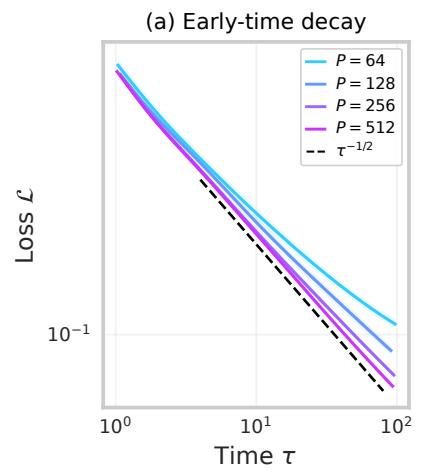

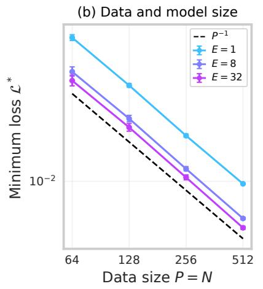

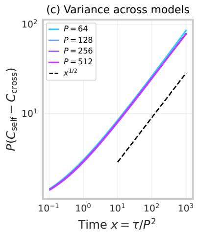

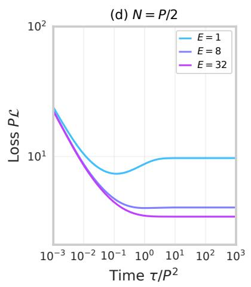

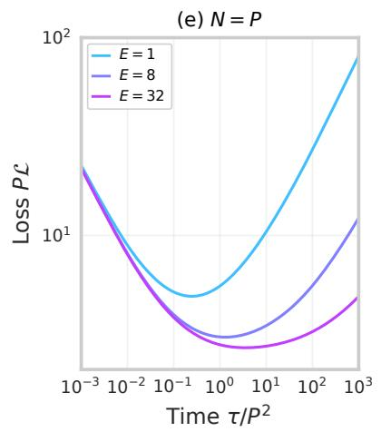

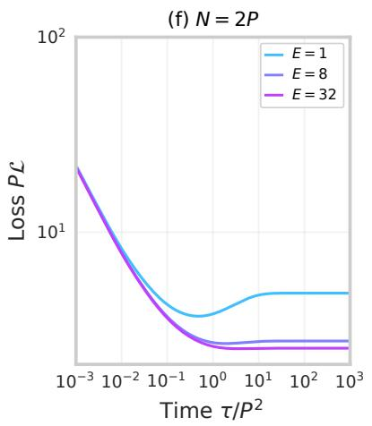  
Figure 10: Learning curves in the noiseless random-feature model with $a = b = 2$ and $M = 1 6 3 8 4$ . (a) Single-model loss at early times for $N = P .$ (b) Minimum loss versus P, also along $N = P .$ , at fixed ensemble size. (c) The self-minus-cross correlation, multiplied by $P ,$ versus scaled time. Dashed lines in (a)–(c) are slope guides with arbitrary amplitudes. Bands and bars are dataset-bootstrap intervals. (d)–(f) Ensemble learning curves at $P = 2 5 6$ and three width-to-data ratios. All panels use 20 datasets and 32 models per dataset.

${ \sqrt { \tau } } .$ . At an interior minimum,

$$
- \partial _ { \tau } C _ { \mathrm { c r o s s } } = \frac { 1 } { E } \partial _ { \tau } ( C _ { \mathrm { s e l f } } - C _ { \mathrm { c r o s s } } ) .
$$

The derivative comparison uses the full curves in (90), including their corrections at finite time. This balance gives the $E ^ { 2 / 3 }$ stopping law while retaining $1 / E$ variance reduction at each fixed checkpoint.

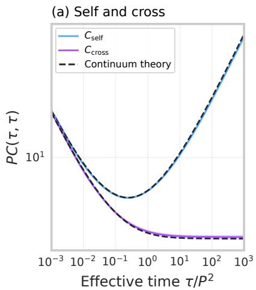

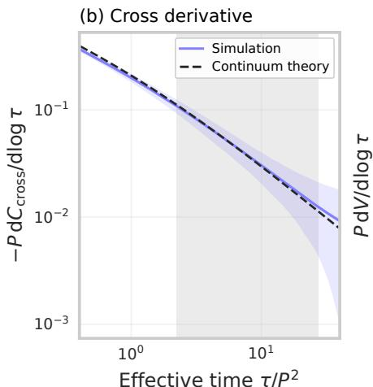

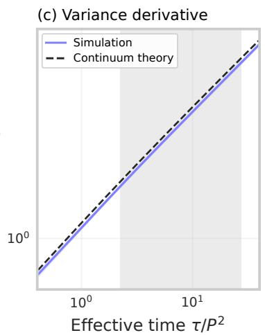  
Figure 11: Self and cross correlations at interpolation, with $P = N = 2 5 6 ,$ $M = 3 2 7 6 8$ , and $a = b = 2$ The simulations average 20 datasets and 512 models per dataset. (a) Equal-time correlations. (b) The negative cross derivative. (c) The derivative of $V = C _ { \mathrm { s e l f } } - C _ { \mathrm { c r o s s } }$ . Gray shading in (b)–(c) spans the stopping times for $E = 1 6$ through 512; colored bands are dataset-bootstrap intervals. The continuum curves use the normalization of (90), with no fitted amplitudes. Derivatives are with respect to log x, where $x = \tau / P ^ { 2 }$ ; multiplying the stopping equation by τ leaves its balance unchanged.

## K.3 Optimal stopping for different teacher spectra

We next vary a at fixed $b = 2$ . For each of $a \in \{ 1 . 5 , 2 , 2 . 5 \}$ , we use $N = P \in \{ 6 4 , 1 2 8 \}$ $M = 8 1 9 2$ , and pools of 256 models. A paired calculation at $P = 1 2 8$ increases the cutoff to $M = 1 6 3 8 4$ , retaining the same underlying Gaussian draws. These settings test the three branches of (88) and (89).

For each ensemble size, we minimize the complete continuum loss $( 1 - 1 / E ) C _ { \mathrm { c r o s s } } + C _ { \mathrm { s e l f } } / E$ to obtain its theoretical stopping point. The comparison in Figure 12 uses these finite-E predictions. We also measure

$$
\Delta _ { E } = \mathcal { L } ^ { * } ( P , E ) - \mathcal { L } ^ { * } ( P , 2 E ) , \qquad C _ { E } = E P \tau _ { \star } ( P , E ) .
$$

This difference removes the common limiting loss without estimating it. The horizontal coordinate $C _ { E }$ is the stopping cost of the smaller ensemble. Each loss in the difference is evaluated at its own minimum.

The stopping time flattens for $a \ < \ b ,$ whereas it continues to grow for $a \ : = \ : b \ : \mathrm { a n d } \ : a \ : > \ : b .$ Table 9 compares fits on the same ensemble range. The finite-range continuum predictions fall within the reported intervals at $P = 1 2 8 , M = 1 6 3 8 4$ . In particular, for $a > b ,$ the continuum slope in this range is about 0.86, before it reaches its limiting value of one. The $P = 6 4$ curves show larger deviations, which remain visible in the figure.

Table 9: Stopping-time exponents at $b = 2 .$ , fitted over $E = 1 6 , 3 2 , 6 4 , 1 2 8 , 2 5 6$ . The simulation column uses $P = N = 1 2 8 , M = 1 6 3 8 4$ , and a 256-member pool. Brackets give percentile dataset-bootstrap 95% intervals for the fitted exponent. The continuum fit uses the same five ensemble sizes
<table><tr><td>a</td><td>Asymptotic exponent</td><td>Continuum fit</td><td>Simulation fit</td></tr><tr><td>1.5</td><td>0</td><td>0.167</td><td>0.172 [0.117, 0.234]</td></tr><tr><td>2</td><td> $2 / 3$ </td><td>0.704</td><td>0.633 [0.535, 0.727]</td></tr><tr><td>2.5</td><td>1</td><td>0.860</td><td>0.776 [0.705, 0.865]</td></tr></table>

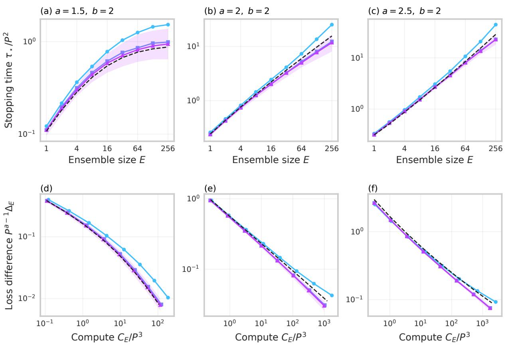  
Figure 12: Teacher dependence of stopping and compute scaling at $N = P$ and $b = 2$ . Columns vary a. Top: normalized stopping time versus ensemble size. Bottom: normalized adjacent-ensemble loss difference versus the smaller ensemble’s stopping cost. Colors distinguish the simulated data sizes and cutoffs; shaded intervals are shown for $P = 1 2 8 , M = 1 6 3 8 4$ . In the lower row, the loss intervals are plotted at the central estimate of compute. Dashed curves are the full continuum predictions, with no fitted amplitudes. All simulations use 20 datasets and 256 models per dataset.

## K.4 Compute allocation with fixed data

Figure 13 compares the stopped allocation in (5) with the budget frontier in (100). The first chooses among ensembles that can afford to reach their own loss minimum. The second also allows earlier checkpoints. Its feasible set is larger, giving lower loss over part of the compute range. This distinction is visible even with fixed $N = P$ , and it is separate from the loss-difference scaling in Figure 12.

For the inset in Figure 4A, we first find each ensemble’s minimum dataset-mean population loss over the saved checkpoints. At each budget, we select the lowest-loss configuration among these minima whose cost $E N \tau$ is affordable, and plot its ensemble size. This is the allocation used by the dashed curve. The ensemble grid is $E \in \{ 1 , 2 , 4 , 8 , 1 6 , 3 2 , 6 4 , 1 2 8 , 2 5 6 \}$ , so the inset ends at the tested maximum of 256 members.

The width comparison starts from $N _ { 0 } = P / 2$ , as in (99). At fixed $P = 2 5 6$ , we compare increasing the width of one model toward P with training an ensemble of models of width $N _ { 0 }$ . Both strategies choose their best affordable checkpoint. Figure 14 also extends the width range above interpolation. From $N _ { 0 } = P / 2$ increasing width is more effective at low budgets, while ensembling achieves lower loss at larger budgets than the tested single models with $N \leq P$ . Allowing widths through $1 6 P$ changes the comparison: with ensembles capped at 32 members, the widest single model achieves a lower loss than the $N = P$ ensembles at large budgets. Ensembling at $N = 1 6 P$ lowers the loss further. Thus the comparison depends on the permitted widths and ensemble sizes.

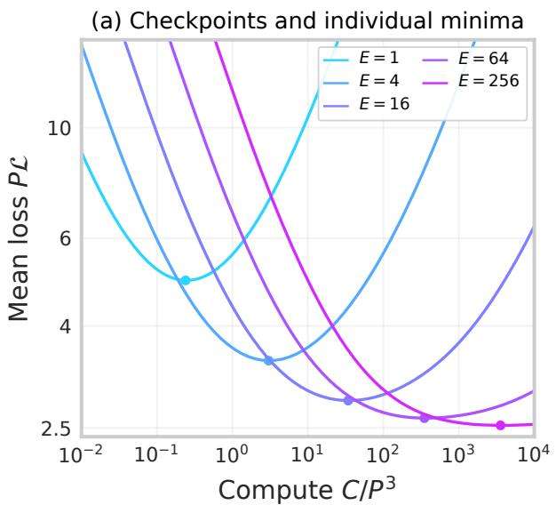

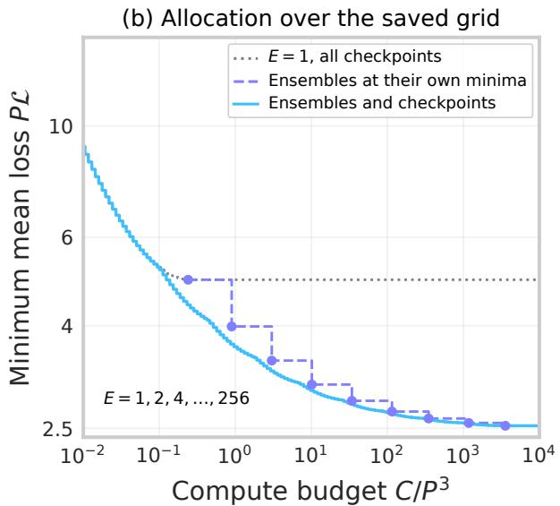  
Figure 13: Compute allocation at fixed $P = N = 2 5 6$ , with $M = 1 6 3 8 4$ $a = b = 2 ,$ 20 datasets, and a 256-member pool. Learning curves are plotted against $C = E N \tau$ , and their minima define the stopped configurations in (a). The budget comparison in (b) selects either an affordable stopped configuration or any affordable saved checkpoint. Ensemble sizes are $E \in \{ 1 , 2 , 4 , 8 , 1 6 , 3 2 , 6 4 , 1 2 8 , 2 5 6 \}$ . The single-model checkpoint frontier is included for reference. Curves show means, and unused budget is allowed.

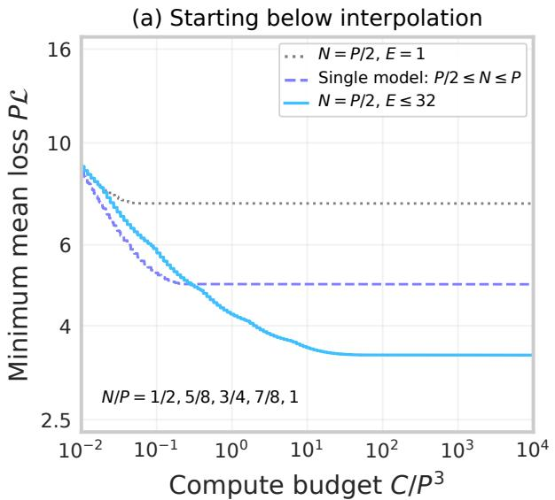

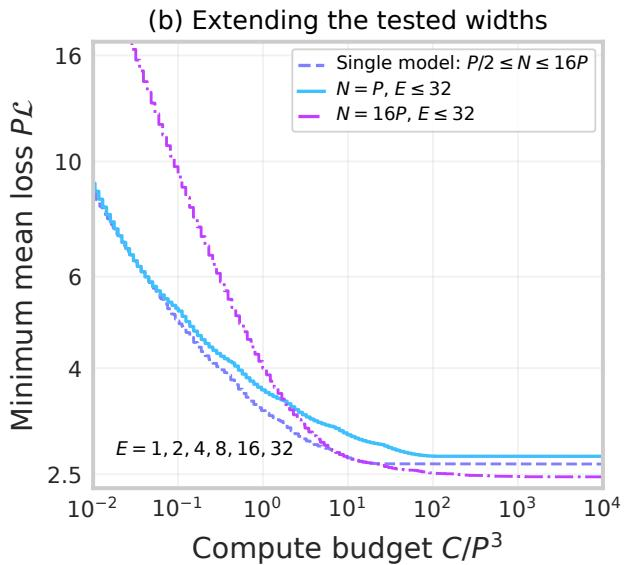  
Figure 14: Width and ensemble allocation at fixed $P = 2 5 6$ , with $M = 1 6 3 8 4$ and $a = b = 2 .$ . (a) Starting from $N _ { 0 } = P / 2$ , compare increasing single-model width through $N / P \in \{ 1 / 2 , 5 / 8 , 3 / 4 , 7 / 8 , 1 \}$ with increasing ensemble size at fixed $N = N _ { 0 }$ . (b) Single-model widths through $1 6 P ;$ compared with ensembles at $N = P$ and $N = 1 6 P$ . The full width grid is $N / P \in \{ 1 / 2 , 5 / 8 , 3 / 4 , 7 / 8 , 1 , 5 / 4 , 3 / 2 , 2 , 4 , 8 , 1 6 \}$ . Each curve minimizes dataset-mean loss over its allowed configurations and affordable saved checkpoints. The figure uses 20 datasets and 32 models per dataset at each width; $E \in \{ 1 , 2 , 4 , 8 , 1 6 , 3 2 \}$ . Loss is averaged over datasets before selecting configurations.

## K.5 Batch size and learning rate

We hold $P ~ = ~ 6 4$ fixed and study $N \ = \ 3 2$ and $N ~ = ~ 6 4$ , with $M \ = \ 4 0 9 6 , \ a \ = \ b \ = \ 2$ , and 128 models per dataset. Batch sizes are $B \in \{ 1 , 4 , 1 6 , 6 4 \}$ . We use the same initial learning-rate grid $\eta \in$ $\{ 0 . 0 1 , 0 . 0 4 , 0 . 1 2 , 0 . 4 , 1 . 2 \}$ for every batch size. A candidate is retained when all its simulated members pass the fixed-order epoch stability check. This retains 30 of the 40 $( N , B , \eta )$ settings: $\eta = 1 . 2$ is excluded throughout, and $\eta = 0 . 4$ is additionally excluded at $B = 1$ . Comparisons use the remaining grid, with the same 20 datasets for every retained candidate. After the first epoch, checkpoints are saved at whole-epoch boundaries.

Figure 15 first fixes $\eta = 0 . 0 4$ , then permits each batch size to select its learning rate under the compute budget. With fixed $\eta ,$ smaller batches make substantially more progress per unit compute. Learning-rate selection narrows the gap. At $C _ { \mathrm { S G D } } = 1 0 ^ { 4 }$ and $E = 1$ , the loss reduction from $B = 4$ to $B = 1$ falls from 41.6% to 5.1% for $N = P / 2$ , and from $4 5 . 9 \% \mathrm { t o } \ 6 . 8 \%$ for $N = P$ . This agrees with the time conversion in Appendix D: at fixed compute, the accessible effective time depends on $\eta / B$ . The discrete epoch update determines the remaining dependence on batch size and learning rate.

Figure 16 then allocates compute over ensemble size. At low budgets, one model can achieve a lower loss than four models because it receives more updates. At $B = 1$ and $C _ { \mathrm { S G D } } = 1 0 ^ { 6 }$ , four models instead reduce loss by $3 3 . 7 \%$ for $N = P / 2$ and $1 7 . 6 \%$ for $N = P ,$ after learning-rate selection. The selected ensemble size increases with budget and eventually reaches the tested cap of 64. At fixed $E = 1$ or $E = 4 .$ the minimum losses across batch sizes are nearly equal at the largest budgets. In this experiment, the main batch-size effect is the compute needed to approach those losses.

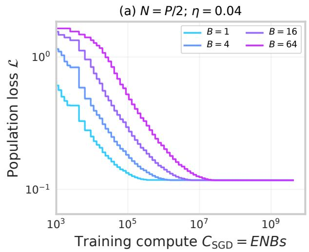

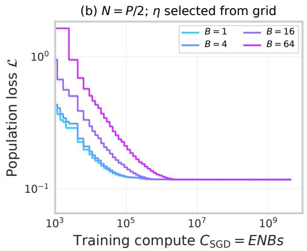

(c) N = P; η = 0.04  
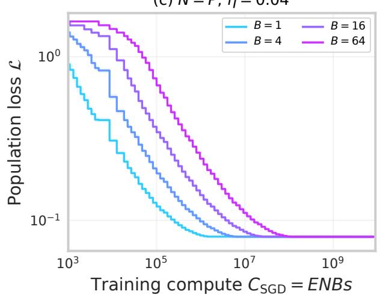

(d) $N = P ;$ η selected from grid  
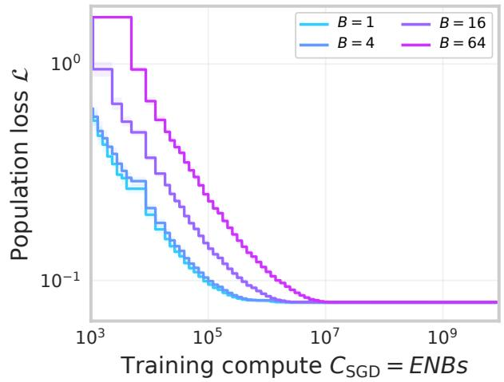  
Figure 15: Batch size at matched training compute $C _ { \mathrm { S G D } } = E N B s ,$ , with $P = 6 4 , M = 4 0 9 6 .$ and $E = 1$ Rows show $N = P / 2$ and $N = P$ . Left: fixed learning rate $\eta = 0 . 0 4$ . Right: learning rate selected from the retained grid separately for each batch size and budget. All curves select an affordable checkpoint. Bands are pointwise dataset-bootstrap intervals, with selection repeated in each resample. Each setting uses 20 datasets and 128 models per dataset.

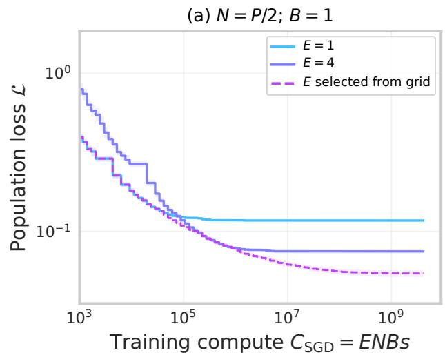

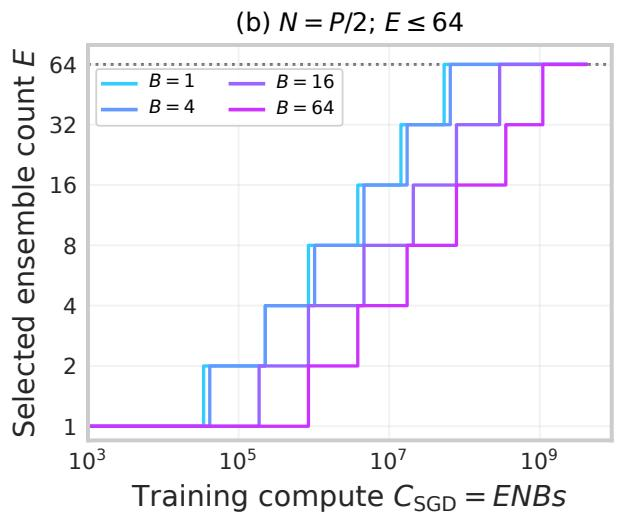

(c) N = P; B = 1  
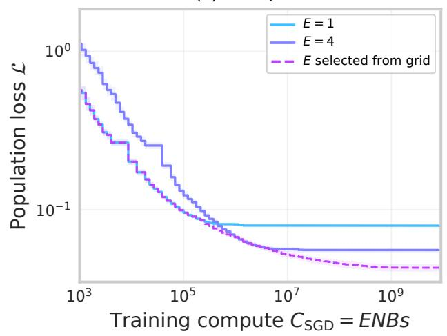

(d) $N = P ; E \leq 6 4$  
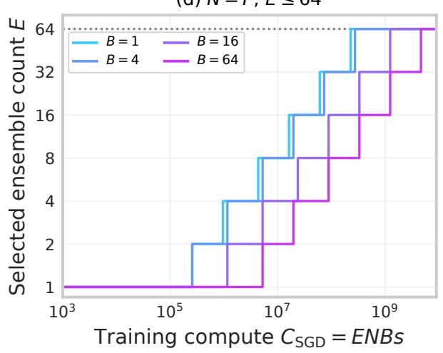  
Figure 16: Ensemble allocation for cyclic SGD with the settings of Figure 15. Left: at $B = 1$ , compare fixed $E = 1$ , fixed $E = 4 .$ , and selection over $E \in \{ 1 , 2 , 4 , 8 , 1 6 , 3 2 , 6 4 \}$ , allowing learning-rate and checkpoint selection under each budget. Right: selected ensemble size for each batch size. Rows show $N = P / 2$ and $N = P$ . The upper ensemble limit is 64. At budgets permitting only the zero predictor, ties are assigned to $E = 1$

## K.6 Numerical checks

Figure 17 compares spectral cutoffs, feature pools, and discrete updates. At $P = N = 2 5 6$ , doubling M from 16384 to 32768 changes the stopping times only slightly. Increasing the number of sampled models gives a separate check on the self/cross estimates. With 512 models, the fitted stopping exponent over $E =$ 32, 64, 128, 256, 512 is 0.716, with a 95% interval [0.589, 0.874]. This larger-size calculation is consistent with the constant-teacher stopping law and its finite-E corrections.

The paired teacher-cutoff comparison in Figure 12 gives a similar check for all three target spectra. Doubling M changes the fitted stopping exponents from 0.171, 0.652, 0.778 to 0.172, 0.633, 0.776 for $a =$ 1.5, 2, 2.5, respectively. Absolute losses are more sensitive to the cutoff for $a = 1 . 5$ , whose target power decays more slowly. Using the saved analytic derivatives to interpolate stationary points changes the largestpool stopping exponents by less than 0.006 across these nine teacher configurations.

For the small-step comparison, GF and cyclic SGD use identical datasets and feature matrices at $P =$ $N = 3 2 , M = 4 0 9 6 .$ , and $B = 4$ . At matched effective time, the maximum relative loss difference over $0 . 1 \leq \tau / P ^ { 2 } \leq 2 0$ and $E \in \{ 1 , 2 , 4 , 8 , 1 6 , 3 2 \}$ is 0.127% at $\eta = 0 . 0 2$ and 0.064% at $\eta = 0 . 0 1$ . The meansquared difference between the paired SGD and GF predictions decreases by approximately a factor of four when the step size is halved at the final checkpoint. This is consistent with first-order prediction error in the small-step limit established in Appendix D.

(a) Spectral cutoff, P = 256  
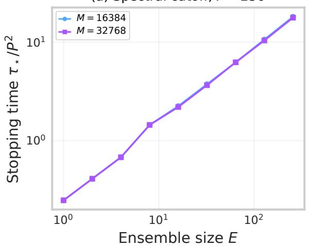

(b) Feature pool, P = 256  
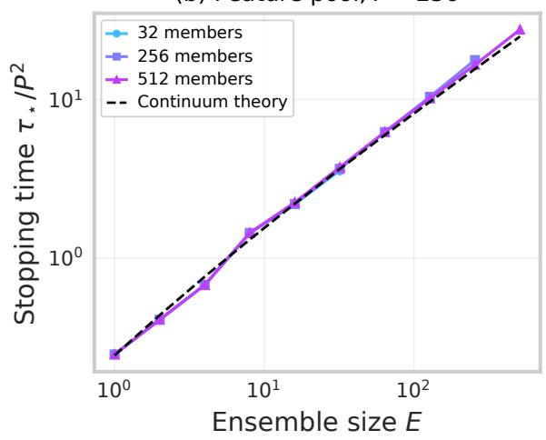

(c) GF and cyclic SGD, P = 32  
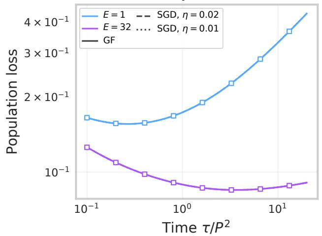

(d) Step-size dependence  
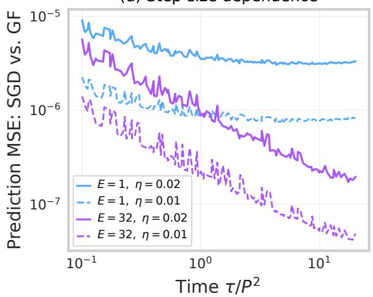  
Figure 17: Numerical checks for $a = b = 2 .$ . (a) Stopping times at $P = N = 2 5 6$ for paired cutoffs $M = 1 6 3 8 4$ and 32768, using 256 models per dataset. (b) Nested pools of 32, 256, and 512 models at $P = N = 2 5 6 , M = 3 2 7 6 8$ , together with the continuum prediction. (c) GF and fixed-order cyclic SGD at $P = N = 3 2 , M = 4 0 9 6 , B = 4$ , using 32 models per dataset. (d) Population mean-squared difference between the paired SGD and GF predictions. Panels $\mathrm { ( c ) } { - } ( \mathrm { d ) }$ compare matched effective time $\tau = \eta s$ . Every configuration uses 20 datasets.