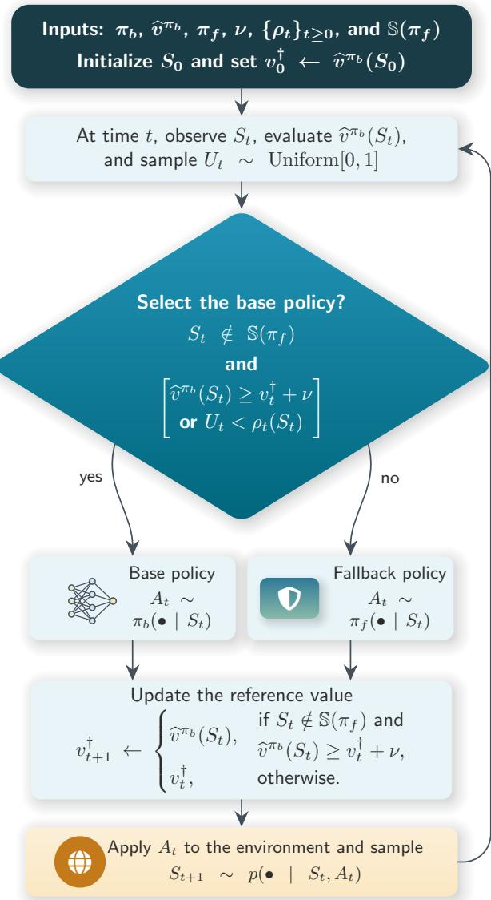
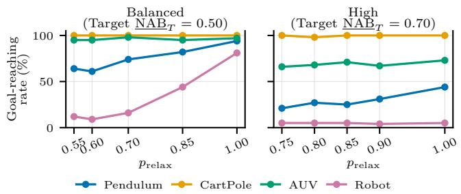
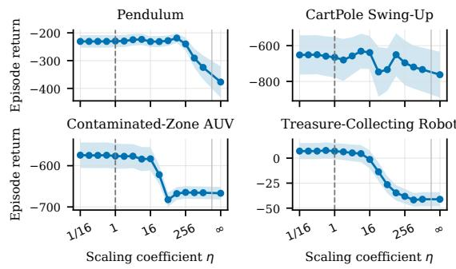
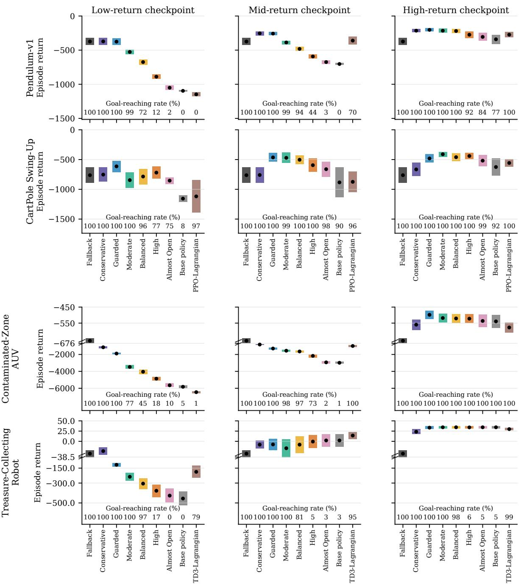
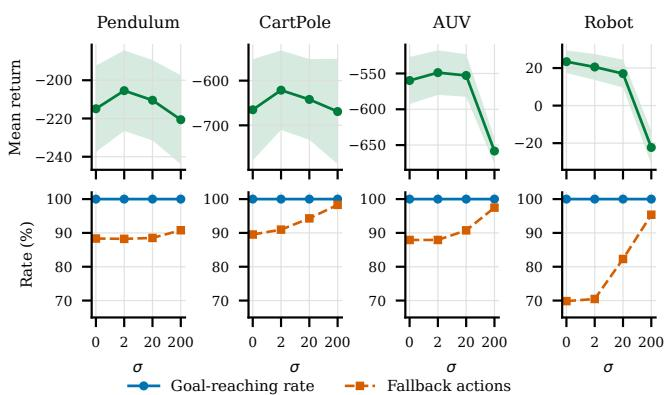
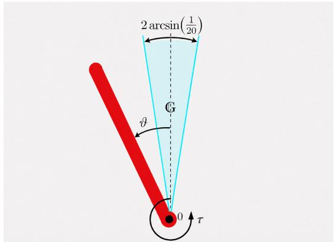
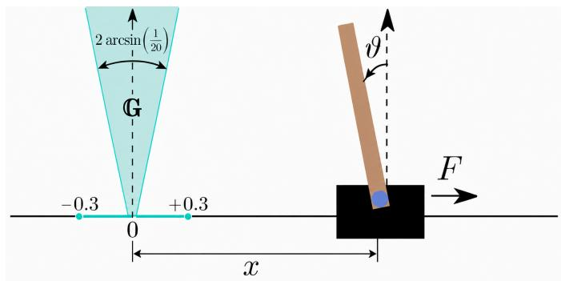
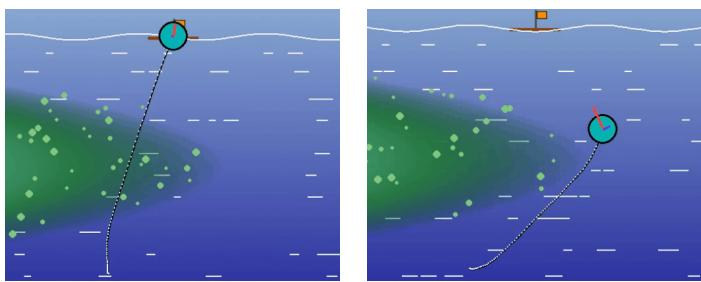
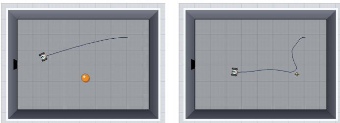

# A Universal Policy Wrapper With Guarantees

Preprint, compiled November 3, 2026

Georgiy Malaniya <sup>∗</sup> Center for Engineering Systems and Sciences, 30 Bolshoy Boulevard, bld. 1, Moscow, 121205, Russia; Central University, 7 Gasheka St., bld. 1, Moscow, 123056, Russia g.malaniya@rcdei.ru

Anton Bolychev ∗ Center for Engineering Systems and Sciences, 30 Bolshoy Boulevard, bld. 1, Moscow, 121205, Russia bolychev.anton@gmail.com

Pavel Osinenko † Central University, 7 Gasheka St., bld. 1, Moscow, 123056, Russia; Center for Engineering Systems and Sciences, 30 Bolshoy Boulevard, bld. 1, Moscow, 121205, Russia; Sirius University of Science and Technology, 1 Olimpiyskiy Avenue, Sirius, 354340, Russia p.osinenko@gmail.com

## Abstract

Many control tasks require driving the system into a prescribed goal set and subsequently keeping it there. The considered setting assumes that a working controller is available that provably reaches and maintains the goal, albeit with suboptimal performance. This controller is referred to as the fallback policy. Conversely, although state-of-the-art reinforcement-learning (RL) algorithms can discover policies with impressive empirical performance, the neural networks at their core act as opaque black boxes learned through data-driven exploration and, as such, provide no theoretical mechanism to guarantee that the system will ever reach—and stay within—the prescribed goal set. This article presents CALF-Wrapper, a method that combines the fallback policy with a pretrained RL base policy and uses the critic estimate associated with the base policy to select between them during deployment. The theoretical analysis establishes that CALF-Wrapper inherits the goal-reaching property of the fallback policy under the stated assumptions and provides probability bounds for the settling time and the maximum distance from the goal set over a prescribed time interval. The experimental study evaluates CALF-Wrapper in four simulated control environments of diferent complexity. Comparisons include the base policy, fallback policy, and constrained reinforcement-learning methods formulated for the same objective. Sensitivity and ablation studies provide direct hyperparameter recommendations. The experiments show how CALF-Wrapper can provide efective task performance while attaining the maximum possible observed goal-reaching rate. CALF-Wrapper requires no additional dynamics model, online learning, or constrained optimization during execution.

Keywords Lyapunov functions · Policy switching · Reinforcement learning

## 1 Introduction

Reinforcement learning (RL) has proved to be a powerful framework for solving control problems in complex, highdimensional settings. Most RL algorithms optimize control policies through direct interaction with a system (often called an environment), relying solely on reward signals observed at each step, without requiring explicit knowledge of system dynamics. The remarkable successes of RL span applications such as robotic manipulation [1,2], board games like Go, chess, and shogi [3], and complex real-time video games [4].

State-of-the-art deep-RL algorithms—including Twin-Delayed Deep Deterministic Policy Gradient (TD3) [5], Soft Actor-Critic (SAC) [6], and Proximal Policy Optimization (PPO) [7]—learn efective control policies in practice, yet they do not establish that a learned policy satisfies a user-specified objective. To make this requirement precise, this work considers a prescribed goal set: a task-dependent subset of the state space that the agent is required to reach and remain in. The geometry of this set is task-dependent—for an inverted pendulum it corresponds to upright configurations within a narrow angular tolerance; in algorithmic trading it might be the region where cumulative profit is positive; and in autonomous driving it can be a small neighborhood surrounding the intended GPS destination. Throughout this work, a nonempty goal set is assumed to be specified in advance. A policy that reaches the prescribed goal set and remains there is said to satisfy the goal-reaching property formalized in Section 2.

Standard reinforcement-learning methods such as PPO and TD3 can discover high-performing policies. However, these methods provide no formal mechanism for establishing whether the learned policy reaches the prescribed goal. This behavior can therefore generally be assessed only empirically. These methods are also often dificult to tune. Rather than attempting to establish this property for opaque learned policies, the formulation assumes the existence of a predefined (possibly suboptimal) controller that already satisfies the goal-reaching property—e.g., a provably stable yet energyineficient impedance controller for a robotic arm; a conservative, capital-preserving rule-based trading strategy; or a heuristic vehicle-routing routine that ensures delivery irrespective of fuel costs. In the remainder of the paper, this controller is referred to as the fallback controller or fallback policy. The focus is to enhance this fallback policy while preserving its goal-reaching property. The origin of the fallback controller—classical control (e.g., proportional–derivative (PD) control, linear–quadratic regulator (LQR), or model predictive control (MPC)), domain heuristics, or engineering practice—is immaterial to the analysis and problem formulation. The sole objective is to improve the performance of the fallback policy without losing its formal goal-reaching property.

To improve the performance of the fallback policy, the method introduces a second ingredient: a performance-seeking policy learned by reinforcement learning, referred to as the base policy. Trained with any standard RL algorithm—TD3, Soft Actor-Critic, PPO, or similar—the base policy is explicitly optimized for high cumulative reward and therefore often attains stronger empirical returns. However, it is not known to satisfy the goal-reaching property for the prescribed goal set.

The approach presented in this paper treats the fallback controller as an anchor for correctness and the learned RL policy as a source of performance gains. The approach is referred to as the CALF-Wrapper. It is designed as a lightweight decisionmaking mechanism that, at each step, decides whether to execute the learned base policy or revert to the fallback policy. The wrapper can be applied after training to a broad class of RL policies for which a corresponding value estimate is available. This estimate may be provided directly by a critic or obtained by evaluating an action-value critic at the action selected by the base policy.

## 1.1 Related Work

The approach in [8], known as Critic as a Lyapunov Function (CALF), is an online reinforcement-learning algorithm that establishes the goal-reaching property by repeatedly solving constrained optimization subproblems. Although CALF inspired the proposed method, CALF-Wrapper difers from the original CALF algorithm in three principal respects:

• No online learning or per-step optimization. CALF continuously updates its policy during execution by solving a constrained optimization problem at each step. In contrast, CALF-Wrapper is a deploymenttime wrapper, requiring no additional learning and no per-step optimization.

• Plug-and-play deployment. CALF’s fallback policy is tightly integrated into the training loop, making the overall algorithm inseparable from the learning process. The proposed wrapper can be attached to an already-trained policy without modifying the training code or the underlying policy network, yielding immediate applicability across a wide range of domains.

• Adjustable trade-of between performance and the goal-reaching property. CALF’s control law is strictly deterministic. CALF-Wrapper introduces a probabilistic decision-making mechanism that provides an adjustable trade-of between performance and the goal-reaching property.

The diferences between the original CALF algorithm and CALF-Wrapper are summarized in Table 1.

Table 1: Comparison of the original CALF algorithm and CALF-Wrapper.
<table><tr><td>Aspect</td><td>Original CALF [8]</td><td>CALF-Wrapper (Algorithm 1)</td></tr><tr><td>Operation</td><td>Online learning</td><td>Deployment after training</td></tr><tr><td>Policy</td><td>Actions are obtained by opti- Fixed pretrained base policy mizing the critic over the action space or are generated by an ac- tor model</td><td></td></tr><tr><td>Critic</td><td>mization</td><td>The critic model is updated on- The critic is loaded from the same line through constrained opti- saved training checkpoint as the base policy and remains fixed during de- ployment</td></tr><tr><td>tion</td><td>to a decrease constraint and tion critic bounds</td><td>Online optimiza- Critic-loss minimization subject No critic-weight or action optimiza-</td></tr><tr><td>step</td><td>Decision at each The constrained critic-update The decision requires only one critic lution is found; otherwise, the solved. fallback-policy action is applied.</td><td>problem is solved. The action forward pass, one uniform random- generated by the learning algo- number sample, and scalar compar- rithm is applied if a feasible so- isons. No optimization problem is</td></tr><tr><td>RL training</td><td>Modifies the critic update</td><td>Does not modify training</td></tr></table>

Achieving these contributions required a substantial reorganization of the theoretical results. The inheritance of the goalreaching property from the fallback policy—though conceptually similar to CALF—was the least demanding part, yet it still required several techniques to accommodate the probabilistic decision mechanism. In contrast, the analysis of the uniform properties of the goal-reaching behavior of CALF-Wrapper required substantially more extensive theoretical development. The analysis is presented in this article in two alternative forms. Section 5 develops a fundamentally new theoretical analysis under weaker assumptions on the fallback policy and establishes uniform properties of the goal-reaching behavior of CALF-Wrapper. Specifically, it provides a single finite bound on the expected distance from the goal set that holds at every time and gives probability bounds on when the trajectory enters and subsequently remains in a prescribed neighborhood of the goal set. Appendix C provides an alternative analysis under stronger assumptions and establishes correspondingly stronger claims.

Beyond CALF, related work includes runtime assurance, shielding, safety filters, and methods that use intervention or recovery policies. The Simplex architecture switches from an unverified advanced controller to a certified backup controller when a runtime monitor predicts loss of safety [9]. Shielding similarly rejects or replaces actions that violate a formal safety specification [10, 20]; recent work extends this principle to realizable shields in continuous state and action spaces [11]. Predictive safety filters instead modify proposed actions through a model-based feasibility or optimization problem so that state and input constraints remain satisfied [12, 13]. These approaches primarily prevent violations of formal safety specifications or state and input constraints. CALF-Wrapper instead addresses whether the system reaches a prescribed goal set and remains there.

Several related methods replace an action proposed by a performance-seeking policy when that action may lead to a constraint violation. Recovery RL uses a task policy for performance and a recovery policy for constraint satisfaction. A safety critic, initialized from ofline examples of constraint violations, estimates the discounted probability of a future violation for the action proposed by the task policy. If the estimate exceeds a threshold, the recovery-policy action is applied instead [14]. SAILR compares each action proposed by the policy being trained with the action selected by a predefined backup policy that is expected to satisfy the constraints. If the proposed action has a suficiently higher estimated future constraint cost, it is replaced by the backup-policy action. SAILR also penalizes such proposed actions in a surrogate unconstrained problem, which trains the policy to avoid actions that would require replacement by the backup policy [15]. Dynamic Model Predictive Shielding uses local planning when the action proposed by the learned policy may lead to a safety violation. The planner selects an alternative action that preserves safety while also improving task progress [16].

These methods generally require additional learning, system models, online planning, or a formal safety specification. CALF-Wrapper instead operates after the base policy and critic have been trained. It uses the base policy and critic stored at a selected training checkpoint together with a fixed fallback policy. During deployment, CALF-Wrapper updates none of these components and requires neither a system model nor the solution of a planning or constrained optimization problem. CALF-Wrapper addresses a diferent objective from shields and safety filters. It does not detect or prevent violations of state or input constraints. The predefined fallback policy is used so that the closed-loop trajectory reaches the prescribed goal set and remains there under the stated assumptions, rather than to prevent constraint violations. Consequently, the methods discussed above do not provide direct baselines for CALF-Wrapper in their original formulations because applying them to the present problem would require reformulating their objectives and requirements.

However, the constrained reinforcement-learning framework can be formulated for the goal-reaching objective considered in this article and therefore provides a suitable baseline for the experimental evaluation of CALF-Wrapper in Section 6. This methodology is widely used in safe reinforcement learning, where undesirable outcomes are represented by cost functions and a policy is trained to maximize the expected cumulative reward subject to limits on expected cumulative costs [17–19,21– 23]. For the present comparison, failure under the environmentspecific goal-reaching criterion is represented by a binary cost.

A standard way to solve this constrained training problem is to introduce a nonnegative Lagrange multiplier for the cost limit and update both the policy and the multiplier during training [19, 22]. In this article, the resulting Lagrangian variants of PPO and TD3 are referred to as PPO-Lagrangian and TD3- Lagrangian, respectively. Their constrained problems and implementations are described in Appendix H. Using these baselines retains the reinforcement-learning algorithm used in each environment while changing whether the requirement on reaching the prescribed goal set is addressed during constrained training or by applying CALF-Wrapper after training.

To conclude this section, Table 2 summarizes the comparison with the related methods discussed above.

## 1.2 Key Contributions

• A deployment-time policy wrapper that can be applied to a broad class of trained RL policies for which a corresponding value estimate is available. This estimate may be provided directly by a critic or obtained by evaluating an action-value critic at the action selected by the base policy. CALF-Wrapper combines the base policy with a predefined fallback policy, keeps all components fixed during deployment, and requires neither online learning nor online constrained optimization.

• A theoretical analysis establishing that CALF-Wrapper inherits the goal-reaching property of the fallback policy under the stated assumptions. The analysis of the uniform properties of the goal-reaching behavior of CALF-Wrapper is presented in two alternative forms. Section 5 establishes these properties using a uniform $L ^ { 1 }$ bound on the rate at which the expected distance from the goal set decreases under the fallback policy. It provides a single finite bound on the expected distance from the goal set that holds at every time and gives probability bounds on when the trajectory enters and subsequently remains in a prescribed neighborhood of the goal set. Appendix C provides an alternative analysis using a stronger uniform almostsure bound on the rate at which the distance from the goal set decreases under the fallback policy and establishes correspondingly stronger claims.

Table 2: Conceptual comparison with representative safe-RL and runtime-intervention approaches.
<table><tr><td>Approach</td><td>Objective or property</td><td>Operation during execution</td><td>Principal requirements</td><td>Relation to policy training</td></tr><tr><td>Simplex and shielding [9–11]</td><td>faction</td><td>Formal safety-specification satis- Switches controller or rejects or re- places the proposed action</td><td>Runtime monitor and certified backup controller, or model or abstraction and safety specification</td><td>May be constructed separately or incorporated into training</td></tr><tr><td>Predictive safety filters [12, 13]</td><td>State and input constraint satis- faction</td><td>Modifies the proposed action through a model-based feasibility or optimization problem</td><td>Dynamics model, constraints, and feasible set or certificate</td><td>Can wrap a fixed policy and solves an online problem</td></tr><tr><td>Recovery and intervention meth- ods [14–16]</td><td>Constraint satisfaction or re- duced violation probability</td><td>Replaces the proposed action with a recovery, backup, or planned action</td><td>Safety critic and recovery or backup policy, or dynamics model and plan- planning, or both ner</td><td>Requires additional learning, online</td></tr><tr><td>Constrained safe RL [17–19]</td><td>Expected return subject to ex- pected cumulative cost limits</td><td>Executes the trained policy directly</td><td>Reward, constraint-cost signal, and cost limit</td><td>Includes cost constraints in policy training</td></tr><tr><td>PPO-Lagrangian and TD3- Lagrangian implemented and used as baselines in this arti- cle [5,7, 19]</td><td>Expected return subject to a bound on failure probability under the environment-specific goal-reaching criterion</td><td>Executes the trained policy directly</td><td>Goal-set predicate, episode horizon, binary cost, and cost limit</td><td>Adds cost estimation and Lagrange-multiplier updates to PPO and TD3 training</td></tr><tr><td>CALF-Wrapper</td><td>Goal-reaching property inherited from the fallback policy</td><td>Selects the base-policy or fallback- policy action at each step</td><td>Base policy, its fixed value-function estimate, and fallback policy satisfy- ing the goal-reaching property</td><td>Keeps all components fixed and solves no online optimization prob- lem</td></tr></table>

• An open-source implementation <sub>https:</sub>//<sub>github.</sub> com/aidagroup/calf-wrapper that can be integrated with existing RL frameworks without modifying the policy-training procedure (e.g., [24, 25]).

• An empirical evaluation in four simulated control environments using PPO and TD3 base policies. The evaluation includes comparisons with PPO-Lagrangian and TD3-Lagrangian, sensitivity to the critic threshold, robustness to additive critic noise, execution-latency measurements, and statistical comparisons.

## 2 Problem statement

This section establishes the formal reinforcement-learning framework and mathematical foundations necessary to rigorously define the goal-reaching property.

## 2.1 Markov Decision Process

A Markov decision process (MDP) is defined as

$$
{ \cal M } = ( \mathbb { S } , \mathbb { A } , p _ { 0 } , p , r ) ,\tag{1}
$$

where S is the state space (a finite-dimensional Banach space), A is the action space (a compact topological space), $p _ { 0 } : \mathbb { S }  \mathbb { R }$ is the initial state probability density function, $p ( \bullet \mid s , a )$ is the transition probability density, i.e., the probability density of the next state $\mathbf { \bar { \mathbf { \Lambda } } } ^ { \prime } \sim p ( \mathbf { \bar { \mathbf { \bullet } } } \ | \ s , a )$ given the current state $s \in \mathbb { S }$ and action $a \in \mathbb { A } ,$ , and $r ( s , a ) \in \mathbb { R }$ is the immediate reward of taking action $a \in \mathbb { A }$ in state $s \in \mathbb { S }$ . For the theoretical results, an upper semicontinuous function $\bar { p } : \mathbb { S } \times \mathbb { A } \to \mathbb { R } _ { \ge 0 }$ is assumed to exist such that, for any $s \in \mathbb S$ and $a \in \mathbb { A } .$ , the next state $S ^ { \prime }$ sampled from $p ( \bullet \mid s , a )$ satisfies P $\left[ | | S ^ { \prime } | | \leq \bar { p } ( s , a ) \right] = 1$ , efectively bounding the system’s one-step transition magnitude.

## 2.2 Policies and Value Functions

Two types of policies are considered:

1) Stationary policies $\Pi _ { \mathrm { s t a t } }$ . For any stationary policy $\pi \in \Pi _ { \mathrm { s t a t } }$ π(a | s) represents the probability density of selecting action a in state s.

2) Non-stationary policies $\Pi _ { \mathrm { n s t a t } }$ . For any non-stationary policy $\pi \in \Pi _ { \mathrm { n s t a t } } , \pi ( a \mid s , t )$ represents the probability density of selecting action a in state s at time t. By definition, $\Pi _ { \mathrm { s t a t } } \dot { \subset } \Pi _ { \mathrm { n s t a t } } ,$ since any stationary policy can be viewed as a special case of a non-stationary policy that remains constant across time steps.

For a discount factor $\gamma \in ( 0 ,$ 1] and a policy $\pi \in \Pi _ { \mathrm { n s t a t } }$ , the value function $\nu ^ { \pi } : \mathbb { S }  \mathbb { R }$ is

$$
\nu ^ { \pi } ( s ) = \mathbb { E } \left[ \sum _ { t = 0 } ^ { \infty } \gamma ^ { t } r ( S _ { t } , A _ { t } ) \Bigm | S _ { 0 } = s \right] ,
$$

where $A _ { t } \sim \pi ( \bullet \mid S _ { t } , t )$ , and $S _ { t + 1 } \sim p ( \bullet \mid S _ { t } , A _ { t } )$ for $t \geq 0$

The corresponding action-value function $Q ^ { \pi } : \mathbb { S } \times \mathbb { A } $ R is defined by

$$
Q ^ { \pi } ( s , a ) = \operatorname { \mathbb { E } } \left[ \sum _ { t = 0 } ^ { \infty } \gamma ^ { t } r ( S _ { t } , A _ { t } ) \Bigm | S _ { 0 } = s , A _ { 0 } = a \right] .
$$

For a stationary policy $\pi \in \Pi _ { \mathrm { s t a t } }$ , the state-value and actionvalue functions satisfy

$$
\nu ^ { \pi } ( s ) = \mathbb { E } [ Q ^ { \pi } ( s , A ) ] , \quad { \mathrm { f o r } } A \sim \pi ( \bullet \mid s ) .
$$

The standard RL objective is to maximize the expected discounted return:

$$
\mathbb { E } [ \nu ^ { \pi } ( S _ { 0 } ) ] = \mathbb { E } [ \sum _ { t = 0 } ^ { \infty } \gamma ^ { t } r ( S _ { t } , A _ { t } ) ]  \operatorname* { m a x } _ { \pi \in \Pi _ { \mathrm { n s t a t } } } ,\tag{2}
$$

where $S _ { 0 } \sim p _ { 0 } ( \bullet ) , A _ { t } \sim \pi ( \bullet \mid S _ { t } , t )$ , and $S _ { t + 1 } \sim p ( \bullet \mid S _ { t } , A _ { t } )$ for $t \geq 0$

For a given policy π and initial state $s _ { 0 } \in \mathbb { S }$ , the state at time t is denoted by $S _ { t } ^ { \pi } ( s _ { 0 } )$

## 2.3 Goal Set and Goal-Reaching Property

While traditional RL focuses on reward maximization, many control problems require driving the system to a specific target region. This requirement is formalized as follows:

Definition 1 (Goal set). A goal set $\mathbb { G } \subset \mathbb { S }$ is a compact set representing the target region that the system must eventually reach and remain in. Typically, G is chosen as a compact neighborhood of a desired operating point. Without loss of generality, the desired operating point is assumed to be the origin, with $0 \in \mathbb { G }$

The goal set may be specified directly as a target region or may be related to the reward function. For instance, when the reward is maximal at a target state or target region and decreases away from it, a neighborhood of the reward maximizer can be used as the goal set.

Remark 1 (Reward function and goal set). Throughout this paper, the reward function is assumed to be bounded above: $\begin{array} { r } { \operatorname* { s u p } _ { s \in \mathbb { S } , a \in \mathbb { A } } r ( s , a ) < + \infty } \end{array}$ . Without this condition, the return in (2) may be unbounded above, and the optimization problem may not have a finite objective scale. Working with rewards that are not bounded above therefore requires additional conditions that exclude returns that diverge to +∞. In addition, the function $s \mapsto \operatorname* { s u p } _ { a \in \mathbb { A } } r ( s , a )$ is assumed to attain a local maximum at a state in G. This condition reflects the intended relation between the reward function and the goal set. More generally, it is desirable that reaching the goal set be favorable under the return objective. Otherwise, return maximization and reaching the goal set may represent competing objectives.

The distance from state s to the goal set is defined as: $d _ { \mathbb { G } } ( s ) : =$ in $\Gamma _ { S ^ { \prime } \in \mathbb { G } } \ \| s - s ^ { \prime } \|$ , where $d _ { \mathbb { G } } ( s ) = 0$ if and only if $s \in \mathbb { G }$

The following two properties characterize policies that reliably drive the system to the goal:

Definition 2 (ε-improbable goal-reaching property). A policy $\pi \in \Pi _ { \mathrm { n s t a t } }$ satisfies the ε-improbable goal-reaching property for some $\varepsilon \in [ 0 , 1 ) \ i j$ , for all initial states $s _ { 0 } \in \mathbb { S } ,$

$$
\mathbb { P } \left[ d _ { \mathbb { G } } ( S _ { t } ^ { \pi } ( s _ { 0 } ) ) \xrightarrow { t \to \infty } 0 \right] \geq 1 - \varepsilon .
$$

In other words, the system reaches the goal set in the limit with probability at least $1 - \varepsilon .$

Definition 2 is intentionally asymptotic: it does not assert finitetime entry into G. Properties concerning finite-time entry into prescribed neighborhoods of G are studied in Section 5 and Appendix C.

More precise control over the convergence rate requires a stronger condition. The definition uses the standard notion of class-KL functions, which are fundamental to control theory and provide the mathematical framework for characterizing convergence behavior.

Definition 3 (Class-KL function). A continuous mapping $\beta$ : $[ 0 , \infty ) \times [ 0 , \infty ) \quad \longrightarrow \quad [ 0 , \infty )$ is said to be of class KL if and only ifthefollowing two properties hold:

1. For every fixed time $t \geq 0 ,$ , the function d $\mapsto \beta ( d , t )$ is of class $\mathcal { K } ;$ that is

(a) $\beta ( 0 , t ) = 0$ and $\beta ( d , t ) > 0$ for all $d > 0 ,$

(b) $d \mapsto \beta ( d , t )$ is strictly increasing in d and continuous.

2. For everyfixed $d \geq 0 ,$ , thefunction $\mathbf { \partial } \cdot \mapsto \beta ( d , t )$ is monotonically decreasing and satisfies lim $\mathsf { l } _ { t  \infty } \beta ( d , t ) = 0$

Definition 4 (Uniform $L ^ { 1 }$ goal-reaching property). A stationary policy $\pi \in \Pi _ { \mathrm { s t a t } }$ satisfies the uniform $\bar { L } ^ { 1 }$ goal-reaching property if there exists a function $\beta \in { \mathcal { K L } }$ such that,for every initial state $s _ { 0 } \in \mathbb { S }$ and every $t \in \mathbb { Z } _ { \geq 0 }$

$$
\mathbb { E } \left[ d _ { \mathbb { G } } ( S _ { t } ^ { \pi } ( s _ { 0 } ) ) \right] \leq \beta ( d _ { \mathbb { G } } ( s _ { 0 } ) , t ) .\tag{3}
$$

Uniformity means that the same function β applies to every initial state.

Remark 2. The uniform $L ^ { 1 }$ goal-reaching property in Definition 4 is used to establish Theorem 2 in Section 5. $A p \mathrm { - }$ pendix C introduces the stronger uniform almost-sure goalreaching property and establishes an analogue of Theorem 2 with stronger uniform boundsfor CALF-Wrapper.

## 3 Proposed Approach

CALF-Wrapper ofers a general methodology for strengthening RL policies through an adaptive policy-selection mechanism. This approach dynamically switches between a performanceoptimized base RL policy and a fallback controller that satisfies the goal-reaching property in Definition 2 or Definition 4. The selection mechanism uses value-function evaluations.

The setup in Algorithm 1 assumes access to

1) A base policy $\pi _ { b } ~ \in ~ \Pi _ { \mathrm { s t a t } }$ parameterized by a deep neural network, learned via a standard RL procedure to optimize (2), aided by a value-function estimate $\hat { \nu } ^ { \bar { \pi } _ { b } }$

2) A fallback policy $\pi _ { f } \in \Pi _ { \mathrm { s t a t } }$ assumed to satisfy either the ε- improbable goal-reaching property in Definition 2 for some ε or the uniform $L ^ { 1 }$ goal-reaching property in Definition 4. The fallback policy need not be reward-optimal in terms of (2).

Remark 3. Not every RL algorithm provides a state-value estimate $\widehat { \nu } ^ { \pi _ { b } } ( s )$ directly. For example, deep deterministic policy gradient (DDPG), TD3, and SAC learn action-value critics [5, 6, 26]. If an action-value estimate $\widehat { Q } ^ { \pi _ { b } } ( s , a )$ is available, then, for a deterministic base policy, the simplest construction is $\widehat { \nu } ^ { \pi _ { b } } ( s ) : = \widehat { Q } ^ { \pi _ { b } } ( s , \pi _ { b } ( s ) )$ For a stochastic base policy, the corresponding expectation can be approximated by sampling actions, while a cheaper alternative is to evaluate the actionvalue estimate at a representative action, such as $\mathbb { E } _ { A \sim \pi _ { b } ( \bullet \vert s ) } [ A ]$ If computational eficiency is prioritized, a fixed representative action can also be used, such as the zero action when it belongs to the action space or the center of a bounded action space. This choice avoids evaluation of the base policy when constructing the critic estimate. These constructions need not equal the expectation over the action distribution. More generally, critics learned in practice are imperfect estimates of the theoretical quantities they are intended to represent $I 2 7 { \cal I } .$ CALF-Wrapper does not require a critic estimate to coincide exactly with its theoretical counterpart and can operate with such imperfect estimates. The experiments in Section 6.6 show substantial degradation of the episode return only for suficiently largefluctuations in the critic estimate.

## 3.1 Action Selection Mechanism and Its Benefits

## 3.1.1 Critic and Random Acceptance Conditions

At each time step, CALF-Wrapper decides whether to continue using the performance-seeking base policy or to apply the fallback policy. This decision is guided by the base-policy critic. A suficiently large increase in the critic value indicates that another action from the base policy may improve the accumulated return. An insuficient increase causes CALF-Wrapper to prefer the fallback policy.

To identify such increases, CALF-Wrapper stores a reference critic value $\nu _ { t } ^ { \dagger }$ , initialized as $\nu _ { 0 } ^ { \dagger } = \hat { \nu } ^ { \pi _ { b } } ( S _ { 0 } )$ in line 1 of Algorithm 1, and uses an improvement threshold $\nu \ > \ 0$ . If the current critic value exceeds $\nu _ { t } ^ { \dagger }$ by at least ν, the base policy is selected and the reference value is updated. Otherwise, the reference value remains unchanged. Because a learned critic is an imperfect estimate, CALF-Wrapper can still select the base policy with probability $\rho _ { t } ( S _ { t } )$ when the required increase is not observed.

The rule also allows the fallback policy to be selected unconditionally at prescribed states. Let $\mathbb { S } ( \pi _ { f } ) \subseteq \mathbb { S }$ denote the set of these states. The default choice $\mathbb { S } ( \pi _ { f } ) = \mathbb { G }$ selects the fallback policy unconditionally on the goal set. The choice $\mathbb { S } ( \pi _ { f } ) = \emptyset$ introduces no unconditional selections and leaves the remaining selection rule unchanged.

The complete decision rule is implemented in lines 4–7 of Algorithm 1 and illustrated in Fig. 1. If $S _ { t } ~ \in ~ \mathbb { S } ( \pi _ { f } )$ , CALF-

Wrapper selects the fallback policy. Otherwise, either of two conditions can select the base policy. The critic condition is

$$
\hat { \nu } ^ { \pi _ { b } } ( S _ { t } ) \geq \nu _ { t } ^ { \dagger } + \nu .
$$

The random acceptance condition is

$$
U _ { t } < \rho _ { t } ( S _ { t } ) ,
$$

where $U _ { t }$ is sampled uniformly from [0 1]. The random acceptance condition therefore holds with probability $\rho _ { t } ( S _ { t } )$ and selects the base policy when it holds. If neither condition holds, CALF-Wrapper selects the fallback policy. The reference value is updated to $\hat { \nu } ^ { \pi _ { b } } ( S _ { t } )$ only when the critic condition holds; it remains equal to $ { \boldsymbol \nu } _ { t } ^ { \dagger }$ in all other cases, as specified in line 9.

The functions $\rho _ { t } : \mathbb { S } \to [ 0 , 1 ]$ may be selected subject to

$$
\sum _ { t = 0 } ^ { \infty } \operatorname* { s u p } _ { s \in \mathbb { S } } \rho _ { t } ( s ) < \infty .
$$

This condition implies that the probability that the random acceptance condition holds converges uniformly to zero.

## 3.1.2 Intuition Behind the Mechanism

The critic $\hat { \nu } ^ { \pi _ { b } }$ serves as an indicator of ongoing performance, so the rule checks whether the state’s value remains above the running benchmark $\nu _ { t } ^ { \dagger }$ . If so, it indicates that the trajectory has improved markedly since the most recent update of the running benchmark value $\nu _ { t } ^ { \dagger }$ . Accordingly, the rule treats the trajectory as favorable and accepts the calculated risk of executing the base-policy action in pursuit of long-term gains. Conversely, a value below the benchmark indicates that the trajectory has deviated from the desired course, so the rule reverts to the fallback policy $\pi _ { f }$ . The random acceptance probability $\rho _ { t } ( S _ { t } )$ helps avoid rejecting $\pi _ { b }$ prematurely due to minor fluctuations in $\hat { \nu } ^ { \bar { \pi } _ { b } }$ acting like a simulated annealing mechanism that occasionally permits risk-taking for potential long-term gains.

An analogy can be drawn with Lyapunov functions in control theory. In control systems, provable stability is achieved by ensuring the controller moves toward decreasing the Lyapunov function. Similarly, outside $\mathbb { S } ( \pi _ { f } )$ , selecting the base policy $\pi _ { b }$ when $\hat { \nu } ^ { \pi _ { b } }$ increases can be interpreted as steering the system toward decreasing −vˆ<sup>πb</sup>, analogous to moving toward a decrease of a Lyapunov function. This interpretation motivates the name CALF-Wrapper (Critic as Lyapunov Function Wrapper).

## 3.1.3 Adjustable Trade-ofBetween Performance and the Goal-Reaching Property

The implementation uses $\bar { \rho } _ { t } : = \lambda ^ { t } p _ { \mathrm { r e l a x } } .$ , where $\lambda \in [ 0 , 1 )$ and $p _ { \mathrm { r e l a x } } \in [ 0 , 1 ]$ , as the summable majorant of $\rho _ { t } ( s )$ . The implementation sets $\rho _ { t } ( s ) = { \bar { \rho } } _ { t }$ by default. The hyperparameter $p _ { \mathrm { r e l a x } }$ represents the initial trust in the base policy, and λ determines how quickly this trust decays over time. On finite horizons, setting $p _ { \mathrm { r e l a x } } \approx 1$ 1 and $\lambda \approx 1$ makes the behavior nearly identical to the original base policy, preserving its performance advantages. By tuning $p _ { \mathrm { r e l a x } }$ and λ, one can bias the policy toward $\pi _ { b }$ (thus recovering its performance) or impose more frequent switches to $\pi _ { f } .$ . In many cases, this approach can even outperform both $\pi _ { b }$ and $\pi _ { f }$ in terms of cumulative reward (see Section 6).

```latex
Algorithm 1 Critic as Lyapunov Function Wrapper
Require:
$\begin{array} { r } { \pi _ { f } \in \Pi _ { \mathrm { s t a t } } \colon } \end{array}$ Fallback policy satisfying Definition $2$ or Def
inition $4 .$
$\pi _ { b } \in \Pi _ { \mathrm { s t a t } } \colon$ Base policy trained via an RL method.
$\hat { \nu } ^ { \pi _ { b } } \colon \mathbf { A }$ value-function estimate trained alongside $\pi _ { b }$ via the
RL method.
$\nu > 0 ;$ Minimum improvement threshold for updating the
best observed critic value $\nu _ { t } ^ { \dagger }$
$\mathbb { S } ( \pi _ { f } ) \subseteq \mathbb { S } \colon$ States at which the fallback policy is selected
unconditionally. The default choice is $\dot { \mathbb { S } } ( \pi _ { f } ) = \mathbb { G } .$ The
choice $\mathbb { S } ( \pi _ { f } ) = \partial$ leaves the remaining selection rule un
changed.
$\{ \rho _ { t } ( s ) \} _ { t \geq 0 } \colon$ Random acceptance probabilities. They are as
sumed to be bounded by a summable majorant $\{ \bar { \rho } _ { t } \} _ { t \ge 0 } \subset$
[0 1], meaning $\rho _ { t } ( s ) \leq { \bar { \rho } } _ { t } \forall t ,$ s and $\textstyle \sum _ { t = 0 } ^ { \infty } \bar { \rho } _ { t } < \infty$
1: Initialize:
$S _ { 0 } \sim p _ { 0 } ( \bullet )$ or set $S _ { 0 } = s _ { 0 }$ for some $s _ { 0 } \in \mathbb { S }$
$\nu _ { 0 } ^ { \dagger } : = \hat { \nu } ^ { \pi _ { b } } ( S _ { 0 } )$
2: for $t = 0 , 1 , 2 , \ldots$ do
3: Sample $U _ { t }$ independently from Uniform[0 1]
4: if $S _ { t } \notin \mathbb { S } ( \pi _ { f } ) \land [ \hat { \nu } ^ { \pi _ { b } } ( S _ { t } ) \ge \nu _ { t } ^ { \dagger } + \nu \lor U _ { t } < \rho _ { t } ( S _ { t } ) ]$ then
5: $A _ { t } \gets$ sampled from $\pi _ { b } ( \bullet \mid S _ { t } )$
6: else
7: A ← sampled from $\pi _ { f } ( \bullet \mid S _ { t } )$
8: end if
9: $\nu _ { t + 1 } ^ { \dagger } : = \left\{ { \widehat { \nu } } _ { t } ^ { \pi _ { b } } \right.$ $\int \hat { \nu } ^ { \pi _ { b } } ( S _ { t } ) ,$ if $S _ { t } \notin \mathbb { S } ( \pi _ { f } )$ and $\hat { \nu } ^ { \pi _ { b } } ( S _ { t } ) \geq \nu _ { t } ^ { \dagger } + \nu$
otherwise
10: $S _ { t + 1 }$ ← sampled from $p ( \bullet \mid S _ { t } , A _ { t } )$
11: end for
```

## 3.1.4 Seamless Integration

CALF-Wrapper is designed for seamless integration into existing RL pipelines. It is implemented as a wrapper around the vectorized environment that follows the Gymnasium wrapper pattern [28]: at each step, it receives the action of the base policy, replaces it with the action of the fallback policy when required, and passes the resulting action to the environment. It operates as a non-intrusive wrapper around trained RL policies, requiring no modifications to the original training algorithm.

## 3.1.5 Rigorous Theoretical Analysis

The theoretical analysis establishes how the goal-reaching properties assumed for the fallback policy lead to corresponding properties of CALF-Wrapper. Theorem 1 establishes that CALF-Wrapper inherits the ε-improbable goal-reaching property in Definition 2 from the fallback policy under the stated assumptions. Section 5 establishes uniform properties of CALF-Wrapper when the fallback policy satisfies the uniform $L ^ { 1 }$ goalreaching property in Definition 4. Appendix C establishes stronger claims under a uniform almost-sure condition on the fallback policy.

## 3.2 Computational Complexity

Consider execution over T time steps, and let $N _ { \pi _ { b } }$ be the number of time steps at which the base policy supplies the applied action. By definition, $N _ { \pi _ { b } } \leq T$ . The selection rule in line 4 of Algorithm 1 selects the base policy only when the state lies outside $\mathbb { S } ( \pi _ { f } )$ and either the critic condition or the random acceptance condition holds. The number of such selections is $N _ { \pi _ { b } }$ Outside $\mathbb { S } ( \pi _ { f } )$ , decreasing $\rho _ { t } ( S _ { t } )$ reduces selections based on the random acceptance condition but does not prevent selection of the base policy when the critic condition holds. Deployment of the base policy without CALF-Wrapper requires T base-policy evaluations. When $\hat { \nu } ^ { \pi _ { b } }$ is provided directly by a state-value critic or obtained by evaluating an action-value critic at one fixed representative action, as described in Remark 3, CALF-Wrapper requires

  
Figure 1: Diagram of Algorithm 1.

T critic evaluations

$$
+ \ : N _ { \pi _ { b } } \ : \mathrm { b a s e  – p o l i c y ~ e v a l u a t i o n s }
$$

\+ $( T - N _ { \pi _ { b } } )$ fallback-policy evaluations

\+ O(T) scalar operations

The O(T) scalar operations consist, at each time step, of one uniform random-number sample, evaluation of $\rho _ { t } ( S _ { t } )$ , evaluation of whether $S _ { t } \in \mathbb { S } ( \pi _ { f } )$ , a constant number of comparisons, and the update of $\nu _ { t } ^ { \dagger }$ . In the reported implementation, membership in $\mathbb { S } ( \pi _ { f } )$ is evaluated using the corresponding environmentspecific goal-neighborhood condition. These operations require only scalar arithmetic and comparisons and therefore have a small computational cost compared with evaluations of the neural-network policies and critic.

When $\hat { \nu } ^ { \pi _ { b } } ( s )$ is obtained from an action-value critic as $\widehat { Q } ^ { \pi _ { b } } ( s , \pi _ { b } ( s ) )$ for a deterministic base policy or as $\widehat { Q } ^ { \pi _ { b } } ( s , \mathbb { E } _ { A \sim \pi _ { b } ( \bullet | s ) } [ A ] )$ for a stochastic base policy, the corresponding base-policy output must be computed before the critic is evaluated. In this case, CALF-Wrapper requires

$$
\begin{array} { r l } & { T \mathrm { b a s e - p o l i c y ~ e v a l u a t i o n s } } \\ & { \phantom { = } + T \mathrm { c r i t i c ~ e v a l u a t i o n s } } \\ & { \phantom { = } + ( T - N _ { \pi _ { b } } ) \mathrm { f a l l b a c k  – p o l i c y ~ e v a l u a t i o n s } } \\ & { \phantom { = } + O ( T ) \mathrm { s c a l a r ~ o p e r a t i o n s } . } \end{array}
$$

The persistent memory required by the wrapper consists of the fixed critic parameters and a constant number of scalar values, including $\nu _ { t } ^ { \dagger }$ and the current random acceptance probability. Algorithm 1 stores no trajectory, replay bufer, or sequence of previous critic values.

Consider a fully connected perceptron with K layers and layer widths $H _ { 0 } , H _ { 1 } , \dots , H _ { K }$ , where $H _ { 0 }$ is the input dimension and $H _ { K }$ is the output dimension. One forward evaluation requires $O ( \sum _ { k = 1 } ^ { K } H _ { k - 1 } \dot { H } _ { k } )$ arithmetic operations for the matrix multiplications. The bias additions and elementwise activation functions require $\begin{array} { r } { O ( \sum _ { k = 1 } ^ { K } H _ { k } ) } \end{array}$ additional operations and do not change this order. If the base policy, fallback policy, and critic have this form, the evaluation counts above give an overall time complexity of O(T $\begin{array} { r } { \sum _ { k = 1 } ^ { K } H _ { k - 1 } H _ { k } ) } \end{array}$ . Thus, CALF-Wrapper increases the number of forward evaluations but does not change the asymptotic time complexity with respect to T and the layer widths.

## 4 Goal-Reaching Property of CALF-Wrapper

This section proves that CALF-Wrapper inherits the goalreaching property from the fallback policy under the stated assumptions. The central result of this section is Theorem 1. The superscript P in the assumption and claim labels in this section denotes “pathwise.” Together with the superscript U introduced in Section 5, this convention makes every assumption and claim label unique and identifies the analysis to which it belongs.

The proof uses the following explicit form of the policy $\pi _ { w }$ defined by Algorithm 1.

Definition 5. Let $\pi _ { w } ~ \in ~ \Pi _ { \mathrm { n s t a t } }$ be the policy defined by Algorithm 1. The subscript w indicates that $\pi _ { w }$ is the “wrapped policy” produced by CALF-Wrapper. Specifically, for every $t \in \mathbb { Z } _ { \geq 0 }$ , set

$$
\pi _ { w } ( \bullet \mid S _ { t } , t ) : = \left\{ \pi _ { b } ( \bullet \mid S _ { t } ) , \begin{array} { c } { i f S _ { t } \notin \mathbb { S } ( \pi _ { f } ) a n d } \\ {  ( \hat { \nu } ^ { \pi _ { b } } ( S _ { t } ) \geq \nu _ { t } ^ { \dagger } + \nu } \\ {  ) o r U _ { t } < \rho _ { t } ( S _ { t } ) ) , } \\ { \pi _ { f } ( \bullet \mid S _ { t } ) , o t h e r w i s e . } \end{array} \right.
$$

Theorem 1. Consider Algorithm 1.

Assume that:

Preprint – A Universal Policy Wrapper With Guarantees

$$
\begin{array} { r } { \left( \mathbb { A } _ { 1 } ^ { \mathrm { P } } \right) \ \bar { \nu } : = \operatorname* { s u p } _ { s \in \mathbb { S } } \hat { \nu } ^ { \pi _ { b } } ( s ) < \infty . } \end{array}
$$

A<sup>P</sup> The fallback policy π<sub>f</sub> satisfies the ε-improbable goalreaching property in Definition 2.

Then thefollowing claim holds:

C<sup>P</sup> The policy $\pi _ { w }$ satisfies the ε-improbable goal-reaching property in Definition 2.

Proof. See Appendix A.

Assumption $\left( \mathrm { A } _ { 1 } ^ { \mathrm { P } } \right)$ requires $\mathrm { s u p } _ { s \in \mathbb { S } } { \hat { \nu } } ^ { \pi _ { b } } ( s ) < \infty$ . Remark 1 assumes that $\begin{array} { r } { \mathsf { \Delta } \mathsf { u } \mathsf { p } _ { s \in \mathbb { S } , a \in \mathbb { A } } r ( s , a ) < + \infty } \end{array}$ . For $\gamma < 1$ , the exact value function of every policy $\pi \in \Pi _ { \mathrm { n s t a t } }$ therefore satisfies, for every $s \in \mathbb { S } .$

$$
\nu ^ { \pi } ( s ) \leq \sum _ { k = 0 } ^ { \infty } \gamma ^ { k } \operatorname* { s u p } _ { s ^ { \prime } \in \mathbb { S } , a \in \mathbb { A } } r ( s ^ { \prime } , a ) < + \infty .
$$

Consequently, the exact value of the base policy does not exceed the theoretical upper bound in the displayed inequality. A learned critic does not necessarily satisfy sup $\mathbf { \Lambda } _ { s \in \mathbb { S } } \hat { \nu } ^ { \pi _ { b } } ( s ) <$ ∞ unless this condition is imposed on its output. Using this theoretical upper bound as a clipping value for the learned critic is a natural choice because critic outputs above this value cannot represent an exact policy value attainable in the underlying control problem. The clipping can be applied when the critic is evaluated by Algorithm 1 at deployment and does not restrict how the critic is trained.

Remark 4. For an infinite horizon with $\gamma = 1$ , the boundedness of the reward from above is not suficient for this argument. If $r ( s , a ) \leq 0 .$ for every $s \in \mathbb S$ and a ∈ A, then every partial return is nonpositive. Ifthe valuefunction exists as afinite real-valued function as in Section 2, then $\nu ^ { \pi } ( s ) \leq 0$ for every $s \in \mathbb { S } .$ In this case, zero is a theoretical upper boundfor the learned critic.

All experiments reported in Section 6 evaluate the learned critic after clipping its output at the environment-specific upper value in Table 3. The reported results therefore use the critic that satisfies the finite upper bound required by Assumption $( \mathrm { A } _ { 1 } ^ { \mathrm { P } } )$

Table 3: Upper clipping values used in the evaluations in Section 6 for the environments described in Appendix E.
<table><tr><td>Environment</td><td>Upper clipping value</td></tr><tr><td>Pendulum</td><td>0</td></tr><tr><td>CartPole Swing-Up</td><td>0</td></tr><tr><td>Treasure-Collecting Robot</td><td>50</td></tr><tr><td>Contaminated-Zone AUV Navigation</td><td>0</td></tr></table>

The value 0 applies to Pendulum, CartPole Swing-Up, and Contaminated-Zone Autonomous Underwater Vehicle (AUV) Navigation because their rewards are nonpositive at every step, as specified in Appendix E. For the Treasure-Collecting Robot, the treasure-collection bonus is 50 and can be received at most once per episode. The distance-to-goal term and every reward after the treasure has been collected are nonpositive. Therefore, the return of every episode is at most 50.

The evaluations use upper clipping to impose a finite upper bound on the critic output in the considered environments.

## 5 Uniform Bounds Under the $L ^ { 1 }$ Goal-Reaching Property

This section establishes Theorem 2 when the fallback policy satisfies the uniform $L ^ { 1 }$ goal-reaching property in Definition 4. The superscript U in the assumption and claim labels in this section denotes “uniform.” Theorem 2 establishes three claims:

• Claim $\left( \mathbf { C } _ { 1 } ^ { \mathrm { U } } \right)$ bounds the expected value of the distance from G uniformly over time and bounds the probability of exceeding a prescribed distance during a finite time interval.

• Claim $( \mathbf { C } _ { 2 } ^ { \mathrm { U } } )$ gives a lower bound on the probability of entering a prescribed neighborhood of G by a specified time and establishes that the hitting time is finite almost surely.

• Under the additional assumptions, Claim $( \mathbf { C } _ { 3 } ^ { \mathrm { U } } )$ gives a lower bound on the probability that the trajectory enters the prescribed neighborhood of G and remains there at every subsequent time, and establishes that the settling time is finite almost surely.

To state Theorem 2, fix $d ^ { \circ } \in \mathbb { R } _ { > 0 }$ and define the following quantities, whose interpretations are given in Remark 5.

$$
\nu _ { \operatorname* { m i n } } ( d ^ { \circ } ) : = \operatorname* { m i n } \left\{ \hat { \nu } ^ { \pi _ { b } } ( s ) : d _ { \mathbb { G } } ( s ) \leq d ^ { \circ } \right\} ,\tag{4}
$$

$$
\mathbb { V } ^ { \pi _ { b } } ( d ^ { \circ } ) : = \{ s \in \mathbb { S } : \hat { \nu } ^ { \pi _ { b } } ( s ) \geq \nu _ { \operatorname* { m i n } } ( d ^ { \circ } ) \} ,\tag{5}
$$

$$
\begin{array} { r } { \nu _ { \operatorname* { m a x } } ( d ^ { \circ } ) : = \operatorname* { m a x } \left. \hat { \nu } ^ { \pi _ { b } } ( s ) : s \in \mathbb { V } ^ { \pi _ { b } } ( d ^ { \circ } ) \right. , } \end{array}\tag{6}
$$

$$
\tau ( d ^ { \circ } ) : = \operatorname* { m a x } \left. 1 , \left\lfloor \frac { \nu _ { \operatorname* { m a x } } ( d ^ { \circ } ) - \nu _ { \operatorname* { m i n } } ( d ^ { \circ } ) } { \nu } \right\rfloor \right. ,
$$

$$
d _ { \bar { p } } ( d ^ { \circ } ) : = \operatorname* { s u p } \left. \bar { p } ( s , a ) : s \in \mathbb { V } ^ { \pi _ { b } } ( d ^ { \circ } ) , a \in \mathbb { A } \right. ,\tag{7}
$$

(8)

$$
\delta ( d ^ { \circ } ) : = \operatorname* { m a x } \left\{ d ^ { \circ } , d _ { \bar { p } } ( d ^ { \circ } ) , \operatorname* { s u p } _ { s \in \mathbb { V } ^ { \pi _ { b } } ( d ^ { \circ } ) } d _ { \mathbb { G } } ( s ) \right\} .\tag{9}
$$

For $t \in \mathbb { Z } _ { \geq 0 }$ and $\ell \in \mathbb { Z } _ { > 0 } ,$ define

$$
\mathcal { P } ( t ) : = \prod _ { k = t } ^ { \infty } ( 1 - \bar { \rho } _ { k } ) ,\tag{10}
$$

$$
C ( d ^ { \circ } ) : = 1 + \tau ( d ^ { \circ } ) + \sum _ { k = 0 } ^ { \infty } \bar { \rho } _ { k } ,\tag{11}
$$

$$
\Delta ( d ^ { \circ } ) : = \delta ( d ^ { \circ } ) + C ( d ^ { \circ } ) \beta ( \delta ( d ^ { \circ } ) , 0 ) ,\tag{12}
$$

$$
H ( d ^ { \circ } , t , \ell ) : = \big ( \tau ( d ^ { \circ } ) + t + 1 \big ) \ell .\tag{13}
$$

Definition 6 (Hitting and settling times). For an initial state $s _ { 0 } \in \mathbb { S }$ and $d ^ { * } > 0 $ , define the following times, where the time indices t and k range over $\mathbb { Z } _ { \geq 0 } { : }$

$$
T _ { \mathrm { h i t } } ( s _ { 0 } , d ^ { * } ) : = \operatorname* { i n f } \Bigl \{ t \geq 0 : d _ { \mathbb { G } } ( S _ { t } ^ { \pi _ { w } } ( s _ { 0 } ) ) \leq d ^ { * } \Bigr \} .\tag{14}
$$

$$
T _ { \mathrm { s e t } } ( s _ { 0 } , d ^ { * } ) : = \operatorname* { i n f } \{ t \geq 0 : \operatorname* { s u p } _ { k \geq t } d _ { \mathbb G } ( S _ { k } ^ { \pi _ { w } } ( s _ { 0 } ) ) \leq d ^ { * } \} ,\tag{15}
$$

where inf $\mathcal { D } : = + \infty$

Consider Algorithm 1 initialized at any $s _ { 0 }$ satisfying $d _ { \mathbb { G } } ( s _ { 0 } ) \leq$ $d ^ { \circ }$ . The following assumptions are used:

$( \mathbf { A } _ { 1 } ^ { \mathrm { U } } )$ For every initial state $s _ { 0 }$ satisfying $d _ { \mathbb { G } } ( s _ { 0 } ) \leq d ^ { \circ } , \rho _ { t } ( s ) = 0$ whenever $\hat { \nu } ^ { \pi _ { b } } ( s ) < \hat { \nu } ^ { \pi _ { b } } ( s _ { 0 } )$

$( \mathbf { A } _ { 2 } ^ { \mathrm { U } } )$ The function $\hat { \nu } ^ { \pi _ { b } }$ is continuous, and the set in (5) is bounded.

$( \mathbf { A } _ { 3 } ^ { \mathrm { U } } )$ The fallback policy satisfies the uniform $L ^ { 1 }$ goalreaching property in Definition 4 with $\beta \in { \mathcal { K L } }$

The conclusions concerning $T _ { \mathrm { s e t } } ( s _ { 0 } , d ^ { * } )$ for a prescribed $d ^ { \ast } \in$ $( 0 , d ^ { \circ } )$ use the following additional assumptions:

$( \mathbf { A } _ { 4 } ^ { \mathrm { U } } )$ The set $\mathbb { S } ( \pi _ { f } )$ satisfies $\{ s \in \mathbb { S } : d _ { \mathbb { G } } ( s ) \leq d ^ { * } \} \subseteq \mathbb { S } ( \pi _ { f } )$

$( \mathbf { A } _ { 5 } ^ { \mathrm { U } } )$ The series satisfies $\textstyle \sum _ { k = 0 } ^ { \infty } \beta ( d ^ { * } , k ) < + \infty ,$

Remark 5 (Interpretation). The quantities in (4)–(13) have the following engineering interpretations.

• The quantity $d ^ { \circ }$ is the radius of the prescribed initial neighborhood of G. The bounds in Theorem 2 hold uniformly over every initial state s<sub>0</sub> satisfying $d _ { \mathbb { G } } ( s _ { 0 } ) \leq d ^ { \circ }$

• The quantity $d ^ { * } \in ( 0 , d ^ { \circ } )$ is the radius ofthe prescribed target neighborhood of G. The quantity $T _ { \mathrm { h i t } } ( s _ { 0 } , d ^ { * } )$ is the first time at which the trajectory initialized at s<sub>0</sub> enters this neighborhood. The quantity $T _ { \mathrm { s e t } } ( s _ { 0 } , d ^ { * } )$ is the first time after which the trajectory remains in this neighborhood at every subsequent time.

• The set $\mathbb { V } ^ { \pi _ { b } } ( d ^ { \circ } ) \ : = \ : \{ s \ : \in \ : \mathbb { S } \ : \ : \hat { \nu } ^ { \pi _ { b } } ( s ) \ : \geq \ : \nu _ { \operatorname* { m i n } } ( d ^ { \circ } ) \}$ is the critic superlevel set determined by the smallest critic value in the prescribed $d ^ { \circ }$ -neighborhood $o f \mathbb { G }$

• The quantity $\tau ( d ^ { \circ } )$ bounds how many increases of the stored critic value by at least ν can occur. It bounds the number of selections of the base policy based on the critic condition and does not bound the time of theirfinal occurrence.

• The quantity $d _ { \bar { p } } ( d ^ { \circ } )$ bounds the norm of every state that can occur after one transitionfrom $\bar { \mathbb { V } } ^ { \pi _ { b } } ( d ^ { \circ } )$ under an admissible action.

• The quantity $\delta ( d ^ { \circ } )$ bounds the prescribed initial distance from G, the distance at every state at which the base policy can be selected, and the distance after an action supplied by the base policy.

• The quantity P(t) is the probability that the random acceptance condition does not hold at or after time t when each random acceptance probability is replaced with its upper bound $\bar { \rho } _ { k } .$ . For $\bar { \rho } _ { k } = \lambda ^ { k } p _ { \mathrm { r e l a x } } ,$ this probability has the explicit positive lower bound stated in Proposition 3 in Appendix B.1.

• The quantity C(d<sup>◦</sup>) − 1 bounds the expected total number of base-policy selections. The quantity $C ( d ^ { \circ } )$ bounds the expected number of states consisting of the initial state and the states immediately after basepolicy actions.

• On the event that the random acceptance condition does not hold at or after time t, the first $H ( d ^ { \circ } , t , \ell )$ actions, where $H ( d ^ { \circ } , t , \ell ) = ( \tau ( d ^ { \circ } ) + \dot { t } + 1 ) \ell ,$ contain at least ℓ consecutive actions supplied by the fallback policy.

• The quantity $\Delta ( d ^ { \circ } )$ bounds the expected distance from G uniformly over time. Claim $( \mathbf { C } _ { 1 } ^ { \mathrm { U } } )$ also uses this quantity to bound the probability that the distance from G exceeds a prescribed value during a finite time interval.

Remark 6 (Practical computation). The quantities $\nu _ { \mathrm { m i n } } ( d ^ { \circ } )$ $\nu _ { \mathrm { m a x } } ( d ^ { \circ } )$ , and $\tau ( d ^ { \circ } )$ are required only to evaluate the bounds in Theorem 2. As a rule of thumb, the computation of $\nu _ { \mathrm { m a x } } ( d ^ { \circ } )$ can be simplified by replacing its exact value in (7) with the theoretical upper value used to clip the critic, as described in Section 4. The quantity $\nu _ { \mathrm { m i n } } ( d ^ { \circ } )$ can be estimated by projected gradient descent from multiple initial states with projection onto $\{ s \in \mathbb { S } : \dot { d } _ { \mathbb { G } } ( s ) \leq d ^ { \circ } \}$ , but this procedure does not certify the global minimum of a nonconvex critic. Among the available neural network verification solvers, the opensource $\alpha { , } \beta { - } C R O W N$ implementation supports $L _ { q } .$ -norm input sets for $q \in \{ 1 , 2 , \infty \}$ and computes certified output bounds [29]. Its bound-propagation methods include CROWN, auto LiRPA, α-CROWN, and $\bar { \beta } { - } C R O W N ~ / 3 0 { - } 3 3 J .$ For a critic with rectified linear unit (ReLU) activations, $\beta { \mathrm { - } } C R O W N$ provides branch and bound with ReLU split constraints, while GenBaB extends branch and bound to general nonlinearities, including tanh [33, 34]. This remark is provided for practical reference, since the experiments in Section 6 do not require these quantities.

Theorem 2 (Uniform bounds for CALF-Wrapper). Consider Algorithm 1 initialized at any s satisfying $d _ { \mathbb { G } } ( s _ { 0 } ) \leq d ^ { \circ }$ . Under Assumptions $( \mathbf { A } _ { 1 } ^ { \mathrm { U } } ) \ – ( \mathbf { A } _ { 3 } ^ { \mathrm { U } } )$ , Claims $\left( \dot { \mathrm { C } } _ { 1 } ^ { \mathrm { U } } \right)$ and $( \mathbf { C } _ { ? } ^ { \mathbf { U } } )$ hold. If Assumptions $( \mathbf { A } _ { 4 } ^ { \mathrm { U } } )$ and $( \mathrm { A } _ { 5 } ^ { \mathrm { U } } )$ also hold, then Claim $\bar { ( \mathrm { C } _ { 3 } ^ { \mathrm { U } } ) }$ holds.

$\left( \mathbf { C } _ { 1 } ^ { \mathrm { U } } \right)$ The distancefrom G satisfies

$$
\operatorname* { s u p } _ { t \in \mathbb { Z } _ { \geq 0 } } \mathbb { E } \left[ d _ { \mathbb { G } } ( S _ { t } ^ { \pi _ { w } } ( s _ { 0 } ) ) \right] \leq \Delta ( d ^ { \circ } ) .\tag{16}
$$

Consequently, for every $T \in \mathbb { Z } _ { \geq 0 }$ and $R > 0 ;$

$$
\mathbb { P } \left[ \operatorname* { m a x } _ { 0 \leq k \leq T } d _ { \mathbb { G } } ( S _ { k } ^ { \pi _ { w } } ( s _ { 0 } ) ) > R \right] \leq ( T + 1 ) \left( \frac { \Delta ( d ^ { \circ } ) } { R } \right) .\tag{17}
$$

$\bigl ( \mathbf { C } _ { 2 } ^ { \mathrm { U } } \bigr )$ For every $d ^ { * } \in ( 0 , d ^ { \circ } ) , t \in \mathbb { Z } _ { \geq 0 } ,$ , and $\ell \in \mathbb { Z } _ { > 0 } ,$

$$
\begin{array} { r l } & { \mathbb { P } \left[ T _ { \mathrm { h i t } } ( s _ { 0 } , d ^ { * } ) \leq H ( d ^ { \circ } , t , \ell ) \right] } \\ & { \qquad \quad \geq \mathcal { P } ( t ) - C ( d ^ { \circ } ) \frac { \beta ( \delta ( d ^ { \circ } ) , \ell ) } { d ^ { * } } . } \end{array}\tag{18}
$$

In particular,

$$
\mathbb { P } \left[ T _ { \mathrm { h i t } } ( s _ { 0 } , d ^ { * } ) < + \infty \right] = 1 .\tag{19}
$$

C<sup>U</sup> For every $\underline { d } ^ { * } \in ( 0 , d ^ { * } ] , t \in \mathbb { Z } _ { \geq 0 } ,$ and $\ell \in \mathbb { Z } _ { > 0 }$

$$
\begin{array} { r l } & { \mathbb { P } \left[ T _ { \mathrm { s e t } } ( s _ { 0 } , d ^ { * } ) \leq H ( d ^ { \circ } , t , \ell ) \right] \geq } \\ & { \quad \mathcal { P } ( t ) - C ( d ^ { \circ } ) \left[ \displaystyle \frac { \beta ( \delta ( d ^ { \circ } ) , \ell ) } { \underline { { d } } ^ { * } } + \displaystyle \frac { 1 } { d ^ { * } } \sum _ { k = 0 } ^ { \infty } \beta ( \underline { { d } } ^ { * } , k ) \right] . } \end{array}\tag{20}
$$

In particular, $\mathbb { P } \left[ T _ { \mathrm { s e t } } ( s _ { 0 } , d ^ { * } ) < + \infty \right] = 1$

Proof. See Appendix B.

Remark 7. The right-hand sides of Claims $\mathrm { ( C _ { 1 } ^ { U } ) } \mathrm { - ( C _ { 3 } ^ { U } ) }$ do not depend on the particular initial state $s _ { 0 } .$ . The same bounds therefore hold for every initial state satisfying $d _ { \mathbb { G } } ( s _ { 0 } ) \leq d ^ { \circ }$

## 5.1 Discussion of the Assumptions

## 5.1.1 Assumptions $( \mathbf { A } _ { 1 } ^ { \mathrm { U } } )$ and $( \mathbf { A } _ { 4 } ^ { \mathbf { U } } )$

Assumption $( \mathbf { A } _ { 1 } ^ { \mathrm { U } } )$ restricts the region in which the selection mechanism can select the base policy. Its feasibility follows directly from the implementation choice of $\rho _ { t } ( s )$ , which can be set to zero whenever $\hat { \nu } ^ { \pi _ { b } } ( s ) < \hat { \nu } ^ { \pi _ { b } } ( s _ { 0 } )$ . Assumption $( \mathbf { A } _ { 4 } ^ { \mathrm { U } } )$ is directly feasible by choosing $\mathbb { S } ( \pi _ { f } )$ to contain the prescribed $d ^ { * } .$ neighborhood of G.

## 5.1.2 Assumptions $( \mathbf { A } _ { 3 } ^ { \mathrm { U } } )$ and $( \mathbf { A } _ { 5 } ^ { \mathrm { U } } )$

Assumptions $( \mathbf { A } _ { 3 } ^ { \mathrm { U } } )$ and $( \mathbf { A } _ { 5 } ^ { \mathrm { U } } )$ specify the rate at which the expected distance from $\mathbb { G }$ converges to zero when the fallback policy is applied. Since $\beta ( \bullet , k )$ is increasing and $\beta ( 0 , k ) = 0$ , for every $\underline { d } ^ { * } \in \bar { ( 0 , d ^ { * } ] }$

$$
\begin{array} { r } { 0 \leq \beta ( \underline { d } ^ { * } , k ) \leq \beta ( d ^ { * } , k ) \quad \mathrm { a n d } \quad \beta ( \underline { d } ^ { * } , k ) \xrightarrow { d ^ { * } \downarrow 0 } 0 . } \end{array}
$$

Assumption $( \mathbf { A } _ { 5 } ^ { \mathrm { U } } )$ and the dominated convergence theorem for series therefore imply

$$
\sum _ { k = 0 } ^ { \infty } \beta ( \underline { { d } } ^ { * } , k ) < + \infty \quad \mathrm { a n d } \quad \sum _ { k = 0 } ^ { \infty } \beta ( \underline { { d } } ^ { * } , k ) \xrightarrow { \underline { { d } } ^ { * } \downarrow 0 } 0 .
$$

To obtain a suficient condition for Assumption $( \mathbf { A } _ { 5 } ^ { \mathrm { U } } )$ , consider a standard decomposition of class- $\mathcal { K L }$ functions (see [35, Lemma 8]). To provide insight into how this decomposition is obtained, Appendix D gives a proof and constructs the functions κ and ξ using the notation of this paper.

Definition 7 (Class- ${ \mathcal K } _ { \infty }$ function). A function $\kappa : \mathbb { R } _ { \geq 0 }  \mathbb { R } _ { \geq 0 }$ belongs to $\mathcal { K } _ { \infty } \mathrm { ~ } i f \mathrm { ~ } i t$ is continuous, strictly increasing, satisfies $\kappa ( 0 ) = 0 ;$ , and satisfies $\kappa ( { \boldsymbol { x } } ) $ +∞ $a s \ x \to + \infty$

This decomposition gives $\kappa , \xi \in { \mathcal K } _ { \infty }$ (see Definition 7) such that

$$
\beta ( d , t ) \leq \kappa ( d ) \xi ( e ^ { - t } ) \qquad { \mathrm { ~ f o r ~ a l l ~ } } d \geq 0 { \mathrm { ~ a n d ~ } } t \geq 0 .
$$

For the $L ^ { 1 }$ property considered here, a suficient condition for Assumption $( \dot { \bf A } _ { 5 } ^ { \mathrm { U } } )$ is the existence of constants $c > 0 , a > 0 .$ and $x _ { 0 } > 0$ such that

$$
\xi ( x ) \leq c x ^ { a } \qquad \mathrm { f o r ~ e v e r y ~ } x \in [ 0 , x _ { 0 } ] .
$$

Under this condition, $\xi ( e ^ { - k } ) \ \leq \ c e ^ { - a k }$ for all suficiently large $k ,$ and therefore $\textstyle \sum _ { k = 0 } ^ { \infty } \bar { \xi } ( e ^ { - k } ) < + \infty$ . The inequality $\beta ( d , k ) \ \leq$ $\kappa ( d ) \xi ( e ^ { - k } )$ then gives

$$
\sum _ { k = 0 } ^ { \infty } \beta ( d , k ) \leq \kappa ( d ) \sum _ { k = 0 } ^ { \infty } \xi ( e ^ { - k } ) < + \infty .
$$

Since $\kappa ( d ) \to 0$ as d $\downarrow 0 ,$ the same bound also gives

$$
\sum _ { k = 0 } ^ { \infty } \beta ( d , k ) \xrightarrow { d \downarrow 0 } 0 .
$$

## 5.1.3 Assumption $( \mathbf { A } _ { 2 } ^ { \mathrm { U } } )$

Assumption $( \mathbf { A } _ { 2 } ^ { \mathrm { U } } )$ is primarily technical. It consists of two requirements: $\hat { \nu } ^ { \pi _ { b } }$ must be continuous and the set $\mathbb { V } ^ { \pi _ { b } } ( d ^ { \circ } )$ defined in Assumption $( \mathbf { A } _ { 2 } ^ { \mathrm { U } } )$ must be bounded.

The continuity requirement is considered first. This requirement is satisfied by standard feedforward neural critics. A neural network composed of afine layers and continuous activation functions is continuous as a composition of continuous mappings. Networks with smooth activation functions are diferentiable and therefore continuous. Networks with ReLU activations are continuous piecewise-afine functions. Output clipping and finite minima of continuous critic estimates are also continuous. Discontinuous neural critics require explicitly discontinuous components and are uncommon in RL practice. Consequently, continuity is a standard property of the neural critics used in RL implementations.

The second requirement in Assumption $( \mathbf { A } _ { 2 } ^ { \mathbf { U } } )$ is that $\mathbb { V } ^ { \pi _ { b } } ( d ^ { \circ } )$ be bounded. The set over which $\nu _ { \mathrm { m i n } } ( d ^ { \circ } )$ is defined is compact because G is compact and S is finite-dimensional. Continuity of $\hat { \nu } ^ { \pi _ { b } }$ therefore implies that $\nu _ { \mathrm { m i n } } ( d ^ { \circ } )$ exists. Continuity also implies that $\mathbb { V } ^ { \pi _ { b } } ( d ^ { \circ } )$ is closed. Assumption $( \mathbf { A } _ { 2 } ^ { \mathrm { U } } )$ requires this specific set to be bounded.

There are several ways to ensure that $\mathbb { V } ^ { \pi _ { b } } ( d ^ { \circ } )$ is bounded. One way is to require $\hat { \nu } ^ { \pi _ { b } }$ to have bounded superlevel sets.

Definition 8. Let X be a metric space and f: $X \ \to \ \mathbb { R } .$ The function f has bounded superlevel sets if, for every a $\in f ( X ) =$ $\{ f ( x ) \mid x \in X \}$ , the set $\{ x \in { \overline { { X } } } \mid f ( x ) \geq a \}$ is bounded in X.

Although functions with bounded superlevel sets do not appear as a separate concept in the literature, this condition is closely related to radial unboundedness.

Definition 9 (Radially unbounded function). A function $f$ $\mathbb { R } ^ { n } \to$ R is said to be radially unbounded $i f \ f ( x ) \to$ +∞ as $\| x \|  + \infty .$

The relation is stated precisely in the following proposition.

Proposition 1 (Connection to radial unboundedness). A function $f : \mathbb { R } ^ { n } \to$ R has bounded superlevel sets if and only if either ofthefollowing conditions holds:

(i) −f is radially unbounded;

(ii) there exists b ∈ R such that $f ( x ) > b f o r e \nu e r y x \in \mathbb { R } ^ { n }$ and $- \log ( f ( x ) - b )$ is radially unbounded.

Proof. See Appendix F.

Lyapunov critics and learned Lyapunov functions are used in safe RL to impose stability, reachability, or safety conditions on a learned policy [36, 37]. The conditions imposed on these functions commonly include positivity, a decrease condition, and lower and upper comparison bounds. For example, the Lyapunov critics in [36, 37] are bounded below and above by positive multiples of a state cost. Some works require lower and upper bounds given by functions $\kappa _ { 1 } , \kappa _ { 2 } \in \mathcal { K } _ { \infty }$ (see Definition 7). For example, the original CALF formulation requires $\kappa _ { 1 } ( | | s | | ) \leq \hat { Q } _ { w } ( s , a ) \leq \kappa _ { 2 } ( | | s | | )$ ) for its critic $\hat { Q } _ { w } \ [ 8 ]$ . Such lower and upper bounds imply that the critic is radially unbounded.

CALF-Wrapper does not require the critic to satisfy these lower and upper bounds. It is suficient for $\hat { \nu } ^ { \pi _ { b } }$ to have bounded superlevel sets, which, by condition (ii) of Proposition 1, also permits critics that are bounded from below, as is the case, for example, when the rewards are uniformly nonnegative. The critic can also be modified only outside a prescribed bounded region, as stated in the following proposition.

Proposition 2. Let $f : \mathbb { R } ^ { n } \to \mathbb { R }$ be continuous, and let $R \in$ $\mathbb { R } _ { > 0 } .$ For every $b \in ( { - \infty } , \operatorname* { m i n } _ { \| x \| \leq R } f ( x ) ) \cup \{ - \infty \}$ , there exists a continuousfunction that equals f on $\{ x \mid \| x \| \leq R \}$ , has bounded superlevel sets, and has infimum equal to b.

Proof. See Appendix F. The appendix gives explicit modifica tions of the critic in (51) for b = −∞ and in (52) for finite b.

The radius R in Proposition 2 can be chosen from the data used to train the base policy and its critic. In practice, a finite training run can produce only finitely many sampled states for critic training. These sampled states form a bounded set. It is therefore natural to preserve the critic on a region that contains the states represented in the training data. The critic values at states outside this region are extrapolations that are not directly supported by sampled training states. Accordingly, R can be chosen so that the ball $\{ s \mid \| s \| \leq R \}$ contains every sampled training state. Outside this ball, the critic can be replaced by one of the continuous extensions given in (51) and (52). Proposition 2 shows that the resulting critic agrees with the trained critic throughout the prescribed ball and has bounded superlevel sets. This modification does not require retraining the critic or changing the base policy.

In some control environments, this modification is not needed. Such environments are constructed so that every possible trajectory lies entirely in a closed and bounded subset $\mathbb { S } \subset \mathbb { S } .$ . Because $\mathrm { \bar { s } }$ is finite-dimensional, $\underline { { \mathbb { S } } }$ is compact. In this case, the theorem can be formulated with $\underline { { \mathbb { S } } }$ as the state space instead of S. This replacement does not change any step of the proof. The set $\mathbb { V } ^ { \pi _ { b } } ( d ^ { \circ } )$ is closed by continuity of $\hat { \nu } ^ { \hat { \pi } _ { b } }$ and is a subset of the compact state space $\underline { { \mathbb { S } } } .$ Therefore, $\mathbb { V } ^ { \pi _ { b } } ( d ^ { \circ } )$ is bounded, so the second requirement in Assumption $( \mathbf { A } _ { 2 } ^ { \mathrm { U } } )$ holds automatically.

## 6 Experimental Study

The experimental study addresses the following questions:

• How does CALF-Wrapper respond to changes in the quality of the supplied actor–critic checkpoint? Evaluating actor–critic checkpoints obtained at different stages of training and exhibiting low, intermediate, and high observed returns shows whether CALF-Wrapper can compensate for weak base policies through the fallback policy and benefit from better-trained base policies while using their corresponding critic estimates.

• How do diferent configurations of the policyselection mechanism afect episode return, goalreaching rate, and the frequency with which the fallback policy supplies the applied action?

• Does CALF-Wrapper exhibit consistent behavior across diferent environments and with base policies trained using diferent actor–critic algorithms, specifically PPO and TD3?

• How does CALF-Wrapper compare with the base policy, the fallback policy, and the PPO-Lagrangian and

TD3-Lagrangian baselines implemented in this article?

• How sensitive is CALF-Wrapper to the critic threshold ν and to perturbations of the critic estimate?

• What computational overhead does CALF-Wrapper introduce during deployment?

The remainder of this section is organized as follows:

• Section 6.1 defines the four environments in which CALF-Wrapper is evaluated.

• Section 6.2 states which algorithms were used to train the base policies and defines the Low-, Mid-, and High-return checkpoints selected from the resulting sequences of actor–critic checkpoints.

• Section 6.3 defines a broad range of operating modes for evaluating CALF-Wrapper. Each mode is specified by a target lower bound on the expected fraction of episode steps assigned to the base policy and by $p _ { \mathrm { r e l a x } }$ and λ. For each positive target lower bound, the reported modes set $p _ { \mathrm { r e l a x } } \ = \ 1$ and determine λ from that target. An additional sensitivity study varies $p _ { \mathrm { r e l a x } }$ while holding the target value fixed to support this choice.

• Section 6.4 examines the remaining hyperparameter, the critic threshold ν. The sensitivity and ablation study relates ν to the reward scale of the problem and determines the values used in the main evaluation.

• Section 6.5 reports the main evaluation across the Low-, Mid-, and High-return checkpoints and the six operating modes. This evaluation compares CALF-Wrapper with the base policy, the fallback policy, and the PPO-Lagrangian and TD3-Lagrangian baselines. The results show how the observed behavior of CALF-Wrapper changes with the quality of the supplied checkpoint and with the selected operating mode.

• Finally, Section 6.6 evaluates CALF-Wrapper under perturbations of the critic estimate, and Section 6.7 measures its per-step latency and computational overhead during deployment.

## 6.1 Environments

The evaluation considers four control environments spanning classic control and continuous robotic navigation. Complete descriptions of their dynamics, observations, actions, reward functions, goal sets, and initial conditions are provided in $\mathsf { A p - }$ pendix E. The implementations of all fallback policies are available in the project repository https://github.com/aidagroup/ calf-wrapper.

• Pendulum, in which a control torque must stabilize the pendulum in the upright position, is described in Appendix E.1 and Fig. 6.

• CartPole Swing-Up, in which a horizontal force must swing the pole to the upright position while keeping the cart near the center, is described in Appendix E.2 and Fig. 7.

• Contaminated-Zone Autonomous Underwater Vehicle Navigation, in which an AUV must reach a surface opening while avoiding a low-reward region, is described in Appendix E.3 and Fig. 8.

• Treasure-Collecting Robot, in which a constantspeed mobile robot can improve its return by intercepting a moving treasure before reaching its goal, is described in Appendix E.4 and Fig. 9.

Pendulum and CartPole Swing-Up are classical-control benchmarks. However, to make the CartPole task more challenging, the standard task of balancing an initially upright pole was replaced with a swing-up task. The controller must first raise the pole to the upright position and then balance it while keeping the cart near the center. Both Pendulum and Cart-Pole Swing-Up have low-dimensional states and scalar actions. Therefore, the evaluation also includes Contaminated-Zone Autonomous Underwater Vehicle Navigation and Treasure-Collecting Robot, which have higher-dimensional states and more complex objectives.

## 6.2 Low-, Mid-, and High-Return Checkpoints

The subsequent experiments examine the behavior of CALF-Wrapper when it is supplied with actor–critic checkpoints of diferent observed quality. This comparison is intended to show how CALF-Wrapper behaves with relatively poorly trained, intermediately trained, and well-trained base policies. Checkpoint quality is assessed using the observed return of the base policy executed without CALF-Wrapper. The terms Lowreturn, Mid-return, and High-return therefore refer to the observed performance of the base policy and not directly to the number of training steps.

Each training run produces a sequence of saved actor–critic checkpoints. For each training run, the range of base-policy returns observed over these checkpoints is divided into three equal-width intervals. Low-, Mid-, and High-return refer to the lower, middle, and upper intervals, respectively. The checkpoints with base-policy returns closest to the centers of their respective intervals are selected for evaluation. The selected checkpoints are used as representative poorly trained, intermediately trained, and well-trained actor–critic checkpoints in terms of their observed base-policy returns. Each selected checkpoint supplies both the base policy and its corresponding critic estimate to CALF-Wrapper.

One evaluation campaign was conducted in each of the four environments summarized in Section 6.1 and described in $\mathsf { A p - }$ pendix E. In every campaign, the base policy is the pretrained neural policy supplied to CALF-Wrapper, whereas the fallback is the corresponding environment-specific controller described in Appendix E. The base policies for Pendulum and CartPole Swing-Up were trained using PPO, whereas the base policies for Contaminated-Zone AUV Navigation and the Treasure-Collecting Robot were trained using TD3.

The critic output is clipped at the environment-specific upper value specified in Table 3. The evaluations set $\bar { \mathbb { S } } ( \pi _ { f } ) = \bar { \{ s \ \in \dag \} }$ $\mathbb { S } : d _ { \mathbb { G } } \mathbf { \bar { ( } } s ) \le 0 . 1 6 \}$ for Contaminated-Zone AUV Navigation. The boundary through which the AUV reaches G is the onedimensional surface opening $\{ ( x , y ) : | x | \le 0 . 4 , \ y = 4 \}$ in the two-dimensional position space. The intersection of the 0 16- neighborhood with the underwater region $\{ ( x , y ) : y < 4 \}$ forms a strip of nonzero width in which the fallback policy is selected before the AUV reaches G. Thus, $d ^ { * } > 0$ is a natural choice for this environment. The goal sets in Pendulum, CartPole Swing-Up, and the Treasure-Collecting Robot already define regions of nonzero width, so this geometric issue does not arise. The evaluations therefore use $\bar { d } ^ { * } = 0$ and set $\mathbb { S } ( \pi _ { f } ) = \mathbb { G }$ in these three environments.

## 6.3 Operating Modes

CALF-Wrapper determines at every time step whether to apply the action proposed by the pretrained base policy or the action supplied by the fallback policy. A fixed configuration of this selection rule is called an operating mode.

For the evaluations in this paper, the majorant of the random acceptance probabilities is chosen as

$$
\bar { \rho } _ { t } : = p _ { \mathrm { r e l a x } } \lambda ^ { t } , \qquad p _ { \mathrm { r e l a x } } \in [ 0 , 1 ] , \quad \lambda \in [ 0 , 1 ) .
$$

For a simple interpretation of the operating modes, consider the setting in which $\bar { \mathbb { S } } ( \pi _ { f } ) = \mathcal { O }$ and $\rho _ { t } ( s ) = { \bar { \rho } } _ { t }$ for every state. The hyperparameters for the operating modes are selected using this setting.

For a finite episode of T steps, the normalized acceptance budget (NAB) is defined as the expected fraction of time steps on which CALF-Wrapper selects the base policy:

$$
\mathrm { N A B } _ { T } : = \frac { 1 } { T } \mathbb { E } \left[ \sum _ { t = 0 } ^ { T - 1 } \mathbf { 1 } \{ \pi _ { b } \mathrm { i s ~ s e l e c t e d ~ a t ~ t i m e ~ } t \} \right] .\tag{21}
$$

For this schedule, the probability of selecting the base policy at time t satisfies

$$
\mathbb { P } \left[ \pi _ { b } { \mathrm { ~ i s ~ s e l e c t e d ~ a t ~ t i m e ~ } } t \right] \geq p _ { \mathrm { r e l a x } } \lambda ^ { t } .\tag{22}
$$

Averaging this inequality over the $T$ episode steps gives the following lower bound for NAB:

$$
\mathbf { N A B } _ { T } \geq \underline { { \mathbf { N A B } } } _ { T } ( p _ { \mathrm { r e l a x } } , \lambda ) : = \frac { p _ { \mathrm { r e l a x } } } { T } \sum _ { t = 0 } ^ { T - 1 } \lambda ^ { t } .\tag{23}
$$

In the simplified setting above, a target $\underline { { \mathrm { N A B } _ { T } } }$ specifies a lower bound on the expected fraction of episode steps assigned to the base policy. The evaluation considers six operating modes: Conservative, Guarded, Moderate, Balanced, High, and Almost Open. Their target $\underline { { \mathrm { N A B } } } _ { T }$ values increase progressively. The target $\underline { { \mathrm { N A B } } } _ { T }$ provides a common scale for the random acceptance probability schedules of the six modes. The mode names describe progressively greater reliance on the base policy:

• Conservative places no reliance on the random acceptance condition. Outside $\mathbb { S } ( \pi _ { f } ) .$ the fallback policy is selected unless the critic condition permits the base policy.

• Guarded places limited reliance on the base policy and is intended to retain predominant use of the fallback policy in the absence of selections based on the critic condition.

• Moderate places greater reliance on the base policy than Guarded while keeping the target $\underline { { \mathrm { N A B } } } _ { 7 }$ below one half.

• Balanced places the target $\underline { { \mathrm { N A B } } } _ { T }$ at the midpoint value of 0 5.

• High places greater reliance on the base policy by assigning most of the target acceptance budget to it.

• Almost Open places near-complete reliance on the base policy through the random acceptance condition outside $\mathbb { S } ( \pi _ { f } )$ .

Their exact parameter settings are listed in Table 4.

Table 4: CALF-Wrapper parameters used in the reported evaluations. The horizons are $\bar { T } = 2 0 0$ for Pendulum, $\bar { T } = 1 0 0 0$ for CartPole and the Treasure-Collecting Robot, and $T = 1 5 0 0$ for the AUV.
<table><tr><td>Mode</td><td>Prelax</td><td>Target NABT</td><td>λ T = 200</td><td>λ T = 1000 T = 1500</td><td>λ</td></tr><tr><td>Conservative</td><td>0</td><td>0.00</td><td>0</td><td>0</td><td>0</td></tr><tr><td>Guarded</td><td>1</td><td>0.10</td><td>0.950002</td><td>0.990000</td><td>0.993334</td></tr><tr><td>Moderate</td><td>1</td><td>0.35</td><td>0.986695</td><td>0.997343</td><td>0.998229</td></tr><tr><td>Balanced</td><td>1</td><td>0.50</td><td>0.992010</td><td>0.998406</td><td>0.998937</td></tr><tr><td>High</td><td>1</td><td>0.70</td><td>0.996178</td><td>0.999238</td><td>0.999492</td></tr><tr><td>Almost Open</td><td>1</td><td>0.95</td><td>0.999480</td><td>0.999896</td><td>0.999931</td></tr></table>

For the Conservative mode, $\lambda = 0 ,$ . For each positive-budget mode, $p _ { \mathrm { r e l a x } } = 1$ , and λ is obtained numerically as the unique solution in $[ 0 , 1 )$ of

$$
{ \frac { 1 - \lambda ^ { T } } { T ( 1 - \lambda ) } } = { \mathrm { T a r g e t } } { \underline { { \mathrm { N A B } } } } _ { T } .
$$

For each operating mode, the value of Target $\underline { { \mathrm { N A B } } } _ { T }$ is taken from the corresponding column of Table 4.

A larger target NAB increases the influence of the base policy outside $\bar { \mathbb { S } } ( \pi _ { f } )$ and generally leaves fewer steps for the fallback policy. For the Balanced mode, the expected number of base-policy selections in the simplified setting is at least the expected number of fallback-policy selections. The High and Almost Open modes can select the base policy more frequently. The Moderate mode also gives the base policy substantial influence, which the critic condition can increase further. If the base policy stabilizes the system poorly, the fallback policy may not receive enough steps to reach the goal set within the episode, and the goal-reaching rate can be below 100% from the Moderate mode onward. The Conservative and Guarded modes, and sometimes the Moderate mode, can give the fallback policy enough influence to produce a higher goal-reaching rate. Conversely, larger targets allow a well-performing base policy to influence more of the episode. Section 6.5 reports this trade-of across all modes and checkpoint levels.

The target $\underline { { \mathrm { N A B } } } _ { T }$ can equivalently be adjusted by fixing λ and varying $p _ { \mathrm { r e l a x } }$ . To assess the choice $p _ { \mathrm { r e l a x } } = 1$ , Fig. 2 varies $p _ { \mathrm { r e l a x } }$ at fixed $\underline { { \mathrm { N A B } } } _ { T }$ for the Mid-return checkpoints in the Balanced and High modes. These settings give base policies that are not yet well trained a substantial influence and make the efect of the fallback policy on the observed goal-reaching rate visible. Exact paired McNemar tests with Holm correction identify no statistically significant reduction in the goal-reaching rate at $p _ { \mathrm { r e l a x } } \ = \ 1$ and identify statistically significant increases in several comparisons. These results support the common choice $p _ { \mathrm { r e l a x } } = 1$ used in Table 4.

  
Figure 2: Goal-reaching rates for the Mid-return checkpoints as $p _ { \mathrm { r e l a x } }$ varies at fixed target $\underline { { \mathbf { N A B } } } _ { T } = 0 . 5 0$ for the Balanced mode and 0 70 for the High mode. Each point is computed from 100 evaluation trials. AUV and Robot denote Contaminated-Zone AUV Navigation and the Treasure-Collecting Robot, respectively.

Remark 8. The operating modes concern the majorant $\bar { \rho } _ { t }$ of the random acceptance probabilities and not thefunctions $\rho _ { t } ( s )$ themselves. The dependence of ρ<sub>t</sub>(s) on the state allows the assumptions of the theoretical results, such as Assumption $\left( \mathrm { A } _ { 1 } ^ { \mathrm { U } } \right)$  of Theorem 2, to be satisfied. The feasibility of all assumptions of Theorems 1 and 2 is discussed separately in Sections 4 and 5.1.

## 6.4 Choice and Ablation of the Critic Threshold

To isolate the efect of $\nu ,$ consider the Conservative mode with $p _ { \mathrm { r e l a x } } = 0$ and $\lambda = 0 .$ . For simplicity of the following reasoning, suppose that $\mathbb { S } ( \pi _ { f } ) ~ = ~ \emptyset$ . This supposition is used only in the explanation below and does not change the experimental configuration stated above.

CALF-Wrapper then selects the base policy precisely when $\hat { \nu } ^ { \pi _ { b } } ( S _ { t } ) \geq \nu _ { t } ^ { \dagger } + \nu .$ Otherwise, CALF-Wrapper selects the fallback policy. The threshold ν therefore determines the smallest increase above the stored critic value $\nu _ { t } ^ { \dagger }$ that is suficient for selecting the base policy. For CALF-Wrapper to generate a trajectory that both reaches the goal set and attains a high accumulated return, the base policy must be suficiently efective for the control task. The trained base policy nevertheless has no established goal-reaching property and may fail to reach the goal set from some initial states. CALF-Wrapper compensates for this possibility by using the fallback policy when it is needed.

The base policy has the greatest potential to improve the trajectory near the beginning of an episode, when the state can be far from the goal set and a substantial part of the trajectory remains. The value of ν should therefore be small enough to accept meaningful increases of the critic in this part of the episode. After the state has approached the goal set, most of the motion from the initial state toward the goal set has already been completed, and the remaining time must still be suficient to reach the goal set. In this region, the possible additional improvement from selecting the base policy is smaller, whereas, in practice, there is no evidence that selecting it will continue to move the state toward the goal set. The value of ν should therefore be large enough that ordinary local variations of the critic do not repeatedly cause CALF-Wrapper to select the base policy near the goal set.

The preceding discussion leads to the following idealized reference for ν. Suppose that the reward design is consistent with the control task, the base policy approximates an optimal policy that reaches the goal set, and the critic accurately approximates the corresponding optimal value function $\nu ^ { * } .$ . Under these assumptions, a natural candidate for a rule of thumb is to set ν equal to the maximum variation of $\nu ^ { * }$ in a prescribed d<sup>∗</sup>-neighborhood of the goal set:

$$
\begin{array} { c } { \displaystyle \nu = \operatorname* { m a x } _ { s , s ^ { \prime } \in \mathbb G ( d ^ { * } ) } \left| \nu ^ { * } ( s ) - \nu ^ { * } ( s ^ { \prime } ) \right| , } \\ { \mathbb G ( d ^ { * } ) : = \{ s \in \mathbb S : d _ { \mathbb G } ( s ) \leq d ^ { * } \} , \qquad d ^ { * } \geq 0 . } \end{array}
$$

Computing this variation directly is generally intractable. However, this direct computation is not required for the sensitivity study and ablation considered in this subsection.

It is suficient to select an appropriate environment-specific scale for the range of values over which ν is varied. Remark 9 in Appendix G provides a formal motivation for such a scale. The remark is not a central result of the paper, and its assumptions are not required by CALF-Wrapper or by the theoretical results in Sections 4 and 5. For the sensitivity and ablation study, (56) from Remark 9 provides the insight that ν can be reparameterized as follows:

$$
\nu : = \eta \left( r _ { \mathbb { G } } ^ { + } - r _ { \mathbb { G } } ^ { - } \right) , \qquad \eta > 0 ,\tag{24}
$$

where $r _ { \mathbb { G } } ^ { - }$ and $r _ { \mathbb { G } } ^ { + }$ are the minimum and maximum of $r ( s , a )$ over $\mathbb { G } ( d ^ { * } ) \times \mathbb { A } .$ , respectively.

ν is evaluated in all four environments by varying η over

$$
\eta \in \left\{ 2 ^ { - 4 } , 2 ^ { - 3 } , \dots , 2 ^ { 1 0 } , + \infty \right\} .\tag{25}
$$

Each setting is evaluated over 100 trials from the same initial conditions. The value $\eta ~ = ~ + \infty$ corresponds to $\nu = + \infty$ and makes CALF-Wrapper select the fallback policy at every time step. This setting provides the ablation in which selection of the base policy based on the critic is removed. The results for $d ^ { * } = 0$ are shown in Fig. 3.

Fig. 3 supports $\eta = 1$ as a practical rule of thumb based on the behavior observed across the four environments.

$$
\boxed { \nu = r _ { \mathbb { G } } ^ { + } - r _ { \mathbb { G } } ^ { - } . }\tag{26}
$$

For Pendulum, increasing η above one initially produces only a slow upward change in the mean return, and the magnitude of this change is small before the return begins to decrease at approximately $\eta = 2 5 6$ . For the Contaminated-Zone AUV and the Treasure-Collecting Robot, $\eta \ : = \ : 1$ lies well within a broad range of stable, near-maximum mean returns, while a pronounced deterioration begins around $\eta = 1 6$ . For CartPole Swing-Up, the mean return has an overall downward tendency as η increases. After $\eta = 1$ , this tendency is accompanied by irregular upward and downward changes, including both temporary recoveries and pronounced decreases. Thus, increasing η beyond one provides only a small improvement for Pendulum, no material improvement before eventual deterioration for the AUV and the Robot, and unstable changes with an overall downward tendency for CartPole Swing-Up. The sensitivity and ablation study yields the rule-of-thumb values of ν reported in Table 5.

  
Figure 3: Sensitivity of Conservative CALF-Wrapper to the critic threshold ν at the High-return actor–critic checkpoint for each environment. The curves show mean episode return, and the shaded regions show 95% confidence intervals over 100 trials. The goal-reaching rate is 100% in every evaluation shown. The vertical dashed line marks the reward-based reference $\eta = 1$ , for which $\nu = r _ { \mathbb { G } } ^ { + } - r _ { \mathbb { G } } ^ { - }$ . The point $\nu = + \infty$ is the ablation in which selection of the base policy based on the critic is removed, and CALF-Wrapper selects the fallback policy at every time step.

Table 5: Reward-based reference values for the critic threshold.
<table><tr><td>Environment</td><td> $r _ { \mathbb { G } } ^ { - }$ </td><td> $r _ { \mathbb { G } } ^ { + }$ </td><td>ν</td></tr><tr><td>Pendulum</td><td>-0.015502</td><td>0</td><td>0.015502</td></tr><tr><td>CartPole Swing-Up</td><td>-0.050876</td><td>0</td><td>0.050876</td></tr><tr><td>Contaminated-Zone AUV</td><td>-0.040000</td><td>0</td><td>0.040000</td></tr><tr><td>Treasure-Collecting Robot</td><td>-0.050000</td><td>0</td><td>0.050000</td></tr></table>

## 6.5 Results

The experimental evaluation examines whether CALF-Wrapper attains both a high episode return and a high observed goal-reaching rate. The evaluation uses four environments and base policies trained with PPO or TD3. Low-, Mid-, and Highreturn actor–critic checkpoints are selected from diferent parts of each training run to evaluate CALF-Wrapper with base policies of diferent observed quality.

At every checkpoint, the evaluation includes the following comparisons:

• The six CALF-Wrapper operating modes are compared with the corresponding base policy and fallback policy.

• PPO-Lagrangian and TD3-Lagrangian are included as constrained reinforcement-learning baselines formulated for the same goal-reaching objective. These baselines provide a comparison with policies trained to balance episode return and goal reaching through a constraint. Their formulation and implementation are described in Appendix H.

The central results are reported in Table 6. A graphical representation of these results is provided in Fig. 4. For every environment and checkpoint, the table reports the mean episode return, the observed goal-reaching rate, and the percentage of actions supplied by the fallback policy for each CALF-Wrapper operating mode. The same table reports the corresponding results for the base policy, the fallback policy, and the PPO-Lagrangian or TD3-Lagrangian baseline.

Each reported entry is computed from 100 evaluation trials. The goal-reaching rate is the percentage of evaluation trials in which the state at the end of the episode belongs to G. The base policy, fallback policy, and CALF-Wrapper modes use the same initial conditions within each environment and checkpoint.

## 6.5.1 Episode Return at the High-Return Checkpoints

At the High-return checkpoints, CALF-Wrapper produces strong episode-return results across the six operating modes. Relative to the fallback policy, 23 of the 24 environment and operating-mode comparisons have a significant return diference and a higher observed mean return for CALF-Wrapper. No significant diference is detected in the remaining comparison. Relative to the base policy, 11 comparisons have a significant return diference and a higher observed mean return for CALF-Wrapper, and no significant diference is detected in 12 comparisons. Only Conservative on the Treasure-Collecting Robot has a significant return diference and a lower observed

Table 6: Episode returns and goal-reaching rates at the Low-, Mid-, and High-return checkpoints in each environment. The PPO-Lagrangian and TD3-Lagrangian rows report checkpoints from the corresponding stages of their training runs. Episode return is shown as mean ± 95% confidence-interval half-width over 100 evaluation trials. Goal-reaching rate is shown as a percentage. The Fallback actions columns report the mean percentage of episode time steps at which the fallback policy supplied the applied action. At each checkpoint, the episode-return and goal-reaching-rate cells of the first-, second-, and third-ranked methods are shown in bold black, bold dark blue, and bold dark orange, respectively. Methods are ordered first by goal-reaching rate and then by episode return; ties receive the same marking.
<table><tr><td rowspan="2">Method</td><td colspan="3">Low-return checkpoint</td><td colspan="3">Mid-return checkpoint</td><td colspan="3">High-return checkpoint</td></tr><tr><td>Episode return</td><td>Goal- reaching rate (%)</td><td>Fallback actions (%)</td><td>Episode return</td><td>Goal- reaching rate (%)</td><td>Fallback actions (%)</td><td>Episode return</td><td>Goal- reaching rate (%)</td><td>Fallback actions (%)</td></tr><tr><td colspan="10">Pendulum-v1 (PPO)</td></tr><tr><td>Fallback</td><td>−373.28 ± 52.71</td><td>100.0</td><td>100.0</td><td>−373.28 ± 52.71</td><td>100.0</td><td>100.0</td><td>-373.28 ± 52.71</td><td>100.0</td><td>100.0</td></tr><tr><td>Conservative Guarded</td><td>–372.17 ± 52.80 –375.69± 48.25</td><td>100.0 100.0</td><td>99.5 90.4</td><td>−254.28 ± 28.94 −257.72 ± 22.54</td><td>100.0 100.0</td><td>92.0 85.1</td><td>−214.91±22.60 −203.10 ± 24.56</td><td>100.0 100.0</td><td>88.3 84.7</td></tr><tr><td>Moderate</td><td>-526.50 ± 32.97</td><td>99.0</td><td>69.9</td><td>-387.25 ± 25.89</td><td>99.0</td><td>68.8</td><td>−215.49 ± 28.04</td><td>100.0</td><td>76.8</td></tr><tr><td>Balanced</td><td>−674.58 ± 38.25</td><td>72.0</td><td>55.5</td><td>−481.76 ± 28.96</td><td>94.0</td><td>56.1</td><td>-219.53 ± 30.41</td><td>100.0</td><td>73.5</td></tr><tr><td>High</td><td>-889.25 ± 34.06</td><td>12.0</td><td>32.3</td><td>−592.44 ± 28.24</td><td>44.0</td><td>34.5</td><td>-274.33 ± 47.65 −305.74 ± 58.93</td><td>92.0</td><td>66.7</td></tr><tr><td>Almost Open</td><td>−1050.67 ± 31.78</td><td>2.0</td><td>6.7</td><td>−674.34 ± 25.42</td><td>3.0</td><td>7.3</td><td></td><td>84.0</td><td>59.6</td></tr><tr><td>Base policy</td><td>-1096.20 ± 12.02</td><td>0.0</td><td>0.0</td><td>−703.05 ± 12.81</td><td>0.0</td><td>0.0</td><td>-341.05 ± 68.16</td><td>77.0</td><td>0.0</td></tr><tr><td>PPO-Lagrangian</td><td>−1147.65 ± 28.27</td><td>0.0</td><td></td><td>−360.21 ± 57.33</td><td>70.0</td><td></td><td>−273.77 ± 39.58</td><td>100.0</td><td></td></tr><tr><td colspan="10">CartPole Swing-Up (PPO)</td></tr><tr><td>Fallback</td><td>−762.58 ± 128.49</td><td>100.0</td><td>100.0</td><td>−762.58 ± 128.49</td><td>100.0</td><td>100.0</td><td>−762.58 ± 128.49</td><td>100.0</td><td>100.0</td></tr><tr><td>Conservative</td><td>–752.70 ± 118.38</td><td>100.0 100.0</td><td>90.8 83.0</td><td>-759.51 ± 131.32 −464.05 ± 73.14</td><td>100.0 100.0</td><td>87.4 82.7</td><td>-665.18 ± 113.04 −481.28 ± 70.69</td><td>100.0 100.0</td><td>89.5 84.8</td></tr><tr><td>Guarded</td><td>−614.14 ± 93.33</td><td>100.0</td><td></td><td>−471.22 ± 86.32</td><td>99.0</td><td>75.8</td><td>−410.80 ± 42.70</td><td>100.0</td><td>78.7</td></tr><tr><td>Moderate Balanced</td><td>–845.76 ± 131.69 −784.91 ± 130.06</td><td>96.0</td><td>71.2 64.9</td><td>−503.33 ± 72.93</td><td>100.0</td><td>72.7</td><td>−460.12 ± 65.71</td><td>100.0</td><td>75.8</td></tr><tr><td>High</td><td>−719.52 ± 100.53</td><td>77.0</td><td>56.2</td><td>−594.43±113.03</td><td>100.0</td><td>67.4</td><td>−440.06 ± 52.51</td><td>100.0</td><td>73.1</td></tr><tr><td>Almost Open</td><td>-853.83 ± 54.30</td><td>75.0</td><td>26.7</td><td>-661.57 ± 127.63</td><td>98.0</td><td>60.2</td><td>−518.43 ± 92.81</td><td>99.0</td><td>67.3</td></tr><tr><td>Base policy</td><td></td><td>8.0</td><td>0.0</td><td>-883.55 ± 251.92</td><td>90.0</td><td>0.0</td><td>-625.10 ± 144.78</td><td>92.0</td><td>0.0</td></tr><tr><td>PPO-Lagrangian</td><td>-1156.17 ± 56.37 −1118.55 ± 271.26</td><td>97.0</td><td></td><td>−873.94 ± 171.32</td><td>96.0</td><td></td><td>−557.28 ± 63.60</td><td>100.0</td><td></td></tr><tr><td></td><td></td><td></td><td></td><td></td><td></td><td></td><td></td><td></td><td></td></tr><tr><td colspan="10">Contaminated-Zone AUV Navigation (TD3)</td></tr><tr><td>Fallback</td><td>−660.17 ± 15.57</td><td>100.0</td><td>100.0</td><td>−660.17 ± 15.57</td><td>100.0</td><td>100.0</td><td>−660.17 ± 15.57</td><td>100.0</td><td>100.0</td></tr><tr><td>Conservative Guarded</td><td>−1148.02 ± 101.25</td><td>100.0 100.0</td><td>88.8 82.9</td><td>−824.54±41.11 -1293.43 ± 115.10</td><td>100.0 100.0</td><td>88.0 82.0</td><td>–559.83 ± 32.95 −498.23 ± 25.71</td><td>100.0 100.0</td><td>87.9 83.4</td></tr><tr><td>Moderate</td><td>−1888.85 ± 92.40 −3478.32 ± 206.15</td><td>77.0</td><td>63.1</td><td>–1555.73 ± 125.43</td><td>98.0</td><td>63.3</td><td>−518.23 ± 26.91</td><td>100.0</td><td>80.7</td></tr><tr><td>Balanced</td><td>-4041.75 ± 251.20</td><td>45.0</td><td>50.6</td><td>-1643.67 ± 122.66</td><td>97.0</td><td>55.3</td><td>−520.85 ± 27.06</td><td>100.0</td><td>80.2</td></tr><tr><td>High</td><td>-4862.36 ± 210.37</td><td>18.0 10.0</td><td>31.8</td><td>-2166.47 ± 184.10</td><td>73.0</td><td>38.3</td><td>−522.27 ± 27.10</td><td>100.0</td><td>79.7</td></tr><tr><td>Almost Open</td><td>−5647.09 ± 221.84</td><td></td><td>9.2</td><td>-2932.75 ± 129.47</td><td>2.0</td><td>5.6</td><td>−536.52 ± 39.42</td><td>100.0</td><td>79.1</td></tr><tr><td>Base policy TD3-Lagrangian</td><td>−5823.79 ± 158.87</td><td>5.0 1.0</td><td>0.0</td><td>-2983.37 ± 120.32</td><td>1.0</td><td>0.0</td><td>–539.18 ± 40.56</td><td>100.0</td><td>0.0</td></tr><tr><td></td><td>−6459.84 ± 102.57</td><td></td><td>一</td><td>−995.06 ± 105.04</td><td>100.0</td><td>一</td><td>−577.19 ± 31.20</td><td>100.0</td><td>一</td></tr><tr><td colspan="10">Treasure-Collecting Robot (TD3)</td></tr><tr><td>Fallback</td><td>−30.15 ± 8.40</td><td>100.0</td><td>100.0</td><td>−30.15 ± 8.40</td><td>100.0</td><td>100.0</td><td>-30.146 ± 8.395</td><td>100.0</td><td>100.0</td></tr><tr><td>Conservative</td><td>−23.89 ± 8.94</td><td>100.0</td><td>92.1</td><td>−8.15 ± 9.41</td><td>100.0</td><td>78.1</td><td>23.392 ± 6.030</td><td>100.0</td><td>69.8</td></tr><tr><td colspan="10"></td></tr><tr><td>Guarded</td><td>−116.27 ± 18.72</td><td>100.0</td><td>61.1</td><td>−7.61 ± 13.53</td><td>100.0</td><td>55.5</td><td>33.348 ± 3.387</td><td>100.0</td><td>55.7</td></tr><tr><td></td><td>-236.59 ± 38.74</td><td>100.0</td><td></td><td></td><td></td><td></td><td></td><td></td><td></td></tr><tr><td>Moderate</td><td>-305.47 ± 53.81</td><td>97.0</td><td>45.9 41.4</td><td>−16.90 ± 22.05 −8.19 ± 20.32</td><td>100.0 81.0</td><td>47.4 44.2</td><td>34.277 ± 2.638 34.286 ± 2.636</td><td>100.0 98.0</td><td>47.5 43.9</td></tr><tr><td>Balanced High</td><td>−377.47 ± 62.79</td><td>17.0</td><td>29.0</td><td>−0.63 ± 15.87</td><td>5.0</td><td>28.8</td><td>34.025 ± 2.705</td><td>6.0</td><td>28.3</td></tr><tr><td>Almost Open</td><td>-426.14 ± 68.75</td><td>0.0</td><td>4.8</td><td>2.10 ± 15.51</td><td>3.0</td><td>4.8</td><td>34.290 ± 2.636</td><td>5.0</td><td>4.7</td></tr><tr><td></td><td></td><td></td><td></td><td></td><td></td><td></td><td></td><td></td><td></td></tr><tr><td>Base policy TD3-Lagrangian</td><td>-455.38 ± 68.54 -187.11 ± 60.23</td><td>0.0 79.0</td><td>0.0</td><td>2.08 ± 15.50</td><td>3.0 95.0</td><td>0.0</td><td>34.290 ± 2.636</td><td>5.0 99.0</td><td>0.0</td></tr></table>

  
Figure 4: Episode returns and goal-reaching rates for the base policy, fallback policy, six CALF-Wrapper operating modes, and the corresponding PPO-Lagrangian or TD3-Lagrangian baseline at the Low-, Mid-, and High-return checkpoints reported in Table 6. Each black point shows the mean episode return, and each colored rectangle shows its 95% confidence interval over 100 evaluation trials. The numbers inside each panel show the goal-reaching rates in percent. The episode-return axes for the AUV and the Treasure-Collecting Robot change scale at −675 74 and −38 541, respectively, to show the diferences above these values.

mean return for CALF-Wrapper. The complete comparisons are reported in Tables 7 and 8. The complete statistical design and all adjusted p-values are reported in Appendix I.

CALF-Wrapper can also produce a return higher than the returns of both constituent policies. At the High-return checkpoints, nine operating-mode comparisons are significantly higher than both the base policy and the fallback policy according to the intersection–union tests. The corresponding comparisons with each constituent policy are reported in Tables 7 and 8. All adjusted p-values for the intersection–union tests are reported in Table 11.

## 6.5.2 Episode Return at the Low- and Mid-Return Checkpoints

The Low-return checkpoints provide a less favorable but expected result. Relative to the fallback policy, only one of the 24 CALF-Wrapper comparisons has a significant return diference and a higher observed mean return for CALF-Wrapper, 15 have a significant return diference and a lower observed mean return for CALF-Wrapper, and eight have no detected significant diference. These comparisons are reported in Table 7. In 22 of the 24 comparisons with the Low-return base policy, a significant return diference and a higher observed mean return for CALF-Wrapper are obtained. This improvement primarily shows that the fallback policy compensates for the poor behavior of the weak base policy. CALF-Wrapper cannot be expected to create a strong reward-seeking policy when the supplied base policy contains little useful behavior.

Table 7: Paired return comparisons with the fallback policy at the Low-, Mid-, and High-return checkpoints. The paired evaluations use the same initial conditions within each environment and checkpoint. Each row reports the result of two-sided paired Wilcoxon signed-rank tests over 100 evaluation trials after Holm correction across the 24 environment and operatingmode combinations within the stated checkpoint stage. The paired return diference is the CALF-Wrapper return minus the fallback-policy return. For rows with a significant test, the table reports whether the observed mean paired return diference is positive or negative.

The Mid-return checkpoints show the transition between these two cases. On Pendulum, Conservative and Guarded have a significantly higher return than both the base policy and the fallback policy. On CartPole, the same result is obtained for Guarded and Moderate. No operating mode has a significantly higher return than both policies on the AUV or the Treasure-Collecting Robot at the Mid-return checkpoints. The adjusted p-values for these joint comparisons are reported in Table 11. Useful combined behavior can therefore appear before the base policy reaches the High-return checkpoint, but the most consistent return results are obtained with the High-return checkpoints.

Overall, CALF-Wrapper can compensate for a weak base policy, but its strongest return results are obtained when the base policy is already well trained. Across the 48 separate comparisons with the base policy and the fallback policy at the Highreturn checkpoints, all but one comparison has either a significant return diference and a higher observed mean return for

Table 8: Paired return comparisons with the base policy at the Low-, Mid-, and High-return checkpoints. The paired evaluations use the same initial conditions within each environment and checkpoint. Each row reports the result of two-sided paired Wilcoxon signed-rank tests over 100 paired evaluation trials after Holm correction across the 24 environment and operatingmode combinations within the stated checkpoint stage. The paired return diference is the CALF-Wrapper return minus the base-policy return. For rows with a significant test, the table separately reports whether the observed mean paired return difference is positive or negative.

<table><tr><td>Return</td><td>Statistical result</td><td>Count</td><td>Environment and operating modes</td><td>Return</td><td>Statistical result</td><td>Count</td><td>Environment and operating modes</td></tr><tr><td>Low</td><td>Significant difference observed mean paired difference positive</td><td>1/24</td><td>Pendulum: Conservative.</td><td>Low</td><td>Significant difference; observed mean paired difference positive</td><td>22/24</td><td>Pendulum: Conservative, Guarded, Moderate, Balanced, High, Almost Open; CartPole: Conservative, Guarded, Moderate, Balanced, High, Almost Open;</td></tr><tr><td>Low</td><td>Significant difference; observed mean paired difference negative</td><td></td><td>15/24 Pendulum: Moderate, Balanced, High, Almost Open; AUV: Conservative, Guarded, Moderate, Balanced, High, Almost Open; Robot: Guarded, Moderate, Balanced, High, Almost Open.</td><td></td><td></td><td></td><td>AUV: Conservative, Guarded, Moderate, Balanced, High; Robot: Conservative, Guarded, Moderate, Balanced, High.</td></tr><tr><td>Low</td><td>No significant return difference from the fallback policy</td><td>8/24</td><td>Pendulum: Guarded; CartPole: Conservative, Guarded, Moderate, Balanced, High, Almost Open; Robot: Conservative.</td><td>Low</td><td>observed mean paired difference negative No significant return</td><td></td><td>AUV: Almost Open; Robot: Almost</td></tr><tr><td>Mid</td><td>Significant difference; observed mean paired difference positive</td><td></td><td>11/24 Pendulum: Conservative, Guarded; CartPole: Guarded, Moderate, Balanced; Robot: Conservative, Guarded, Moderate, Balanced, High, Almost Open.</td><td>Mid</td><td>policy Significant difference;</td><td></td><td>Pendulum: Conservative, Guarded, Moderate, Balanced, High, Almost Open; CartPole: Guarded, Moderate; AUV:</td></tr><tr><td>Mid</td><td>Significant difference; observed mean paired difference negative</td><td>9/24</td><td>Pendulum: Balanced, High, Almost Open; AUV: Conservative, Guarded, Moderate, Balanced, High, Almost Open.</td><td></td><td>Significant difference;</td><td></td><td>Conservative, Guarded, Moderate, Balanced, High, Almost Open. Robot: Conservative, Guarded, Balanced.</td></tr><tr><td>Mid</td><td>No significant return difference from the fallback policy</td><td>4/24</td><td>Pendulum: Moderate; CartPole: Conservative, High, Almost Open.</td><td>Mid</td><td>observed mean paired difference negative No significant return</td><td></td><td>CartPole: Conservative, Balanced, High.</td></tr><tr><td rowspan="4">High</td><td rowspan="2">Significant difference; observed mean paired difference positive</td><td rowspan="4">23/24</td><td rowspan="4">Pendulum: Conservative, Guarded, Moderate, Balanced, High, Almost Open; CartPole: Guarded, Moderate, Balanced, Guarded, Moderate, Balanced, High, Almost Open; Robot: Conservative,</td><td></td><td>difference from the base policy Significant difference;</td><td>7/24</td><td>Almost Open; Robot: Moderate, High, Almost Open.</td></tr><tr><td>High, Almost Open; AUV: Conservative,</td><td>observed mean paired difference positive</td><td>11/24</td><td>Pendulum: Guarded, Moderate, Balanced, High, Almost Open; CartPole: Almost Open; AUV: Guarded, Moderate.</td></tr><tr><td>Guarded, Moderate, Balanced, High, Almost Open.</td><td>High</td><td>Significant difference; observed mean paired</td><td>1/24 Robot: Conservative.</td><td>Balanced, High, Almost Open.</td></tr><tr><td>Significant difference; 0/24 observed mean paired difference negative</td><td></td><td>difference negative High No significant return difference from the base</td><td></td><td>12/24 Pendulum: Conservative; CartPole:</td></tr></table>

CALF-Wrapper or no detected significant diference. In several operating modes, the intersection–union tests identify a CALF-Wrapper return significantly higher than the returns of both policies.

## 6.5.3 Goal-Reaching Rate

CALF-Wrapper possesses the goal-reaching property established by the theoretical analysis. Nevertheless, the observed goal-reaching rate is not 100% in every operating mode. There is no contradiction between these results. The goal-reaching property concerns the eventual behavior of the system, whereas each experimental episode terminates after a prescribed number of steps. In the more open operating modes, the base policy supplies more actions and can move the system farther from the goal set. The influence of the fallback policy may then become suficient only when too few steps remain to bring the system to the goal set. Thus, the existence of the goal-reaching property does not imply that every choice of λ and $p _ { \mathrm { r e l a x } }$ produces an observed goal-reaching rate of 100%. The Low- and Mid-return checkpoints serve as a stress test that makes the efect of the operating-mode parameters visible.

This dependence does not limit the practical applicability of CALF-Wrapper. The wrapper can be configured so that the fallback policy receives suficient influence. Conservative and Guarded attained a goal-reaching rate of 100% in every reported evaluation, including all Low-, Mid-, and High-return checkpoints.

Conservative provides the most restrictive configuration, whereas Guarded allows the base policy to make a greater contribution to the episode return. At the High-return checkpoints, Guarded was among the three highest-ranked methods in Table 6 on Pendulum, the AUV, and the Treasure-Collecting Robot. On CartPole, its observed mean return was higher than the observed mean returns of both the base policy and the fallback policy.

Guarded therefore provides the strongest default operating mode among those evaluated. It attained a goal-reaching rate of 100% at every checkpoint while retaining a useful contributionfrom the base policy to the episode return.

## 6.5.4 Sensitivity to the Operating Mode

Except for Conservative, the reported operating modes use $p _ { \mathrm { r e l a x } } \ = \ 1$ and difer in the value of λ selected for the corresponding target $\underline { { \mathrm { N A B } _ { T } } }$ . The evaluation across Guarded, Moderate, Balanced, High, and Almost Open therefore also evaluates the sensitivity of the episode return and goal-reaching rate to λ and the corresponding acceptance budget. Conservative supplies the boundary case with zero probabilistic acceptance budget. Since the Conservative mode has no random acceptance, the diference between its results and those of the fallback policy in Table 6 is due only to selection of the base policy based on the critic.

## 6.5.5 Comparison with the Lagrangian Baselines

Guarded is selected for comparison with PPO-Lagrangian and TD3-Lagrangian because it provides the strongest default operating mode among those evaluated. Guarded attained an observed goal-reaching rate of 100% at every Low-, Mid-, and High-return checkpoint while retaining a useful contribution from the base policy to the episode return. The comparison is reported in Table 6.

The Lagrangian baselines produce strong results after suficient training. At the High-return checkpoints, their observed goalreaching rates are 100% on Pendulum, CartPole, and the AUV and 99% on the Treasure-Collecting Robot. Their episode returns also show that the constrained formulation can produce standalone neural policies that combine a high return with a high observed goal-reaching rate. Strong goal-reaching behavior is already present at the Mid-return checkpoints, where the corresponding rates are 70%, 96%, 100%, and 95%. These rates exceed the corresponding rates of 0%, 90%, 1%, and 3% produced by the ordinary PPO and TD3 base policies.

However, this behavior must first be acquired through training. At the Low-return checkpoints, the observed goal-reaching rates of the Lagrangian baselines are 0%, 97%, 1%, and 79%. The resulting standalone neural policy has no deployment-time mechanism that directly supports goal-reaching behavior after training. Its observed goal-reaching rate therefore depends on the behavior acquired during constrained training.

Guarded CALF-Wrapper difers in that its goal-reaching behavior is supported by a deployment-time policy-selection mechanism rather than being acquired solely through training. At the Low-return checkpoints, Guarded attains an observed goalreaching rate of 100% and a higher observed mean return than the corresponding Lagrangian baseline in all four environments. At the Mid-return checkpoints, Guarded retains a goalreaching rate of 100% in every environment. Its observed mean return is higher than that of the Lagrangian baseline on Pendulum and CartPole and lower on the AUV and the Treasure-Collecting Robot.

At the High-return checkpoints, Guarded has a higher observed mean return than the corresponding Lagrangian baseline in all four environments. Both methods attain an observed goal-reaching rate of 100% on Pendulum, CartPole, and the AUV, while Guarded attains 100% and TD3-Lagrangian attains 99% on the Treasure-Collecting Robot. The Lagrangian baselines therefore show that constrained training can produce standalone neural policies with high returns and high observed goal-reaching rates. Guarded CALF-Wrapper addresses a different deployment-time case by supporting goal-reaching behavior at every evaluated checkpoint, including checkpoints from the early parts of actor–critic training.

## 6.6 Robustness to Critic Noise

The efect of critic error is evaluated by replacing the critic value $\widehat { \nu } ^ { \pi _ { b } } ( s )$ used by Conservative CALF-Wrapper with $\hat { \nu } ^ { \pi _ { b } } ( s ) +$ $\sigma \nu Z ,$ where $Z \sim { \cal N } ( 0 , 1$ ), before applying the upper clipping value. The Conservative mode is used because it selects the base policy only through the critic condition, so that the effect of critic error is not combined with that of random acceptance. The values $\sigma \in \{ 0 , 2 , 2 0 , 2 0 0 \}$ are evaluated at the Highreturn checkpoint in each environment. Each value is evaluated over the same 100 initial conditions, and the same sequence of standard-normal draws is used for corresponding trials at every value of σ. The condition $\sigma = 0$ reproduces the corresponding

Conservative entry in Table 6 to the displayed precision. The results are shown in Fig. 5.

  
Figure 5: Conservative CALF-Wrapper under additive critic noise σνZ at the High-return checkpoints. The upper row shows the mean episode return, with shaded 95% confidence intervals, and the lower row shows the goal-reaching rate and the percentage of time steps at which the fallback policy supplied the applied action. Every point is computed from 100 paired evaluation trials.

The goal-reaching rate remains 100% across all 16 combinations of environments and noise levels in Fig. 5. For $\sigma = 2$ and $\sigma = 2 0 \mathrm { . }$ , the changes in mean return remain limited relative to the results at $\sigma = 0$ . A pronounced reduction in mean return appears only at $\sigma = 2 0 0$ , where the AUV mean return decreases from −559 8 to −658 3 and the Robot mean return decreases from 23 4 to −22 3. The Pendulum and CartPole mean returns remain close to their values at $\sigma = 0$ even at $\sigma = 2 0 0$ . The fallback-action percentage generally increases with σ as CALF-Wrapper relies more frequently on the fallback policy. These results demonstrate substantial empirical robustness of CALF-Wrapper to additive noise in the critic estimate: the observed goal-reaching rate remains 100% at every evaluated noise level, and a pronounced performance degradation occurs only when the critic-noise scale is 200 times the critic threshold.

## 6.7 CALF-Wrapper Per-Step Latency

To exclude overhead introduced by Python and NumPy, the experiment used a corresponding native Rust implementation of CALF-Wrapper. The implementation processes one environment and one observation at a time and does not use a vectorized environment or batched observations. Rust evaluates the base policy and critic through ONNX Runtime 1.26.0 and its CUDA execution provider on an NVIDIA GeForce RTX 3090 GPU.

A fixed history of 1000 observations was recorded for each environment. One measurement block processes these observations sequentially and reports the elapsed time divided by 1000 as the mean per-step latency. The same observation history was replayed for the base policy and all six CALF-Wrapper operating modes. The measurement excludes the environment transition, model export, training, and construction of the recorded observation history.

Table 9: Measured mean per-step latency of the native Rust implementation on an NVIDIA GeForce RTX 3090 GPU. The base-policy and critic latencies are means over all 180 measurement blocks for each environment. The mode-dependent values are computed from 30 paired blocks of 1000 sequential observations processed one at a time. Added latency is the CALF-Wrapper latency minus the corresponding base-policy latency; its intervals are paired block-bootstrap 95% confidence intervals.
<table><tr><td>Env.</td><td>Mode</td><td>Fallback policy actions (%)</td><td>Base- policy (μs)</td><td>Critic latency latency (μs)</td><td>Other operations latency (μs)</td><td>CALF- Wrapper latency (μs)</td><td>Added latency (μs) (95% CI)</td></tr><tr><td rowspan="6">Pendulum Moderate (PPO)</td><td>Conserv. Guarded</td><td>89.8 84.6</td><td rowspan="6">73.6</td><td rowspan="6">64.9</td><td>0.013 0.014</td><td>68.9 76.3</td><td>−1.3 [−2.2, −0.4] 3.4 [2.0, 4.8]</td></tr><tr><td></td><td></td><td></td><td></td><td></td></tr><tr><td></td><td>76.0</td><td>0.016</td><td>84.6</td><td>10.0 [8.1, 11.8]</td></tr><tr><td>Balanced</td><td>71.3</td><td>0.014</td><td>85.4</td><td>13.5 [12.6, 14.5]</td></tr><tr><td>High</td><td>65.2</td><td>0.015</td><td>95.2</td><td>18.6 [17.0, 20.2]</td></tr><tr><td>Almost Open</td><td>58.8</td><td>0.014</td><td>98.7</td><td>23.2 [21.5, 24.9]</td></tr><tr><td rowspan="6">CartPole (PPO)</td><td>Conserv.</td><td>91.7</td><td rowspan="6">73.6</td><td rowspan="6">64.1</td><td>0.027</td><td>69.6 75.5</td><td>-2.0 [-3.0, −0.9]</td></tr><tr><td>Guarded</td><td>85.8</td><td>0.027</td><td></td><td>1.6 [0.4, 2.7]</td></tr><tr><td>Moderate</td><td>80.1</td><td>0.027</td><td>81.8</td><td>5.7 [3.9, 7.3]</td></tr><tr><td>Balanced</td><td>79.0</td><td>0.025</td><td>79.9</td><td>6.8 [5.5, 8.1]</td></tr><tr><td>High</td><td>78.2</td><td>0.024</td><td>81.7</td><td>7.9 [6.7, 9.2]</td></tr><tr><td>Almost Open</td><td>77.2</td><td>0.024</td><td>81.2</td><td>8.2 [7.0, 9.4]</td></tr><tr><td rowspan="6">AUV (TD3)</td><td>Conserv.</td><td>70.0</td><td rowspan="6">83.3</td><td rowspan="6">173.6</td><td>0.014</td><td></td><td>260.6 178.6 [175.8, 181.4]</td></tr><tr><td>Guarded</td><td>69.3</td><td>0.015</td><td>265.4 181.4 [177.8, 184.8]</td><td></td></tr><tr><td>Moderate</td><td>67.0</td><td>0.015</td><td></td><td>265.4 180.3 [177.6, 183.0]</td></tr><tr><td>Balanced</td><td>66.3</td><td>0.015</td><td></td><td>264.5 181.1 [178.2, 184.3]</td></tr><tr><td>High</td><td>66.0</td><td>0.015</td><td></td><td>263.3 180.3 [177.7, 182.8]</td></tr><tr><td>Almost Open</td><td>65.6</td><td>0.014</td><td></td><td>262.8 180.4 [177.6, 183.3]</td></tr><tr><td rowspan="6">Robot (TD3)</td><td>Conserv.</td><td>95.4</td><td rowspan="6">76.0 174.6</td><td rowspan="6"></td><td>0.053</td><td></td><td>262.2 184.2 [181.3, 187.0]</td><td></td></tr><tr><td>Guarded</td><td>89.0</td><td>0.050</td><td></td><td>251.5 178.5 [176.3, 180.9]</td></tr><tr><td>Moderate</td><td>65.8</td><td>0.044</td><td></td><td>254.6 180.2 [176.8, 183.8]</td></tr><tr><td>Balanced</td><td>50.0</td><td>0.040</td><td></td><td>262.8 185.6 [183.1, 188.3]</td></tr><tr><td>High</td><td>30.4</td><td>0.033</td><td></td><td>260.1 182.2 [178.9, 185.1]</td></tr><tr><td>Almost Open</td><td>5.1</td><td>0.016</td><td></td><td>260.6 185.2 [182.3, 188.0]</td></tr></table>

The “Base-policy latency” column in Table 9 includes one basepolicy evaluation. The “Critic latency” column includes one critic evaluation. For TD3, this evaluation uses the previously computed base-policy action to report the critic cost separately from the base-policy cost. The “Other operations latency” column includes clipping the critic value, handling the start of an episode, evaluating the goal-neighborhood condition, applying the conditions in Algorithm 1, updating $\nu _ { t } ^ { \dagger } .$ , and computing the fallback action when the fallback policy is selected. The “Fallback policy actions” column reports the percentage of the 1000 observations for which the fallback policy supplied the applied action during the runtime measurement. The “CALF-Wrapper latency” column reports the complete CALF-Wrapper computation. The “Added latency” column reports the CALF-Wrapper latency minus the base-policy latency within the corresponding paired measurement.

The largest measured mean per-step latency in the “CALF-Wrapper latency” column is 265 4 µs, or 0 2654 ms. The largest value in the “Added latency” column is 185 6 µs, or 0 1856 ms. Thus, the complete CALF-Wrapper computation remains below 0 3 ms per step, and its additional latency relative to the base policy remains below 0 2 ms in all reported configurations.

The PPO checkpoints provide a state-value critic directly, as discussed in Remark 3 and Section 3.2. The PPO critic can therefore be evaluated without first evaluating the base policy. The PPO base policy and critic used in the experiment have comparable network sizes, and their measured evaluation times are also comparable. The base policy is evaluated only when Algorithm 1 selects it, and the fallback policies in these environments require only simple scalar computations. Consequently, “Added latency” ranges from −1 3 to 23 2 µs for Pendulum and from −2 0 to 8 2 µs for CartPole across the six operating modes.

The TD3 checkpoints instead provide two action-value critics. The implementation first evaluates the base policy and then evaluates both action-value critics at the resulting action; their smaller output is used as ˆv<sup>πb</sup>. This construction accounts for the larger critic cost reported for TD3. A less expensive construction could evaluate one action-value critic at a fixed representative action, such as the zero action, as described in Remark 3. The reported experiment retains the more expensive construction to measure its actual overhead. “Added latency” nevertheless remains between 178 6 and 181 4 µs for the AUV and between 178 5 and 185 6 µs for the Robot.

Across all six operating modes, “Other operations latency” is only 0 013–0 053 µs per observation. The scalar operations performed by CALF-Wrapper and the simple fallback policies therefore contribute negligibly to the measured latency compared with the neural-network evaluations, which is consistent with the computational complexity analysis in Section 3.2.

## 7 Conclusion, Limitations, and Future Work

## 7.1 Conclusion

CALF-Wrapper is designed for control tasks in which an agent must reach a prescribed goal set while obtaining a high accumulated reward. CALF-Wrapper combines a base policy intended to obtain high reward with a predefined fallback policy.

The article provides the following results:

• The goal-reaching capabilities of CALF-Wrapper were analyzed theoretically and evaluated on two classical-control environments and two more challenging environments with higher-dimensional state spaces and more complex dynamics.

• The experiments provide a comparison with related constrained safe-reinforcement-learning methods formulated for the same objective.

• Sensitivity and ablation studies provide straightforward recommendations for selecting the hyperparameters of CALF-Wrapper without an additional hyperparameter search. The main experiments show how these recommendations combine efective task performance with a high observed goal-reaching rate.

• The computational complexity analysis and hardware measurements show that CALF-Wrapper has a comparatively simple deployment-time implementation and low per-step latency in the evaluated configurations. Recommendations are also provided for reducing this overhead.

Taken together, these results provide the theoretical and practical basis for applying CALF-Wrapper to the stated class of control tasks.

## 7.2 Limitations

CALF-Wrapper addresses whether the system reaches a prescribed goal set. It does not include a mechanism for detecting or preventing violations of state or action constraints, which are widely studied in safe reinforcement learning. Therefore, the theoretical results and experiments do not establish constraint satisfaction, collision avoidance, or other safety properties, and the reported goal-reaching rates should not be interpreted as constraint-violation rates.

CALF-Wrapper requires a base policy with a corresponding critic estimate and a predefined fallback policy that satisfies the goal-reaching property under the stated assumptions. It therefore belongs to the broader class of methods that assume access to a separately designed backup or fallback policy with the required properties, including the methods discussed in Section 1.1 [9, 15]. Within this scope, CALF-Wrapper has a direct implementation, requires limited additional computation, and provides explicit parameters for controlling the influence of the base policy and the fallback policy.

## 7.3 Future Work

The ideas developed for CALF-Wrapper can be extended in several directions.

• Evaluation on physical systems is a natural next step. The theoretical results, simulation study, and implementation guidance provide a foundation for addressing the additional requirements of practical deployment.

• CALF-Wrapper can be extended to address the limitation discussed above by developing a method that establishes both the goal-reaching property and satisfaction of specified state and action constraints.

• Another direction is to develop a reinforcementlearning method that attains high goal-reaching rates throughout training. The resulting method should ultimately produce a standalone neural policy that does not use the fallback policy during deployment, attains a high goal-reaching rate, and maximizes the accumulated reward.

## A Proof of Theorem 1

Proof. The key observation is that Algorithm 1 eventually uses only the fallback policy, thus inheriting its goal-reaching property. This follows because the total number of base-policy selections is almost surely finite.

Let $\textstyle N _ { \pi _ { b } } : = \sum _ { t = 0 } ^ { \infty } { \bf 1 } \{ \pi _ { b } $ is selected at time t} denote the total number of times the base policy is chosen. 1{E} denotes the indicator of an event E; it equals one when E occurs and zero otherwise. By Definition 5, the base policy can be selected only when $S _ { t } \notin \mathbb { S } ( \pi _ { f } )$ . At such a state, the base policy is selected when either (i) the critic condition $\hat { \nu } ^ { \pi _ { b } } ( S _ { t } ) \geq \nu _ { t } ^ { \dagger } + \nu$ holds or (ii) the random acceptance condition $U _ { t } < \rho _ { t } ( S _ { t } )$ holds. Therefore,

$$
N _ { \pi _ { b } } \leq N _ { \nu ^ { \dagger } } + N _ { \rho }
$$

where

$$
\begin{array} { r l } & { N _ { \nu ^ { \dagger } } : = \displaystyle \sum _ { t = 0 } ^ { \infty } \mathbf { 1 } \Big \{ S _ { t } \notin \mathbb { S } ( \pi _ { f } ) , \hat { \nu } ^ { \pi _ { b } } ( S _ { t } ) \ge \nu _ { t } ^ { \dagger } + \nu \Big \} , } \\ & { N _ { \rho } : = \displaystyle \sum _ { t = 0 } ^ { \infty } \mathbf { 1 } \Big \{ S _ { t } \notin \mathbb { S } ( \pi _ { f } ) , U _ { t } < \rho _ { t } ( S _ { t } ) \Big \} . } \end{array}
$$

The quantity $N _ { \nu ^ { \dagger } }$ counts selections based on the critic condition, and $N _ { \rho }$ counts selections based on the random acceptance condition. Both terms are finite:

Finiteness of $N _ { \nu ^ { \dagger } } \colon$ : At every time counted by $N _ { \nu ^ { \dagger } } .$ the value $ { \boldsymbol \nu } _ { t } ^ { \dagger }$ increases by at least ν. By Assumption $( \dot { \mathbf { A } _ { 1 } ^ { \mathrm { P } } } ) , \dot { \boldsymbol { \nu } } ^ { \bar { \pi } _ { b } }$ is bounded above by ¯v. Since $\nu _ { t } ^ { \dagger }$ starts at $\hat { \nu } ^ { \pi _ { b } } ( S _ { 0 } )$ , the value can increase only finitely many times. Thus, $N _ { \nu ^ { \dagger } } < \infty$

Finiteness of $N _ { \rho } \colon$ Since $\rho _ { t } ( S _ { t } ) \leq \bar { \rho } _ { t }$ for all t and $s ,$ and $\textstyle \sum _ { t = 0 } ^ { \infty } \bar { \rho } _ { t } <$ ∞ by assumption, the Borel–Cantelli lemma [38] ensures that the event $U _ { t } < \bar { \rho } _ { t }$ occurs only finitely many times almost surely. Therefore, $N _ { \rho } <$ ∞ almost surely.

Combining these results gives $N _ { \pi _ { b } } \leq N _ { \nu ^ { \dagger } } + N _ { \rho } <$ ∞ almost surely. For $k \in \mathbb { Z } _ { \geq 0 } ,$ , let

$$
\mathbb { F } _ { k } : = \{ \pi _ { f } { \mathrm { ~ i s ~ s e l e c t e d ~ a t ~ e v e r y ~ t i m e ~ } } t \geq k \} .
$$

Since the number of base-policy activations is almost surely finite, the events $\mathbb { F } _ { k }$ are increasing and $\mathbb { P } \left[ \bigcup _ { k = 0 } ^ { \infty } \mathbb { F } _ { k } \right] = 1$ . Let C denote the event that the trajectory generated by CALF-Wrapper converges to $\mathbb { G }$ . The event $\bar { \mathbb { C } } ^ { c }$ is the complement of C and denotes the event that this trajectory does not converge to $\mathbb { G }$ . For every deterministic $k ,$ the Markov property, Assumption $( \mathbf { A } _ { 2 } ^ { \mathrm { P } } )$ , and Definition 2 give

$$
\begin{array} { r l } & { \mathbb { P } [ d _ { \mathbb { G } } \big ( S _ { j } ^ { \pi _ { f } } ( S _ { k } ) \big ) \xrightarrow { j  \infty } 0 ] } \\ & { \quad = \mathbb { E } [ \mathbb { P } [ d _ { \mathbb { G } } \big ( S _ { j } ^ { \pi _ { f } } ( S _ { k } ) \big ) \xrightarrow { j  \infty } 0 | S _ { k } ] ] \leq \varepsilon . } \end{array}
$$

On $\mathbb { F } _ { k } .$ , CALF-Wrapper follows the fallback policy from time k onward, and hence $\bar { \mathbb { P } } [ \mathbb { C } ^ { c } \cap \mathbb { F } _ { k } ] \le \varepsilon$ . Therefore, continuity of probability from below yields

$$
\mathbb { P } [ \mathbb { C } ^ { c } ] = \operatorname* { l i m } _ { k  \infty } \mathbb { P } [ \mathbb { C } ^ { c } \cap \mathbb { F } _ { k } ] \leq \varepsilon .
$$

Thus, $\pi _ { w }$ satisfies the ε-improbable goal-reaching property.

## B Proof of Theorem 2

The set

$$
\{ s \in \mathbb { S } : d _ { \mathbb { G } } ( s ) \leq d ^ { \circ } \}
$$

is nonempty and compact because G is compact and S is finitedimensional. Continuity of $\hat { \nu } ^ { \pi _ { b } }$ therefore implies that $\nu _ { \mathrm { m i n } } ( d ^ { \circ } )$ exists and is finite. The set $\mathbb { V } ^ { \pi _ { b } } ( d ^ { \circ } )$ is nonempty and closed by continuity of $\hat { \nu } ^ { \pi _ { b } }$ , and it is bounded by Assumption $( \mathbf { A } _ { 2 } ^ { \mathrm { U } } )$ . It is therefore compact. Consequently, $\nu _ { \mathrm { m a x } } ( d ^ { \circ } )$ exists and is finite, and

$$
\operatorname* { s u p } _ { s \in \mathbb { V } ^ { \pi _ { b } } ( d ^ { \circ } ) } d _ { \mathbb { G } } ( s ) < + \infty .
$$

The function $\bar { p }$ is upper semicontinuous, and A is compact. Hence, $d _ { \bar { p } } ( d ^ { \circ } )$ is finite. The definitions in (7) and (9) then show that $\tau ( d ^ { \circ } )$ and $\delta ( d ^ { \circ } )$ are finite.

The series $\textstyle \sum _ { k = 0 } ^ { \infty } { \bar { \rho } } _ { k }$ is finite by the conditions of Algorithm 1. Therefore, the product defining $\mathcal { P } ( t )$ exists, and $\mathcal { P } ( \bar { t } ) \in [ 0 , 1 ]$ The quantities $\bar { \boldsymbol { C } } ( d ^ { \circ } )$ and $H ( \bar { d ^ { \circ } } , t , \ell )$ are also finite. Assumption $( \mathbf { \dot { A } } _ { 3 } ^ { \mathrm { U } } )$ implies that $\beta ( \delta ( d ^ { \circ } ) , 0 )$ is finite. Thus, $\Delta ( d ^ { \circ } )$ is finite. The convention inf $\mathcal { D } = + \infty$ makes $T _ { \mathrm { h i t } } ( s _ { 0 } , d ^ { * } )$ and $T _ { \mathrm { s e t } } ( s _ { 0 } , d ^ { * } )$ well defined with values in [0 +∞] for every initial state $s _ { 0 } \in \mathbb { S } .$ The nonnegative series $\scriptstyle \sum _ { k = 0 } ^ { \infty } \beta ( \underline { d } ^ { * } , k )$ is well defined with a value in $[ 0 , + \infty ]$ . Assumption $( \mathbf { A } _ { 5 } ^ { \mathrm { U } } )$ and monotonicity of $\beta ( \bullet , k )$ make this series finite for every $\underline { d } ^ { * } \in ( 0 , d ^ { * } ]$

Lemma 1 (States at which the base policy is selected). Suppose that Assumption $\left( \mathbf { A } _ { 1 } ^ { \mathrm { U } } \right)$ holds. Whenever Algorithm 1 selects the base policy at time t,

$$
S _ { t } \in \mathbb { V } ^ { \pi _ { b } } ( d ^ { \circ } ) , \qquad d _ { \mathbb { G } } ( S _ { t } ) \leq \delta ( d ^ { \circ } ) ,\tag{27}
$$

and

$$
\begin{array} { r } { d _ { \mathbb { G } } ( S _ { t + 1 } ) \leq \delta ( d ^ { \circ } ) \quad a l m o s t s u r e l y . } \end{array}\tag{28}
$$

Proof. If the base policy is selected because the critic condition holds, then

$$
\hat { \nu } ^ { \pi _ { b } } ( S _ { t } ) \geq \nu _ { t } ^ { \dagger } + \nu \geq \hat { \nu } ^ { \pi _ { b } } ( s _ { 0 } ) \geq \nu _ { \operatorname* { m i n } } ( d ^ { \circ } ) .
$$

If the base policy is selected because the random acceptance condition holds, then $U _ { t } < \rho _ { t } ( S _ { t } )$ . Assumption $( \mathbf { A } _ { 1 } ^ { \mathrm { U } } )$ then implies $\hat { \nu } ^ { \pi _ { b } } ( S _ { t } ) \geq \hat { \nu } ^ { \pi _ { b } } ( s _ { 0 } )$ . Thus, $S _ { t } \in \mathbb { V } ^ { \pi _ { b } } ( d ^ { \circ } )$ in both cases. Equation (27) follows from the definition of $\delta ( d ^ { \circ } )$ . The one-step transition bound gives

$$
d _ { \mathbb { G } } ( S _ { t + 1 } ) \leq \| S _ { t + 1 } \| \leq \bar { p } ( S _ { t } , A _ { t } ) \leq d _ { \bar { p } } ( d ^ { \circ } ) \leq \delta ( d ^ { \circ } )
$$

almost surely, which proves (28).

Lemma 2 (Number of selections based on the critic condition). Suppose that Assumption $( \mathbf { A } _ { 2 } ^ { \mathbf { U } } )$ holds. The number of times at which the base policy is selected because the critic condition holds satisfies

$$
N _ { \mathrm { c r i t } } : = \sum _ { t = 0 } ^ { \infty } \mathbf { 1 } \big \{ S _ { t } \notin \mathbb { S } ( \pi _ { f } ) , \hat { \nu } ^ { \pi _ { b } } ( S _ { t } ) \ge \nu _ { t } ^ { \dagger } + \nu \big \} \le \tau ( d ^ { \circ } ) .\tag{29}
$$

Proof. Every selection based on the critic condition counted by $N _ { \mathrm { c r i t } }$ increases $\nu _ { t } ^ { \dagger }$ by at least ν. At every such time, $\hat { \nu } ^ { \pi _ { b } } ( S _ { t } ) \geq$ $\hat { \nu } ^ { \pi _ { b } } ( s _ { 0 } ) \geq \nu _ { \operatorname* { m i n } } ( d ^ { \circ } )$ . Hence, the corresponding state belongs to $\mathbb { V } ^ { \pi _ { b } } ( d ^ { \circ } )$ , where the critic value is at most $\nu _ { \mathrm { m a x } } ( d ^ { \circ } )$ . The stored value is initially at least $\nu _ { \mathrm { m i n } } ( d ^ { \circ } )$ . Therefore,

$$
N _ { \mathrm { c r i t } } \leq \tau ( d ^ { \circ } ) = \operatorname* { m a x } \left. 1 , \left\lfloor \frac { \nu _ { \mathrm { m a x } } ( d ^ { \circ } ) - \nu _ { \mathrm { m i n } } ( d ^ { \circ } ) } { \nu } \right\rfloor \right. .
$$

Lemma 3 (Total number of base-policy selections). Let

$$
N _ { \pi _ { b } } : = \sum _ { t = 0 } ^ { \infty } \mathbf { 1 } \{ \pi _ { b } \ i s \ s e l e c t e d a t t i m e t \} .
$$

Suppose that Assumptions $( \mathbf { A } _ { 1 } ^ { \mathrm { U } } )$ and $( \mathbf { A } _ { 2 } ^ { \mathrm { U } } )$ hold. Then

$$
\mathbb { E } \left[ N _ { \pi _ { b } } \right] \leq C ( d ^ { \circ } ) - 1 , \qquad \mathbb { P } \left[ N _ { \pi _ { b } } < + \infty \right] = 1 .\tag{30}
$$

Preprint – A Universal Policy Wrapper With Guarantees

Proof. Define

$$
N _ { \rho } : = \sum _ { t = 0 } ^ { \infty } \mathbf { 1 } \bigl \{ S _ { t } \notin \mathbb { S } ( \pi _ { f } ) , U _ { t } < \rho _ { t } ( S _ { t } ) \bigr \} .
$$

Every base-policy selection satisfies at least one of the two conditions in line 4 of Algorithm 1. Therefore,

$$
N _ { \pi _ { b } } \leq N _ { \mathrm { c r i t } } + N _ { \rho } .
$$

Since $\rho _ { t } ( S _ { t } ) \leq \bar { \rho } _ { t }$

$$
\mathbb { E } \left[ N _ { \rho } \right] = \sum _ { t = 0 } ^ { \infty } \mathbb { P } \left[ S _ { t } \notin \mathbb { S } ( \pi _ { f } ) , U _ { t } < \rho _ { t } ( S _ { t } ) \right] \leq \sum _ { t = 0 } ^ { \infty } \bar { \rho } _ { t } .
$$

Lemma 2 and (11) give

$$
\mathbb { E } \left[ N _ { \pi _ { b } } \right] \leq \tau ( d ^ { \circ } ) + \sum _ { t = 0 } ^ { \infty } \bar { \rho } _ { t } = C ( d ^ { \circ } ) - 1 < + \infty .
$$

A nonnegative integer-valued random variable with finite $\mathbf { e x - }$ pectation is finite almost surely. This proves (30). □

Lemma 4 (A consecutive sequence of fallback-policy selections). Suppose that Assumption $( \mathbf { A } _ { 2 } ^ { \mathrm { U } } )$ holds. By Lemma 2, the number ofselections ofthe base policy based on the critic condition is at most $\tau ( d ^ { \circ } )$ . On the event

$$
\begin{array} { r } { U _ { k } \ge \bar { \rho } _ { k } \quad f o r e \nu e r y \ : k \ge t , } \end{array}
$$

the first $H ( d ^ { \circ } , t , \ell )$ actions, where $H ( d ^ { \circ } , t , \ell ) = \big ( \tau ( d ^ { \circ } ) + t + 1 \big ) \ell ,$ contain at least ℓ consecutive actions supplied by the fallback policy.

Proof. Before time t, there are at most t action positions. After time t, the stated event excludes every selection based on the random acceptance condition because $\rho _ { k } ( S _ { k } ) \le \bar { \rho } _ { k }$ . There are at most $\tau ( d ^ { \circ } )$ selections of the base policy based on the critic condition. Thus, the first $H ( d ^ { \circ } , t , \ell )$ actions contain at most $m : = \tau ( d ^ { \circ } ) + t$ actions supplied by the base policy. The at most m actions supplied by the base policy divide the remaining actions into at most $m + 1$ consecutive sequences of actions supplied by the fallback policy. By the pigeonhole principle, at least one of these sequences contains at least ℓ actions. Otherwise, the total number of actions would be at most $m + ( m + 1 ) ( \ell - 1 ) = ( m + 1 ) \ell - 1$ , which is less than $( m + 1 ) \ell .$ Substitution of $m = \tau ( d ^ { \circ } ) + t$ proves the claim. □

Lemma 5 (Expected-distance bound during consecutive fallback-policy selections). Suppose that Assumption $( \mathbf { A } _ { 3 } ^ { \mathrm { U } } )$ holds. Let $\sigma$ be a stopping time at which $d _ { \mathbb { G } } ( S _ { \sigma } ) \leq \delta ( d ^ { \circ } )$ . Consider the state process generated by the fallback policy from $S _ { \sigma } .$ For every $\ell \in \mathbb { Z } _ { \geq 0 } ,$

$$
\mathbb { E } \left[ d _ { \mathbb { G } } ( S _ { \ell } ^ { \pi _ { f } } ( S _ { \sigma } ) ) \mid S _ { \sigma } \right] \leq \beta ( \delta ( d ^ { \circ } ) , \ell ) .\tag{31}
$$

Consequently, for every $\underline { { d } } ^ { * } > 0 ;$

$$
\mathbb { P } \left[ d _ { \mathbb { G } } ( S _ { \ell } ^ { \pi _ { f } } ( S _ { \sigma } ) ) > \underline { { d } } ^ { * } \mid S _ { \sigma } \right] \leq \left( \frac { \beta ( \delta ( d ^ { \circ } ) , \ell ) } { \underline { { d } } ^ { * } } \right) .\tag{32}
$$

IfAlgorithm 1 selects thefallbackpolicy at times $\sigma , \ldots , \sigma { + } \ell { - } 1$ then its state at time σ + ℓ coincides with the state in $( 3 1 )$ under the same realizations of the fallback-policy actions and system transitions.

Proof. The strong Markov property, Definition 4, and monotonicity of β in its first argument give (31). Markov’s inequality gives (32). The final statement follows because both state processes apply the fallback policy for the stated ℓ time steps.

Lemma 6 (Probability of a subsequent exit under the fallback policy). Suppose that Assumption $\mathbf { \dot { ( A _ { 3 } ^ { U } ) } }$ holds. Let $0 < d ^ { * } \leq d ^ { * }$ and let σ be a stopping time such that $d _ { \mathbb { G } } ( S _ { \sigma } ) \leq \underline { { d } } ^ { * }$ . For the state process generated by the fallback policy from $S _ { \sigma } ,$

$$
\begin{array} { r l r } {  { \mathbb { P } [ d _ { \mathbb { G } } ( S _ { k } ^ { \pi _ { f } } ( S _ { \sigma } ) ) > d ^ { * } f o r s o m e k \in \mathbb { Z } _ { \geq 0 } \mid S _ { \sigma } ] } } \\ & { } & { \leq \frac { 1 } { d ^ { * } } \sum _ { k = 0 } ^ { \infty } \beta ( \underline { d } ^ { * } , k ) . } \end{array}\tag{33}
$$

Proof. By the strong Markov property, conditionally on $S _ { \sigma } .$ , the state process after time σ has the same transition law as the state process generated by the fallback policy and initialized at $S _ { \sigma } .$ Definition 4 therefore gives

$$
\begin{array} { r } { \mathbb { E } \left[ d _ { \mathbb { G } } \big ( S _ { k } ^ { \pi _ { f } } ( S _ { \sigma } ) \big ) \mid S _ { \sigma } \right] \leq \beta ( d _ { \mathbb { G } } ( S _ { \sigma } ) , k ) \leq \beta ( \underline { { d } } ^ { \ast } , k ) } \end{array}
$$

for every $k \in \mathbb { Z } _ { \geq 0 }$ , where the second inequality follows from $d _ { \mathbb { G } } ( S _ { \sigma } ) \overset { \cdot } { \le } \underline { d } ^ { * }$ and monotonicity of $\beta$ in its first argument. Conditional Markov’s inequality then gives

$$
\begin{array} { r l } & { \mathbb { P } \left[ d _ { \mathbb { G } } ( S _ { k } ^ { \pi _ { f } } ( S _ { \sigma } ) ) > d ^ { * } \mid S _ { \sigma } \right] } \\ & { \qquad \leq \cfrac { 1 } { d ^ { * } } \mathbb { E } \left[ d _ { \mathbb { G } } ( S _ { k } ^ { \pi _ { f } } ( S _ { \sigma } ) ) \mid S _ { \sigma } \right] \leq \cfrac { \beta ( \underline { d } ^ { * } , k ) } { d ^ { * } } . } \end{array}
$$

Finally, the countable union bound gives

$$
\begin{array} { r l } & { \mathbb { P } \left[ d _ { \mathbb { G } } ( S _ { k } ^ { \pi _ { f } } ( S _ { \sigma } ) ) > d ^ { * } \mathrm { ~ f o r ~ s o m e ~ } k \in \mathbb { Z } _ { \ge 0 } \mid S _ { \sigma } \right] } \\ & { \quad \le \displaystyle \sum _ { k = 0 } ^ { \infty } \mathbb { P } \left[ d _ { \mathbb { G } } ( S _ { k } ^ { \pi _ { f } } ( S _ { \sigma } ) ) > d ^ { * } \mid S _ { \sigma } \right] } \\ & { \quad \le \displaystyle \frac { 1 } { d ^ { * } } \sum _ { k = 0 } ^ { \infty } \beta ( \underline { { d } } ^ { * } , k ) , } \end{array}
$$

which proves (33).

Proof. Let $\mathcal { F } _ { t }$ contain the history through the state $S _ { t }$ and before the policy is selected at time t. The initial-state condition gives $d _ { \mathbb { G } } \bar { ( } s _ { 0 } ) \dot { \leq } \delta ( d ^ { \circ } )$ . Lemma 1 gives

$$
d _ { \mathbb { G } } ( S _ { k + 1 } ) \leq \delta ( d ^ { \circ } )\tag{34}
$$

almost surely whenever Algorithm 1 selects the base policy at time k. Thus, the initial state and every state immediately following an action supplied by the base policy satisfy the same bound.

Claim $\bigl ( \mathbf { C } _ { 1 } ^ { \mathrm { U } } \bigr )$ . If $\pi _ { f }$ is selected at time t, then the current consecutive selections of the fallback policy begin either at time zero or immediately after an earlier selection of the base policy. Partitioning according to the most recent time before t at which $\pi _ { b }$ is selected gives

$$
\begin{array} { r l } {  { { \bf 1 } \Big \{ \pi _ { f } \mathrm { i s ~ s e l e c t e d } \Big \} } } & { = { \bf 1 } \Big \{ \pi _ { f } \mathrm { i s ~ s e l e c t e d ~ a t } \mathrm { e v e r y ~ t i m e } j \Big \} } \\ & { \quad + \sum _ { k = 0 } ^ { t - 1 } { \bf 1 } \Big \{ \pi _ { f } \mathrm { i s ~ s e l e c t e d ~ a t } \mathrm { t i m e } k , } \end{array}
$$

Multiplying this identity by $d _ { \mathbb { G } } ( S _ { t } ^ { \pi _ { w } } ( s _ { 0 } ) )$ and taking expectations gives the corresponding decomposition of the expectation. On the first event, the state at time t is generated by t actions supplied by $\pi _ { f }$ from $s _ { 0 } .$ . On every event in the sum, the state at time t is generated by $t - k - 1$ actions supplied by $\pi _ { f }$ from $S _ { k + 1 }$ . Dropping the restrictions on the policy selections after time k and using nonnegativity give

$$
\begin{array} { r l } & { \mathbb { E } \left[ d _ { \mathbb { G } } ( S _ { t } ^ { \pi _ { w } } ( s _ { 0 } ) ) \mathbf { 1 } \Big \{ \pi _ { f } \mathrm { ~ i s ~ s e l e c t e d } \Big \} \right] } \\ & { \quad \leq \mathbb { E } \left[ d _ { \mathbb { G } } ( S _ { t } ^ { \pi _ { f } } ( s _ { 0 } ) ) \right] } \\ & { \qquad + \displaystyle \sum _ { k = 0 } ^ { t - 1 } \mathbb { E } \left[ \mathbf { 1 } _ { \quad \mathrm { ~ a t ~ t i m e } k } ^ { \left\{ \pi _ { b } \mathrm { ~ i s ~ s e l e c t e d } \right\} } \right. } \end{array}
$$

Lemma 5, (34), and monotonicity of $\mu$ in its first argument then give

$$
\begin{array} { r l } & { \mathbb { E } \left[ d _ { \mathbb { G } } ( S _ { t } ^ { \pi _ { \nu } } ( s _ { 0 } ) ) \mathbf { 1 } \big \lbrace \pi _ { \mathrm { ~ a t i m e t } } ^ { j _ { \lfloor \nu , \mathrm { s s t i m e t e d } \rfloor } } \right] } \\ & { \quad \le \beta ( \delta ( d ^ { \circ } ) , t ) } \\ & { \quad \quad + \mathbb { E } \left[ \displaystyle \sum _ { k = 0 } ^ { t - 1 } \mathbf { 1 } _ { \mathrm { ~ a t t i m e k } } ^ { \left. \pi _ { \mathrm { i } } , \mathrm { i s s l e c t e d } \right. } \beta ( \delta ( d ^ { \circ } ) , t - k - 1 ) \right] } \\ & { \quad \le \beta ( \delta ( d ^ { \circ } ) , 0 ) \left( 1 + \mathbb { E } \left[ \displaystyle \sum _ { k = 0 } ^ { t - 1 } \mathbf { 1 } _ { \mathrm { ~ a t t i m e k } } ^ { \left\lceil \pi _ { \mathrm { b i } } \mathrm { s s s l e c t e d } \right\rceil } \right] \right) } \\ & { \quad \le C ( d ^ { \circ } ) \beta ( \delta ( d ^ { \circ } ) , 0 ) . } \end{array}
$$

For the complementary policy-selection case, Lemma 1 gives

$$
\mathbb { E } \left[ d _ { \mathbb { G } } ( S _ { t } ^ { \pi _ { w } } ( s _ { 0 } ) ) \mathbf { 1 } \{ \pi _ { b } { \mathrm { ~ i s ~ s e l e c t e d ~ a t ~ t i m e ~ } } t \} \right] \leq \delta ( d ^ { \circ } ) .
$$

Consequently,

$$
\begin{array} { r } { \mathbb { E } \left[ d _ { \mathbb { G } } ( S _ { t } ^ { \pi _ { w } } ( s _ { 0 } ) ) \right] \leq \delta ( d ^ { \circ } ) + C ( d ^ { \circ } ) \beta ( \delta ( d ^ { \circ } ) , 0 ) = \Delta ( d ^ { \circ } ) . } \end{array}
$$

Taking the supremum over t proves (16). Moreover,

$$
\begin{array} { r l } & { \mathbb { P } \left[ \underset { 0 \leq k \leq T } { \operatorname* { m a x } } d _ { \mathbb G } ( S _ { k } ^ { \pi _ { w } } ( s _ { 0 } ) ) > R \right] \leq \displaystyle \sum _ { k = 0 } ^ { T } \mathbb { P } \left[ d _ { \mathbb G } ( S _ { k } ^ { \pi _ { w } } ( s _ { 0 } ) ) > R \right] } \\ & { \leq \displaystyle \frac { 1 } { R } \sum _ { k = 0 } ^ { T } \mathbb { E } \left[ d _ { \mathbb G } ( S _ { k } ^ { \pi _ { w } } ( s _ { 0 } ) ) \right] \leq ( T + 1 ) \frac { \Delta ( d ^ { \circ } ) } { R } , } \end{array}
$$

which proves (17).

Claim $\bigl ( \mathbf { C } _ { 2 } ^ { \mathrm { U } } \bigr )$ . Define

$$
\mathbb { U } _ { t } : = \bigcap _ { k = t } ^ { \infty } \{ U _ { k } \geq \bar { \rho } _ { k } \} .
$$

Independence of the uniform random variables gives

$$
\mathbb { P } \left[ \mathbb { U } _ { t } \right] = \prod _ { k = t } ^ { \infty } ( 1 - \bar { \rho } _ { k } ) = \mathcal { P } ( t ) .\tag{35}
$$

For any state s satisfying $d _ { \mathbb { G } } ( s ) \leq \delta ( d ^ { \circ } )$ , define

$$
\mathbb { D } _ { \ell } ( s ) : = \left\{ d _ { \mathbb { G } } ( S _ { \ell } ^ { \pi _ { f } } ( s ) ) > d ^ { * } \right\} .
$$

Equation (32) gives

$$
\mathbb { P } \left[ \mathbb { D } _ { \ell } ( s _ { 0 } ) \right] \leq \frac { \beta ( \delta ( d ^ { \circ } ) , \ell ) } { d ^ { * } } .
$$

For every $k \geq 0$ , the same equation and (34) give

$$
\begin{array} { r l } & { \mathbb { E } \left[ \mathbf { 1 } \{ \pi _ { b } \mathrm { ~ i s ~ s e l e c t e d ~ a t ~ t i m e ~ } k \} \right] } \\ & { \quad \quad \times \mathbb { P } \left[ \mathbb { D } _ { \ell } ( S _ { k + 1 } ) \mid \mathcal { F } _ { k + 1 } \right] } \\ & { \quad \le \mathbb { P } \left[ \pi _ { b } \mathrm { ~ i s ~ s e l e c t e d ~ a t ~ t i m e ~ } k \right] \frac { \beta ( \delta ( d ^ { \circ } ) , \ell ) } { d ^ { * } } } \end{array}
$$

Define the event

$$
\begin{array} { r l r } {  { \mathbb { D } _ { \ell } : = \mathbb { D } _ { \ell } ( s _ { 0 } ) } } \\ & { } & { \cup \bigcup _ { k = 0 } ^ { \infty } ( \{ \pi _ { b } \mathrm { ~ i s ~ s e l e c t e d ~ a t ~ t i m e ~ } k \} \cap \mathbb { D } _ { \ell } ( S _ { k + 1 } ) ) . } \end{array}
$$

The event that the base policy is selected at time k is $\mathcal { F } _ { k + 1 } -$ measurable. Therefore, for every $k \geq 0 ,$

$$
\begin{array} { r l } & { \mathbb { P } \left[ \{ \pi _ { b } \mathrm { i s ~ s e l e c t e d ~ a t ~ t i m e } k \} \cap \mathbb { D } _ { \ell } ( S _ { k + 1 } ) \right] } \\ & { \qquad = \mathbb { E } \left[ \mathbf { 1 } \{ \pi _ { b } \mathrm { ~ i s ~ s e l e c t e d ~ a t ~ t i m e ~ } k \} \mathbb { P } \left[ \mathbb { D } _ { \ell } ( S _ { k + 1 } ) \mid \mathcal { F } _ { k + 1 } \right] \right] . } \end{array}
$$

The union bound, the conditional-expectation identity, and (30) therefore give

$$
\begin{array} { r l } & { \mathbb { P } [ \mathbb { D } _ { \ell } ] } \\ & { \quad \le \mathbb { P } [ \mathbb { D } _ { \ell } ( s _ { 0 } ) ] } \\ & { \quad + \displaystyle \sum _ { k = 0 } ^ { \infty } \mathbb { E } \left[ \mathbf { 1 } \{ \pi _ { b } \mathrm { i s ~ s e l e c t e d ~ a t ~ t i m e ~ } k \} \right] } \\ & { \quad \le C ( d ^ { \circ } ) \frac { \beta ( \delta ( d ^ { \circ } ) , \ell ) } { d ^ { * } } . } \end{array}\tag{36}
$$

On $\mathbb { U } _ { t }$ , no selection of the base policy based on the random acceptance condition occurs at or after time t. Lemmas 2 and 4 therefore show that the first $H ( d ^ { \circ } , t , \ell )$ actions contain at least ℓ consecutive actions supplied by the fallback policy. These consecutive actions begin either at the initial state or at a state immediately following a selection of the base policy. If $T _ { \mathrm { h i t } } ( s _ { 0 } , d ^ { * } ) > H ( d ^ { \circ } , t , \ell )$ also holds, then the state after these ℓ consecutive actions has distance greater than $d ^ { * }$ from G. Consequently, the event

$$
\mathbb { U } _ { t } \cap \{ T _ { \mathrm { h i t } } ( s _ { 0 } , d ^ { * } ) > H ( d ^ { \circ } , t , \ell ) \}
$$

is contained in $\mathbb { D } _ { \ell } .$ . Hence,

$$
\begin{array} { r l } & { \mathbb { P } \left[ T _ { \mathrm { h i t } } ( s _ { 0 } , d ^ { * } ) \leq H ( d ^ { \circ } , t , \ell ) \right] } \\ & { \quad \geq \mathbb { P } \left[ \mathbb { U } _ { t } \cap \{ T _ { \mathrm { h i t } } ( s _ { 0 } , d ^ { * } ) \leq H ( d ^ { \circ } , t , \ell ) \} \right] } \\ & { \quad = \mathbb { P } \left[ \mathbb { U } _ { t } \right] - \mathbb { P } \left[ \mathbb { U } _ { t } \cap \{ T _ { \mathrm { h i t } } ( s _ { 0 } , d ^ { * } ) > H ( d ^ { \circ } , t , \ell ) \} \right] } \\ & { \quad \geq \mathcal { P } ( t ) - C ( d ^ { \circ } ) \frac { \beta ( \delta ( d ^ { \circ } ) , \ell ) } { d ^ { * } } , } \end{array}
$$

which proves (18). Since

$$
\begin{array} { r l r } { \mathcal { P } ( t ) \stackrel { t  \infty } { \longrightarrow } 1 , } & { { } } & { \beta ( \delta ( d ^ { \circ } ) , \ell ) \stackrel { \ell  \infty } { \longrightarrow } 0 , } \end{array}
$$

$$
\begin{array} { r l } { \mathbb { P } \left[ T _ { \mathrm { h i t } } ( s _ { 0 } , d ^ { * } ) < + \infty \right] } \\ { \ge \underset { t \in \mathbb Z _ { \ge 0 } } { \operatorname* { s u p } } \left[ \mathcal { P } ( t ) - C ( d ^ { \circ } ) \frac { \beta ( \delta ( d ^ { \circ } ) , \ell ) } { d ^ { * } } \right] = 1 . } \end{array}
$$

This proves (19).

Preprint – A Universal Policy Wrapper With Guarantees

Claim $( \mathbf { C } _ { 3 } ^ { \mathrm { U } } )$ . For any state s satisfying $d _ { \mathbb { G } } ( s ) \leq \delta ( d ^ { \circ } )$ , define

$$
\begin{array} { r l } & { \mathbb { D } _ { \ell } ^ { * } ( s ) : = \{ d _ { \mathbb { G } } ( S _ { \ell } ^ { \pi _ { f } } ( s ) ) > \underline { d } ^ { * } \} } \\ & { \qquad \cup \left( \{ d _ { \mathbb { G } } ( S _ { \ell } ^ { \pi _ { f } } ( s ) ) \leq \underline { d } ^ { * } \} \cap \left\{ \underset { j \geq \ell } { \operatorname* { s u p } } d _ { \mathbb { G } } ( S _ { j } ^ { \pi _ { f } } ( s ) ) > d ^ { * } \right\} \right) . } \end{array}
$$

Lemmas 5 and 6 give

$$
\mathbb { P } \left[ \mathbb { D } _ { \ell } ^ { * } ( s ) \right] \qquad \le \qquad { \frac { \beta ( \delta ( d ^ { \circ } ) , \ell ) } { \underline { { d } } ^ { * } } } \quad + \quad { \frac { 1 } { d ^ { * } } } \sum _ { k = 0 } ^ { \infty } \beta ( \underline { { d } } ^ { * } , k ) .
$$

Lemma 1 gives $d _ { \mathbb { G } } ( S _ { k + 1 } ) \leq \delta ( d ^ { \circ } )$ almost surely on the event that the base policy is selected at time k. Conditional application of the preceding bound therefore gives, on this event,

$$
\mathbb { P } \left[ \mathbb { D } _ { \ell } ^ { \ast } ( S _ { k + 1 } ) \mid \mathcal { F } _ { k + 1 } \right] \leq \frac { \beta ( \delta ( d ^ { \circ } ) , \ell ) } { \underline { { d } } ^ { \ast } } + \frac { 1 } { d ^ { \ast } } \sum _ { j = 0 } ^ { \infty } \beta ( \underline { { d } } ^ { \ast } , j ) .
$$

Define the event

$$
\begin{array} { r l } & { \mathbb { D } _ { \ell } ^ { * } : = \mathbb { D } _ { \ell } ^ { * } ( s _ { 0 } ) } \\ & { \qquad \cup \bigcup _ { k = 0 } ^ { \infty } \left( \{ \pi _ { b } \mathrm { ~ i s ~ s e l e c t e d ~ a t ~ t i m e ~ } k \} \cap \mathbb { D } _ { \ell } ^ { * } ( S _ { k + 1 } ) \right) . } \end{array}
$$

The same conditional-expectation identity used for $\mathbb { D } _ { \ell }$ and the union bound give

$$
\begin{array} { r l } & { \mathbb { P } [  \mathbb { D } _ { \ell } ^ { \phi } ] } \\ & { \quad \le \mathbb { P } [  \mathbb { D } _ { \ell } ^ { \phi } ( s _ { 0 } ) ] } \\ & { \quad + \displaystyle \sum _ { k = 0 } ^ { \infty } \mathbb { E } [  { \mathbf { I } ( \pi _ { b } \mathrm { i s ~ s e l e c t e d ~ a t ~ t i m e } k ) } |  } \\ & { \quad \le ( 1 + \displaystyle \sum _ { k = 0 } ^ { \infty } \mathbb { E } [  { \mathbf { I } ( \pi _ { b } ^ { \phi } ( S _ { k + 1 } ) \mid \mathcal { F } _ { k + 1 } } ]  ]  } \\ & { \quad  \times [ \frac { \beta ( \delta ( d ^ { 0 } , \phi ) } { d ^ { * } } + \frac { 1 } { d ^ { * } } \displaystyle \sum _ { j = 0 } ^ { \infty } \beta ( d ^ { \prime } , j ) ] . } \end{array}
$$

The definition of $N _ { \pi _ { b } }$ and (30) give

$$
\begin{array} { r l } & { ( 1 + \displaystyle \sum _ { k = 0 } ^ { \infty } \mathbb { E } [ \mathbf { I } \{ \pi _ { b } \mathrm { i s ~ s e l e c t e d ~ a t ~ t i m e ~ } k \} ] ) } \\ & { \qquad \times \displaystyle [ \frac { \beta ( \delta ( d ^ { \circ } ) , \ell ) } { d ^ { \circ } } + \frac { 1 } { d ^ { \ast } } \displaystyle \sum _ { j = 0 } ^ { \infty } \beta ( d ^ { \circ } , j ) ] } \\ & { \qquad = \displaystyle ( 1 + \mathbb { E } [ N _ { \pi _ { b } } ] ) \displaystyle [ \frac { \beta ( \delta ( d ^ { \circ } ) , \ell ) } { d ^ { \circ } } + \frac { 1 } { d ^ { \ast } } \displaystyle \sum _ { j = 0 } ^ { \infty } \beta ( d ^ { \circ } , j ) ] } \\ & { \qquad \leq C ( d ^ { \circ } ) [ \displaystyle \frac { \beta ( \delta ( d ^ { \circ } ) , \ell ) } { d ^ { \circ } } + \displaystyle \frac { 1 } { d ^ { \ast } } \displaystyle \sum _ { j = 0 } ^ { \infty } \beta ( d ^ { \circ } , j ) ] . } \end{array}\tag{37}
$$

Fix $d ^ { * } \in ( 0 , d ^ { * } ]$ and suppose that Assumption $( \mathbf { A } _ { 4 } ^ { \mathrm { U } } )$ holds. On $\mathbb { U } _ { t } ,$ Lemmas 2 and 4 provide at least ℓ consecutive actions supplied by the fallback policy among the first $H ( d ^ { \circ } , t , \ell )$ actions. These actions begin either at the initial state or at a state immediately following a selection of the base policy. If $\mathbb { D } _ { \ell } ^ { * }$ does not occur, the state after these ℓ actions has distance at most $\underline { { \boldsymbol { d } } } ^ { * }$ from $\mathbb { G } ,$ , and the trajectory generated by the fallback policy from that state remains within distance $d ^ { * }$ of G. Since $\underline { { \boldsymbol { d } } } ^ { * } \leq \bar { \boldsymbol { d } } ^ { * }$ , Assumption $( \mathbf { A } _ { 4 } ^ { \mathrm { U } } )$ requires Algorithm 1 to continue selecting the fallback policy. The trajectory generated by CALF-Wrapper therefore remains within distance $d ^ { * }$ of $\mathbb { G }$ from that time onward. Consequently,

$$
\mathbb { U } _ { t } \cap \{ T _ { \mathrm { s e t } } ( s _ { 0 } , d ^ { * } ) > H ( d ^ { \circ } , t , \ell ) \} \subseteq \mathbb { D } _ { \ell } ^ { * } .
$$

Equations (35) and (37) then give

$$
\begin{array} { r l } & { \mathbb { P } \left[ T _ { \mathrm { s e t } } ( s _ { 0 } , d ^ { * } ) \leq H ( d ^ { \circ } , t , \ell ) \right] } \\ & { \quad \geq \mathbb { P } \left[ \mathbb { U } _ { t } \cap \{ T _ { \mathrm { s e t } } ( s _ { 0 } , d ^ { * } ) \leq H ( d ^ { \circ } , t , \ell ) \} \right] } \\ & { \quad = \mathbb { P } \left[ \mathbb { U } _ { t } \right] - \mathbb { P } \left[ \mathbb { U } _ { t } \cap \{ T _ { \mathrm { s e t } } ( s _ { 0 } , d ^ { * } ) > H ( d ^ { \circ } , t , \ell ) \} \right] } \\ & { \quad \geq \mathcal { P } ( t ) - \mathbb { P } \left[ \mathbb { D } _ { \ell } ^ { * } \right] } \\ & { \quad \geq \mathcal { P } ( t ) - C ( d ^ { \circ } ) \left[ \frac { \beta ( \delta ( d ^ { \circ } ) , \ell ) } { \underline { { d } } ^ { * } } + \frac { 1 } { d ^ { * } } \sum _ { k = 0 } ^ { \infty } \beta ( \underline { { d } } ^ { * } , k ) \right] , } \end{array}
$$

which proves (20). Let $\epsilon > 0$ . Assumption $( \mathbf { A } _ { 5 } ^ { \mathrm { U } } )$ permits the successive selection of $\underline { { { d } } } ^ { * } , \ell ,$ and t such that

$$
\begin{array} { c } { { \displaystyle \frac { C ( d ^ { \circ } ) } { d ^ { * } } \sum _ { k = 0 } ^ { \infty } \beta ( \underline { { { d } } } ^ { * } , k ) < \frac { \epsilon } { 3 } , } } \\ { { \displaystyle C ( d ^ { \circ } ) \frac { \beta ( \delta ( d ^ { \circ } ) , \ell ) } { d ^ { * } } < \frac { \epsilon } { 3 } , \qquad 1 - \mathcal { P } ( t ) < \frac { \epsilon } { 3 } . } } \end{array}
$$

Substitution into (20) gives

$$
\begin{array} { r } { \mathbb { P } \left[ T _ { \mathrm { s e t } } ( s _ { 0 } , d ^ { * } ) \leq H ( d ^ { \circ } , t , \ell ) \right] > 1 - \epsilon . } \end{array}
$$

Since ϵ is arbitrary, $\mathbb { P } \left[ T _ { \mathrm { s e t } } ( s _ { 0 } , d ^ { * } ) < + \infty \right] = 1$ . This proves the final statement of Claim $( \mathbf { C } _ { 3 } ^ { \mathrm { U } } )$

## B.1 Explicit Probability Bound for Geometrically Decaying Random Acceptance Probabilities

The probability bounds in Claims $( \mathbf { C } _ { 2 } ^ { \mathrm { U } } )$ and $( \mathbf { C } _ { 3 } ^ { \mathrm { U } } )$ contain $\mathcal { P } ( t ) =$ $\textstyle \prod _ { k = t } ^ { \infty } ( 1 - \bar { \rho } _ { k } )$ . When $\bar { \rho } _ { k } = \lambda ^ { k } p _ { \mathrm { r e l a x } }$ , the following proposition gives an explicit lower bound on $\mathcal { P } ( t )$

Proposition 3. Suppose that $\bar { \rho } _ { k } = \lambda ^ { k } p _ { \mathrm { r e l a x } }$ for every $k \in \mathbb { Z } _ { \geq 0 }$ where $\lambda \in ( 0 , 1 )$ and $p _ { \mathrm { r e l a x } } \in [ 0 , 1 ]$ . Then, for every $t \in \mathbb { Z } _ { \geq 1 }$

$$
\mathcal { P } ( t ) \ge \exp \left( \frac { - \lambda ^ { t } p _ { \mathrm { r e l a x } } } { ( 1 - \lambda ) ( 1 - \lambda ^ { t } p _ { \mathrm { r e l a x } } ) } \right) .\tag{38}
$$

Proof. Under the stated choice of $\bar { \rho } _ { k } .$

$$
\mathcal { P } ( t ) = \exp \left( \sum _ { k = t } ^ { \infty } \log ( 1 - \lambda ^ { k } p _ { \mathrm { r e l a x } } ) \right) .
$$

For every $x \in [ 0 , 1 )$ , log $1 - x ) \geq - x / ( 1 - x )$ . The function log $1 - x ) + x / ( 1 - x )$ is zero at $x = 0$ and has a nonnegative derivative on [0 1). Therefore, for every $t \in \mathbb { Z } _ { \geq 1 }$

$$
\begin{array} { r l } & { \displaystyle \sum _ { k = t } ^ { \infty } \log ( 1 - \lambda ^ { k } p _ { \mathrm { r e l a x } } ) \geq \sum _ { k = t } ^ { \infty } \frac { - \lambda ^ { k } p _ { \mathrm { r e l a x } } } { 1 - \lambda ^ { k } p _ { \mathrm { r e l a x } } } } \\ & { \qquad \quad \geq \frac { - \lambda ^ { t } p _ { \mathrm { r e l a x } } } { ( 1 - \lambda ) ( 1 - \lambda ^ { t } p _ { \mathrm { r e l a x } } ) } . } \end{array}
$$

Exponentiating this inequality proves (38).

## C Uniform Almost-Sure Bounds for CALF-Wrapper

The following assumption is an alternative to Assumption $( \mathbf { A } _ { 3 } ^ { \mathrm { U } } )$ The superscript U′ distinguishes the alternative uniform assumption and claims in this appendix from those in Section 5.

$\left( \mathbf { A } _ { 3 } ^ { \mathrm { U } \prime } \right)$ The fallback policy satisfies the uniform almost-sure goal-reaching property: there exists a function $\beta \in { \mathcal { K L } }$ such that, for every initial state $s _ { 0 } \in \mathbb { S } ,$

$$
\begin{array} { r } { \mathbb { P } \left[ \mathcal { d } _ { \mathbb { G } } ( S _ { k } ^ { \pi _ { f } } ( s _ { 0 } ) ) \leq \beta ( d _ { \mathbb { G } } ( s _ { 0 } ) , k ) \right] = 1 . } \\ { \quad \quad \mathrm { ~ f o r ~ e v e r y ~ } k \in \mathbb { Z } _ { \geq 0 } \quad \quad } \end{array}\tag{39}
$$

The same function $\beta$ applies to every initial state.

Assumption $\left( \mathsf { A } _ { 3 } ^ { \mathsf { U } \prime } \right)$ is stronger than Assumption $( \mathbf { A } _ { 3 } ^ { \mathrm { U } } )$ when both assumptions use the same function $\beta .$ Indeed, (39) directly implies the expected-distance bound in Definition 4. For the statement below, define

$$
\Delta ^ { \prime } ( d ^ { \circ } ) : = \operatorname* { m a x } \left\{ \delta ( d ^ { \circ } ) , \beta ( \delta ( d ^ { \circ } ) , 0 ) \right\} .
$$

Let $\kappa , \xi \in \mathcal K _ { \infty }$ satisfy $\beta ( d , t ) ~ \leq ~ \kappa ( d ) \xi ( e ^ { - t } )$ for every $d \ \geq \ 0$ and $t \geq 0$ , as provided by the class- $\mathcal { K L }$ decomposition in $[ 3 5 ,$ Lemma 8] and Appendix D. For every $d ^ { * } > 0 ,$ , define

$$
\ell ( d ^ { \circ } , d ^ { * } ) : = \operatorname* { m a x } \left. 1 , \left\lceil - \log \left( \xi ^ { - 1 } \left( \frac { d ^ { * } } { \kappa ( \delta ( d ^ { \circ } ) ) } \right) \right) \right\rceil \right. .
$$

This construction gives $\ell ( d ^ { \circ } , d ^ { * } ) \in \mathbb { Z } _ { > 0 }$ and

$$
\begin{array} { r } { \beta ( \delta ( d ^ { \circ } ) , \ell ( d ^ { \circ } , d ^ { * } ) ) \le d ^ { * } . } \end{array}
$$

Theorem 3 (Uniform almost-sure bounds for CALF-Wrapper). Consider Algorithm 1 initialized at any s<sub>0</sub> satisfying $d _ { \mathbb { G } } ( s _ { 0 } ) \leq$ $d ^ { \circ }$ . Under Assumptions $( \mathbf { A } _ { 1 } ^ { \mathrm { U } } ) , ( \mathbf { A } _ { 2 } ^ { \mathrm { U } } )$ , and $\left( \mathbf { A } _ { 3 } ^ { \mathrm { U } \prime } \right)$ , the following claims hold.

$( \mathbf { C } _ { 1 } ^ { \mathrm { U } \prime } )$ The distance from G satisfies

$$
\mathbb { P } \left[ \operatorname* { s u p } _ { k \in \mathbb { Z } _ { \geq 0 } } d _ { \mathbb { G } } ( S _ { k } ^ { \pi _ { w } } ( s _ { 0 } ) ) \leq \Delta ^ { \prime } ( d ^ { \circ } ) \right] = 1 .\tag{40}
$$

$( \mathbf { C } _ { 2 } ^ { \mathrm { U } \prime } )$ For every d<sup>∗</sup> $\in ( 0 , d ^ { \circ } ) , t \in \mathbb { Z } _ { \geq 0 } ,$ , and the integer $\ell ( d ^ { \circ } , d ^ { * } )$ constructed above,

$$
\begin{array} { r } { \mathbb { P } \left[ T _ { \mathrm { h i t } } ( s _ { 0 } , d ^ { * } ) \leq H ( d ^ { \circ } , t , \ell ( d ^ { \circ } , d ^ { * } ) ) \right] \geq \mathcal { P } ( t ) . } \end{array}\tag{41}
$$

In particular,

$$
\mathbb { P } \left[ T _ { \mathrm { h i t } } ( s _ { 0 } , d ^ { * } ) < + \infty \right] = 1 .\tag{42}
$$

$( \mathbf { C } _ { 3 } ^ { \mathbf { U } \prime } )$ For every $d ^ { * } \in ( 0 , d ^ { \circ } )$ , suppose additionally that $A s \mathrm { - }$ sumption $( \mathbf { A } _ { \mathfrak { a } } ^ { \mathrm { U } } )$ holds for this prescribed value of $d ^ { * }$ There exists $\underline { { \bar { d } } } ^ { * } \in ( 0 , d ^ { * } ]$ such that

$$
\beta ( \underline { d } ^ { * } , 0 ) \leq d ^ { * } .
$$

For every $t \in \mathbb { Z } _ { \geq 0 }$ and the integer $\ell ( d ^ { \circ } , \underline { { d } } ^ { * } )$ constructed above,

$$
\begin{array} { r } { \mathbb { P } \left[ T _ { \mathrm { s e t } } ( s _ { 0 } , d ^ { * } ) \leq H ( d ^ { \circ } , t , \ell ( d ^ { \circ } , \underline { { d } } ^ { * } ) ) \right] \geq \mathcal { P } ( t ) . } \end{array}\tag{43}
$$

In particular,

$$
\mathbb { P } \left[ T _ { \mathrm { s e t } } ( s _ { 0 } , d ^ { * } ) < + \infty \right] = 1 .\tag{44}
$$

Lemma 7. Suppose that Assumption $\left( \mathsf { A } _ { 3 } ^ { \mathrm { U } \prime } \right)$ holds. Let σ be a stopping time such that $d _ { \mathbb { G } } ( S _ { \sigma } ) \leq \delta ( d ^ { \circ } )$ . For the state process generated by the fallback policy from $S _ { \sigma }$

$$
\begin{array} { r } { \mathbb { P } \left[ d _ { \mathbb { G } } ( S _ { k } ^ { \pi _ { f } } ( S _ { \sigma } ) ) \leq \beta ( \delta ( d ^ { \circ } ) , k ) f o r e \nu e r y \ k \in \mathbb { Z } _ { \geq 0 } \ | \ S _ { \sigma } \right] = 1 . } \end{array}\tag{45}
$$

IfAlgorithm 1 selects thefallbackpolicy at times $\sigma , \ldots , \sigma { + } \ell { - } 1 ,$ then its state at time $\sigma + \ell$ coincides with the state in (45) under the same realizations of the fallback-policy actions and system transitions.

Proof. By the strong Markov property, conditionally on $S _ { \sigma }$ , the state process after time σ has the same transition law as the state process generated by the fallback policy and initialized at $S _ { \sigma } .$ Assumption $\left( \mathbf { A } _ { 3 } ^ { \mathrm { U } \prime } \right)$ and monotonicity of ${ } ^ { \cdot } \beta$ in its first argument give (45). The final statement follows because both state processes apply the fallback policy for the stated ℓ time steps.

ProofofTheorem 3. Lemma 1 shows that the initial state and every state immediately following an action supplied by the base policy are within distance $\delta ( d ^ { \circ } )$ of G. Lemma 7 shows that, during every consecutive sequence of actions supplied by the fallback policy, the distance from G is at most $\bar { \beta ( \delta ( d ^ { \circ } ) , 0 ) }$ The time indices at which such sequences can begin are countable. The two bounds therefore hold simultaneously almost surely at every time and prove Claim $\left( \mathbf { C } _ { 1 } ^ { \mathrm { U } \prime } \right)$

Fix $d ^ { * } \in ( 0 , d ^ { \circ } )$ and $t \in \mathbb { Z } _ { \geq 0 }$ . The construction preceding the theorem gives

$$
\begin{array} { r } { \beta ( \delta ( d ^ { \circ } ) , \ell ( d ^ { \circ } , d ^ { * } ) ) \le d ^ { * } . } \end{array}
$$

Define

$$
\mathbb { U } _ { t } : = \bigcap _ { k = t } ^ { \infty } \{ U _ { k } \geq \bar { \rho } _ { k } \} .
$$

Independence of the uniform random variables gives

$$
\mathbb { P } \left[ \mathbb { U } _ { t } \right] = \prod _ { k = t } ^ { \infty } ( 1 - \bar { \rho } _ { k } ) = \mathcal { P } ( t ) .
$$

Lemma 2 and Lemma 4 show that, on U , the first $H ( d ^ { \circ } , t , \ell ( d ^ { \circ } , d ^ { * } ) )$ actions contain at least $\ell ( d ^ { \circ } , d ^ { * } )$ consecutive actions supplied by the fallback policy. This sequence is contained in a maximal consecutive sequence of actions supplied by the fallback policy that begins either at time zero or immediately after an action supplied by the base policy. The initial state of the maximal sequence is therefore within distance $\delta ( d ^ { \circ } )$ of G by Lemma 1. The maximal sequence contains at least $\ell ( d ^ { \circ } , d ^ { * } )$ actions. Lemma 7 then gives

$$
d _ { \mathbb { G } } ( S _ { \ell ( d ^ { \circ } , d ^ { * } ) } ^ { \pi _ { f } } ( S _ { \sigma } ) ) \leq \beta ( \delta ( d ^ { \circ } ) , \ell ( d ^ { \circ } , d ^ { * } ) ) \leq d ^ { * }
$$

almost surely for the initial time $\sigma$ of this sequence. Consequently,

$$
\begin{array} { r } { \mathbb { P } \left[ T _ { \mathrm { h i t } } ( s _ { 0 } , d ^ { * } ) \le H ( d ^ { \circ } , t , \ell ( d ^ { \circ } , d ^ { * } ) ) \right] \ge \mathbb { P } \left[ \mathbb { U } _ { t } \right] = \mathcal { P } ( t ) , } \end{array}
$$

which proves (41). Since $\mathcal { P } ( t )  1$ as t → ∞, (42) follows.

Suppose that Assumption $( \mathbf { A } _ { 4 } ^ { \mathrm { U } } )$ holds. Continuity ofβ in its first argument and $\beta ( 0 , 0 ) = 0$ imply that there exists $\dot { d } ^ { * } \in ( 0 , d ^ { * } ]$ satisfying $\beta ( \underline { d } ^ { * } , 0 ) \leq d ^ { * }$ . The construction preceding the theorem gives $\bar { \beta } ( \delta ( d ^ { \circ } ) , \ell ( d ^ { \circ } , \underline { { d } } ^ { * } ) ) \ \leq \ \underline { { d } } ^ { * }$ . Applying the preceding argument with $d ^ { * }$ in place of $d ^ { * }$ shows that, on $\mathbb { U } _ { t }$ , the trajectory enters the $\underline { { \bar { d } } } ^ { * }$ -neighborhood no later than $H ( d ^ { \circ } , t , \ell ( d ^ { \circ } , \underline { { \bar { d } } } ^ { * } ) )$ .

After this entry, Algorithm 1 selects the fallback policy by ${ \mathrm { A s } } -$ sumption $\left( \mathbf { A } _ { 4 } ^ { \mathrm { U } } \right)$ . Assumption $\left( \mathsf { A } _ { 3 } ^ { \mathsf { U } \prime } \right)$ gives, almost surely,

$$
d _ { \mathbb { G } } \big ( S _ { k } ^ { \pi _ { f } } ( S _ { \sigma } ) \big ) \leq \beta ( \underline { { d } } ^ { \ast } , k ) \leq \beta ( \underline { { d } } ^ { \ast } , 0 ) \leq d ^ { \ast }
$$

for every subsequent time k. Therefore,

$$
\begin{array} { r } { \mathbb { P } \left[ T _ { \mathrm { s e t } } ( s _ { 0 } , d ^ { * } ) \leq H ( d ^ { \circ } , t , \ell ( d ^ { \circ } , \underline { { d } } ^ { * } ) ) \right] \geq \mathcal { P } ( t ) , } \end{array}
$$

which proves (43). Letting t → ∞ proves (44).

## D A Decomposition of Class-KL Functions

The following lemma proves the decomposition used in ${ \mathrm { S e c } } -$ tion 5.1. The proof follows the construction in [35, Lemma 8] and states the construction in the notation used in this paper.

Lemma 8. For every $\beta \in { \mathcal { K L } } ,$ there exist $\kappa , \xi \in { \mathcal K } _ { \infty }$ such that

$$
\beta ( d , t ) \leq \kappa ( d ) \xi ( e ^ { - t } ) \qquad f o r a l l d \geq 0 a n d t \geq 0 .\tag{46}
$$

Proof. Define

$$
\bar { \beta } ( d , t ) : = \beta ( d , t ) + d e ^ { - t } .
$$

Then $\beta ( d , t ) \leq \bar { \beta } ( d , t ) , \bar { \beta } \in \mathcal { K L } .$ , and $d \mapsto \bar { \beta } ( d , t )$ belongs to $\mathcal { K } _ { \infty }$ for every fixed $t \geq 0 .$ . It is therefore suficient to establish the decomposition for ${ \bar { \boldsymbol { \beta } } } .$

For $d > 0$ , define

$$
h _ { d } ( t ) : = \frac { \bar { \beta } ( d , t ) } { \bar { \beta } ( d , 0 ) ^ { 1 / 2 } + \bar { \beta } ( d , 0 ) ^ { 2 } } , \qquad h ( t ) : = \operatorname* { s u p } _ { d > 0 } h _ { d } ( t ) .
$$

The inequality $\bar { \beta } ( d , 0 ) ^ { 1 / 2 } + \bar { \beta } ( d , 0 ) ^ { 2 } \ge \bar { \beta } ( d , 0 )$ shows that $0 ~ \leq$ $h ( t ) \leq 1$ . The function h is nonincreasing because $t \mapsto \bar { \beta } ( d , t )$ is nonincreasing for every fixed d.

It remains to show that $h ( t ) \to 0$ as $t \to \infty$ . Fix $\epsilon > 0 .$ . Since

$$
\frac { x } { x ^ { 1 / 2 } + x ^ { 2 } } \longrightarrow 0 \quad \mathrm { a s ~ } x  0 ^ { + } \mathrm { a n d ~ a s ~ } x  + \infty ,
$$

and d $\mapsto \bar { \beta } ( d , 0 )$ belongs to $\mathcal { K } _ { \infty }$ , there exist $0 < a < b < \infty$ such that $h _ { d } ( 0 ) < \epsilon$ whenever d $\notin [ a , b ]$ . Hence, $h _ { d } ( t ) < \epsilon$ for every $t \geq 0$ and every d $\notin [ a , b ]$ . For $d \in [ a , b ]$

$$
h _ { d } ( t ) \leq \frac { \bar { \beta } ( b , t ) } { \bar { \beta } ( a , 0 ) ^ { 1 / 2 } + \bar { \beta } ( a , 0 ) ^ { 2 } } .
$$

The right-hand side converges to zero as $t ~  ~ \infty$ Thus, it is smaller than ϵ for all suficiently large t, uniformly for $d \in [ a , b ]$ . Consequently, $h ( t ) \to 0$

Choose a continuous function $\vartheta : [ 0 , \infty ) \ :  \ : ( 0 , \infty )$ that is strictly decreasing, converges to zero, and satisfies $h ( t ) \leq \vartheta ( t )$ for every $t \geq 0$ . Such a function can be constructed by choosing an increasing sequence $\{ T _ { n } \} _ { n \ge 0 }$ such that $h ( t ) \leq 2 ^ { - n }$ for $t \geq T _ { n }$ and linearly interpolating the values $\vartheta ( T _ { n } ) = 2 ^ { - n + 1 }$ . Define

$$
\begin{array} { r } { \kappa ( d ) : = \bar { \beta } ( d , 0 ) ^ { 1 / 2 } + \bar { \beta } ( d , 0 ) ^ { 2 } . } \end{array}
$$

Then $\kappa \in { \mathcal K } _ { \infty }$ and

$$
\bar { \beta } ( d , t ) \leq \kappa ( d ) \vartheta ( t ) .
$$

Define $\xi _ { 0 } ( 0 ) : = 0$ and

$$
\xi _ { 0 } ( r ) : = \vartheta ( - \log r ) , \qquad r \in ( 0 , 1 ] .
$$

The function $\xi _ { 0 }$ is continuous and strictly increasing on [0 1]. Extend it to [0 ∞) by setting

$$
\xi ( r ) : = \left\{ \begin{array} { l l } { \xi _ { 0 } ( r ) , } & { 0 \leq r \leq 1 , } \\ { \xi _ { 0 } ( 1 ) + r - 1 , } & { r > 1 . } \end{array} \right.
$$

Then $\xi \in \mathcal { K } _ { \infty }$ and $\vartheta ( t ) = \xi ( e ^ { - t } )$ for every $t \geq 0$ . Therefore,

$$
\beta ( d , t ) \leq \bar { \beta } ( d , t ) \leq \kappa ( d ) \xi ( e ^ { - t } ) ,
$$

which proves (46).

The factor $\kappa ( d )$ contains the dependence on the initial distance d. The factor $\xi ( e ^ { - t } )$ contains the dependence on time and converges to zero because $e ^ { - t } \to 0$ and $\dot { \xi } ( 0 ) = 0$ . The decomposition does not require $\beta ( d , t )$ itself to decrease exponentially in t. The function $\xi$ transforms the exponential quantity $e ^ { - t }$ into the time dependence required to bound $\beta .$

## E Environment Descriptions

## E.1 Pendulum Environment

  
Figure 6: Pendulum environment. The state is $( \vartheta , \omega )$ , where ϑ is the angle and ω is the angular velocity. The action is the control torque $\tau \in [ - 2 , 2 ] \ \mathrm { N } { \cdot } \mathrm { m }$ . The shaded sector shows the constraint on ϑ in the goal set G defined in (47). Adapted from the oficial Gymnasium rendering and redrawn with an AI imagegeneration tool (see Acknowledgment).

The Pendulum [39] environment from Gymnasium has the following dynamics:

$$
\dot { \vartheta } = \omega , \quad \dot { \omega } = \frac { 3 g } { 2 l } \sin ( \vartheta ) + \frac { 3 } { m l ^ { 2 } } \tau
$$

where $\vartheta$ is the angle, ω is the angular velocity, $\tau \in [ - 2 , 2 ]$ N·m is the control torque (action), $m \ : = \ : 1$ kg is the mass of the pendulum, $l = 1$ m is the length of the pendulum, and $g =$ 10 $\mathrm { { \dot { m } } } / \mathrm { { s } } ^ { 2 }$ is the gravitational acceleration. The initial state is randomly sampled from $( \vartheta , \omega ) \sim$ Uniform $( [ - \pi , \pi ] \times [ - 1 , 1 ] )$ The observation is $[ \cos ( \vartheta ) , \sin ( \vartheta ) , \omega ]$ . The goal is to stabilize the pendulum in the upright position, which corresponds to $\vartheta =$ 0. The goal set is

$$
\begin{array} { r } { \mathbb G : = \left\{ \operatorname* { m a x } \{ | \cos \vartheta - 1 | , | \sin \vartheta | \} \leq \frac { 1 } { 2 0 } \wedge | \omega | \leq \frac { 3 } { 1 0 } \right\} . } \end{array}\tag{47}
$$

The dynamics are integrated using the Euler scheme at 20 Hz. Episodes are truncated after 200 steps. The reward function is

$$
\begin{array} { l } { { r ( \vartheta , \omega , \tau ) = \mathrm { ~ - a r c c o s } ^ { 2 } ( \cos \vartheta ) - 0 . 1 \omega ^ { 2 } } } \\ { { \mathrm { ~ - ~ } 0 . 0 0 1 \tau ^ { 2 } . } } \end{array}
$$

## E.2 CartPole Swing-Up Environment

  
Figure 7: CartPole Swing-Up environment. The state is $( \vartheta , \omega , x , \nu )$ , where ϑ is the pole angle, ω is the pole angular velocity, x is the cart position, and v is the cart velocity. The action is the force $F \in [ - 1 0 , 1 0 ]$ N applied to the cart. The shaded regions show the constraints on x and ϑ in the goal set G defined in (48). Adapted from the oficial Gymnasium rendering and redrawn with an AI image-generation tool (see Acknowledgment).

The system dynamics are described by

$$
\dot { x } = \nu , ~ \dot { \nu } = \frac { F + m _ { p } l \omega ^ { 2 } \sin \vartheta - m _ { p } l \dot { \omega } \cos \vartheta } { m _ { c } + m _ { p } } ,
$$

Here, x is the cart position, v is the cart velocity, ϑ is the pole angle, ω is the pole angular velocity, $m _ { c } = 1 . 0 \mathrm { k g }$ is the cart mass, $m _ { p } = 0 . 1$ kg is the pole mass, $l = 0 . 5$ m is half the pole length, $g = 9 . 8 \mathrm { m } / \mathrm { s } ^ { 2 }$ is the gravitational acceleration, and $F \in [ - 1 0 , 1 0 ]$ N is the force applied to the cart. The initial state is randomly sampled from $( \vartheta , \omega , x , \nu ) \ \cdot$ ∼ Uniform $\left( [ 0 , 2 \pi ] \times [ - 1 , 1 ] ^ { 3 } \right)$ The goal is to swing up and balance the pole in the upright position, which corresponds to $\vartheta = 0$ , while keeping the cart near $x = 0$ The goal set is

$$
\begin{array} { r l } & { \mathbb { G } = \{ \operatorname* { m a x } \{ | \cos \vartheta - 1 | , | \sin \vartheta | , | \omega | \} \le \frac { 1 } { 2 0 } } \\ & { \qquad \wedge \operatorname* { m a x } \{ | \nu | , | x | \} \le \frac { 3 } { 1 0 } \} . } \end{array}\tag{48}
$$

The system is integrated using the Euler scheme at 50 Hz. The PPO base policy and the PPO-Lagrangian baseline are trained with the same 1000-step episode limit used during evaluation. Episodes do not terminate when the cart position, cart velocity, or pole angular velocity reaches a prescribed bound. Instead, during training, after every integration step, x, v, and ω are clipped to [−7 5 7 5], [−12 12], and [−15 15], respectively.

If x is clipped and v points away from the interval, v is set to zero. During evaluation, the state is not clipped. Every training episode and evaluation trial therefore continues until the 1000- step time limit. The 5D observation is $[ x , \nu ,$ cos ϑ sin ϑ ω] with reward function

$$
\begin{array} { r l } & { r ( x , \vartheta , \nu , \omega , F ) = \mathrm { ~ - ~ } \frac { 1 } { 2 } \operatorname { a r c c o s } ^ { 2 } ( \cos \vartheta ) - \frac { 1 } { 2 } \operatorname* { m i n } \{ x ^ { 2 } , 2 5 \} } \\ & { ~ - ~ \frac { 1 } { 2 0 } \omega ^ { 2 } - \frac { 1 } { 2 0 } \nu ^ { 2 } . } \end{array}
$$

The fallback policy applies the maximum force opposite to the cart velocity whenever $| \nu | > 4 . 5$ and $| x | > 0 . 7 5$ during these evaluations.

## E.3 Contaminated-Zone Autonomous Underwater Vehicle Navigation

  
Figure 8: Contaminated-Zone AUV Navigation. Left: a representative trajectory generated by the fallback policy. It reaches G along a direct path through the contaminated region, leaving scope for the base policy to achieve a higher return. Right: task layout and desired behavior; the green region is the contaminated low-reward region, and the $\mathrm { { f l a g } \_ = }$ marks the goal set G defined in (50). The trajectory in the right panel bypasses the contaminated region on the way to G.

Dynamics and interface. The task in Fig. 8 represents an AUV moving in a vertical plane. Its continuous-time dynamics are

$$
\begin{array} { r l } & { \dot { x } = \nu _ { x } , ~ \dot { y } = \nu _ { y } , } \\ & { \dot { \vartheta } = \omega , ~ \dot { \omega } = \frac { d _ { \mathrm { o f s e t } } F _ { \mathrm { l a t } } } { I } , } \\ & { \dot { \nu } _ { x } = \frac { F _ { \mathrm { l o n g } } \cos \vartheta - F _ { \mathrm { l a t } } \sin \vartheta - C _ { d } \| \nu \| _ { \nu _ { x } } } { m } , } \\ & { \dot { \nu } _ { y } = \frac { F _ { \mathrm { l o n g } } \sin \vartheta + F _ { \mathrm { l a t } } \cos \vartheta - C _ { d } \| \nu \| _ { \nu _ { y } } - m g } { m } . } \end{array}\tag{49}
$$

The physical state $s ~ = ~ ( x , y , \vartheta , \nu _ { x } , \nu _ { v } , \omega ) ~ \in ~ \mathbb { R } ^ { 6 }$ contains position, orientation, translational velocity, and angular velocity. The policy receives the angle-embedded observation [x y cos ϑ sin $\vartheta , \nu _ { x } , \nu _ { y }$ ω] and selects the body-frame thrusts $a ~ = ~ ( F _ { \mathrm { l o n g } } , F _ { \mathrm { l a t } } ) ~ \in ~ [ - 1 , 1 ] \times [ - 0 . 5 , 0 . 5 ]$ . The parameters are $m = 1 , I \stackrel {  } { = } 0 . 1 , g = 0 . 5 , C _ { d } = 0 . 0 5$ , and $d _ { \mathrm { o f f s e t } } = 0 . 2$ . Equation (49) is integrated by explicit Euler steps of 0 02 s, and each episode contains at most 1500 steps.

Objective, reward, and initialization. The goal is the surface opening

$$
{ \mathbb G } = \{ s \in \mathbb S : | x | \leq 0 . 4 { \mathrm { ~ a n d ~ } } y \geq 4 \} .\tag{50}
$$

The green region in Fig. 8 is the parabolic contaminated zone

$$
C = \left\{ ( x , y ) \in \mathbb { R } ^ { 2 } : \frac { x } { 0 . 8 1 } + \frac { ( y - 2 ) ^ { 2 } } { 0 . 3 6 } \leq 1 \right\} .
$$

The per-step reward penalizes displacement from the surface opening, excessive translational and angular velocities, and entry into this zone:

$$
r ( s , a ) = - \frac { ( y - 4 ) ^ { 2 } + x ^ { 2 } } { 4 } - \frac { \nu _ { x } ^ { 2 } + \nu _ { y } ^ { 2 } } { 2 0 } - \frac { \omega ^ { 2 } } { 1 0 0 } - 5 { \bf 1 } _ { \{ ( x , y ) \in C \} } .
$$

Initial states are sampled as

$$
\begin{array} { c } { { s _ { 0 } \sim \mathrm { U n i f o r m } \left( \left[ - 1 . 2 5 , 1 . 2 5 \right] \times \left[ 0 , 4 / 3 \right] \times \left[ 9 \pi / 2 0 , 1 1 \pi / 2 0 \right] \right. } } \\ { { \left. \times \left[ - 0 . 2 , 0 . 2 \right] ^ { 3 } \right) , } } \end{array}
$$

so that the vehicle starts in the lower part of the water column with small velocities and an approximately upward orientation.

Fallback policy. The fallback is a closed-form PD controller that first computes the desired inertial-frame forces

$$
f _ { x } = - 1 . 5 x - 0 . 8 \nu _ { x } , \qquad f _ { y } = m g + 0 . 6 ( 4 . 1 - y ) - 1 . 2 \nu _ { y } ,
$$

and then transforms them to body-frame thrusts:

$$
\left[ \begin{array} { c c c } { F _ { \mathrm { l o n g } } } \\ { F _ { \mathrm { l a t } } } \end{array} \right] = \left[ \begin{array} { c c c } { \cos \vartheta } & { \sin \vartheta } \\ { - \sin \vartheta } & { \cos \vartheta } \end{array} \right] \left[ \begin{array} { c c c } { f _ { x } } \\ { f _ { y } } \end{array} \right] ,
$$

with each component clipped to the action bounds. It reliably directs the $\mathrm { A U \bar { V } }$ to the surface opening but does not use the contaminated-zone geometry, which explains the suboptimal sample trajectory in the left panel of Fig. 8.

## E.4 Treasure-Collecting Robot

  
Figure 9: Treasure-Collecting Robot. Left: representative behavior of the fallback policy. The black marker on the left boundary indicates the goal, and the orange disk denotes the collectible treasure. The fallback policy steers directly toward the goal and does not intercept the treasure. Right: desired behavior induced by the learned policy. The learned policy first deviates toward the collectible treasure and then returns toward the goal, instead of following a direct goal-seeking trajectory.

Environment description. The robot moves with a constant linear speed. Its dynamics are given by

$$
\dot { x } = \nu \cos \vartheta , \quad \dot { y } = \nu \sin \vartheta , \quad \dot { \vartheta } = \omega ,
$$

where $( x , y ) \in [ 0 , 1 ] ^ { 2 }$ are the robot’s coordinates, $\vartheta \in [ - \pi , \pi )$ is the robot’s heading, $\nu \equiv 0 . 1 5$ m/s denotes the robot’s constant linear speed, and $\omega \in [ - \pi , \pi )$ is the angular velocity serving as the control input.

During the episode, the robot must collect a treasure whose position $\mathbf { \bar { \Phi } } ( x ^ { \mathrm { t r } } , y ^ { \mathrm { t r } } ) \in [ 0 , 1 ] ^ { 2 }$ is known to the robot. The treasure is considered collected when the following condition holds:

$$
\left( x - x ^ { \mathrm { t r } } \right) ^ { 2 } + \left( y - y ^ { \mathrm { t r } } \right) ^ { 2 } \leq 0 . 0 8 ^ { 2 } .
$$

The treasure moves stochastically in the workspace. Let $( x _ { t } ^ { \mathrm { t r } } , y _ { t } ^ { \mathrm { t r } } )$ and $( \nu _ { t } ^ { x } , \nu _ { t } ^ { y } )$ denote its position and velocity at time t, and let $\Delta t = \dot { 0 } . 0 \dot { 5 } \mathrm { ~ s ~ }$ . Its initial velocity $( \nu _ { 0 } ^ { x } , \nu _ { 0 } ^ { y } )$ has a random heading and fixed speed $\nu _ { \mathrm { m a x } } = 0 . 1 2$ . At each time step, the velocity is perturbed by random variables $\epsilon _ { t } ^ { x } , \epsilon _ { t } ^ { y } \sim N ( 0 , \bar { 0 . 0 3 } ^ { 2 } )$ which are independent across components and time, and the resulting velocity is clipped to magnitude $\nu _ { \mathrm { m a x } }$ . The velocity and position updates are given by

$$
\begin{array} { r l } & { \nu _ { t + 1 } ^ { x } = \frac { \nu _ { t } ^ { x } + \epsilon _ { t } ^ { x } } { \operatorname* { m a x } \left( 1 , \frac { \sqrt { ( \nu _ { t } ^ { x } + \epsilon _ { t } ^ { x } ) ^ { 2 } + ( \nu _ { t } ^ { y } + \epsilon _ { t } ^ { x } ) ^ { 2 } } } { \nu _ { \operatorname* { m a x } } } \right) } , } \\ & { \nu _ { t + 1 } ^ { y } = \frac { \nu _ { t } ^ { y } + \epsilon _ { t } ^ { y } } { \operatorname* { m a x } \left( 1 , \frac { \sqrt { ( \nu _ { t } ^ { x } + \epsilon _ { t } ^ { y } ) ^ { 2 } + ( \nu _ { t } ^ { y } + \epsilon _ { t } ^ { x } ) ^ { 2 } } } { \nu _ { \operatorname* { m a x } } } \right) } , } \\ & { x _ { t + 1 } ^ { \mathrm { t r } } = x _ { t } ^ { \mathrm { t r } } + \Delta t \nu _ { t } ^ { x } , ~ y _ { t + 1 } ^ { \mathrm { t r } } = y _ { t } ^ { \mathrm { t r } } + \Delta t \nu _ { t } ^ { y } . } \end{array}
$$

The update is followed by reflection at the workspace boundaries for $x _ { t + 1 } ^ { \mathrm { t r } }$ and $y _ { t + 1 } ^ { \mathrm { t r } } .$ , implemented as component-wise velocity sign flips.

After collecting the treasure, the robot must reach a goal region that is specified explicitly and is also favored by the distanceto-goal term in the reward. The goal set is defined as

$$
\mathbb { G } = \left\{ ( x , y ) \in [ 0 , 1 ] ^ { 2 } \bigm | ( x - x ^ { \mathrm { g } } ) ^ { 2 } + ( y - y ^ { \mathrm { g } } ) ^ { 2 } < 0 . 0 5 ^ { 2 } \right\} ,
$$

where $( x ^ { \mathrm { g } } , y ^ { \mathrm { g } } ) = ( 0 , 0 . 5 )$ is the goal position.

The state vector is nine-dimensional and is defined as

$$
s = ( x , y , \cos { \vartheta } , \sin { \vartheta } , x ^ { \mathrm { t r } } , y ^ { \mathrm { t r } } , \nu ^ { x } , \nu ^ { y } , I ^ { \mathrm { t r } } ) ,
$$

where $I ^ { \mathrm { t r } } \in \{ 0 , 1 \}$ is a binary indicator of treasure availability:

$$
I ^ { \mathrm { t r } } = \left\{ { 1 , } \quad \mathrm { i f ~ t h e ~ t r e a s u r e ~ i s ~ a v a i l a b l e ~ f o r ~ c o l l e c t i o n } , \right.
$$

Although the treasure velocity $( \nu ^ { x } , \nu ^ { y } )$ is part of the state, the implementation excludes it from the inputs of all policies and critic estimates used in this environment. The dynamics are integrated using an explicit Euler scheme at 20 Hz. Each episode lasts at most 1000 steps (50 s) and terminates early if the goal set G is reached. Representative rollouts for this task are shown in Fig. 9.

Reward function and objective. The reward function is defined as

$$
\begin{array} { r l } { r ( s , a ) = - \left\| ( x ^ { \mathrm { g } } , y ^ { \mathrm { g } } ) - ( x , y ) \right\| _ { 2 } } & { } \\ & { + 5 0 I ^ { \mathrm { t r } } \mathbf { 1 } _ { \left\{ \| ( x , y ) - ( x ^ { \mathrm { t r } } , y ^ { \mathrm { t r } } ) \| _ { 2 } \leq 0 . 0 8 \right\} } , } \end{array}
$$

where $\lvert \lvert \bullet \rvert \rvert _ { 2 }$ denotes the Euclidean norm. Thus, the task rewards both collecting the treasure and reaching the goal as quickly as possible.

Initial conditions. The components of the initial state are sampled independently as follows:

$$
\begin{array} { l l } { { x _ { 0 } \sim \mathrm { U n i f o r m } [ 0 . 7 , 0 . 9 ] , } } & { { y _ { 0 } \sim \mathrm { U n i f o r m } [ 0 . 1 , 0 . 9 ] , } } \\ { { x _ { 0 } ^ { \mathrm { t r } } \sim \mathrm { U n i f o r m } [ 0 . 1 5 , 0 . 8 5 ] , } } & { { y _ { 0 } ^ { \mathrm { t r } } \sim \mathrm { U n i f o r m } [ 0 . 0 5 , 0 . 9 5 ] , } } \\ { { \vartheta _ { 0 } = \pi , } } & { { I _ { 0 } ^ { \mathrm { t r } } = 1 , } } \\ { { \nu _ { 0 } ^ { x } = \nu _ { \mathrm { m a x } } \cos \varphi , } } & { { \nu _ { 0 } ^ { \mathrm { y } } = \nu _ { \mathrm { m a x } } \sin \varphi , } } \end{array}
$$

where φ ∼ Uniform[0<sub>,</sub> 2π).

Fallback policy design. The fallback employs a simple geometric steering law that turns the robot toward the provided target point. From the observation $[ x , y ,$ cos ϑ sin $\vartheta , \ldots . ] .$ the controller reconstructs the current heading as $\begin{array} { r l } { \vartheta } & { { } = } \end{array}$ atan2(sin ϑ cos ϑ) and computes the desired heading to the goal as $\vartheta ^ { \star } ~ = ~ \mathrm { a t a n } 2 ( y ^ { \mathrm { g } } - y , x ^ { \mathrm { g } } - x )$ The wrapped angle error is $e = ( \vartheta ^ { \star } - \vartheta + \pi )$ mod $2 \pi - \pi ,$ and the action is the clipped proportional control

$$
\omega = \mathrm { c l i p } ( k _ { \mathrm { t u r n } } e , - \omega _ { \mathrm { m a x } } , \omega _ { \mathrm { m a x } } ) .
$$

The parameters are set to $k _ { \mathrm { t u r n } } = 1$ and $\omega _ { \mathrm { m a x } } = \pi$ . When the robot is numerically at the goal, $\vartheta ^ { \star }$ is set to ϑ to avoid an illdefined direction. This fallback reliably reaches the goal but optimizes only the goal-reaching objective; it is not designed to capture the high-reward treasure, which results in suboptimal behavior with respect to the full reward function. This behavior is illustrated in the left panel of Fig. 9.

## F Technical Preliminary Results for Functions with Bounded Superlevel Sets

Proposition 4. $f : \mathbb { R } ^ { n } \to$ R has bounded superlevel sets ifand only if both of the following hold:

$$
\begin{array} { r l } & { ( i ) \underset { \| x \|  \infty } { \operatorname* { l i m } } f ( x ) = \underset { x ^ { \prime } \in \mathbb { R } ^ { n } } { \operatorname* { i n f } } f ( x ^ { \prime } ) \in [ - \infty , + \infty ) } \\ & { ( i i ) \forall x \in \mathbb { R } ^ { n } , f ( x ) > \underset { x ^ { \prime } \in \mathbb { R } ^ { n } } { \operatorname* { i n f } } f ( x ^ { \prime } ) } \end{array}
$$

Proof. Set $b : = \operatorname* { i n f } _ { x \in \mathbb { R } ^ { n } } f ( x ) \in [ - \infty , \infty )$ and treat two mutually exclusive cases.

Case 1. b = −∞.

(=⇒) Suppose f has bounded superlevel sets. Fix an arbitrary $M > 0$ . Because $b = - \infty$ , there exists $a \in f ( \mathbb { R } ^ { n } )$ with $a \leq - M .$ Boundedness of the a-superlevel set gives an $R > 0$ such that

$$
\| x \| > R \implies f ( x ) < a \leq - M .
$$

Thus, (i) holds. Condition (ii) is automatic for $b = - \infty ,$

(⇐=) Conversely, assume $\operatorname* { l i m } _ { \| x \| \to \infty } f ( x ) = - \infty$ . Given $a \in f ( \mathbb { R } ^ { n } ) ,$ choose $R > 0$ so that $\| x \| > R \Rightarrow f ( x ) < a$ . Then {x $\mid f ( x ) \geq$ $a \} \subseteq \{ x \mid \| x \| \leq R \}$ , proving boundedness.

Case 2. $b > - \infty$

(=⇒) Assume f has bounded superlevel sets.

Step 1: show (ii). If $b \in f ( \mathbb { R } ^ { n } )$ , the b-superlevel set would equal R<sup>n</sup>, contradicting boundedness. Thus $f ( x ) > b$ for all x, establishing (ii).

Step 2: show (i). Let $a \in f ( \mathbb { R } ^ { n } )$ be arbitrary with $b < a .$ Because f has bounded superlevel sets, there is an $R > 0$ such that $f ( x ) \geq a \implies \| x \| \leq \bar { R } ,$ or equivalently, $\| x \| > R \implies f ( x ) <$ a Because $b = \operatorname { i n f } f ( \mathbb { R } ^ { n } )$ and $f ( x ) > b$ for every $x \in \mathbb { R } ^ { n }$ , one can pick a arbitrarily close to $b ;$ this completes the proof of (i).

(⇐=) Now assume (i) and (ii). From (ii) it follows that $f ( \mathbb { R } ^ { n } ) \subset$ $( b , + \infty )$ . If $f ( x )  b$ as $\| x \|  \infty$ , then for any $a > b$ there exists $R > 0$ such that

$$
\| x \| > R \Longrightarrow f ( x ) < a .
$$

Thus, for all $a > b$ (and, consequently, for all $a \in f ( \mathbb { R } ^ { n } ) )$ the superlevel set $\{ x \mid f ( x ) \geq a \}$ lies within the ball $\{ x \mid \| x \| \leq R \}$ and is therefore bounded.

ProofofProposition 1. The result follows directly from Proposition 4 by examining the two cases:

(i): Property (i) corresponds to Case 1 in the proof of Proposition 4 where $b = - \infty$ . In this case, f has bounded superlevel sets if and only if li $1 _ { \| x \| \to \infty } f ( x ) = - \infty$ , which is equivalent to the negative of f being radially unbounded.

(ii): Property (ii) corresponds to Case 2 in the proof of Proposition 4 where $b > - \infty$ . The function f has bounded superlevel sets if and only if $f ( x ) \to b { \mathrm { ~ a s ~ } } \| x \| \to \infty$ and $f ( x ) > b$ for all x, which for finite b is equivalent to

$$
\operatorname* { l i m } _ { \| x \| \to \infty } - \log ( f ( x ) - b ) = + \infty \bigwedge \forall x \in \mathbb { R } ^ { n } , f ( x ) > b .
$$

The function in Proposition 2 can be constructed as follows.

Case 1: I $\operatorname { f } b = - \infty$ , then

$$
f _ { \mathrm { c o r r } , 1 } ( x ) = { \left\{ \begin{array} { l l } { f ( x ) } & { { \mathrm { i f ~ } } \| x \| < R } \\ { f \left( { \frac { x R } { \| x \| } } \right) + g ( R ) - g ( \| x \| ) } & { { \mathrm { i f ~ } } \| x \| \geq R } \end{array} \right. }\tag{51}
$$

where $g : \mathbb { R } _ { > 0 } $ R is an arbitrary continuous function with $\begin{array} { r } { \operatorname* { l i m } _ { x \to + \infty } g ( x ) = + \infty . } \end{array}$

Case 2: If −∞ < b < min<sub>∥x∥≤R</sub> f(x), then

$$
\begin{array} { r l } & { f _ { \mathrm { c o r r } , 2 } ( x ) = \{ \displaystyle f ( x ) \qquad \mathrm { i f } \ \| x \| < R  } \\ & { \qquad \ h ( x ) + b \quad \mathrm { i f } \ \| x \| \ge R ,  } \\ & { \qquad \ h ( x ) = ( f ( \frac { x R } { \| x \| } ) - b ) \exp ( g ( R ) - g ( \| x \| ) ) . } \end{array}\tag{52}
$$

where $g : \mathbb { R } _ { > 0 } \to \mathbb { R }$ is an arbitrary continuous function with $\begin{array} { r } { \operatorname* { l i m } _ { x \to + \infty } g ( x ) = + \infty } \end{array}$

Proof of Proposition 2. Continuity can be checked directly by substituting an arbitrary x with $\mathbf { | } | x | | = R$ and verifying that $f _ { \mathrm { c o r r , 1 } } ( x ) = \overline { { f } } _ { \mathrm { c o r r } , 2 } ( x ) = \acute { f } ( x )$

Moreover, both functions have infimum equal to b since $\scriptstyle f \left( { \frac { x R } { \| x \| } } \right)$ is bounded on $\mathbb { R } ^ { n }$ , is never equal to b, and $\begin{array} { r l } { \operatorname* { l i m } _ { \| \boldsymbol { x } \|  \infty } f _ { \mathrm { c o r r } , 1 } ( \stackrel { \cdot } { \boldsymbol { x } } ) \stackrel { \cdot } { = } } & { { } } \end{array}$ $\begin{array} { r } { \operatorname* { l i m } _ { | | \boldsymbol { x } | |  \infty } f _ { \mathrm { c o r r } , 2 } ( \boldsymbol { x } ) = b } \end{array}$ . Therefore, by Proposition 4, both functions have bounded superlevel sets. □

## G A Bound on the Value-Function Difference

This appendix states and proves a bound on the diference between the values of two states near the goal set. The assumptions of the remark are used only to give a formal interpretation of the scale used for the sensitivity study. They are not assumptions required by CALF-Wrapper.

Remark 9. Consider deterministic dynamics described by a transition map $f : \mathbb { S } \times \mathbb { A } \to \mathbb { S }$ and a deterministic base policy. For every $s \in \mathbb S$ and a ∈ A, f(s a) is the next state obtained after applying a at s. For every initial state s, define the resulting states by

$$
s _ { 0 } ^ { \pi _ { b } } ( s ) : = s , \qquad s _ { k + 1 } ^ { \pi _ { b } } ( s ) : = f \bigl ( s _ { k } ^ { \pi _ { b } } ( s ) , \pi _ { b } ( s _ { k } ^ { \pi _ { b } } ( s ) ) \bigr ) .
$$

Thus, $s _ { k } ^ { \pi _ { b } } ( s )$ is the state obtained after k consecutive applications of the base policy from the initial state s. Let the goal set consist of one point, $\dot { \mathbb { G } } = \{ s ^ { * } \}$ . Assume that the reward under the base policy has a local maximum at $s ^ { * }$ and is locally quadratic around this point, and that the base policy locally exponentially stabilizes $s ^ { * }$

Specifically, these assumptions mean that there exist $d ^ { * } > 0 ,$ $\bar { M } \ge 1 , \stackrel { \cdot \cdot } { \alpha } \in ( 0 , 1 )$ , and $0 < c _ { 1 } \le c _ { 2 }$ such that the relations (53)–(55) hold for every $s \in \mathbb { G } ( d ^ { * } ) : = \{ s \in \mathbb { S } : \| s - s ^ { * } \| \leq d ^ { * } \}$ and every $k \in \mathbb { Z } _ { \geq 0 } .$

$$
\begin{array} { r l r } { r _ { \mathbb { G } } ^ { + } } & { : = } & { r ( s ^ { * } , \pi _ { b } ( s ^ { * } ) ) = \underset { \tilde { s } \in \mathbb { G } ( d ^ { * } ) , a \in \mathbb { A } } { \operatorname* { m a x } } r ( \tilde { s } , a ) , } \end{array}\tag{53}
$$

$$
\begin{array} { r l r } { c _ { 1 } \| s - s ^ { * } \| ^ { 2 } } & { { } \le } & { r _ { \mathbb G } ^ { + } - r ( s , \pi _ { b } ( s ) ) \le c _ { 2 } \| s - s ^ { * } \| ^ { 2 } , } \end{array}\tag{54}
$$

$$
\begin{array} { r l r } { \left\| s _ { k } ^ { \pi _ { b } } ( s ) - s ^ { * } \right\| } & { { } \le } & { M \alpha ^ { k } \left\| s - s ^ { * } \right\| . } \end{array}\tag{55}
$$

Then, for every $s , s ^ { \prime } \in \mathbb { G } ( \frac { d ^ { * } } { M } )$

$$
\begin{array} { r l r } { | \nu ^ { \pi _ { b } } ( s ) - \nu ^ { \pi _ { b } } ( s ^ { \prime } ) | } & { \leq } & { \frac { c _ { 2 } M ^ { 2 } } { c _ { 1 } ( 1 - \gamma \alpha ^ { 2 } ) } \left( r _ { \mathbb { G } } ^ { + } - r _ { \mathbb { G } } ^ { - } \right) } \end{array}\tag{56}
$$

where $\begin{array} { r } { r _ { \mathbb { G } } ^ { - } : = \operatorname* { m i n } _ { s \in \mathbb { G } ( d ^ { * } ) , a \in \mathbb { A } } r ( s , a ) . } \end{array}$

Proof. For every $s \in \mathbb { G } ( \frac { d ^ { * } } { M } ) ,$ , (55) gives

$$
\left\| s _ { k } ^ { \pi _ { b } } ( s ) - s ^ { * } \right\| \leq M \alpha ^ { k } { \frac { d ^ { * } } { M } } \leq d ^ { * }
$$

for every $k \in \mathbb { Z } _ { \geq 0 }$ . Thus, every state on the trajectory generated by the base policy from $s \in \mathring { \mathbb { G } } ( \frac { d ^ { * } } { M } )$ remains in G(d<sup>∗</sup>).

For every $s \in \mathbb { G } ( \frac { d ^ { * } } { M } )$ , (55) and (54) give

$$
\begin{array} { r l } & { r _ { \mathbb { G } } ^ { + } - r \Big ( s _ { k } ^ { \pi _ { b } } ( s ) , \pi _ { b } ( s _ { k } ^ { \pi _ { b } } ( s ) ) \Big ) \leq c _ { 2 } M ^ { 2 } \alpha ^ { 2 k } \| s - s ^ { * } \| ^ { 2 } } \\ & { \qquad \leq \displaystyle \frac { c _ { 2 } M ^ { 2 } } { c _ { 1 } } \alpha ^ { 2 k } \Big ( r _ { \mathbb { G } } ^ { + } - r ( s , \pi _ { b } ( s ) ) \Big ) \leq \frac { c _ { 2 } M ^ { 2 } } { c _ { 1 } } \alpha ^ { 2 k } \Big ( r _ { \mathbb { G } } ^ { + } - r _ { \mathbb { G } } ^ { - } \Big ) . } \end{array}
$$

Hence, for every $s , s ^ { \prime } \in \mathbb { G } ( \frac { d ^ { * } } { M } )$ , both rewards lie in the same interval with upper endpoint $r _ { \mathbb { G } } ^ { + }$ and width $\begin{array} { r } { \frac { c _ { 2 } M ^ { 2 } } { c _ { 1 } } \alpha ^ { 2 k } ( r _ { \mathbb { G } } ^ { + } - r _ { \mathbb { G } } ^ { - } ) } \end{array}$ Therefore,

$$
\begin{array} { r l } & { \left| r \Big ( s _ { k } ^ { \pi _ { b } } ( s ) , \pi _ { b } ( s _ { k } ^ { \pi _ { b } } ( s ) ) \Big ) - r \Big ( s _ { k } ^ { \pi _ { b } } ( s ^ { \prime } ) , \pi _ { b } ( s _ { k } ^ { \pi _ { b } } ( s ^ { \prime } ) ) \Big ) \right| } \\ & { \qquad \leq \displaystyle \frac { c _ { 2 } M ^ { 2 } } { c _ { 1 } } \alpha ^ { 2 k } \left( r _ { \mathbb { G } } ^ { + } - r _ { \mathbb { G } } ^ { - } \right) . } \end{array}
$$

Multiplication by $\gamma ^ { k }$ and summation over $k \in \mathbb { Z } _ { \geq 0 }$ give

$$
| \nu ^ { \pi _ { b } } ( s ) - \nu ^ { \pi _ { b } } ( s ^ { \prime } ) | \leq \frac { c _ { 2 } M ^ { 2 } } { c _ { 1 } ( 1 - \gamma \alpha ^ { 2 } ) } \left( r _ { \mathbb { G } } ^ { + } - r _ { \mathbb { G } } ^ { - } \right) .
$$

## H PPO-Lagrangian and TD3-Lagrangian Baselines

PPO-Lagrangian is evaluated on Pendulum and CartPole Swing-Up, and TD3-Lagrangian is evaluated on Contaminated-Zone AUV Navigation and the Treasure-Collecting Robot. These algorithms were used because PPO and TD3 are also used to train the corresponding base policies. The comparison therefore retains the policy class used in each environment and changes whether the goal-reaching objective is addressed by constrained training or by CALF-Wrapper after training. Unlike shielding and predictive safety filtering methods, these baselines require neither a dynamics model nor an additional safe-set specification that is absent from the four experimental tasks.

Let $T$ denote the episode horizon, and let $t _ { \mathrm { e n d } }$ be the smaller of T and the first environment termination time. For Pendulum and CartPole Swing-Up, the terminal cost is

$$
C _ { t _ { \mathrm { e n d } } } = \mathbf { 1 } \{ S _ { t _ { \mathrm { e n d } } } \notin \mathbb { G } \} .\tag{57}
$$

For Contaminated-Zone AUV Navigation and the Treasure-Collecting Robot, the terminal cost is

$$
C _ { t _ { \mathrm { c n d } } } = \mathbf { 1 } \{ \mathrm { t h e ~ t r a j e c t o r y ~ h a s ~ n o t ~ r e a c h e d ~ \mathbb { G } ~ b y ~ } t _ { \mathrm { e n d } } \} .\tag{58}
$$

The two definitions agree with the goal-reaching-rate event used for each environment. The constrained training problem is

$$
\operatorname* { m a x } _ { \pi } \quad J _ { R } ( \pi ) = \mathbb { E } \left[ \sum _ { t = 0 } ^ { T - 1 } \gamma _ { R } ^ { t } r ( S _ { t } , A _ { t } ) \right] ,\tag{59}
$$

$$
\mathrm { s u b j e c t ~ t o ~ } J _ { C } ( \pi ) = \mathbb { E } \left[ C _ { t _ { \mathrm { e n d } } } \right] \leq \varepsilon ,
$$

where $\varepsilon = 0 . 0 5$ . Since $C _ { t _ { \mathrm { e n d } } }$ is binary, the constraint in (59) requires a goal-reaching probability of at least 0 95 under the environment’s initial-state distribution and the finite evaluation horizon. This finite-horizon expected constraint is not the uniform almost-sure goal-reaching condition in Assumption $\left( \mathbf { A } _ { 3 } ^ { \mathrm { U } \prime } \right)$

Both baselines use the Lagrangian

$$
{ \mathcal { L } } ( \pi , \mu ) = J _ { R } ( \pi ) - \mu ( J _ { C } ( \pi ) - \varepsilon ) , \qquad \mu \geq 0 ,\tag{60}
$$

and update the multiplier according to

$$
\mu  \Pi _ { [ 0 , \mu _ { \mathrm { m a x } } ] } ( \mu + \alpha _ { \mu } ( \widehat { J _ { C } } - \varepsilon ) ) .\tag{61}
$$

The physical observation is augmented with $t / T$ so that one stationary actor and critic can represent the finite-horizon problem. The cost discount is $\gamma _ { C } = 1$ Thus, the sum of costs in a completed episode equals the binary event in (57) or (58). Reward and cost targets stop at both environment termination and time-limit truncation, and the terminal observation before automatic environment reset is used to evaluate membership in G.

PPO-Lagrangian adds a cost value function to PPO and computes separate reward and cost generalized-advantage estimates. The policy update uses their Lagrangian combination and a bounded tanh-squashed Gaussian policy. The multiplier estimate is the mean binary cost over complete newly finished episodes.

TD3-Lagrangian retains the twin reward critics and delayed actor updates of TD3 and adds a bounded cost critic that estimates the probability of terminal failure. Its actor maximizes the reward critic minus the multiplier times the cost critic. Its multiplier estimate is computed from the current deterministic actor and the cost critic at newly sampled initial states. Failures generated by exploratory behavior actions are recorded but are not used for this update.

selection provided by the SciPy implementation. When an adjusted p-value is below 0 05, the direction reported in Tables 7 and 8 is determined by the sign of the observed mean paired diference.

## I Statistical Design for the Episode-Return Comparisons

The multiplicity correction is applied separately for every checkpoint stage and every policy used for comparison. Each family therefore contains the 24 comparisons formed by the four environments and six CALF-Wrapper operating modes. The 24 unadjusted p-values in each family are adjusted using the Holm procedure. Statistical significance is assessed at the adjusted level of 0 05. All 144 adjusted p-values from these six families are reported in Table 10.

The statistical comparisons summarized in Tables 7 and 8 condition on the selected actor–critic checkpoints. For each environment, checkpoint stage, and CALF-Wrapper operating mode, the 100 CALF-Wrapper episode returns are paired separately with the 100 base-policy returns and the 100 fallbackpolicy returns. Each pair uses the same initial condition.

A paired diference is computed as the CALF-Wrapper episode return minus the episode return of the policy used for comparison. Each comparison uses a two-sided paired Wilcoxon signed-rank test. Zero paired diferences are excluded from the ranking according to the Wilcoxon convention. The p-values are computed using the automatic exact or asymptotic method

The claim that a CALF-Wrapper return is higher than both the base-policy return and the fallback-policy return uses an intersection–union test. Two one-sided paired Wilcoxon signed-rank tests compare CALF-Wrapper separately with the base policy and the fallback policy. The unadjusted p-value for the intersection–union test is the larger of these two one-sided p-values. For each checkpoint stage, the 24 intersection–union p-values are adjusted together using the Holm procedure. All 72 adjusted p-values are reported in Table 11.

Table 10: Holm-adjusted p-values for the two-sided paired Wilcoxon signed-rank comparisons of the CALF-Wrapper episode return with the fallback-policy return and the base-policy return. Each checkpoint-stage and reference-policy column is a separate family of 24 comparisons. Bold values are below 0 05.
<table><tr><td></td><td></td><td colspan="3">Comparison with fallback policy</td><td colspan="3">Comparison with base policy</td></tr><tr><td>Environment</td><td>Mode</td><td>Low</td><td>Mid</td><td>High</td><td>Low</td><td>Mid</td><td>High</td></tr><tr><td>Pendulum</td><td>Conservative</td><td> $\mathbf { 1 . 4 8 \times 1 0 ^ { - 4 } }$ </td><td> $\mathbf { 3 . 7 1 \times 1 0 ^ { - 5 } }$ </td><td> $\mathbf { 7 . 0 1 \times 1 0 ^ { - 6 } }$ </td><td> $\mathbf { 9 . 3 5 \times 1 0 ^ { - 1 7 } }$ </td><td> $\mathbf { 9 . 3 5 \times 1 0 ^ { - 1 7 } }$ </td><td>0.172</td></tr><tr><td></td><td>Guarded</td><td>0.989</td><td>0.002</td><td> $\mathbf { 1 . 9 7 \times 1 0 ^ { - 6 } }$ </td><td> $\mathbf { 9 . 3 5 \times 1 0 ^ { - 1 7 } }$ </td><td> $\mathbf { 9 . 3 5 \times 1 0 ^ { - 1 7 } }$ </td><td> $\bf { 2 . 1 2 \times 1 0 ^ { - 9 } }$ </td></tr><tr><td></td><td>Moderate</td><td> $\mathbf { 1 . 6 1 \times 1 0 ^ { - 9 } }$ </td><td>0.616</td><td> $\mathbf { 2 . 6 9 \times 1 0 ^ { - 5 } }$ </td><td> $\mathbf { 9 . 3 5 \times 1 0 ^ { - 1 7 } }$ </td><td> $\mathbf { 9 . 3 5 \times 1 0 ^ { - 1 7 } }$ </td><td> ${ \bf 6 . 3 3 \times 1 0 ^ { - 1 2 } }$ </td></tr><tr><td></td><td>Balanced</td><td> ${ \bf 6 . 8 4 \times 1 0 ^ { - 1 5 } }$ </td><td>0.002</td><td> $\mathbf { 4 . 8 7 \times 1 0 ^ { - 5 } }$ </td><td> $\mathbf { 9 . 3 5 \times 1 0 ^ { - 1 7 } }$ </td><td> $\mathbf { 1 . 1 4 \times 1 0 ^ { - 1 6 } }$ </td><td> $\mathbf { 2 . 4 5 \times 1 0 ^ { - 1 4 } }$ </td></tr><tr><td></td><td>High</td><td> $\mathbf { 1 . 8 6 \times 1 0 ^ { - 1 6 } }$ </td><td> $\mathbf { 1 . 5 7 \times 1 0 ^ { - 9 } }$ </td><td>0.019</td><td> $\mathbf { 9 . 3 5 \times 1 0 ^ { - 1 7 } }$ </td><td> $\mathbf { 5 . 4 0 \times 1 0 ^ { - 1 5 } }$ </td><td> $\mathbf { 1 . 4 6 \times 1 0 ^ { - 1 5 } }$ </td></tr><tr><td></td><td>Almost Open</td><td> $\mathbf { 1 . 5 8 \times 1 0 ^ { - 1 6 } }$ </td><td> $\mathbf { 5 . 0 8 \times 1 0 ^ { - 1 3 } }$ </td><td>0.04</td><td> ${ \bf 7 . 1 7 \times 1 0 ^ { - 1 4 } }$ </td><td> $\mathbf { 1 . 0 7 \times 1 0 ^ { - 5 } }$ </td><td> ${ \bf 5 . 7 6 \times 1 0 ^ { - 1 2 } }$ </td></tr><tr><td>CartPole</td><td>Conservative</td><td>1</td><td>0.886</td><td>0.168</td><td> $\mathbf { 1 . 2 0 \times 1 0 ^ { - 6 } }$ </td><td>1</td><td>0.066</td></tr><tr><td></td><td>Guarded</td><td>0.603</td><td>0.006</td><td>0.011</td><td> $\mathbf { 6 . 6 9 \times 1 0 ^ { - 1 1 } }$ </td><td> $\mathbf { 1 . 1 7 \times 1 0 ^ { - 5 } }$ </td><td>1</td></tr><tr><td></td><td>Moderate</td><td>0.603</td><td>0.007</td><td> $\mathbf { 5 . 8 0 \times 1 0 ^ { - 4 } }$ </td><td> $\mathbf { 4 . 5 2 \times 1 0 ^ { - 5 } }$ </td><td> $\mathbf { 1 . 7 5 \times 1 0 ^ { - 4 } }$ </td><td>0.111</td></tr><tr><td></td><td>Balanced</td><td>1</td><td>0.045</td><td>0.005</td><td> $\mathbf { 9 . 6 1 \times 1 0 ^ { - 8 } }$ </td><td> $0 . 0 5 3$ </td><td>1</td></tr><tr><td></td><td>High</td><td>1</td><td>0.387</td><td>0.003</td><td> $\mathbf { 1 . 0 4 \times 1 0 ^ { - 1 1 } }$ </td><td>1</td><td>1</td></tr><tr><td></td><td>Almost Open</td><td>0.088</td><td>0.886</td><td>0.023</td><td> $\mathbf { 9 . 5 5 \times 1 0 ^ { - 1 4 } }$ </td><td>0.063</td><td>0.009</td></tr><tr><td>AUV</td><td>Conservative</td><td> $\mathbf { 8 . 4 2 \times 1 0 ^ { - 1 5 } }$ </td><td> ${ \bf 6 . 9 1 \times 1 0 ^ { - 1 4 } }$ </td><td> $\bf { 5 . 7 9 \times 1 0 ^ { - 9 } }$ </td><td> $\mathbf { 9 . 3 5 \times 1 0 ^ { - 1 7 } }$ </td><td> $\mathbf { 9 . 3 5 \times 1 0 ^ { - 1 7 } }$ </td><td>1</td></tr><tr><td></td><td>Guarded</td><td> $\mathbf { 9 . 3 5 \times 1 0 ^ { - 1 7 } }$ </td><td> $\mathbf { 1 . 4 7 \times 1 0 ^ { - 1 5 } }$ </td><td> $\mathbf { 2 . 6 8 \times 1 0 ^ { - 1 6 } }$ </td><td> $\mathbf { 9 . 3 5 \times 1 0 ^ { - 1 7 } }$ </td><td> $\mathbf { 9 . 3 5 \times 1 0 ^ { - 1 7 } }$ </td><td> ${ \bf 7 . 1 1 \times 1 0 ^ { - 1 6 } }$ </td></tr><tr><td></td><td>Moderate</td><td> $\mathbf { 9 . 3 5 \times 1 0 ^ { - 1 7 } }$ </td><td> $\mathbf { 9 . 3 5 \times 1 0 ^ { - 1 7 } }$ </td><td> $\mathbf { 1 . 1 1 \times 1 0 ^ { - 1 5 } }$ </td><td> $\mathbf { 1 . 0 7 \times 1 0 ^ { - 1 6 } }$ </td><td> $\mathbf { 9 . 6 0 \times 1 0 ^ { - 1 6 } }$ </td><td> $\mathbf { 3 . 2 4 \times 1 0 ^ { - 1 5 } }$ </td></tr><tr><td></td><td>Balanced</td><td> $\mathbf { 9 . 3 5 \times 1 0 ^ { - 1 7 } }$ </td><td> $\mathbf { 9 . 3 5 \times 1 0 ^ { - 1 7 } }$ </td><td> $\mathbf { 2 . 1 0 \times 1 0 ^ { - 1 5 } }$ </td><td> $\mathbf { 5 . 7 1 \times 1 0 ^ { - 1 5 } }$ </td><td> $\mathbf { 9 . 3 5 \times 1 0 ^ { - 1 7 } }$ </td><td> ${ \bf 5 . 2 2 \times 1 0 ^ { - 1 4 } }$ </td></tr><tr><td></td><td>High</td><td> $\mathbf { 9 . 3 5 \times 1 0 ^ { - 1 7 } }$ </td><td> $\mathbf { 9 . 3 5 \times 1 0 ^ { - 1 7 } }$ </td><td> $\mathbf { 2 . 4 9 \times 1 0 ^ { - 1 5 } }$ </td><td> $\mathbf { 1 . 4 1 \times 1 0 ^ { - 1 1 } }$ </td><td> $\mathbf { 2 . 4 0 \times 1 0 ^ { - 1 2 } }$ </td><td> $\mathbf { 1 . 1 3 \times 1 0 ^ { - 8 } }$ </td></tr><tr><td></td><td>Almost Open</td><td> $\mathbf { 9 . 3 5 \times 1 0 ^ { - 1 7 } }$ </td><td> $\mathbf { 9 . 3 5 \times 1 0 ^ { - 1 7 } }$ </td><td> $\mathbf { 4 . 8 9 \times 1 0 ^ { - 1 4 } }$ </td><td>0.918</td><td> $\mathbf { 4 . 5 8 \times 1 0 ^ { - 8 } }$ </td><td> $\mathbf { 7 . 3 1 \times 1 0 ^ { - 5 } }$ </td></tr><tr><td>Robot</td><td>Conservative</td><td>1</td><td> $\mathbf { 9 . 7 8 \times 1 0 ^ { - 5 } }$ </td><td> $\mathbf { 1 . 2 5 \times 1 0 ^ { - 1 3 } }$ </td><td> $\mathbf { 4 . 4 4 \times 1 0 ^ { - 1 3 } }$ </td><td>0.003</td><td> $\mathbf { 9 . 1 5 \times 1 0 ^ { - 1 3 } }$ </td></tr><tr><td></td><td>Guarded</td><td> $\mathbf { 2 . 9 4 \times 1 0 ^ { - 1 0 } }$ </td><td>0.012</td><td> $\mathbf { 1 . 6 2 \times 1 0 ^ { - 1 5 } }$ </td><td> $\mathbf { 9 . 3 9 \times 1 0 ^ { - 1 2 } }$ </td><td>0.007</td><td>0.517</td></tr><tr><td></td><td>Moderate</td><td> $\mathbf { 2 . 0 1 \times 1 0 ^ { - 1 1 } }$ </td><td> $\mathbf { 5 . 2 3 \times 1 0 ^ { - 4 } }$ </td><td> $\mathbf { 9 . 9 9 \times 1 0 ^ { - 1 6 } }$ </td><td> $\mathbf { 5 . 8 2 \times 1 0 ^ { - 8 } }$ </td><td>0.063</td><td>0.203</td></tr><tr><td></td><td>Balanced</td><td> $\mathbf { 4 . 6 0 \times 1 0 ^ { - 1 2 } }$ </td><td> $\mathbf { 2 . 0 7 \times 1 0 ^ { - 5 } }$ </td><td> $\mathbf { 9 . 9 9 \times 1 0 ^ { - 1 6 } }$ </td><td> $\mathbf { 6 . 2 0 \times 1 0 ^ { - 5 } }$ </td><td>0.007</td><td>0.512</td></tr><tr><td></td><td>High</td><td> $\mathbf { 2 . 3 6 \times 1 0 ^ { - 1 2 } }$ </td><td> $\mathbf { 2 . 7 4 \times 1 0 ^ { - 6 } }$ </td><td> $\mathbf { 9 . 9 9 \times 1 0 ^ { - 1 6 } }$ </td><td>0.047</td><td>0.063</td><td>1</td></tr><tr><td></td><td>Almost Open</td><td> $\mathbf { 1 . 0 4 \times 1 0 ^ { - 1 2 } }$ </td><td> $\mathbf { 3 . 6 2 \times 1 0 ^ { - 7 } }$ </td><td> $\mathbf { 9 . 9 9 \times 1 0 ^ { - 1 6 } }$ </td><td>0.155</td><td>1</td><td>1</td></tr></table>

Table 11: Holm-adjusted p-values for the intersection–union tests of whether the CALF-Wrapper episode return is higher than both the base-policy return and the fallback-policy return. Each checkpoint-stage column is a separate family of 24 com parisons. Bold values are below 0 05.
<table><tr><td>Environment</td><td>Mode</td><td>Low</td><td>Mid</td><td>High</td></tr><tr><td>Pendulum</td><td>Conservative</td><td>1</td><td> $\mathbf { 3 . 4 2 \times 1 0 ^ { - 5 } }$ </td><td>0.12</td></tr><tr><td></td><td>Guarded</td><td>1</td><td>0.003</td><td> $\mathbf { 1 . 6 4 \times 1 0 ^ { - 6 } }$ </td></tr><tr><td></td><td>Moderate</td><td>1</td><td>1</td><td> $\mathbf { 2 . 5 5 \times 1 0 ^ { - 5 } }$ </td></tr><tr><td></td><td>Balanced</td><td>1</td><td>1</td><td> $\mathbf { 4 . 7 0 \times 1 0 ^ { - 5 } }$ </td></tr><tr><td></td><td>High</td><td>1</td><td>1</td><td>0.038</td></tr><tr><td></td><td>Almost Open</td><td>1</td><td>1</td><td>0.129</td></tr><tr><td>CartPole</td><td>Conservative</td><td>1</td><td>1</td><td>1</td></tr><tr><td></td><td>Guarded</td><td>1</td><td>0.009</td><td>1</td></tr><tr><td></td><td>Moderate</td><td>1</td><td>0.011</td><td>0.076</td></tr><tr><td></td><td>Balanced</td><td>1</td><td>0.091</td><td>1</td></tr><tr><td></td><td>High</td><td>1</td><td>1</td><td>1</td></tr><tr><td></td><td>Almost Open</td><td>1</td><td>1</td><td>1</td></tr><tr><td>AUV</td><td>Conservative</td><td>1</td><td>1</td><td>1</td></tr><tr><td></td><td>Guarded</td><td>1</td><td>1</td><td> $\mathbf { 3 . 5 6 \times 1 0 ^ { - 1 6 } }$ </td></tr><tr><td></td><td>Moderate</td><td>1</td><td>1</td><td> $\mathbf { 1 . 6 9 \times 1 0 ^ { - 1 5 } }$ </td></tr><tr><td></td><td>Balanced</td><td>1</td><td>1</td><td> $\mathbf { 2 . 8 7 \times 1 0 ^ { - 1 4 } }$ </td></tr><tr><td></td><td>High</td><td>1</td><td>1</td><td> ${ \bf 7 . 9 0 \times 1 0 ^ { - 9 } }$ </td></tr><tr><td></td><td>Almost Open</td><td>1</td><td>1</td><td> $\mathbf { 4 . 7 0 \times 1 0 ^ { - 5 } }$ </td></tr><tr><td>Robot</td><td>Conservative</td><td>1</td><td>1</td><td>1</td></tr><tr><td></td><td>Guarded</td><td>1</td><td>1</td><td>1</td></tr><tr><td></td><td>Moderate</td><td>1</td><td>1</td><td>1</td></tr><tr><td></td><td>Balanced</td><td>1</td><td>1</td><td>1</td></tr><tr><td></td><td>High</td><td>1</td><td>1</td><td>1</td></tr><tr><td></td><td> $\mathbf { A l m o s t O p e n }$ </td><td>1</td><td>1</td><td>1</td></tr></table>

All tests are conditional on the reported actor–critic checkpoints and describe variation over initial conditions, which corresponds to the deployment of CALF-Wrapper with a fixed base policy, critic estimate, and fallback policy. The Low-, Mid-, and High-return checkpoints are taken from diferent stages of the actor–critic training run in each environment and supply base policies and critic estimates of substantially diferent quality. The training scripts with the configurations of the reported training runs, all evaluated checkpoints, including those of the Lagrangian baselines, the evaluation code and data, and the code that reproduces the reported figures and tables are available in the project repository https://github.com/aidagroup/calf-wrapper. PPO-Lagrangian and TD3-Lagrangian modify policy training rather than deployment and are therefore compared descriptively using the 95% confidence intervals in Table 6. Failure to reject the null hypothesis is not interpreted as evidence of equivalence or noninferiority.

## Conflict of Interest

The authors declare no conflict of interest.

## Data Availability

All simulation code required to reproduce the experimental runs and the resulting run data are available in the project repository: https://github.com/aidagroup/calf-wrapper.

## Acknowledgment

The illustrations of the Pendulum and CartPole Swing-Up environments in Figs. 6 and 7 are based on the oficial Gymnasium renderings of these environments and were redrawn with an image-generation model accessed through OpenAI Codex. AI coding assistants (Claude by Anthropic and Codex by OpenAI) were used to improve the visual rendering of the simulations of the Contaminated-Zone AUV Navigation and Treasure-Collecting Robot environments shown in Figs. 8 and 9, to refactor and document the code in the project repository, and to prepare it as a ready-to-use reproduction package. The CALF-Wrapper algorithm, its original implementation, the theoretical results, and the experimental design were developed by the authors, and AI assistance was limited to polishing the existing code, refining the presentation of the derivations, and improving the exposition. AI tools were also used to survey and verify the related literature, for language editing and grammar checking, and to verify bibliographic details. The authors reviewed all AI-assisted changes and take full responsibility for the content of this article.

## References

[1] OpenAI et al., “Solving Rubik’s cube with a robot hand,” 2019, arXiv:1910.07113.

[2] V. Kumar, E. Todorov, and S. Levine, “Optimal control with learned local models: Application to dexterous manipulation,” in Proc. IEEE Int. Conf. Robot. Autom. (ICRA), 2016, pp. 378–383.

[3] D. Silver et al., “A general reinforcement learning algorithm that masters chess, shogi, and Go through self-play,” Science, vol. 362, no. 6419, pp. 1140–1144, 2018.

[4] O. Vinyals et al., “Grandmaster level in StarCraft II using multi-agent reinforcement learning,” Nature, vol. 575, no. 7782, pp. 350–354, 2019.

[5] S. Fujimoto, H. van Hoof, and D. Meger, “Addressing function approximation error in actor-critic methods,” in Proc. 35th Int. Conf. Mach. Learn. (ICML), ser. Proceedings of Machine Learning Research, vol. 80, 2018, pp. 1587–1596.

[6] T. Haarnoja et al., “Soft actor-critic algorithms and applications,” 2019, arXiv:1812.05905.

[7] J. Schulman, F. Wolski, P. Dhariwal, A. Radford, and O. Klimov, “Proximal policy optimization algorithms,” 2017, arXiv:1707.06347.

[8] P. Osinenko, G. Yaremenko, R. Zashchitin, A. Bolychev, S. Ibrahim, and D. Dobriborsci, “Critic as Lyapunov function (CALF): A model-free, stability-ensuring agent,” in Proc. IEEE 63rd Conf. Decis. Control (CDC), 2024, pp. 2517–2524.

[9] D. Seto, B. Krogh, L. Sha, and A. Chutinan, “The Simplex architecture for safe online control system upgrades,” in Proc. Amer. Control Conf. (ACC), vol. 6, 1998, pp. 3504– 3508.

[10] M. Alshiekh, R. Bloem, R. Ehlers, B. Konighofer,¨ S. Niekum, and U. Topcu, “Safe reinforcement learning

via shielding,” in Proc. 32nd AAAI Conf. Artif. Intell. (AAAI), 2018, pp. 2669–2678.

[11] K. Kim et al., “Realizable continuous-space shields for safe reinforcement learning,” in Proc. 7th Annu. Learn. Dyn. Control Conf. (L4DC), ser. Proceedings of Machine Learning Research, vol. 283, 2025, pp. 932–945.

[12] K. P. Wabersich and M. N. Zeilinger, “A predictive safety filter for learning-based control of constrained nonlinear dynamical systems,” Automatica, vol. 129, p. 109597, 2021.

[13] W. Lavanakul, J. Choi, K. Sreenath, and C. Tomlin, “Safety filters for black-box dynamical systems by learning discriminating hyperplanes,” in Proc. 6th Annu. Learn. Dyn. Control Conf. (L4DC), ser. Proceedings of Machine Learning Research, vol. 242, 2024, pp. 1278– 1291.

[14] B. Thananjeyan et al., “Recovery RL: Safe reinforcement learning with learned recovery zones,” IEEE Robot. Autom. Lett., vol. 6, no. 3, pp. 4915–4922, 2021.

[15] N. C. Wagener, B. Boots, and C.-A. Cheng, “Safe reinforcement learning using advantage-based intervention,” in Proc. 38th Int. Conf. Mach. Learn. (ICML), ser. Proceedings of Machine Learning Research, vol. 139, 2021, pp. 10 630–10 640.

[16] A. Banerjee, K. Rahmani, J. Biswas, and I. Dillig, “Dynamic model predictive shielding for provably safe reinforcement learning,” in Proc. Adv. Neural Inf. Process. Syst. (NeurIPS), vol. 37, 2024, pp. 100 131–100 159.

[17] E. Altman, Constrained Markov Decision Processes. Chapman and Hall/CRC, 1999.

[18] J. Achiam, D. Held, A. Tamar, and P. Abbeel, “Constrained policy optimization,” in Proc. 34th Int. Conf. Mach. Learn. (ICML), ser. Proceedings of Machine Learning Research, vol. 70, 2017, pp. 22–31.

[19] C. Tessler, D. J. Mankowitz, and S. Mannor, “Reward constrained policy optimization,” in Proc. 7th Int. Conf. Learn. Represent. (ICLR), 2019.

[20] N. Jansen, B. Konighofer, S. Junges, A. Serban, and¨ R. Bloem, “Safe reinforcement learning using probabilistic shields,” in Proc. 31st Int. Conf. Concurrency Theory (CONCUR), ser. Leibniz Int. Proc. Inform. (LIPIcs), vol. 171, 2020, pp. 3:1–3:16.

[21] A. Ray, J. Achiam, and D. Amodei, “Benchmarking safe exploration in deep reinforcement learning,” OpenAI, Tech. Rep., 2019. [Online]. Available: https://cdn.openai. com/safexp-short.pdf

[22] A. Stooke, J. Achiam, and P. Abbeel, “Responsive safety in reinforcement learning by PID Lagrangian methods,” in Proc. 37th Int. Conf. Mach. Learn. (ICML), ser. Proceedings of Machine Learning Research, vol. 119, 2020, pp. 9133–9143.

[23] S. Ha, P. Xu, Z. Tan, S. Levine, and J. Tan, “Learning to walk in the real world with minimal human efort,” in Proc. Conf. Robot Learn. (CoRL), ser. Proceedings of Machine Learning Research, vol. 155, 2021, pp. 1110–1120.

[24] A. Rafin, A. Hill, A. Gleave, A. Kanervisto, M. Ernestus, and N. Dormann, “Stable-Baselines3: Reliable reinforcement learning implementations,” J. Mach. Learn. Res., vol. 22, no. 268, pp. 1–8, 2021. [Online]. Available: http://jmlr.org/papers/v22/20-1364.html

[25] S. Huang et al., “CleanRL: High-quality single-file implementations of deep reinforcement learning algorithms,” J. Mach. Learn. Res., vol. 23, no. 274, pp. 1–18, 2022. [Online]. Available: http://jmlr.org/papers/v23/21-1342.html

[26] T. P. Lillicrap et al., “Continuous control with deep reinforcement learning,” in Proc. 4th Int. Conf. Learn. Represent. (ICLR), 2016, arXiv:1509.02971.

[27] J. Fu, A. Kumar, M. Soh, and S. Levine, “Diagnosing bottlenecks in deep Q-learning algorithms,” in Proc. 36th Int. Conf. Mach. Learn. (ICML), ser. Proceedings of Machine Learning Research, vol. 97, 2019, pp. 2021–2030. [Online]. Available: https://proceedings.mlr. press/v97/fu19a.html

[28] “Gymnasium wrapper,” Farama Foundation, Accessed: Mar. 17, 2025. [Online]. Available: https://gymnasium. farama.org/api/wrappers/

[29] Verified-Intelligence, “α β-CROWN: A fast and scalable neural network verifier with eficient bound propagation,” GitHub repository, 2026, Accessed: Oct. 24, 2026. [Online]. Available: https://github.com/Verified-Intelligence/ alpha-beta-CROWN

[30] H. Zhang, T.-W. Weng, P.-Y. Chen, C.-J. Hsieh, and L. Daniel, “Eficient neural network robustness certification with general activation functions,” in Proc. Adv. Neural Inf. Process. Syst. (NeurIPS), vol. 31, 2018. [Online]. Available: https: //proceedings.neurips.cc/paper files/paper/2018/hash/ d04863f100d59b3eb688a11f95b0ae60-Abstract.html

[31] K. Xu et al., “Automatic perturbation analysis for scalable certified robustness and beyond,” in Proc. Adv. Neural Inf. Process. Syst. (NeurIPS), vol. 33, 2020, pp. 1129–1141. [Online]. Available: https: //proceedings.neurips.cc/paper files/paper/2020/hash/ 0cbc5671ae26f67871cb914d81ef8fc1-Abstract.html

[32] K. Xu et al., “Fast and complete: Enabling complete neural network verification with rapid and massively parallel incomplete verifiers,” in Proc. 9th Int. Conf. Learn. Represent. (ICLR), 2021. [Online]. Available: https://openreview.net/forum?id=nVZtXBI6LNn

[33] S. Wang et al., “Beta-CROWN: Eficient bound propagation with per-neuron split constraints for neural network robustness verification,” in Proc. Adv. Neural Inf. Process. Syst. (NeurIPS), vol. 34, 2021, pp. 29 909–29 921. [Online]. Available: https://proceedings.neurips.cc/paper files/paper/2021/ hash/fac7fead96dafceaf80c1dafeae82a4-Abstract.html

[34] Z. Shi, Q. Jin, J. Z. Kolter, S. Jana, C.-J. Hsieh, and H. Zhang, “Neural network verification with branch-andbound for general nonlinearities,” in Proc. Int. Conf. Tools Algorithms Construction Anal. Syst. (TACAS), ser. Lecture Notes in Computer Science, vol. 15696. Springer, 2025, pp. 315–335.

[35] E. D. Sontag, “Comments on integral variants of ISS,” Syst. Control Lett., vol. 34, no. 1–2, pp. 93–100, 1998.

[36] M. Han, L. Zhang, J. Wang, and W. Pan, “Actor-critic reinforcement learning for control with stability guarantee,” IEEE Robot. Autom. Lett., vol. 5, no. 4, pp. 6217–6224, 2020.

[37] D. Du, S. Han, N. Qi, H. B. Ammar, J. Wang, and W. Pan, “Reinforcement learning for safe robot control using control Lyapunov barrier functions,” in Proc. IEEE Int. Conf. Robot. Autom. (ICRA), 2023, pp. 9442–9448.

[38] P. Billingsley, Probability and Measure, 3rd ed. John Wiley & Sons, 1995.

[39] “Pendulum-v1 environment in Gymnasium,” Farama Foundation, Accessed: Mar. 17, 2025. [Online]. Available: https://gymnasium.farama.org/environments/ classic control/pendulum/