# AGiR: Mitigating Gift Over-Reliance in Mixed-Motive Games

Woohyeon Byeon Seongmin Kim Jiwon Jeon Woojun Kim∗ Youngchul Sung∗ KAIST

{woohyeon.byeon, seongmin.kim, jiwon.jeon, woojun.kim, ycsung}@kaist.ac.kr

## Abstract

In this paper, we consider mixed-motive games (MMGs) which model various real-world multi-agent scenarios where self-interested agents must both cooperate and compete. We identify an issue with existing gifting methods, where agents become overly dependent on incoming gifts and fail to learn reward-yielding behaviors, a phenomenon we call gift over-reliance. To address this, we propose a refusal-augmented gifting framework that balances cooperation and competition in MMGs. Our approach introduces an adaptive refusal mechanism that allows agents to selectively reject a portion of received gifts from their policy-update signals, thereby mitigating gift over-reliance and preventing the agents from being exploited by other agents. This mechanism is gifting-method-agnostic, serving as a plugin for existing schemes while enabling decentralized learning. We demonstrate that across diverse MMG environments and gifting schemes, our mechanism consistently reduces gift over-reliance and prevents lock-in to sacrificing policies, improving α-fairness as a result, without necessitating major changes to existing training pipelines.

## 1 Introduction

Multi-agent reinforcement learning (MARL) has made substantial progress in cooperative problems, where agents optimize a shared team goal [30, 34, 17, 15]. However, many real-world settings are mixed-motive: agents are neither strictly competitive nor their goals fully align with a social objective. Depending on how rewards are structured, cooperation may be beneficial in some situations, while self-interest dominates in others. For example, in Environmental Social Governance (ESG) investment [10], a firm can either spend money to reduce emissions (cooperate) or cut costs by maintaining higher emissions (defect). Investors, in turn, may choose to favor ESG-friendly firms (cooperate) or focus solely on short-term profits (defect). When investors support responsible firms, their actions align private incentives with social value. Without such measures, responsible firms bear higher costs while others gain without contributing, leading to inefficient outcomes.

In such mixed-motive settings, one approach explored in the game-theoretic literature is to encourage cooperation through gifting [2], where agents voluntarily transfer part of their reward to others to promote cooperative behavior. This mechanism helps to align individual incentives with collective welfare, as cooperative agents are compensated for their contribution. For example, investors may incentivize firms that engage in costly emission reduction. This gifting mechanism has also been studied in the context of MARL. For example, Lupu and Precup [23] proposed a peer-rewarding mechanism where agents share part of their rewards with others to encourage cooperation, while Kong et al. [19] extended this idea by incorporating empathy into the gifting process to adaptively balance altruism and self-interest in mixed-motive games.

While gifting can promote cooperation, it may also be interpreted as problematic from a perspective where such cooperation is sustained by gifts rather than task competence. In mixed-motive settings, this is undesirable, especially for self-interested agents: relying on incoming gifts can trap an agent in a suboptimal, earning-independent strategy, and discourage exploration of reward-yielding behaviors. For example, an agent with systematically lower earning opportunities may continue choosing cooperative actions mainly because gifts offset its short-term losses, reducing the incentive to learn how to earn direct environmental rewards on its own; meanwhile, other agents maintain their profit through task performance, supported by this agent’s cooperation. Such outcomes may appear cooperative on the surface, but they distort both profit and learning opportunities and can be brittle when gift patterns change. We refer to the failure to develop self-reliant, reward-yielding strategies due to excessive dependence on gifts as gift over-reliance, and our goal is to mitigate this.

To mitigate gift over-reliance in mixed-motive games, we propose Adaptive Gift Refusal (AGiR), a plug-in mechanism that augments existing gifting schemes by adaptively refusing incoming gifts. By regulating gift acceptance based on local reward context, AGiR reduces excessive dependence on external gifts while preserving cooperative behavior, often improving fairness measured on extrinsic returns as a consequential benefit. In our formulation, agents observe only their own extrinsic rewards and received gifts during training, without access to others’ rewards, social-welfare signals, or a prescribed global objective. We evaluate AGiR on mixed-motive multi-agent benchmarks, including Coin Game, Cleanup, and Harvest, representative of sequential social dilemmas [18]. We summarize the resulting outcomes with α-fairness [26], a metric that jointly captures the trade-off between social welfare and inequity, with the emphasis controlled by α. In all three domains and with every base gifting method, AGiR lets agents with lower earning opportunities earn more on their own, improving α-fairness in most settings as a result. For example, consider the Harvest environment, which represents a commons dilemma. In this environment, gifting can discourage some agents from learning to harvest by allowing others to monopolize the shared orchard. This may increase total return, but it restricts learning opportunities and worsens worst-agent outcomes. AGiR prevents such gift over-reliance, alleviating monopolization and letting these agents learn to harvest on their own.

Our contributions are threefold. (1) We identify and characterize gift over-reliance, where some agents persistently sacrifice their extrinsic returns and fail to develop self-reliant, reward-yielding strategies due to dependence on gifts. (2) We introduce AGiR, a plug-in, method-agnostic mechanism that adaptively refuses gifts to mitigate gift over-reliance while preserving decentralized learning, requiring only each agent’s own rewards and received gifts. (3) Experiments on three sequential social dilemmas show that AGiR lets agents with lower earning opportunities earn more on their own, improving α-fairness in most settings, and a two-agent study reports how AGiR behaves across scenarios that vary spawn position and competence. Code is available at https: $/ / { \tt g i }$ thub.com/whbyeon/AGiR.

## 2 Background and Related Works

Partially Observable Markov Game A Partially Observable Markov Game (POMG) [22] models multi-agent decision-making under uncertainty. At each time step, each agent selects an action according to its own policy $\pi ^ { i }$ based on its local observation $o _ { t } ^ { i }$ or its history, which jointly induces the next state $s _ { t + 1 }$ and yields individual rewards $r _ { t } ^ { i }$ . Each agent aims to train a policy $\pi ^ { i }$ to maximize its expected discounted return, $V _ { \mu } ^ { i } ( \pi ) = \mathbb { E } _ { \mu , \pi } [ \sum _ { t = 0 } ^ { \infty } \gamma ^ { t } r ^ { i } ( \overline { { s } } _ { t } , a _ { t } ) ]$ where $\mu$ is an initial state distribution. Depending on how rewards are defined, a POMG can describe different types of multi-agent problems. In cooperative settings [14, 15], all agents share the same reward $( r ^ { 1 } = \dot { \cdot } \cdot \cdot = r ^ { n } )$ and work toward a common goal. In adversarial settings [11], agents have directly conflicting objectives, often modeled as zero-sum games where $\begin{array} { r } { \sum _ { i \in \mathcal { N } } r ^ { \bar { i } } = 0 } \end{array}$ . In between, mixed-motive settings [19, 41] capture situations where rewards are neither identical nor strictly opposed. Notably, mixed-motive settings give rise to incentives for both cooperation and competition at the same time.

Mixed-Motive Games In this paper, we consider mixed-motive games (MMGs), which correspond to the mixed-motive setting of POMG. Recent research on MMGs has advanced in a wide range of settings. A large body of work has examined how agents can achieve cooperation under decentralized learning, where each agent updates its policy independently. We treat the privacy of individual reward information and the absence of a central coordinator as essential conditions for modeling the independence of autonomous agents in real-world systems. Several studies adopt reward-shaping methods to promote cooperation. Hughes et al. [11] penalizes advantageous and disadvantageous inequities, while McKee et al. [24] aligns rewards with social value orientations. Alternatively, opponent-shaping methods steer others’ updates by modeling their learning dynamics [44, 39, 20] or policies [1, 7] However, these approaches rely on access to others’ reward information, which is unavailable in our decentralized setting. Separate lines of work explore inter-agent communication [13, 43], institutional mechanisms such as contracts or norms [4, 27, 37], or global social-welfare signals [32, 21, 16]. However, these methods are inapplicable to our setting, which excludes inter-agent communication, external institutional structures, and global welfare signals. In contrast to these approaches, a complementary line of work explores gifting mechanisms, where agents share part of their rewards to promote cooperation under decentralized learning. We describe these methods in the next paragraph.

Gifting in Mixed-Motive Games In mixed-motive games, gifting provides a decentralized means of promoting cooperation. By voluntarily sharing part of its own reward, an agent can encourage cooperative behaviors in others that ultimately improve the giver’s own outcome. In doing so, gifting aligns individual and collective incentives in a self-organized manner. The idea of gifting originates from game theory, where it has been used to encourage cooperation in social dilemmas. In such situations, agents must choose between maximizing their own payoff and contributing to the group. Allowing agents to share part of their payoff can help balance this tension by rewarding cooperative behavior and supporting those who act prosocially. Building on this foundation, recent work in MARL has investigated gifting as a way to promote cooperation under decentralized learning. Lupu and Precup [23] first introduced gifting in MARL, and Willis et al. [40] theoretically analyzed it in tabular social dilemmas, formulating a linear-programming-based approach that maximizes each agent’s retained self-reward while alleviating the dilemma. Yang et al. [42] learned an additional incentive function, and Kong et al. [19] proposed an empathy-based gifting mechanism that allocates gifts according to inferred social relationships. While these studies demonstrated the effectiveness of gifting, they overlooked a critical issue we address in this work: gift over-reliance, where agents become dependent on external gifts and fail to develop self-reliant, extrinsic-reward-yielding behaviors. We now describe the general formulation of gifting below.

General Formulation We illustrate a unified formulation of gifting in MMGs. Let $r _ { t } ^ { i , \mathrm { e x t } }$ denote the extrinsic reward of agent i. Let $g _ { t } ^ { i , j }$ denote the gift from agent i to agent $j$ at time t, specified by agent i’s learnable or rule-based gifting function that maps local information to gifts for others. Define $\begin{array} { r } { g _ { t } ^ { i , - i } : = \sum _ { j \neq i } g _ { t } ^ { i , j } } \end{array}$ and $\begin{array} { r } { g _ { t } ^ { - i , \bar { i } } : = \mathbf { \bar { \sum } } _ { j \neq i } g _ { t } ^ { j , i } } \end{array}$ . The shaped reward of agent i is $r _ { t } ^ { i , \mathrm { s h a p e d } } =$ $r _ { t } ^ { i , \mathrm { e x t } } - g _ { t } ^ { i , - i } + g _ { t } ^ { - i , \dot { i } }$ . Each self-interested agent updates its policy using this shaped reward, which includes extrinsic reward for self-interest and gift for cooperation. The gifting function of each agent is trained to improve the agent’s own extrinsic return, as the ultimate goal of gifting is to enhance the giver’s extrinsic return through cooperation. We use this form as a conceptual template that covers prior gifting methods up to implementation differences; details are provided in Appendix A.

Fairness in Multi-Agent Systems In cooperative MARL, it is common to assume transferable utility, where the team objective is paramount and the agents are largely indifferent to how the total return is distributed, provided that the aggregate performance is high. In mixed-motive settings, however, agents are self-interested and evaluate outcomes primarily through their own returns. A high aggregate return is then not sufficient on its own: it can be problematic if agents learn in ways that limit some of them from acquiring reward-yielding skills, a concern that lies at the level of each individual agent rather than of how returns are distributed. Accordingly, we do not aim to equalize returns across agents; an agent with more favorable circumstances may still earn more than others. This concern also determines how we evaluate outcomes. While prior work such as Kong et al. [19] evaluates fairness using shaped rewards that include gifted rewards, we evaluate on extrinsic rewards as in Kim and Sycara [16], since what an agent earns by itself is what reflects its reward-yielding skills. We treat gifts as intrinsic incentives for cooperation rather than environmental outcomes.

## 3 Methodology

## 3.1 Motivation: Gift Over-Reliance

To investigate how existing gifting methods behave under inherent unfairness, we conducted an experiment with LASE [19], one of the recent state-of-the-art gifting methods, on an unfair variant of the original Cleanup environment [36], as shown in Fig. 1.

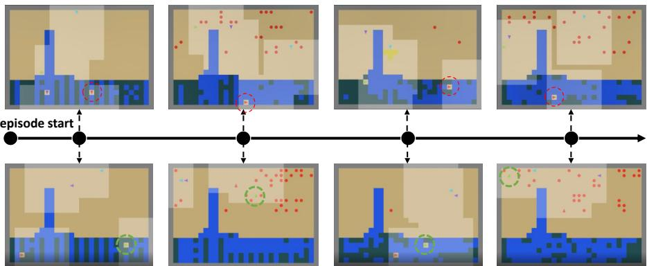  
Figure 1: We track the behavior of a disadvantaged agent under different gifting mechanisms. Top: LASE [19]. A disadvantaged agent (red) is locked in cleanup (gift over-reliance). Bottom: LASE with AGiR (ours). A disadvantaged agent (green) escapes gift over-reliance by alternating between cleanup and harvest, leading to more balanced and sustainable behavior.

The goal of this environment is for each agent (triangles in the figure) to harvest apples (red dots), which grow only when the river pollution is below a threshold and regrow faster as pollution decreases. Initially, the pollution level is above the threshold and continues to increase over time, so some agents must clean the river to enable and sustain harvesting. Although the original environment spawns agents at random positions, we modify it so that two disadvantaged agents spawn near the river and two advantaged agents spawn near the apple spawn sites.

The upper row of Fig. 1 illustrates the behavior of agents trained with LASE. The disadvantaged agent (the red agent marked with a red dotted circle), which spawns near the river, initiates cleaning due to exploration. As a result, apples grow in the field and are harvested by other agents. Those harvesting agents transfer gifts to the disadvantaged agent, allowing it to become locked into cleanup without ever harvesting apples throughout the episode. In other words, during training, the gifts received for cleaning dominate its learning signal before it experiences extrinsic rewards from harvesting.

This phenomenon, which we term gift over-reliance, is not specific to this asymmetric variant; we observe it in the standard environments as well (Appendix F). The issue is neither the cleaning role itself nor the gifts it earns: if the agent had tried harvesting and still chose to clean in return for gifts, this would be a legitimate division of labor. What we observe instead is that the agent becomes fixed in the cleaning role before it ever experiences harvesting. Our goal is therefore to enable each agent to escape such lock-in, not to equalize outcomes across agents. As a qualitative illustration, the lower row of Fig. 1 shows that this is achievable: under our approach, the disadvantaged agent no longer remains locked into cleanup and, having experienced harvesting, alternates between socially beneficial cleaning and self-interested harvesting. We further examine this distinction under controlled positional and competence asymmetries in Section 6.2.

## 3.2 Problem Statement

We hypothesize that gift over-reliance stems from the agents’ unconditional acceptance of all incoming gifts in standard gifting methods. This lack of selectivity encourages an excessive dependence on gifted rewards at the expense of their own extrinsic performance. We therefore propose that agents selectively regulate gift acceptance based on their learning contexts. Such a mechanism is intended to prevent reward dependence while keeping the learning signal from the environment intact.

To this end, we introduce adaptive gift refusal, where agents are given the ability to decide whether to accept or reject incoming gifts. For this, we define the refusal function of agent i as $w ^ { i } : \mathcal { H }  [ 0 , 1 ]$ which maps the history of extrinsic rewards and received gifts to the acceptance ratio of the next gift. Formally, the history space is given by $\mathcal { H } = \cup _ { t = 1 } ^ { \infty } \{ \left( r _ { 0 } , \dots , r _ { t - 1 } , g _ { 0 } , \dots , g _ { t - 1 } \right) \mid r _ { k } , g _ { k } \in \mathbb { R } , 0 \leq$ $k < t \}$ , where each element corresponds to a finite sequence of extrinsic rewards and received gifts. At time t, we denote the refusal weight of agent i at time t as $w _ { t } ^ { i } : = w ^ { i } ( r _ { 0 : t - 1 } ^ { i } , g _ { 0 : t - 1 } ^ { - i , i } )$ , where $r _ { 0 : t - 1 } ^ { i }$ is the extrinsic reward history of agent i and $g _ { 0 : t - 1 } ^ { - i , i }$ is the sequence of gifts received from other agents. Thus, wi specifies the fraction of the incoming gift $g _ { t } ^ { - i , i }$ that agent i accepts. We augment the shaping term with refusal and the resulting shaped reward is given by

$$
\boldsymbol { r } _ { t } ^ { i , \mathrm { A G i R } } = \boldsymbol { r } _ { t } ^ { i , \mathrm { e x t } } - \boldsymbol { g } _ { t } ^ { i , - i } + \boldsymbol { w } _ { t } ^ { i } \cdot \boldsymbol { g } _ { t } ^ { - i , i } .\tag{1}
$$

Given Eq. (1), our objective is to design an adaptive refusal weight computing strategy that operates in real time on local interaction history to mitigate gift over-reliance while preserving task performance.

## 3.3 Adaptive Gift-Refusal Mechanism

We now propose an Adaptive Gift-Refusal (AGiR) mechanism that updates the refusal weight of each agent i. The key idea is that each agent computes a reward–gift orientation (RGO) to assess its own level of gift reliance, and then adjusts weight $w _ { t } ^ { i }$ to regulate gift acceptance and mitigate over-reliance. Concretely, comparing RGO to a baseline $\dot { B }$ determines the direction of change: if $\mathrm { R G O } < B$ (indicative of gift over-reliance), the agent decreases $w _ { t } ^ { i }$ to place more emphasis on extrinsic reward; if $\mathrm { R G O } > B$ , it increases $w _ { t } ^ { i }$ to accept more gifts and thereby support cooperative behavior. In short, the signed magnitude of $\mathrm { R G O } - B$ determines the direction and size of the update, while a step-size modulator can further bound it for stability. The pseudo-code is provided in Appendix B.

Reward-Gift Orientation $\phi _ { t } ^ { i }$ and Baseline $B _ { t } ^ { i }$ To quantify the gift dependency of agent i at time t, we define the RGO $\phi _ { t } ^ { i }$ as the angle formed by the ratio between the cumulative reward and the cumulative gift until time t:

$$
\phi _ { t } ^ { i } : = \arctan \left( \frac { R _ { t } ^ { i } } { G _ { t } ^ { i } } \right) \in ( - \frac { \pi } { 2 } , \frac { \pi } { 2 } ) ,\tag{2}
$$

where $\begin{array} { r } { R _ { t } ^ { i } : = \sum _ { k = t - H + 1 } ^ { t } r _ { k } ^ { i , \mathrm { e x t } } } \end{array}$ denotes the cumulative extrinsic reward and $\begin{array} { r } { G _ { t } ^ { i } : = \sum _ { k = t - H + 1 } ^ { t } g _ { k } ^ { - i , i } } \end{array}$ denotes the cumulative gift received within a window size $H .$ . This formulation permits any window size H, from the full history $( H = t + 1 )$ to fixed windows over recent history.

$\phi _ { t } ^ { i }$ reflects how strongly agent i has relied on gifts relative to rewards for policy update. $\operatorname { I f } \phi _ { t } ^ { i } \approx 0$ , the reliance on gifts has overwhelmed rewards. In this case, until time t, agent i has been discouraged from increasing its own extrinsic reward, but instead has engaged in prosocial or sacrificial behavior that benefits others and attracts gifts. In other words, the agent is in danger of gift over-reliance, and thus should reduce $w _ { t } ^ { i }$ to down-weight the importance of gifts. To implement this idea, we compare the orientation $\phi _ { t } ^ { i }$ against a baseline $B _ { t } ^ { i }$ and update the refusal weight $w _ { t } ^ { i }$ accordingly. The baseline $B _ { t } ^ { i }$ determines the sign of the change in refusal weight: if $\phi _ { t } ^ { i } - B _ { t } ^ { i } > 0 .$ , then $w _ { t } ^ { i }$ increases, while if $\phi _ { t } ^ { i } - B _ { t } ^ { i } < 0$ , then $w _ { t } ^ { i }$ decreases. Moreover, the magnitude of the change follows the signed deviation $\dot { \phi } _ { t } ^ { i } - { \dot { B } _ { t } ^ { i } }$ (with an independent step-size control for stability), so larger deviations induce proportionally larger adjustments while preserving the direction set by the baseline comparison. The baseline can be fixed or varying in time. We present our choice for the baseline in Appendix D.1.

Refusal Weight Update We update the refusal weight according to $w _ { t + 1 } ^ { i } = w _ { t } ^ { i } + \alpha \Delta _ { t } ^ { i }$ , with step size $\alpha > 0$ , where $\Delta _ { t } ^ { i }$ captures the change applied at time t. Following the discussion above, we set the update to be proportional to the deviation of RGO from the baseline and scale it by the current weight and a reward-based step-size modulator:

$$
\Delta _ { t } ^ { i } = w _ { t } ^ { i } \times \underbrace { \left( \phi _ { t } ^ { i } - B _ { t } ^ { i } \right) } _ { \mathrm { g i f t r e l i a n c e l e v e l } } \times \underbrace { S ( R _ { t } ^ { i } ) } _ { \mathrm { s t e p - s i z e m o d u l a t o r } } .\tag{3}
$$

Here, $S ( R _ { t } ^ { i } )$ dampens the update when the cumulative reward is high, reflecting the intuition that agents with sufficient returns have less need to rapidly change their refusal behavior: $S ( R _ { t } ^ { i } ) : = { }$ $2 \bar { \sigma } ( - R _ { t } ^ { i } / C )$ , where $\begin{array} { r } { \sigma ( x ) = \frac { 1 } { 1 + e ^ { - x } } } \end{array}$ and $C > 0$ is a temperature parameter. Consequently, $\dot { S ( 0 ) } = 1$ and $S ( R _ { t } ^ { i } )$ decreases monotonically toward 0 as $R _ { t } ^ { i }$ grows, with larger C yielding a slower decay.

Refusal-Aware Policy We parameterize the policy as $\pi _ { \boldsymbol { \theta } } ( a \mid o , w )$ , where the refusal weight w is provided as an additional input alongside the observation o. The scalar w encodes the agent’s gift-acceptance stance: when $w = 1$ , incoming gifts are fully accepted, encouraging actions that elicit others’ gifts; when $w = 0$ , gifts are ignored and the agent prioritizes extrinsic reward. Conditioning on w thus allows a single policy to adapt its behavior across refusal contexts.

## 4 Theoretical Analysis

In this section, we analyze AGiR along two axes. Along the rollout axis, with the joint policy profile and gifting functions held fixed, we show that the refusal-weight process $\{ w _ { t } ^ { i } \} _ { t \ge 0 }$ admits a stationary distribution and identify a sufficient condition for its uniqueness. Along the policy-update axis, we analyze how a policy update under the AGiR-updated refusal weight affects welfare in the Iterated Prisoner’s Dilemma (IPD). We first state standard assumptions for existence.

Assumption 4.1. The global state space $S \subset \mathbb { R } ^ { d }$ and each agent’s action space $A ^ { i }$ are finite.

Assumption 4.2 (Continuity). For each agent i, the baseline $B ^ { i }$ is continuous in $w ^ { i } \in [ 0 , 1 ]$ , and the $p o l i c y ~ \bar { \pi } ^ { i } ( a ^ { i } \mid s , w ^ { i } )$ is continuous in wi for every $s \in S$ and $a ^ { i } \in A ^ { i }$

Theorem 4.3 (Existence). For arbitrary fixed joint policy profile $\pi = ( \pi ^ { 1 } , \ldots , \pi ^ { n } )$ and gifting functions $\{ G _ { \eta ^ { i } } \} _ { i = 1 } ^ { n } , l e t \left\{ w _ { t } ^ { i } \right\} _ { t \geq 0 }$ be the stochastic process ofrefusal weightsfor agent i generated by AGiR with anyfixedfinite window size $H \geq 1$ . Under Assumptions 4.1 and 4.2, for each agent i, this process admits a stationary marginal distribution.

Proof. See Appendix C.1 for the proof.

Intuitively, under a fixed joint policy, the refusal weights admit a stationary marginal distribution. We next identify conditions for its uniqueness and convergence.

Assumption 4.4. For every agent i, the parameters satisfy $\begin{array} { r } { \alpha \in ( 0 , \frac { 1 } { 2 \pi } ) , B ^ { i } , \phi ^ { i } ( s , a ) \in ( - \frac { \pi } { 2 } , \frac { \pi } { 2 } ) } \end{array}$ , and $r ^ { i } ( s , a ) \in [ - r _ { \operatorname* { m a x } } , r _ { \operatorname* { m a x } } ] f o r \mathop { a l l } s , a ,$ , where $B ^ { i }$ is independent ofthe refusal weights.

Assumption 4.5 (Positive-Regime Stability). Under a fixedjoint policy, let $Z = ( s , \mathbf { w } ) , m ^ { i } ( s , a ) =$ $1 + \alpha \hat { S ( } r ^ { i } ( s , a ) ) ( \phi ^ { i } ( s , a ) - \bar { B } ^ { i } )$ , and $Z _ { * } \doteq ( s _ { * } , { \bf 1 } )$ for some $s _ { * } \in S .$ . Assume:

(A) Low-weight recovery: For some $\eta \in ( 0 , 1 )$ and $\kappa > 0 ,$ , E[log $m ^ { i } ( s , a ) \mid Z ] \geq \kappa$ whenever $w ^ { i } \leq \eta$ (B) Uniform regeneration: For every $c \in ( 0 , 1 )$ , there exist $N _ { c } \geq 1$ and $\beta _ { c } > 0$ such that $\operatorname* { P r } ( Z _ { t + N _ { c } } =$ $Z _ { * } \mid Z _ { t } ^ { - } = Z ) \stackrel { \sim } { \geq } \beta _ { c }$ uniformly over $w ^ { i } \geq c f o r a l l i ,$ , with $\operatorname* { P r } ( Z _ { t + 1 } = Z _ { * } \mid Z _ { t } = Z _ { * } ) > 0 .$

Formal conditions are given in Appendix C.2.

Theorem 4.6 (Stability and Uniqueness). Suppose Assumptions 4.1, 4.2, 4.4, and 4.5 hold with $H = 1$ and $w _ { 0 } ^ { i } > 0$ for all agents i. Then, the joint AGiR process admits a unique stationary distribution in the positive-weight regime and converges to it geometrically in total variation.

Proof. See Appendix C.2 for the proof.

Beyond existence, the uniqueness theorem characterizes conditions under which the refusal weights converge to a single steady regime. Assumption 4.5 captures two complementary mechanisms: lowweight recovery prevents the refusal weights from collapsing toward zero, while uniform regeneration allows the joint process to reach a common state, jointly ensuring uniqueness and convergence.

Theorems 4.3 and 4.6 characterize the long-run behavior of the refusal weights generated by AGiR under a fixed joint policy profile. On the policy-update axis, characterizing welfare under simultaneous policy learning in general environments and base gifting methods is challenging; we therefore analyze the IPD, a canonical model of social dilemmas. With Reward Exchange [40] as the base gifting method and REINFORCE-style policy updates [35], a policy update under the AGiR-updated refusal weight improves the respective welfare measure, either the collective sum or the minimum return, against fixed cooperative, adversarial, and reciprocal opponent strategies. Theorem C.7 in Appendix C.3 gives the formal statement and proof. Extending this analysis to the joint learning dynamics of general mixed-motive games is left for future work. Please refer to Appendix C.4 for a discussion of how our theoretical assumptions relate to practical settings.

## 5 Experiments

## 5.1 Environments

To evaluate our method, we adapt the SocialJax benchmark [8], a JAX-based framework for MMGs. We use unfair variants of Coin Game, Cleanup, and Harvest by inducing structural asymmetry among agents, following Kim and Sycara [16]. Such asymmetry leads to disadvantaged agents who may become dependent on gifts, and can enable advantaged agents to exploit this

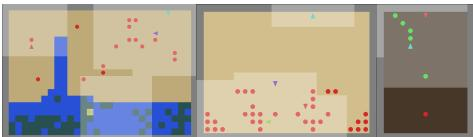  
Figure 2: Unfair Cleanup, Unfair Harvest, and Unfair Coin Game.

dependence to increase their own returns. We provide a brief summary of each environment below, with full details in Appendix D.2.

Unfair Cleanup In the original Cleanup environment, agents collect apples for reward, but apple regrowth depends on maintaining low levels of environmental pollution through cleaning actions that provide no direct individual reward, giving rise to a social dilemma between self-interest and cooperation. We introduce structural inequality by placing two agents near the river (disadvantaged) and two near apple sites (advantaged). Since cleaning is required for apple regrowth, disadvantaged agents are biased toward a cleaning role. Under gifting, they may become locked into a sacrificial strategy, cleaning throughout the episode while relying on gifts instead of learning to harvest.

Unfair Harvest In the original Harvest environment, agents collect apples from orchard patches where regrowth is stochastic and depends on local resource density, creating a commons dilemma that requires implicit coordination to sustain long-term returns. We introduce structural inequality by placing two advantaged agents near the orchard and two disadvantaged agents farther away. Under gifting, disadvantaged agents may avoid competing for resources and instead rely on gifts from advantaged agents, failing to learn independent harvesting behaviors.

Unfair Coin Game The Coin Game extends the Iterated Prisoner’s Dilemma, where collecting a coin yields +1, while collecting the opponent’s coin incurs a −2 penalty to the opponent. We introduce structural inequality via asymmetric coin spawn probabilities, creating advantaged and disadvantaged agents. Under gifting, part of the −2 penalty is transferred as a negative gift to the advantaged agent, deterring it from taking the disadvantaged agent’s coins.

## 5.2 Metrics

In MMGs, prior work typically reports performance using separate metrics for efficiency (e.g., social welfare) and inequality (e.g., Gini), making their trade-off hard to assess at a glance. We therefore summarize the resulting outcomes with α-fairness [26], a unified metric that jointly captures efficiency and inequality. A higher α-fairness indicates both higher social welfare and less inequality, with α controlling their relative emphasis. We note that α-fairness serves as a summary of outcomes rather than as the objective of AGiR. Full metric definitions are provided in Appendix E.1.

α-fairness recovers several representative objectives, where xi denotes the return of agent i: as $\alpha \to \infty$ , maximizing α-fairness corresponds to maximizing the minimum return mini xi (max-min fairness, denoted Min); at $\alpha = 1$ , it corresponds to maximizing the geometric mean $\left( \prod _ { i } x _ { i } \right) ^ { 1 / n }$ (proportional fairness, denoted GM); and at $\alpha = 0$ , it corresponds to maximizing the arithmetic mean ${ \frac { 1 } { n } } \sum _ { i } x _ { i }$ (collective return, denoted AM). Among these, Min, the lowest extrinsic return among agents, most directly reflects whether every agent learns to earn for itself. For completeness, we also report the Gini coefficient [5], while results for Jain’s index [12] are provided in Appendix E.2.

Furthermore, we define the Gift Reliance Ratio (GRR) as $\begin{array} { r } { \mathrm { G R R } : = \frac { R ^ { + } } { E ^ { + } + R ^ { + } } } \end{array}$ , where E and R denote cumulative extrinsic rewards and received gifts, respectively, and $x ^ { + } = \operatorname* { m a x } \{ 0 , x \}$ . While α-fairness captures resulting outcomes, GRR captures reliance on gifts: a higher GRR indicates that a larger share of an agent’s income comes from gifts. We use GRR as an auxiliary metric to quantify gift reliance and to assess its change under AGiR. We report the average GRR across all agents.

## 5.3 Baselines

We evaluate our method by plugging it into prior gifting methods: Reward exchange (RX) [40], LIO [42], and LASE [19]. For a broader context, we also report non-gifting methods for MMGs: independent PPO [6] with a common collective reward, denoted IPPO-C, and with individual rewards, denoted IPPO-I, as well as the reward-shaping approach IA [11]. Note that IA requires access to other agents’ rewards during training, which is not allowed in our setting.

## 5.4 Results

For completeness, evaluation results on the standard environments are provided in Appendix F.

Unfair Cleanup We evaluate two difficulty levels, Easy and Hard, defined by the distance between the river and apple spawn sites. We focus on the Hard setting, where distant spawns make exploration difficult and exacerbate gift over-reliance. Results for the Easy setting are provided in Appendix G. Following prior studies [43], LIO was omitted due to learning instabilities in Cleanup.

Table 1: α-fairness, Gini coefficient, and GRR in Unfair Cleanup-Hard
<table><tr><td>Algorithm</td><td></td><td>AM↑</td><td>GM↑</td><td>Min ↑</td><td>Gini ↓</td><td>GRR↓</td></tr><tr><td rowspan="3">IPPO-I IPPO-C IA</td><td></td><td>42 (84)</td><td>42 (84)</td><td>37 (74)</td><td>0.01 (0.02)</td><td></td></tr><tr><td></td><td>678 (24)</td><td>0 (0)</td><td>0 (0)</td><td>0.52 (0.01)</td><td></td></tr><tr><td></td><td>226 (110)</td><td>222 (108)</td><td>175 (82)</td><td>0.08 (0.03)</td><td></td></tr><tr><td rowspan="2">LASE</td><td>Vanilla</td><td>314 (35)</td><td>131 (161)</td><td>112 (138)</td><td>0.22 (0.12)</td><td>0.25</td></tr><tr><td>AGiR</td><td>288 (41)</td><td>283 (42)</td><td>221 (46)</td><td>0.09 (0.01)</td><td>0.07</td></tr><tr><td rowspan="2">RX</td><td>Vanilla</td><td>381 (61)</td><td>273 (143)</td><td>191 (113)</td><td>0.19 (0.08)</td><td>0.37</td></tr><tr><td>AGiR</td><td>357 (33)</td><td>352 (33)</td><td>288 (29)</td><td>0.09 (0.01)</td><td>0.20</td></tr></table>

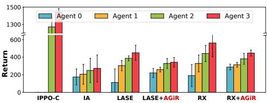  
Figure 3: Per-agent return distributions in Unfair Cleanup-Hard.

Table 1 reports the results. Under vanilla gifting, disadvantaged agents near the river become locked into cleaning while relying on gifts from advantaged agents, leading to limited harvesting performance due to gift-dominated learning. In contrast, AGiR modulates incoming gifts to prevent such dominance, encouraging disadvantaged agents to explore away from the river and learn policies that balance cooperative cleaning with harvesting. Thus, AGiR raises Min and lowers GRR without a substantial loss in AM; GM and the Gini coefficient improve accordingly.

Fig. 3 shows per-agent returns in Unfair Cleanup-Hard, where agents are ranked by return within each seed and averaged across five seeds. Across both LASE and RX, adding AGiR visibly raises the returns of the lower-ranked agents and narrows the gap to the best-ranked agents, consistent with the improvements in Min and GM reported in Table 1. In contrast, IPPO-C achieves high AM but poor GM and Min, while IA achieves lower inequality at the cost of overall performance.

Unfair Harvest In the Unfair Harvest, two advantaged agents are initialized near the orchard and two disadvantaged agents farther away. Table 2 summarizes the results for this environment. As in Cleanup, LIO was excluded due to learning instabilities.

Gift over-reliance allows advantaged agents to occupy the orchard early and send gifts that dampen disadvantaged agents’ motivation to explore, leading to poor learning outcomes for harvesting. AGiR addresses this issue, raising Min while maintaining or improving GM. Fig. 4 shows the distribution of per-agent returns in Unfair Harvest, averaged over five seeds. Compared to baseline gifting methods, AGiR raises the returns of the lower-ranked agents, reducing polarization across agents. In contrast, IPPO-C yields highly unequal outcomes. In each seed, one agent monopolizes the orchard, yielding a high AM but poor performance in terms of GM and Min return.

Table 2: α-fairness, Gini coefficient, and GRR in Unfair Harvest
<table><tr><td colspan="2">Algorithm</td><td>AM↑</td><td>GM↑</td><td>Min ↑</td><td>Gini ↓</td><td>GRR↓</td></tr><tr><td rowspan="3">IPPO-I IPPO-C IA</td><td></td><td>49 (0.1)</td><td>43 (0.6)</td><td>24 (1.4)</td><td>0.24 (0.01)</td><td>=</td></tr><tr><td></td><td>115 (8.7)</td><td>11(17.1)</td><td>2 (3.2)</td><td>0.71 (0.06)</td><td></td></tr><tr><td></td><td>49 (0.1)</td><td>43 (0.3)</td><td>24 (0.7)</td><td>0.25 (0.01)</td><td>=</td></tr><tr><td rowspan="2">LASE</td><td>Vanilla</td><td>51 (1.1)</td><td>29 (16.6)</td><td>11 (9.1)</td><td>0.35 (0.09)</td><td>0.31</td></tr><tr><td>AGiR</td><td>49 (0.3)</td><td>41 (1.8)</td><td>19 (4.5)</td><td>0.27 (0.03)</td><td>0.12</td></tr><tr><td rowspan="2">RX</td><td>Vanilla</td><td>61 (4.3)</td><td>43 (3.7)</td><td>15 (5.0)</td><td>0.36 (0.03)</td><td>0.43</td></tr><tr><td>AGiR</td><td>49 (0.4)</td><td>42 (0.7)</td><td>21 (2.1)</td><td>0.26 (0.01)</td><td>0.25</td></tr></table>

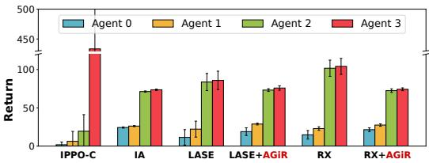  
Figure 4: Per-agent return distributions in Unfair Harvest.

Unfair Coin Game In the Unfair Coin Game, the red agent is advantaged because red coins are rarer (about 20% of spawns), reducing its risk of theft penalties and increasing opportunities to penalize the green agent. Under vanilla gifting, negative rewards may lead to negative gifts, which act as peer penalization. These punitive transfers are often beneficial in this environment as they discourage agents from taking opponent-colored coins and induce cooperative behavior. A natural concern is that a refusal mechanism might undermine this enforcement. However, our results show that AGiR avoids this risk, preserving the corrective power of gifting while improving the r

Table 3: α-fairness and GRR in Unfair Coin Game
<table><tr><td>Algorithm</td><td>AM↑</td><td>GM↑</td><td>Min ↑</td><td>GRR↓</td></tr><tr><td rowspan="2">IPPO-I IPPO-C IA</td><td>11 (0.9)</td><td>-66 (1.7)</td><td>-56 (1.8)</td><td></td></tr><tr><td>97 (0.6) 12 (0.9)</td><td>78 (1.7) -63 (0.4)</td><td>40 (0.5) -53 (4.7)</td><td>=</td></tr><tr><td rowspan="2">LASE</td><td></td><td></td><td></td><td></td></tr><tr><td>Vanilla 15 (33.1) AGiR 20 (1.3)</td><td>-61 (84.3) -57 (3.4)</td><td>-65 (107.3) -40 (3.9)</td><td>0.56 0.54</td></tr><tr><td rowspan="2">RX</td><td>Vanilla</td><td>97 (1.0)</td><td>78 (0.6)</td><td>39 (0.9)</td></tr><tr><td>AGiR</td><td>77 (4.7)</td><td>74 (3.5)</td><td>0.39 59 (1.5) 0.28</td></tr><tr><td rowspan="2">LIO</td><td>Vanilla</td><td>-22 (11.2)</td><td>-128 (31.2) -152 (43.8)</td><td></td></tr><tr><td>AGiR</td><td>-24 (17.7)</td><td>-105 (73.3) -132 (93.1)</td><td>0.5 0.30</td></tr></table>

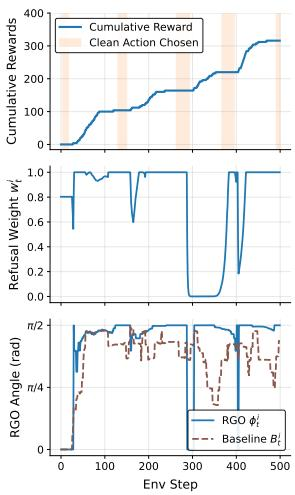

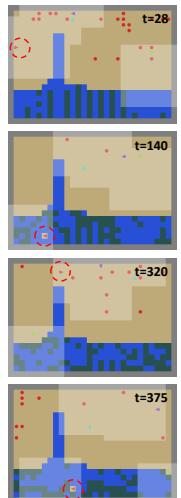

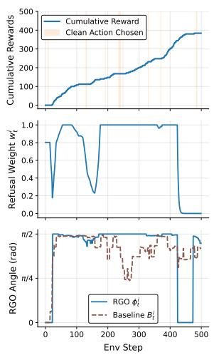

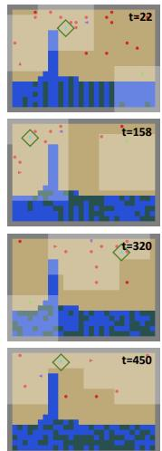  
Figure 5: Episode summary in Unfair Cleanup-Hard. Left: disadvantaged agent; Right: advantaged agent. For each agent, three time-series panels (bottom→top): RGO with its baseline (dashed brown); refusal weight $w _ { t } ^ { i . } ,$ and cumulative extrinsic reward $\textstyle \sum _ { k \leq t } r _ { k } ^ { i , e x t }$ with orange shading for clean actions. Snapshots show selected timesteps (timestamp at top-right). The focal agent is marked by a red dashed circle for the disadvantaged agent and a green solid diamond for the advantaged agent.

Table 3 reports the results. Adding refusal improves Min, the return of the disadvantaged green agent, across all base gifting methods. Since a weakened deterrent would let the advantaged agent take more of the green agent’s coins and thus lower Min, this rise indicates that refusal does not weaken the deterrent effect of negative gifts; the disadvantaged agent instead ends up better off.

## 6 Analysis

## 6.1 Empirical Analysis on Within-Episode Dynamics

We analyze within-episode dynamics of refusal weights $w _ { t } ^ { i }$ , RGOs $\phi _ { t } ^ { i } .$ , cleanup actions, and cumulative extrinsic reward in Unfair Cleanup-Hard. Fig. 5 shows a 500-step evaluation episode after training $\mathrm { L A S E + A G i R }$ for $3 \times 1 0 ^ { 8 }$ timesteps, comparing disadvantaged (left) and advantaged (right) agents.

We first examine the red disadvantaged agent (left column). At t = 28, the refusal weight drops sharply; subsequently, the clean actions become sparse, snapshots show the agent leaving the river to harvest, and the cumulative return increases. Around $t = 1 4 0$ , the refusal weight remains near 1, corresponding to frequent cleaning and flat cumulative return. Around $t = 3 2 0$ , the refusal weight is near 0, snapshots show harvesting, and the cumulative return rises. $\mathbf { A } \mathbf { t } ~ t = 3 7 5$ , the refusal weight increases rapidly to 1, accompanied by a return to cleaning behavior. Overall, the disadvantaged agent exhibits prosocial behavior while still effectively pursuing its self-interest throughout the episode.

We next examine the cyan advantaged agent (right column). This agent’s behavior is largely insensitive to refusal weights. The cumulative extrinsic return rises steadily, as evidenced by snapshots across varying refusal regimes (e.g., sharp w-drops at t = 22, 158; near-one w at $t = 3 2 0 ;$ ; and near-zero w at $t = 4 5 0 )$ ). These snapshots consistently show the agent harvesting frequently with little cleaning. This agent maintains its payoff advantage throughout the episode, showing that AGiR does not pressure advantaged agents to sacrifice their returns to equalize outcomes.

## 6.2 Behavior under Positional and Competence Asymmetries

Section 3.1 argued that the problem is not specialization itself but a role that becomes fixed before the agent experiences alternative behaviors. This raises a natural question: does AGiR dissolve only such lock-in, or legitimate specialization as well? We examine this with controlled experiments that separate the factors behind role assignment.

We consider two factors that can shape which agent cleans and which harvests: spawn position, which affects which task an agent experiences first, and competence, which affects how well it performs each task. Crossing the two in a two-agent Cleanup yields four scenarios (Table 4). Agents spawn either at random or at fixed positions, one by the river and the other by the apples. Their competences are either

Table 4: Four scenarios in two-agent Cleanup.
<table><tr><td></td><td>Equal competence</td><td>Asymmetric competence</td></tr><tr><td>Random spawn</td><td>No gap</td><td>Competence gap</td></tr><tr><td>Fixed spawn</td><td>Spawn gap</td><td>Mismatch</td></tr></table>

equal or asymmetric: one agent is better at cleaning, with a wider cleaning beam, and the other is better at harvesting, with a larger reward per apple. We call them the talented cleaner and the talented harvester. We use LASE as the base gifting method. Further experimental details, quantitative results, and learning curves are provided in Appendix H.

No gap. Without either asymmetry, LASE shows no lock-in in this setting, as both agents clean and harvest; accordingly, AGiR leaves its outcome essentially unchanged.

Competence gap. AGiR allows the talented cleaner to explore harvesting before settling on a role. When its harvesting reward is only 0.1× that of the talented harvester, it eventually returns to cleaning; at 0.25×, it continues harvesting alongside cleaning. Thus, AGiR allows agents to retain specialization when it is beneficial rather than forcing them to abandon it.

Spawn gap. With equal competence but asymmetric initial positions, LASE leaves the river-side agent locked into cleaning, a role that turns out to be largely uncompensated by gifts (246 in extrinsic return vs. 247 after net gift transfers). AGiR allows the agent to escape this role and explore harvesting, increasing its extrinsic return from 246 to 276 while also improving the apple-side agent’s return from 291 to 302.

Mismatch. When initial positions oppose the agents’ specialties, LASE produces position-driven roles, leaving the talented harvester cleaning. With AGiR, the harvester shifts to harvesting while the talented cleaner takes over cleaning. Both agents’ total returns also improve, from 128 to 176 for the talented harvester and from 8 to 81 for the talented cleaner.

## 6.3 Ablation Studies

Refunded Gifts In our approach, a refused gift is simply not accounted for in the recipient’s subjective utility during policy updates. Refunding these transfers to the donor is a natural alternative, but it introduces strategic reasoning such as inferring intentions from rejection, which lies beyond the scope of this work. We therefore compare our mechanism with a naive refund scheme that adds returned gifts $b _ { t } ^ { - i , i }$ to the shaped reward: $\begin{array} { r } { \hat { r } _ { t } ^ { i , \mathrm { s h a p e d } } = r _ { t } ^ { i , \mathrm { e x t } } - g _ { t } ^ { i , - i } + w _ { t } ^ { i } g _ { t } ^ { - i , i } + b _ { t } ^ { - i , i } } \end{array}$ . Our mechanism outperforms this naive refunding approach on average; detailed results are provided in Appendix I.1.

Refusal-Aware Policy Removing w from the policy input degrades performance, indicating that a refusal-aware policy is important for AGiR, as shown in Table 13 in Appendix I.2.

Hyperparameter Sensitivity Analysis Performance is largely stable across most modulator coefficients C. Results remain robust to the step size α as long as it is not excessively large. Across a wide range of window sizes H, AGiR consistently achieves higher Min and GM than vanilla gifting. Finally, although a fixed baseline $( B _ { t } = \pi / 4 )$ already surpasses vanilla gifting, our adaptive baseline yields the highest Min and GM. Likewise, non-adaptive ways of limiting incoming gifts, such as a fixed acceptance weight, gift clipping, and linear annealing of the acceptance weight, yield lower GM and Min than AGiR in Unfair Cleanup-Hard. See Appendix I.3 for full results.

## 7 Conclusion

In this paper, we introduce the concept of gift over-reliance in MMGs, where agents prioritize gifted rewards over their own reward-yielding performance. To mitigate this, we propose AGiR, an adaptive gift-refusal method that regulates gift acceptance based on reward-gift orientation. Experiments on unfair variants of Cleanup, Harvest, and Coin Game demonstrate that AGiR lets agents with lower earning opportunities earn more on their own. Our characterization of gift over-reliance is empirical; formalizing a criterion that distinguishes it from legitimate specialization in arbitrary environments is an important direction for future work. Limitations are discussed in Appendix J.

## 8 Acknowledgments

This work was supported by the National Research Foundation of Korea (NRF) grant funded by the Korea government (MSIT) (No. RS-2025-00557589 , Generative Model Based Efficient Reinforcement Learning Algorithms for Multi-modal Expansion in Generalized Environments), the National Research Foundation of Korea (NRF) grant funded by the Korea government (MSIT) (No. RS-2026- 25510069), and the “Advanced GPU Utilization Support Program” funded by the Government of the Republic of Korea (Ministry of Science and ICT) (No. 02-26-01-0110). We thank Fanqi Kong for sharing the original LASE implementation.

## References

[1] Milad Aghajohari, Juan Agustin Duque, Tim Cooijmans, and Aaron Courville. Loqa: Learning with opponent q-learning awareness. arXiv preprint arXiv:2405.01035, 2024.

[2] George A Akerlof. Labor contracts as partial gift exchange. The quarterly journal ofeconomics, 97(4):543–569, 1982.

[3] Woohyeon Byeon, Giseung Park, Jongseong Chae, Amir Leshem, and Youngchul Sung. Multiobjective reinforcement learning with max-min criterion: A game-theoretic approach. arXiv preprint arXiv:2510.20235, 2025.

[4] Phillip JK Christoffersen, Andreas A Haupt, and Dylan Hadfield-Menell. Get it in writing: Formal contracts mitigate social dilemmas in multi-agent rl, aug 2023. URL http://arxiv. org/abs/2208.10469.

[5] Herbert A David. Miscellanea: Gini’s mean difference rediscovered. Biometrika, 55(3):573–575, 1968.

[6] Christian Schroeder De Witt, Tarun Gupta, Denys Makoviichuk, Viktor Makoviychuk, Philip HS Torr, Mingfei Sun, and Shimon Whiteson. Is independent learning all you need in the starcraft multi-agent challenge? arXiv preprint arXiv:2011.09533, 2020.

[7] Juan Agustin Duque, Milad Aghajohari, Tim Cooijmans, Razvan Ciuca, Tianyu Zhang, Gauthier Gidel, and Aaron Courville. Advantage alignment algorithms. arXiv preprint arXiv:2406.14662, 2024.

[8] Zihao Guo, Shuqing Shi, Richard Willis, Tristan Tomilin, Joel Z Leibo, and Yali Du. Socialjax: An evaluation suite for multi-agent reinforcement learning in sequential social dilemmas. arXiv preprint arXiv:2503.14576, 2025.

[9] Conor F Hayes, Roxana Radulescu, Eugenio Bargiacchi, Johan Källström, Matthew Macfarlane,˘ Mathieu Reymond, Timothy Verstraeten, Luisa M Zintgraf, Richard Dazeley, Fredrik Heintz, et al. A practical guide to multi-objective reinforcement learning and planning. Autonomous Agents and Multi-Agent Systems, 36(1):26, 2022.

[10] Xiaoxuan Hou, Jiayi Yuan, Joel Z Leibo, and Natasha Jaques. Investesg: A multi-agent reinforcement learning benchmark for studying climate investment as a social dilemma. arXiv preprint arXiv:2411.09856, 2024.

[11] Edward Hughes, Joel Z Leibo, Matthew Phillips, Karl Tuyls, Edgar Dueñez-Guzman, Antonio García Castañeda, Iain Dunning, Tina Zhu, Kevin McKee, Raphael Koster, et al. Inequity aversion improves cooperation in intertemporal social dilemmas. Advances in neural information processing systems, 31, 2018.

[12] Rajendra K Jain, Dah-Ming W Chiu, William R Hawe, et al. A quantitative measure of fairness and discrimination. Eastern Research Laboratory, Digital Equipment Corporation, Hudson, MA, 21(1):2022–2023, 1984.

[13] Natasha Jaques, Angeliki Lazaridou, Edward Hughes, Caglar Gulcehre, Pedro Ortega, DJ Strouse, Joel Z Leibo, and Nando De Freitas. Social influence as intrinsic motivation for multi-agent deep reinforcement learning. In International conference on machine learning, pages 3040–3049. PMLR, 2019.

[14] Jeewon Jeon, Woojun Kim, Whiyoung Jung, and Youngchul Sung. Maser: Multi-agent reinforcement learning with subgoals generated from experience replay buffer. In International conference on machine learning, pages 10041–10052. PMLR, 2022.

[15] Woojun Kim and Youngchul Sung. An adaptive entropy-regularization framework for multiagent reinforcement learning. In International Conference on Machine Learning, pages 16829– 16852. PMLR, 2023.

[16] Woojun Kim and Katia Sycara. Fair cooperation in mixed-motive games via conflict-aware gradient adjustment, 2025. URL https://arxiv.org/abs/2508.17696.

[17] Woojun Kim, Whiyoung Jung, Myungsik Cho, and Youngchul Sung. A variational approach to mutual information-based coordination for multi-agent reinforcement learning. In Proceedings ofthe 2023 International Conference on Autonomous Agents and Multiagent Systems, pages 40–48, 2023.

[18] Peter Kollock. Social dilemmas: The anatomy of cooperation. Annual review of sociology, 24 (1):183–214, 1998.

[19] Fanqi Kong, Yizhe Huang, Song-Chun Zhu, Siyuan Qi, and Xue Feng. Learning to balance altruism and self-interest based on empathy in mixed-motive games. Advances in Neural Information Processing Systems, 37:135819–135842, 2024.

[20] Alistair Letcher, Jakob Foerster, David Balduzzi, Tim Rocktäschel, and Shimon Whiteson. Stable opponent shaping in differentiable games. arXiv preprint arXiv:1811.08469, 2018.

[21] Yang Li, Wenhao Zhang, Jianhong Wang, Shao Zhang, Yali Du, Ying Wen, and Wei Pan. Aligning individual and collective objectives in multi-agent cooperation. Advances in Neural Information Processing Systems, 37:44735–44760, 2024.

[22] Michael L Littman. Markov games as a framework for multi-agent reinforcement learning. In Machine learning proceedings 1994, pages 157–163. Elsevier, 1994.

[23] Andrei Lupu and Doina Precup. Gifting in multi-agent reinforcement learning. In Proceedings of the 19th International Conference on autonomous agents and multiagent systems, pages 789–797, 2020.

[24] Kevin R McKee, Ian Gemp, Brian McWilliams, Edgar A Duéñez-Guzmán, Edward Hughes, and Joel Z Leibo. Social diversity and social preferences in mixed-motive reinforcement learning. arXiv preprint arXiv:2002.02325, 2020.

[25] Sean P Meyn and Richard L Tweedie. Markov chains and stochastic stability. Springer Science & Business Media, 2012.

[26] Jeonghoon Mo and Jean Walrand. Fair end-to-end window-based congestion control. IEEE/ACM Transactions on networking, 8(5):556–567, 2002.

[27] Ninell Oldenburg and Tan Zhi-Xuan. Learning and sustaining shared normative systems via bayesian rule induction in markov games. arXiv preprint arXiv:2402.13399, 2024.

[28] Giseung Park, Woohyeon Byeon, Seongmin Kim, Elad Havakuk, Amir Leshem, and Youngchul Sung. The max-min formulation of multi-objective reinforcement learning: From theory to a model-free algorithm. arXiv preprint arXiv:2406.07826, 2024.

[29] William H Press and Freeman J Dyson. Iterated prisoner’s dilemma contains strategies that dominate any evolutionary opponent. Proceedings of the National Academy of Sciences, 109 (26):10409–10413, 2012.

[30] Tabish Rashid, Mikayel Samvelyan, Christian Schroeder De Witt, Gregory Farquhar, Jakob Foerster, and Shimon Whiteson. Monotonic value function factorisation for deep multi-agent reinforcement learning. Journal of Machine Learning Research, 21(178):1–51, 2020.

[31] Wilder Cabral Rodrigues and Roxana Radulescu. Incorporating moral choices in social dilem-˘ mas with multi-objective reinforcement learning. In The 38th Benelux Conference on Artificial Intelligence and the 35th Belgian Dutch Conference on Machine Learning.

[32] Stefan Roesch, Stefanos Leonardos, and Yali Du. Selfishness level induces cooperation in sequential social dilemmas. In Proc. of the 23rd International Conference on Autonomous Agents and Multiagent Systems (AAMAS 2024). International Foundation for Autonomous Agents and Multiagent Systems (IFAAMAS), 2024.

[33] John Schulman, Filip Wolski, Prafulla Dhariwal, Alec Radford, and Oleg Klimov. Proximal policy optimization algorithms. arXiv preprint arXiv:1707.06347, 2017.

[34] Kyunghwan Son, Daewoo Kim, Wan Ju Kang, David Earl Hostallero, and Yung Yi. Qtran: Learning to factorize with transformation for cooperative multi-agent reinforcement learning. In International conference on machine learning, pages 5887–5896. PMLR, 2019.

[35] Richard S Sutton, David McAllester, Satinder Singh, and Yishay Mansour. Policy gradient methods for reinforcement learning with function approximation. In S. Solla, T. Leen, and K. Müller, editors, Advances in Neural Information Processing Systems, volume 12. MIT Press, 1999. URL https://proceedings.neurips.cc/paper\_files/paper/1999/ file/464d828b85b0bed98e80ade0a5c43b0f-Paper.pdf.

[36] Eugene Vinitsky, Natasha Jaques, Joel Leibo, Antonio Castenada, and Edward Hughes. An open source implementation of sequential social dilemma games. https://github.com/ eugenevinitsky/sequential\_social\_dilemma\_games/issues/182, 2019. GitHub repository.

[37] Eugene Vinitsky, Raphael Köster, John P Agapiou, Edgar A Duéñez-Guzmán, Alexander S Vezhnevets, and Joel Z Leibo. A learning agent that acquires social norms from public sanctions in decentralized multi-agent settings. Collective Intelligence, 2(2):26339137231162025, 2023.

[38] Yue Wang. Game-theoretic understandings of multi-agent systems with multiple objectives. arXiv preprint arXiv:2509.23026, 2025.

[39] Timon Willi, Alistair Hp Letcher, Johannes Treutlein, and Jakob Foerster. Cola: consistent learning with opponent-learning awareness. In International Conference on Machine Learning, pages 23804–23831. PMLR, 2022.

[40] Richard Willis, Yali Du, Joel Z Leibo, and Michael Luck. Resolving social dilemmas with minimal reward transfer. Autonomous Agents and Multi-Agent Systems, 38(2):49, 2024.

[41] Richard Willis, Yali Du, Joel Z Leibo, and Michael Luck. Quantifying the self-interest level of markov social dilemmas. arXiv preprint arXiv:2501.16138, 2025.

[42] Jiachen Yang, Ang Li, Mehrdad Farajtabar, Peter Sunehag, Edward Hughes, and Hongyuan Zha. Learning to incentivize other learning agents. Advances in Neural Information Processing Systems, 33:15208–15219, 2020.

[43] Yuxuan Yi, Ge Li, Yaowei Wang, and Zongqing Lu. Learning to share in networked multi-agent reinforcement learning. Advances in Neural Information Processing Systems, 35:15119–15131, 2022.

[44] Stephen Zhao, Chris Lu, Roger B Grosse, and Jakob Foerster. Proximal learning with opponentlearning awareness. Advances in Neural Information Processing Systems, 35:26324–26336, 2022.

## A Prior Gifting Methods in Formal Representation

Each agent i specifies its outgoing gifts using a function $G _ { \eta ^ { i } }$ that maps to the gift vector $\{ g _ { t } ^ { i , j } \} _ { j \in \mathcal { N } }$ Here, $\eta ^ { i }$ represents the learnable parameter associated with agent i’s gifting function. The shaped reward of agent i is

$$
r _ { t } ^ { i , \mathrm { s h a p e d } } = r _ { t } ^ { i , \mathrm { e x t } } - g _ { t } ^ { i , - i } ( \eta ^ { i } ) + g _ { t } ^ { - i , i } ( \eta ^ { - i } ) .\tag{4}
$$

Note that when $\eta ^ { i }$ is not learned but fixed, the gifting function becomes rule-based. Each selfinterested agent trains its own policy $\pi ^ { i }$ by optimizing the shaped return that includes the extrinsic reward for self-interest and the gift for cooperation. In addition, each agent trains its gifting function $G _ { \eta ^ { i } }$ to maximize its own extrinsic return, under the rationale that the ultimate goal of gifting is to enhance the giver’s return through cooperation. The notation $g _ { t } ^ { i , j } ( \eta ^ { i } )$ will be used if necessary to clarify the dependence of gift to the parameter $\eta ^ { i }$

LIO. In LIO [42], each agent learns a separate gifting function in addition to its policy. The gifting function $G _ { \eta ^ { i } }$ takes agent i’s observation and others’ actions as inputs $( \mathrm { i . e . , } ( o ^ { i } , a ^ { - i } ) )$ and returns gifts for all others (i.e., $G _ { \eta ^ { i } } ( o ^ { i } , a ^ { - i } ) = ( g ^ { i , j } ( \eta ^ { i } ) ) _ { j \neq i } )$ . LIO does not include an explicit cost for gifting in the shaped reward $( \mathrm { i . e . , - } g _ { t } ^ { i , - i } ( \eta ^ { i } )$ in Eq. (4)). However, the training loss for the gifting function contains a penalty term $\begin{array} { r l } { - \sum _ { t } \gamma ^ { t } \sum _ { j \not = i } | g _ { t } ^ { i , j } | } & { { } } \end{array}$ that prevents excessive gifting, which acts as an implicit cost for gifting.

Formally, the shaped reward is defined by

$$
r _ { t } ^ { i , \mathrm { s h a p e d } } = r _ { t } ^ { i , \mathrm { e x t } } + \sum _ { j \neq i } g _ { t } ^ { j , i } ( \eta ^ { j } ) ,\tag{5}
$$

and each agent updates its policy following the policy objective

$$
\operatorname* { m a x } _ { \theta ^ { i } } \mathbb { E } _ { \pi _ { \theta ^ { i } } } \left[ \sum _ { t } \gamma ^ { t } r _ { t } ^ { i , \mathrm { s h a p e d } } \right] .
$$

The parameter for each agent’s gifting function, $\eta ^ { i }$ , is updated by the following objective:

$$
\operatorname* { m a x } _ { \eta ^ { i } } \mathbb { E } _ { \pi _ { \theta ^ { i } } ^ { \eta } } \left[ \sum _ { t } \gamma ^ { t } r _ { t } ^ { i , \mathrm { e x t } } \right] - \sum _ { t } \gamma ^ { t } \sum _ { j \neq i } | g _ { t } ^ { i , j } ( \eta ^ { i } ) |\tag{6}
$$

where $\pi _ { \theta ^ { i } } ^ { \eta }$ denotes the updated policy by the policy objective above.

LASE. In LASE [19], at each time t, each agent redistributes its extrinsic reward following the weight vector $w _ { t } ^ { i } = ( w _ { t } ^ { i 1 } , \dots , w _ { t } ^ { i n } )$ , where $w _ { t } ^ { i j } \geq 0$ and $\textstyle \sum _ { j \in { \mathcal { N } } } w _ { t } ^ { i j } = 1$ . Formally, the resulting shaped reward is as follows:

$$
r _ { t } ^ { i , \mathrm { s h a p e d } } = \sum _ { j \in \mathcal { N } } w _ { t } ^ { j i } r _ { t } ^ { j , \mathrm { e x t } } .\tag{7}
$$

In this case, $r _ { t } ^ { i , \mathrm { s h a p e d } }$ follows Eq. (4) with the gift $g _ { t } ^ { i , j } ( \eta ^ { i } )$ defined by $g _ { t } ^ { i , j } ( \eta ^ { i } ) = w _ { t } ^ { i j } ( \eta ^ { i } ) \cdot r _ { t } ^ { i , \mathrm { e x t } }$ . Each agent’s policy is updated by the following objective:

$$
\operatorname* { m a x } _ { \theta ^ { i } } \mathbb { E } _ { \pi _ { \theta ^ { i } } } \left[ \sum _ { t } \gamma ^ { t } r _ { t } ^ { i , \mathrm { s h a p e d } } \right] .
$$

The gifting function $G _ { \eta ^ { i } }$ consists of two modules: a Social Relation Inference (SRI) module and a Perspective-Taking (PT) module.

The SRI module contains two networks, $Q _ { S R } ^ { i } \big ( o _ { t } ^ { i } , a _ { t } ^ { 1 : n } ; \eta _ { 1 } ^ { i } \big )$ and $\pi _ { S R } ^ { i } ( a _ { t } ^ { i } | \hat { o } _ { t } ^ { j } ; \eta _ { 2 } ^ { i } )$ , with model parameters $\eta _ { 1 } ^ { i }$ and $\eta _ { 2 } ^ { i } .$ , respectively. These networks are trained by a standard actor-critic method using extrinsic rewards. This means that $Q _ { S R } ^ { i }$ and $\pi _ { S R } ^ { i }$ are trained toward the optimal policy and value function with respect to their extrinsic rewards. This aligns with the philosophy of the training objective (6) for the gifting function in LIO. Note that LASE has no penalty term in the gifting function’s training objective; instead, it already includes the cost for gifting in its shaped reward.

The PT module contains an imagination network $I m g ^ { i } ( o _ { t } ^ { i } , j ; \eta _ { 3 } ^ { i } )$ with model parameter $\eta _ { 3 } ^ { i }$ . The model $I m g ^ { i }$ allows agent i to predict agent $j ^ { \dagger } \mathbf { s }$ observation from agent $i \mathbf { \ ' } _ { \mathbf { S } }$ observation. The imagination network is trained by minimizing the cross-entropy loss between agent $j ^ { \prime } { \bf s }$ actual action and the predicted action distribution.

The weight $w _ { t } ^ { i j }$ is finally defined by

$$
w _ { t } ^ { i j } ( \eta _ { 1 } ^ { i } , \eta _ { 2 } ^ { i } , \eta _ { 3 } ^ { i } ) = \frac { Q _ { S R } ^ { i } ( o _ { t } ^ { i } , a _ { t } ^ { 1 : n } ; \eta _ { 1 } ^ { i } ) - \sum _ { a ^ { j } } \pi _ { S R } ^ { i } ( a | \hat { o } _ { t } ^ { j } ; \eta _ { 2 } ^ { i } ) Q _ { S R } ^ { i } ( o _ { t } ^ { i } , ( a _ { t } ^ { - j } , a ^ { j } ) ; \eta _ { 1 } ^ { i } ) } { ( n - 1 ) ( \operatorname* { m a x } _ { a ^ { j } } Q _ { S R } ^ { i } ( o _ { t } ^ { i } , ( a _ { t } ^ { - j } , a ^ { j } ) ; \eta _ { 1 } ^ { i } ) - \operatorname* { m i n } _ { a ^ { j } } Q _ { S R } ^ { i } ( o _ { t } ^ { i } , ( a _ { t } ^ { - j } , a ^ { j } ) ; \eta _ { 1 } ^ { i } ) ) }
$$

where $\hat { \sigma } _ { t } ^ { j } = I m g ^ { i } ( o _ { t } ^ { i } , j ; \eta _ { 3 } ^ { i } )$ . By letting $\eta ^ { i } = ( \eta _ { 1 } ^ { i } , \eta _ { 2 } ^ { i } , \eta _ { 3 } ^ { i } )$ , the gifting function of LASE can be expressed as $G _ { \eta ^ { i } } ( o _ { t } ^ { i } , a _ { t } ^ { 1 : n } , j ) = ( w _ { t } ^ { i j } ( \eta ^ { i } ) \cdot r _ { t } ^ { i , \mathrm { e x t } } ) _ { j = 1 } ^ { n } = ( g _ { t } ^ { i , j } ( \eta ^ { i } ) ) _ { j = 1 } ^ { n }$

Reward exchange. In Reward Exchange [40], each agent leaves its extrinsic reward with a ratio s and equally distributes $( 1 - s )$ of its reward to others. Formally, the resulting shaped reward is as follows:

$$
r _ { t } ^ { i , \mathrm { s h a p e d } } = s \cdot r _ { t } ^ { i , \mathrm { e x t } } + \frac { 1 - s } { n - 1 } \sum _ { j \neq i } r _ { t } ^ { j , \mathrm { e x t } } .\tag{8}
$$

In this case, $r _ { t } ^ { i , \mathrm { s h a p e d } }$ follows Eq. (4) with the rule-based gift $g _ { t } ^ { i , j } ( \eta ^ { i } )$ determined by $g _ { t } ^ { i , j } ( \eta ^ { i } ) =$ $\begin{array} { r } { G _ { \eta ^ { i } } ( r _ { t } ^ { i , \mathrm { e x t } } ) = \frac { \bar { 1 } - s } { n - 1 } r _ { t } ^ { i , \mathrm { e x t } } } \end{array}$

Then, each agent updates its policy following the objective:

$$
\operatorname* { m a x } _ { \theta ^ { i } } \mathbb { E } _ { \pi _ { \theta ^ { i } } } \left[ \sum _ { t } \gamma ^ { t } r _ { t } ^ { i , \mathrm { s h a p e d } } \right] .
$$

## B Pseudo Code

Algorithm 1 Adaptive Gift Refusal (for each agent i)   
Require: initial observation $o _ { 0 } ^ { i }$ , initial refusal weight $w _ { 0 } ^ { i } ,$ gifting function $G _ { \eta ^ { i } }$ , initial policy $\pi ^ { i }$   
1: for $i t e r = 0 , 1 , 2 , \ldots$ . do   
2: for $t = 0 , 1 , 2 , \ldots$ do   
3: Sample action $a _ { t } ^ { i } \sim \pi ^ { i } ( { \bf \cdot } | o _ { t } ^ { i } , w _ { t } ^ { i } )$   
4: Execute $a _ { t } ^ { i } ;$ receive extrinsic reward $r _ { t } ^ { i , \mathrm { e x t } }$ and next observation $o _ { t + 1 } ^ { i }$   
5: Compute gifts to others via $G _ { \eta ^ { i } } \colon$   
$\{ g _ { t } ^ { i , j } \} _ { j \neq i }  G _ { \eta ^ { i } }$   
6: Send $\{ g _ { t } ^ { i , j } \} _ { j \neq i }$ to recipients; receive incoming $\{ g _ { t } ^ { j , i } \} _ { j \neq i }$   
7: Update refusal weight by Eq. (3):   
$w _ { t + 1 } ^ { i }  c l i p ( w _ { t } ^ { i } + \alpha \Delta _ { t } ^ { i } )$   
8: end for   
9: Compute shaped reward for each timestep t:   
$r _ { t } ^ { i , \mathrm { A G i R } } \ = \ r _ { t } ^ { i , \mathrm { e x t } } \ - \ \sum _ { j \neq i } g _ { t } ^ { i , j } \ + \ w _ { t } ^ { i } \sum _ { j \neq i } g _ { t } ^ { j , i } , \ \forall t$   
10: Update policy $\pi ^ { i }$ using $r _ { t } ^ { i , \mathrm { A G i R } }$ (e.g., PPO step)   
11: If learnable, update $G _ { \eta ^ { i } }$ according to the base gifting method.   
12: end for   
13: Output: final policy $\pi ^ { i }$

## C Assumptions and Proofs for Theoretical Analysis

## C.1 Assumptions and Proof for Theorem 4.3

Assumption C.1 (Assumption 4.1). The global state space $S \subset \mathbb { R } ^ { d }$ and each agent’s action space Ai arefinite.

Assumption C.2 (Continuity, Assumption 4.2). For each agent i, the baseline $B ^ { i }$ is continuous in $w ^ { i } \in [ 0 , 1 ]$ , and the policy $\pi ^ { \dot { i } } ( a ^ { i } \mid s , { \dot { w } } ^ { i } )$ is continuous in $w ^ { i }$ for every $s \in S$ and $a ^ { i } \in A ^ { i }$

Theorem C.3 (Existence, Theorem 4.3). For arbitrary fixedjoint policy profile $\pi = ( \pi ^ { 1 } , \ldots , \pi ^ { n } )$ and gifting functions $\{ G _ { \eta ^ { i } } \} _ { i = 1 } ^ { n }$ , let $\{ w _ { t } ^ { i } \} _ { t \ge 0 }$ be the stochastic process of refusal weights for agent i generated by AGiR with any fixed finite window size $H \geq 1$ . Under Assumptions 4.1 and 4.2, for each agent i, this process admits a stationary marginal distribution.

Proof. For a fixed finite window size $H \geq 1$ , define the joint augmented state

$$
Z _ { t } = ( s _ { t } , \mathbf { w } _ { t } , \mathbf { r } _ { t - H : t - 1 } , \mathbf { g } _ { t - H : t - 1 } )
$$

on the augmented state space

$$
\bar { S } _ { H } = S \times [ 0 , 1 ] ^ { n } \times \mathcal { R } ^ { H } \times \mathcal { G } ^ { H } ,
$$

where $\mathbf { w } _ { t } \ = \ ( w _ { t } ^ { 1 } , \ldots , w _ { t } ^ { n } ) , \ \mathbf { r } _ { t - H : t - 1 } \ = \ ( \mathbf { r } _ { t - H } , \ldots , \mathbf { r } _ { t - 1 } )$ , and $\mathbf { g } _ { t - H : t - 1 } = \left( \mathbf { g } _ { t - H } , \ldots , \mathbf { g } _ { t - 1 } \right)$ denote the joint refusal weights and the most recent H joint extrinsic reward and received gift vectors, respectively.

Here, $s \in S$ and $a \in A$ denote the global state and joint action, respectively. The sets of possible joint reward and received gift vectors are defined by

$$
\begin{array} { r l } & { \mathcal { R } = \{ \mathbf { r } ( s , a ) : s \in S , a \in A \} \cup \{ \mathbf { 0 } \} \subseteq [ - r _ { \operatorname* { m a x } } , r _ { \operatorname* { m a x } } ] ^ { n } , } \\ & { \mathcal { G } = \{ \mathbf { g } ( s , a ) : s \in S , a \in A \} \cup \{ \mathbf { 0 } \} \subseteq [ - g _ { \operatorname* { m a x } } , g _ { \operatorname* { m a x } } ] ^ { n } , } \end{array}
$$

where $\mathbf { r } ( s , a ) = ( r ^ { j } ( s , a ) ) _ { i = 1 } ^ { n }$ and $\mathbf { g } ( s , a ) = ( g ^ { - j , j } ( s , a ) ) _ { j = 1 } ^ { n }$ . By Assumption C.1, both $\mathcal { R }$ and $\mathcal { G }$ are finite. For $t < H$ , the unavailable entries in the reward and gift histories are initialized to zero.

The refusal-aware policy of each agent $j$ depends only on $( s , w ^ { j } )$ and can therefore be regarded as a policy on $\bar { S } _ { H }$ through

$$
\pi ^ { j } ( d a ^ { j } \mid Z ) = \pi ^ { j } ( d a ^ { j } \mid s , w ^ { j } ) .
$$

Under the fixed joint policy profile $\pi = ( \pi ^ { 1 } , \ldots , \pi ^ { n } )$ , the joint action is sampled according to

$$
a _ { t } \sim \pi ( \cdot \mid Z _ { t } ) , \qquad \pi ( d a \mid Z ) = \prod _ { j = 1 } ^ { n } \pi ^ { j } ( d a ^ { j } \mid s , w ^ { j } ) .
$$

Given $Z _ { t }$ and $a _ { t } .$ , the next environment state is generated as

$$
s _ { t + 1 } \sim P ( \cdot \mid s _ { t } , a _ { t } ) ,
$$

and each agent $j$ receives

$$
r _ { t } ^ { j } = r ^ { j } ( s _ { t } , a _ { t } ) , \qquad g _ { t } ^ { j } = g ^ { - j , j } ( s _ { t } , a _ { t } ) .
$$

For each agent $j ,$ define

$$
R _ { t } ^ { j } = \sum _ { k = t - H + 1 } ^ { t } r _ { k } ^ { j } , \qquad G _ { t } ^ { j } = \sum _ { k = t - H + 1 } ^ { t } g _ { k } ^ { j } .
$$

The refusal weight is then updated by

$$
w _ { t + 1 } ^ { j } = \mathrm { c l i p } \left( w _ { t } ^ { j } + \alpha w _ { t } ^ { j } S ( R _ { t } ^ { j } ) \left[ \arctan \left( \frac { R _ { t } ^ { j } } { G _ { t } ^ { j } + \epsilon } \right) - B ^ { j } ( w _ { t } ^ { j } ) \right] \right) .
$$

Choose sufficiently small $\epsilon > 0$ such that

$$
0 < \epsilon < \operatorname* { m i n } _ { \substack { j \in \{ 1 , \dots , n \} , { \bf x } _ { 1 } , \dots , { \bf x } _ { H } \in \mathcal { G } } } \left| \sum _ { k = 1 } ^ { H } x _ { k } ^ { j } \right| ,
$$

where $x _ { k } ^ { j }$ denotes the j-th component of $\mathbf { x } _ { k }$

Let shi $\mathrm { \Delta f t } _ { H }$ denote the history-shifting operation defined by

$$
\mathrm { s h i f t } _ { H } ( ( x _ { 1 } , \ldots , x _ { H } ) , y ) = ( x _ { 2 } , \ldots , x _ { H } , y ) .
$$

Conditioned on $Z _ { t }$ and $a _ { t }$ , the augmented transition kernel is given by

$$
\begin{array} { r l } & { \displaystyle \bar { P } _ { H } ( d Z _ { t + 1 } \mid Z _ { t } , a _ { t } ) } \\ & { = P ( d s _ { t + 1 } \mid s _ { t } , a _ { t } ) } \\ & { ~ \times \displaystyle \prod _ { j = 1 } ^ { n } \delta _ { w _ { t + 1 } ^ { j } } ( d w _ { t + 1 } ^ { j } ) } \\ & { ~ \times \displaystyle \prod _ { j = 1 } ^ { n } \delta _ { \sinh \mathrm { i f f } ( \sigma _ { t - H : t - 1 } ^ { j } , r _ { t } ^ { j } ) } ( d r _ { t - H + 1 : t } ^ { j } ) } \\ & { ~ \times \displaystyle \prod _ { j = 1 } ^ { n } \delta _ { \sinh \mathrm { i f f } ( \sigma _ { t - H : t - 1 } ^ { j } , \sigma _ { t } ^ { j } ) } ( d \sigma _ { t - H + 1 : t } ^ { j } ) , } \end{array}
$$

where $\delta _ { z } ( \cdot )$ denotes the Dirac measure at z.

The transition kernel under the fixed joint policy profile π is therefore

$$
\bar { P } _ { H } ^ { \pi } ( d Z ^ { \prime } \mid Z ) = \int _ { A } \bar { P } _ { H } ( d Z ^ { \prime } \mid Z , a ) \pi ( d a \mid Z ) .
$$

Since the conditional distribution of $a _ { t }$ depends only on $Z _ { t }$ , and all components of $Z _ { t + 1 }$ are determined by $Z _ { t } , a _ { t }$ , and the next environment state, we have

$$
\operatorname* { P r } ( Z _ { t + 1 } \in E \mid Z _ { 0 } , \ldots , Z _ { t } ) = { \bar { P } } _ { H } ^ { \pi } ( E \mid Z _ { t } )
$$

for every measurable $E \subseteq { \bar { S } } _ { H }$ . Hence, $\{ Z _ { t } \} _ { t \ge 0 }$ is a Markov chain with transition kernel $\bar { P } _ { H } ^ { \pi }$

We show that $\bar { P } _ { H } ^ { \pi }$ is weak Feller. The following proof is adapted from and expands upon the derivation of Proposition $6 . 1 . 2$ in Meyn and Tweedie [25].

Let $Z ^ { \prime } = F _ { H } ( Z , a , s ^ { \prime } )$ denote the joint augmented next state obtained from $Z$ and $^ { a , }$ with the next environment state given by $s ^ { \prime } .$ . Since the state, action, and reward/gift history spaces are finite, their elements are isolated. Furthermore, by Assumption C.2 and the continuity of the clipping function $\mathrm { c l i p } ( x ) = \mathrm { m i n } \{ \mathrm { m a x } \{ 0 , x \} , 1 \}$ }, the refusal-weight update is continuous in w. Thus, $F _ { H }$ is continuous in $( Z , a , s ^ { \prime } )$

Denote by $C _ { b } ( \bar { S } _ { H } )$ the space of bounded continuous functions on $\bar { S } _ { H }$ . For arbitrary $\psi \in C _ { b } ( \bar { S } _ { H } )$ , let

$$
\begin{array} { l } { { ( \bar { \cal P } _ { \cal H } ^ { \pi } \psi ) ( Z ) : = \displaystyle \int _ { \bar { \cal S } _ { \cal H } } \psi ( Z ^ { \prime } ) \bar { \cal P } _ { \cal H } ^ { \pi } ( d Z ^ { \prime } \mid Z ) } } \\ { { { } ~ = \displaystyle \sum _ { a \in { \cal A } } \pi ( a \mid Z ) \sum _ { s ^ { \prime } \in { \cal S } } { \cal P } ( s ^ { \prime } \mid s , a ) \psi ( { \cal F } _ { \cal H } ( Z , a , s ^ { \prime } ) ) . } } \end{array}
$$

Since $\psi \in C _ { b } ( \bar { S } _ { H } )$ , there exists $C _ { \psi } < \infty$ such that $| \psi ( Z ^ { \prime } ) | \le C _ { \psi }$ for all $Z ^ { \prime } \in \bar { S } _ { H }$ . Since $\textstyle P ( \cdot \mid s , a )$ and $\pi ( \cdot \mid Z )$ are probability distributions,

$$
\begin{array} { r l } & { \displaystyle | ( \bar { P } _ { H } ^ { \pi } \psi ) ( Z ) | \leq \sum _ { a \in A } \pi ( a \mid Z ) \sum _ { s ^ { \prime } \in S } P ( s ^ { \prime } \mid s , a ) | \psi ( F _ { H } ( Z , a , s ^ { \prime } ) ) | } \\ & { \quad \quad \leq C _ { \psi } < \infty . } \end{array}
$$

Therefore, $\bar { P } _ { H } ^ { \pi } \psi$ is bounded on $\bar { S } _ { H }$

We next show that $\bar { P } _ { H } ^ { \pi }$ ψ is continuous. Let $\left\{ Z _ { m } \right\}$ be an arbitrary sequence converging to $Z$ in $\bar { S } _ { H }$ Since the state and history spaces are finite, the corresponding components of $Z _ { m }$ eventually coincide with those of $Z$ , while $\mathbf { w } _ { m } \to \mathbf { w }$ . By the continuity of each agent’s policy in its refusal weight, the joint policy

$$
\pi ( a \mid Z ) = \prod _ { j = 1 } ^ { n } \pi ^ { j } ( a ^ { j } \mid s , w ^ { j } )
$$

is continuous in $Z$ for every $a \in A$ . Furthermore, since $F _ { H }$ and $\psi$ are continuous,

$$
\psi ( F _ { H } ( Z _ { m } , a , s ^ { \prime } ) )  \psi ( F _ { H } ( Z , a , s ^ { \prime } ) )
$$

for every $a \in A$ and $s ^ { \prime } \in S$

Since $S$ and A are finite, we can interchange the limit and the finite sums:

$$
\begin{array} { r l } & { \underset { m  \infty } { \operatorname* { l i m } } ( \bar { P } _ { H } ^ { \pi } \psi ) ( Z _ { m } ) } \\ & { = \underset { m  \infty } { \operatorname* { l i m } } \underset { a \in A } { \sum } \pi ( a \mid Z _ { m } ) \underset { s ^ { \prime } \in S } { \sum } P ( s ^ { \prime } \mid s _ { m } , a ) \psi ( F _ { H } ( Z _ { m } , a , s ^ { \prime } ) ) } \\ & { = \underset { a \in A } { \sum } \pi ( a \mid Z ) \underset { s ^ { \prime } \in S } { \sum } P ( s ^ { \prime } \mid s , a ) \psi ( F _ { H } ( Z , a , s ^ { \prime } ) ) } \\ & { = ( \bar { P } _ { H } ^ { \pi } \psi ) ( Z ) . } \end{array}
$$

Thus, $\bar { P } _ { H } ^ { \pi } \psi$ is continuous on $\bar { S } _ { H }$

Combining this with the boundedness established above, we obtain

$$
\psi \in C _ { b } ( \bar { S } _ { H } ) \implies \bar { P } _ { H } ^ { \pi } \psi \in C _ { b } ( \bar { S } _ { H } ) .
$$

By Proposition 6.1.1 in Meyn and Tweedie [25], $\bar { P } _ { H } ^ { \pi }$ is weak Feller.

We now show the existence of a stationary distribution for $\bar { P } _ { H } ^ { \pi }$ . Let $\bar { \mu } \in \Delta ( \bar { S } _ { H } )$ be an arbitrary initial distribution of the joint augmented Markov chain with transition kernel $\bar { P } _ { H } ^ { \pi }$ . Define

$$
\bar { d } _ { t } = \frac 1 t \sum _ { k = 0 } ^ { t - 1 } \bar { \mu } ( \bar { P } _ { H } ^ { \pi } ) ^ { k } .
$$

Since $S , { \mathcal { R } } ,$ and $\mathcal { G }$ are finite, $[ 0 , 1 ] ^ { n }$ is compact, and H is finite, the augmented state space

$$
\bar { S } _ { H } = S \times [ 0 , 1 ] ^ { n } \times \mathcal { R } ^ { H } \times \mathcal { G } ^ { H }
$$

is compact. Therefore, the family of probability measures $\{ \bar { d } _ { t } \}$ on $\bar { S } _ { H }$ is tight, implying that the joint augmented Markov chain is bounded in probability on average.

By Theorem 12.0.1 in Meyn and Tweedie [25], the weak Feller property and boundedness in probability on average imply the existence of at least one invariant probability measure $d ^ { * }$ on $\bar { S } _ { H }$ satisfying

$$
d ^ { * } ( E ) = \int _ { { \bar { S } } _ { H } } { \bar { P } } _ { H } ^ { \pi } ( E \mid Z ) d ^ { * } ( d Z )
$$

for every measurable $E \subseteq { \bar { S } } _ { H }$

For an arbitrary agent i, let $d _ { w ^ { i } } ^ { * }$ denote the marginal distribution of $d ^ { * }$ on the refusal-weight coordinate $w ^ { i } \in [ 0 , 1 ]$ , defined by

$$
d _ { w ^ { i } } ^ { * } ( B ) = d ^ { * } \big ( \{ Z \in \bar { S } _ { H } : w ^ { i } \in B \} \big )
$$

for any measurable $B \subseteq [ 0 , 1 ]$ . Since $d ^ { * }$ is invariant under $\bar { P } _ { H } ^ { \pi }$ , the marginal distribution of $w _ { t } ^ { i }$ remains $d _ { w } ^ { \ast }$ when the joint augmented process is initialized according to $d ^ { * }$ . Thus, $d _ { w } ^ { \ast }$ is a stationary marginal distribution of $\{ w _ { t } ^ { i } \} _ { t \ge 0 }$ generated by AGiR.

## C.2 Assumptions and Proof for Theorem 4.6

Assumption C.4 (Assumption 4.4). The step size satisfies $\alpha \in ( 0 , { \frac { 1 } { 2 \pi } } )$ . For each agent i, $B ^ { i } \in$ $\begin{array} { r } { \bigl ( - \frac { \pi } { 2 } , \frac { \pi } { 2 } \bigr ) , \phi ^ { i } \bigl ( s , a \bigr ) \in \bigl ( - \frac { \pi } { 2 } , \frac { \pi } { 2 } \bigr ) } \end{array}$ , and $r ^ { i } ( s , a ) \in [ - r _ { \operatorname* { m a x } } , r _ { \operatorname* { m a x } } ]$ for all $s , a ,$ , where $B ^ { i }$ is independent of the refusal weights.

For $H = 1$ , consider the joint process

$$
Z _ { t } = \left( { { s _ { t } } , { \mathbf { w } _ { t } } } \right)
$$

on the state space

$$
{ \bar { S } } = S \times ( 0 , 1 ] ^ { n } .
$$

Under the fixed joint policy profile $\pi = ( \pi ^ { 1 } , \ldots , \pi ^ { n } )$ , let ${ \bar { P } } ^ { \pi }$ denote the transition kernel of $\{ Z _ { t } \} _ { t \ge 0 }$ where

$$
\pi ( a \mid Z ) = \prod _ { j = 1 } ^ { n } \pi ^ { j } ( a ^ { j } \mid s , w ^ { j } ) .
$$

For each agent $i ,$ define

$$
m ^ { i } ( s , a ) : = 1 + \alpha S ( r ^ { i } ( s , a ) ) \bigl ( \phi ^ { i } ( s , a ) - B ^ { i } \bigr ) .
$$

Under Assumption 4.4, $0 < m ^ { i } ( s , a ) < 2$ , and the refusal-weight update can be rewritten as

$$
w _ { t + 1 } ^ { i } = \operatorname* { m i n } \{ 1 , w _ { t } ^ { i } m ^ { i } ( s _ { t } , a _ { t } ) \} .
$$

This follows because the lower clipping bound is inactive when $w _ { t } ^ { i } > 0$ , as $m ^ { i } ( s , a ) > 0$ . Consequently, if $w _ { 0 } ^ { i } > 0$ , then $w _ { t } ^ { i } > 0$ for all $t \geq 0$ . Thus, $\bar { S } = S \times ( 0 , \mathsf { 1 } ] ^ { n }$ is invariant under the joint AGiR dynamics.

Assumption C.5 (Positive-Regime Stability, Assumption 4.5). The following conditions hold under the fixed joint policy profile π.

(A) Low-weight recovery. There exist $\eta \in ( 0 , 1 )$ and $\kappa > 0$ such that, for every agent i and every $Z = ( s , \mathbf { w } ) \in \bar { S }$ satisfying $w ^ { i } \leq \eta$

$$
\sum _ { a \in A } \pi ( a \mid Z ) \log m ^ { i } ( s , a ) \geq \kappa .
$$

(B) Uniform regeneration. There exists $s _ { * } \in S$ such that, with $Z _ { * } = ( s _ { * } , { \bf 1 } )$ , the following holds. For every $c \in ( 0 , 1 )$ , there exist an integer $N _ { c } \geq 1$ and $\beta _ { c } > 0$ satisfying

$$
\begin{array} { r l r } {  { \operatorname* { i n f } _ { Z = ( s , \mathbf { w } ) \in \bar { S } } ( \bar { P } ^ { \pi } ) ^ { N _ { c } } \bigl ( \{ Z _ { * } \} \mid Z \bigr ) \geq \beta _ { c } . } } \\ & { } & { w ^ { i } \geq c , \forall i } \end{array}
$$

Furthermore,

$$
\bar { P } ^ { \pi } ( \{ Z _ { * } \} \mid Z _ { * } ) > 0 .
$$

Theorem C.6 (Stability and Uniqueness, Theorem $4 . 6 )$ . Suppose Assumptions 4.1, 4.2, 4.4, and 4.5 hold and $H = 1$ , with initial refusal weights $w _ { 0 } ^ { i } > 0 f o r$ all agents i. Then, the joint AGiR process $\{ Z _ { t } \} _ { t \ge 0 }$ on $\bar { S }$ admits a unique invariant probability measure $\nu ^ { * }$

Moreover, for every initial state $Z _ { 0 } \in \bar { S } ,$

$$
\left\| ( \bar { P } ^ { \pi } ) ^ { t } ( \cdot \mid Z _ { 0 } ) - \nu ^ { * } \right\| _ { \mathrm { T V } } \longrightarrow 0
$$

geometrically fast as $t \to \infty ,$

Furthermore, there exists $p > 0$ such that

$$
\int _ { \bar { S } } ( w ^ { i } ) ^ { - p } \nu ^ { \ast } ( d Z ) < \infty
$$

for every agent i.

Consequently, each agent’s refusal-weight process $\{ w _ { t } ^ { i } \} _ { t \ge 0 }$ converges in distribution to a unique stationary marginal distribution $\nu _ { w ^ { i } } ^ { * }$ i satisfying

$$
\nu _ { w ^ { i } } ^ { * } ( [ 0 , u ] ) \leq K _ { i } u ^ { p } , \qquad 0 < u < 1 ,
$$

for somefinite constant $K _ { i } > 0$ . Furthermore, if for every agent i,

$$
\sum _ { a \in A : \atop \phi ^ { i } ( s _ { * } , a ) < B ^ { i } } \pi ( a \mid Z _ { * } ) > 0 ,
$$

where $Z _ { * } = ( s _ { * } , { \bf 1 } )$ is defined in Assumption $4 . 5 ( B )$ , then the unique stationary distribution $\nu ^ { * }$ is non-degenerate in each refusal-weight coordinate, satisfying

$$
\nu ^ { * } ( w ^ { i } = 1 ) > 0 , \qquad \nu ^ { * } ( 0 < w ^ { i } < 1 ) > 0 .
$$

Proof. We establish a geometric drift condition for the joint AGiR process and then apply the geometric ergodicity theorem of Meyn and Tweedie [25].

## Step 1: Logarithmic transformation.

For each agent i, define

$$
Y _ { t } ^ { i } = - \log { w _ { t } ^ { i } } .
$$

Since $w _ { 0 } ^ { i } > 0$ and $m ^ { i } ( s , a ) > 0$ , we have $w _ { t } ^ { i } > 0$ for every finite t. The refusal-weight update can therefore be rewritten as

$$
Y _ { t + 1 } ^ { i } = \operatorname* { m a x } \left\{ 0 , Y _ { t } ^ { i } - \log m ^ { i } ( s _ { t } , a _ { t } ) \right\} .
$$

This is a reflected stochastic recursion, where the boundary $Y ^ { i } = 0$ corresponds to $w ^ { i } = 1$

## Step 2: Geometric drift.

By Assumptions 4.1 and 4.4, the state and action spaces are finite, and $0 < m ^ { i } ( s , a ) < 2$ for all $s , a , i .$ Thus, there exist constants $0 < m _ { \mathrm { m i n } } \le m _ { \mathrm { m a x } } < \infty$ such that

$$
m _ { \operatorname* { m i n } } \le m ^ { i } ( s , a ) \le m _ { \operatorname* { m a x } }
$$

for every $s , a , i .$ . In particular, log $m ^ { i } ( s , a )$ is uniformly bounded.

By Assumption 4.5(A), whenever $w ^ { i } \leq \eta$

$$
\mathbb { E } _ { a \sim \pi ( \cdot | Z ) } [ \log m ^ { i } ( s , a ) ] \geq \kappa .
$$

Since log $m ^ { i } ( s , a )$ is uniformly bounded, a uniform Taylor expansion around $p = 0$ yields

$$
\begin{array} { r l } & { \mathbb { E } _ { a \sim \pi ( \cdot \vert Z ) } [ ( m ^ { i } ( s , a ) ) ^ { - p } ] = 1 - p \mathbb { E } [ \log m ^ { i } ( s , a ) ] + O ( p ^ { 2 } ) } \\ & { \qquad \le 1 - p \kappa + O ( p ^ { 2 } ) . } \end{array}
$$

Thus, for sufficiently small $p > 0 _ { : }$ , there exists $\rho \in ( 0 , 1 )$ such that

$$
\mathbb { E } _ { a \sim \pi ( \cdot | Z ) } [ ( m ^ { i } ( s , a ) ) ^ { - p } ] \le \rho
$$

uniformly over all agents i and states $Z$ satisfying $w ^ { i } \leq \eta .$

Define the Lyapunov function

$$
V ( Z ) = 1 + \sum _ { i = 1 } ^ { n } ( w ^ { i } ) ^ { - p } .
$$

For $w ^ { i } \leq \eta ,$ since $x ^ { - p }$ is decreasing for $p > 0$ , the refusal-weight update gives

$$
\begin{array} { r l } & { ( w _ { t + 1 } ^ { i } ) ^ { - p } = \operatorname* { m a x } \left. 1 , ( w _ { t } ^ { i } ) ^ { - p } ( m ^ { i } ( s _ { t } , a _ { t } ) ) ^ { - p } \right. } \\ & { \qquad \leq 1 + ( w _ { t } ^ { i } ) ^ { - p } ( m ^ { i } ( s _ { t } , a _ { t } ) ) ^ { - p } . } \end{array}
$$

Therefore,

$$
\mathbb { E } [ ( w _ { t + 1 } ^ { i } ) ^ { - p } \mid Z _ { t } = Z ] \le 1 + \rho ( w ^ { i } ) ^ { - p } .
$$

On the other hand, if $w ^ { i } > \eta _ { \ast }$ , then $m ^ { i } ( s , a ) \geq m _ { \operatorname* { m i n } }$ implies

$$
w _ { t + 1 } ^ { i } \geq \operatorname* { m i n } \{ 1 , \eta m _ { \operatorname* { m i n } } \} > 0 .
$$

Consequently,

$$
( w _ { t + 1 } ^ { i } ) ^ { - p } \leq ( \operatorname* { m i n } \{ 1 , \eta m _ { \operatorname* { m i n } } \} ) ^ { - p } = : D < \infty .
$$

Hence,

$$
\mathbb { E } [ ( w _ { t + 1 } ^ { i } ) ^ { - p } \mid Z _ { t } = Z ] \le D ,
$$

where $D$ is independent of Z.

Combining the two cases, we have

$$
\mathbb { E } [ ( w _ { t + 1 } ^ { i } ) ^ { - p } \mid Z _ { t } = Z ] \le \rho ( w ^ { i } ) ^ { - p } + D
$$

for every agent i and every $Z \in { \bar { S } }$ since $D \geq 1$ and $\rho ( w ^ { i } ) ^ { - p } > 0$ . Summing over all agents yields

$$
\begin{array} { r l } {  { ( \bar { P } ^ { \pi } V ) ( Z ) : = \mathbb { E } [ V ( Z _ { t + 1 } ) \mid Z _ { t } = Z ] } } \\ & { \leq 1 + \rho \displaystyle \sum _ { i = 1 } ^ { n } ( w ^ { i } ) ^ { - p } + n D } \\ & { = \rho V ( Z ) + b , } \end{array}
$$

where $b = 1 - \rho + n D < \infty$

Choose

$$
L > \operatorname* { m a x } \left\{ n + 1 , { \frac { b } { 1 - \rho } } \right\} ,
$$

so that

$$
\lambda : = \rho + \frac { b } { L } < 1 .
$$

Define

$$
C _ { L } = \{ Z \in { \bar { S } } : V ( Z ) \leq L \} .
$$

For $Z \notin C _ { L } .$ , we have $V ( Z ) > L$ , and thus

$$
( { \bar { P } } ^ { \pi } V ) ( Z ) \leq \lambda V ( Z ) .
$$

Since $V$ is bounded on $C _ { L }$ , there exists $b _ { L } < \infty$ such that, for every $Z \in { \bar { S } }$

$$
( \bar { P } ^ { \pi } V ) ( Z ) \leq \lambda V ( Z ) + b _ { L } \mathbf { 1 } _ { C _ { L } } ( Z ) .
$$

This is a geometric Foster–Lyapunov drift condition.

## Step 3: Regeneration and ergodicity.

By the definition of V , every $Z = ( s , \mathbf { w } ) \in C _ { L }$ satisfies

$$
w ^ { i } \geq L ^ { - 1 / p } , \qquad i = 1 , \dots , n .
$$

Therefore, Assumption 4.5(B) implies that there exist $N \geq 1$ and $\beta > 0$ such that

$$
( \bar { P } ^ { \pi } ) ^ { N } ( E \mid Z ) \ge \beta \delta _ { Z _ { * } } ( E )
$$

for every $Z \in C _ { L }$ and every measurable $E \subseteq { \bar { S } }$ . Thus, $C _ { L }$ is a small set.

Moreover, the geometric drift condition implies that the process reaches $C _ { L }$ almost surely from every $Z \in { \bar { S } } .$ . Together with the regeneration condition, this implies that $Z _ { * }$ is accessible from every initial state, and hence the chain is $\delta _ { Z _ { * } }$ -irreducible.

The condition

$$
\bar { P } ^ { \pi } ( \{ Z _ { * } \} \mid Z _ { * } ) > 0
$$

further implies aperiodicity.

Consequently, the geometric drift condition, irreducibility, and aperiodicity satisfy the conditions of the geometric ergodicity theorem (Theorem 15.0.1) in Meyn and Tweedie [25].

Therefore, the joint Markov chain admits a unique invariant probability measure $\nu ^ { * }$ on $\bar { S } .$ Furthermore, there exist constants $M < \infty$ and $q \in ( 0 , 1 )$ such that

$$
\left\| ( { \bar { P } } ^ { \pi } ) ^ { t } ( \cdot \mid Z ) - \nu ^ { * } \right\| _ { \mathrm { T V } } \leq M V ( Z ) q ^ { t }
$$

for every $Z \in { \bar { S } }$

Step 4: Stationary marginal distributions.

The geometric drift condition also gives

$$
\int _ { \bar { S } } V ( Z ) \nu ^ { \ast } ( d Z ) < \infty .
$$

By the definition of $V ,$

$$
\int _ { \bar { S } } ( w ^ { i } ) ^ { - p } \nu ^ { \ast } ( d Z ) < \infty
$$

for every agent i. For an arbitrary agent i, let $\nu _ { w ^ { i } } ^ { * }$ denote the marginal of $\nu ^ { * }$ on the refusal-weight coordinate:

$$
\nu _ { w ^ { i } } ^ { * } ( B ) = \nu ^ { * } ( \{ Z \in \bar { S } : w ^ { i } \in B \} )
$$

for any measurable $B \subseteq [ 0 , 1 ]$

Since the joint process converges to $\nu ^ { * }$ , each refusal-weight process converges in distribution to $\nu _ { w ^ { i } } ^ { * }$ Finally, by Markov’s inequality, for any $u \in ( 0 , 1 )$ ,

$$
\begin{array} { r l } & { \nu _ { w ^ { i } } ^ { * } ( [ 0 , u ] ) = \operatorname* { P r } _ { \nu ^ { * } } ( w ^ { i } \leq u ) } \\ & { \qquad = \operatorname* { P r } _ { \nu ^ { * } } ( ( w ^ { i } ) ^ { - p } \geq u ^ { - p } ) } \\ & { \qquad \leq u ^ { p } \mathbb { E } _ { \nu ^ { * } } [ ( w ^ { i } ) ^ { - p } ] } \\ & { \qquad = : K _ { i } u ^ { p } , } \end{array}
$$

where $K _ { i } < \infty$ , and $\mathrm { P r } _ { \nu ^ { \ast } }$ denotes probability under the invariant measure $\nu ^ { * }$ . Thus, the stationary marginal distribution is unique within the positive refusal-weight regime, and its probability mass near zero is bounded as claimed.

Under the additional condition, the geometric drift condition implies $\nu ^ { * } ( C _ { L } ) > 0$ . By invariance and Assumption 4.5(B),

$$
\begin{array} { c } { { \nu ^ { * } ( \{ Z _ { * } \} ) = \displaystyle \int _ { \bar { S } } ( \bar { P } ^ { \pi } ) ^ { N } ( \{ Z _ { * } \} \mid Z ) \nu ^ { * } ( d Z ) } } \\ { { \geq \beta \nu ^ { * } ( C _ { L } ) > 0 . } } \end{array}
$$

Hence, $\nu ^ { * } ( w ^ { i } = 1 ) > 0$ for every agent i. Moreover, since $\phi ^ { i } ( s _ { * } , a ) < B ^ { i }$ implies $m ^ { i } ( s _ { * } , a ) < 1$ , an agent with $w ^ { i } = 1$ has a positive probability of transitioning to $0 < w ^ { i } < 1$ from $Z _ { * }$ . By stationarity, $\nu ^ { \ast } ( 0 < w ^ { i } < 1 ) > 0$ . This completes the proof.

## C.3 One-step Analysis of AGiR in Iterated Prisoner’s Dilemma

Problem setting. To investigate the theoretical properties of AGiR, we consider a standard two-player, two-action iterated normal form game with the actions Cooperation (C) and Defection (D). This setup is widely adopted in the theoretical analysis of sequential social dilemmas to characterize agent interactions. Our primary objective is to analyze the effect of AGiR’s one-step update on the value function. The general payoff structure of the Prisoner’s Dilemma considered in this study is presented in Table 5. We follow the standard assumptions for the PD payoff relationship, $T > \operatorname { \bar { \cal { R } } } { \bar { > } } P > S$ and $2 R > T + S$ , while assuming all payoff values are non-negative [29]. In addition, for Case 3 (Tit-for-Tat Opponent), we assume that $2 \dot { P } > T + S$

Table 5: General payoff matrix for the two-player Prisoner’s Dilemma.
<table><tr><td rowspan=1 colspan=1></td><td rowspan=1 colspan=1>C</td><td rowspan=1 colspan=1>D</td></tr><tr><td rowspan=1 colspan=1>C</td><td rowspan=1 colspan=1>(R,R)</td><td rowspan=1 colspan=1>(S,T)</td></tr><tr><td rowspan=1 colspan=1>D</td><td rowspan=1 colspan=1>(T,S)</td><td rowspan=1 colspan=1>(P,P)</td></tr></table>

To analyze the behavior of AGiR, we introduce simplifying assumptions regarding its internal components. For simplicity, assume that $S = 0$ and $T$ is sufficiently large so that we can treat $S ( T )$ as 0. Furthermore, we define the baselines for both agents as $\begin{array} { r } { B ^ { 1 } \dot { = } \dot { B ^ { 2 } } = \frac { \pi } { 4 } } \end{array}$ . This represents the midpoint of the interval $( 0 , \textstyle { \frac { \pi } { 2 } } )$ . For simplicity, we assume $H = 1$ in this analysis. Finally, we assume a base gifting method follows a reward-exchange mechanism with a ratio $0 < \xi < 1$ . Specifically, the gift $\bar { g } ^ { i , - i }$ from agent i to agent −i is defined as $g ^ { i , - i } = \xi \cdot r ^ { i , e x t }$

There are four states $s _ { 1 } = C C , s _ { 2 } = C D , s _ { 3 } = D C , s _ { 4 } = D D$ . We define the logistic policy for the player i with policy parameter $\theta ^ { i } = ( \theta _ { 1 } ^ { i } , \theta _ { 2 } ^ { i } , \theta _ { 3 } ^ { i } , \theta _ { 4 } ^ { i } )$ as follows: for $i = 1 , 2$

$$
\pi _ { \theta ^ { i } } ^ { i } ( a ^ { i } = C | C C ) = \frac { 1 } { 1 + e ^ { - \theta _ { 1 } ^ { i } } } = p _ { 1 } ^ { i } ,
$$

$$
\pi _ { \theta ^ { i } } ^ { i } ( a ^ { i } = C | C D ) = \frac { 1 } { 1 + e ^ { - \theta _ { 2 } ^ { i } } } = p _ { 2 } ^ { i } ,
$$

$$
\pi _ { \theta ^ { i } } ^ { i } ( a ^ { i } = C | D C ) = \frac { 1 } { 1 + e ^ { - \theta _ { 3 } ^ { i } } } = p _ { 3 } ^ { i } ,
$$

$$
\pi _ { \theta ^ { i } } ^ { i } ( a ^ { i } = C | D D ) = \frac { 1 } { 1 + e ^ { - \theta _ { 4 } ^ { i } } } = p _ { 4 } ^ { i } .
$$

Equivalently, the policy of player i is commonly expressed as $p ^ { i } = ( p _ { 1 } ^ { i } , p _ { 2 } ^ { i } , p _ { 3 } ^ { i } , p _ { 4 } ^ { i } )$

For the policy update method, we employed REINFORCE [35] style policy update with samplebased policy gradient estimation: $r ^ { i } \dot { ( s , a ^ { i } , } a ^ { - i } ) \nabla _ { \theta ^ { i } } \log \pi _ { \theta ^ { i } } ^ { i } \bar { ( a ^ { i } | s ) }$ . Under the logistic policy, the policy gradient update rule using this gradient estimator at state $s _ { j }$ admits the following closed-form expressions:

$$
{ \tilde { \theta } } _ { j } ^ { i } = { \left\{ \begin{array} { l l } { \theta _ { j } ^ { i } + \eta r ^ { i } ( 1 - p _ { j } ^ { i } ) } & { { \mathrm { f o r ~ } } a ^ { i } = C \ \cdots ( a ) } \\ { \theta _ { j } ^ { i } - \eta r ^ { i } p _ { j } ^ { i } } & { { \mathrm { f o r ~ } } a ^ { i } = D \ \cdots ( b ) } \end{array} \right. }\tag{9}
$$

where ${ \tilde { \theta } } _ { j } ^ { i }$ is the updated parameter and η is a learning rate.

Theorem C.7 (Value improvement under AGiR update). Consider the IPD environment, the policy update algorithm, and the gifting method defined in the Problem setting in Section C.3. Let $w ^ { i } \in [ 0 , 1 ]$ be the current refusal weight of agent i, and let w˜i denote the weight updated via AGiR. For any weight $w \in [ 0 , 1 ]$ , let $\tilde { \pi } ^ { i } ( \dot { w } )$ denote the policy updated with respect to the shaped reward $r ^ { i , \dot { e } x t } - \stackrel { \sim } { g } ^ { i , - i } + w \stackrel { \sim } { g } ^ { - i , i }$ . Let $v ^ { i } ( \pi ^ { \mathrm { i } } , \pi ^ { 2 } ) = \mathbb { E } _ { s \sim d ^ { \pi } , a ^ { i } \sim \pi ^ { i } ( \cdot \vert s ) } [ r ^ { i } ( s , a ) ]$ denote the stationary expected reward for agent i (corresponding to the expected average payoff in the game theory field), where dπ is the stationary distribution under the joint policy $\pi \stackrel { \smile } { = } ( \pi ^ { 1 } , \bar { \pi ^ { 2 } } )$ . Then, the following properties hold:

1. (AllC Opponent) If Player 2 adopts an All-Cooperate (AllC) strategy $\pi _ { A l l C } ^ { 2 }$ , the updatefrom $w ^ { i }$ to w˜i increases the social welfare:

$$
v ^ { 1 } ( \tilde { \pi } ^ { 1 } ( \tilde { w } ^ { i } ) , \pi _ { A l l C } ^ { 2 } ) + v ^ { 2 } ( \tilde { \pi } ^ { 1 } ( \tilde { w } ^ { i } ) , \pi _ { A l l C } ^ { 2 } ) > v ^ { 1 } ( \tilde { \pi } ^ { 1 } ( w ^ { i } ) , \pi _ { A l l C } ^ { 2 } ) + v ^ { 2 } ( \tilde { \pi } ^ { 1 } ( w ^ { i } ) , \pi _ { A l l C } ^ { 2 } ) .
$$

2. (AllD Opponent) If Player 2 adopts an All-Defect (AllD) strategy $\pi _ { A l l D } ^ { 2 } ,$ the update improves the maximin value:

$$
\operatorname* { m i n } _ { j \in \{ 1 , 2 \} } v ^ { j } ( \tilde { \pi } ^ { 1 } ( \tilde { w } ^ { i } ) , \pi _ { A l l D } ^ { 2 } ) > \operatorname* { m i n } _ { j \in \{ 1 , 2 \} } v ^ { j } ( \tilde { \pi } ^ { 1 } ( w ^ { i } ) , \pi _ { A l l D } ^ { 2 } ) .
$$

3. (TFT Opponent) If Player 2 adopts a Tit-for-Tat (TFT) strategy $\pi _ { T F T } ^ { 2 } ,$ , the update increases the social welfare:

$$
v ^ { 1 } ( \tilde { \pi } ^ { 1 } ( \tilde { w } ^ { i } ) , \pi _ { T F T } ^ { 2 } ) + v ^ { 2 } ( \tilde { \pi } ^ { 1 } ( \tilde { w } ^ { i } ) , \pi _ { T F T } ^ { 2 } ) > v ^ { 1 } ( \tilde { \pi } ^ { 1 } ( w ^ { i } ) , \pi _ { T F T } ^ { 2 } ) + v ^ { 2 } ( \tilde { \pi } ^ { 1 } ( w ^ { i } ) , \pi _ { T F T } ^ { 2 } ) .
$$

Proof. Without loss of generality, we show that for Player 1, the policy induced by the weight updated by AGiR is a better response to the opponent than the one induced by the current weight.

We denote by w˜ the refusal weight updated via AGiR from w. Likewise, $\tilde { \theta } ( w )$ denotes the policy parameter obtained after a policy update using the AGiR-shaped reward (Eq. (1)) with w. $\operatorname { I . e . , } \tilde { \theta } ( w )$ is obtained by taking $r ^ { i } = \stackrel { . } { r } ^ { i , e x t } - \stackrel { . } { g } ^ { i , - i } + w \stackrel { . } { g } ^ { - i , i }$ in Eq. (9), case (a) or (b). Similarly, we denote by $\tilde { p } _ { j } ^ { i } ( w )$ the updated probability that agent i takes action $\bar { C }$ in state $s _ { j }$ for given w: $\begin{array} { r } { \tilde { p } _ { j } ^ { i } ( \dot { w } ) = \frac { 1 } { 1 + e ^ { - \tilde { \theta } _ { j } ^ { i } ( w ) } } . } \end{array}$ To avoid confusion with the sucker payoff $S ,$ , we denote the step-size modulator $S ( \cdot )$ from Section 3.3 by $\boldsymbol { \mathcal { S } } ( \cdot )$ throughout this subsection.

We now derive the change of w and θ in each state.

1) $( a ^ { 1 } , a ^ { 2 } ) = ( C , C )$

$$
\begin{array} { c } { { \displaystyle \frac { r ^ { 1 , e x t } } { g ^ { 2 , 1 } } = \frac { R } { \xi R } = \frac { 1 } { \xi } } } \\ { { \displaystyle \Longrightarrow \phi ^ { 1 } = \arctan ( \frac { 1 } { \xi } ) } } \\ { { \displaystyle \Longrightarrow \Delta ^ { 1 } = ( \phi ^ { 1 } - B ^ { 1 } ) \ S ( R ) = ( \arctan ( \frac { 1 } { \xi } ) - \frac { \pi } { 4 } ) \ S ( R ) > 0 } } \end{array}
$$

Here, the last inequality is due to arctan $\textstyle { \bigl ( } { \frac { 1 } { \xi } } { \bigr ) } > { \frac { \pi } { 4 } }$ since $\xi < 1$ . Then, $\tilde { w } ^ { 1 } = w ^ { 1 } + \alpha \Delta ^ { 1 } > w ^ { 1 }$ . By Eq. (9), case (a), $\tilde { \theta } _ { 1 } ^ { 1 } ( \tilde { w } ) > \tilde { \theta } _ { 1 } ^ { 1 } ( w )$ and thus, $\tilde { p } _ { 1 } ^ { 1 } ( \tilde { w } ) > \tilde { p } _ { 1 } ^ { 1 } ( w )$ . More explicitly,

$$
\begin{array} { r l } & { \tilde { \theta } _ { 1 } ^ { 1 } ( \tilde { w } ) = \theta _ { 1 } ^ { 1 } + \eta ( r ^ { 1 , e x t } - g ^ { 1 , 2 } + \tilde { w } g ^ { 2 , 1 } ) ( 1 - p _ { 1 } ^ { 1 } ) } \\ & { \qquad = \theta _ { 1 } ^ { 1 } + \eta ( R - \xi R + \{ w ^ { 1 } + \alpha ( \arctan ( \displaystyle \frac 1 \xi ) - \displaystyle \frac { \pi } { 4 } ) \cal S ( R ) \} \cdot \xi R ) ( 1 - p _ { 1 } ^ { 1 } ) } \\ & { \qquad = \tilde { \theta } _ { 1 } ^ { 1 } ( w ) + \eta \alpha \xi ( \arctan ( \displaystyle \frac 1 \xi ) - \displaystyle \frac { \pi } { 4 } ) R \cdot \cal S ( R ) ( 1 - p _ { 1 } ^ { 1 } ) . } \end{array}
$$

2) $( a ^ { 1 } , a ^ { 2 } ) = ( C , D )$

$$
\begin{array} { c } { { \displaystyle \frac { r ^ { 1 , e x t } } { g ^ { 2 , 1 } } = \frac { S } { \xi T } = 0 } } \\ { { \displaystyle \Longrightarrow \phi ^ { 1 } = \arctan ( 0 ) = 0 } } \\ { { \displaystyle \Longrightarrow \Delta ^ { 1 } = - \frac { \pi } { 4 } S ( S ) = - \frac { \pi } { 4 } } } \end{array}
$$

Then, $\tilde { w } ^ { 1 } = w ^ { 1 } - \textstyle \frac { \pi } { 4 } \alpha < w ^ { 1 }$ . By Eq. (9), case $( \mathrm { a } ) , \tilde { \theta } _ { 2 } ^ { 1 } ( \tilde { w } ) < \tilde { \theta } _ { 2 } ^ { 1 } ( w )$ and thus, $\tilde { p } _ { 2 } ^ { 1 } ( \tilde { w } ) < \tilde { p } _ { 2 } ^ { 1 } ( w )$ . More explicitly,

$$
\begin{array} { r l } & { \tilde { \theta } _ { 2 } ^ { 1 } ( \tilde { w } ) = \theta _ { 2 } ^ { 1 } + \eta ( r ^ { 1 , e x t } - g ^ { 1 , 2 } + \tilde { w } g ^ { 2 , 1 } ) ( 1 - p _ { 2 } ^ { 1 } ) } \\ & { \qquad = \theta _ { 2 } ^ { 1 } + \eta ( S - \xi S + ( w ^ { 1 } - \displaystyle \frac { \pi } { 4 } \alpha ) \xi T ) ( 1 - p _ { 2 } ^ { 1 } ) } \\ & { \qquad = \tilde { \theta } _ { 2 } ^ { 1 } ( w ) - \displaystyle \frac { \pi } { 4 } \eta \alpha \xi T ( 1 - p _ { 2 } ^ { 1 } ) . } \end{array}
$$

As a result, given $a _ { 2 } = D$ , Player 1 is less willing to take action $C ,$ as doing so would lead to exploitation.

3) $( a ^ { 1 } , a ^ { 2 } ) = ( D , C )$

$$
\begin{array} { c } { { \displaystyle \frac { r ^ { 1 , e x t } } { g ^ { 2 , 1 } } = \frac { T } { \xi S } = \infty } } \\ { { \displaystyle \Longrightarrow \phi ^ { 1 } = \frac { \pi } { 2 } } } \\ { { \displaystyle \Longrightarrow \Delta ^ { 1 } = \frac { \pi } { 4 } S ( T ) = 0 } } \end{array}
$$

Therefore by $\operatorname { E q . } ( 9 ) .$ , case (b), $\tilde { w } ^ { 1 } = w ^ { 1 } , \tilde { \theta } _ { 3 } ^ { 1 } ( \tilde { w } ) = \tilde { \theta } _ { 3 } ^ { 1 } ( w )$ and thus, $\tilde { p } _ { 3 } ^ { 1 } ( \tilde { w } ) = \tilde { p } _ { 3 } ^ { 1 } ( w )$

As a result, given $a _ { 2 } = C$ , Player 1 is already satisfied with the current action D, which allows exploitation and thus is inclined to maintain it.

4) $( a ^ { 1 } , a ^ { 2 } ) = ( D , D )$

$$
\begin{array} { c } { { \displaystyle \frac { r ^ { 1 , e x t } } { g ^ { 2 , 1 } } = \frac { P } { \xi P } = \frac { 1 } { \xi } } } \\ { { \Longrightarrow \phi ^ { 1 } = \arctan ( \frac { 1 } { \xi } ) } } \\ { { \Longrightarrow \Delta ^ { 1 } = ( \arctan ( \frac { 1 } { \xi } ) - \frac { \pi } { 4 } ) S ( P ) } } \end{array}
$$

Since arctan $\begin{array} { r } { \left( \frac { 1 } { \xi } \right) > \frac { \pi } { 4 } , \Delta ^ { 1 } > 0 } \end{array}$ , then $\tilde { w } ^ { 1 } > w ^ { 1 }$ . By Eq. (9), case (b), $\tilde { \theta } _ { 4 } ^ { 1 } ( \tilde { w } ) < \tilde { \theta } _ { 4 } ^ { 1 } ( w )$ and thus, $\tilde { p } _ { 4 } ^ { 1 } ( \tilde { w } ) < \tilde { p } _ { 4 } ^ { 1 } ( w )$ . More precisely,

$$
\begin{array} { r l } & { \tilde { \theta } _ { 4 } ^ { 1 } ( \tilde { w } ) = \theta _ { 4 } ^ { 1 } - \eta \big ( r ^ { 1 , e x t } - g ^ { 1 , 2 } + \tilde { w } g ^ { 2 , 1 } \big ) p _ { 4 } ^ { 1 } } \\ & { \qquad = \theta _ { 4 } ^ { 1 } - \eta \big ( P - \xi P + \{ w ^ { 1 } + \alpha ( \arctan ( \displaystyle \frac 1 \xi ) - \displaystyle \frac { \pi } 4 ) \cal S ( P ) \} \cdot \xi P \big ) p _ { 4 } ^ { 1 } } \\ & { \qquad = \tilde { \theta } _ { 4 } ^ { 1 } ( w ) - \eta \alpha \xi ( \arctan ( \displaystyle \frac 1 \xi ) - \displaystyle \frac { \pi } 4 ) P \cdot \cal S ( P ) \ / p _ { 4 } ^ { 1 } . } \end{array}
$$

As a result, when $a _ { 2 } = D$ , Player 1 is less willing to take action C, as it would lead to being exploited. We define the value for each player’s policy $p ^ { i }$ as the stationary expected reward under the joint stationary distribution $\mathbf { d } = [ \dot { d } _ { 1 } , \dot { d } _ { 2 } , \dot { d } _ { 3 } , d _ { 4 } ] ^ { \dagger }$ which is induced by the policy profile $( p ^ { 1 } , p ^ { 2 } )$ (the expected payoff in game-theoretic terms [29]). The stationary distribution is defined over the four possible outcomes: $\bar { s } \in \{ ( C , C ) , ( C , D ) , ( D , C ) , ( D , D ) \}$ . The values for Player $1 ( v ^ { 1 } )$ and Player 2 $\overset { \bullet } { ( } v ^ { 2 } )$ are expressed as $v ^ { 1 } \stackrel {  } { = } R \cdot \dot { d } _ { 1 } + S \cdot \dot { d } _ { 2 } + T \cdot \dot { d } _ { 3 } + P \cdot \stackrel {  } { d } _ { 4 }$ and $v ^ { 2 } = R \cdot d _ { 1 } + \dot { T } \cdot d _ { 2 } + S \cdot d _ { 3 } + \dot { P } \cdot d _ { 4 }$ Let $F ^ { 1 } = [ R , S , T , P ] ^ { \intercal }$ and $F ^ { 2 } = [ R , T , S , P ] ^ { \top }$ . From Eq (5) in [29], the values of Player 1 and 2 induced by any policy profile $( p , q )$ (equivalently, the expected payoff with respect to the stationary distribution induced by strategy profile $( p , q ) )$ are expressed as follows:

$$
v ^ { 1 } = \frac { D ( p , q , F ^ { 1 } ) } { D ( p , q , { \bf 1 } ) } , v ^ { 2 } = \frac { D ( p , q , F ^ { 2 } ) } { D ( p , q , { \bf 1 } ) }\tag{10}
$$

where

$$
D ( p , q , f ) : = d e t \left[ \begin{array} { c c c c } { { p _ { 1 } q _ { 1 } - 1 } } & { { p _ { 1 } - 1 } } & { { q _ { 1 } - 1 } } & { { f _ { 1 } } } \\ { { p _ { 2 } q _ { 3 } } } & { { p _ { 2 } - 1 } } & { { q _ { 3 } } } & { { f _ { 2 } } } \\ { { p _ { 3 } q _ { 2 } } } & { { p _ { 3 } } } & { { q _ { 2 } - 1 } } & { { f _ { 3 } } } \\ { { p _ { 4 } q _ { 4 } } } & { { p _ { 4 } } } & { { q _ { 4 } } } & { { f _ { 4 } } } \end{array} \right]\tag{11}
$$

for any $f \in \mathbb { R } ^ { 4 }$ . We analyze from this result against three representative strategies for IPD; AllC: $q = [ \dot { 1 } , \dot { 1 } , 1 , 1 ] ^ { \top } , A l l D \colon q = [ 0 , 0 , 0 , 0 ] ^ { \top }$ , and Tit-for-Tat: $q = [ \dot { 1 } , 1 , 0 , 0 ] ^ { \top }$

Case 1. AllC Opponent. Suppose that Player 2 takes the AllC (All-Cooperate) strategy, i.e. $q =$ $[ 1 , 1 , 1 , 1 ] ^ { \top }$ . Then, by straightforward calculation, we obtain

$$
\begin{array} { r } { D ( p , A l l C , f ) = d e t \left[ \begin{array} { c c c c } { p _ { 1 } - 1 } & { p _ { 1 } - 1 } & { 0 } & { f _ { 1 } } \\ { p _ { 2 } } & { p _ { 2 } - 1 } & { 1 } & { f _ { 2 } } \\ { p _ { 3 } } & { p _ { 3 } } & { 0 } & { f _ { 3 } } \\ { p _ { 4 } } & { p _ { 4 } } & { 1 } & { f _ { 4 } } \end{array} \right] } \\ { = ( p _ { 1 } - 1 ) f _ { 3 } - p _ { 3 } f _ { 1 } . } \end{array}
$$

Then, $\begin{array} { r } { v ^ { 1 } = \frac { ( 1 - p _ { 1 } ) T + p _ { 3 } R } { 1 - p _ { 1 } + p _ { 3 } } } \end{array}$ and $\begin{array} { r } { v ^ { 2 } = \frac { ( 1 - p _ { 1 } ) S + p _ { 3 } R } { 1 - p _ { 1 } + p _ { 3 } } } \end{array}$ . Thus, $\begin{array} { r } { v ^ { 1 } + v ^ { 2 } = \frac { ( 1 - p _ { 1 } ) ( S + T ) + p _ { 3 } \cdot 2 R } { 1 - p _ { 1 } + p _ { 3 } } } \end{array}$ . From the results in 1) and 3), AGiR increases $p _ { 1 }$ and does not change $p _ { 3 }$ . Then, $\frac { 1 - p _ { 1 } } { 1 - p _ { 1 } + p _ { 3 } }$ , the coefficient for $( S + T )$ , decreases and $\frac { p _ { 3 } } { 1 - p _ { 1 } + p _ { 3 } }$ , the coefficient for 2R increases. Due to the standard assumption for IPD, $2 R > S + T .$ , we conclude that $v ^ { 1 } + v ^ { 2 }$ increases.

Case 2. AllD Opponent. Suppose that Player 2 takes the AllD (All Defect) strategy, i.e. $q =$ $[ 0 , 0 , 0 , 0 ] ^ { \top }$ . Then, by straightforward calculation, we obtain

$$
\begin{array} { c } { { D ( p , A l l D , f ) = d e t \left[ \begin{array} { c c c c } { { - 1 } } & { { p _ { 1 } - 1 } } & { { - 1 } } & { { f _ { 1 } } } \\ { { 0 } } & { { p _ { 2 } - 1 } } & { { 0 } } & { { f _ { 2 } } } \\ { { 0 } } & { { p _ { 3 } } } & { { - 1 } } & { { f _ { 3 } } } \\ { { 0 } } & { { p _ { 4 } } } & { { 0 } } & { { f _ { 4 } } } \end{array} \right] } } \\ { { = ( p _ { 2 } - 1 ) f _ { 4 } - p _ { 4 } f _ { 2 } . } } \end{array}
$$

Then, $\begin{array} { r } { v ^ { 1 } = \frac { ( 1 - p _ { 2 } ) P + p _ { 4 } S } { 1 - p _ { 2 } + p _ { 4 } } } \end{array}$ and $\begin{array} { r } { v ^ { 2 } = \frac { ( 1 - p _ { 2 } ) P + p _ { 4 } T } { 1 - p _ { 2 } + p _ { 4 } } } \end{array}$ . Since $S < T$ , the minimum of the values is min $\begin{array} { r } { \{ v ^ { 1 } , v ^ { 2 } \} = v ^ { \bar { 1 } } = \frac { ( 1 - p _ { 2 } ) P + p _ { 4 } S } { 1 - p _ { 2 } + p _ { 4 } } } \end{array}$ . Since $v ^ { 1 }$ depends only on $p _ { 2 }$ and $p _ { 4 }$ , it suffices to consider policy updates only in states $s _ { 2 } = C D$ and $s _ { 4 } = D D$

In the state CD, from the result in $2 ) , p _ { 2 }$ is decreased by AGiR. Then, $\frac { 1 - p _ { 2 } } { 1 - p _ { 2 } + p _ { 4 } }$ increases and $\frac { p _ { 4 } } { 1 - p _ { 2 } + p _ { 4 } }$ decreases. Since $P > S , v ^ { 1 }$ increases. In the state $D D$ , from the result in $4 ) , p _ { 4 }$ is decreased by AGiR. Then, $\frac { 1 - p _ { 2 } } { 1 - p _ { 2 } + p _ { 4 } }$ increases and $\frac { p _ { 4 } } { 1 - p _ { 2 } + p _ { 4 } }$ decreases. Since $P > S , v ^ { 1 }$ increases. Therefore, AGiR increases $v ^ { 1 }$ , which is the minimum value min $\{ v ^ { 1 } , v ^ { 2 } \}$

Case 3. Tit-for-Tat Opponent. Suppose that Player 2 takes the Tit-for-Tat (TFT) strategy, i.e. $q =$ $[ 1 , 1 , 0 , 0 ] ^ { \top }$ . In this case, since $D ( \bar { p , q } , f ) = D ( \bar { p , q } , \mathbf { 1 } ) = 0$ , we analyze with $q _ { \epsilon } = [ 1 - \epsilon , \bar { 1 } - \epsilon , \epsilon , \bar { \epsilon } ] ^ { \top }$ for $\epsilon > 0$ and take limit $\epsilon  0 + .$ . Then, the third columns in Eq. (11) for both denominator and numerator become $\epsilon [ - 1 , 1 , - 1 , 1 ] ^ { \intercal }$ . Therefore,

$$
\begin{array} { r l } & { \frac { D ( p , q _ { \epsilon } , f ) } { D ( p , q _ { \epsilon } , 1 ) } } \\ & { = \epsilon \cdot d e t \left[ \begin{array} { c c c c c } { p _ { 1 } ( 1 - \epsilon ) - 1 } & { p _ { 1 } - 1 } & { - 1 } & { R } \\ { p _ { 2 \epsilon } } & { p _ { 2 } - 1 } & { 1 } & { S } \\ { p _ { 3 } ( 1 - \epsilon ) } & { p _ { 3 } } & { - 1 } & { T } \\ { p _ { 4 } \epsilon } & { p _ { 4 } } & { 1 } & { P } \end{array} \right] \left( \epsilon \cdot d e t \left[ \begin{array} { c c c c } { p _ { 1 } ( 1 - \epsilon ) - 1 } & { p _ { 1 } - 1 } & { - 1 } & { 1 } \\ { p _ { 2 \epsilon } } & { p _ { 2 } - 1 } & { 1 } & { 1 } \\ { p _ { 3 } ( 1 - \epsilon ) } & { p _ { 3 } } & { - 1 } & { 1 } \\ { p _ { 4 } \epsilon } & { p _ { 1 } } & { 1 } & { 1 } \end{array} \right] \right) ^ { - 1 } } \\ & { = d e t \left[ \begin{array} { c c c c } { p _ { 1 } ( 1 - \epsilon ) - 1 } & { p _ { 1 } - 1 } & { - 1 } & { R } \\ { p _ { 2 \epsilon } } & { p _ { 2 } - 1 } & { 1 } & { S } \\ { p _ { 3 } ( 1 - \epsilon ) } & { p _ { 3 } } & { - 1 } & { T } \end{array} \right] \left( d e t \left[ \begin{array} { c c c c } { p _ { 1 } ( 1 - \epsilon ) - 1 } & { p _ { 1 } - 1 } & { - 1 } & { 1 } \\ { p _ { 3 } ( 1 - \epsilon ) } & { p _ { 2 } - 1 } & { 1 } & { 1 } \\ { p _ { 4 \epsilon } } & { p _ { 3 } } & { - 1 } & { 1 } \end{array} \right] \right) ^ { - 1 } . } \end{array}
$$

Notably, the singularity is eliminated due to the cancellation of ϵ in the third column, thus we now take $\epsilon  0 +$ . After taking the limit $\epsilon  0 +$ , a straightforward calculation yields

$$
\begin{array} { c } { { \displaystyle \frac { D ( p , q , f ) } { D ( p , q , 1 ) } } } \\ { { \displaystyle = d e t \left[ \begin{array} { c c c c c } { { p _ { 1 } - 1 } } & { { p _ { 1 } - 1 } } & { { - 1 } } & { { f _ { 1 } } } \\ { { 0 } } & { { p _ { 2 } - 1 } } & { { 1 } } & { { f _ { 2 } } } \\ { { p _ { 3 } } } & { { p _ { 3 } } } & { { - 1 } } & { { f _ { 3 } } } \\ { { 0 } } & { { p _ { 4 } } } & { { 1 } } & { { f _ { 4 } } } \end{array} \right] \left( d e t \left[ \begin{array} { c c c c c } { { p _ { 1 } - 1 } } & { { p _ { 1 } - 1 } } & { { - 1 } } & { { 1 } } & { { 1 } } \\ { { 0 } } & { { p _ { 2 } - 1 } } & { { 1 } } & { { 1 } } & { { 1 } } \\ { { p _ { 3 } } } & { { p _ { 3 } } } & { { - 1 } } & { { 1 } } & { { 1 } } \\ { { 0 } } & { { p _ { 4 } } } & { { 1 } } & { { 1 } } \end{array} \right] \right) ^ { - 1 } } } \\ { { \displaystyle = \frac { 1 } { 2 } \frac { \left( 1 - p _ { 1 } \right) f _ { 3 } + p _ { 3 } f _ { 1 } } { 1 - p _ { 1 } + p _ { 3 } } + \frac { 1 } { 2 } \frac { \left( 1 - p _ { 2 } \right) f _ { 4 } + p _ { 4 } f _ { 2 } } { 1 - p _ { 2 } + p _ { 4 } } . } } \end{array}
$$

Thus,

$$
\begin{array} { l } { { v ^ { 1 } = \displaystyle \frac { 1 } { 2 } \displaystyle \frac { ( 1 - p _ { 1 } ) T + p _ { 3 } R } { 1 - p _ { 1 } + p _ { 3 } } + \displaystyle \frac { 1 } { 2 } \displaystyle \frac { ( 1 - p _ { 2 } ) P + p _ { 4 } S } { 1 - p _ { 2 } + p _ { 4 } } , } } \\ { { v ^ { 2 } = \displaystyle \frac { 1 } { 2 } \displaystyle \frac { ( 1 - p _ { 1 } ) S + p _ { 3 } R } { 1 - p _ { 1 } + p _ { 3 } } + \displaystyle \frac { 1 } { 2 } \displaystyle \frac { ( 1 - p _ { 2 } ) P + p _ { 4 } T } { 1 - p _ { 2 } + p _ { 4 } } , \mathrm { ~ a n d } } } \\ { { v ^ { 1 } + v ^ { 2 } = \displaystyle \frac { 1 } { 2 } \displaystyle \frac { ( 1 - p _ { 1 } ) ( T + S ) + p _ { 3 } \cdot 2 R } { 1 - p _ { 1 } + p _ { 3 } } + \displaystyle \frac { 1 } { 2 } \displaystyle \frac { ( 1 - p _ { 2 } ) \cdot 2 P + p _ { 4 } ( T + S ) } { 1 - p _ { 2 } + p _ { 4 } } . } } \end{array}
$$

In the state $C C ,$ , from the result in 1), $p _ { 1 }$ is increased by AGiR. Then, $\frac { 1 - p _ { 1 } } { 1 - p _ { 1 } + p _ { 3 } }$ decreases and $\frac { p _ { 3 } } { 1 - p _ { 1 } + p _ { 3 } }$ increases. Since $2 R > T + S , v ^ { 1 } + v ^ { 2 }$ increases. In the state $C D ,$ , from the result in $2 ) , p _ { 2 }$ is decreased by AGiR. Then, $\frac { 1 - p _ { 2 } } { 1 - p _ { 2 } + p _ { 4 } }$ increases and $\frac { p _ { 4 } } { 1 - p _ { 2 } + p _ { 4 } }$ decreases. As we additionally assumed $2 P > T + S$ for the Case $3 , \bar { v ^ { 1 } } + \bar { v ^ { 2 } }$ increases. In the state DC, from the result in $3 ) , p _ { 3 }$ is not changed by AGiR. Then, $v ^ { 1 } + v ^ { 2 }$ is also unchanged. In the state DD, from the result in $4 ) , p _ { 4 }$ is decreased by AGiR. Then, $\frac { 1 - p _ { 2 } } { 1 - p _ { 2 } + p _ { 4 } }$ increases and $\frac { p _ { 4 } } { 1 - p _ { 2 } + p _ { 4 } }$ decreases. As we additionally assumed $2 P > T + S$ for the Case $3 , \stackrel { \cdot } { v } ^ { 1 } + v ^ { 2 }$ increases. In all states, the collective sum is unchanged or increased. Therefore, AGiR increases $v ^ { 1 } + v ^ { 2 }$ □

## C.4 Bridging Theory and Practice

Several aspects of our theoretical assumptions align with our experimental setup. In our experiments, the state and action spaces are finite, satisfying Assumption 4.1; moreover, the neural-network policies are continuous in the refusal weights, consistent with Assumption 4.2. These assumptions concern the theoretical analysis and do not restrict the general formulation of AGiR. While Theorem 4.3 establishes existence for any fixed finite $H \geq 1 .$ , Theorem 4.6 and the IPD analysis assume $H = 1$ for analytical simplicity. Nevertheless, Fig. 12 in Appendix I.3 shows that AGiR maintains higher GM and Min than vanilla gifting across diverse window sizes. The parameter bounds in Assumption 4.4 ensure positive multiplicative update factors. Although the assumption treats B as independent of the refusal weights, Fig. 13 in Appendix I.3 shows that even a fixed baseline yields higher GM and Min than vanilla gifting in practice. Furthermore, Fig. 5 in Section 6.1 shows that $\operatorname { R G O } \phi _ { t }$ oscillates around the baseline $B _ { t }$ , leading to both upward and downward refusal-weight adjustments. While this illustrates adaptive behavior, the low-weight recovery and uniform regeneration conditions in Assumption 4.5 remain sufficient theoretical conditions rather than empirically verified properties. Finally, the Coin Game is a spatiotemporal extension of the IPD; while Theorem C.7 does not formally extend to it, it serves as an empirical testbed for the same dilemma structure in a richer multi-agent setting.

## D Implementation Details

## D.1 Implementation Details for AGiR

We implement our gift refusal method on existing gifting methods on a PPO [33] backbone. We set the baseline $B _ { t } ^ { i }$ to the average orientation $\bar { \phi } _ { t } ^ { i }$ across all parallel PPO environments and clip the updated refusal weight to [0, 1] at each time step. At every episode reset, each agent in each parallel environment independently samples its initial refusal weight uniformly at random in [0, 1]. The initial weights therefore vary across agents and episodes and are not shared within an environment. All experiments were conducted on a workstation equipped with 8 NVIDIA GeForce RTX 3090 GPUs (24GB VRAM each). The pseudo-code for incorporating AGiR into general gifting is provided within Algorithm 1 of Appendix B.

We used a step size of α = 0.01 and maintained a consistent window size of $H = 5 0$ across all experimental environments. The specific values assigned to the step size modulator constant $C$ are summarized in Table 6.

Table 6: Values for C across experimental environments
<table><tr><td>Env.</td><td>LASE</td><td>RX</td><td>LIO</td></tr><tr><td>Cleanup-Easy</td><td>1</td><td>1</td><td>=</td></tr><tr><td>Cleanup-Hard</td><td>100</td><td>100</td><td>一</td></tr><tr><td>Harvest</td><td>100</td><td>100</td><td></td></tr><tr><td>Coin Game</td><td>50</td><td>100</td><td>10</td></tr></table>

## D.2 Environments

For all environments, we used an episode length of 500, 2 epochs, and a total of $3 \times 1 0 ^ { 8 }$ training timesteps. In the Unfair Cleanup environment, we set 100 rollout steps, 4 minibatches, and 256 parallel environments. In the Unfair Harvest environment, we set 500 rollout steps, 4 minibatches, and 64 parallel environments. In the Unfair Coin Game environment, we set 500 rollout steps, 500 minibatches, and 64 parallel environments. We provide the maps in Listing 1 and Fig. 6, where each symbol follows the rules described in the SocialJax suite [8]. Advantaged agents are randomly spawned at positions labeled $\mathbf { \bar { Q } } ^ { \prime }$ , whereas disadvantaged agents are randomly spawned at positions labeled $\mathbf { \nabla } ^ { \mathsf { \bullet } } \mathbf { P } ^ { \bullet }$

In the Unfair Cleanup and Unfair Harvest environments, the apple spawn probability rules follow the default configurations provided by SocialJax suite. For the Unfair Coin Game, the coin spawn probabilities are set to 0.001 for green coins and 0.00025 for red coins.

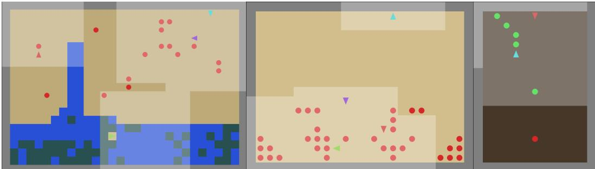  
Figure 6: Illustrations of the environments: Unfair Cleanup, Unfair Harvest, and Unfair Coin Game.

Listing 1: Cleanup (Easy and Hard) and Harvest maps
<table><tr><td>HFFFHFFHFHFHFHFHFHFHHFHFFFHF HFHFHFFHFHFHFHFHFHFHHFHFFFHF HFFHFFHHFHFHFHFHFHFHHFHFFFHF HFHFHFFHFHFHFHFHFHFHHFHFFFHF HFFFFFFHFHFHFHFHFHFHHFHFFFHF ===+~FHHHHHHf==== P P ===+~SSf P &lt;~Sf ^T^T^T^T~T^T^ T^T &lt;~S&gt;^T^T^T BBB BBBB &lt;~S&gt; B B BBBBBB BBBB B&lt;~S&gt; BBB BBB BB BBBB &lt;~S&gt; BBB BBB BB B&lt;~S&gt; Q1 BBBBBB &lt;~S&gt; BB BBBBBBQ ;~S, QBB BBBBQBB QBBBssBBB BBBBBBBB BBBBBBBBBB BBBBBBBBBBBBBBBBBBBBBB</td><td>HFFFHFFHFHFHFHFHFHFHHFHFFFHF HFHFHFFHFHFHFHFHFHFHHFHFFFHF HFFHFFHHFHFHFHFHFHFHHFHFFFHF HFHFHFFHFHFHFHFHFHFHHFHFFFHF HFFFFFFHFHFHFHFHFHFHHFHFFFHF P P ===+~SSf &lt;~Sf &lt;~S&gt; &lt;~S&gt; ^T^T^T^T^T^T^T^ ^T&lt;~S&gt; BBB BB &lt;~S&gt; BBBBBB BB &lt;~S&gt; BBBB &lt;~S&gt; ;~s, BBBBB BBBBssBBB Q BBBBBBBB BBBBBBBBBBQBBBBBBBBBQBBBBBB BBBBBBBBQBBBBBBQBBBBBBBBBBBB</td><td>====+~FHHHHHHf==== P T^T^T BBB BBB BBBBBBBBBBBB</td><td>AAA AA A</td><td>A AAA AAAAA AAA A AAAA Q PPPPPPPPPPPPPPPPPPPPPP</td><td>A AAA AAAAA AAA A AAAA Q PPPPPPPPPPPPPPPPPP PPPPPPPPPPPPPPPPPPPP</td><td>AAA AA A</td></tr></table>

## D.3 Baselines

For common settings, following the SocialJax suite, we use actor-critic policies incorporating a convolutional neural network (CNN). The CNN module consists of $5 \times 5 , 3 \times 3$ , and 3 × 3 kernels with 32 channels each, followed by a dense layer with 64 units. We use ReLU as the activation function. Both the actor and critic networks share the aforementioned CNN architecture, followed by two dense layers with 64 units and ReLU activations. We employed a learning rate of 0.0005 with annealing, a discount factor of $\gamma = 0 . 9 9$ , and PPO-related hyperparameters (including a GAE coefficient of $\lambda = 0 . 9 5$ , a clip coefficient of 0.2, an entropy coefficient of 0.01, a value-function coefficient of 0.5, and a maximum gradient norm of 0.5), following the default configurations in Guo et al. [8].

For LASE [19], to design the social-relationship modules $\pi _ { S R } ^ { i }$ and $Q _ { S R } ^ { i } ,$ we used a lightweight CNN for training stability: a $. 3 \times 3$ kernel with 16 channels, followed by two dense layers with 64 units and the action dimension, respectively, with ReLU activations. We excluded the imagination module to isolate the effect of the gifting mechanism from potential training instability. Additionally, we set the learning rates for $\pi _ { S R } ^ { i }$ and $Q _ { S R } ^ { i }$ to 0.0005 and the number of gradient steps to 50. For Reward Exchange [40], we set the transfer ratio to 0.5. For LIO [42], to design the separate gifting function, we used a lightweight convolutional module: a $3 \times 3$ kernel with 16 channels, followed by two dense layers with 64 units and the number of agents, respectively, with ReLU activations. To leverage the provided baselines in the SocialJax suite, we reimplemented all baseline methods using a PPO backbone.

## E Additional Metric Definitions and Results

## E.1 Metric Definitions

We provide the formal definitions of the metrics below, where $x _ { i }$ denotes the return of agent i. Since returns can be negative in the Coin Game, we use a signed geometric mean for this environment.

• α-fairness [26]:

$$
U _ { \alpha } ( x _ { 1 } , \dots , x _ { n } ) = { \left\{ \sum _ { i = 1 } ^ { n } { \frac { x _ { i } ^ { 1 - \alpha } } { 1 - \alpha } } \quad \alpha \neq 1 \atop \sum _ { i = 1 } ^ { n } \log x _ { i } \quad \alpha = 1 \right.} { }\tag{12}
$$

• Gini coefficient [5]:

$$
\mathrm { G } ( x _ { 1 } , \dots , x _ { n } ) = { \frac { \sum _ { i = 1 } ^ { n } \sum _ { j = 1 } ^ { n } | x _ { i } - x _ { j } | } { 2 n \sum _ { i = 1 } ^ { n } x _ { i } } }\tag{13}
$$

• Jain’s index [12]:

$$
J ( x _ { 1 } , \ldots , x _ { n } ) = { \frac { ( \sum _ { i } x _ { i } ) ^ { 2 } } { n \sum _ { i } x _ { i } ^ { 2 } } }\tag{14}
$$

## E.2 Comparison in Jain’s Index

We also consider a fairness metric not compared in the main text: Jain’s index, $J ( x _ { 1 } , \ldots , x _ { n } ) =$ $\frac { ( \sum _ { i } x _ { i } ) ^ { 2 } } { n \sum _ { i } x _ { i } ^ { 2 } }$ [12]. It equals 1 under best fairness and $\textstyle { \frac { 1 } { n } }$ under worst fairness; thus, larger is fairer. Note that while this metric captures fairness, it does not capture efficiency because it is normalized metric. For this reason, we used α-fairness in the main text. For completeness, however, we also report Jain’s index here. For the Unfair Coin Game, we report Jain’s index only for positive values. Table 7 shows that AGiR improves Jain’s index across all environments and all base gifting methods. Entries for which Jain’s index is undefined due to zero or negative values are denoted as NaN.

Table 7: Jain’s index in Unfair Cleanup, Unfair Harvest, and Unfair Coin Game environments.
<table><tr><td colspan="2">Algorithm</td><td>Cleanup-Easy ↑</td><td>Cleanup-Hard ↑</td><td>Harvest ↑</td><td>Coin Game ↑</td></tr><tr><td colspan="2">IPPO-I</td><td>NaN</td><td>NaN</td><td>0.8135</td><td>0.0267</td></tr><tr><td colspan="2">IPPO-C IA</td><td>0.5743</td><td>0.4970</td><td>0.2894</td><td>0.7150</td></tr><tr><td rowspan="3">LASE</td><td></td><td>0.9810</td><td>0.9741</td><td>0.8101</td><td>0.0335</td></tr><tr><td>Vanilla</td><td>0.9748</td><td>0.8260</td><td>0.6917</td><td>NaN</td></tr><tr><td>AGiR</td><td>0.9838</td><td>0.9683</td><td>0.7859</td><td>NaN</td></tr><tr><td rowspan="2">RX</td><td>Vanilla</td><td>0.9034</td><td>0.8781</td><td>0.6770</td><td>0.7386</td></tr><tr><td>AGiR</td><td>0.9785</td><td>0.9687</td><td>0.7984</td><td>0.9505</td></tr></table>

## F Experimental Results on the Standard Environments

The empirical results in Table 8 demonstrate that gift over-reliance is not limited to our asymmetric variants and can also arise in standard MMG settings. Across the standard environments, adding AGiR generally increases GM and Min relative to vanilla gifting. Notably, in Cleanup-Hard, AGiR significantly boosts GM and Min metrics while effectively suppressing the Gini coefficient. Even in Harvest, where baseline performance is already relatively balanced, AGiR maintains stability and further minimizes inequality. Overall, these results indicate that AGiR can mitigate gift over-reliance even without the structural asymmetries introduced in our main experiments.

Table 8: α-fairness and Gini coefficient in standard environments
<table><tr><td>Env.</td><td>Algorithm</td><td>AM↑</td><td>GM↑</td><td>Min ↑</td><td>Gini↓</td></tr><tr><td rowspan="4">Cleanup-Hard</td><td>LASE</td><td>291 (61)</td><td>104 (148)</td><td>82 (116)</td><td>0.25 (0.12)</td></tr><tr><td>LASE + AGiR</td><td>252 (66)</td><td>177 (119)</td><td>150 (104)</td><td>0.12 (0.09)</td></tr><tr><td>RX</td><td>620 (136)</td><td>73 (147)</td><td>60 (120)</td><td>0.24 (0.07)</td></tr><tr><td>RX + AGiR</td><td>527 (206)</td><td>216 (176)</td><td>187 (154)</td><td>0.14 (0.11)</td></tr><tr><td rowspan="4">Harvest</td><td>LASE</td><td>72 (1)</td><td>71 (0.8)</td><td>58 (2.7)</td><td>0.08 (0.01)</td></tr><tr><td>LASE + AGiR</td><td>72 (0.7)</td><td>71 (0.6)</td><td>61 (0.9)</td><td>0.08 (0.01)</td></tr><tr><td>RX</td><td>73 (0.6)</td><td>71 (0.7)</td><td>55 (2)</td><td>0.12 (0.02)</td></tr><tr><td>RX + AGiR</td><td>71 (0.6)</td><td>71 (0.8)</td><td>61 (1.8)</td><td>0.07 (0.01)</td></tr></table>

## G Additional Experimental Results in Unfair Cleanup-Easy

In Unfair Cleanup, we determine difficulty by the accessibility of resources. In the Easy level, apples spawn near the river, allowing disadvantaged agents to receive gifts for cleaning while still easily discovering harvesting through exploration. In contrast, the Hard level places apples far from the river. This makes reaching apple sites through exploration alone substantially more difficult, often leading agents to become locked into cleaning roles as they rely on gift signals instead of discovering independent harvesting behaviors. The results for the Easy level, specifically the α-fairness metrics and Gini coefficient, are summarized in Table 9, while the per-agent return distributions are illustrated in Fig. 7.

Table 9: α-fairness, Gini coefficient, and GRR in Unfair Cleanup-Easy
<table><tr><td colspan="2">Algorithm</td><td>AM↑</td><td>GM↑</td><td>Min ↑</td><td>Gini ↓</td><td>GRR↓</td></tr><tr><td rowspan="3">IPPO-I IPPO-C IA</td><td></td><td>206 (169)</td><td>204 (167)</td><td>170 (142)</td><td>0.13 (0.18)</td><td></td></tr><tr><td></td><td>310 (226)</td><td>58 (82)</td><td>6 (6)</td><td>0.46 (0.13)</td><td></td></tr><tr><td></td><td>196 (135)</td><td>194 (133)</td><td>159 (113)</td><td>0.07 (0.03)</td><td></td></tr><tr><td rowspan="2">LASE</td><td>Vanilla</td><td>311 (78)</td><td>307 (77)</td><td>253 (71)</td><td>0.08 (0.02)</td><td>0.14</td></tr><tr><td>AGiR</td><td>349 (19)</td><td>346 (19)</td><td>290 (17)</td><td>0.07 (0.01)</td><td>0.06</td></tr><tr><td rowspan="2">RX</td><td>Vanilla</td><td>467 (68)</td><td>335 (168)</td><td>242 (137)</td><td>0.16 (0.1)</td><td>0.37</td></tr><tr><td>AGiR</td><td>415 (14)</td><td>410 (13)</td><td>339 (25)</td><td>0.08 (0.01)</td><td>0.19</td></tr></table>

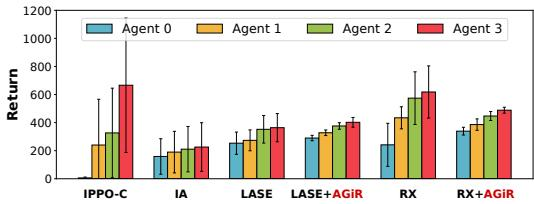  
Figure 7: Per-agent return distributions averaged over five seeds in Unfair Cleanup-Easy.

## H Details of Two-Agent Cleanup Experiments

## H.1 Experimental Setup

To further examine the behavioral effects of positional and competence asymmetries discussed in Section 6.2, we construct a controlled two-agent variant of Cleanup. The environment uses the same map as Unfair Cleanup-Easy, but contains two agents. Unless otherwise specified below, the remaining environment parameters follow those used in the main Cleanup experiments.

We control agent competence along two task-specific dimensions. First, each agent i is assigned a harvesting efficiency $\epsilon _ { i } ,$ such that harvesting one apple yields a reward of $2 \epsilon _ { i }$ in the two-agent environment. Second, each agent is assigned a cleaning-beam length $L _ { i }$ . The cleaning beam extends

Table 10: Experimental scenarios for the controlled two-agent Cleanup study.
<table><tr><td>Scenario</td><td>Spawn</td><td> $( \epsilon _ { 0 } , \epsilon _ { 1 } )$ </td><td> $( L _ { 0 } , L _ { 1 } )$ </td></tr><tr><td>No gap</td><td>Random</td><td>(1,1)</td><td>(4,4)</td></tr><tr><td>Competence gap</td><td>Random</td><td>(0.1, 1) or (0.25, 1)</td><td>(4, 1)</td></tr><tr><td>Spawn gap</td><td>Fixed</td><td>(1, 1)</td><td>(4,4)</td></tr><tr><td>Mismatch</td><td>Fixed</td><td>(0.25, 1)</td><td>(4, 1)</td></tr></table>

$L _ { i }$ cells forward and $L _ { i }$ cells to each side, covering $3 L _ { i } + 1$ cells including the agent’s current cell; $L _ { i } = 1$ corresponds to the original cleaning beam. In settings with asymmetric competence, agent 0 is the talented cleaner, with a wider cleaning beam but lower harvesting efficiency, while agent 1 is the talented harvester, with a narrower cleaning beam but higher harvesting efficiency.

We also vary the agents’ initial positions. Under random spawn, two distinct positions are sampled uniformly from the 19 candidate spawn locations marked by P on the map. Under fixed spawn, one agent is initialized near the river and the other near the apple region. The river-side position is sampled from {(6, 3), (6, 8), (6, 25)}, and the apple-side position is sampled from {(13, 3), (14, 10), (15, 15)}.

Combining positional and competence asymmetries yields the four scenarios summarized in Table 10. In the Mismatch scenario, initial position and task competence favor opposite role assignments: the talented harvester spawns on the river side, whereas the talented cleaner spawns on the apple side.

## H.2 Training Protocol

We use LASE [19] as the base gifting method for all two-agent experiments. The policy architecture and PPO training configuration follow those used in the main Cleanup experiments. Each model is trained for $3 \times 1 0 ^ { 8 }$ timesteps. For AGiR, we use $\alpha = 0 . 0 1$ $H = 5 0$ , and $C = 1$ throughout the two-agent experiments.

We evaluate both task behavior and resulting returns. In addition to extrinsic return, we report the number of apples harvested and cleaning actions per episode to characterize the roles learned by each agent. We also report total return, defined as the extrinsic return minus outgoing gifts plus all incoming gifts. Refused gifts are therefore excluded only from the recipient’s policy-update signal and are not removed from the total return.

## H.3 Additional Quantitative Results

Table 11 reports the final extrinsic return, number of cleaning actions per episode, and total return for each scenario. The results complement the behavioral analysis in Section 6.2 by providing the corresponding agent-level outcomes.

No gap. In this symmetric two-agent setting, LASE itself does not exhibit clear role lock-in, and adding AGiR does not systematically improve the outcome. This does not contradict the results in Appendix F, where gift over-reliance can arise even in standard environments: the present experiment differs in the number of agents, uses the Cleanup-Easy map, and gives both agents a wider cleaning beam. We therefore treat the absence of lock-in here as specific to this controlled setting.

Competence gap. When competence alone is asymmetric, AGiR allows the talented cleaner to explore harvesting before settling on a role. At 0.1 times the harvester’s reward per apple, this exploration does not persist, and the final behavioral division remains dominated by cleaning. At 0.25 times, however, the talented cleaner maintains substantially more harvesting while continuing to contribute to cleaning, consistent with the learning curves in Fig. 8a. The talented harvester’s return decreases under AGiR in these settings, so these results should be interpreted as a change in learned role allocation rather than a uniform improvement for both agents.

Spawn gap. With equal competence but asymmetric initial positions, the river-side agent performs more cleaning and earns less under LASE. Despite performing more cleaning, the river-side agent’s total return under LASE is only 246.7, barely above its extrinsic return of 245.7, indicating that gift transfers provide little net compensation for its cleaning burden. Under AGiR, its extrinsic return increases from 245.7 to 276.1 while its cleaning actions decrease from 49.0 to 36.8 per episode. The apple-side agent’s extrinsic return also increases slightly, from 291.5 to 302.1.

Table 11: Final results in the controlled two-agent Cleanup experiments. Values are averaged across independent runs.
<table><tr><td colspan="3"></td><td colspan="3">LASE</td><td colspan="3">LASE + AGiR</td></tr><tr><td>Scenario</td><td>Agent</td><td>€</td><td>Extrinsic</td><td>Cleaning</td><td>Total</td><td>Extrinsic</td><td>Cleaning</td><td>Total</td></tr><tr><td>No gap</td><td>Agent 0</td><td>1</td><td>297.4</td><td>44.9</td><td>298.8</td><td>283.6</td><td>49.0</td><td>275.3</td></tr><tr><td rowspan="4">Competence gap</td><td>Agent 1</td><td>1</td><td>268.4</td><td>31.9</td><td>266.9</td><td>276.8</td><td>16.9</td><td>285.0</td></tr><tr><td>Talented cleaner</td><td>0.1</td><td>0.02</td><td>142.7</td><td>23.4</td><td>0.003</td><td>149.7</td><td>116.9</td></tr><tr><td>Talented harvester</td><td>1</td><td>423.8</td><td>4.62</td><td>400.4</td><td>352.0</td><td>0.03</td><td>235.1</td></tr><tr><td>Talented cleaner</td><td>0.25</td><td>0.48</td><td>169.1</td><td>28.0</td><td>41.0</td><td>138.6</td><td>136.5</td></tr><tr><td rowspan="2">Spawn gap</td><td>Talented harvester</td><td>1</td><td>464.3</td><td>0.48</td><td>436.8</td><td>386.5</td><td>0.01</td><td>291.1</td></tr><tr><td>Apple-side agent</td><td>1</td><td>291.5</td><td>35.9</td><td>290.5</td><td>302.1</td><td>33.5</td><td>294.7</td></tr><tr><td rowspan="2">Mismatch</td><td>River-side agent</td><td>1</td><td>245.7</td><td>49.0</td><td>246.7</td><td>276.1</td><td>36.8</td><td>283.5</td></tr><tr><td>Talented cleaner</td><td>0.25</td><td>0.3</td><td>137.8</td><td>8.1</td><td>11.8</td><td>143.8</td><td>81.3</td></tr><tr><td></td><td>Talented harvester</td><td>1</td><td>136.3</td><td>119.4</td><td>128.4</td><td>246.0</td><td>8.4</td><td>176.5</td></tr></table>

Mismatch. When position and competence favor opposite roles, LASE largely assigns roles according to initial position, whereas AGiR shifts behavior toward the agents’ relative competences. In particular, the talented harvester placed near the river increases its extrinsic return from 136.3 to 246.0 and reduces cleaning from 119.4 to 8.4 actions per episode. Its harvesting also increases from 68 to 123 apples per episode, illustrating the shift from position-driven to competence-driven role allocation. Conversely, the talented cleaner takes on most of the cleaning. The corresponding total returns increase from 128.4 to 176.5 for the talented harvester and from 8.1 to 81.3 for the talented cleaner.

## H.4 Additional Learning Curves

We provide learning curves for the Competence gap and Mismatch scenarios to illustrate how the learned roles emerge and evolve throughout training, beyond their final outcomes.

Competence gap. Figures 8a and 8b show the talented cleaner’s harvesting behavior and the talented harvester’s cleaning behavior, respectively, under both reward settings. Together, they illustrate how the agents’ roles evolve as the talented cleaner either returns to cleaning or continues harvesting.

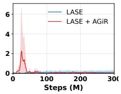

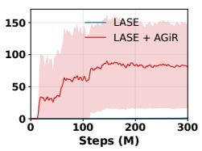  
(a) Apples harvested by the talented cleaner.

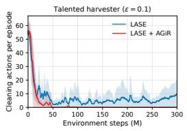

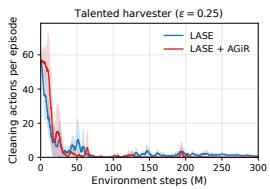  
(b) Cleaning actions by the talented harvester.

Figure 8: Agent behaviors in the Competence gap scenario. Within each pair, the left and right plots correspond to 0.1× and 0.25× reward per apple, respectively.

Mismatch. Figure 9 provides the corresponding learning curves for both agents in the Mismatch scenario. The curves show the transition from position-driven roles under LASE toward behavior that is more consistent with the agents’ relative competences under AGiR.

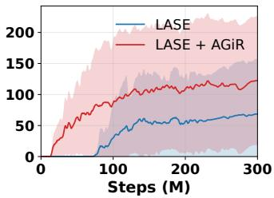  
(a) Harvester: apples

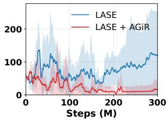  
(b) Harvester: cleaning

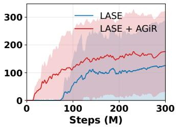  
(c) Harvester: total return

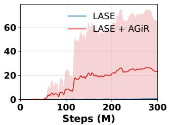  
(d) Cleaner: apples

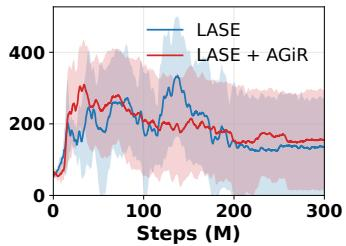  
(e) Cleaner: cleaning

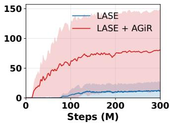  
(f) Cleaner: total return  
Figure 9: Learning dynamics in the Mismatch scenario for the talented harvester (top) and talented cleaner (bottom).

## I Ablation Studies

## I.1 Ablation Study on Gift Refunding

In this section, we provide detailed experimental results comparing the gift handling policies: not accounted (our default AGiR) and naive refunding. For this ablation study, we used LASE [19] as the base gifting method.

In the not accounted setting, which corresponds to our proposed AGiR mechanism, the policy is updated using the shaped reward defined as $r ^ { i , \mathrm { A G i R } } = r ^ { i , \mathrm { e x t } } - g _ { t } ^ { i , - i } + w _ { t } ^ { i } g _ { t } ^ { - i , i }$ . In the refunded setting, we evaluate a naive approach where the policy is updated by incorporating returned gifts: $r ^ { i , \mathrm { s h a p \overline { { { e d } } } } } = r ^ { i , \mathrm { e x t } } - g _ { t } ^ { i , - i } + w _ { t } ^ { i } g _ { t } ^ { - \dot { i } , i }$ + (refunded gifts) . Note that in both cases, the acceptance weights $w _ { t } ^ { i }$ are computed via the AGiR mechanism to ensure a fair comparison.

To provide a scale-invariant analysis across environments with different reward scales, we evaluate the performance using a normalized improvement score: $\frac { \mathrm { ( G i f t i n g w i t h r e f u s a l ) } - \mathrm { ( V a n i l l a g i f t i n g ) } } { \mathrm { | ( V a n i l l a g i f t i n g ) | } } \times 1 0 0 \%$ . Table 12 summarizes these normalized results for both gift handling policies. On average, the not accounted approach demonstrates superior effectiveness compared to the naive refunding approach. Thus, we use the not accounted scheme as our default because it yields stronger average improvements in GM and Min than naive refunding.

We hypothesize that without a sophisticated strategy to interpret the intent behind a rejection, the returned gifts might introduce noise into the agent’s policy optimization. Developing advanced mechanisms for agents to reason about and utilize refunded gifts remains a subject for future work.

## I.2 Ablation Study on Refusal-Aware Policy

We ablate the refusal-aware policy proposed in Section 3.3 by comparing the original policy $\pi ( a \mid$ $o , w )$ with a variant that does not condition on the refusal weight, namely $\pi ( a \mid o )$ . We use LASE as the base gifting method for this comparison. As shown in Table 13, removing w degrades performance, particularly GM and Min, across the evaluated environments. This result suggests that conditioning the policy on the current refusal state is important for AGiR to adapt its behavior to the refusal context.

Table 12: Ablation study on gift handling: Normalized improvement score (%)
<table><tr><td>Env.</td><td></td><td>AM Impr. (%) ↑</td><td>GM Impr. (%) ↑</td><td>Min Impr. (%) ↑</td></tr><tr><td rowspan="2">Cleanup-Easy</td><td>Refund</td><td>-28.68</td><td>-28.49</td><td>-28.78</td></tr><tr><td>Not accounted</td><td>+12.29</td><td>+12.78</td><td>+14.44</td></tr><tr><td rowspan="2">Cleanup-Hard</td><td>Refund</td><td>+4.28</td><td>+144.58</td><td>+128.65</td></tr><tr><td>Not accounted</td><td>-8.20</td><td>+115.37</td><td>+96.88</td></tr><tr><td rowspan="2">Harvest</td><td>Refund</td><td>-3.37</td><td>+44.65</td><td>+73.68</td></tr><tr><td>Not accounted</td><td>-3.15</td><td>+44.76</td><td>+65.79</td></tr><tr><td rowspan="2">Coin Game</td><td>Refund</td><td>-167.09</td><td>-103.99</td><td>-113.31</td></tr><tr><td>Not accounted</td><td>+33.78</td><td>+6.59</td><td>+37.71</td></tr><tr><td rowspan="2">Average</td><td>Refund</td><td>-48.72</td><td>+14.19</td><td>+15.06</td></tr><tr><td>Not accounted</td><td>+8.68</td><td>+44.88</td><td>+53.71</td></tr></table>

Table 13: Ablation study on refusal-aware policy
<table><tr><td>Env.</td><td></td><td>AM↑</td><td>GM↑</td><td>Min ↑</td></tr><tr><td rowspan="2">Cleanup-Hard</td><td>w/w</td><td>288 (41)</td><td>283 (42)</td><td>221 (46)</td></tr><tr><td>w/o w</td><td>289 (58)</td><td>230 (117)</td><td>169 (87)</td></tr><tr><td rowspan="2">Harvest</td><td>w/w</td><td>49 (0)</td><td>41 (2)</td><td>19 (5)</td></tr><tr><td>w/o w</td><td>49 (0)</td><td>41 (1)</td><td>17 (3)</td></tr><tr><td rowspan="2">Coin Game</td><td>w/w</td><td>20 (1)</td><td>-57 (3)</td><td>-40 (4)</td></tr><tr><td>w/o w</td><td>18 (25)</td><td>-59 (5)</td><td>-43 (7)</td></tr></table>

## I.3 Hyperparameter Sensitivity Analysis and Non-Adaptive Alternatives

Hyperparameter sensitivity analysis. The step-size modulator $\begin{array} { r } { S ( R _ { t } ^ { i } ) : = 2 \sigma ( \frac { - R _ { t } ^ { i } } { C } ) } \end{array}$ is designed to adjust the learning rate based on the accumulated reward, where the coefficient $\check { C }$ determines the smoothness of this transition. A larger $C$ ensures that the modulator decreases more gradually as $R _ { t } ^ { i }$ grows. Fig. 10 presents the sensitivity analysis of the three α-fairness metrics (AM, GM, and Min) with respect to varying values of C.

In Fig. 10, each row corresponds to a specific base gifting method (LASE, RX, or LIO), and each column represents a different environment (Cleanup-Hard, Harvest, or Coin Game). We observe that when $C$ is set to an excessively small value, the sigmoid function decays too sharply, causing the step size to vanish prematurely. This leads to suboptimal performance in certain settings, as the agent fails to adapt sufficiently before the refusal-weight update becomes negligible. However, as $\bar { C }$ increases, the performance becomes notably robust across all environments and algorithms. This stability justifies our choice of C values, as it allows for a sufficiently gradual decay that supports stable learning.

We further examine the sensitivity of AGiR to the step size α, the window size H, and the baseline design $B _ { t }$ using LASE in Cleanup-Hard. As shown in Fig. 11, AGiR consistently achieves higher GM and Min and lower Gini coefficient than vanilla gifting across all tested α values, while largely maintaining AM unless α is too large. Fig. 12 shows that AGiR consistently achieves higher GM and Min and lower Gini coefficient than vanilla gifting across a wide range of window sizes H, while largely maintaining AM. Finally, Fig. 13 shows that replacing the adaptive baseline with a fixed baseline $( B _ { t } = \pi / 4 )$ yields lower GM and Min than the adaptive design, while still outperforming vanilla gifting on these metrics.

Non-adaptive alternatives. We further compare AGiR with simple non-adaptive strategies for limiting incoming gifts in Unfair Cleanup-Hard, using LASE as the base gifting method. We consider fixed acceptance weights, gift clipping, and linear annealing of the acceptance weight. As shown in Table 14, all of these alternatives yield lower GM and Min than AGiR. In particular, linear annealing attains the same AM as AGiR but substantially lower GM and Min, indicating that simply reducing gift acceptance over training does not reproduce the behavior of adaptive refusal.

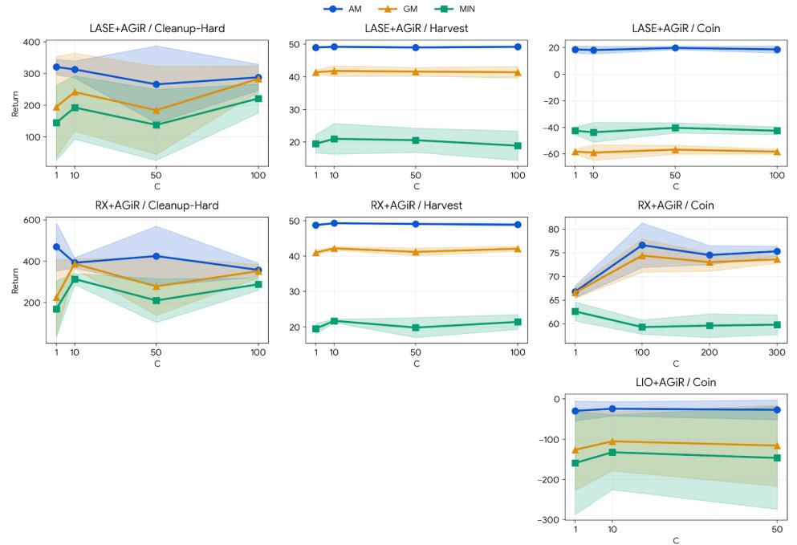  
Figure 10: Ablation on modulator coefficient C across environments and base gifting methods

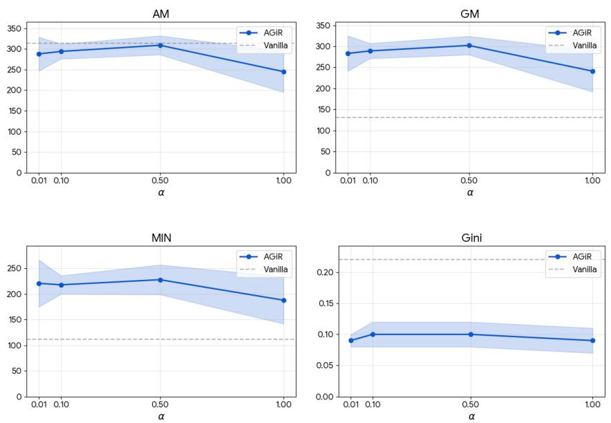  
Figure 11: Sensitivity analysis on the stepsize α in Cleanup-Hard (LASE)

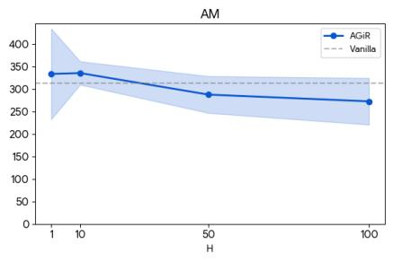

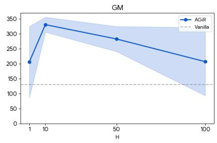

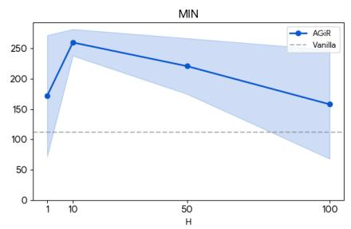

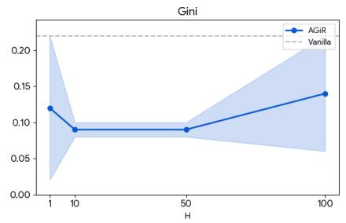  
Figure 12: Sensitivity analysis on the window size H in Cleanup-Hard (LASE)

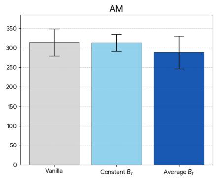

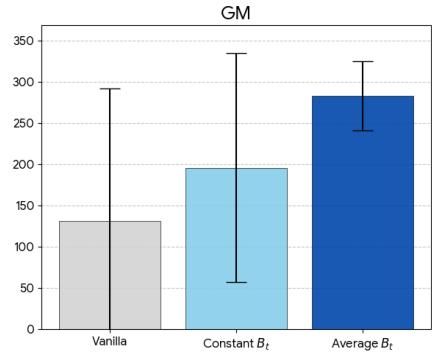

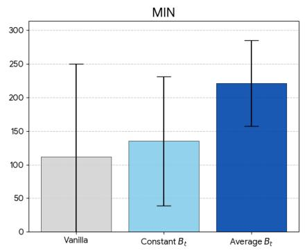

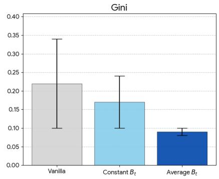  
Figure 13: Ablation on the baseline $B _ { t }$ in Cleanup-Hard (LASE)

Table 14: Comparison with non-adaptive gift-limiting strategies in Unfair Cleanup-Hard with LASE as the base gifting method.
<table><tr><td>Method</td><td>AM↑</td><td>GM↑ Min ↑</td><td>Gini↓</td></tr><tr><td>Fixed  $w = 0 . 2 5$ </td><td>269</td><td>260 173</td><td>0.13</td></tr><tr><td>Fixed  $w = 0 . 5 0$ </td><td>263</td><td>259 193</td><td>0.09</td></tr><tr><td>Fixed  $w = 0 . 7 5$ </td><td>277</td><td>272 205</td><td>0.09</td></tr><tr><td>Gift clipping (0.5)</td><td>261</td><td>257 191</td><td>0.10</td></tr><tr><td>Gift clipping (0.7)</td><td>233</td><td>230 190</td><td>0.09</td></tr><tr><td>Linear annealing</td><td>288</td><td>168 98</td><td>0.22</td></tr><tr><td>AGiR</td><td>288</td><td>283 221</td><td>0.09</td></tr></table>

## J Limitations, Future Work, and Broader Societal Impacts

While this study establishes the theoretical and empirical foundations of AGiR, several avenues remain for future exploration.

First, while our rollout-axis analysis characterizes refusal-weight dynamics under fixed policies, understanding how simultaneous policy updates shape the joint value landscape in general MMGs remains an open problem. Moreover, the sufficient conditions for stability and uniqueness in Theorem 4.6 have not been empirically verified. Investigating whether low refusal weights exhibit recovery and under which environments and gifting schemes these conditions hold is left for future work.

Second, due to computational resource constraints, our experiments were conducted with a limited number of players (up to four). Investigating how gift-refusal dynamics evolve in larger populations is a compelling direction for future research. Specifically, extending our framework to Mean-Field Markov Games could provide a mathematically principled way to analyze AGiR in systems with a massive number of agents, where individual interactions are abstracted into collective population dynamics.

Third, our implementation utilized the PPO backbone provided by the SocialJax framework to ensure controlled and consistent experiments. Consequently, the performance of AGiR under value-based reinforcement learning algorithms remains unexplored. Future work could investigate the robustness of our adaptive mechanism across diverse algorithmic architectures to ensure its generalizability beyond policy-gradient methods.

Fourth, extending AGiR to multi-objective mixed-motive games is a promising direction. Building on recent advances in multi-objective reinforcement learning [9, 3, 28] and multi-objective Markov games and social dilemmas [38, 31], future work could investigate how multiple, potentially conflicting objectives affect gifting dynamics, gift reliance, and emergent agent behavior.

Finally, while we conducted an ablation study on the "refunded setting" where refused gifts are returned to the giver, our ablation assumes a naive giver. In this setup, the giver does not perform any higher-level reasoning regarding why a gift was refused. A promising research direction would be to incorporate sophisticated intention inference, where givers adjust their strategies based on the perceived motives behind a refusal. Exploring such recursive social reasoning would not only enhance the strategic depth of the agents but also provide deeper insights into complex human social phenomena.

This work contributes to the methodological understanding of adaptive incentive regulation in mixed-motive multi-agent systems. While our contributions are primarily algorithmic, they carry potential societal implications for the design of collaborative AI systems. On the positive side, our approach to mitigating "gift over-reliance" can inform the development of more robust and equitable resource-sharing protocols in automated socio-technical systems.

## NeurIPS Paper Checklist

## 1. Claims

Question: Do the main claims made in the abstract and introduction accurately reflect the paper’s contributions and scope?

Answer: [Yes]

Justification: As specified in the abstract and introduction, we identify the "gift over-reliance" phenomenon and provide a comprehensive algorithm along with supporting theoretical and empirical analyses.

Guidelines:

• The answer [N/A] means that the abstract and introduction do not include the claims made in the paper.

• The abstract and/or introduction should clearly state the claims made, including the contributions made in the paper and important assumptions and limitations. A [No] or [N/A] answer to this question will not be perceived well by the reviewers.

• The claims made should match theoretical and experimental results, and reflect how much the results can be expected to generalize to other settings.

• It is fine to include aspirational goals as motivation as long as it is clear that these goals are not attained by the paper.

## 2. Limitations

Question: Does the paper discuss the limitations of the work performed by the authors?

Answer: [Yes]

Justification: We discuss the limitations in Appendix J.

Guidelines:

• The answer [N/A] means that the paper has no limitation while the answer [No] means that the paper has limitations, but those are not discussed in the paper.

• The authors are encouraged to create a separate “Limitations” section in their paper.

• The paper should point out any strong assumptions and how robust the results are to violations of these assumptions (e.g., independence assumptions, noiseless settings, model well-specification, asymptotic approximations only holding locally). The authors should reflect on how these assumptions might be violated in practice and what the implications would be.

• The authors should reflect on the scope of the claims made, e.g., if the approach was only tested on a few datasets or with a few runs. In general, empirical results often depend on implicit assumptions, which should be articulated.

• The authors should reflect on the factors that influence the performance of the approach. For example, a facial recognition algorithm may perform poorly when image resolution is low or images are taken in low lighting. Or a speech-to-text system might not be used reliably to provide closed captions for online lectures because it fails to handle technical jargon.

• The authors should discuss the computational efficiency of the proposed algorithms and how they scale with dataset size.

• If applicable, the authors should discuss possible limitations of their approach to address problems of privacy and fairness.

• While the authors might fear that complete honesty about limitations might be used by reviewers as grounds for rejection, a worse outcome might be that reviewers discover limitations that aren’t acknowledged in the paper. The authors should use their best judgment and recognize that individual actions in favor of transparency play an important role in developing norms that preserve the integrity of the community. Reviewers will be specifically instructed to not penalize honesty concerning limitations.

## 3. Theory assumptions and proofs

Question: For each theoretical result, does the paper provide the full set of assumptions and a complete (and correct) proof?

## Answer: [Yes]

Justification: We provide the full statement of each theorem, including all assumptions and complete proofs, in Appendix C.

## Guidelines:

• The answer [N/A] means that the paper does not include theoretical results.

• All the theorems, formulas, and proofs in the paper should be numbered and crossreferenced.

• All assumptions should be clearly stated or referenced in the statement of any theorems.

• The proofs can either appear in the main paper or the supplemental material, but if they appear in the supplemental material, the authors are encouraged to provide a short proof sketch to provide intuition.

• Inversely, any informal proof provided in the core of the paper should be complemented by formal proofs provided in appendix or supplemental material.

• Theorems and Lemmas that the proof relies upon should be properly referenced.

## 4. Experimental result reproducibility

Question: Does the paper fully disclose all the information needed to reproduce the main experimental results of the paper to the extent that it affects the main claims and/or conclusions of the paper (regardless of whether the code and data are provided or not)?

Answer: [Yes]

Justification: We provide comprehensive details for reproducibility, including hyperparameters, environment configurations (e.g., maps and parameters), experimental setups, architecture, and baseline implementation details in Appendix D and H.

Guidelines:

• The answer [N/A] means that the paper does not include experiments.

• If the paper includes experiments, a [No] answer to this question will not be perceived well by the reviewers: Making the paper reproducible is important, regardless of whether the code and data are provided or not.

• If the contribution is a dataset and/or model, the authors should describe the steps taken to make their results reproducible or verifiable.

• Depending on the contribution, reproducibility can be accomplished in various ways. For example, if the contribution is a novel architecture, describing the architecture fully might suffice, or if the contribution is a specific model and empirical evaluation, it may be necessary to either make it possible for others to replicate the model with the same dataset, or provide access to the model. In general. releasing code and data is often one good way to accomplish this, but reproducibility can also be provided via detailed instructions for how to replicate the results, access to a hosted model (e.g., in the case of a large language model), releasing of a model checkpoint, or other means that are appropriate to the research performed.

• While NeurIPS does not require releasing code, the conference does require all submissions to provide some reasonable avenue for reproducibility, which may depend on the nature of the contribution. For example

(a) If the contribution is primarily a new algorithm, the paper should make it clear how to reproduce that algorithm.

(b) If the contribution is primarily a new model architecture, the paper should describe the architecture clearly and fully.

(c) If the contribution is a new model (e.g., a large language model), then there should either be a way to access this model for reproducing the results or a way to reproduce the model (e.g., with an open-source dataset or instructions for how to construct the dataset).

(d) We recognize that reproducibility may be tricky in some cases, in which case authors are welcome to describe the particular way they provide for reproducibility. In the case of closed-source models, it may be that access to the model is limited in some way (e.g., to registered users), but it should be possible for other researchers to have some path to reproducing or verifying the results.

## 5. Open access to data and code

Question: Does the paper provide open access to the data and code, with sufficient instructions to faithfully reproduce the main experimental results, as described in supplemental material?

Answer: [Yes]

Justification: Code is available at https://github.com/whbyeon/AGiR.

Guidelines:

• The answer [N/A] means that paper does not include experiments requiring code.

• Please see the NeurIPS code and data submission guidelines (https://neurips.cc/ public/guides/CodeSubmissionPolicy) for more details.

• While we encourage the release of code and data, we understand that this might not be possible, so [No] is an acceptable answer. Papers cannot be rejected simply for not including code, unless this is central to the contribution (e.g., for a new open-source benchmark).

• The instructions should contain the exact command and environment needed to run to reproduce the results. See the NeurIPS code and data submission guidelines (https: //neurips.cc/public/guides/CodeSubmissionPolicy) for more details.

• The authors should provide instructions on data access and preparation, including how to access the raw data, preprocessed data, intermediate data, and generated data, etc.

• The authors should provide scripts to reproduce all experimental results for the new proposed method and baselines. If only a subset of experiments are reproducible, they should state which ones are omitted from the script and why.

• At submission time, to preserve anonymity, the authors should release anonymized versions (if applicable).

• Providing as much information as possible in supplemental material (appended to the paper) is recommended, but including URLs to data and code is permitted.

## 6. Experimental setting/details

Question: Does the paper specify all the training and test details (e.g., data splits, hyperparameters, how they were chosen, type of optimizer) necessary to understand the results?

Answer: [Yes]

Justification: All details are comprehensively detailed in Appendix D and H.

Guidelines:

• The answer [N/A] means that the paper does not include experiments.

• The experimental setting should be presented in the core of the paper to a level of detail that is necessary to appreciate the results and make sense of them.

• The full details can be provided either with the code, in appendix, or as supplemental material.

## 7. Experiment statistical significance

Question: Does the paper report error bars suitably and correctly defined or other appropriate information about the statistical significance of the experiments?

Answer: [Yes]

Justification: We report the standard deviation and error bars across five independent runs (seeds) for all experimental results presented in Figures 3,4 as well as Tables 1,2,3.

Guidelines:

• The answer [N/A] means that the paper does not include experiments.

• The authors should answer [Yes] if the results are accompanied by error bars, confidence intervals, or statistical significance tests, at least for the experiments that support the main claims of the paper.

• The factors of variability that the error bars are capturing should be clearly stated (for example, train/test split, initialization, random drawing of some parameter, or overall run with given experimental conditions).

• The method for calculating the error bars should be explained (closed form formula, call to a library function, bootstrap, etc.)

• The assumptions made should be given (e.g., Normally distributed errors).

• It should be clear whether the error bar is the standard deviation or the standard error of the mean.

• It is OK to report 1-sigma error bars, but one should state it. The authors should preferably report a 2-sigma error bar than state that they have a 96% CI, if the hypothesis of Normality of errors is not verified.

• For asymmetric distributions, the authors should be careful not to show in tables or figures symmetric error bars that would yield results that are out of range (e.g., negative error rates).

• If error bars are reported in tables or plots, the authors should explain in the text how they were calculated and reference the corresponding figures or tables in the text.

## 8. Experiments compute resources

Question: For each experiment, does the paper provide sufficient information on the computer resources (type of compute workers, memory, time of execution) needed to reproduce the experiments?

Answer: [Yes]

Justification: We specify the computing resources used for our experiments in Appendix D.1. Guidelines:

• The answer [N/A] means that the paper does not include experiments.

• The paper should indicate the type of compute workers CPU or GPU, internal cluster, or cloud provider, including relevant memory and storage.

• The paper should provide the amount of compute required for each of the individual experimental runs as well as estimate the total compute.

• The paper should disclose whether the full research project required more compute than the experiments reported in the paper (e.g., preliminary or failed experiments that didn’t make it into the paper).

## 9. Code of ethics

Question: Does the research conducted in the paper conform, in every respect, with the NeurIPS Code of Ethics https://neurips.cc/public/EthicsGuidelines?

Answer: [Yes]

Justification: The research conducted in this paper fully conforms to the NeurIPS Code of Ethics.

Guidelines:

• The answer [N/A] means that the authors have not reviewed the NeurIPS Code of Ethics.

• If the authors answer [No], they should explain the special circumstances that require a deviation from the Code of Ethics.

• The authors should make sure to preserve anonymity (e.g., if there is a special consideration due to laws or regulations in their jurisdiction).

## 10. Broader impacts

Question: Does the paper discuss both potential positive societal impacts and negative societal impacts of the work performed?

Answer: [Yes]

Justification: We discuss the potential societal impacts of our work in Appendix J.

Guidelines:

• The answer [N/A] means that there is no societal impact of the work performed.

• If the authors answer [N/A] or [No], they should explain why their work has no societal impact or why the paper does not address societal impact.

• Examples of negative societal impacts include potential malicious or unintended uses (e.g., disinformation, generating fake profiles, surveillance), fairness considerations (e.g., deployment of technologies that could make decisions that unfairly impact specific groups), privacy considerations, and security considerations.

• The conference expects that many papers will be foundational research and not tied to particular applications, let alone deployments. However, if there is a direct path to any negative applications, the authors should point it out. For example, it is legitimate to point out that an improvement in the quality of generative models could be used to generate Deepfakes for disinformation. On the other hand, it is not needed to point out that a generic algorithm for optimizing neural networks could enable people to train models that generate Deepfakes faster.

• The authors should consider possible harms that could arise when the technology is being used as intended and functioning correctly, harms that could arise when the technology is being used as intended but gives incorrect results, and harms following from (intentional or unintentional) misuse of the technology.

• If there are negative societal impacts, the authors could also discuss possible mitigation strategies (e.g., gated release of models, providing defenses in addition to attacks, mechanisms for monitoring misuse, mechanisms to monitor how a system learns from feedback over time, improving the efficiency and accessibility of ML).

## 11. Safeguards

Question: Does the paper describe safeguards that have been put in place for responsible release of data or models that have a high risk for misuse (e.g., pre-trained language models, image generators, or scraped datasets)?

Answer: [N/A]

Justification: This study presents no high-risk artifacts or data requiring specific safeguards against misuse.

Guidelines:

• The answer [N/A] means that the paper poses no such risks.

• Released models that have a high risk for misuse or dual-use should be released with necessary safeguards to allow for controlled use of the model, for example by requiring that users adhere to usage guidelines or restrictions to access the model or implementing safety filters.

• Datasets that have been scraped from the Internet could pose safety risks. The authors should describe how they avoided releasing unsafe images.

• We recognize that providing effective safeguards is challenging, and many papers do not require this, but we encourage authors to take this into account and make a best faith effort.

## 12. Licenses for existing assets

Question: Are the creators or original owners of assets (e.g., code, data, models), used in the paper, properly credited and are the license and terms of use explicitly mentioned and properly respected?

Answer: [Yes]

Justification: We use SocialJax under the Apache-2.0 license and ensure it is properly cited. Guidelines:

• The answer [N/A] means that the paper does not use existing assets.

• The authors should cite the original paper that produced the code package or dataset.

• The authors should state which version of the asset is used and, if possible, include a URL.

• The name of the license (e.g., CC-BY 4.0) should be included for each asset.

• For scraped data from a particular source (e.g., website), the copyright and terms of service of that source should be provided.

• If assets are released, the license, copyright information, and terms of use in the package should be provided. For popular datasets, paperswithcode.com/datasets has curated licenses for some datasets. Their licensing guide can help determine the license of a dataset.

• For existing datasets that are re-packaged, both the original license and the license of the derived asset (if it has changed) should be provided.

• If this information is not available online, the authors are encouraged to reach out to the asset’s creators.

## 13. New assets

Question: Are new assets introduced in the paper well documented and is the documentation provided alongside the assets?

Answer: [N/A]

Justification: The paper does not release new assets.

Guidelines:

• The answer [N/A] means that the paper does not release new assets.

• Researchers should communicate the details of the dataset/code/model as part of their submissions via structured templates. This includes details about training, license, limitations, etc.

• The paper should discuss whether and how consent was obtained from people whose asset is used.

• At submission time, remember to anonymize your assets (if applicable). You can either create an anonymized URL or include an anonymized zip file.

## 14. Crowdsourcing and research with human subjects

Question: For crowdsourcing experiments and research with human subjects, does the paper include the full text of instructions given to participants and screenshots, if applicable, as well as details about compensation (if any)?

Answer: [N/A]

Justification: The paper does not include crowdsourcing experiments and research with human subjects.

Guidelines:

• The answer [N/A] means that the paper does not involve crowdsourcing nor research with human subjects.

• Including this information in the supplemental material is fine, but if the main contribution of the paper involves human subjects, then as much detail as possible should be included in the main paper.

• According to the NeurIPS Code of Ethics, workers involved in data collection, curation, or other labor should be paid at least the minimum wage in the country of the data collector.

## 15. Institutional review board (IRB) approvals or equivalent for research with human subjects

Question: Does the paper describe potential risks incurred by study participants, whether such risks were disclosed to the subjects, and whether Institutional Review Board (IRB) approvals (or an equivalent approval/review based on the requirements of your country or institution) were obtained?

Answer: [N/A]

Justification: The paper does not include research with human subjects and thus, does not require IRB approval.

Guidelines:

• The answer [N/A] means that the paper does not involve crowdsourcing nor research with human subjects.

• Depending on the country in which research is conducted, IRB approval (or equivalent) may be required for any human subjects research. If you obtained IRB approval, you should clearly state this in the paper.

• We recognize that the procedures for this may vary significantly between institutions and locations, and we expect authors to adhere to the NeurIPS Code of Ethics and the guidelines for their institution.

• For initial submissions, do not include any information that would break anonymity (if applicable), such as the institution conducting the review.

## 16. Declaration of LLM usage

Question: Does the paper describe the usage of LLMs if it is an important, original, or non-standard component of the core methods in this research? Note that if the LLM is used only for writing, editing, or formatting purposes and does not impact the core methodology, scientific rigor, or originality of the research, declaration is not required.

Answer: [N/A]

Justification: LLMs were not used as a component of our core methodology.

Guidelines:

• The answer [N/A] means that the core method development in this research does not involve LLMs as any important, original, or non-standard components.

• Please refer to our LLM policy in the NeurIPS handbook for what should or should not be described.