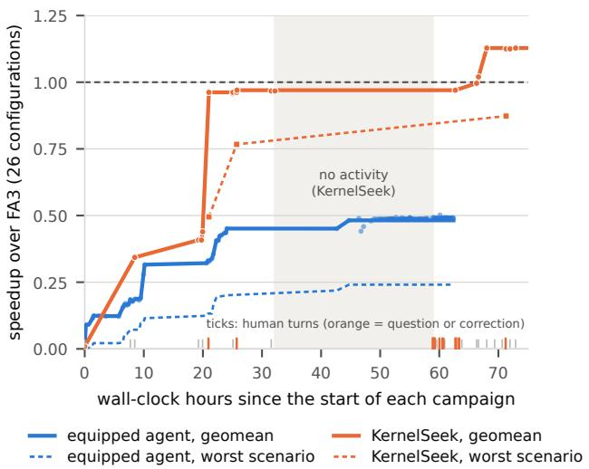
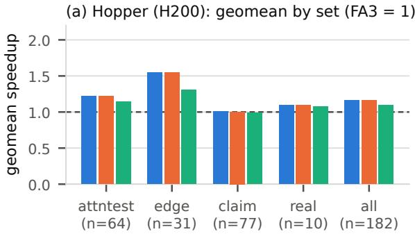
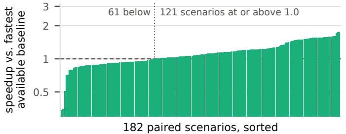
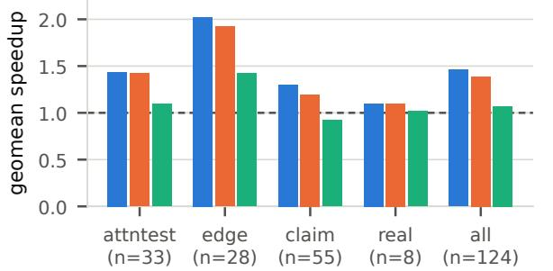
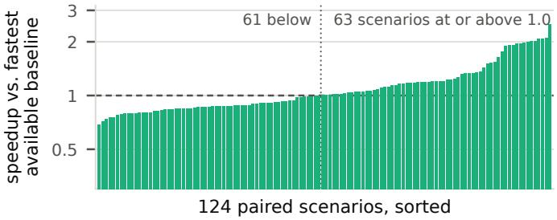
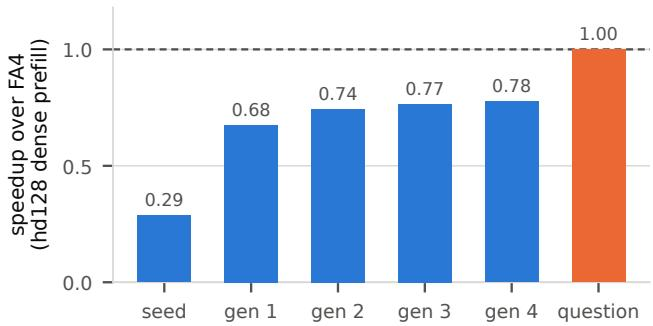
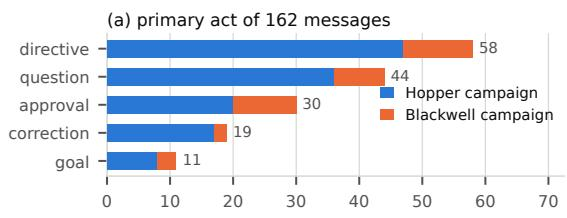
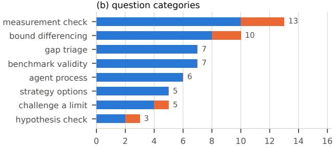

# ASK, DON’T EQUIP: QUESTION-DRIVEN CODING AGENTS FOR DEEP KERNEL OPTIMIZATION

Gabriele Oliaro 1 2 Jaeseong Lee 1 Zhaoyuan Su 1 Sreeram Vennam 2 Zhihao Jia 2 Samyam Rajbhandari 1

## ABSTRACT

LLM agents for GPU kernel optimization sit at two ends of a structure–freedom tradeoff. Scripted agents fix what the model does at each step, via a learned policy, an optimization menu, or fixed roles, and are sample-efficient where the recipe applies and stall where it does not. Open-ended agents let a self-directed model mutate a population of kernels and pay for the freedom in trials: thousands of evaluations, repeated edits, and wrong candidates. Both respond to hard targets by equipping the agent with more: parsed profiler output, disassembly analysis, retrieval over documentation and libraries, and stores of lessons. We argue that both lack direction, a hypothesis about where the remaining gap is, and that a short question asked at the right moment supplies it without narrowing what the agent may do next. We present KERNELSEEK, a question-driven agent that makes an existing CUDA kernel faster with no operator-specific knowledge and no faster implementation to imitate: a general-purpose coding agent, a minimal harness that enforces a verifiable goal, and questions at decision points, first from a human, then from a bank the agent applies to itself. On the same task, evaluator, hardware, and week, a tool-rich autonomous agent built in the prevailing style plateaued at 0.50× FlashAttention-3 after 133 model-driven steps; KERNELSEEK reached 1.13×. It then produced dependency-free FlashAttention forward kernels for Hopper and Blackwell, single CUDA files with no CUTLASS, CuTe, cuBLAS, or cuDNN, correct on all 182 scenarios per architecture and 1.16× FlashAttention-3 and 1.46× FlashAttention-4 (geometric mean). Across 162 human messages and 11.5K agent tool calls, every large gain followed a question that moved the agent to a different layer of the system or rejected a claimed limit, never one that supplied information. We release the kernels, harness, question bank, and all traces.

## 1 INTRODUCTION

GPU kernels are one of the main levers on the efficiency of large language model training and serving (Miao et al., 2025). Attention is the clearest case: each GPU generation has required a new implementation to reach the hardware’s potential, from FlashAttention on Ampere (Dao et al., 2022; Dao, 2024) to FlashAttention-3 on Hopper (Shah et al., 2024) and FlashAttention-4 on Blackwell (Zadouri et al., 2026), each rewrite reporting a 1.5–2× speedup over its predecessor (Dao, 2024; Shah et al., 2024), and serving systems ship specialized attention engines of their own (Kwon et al., 2023; Ye et al., 2025; Miao et al., 2024). Such kernels are deep targets: their performance hinges on whole-pipeline choreography (warp-specialized producers and consumers, asynchronous tensor-core MMAs, copies ordered by barrier phases, register budgets, persistent schedulers, the host dispatch path) rather than on local edits, their correctness hinges on hardware invariants that documentation states only in passing, and they must win across a production feature surface of paged caches, grouped heads, masks, ragged batches, split decode, and low precision rather than on one shape. Domain-specific languages (Tillet et al., 2019; Spector et al., 2025) and template libraries (Thakkar et al., 2023) lower the barrier, but state-of-the-art kernels still take expert teams months per architecture (Shah et al., 2024; Zadouri et al., 2026), and NVIDIA’s own production kernels sit well below the hardware’s speed of light on many shapes (Lin et al., 2026).

Kernel generation has therefore become an active application of LLM coding agents, with benchmarks (Ouyang et al., 2025; Xing et al., 2026; Lin et al., 2026; Oliaro et al., 2026), models trained with reinforcement learning to emit kernels (Baronio et al., 2026; Li et al., 2026; Dai et al., 2026; Liu et al., 2026), agentic pipelines (Hong et al., 2025; Wei et al., 2025; Sun et al., 2026a), evolutionary search with an LLM as the mutation operator (Novikov et al., 2025; Lange et al., 2025a; Chen et al., 2026), and deployments across whole production backends (Liao et al., 2025; Cursor & NVIDIA, 2026). These agents sit at the two ends of a structure–freedom tradeoff. Scripted agents fix in advance what the model does at each step: a generate–test–refine loop with a learned policy (Baronio et al., 2026; Li et al., 2026; Liu et al., 2026), a menu of optimizations (Hong et al., 2025), a team with fixed roles (Wei et al., 2025; Sun et al., 2026a), or a harness in which humans gate every promotion (Shui et al., 2026). The script makes them sample-efficient but encodes what to try: Autocomp’s performance collapses without its optimization menu (Hong et al., 2025), and fixedloop RL that is competitive on single operators fails on fused models (Liu et al., 2026; Zhu et al., 2026; Dai et al., 2026). Open-ended agents let an LLM mutate a population of programs (Romera-Paredes et al., 2024; Novikov et al., 2025; Lange et al., 2025a; Guo et al., 2025; Wiedemann et al., 2026), and AVO makes a self-directed coding agent the variation operator itself (Chen et al., 2026). The freedom buys results, up to 10.5% over FA4 for AVO (Chen et al., 2026) and a 32% speedup of a FlashAttention kernel for AlphaEvolve (Novikov et al., 2025), and is paid for in trials: AVO’s agent explored more than 500 directions over seven days to commit 40 versions and needed a supervisor to break cycles of failing edits (Chen et al., 2026), about 30% of the lines such agents add are byte-identical to lines they deleted earlier (Pelleriti et al., 2026), and 30–55% of LLM-evolved CUDA candidates are incorrect (Guo et al., 2025; Varadharajan et al., 2026).

We argue that what both ends lack is direction: a hypothesis about where the remaining gap is. A script hard-codes direction and cannot supply it where the script is wrong; open-ended search samples for it, and samples poorly, because LLMs are not open-ended optimizers. They search greedily from their priors (Redko et al., 2026), anchor on the solution in the prompt (Jones & Steinhardt, 2022), stop early out of conservatism or after a run of failures (Merouani et al., 2025), cycle through near-duplicate variants (Li et al., 2025; Dong et al., 2025), and report completion the environment contradicts (Advani, 2026). Information is not what is missing: both ends already hand the agent profilers, documentation, and reference implementations (Chen et al., 2026; MIT HAN Lab, 2026), and such feedback helps only when it supplies the specific thing the model lacks, which profiler and compiler output rarely does (Redko et al., 2026). What moves the same models is a hypothesis posed from outside: intrinsic self-correction fails where external feedback succeeds (Huang et al., 2024), a human’s feedback on a model’s own code raised repair success by 1.57× through structural changes the model did not propose (Olausson et al., 2024), and in the FlashInfer kernel contest, agents given expert directions beat the same agents running alone on every kernel (Shui et al., 2026). Our reading, and our traces, say that a question changes the task. “Make this faster” is open-ended, and the model answers it greedily. “Is the baseline winning on kernel cycles or only on wallclock?” is bounded, and to answer it the model will tear out and rewrite a part of the kernel it would never touch on its own. A well-placed question supplies direction without narrowing what the agent may do next, which neither more structure, more freedom, nor more tooling can.

  
Figure 1. KERNELSEEK vs. a scripted, tool-rich autonomous agent on the same FA3 case-study task: the same evaluator, 26 configurations, H200 node, and week. Lines are the lineage’s best geomean (solid) and worst configuration (dashed); dots are individual candidates; ticks mark human turns to KERNELSEEK. The equipped agent’s model was active for the 62 hours shown; the shaded band is a period with no KERNELSEEK activity.

This paper presents KERNELSEEK, a question-driven agent for optimizing CUDA kernels. KERNELSEEK takes an existing kernel as its seed and makes it faster; it is not tied to an operator, and it does not need a faster implementation to imitate. It keeps the freedom of the open-ended agents, a general-purpose coding agent with no script and no pre-digested context, and recovers the efficiency of the scripted ones by supplying direction at decision points: when progress stalls, when the agent claims a limit or completion, and after suspiciously large wins. Its only purposebuilt component is a minimal harness that checks every candidate against the seed’s outputs and an fp32 reference, times every scenario against the seed, and states the goal as a stop condition that is verified rather than requested. A good question contains no answer: it names a hypothesis the agent has not considered, and testing it takes a measurement the agent can make with ordinary tools. Questions that recur harden into a bank the agent applies to itself, and KER-NELSEEK composes with evolutionary search by wrapping the same agent in an AVO-style lineage whose directives are questions.

We evaluate KERNELSEEK on a case study chosen because a strong upstream exists to measure against: FA3- and FA4-class attention kernels as single CUDA files with no CUTLASS, CuTe, cuBLAS, or cuDNN, across the feature surface that vLLM exposes, with the upstream kernels as correctness oracle and yardstick. Against an autonomous agent we built for the same task in the style of AVO and its successors, with an orchestrated loop, predigested profiles, documentation retrieval, and a store of learned lessons, KERNELSEEK reached 1.13× FA3 in geometric mean over the same 26 configurations on the same machine in the same week, where the autonomous agent plateaued at 0.50× after 133 model-driven steps (Figure 1). Carried through to full campaigns, KERNELSEEK produced fa3 hopper.cu and fa4 blackwell.cu, correct on all 182 Hopper and all runnable Blackwell scenarios, at 1.16× FA3 and 1.46× FA4 in geomean, including 1.10× FA4 on production shapes from SOL-ExecBench (Lin et al., 2026). Across the 16 sessions that produced them, KER-NELSEEK made 11.5K tool calls per 162 human messages: asking did not mean using fewer tools, but using them on the right thing.

This paper makes three contributions.

• We identify the failure modes of autonomous agents on deep kernel targets that neither more structure, more freedom, nor more tooling fixes, and show them co-occurring in a tool-rich agent built to the prevailing recipe (§3).

• We present KERNELSEEK, an operator-agnostic questiondriven kernel agent built from a minimal harness, a verifiable goal, and a reusable question bank, and show how it composes with evolutionary search (§2).

• We compare KERNELSEEK with the equipped agent on the same task, evaluator, hardware, and week, analyze 162 human messages and 11.5K tool calls to show which questions redirected the agent and why (§5), and release fa3 hopper.cu and fa4 blackwell.cu, to our knowledge the fastest open-source FA3- and FA4- class forward kernels on the scenarios we evaluate, with the harness, question bank, and complete traces of both approaches (§4).

## 2 KERNELSEEK: A QUESTION-DRIVEN KERNEL AGENT

KERNELSEEK takes a working CUDA kernel, a set of scenarios, and a goal, and returns a faster kernel whose outputs match the seed on every scenario. It has three parts: a minimal harness that makes the goal verifiable, a generalpurpose coding agent with no script around it, and a source of questions at the moments the agent is about to go wrong. The questions come from a human steerer or, once they recur, from a bank the agent applies to itself. Nothing in the method is specific to an operator, and nothing requires a faster implementation to exist.

## 2.1 Ask vs. Equip: A Common Frame

Kernel optimization by an agent is a search. A candidate is a kernel source; its fitness is a vector of per-scenario speedups over the seed, collapsed to zero if any scenario is incorrect; and the lineage is monotone, as in AVO (Chen et al., 2026). The agent is the variation operator: it proposes the next candidate conditioned on a context, and everything a designer can do is a choice of what enters that context and when. An equipped agent receives the task, tools whose output has been distilled for it (a profiler parser that names the bottleneck, a disassembly differ), knowledge retrieved for it (documentation sections, hints mined from reference libraries, a store of lessons), the lineage, and feedback on the last candidate; the designer improves it by adding tools and knowledge. Our baseline (§3) is a serious instance. An asked agent receives the task, the harness’s output, the lineage, and, at decision points, a short question. It still has every tool a developer machine offers, the compiler, profiler, disassembler, sanitizer, and debugger, but nothing is predigested, and direction arrives as a question rather than a menu. The designer improves it by asking better questions.

## 2.2 A Minimal Harness and a Verifiable Goal

The only component we build is the evaluator. One command builds a candidate, checks its outputs against the seed’s and an fp32 reference on every scenario, and times it against the seed back to back on the same GPU, reporting per-scenario ratios and their geometric mean. Other kernels the user cares about can be added as measured comparison columns, but none is required. Constraints are stated once and enforced mechanically: in the case study, the ban on CUTLASS, CuTe, cuBLAS, and cuDNN is checked by inspecting the built binary’s symbols.

The goal is a predicate over the evaluator’s output, enforced rather than requested. We install it as a Stop hook in the coding agent: whenever the agent attempts to end its turn, the hook evaluates the predicate and, if any clause is unmet, returns the agent to work with the unmet clauses in hand. A predicate such as “at least parity with the seed on every scenario” removes the most common failure of autonomous agents, declaring completion early. Two lessons shaped how we write predicates. They must quantify over every scenario rather than an aggregate, because an agent will otherwise satisfy the aggregate on the shapes it is good at. And they must not be judged by a model where they can be computed: the one time our hook delegated the verdict to a model judge, it accepted a premature claim that a human then overturned (§5.4).

## 2.3 Questions: What They Are and When to Ask

Across the traces, the questions that preceded the largest gains share six properties. They carry no answer: they name a class of hypothesis and leave the derivation to the agent. They demand a measurement the agent can make with the tools it has, so the answer is a number rather than an opinion. They move across layers of the system, from the kernel to the host launch path to the routing logic to the benchmark itself, where an agent left alone stays at the layer it started at. They refuse premature closure by asking whether a claimed limit is a property of the hardware or of the agent’s own design. They are cheap, tens of tokens against the tens of thousands that retrieved documentation costs (Liu et al., 2024; LangChain, 2025). And they counteract deference: an agent tends to keep the structure it started from and accept the framing it is given (Sharma et al., 2024), and a question asks it to justify that choice with evidence.

Eight categories cover the questions a human asked during the case study (Table 4 in Appendix A): measurement check (13 messages), bound differencing (10), benchmark validity (7), gap triage (7), agent process (6), challenge a limit (5), strategy options (5), and hypothesis check (3). The largest checks a measurement: whether a win is noise, whether a comparison is fair, whether the agent is timing what it thinks it is timing. The second pits the agent’s claimed ceiling against an independent estimate of what is achievable. In the case study that estimate was often the upstream kernel, but the pattern does not depend on one existing: a roofline, a speed-of-light figure (Lin et al., 2026), or an A/B that swaps only the launcher around an identical binary serves the same role. Questions are asked at decision points, not continuously; the traces show five: at the start of a campaign, to fix the scope; at a plateau; when the agent claims a limit or completion; after a suspiciously large win; and when correctness breaks in a way the agent explains away. Between these points the agent works alone, about 71 tool calls per human message, where the median message is a sentence or two. The steerer contributes no code and no CUDA knowledge the agent lacks; it contributes doubt, at the right moment, about the right thing.

## 2.4 The Question Bank

After the campaigns we distilled the recurring questions into a bank. Its first version, taken from the traces alone, had 48 entries, and reading it back showed the hazard of distilling from one case study: 21 named the upstream kernel as the comparison and 13 named attention structure. The released bank removes both. A question is admitted only if it carries no answer, is answerable by a measurement with stock tools, is phrased against a bound (a roofline or a per-tile cycle budget) rather than a reference, names an architecture only as a parameter, and names no operator. To cover the aspects a single attention campaign never exercised, we also mined three public GEMM worklogs on Ampere, Hopper, and Blackwell (Boehm, 2022; Shankhdhar, 2024; Modular Inc., 2025) and the FlashAttention-3 and -4 papers (Shah et al., 2024; Zadouri et al., 2026) for the diagnostic that preceded each of their optimizations, and phrased it as a question. The result has 101 core entries in ten groups ordered by where the gap might be (scope and triage; the bound and the regime; harness and measurement; host, launch, and routing; memory hierarchy; compute issue; occupancy and registers; asynchrony and pipelining; scheduling; low-precision numerics), five that apply only when another implementation is available to measure, and eighteen per-architecture checklist entries that bind the generic mechanisms to Ampere, Hopper, or Blackwell instructions. Operator structure enters through a plug-in with five slots (regimes, irregular work, non-MMA units, reduction splits, indirect loads); the attention plug-in fills them with prefill and decode, causal masks, softmax, split-KV, and paged gathers. Appendix A lists the bank with provenance tags: 29 entries carry a trace tag, and the 72 from public sources alone are untested.

## 2.5 From Asking the Agent to the Agent Asking Itself

Because the questions recur, they can be handed to the agent as part of its instructions. We codify them as a skill with five parts: the goal, the hard rules the harness enforces, a loop, a list of questions to ask itself, and the commands that run the evaluator and profiler. The loop is the bank in procedural form: fix the scope; measure the seed; classify each gap as host, routing, or kernel before touching code; bound it; form a hypothesis; rewrite; gate. At each step the agent fans out subagents, one per hypothesis, each returning a hypothesis and the measurement that tests it rather than a patch. The skill is parameterized by the seed, the scenario set, and the goal; its questions were reused across the Hopper and Blackwell campaigns nearly verbatim.

## 2.6 Composing with Evolutionary Search

KERNELSEEK is compatible with the evolutionary loops of the open-ended agents, because it changes the variation operator’s direction rather than the loop around it. We wrap the same agent in an AVO-style search (Chen et al., 2026): a monotone lineage, several diverse mutations per generation applied to isolated copies and scored by the evaluator, and a strategist that reviews the trajectory and writes the next generation’s directives. The one change is that the directives are questions, hypotheses to test rather than edits to make. As §5.5 shows, evolution amplifies direction; it does not supply it.

## 2.7 Hypotheses

The evaluation tests five claims. H1 (quality): on the same task, evaluator, and hardware, the asked agent reaches higher performance at full correctness than the equipped one. H2 (efficiency): with fewer model-driven steps and GPU-hours, counting human time. H3 (mechanism): the largest gains follow questions that change the layer under consideration or reject a claimed limit, not questions that supply information. H4 (complementarity): evolutionary search amplifies the effect of questions and does not substitute for them. H5 (generality): the questions that moved the case study contain nothing specific to the operator or to a reference once the reference is replaced by a bound.

## 3 BASELINE: A TOOL-RICHAUTONOMOUS EVOLUTIONARY AGENT

Before KERNELSEEK, we built the agent the prevailing recipe prescribes. ARSENAL is an autonomous evolutionary agent for the Hopper half of the case study (§4), in the lineage of AVO, KDA, and CUCo (Chen et al., 2026; MIT HAN Lab, 2026; Varadharajan et al., 2026): an orchestrated loop, a profiler whose output is distilled for the model, retrieval over documentation and reference libraries, a typed knowledge store, and no human in the loop by design. Its failure is the paper’s motivation, and its evaluator, unchanged, scored the first KERNELSEEK session in the head-to-head of §5.3.

Design. The task was a single dependency-free CUDA file implementing vLLM’s FA3 operator for H200, with success defined as at least parity with FA3 on 26 configurations and token-for-token equality with FA3 on a greedy decode in vLLM. A deterministic Python orchestrator owns the loop. Each step generates one candidate, builds it, checks for forbidden dependencies by inspecting the binary’s symbols, analyzes the SASS instruction mix, verifies correctness on all 26 configurations, times it against FA3 interleaved across four GPUs, profiles the worst configuration with NCU, and, on promotion, A/B-tests it inside a live vLLM instance. It then writes a lesson to a memory file, a note to the knowledge store, and an entry to a lever ledger, checks for a plateau, and checkpoints. A Claude Opus model (claude-opus-4-8) running headless in Claude Code is the brain, invoked in a fresh session at every step. The orchestrator decides what to try and the brain decides how: sixteen hand-written levers, from tensor-core MMAs and TMA loads to warp specialization and persistent scheduling, are keyed to the bottleneck label the NCU parser assigns, and the chosen lever is placed in the prompt with the instruction to write the improved candidate. Everything else the brain sees is distilled by a component (Appendix E): a bottleneck diagnosis, retrieved documentation, hints extracted from DeepGEMM, ThunderKittens, and CUTLASS, and typed knowledge-store notes. The median step prompt was 22.6K characters, 37% of it pre-fetched reference material, plus the current best kernel re-read each step. Promotion is greedy on the worst-case configuration ratio with a 3% noise band, and a plateau detector opens rewrite branches. No human-authored text ever entered a step prompt.

Outcome. The run kept 313 steps over 4.2 days, with a further 117 discarded by three human rollbacks. The model was active for steps 0 to 132, about 62 hours and \$660 of API usage over 253 sessions; from step 133 the brain’s credentials had expired and the loop re-scored old kernels until stopped, so we report 133 model-driven steps as the budget. The best candidate reached 0.50× FA3 in geometric mean with a worst case of 0.24×; no configuration reached parity. All progress happened by step 35, in about 45 hours. The remaining 98 model-driven steps produced nothing beyond noise: the final champion, from step 112, is byte-identical to the candidate of step 104 and was promoted because one of 54 re-measurements of the same source landed above the noise band. Correctness was not the problem: 312 of 313 candidates were correct.

Why it stalled. The traces show the failure modes of §1, each with a number attached. Information was not the constraint: with more than a third of every prompt devoted to reference material and 1.6 GB of reference code on disk, 82% of the characters the brain read through its own tool calls were its own kernel, and its 92 documentation lookups over 246 sessions mostly justified not making a change. The menu bounded the search: 36 of the 37 rewrite branches the plateau detector opened were seeded from the same step, and every candidate after step 35 was a local edit of the same design. Memory hardened conclusions, not evidence: the memory file recorded one configuration as “DEFINI-TIVE[ly] . . . walled by [the] 65536-reg file”, a wall FA3 does not hit, and the brain’s summary at step 112 was that “the only remaining escape is a clean-sheet 1-blk/SM warpspec persistent seed, which is outside this branch’s mandate and measured to lose”; each fresh session inherited earlier verdicts without the reasoning behind them, and nothing in the loop was positioned to doubt them. Every diagnostic lived at one layer: NCU, the SASS analyzer, and the sanitizer all examine the kernel, while the gap KERNELSEEK later closed on this evaluator was in the host launch path (§5.4). The objective rewarded caution: promoting on the worst configuration inside a noise band accepted noise as progress and could not fund a restructuring that regresses before it pays off; 312 correct candidates out of 313 is the signature of a search that never took a risk.

Three lessons carried into KERNELSEEK: the mechanical parts of the harness were worth keeping, and KER-

NELSEEK’s harness is this evaluator with the orchestration removed; everything built to inform the brain could go, and the knowledge store was actively harmful; and the loop lacked one input, a reason to doubt a conclusion and a hypothesis about where else to look.

## 4 CASE STUDY: DEPENDENCY-FREE FLASHATTENTION FOR HOPPER AND BLACKWELL

Task. We asked KERNELSEEK to produce a FlashAttention forward kernel for Hopper and one for Blackwell, each a single CUDA file with no CUTLASS, CuTe, cuBLAS, or cuDNN, exposing the operator schema vLLM uses for FlashAttention-3 so that the result drops in for the upstream kernel and is timed against it from identical inputs. The scenario suites mirror the upstream kernels’ own test grids and add production shapes from SOL-ExecBench (Lin et al., 2026): 182 scenarios per architecture spanning bf16, fp16, and fp8; paged and contiguous KV caches; MHA, GQA, and MQA; causal, sliding-window, softcapped, and attentionsink masking; ragged batches; prefill, chunked prefill, and split-KV decode; and unequal query and value head dimensions. The breadth is deliberate, since kernels scored on a few shapes report speedups that shrink on the production path (Oliaro et al., 2026). The goal was correctness on every scenario and at least parity with upstream in geometric mean. The seed in both cases was a slow but general kernel (a scalar one-warp-per-query kernel on Hopper, a onewarpgroup dense-only skeleton on Blackwell), and anything the fast paths did not yet cover fell back to it, so correctness held throughout. The upstream kernels, FA3 as shipped in vLLM and the CuteDSL FA4 (Shah et al., 2024; Zadouri et al., 2026), were the correctness oracle and the yardstick the goal was stated against. The dependency-free constraint means the layouts, descriptors, pipelines, and register allocation that CUTLASS and CuteDSL derive for the upstream kernels had to be written by hand (Thakkar et al., 2023).

What the agent built. On Hopper, fa3 hopper.cu (3.6K lines) is a warp-specialized kernel in raw CUDA and PTX: producer and consumer warpgroups connected by a TMA and mbarrier ring, asynchronous wgmma MMAs with setmaxnreg register rebalancing, persistent scheduling with inter-warpgroup ping-pong, split-KV decode with a combine pass, and a native fp8 path. Its one remaining limit sits where a library’s allocator would otherwise be: at head dimension 256 the hand-written swizzle composes only at a few tile widths and the output accumulator caps occupancy at one CTA per SM, so that scenario runs at 0.94×. On Blackwell, fa4 blackwell.cu (10.2K lines) is a family with host-side routing, a structure the questions pushed the agent toward after a single kernel had stalled (§5.4): a persistent warp-specialized collective for the dense enve-

Table 1. Case-study results. n counts the scenarios the upstream kernel also runs (paired). “Upstream” is FA3 on Hopper and FA4 on Blackwell; “open-source” is, per scenario, the faster of upstream and FlashInfer; “available” also includes cuDNN’s fused attention. Speedups are geometric means of wall-clock ratios from byteidentical inputs timed back to back on one GPU (Appendix F).

<table><tr><td>Set</td><td>n</td><td>Correct</td><td colspan="3">Speedup vs. fastest . ..</td></tr><tr><td></td><td></td><td></td><td>upstream</td><td>open-source available</td></tr><tr><td></td><td></td><td>Hopper (H200), upstream = FA3</td><td></td><td></td></tr><tr><td>attntest</td><td>64</td><td>64/64</td><td>1.22×</td><td>1.22× 1.14× 1.55×</td></tr><tr><td>edge</td><td>31</td><td>31/31</td><td>1.55×</td><td>1.31× 1.01×</td></tr><tr><td>claim</td><td>77</td><td>77/77</td><td>1.01×</td><td>0.99×</td></tr><tr><td>real</td><td>10</td><td>10/10</td><td>1.10×</td><td>1.10× 1.08×</td></tr><tr><td>all</td><td>182</td><td>182/182</td><td>1.16×</td><td>1.16× 1.10×</td></tr><tr><td></td><td>Blackwell (B200), upstream = FA4</td><td></td><td></td><td></td></tr><tr><td>attntest</td><td>33</td><td>52/52</td><td>1.44×</td><td>1.42×</td><td>1.09×</td></tr><tr><td>edge</td><td>28</td><td>31/31</td><td>2.02×</td><td>1.93×</td><td>1.42×</td></tr><tr><td>claim</td><td>55</td><td>61/61</td><td>1.30×</td><td>1.20×</td><td>0.92×</td></tr><tr><td>real</td><td>8</td><td>10/10</td><td>1.10×</td><td>1.10×</td><td>1.02×</td></tr><tr><td>all</td><td></td><td>124154/154</td><td>1.46×</td><td>1.39×</td><td>1.07×</td></tr></table>

“Correct” is over runnable scenarios. At or above parity vs. upstream / open-source / available: Hopper 135 / 135 / 121 of 182; Blackwell 98 / 94 / 63 of 124. On Hopper, cuDNN supports 145 scenarios and fa3 hopper.cu is faster on 111; FlashInfer supports 32 and fa3 hopper.cu is faster on all 32.

lope (two stacked 128-row query halves, two softmax warpgroups in an ordered ping-pong, a correction warpgroup rescaling the output in tensor memory, one MMA warp driving tcgen05), variants for unequal head dimensions and paged prefill, and a two-tile kernel for small, ragged, and decode shapes. Several decisive gains were outside the kernel bodies: a synchronous host copy costing about 38 µs per call, a stale routing gate, a TMA gather issued from divergent lanes, and ring state the compiler had placed in local memory. fp8 inputs and dense head dimensions of 192 and above are not yet built on Blackwell (28 of 182 scenarios).

Results. Table 1 summarizes the outcome; Appendix B plots every scenario. Both kernels are correct on every scenario they run, and both beat upstream in geometric mean. fa3 hopper.cu runs at 1.16× FA3 with 135 of 182 scenarios at or above parity; the wins are concentrated in ragged prefill, paged and speculative decode, and the masking grid, while the paper-style sweeps of the claim set are at parity and dense fp8 prefill is the one clear hole at 0.67×. fa4 blackwell.cu runs at 1.46× FA4 across the 124 scenarios FA4 also runs, with 98 at or above parity and a worst case of 0.78×. The headline shrinks as the baseline strengthens: cuDNN is the fastest baseline on 54 of 182 Hopper scenarios and on 92 of 124 Blackwell ones, where it wins dense prefill and batched decode outright, so the kernels are 1.10× and 1.07× the fastest available implementation, and at or above it on production shapes. Three caveats are documented in Appendix B: the edge sets consist of short kernels, so part of their 1.5–2× is upstream dispatch overhead; the largest claim wins are fp8-KV decode shapes on which FA4 is slow, and excluding them moves the Blackwell all-set geomeans to 1.37, 1.32, and 1.08×; and one paged-KV fast path depends on physically consecutive pages. Every Blackwell scenario below parity has a measured cause: dense long context spends identical tensor work over a third more cycles because of twice as many barrier waits per block, batched decode pays a cold start per CTA, and head dimension 96 runs on a padded 128-wide path. On Hopper the losses are fp8 dense prefill, softcapped prefill, head dimension 96, and long sliding windows (0.34–0.79×); these have not been profiled to the same depth.

Release. We release both kernels under Apache 2.0 with the evaluator, the PTX probes used to validate each Blackwell primitive in isolation, the search scripts (§2.6), the question bank and skill, and the complete agent traces of both approaches. The kernels are meant as seeds, with their residual gaps measured, so that the next agent starts from a known frontier.

## 5 EVALUATION

We ask five questions, one per hypothesis of §2.7. RQ1: how fast and how correct are the kernels? RQ2: on the same task, evaluator, hardware, and week, how does KERNELSEEK compare with the equipped agent? RQ3: which human messages redirected the agent, and how? RQ4: what does evolutionary search add on top of questions? RQ5: do the questions transfer?

## 5.1 Setup

Hopper experiments and the head-to-head ran on one 8×H200 node; Blackwell experiments on one 8×B200 node. The upstream kernels are vLLM’s FA3 and the CuteDSL FA4 at pinned commits; cuDNN’s fused attention (9.20 on Hopper, 9.19 on Blackwell) and FlashInfer are comparison columns fed the same buffers. Implementations are timed back to back on one idle GPU with an L2 flush before each sample; clocks are not locked, so only ratios are reported; four independent Hopper batches agree to within 0.3% on every aggregate (Appendix F). The equipped agent ran claude-opus-4-8 through Claude Code in headless mode, one fresh session per step. KERNELSEEK sessions used two front-ends: Claude Code with the Stophook goal, on claude-opus-4-8 for seven sessions and claude-opus-5 for the last two, and Cursor with the same instructions and without the hook, whose exports do not record the model. Sixteen KERNELSEEK sessions are archived, nine in Claude Code and seven in Cursor, from June 17 to August 7, 2026: twelve for the Hopper campaign and four for Blackwell. They contain 162 human messages and 11,532 agent tool calls, 8,791 in the parent sessions and 2,741 in subagents. One author labeled each human message by its primary act (goal, directive, question, approval, correction), flagged interrogative phrasing, and assigned questions to the eight categories of §2.3; tool calls were classified by target (Appendix D).

Table 2. Head-to-head on the equipped agent’s own evaluator: 26 FA3 configurations, same H200 node, overlapping days in June 2026. Upper block: outcome; the KERNELSEEK hours run from the message that set the 26-configuration goal to the best result, excluding a 26.7-hour idle gap. Lower block: tool use; equippedagent figures are over its 133 steps, KERNELSEEK figures over all 16 sessions.
<table><tr><td></td><td>Equipped agent</td><td>KERNELSEEK</td></tr><tr><td>Human text in prompts</td><td>none</td><td>40 messages, 17 questions</td></tr><tr><td>Model-driven steps / turns</td><td>133 steps</td><td>40 turns</td></tr><tr><td>Wall-clock to best</td><td>44.7 h of 62.4 h</td><td>68.0 h, 41.3 h active</td></tr><tr><td>API cost</td><td>$660</td><td>not recoverable (Cursor)</td></tr><tr><td>Candidates correct</td><td>132 / 133</td><td>all reported</td></tr><tr><td>Best geomean</td><td>0.48×</td><td>1.13×</td></tr><tr><td>Worst configuration</td><td>0.24×</td><td>0.87×</td></tr><tr><td>Configurations ≥1.0×</td><td>0/ 26</td><td>22 / 26</td></tr><tr><td>Goal met</td><td>no</td><td>yes</td></tr><tr><td>Reference material pushed 37% of prompt into prompt</td><td></td><td>none</td></tr><tr><td>Tool-result text re-reading 82% own kernel</td><td></td><td>26%</td></tr><tr><td>Profiler (NCU) runs</td><td>1 per step,</td><td>429, raw</td></tr><tr><td>SASS / PTX inspections</td><td>parsed 1 per step,</td><td>372</td></tr><tr><td>Documentation reads</td><td>parsed 92 lookups</td><td>36</td></tr><tr><td>Builds / benchmark runs</td><td>133 / 133</td><td>377 / 937</td></tr><tr><td>Subagents spawned</td><td>0</td><td>48</td></tr></table>

## 5.2 RQ1: Kernel Performance

The kernels are reported in §4. In brief: fa3 hopper.cu is correct on all 182 Hopper scenarios at 1.16× FA3 and 1.10× the fastest available implementation including cuDNN; fa4 blackwell.cu is correct on all 154 runnable Blackwell scenarios at 1.46× FA4 and 1.07× the fastest available. Per-scenario Hopper ratios vary by 1% at the median and 6% at most across repeats. Every Blackwell scenario below parity has a measured root cause (Appendix B). This is H1’s quality half, and the result the rest of the section explains.

## 5.3 RQ2: Head-to-Head on the Same Task

The comparison is controlled in the ways that matter. During its first Hopper session, KERNELSEEK adopted the equipped agent’s own evaluator, the same 26 configurations, FA3 baseline, and correctness gate, on the same machine, in overlapping days. Table 2 and Figure 1 give the outcome. The equipped agent’s lineage champion reached 0.48× FA3 at step 35, after 44.7 hours, and did not improve in the remaining 98 model-driven steps (§3). Its worst configuration stayed at 0.24× and none reached parity. KERNELSEEK started from 0.009×, because its kernel of the time routed the evaluator’s paged and grouped-query configurations to the scalar fallback, and reached 0.96× after 21 hours, 1.02× after 66, and 1.13× after 68, of which 26.7 were an idle gap. At the end, 22 of 26 configurations were at or above parity and the worst was 0.87×. This supports H1 and, counting the 40 human turns against 133 steps and 62 model-hours, H2.

Three caveats qualify the comparison: KERNELSEEK had built a kernel for FA3’s 40-scenario test grid in the two preceding days, so the 0.009× start understates its head start; the front-ends differ, and token usage is not recoverable for the Cursor sessions; and each arm is a single run. The fair reading is that in one calendar week a steered agent crossed parity on an evaluator on which an unsteered one, given more compute, did not reach half of it. We treat Table 2 as showing that the gap exists and is large, and RQ3 as the evidence for why.

Where the effort went. The lower block of Table 2 contrasts tool use. The equipped agent received a third of its context as pre-fetched reference material, yet spent 82% of what it read on its own kernel. KERNELSEEK, with nothing pushed to it, spent 26% on its own kernels and ran the profiler 429 times on raw output. The questions did not reduce tool use; they aimed it.

## 5.4 RQ3: Anatomy of the Questions

What the human said. Of the 162 human messages, directives are the largest class (58, 36%), followed by questions (44, 27%), approvals (30, 19%), corrections (19, 12%), and goals (11, 7%); 63 messages (39%) are interrogative in phrasing, and 12 of the 19 corrections are phrased as questions (Appendix D). The steering was interrogative, not mostly questions: directives and approvals keep the agent moving, and the questions are where its course changed. The agent also asked. Across the Claude Code sessions it posed 35 structured questions to the human, 24 of which offered an option to accept the current state or stop, and its messages assert a limit or an impossibility 126 times. The Stop hook returned it to work 59 times. Autonomous agents seek closure; the harness and the human refused it.

Which questions mattered. Table 3 walks through six turning points we can verify in the archived traces. Two patterns stand out. First, every large jump followed a question that either moved the agent to a different layer (from kernel tuning to the per-configuration table, to the host launch path, to the benchmark itself) or rejected a claimed limit; none followed a message that supplied information the agent lacked, which supports H3. Second, the measurement the question triggered was always one the agent could already make: the per-configuration table, the host-side profile, the sanitizer, and the debugger were available at every earlier step. What the agent lacked was a reason to look. Four further episodes, among them the 38 µs host copy and a routing sweep that moved the Blackwell geomean from 0.88 to 1.15× without changing a kernel body, are documented in the repository’s history but not in archived sessions, and we cite them as outcomes only.

## 5.5 RQ4: Questions and Evolutionary Search

We wrapped the same agent in the loop of §2.6 and ran it on the Blackwell dense-prefill kernel from a correct but slow port (Figure 3, Appendix D). The first generation, whose directive asked whether a persistent schedule with longestfirst ordering and cross-tile overlap would recover the lost overlap, took the kernel from 0.29× to 0.68×. Three more generations added 0.10× between them through a folded softmax scale, a split K/V barrier, and a depth-two softmax– correction handshake, while directives on register rebalancing and address hoisting measured neutral or negative. The search stalled at 0.78× with the kernel’s own cycle count already below upstream’s. The last 22 points came from a question, not a generation: asked where the time was going, the agent profiled the whole call rather than the kernel and found that synchronous host copies accounted for the gap. Evolution amplified the direction the directives carried and searched efficiently within the layer it was pointed at; it could not move to a layer it was not pointed at. This is H4.

## 5.6 RQ5: Reuse

The question categories were populated mostly during the Hopper campaign, which came first. Five of the eight recur in the Blackwell campaign, and the Blackwell skill’s selfquestions restate Hopper questions nearly verbatim. Of the 63 interrogative messages, 17 mention a concept specific to attention and 32 mention the upstream kernel; the rest name only measurements, layers, and process, and where a question names the upstream it uses it as a bound, a role a roofline fills when no upstream exists. This is the evidence for H5 that we have: necessary, since a bank that did not transfer across two architectures would not transfer further, but not sufficient, since both campaigns were attention and the 72 bank entries mined from public sources (§2.4) have not yet steered an agent. The experiment that would test both, and whether the bank can replace the human at decision points, is described in §6.

Table 3. Case studies from the archived traces: the question (paraphrased for length), what the agent believed before it, the measurement the question triggered, and the outcome. Speedups are vs. the upstream kernel on the evaluator in use at the time.
<table><tr><td>Question (category)</td><td>Agent&#x27;s belief</td><td>Measurement it triggered</td><td>Outcome</td></tr><tr><td>down the geomean?&quot; (gap the right priority. triage)</td><td>&quot;What configs are bringing Tuning the hd128 paths was Per-configuration table: hd96, Fallback removed; 0.44 → 0.96 ge-</td><td>hd192, hd256 were on the scalar omean in 4 hours. fallback at 0.01 ×.</td><td></td></tr><tr><td>sign? Where does the time go ness rules&quot;. outside the kernel?&quot; (bound differencing)</td><td>“Is this ceiling a property of Split-KV decode was at a Host-side profile: a per-call ten- Fill removed; split-KV 0.87 → 0.97,</td><td>the hardware, or of our de- “genuine ceiling within the har- sor fill of 2–5 µs outside the ker- geomean 1.02 → 1.13. nel.</td><td></td></tr><tr><td>ator is actually called with?&quot; (benchmark validity)</td><td>shapes and features the oper- meant the kernel was done.</td><td>ported: 52 of 58 correct, with 1.10 on the new grid. sink and left-pad outputs off by 495× and 103×.</td><td>&quot;Do our scenarios cover the 40 of 40 scenarios correct The operator&#x27;s full test grid Six fixes; 58 of 58 correct, geomean</td></tr><tr><td>was achieved? We are still cepted “goal met&quot;. well below parity.&quot;(challenge a limit)</td><td></td><td>tory prematurely.&quot;</td><td>&quot;Why do you think the goal The Stop-hook judge had ac- Agent: “I stopped after the first fp8 hd256 decode 0.20/0.34 → successful lever and declared vic- 0.66/0.77 after “this is not a rare cor- ner&quot;.</td></tr><tr><td>kernel?&quot; (hypothesis check)</td><td>&quot;Is it NCU that hangs, or our &quot;No deadlock in our kernel.&quot;</td><td>Sanitizer, then debugger: a warp- All 8 hanging shapes fixed. convergent tcgen05.wait in- side a divergent branch.</td><td></td></tr><tr><td>(challenge a limit)</td><td>the judge had accepted the sumer loop. limit twice.</td><td></td><td>“Is this really a register floor?&quot; hd256 was register-capped; A collective rewrite of the con- 0.84 → 0.95–0.96×; the agent&#x27;s own note: &quot;the ‘floor&#x27;conclusion was wrong&quot;.</td></tr></table>

## 6 DISCUSSION

Did a human expert do the work? The human wrote no kernel code, and the messages name measurements, layers, and process rather than mechanisms: of the 63 interrogative ones, 17 mention an attention concept and none prescribes a CUDA construct (§5.6). The human did have systems expertise and used it to decide which measurement to demand and when; we claim only that the questions, once asked, are short, generic, and now written down. The agent wrote all 13.8K lines of the two kernels. Whether the bank can replace the human is the experiment this paper does not contain. Its design is fixed: start from the released Blackwell kernel on one of its remaining gaps (dense long context or head dimension 96), hold the model and budget constant, and compare four arms: the equipped loop, the bare agent with the harness alone, the bare agent with a questioner that draws from the bank at plateaus and claimed limits, and a human questioner.

Does KERNELSEEK need a reference implementation? The method does not: the harness checks correctness against the seed and an fp32 reference, the goal is a predicate over the seed, and the bank phrases every bound as a roofline or a cycle budget. The case study had one, and used it in two roles. As a yardstick it set the goal and scored the result. As a bound it let a question overturn a claimed ceiling, and this role is the one that mattered; it is filled without a reference by a roofline, a speed-of-light estimate (Lin et al., 2026), a launcher-only A/B, or a kernel for a neighboring shape, each of which the bank asks for by name. A reference buys a cheaper and sharper bound, and no more: the equipped agent had far more of it in its prompt and gained nothing. The no-reference campaign, where the seed is the fastest kernel known, is the setting the released agent targets and the one we have not yet run.

Threats to validity. The head-to-head is a single run per arm, with different front-ends and a steered arm against an unsteered one; we control the task, evaluator, hardware, baseline, and correctness gate, and count the human turns in the steered arm’s budget. The case study is one operator family where a strong upstream existed. Wall-clock speedups include dispatch overhead, which inflates the edge sets (Appendix B). The kernels were built before the traces were analyzed, and one author labeled the messages, so the taxonomy may fit the sessions we had; every trace is released so the labeling can be checked.

Limitations and future work. The Hopper kernel loses on fp8 dense prefill and softcapped prefill, and the Blackwell kernel does not yet build fp8 inputs or dense head dimensions of 192 and above; neither covers the backward pass.

The next targets are other deep kernels (latent-attention decode, grouped GEMMs for mixture-of-experts layers, fused collectives, persistent megakernels (Jin et al., 2026)) and end-to-end evaluation on the production path (Oliaro et al., 2026).

## 7 RELATED WORK

LLM agents for GPU kernels. Benchmarks score single operators (Ouyang et al., 2025; Zhang et al., 2026), serving kernels on Blackwell (Xing et al., 2026; Cao et al., 2026), production shapes against a speed-of-light bound (Lin et al., 2026), and, in FastKernels (Oliaro et al., 2026), agent-written kernels inside the production modules they replace, where kernel-level speedups of several times shrink to at most 1.25× end to end. The systems divide along the structure–freedom axis of §1. Scripted agents train a policy inside a fixed loop (Baronio et al., 2026; Li et al., 2026; Liu et al., 2026; Zhu et al., 2026; Dai et al., 2026), search over a menu of optimizations (Hong et al., 2025; Gai et al., 2026), or assign fixed roles to several agents (Wei et al., 2025; Sun et al., 2026a; MIT HAN Lab, 2026; Luo et al., 2026; Sun et al., 2026b). Open-ended agents make an LLM the mutation operator of an evolutionary search (Romera-Paredes et al., 2024; Novikov et al., 2025; Lange et al., 2025a; Guo et al., 2025; Wiedemann et al., 2026; Yuksekgonul et al., 2026; Lange et al., 2025b; Varadharajan et al., 2026) or, in AVO (Chen et al., 2026), a self-directed coding agent; Meta (Liao et al., 2025) and Cursor with NVIDIA (Cursor & NVIDIA, 2026) run such loops across whole kernel libraries. AVO is the closest work in target. The closest in spirit is the harness-engineering report of Shui et al. (Shui et al., 2026), which finds that agent-assisted optimization beats fully autonomous agents on every FlashInfer contest kernel but does not isolate what the human contributes. No prior work compares two steering strategies on the same target, evaluator, and hardware.

LLMs as optimizers. The failure modes we attribute to autonomous agents are each documented in isolation: greedy, prior-driven search (Redko et al., 2026; Dong et al., 2025; Li et al., 2025), anchoring on the solution in the prompt (Jones & Steinhardt, 2022), failure to explore without intervention (Krishnamurthy et al., 2024), conservatism and premature stopping (Merouani et al., 2025), early lockin under iterative refinement (Javaji et al., 2025), and false completion claims (Advani, 2026). We show them cooccurring in one well-equipped agent.

Questions and self-correction. Self-Ask (Press et al., 2023), Self-Refine (Madaan et al., 2023), and Reflexion (Shinn et al., 2023) have the model question itself, but intrinsic self-correction is limited (Huang et al., 2024) and models defer to the framing they are given (Sharma et al.,

2024). External feedback works where self-feedback does not: human feedback on a model’s own code raises repair success by more than half, partly because humans propose the structural changes the model does not (Olausson et al., 2024), and stating hypotheses before writing programs improves program synthesis (Wang et al., 2024). These works use questions to improve one answer; we use them to decide what to measure next in a long-horizon search, in the tradition of Polya’s heuristics (´ Polya´ , 1945).

Scaffolding, compilers, and kernels. An agent’s interface moves its performance (Yang et al., 2024), simpler pipelines often win (Xia et al., 2024; Schluntz & Zhang, 2024), and more tools and context have costs (LangChain, 2025; Liu et al., 2024); KERNELSEEK is a data point for the second camp with a twist, since it used more tools than the equipped agent, but on demand. Korch (Hu et al., 2024) and Event Tensor (Jin et al., 2026) automate a different layer, how kernels are grouped and scheduled into persistent megakernels, and are complementary targets for an agent that writes kernel bodies. The kernels we compare against are FlashAttention and its successors (Dao et al., 2022; Dao, 2024; Shah et al., 2024; Zadouri et al., 2026), codesigned with CUTLASS (Thakkar et al., 2023); FlashInfer (Ye et al., 2025); cuDNN (NVIDIA, 2025); and ThunderKittens (Spector et al., 2025), on the operator surface vLLM defines (Kwon et al., 2023). To our knowledge ours are the first dependency-free FA3- and FA4-class kernels to match or exceed upstream across that surface.

## 8 CONCLUSION

For deep kernel optimization the scarce resource is not information but direction. An autonomous agent equipped with a parsed profiler, retrieval, reference material, and a knowledge store plateaued at half the speed of FlashAttention-3 after 133 steps on a 26-configuration task; the same class of model, given a minimal harness and forty messages of which seventeen were questions, passed it in the same week on the same machine. The questions that mattered contained no answers: they moved the agent to a layer it had not examined or made it defend a limit it had declared. KERNELSEEK packages this: an operator-agnostic agent that makes a CUDA seed faster with no faster implementation to imitate, a verifiable goal enforced by the harness, a question bank the agent applies to itself, and an evolutionary wrapper whose directives are questions. Its case-study output, dependency-free FlashAttention kernels for Hopper and Blackwell, correct on every scenario and faster than upstream, is released with the harness, the bank, and every trace.

## REFERENCES

Advani, L. From confident closing to silent failure: Characterizing false success in LLM agents. In ICML Workshop on Foundations of Agentic Systems (FAGEN), 2026. arXiv:2606.09863.

Baronio, C., Marsella, P., Pan, B., Guo, S., and Alberti, S. Kevin: Multi-turn RL for generating CUDA kernels. In International Conference on Learning Representations (ICLR), 2026. arXiv:2507.11948.

Boehm, S. How to optimize a CUDA matmul kernel for cuBLAS-like performance: a worklog. https://si boehm.com/articles/22/CUDA-MMM, 2022.

Cao, S., Mao, Z., Gonzalez, J. E., and Stoica, I. K-Search. arXiv preprint arXiv:2602.19128, 2026.

Chen, T., Ye, Z., Xu, B., Ye, Z., Liu, T., Hassani, A., Chen, T., Kerr, A., Wu, H., Xu, Y., Chen, Y.-J., Chen, H., Kane, A., Krashinsky, R., Liu, M.-Y., Grover, V., Ceze, L., Bringmann, R., Tran, J., Liu, W., Xie, F., Lightstone, M., and Shi, H. AVO: Agentic variation operators for autonomous evolutionary search. arXiv preprint arXiv:2603.24517, 2026.

Cursor and NVIDIA. Optimizing CUDA kernels with multiagent systems. https://cursor.com/blog/mu lti-agent-kernels, 2026.

Dai, W., Wu, H., Yu, Q., ang Gao, H., Li, J., Jiang, C., Lou, W., Song, Y., Yu, H., Chen, J., Ma, W.-Y., Zhang, Y.-Q., Liu, J., Wang, M., Liu, X., and Zhou, H. CUDA agent: Large-scale agentic RL for high-performance CUDA kernel generation. arXiv preprint arXiv:2602.24286, 2026.

Dao, T. FlashAttention-2: Faster attention with better parallelism and work partitioning. In International Conference on Learning Representations (ICLR), 2024.

Dao, T., Fu, D. Y., Ermon, S., Rudra, A., and Re, C. FlashAt-´ tention: Fast and memory-efficient exact attention with IO-awareness. In Advances in Neural Information Processing Systems (NeurIPS), 2022.

Dong, J., Yang, Y., Liu, T., Wang, Y., Qi, F., Tarokh, V., Rangadurai, K., and Yang, S. STARK: Strategic team of agents for refining kernels. arXiv preprint arXiv:2510.16996, 2025.

Gai, J., Zhang, S., Bostrom, K., Huang, J., Patil, V., Fang, H., Wang, B., Rangwala, H., and Karypis, G. Optimizing CUDA like a human: Profiling-guided tree search for kernel optimization. arXiv preprint arXiv:2606.26453, 2026.

Guo, P., Zhu, C., Chen, S., Liu, F., Lin, X., Lu, Z., and Zhang, Q. EvoEngineer: Mastering automated CUDA kernel code evolution with large language models. arXiv preprint arXiv:2510.03760, 2025.

Hong, C., Bhatia, S., Cheung, A., and Shao, Y. S. Autocomp: A powerful and portable code optimizer for tensor accelerators. arXiv preprint arXiv:2505.18574, 2025.

Hu, M., Venkatram, A., Biswas, S., Marimuthu, B., Hou, B., Oliaro, G., Wang, H., Zheng, L., Miao, X., and Zhai, J. Optimal kernel orchestration for tensor programs with Korch. In International Conference on Architectural Support for Programming Languages and Operating Systems (ASPLOS), 2024.

Huang, J., Chen, X., Mishra, S., Zheng, H. S., Yu, A. W., Song, X., and Zhou, D. Large language models cannot self-correct reasoning yet. In International Conference on Learning Representations (ICLR), 2024.

Javaji, S. R., Gauri, B., and Zhu, Z. Another turn, better output? A turn-wise analysis of iterative LLM prompting. arXiv preprint arXiv:2509.06770, 2025.

Jin, H., Hou, B., Wang, G., Lai, R., Chen, J., Ye, Z., Cai, Y., Dong, Y., Cheng, X., Zhang, Z., Zhao, Y., Huang, Y., Yang, L., Jiang, J., Oliaro, G., Ji, J., Miao, X., Grover, V., Mowry, T. C., Jia, Z., and Chen, T. Event tensor: A unified abstraction for compiling dynamic megakernel. In Proceedings of Machine Learning and Systems (MLSys), 2026.

Jones, E. and Steinhardt, J. Capturing failures of large language models via human cognitive biases. In Advances in Neural Information Processing Systems (NeurIPS), 2022.

Krishnamurthy, A., Harris, K., Foster, D. J., Zhang, C., and Slivkins, A. Can large language models explore incontext? In Advances in Neural Information Processing Systems (NeurIPS), 2024.

Kwon, W., Li, Z., Zhuang, S., Sheng, Y., Zheng, L., Yu, C. H., Gonzalez, J. E., Zhang, H., and Stoica, I. Efficient memory management for large language model serving with PagedAttention. In Proceedings ofthe 29th Symposium on Operating Systems Principles (SOSP), 2023.

LangChain. Benchmarking single agent performance. ht tps://blog.langchain.com/react-agent -benchmarking, 2025.

Lange, R. T., Imajuku, Y., and Cetin, E. ShinkaEvolve: Towards open-ended and sample-efficient program evolution. arXiv preprint arXiv:2509.19349, 2025a.

Lange, R. T., Sun, Q., Prasad, A., Faldor, M., Tang, Y., and Ha, D. Towards robust agentic CUDA kernel benchmarking, verification, and optimization. arXiv preprint arXiv:2509.14279, 2025b. Revised version of “The AI CUDA Engineer” (Sakana AI, Feb. 2025).

Li, H., Man, K., Kanuparthy, P., Chen, H., Sun, W., Tallam, S., Zhu, C., Zhu, K., and Qian, Z. TritonForge: Profiling-guided framework for automated Triton kernel optimization. arXiv preprint arXiv:2512.09196, 2025.

Li, X., Wang, A., Wang, G., Li, J., and Shum, C. CUDA-L1: Improving CUDA optimization via contrastive reinforcement learning. In International Conference on Learning Representations (ICLR), 2026. arXiv:2507.14111.

Liao, G. et al. KernelEvolve: Agentic kernel coding for heterogeneous hardware. arXiv preprint arXiv:2512.23236, 2025.

Lin, E. et al. SOL-ExecBench: Speed-of-light benchmarking for real-world GPU kernels against hardware limits. arXiv preprint arXiv:2603.19173, 2026.

Liu, N. F., Lin, K., Hewitt, J., Paranjape, A., Bevilacqua, M., Petroni, F., and Liang, P. Lost in the middle: How language models use long contexts. Transactions ofthe Associationfor Computational Linguistics, 12:157–173, 2024.

Liu, W., Xu, J., Li, Y., Zheng, L., Li, T., Liu, Q., and He, J. Dr. kernel: Reinforcement learning done right for Triton kernel generations. In International Conference on Machine Learning (ICML), 2026. arXiv:2602.05885.

Luo, M., Li, H., Lin, F., Yi, H., and Huang, Z. Agentic kernel optimization on Blackwell. arXiv preprint arXiv:2608.14560, 2026.

Madaan, A., Tandon, N., Gupta, P., Hallinan, S., Gao, L., Wiegreffe, S., Alon, U., Dziri, N., Prabhumoye, S., Yang, Y., Gupta, S., Majumder, B. P., Hermann, K., Welleck, S., Yazdanbakhsh, A., and Clark, P. Self-refine: Iterative refinement with self-feedback. In Advances in Neural Information Processing Systems (NeurIPS), 2023.

Merouani, M., Bernou, I. K., and Baghdadi, R. Agentic autoscheduling: An experimental study of LLM-guided loop optimization. In International Conference on Parallel Architectures and Compilation Techniques (PACT), 2025. arXiv:2511.00592.

Miao, X., Oliaro, G., Zhang, Z., Cheng, X., Wang, Z., Zhang, Z., Wong, R. Y. Y., Zhu, A., Yang, L., Shi, X., Shi, C., Chen, Z., Arfeen, D., Abhyankar, R., and Jia, Z. SpecInfer: Accelerating large language model serving with tree-based speculative inference and verification. In International Conference on Architectural Support for

Programming Languages and Operating Systems (ASP-LOS), 2024.

Miao, X., Oliaro, G., Zhang, Z., Cheng, X., Jin, H., Chen, T., and Jia, Z. Towards efficient generative large language model serving: A survey from algorithms to systems. ACM Computing Surveys, 58(1), 2025.

MIT HAN Lab. Kernel design agents: Agentic workflow for GPU kernel optimization. GitHub repository, MLSys 2026 FlashInfer contest, 2026.

Modular Inc. Matrix multiplication on NVIDIA Blackwell, parts 1–4. https://www.modular.com/blog/m atrix-multiplication-on-nvidias-black well-part-1-introduction, 2025.

Novikov, A., Vu, N., Eisenberger, M., Dupont, E., Huang,˜ P.-S., Wagner, A. Z., Shirobokov, S., Kozlovskii, B., Ruiz, F. J. R., Mehrabian, A., Kumar, M. P., See, A., Chaudhuri, S., Holland, G., Davies, A., Nowozin, S., Kohli, P., and Balog, M. AlphaEvolve: A coding agent for scientific and algorithmic discovery. arXiv preprint arXiv:2506.13131, 2025.

NVIDIA. cuDNN: NVIDIA CUDA deep neural network library. https://developer.nvidia.com/cud nn, 2025.

Olausson, T. X., Inala, J. P., Wang, C., Gao, J., and Solar-Lezama, A. Is self-repair a silver bullet for code generation? In International Conference on Learning Representations (ICLR), 2024.

Oliaro, G., Lee, J., Fu, Y., Su, Z., Lu, O., Vennam, S., Jiang, M., Wang, J., Zhang, H., Jia, Z., and Rajbhandari, S. FastKernels: Benchmarking GPU kernel generation in production. arXiv preprint arXiv:2605.23215, 2026.

Ouyang, A., Guo, S., Arora, S., Zhang, A. L., Hu, W., Re,´ C., and Mirhoseini, A. KernelBench: Can LLMs write efficient GPU kernels? In International Conference on Machine Learning (ICML), 2025. arXiv:2502.10517.

Pelleriti, N., Nelaturu, S. H., Zhou, Z., Li, Z., Zimmer, M., Han, B., and Pokutta, S. What do evolutionary coding agents evolve? arXiv preprint arXiv:2605.20086, 2026.

Polya, G.´ How to Solve It: A New Aspect ofMathematical Method. Princeton University Press, 1945.

Press, O., Zhang, M., Min, S., Schmidt, L., Smith, N. A., and Lewis, M. Measuring and narrowing the compositionality gap in language models. In Findings ofthe Associationfor Computational Linguistics: EMNLP, 2023.

Redko, D., Fazlyev, A., Sozykin, K., Ivanova, M., Burnaev, E., and Shvetsov, E. Prior knowledge or search? A study

of LLM agents in hardware-aware code optimization. arXiv preprint arXiv:2605.19782, 2026.

Romera-Paredes, B., Barekatain, M., Novikov, A., Balog, M., Kumar, M. P., Dupont, E., Ruiz, F. J. R., Ellenberg, J. S., Wang, P., Fawzi, O., Kohli, P., and Fawzi, A. Mathematical discoveries from program search with large language models. Nature, 625(7995):468–475, 2024.

Schluntz, E. and Zhang, B. Building effective agents. Anthropic Engineering Blog, https://www.anthropi c.com/engineering/building-effective -agents, 2024.

Shah, J., Bikshandi, G., Zhang, Y., Thakkar, V., Ramani, P., and Dao, T. FlashAttention-3: Fast and accurate attention with asynchrony and low-precision. In Advances in Neural Information Processing Systems (NeurIPS), 2024.

Shankhdhar, P. Outperforming cuBLAS on H100: a worklog. https://cudaforfun.substack.com/p/ outperforming-cublas-on-h100-a-workl og, 2024.

Sharma, M., Tong, M., Korbak, T., Duvenaud, D., Askell, A., Bowman, S. R., Cheng, N., Durmus, E., Hatfield-Dodds, Z., Johnston, S. R., Kravec, S., Maxwell, T., Mc-Candlish, S., Ndousse, K., Rausch, O., Schiefer, N., Yan, D., Zhang, M., and Perez, E. Towards understanding sycophancy in language models. In International Conference on Learning Representations (ICLR), 2024.

Shinn, N., Cassano, F., Gopinath, A., Narasimhan, K., and Yao, S. Reflexion: Language agents with verbal reinforcement learning. In Advances in Neural Information Processing Systems (NeurIPS), 2023.

Shui, Y., Ma, C., Xu, H., Wen, S., and Wang, Y. Harness engineering for LLM-driven GPU kernel generation. arXiv preprint arXiv:2607.17979, 2026.

Spector, B. F., Arora, S., Singhal, A., Fu, D. Y., and Re, C.´ ThunderKittens: Simple, fast, and adorable AI kernels. In International Conference on Learning Representations (ICLR), 2025.

Sun, Q., Han, J., Li, T., Tang, Z., Chen, S., Yang, F., Liu, A., Liu, X., and Liu, Y. KernelSkill: Skill-driven multi-agent CUDA kernel optimization. arXiv preprint arXiv:2603.10085, 2026a.

Sun, Q., Han, J., Li, T., Tang, Z., Chen, S., Yang, F., Liu, A., Liu, X., and Liu, Y. KernelClaw: A multi-agent framework for GPU kernel optimization with dual-memory mechanisms. arXiv preprint arXiv:2603.10085, 2026b.

Thakkar, V., Ramani, P., Cecka, C., Shivam, A., Lu, H., Yan, E., Kosaian, J., Hoemmen, M., Wu, H., Kerr, A., Nicely,

M., Merrill, D., Blasig, D., Qiao, F., Majcher, P., Springer, P., Hohnerbach, M., Wang, J., and Gupta, M. CUTLASS. https://github.com/NVIDIA/cutlass, 2023.

Tillet, P., Kung, H. T., and Cox, D. Triton: An intermediate language and compiler for tiled neural network computations. In Proceedings ofthe 3rd ACM SIGPLAN International Workshop on Machine Learning and Programming Languages (MAPL), pp. 10–19, 2019.

Varadharajan, Y. S. V., Hu, B., Agarwal, S., and Akella, A. CUCo: An agentic framework for compute and communication co-design. arXiv preprint arXiv:2603.02376, 2026.

Wang, R., Zelikman, E., Poesia, G., Pu, Y., Haber, N., and Goodman, N. D. Hypothesis search: Inductive reasoning with language models. In International Conference on Learning Representations (ICLR), 2024.

Wei, A., Sun, T., Seenichamy, Y., Song, H., Ouyang, A., Mirhoseini, A., Wang, K., and Aiken, A. Astra: A multiagent system for GPU kernel performance optimization. arXiv preprint arXiv:2509.07506, 2025.

Wiedemann, N., Leboutet, Q., Paulitsch, M., Wofk, D., and Ummenhofer, B. KernelFoundry: Hardware-aware evolutionary GPU kernel optimization. In International Conference on Machine Learning (ICML), 2026. arXiv:2603.12440.

Xia, C. S., Deng, Y., Dunn, S., and Zhang, L. Agentless: Demystifying LLM-based software engineering agents. arXiv preprint arXiv:2407.01489, 2024.

Xing, S., Zhai, Y., Jiang, A., Dong, Y., Wu, Y., Ye, Z., Ruan, C., Huang, Y., Zhang, Y., Yin, L., Bayyapu, A., Ceze, L., and Chen, T. FlashInfer-Bench: Benchmarking LLM serving kernels on Blackwell. In Proceedings of Machine Learning and Systems (MLSys), 2026. arXiv:2601.00227.

Yang, J., Jimenez, C. E., Wettig, A., Lieret, K., Yao, S., Narasimhan, K., and Press, O. SWE-agent: Agentcomputer interfaces enable automated software engineering. In Advances in Neural Information Processing Systems (NeurIPS), 2024.

Ye, Z., Chen, L., Lai, R., Lin, W., Zhang, Y., Wang, S., Chen, T., Kasikci, B., Grover, V., Krishnamurthy, A., and Ceze, L. FlashInfer: Efficient and customizable attention engine for LLM inference serving. In Proceedings of Machine Learning and Systems (MLSys), 2025.

Yuksekgonul, M., Koceja, D., Li, X., Bianchi, F., McCaleb, J., Wang, X., Kautz, J., Choi, Y., Zou, J., Guestrin, C., and Sun, Y. Learning to discover at test time. arXiv preprint arXiv:2601.16175, 2026.

Zadouri, T. et al. FlashAttention-4: Algorithm and kernel pipelining co-design for asymmetric hardware scaling. arXiv preprint arXiv:2603.05451, 2026.

Zhang, Y., Yu, P., Wang, J., Fan, X., Reed, J., Mirhoseini, A., and Su, W. KernelBench-Verified. arXiv preprint arXiv:2607.16241, 2026.

Zhu, X., Peng, S., Guo, J., Chen, Y., Guo, Q., Wen, Y., Qin, H., Chen, R., Zhou, Q., Gao, K., Wu, Y., Zhao, C., and Li, L. QiMeng-Kernel: Macro-thinking micro-coding paradigm for LLM-based high-performance GPU kernel generation. In AAAI Conference on Artificial Intelligence (AAAI), 2026. arXiv:2511.20100.

## AI USAGE DISCLOSURE

AI coding agents are the subject of this paper, and they produced most of its artifacts. The two kernels, fa3 hopper.cu and fa4 blackwell.cu, were written entirely by the agents described in §2 (Claude Opus models, claude-opus-4-8 and claude-opus-5, run through Claude Code and Cursor) under human steering; no author wrote or edited kernel code. The baseline agent of §3 was itself built by Claude Code from a written specification, and its runs used claude-opus-4-8. The evaluator, the search scripts, and the PTX probes were written by the same agents under the same steering. The complete traces of every session are released.

The trace analysis of §5 used AI assistance to parse the session logs, classify tool calls by target, and aggregate counts; the human-message labels were assigned by an author. The figures were produced by scripts written with AI assistance from the released data. All reported numbers were re-derived by the authors from the released artifacts.

The question bank of Appendix A was drafted with AI assistance from the traces and from the public sources it cites, and edited by the authors. The manuscript was drafted and revised with AI writing assistance under the authors direction; the authors specified the argument, structure, and claims, reviewed and rewrote the text, verified every number against the artifacts, and take responsibility for all content.

## A THE FULL QUESTION BANK

The bank has three layers. The first is the released bank of 101 core questions plus an operator plug-in (§2.3), organized by where a performance gap might be and meant to be worked through in order, so that the scope, the bound, the harness, the host, and the routing are settled before the kernel body is touched. The second is the list of questions the skill asks the agent to put to itself at every iteration. The third is the set of question categories observed in the human messages of the case study, with verbatim examples.

Every core entry satisfies five admission rules. It carries no answer: it names a class of hypothesis or a quantity to measure, never a technique to apply. It is answerable by a measurement with stock tools (the profiler, the disassembler, the assembler’s resource report, clock counters, the harness). It is phrased against a bound, a roofline or a per-tile cycle budget, never against a reference implementation; the five questions that only make sense when another implementation is available to measure form their own conditional group. It names an architecture only as a parameter, and must make sense on Ampere, Hopper, and Blackwell alike. And it names no operator: the attention structure the case study needed (paging, softmax, split-KV, grouped heads) lives in a plug-in that the template at the end of this section describes.

Tags: [G] generic; [A], [H], [B] Ampere-, Hopper-, or Blackwell-specific checklist. Provenance tags give where each question came from: TR, the human messages and skill of our traces; SB, PS, and MO, three public GEMM optimization worklogs on Ampere (Boehm, 2022), Hopper (Shankhdhar, 2024), and Blackwell (Modular Inc., 2025); FA3 and FA4, the FlashAttention-3 and -4 papers (Shah et al., 2024; Zadouri et al., 2026). The first bank, distilled from the traces alone after the campaigns, had 48 entries of which 21 named the upstream kernel as the comparison and 13 named attention structure; the released bank is the result of removing both, which moved 11 entries into the plug-in, rewrote 27, kept 10, and added the rest from the public sources. The 72 entries whose provenance is the public sources alone have not yet been exercised by our agent.

## A.1 Core Bank

## A. Scope and triage.

1. Which losing scenarios share a kernel body, and which only share a host launcher? [G, TR]

2. Do the losers form one regime (large, small, irregular extents, padded dimension) or a grab bag? [G, TR]

3. Which problem dimension does the gap grow with: the streamed one (feed), the tiled one (tiling, scheduling), or none (a fixed tax)? [G, TR]

4. Is the gap in kernel cycles at locked clocks, or only in wall-clock (host, just-in-time compile, launch)? [G, TR]

5. Of the gaps and fixes I am listing, which have I already tried in this campaign, and why did they fail? [G, TR]

6. What do the scenarios below the target have in common, grouped by cause rather than by shape? [G, TR]

## B. Bound and regime.

7. From the minimum bytes and FLOPs for this shape, which bound should dominate, and does the measured time match it? [G, SB]

8. Am I memory-, compute-, latency-, or launch-bound on this scenario, and does the answer change across the suite? [G, SB, PS]

9. For my tile, what are the cycle counts per unit (MMA, special-function, FMA, shared memory, L2 and DRAM), and which is largest? [G, FA4]

10. What is this GPU’s ratio of MMA to special-function throughput, and does my instruction mix exceed it? [G, FA3, FA4]

11. Is the peak I measure against the right one: locked clocks, the power state the benchmark runs at, this data type’s MMA rate? [G, PS]

12. Does shared-memory traffic scale with the number of MMA instructions rather than with tile size, and is it the binder? [G, FA4]

13. Could a power or thermal limit, not the kernel, be the ceiling at this size? [G, PS]

## C. Harness and measurement.

14. Is the win larger than the noise measured now on this GPU, not the noise of an earlier run? [G, TR]

15. Am I timing what I think I am timing: warm-ups, cache flush, the same input distribution and data type as the baseline, kernel-only versus end-to-end? [G, SB, PS]

16. Is any of my time outside the kernel: metadata builds, combine passes, device-to-host copies, counter resets, descriptor builds? [G, TR]

17. Does the result hold on production-shaped problems, not only on the square or power-of-two sizes I tuned on? [G, MO, PS]

18. Have I recorded clocks, power state, warm-up count, iteration count, and variance before claiming a fraction of peak? [G, MO]

## D. Host, launch, routing.

19. Is there a synchronous device-to-host copy left on the losing route that another route already avoids? [G, TR]

20. Is work redone per call on the host (descriptors, gather maps, schedules) that could be built once and cached? [G, TR, FA4]

21. Are there clears of counters, partial buffers, or outputs

that nothing reads, or that could be fused? [G, TR]

22. For small grids, is the gap launch and setup overhead, with kernel-only time already near the bound? [G, TR]

23. Is this shape on the kernel I think it is, or on an older path because a routing gate is stale? [G, TR]

24. Would forcing the intended kernel on this shape, where numerically safe, close the gap without touching the kernel? [G, TR]

25. Is a feature flag or shape parameter forcing a slow instantiation that deserves its own specialization? [G, TR, SB]

26. For single-tile or underfilled grids, would a smaller tile or a split along the reduction dimension fill the machine? [G, TR, SB]

## E. Memory hierarchy and data movement.

27. What is the achieved global-memory throughput against peak, and does the profiler flag uncoalesced or sectorinefficient accesses? [G, SB]

28. Does the SASS show the widest loads and stores for every operand, or are some still 32-bit? [G, SB]

29. Where the compiler refuses to vectorize, can I prove alignment to it instead of unrolling by hand? [G, SB]

30. Are shared-memory bank conflicts reported for the exact access pattern the MMA reads, and does fixing them help end to end? [G, SB, MO]

31. What is the L2 hit rate, and which concurrently resident CTAs actually share input data? [G, SB, PS]

32. Do neighboring CTAs load identical tiles that one load could serve? [G, PS, MO]

33. Are outputs written coalesced and vectorized through shared memory, with streaming hints where they are never re-read? [G, MO, PS]

34. Would a contiguous version of the same math meet the bound? If so, the gap is in the indirect or gathered loads. [G, TR]

35. Do intermediates round-trip through shared or on-chip memory more than once between producers and consumers? [G, TR]

36. Before tuning the epilogue, have I confirmed that the main loop is no longer bandwidth-bound? [G, MO]

## F. Compute issue and instruction mix.

37. What dominates the instruction mix, math or address arithmetic and loads, and what is the FLOPs-per-load ratio per thread? [G, SB]

38. Am I using the widest MMA shape the instruction set offers, and what does the wider one cost in registers and shared memory? [G, PS, FA4]

39. Does the compiler already do the caching, unrolling, or reordering I am about to hand-write? [G, SB]

40. Is the non-MMA work (exponentials, conversions, reductions, rescaling) executing concurrently with the MMAs,

or serialized by waits? [G, FA3, FA4]

41. Did I confirm the intended overlap in the SASS or a timeline, rather than assuming source order survived the compiler? [G, FA3]

42. Can part of a bottlenecked unit’s work be re-expressed on an idle unit, and what fraction balances them? [G, FA4]

43. Which per-iteration bookkeeping is only occasionally necessary, and can it be made conditional while staying warp-uniform? [G, FA4]

44. Am I doing per-element work (masking, bounds checks, predication) on tiles that are provably full or provably empty? [G, TR]

45. Do concurrent warps contend for the same slow unit at the same time, and should their critical sections be staggered? [G, FA3]

46. Are there type conversions or silent up-casts on the hot path? [G, TR]

## G. Occupancy, registers, shared memory.

47. From registers, shared memory, and threads per block, what occupancy is achievable, and do the stall reasons say more would help? [G, SB]

48. Is the binding limit the per-thread register cap rather than the register file, suggesting splitting the work across more warps? [G, PS]

49. Does the assembler warn about serialized MMAs or spills, and do I see local-memory traffic in the SASS? [G, PS]

50. Per warp role, what is the register budget for inputs, outputs, and temporaries, and does the sum fit? [G, FA4]

51. Are registers reallocated from issue-only warps to compute warps, and is the split tuned? [G, FA3, PS]

52. Can partial results be stored or consumed early to shorten live ranges? [G, FA4]

53. Did I size the multistage buffer from the shared-memory budget or pick a stage count, and do stages and output buffers compete? [G, MO]

54. For dimensions that are not multiples of the MMA tile, am I on padded math, and is a native-width instantiation possible? [G, TR]

55. Does my thread-to-data mapping need cross-lane shuffles for reductions, or could another mapping remove them? [G, FA4]

## H. Asynchrony and pipelining.

56. Measured in cycles, how long are the load, compute, and store phases per tile, and which is not overlapped? [G, PS]

57. Have I drawn the dependency chain of one iteration and found which link leaves a unit idle? [G, MO]

58. Are data movement, MMA issue, and the non-MMA math in separate warps, or does one warp do all three in

sequence? [G, FA3, MO]

59. How many independent MMAs are in flight, and is that enough to cover the non-MMA latency on this architecture? [G, FA4]

60. Are asynchronous operations committed without immediate waits, with the wait placed just before the consumer? [G, FA3]

61. Is the multistage pipeline at full depth on the losers, or draining early on partial tiles? [G, TR]

62. Which true dependence serializes the inner loop, and would one extra buffer let iteration j+1 overlap iteration j? [G, FA3]

63. Is the store path overlapped with the next tile’s compute, or a serial tail? [G, MO, PS]

64. How many synchronizations per tile does the barrier API cost, and is the primitive itself the overhead? [G, PS]

65. Is any asynchronous wait or barrier issued under a divergent predicate? [G, TR]

66. For a deeper pipeline I adopted or rejected, did I weigh its register cost against the forced tile-size reduction? [G, FA3]

## I. Scheduling and load balance.

67. Does the tile count divide evenly into the SM count on the shapes that matter, or is there a tail wave? [G, MO, PS]

68. In what order are tiles assigned to SMs, and would grouping or a space-filling curve raise L2 reuse? [G, PS, MO]

69. Would a persistent kernel help, and does its tile order preserve the locality the hardware scheduler gave me? [G, PS]

70. Does the kernel pay launch, shared-memory, and barrier re-initialization per tile instead of per CTA lifetime? [G, MO]

71. Where variable extents or masks make tiles unequal, which tiles are the long tail, and are they issued first? [G, FA4]

72. For data-dependent work sizes, is the schedule computed once and cached? [G, FA4]

73. If work is split along the reduction dimension, is the split heuristic, the combine, or the partial-buffer traffic the cost? [G, TR]

74. Do contended global reductions run on dedicated warps, in an order that avoids stall chains? [G, FA3, FA4]

## J. Low-precision numerics.

75. What operand layout does the low-precision MMA require, and where is the fix-up done and hidden? [G, FA3]

76. Is the quantization-scale granularity matched to my tile, so that scaling rides on existing multiplies? [G, FA3]

77. What precision does the downstream consumer need, and did I measure error after that rounding against a

high-precision reference? [G, FA4]

78. For any approximation or skipped step, is there a final exact normalization that bounds the drift? [G, FA4]

## K. If another implementation of this operator is available to measure.

79. Am I comparing against its steady-state binary, not a cold just-in-time compile or a first-call path? [G, TR]

80. Same buffers, data type, flags, and split count as its call? [G, TR]

81. Which of its kernels is dispatched for this shape, and does it use a trick (a split, a specialization) that I do not? [G, SB]

82. On the same scenario, how do its measured unit utilizations and stall reasons differ from mine, and which difference matches my gap? [G, TR]

83. Is it constrained by the same rules as I am? If so and it is faster, which of my claimed limits does its existence refute? [G, TR]

## L. Ampere-class checklist.

84. Am I on tensor-core MMA with matrix-fragment loads from shared memory, or on scalar FMA? [A, SB, PS]

85. Is global-to-shared staging asynchronous and doublebuffered at both the global-to-shared and shared-toregister levels? [A, SB]

86. Are block, warp, and thread tiles chosen by autotuning on this GPU, with the grid filtered for alignment constraints? [A, SB]

87. Did the bank-conflict fix pay for itself, or did the layout change cost more than the conflicts? [A, SB]

## M. Hopper checklist.

88. Are the MMAs the asynchronous warpgroup kind, with accumulators in registers budgeted per warpgroup? [H, PS, FA3]

89. Are tile loads done by the dedicated copy engine with a swizzle that matches the MMA’s shared-memory layout? [H, PS]

90. Do producer warps release registers to consumers, with the split tuned to the accumulator footprint? [H, PS, FA3]

91. Are neighboring CTAs in a cluster multicasting shared operands, and was the cluster size tuned? [H, PS]

92. Are the barriers raw memory barriers with manual phase tracking, or a higher-level API that adds synchronizations? [H, PS]

93. Is the epilogue staged through shared memory and stored asynchronously, and does that trade against pipeline depth? [H, PS]

## N. Blackwell checklist.

94. Are the MMAs fully asynchronous into tensor memory, issued by one thread, with completion signaled through barriers rather than waits? [B, MO, FA4]

95. Is tensor memory allocated once per CTA lifetime, and could its columns be split so the next tile accumulates while the last drains? [B, MO]

96. Is the accumulator layout in tensor memory spilling or serializing the MMA against the consumer warps? [B, TR]

97. Would a two-SM MMA pair halve per-SM operand traffic and shared-memory footprint for this tile? [B, MO, FA4]

98. Is only the leader CTA issuing MMAs, with peer barriers arrived at cluster scope? [B, MO]

99. Is a static tile scheduler assuming all SMs are free where the hardware launch-control scheduler could rebalance, and is scheduler latency hidden under the next load? [B, MO]

100. Is tensor-memory-to-register traffic off the critical path, and which register-resident fix-ups can move to a separate warp? [B, FA4]

101. Given that the special-function unit did not scale with the MMA on this architecture, what fraction of that unit’s work must move elsewhere? [B, FA4]

O. Operator plug-in template. A plug-in supplies, for one operator, five things: its regimes; its irregular-work structure; its non-MMA units; its reduction splits; and its indirect loads. Each has a generic ancestor in the core (entries 2, 71, 40, 73, and 34 respectively), so the core already asks about it in the abstract and the plug-in only names the instance. The attention plug-in used in the case study lists, as regimes, prefill versus decode, dense versus paged key–value cache, short versus long context, and grouped or multi-query heads; as irregular work, causal and slidingwindow masks and variable lengths; as non-MMA units, the softmax exponential and the online rescale; as reduction split, split-KV decode and its combine; and as indirect loads, page-table gathers. Its eleven questions (whether grouped and multi-query losers show the same relative gap as multihead at equal tokens; whether the softmax and correction of two stacked tile halves overlap or serialize; whether a paged loser is still feed-latency-bound after the gather and preload fixes; whether contiguous loads on the same math would meet the bound; whether the hardware gather or a coalesced asynchronous copy is the right loader; whether short decodes pay gather and descriptor setup that does not amortize; whether the gap tracks page fragmentation; whether the decoupled key and value rings are balanced on the unequal-head-dimension path; whether softmax, rescale, and masking between MMAs burn issue slots that specialized warps would hide; whether the split-KV heuristic, the combine, or the partial buffers are the cost; and whether paged-to-contiguous on the same problem size closes the gap) are the attention instances of core entries 2, 45, 34, 34, 34, 22, 34, 61, 40, 73, and 34.

## A.2 The Skill’s “Ask Yourself” List

The skill (§2.5) instructs the agent to ask itself the following at every iteration:

1. Which bound binds on this scenario (bandwidth, MMA, special-function unit, shared-memory bandwidth, issue slots, launch), and what fraction of it do we reach?

2. Is the gap in kernel cycles, or outside the kernel (host, launch, routing, harness)?

3. Which single unit or stage has the largest excess over its cycle budget, and what is my hypothesis for why?

4. Do the losing scenarios share one cause, and have I grouped them before fixing any?

5. Should the losing regime have its own kernel instead of a flag in a shared one?

6. Is every asynchronous mechanism this architecture offers actually asynchronous in my SASS, or are waits placed where they serialize?

7. Is the win I just measured larger than the noise of this GPU at this moment, and does it hold on the other regimes?

8. If another implementation of this operator can be measured on this machine, how do its profile and launch path differ from mine, and which difference explains my gap?

## A.3 Categories Observed in the Human Messages

Table 4 lists the eight categories of §2.3 with verbatim examples from the traces and the outcome they led to where one is documented (§5.4). Counts are over the 162 human messages; a message is counted in a category when its primary act was a question or a question-shaped correction of that kind. Eight further questions concerned repository housekeeping and are omitted.

## B CASE-STUDY KERNEL DETAILS

## B.1 fa3 hopper.cu

The Hopper kernel is organized as a dispatcher over specialized paths, with the scalar seed retained as the fallback for anything not yet specialized. The fast paths are warpspecialized: one producer warpgroup issues TMA bulktensor loads of K and V into a three-stage shared-memory ring ordered by mbarrier phases, while two consumer warpgroups run asynchronous wgmma MMAs on a 128 × 128 CTA tile, with setmaxnreg moving registers from the producer (40 per thread) to the consumers (up to 168). Prefill is persistent: Q tiles arrive by TMA, a dynamic scheduler hands out tiles, and the two consumer warpgroups ping-pong so that one warpgroup’s softmax overlaps the other’s MMAs. Masking is resolved per tile into a $[ l o , h i )$ key range so that fully visible tiles skip the mask and fully masked tiles exit before the main loop. Decode uses a separate kernel with split-KV and a combine pass, with split heuristics chosen per shape. The fp8 path runs native e4m3 wgmma; for head dimension 64 it pads the Q and K tiles to 128 columns so that the 128-byte swizzle stride composes and contracts only over the real columns, which replaced an LSU-bound convert pass and took that scenario from 0.30× to 0.98×. Attention sinks are folded into the softmax denominator at the epilogue, cache leftpad is an absolute lower bound on the key index with leading-tile pruning, and unequal head dimensions (192/128) are handled by templating the two dimensions separately in prefill and decode.

<table><tr><td colspan="4">Table 4. Question categories in the human messages, with verbatim examples.</td></tr><tr><td>Category</td><td>n Examples</td><td></td><td>Documented outcome</td></tr><tr><td>Measurement check</td><td></td><td>13 “are you sure these improvements are not just noise? you used the noise level Re-measurement on an idle from a previous run&quot;; “what is the overall performance compared to FA3? GPU; two claimed wins Wasn&#x27;t it 0.96 before?&quot;; “are the values in the tables latencies or speedups?&quot; withdrawn.</td><td></td></tr><tr><td>Bound differencing</td><td></td><td>10 “isn&#x27;t the original FA3 code constrained by the same harness rules as our Host-side fill found; split- implementation? Why can FA3 reach high performance and we can&#x27;t?&quot;; &quot;can KV 0.87 → 0.97, geomean you explain what you mean by genuine ceilings within the harness rules&#x27;?&quot; 1.02 → 1.13.</td><td></td></tr><tr><td>Benchmark validity</td><td></td><td>7 “what shapes does FA3 use for testing?&quot;; “are the scenarios comprehensive Suite 40 → 58 → 105 sce- compared with SOL-ExecBench?&quot;; &quot;how do we do in non-GQA test cases?&quot; narios; two silent wrong</td><td>outputs found.</td></tr><tr><td>Gap triage</td><td></td><td>7 “what configs are bringing down the geomean? which ones are lower than Scalar fallback exposed; 0.8x the speed of FA3?&quot;; “what do the configs that are less than 0.95x of FA3 0.44 → 0.96. have in common? Please group the slow configs by issue&quot;</td><td></td></tr><tr><td>Agent process</td><td></td><td>6 “didn&#x27;t you already try that before?&quot;; “of these gaps, which ones have we Earlier transcripts reviewed already tried and why did they fail?&quot;; “why are you establishing the baselines before the next rewrite. for 2h? this should only have taken a few minutes&quot;</td><td></td></tr><tr><td>Challenge a limit</td><td></td><td>5“why do you think the goal was achieved? we&#x27;re still significantly below Premature “goal met&quot; 1.0x&quot;; &quot;this is not a rare corner, don&#x27;t be lazy. please keep going until you retracted; fp8 hd256 reach 1.0x parity&quot;</td><td>0.20/0.34 → 0.66/0.77.</td></tr><tr><td>Strategy options</td><td></td><td>5 “ok, so what do you recommend to do now to close the gap?&quot;; “should we use Per-regime kernel family specialized kernels for the scenarios where we are slower (decode vs. prefill, adopted on Blackwell (§4). long vs. short context)?&quot;</td><td></td></tr><tr><td>Hypothesis check</td><td>3 method to fix it&quot;</td><td>“is it ncu that hangs or our kernel?&quot;; &quot;before trying that, please double check Divergent your hypothesis to ensure you are certain on the cause of the gap and the tcgen05. wait found; 8</td><td>hangs fixed.</td></tr></table>

The head-dimension-256 limit. The output accumulator alone takes 128 registers per consumer thread, which forces one CTA per SM and leaves the consumer starved on K/V arrival (NCU: barrier and long-scoreboard bound, tensor pipe at 44%). The hand-written 128-byte swizzle composes only at key-tile widths of 48, 64, and 128; FA3 reaches its width of 80 because CUTLASS’s register allocator schedules that tile without serializing wgmma. A half-height Q tile with a deeper ring (0.72×: occupancy, not ring depth, is binding), a 240-register rebalance (deadlocks at the 65,536- register edge), and a head-dimension split (pays a 1.5× redundant QK cost) were each measured and lost; the collective rewrite that followed brought the scenario to 0.94× in the final measurement.

Per-set results. The Hopper suite is the same 182 scenario definitions as Blackwell’s, all of which fa3 hopper.cu supports. Over the FA3 test grids (attntest, 64): 1.22×, 54 at or above parity, worst 0.89. Over the masking and boundary grid (edge, 31): 1.55×, 30 at or above parity. Over the paper-style sweeps (claim, 77): 1.01×, 44 at or above parity, with the per-group geomeans ranging from 0.67 (dense fp8 prefill, 8 scenarios) through 0.87 (causal d = 256), 0.92 (causal d = 128), 0.96 (prefill) and 1.05 (chunked prefill) to 1.20 (decode up to 4K), 1.22 (speculative decode) and 1.38 (ragged prefill). Over the production shapes (real, 10): 1.10×, 7 at or above parity. cuDNN 9.20 fused SDPA, fed the same packed and paged buffers, supports 145 of the 182 and runs at 0.86× FA3 in geomean; fa3 hopper.cu is faster on 111 of them, with cuDNN winning dense prefill by up to 1.6× and losing paged decode by up to 5.5×. FlashInfer supports 32 and runs at 0.72× FA3; fa3 hopper.cu is faster on all 32. The worst Hopper scenarios are dense fp8 prefill at d = 64 and 8K context (0.34×), a softcapped 4K prefill (0.51×), d = 96 (0.71×), and a 4K sliding window (0.79×). Table 5 lists every scenario.

vs. upstream vs. fastest open-source vs. fastest available

(b) Hopper (H200): per scenario, vs. fastest available  

(c) Blackwell (B200): geomean by set (FA4 = 1)  

(d) Blackwell (B200): per scenario, vs. fastest available  
  
Figure 2. Both kernels against three baselines. Left: geomean speedup per scenario set vs. the upstream kernel, vs. the fastest open-source implementation per scenario (upstream or FlashInfer), and vs. the fastest available implementation (also cuDNN). Right: every paired scenario sorted by speedup over the fastest available baseline. On Hopper (top) the open-source and upstream columns coincide because FlashInfer never beats FA3, and cuDNN is the fastest baseline on 54 of 182 scenarios; on Blackwell (bottom) cuDNN is the fastes baseline on 92 of 124, which is why the headline shrinks more. The right tails are the edge sets, whose short kernels expose upstream dispatch overhead.

## B.2 fa4 blackwell.cu

The Blackwell kernel is a family with configuration-aware routing on the host:

• fwd kernel fa4: a persistent warp-specialized collective with a 256-row Q tile as two stacked 128-row halves sharing K and V, two softmax warpgroups in an ordered ping-pong, a correction warpgroup rescaling O in tensor memory with packed f32x2 math, one MMA warp, and load warps, in a 512-thread CTA with a 192/64/64 register plan, longest-processing-time persistent scheduling, and continuous cross-tile overlap. Sliding windows, attention sinks, padded head dimension 96, and paged KV are if constexpr template parameters; the default instantiation is SASSbyte-identical to the ungrafted kernel.

• fwd kernel fa4dk: the same for $d _ { q k } = 1 9 2 , d _ { v } =$ 128 with a decoupled K-depth-2, V-depth-1 ring that fits the 227 KB shared-memory cap (0.21× to 1.06×).

• fwd kernel fa4 paged: the same choreography on a paged gather. Pages aligned to the 8-row swizzle atom load as TMA boxes (8 per tile instead of about 4,096 cp.async issues); other page sizes use a warpuniform tile::gather4 loader (the divergent-lane version had made TMA issue 29.5% of all executed instructions); a run detector upgrades tiles whose physical pages are consecutive to full-width boxes at run time.

• fwd kernel ws2 and the paged decode kernels for small, ragged, and decode shapes, with split-KV and a combine pass.

Host-side design: no route performs a synchronous deviceto-host copy (one cu seqlens.to(cpu) cost about 38 µs per call and had hidden a kernel already faster than upstream); the persistent scheduler’s counter resets itself on device; large-query paged prefill with page sizes the TMA box cannot express is materialized once into a contiguous cache (two passes over the unique bytes, under 1% of the attention’s own traffic) and routed to the dense kernel; and mixed batches are split by query length into two launches so that decode sequences read K/V once per KV head.

Remaining known costs , in order of measured size: a K/V ring of two pairs where the shared-memory budget would admit two and a half; all ex2 on the XU pipe, with no fraction emulated on the FMA pipe; the correction warpgroup also running the epilogue rather than a separate warp; page rows staged through shared memory rather than held in registers; and a software row-max instead of the hardware reduction.

Scenario sets. attntest (64): the FA3 grids ported to FA4. edge (31): a dense $\left( { \boldsymbol { s } _ { q } } , { \boldsymbol { s } _ { k } } \right)$ masking and boundary grid from FA4’s own tests. claim (77): causal and noncausal sweeps over sequence length and head dimension in the style of the FA4 paper, plus decode, chunked prefill, speculative, mixed-batch, and fp8-KV groups. real (10): GQA shapes from SOL-ExecBench (Llama-3.1-8B, Qwen3- 30B-A3B; decode and paged prefill; page size 1).

Caveats. The Blackwell edge kernels take 50–100 µs under FA4, so its 2.0× is dominated by FA4’s Python and CuteDSL dispatch; kernel-only ratios there are near parity. The Hopper edge set (1.55×) is in the same short-kernel regime against FA3’s compiled op and its scheduler-metadata call, and should be read with the same caution. The six bf16- query/fp8-KV decode scenarios in claim run at 4.5–9.9× because FA4 is slow on them; excluding them gives 1.37× vs. upstream, 1.32× vs. fastest open-source, and 1.08× vs. fastest available over the remaining 118. The run-detecting TMA path benefits from the harness building page tables with arange; with it disabled, the two long-context decode scenarios fall from 1.01 and 0.90 to 0.77 and 0.78×. Noise is about ±1.5% for repeated single-GPU runs and ±5% across four-GPU sweeps.

Where it loses, with causes. Dense long context (0.88– 0.92×) executes exactly FA4’s tensor work (identical tcgen05 op counts per block) over 33% more cycles; the idle tensor pipe is attributable to twice as many mbarrier waits per block (47.7 vs. 24.5), with memory, occupancy, and the softmax transcendentals measured and ruled out. Batch-64 decode (0.88×) pays a cold start per CTA over 3.5 waves where FA4 runs a persistent grid. Head dimension 96 (0.85×) runs on the padded 128-wide path. A mixed prefill/decode batch (0.78×) is within its historical noise band. Production shapes: short-context decode 1.50 and 1.49× FA4 (Llama-3.1-8B and Qwen3-30B at 512 tokens), long-context decode 1.17 and 1.01× (4K and 16K), paged prefill 1.04, 0.98, and 0.91×.

## C PER-SCENARIO RESULTS

Tables 5 and 6 list every scenario of both suites with the upstream latency and the speedup of each implementation over upstream. They are generated from the released result files by scripts/make appendix tables.py; Hopper rows are per-scenario medians over three repeats.

Table 5: Per-scenario results on H200. Speedups are upstream (FA3) time over the implementation’s time; “best” is our speedup over the fastest available baseline (upstream, cuDNN, or FlashInfer). “—”: the implementation does not support the scenario.
<table><tr><td>Set</td><td>Scenario</td><td>FA3 (µs)</td><td>ours</td><td>cuDNN</td><td>FlashInfer</td><td>best</td></tr><tr><td>attntest</td><td>attn_dense_hd64_causal</td><td>138.4</td><td>1.40</td><td>1.60</td><td></td><td>0.88</td></tr><tr><td>attntest</td><td>attn_dense_hd96_causal</td><td>168.7</td><td>1.07</td><td>1.49</td><td></td><td>0.72</td></tr><tr><td>attntest</td><td>attn_dense_hd128_causal</td><td>135.3</td><td>1.06</td><td>1.16</td><td></td><td>0.91</td></tr><tr><td>attntest</td><td>attn_dense_hd192_causal</td><td>171.2</td><td>0.97</td><td>1.12</td><td></td><td>0.87</td></tr><tr><td>attntest</td><td>attn_dense_hd256_causal</td><td>203.6</td><td>0.94</td><td>1.09</td><td></td><td>0.87</td></tr><tr><td>attntest</td><td>attn_dense_hd128_noncausal</td><td>178.7</td><td>1.05</td><td>1.18</td><td></td><td>0.89</td></tr><tr><td>attntest</td><td>attn_dense_hd128_nc4k</td><td>450.7</td><td>0.92</td><td>0.97</td><td></td><td>0.92</td></tr><tr><td>attntest</td><td>attn_dense_hd128_gqa</td><td>127.1</td><td>1.05</td><td>1.11</td><td></td><td>0.94</td></tr><tr><td>attntest</td><td>attn_dense_hd128_mqa</td><td>126.3</td><td>1.05</td><td>1.10</td><td></td><td>0.95</td></tr><tr><td>attntest</td><td>attn_dense_hd128_fp16</td><td>134.1</td><td>1.05</td><td>1.15</td><td></td><td>0.92</td></tr><tr><td>attntest</td><td>attn_dense_hd128_fp8</td><td>155.2</td><td>1.04</td><td></td><td></td><td>1.04</td></tr><tr><td>attntest</td><td>attn_dense_hd128_softcap</td><td>147.7</td><td>1.01</td><td></td><td></td><td>1.01</td></tr><tr><td>attntest</td><td>attn_dense_hd128_local</td><td>100.9</td><td>1.11</td><td>1.03</td><td></td><td>1.08</td></tr><tr><td>attntest</td><td>attn_dense_hd128_oddseq</td><td>43.5</td><td>1.40</td><td>1.33</td><td></td><td>1.05</td></tr><tr><td>attntest</td><td>attn_dense_hd128_seq256</td><td>50.5</td><td>1.21</td><td>1.41</td><td></td><td>0.85</td></tr><tr><td>attntest</td><td>attn_dense_hd128_large4k</td><td>259.2</td><td>0.89</td><td>0.91</td><td></td><td>0.89</td></tr><tr><td>attntest</td><td>attn_dense_hd128_splits3</td><td>151.9</td><td>1.26</td><td>1.35</td><td></td><td>0.93</td></tr><tr><td>attntest</td><td>attn_varlen_hd128_causal</td><td>37.6</td><td>1.55</td><td>0.96</td><td></td><td>1.55</td></tr><tr><td>attntest</td><td>attn_varlen_hd128_noncausal</td><td>36.9</td><td>1.54</td><td>0.94</td><td></td><td>1.54</td></tr><tr><td>attntest</td><td>attn_varlen_hd64_causal</td><td>38.4</td><td>1.77</td><td>1.02</td><td></td><td>1.74</td></tr><tr><td>attntest</td><td>attn_varlen_hd128_mqa</td><td>37.9</td><td>1.56</td><td>0.96</td><td></td><td>1.56</td></tr><tr><td>attntest</td><td>attn_kv_hd128_decode_mha</td><td>59.7</td><td>1.26</td><td>0.54</td><td>0.67</td><td>1.26</td></tr><tr><td>attntest</td><td>attn_kv_hd128_decode_gqa5</td><td>42.3</td><td>1.44</td><td>0.49</td><td>0.60</td><td>1.44</td></tr><tr><td>attntest</td><td>attn_kv_hd128_decode_mqa32</td><td>41.0</td><td>1.60</td><td>0.95</td><td>0.57</td><td>1.60</td></tr><tr><td>attntest</td><td>attn_kv_hd128_decode_qlen120</td><td>76.4</td><td>1.12</td><td>0.74</td><td></td><td>1.12</td></tr><tr><td>attntest</td><td>attn_kv_hd128_decode_qlen8</td><td>61.9</td><td>1.27</td><td>0.62</td><td></td><td>1.27</td></tr><tr><td>attntest</td><td>attn_kv_hd64_decode_gqa3</td><td>41.1</td><td>1.47</td><td>0.43</td><td>0.59</td><td>1.47</td></tr><tr><td>attntest</td><td>attn_kv_hd256_decode_mqa16</td><td>46.5</td><td>1.35</td><td>0.18</td><td>0.53</td><td>1.35</td></tr><tr><td>attntest</td><td>attn_kv_hd128_decode_noncausal</td><td>41.0</td><td>1.41</td><td>1.29</td><td></td><td>1.09</td></tr><tr><td>attntest</td><td>attn_kv_hd128_fp8_decode</td><td>51.5</td><td>1.14</td><td></td><td></td><td>1.14</td></tr><tr><td>attntest</td><td>attn_kv_hd128_split2</td><td>67.8</td><td>1.20</td><td>0.49</td><td>0.76</td><td>1.20</td></tr><tr><td>attntest</td><td>attn_kv_hd256_split_auto</td><td>54.9</td><td>1.40</td><td>0.20</td><td>0.55</td><td>1.40</td></tr><tr><td>attntest</td><td>attn_kv_hd128_local_decode</td><td>40.8</td><td>1.50</td><td>0.89</td><td></td><td>1.50</td></tr><tr><td>attntest</td><td>attn_kv_hd128_decode_gqa9</td><td>45.7</td><td>1.40</td><td>0.53</td><td>0.60</td><td>1.40</td></tr><tr><td>attntest</td><td>attn_kv_hd128_decode_gqa7</td><td>52.8</td><td>1.32</td><td>0.48</td><td>0.66</td><td>1.32</td></tr><tr><td>attntest</td><td>attn_kv_hd128_decode_128k_splitkv</td><td>526.6</td><td>1.02</td><td>0.20</td><td>0.77</td><td>1.02</td></tr><tr><td>attntest</td><td>attn_kv_hd128_page1</td><td>41.8</td><td>1.49</td><td>0.62</td><td></td><td>1.49</td></tr><tr><td>attntest</td><td>attn_kv_hd128_page4</td><td>42.0</td><td>1.50</td><td>0.66</td><td></td><td>1.50</td></tr><tr><td>attntest</td><td>attn_kv_hd128_page128</td><td>42.6</td><td>1.50</td><td>0.66</td><td>0.61</td><td>1.50</td></tr><tr><td>attntest</td><td>attn_kv_hd128_ctx20k</td><td>72.4</td><td>1.18</td><td>0.20</td><td></td><td>1.18</td></tr><tr><td>attntest</td><td>attn_kv_hd128_prefill3577</td><td>194.1</td><td>1.03</td><td>0.82</td><td></td><td>1.03</td></tr><tr><td>attntest</td><td>attn_kv_hd128_dec339</td><td>35.5</td><td>1.35</td><td>1.18</td><td>0.53</td><td>1.15</td></tr><tr><td>attntest</td><td>attn_kv_hd128_dec1024</td><td>41.8</td><td>1.55</td><td>0.95</td><td></td><td>1.55</td></tr><tr><td>attntest</td><td>attn_kv_hd128_dec800</td><td>46.0</td><td>1.38</td><td>1.09</td><td></td><td>1.27</td></tr><tr><td>attntest</td><td>attn_dense_hd192_dv128</td><td>141.4</td><td>0.94</td><td>1.01</td><td></td><td>0.93</td></tr><tr><td>attntest</td><td>attn_varlen_hd192_dv128</td><td>39.3</td><td>1.49</td><td>0.97</td><td></td><td>1.49</td></tr><tr><td>attntest</td><td>attn_dense_hd64_fp16</td><td>137.0</td><td>1.39</td><td>1.60</td><td></td><td>0.87</td></tr><tr><td>attntest</td><td>attn_dense_hd192_fp16</td><td>173.8</td><td>0.98</td><td>1.11</td><td></td><td>0.88</td></tr><tr><td>attntest</td><td>attn_dense_hd128_fp8_gqa</td><td>141.9</td><td>0.99</td><td></td><td></td><td>0.99</td></tr><tr><td>attntest</td><td>attn_varlen_hd128_fp8</td><td>43.1</td><td>1.71</td><td></td><td></td><td>1.71</td></tr><tr><td>attntest</td><td>attn_kv_hd128_fp16_decode</td><td>55.7</td><td>1.32</td><td>0.52</td><td>0.66</td><td>1.32</td></tr><tr><td>attntest</td><td>attn_kv_hd64_fp8_decode</td><td>44.6</td><td>1.18</td><td></td><td></td><td>1.18</td></tr><tr><td>attntest</td><td>attn_dense_hd256_fp8</td><td>329.1</td><td>0.94</td><td></td><td></td><td>0.94</td></tr><tr><td>attntest</td><td>attn_kv_hd256_fp8_decode</td><td>78.2</td><td>1.13</td><td>1.32</td><td></td><td>1.13 0.91</td></tr><tr><td>attntest attntest</td><td>attn_dense_hd128_kgtq attn_dense_hd128_deg-q239k1</td><td>59.7 41.2</td><td>1.20 1.24</td></table>

Ask, Don’t Equip: Question-Driven Agents for Kernel Optimization
<table><tr><td>Set</td><td>Scenario</td><td>FA3 (µs)</td><td>ours</td><td>cuDNN</td><td>FlashInfer</td><td>best</td></tr><tr><td>attntest</td><td>attn_dense_hd128_softcap-gqa</td><td>140.5</td><td>1.00</td><td></td><td></td><td>1.00</td></tr><tr><td>attntest</td><td>attn_dense_hd128_sink</td><td>134.8</td><td>1.02</td><td>1.17</td><td></td><td>0.87</td></tr><tr><td>attntest</td><td>attn_varlen_hd128_sink</td><td>38.1</td><td>1.22</td><td>0.94</td><td></td><td>1.22</td></tr><tr><td>attntest</td><td>attn_kv_hd128_leftpad</td><td>42.4</td><td>1.48</td><td></td><td></td><td>1.48</td></tr><tr><td>attntest</td><td>attn_dense_hd128_seq8k</td><td>930.7</td><td>0.92</td><td>0.93</td><td></td><td>0.92</td></tr><tr><td>attntest</td><td>attn_dense_hd128_seq16k</td><td>1736.7</td><td>0.95</td><td>0.90</td><td></td><td>0.95</td></tr><tr><td>edge</td><td>attn_edge_causal_q1kì</td><td>32.9</td><td>1.64</td><td>1.40</td><td>0.53</td><td>1.17</td></tr><tr><td>edge</td><td>attn_edge_causal_q3k3</td><td>34.5</td><td>1.65</td><td>1.32</td><td></td><td>1.25</td></tr><tr><td>edge</td><td>attn_edge_causal_q64k1</td><td>33.7</td><td>1.58</td><td></td><td></td><td>1.58</td></tr><tr><td>edge</td><td>attn_edge_causal_q64k32</td><td>33.4</td><td>1.57</td><td></td><td></td><td>1.57</td></tr><tr><td>edge</td><td>attn_edge_causal_q64k128</td><td>34.0</td><td>1.63</td><td>1.34</td><td></td><td>1.22</td></tr><tr><td>edge</td><td>attn_edge_causal_q128k192</td><td>37.4</td><td>1.57</td><td>1.40</td><td></td><td>1.13</td></tr><tr><td>edge</td><td>attn_edge_causal_q255k256</td><td>38.0</td><td>1.59</td><td>1.41</td><td></td><td>1.13</td></tr><tr><td>edge</td><td>attn_edge_causal_q108k256</td><td>37.1</td><td>1.57</td><td>1.32</td><td></td><td>1.19</td></tr><tr><td>edge</td><td>attn_edge_causal_q113k128</td><td>35.5</td><td>1.62</td><td>1.37</td><td></td><td>1.18</td></tr><tr><td>edge</td><td>attn_edge_causal_q113k211</td><td>37.2</td><td>1.59</td><td>1.38</td><td></td><td>1.15</td></tr><tr><td>edge</td><td>attn_edge_causal_q128k217</td><td>37.6</td><td>1.59</td><td>1.39</td><td></td><td>1.15</td></tr><tr><td>edge</td><td>attn_edge_causal_q799k3</td><td>35.6</td><td>1.61</td><td></td><td></td><td>1.61</td></tr><tr><td>edge</td><td>attn_edge_causal_q384k256</td><td>37.4</td><td>1.58</td><td></td><td></td><td>1.58</td></tr><tr><td>edge</td><td>attn_edge_causal_q640k128</td><td>36.0</td><td>1.55</td><td></td><td></td><td>1.55</td></tr><tr><td>edge</td><td>attn_edge_causal_q512k256</td><td>36.8</td><td>1.53</td><td></td><td></td><td>1.53</td></tr><tr><td>edge</td><td>attn_edge_causal_q1023k1024</td><td>53.9</td><td>1.58</td><td>1.42</td><td></td><td>1.11</td></tr><tr><td>edge</td><td>attn_edge_causal_q1024k1023</td><td>53.2</td><td>1.56</td><td></td><td></td><td>1.56</td></tr><tr><td>edge</td><td>attn_edge_causal_q2048k2048</td><td>65.7</td><td>0.96</td><td>0.92</td><td></td><td>0.96</td></tr><tr><td>edge</td><td>attn_edge_noncausal_q1k1</td><td>33.2</td><td>1.61</td><td>1.40</td><td></td><td>1.15</td></tr><tr><td>edge</td><td>attn_edge_noncausal_q64k128</td><td>33.4</td><td>1.59</td><td>1.30</td><td></td><td>1.23</td></tr><tr><td>edge</td><td>attn_edge_noncausal_q255k256</td><td>37.5</td><td>1.58</td><td>1.41</td><td></td><td>1.12</td></tr><tr><td>edge</td><td>attn_edge_noncausal_q128k217</td><td>36.6</td><td>1.57</td><td>1.38</td><td></td><td>1.14</td></tr><tr><td>edge</td><td>attn_edge_noncausal_q512k256</td><td>37.4</td><td>1.58</td><td></td><td></td><td>1.58</td></tr><tr><td>edge</td><td>attn_edge_noncausal_q1024k1023</td><td>53.2</td><td>1.52</td><td></td><td></td><td>1.52</td></tr><tr><td>edge</td><td>attn_edge_local_q128k217</td><td>34.9</td><td>1.50</td><td>1.23</td><td></td><td>1.23</td></tr><tr><td>edge</td><td>attn_edge_local_q255k256</td><td>36.6</td><td>1.51</td><td>1.30</td><td></td><td>1.17</td></tr><tr><td>edge</td><td>attn_edge_local_q512k256</td><td>36.5</td><td>1.57</td><td></td><td></td><td>1.57</td></tr><tr><td>edge</td><td>attn_edge_local_q1024k1023</td><td>40.4</td><td>1.46</td><td></td><td></td><td>1.46</td></tr><tr><td>edge</td><td>attn_edge_gqa_q113k211</td><td>37.3</td><td>1.56</td><td>1.37</td><td></td><td>1.15</td></tr><tr><td>edge</td><td>attn_edge-gqa_q384k256</td><td>36.9</td><td>1.56</td><td></td><td></td><td>1.56</td></tr><tr><td>edge</td><td>attn_edge_gqa_q640k128</td><td>36.6</td><td>1.55</td><td></td><td></td><td>1.55</td></tr><tr><td>claim</td><td>dense_c_d64_s1k</td><td>339.5</td><td>1.25</td><td>1.46</td><td></td><td>0.86</td></tr><tr><td>claim</td><td>dense_c_d64_s4k</td><td>715.0</td><td>1.00</td><td>1.06</td><td></td><td>0.94</td></tr><tr><td>claim</td><td>dense_c_d64_s8k</td><td>1242.7</td><td>0.94</td><td>0.96</td><td></td><td>0.94</td></tr><tr><td>claim</td><td>dense_c_d128_s1k</td><td>205.7</td><td>1.04</td><td>1.17</td><td></td><td>0.90</td></tr><tr><td>claim</td><td>dense_c_d128_s4k</td><td>495.0</td><td>0.91</td><td>0.94</td><td></td><td>0.91</td></tr><tr><td>claim</td><td>dense_c_d128_s8k</td><td>903.9</td><td>0.92</td><td>0.92</td><td></td><td>0.92</td></tr><tr><td>claim</td><td>dense_c_d128_gqa8_s2k</td><td>281.0</td><td>0.98</td><td>0.98</td><td></td><td>0.98</td></tr><tr><td>claim</td><td>dense_c_d128_gqa8_s8k</td><td>891.6</td><td>0.92</td><td>0.89</td><td></td><td>0.92</td></tr><tr><td>claim</td><td>dense_c_d96_s2k</td><td>281.9</td><td>0.71</td><td>1.00</td><td></td><td>0.71</td></tr><tr><td>claim</td><td>dense_c_d128_softcap50_s2k</td><td>332.4</td><td>0.95</td><td></td><td></td><td>0.95</td></tr><tr><td>claim</td><td>dense_c_d128_sink_s2k dense_c_d256_s2k</td><td>295.9</td><td>0.96</td><td>1.03</td><td></td><td>0.94</td></tr><tr><td>claim claim</td><td>dense_c_d256_s8k</td><td>264.1 832.2</td><td>0.88 0.89</td><td>0.93 0.86</td><td></td><td>0.88 0.89</td></tr><tr><td>claim</td><td>dense_c_d192_s2k</td><td>216.6</td><td>0.88</td><td>0.97</td><td></td><td>0.88</td></tr><tr><td>claim</td><td>dense_c_d192_dv128_s2k</td><td>181.8</td><td>0.83</td><td>0.91</td><td></td><td>0.83</td></tr><tr><td>claim</td><td>dense_nc_d128_s2k</td><td>485.7</td><td>0.93</td><td>1.02</td><td></td><td>0.91</td></tr><tr><td>claim</td><td>dense_nc_d128_s8k</td><td>1704.0</td><td>0.93</td><td>0.95</td><td></td><td>0.93</td></tr><tr><td>claim</td><td>dense_nc_d256_s8k</td><td>1567.7</td><td>0.93</td><td>0.92</td><td></td><td>0.93</td></tr><tr><td>claim</td><td>dense_c_d64_fp8_s8k</td><td>1117.1</td><td>0.34</td></table>

Ask, Don’t Equip: Question-Driven Agents for Kernel Optimization
<table><tr><td>Set</td><td>Scenario</td><td>FA3 (µs)</td><td>ours</td><td>cuDNN</td><td>FlashInfer</td><td>best</td></tr><tr><td>claim</td><td>dense_c_d128_swa256_s4k</td><td>162.9</td><td>1.08</td><td>0.97</td><td></td><td>1.08</td></tr><tr><td>claim</td><td>dense_c_d128_swa4k_s4k</td><td>468.7</td><td>0.79</td><td>0.88</td><td></td><td>0.79</td></tr><tr><td>claim</td><td>varlen_c_d128_mix</td><td>37.2</td><td>1.52</td><td>0.95</td><td></td><td>1.52</td></tr><tr><td>claim</td><td>varlen_c_d64_mix</td><td>38.7</td><td>1.77</td><td>1.01</td><td></td><td>1.75</td></tr><tr><td>claim</td><td>varlen_c_d128_mqa_mix</td><td>36.9</td><td>1.56</td><td>0.96</td><td></td><td>1.56</td></tr><tr><td>claim</td><td>varlen_c_d128_realmix</td><td>364.5</td><td>0.87</td><td>0.88</td><td></td><td>0.87</td></tr><tr><td>claim</td><td>llama8b_dec_b16_s512</td><td>43.1</td><td>1.40</td><td>1.13</td><td>0.59</td><td>1.24</td></tr><tr><td>claim</td><td>llama8b_dec_b32_s1k</td><td>77.2</td><td>1.27</td><td>1.21</td><td>0.75</td><td>1.05</td></tr><tr><td>claim</td><td>llama8b_dec_b16_s4k</td><td>106.0</td><td>1.21</td><td>0.93</td><td>0.81</td><td>1.21</td></tr><tr><td>claim</td><td>1lama8b_dec_b64_s4k</td><td>283.5</td><td>1.06</td><td>0.95</td><td>0.90</td><td>1.06</td></tr><tr><td>claim</td><td>llama8b_dec_b16_s4k_p16</td><td>106.7</td><td>1.20</td><td>0.92</td><td>0.76</td><td>1.20</td></tr><tr><td>claim</td><td>llama8b_dec_b16_s4k_p128</td><td>105.7</td><td>1.21</td><td>0.91</td><td>0.79</td><td>1.21</td></tr><tr><td>claim</td><td>qwen3_dec_b16_s4k</td><td>77.3</td><td>1.19</td><td>0.72</td><td>0.75</td><td>1.19</td></tr><tr><td>claim</td><td>qwen3_dec_b64_s4k</td><td>167.1</td><td>1.12</td><td>1.01</td><td>0.85</td><td>1.11</td></tr><tr><td>claim</td><td>llama70b_dec_b16_s4k</td><td>105.9</td><td>1.21</td><td>0.93</td><td>0.80</td><td>1.21</td></tr><tr><td>claim</td><td>mistral_dec_b16_s4k</td><td>105.8</td><td>1.20</td><td>0.93</td><td>0.79</td><td>1.20</td></tr><tr><td>claim</td><td>gemma2_dec_b16_s4k</td><td>167.9</td><td>1.14</td><td></td><td></td><td>1.14</td></tr><tr><td>claim</td><td>llama8b_dec_b16_s16k</td><td>282.7</td><td>1.08</td><td>0.78</td><td>0.92</td><td>1.08</td></tr><tr><td>claim</td><td>llama8b_dec_b64_s16k</td><td>980.4</td><td>1.02</td><td>0.89</td><td>0.97</td><td>1.02</td></tr><tr><td>claim</td><td>llama8b_dec_b16_s32k</td><td>520.4</td><td>1.06</td><td>0.76</td><td>0.96</td><td>1.06</td></tr><tr><td>claim</td><td>qwen3_dec_b16_s32k</td><td>283.4</td><td>1.06</td><td>0.42</td><td>0.92</td><td>1.06</td></tr><tr><td>claim</td><td>llama70b_dec_b4_s128k</td><td>520.1</td><td>1.04</td><td>0.20</td><td>0.96</td><td>1.04</td></tr><tr><td>claim</td><td>mistral_dec_b16_s16k</td><td>112.3</td><td>1.22</td><td>0.96</td><td>0.80</td><td>1.22</td></tr><tr><td>claim</td><td>1lama8b_pf_q512</td><td>43.3</td><td>1.52</td><td>1.22</td><td></td><td>1.24</td></tr><tr><td>claim</td><td>llama8b_pf_q2k</td><td>100.4</td><td>1.01</td><td>0.89</td><td></td><td>1.01</td></tr><tr><td>claim</td><td>1lama8b_pf_q8k</td><td>981.6</td><td>1.02</td><td>0.90</td><td></td><td>1.02</td></tr><tr><td>claim</td><td>1lama8b_pf-q2k_p16</td><td>101.3</td><td>0.95</td><td>0.79</td><td></td><td>0.95</td></tr><tr><td>claim</td><td>qwen3_pf_q4k</td><td>270.1</td><td>1.02</td><td>0.87</td><td></td><td>1.02</td></tr><tr><td>claim</td><td>1lama70b_pf_q8k</td><td>1931.1</td><td>1.02</td><td>0.94</td><td></td><td>1.02</td></tr><tr><td>claim</td><td>mistral_pf_q4k</td><td>268.6</td><td>1.02</td><td>0.84</td><td></td><td>1.02</td></tr><tr><td>claim</td><td>gemma2_pf_q4k</td><td>252.3</td><td>0.51</td><td></td><td></td><td>0.51</td></tr><tr><td>claim</td><td>llama8b_pf_ragged</td><td>365.1</td><td>0.89</td><td>0.88</td><td></td><td>0.89</td></tr><tr><td>claim</td><td>llama8b_ext_q512_k16k</td><td>244.1</td><td>1.07</td><td>0.85</td><td></td><td>1.07</td></tr><tr><td>claim</td><td>1lama8b_ext_q1k_k64k</td><td>1840.9</td><td>1.04</td><td>0.88</td><td></td><td>1.04</td></tr><tr><td>claim</td><td>qwen3_ext_q512_k32k</td><td>465.9</td><td>1.05</td><td>0.85</td><td></td><td>1.05</td></tr><tr><td>claim</td><td>llama70b_ext_q1k_k128k</td><td>7424.7</td><td>1.04</td><td>0.90</td><td></td><td>1.04</td></tr><tr><td>claim</td><td>llama8b_spec_q2_b16_s1k</td><td>58.1</td><td>1.42</td><td>0.61</td><td></td><td>1.42</td></tr><tr><td>claim</td><td>1lama8b_spec_q4_b32_s4k</td><td>166.2</td><td>1.11</td><td>0.32</td><td></td><td>1.11</td></tr><tr><td>claim</td><td>1lama8b_spec_q8_b16_s4k</td><td>107.5</td><td>1.22</td><td>0.39</td><td></td><td>1.22</td></tr><tr><td>claim</td><td>qwen3_spec_q4_b16_s4k</td><td>78.8</td><td>1.16</td><td>0.29</td><td></td><td>1.16</td></tr><tr><td>claim</td><td>mixed_2pf2k_8dec1k</td><td>184.9</td><td>0.95</td><td>0.87</td><td></td><td>0.95</td></tr><tr><td>claim</td><td>mixed_1pf8k_64dec4k</td><td>1242.3</td><td>0.79</td><td>0.61</td><td></td><td>0.79</td></tr><tr><td>claim</td><td>mixed_2pf2k_8dec16k</td><td>369.0</td><td>0.99</td><td>0.56</td><td></td><td>0.99</td></tr><tr><td>claim</td><td>llama8b_dec_bf16q-fp8kv_b16_s1k</td><td>59.4</td><td>1.44</td><td>1.13</td><td></td><td>1.27</td></tr><tr><td>claim</td><td>1lama8b_dec_bf16q-fp8kv_b32_s4k</td><td>165.7</td><td>1.11</td><td>1.00</td><td></td><td>1.11</td></tr><tr><td>claim</td><td>1lama8b_dec_bf16q-fp8kv_b16_s16k 1lama8b_pf_bf16q-fp8kv_q2k</td><td>284.0</td><td>1.09</td><td>0.79</td><td></td><td>1.09 1.02</td></tr><tr><td>claim</td><td>1lama8b_dec_bf16q-fp8kv_scalar_b16_s1k</td><td>101.7</td><td>1.02</td><td>0.89 0.70</td><td></td><td>1.44</td></tr><tr><td>claim</td><td>1lama8b_dec_bf16q_fp8kv_scalar_b32_s4k</td><td>62.3</td><td>1.44</td><td></td><td>0.56</td><td></td></tr><tr><td>claim</td><td>1lama8b_dec_fp8_scalar_b16_s4k</td><td>168.3</td><td>1.12</td><td>0.83</td><td>1.03</td><td>1.09</td></tr><tr><td>claim</td><td>1lama8b_pf_fp8_scalar_q2k</td><td>152.6</td><td>1.01</td><td></td><td></td><td>1.01</td></tr><tr><td>claim</td><td>attn_real_llama8b_dec_s512</td><td>180.7</td><td>0.91</td><td></td><td></td><td>0.91</td></tr><tr><td>real</td><td></td><td>44.0</td><td>1.45</td><td>1.11</td><td></td><td>1.31</td></tr><tr><td>real</td><td>attn_real_llama8b_dec_s4k</td><td>107.7</td><td>1.21</td><td>0.87</td><td></td><td>1.21</td></tr><tr><td>real</td><td>attn_real_llama8b_dec_s16k</td><td>283.8</td><td>1.03</td><td>0.72 0.91</td><td></td><td>1.03 1.01</td></tr><tr><td>real real</td><td>attn_real_llama8b_dec_b64_s4k attn_real_qwen3moe_dec_s512</td><td>282.5 39.1</td><td>1.01 1.28</td></table>

Table 6: Per-scenario results on B200. Speedups are upstream (FA4) time over the implementation’s time; “best” is our speedup over the fastest available baseline (upstream, cuDNN, or FlashInfer). “—”: the implementation does not support the scenario.
<table><tr><td>Set</td><td>Scenario</td><td>FA4 (µs)</td><td>ours</td><td>cuDNN</td><td>FlashInfer</td><td>best</td></tr><tr><td>attntest</td><td>attn_dense_hd64_causal</td><td>102.2</td><td>1.49</td><td>1.40</td><td>1.05</td><td>1.06</td></tr><tr><td>attntest</td><td>attn_dense_hd96_causal</td><td>104.6</td><td>1.00</td><td>1.33</td><td></td><td>0.75</td></tr><tr><td>attntest</td><td>attn_dense_hd128_causal</td><td>110.4</td><td>1.38</td><td>1.39</td><td>1.02</td><td>0.99</td></tr><tr><td>attntest</td><td>attn_dense_hd192_causal</td><td></td><td></td><td>UNSUP(ours, FA4, FlashInfer)</td><td></td><td></td></tr><tr><td>attntest</td><td>attn_dense_hd256_causal</td><td></td><td>UNSUP(ours)</td><td></td><td></td><td></td></tr><tr><td>attntest</td><td>attn_dense_hd128_noncausal</td><td>123.7</td><td>1.26</td><td>1.51</td><td>1.05</td><td>0.83</td></tr><tr><td>attntest</td><td>attn_dense_hd128_nc4k</td><td>266.4</td><td>0.99</td><td>1.17</td><td>0.96</td><td>0.84</td></tr><tr><td>attntest</td><td>attn_dense_hd128_gqa</td><td>104.0</td><td>1.35</td><td>1.34</td><td>0.97</td><td>1.01</td></tr><tr><td>attntest</td><td>attn_dense_hd128_mqa</td><td>103.5</td><td>1.36</td><td>1.35</td><td>0.97</td><td>1.01</td></tr><tr><td>attntest</td><td>attn_dense_hd128_fp16</td><td>109.6</td><td>1.38</td><td>1.39</td><td>1.01</td><td>1.00</td></tr><tr><td>attntest</td><td>attn_dense_hd128_fp8</td><td></td><td>UNSUP(ours, cuDNN, FlashInfer)</td><td></td><td></td><td></td></tr><tr><td>attntest</td><td>attn_dense_hd128_softcap</td><td>429.4</td><td>2.50</td><td></td><td></td><td>2.50</td></tr><tr><td>attntest</td><td>attn_dense_hd128_local</td><td>92.4</td><td>1.21</td><td>1.20</td><td>0.97</td><td>1.00</td></tr><tr><td>attntest</td><td>attn_dense_hd128_oddseq</td><td>54.7</td><td>1.91</td><td>1.60</td><td>1.02</td><td>1.20</td></tr><tr><td>attntest</td><td>attn_dense_hd128_seq256</td><td>54.5</td><td>1.80</td><td>1.71</td><td>0.98</td><td>1.05</td></tr><tr><td>attntest</td><td>attn_dense_hd128_large4k</td><td>166.5</td><td>1.10</td><td>1.28</td><td>0.86</td><td>0.86</td></tr><tr><td>attntest</td><td>attn_dense_hd128_splits3</td><td>103.2</td><td>1.35</td><td>1.33</td><td>0.96</td><td>1.02</td></tr><tr><td>attntest</td><td>attn_varlen_hd128_causal</td><td>55.0</td><td>1.63</td><td>1.23</td><td>1.00</td><td>1.32</td></tr><tr><td>attntest</td><td>attn_varlen_hd128_noncausal</td><td>53.3</td><td>1.75</td><td>1.22</td><td>0.97</td><td>1.43</td></tr><tr><td>attntest</td><td>attn_varlen_hd64_causal</td><td>53.0</td><td>1.78</td><td>1.17</td><td>0.99</td><td>1.52</td></tr><tr><td>attntest</td><td>attn_varlen_hd128_mqa</td><td>54.2</td><td>1.57</td><td>1.20</td><td>0.98</td><td>1.31</td></tr><tr><td>attntest</td><td>attn_kv_hd128_decode_mha</td><td></td><td></td><td></td><td></td><td></td></tr><tr><td>attntest</td><td>attn_kv_hd128_decode_gqa5</td><td></td><td></td><td></td><td></td><td></td></tr><tr><td>attntest</td><td>attn_kv_hd128_decode_mqa32</td><td></td><td></td><td></td><td></td><td></td></tr><tr><td>attntest</td><td>attn_kv_hd128_decode_qlen120</td><td></td><td></td><td></td><td></td><td></td></tr><tr><td>attntest</td><td>attn_kv_hd128_decode_qlen8</td><td></td><td></td><td></td><td></td><td></td></tr><tr><td>attntest</td><td>attn_kv_hd64_decode_gqa3</td><td></td><td></td><td></td><td></td><td></td></tr><tr><td>attntest</td><td>attn_kv_hd256_decode_mqa16</td><td></td><td></td><td>UNSUP(ours, FA4)</td><td></td><td></td></tr><tr><td>attntest</td><td>attn_kv_hd128_decode_noncausal</td><td>94.5</td><td>2.09</td><td>2.57</td><td>1.10</td><td>0.81</td></tr><tr><td>attntest</td><td>attn_kv_hd128_fp8_decode</td><td></td><td></td><td>UNSUP(ours, FA4, cuDNN, FlashInfer)</td><td></td><td></td></tr><tr><td>attntest</td><td>attn_kv_hd128_split2</td><td></td><td></td><td></td><td></td><td></td></tr><tr><td>attntest</td><td>attn_kv_hd256_split_auto</td><td></td><td></td><td>UNSUP(ours, FA4)</td><td></td><td></td></tr><tr><td>attntest</td><td>attn_kv_hd128_local_decode</td><td></td><td></td><td></td><td></td><td></td></tr><tr><td>attntest</td><td>attn_kv_hd128_decode_gqa9</td><td></td><td></td><td></td><td></td><td></td></tr><tr><td>attntest</td><td>attn_kv_hd128_decode_gqa7</td><td></td><td></td><td></td><td></td><td></td></tr><tr><td>attntest</td><td>attn_kv_hd128_decode_128k_splitkv</td><td></td><td></td><td></td><td></td><td></td></tr><tr><td>attntest</td><td>attn_kv_hd128_page1</td><td></td><td></td><td></td><td></td><td></td></tr><tr><td>attntest</td><td>attn_kv_hd128_page4</td><td></td><td></td><td></td><td></td><td></td></tr><tr><td>attntest</td><td>attn_kv_hd128_page128</td><td></td><td></td><td></td><td></td><td></td></tr><tr><td>attntest</td><td>attn_kv_hd128_ctx20k</td><td></td><td></td><td></td><td></td><td></td></tr><tr><td>attntest</td><td>attn_kv_hd128_prefill3577</td><td>134.5</td><td>1.05</td><td>1.32</td><td>0.96</td><td>0.79</td></tr><tr><td>attntest</td><td>attn_kv_hd128_dec339</td><td>53.5</td><td>1.42</td><td>1.69</td><td>1.09</td><td>0.84</td></tr><tr><td>attntest</td><td>attn_kv_hd128_dec1024</td><td></td><td></td><td></td><td></td><td></td></tr><tr><td>attntest</td><td>attn_kv_hd128_dec800</td><td></td><td></td><td></td><td></td><td></td></tr><tr><td>attntest</td><td>attn_dense_hd192_dv128</td><td>130.7</td><td>1.35</td><td>1.36</td><td></td><td>0.99</td></tr><tr><td>attntest</td><td>attn_varlen_hd192_dv128</td><td>54.7</td><td>1.56</td><td>1.16</td><td></td><td>1.35</td></tr><tr><td>attntest</td><td>attn_dense_hd64_fp16</td><td>101.3</td><td>1.48</td><td>1.41</td><td>1.04</td><td>1.04</td></tr><tr><td>attntest</td><td>attn_dense_hd192_fp16</td><td></td><td></td><td>UNSUP(ours, FA4, FlashInfer)</td><td></td><td></td></tr><tr><td>attntest</td><td>attn_dense_hd128_fp8_gqa</td><td></td><td></td><td>UNSUP(ours, cuDNN, FlashInfer)</td><td></td><td></td></tr><tr><td>attntest</td><td>attn_varlen_hd128_fp8</td><td></td><td></td><td>UNSUP(ours, cuDNN, FlashInfer)</td><td></td><td></td></tr><tr><td>attntest</td><td>attn_kv_hd128_fp16_decode</td><td></td><td></td><td></td><td></td><td></td></tr><tr><td>attntest</td><td>attn_kv_hd64_fp8_decode</td><td></td><td></td><td>UNSUP(ours, FA4, cuDNN, FlashInfer)</td><td></td><td></td></tr><tr><td>attntest</td><td>attn_dense_hd256_fp8</td><td></td><td></td><td>UNSUP(ours, FA4, cuDNN, FlashInfer)</td><td></td><td></td></tr><tr><td>attntest</td><td>attn_kv_hd256_fp8_decode</td><td></td><td></td><td>UNSUP(ours, FA4, cuDNN, FlashInfer) 1.62</td><td>0.98</td><td>1.06</td></tr><tr><td>attntest</td><td>attn_dense_hd128_kgtq</td><td>58.9 53.2</td><td>1.72</td></table>

Ask, Don’t Equip: Question-Driven Agents for Kernel Optimization
<table><tr><td>Set</td><td>Scenario</td><td>FA4 (µs)</td><td>ours</td><td>cuDNN</td><td>FlashInfer</td><td>best</td></tr><tr><td>attntest</td><td>attn_dense_hd128_softcap-gqa</td><td>357.8</td><td>2.09</td><td></td><td></td><td>2.09</td></tr><tr><td>attntest</td><td>attn_dense_hd128_sink</td><td>112.2</td><td>1.31</td><td>1.40</td><td>0.94</td><td>0.94</td></tr><tr><td>attntest</td><td>attn_varlen_hd128_sink</td><td>54.5</td><td>1.38</td><td>1.18</td><td>0.82</td><td>1.17</td></tr><tr><td>attntest</td><td>attn_kv_hd128_leftpad</td><td></td><td></td><td></td><td></td><td></td></tr><tr><td>attntest</td><td>attn_dense_hd128_seq8k</td><td>493.0</td><td>0.93</td><td>1.10</td><td>0.84</td><td>0.84</td></tr><tr><td>attntest</td><td>attn_dense_hd128_seq16k</td><td>896.1</td><td>0.88</td><td>1.06</td><td>0.78</td><td>0.83</td></tr><tr><td>edge</td><td>attn_edge_causal_q1kì</td><td>51.6</td><td>2.19</td><td>1.84</td><td>1.09</td><td>1.19</td></tr><tr><td>edge</td><td>attn_edge_causal_q3k3</td><td>51.5</td><td>2.18</td><td>1.81</td><td>1.00</td><td>1.20</td></tr><tr><td>edge</td><td>attn_edge_causal_q64k1</td><td>52.0</td><td>2.20</td><td></td><td>1.05</td><td>2.09</td></tr><tr><td>edge</td><td>attn_edge_causal_q64k32</td><td>52.0</td><td>2.18</td><td></td><td>1.05</td><td>2.07</td></tr><tr><td>edge</td><td>attn_edge_causal_q64k128</td><td>51.6</td><td>2.17</td><td>1.84</td><td>1.05</td><td>1.18</td></tr><tr><td>edge</td><td>attn_edge_causal_q128k192</td><td>51.9</td><td>1.88</td><td>1.68</td><td>1.01</td><td>1.11</td></tr><tr><td>edge</td><td>attn_edge_causal_q255k256</td><td>52.6</td><td>1.89</td><td>1.65</td><td>0.99</td><td>1.14</td></tr><tr><td>edge</td><td>attn_edge_causal_q108k256</td><td>52.1</td><td>2.01</td><td>1.59</td><td>1.02</td><td>1.26</td></tr><tr><td>edge</td><td>attn_edge_causal_q113k128</td><td>52.4</td><td>2.18</td><td>1.86</td><td>1.05</td><td>1.17</td></tr><tr><td>edge</td><td>attn_edge_causal_q113k211</td><td>51.7</td><td>1.90</td><td>1.60</td><td>1.02</td><td>1.18</td></tr><tr><td>edge</td><td>attn_edge_causal_q128k217</td><td>51.9</td><td>1.90</td><td>1.60</td><td>1.01</td><td>1.18</td></tr><tr><td>edge</td><td>attn_edge_causal_q799k3</td><td>52.9</td><td>2.02</td><td></td><td>1.07</td><td>1.89</td></tr><tr><td>edge</td><td>attn_edge_causal_q384k256</td><td>52.5</td><td>2.04</td><td></td><td>1.02</td><td>1.99</td></tr><tr><td>edge</td><td>attn_edge_causal_q640k128</td><td>52.2</td><td>2.05</td><td></td><td>1.05</td><td>1.94</td></tr><tr><td>edge</td><td>attn_edge_causal_q512k256</td><td>54.4</td><td>1.96</td><td></td><td>1.02</td><td>1.91</td></tr><tr><td>edge</td><td>attn_edge_causal_q1023k1024</td><td></td><td></td><td></td><td></td><td></td></tr><tr><td>edge</td><td>attn_edge_causal_q1024k1023</td><td></td><td></td><td></td><td></td><td></td></tr><tr><td>edge</td><td>attn_edge_causal_q2048k2048</td><td>78.0</td><td>1.42</td><td>1.53</td><td>1.01</td><td>0.93</td></tr><tr><td>edge</td><td>attn_edge_noncausal_q1k1</td><td>52.6</td><td>2.21</td><td>1.85</td><td>1.07</td><td>1.19</td></tr><tr><td>edge</td><td>attn_edge_noncausal_q64k128</td><td>52.6</td><td>2.26</td><td>1.83</td><td>1.07</td><td>1.23</td></tr><tr><td>edge</td><td>attn_edge_noncausal_q255k256</td><td>52.7</td><td>1.92</td><td>1.82</td><td>0.99</td><td>1.05</td></tr><tr><td>edge</td><td>attn_edge_noncausal_q128k217</td><td>52.4</td><td>2.03</td><td>1.65</td><td>1.02</td><td>1.23</td></tr><tr><td>edge</td><td>attn_edge_noncausal_q512k256</td><td>53.2</td><td>2.04</td><td></td><td>1.01</td><td>2.01</td></tr><tr><td>edge</td><td>attn_edge_noncausal_q1024k1023</td><td>105.5</td><td>2.74</td><td></td><td>1.67</td><td>1.63</td></tr><tr><td>edge</td><td>attn_edge_local_q128k217</td><td>55.0</td><td>1.97</td><td>1.61</td><td>1.06</td><td>1.22</td></tr><tr><td>edge</td><td>attn_edge_local_q255k256</td><td>55.3</td><td>1.87</td><td>1.56</td><td>1.03</td><td>1.19</td></tr><tr><td>edge</td><td>attn_edge_local_q512k256</td><td>54.1</td><td>1.79</td><td></td><td>1.01</td><td>1.76</td></tr><tr><td>edge</td><td>attn_edge_local_q1024k1023</td><td></td><td></td><td></td><td></td><td></td></tr><tr><td>edge</td><td>attn_edge_gqa_q113k211</td><td>53.5</td><td>1.94</td><td>1.64</td><td>1.03</td><td>1.18</td></tr><tr><td>edge</td><td>attn_edge_gqa_q384k256</td><td>53.0</td><td>2.06</td><td></td><td>1.03</td><td>2.00</td></tr><tr><td>edge</td><td>attn_edge_gqa_q640k128</td><td>52.5</td><td>2.04</td><td></td><td>1.05</td><td>1.94</td></tr><tr><td>claim</td><td>dense_c_d64_s1k</td><td>227.0</td><td>1.25</td><td>1.36</td><td>1.16</td><td>0.91</td></tr><tr><td>claim</td><td>dense_c_d64_s4k</td><td>448.0</td><td>0.99</td><td>1.13</td><td>0.94</td><td>0.87</td></tr><tr><td>claim</td><td>dense_c_d64_s8k</td><td>759.4</td><td>0.92</td><td>1.12</td><td>0.89</td><td>0.83</td></tr><tr><td>claim</td><td>dense_c_d128_s1k</td><td>153.7</td><td>1.25</td><td>1.39</td><td>1.07</td><td>0.90</td></tr><tr><td>claim</td><td>dense_c_d128_s4k</td><td>297.9</td><td>0.99</td><td>1.17</td><td>0.89</td><td>0.85</td></tr><tr><td>claim</td><td>dense_c_d128_s8k</td><td>496.8</td><td>0.92</td><td>1.09</td><td>0.82</td><td>0.85</td></tr><tr><td>claim</td><td>dense_c_d128_gqa8_s2k</td><td>184.5</td><td>1.11</td><td>1.22</td><td>0.95</td><td>0.91</td></tr><tr><td>claim</td><td>dense_c_d128_gqa8_s8k</td><td>477.3</td><td>0.90</td><td>1.11</td><td>0.80</td><td>0.82</td></tr><tr><td>claim</td><td>dense_c_d96_s2k</td><td>183.4</td><td>0.85</td><td>1.25</td><td></td><td>0.68</td></tr><tr><td>claim</td><td>dense_c_d128_softcap50_s2k</td><td>802.5</td><td>1.92</td><td></td><td></td><td>1.92</td></tr><tr><td>claim</td><td>dense_c_d128_sink_s2k</td><td>194.3</td><td>1.07</td><td>1.23</td><td>0.89</td><td>0.87</td></tr><tr><td>claim</td><td>dense_c_d256_s2k</td><td></td><td>UNSUP(ours)</td><td></td><td></td><td></td></tr><tr><td>claim</td><td>dense_c_d256_s8k</td><td></td><td>UNSUP(ours)</td><td></td><td></td><td></td></tr><tr><td>claim</td><td>dense_c_d192_s2k</td><td></td><td></td><td>UNSUP(ours, FA4, FlashInfer)</td><td></td><td></td></tr><tr><td>claim</td><td>dense_c_d192_dv128_s2k</td><td>161.8</td><td>1.32</td><td>1.51</td><td></td><td>0.87</td></tr><tr><td>claim</td><td>dense_nc_d128_s2k</td><td>271.7</td><td>0.93</td><td>1.17</td><td>0.94</td><td>0.80</td></tr><tr><td>claim</td><td>dense_nc_d128_s8k</td><td>889.3</td><td>0.88</td><td>1.10</td><td>0.93</td><td>0.79</td></tr><tr><td>claim claim</td><td>dense_nc_d256_s8k dense_c_d64_fp8_s8k</td><td></td><td>UNSUP(ours) UNSUP(ours, cuDNN, FlashInfer)</td></table>

Ask, Don’t Equip: Question-Driven Agents for Kernel Optimization
<table><tr><td>Set</td><td>Scenario</td><td>FA4 (µs)</td><td>ours</td><td>cuDNN</td><td>FlashInfer</td><td>best</td></tr><tr><td>claim</td><td>dense_c_d128_swa256_s4k</td><td>128.9</td><td>1.05</td><td>1.14</td><td>1.01</td><td>0.92</td></tr><tr><td>claim</td><td>dense_c_d128_swa4k_s4k</td><td>266.2</td><td>0.97</td><td>0.92</td><td>0.85</td><td>0.97</td></tr><tr><td>claim</td><td>varlen_c_d128_mix</td><td>54.1</td><td>1.59</td><td>1.19</td><td>0.98</td><td>1.33</td></tr><tr><td>claim</td><td>varlen_c_d64_mix</td><td>51.9</td><td>1.77</td><td>1.18</td><td>0.98</td><td>1.50</td></tr><tr><td>claim</td><td>varlen_c_d128_mqa_mix</td><td>54.1</td><td>1.62</td><td>1.20</td><td>0.99</td><td>1.35</td></tr><tr><td>claim</td><td>varlen_c_d128_realmix</td><td>214.9</td><td>1.02</td><td>0.87</td><td>0.88</td><td>1.02</td></tr><tr><td>claim</td><td>llama8b_dec_b16_s512</td><td>55.1</td><td>1.56</td><td>1.81</td><td>1.12</td><td>0.86</td></tr><tr><td>claim</td><td>llama8b_dec_b32_s1k</td><td>77.2</td><td>1.04</td><td>1.45</td><td>1.07</td><td>0.71</td></tr><tr><td>claim</td><td>llama8b_dec_b16_s4k</td><td>98.0</td><td>1.20</td><td>1.33</td><td>1.06</td><td>0.90</td></tr><tr><td>claim</td><td>1lama8b_dec_b64_s4k</td><td>230.9</td><td>0.95</td><td>1.18</td><td>1.12</td><td>0.80</td></tr><tr><td>claim</td><td>llama8b_dec_b16_s4k_p16</td><td>100.2</td><td>1.09</td><td>1.36</td><td>1.09</td><td>0.80</td></tr><tr><td>claim</td><td>llama8b_dec_b16_s4k_p128</td><td>96.5</td><td>1.19</td><td>1.32</td><td>1.04</td><td>0.90</td></tr><tr><td>claim</td><td>qwen3_dec_b16_s4k</td><td></td><td></td><td></td><td></td><td></td></tr><tr><td>claim</td><td>qwen3_dec_b64_s4k</td><td>145.1</td><td>1.02</td><td>1.18</td><td>1.12</td><td>0.87</td></tr><tr><td>claim</td><td>llama70b_dec_b16_s4k</td><td>98.9</td><td>1.18</td><td>1.35</td><td>1.07</td><td>0.88</td></tr><tr><td>claim</td><td>mistral_dec_b16_s4k</td><td>100.0</td><td>1.22</td><td>1.35</td><td>1.07</td><td>0.91</td></tr><tr><td>claim</td><td>gemma2_dec_b16_s4k</td><td></td><td></td><td></td><td>UNSUP(ours, FA4, cuDNN, FlashInfer)</td><td></td></tr><tr><td>claim</td><td>lama8b_dec_b16_s16k</td><td>220.8</td><td>1.05</td><td>1.20</td><td>1.09</td><td>0.87</td></tr><tr><td>claim</td><td>llama8b_dec_b64_s16k</td><td>844.5</td><td>0.97</td><td>1.32</td><td>1.30</td><td>0.74</td></tr><tr><td>claim</td><td>llama8b_dec_b16_s32k</td><td>401.3</td><td>0.96</td><td>1.22</td><td>1.16</td><td>0.79</td></tr><tr><td>claim</td><td>qwen3_dec_b16_s32k</td><td></td><td></td><td></td><td></td><td></td></tr><tr><td>claim</td><td>lama70b_dec_b4_s128k</td><td></td><td></td><td></td><td></td><td></td></tr><tr><td>claim</td><td>mistral_dec_b16_s16k</td><td>101.4</td><td>1.18</td><td>1.36</td><td>1.08</td><td>0.86</td></tr><tr><td>claim</td><td>llama8b_pf-q512</td><td>59.5</td><td>1.58</td><td>1.52</td><td>1.05</td><td>1.04</td></tr><tr><td>claim</td><td>llama8b_pf_q2k</td><td>85.3</td><td>1.09</td><td>1.38</td><td>0.87</td><td>0.79</td></tr><tr><td>claim</td><td>llama8b_pf_q8k</td><td>505.9</td><td>0.97</td><td>1.17</td><td>0.88</td><td>0.83</td></tr><tr><td>claim</td><td>llama8b_pf-q2k_p16</td><td>86.4</td><td>1.07</td><td>1.36</td><td>0.87</td><td>0.79</td></tr><tr><td>claim</td><td>qwen3_pf_q4k</td><td>166.2</td><td>1.06</td><td>1.23</td><td>0.87</td><td>0.86</td></tr><tr><td>claim</td><td>llama70b_pf_q8k</td><td>989.7</td><td>0.96</td><td>1.06</td><td>0.89</td><td>0.90</td></tr><tr><td>claim</td><td>mistral_pf_q4k</td><td>169.3</td><td>1.07</td><td>0.93</td><td>0.88</td><td>1.07</td></tr><tr><td>claim</td><td>gemma2_pf_q4k</td><td></td><td></td><td></td><td>UNSUP(ours, FA4, cuDNN, FlashInfer)</td><td></td></tr><tr><td>claim</td><td>ilama8b_pf_ragged</td><td>215.5</td><td>1.02</td><td>0.86</td><td>0.88</td><td>1.02</td></tr><tr><td>claim</td><td>llama8b_ext_q512_k16k</td><td></td><td></td><td></td><td></td><td></td></tr><tr><td>claim</td><td>llama8b_ext_q1k_k64k</td><td>1010.2</td><td>0.97</td><td>1.10</td><td>1.04</td><td>0.88</td></tr><tr><td>claim</td><td>qwen3_ext_q512_k32k</td><td></td><td></td><td></td><td></td><td></td></tr><tr><td>claim</td><td>llama70b_ext_q1k_k128k</td><td>4019.9</td><td>0.94</td><td>1.07</td><td>1.07</td><td>0.88</td></tr><tr><td>claim</td><td>llama8b_spec_q2_b16_s1k</td><td>62.9</td><td>1.19</td><td>0.35</td><td>1.07</td><td>1.11</td></tr><tr><td>claim</td><td>llama8b_spec_q4_b32_s4k</td><td>145.1</td><td>0.93</td><td>0.14</td><td>1.09</td><td>0.85</td></tr><tr><td>claim</td><td>llama8b_spec_q8_b16_s4k</td><td>99.8</td><td>1.00</td><td>0.17</td><td>1.03</td><td>0.98</td></tr><tr><td>claim</td><td>qwen3_spec_q4_b16_s4k</td><td></td><td></td><td></td><td></td><td></td></tr><tr><td>claim</td><td>mixed_2pf2k_8dec1k</td><td>141.4</td><td>0.94</td><td>0.93</td><td>0.90</td><td>0.94</td></tr><tr><td>claim</td><td>mixed_1pf8k_64dec4k</td><td>789.6</td><td>0.78</td><td>0.56</td><td>0.49</td><td>0.78</td></tr><tr><td>claim</td><td>mixed_2pf2k_8dec16k</td><td>351.1</td><td>1.17</td><td>0.52</td><td>0.65</td><td>1.17</td></tr><tr><td>claim</td><td>llama8b_dec_bf16q-fp8kv_b16_s1k</td><td>224.4</td><td>4.69</td><td>6.20</td><td></td><td>0.76</td></tr><tr><td>claim</td><td>llama8b_dec_bf16q-fp8kv_b32_s4k</td><td>1171.8</td><td>8.57</td><td>9.77</td><td></td><td>0.88</td></tr><tr><td>claim</td><td>llama8b_dec_bf16q-fp8kv_b16_s16k</td><td>2088.7</td><td>9.91</td><td>11.35</td><td></td><td>0.87</td></tr><tr><td>claim</td><td>llama8b_pf_bf16q-fp8kv_q2k</td><td>132.7</td><td>1.70</td><td>2.12</td><td></td><td>0.80</td></tr><tr><td>claim</td><td>llama8b_dec_bf16q-fp8kv_scalar_b16_s1k</td><td>228.8</td><td>4.55</td><td>2.96</td><td>2.42</td><td>1.54</td></tr><tr><td>claim</td><td>llama8b_dec_bf16q_fp8kv_scalar_b32_s4k</td><td>1161.5</td><td>8.30</td><td>7.28</td><td>7.23</td><td>1.14</td></tr><tr><td>claim</td><td>llama8b_dec_fp8_scalar_b16_s4k</td><td></td><td></td><td>UNSUP(ours, cuDNN)</td><td></td><td></td></tr><tr><td>claim</td><td>llama8b_pf_fp8_scalar_q2k</td><td></td><td></td><td>UNSUP(ours, cuDNN)</td><td></td><td></td></tr><tr><td>real</td><td>attn_real_llama8b_dec_s512</td><td>56.6</td><td>1.50</td><td>1.36</td><td></td><td>1.10</td></tr><tr><td>real</td><td>attn_real_llama8b_dec_s4k</td><td>100.7</td><td>1.17</td><td>0.64</td><td></td><td>1.17</td></tr><tr><td>real</td><td>attn_real_llama8b_dec_s16k</td><td>224.3</td><td>1.01</td><td>0.43</td><td></td><td>1.01 0.88</td></tr><tr><td>real real</td><td>attn_real_llama8b_dec_b64_s4k attn_real_qwen3moe_dec_s512</td><td>234.2 54.5</td><td>0.88 1.49</td><td>0.50 1.38</td></table>

  
Figure 3. Evolutionary search on the Blackwell dense-prefill kernel, then one question. Four generations of an AVO-style loop (six mutations each, monotone lineage, a strategist writing hypothesisshaped directives) took a correct port from 0.29× to 0.78× of FA4. The remaining gap was outside the kernel: a question about where the time was going located a synchronous host copy of about 38 µs per call, and removing it brought the dense envelope to parity.

## D TRACE STATISTICS AND METHODOLOGY

Sources. Sixteen KERNELSEEK sessions are archived: nine Claude Code sessions as JSONL transcripts with their subagent transcripts, and seven Cursor sessions as exported JSONL. Claude Code transcripts record the model per assistant message (claude-opus-4-8 in seven sessions, claude-opus-5 in two); Cursor exports do not. The equipped agent’s run is a checkpoint directory with one record per candidate (source, build, correctness, timing, promotion decision, timestamp) and the orchestrator’s log, memory file, and knowledge store.

Parsing. A tool call is an assistant content block of type tool use, de-duplicated by its identifier across the parent transcript and any compaction summaries; a subagent’s calls are counted separately and attributed to the parent session. Human turns are user messages that are not tool results, Stop-hook injections, or system reminders; in Cursor exports they are identified by the user record’s timestamp tag. Tool calls are classified by regular expressions over the tool name and arguments into: profiler runs, SASS or PTX inspections, builds, benchmark or evaluator runs, documentation reads, sanitizer runs, and reads of the agent’s own kernel files; the categories overlap where a shell command does two things. The “tool-result text re-reading own kernel” figure of Table 2 is the share of tool-result characters returned by file reads whose path is one of the kernel sources, over all tool-result characters in the Claude Code parent transcripts (26%; for the equipped agent, the same quantity over its per-step tool logs, 82%).

  
Figure 4. The 162 human messages across the 16 KERNELSEEK sessions. (a) Primary act. (b) Categories of the 56 messages whose primary act was a question, excluding 8 housekeeping questions about the repository.

Labeling. One author labeled each of the 162 human messages by its primary act (goal, directive, question, approval, correction), flagged whether it was phrased as a question, and assigned the 44 question-act messages and the 12 question-shaped corrections to the categories of §2.3; eight further questions concerned repository housekeeping and are excluded from Figure 4(b). The agent-side counts (35 structured questions to the human, 24 offering to accept or stop, 126 limit assertions, 59 Stop-hook returns) are from the Claude Code sessions only, where these events are structured; the Cursor exports do not separate them. Figure 4 shows the resulting distribution. The labels, the parsing scripts, and the per-session inventory are released with the traces.

## E BASELINE AGENT DETAILS

Table 7 lists the components of ARSENAL and what each contributed to the step prompt. The per-step prompt assembled, in order: the task statement and hard rules; the chosen lever with its rationale; the NCU diagnosis for the worst configuration; the SASS instruction-mix deltas against the champion; the retrieved documentation sections; the reference-library hints; the knowledge-store notes matching the lever; the memory file’s recent lessons; the current champion source; and the instruction to write one improved candidate to a fixed path and stop. The median prompt was 22.6K characters excluding the champion source, 37% of it retrieved or pre-fetched material. Promotion required a correct candidate whose worst-configuration ratio exceeded the champion’s by more than a 3% noise band. The plateau detector fired after eight steps without promotion and opened a rewrite branch seeded at the lineage’s pre-plateau knee; 37 branches were opened, 36 from the same step. Three human rollbacks discarded 117 steps. The run’s 313 kept steps, the 133 model-driven ones among them, the memory file, and the knowledge store are released with the specification from which the agent was built.

Table 7. What ARSENAL supplied to the model at every step.
<table><tr><td>Component</td><td>Distilled output in the prompt</td></tr><tr><td>Lever selector</td><td>one of 16 optimizations, keyed to the NCU bottleneck label</td></tr><tr><td>NCU parser</td><td>bottleneck diagnosis for the worst con- figuration</td></tr><tr><td>SASS analyzer</td><td>instruction-mix deltas vs. the champion and a CUTLASS oracle</td></tr><tr><td>Doc retrieval</td><td>BM25 over the PTX ISA, CUDA guide, NCU and Nsight docs, CUTLASS docs,</td></tr><tr><td>Reference libraries</td><td>Hopper tuning guide hints extracted from DeepGEMM, ThunderKittens, CUTLASS (1.6 GB on</td></tr><tr><td>Knowledge store</td><td>disk) typed notes (kernel, profiling, algorith- mic), 15 seeded</td></tr><tr><td>Memory</td><td>causal lessons from recent steps:</td></tr><tr><td>Sanitizer, anti-cheat</td><td>change, hypothesis, outcome, cause boundedcompute-sanitizer runs; forbidden-symbol checks</td></tr></table>

## F BENCHMARK METHODOLOGY

Timing. Each scenario is timed on one GPU with every implementation run back to back from byte-identical inputs. After 20 warm-up calls, the harness takes three trials of 40 CUDA-event samples each, flushing a 32 MB buffer through L2 and synchronizing before every sample, and reports the median of the 120 samples; the per-scenario speedup is the upstream median over the implementation’s median. Clocks are not locked, which is why only ratios are reported. cuDNN and FlashInfer are given the same packed and paged buffers as our kernel and the upstream, and a scenario is marked unsupported for an implementation when it rejects the configuration or fails correctness.

0.8%. Per-scenario medians over the three repeats are the reported numbers; the four batches agree to within 0.3% on every aggregate, and per-scenario ratios vary by 1% at the median and 6% at most. The Blackwell suite was run once on the 8×B200 node with the same protocol. The edge scenarios are short kernels for which dispatch overhead is a visible share of wall-clock time, so their ratios overstate kernel-only gains; the claim and real sets are long enough that dispatch is negligible.

Correctness. Every candidate’s outputs are compared with the upstream kernel’s and with an fp32 reference on every scenario, with a per-dtype tolerance; a candidate that fails any scenario scores zero. In the head-to-head, the equipped agent’s gate additionally required token-for-token equality with FA3 on a greedy decode inside vLLM.

Repeats and noise. The Hopper suite was run as three full repeats in each of four independent batches on the 8×H200 node, one scenario per GPU at a time, with a single-GPU serial control that agrees with the parallel runs to within