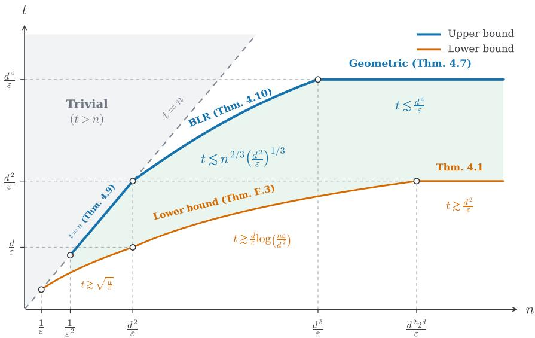
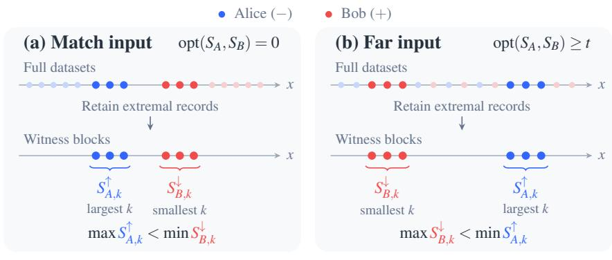
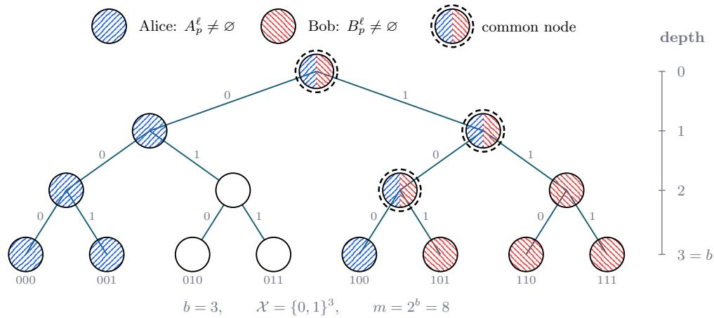
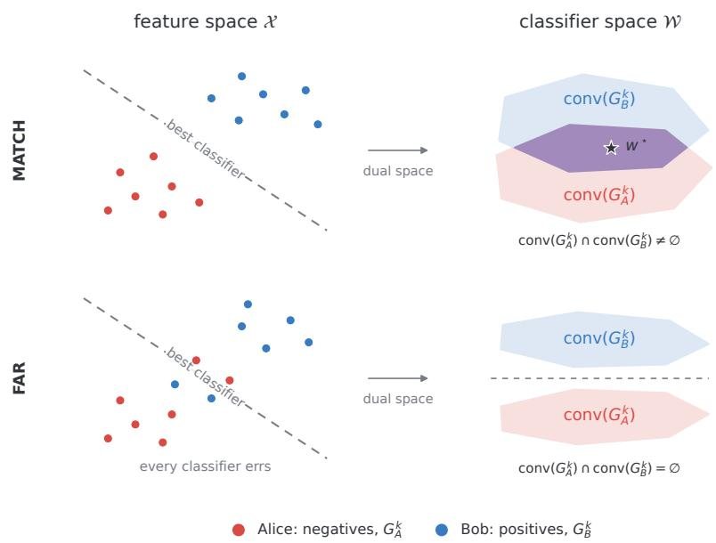
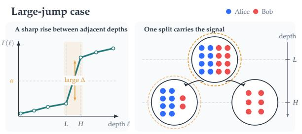
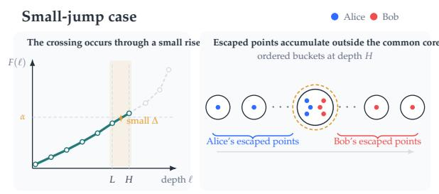
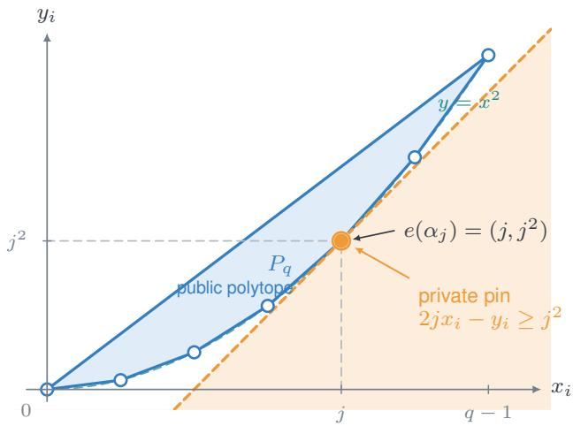

# Sh<sub>ou</sub>ld W<sub>e</sub> C<sub>o</sub>mbin<sub>e</sub> O<sub>u</sub>r D<sub>a</sub>t<sub>a</sub>? Al<sub>go</sub>rithm<sub>s</sub> <sub>a</sub>nd Limit<sub>s</sub> f<sub>o</sub>r Pri<sub>va</sub>t<sub>e</sub>l<sub>y</sub> A<sub>ssess</sub>in<sub>g</sub> D<sub>a</sub>t<sub>a</sub> Sh<sub>a</sub>rin<sub>g</sub>

Mahdi Ha<sub>g</sub>hifam To<sub>y</sub>ota Technolo<sub>g</sub>ical Instit<sub>u</sub>te at Chica<sub>g</sub>o

A<sub>vr</sub>i<sub>m</sub> Bl<sub>um</sub> To<sub>y</sub>ota Technolo<sub>g</sub>ical Instit<sub>u</sub>te at Chica<sub>g</sub>o

Kumar Ks<sup>h</sup>itij Pate<sup>l</sup> Y<sub>a</sub>l<sub>e</sub> Uni<sub>ve</sub>r<sub>s</sub>it<sub>y</sub>

Gi<sub>u</sub>li<sub>a</sub> F<sub>a</sub>nti C<sub>a</sub>rn<sub>eg</sub>i<sub>e</sub> M<sub>e</sub>ll<sub>o</sub>n Uni<sub>ve</sub>r<sub>s</sub>it<sub>y</sub>

Juba Ziani Geor<sub>g</sub>ia Institute of Technolo<sub>gy</sub>

## Abstract

I<sub>n</sub> thi<sub>s paper, we s</sub>t<sub>u</sub>d<sub>y w</sub>h<sub>en</sub> t<sub>wo par</sub>ti<sub>es s</sub>h<sub>ou</sub>ld <sub>poo</sub>l th<sub>e</sub>i<sub>r</sub> d<sub>a</sub>t<sub>a</sub> t<sub>o</sub> t<sub>ra</sub>i<sub>n a mac</sub>hi<sub>ne</sub> l<sub>earn</sub>i<sub>ng mo</sub>d<sub>e</sub>l<sub>.</sub> T<sub>wo</sub> <sub>agen</sub>t<sub>s,</sub> Ali<sub>ce</sub> <sub>an</sub>d B<sub>o</sub>b<sub>,</sub> <sub>eac</sub>h h<sub>o</sub>ld <sub>a</sub> <sub>sens</sub>iti<sub>ve</sub> l<sub>a</sub>b<sub>e</sub>l<sub>e</sub>d d<sub>a</sub>t<sub>ase</sub>t <sub>an</sub>d <sub>wan</sub>t t<sub>o</sub> t<sub>ra</sub>i<sub>n</sub> <sub>a</sub> <sub>c</sub>l<sub>ass</sub>ifi<sub>er</sub> f<sub>rom</sub> a <sub>g</sub>iven h<sub>yp</sub>othesis class H. Even when each <sub>p</sub>art<sub>y</sub>’s dataset can be <sub>p</sub>erfectl<sub>y</sub> classified on its own, th<sub>e</sub> t<sub>wo par</sub>ti<sub>es may</sub> f<sub>o</sub>ll<sub>ow con</sub>fli<sub>c</sub>ti<sub>ng</sub> l<sub>a</sub>b<sub>e</sub>li<sub>ng s</sub>t<sub>an</sub>d<sub>ar</sub>d<sub>s or</sub> h<sub>ave se</sub>l<sub>ec</sub>ti<sub>on</sub> bi<sub>ases</sub> th<sub>a</sub>t <sub>a</sub>f<sub>ec</sub>t th<sub>e</sub>i<sub>r</sub> features and label sets, such that no sin<sub>g</sub>le classifier in H fits their combined data. Before committin<sub>g</sub> to data sharin<sub>g</sub>, Alice and Bob therefore want to test whether a sin<sub>g</sub>le classifier in H can jointl<sub>y</sub> fit both d<sub>a</sub>t<sub>ase</sub>t<sub>s—w</sub>ith<sub>ou</sub>t <sub>revea</sub>li<sub>ng</sub> th<sub>e</sub>i<sub>r</sub> i<sub>n</sub>di<sub>v</sub>id<sub>ua</sub>l d<sub>a</sub>t<sub>a</sub> <sub>po</sub>i<sub>n</sub>t<sub>s</sub> t<sub>o</sub> <sub>one</sub> <sub>ano</sub>th<sub>er.</sub>

We formalize this <sub>p</sub>roblem from a learnin<sub>g</sub>-theoretic view<sub>p</sub>oint via $\mathrm { o p t } _ { \mathcal { H } } ,$ the minimum number of mistakes made by any hypothesis in H on their pooled data. Through interactive communication, the a<sub>g</sub>ents must distin<sub>g</sub>uish $\mathrm { o p t } _ { \mathcal { H } } = 0$ (com<sub>p</sub>atible datasets) from $\mathrm { o p t } _ { \mathcal { H } } \geq t$ (conflictin<sub>g</sub> datasets) under <sub>pu</sub>re <sub>�</sub>-t<sub>w</sub>o-<sub>p</sub>art<sub>y</sub> diferential <sub>p</sub>ri<sub>v</sub>ac<sub>y</sub>. A tr<sub>u</sub>sted c<sub>u</sub>rator co<sub>u</sub>ld do this <sub>w</sub>ith $t = O ( 1 / \varepsilon )$ <sub>,</sub> <sub>an</sub>d <sub>we</sub> <sub>as</sub>k h<sub>ow sma</sub>ll � <sub>can</sub> b<sub>e w</sub>ith<sub>ou</sub>t <sub>one.</sub> F<sub>or</sub> th<sub>res</sub>h<sub>o</sub>ld<sub>s on</sub> th<sub>e rea</sub>l li<sub>ne over a</sub> d<sub>oma</sub>i<sub>n o</sub>f <sub>s</sub>i<sub>ze �, we s</sub>h<sub>ow</sub> th<sub>a</sub>t the o<sub>p</sub>timal � is Θ<sup>˜</sup> (lo<sub>g</sub> lo<sub>g</sub>�/�), ex<sub>p</sub>onentiall<sub>y</sub> smaller than the $\Theta ( \log m / \varepsilon )$ <sub>samp</sub>l<sub>es nee</sub>d<sub>e</sub>d t<sub>o pr</sub>i<sub>va</sub>t<sub>e</sub>l<sub>y</sub> l<sub>earn</sub> th<sub>res</sub>h<sub>o</sub>ld<sub>s,</sub> <sub>even</sub> <sub>w</sub>ith <sub>a</sub> <sub>cura</sub>t<sub>or.</sub> F<sub>or</sub> h<sub>a</sub>lf<sub>spaces</sub> i<sub>n</sub> $\mathbb { R } ^ { d }$ , the de<sub>p</sub>endence on � jum<sub>p</sub>s to lo<sub>g</sub>(�): we <sub>g</sub>ive a <sub>p</sub>rotocol with $t = \tilde { O } ( d ^ { 3 } \log m / \varepsilon )$ <sub>an</sub>d <sub>s</sub>h<sub>ow</sub> th<sub>a</sub>t <sub>some</sub> d<sub>oma</sub>i<sub>ns requ</sub>i<sub>re</sub> $t = \Omega ( d \log ( m / d ) / \varepsilon )$

## 1 Introduction

Institutions often hold complementary datasets that capture diferent aspects of the same downstream learnin<sub>g</sub> task. For exam<sub>p</sub>le<sub>,</sub> a breast screenin<sub>g</sub> clinic ma<sub>y</sub> hold <sub>p</sub>rimaril<sub>y</sub> ne<sub>g</sub>ative cases<sub>,</sub> while a s<sub>p</sub>ecialized dia<sub>g</sub>nostic center ma<sub>y</sub> hold a much hi<sub>g</sub>her <sub>p</sub>ro<sub>p</sub>ortion of confirmed cancer cases [LASLBKHOTRM17; SAMHBORLTKLB17]. Similarl<sub>y</sub>, or<sub>g</sub>anizations tr<sub>y</sub>in<sub>g</sub> to detect c<sub>y</sub>bersecurit<sub>y</sub> incidents fre<sub>q</sub>uentl<sub>y</sub> share data to <sub>p</sub>rovide a com<sub>p</sub>rehensive view of the c<sub>y</sub>bersecurit<sub>y</sub> landsca<sub>p</sub>e<sub>,</sub> as attackers ma<sub>y</sub> tar<sub>g</sub>et diferent or<sub>g</sub>anizations with diferent ex<sub>p</sub>loits at diferent times [CH23]. In such settin<sub>g</sub>s, <sub>p</sub>oolin<sub>g</sub> data ma<sub>y</sub> enable i<sub>ns</sub>tit<sub>u</sub>ti<sub>ons</sub> t<sub>o</sub> l<sub>earn a use</sub>f<sub>u</sub>l <sub>c</sub>l<sub>ass</sub>ifi<sub>er</sub> th<sub>a</sub>t <sub>no en</sub>tit<sub>y cou</sub>ld l<sub>earn on</sub> it<sub>s own.</sub> I<sub>n</sub>d<sub>ee</sub>d<sub>,</sub> thi<sub>s po</sub>t<sub>en</sub>ti<sub>a</sub>l <sub>was</sub> hi<sub>g</sub>hli<sub>g</sub>hted and anal<sub>y</sub>zed in earl<sub>y</sub> theoretical works on distributed machine learnin<sub>g</sub> [BBFM12].

Realizin<sub>g</sub> the <sub>p</sub>otential benefit of collaboration<sub>,</sub> however<sub>,</sub> often re<sub>q</sub>uires institutions to commit resources <sub>up</sub>f<sub>ron</sub>t th<sub>roug</sub>h l<sub>ega</sub>l <sub>agreemen</sub>t<sub>s,</sub> fi<sub>nanc</sub>i<sub>a</sub>l <sub>compensa</sub>ti<sub>on, governance approva</sub>l<sub>s, an</sub>d d<sub>e</sub>di<sub>ca</sub>t<sub>e</sub>d infrastructure. Before incurring these costs, institutions need to assess the utility of combining their datasets: wi<sup>ll</sup> poo<sup>l</sup>ing improve mo<sup>d</sup>e<sup>l</sup> accuracy or ot<sup>h</sup>er <sup>d</sup>ownstream metrics enoug<sup>h</sup> to justi<sup>f</sup>y t<sup>h</sup>e co<sup>ll</sup>a<sup>b</sup>oration? Yet t<sup>h</sup>is assessment <sup>d</sup>epen<sup>d</sup>s on joint properties o<sup>f</sup> t<sup>h</sup>e <sup>d</sup>atasets, genera<sup>ll</sup>y <sup>h</sup>i<sup>dd</sup>en <sup>f</sup>rom eac<sup>h</sup> institution<sup>’</sup>s <sup>l</sup>oca<sup>l</sup> view. Institutions <sup>f</sup>ace a circu<sup>l</sup>ar <sup>d</sup>i<sup>l</sup>emma: t<sup>h</sup>ey must ju<sup>d</sup>ge w<sup>h</sup>et<sup>h</sup>er co<sup>ll</sup>a<sup>b</sup>oration is wort<sup>h</sup>w<sup>h</sup>i<sup>l</sup>e <sup>b</sup>e<sup>f</sup>ore committin<sub>g,</sub> <sub>y</sub>et doin<sub>g</sub> so ma<sub>y</sub> re<sub>q</sub>uire the ver<sub>y</sub> data sharin<sub>g</sub> whose value the<sub>y</sub> seek to assess.

Privac<sub>y</sub> re<sub>q</sub>uirements further com<sub>p</sub>licate this dilemma. Hos<sub>p</sub>itals<sub>,</sub> for exam<sub>p</sub>le<sub>,</sub> must <sub>p</sub>rotect sensitive <sub>p</sub>atient <sub>recor</sub>d<sub>s even w</sub>h<sub>en s</sub>h<sub>ar</sub>i<sub>ng</sub> th<sub>em wou</sub>ld h<sub>e</sub>l<sub>p eva</sub>l<sub>ua</sub>t<sub>e a co</sub>ll<sub>a</sub>b<sub>ora</sub>ti<sub>on.</sub> I<sub>ns</sub>tit<sub>u</sub>ti<sub>ons may a</sub>l<sub>so</sub> h<sub>es</sub>it<sub>a</sub>t<sub>e</sub> t<sub>o</sub> di<sub>sc</sub>l<sub>ose</sub> <sub>va</sub>l<sub>ua</sub>bl<sub>e</sub> d<sub>a</sub>t<sub>a</sub> t<sub>o</sub> <sub>a</sub> <sub>prospec</sub>ti<sub>ve</sub> <sub>par</sub>t<sub>ner</sub> <sub>w</sub>h<sub>o</sub> <sub>cou</sub>ld <sub>use</sub> th<sub>em</sub> i<sub>n</sub>d<sub>epen</sub>d<sub>en</sub>tl<sub>y</sub> <sub>an</sub>d d<sub>ec</sub>li<sub>ne</sub> t<sub>o</sub> <sub>co</sub>ll<sub>a</sub>b<sub>ora</sub>t<sub>e.</sub> Wh<sub>en</sub> <sub>no</sub> t<sub>rus</sub>t<sub>e</sub>d thi<sub>r</sub>d <sub>par</sub>t<sub>y</sub> i<sub>s</sub> <sub>ava</sub>il<sub>a</sub>bl<sub>e,</sub> <sub>eac</sub>h <sub>par</sub>t<sub>y</sub> <sub>mus</sub>t th<sub>ere</sub>f<sub>ore</sub> <sub>assess</sub> <sub>w</sub>h<sub>e</sub>th<sub>er</sub> <sub>co</sub>ll<sub>a</sub>b<sub>ora</sub>ti<sub>on</sub> i<sub>s</sub> <sub>prom</sub>i<sub>s</sub>i<sub>ng</sub> while limitin<sub>g</sub> what it reveals about its data. This tension between the need to <sub>p</sub>reserve data <sub>p</sub>rivac<sub>y</sub> while enablin<sub>g</sub> a<sub>g</sub>ents to assess the utilit<sub>y</sub> of collaboration motivates the main conce<sub>p</sub>tual <sub>q</sub>uestion of this <sub>p</sub>a<sub>p</sub>er: How can agents estimate whether it is beneficial to combine their datasets while preserving the privacy of individual records? What algorithms can achieve this goal, and what are theirfundamental limits?

## 1.1 How to Assess the Benefits of Data Sharing?

In this section<sub>,</sub> we <sub>p</sub>ro<sub>p</sub>ose a learnin<sub>g</sub>-theoretic notion that a<sub>g</sub>ents can use to assess the value of data <sub>s</sub>h<sub>ar</sub>i<sub>ng an</sub>d <sub>prov</sub>id<sub>e</sub> t<sub>wo rea</sub>l<sub>-wor</sub>ld <sub>scenar</sub>i<sub>os</sub> i<sub>n w</sub>hi<sub>c</sub>h it <sub>can</sub> i<sub>n</sub>f<sub>orm</sub> th<sub>e</sub> d<sub>ec</sub>i<sub>s</sub>i<sub>on</sub> t<sub>o co</sub>ll<sub>a</sub>b<sub>ora</sub>t<sub>e.</sub> O<sub>ur</sub> f<sub>ocus</sub> throu<sub>g</sub>hout the <sub>p</sub>a<sub>p</sub>er is on binar<sub>y</sub> classification on a data s<sub>p</sub>ace (or feature s<sub>p</sub>ace) $\boldsymbol { \chi } \subset \mathbb { R } ^ { d }$ <sub>o</sub>f <sub>s</sub>i<sub>ze �</sub> f<sub>or</sub> some $d \ge 1$ <sub>an</sub>d <sub>a</sub> fi<sub>xe</sub>d <sub>pu</sub>bli<sub>c</sub>l<sub>y</sub> k<sub>nown</sub> h<sub>ypo</sub>th<sub>es</sub>i<sub>s</sub> <sub>c</sub>l<sub>ass</sub> ${ \mathcal { H } } \subseteq \{ \pm 1 \} ^ { \chi }$ <sub>.</sub> W<sub>e co</sub>n<sub>s</sub>id<sub>e</sub>r <sub>a se</sub>ttin<sub>g w</sub>ith t<sub>wo</sub> a<sub>g</sub>ents, Alice (�) and Bob (�) who res<sub>p</sub>ecitvel<sub>y</sub> hold a labeled dataset $S _ { A } , S _ { B } \in ( X \times \{ \pm 1 \} ) ^ { n }$ <sub>o</sub>f <sub>s</sub>i<sub>ze</sub> $n \in \mathbb { N }$

We <sup>f</sup>ocus on a <sup>b</sup>asic question t<sup>h</sup>at arises <sup>b</sup>e<sup>f</sup>ore joint training: can a sing<sup>l</sup>e c<sup>l</sup>assi<sup>fi</sup>er in a given <sup>h</sup>ypot<sup>h</sup>esis c<sup>l</sup>ass exp<sup>l</sup>ain <sup>b</sup>ot<sup>h</sup> parties<sup>’</sup> <sup>d</sup>ata? We <sup>f</sup>orma<sup>l</sup>ize t<sup>h</sup>is question using t<sup>h</sup>eir joint empirica<sup>l</sup> <sup>l</sup>oss <sup>d</sup>e<sup>fi</sup>ne<sup>d</sup> as

$$
\mathrm { o p t } _ { \mathcal { H } } ( S _ { A } , S _ { B } ) : = \operatorname* { m i n } _ { h \in \mathcal { H } } \sum _ { U \in \{ A , B \} } \sum _ { ( x , y ) \in S _ { U } } 1 \{ h ( x ) \neq y \} .\tag{1}
$$

We use $\mathrm { o p t } _ { \mathcal { H } } ( S _ { A } , S _ { B } )$ <sub>,</sub> th<sub>e</sub> <sub>num</sub>b<sub>er</sub> <sub>o</sub>f <sub>m</sub>i<sub>s</sub>t<sub>a</sub>k<sub>es</sub> <sub>ma</sub>d<sub>e</sub> <sub>on</sub> th<sub>e</sub> <sub>poo</sub>l<sub>e</sub>d d<sub>a</sub>t<sub>a</sub> b<sub>y</sub> th<sub>e</sub> b<sub>es</sub>t <sub>c</sub>l<sub>ass</sub>ifi<sub>er</sub> i<sub>n</sub> $\mathcal { H } .$ , to assess th<sub>e va</sub>l<sub>ue o</sub>f <sub>com</sub>bi<sub>n</sub>i<sub>ng</sub> th<sub>e</sub> d<sub>a</sub>t<sub>a.</sub> It i<sub>s zero w</sub>h<sub>en one</sub> h<sub>ypo</sub>th<sub>es</sub>i<sub>s exp</sub>l<sub>a</sub>i<sub>ns</sub> b<sub>o</sub>th d<sub>a</sub>t<sub>ase</sub>t<sub>s, an</sub>d l<sub>arge w</sub>h<sub>en</sub> ever<sub>y</sub> h<sub>yp</sub>othesis in $\mathcal { H }$ ma<sup>k</sup>es many mista<sup>k</sup>es on t<sup>h</sup>eir union. A <sup>l</sup>arge joint <sup>l</sup>oss may in<sup>d</sup>icate con<sup>fl</sup>icting l<sub>a</sub>b<sub>e</sub>li<sub>ng prac</sub>ti<sub>ces, se</sub>l<sub>ec</sub>ti<sub>on</sub> bi<sub>ases caus</sub>i<sub>ng m</sub>i<sub>ss</sub>i<sub>ng</sub> f<sub>ea</sub>t<sub>ures an</sub>d l<sub>a</sub>b<sub>e</sub>l<sub>s, or</sub> th<sub>a</sub>t th<sub>e</sub> h<sub>ypo</sub>th<sub>es</sub>i<sub>s c</sub>l<sub>ass</sub> i<sub>s no</sub>t <sub>comp</sub>l<sub>ex enoug</sub>h t<sub>o</sub> fit th<sub>e com</sub>bi<sub>ne</sub>d d<sub>a</sub>t<sub>a.</sub>

W<sub>e</sub> th<sub>ere</sub>f<sub>ore</sub> f<sub>ocus</sub> <sub>on</sub> di<sub>s</sub>ti<sub>ngu</sub>i<sub>s</sub>hi<sub>ng</sub> b<sub>e</sub>t<sub>ween</sub> th<sub>e</sub> f<sub>o</sub>ll<sub>ow</sub>i<sub>ng:</sub>

$$
\mathrm { o p t } _ { \mathcal { H } } ( S _ { A } , S _ { B } ) = 0
$$

$$
\mathrm { o p t } _ { \mathcal { H } } ( S _ { A } , S _ { B } ) \geq t\tag{2}
$$

f<sub>or some</sub> $t > 0$ <sub>.</sub> Wh<sub>en</sub> $\mathrm { o p t } _ { \mathcal { H } } ( S _ { A } , S _ { B } ) = 0 _  \it$ <sub>,</sub> Ali<sub>ce</sub> <sub>an</sub>d B<sub>o</sub>b <sub>agree</sub> t<sub>o</sub> <sub>co</sub>ll<sub>a</sub>b<sub>ora</sub>t<sub>e.</sub> Wh<sub>en</sub> $\mathrm { o p t } _ { \mathcal { H } } ( S _ { A } , S _ { B } ) \geq t ,$ <sub>,</sub> Ali<sub>ce</sub> <sub>an</sub>d B<sub>o</sub>b <sub>mus</sub>t <sub>reassess</sub><sup>1</sup><sub>.</sub> Fi<sub>na</sub>ll<sub>y,</sub> if $\mathsf { \Gamma } 0 < \mathsf { o p t } _ { \mathcal { H } } ( S _ { A } , S _ { B } ) < t ,$ <sub>we ma</sub>k<sub>e no c</sub>l<sub>a</sub>i<sub>ms, as</sub> i<sub>s s</sub>t<sub>an</sub>d<sub>ar</sub>d i<sub>n</sub> di<sub>s</sub>t<sub>r</sub>ib<sub>u</sub>ti<sub>on</sub> testin<sub>g</sub>. We now <sub>p</sub>resent two exam<sub>p</sub>les that further motivate the <sub>p</sub>ro<sub>p</sub>ert<sub>y</sub>-testin<sub>g p</sub>roblem in (2).

Example 1 (Learning from disparate label sets). Suppose Alice is a screening clinician and Bob is a dia<sub>g</sub>nostician. The<sub>y</sub> want to develo<sub>p</sub> a classifier to determine whether a <sub>p</sub>atient in a tar<sub>g</sub>et <sub>p</sub>o<sub>p</sub>ulation should b<sub>e</sub> <sub>re</sub>f<sub>erre</sub>d f<sub>or</sub> f<sub>ur</sub>th<sub>er</sub> di<sub>agnos</sub>ti<sub>c</sub> t<sub>es</sub>ti<sub>ng.</sub> Th<sub>e</sub>i<sub>r</sub> d<sub>a</sub>t<sub>ase</sub>t<sub>s</sub> <sub>re</sub>fl<sub>ec</sub>t dif<sub>eren</sub>t <sub>s</sub>t<sub>ages</sub> <sub>o</sub>f <sub>care:</sub> Ali<sub>ce</sub>’<sub>s</sub> <sub>screen</sub>i<sub>ng</sub> d<sub>a</sub>t<sub>ase</sub>t $S _ { A }$ <sub>ma</sub>i<sub>n</sub>l<sub>y con</sub>t<sub>a</sub>i<sub>ns recor</sub>d<sub>s o</sub>f <sub>pa</sub>ti<sub>en</sub>t<sub>s w</sub>h<sub>o were no</sub>t <sub>re</sub>f<sub>erre</sub>d<sub>, w</sub>h<sub>ereas</sub> B<sub>o</sub>b’<sub>s</sub> di<sub>agnos</sub>ti<sub>c</sub> d<sub>a</sub>t<sub>ase</sub>t $S _ { B }$ contains onl<sub>y</sub> records of <sub>p</sub>atients who were referred and received more thorou<sub>g</sub>h testin<sub>g</sub> [GBRRDJM11]. Sin<sub>ce</sub> th<sub>e</sub> r<sub>eco</sub>rd<sub>s co</sub>nt<sub>a</sub>in <sub>se</sub>n<sub>s</sub>iti<sub>ve pa</sub>ti<sub>e</sub>nt inf<sub>o</sub>rm<sub>a</sub>ti<sub>o</sub>n<sub>,</sub> n<sub>e</sub>ith<sub>e</sub>r <sub>age</sub>nt i<sub>s w</sub>illin<sub>g</sub> t<sub>o</sub> di<sub>sc</sub>l<sub>ose</sub> indi<sub>v</sub>id<sub>ua</sub>l <sub>recor</sub>d<sub>s</sub> t<sub>o assess a poss</sub>ibl<sub>e co</sub>ll<sub>a</sub>b<sub>ora</sub>ti<sub>on, an</sub>d <sub>no</sub> t<sub>rus</sub>t<sub>e</sub>d thi<sub>r</sub>d <sub>par</sub>t<sub>y</sub> i<sub>s ava</sub>il<sub>a</sub>bl<sub>e.</sub> T<sub>o</sub> i<sub>so</sub>l<sub>a</sub>t<sub>e</sub> thi<sub>s se</sub>l<sub>ec</sub>ti<sub>on</sub> bias, su<sub>pp</sub>ose Alice’s labels are all −1, and Bob’s are all +1. Then, neither can train a useful model alone; t<sup>h</sup>e<sub>y</sub> must assess $\mathrm { o p t } _ { \mathcal { H } } ( S _ { A } , S _ { B } )$ to <sup>d</sup>etermine w<sup>h</sup>et<sup>h</sup>er t<sup>h</sup>ey can train a <sup>l</sup>ow-error mo<sup>d</sup>e<sup>l</sup> on t<sup>h</sup>eir joint <sup>d</sup>ata.

Example 2 (Identifying conflicting labeling practices). Now suppose Alice has labeled spam and non-spam <sub>ema</sub>il<sub>s</sub> i<sub>n</sub> h<sub>er</sub> d<sub>a</sub>t<sub>ase</sub>t<sub>.</sub> H<sub>owever,</sub> h<sub>er</sub> d<sub>a</sub>t<sub>a may</sub> b<sub>e</sub> li<sub>m</sub>it<sub>e</sub>d <sub>or</sub> i<sub>m</sub>b<sub>a</sub>l<sub>ance</sub>d<sub>, so s</sub>h<sub>e wan</sub>t<sub>s</sub> t<sub>o augmen</sub>t it <sub>w</sub>ith B<sub>o</sub>b’<sub>s</sub> <sub>cura</sub>t<sub>e</sub>d<sub>,</sub> l<sub>a</sub>b<sub>e</sub>l<sub>e</sub>d <sub>ema</sub>il d<sub>a</sub>t<sub>ase</sub>t<sub>.</sub> Th<sub>e</sub> <sub>c</sub>h<sub>a</sub>ll<sub>enge</sub> i<sub>s</sub> th<sub>a</sub>t B<sub>o</sub>b <sub>may</sub> h<sub>ave</sub> <sub>a</sub> dif<sub>eren</sub>t <sub>v</sub>i<sub>ew</sub> <sub>o</sub>f <sub>w</sub>h<sub>a</sub>t <sub>cons</sub>tit<sub>u</sub>t<sub>es</sub> s<sub>p</sub>am, so his labels could conflict with Alice’s data [KCG24]. For exam<sub>p</sub>le, Alice ma<sub>y</sub> label unsolicited promotiona<sup>l</sup> emai<sup>l</sup>s as spam, w<sup>h</sup>i<sup>l</sup>e Bo<sup>b</sup> uses t<sup>h</sup>at <sup>l</sup>a<sup>b</sup>e<sup>l</sup> <sup>f</sup>or <sup>f</sup>rau<sup>d</sup>u<sup>l</sup>ent or ma<sup>l</sup>icious messages. Be<sup>f</sup>ore joint t<sub>ra</sub>i<sub>n</sub>i<sub>ng,</sub> Ali<sub>ce wan</sub>t<sub>s</sub> t<sub>o</sub> k<sub>now w</sub>h<sub>e</sub>th<sub>er a s</sub>i<sub>ng</sub>l<sub>e c</sub>l<sub>ass</sub>ifi<sub>er can ac</sub>hi<sub>eve a su</sub>fi<sub>c</sub>i<sub>en</sub>tl<sub>y</sub> l<sub>ow</sub> t<sub>es</sub>t <sub>error un</sub>d<sub>er</sub> both labelin<sub>g</sub> <sub>p</sub>olicies. To isolate conflictin<sub>g</sub> labelin<sub>g</sub> <sub>p</sub>ractices<sub>,</sub> su<sub>pp</sub>ose the a<sub>g</sub>ents encounter the same di<sub>s</sub>t<sub>r</sub>ib<sub>u</sub>ti<sub>on</sub> <sub>o</sub>f <sub>ema</sub>il<sub>s</sub> b<sub>u</sub>t <sub>may</sub> <sub>ass</sub>i<sub>gn</sub> dif<sub>eren</sub>t l<sub>a</sub>b<sub>e</sub>l<sub>s</sub> t<sub>o</sub> th<sub>e</sub> <sub>same</sub> <sub>ema</sub>il<sub>.</sub> I<sub>n</sub> thi<sub>s</sub> <sub>case,</sub> $\mathrm { o p t } _ { \mathcal { H } } ( S _ { A } , S _ { B } ) = 0$ indicates that<sub>,</sub> under the h<sub>yp</sub>othesis class �<sub>,</sub> Alice’s and Bob’s labelin<sub>g</sub> <sub>p</sub>ractices are com<sub>p</sub>atible<sub>,</sub> im<sub>p</sub>l<sub>y</sub>in<sub>g</sub> a <sub>co</sub>ll<sub>a</sub>b<sub>ora</sub>ti<sub>on</sub> <sub>may</sub> b<sub>e</sub> <sub>wor</sub>th<sub>w</sub>hil<sub>e.</sub> O<sub>n</sub> th<sub>e</sub> <sub>o</sub>th<sub>er</sub> <sub>en</sub>d<sub>,</sub> $\mathrm { o p t } _ { \mathcal { H } } ( S _ { A } , S _ { B } ) \geq t$ <sub>p</sub>oints to diferin<sub>g</sub> labelin<sub>g</sub> <sub>p</sub>ractices.

Remark 1.1 (From in-sample to in-population error). Note that our insights extend beyond the in-sample case and hold when considerin<sub>g</sub> <sub>g</sub>eneralization error over the underl<sub>y</sub>in<sub>g</sub> <sub>p</sub>o<sub>p</sub>ulation distributions. We <sub>p</sub>rovide more details usin<sub>g</sub> standard ar<sub>g</sub>uments in A<sub>pp</sub>endix A. ⊳

## 1.2 Problem Formalization

I<sub>n</sub> thi<sub>s</sub> <sub>sec</sub>ti<sub>on,</sub> <sub>we</sub> f<sub>orma</sub>li<sub>ze</sub> <sub>our</sub> <sub>pro</sub>bl<sub>em</sub> <sub>an</sub>d <sub>s</sub>t<sub>a</sub>t<sub>e</sub> <sub>our</sub> <sub>ma</sub>i<sub>n</sub> t<sub>ec</sub>h<sub>n</sub>i<sub>ca</sub>l <sub>ques</sub>ti<sub>on.</sub> W<sub>e</sub> fi<sub>rs</sub>t <sub>cons</sub>id<sub>er</sub> th<sub>e</sub> <sup>d</sup>isjoint-<sup>l</sup>a<sup>b</sup>e<sup>l</sup> setting as in Examp<sup>l</sup>e 1, w<sup>h</sup>ere A<sup>l</sup>ice <sup>h</sup>o<sup>ld</sup>s on<sup>l</sup>y negative<sup>l</sup>y <sup>l</sup>a<sup>b</sup>e<sup>l</sup>e<sup>d</sup> examp<sup>l</sup>es, an<sup>d</sup> Bo<sup>b h</sup>o<sup>ld</sup>s <sub>on</sub>l<sub>y</sub> <sub>pos</sub>iti<sub>ve</sub>l<sub>y</sub> l<sub>a</sub>b<sub>e</sub>l<sub>e</sub>d <sub>ones.</sub> Si<sub>nce</sub> th<sub>e</sub> l<sub>a</sub>b<sub>e</sub>l<sub>s</sub> <sub>are</sub> fi<sub>xe</sub>d b<sub>y</sub> th<sub>e</sub> <sub>par</sub>t<sub>y</sub> h<sub>o</sub>ldi<sub>ng</sub> <sub>eac</sub>h <sub>recor</sub>d<sub>,</sub> <sub>we</sub> <sub>suppress</sub> th<sub>em</sub> <sub>an</sub>d <sub>wr</sub>it<sub>e</sub> $S _ { A } , S _ { B } \in X ^ { n }$ . This settin<sub>g</sub> isolates the joint as<sub>p</sub>ect of the <sub>p</sub>roblem: when H contains the constant <sub>pre</sub>di<sub>c</sub>t<sub>ors, eac</sub>h l<sub>oca</sub>l d<sub>a</sub>t<sub>ase</sub>t i<sub>s per</sub>f<sub>ec</sub>tl<sub>y rea</sub>li<sub>za</sub>bl<sub>e,</sub> b<sub>u</sub>t th<sub>e</sub>i<sub>r un</sub>i<sub>on nee</sub>d <sub>no</sub>t b<sub>e.</sub> Th<sub>us,</sub> th<sub>e</sub> l<sub>oca</sub>l <sub>op</sub>ti<sub>ma</sub>l <sub>errors a</sub>l<sub>one</sub> d<sub>o no</sub>t d<sub>e</sub>t<sub>erm</sub>i<sub>ne w</sub>h<sub>e</sub>th<sub>er a common c</sub>l<sub>ass</sub>ifi<sub>er can exp</sub>l<sub>a</sub>i<sub>n</sub> b<sub>o</sub>th d<sub>a</sub>t<sub>ase</sub>t<sub>s.</sub> F<sub>or our a</sub>l<sub>gor</sub>ith<sub>ms,</sub> we later show that the<sub>y</sub> extend to datasets with arbitrar<sub>y</sub> label mixtures (see Corollaries 4.8 and 3.13).

Th<sub>e</sub> d<sub>e</sub>fi<sub>n</sub>iti<sub>on o</sub>f $\mathrm { o p t } _ { \mathcal { H } }$ in E<sub>q</sub>uation (1) in the disjoint-label settin<sub>g</sub> can be rewritten as

$$
\operatorname { o p t } _ { \mathcal { H } } ( S _ { A } , S _ { B } ) \triangleq \operatorname* { m i n } _ { h \in \mathcal { H } } \left\{ \sum _ { x _ { A } \in S _ { A } } { \mathbf { 1 } \{ h ( x _ { A } ) \neq - 1 \} } + \sum _ { x _ { B } \in S _ { B } } { \mathbf { 1 } \{ h ( x _ { B } ) \neq + 1 \} } \right\} .\tag{3}
$$

T<sub>o assess a po</sub>t<sub>en</sub>ti<sub>a</sub>l <sub>co</sub>ll<sub>a</sub>b<sub>ora</sub>ti<sub>on,</sub> th<sub>e agen</sub>t<sub>s</sub> fi<sub>rs</sub>t <sub>agree on an error</sub> th<sub>res</sub>h<sub>o</sub>ld $t \in [ 2 n ]$ <sub>.</sub> Th<sub>ey see</sub>k <sub>a</sub> <sub>p</sub>rivate assessment al<sub>g</sub>orithm that rejects with hi<sub>g</sub>h <sub>p</sub>robabilit<sub>y</sub> when ever<sub>y</sub> classifier in H makes at least � <sub>m</sub>i<sub>s</sub>t<sub>a</sub>k<sub>es on</sub> th<sub>e poo</sub>l<sub>e</sub>d d<sub>a</sub>t<sub>a,</sub> i<sub>.e.,</sub> $\mathrm { o p t } _ { \mathcal { H } } ( S _ { A } , S _ { B } ) \geq t .$ . We call this re<sub>qu</sub>irement so<sub>u</sub>ndness. Ho<sub>w</sub>e<sub>v</sub>er<sub>,</sub> a tri<sub>v</sub>ial a<sup>l</sup>gorit<sup>h</sup>m t<sup>h</sup>at a<sup>l</sup>ways rejects a<sup>l</sup>so satis<sup>fi</sup>es soun<sup>d</sup>ness. We t<sup>h</sup>ere<sup>f</sup>ore a<sup>l</sup>so require t<sup>h</sup>e a<sup>l</sup>gorit<sup>h</sup>m to accept wit<sup>h h</sup>ig<sup>h</sup> pro<sup>b</sup>a<sup>b</sup>i<sup>l</sup>ity w<sup>h</sup>en t<sup>h</sup>e poo<sup>l</sup>e<sup>d d</sup>ata are joint<sup>l</sup>y rea<sup>l</sup>iza<sup>bl</sup>e, i.e., $\mathrm { o p t } _ { \mathcal { H } } ( S _ { A } , S _ { B } ) = 0 .$ a re<sub>q</sub>u<sup>i</sup>rement we <sub>ca</sub>ll <sub>comp</sub>l<sub>e</sub>t<sub>eness.</sub> Fi<sub>na</sub>ll<sub>y,</sub> t<sub>o pro</sub>t<sub>ec</sub>t th<sub>e pr</sub>i<sub>vacy o</sub>f i<sub>n</sub>di<sub>v</sub>id<sub>ua</sub>l <sub>recor</sub>d<sub>s</sub> th<sub>roug</sub>h<sub>ou</sub>t th<sub>e</sub> i<sub>n</sub>t<sub>erac</sub>ti<sub>on, we use</sub> diferential <sub>p</sub>rivac<sub>y</sub> [DMNS06] in its two-<sub>p</sub>art<sub>y</sub> form [BNO08; MMPRTV10], which re<sub>q</sub>uires each a<sub>g</sub>ent’s view to be diferentiall<sub>y p</sub>rivate with res<sub>p</sub>ect to the other a<sub>g</sub>ent’s dataset (see Definition 2.1). We combine th<sub>ese p</sub>i<sub>eces an</sub>d f<sub>orma</sub>ll<sub>y</sub> d<sub>e</sub>fi<sub>ne</sub> th<sub>e</sub> t<sub>wo-par</sub>t<sub>y a</sub>l<sub>gor</sub>ith<sub>m</sub> f<sub>or</sub> d<sub>a</sub>t<sub>ase</sub>t <sub>va</sub>l<sub>ua</sub>ti<sub>on as</sub> f<sub>o</sub>ll<sub>ows:</sub>

Definition 1.2 (�-DP tester with resolution �). Fix a data space $\chi ,$ <sub>a</sub> h<sub>ypo</sub>th<sub>es</sub>i<sub>s</sub> <sub>c</sub>l<sub>ass</sub> ${ \mathcal { H } } \subseteq \{ \pm 1 \} ^ { \chi }$ <sub>, a</sub> d<sub>a</sub>t<sub>ase</sub>t <sub>s</sub>iz<sub>e</sub> $n \in \mathbb { N } ,$ <sup>a</sup> p<sup>rivac</sup>y p<sup>arameter</sup> $\varepsilon > 0 ,$ <sub>,</sub> <sub>an</sub>d $t \in [ 2 n ]$ . Let Π be an almost-surel<sub>y</sub> terminatin<sub>g</sub> interactive t<sub>wo-par</sub>t<sub>y</sub> <sub>pro</sub>t<sub>oco</sub>l <sub>on</sub> <sub>a</sub>ll <sub>pa</sub>i<sub>rs</sub> <sub>o</sub>f fi<sub>n</sub>it<sub>e</sub> <sub>mu</sub>lti<sub>se</sub>t<sub>s</sub> <sub>over</sub> $\chi ,$ with common output in {Match, Far}. We interpret t<sup>h</sup>ese outputs as acceptance or rejection o<sup>f</sup> t<sup>h</sup>e propose<sup>d</sup> co<sup>ll</sup>a<sup>b</sup>oration at t<sup>h</sup>is pre<sup>l</sup>iminary stage, respective<sup>l</sup>y. We call Π an �-private tester with resolution � for H at dataset size � if it satisfies the following requirements:

1. Privacy. Π satisfies �-two-party diferential privacy as in Definition 2.1 for every input $S _ { A } , S _ { B } \in { \cal X } ^ { n }$

2. Soundness. For every $S _ { A } , S _ { B } \in { \cal X } ^ { n }$ s.t. $\mathrm { o p t } _ { \mathcal { H } } ( S _ { A } , S _ { B } ) \geq t ,$ <sub>we</sub> h<sub>ave</sub> $\operatorname* { P r } [ \Pi ( S _ { A } , S _ { B } ) = \operatorname { F a r } ] \geq 0 . 9$

3. Completeness. For every $S _ { A } , S _ { B } \in { \mathcal { X } } ^ { n }$ , s.t. $\mathrm { o p t } _ { \mathcal { H } } ( S _ { A } , S _ { B } ) = 0 _ { \mathrm { \Omega } }$ <sub>,</sub> <sub>we</sub> h<sub>ave</sub> $\mathrm { P r } [ \Pi ( S _ { A } , S _ { B } ) = \mathsf { M a t c h } ] \ge 0 . 9$

Th<sub>e</sub> <sub>pro</sub>b<sub>a</sub>biliti<sub>es</sub> <sub>are</sub> <sub>over</sub> th<sub>e</sub> <sub>pro</sub>t<sub>oco</sub>l’<sub>s</sub> <sub>pr</sub>i<sub>va</sub>t<sub>e</sub> <sub>an</sub>d <sub>pu</sub>bli<sub>c</sub> <sub>ran</sub>d<sub>omness.</sub>

W<sub>e see</sub>k th<sub>e sma</sub>ll<sub>es</sub>t <sub>ac</sub>hi<sub>eva</sub>bl<sub>e reso</sub>l<sub>u</sub>ti<sub>on</sub> �<sub>, s</sub>i<sub>nce sma</sub>ll<sub>er va</sub>l<sub>ues</sub> l<sub>e</sub>t <sub>agen</sub>t<sub>s en</sub>f<sub>orce s</sub>t<sub>r</sub>i<sub>c</sub>t<sub>er error</sub> t<sub>o</sub>l<sub>erances.</sub> Without <sub>p</sub>rivac<sub>y</sub> constraints<sub>,</sub> the a<sub>g</sub>ents can exchan<sub>g</sub>e their datasets and com<sub>p</sub>ute o<sub>p</sub>t $ _ { \mathcal { H } } ( S _ { A } , S _ { B } )$ exact<sup>l</sup><sub>y</sub>, achievin<sub>g</sub> $t \ = \ 1$ , the best possible resolution. A trusted curator could also ensure diferential privacy b<sub>y</sub> releasin<sub>g</sub> $\mathrm { o p t } _ { \mathcal { H } } ( S _ { A } , S _ { B } ) + \mathrm { L a p } ( 1 / \varepsilon )$ , since t<sup>h</sup>e joint <sup>l</sup>oss <sup>h</sup>as sensitivity one. T<sup>h</sup>is gives a tester wit<sup>h</sup> <sub>reso</sub>l<sub>u</sub>ti<sub>on</sub> $t _ { \mathrm { c e n t r a l } } = O ( 1 / \varepsilon )$ <sub>,</sub> inde<sub>p</sub>endent of the dimension and h<sub>yp</sub>othesis class. However<sub>,</sub> we re<sub>q</sub>uire information-theoretic two-party diferential privacy without a trusted curator. This motivates the main technical question that our paper seeks to answer:

For fixed H and $\varepsilon ,$ what is the smallest resolution � that an �-DP private tester can guarantee?

## 1.3 Our Results

W<sub>e answer</sub> th<sub>e a</sub>b<sub>ove</sub> t<sub>ec</sub>h<sub>n</sub>i<sub>ca</sub>l <sub>ques</sub>ti<sub>on</sub> f<sub>or</sub> t<sub>wo</sub> f<sub>un</sub>d<sub>amen</sub>t<sub>a</sub>l <sub>c</sub>l<sub>asses o</sub>f h<sub>ypo</sub>th<sub>eses:</sub> th<sub>res</sub>h<sub>o</sub>ld<sub>s on</sub> th<sub>e</sub> <sub>rea</sub>l li<sub>ne</sub> <sub>an</sub>d h<sub>a</sub>lf<sub>-spaces</sub> i<sub>n</sub> $\mathbb { R } ^ { d }$ <sub>.</sub> F<sub>or</sub> <sub>eac</sub>h <sub>c</sub>l<sub>ass,</sub> <sub>we</sub> <sub>es</sub>t<sub>a</sub>bli<sub>s</sub>h b<sub>o</sub>th <sub>upper</sub> <sub>an</sub>d l<sub>ower</sub> b<sub>oun</sub>d<sub>s</sub> <sub>on</sub> th<sub>e</sub> <sub>op</sub>ti<sub>ma</sub>l resolution � of an<sub>y</sub> �-<sub>p</sub>rivate tester (summarized in Table 1). Notabl<sub>y</sub>, our main interactive <sub>p</sub>rotocols achieve a resolution � that is completely independent of the dataset size �, and all of our upper bounds extend immediatel<sub>y</sub> from the disjoint-label settin<sub>g</sub> to arbitrar<sub>y</sub> mixed-label datasets (see Corollaries 4.8 and 3.13).

## 1.3.1 Thresholds on Real Line

W<sub>e</sub> <sub>s</sub>t<sub>ar</sub>t <sub>w</sub>ith th<sub>e</sub> <sub>s</sub>i<sub>mp</sub>l<sub>es</sub>t <sub>non</sub>t<sub>r</sub>i<sub>v</sub>i<sub>a</sub>l <sub>c</sub>l<sub>ass,</sub> th<sub>res</sub>h<sub>o</sub>ld<sub>s</sub> <sub>on</sub> th<sub>e</sub> <sub>rea</sub>l li<sub>ne,</sub> <sub>w</sub>h<sub>ere</sub> <sub>eac</sub>h h<sub>ypo</sub>th<sub>es</sub>i<sub>s</sub> l<sub>a</sub>b<sub>e</sub>l<sub>s</sub> <sub>a</sub> <sub>po</sub>i<sub>n</sub>t <sub>p</sub>ositive exactl<sub>y</sub> when it lies at or above a cutof $\theta { : }$

$$
{ \mathcal { H } } _ { \mathrm { t h r } } = \{ h _ { \theta } : \mathbb { R } \to \{ \pm 1 \} \mid \exists \theta \in \mathbb { R } { \mathrm { ~ s . t . ~ } } h _ { \theta } ( x ) = 1 { \mathrm { ~ f o r ~ } } x \geq \theta { \mathrm { ~ a n d ~ } } h _ { \theta } ( x ) = - 1 { \mathrm { ~ f o r ~ } } x < \theta \} .\tag{4}
$$

O<sub>ur ma</sub>i<sub>n resu</sub>lt f<sub>or</sub> thi<sub>s c</sub>l<sub>ass</sub> i<sub>s as</sub> f<sub>o</sub>ll<sub>ows:</sub>

Theorem 1.3 (Informal Version of Theorems 3.1 and 3.12). Fix $m , n \in \mathbb { N }$ and $ { \varepsilon } \in ( 0 , 1 ]$ . For every domain $\chi \subset \mathbb { R }$ with $| X | = m ,$ , provided $\begin{array} { r } { n , t \gtrsim \frac { \log \log m } { \varepsilon } \log \left( \frac { \log \log m } { \varepsilon } \right) } \end{array}$ , there exists an interactive, randomized, and polynomial-time algorithm that is an $\varepsilon { - } D P$ tester with resolution � for ${ \mathcal { H } } _ { \mathrm { t h r } }$ . Moreover, for every domain $\chi \subset \mathbb { R }$ with $| { \cal { X } } | = m$ , every �-DP tester with resolution $t \in [ n ] f o r \mathcal { H } _ { \mathrm { t h r } }$ requires $\begin{array} { r } { : \gtrsim \frac { \log \log m } { \varepsilon } } \end{array}$

• Minimal overhead compared to the centralized/non-private setting: Recall that a trusted curator <sub>ac</sub>hi<sub>eves reso</sub>l<sub>u</sub>ti<sub>on</sub> $O ( 1 / \varepsilon )$ for ever<sub>y</sub> h<sub>yp</sub>othesis class. In com<sub>p</sub>arison<sub>,</sub> two-<sub>p</sub>art<sub>y</sub> diferential <sub>p</sub>rivac<sub>y</sub> introduces onl<sub>y</sub> an �<sup>˜</sup> (lo<sub>g</sub> lo<sub>g</sub>�) de<sub>p</sub>endence on the domain size �, ne<sub>g</sub>li<sub>g</sub>ible in most <sub>p</sub>ractical settin<sub>g</sub>s.

• Exponential improvement using an interactive protocol: Interaction is rovabl re uired to achieve th<sub>e near op</sub>ti<sub>ma</sub>l $\begin{array} { r } { \Theta \biggl ( \frac { \log \log m } { \varepsilon } \log \biggl ( \frac { \log \log m } { \varepsilon } \biggr ) \biggr ) } \end{array}$ r<sub>eso</sub>l<sub>u</sub>ti<sub>o</sub>n: <sub>w</sub>ith<sub>ou</sub>t int<sub>e</sub>r<sub>ac</sub>ti<sub>o</sub>n<sub>, a</sub>n<sub>y �</sub>-<sub>p</sub>ri<sub>va</sub>t<sub>e</sub> t<sub>es</sub>t<sub>e</sub>r r<sub>equ</sub>ir<sub>es</sub> $\begin{array} { r } { t \gtrsim \frac { \log m } { \varepsilon } } \end{array}$ , <sub>y</sub>ieldin<sub>g</sub> an ex<sub>p</sub>onential se<sub>p</sub>aration between interactive and non-interactive <sub>p</sub>rivate testin<sub>g</sub> (see Remark 3.4).

• Exponential separation between private testing and private learning: A natural approach to the testin<sub>g p</sub>roblem in E<sub>q</sub>uation (3) is to <sub>p</sub>rivatel<sub>y</sub> learn a <sub>g</sub>ood classifier and then <sub>p</sub>rivatel<sub>y</sub> evaluate its error on each dataset. However<sub>,</sub> an<sub>y p</sub>ure $\scriptstyle { \varepsilon - \mathrm { D P } }$ th<sub>res</sub>h<sub>o</sub>ld l<sub>earner,</sub> <sub>w</sub>h<sub>e</sub>th<sub>er</sub> <sub>proper</sub> <sub>or</sub> i<sub>mproper,</sub> <sub>requ</sub>i<sub>res</sub> $\Omega \left( \frac { \log m } { \varepsilon } \right)$ <sub>samp</sub>l<sub>es a</sub>t <sub>cons</sub>t<sub>an</sub>t <sub>accuracy an</sub>d <sub>con</sub>fid<sub>ence, even w</sub>h<sub>en a</sub> t<sub>rus</sub>t<sub>e</sub>d <sub>cura</sub>t<sub>or</sub> h<sub>o</sub>ld<sub>s</sub> th<sub>e poo</sub>l<sub>e</sub>d data [BNS13; FX14]. In contrast, Theorem 1.3 <sub>g</sub>ives a <sub>p</sub>rivate tester usin<sub>g</sub> onl<sub>y</sub> $\begin{array} { r } { O \left( \frac { \log \log m } { \varepsilon } \log \left( \frac { \log \log m } { \varepsilon } \right) \right) } \end{array}$ samples, yielding an exponential separation in the dependence on �. Qualitatively similar separations arise in non-<sub>p</sub>ri<sub>v</sub>ate settin<sub>g</sub>s<sub>,</sub> <sub>w</sub>here testin<sub>g</sub> or estimatin<sub>g</sub> o<sub>p</sub>timal <sub>p</sub>rediction error can re<sub>qu</sub>ire fe<sub>w</sub>er sam<sub>p</sub>les or label <sub>q</sub>ueries than learnin<sub>g</sub> a <sub>p</sub>redictor [KR00; BBBY12; BH18; KV18].

## 1.3.2 Halfspaces in Higher Dimension

Th<sub>e nex</sub>t f<sub>un</sub>d<sub>amen</sub>t<sub>a</sub>l h<sub>ypo</sub>th<sub>es</sub>i<sub>s c</sub>l<sub>ass we cons</sub>id<sub>er</sub> i<sub>s</sub> h<sub>a</sub>lf<sub>spaces</sub> i<sub>n</sub> $\mathbb { R } ^ { d }$ d<sub>e</sub>fi<sub>ne</sub>d <sub>as</sub> f<sub>o</sub>ll<sub>ows:</sub>

$$
\mathcal { H } _ { \mathrm { h s } } = \{ h _ { w } : \mathbb { R } ^ { d } \to \{ \pm 1 \} \mid \exists w \in \mathbb { R } ^ { d } \ \mathrm { s . t . } \ h _ { w } ( x ) = \mathrm { s i g n } ( \langle w , x \rangle ) \} .\tag{5}
$$

O<sub>ur ma</sub>i<sub>n resu</sub>lt f<sub>or</sub> thi<sub>s c</sub>l<sub>ass</sub> i<sub>s as</sub> f<sub>o</sub>ll<sub>ows:</sub>

Theorem 1.4 (Informal Version of Theorems $4 . 1 , 4 . 7$ <sub>an</sub>d $\mathrm { E . 4 } )$ . Fix $d \ge 2 , m , n \in \mathbb { N } ,$ and $\varepsilon \in ( 0 , 1 ]$ . For every domain $\boldsymbol { \chi } _ { \mathbf { \delta C } } \mathbb { R } ^ { d }$ with $| { \cal { X } } | = m$ , provided $\begin{array} { r } { n , t \gtrsim \frac { d ^ { 2 } \log m } { \varepsilon } \big ( d + \log \log ( m ) \big ) } \end{array}$ , there exists an interactive $\varepsilon { - } D P$ private algorithm with resolution $t f o r \mathcal { H } _ { \mathrm { h s } }$

Moreover, for every suficiently large � and every $m \gtrsim d ,$ there exists a public domain $\mathcal { X } _ { d , m } \subseteq \mathbb { R } ^ { d }$ with $| \mathcal { X } _ { d , m } | = m$ , chosen only from $( d , m )$ , such that for every suficiently small $\varepsilon > 0$ and every $n \in \mathbb { N }$ with $n \varepsilon \gtrsim 1$ every �-private tester over $\chi _ { d , m }$ with resolution $t \in [ n ]$ requires $\begin{array} { r } { t \gtrsim \frac { \operatorname* { m i n } \{ d , \sqrt { n \varepsilon } \} } { \varepsilon } \log \left( 2 + \operatorname* { m i n } \left\{ \frac { m } { d } , \frac { n \varepsilon } { d ^ { 2 } } \right\} \right) } \end{array}$

Next<sub>, w</sub>e mention a fe<sub>w</sub> im<sub>p</sub>lications of this res<sub>u</sub>lt:

• Sharp jump in domain-size dependence: Comparing Theorem 1.3 and Theorem 1.4 reveals that, <sub>as we move</sub> f<sub>rom one-</sub>di<sub>mens</sub>i<sub>ona</sub>l th<sub>res</sub>h<sub>o</sub>ld<sub>s</sub> $( d = 1 )$ t<sub>o</sub> h<sub>a</sub>lf<sub>spaces</sub> i<sub>n</sub> <sub>any</sub> fi<sub>xe</sub>d di<sub>mens</sub>i<sub>on</sub> $d \geq d _ { 0 }$ f<sub>or</sub> some constant $d _ { 0 } .$ t<sup>h</sup>e <sup>d</sup>epen<sup>d</sup>ence o<sup>f</sup> t<sup>h</sup>e testing reso<sup>l</sup>ution � on t<sup>h</sup>e <sup>d</sup>omain size � jumps exponentia<sup>ll</sup>y f<sub>rom</sub> l<sub>og</sub> l<sub>og�</sub> t<sub>o</sub> l<sub>og�.</sub> O<sub>ur</sub> l<sub>ower</sub> b<sub>oun</sub>d <sub>con</sub>fi<sub>rms</sub> th<sub>a</sub>t thi<sub>s</sub> l<sub>og�</sub> d<sub>epen</sub>d<sub>ence</sub> i<sub>s</sub> ti<sub>g</sub>ht <sub>up</sub> t<sub>o</sub> <sub>secon</sub>d<sub>ary</sub> lo<sub>g</sub>arithmic factors in the stated <sub>p</sub>arameter re<sub>g</sub>ime.

• Dimension dependence despite a one-bit output: Our lower bound implies that, even though $\mathrm { o p t } _ { \mathcal { H } } ( S _ { A } , S _ { B } )$ is a scalar<sub>,</sub> two-<sub>p</sub>art<sub>y p</sub>ure DP testin<sub>g</sub> incurs a resolution error that scales with $d ,$ <sub>w</sub>h<sub>ereas a</sub> <sub>cen</sub>t<sub>ra</sub>li<sub>ze</sub>d <sub>a</sub>l<sub>gor</sub>ith<sub>m</sub> i<sub>ncurs</sub> <sub>on</sub>l<sub>y</sub> $\begin{array} { r } { t _ { \mathrm { c e n t r a l } } \ = \ O \left( \frac { 1 } { \varepsilon } \right) } \end{array}$ . This <sub>g</sub>a<sub>p</sub> reflects the <sub>p</sub>rivac<sub>y</sub> cost of decentralization<sub>,</sub> <sub>as</sub> th<sub>e agen</sub>t<sub>s mus</sub>t <sub>rep</sub>l<sub>ace a</sub> t<sub>rus</sub>t<sub>e</sub>d <sub>cura</sub>t<sub>or w</sub>ith <sub>a pro</sub>t<sub>oco</sub>l th<sub>a</sub>t <sub>pro</sub>t<sub>ec</sub>t<sub>s eac</sub>h <sub>par</sub>t<sub>y</sub>’<sub>s recor</sub>d<sub>s</sub> f<sub>rom</sub> th<sub>e</sub> <sub>o</sub>th<sub>er</sub> th<sub>roug</sub>h<sub>ou</sub>t th<sub>e</sub>i<sub>r</sub> i<sub>n</sub>t<sub>erac</sub>ti<sub>on.</sub>

<table><tr><td>Class</td><td colspan="5">Upper bound</td></tr><tr><td>Thresholds in R</td><td colspan="5"> $\frac { \log \log m } { \varepsilon } \log \left( \frac { \log \log m } { \varepsilon } \right)$ </td></tr><tr><td>Halfspaces in  $\mathbb { R } ^ { d }$ </td><td></td><td></td><td></td><td></td><td> $\operatorname* { m i n } \left\{ \frac { d ^ { 2 } \log ( 2 m ) } { \varepsilon } ( d + \log ( \log ( 2 m ) ) ) , \left( \frac { n ^ { 2 } d \log ( 2 m ) } { \varepsilon } \right) ^ { 1 / 3 } , n \right\} \qquad \frac { \operatorname* { m i n } \{ d , \sqrt { n } \varepsilon \} } { \varepsilon } \log \Bigl ( 2 + \operatorname* { m i n } \{ \frac { m } { d } , \frac { n \varepsilon } { d ^ { 2 } } \Bigr \} \Bigr ) ^ { \frac { n ^ { 2 } } { 1 6 } } .$ </td></tr></table>

Table 1: Bounds on the error gap � for pure �-two-party DP testing with success probability at least 0.9, up to universal constant factors. † The halfs<sub>p</sub>ace lower bound holds for some in<sub>p</sub>ut domains, $d \geq d _ { 0 } , m \gtrsim d ,$ <sub>, an</sub>d <sub>su</sub>fi<sub>c</sub>i<sub>en</sub>tl<sub>y sma</sub>ll <sub>�.</sub>

• The privacy cost even with abundant data: Even with arbitrarily large datasets, two-party private testin<sub>g</sub> can re<sub>qu</sub>ire resol<sub>u</sub>tion $\Omega ( d \log ( m / d ) / \varepsilon )$ <sub>on</sub> th<sub>e same</sub> fi<sub>xe</sub>d <sub>pu</sub>bli<sub>c</sub> d<sub>oma</sub>i<sub>n.</sub> Th<sub>us,</sub> i<sub>ncreas</sub>i<sub>ng</sub> th<sub>e</sub> <sub>num</sub>b<sub>er</sub> <sub>o</sub>f <sub>recor</sub>d<sub>s</sub> d<sub>oes</sub> <sub>no</sub>t <sub>e</sub>li<sub>m</sub>i<sub>na</sub>t<sub>e</sub> thi<sub>s</sub> <sub>wors</sub>t<sub>-case</sub> <sub>cos</sub>t i<sub>n</sub> <sub>a</sub>b<sub>so</sub>l<sub>u</sub>t<sub>e</sub> <sub>reso</sub>l<sub>u</sub>ti<sub>on,</sub> <sub>a</sub>lth<sub>oug</sub>h th<sub>e</sub> <sub>correspon</sub>di<sub>ng</sub> f<sub>rac</sub>ti<sub>on o</sub>f <sub>errors</sub> d<sub>ecreases.</sub>

Complementary bounds for smaller datasets. An interesting aspect of both of our main results is th<sub>a</sub>t th<sub>e ac</sub>hi<sub>eva</sub>bl<sub>e reso</sub>l<sub>u</sub>ti<sub>on</sub> � d<sub>oes no</sub>t d<sub>epen</sub>d <sub>on �.</sub> F<sub>or</sub> h<sub>a</sub>lf<sub>spaces,</sub> h<sub>owever, our ma</sub>i<sub>n</sub> t<sub>es</sub>t<sub>er</sub> f<sub>rom</sub> Theorem 1.4 <sub>p</sub>rovides a nontrivial <sub>g</sub>uarantee onl<sub>y</sub> when $\begin{array} { r } { n \gtrsim \frac { d ^ { 2 } \log m } { \varepsilon } \big ( d + \log \log ( m ) \big ) } \end{array}$ <sub>.</sub> F<sub>or sma</sub>ll<sub>er</sub> d<sub>a</sub>t<sub>ase</sub>t<sub>s,</sub> we com<sub>p</sub>lement it with two sim<sub>p</sub>le testers whose resolution <sub>g</sub>rows with <sub>�</sub>. The first one is an a<sub>pp</sub>lication of the net mechanism of [BLR13]: each <sub>p</sub>art<sub>y</sub> <sub>p</sub>rivatel<sub>y</sub> releases a small s<sub>y</sub>nthetic dataset, which <sub>g</sub>ives <sub>a</sub> n<sub>o</sub>n-int<sub>e</sub>r<sub>ac</sub>ti<sub>ve</sub> t<sub>es</sub>t<sub>e</sub>r <sub>w</sub>ith r<sub>eso</sub>l<sub>u</sub>ti<sub>o</sub>n $t = O \big ( ( n ^ { 2 } d \log ( 2 m ) / \varepsilon ) ^ { 1 / 3 } \big )$ (see Theorem 4.11). The second one tar<sub>g</sub>ets the coarsest nontrivial resolution, i.e., � = �. It turns out that o<sub>p</sub> $\mathcal { \mathrm { \sf ~ \sf ~ \sf ~ } } _ { \mathcal { H } _ { \mathrm { h s } } } \left( S _ { A } , S _ { B } \right) = n$ <sup>h</sup>a<sub>pp</sub>ens on<sup>l</sup><sub>y</sub> w<sup>h</sup>en Ali<sub>ce</sub> <sub>an</sub>d B<sub>o</sub>b h<sub>ave</sub> th<sub>e</sub> <sub>same</sub> <sub>num</sub>b<sub>er</sub> <sub>o</sub>f <sub>recor</sub>d<sub>s</sub> <sub>on</sub> <sub>every</sub> <sub>ray</sub> th<sub>roug</sub>h th<sub>e</sub> <sub>or</sub>i<sub>g</sub>i<sub>n,</sub> <sub>an</sub>d thi<sub>s</sub> <sub>can</sub> b<sub>e</sub> t<sub>es</sub>t<sub>e</sub>d <sub>w</sub>ith <sub>s</sub>h<sub>are</sub>d <sub>ran</sub>d<sub>omness as</sub> l<sub>ong as</sub> $n \gtrsim 1 / \varepsilon ^ { 2 }$ (see Theorem 4.9). Puttin<sub>g</sub> the three testers to<sub>g</sub>ether, for ever<sub>y</sub> $n \gtrsim 1 / \varepsilon ^ { 2 }$ we <sub>g</sub>et (i<sub>g</sub>norin<sub>g</sub> smaller lo<sub>g</sub>arithmic factors),

$$
t = O \left( \operatorname* { m i n } \left\{ \frac { d ^ { 2 } \log ( 2 m ) } { \varepsilon } ( d + \log ( \log ( 2 m ) ) ) , \left( \frac { n ^ { 2 } d \log ( 2 m ) } { \varepsilon } \right) ^ { 1 / 3 } , \ : n \right\} \right) .
$$

Th<sub>e</sub> $\textit { t } = \textit { n }$ t<sub>es</sub>t<sub>er</sub> i<sub>s</sub> th<sub>e</sub> b<sub>es</sub>t <sub>o</sub>f th<sub>e</sub> th<sub>ree w</sub>h<sub>en</sub> $n ~ \lesssim ~ d \log ( 2 m ) / \varepsilon ,$ th<sub>e syn</sub>th<sub>e</sub>ti<sub>c-</sub>d<sub>a</sub>t<sub>a</sub> t<sub>es</sub>t<sub>er w</sub>h<sub>en</sub> � l<sub>og</sub> $( 2 m ) / \varepsilon \lesssim n \lesssim d ^ { 4 } \log ( 2 m ) / \varepsilon .$ and the <sub>g</sub>eometric <sub>p</sub>rotocol for lar<sub>g</sub>er <sub>�;</sub> see Fi<sub>g</sub>ure 1.

## 1.4 Technical Overview

In this section<sub>,</sub> we outline the main ideas behind our lower bounds and <sub>p</sub>rivate testin<sub>g</sub> al<sub>g</sub>orithms. We fi<sub>rs</sub>t <sub>exp</sub>l<sub>a</sub>i<sub>n</sub> i<sub>n</sub> S<sub>ec</sub>ti<sub>on</sub> 1<sub>.</sub>4<sub>.</sub>1 th<sub>e</sub> id<sub>ea</sub> b<sub>e</sub>hi<sub>n</sub>d <sub>our</sub> l<sub>ower</sub> b<sub>oun</sub>d<sub>, w</sub>hi<sub>c</sub>h i<sub>s</sub> b<sub>ase</sub>d <sub>on</sub> th<sub>e connec</sub>ti<sub>on</sub> b<sub>e</sub>t<sub>ween</sub> $\mathrm { o p t } _ { \mathcal { H } }$ <sub>an</sub>d <sub>error-correc</sub>ti<sub>ng co</sub>d<sub>es.</sub> W<sub>e</sub> th<sub>en</sub> d<sub>escr</sub>ib<sub>e</sub> i<sub>n</sub> S<sub>ec</sub>ti<sub>on</sub> 1<sub>.</sub>4<sub>.</sub>2<sub>, our</sub> th<sub>res</sub>h<sub>o</sub>ld <sub>a</sub>l<sub>gor</sub>ith<sub>m w</sub>hi<sub>c</sub>h <sub>uses</sub> <sub>pr</sub>i<sub>va</sub>t<sub>e</sub> bi<sub>nary</sub> <sub>searc</sub>h <sub>over</sub> <sub>pre</sub>fi<sub>x</sub> l<sub>eng</sub>th<sub>s</sub> t<sub>o</sub> <sub>compare</sub> t<sub>wo</sub> <sub>or</sub>d<sub>ere</sub>d bl<sub>oc</sub>k<sub>s</sub> <sub>o</sub>f d<sub>a</sub>t<sub>a.</sub> Fi<sub>na</sub>ll<sub>y,</sub> i<sub>n</sub> S<sub>ec</sub>ti<sub>on</sub> 1<sub>.</sub>4<sub>.</sub>3<sub>,</sub> <sub>we</sub> <sub>exp</sub>l<sub>a</sub>i<sub>n</sub> th<sub>e</sub> id<sub>eas</sub> b<sub>e</sub>hi<sub>n</sub>d <sub>our</sub> <sub>a</sub>l<sub>gor</sub>ith<sub>m</sub> f<sub>or</sub> h<sub>a</sub>lf<sub>spaces,</sub> <sub>w</sub>hi<sub>c</sub>h i<sub>s</sub> b<sub>ase</sub>d <sub>on</sub> th<sub>e</sub> <sub>cu</sub>tti<sub>ng-p</sub>l<sub>ane</sub> <sub>me</sub>th<sub>o</sub>d i<sub>n</sub> th<sub>e</sub> d<sub>ua</sub>l <sub>space,</sub> i<sub>.e.,</sub> <sub>c</sub>l<sub>ass</sub>ifi<sub>er</sub> <sub>space.</sub>

## 1.4.1 Lower Bounds: Coding Against Erasures

Our lower bounds use the connection between information com<sub>p</sub>lexit<sub>y</sub> and DP [MMPRTV10]. We consider <sub>a co</sub>mm<sub>u</sub>ni<sub>ca</sub>ti<sub>o</sub>n <sub>p</sub>r<sub>o</sub>bl<sub>e</sub>m in <sub>w</sub>hi<sub>c</sub>h Ali<sub>ce a</sub>nd B<sub>o</sub>b r<sub>ece</sub>i<sub>ve sec</sub>r<sub>e</sub>t<sub>s</sub> $v _ { A } , v _ { B } \in \mathcal { V }$ i<sub>n a</sub> fi<sub>n</sub>it<sub>e</sub> d<sub>oma</sub>i<sub>n</sub> $\boldsymbol { \mathcal { V } } ,$ <sub>an</sub>d exchan<sub>g</sub>e messa<sub>g</sub>es to com<sub>p</sub>ute a binar<sub>y</sub> function $F : \mathcal { V } \times \mathcal { V }  \{ 0 , 1 \}$ . <sup>F</sup>or a <sub>p</sub>rotoco<sup>l</sup> com<sub>p</sub>ut<sup>i</sup>n<sub>g</sub> $F$ on <sup>i</sup>n<sub>p</sub>uts $( V _ { A } , V _ { B } ) \sim \mu ,$ , let Π denote its <sub>p</sub>ublic transcri<sub>p</sub>t, includin<sub>g</sub> <sub>p</sub>ublic randomness, exchan<sub>g</sub>ed messa<sub>g</sub>es, and final <sub>ou</sub>t<sub>pu</sub>t<sub>.</sub> Th<sub>e pro</sub>t<sub>oco</sub>l’<sub>s</sub> i<sub>n</sub>t<sub>erna</sub>l i<sub>n</sub>f<sub>orma</sub>ti<sub>on cos</sub>t i<sub>s</sub> d<sub>e</sub>fi<sub>ne</sub>d <sub>as</sub> $\operatorname { I C } _ { \mu } ( \Pi , F ) : = I ( V _ { A } ; \Pi \mid V _ { B } ) + I ( V _ { B } ; \Pi \mid V _ { A } )$ Intuitivel<sub>y,</sub> it measures what the transcri<sub>p</sub>t reveals about each in<sub>p</sub>ut<sub>,</sub> <sub>g</sub>iven the other.

  
Figure 1: Upper and lower bounds on the resolution � for private halfspace testing as a function of dataset size $n _ { \mathnormal { \star } }$ illustrated for $m \ = \ 2 ^ { d }$ (for $d \ > \ 1 / \varepsilon$ , hidin<sub>g</sub> constant and lo<sub>g</sub> � factors). Since $\mathrm { o p t } _ { \mathcal { H } _ { \mathrm { h s } } } ( S _ { A } , S _ { B } ) \ \leq \ n$ <sub>,</sub> the re<sub>g</sub>ion $t \ > \ n$ is trivial; the u<sub>pp</sub>er bound (blue) starts at $\begin{array} { r } { n \ \asymp \ \frac { 1 } { \varepsilon ^ { 2 } } } \end{array}$ <sub>w</sub>ith $t ~ = ~ n$ (Theorem 4.9), transitions to the s<sub>y</sub>nthetic-data bound at $\begin{array} { r } { n \asymp \frac { d \log m } { \varepsilon } = \frac { d ^ { 2 } } { \varepsilon } } \end{array}$ (Theorem 4.11), and reaches the <sub>�-</sub>i<sub>n</sub>d<sub>epen</sub>d<sub>en</sub>t <sub>geome</sub>t<sub>r</sub>i<sub>c</sub> b<sub>oun</sub>d <sub>a</sub>t $\begin{array} { r } { n \asymp \frac { d ^ { 4 } \log m } { \varepsilon } } \end{array}$ (Theorem 4.7). The lower bound (oran<sub>g</sub>e) starts at $\textstyle n \asymp { \frac { 1 } { \varepsilon } }$ (where $\begin{array} { r } { t \asymp \frac { 1 } { \varepsilon } ) } \end{array}$ and <sub>g</sub>rows across two re<sub>g</sub>imes (Theorem E.4) before saturatin<sub>g</sub> at $\frac { d \log ( m / d ) } { \varepsilon }$ f<sub>or</sub> $\begin{array} { r } { n \gtrsim \frac { m d \log ( m / d ) } { \varepsilon } } \end{array}$ (Theorem 4.1).

To force a <sub>p</sub>rivate tester to incur a lar<sub>g</sub>e information cost<sub>,</sub> we choose $F$ <sub>an</sub>d $\mu$ such that ever<sub>y</sub> <sub>p</sub>rotocol Π <sub>compu</sub>ti<sub>ng</sub> � <sub>w</sub>ith b<sub>oun</sub>d<sub>e</sub>d <sub>error</sub> h<sub>as</sub> l<sub>arge</sub> $\operatorname { I C } _ { \mu } ( \Pi , F )$ <sub>.</sub> T<sub>o</sub> <sub>re</sub>l<sub>a</sub>t<sub>e</sub> th<sub>e</sub> <sub>commun</sub>i<sub>ca</sub>ti<sub>on</sub> <sub>pro</sub>bl<sub>em</sub> t<sub>o</sub> <sub>our</sub> <sub>pro</sub>bl<sub>em,</sub> <sub>we cons</sub>t<sub>ruc</sub>t l<sub>oca</sub>l <sub>enco</sub>d<sub>ers</sub> $E _ { A } , E _ { B } : \mathcal { V }  \chi ^ { n }$ <sub>,</sub> <sub>p</sub>roducin<sub>g</sub> datasets $S _ { A } = E _ { A } ( v _ { A } )$ <sub>an</sub>d $S _ { B } = E _ { B } ( v _ { B } )$ th<sub>a</sub>t <sub>sa</sub>ti<sub>s</sub>f<sub>y</sub>

$$
F ( v _ { A } , v _ { B } ) = 0 \implies \mathrm { o p t } _ { \mathcal { H } } ( S _ { A } , S _ { B } ) = 0 , \qquad \mathrm { a n d } \qquad F ( v _ { A } , v _ { B } ) = 1 \implies \mathrm { o p t } _ { \mathcal { H } } ( S _ { A } , S _ { B } ) \geq t .
$$

R<sub>unn</sub>i<sub>n a r</sub>i<sub>va</sub>t<sub>e</sub> t<sub>es</sub>t<sub>er w</sub>ith <sub>reso</sub>l<sub>u</sub>ti<sub>on</sub> � <sub>on</sub> th<sub>ese</sub> d<sub>a</sub>t<sub>ase</sub>t<sub>s</sub> th<sub>ere</sub>f<sub>ore</sub> i<sub>e</sub>ld<sub>s a</sub> b<sub>oun</sub>d<sub>e</sub>d<sub>-error ro</sub>t<sub>oco</sub>l Π for �. To ca<sub>p</sub>ture the sensitivit<sub>y</sub> of the encoders to the secrets, we define the encodin<sub>g</sub> diameters $\begin{array} { r } { \Delta _ { U } ( n , t ) : = \operatorname* { m a x } _ { v , v ^ { \prime } \in \mathcal { V } } \mathrm { d } _ { \mathrm { h a m } } ( E _ { U } ( v ) , E _ { U } ( v ^ { \prime } ) ) } \end{array}$ f<sub>or</sub> $U \in \{ A , B \}$ <sub>,</sub> <sub>an</sub>d <sub>wr</sub>it<sub>e</sub> $\Delta = \Delta ( n , t ) : = \Delta _ { A } ( n , t ) + \Delta _ { B } ( n , t )$ Th<sub>e</sub> d<sub>e</sub>li<sub>cacy</sub> i<sub>s</sub> th<sub>a</sub>t <sub>we nee</sub>d t<sub>o</sub> d<sub>es</sub>i<sub>gn an enco</sub>di<sub>ng</sub> f<sub>unc</sub>ti<sub>on</sub> th<sub>a</sub>t <sub>re</sub>l<sub>a</sub>t<sub>es</sub> th<sub>e enco</sub>di<sub>ng</sub> di<sub>ame</sub>t<sub>ers</sub> t<sub>o</sub> $n , t$ Then, we can invoke existin<sub>g</sub> results [MMPRTV10] (also see Lemma 2.2) that show that $\mathrm { I C } _ { \mu } ( \Pi , F ) \leq O ( \varepsilon \Delta )$ Com<sub>p</sub>arin<sub>g</sub> this u<sub>pp</sub>er bound with the information re<sub>q</sub>uired to com<sub>p</sub>ute � forces $\Delta$ t<sub>o</sub> b<sub>e</sub> l<sub>arge.</sub> O<sub>ur enco</sub>d<sub>ers</sub> u<sub>pp</sub>er-<sup>b</sup>oun<sup>d</sup> $\Delta$ i<sub>n</sub> t<sub>erms</sub> <sub>o</sub>f th<sub>e</sub> l<sub>oss</sub> <sub>gap</sub> $t ,$ turnin<sub>g</sub> this re<sub>q</sub>uirement into a lower bound on �.

To <sup>d</sup>esign enco<sup>d</sup>ers <sup>f</sup>or A<sup>l</sup>ice an<sup>d</sup> Bo<sup>b</sup>, we <sup>l</sup>in<sup>k</sup> joint empirica<sup>l l</sup>oss to ro<sup>b</sup>ustness against recor<sup>d</sup> erasures. For an<sub>y</sub> h<sub>yp</sub>othesis class H, $\mathrm { o p t } _ { \mathcal { H } } ( S _ { A } , S _ { B } )$ <sub>equa</sub>l<sub>s</sub> th<sub>e m</sub>i<sub>n</sub>i<sub>mum num</sub>b<sub>er o</sub>f <sub>recor</sub>d<sub>s</sub> th<sub>a</sub>t <sub>mus</sub>t b<sub>e remove</sub>d from the pooled data to make it realizable. Thus, ensuring $\mathrm { o p t } _ { \mathcal { H } } ( S _ { A } , S _ { B } ) \geq t$ requires the pooled data to remain non-realizable after removing any set of fewer than � records. This suggests using error-correctin<sub>g</sub> codes to make non-realizabilit<sub>y</sub> robust to erasures while kee<sub>p</sub>in<sub>g</sub> the encodin<sub>g</sub> diamete <sub>sma</sub>ll<sub>.</sub> R<sub>epe</sub>titi<sub>on</sub> <sub>su</sub>fi<sub>ces</sub> f<sub>or</sub> th<sub>res</sub>h<sub>o</sub>ld<sub>s,</sub> <sub>w</sub>hil<sub>e</sub> <sub>our</sub> h<sub>a</sub>lf<sub>space</sub> <sub>cons</sub>t<sub>ruc</sub>ti<sub>on</sub> <sub>uses</sub> <sub>an</sub> <sub>expan</sub>d<sub>er</sub> <sub>co</sub>d<sub>e.</sub>

For thresholds on a domain $\chi _ { \mathbf { \Sigma } \subset \mathbb { R } }$ <sub>o</sub>f <sub>s</sub>i<sub>ze</sub> $m ,$ Ali<sub>ce an</sub>d B<sub>o</sub>b h<sub>o</sub>ld i<sub>npu</sub>t<sub>s</sub> $v _ { A } , v _ { B } \in \mathcal { V } = \mathcal { X }$ <sub>.</sub> W<sub>e use</sub> th<sub>e</sub> Greater-Than predicate $F ( v _ { A } , v _ { B } ) = 1 \{ v _ { A } \geq v _ { B } \}$ <sub>.</sub> Ali<sub>ce c</sub>r<sub>ea</sub>t<sub>es</sub> � <sub>cop</sub>i<sub>es o</sub>f $( v _ { A } , - 1 )$ <sub>,</sub> and Bob creates � co<sub>p</sub>ies <sub>o</sub>f $( v _ { B } , + 1 )$ <sub>.</sub> Th<sub>e poo</sub>l<sub>e</sub>d d<sub>a</sub>t<sub>a are rea</sub>li<sub>za</sub>bl<sub>e w</sub>h<sub>en</sub> $v _ { A } < v _ { B }$ <sub>, w</sub>h<sub>ereas every</sub> th<sub>res</sub>h<sub>o</sub>ld <sub>m</sub>i<sub>sc</sub>l<sub>ass</sub>ifi<sub>es an en</sub>ti<sub>re</sub> bl<sub>oc</sub>k <sub>w</sub>h<sub>en</sub> $v _ { A } \geq v _ { B }$ . This <sub>g</sub>ives a loss <sub>g</sub>a<sub>p</sub> of � with encodin<sub>g</sub> diameter $\Delta = O ( t )$ <sub>.</sub> Sin<sub>ce</sub> Gr<sub>ea</sub>t<sub>e</sub>r-Th<sub>a</sub>n has information com<sub>p</sub>lexit<sub>y</sub> Ω(lo<sub>g</sub> lo<sub>g</sub>�) under a suitable in<sub>p</sub>ut distribution [BW11], we use <sub>p</sub>rior results connectin<sub>g</sub> DP to information com<sub>p</sub>lexit<sub>y</sub> [MMPRTV10] (Lemma 2.2) to com<sub>p</sub>are this lower bound with an $O ( \varepsilon t )$ <sub>p</sub>rivac<sub>y</sub> bound<sub>,</sub> <sub>y</sub>ieldin<sub>g</sub> $t = \Omega ( \log \log ( m ) / \varepsilon )$

For halfspaces, Alice and Bob hold vectors $v _ { A } , v _ { B } \in \mathcal { V } \mathrm { ~ = ~ } \mathbb { F } _ { q } ^ { k } .$ <sub>, w</sub>h<sub>ere</sub> $k \ = \ \Theta ( d )$ <sub>an</sub>d $q$ is a <sub>p</sub>ower of t<sub>wo.</sub> O<sub>ur enco</sub>d<sub>ers map</sub> th<sub>ese</sub> i<sub>npu</sub>t<sub>s</sub> t<sub>o</sub> l<sub>a</sub>b<sub>e</sub>l<sub>e</sub>d d<sub>a</sub>t<sub>a po</sub>i<sub>n</sub>t<sub>s</sub> i<sub>n a pu</sub>bli<sub>c</sub> f<sub>ea</sub>t<sub>ure</sub> d<sub>oma</sub>i<sub>n</sub> $ { \boldsymbol { X } } \ \subset \  { \mathbb { R } } ^ { d }$ <sub>o</sub>f size �. We use the trace inner-product predicate $\begin{array} { r } { F ( v _ { A } , v _ { B } ) = \mathrm { T r } _ { \mathbb { F } _ { q } / \mathbb { F } _ { 2 } } ( \sum _ { i = 1 } ^ { k } v _ { A , i } v _ { B , i } ) } \end{array}$ <sub>, w</sub>h<sub>ose</sub> i<sub>n</sub>f<sub>orma</sub>ti<sub>on</sub> com<sub>p</sub>lexit<sub>y</sub> is $\Omega ( k \log q )$ (Lemma B.6). To construct the datasets, we view halfs<sub>p</sub>ace consistenc<sub>y</sub> as a linear f<sub>eas</sub>ibilit<sub>y</sub> <sub>pro</sub>bl<sub>em,</sub> <sub>w</sub>ith <sub>c</sub>l<sub>ass</sub>ifi<sub>er</sub> <sub>parame</sub>t<sub>ers</sub> <sub>as</sub> <sub>var</sub>i<sub>a</sub>bl<sub>es</sub> <sub>an</sub>d <sub>one</sub> <sub>cons</sub>t<sub>ra</sub>i<sub>n</sub>t <sub>per</sub> l<sub>a</sub>b<sub>e</sub>l<sub>e</sub>d <sub>recor</sub>d<sub>.</sub> W<sub>e</sub> <sub>use</sub> this corres<sub>p</sub>ondence in re<sub>v</sub>erse<sub>,</sub> b<sub>u</sub>ildin<sub>g</sub> an LP and con<sub>v</sub>ertin<sub>g</sub> its constraints into records. For each $i \in [ k ]$ Alice supplies one input-dependent, or private, constraint fixing the LP representation of $v _ { A , i } ,$ <sub>an</sub>d B<sub>o</sub>b d<sub>oes</sub> th<sub>e</sub> <sub>same</sub> f<sub>or</sub> $\boldsymbol { v } _ { B , i }$ . The input-independent public constraints force an output variable � to equal $F ( v _ { A } , v _ { B } )$ once the <sub>p</sub>rivate constraints fix the in<sub>p</sub>uts. The<sub>y</sub> also re<sub>q</sub>uire $z = 0 ,$ <sub>, ma</sub>ki<sub>ng</sub> th<sub>e</sub> LP f<sub>eas</sub>ibl<sub>e</sub> if $F ( v _ { A } , v _ { B } ) = 0$

T<sub>o o</sub>bt<sub>a</sub>i<sub>n a</sub> l<sub>oss gap o</sub>f �<sub>, we cou</sub>ld <sub>repea</sub>t <sub>every cons</sub>t<sub>ra</sub>i<sub>n</sub>t � ti<sub>mes, as</sub> f<sub>or</sub> th<sub>res</sub>h<sub>o</sub>ld<sub>s.</sub> H<sub>owever,</sub> th<sub>e</sub> resultin<sub>g</sub> diameter $\Delta = O ( k t )$ <sub>cance</sub>l<sub>s</sub> th<sub>e</sub> di<sub>mens</sub>i<sub>on</sub> f<sub>ac</sub>t<sub>or</sub> i<sub>n</sub> th<sub>e</sub> i<sub>n</sub>f<sub>orma</sub>ti<sub>on compar</sub>i<sub>son</sub> � l<sub>og</sub> $q \lesssim$ <sub>�</sub>�� (see Section 4.1.1). We instead encode $v _ { A }$ <sub>an</sub>d $v _ { B }$ usin<sub>g</sub> an ex<sub>p</sub>ander code with $\Theta ( k )$ <sub>sym</sub>b<sub>o</sub>l<sub>s an</sub>d <sub>cons</sub>t<sub>an</sub>t<sub>-s</sub>i<sub>ze</sub> checks [FWK05; FMSSW07]. Private constraints fix the codeword s<sub>y</sub>mbols, while <sub>p</sub>ublic constraints enforce th<sub>e co</sub>d<sub>e c</sub>h<sub>ec</sub>k<sub>s.</sub> O<sub>ur</sub> k<sub>ey s</sub>t<sub>ep s</sub>h<sub>ows</sub> th<sub>a</sub>t<sub>, w</sub>ith <sub>pu</sub>bli<sub>c cons</sub>t<sub>ra</sub>i<sub>n</sub>t<sub>s en</sub>f<sub>orce</sub>d<sub>,</sub> f<sub>ewer</sub> th<sub>an</sub> $D = \Theta ( d )$ <sub>p</sub>r<sup>i</sup>vate d<sub>e</sub>l<sub>e</sub>ti<sub>ons</sub> <sub>canno</sub>t <sub>c</sub>h<sub>ange</sub> th<sub>e</sub> <sub>co</sub>d<sub>ewor</sub>d<sub>s,</sub> <sub>even</sub> th<sub>roug</sub>h f<sub>rac</sub>ti<sub>ona</sub>l LP <sub>so</sub>l<sub>u</sub>ti<sub>ons.</sub> I<sub>n</sub>d<sub>ee</sub>d<sub>,</sub> <sub>un</sub>i<sub>que-ne</sub>i<sub>g</sub>hb<sub>or</sub> ex<sub>p</sub>ansion <sub>g</sub>ives an<sub>y</sub> nonem<sub>p</sub>t<sub>y</sub> set of fewer than � deviatin<sub>g</sub> s<sub>y</sub>mbols a check touchin<sub>g</sub> exactl<sub>y</sub> one of them<sub>;</sub> the unchan<sub>g</sub>ed s<sub>y</sub>mbols force it back to its ori<sub>g</sub>inal value. Thus<sub>,</sub> re<sub>p</sub>eatin<sub>g</sub> each <sub>p</sub>rivate constraint $\lceil t / D \rceil$ ti<sub>mes an</sub>d <sub>eac</sub>h <sub>pu</sub>bli<sub>c cons</sub>t<sub>ra</sub>i<sub>n</sub>t � ti<sub>mes preven</sub>t<sub>s</sub> f<sub>ewer</sub> th<sub>an</sub> � <sub>recor</sub>d d<sub>e</sub>l<sub>e</sub>ti<sub>ons</sub> f<sub>rom res</sub>t<sub>or</sub>i<sub>ng</sub> <sub>rea</sub>li<sub>za</sub>bilit<sub>y w</sub>h<sub>en</sub> $F ( v _ { A } , v _ { B } ) = 1$ . Onl<sub>y</sub> <sub>p</sub>rivate co<sub>p</sub>ies afect the diameter<sub>,</sub> <sub>g</sub>ivin<sub>g</sub> $\Delta = O ( d \lceil t / D \rceil ) = O ( t + d )$ Finall<sub>y,</sub> we re<sub>p</sub>resent field elements as <sub>p</sub>ol<sub>yg</sub>on vertices in $\mathbb { R } ^ { 2 }$ <sub>;</sub> restrictin<sub>g</sub> each s<sub>y</sub>mbol to this <sub>p</sub>ol<sub>yg</sub>on lets one su<sub>pp</sub>ortin<sub>g</sub> ine<sub>q</sub>ualit<sub>y</sub> fix its value. To<sub>g</sub>ether with s<sub>p</sub>arse checks<sub>,</sub> this kee<sub>p</sub>s the dimension $O ( d )$ <sub>an</sub>d th<sub>e un</sub>i<sub>verse s</sub>i<sub>ze</sub> $O ( d q ^ { O ( 1 ) } )$ . Choosin<sub>g</sub> $q = ( m / d ) ^ { \Theta ( 1 ) }$ and a<sub>pp</sub>l<sub>y</sub>in<sub>g</sub> the information bound <sub>y</sub>ields $t = \Omega ( d \log ( m / d ) / \varepsilon )$ <sub>un</sub>d<sub>er</sub> th<sub>e parame</sub>t<sub>er con</sub>diti<sub>ons o</sub>f Th<sub>eorem</sub> 4<sub>.</sub>1<sub>.</sub>

## 1.4.2 Algorithm for Thresholds: A Robust and Private Greater-Than Protocol

W<sub>e</sub> d<sub>escr</sub>ib<sub>e</sub> th<sub>e a</sub>l<sub>gor</sub>ith<sub>m</sub> i<sub>n</sub> th<sub>e s</sub>i<sub>mp</sub>l<sub>er se</sub>tti<sub>ng w</sub>h<sub>ere</sub> Ali<sub>ce</sub> h<sub>o</sub>ld<sub>s on</sub>l<sub>y nega</sub>ti<sub>ve recor</sub>d<sub>s,</sub> B<sub>o</sub>b h<sub>o</sub>ld<sub>s on</sub>l<sub>y</sub> positive records, and their feature supports are disjoint (Lemma 3.5 handles overlapping supports, and Corollar<sub>y</sub> 3.13 extends the al<sub>g</sub>orithm to mixed labels.) Also, recall that thresholds label <sub>p</sub>oints below their res<sub>p</sub>ective cutofs as ne<sub>g</sub>ative and those at or above as <sub>p</sub>ositive (see E<sub>q</sub>uation (4)). For thresholds with $| X | = m$ <sub>an</sub>d $t \geq 2$ <sub>, we re</sub>d<sub>uce</sub> th<sub>e prom</sub>i<sub>se pro</sub>bl<sub>em</sub> t<sub>o compar</sub>i<sub>ng</sub> t<sub>wo w</sub>it<sub>ness</sub> bl<sub>oc</sub>k<sub>s o</sub>f $k = \lfloor t / 2 \rfloor$ <sub>recor</sub>d<sub>s</sub> from the size-� datasets (Fi<sub>g</sub>ure 2). We <sub>p</sub>rove a sim<sub>p</sub>le structural result that im<sub>p</sub>lies that $\mathrm { i f } \mathrm { o p t } _ { \mathcal { H } _ { \mathrm { t h r } } } ( S _ { A } , S _ { B } ) = 0 .$ th<sub>en a</sub>ll <sub>o</sub>f Ali<sub>ce</sub>’<sub>s po</sub>i<sub>n</sub>t<sub>s are sma</sub>ll<sub>er</sub> th<sub>an a</sub>ll <sub>o</sub>f B<sub>o</sub>b’<sub>s po</sub>i<sub>n</sub>t<sub>s, an</sub>d if $\mathrm { o p t } _ { \mathcal { H } _ { \mathrm { t h r } } } ( S _ { A } , S _ { B } ) \geq t ,$ <sub>,</sub> th<sub>en</sub> <sub>every</sub> <sub>re</sub>t<sub>a</sub>i<sub>ne</sub>d <sub>p</sub>oint of Alice exceeds ever<sub>y</sub> retained <sub>p</sub>oint of Bob. See Fi<sub>g</sub>ure 2 for intuition. Therefore<sub>,</sub> � <sub>p</sub>oints are suficient to distinguish between Match and Far. Note that if $0 < \mathrm { o p t } _ { \mathcal { H } _ { \mathrm { t h r } } } < t$ <sub>,</sub> b<sub>o</sub>th <sub>answers can</sub> h<sub>appen, as</sub> i<sub>s s</sub>t<sub>a</sub>nd<sub>a</sub>rd in di<sub>s</sub>trib<sub>u</sub>ti<sub>o</sub>n t<sub>es</sub>tin<sub>g.</sub>

Gi<sub>v</sub>en this red<sub>u</sub>ction<sub>,</sub> a nat<sub>u</sub>ral idea is for Alice and Bob to com<sub>p</sub>are their blocks <sub>u</sub>sin<sub>g</sub> a <sub>p</sub>ri<sub>v</sub>atel<sub>y</sub> chosen <sub>p</sub>oint. Alice a<sub>pp</sub>lies the ex<sub>p</sub>onential mechanism over the full <sub>p</sub>ublic domain X, favorin<sub>g p</sub>oints near her bl<sub>oc</sub>k’<sub>s me</sub>di<sub>an, an</sub>d <sub>sen</sub>d<sub>s</sub> h<sub>er c</sub>h<sub>o</sub>i<sub>ce</sub> t<sub>o</sub> B<sub>o</sub>b<sub>, w</sub>h<sub>o pr</sub>i<sub>va</sub>t<sub>e</sub>l<sub>y coun</sub>t<sub>s</sub> h<sub>ow many o</sub>f hi<sub>s recor</sub>d<sub>s</sub> f<sub>a</sub>ll b<sub>e</sub>l<sub>ow</sub> it<sub>.</sub> Selectin<sub>g</sub> amon<sub>g</sub> $O ( m )$ <sub>can</sub>did<sub>a</sub>t<sub>es</sub> i<sub>ncurs score error</sub> $O ( \log ( m ) / \varepsilon )$ . Takin<sub>g</sub> � lar<sub>g</sub>e enou<sub>g</sub>h to dominate this <sub>error an</sub>d B<sub>o</sub>b’<sub>s coun</sub>ti<sub>ng no</sub>i<sub>se ensures, w</sub>ith <sub>cons</sub>t<sub>an</sub>t f<sub>a</sub>il<sub>ure pro</sub>b<sub>a</sub>bilit<sub>y,</sub> th<sub>a</sub>t Ali<sub>ce</sub>’<sub>s c</sub>h<sub>o</sub>i<sub>ce</sub> li<sub>es w</sub>ithi<sub>n</sub> h<sub>er</sub> bl<sub>oc</sub>k’<sub>s range an</sub>d B<sub>o</sub>b’<sub>s compar</sub>i<sub>son</sub> id<sub>en</sub>tifi<sub>es</sub> th<sub>e correc</sub>t <sub>or</sub>d<sub>er.</sub> Thi<sub>s y</sub>i<sub>e</sub>ld<sub>s reso</sub>l<sub>u</sub>ti<sub>on</sub> $O ( \log ( m ) / \varepsilon )$ <sub>,</sub> b<sub>u</sub>t <sup>l</sup>eaves a <sub>g</sub>a<sub>p</sub> w<sup>i</sup>t<sup>h</sup> res<sub>p</sub>ect to our $\Omega \left( \log \log ( m ) / \varepsilon \right)$ l<sub>ower</sub> b<sub>oun</sub>d<sub>.</sub>

Solid points are retained; faded points are discarded.  
  
Figure 2: Re<sup>d</sup>uction to witness <sup>bl</sup>oc<sup>k</sup>s <sup>f</sup>or t<sup>h</sup>res<sup>h</sup>o<sup>ld</sup>s wit<sup>h d</sup>isjoint supports. A<sup>l</sup>ice retains <sup>h</sup>er <sup>l</sup>argest $k = \lfloor t / 2 \rfloor$ <sub>recor</sub>d<sub>s, an</sub>d B<sub>o</sub>b <sub>re</sub>t<sub>a</sub>i<sub>ns</sub> hi<sub>s sma</sub>ll<sub>es</sub>t � <sub>recor</sub>d<sub>s.</sub> S<sub>o</sub>lid <sub>po</sub>i<sub>n</sub>t<sub>s are re</sub>t<sub>a</sub>i<sub>ne</sub>d <sub>an</sub>d <sub>use</sub>d b<sub>y our</sub> algorithm; faded points are discarded and never be used by our algorithm. In Match, Alice’s retained block lies entirely below Bob’s; in Far, their order is reversed. The illustration uses $n = 8 , t = 6 ,$ , and � = 3.

T<sub>o compare</sub> th<sub>e</sub> bl<sub>oc</sub>k<sub>s w</sub>ith <sub>a</sub> b<sub>e</sub>tt<sub>er</sub> d<sub>epen</sub>d<sub>ence on �, we</sub> b<sub>u</sub>ild <sub>on</sub> th<sub>e s</sub>t<sub>an</sub>d<sub>ar</sub>d G<sub>rea</sub>t<sub>er-</sub>Th<sub>an pro</sub>t<sub>oco</sub>l f<sub>or</sub> com<sub>p</sub>arin<sub>g</sub> two numbers [RY20, Cha<sub>p</sub>ter 3]. We ada<sub>p</sub>t its search over <sub>p</sub>refix len<sub>g</sub>ths to handle blocks of records while <sub>p</sub>reservin<sub>g</sub> <sub>p</sub>rivac<sub>y</sub>. S<sub>p</sub>ecificall<sub>y,</sub> we encode each <sub>p</sub>oint’s rank in the <sub>p</sub>ublic domain as a binar<sub>y</sub> <sub>s</sub>t<sub>r</sub>i<sub>ng</sub> <sub>o</sub>f l<sub>eng</sub>th $b = O ( \log m )$ and or<sub>g</sub>anize these strin<sub>g</sub>s into a binar<sub>y</sub> trie<sub>;</sub> see Fi<sub>g</sub>ure 3. Each node at de<sub>p</sub>th ℓ contains the strin<sub>g</sub>s sharin<sub>g</sub> a <sub>p</sub>articular <sub>p</sub>refix of len<sub>g</sub>th ℓ. When each <sub>p</sub>art<sub>y</sub> holds a sin<sub>g</sub>le distinct strin<sub>g,</sub> th<sub>e</sub>i<sub>r</sub> fi<sub>rs</sub>t dif<sub>er</sub>i<sub>ng</sub> bit d<sub>e</sub>t<sub>erm</sub>i<sub>nes</sub> th<sub>e</sub>i<sub>r</sub> <sub>or</sub>d<sub>er.</sub> Th<sub>e</sub>i<sub>r</sub> <sub>pre</sub>fi<sub>xes</sub> <sub>agree</sub> b<sub>e</sub>f<sub>ore</sub> th<sub>a</sub>t bit <sub>an</sub>d di<sub>sagree</sub> f<sub>rom</sub> th<sub>a</sub>t bit onward<sub>,</sub> so binar<sub>y</sub> search locates it usin<sub>g</sub> $O ( \log b ) = O ( \log \log m )$ <sub>p</sub>refix-e<sub>q</sub>ualit<sub>y</sub> tests. At that <sub>p</sub>osition<sub>,</sub> the strin<sub>g</sub> with bit 0 <sub>p</sub>recedes the strin<sub>g</sub> with bit 1.

F<sub>or</sub> bl<sub>oc</sub>k<sub>s</sub> <sub>o</sub>f <sub>recor</sub>d<sub>s,</sub> h<sub>owever,</sub> th<sub>e</sub> fi<sub>rs</sub>t <sub>separa</sub>ti<sub>on</sub> <sub>may</sub> i<sub>nvo</sub>l<sub>ve</sub> t<sub>oo</sub> f<sub>ew</sub> <sub>po</sub>i<sub>n</sub>t<sub>s</sub> t<sub>o</sub> <sub>overcome</sub> <sub>pr</sub>i<sub>vacy</sub> <sub>no</sub>i<sub>se.</sub> W<sub>e</sub> th<sub>ere</sub>f<sub>ore searc</sub>h f<sub>or a</sub> d<sub>ep</sub>th <sub>a</sub>t <sub>w</sub>hi<sub>c</sub>h <sub>su</sub>fi<sub>c</sub>i<sub>en</sub>tl<sub>y many recor</sub>d<sub>s</sub> h<sub>ave</sub> l<sub>e</sub>ft th<sub>e s</sub>h<sub>are</sub>d <sub>pre</sub>fi<sub>x.</sub> T<sub>o</sub> <sub>measure</sub> thi<sub>s,</sub> l<sub>e</sub>t $A _ { p } ^ { \ell }$ <sub>an</sub>d $B _ { p } ^ { \ell }$ <sub>con</sub>t<sub>a</sub>i<sub>n</sub> th<sub>e</sub> <sub>recor</sub>d<sub>s</sub> i<sub>n</sub> th<sub>e</sub> <sub>respec</sub>ti<sub>ve</sub> bl<sub>oc</sub>k<sub>s</sub> <sub>w</sub>ith <sub>pre</sub>fi<sub>x</sub> $p \in \{ 0 , 1 \} ^ { \ell }$ <sub>, an</sub>d d<sub>e</sub>fi<sub>ne</sub> $M ( \ell ) : = \operatorname* { m a x } _ { p }$ min $\{ | A _ { p } ^ { \ell } | , | \dot { B } _ { p } ^ { \ell } | \}$ <sub>an</sub>d $F ( \ell ) : = k - M ( \ell )$ <sub>.</sub> Si<sub>nce</sub> th<sub>e</sub> bl<sub>oc</sub>k<sub>s are s</sub>t<sub>r</sub>i<sub>c</sub>tl<sub>y or</sub>d<sub>ere</sub>d<sub>, a</sub>t <sub>mos</sub>t <sub>one no</sub>d<sub>e</sub> <sub>a</sub>t <sub>eac</sub>h d<sub>ep</sub>th <sub>con</sub>t<sub>a</sub>i<sub>ns recor</sub>d<sub>s</sub> f<sub>rom</sub> b<sub>o</sub>th <sub>par</sub>ti<sub>es.</sub> Wh<sub>en</sub> thi<sub>s common no</sub>d<sub>e ex</sub>i<sub>s</sub>t<sub>s,</sub> $F ( \ell )$ i<sub>s</sub> th<sub>e</sub> l<sub>arger o</sub>f th<sub>e</sub> two counts of records outside it. As each child contains onl<sub>y</sub> records from its <sub>p</sub>arent, �(ℓ) cannot increase <sub>w</sub>ith d<sub>ep</sub>th<sub>;</sub> <sub>consequen</sub>tl<sub>y,</sub> $F ( \ell )$ is nondecreasin<sub>g</sub> from $F ( 0 ) = 0 { \mathrm { ~ t o ~ } } F ( b ) = k$ . We can therefore use nois<sub>y</sub> <sup>b</sup>inary searc<sup>h</sup> to <sup>fi</sup>n<sup>d</sup> a<sup>d</sup>jacent <sup>d</sup>ept<sup>h</sup>s $L , H = L + 1$ <sub>w</sub>h<sub>ose va</sub>l<sub>ues o</sub>f � b<sub>rac</sub>k<sub>e</sub>t <sub>a</sub> t<sub>arge</sub>t l<sub>eve</sub>l <sub>� up</sub> t<sub>o</sub> th<sub>e</sub> <sub>es</sub>ti<sub>ma</sub>ti<sub>on</sub> <sub>error,</sub> <sub>w</sub>ith <sub>�</sub> <sub>c</sub>h<sub>osen</sub> <sub>we</sub>ll <sub>a</sub>b<sub>ove</sub> th<sub>a</sub>t <sub>error.</sub>

To estimate �(ℓ) without incurrin<sub>g</sub> the unwanted lo<sub>g</sub>� cost, we estimate �(ℓ) throu<sub>g</sub>h a small hashed histo<sub>g</sub>ram. A direct nois<sub>y</sub> histo<sub>g</sub>ram over all $2 ^ { \ell }$ <sub>pre</sub>fi<sub>xes wou</sub>ld i<sub>ncur an error</sub> th<sub>a</sub>t <sub>grows w</sub>ith ℓ<sub>,</sub> b<sub>u</sub>t <sub>a</sub>t <sub>mos</sub>t 2� <sub>pre</sub>fi<sub>xes are occup</sub>i<sub>e</sub>d<sub>.</sub> Th<sub>e par</sub>ti<sub>es</sub> th<sub>ere</sub>f<sub>ore use</sub> th<sub>e same pu</sub>bli<sub>c</sub> h<sub>as</sub>h i<sub>n</sub>t<sub>o</sub> $O ( k ^ { 2 } / \beta _ { 0 } )$ b<sub>uc</sub>k<sub>e</sub>t<sub>s,</sub> <sub>w</sub>hi<sub>c</sub>h k<sub>eeps</sub> di<sub>s</sub>ti<sub>nc</sub>t <sub>occup</sub>i<sub>e</sub>d <sub>pre</sub>fi<sub>xes</sub> i<sub>n</sub> dif<sub>eren</sub>t b<sub>uc</sub>k<sub>e</sub>t<sub>s</sub> <sub>w</sub>ith <sub>pro</sub>b<sub>a</sub>bilit<sub>y</sub> <sub>a</sub>t l<sub>eas</sub>t $1 - \beta _ { 0 } / 2$ <sub>.</sub> Th<sub>ey</sub> th<sub>en a</sub>dd L<sub>ap</sub>l<sub>ace</sub> <sub>no</sub>i<sub>se</sub> t<sub>o</sub> th<sub>e</sub>i<sub>r</sub> b<sub>uc</sub>k<sub>e</sub>t <sub>coun</sub>t<sub>s</sub> <sub>an</sub>d t<sub>a</sub>k<sub>e</sub> th<sub>e</sub> <sub>max</sub>i<sub>mum</sub> <sub>over</sub> b<sub>uc</sub>k<sub>e</sub>t<sub>s</sub> <sub>o</sub>f th<sub>e</sub> <sub>sma</sub>ll<sub>er</sub> <sub>no</sub>i<sub>sy</sub> <sub>coun</sub>t<sub>.</sub> With <sub>pr</sub>i<sub>vacy</sub> b<sub>u</sub>d<sub>ge</sub>t $\varepsilon _ { 0 }$ <sub>p</sub>er <sub>p</sub>art<sub>y</sub>, t<sup>hi</sup>s est<sup>i</sup>mates $M ( \ell )$ <sub>,</sub> <sub>an</sub>d h<sub>ence</sub> $F ( \ell )$ , to error $O ( \log ( k / \beta _ { 0 } ) / \varepsilon _ { 0 } )$ <sub>w</sub>ith f<sub>a</sub>il<sub>ure</sub> <sub>pro</sub>b<sub>a</sub>bilit<sub>y</sub> at most $\beta _ { 0 }$ <sub>.</sub> Th<sub>e error</sub> th<sub>us</sub> d<sub>epen</sub>d<sub>s</sub> l<sub>ogar</sub>ith<sub>m</sub>i<sub>ca</sub>ll<sub>y on</sub> � <sub>an</sub>d $1 / \beta _ { 0 }$ <sub>, ra</sub>th<sub>er</sub> th<sub>an on</sub> th<sub>e</sub> f<sub>u</sub>ll <sub>pre</sub>fi<sub>x un</sub>i<sub>verse.</sub>

  
Figure 3: A binary trie for the ordered witness blocks. A node $\boldsymbol { p }$ <sub>a</sub>t d<sub>ep</sub>th ℓ <sub>represen</sub>t<sub>s a pre</sub>fi<sub>x;</sub> $A _ { p } ^ { \ell }$ <sub>an</sub>d $B _ { p } ^ { \ell }$ <sub>con</sub>t<sub>a</sub>i<sub>n</sub> th<sub>e recor</sub>d<sub>s</sub> i<sub>n</sub> Ali<sub>ce</sub>’<sub>s an</sub>d B<sub>o</sub>b’<sub>s</sub> bl<sub>oc</sub>k<sub>s w</sub>ith th<sub>a</sub>t <sub>pre</sub>fi<sub>x.</sub> Bl<sub>ue an</sub>d <sub>re</sub>d <sub>s</sub>h<sub>a</sub>di<sub>ng</sub> i<sub>n</sub>di<sub>ca</sub>t<sub>e</sub> Ali<sub>ce</sub>’<sub>s</sub> <sub>an</sub>d B<sub>o</sub>b’<sub>s recor</sub>d<sub>s, respec</sub>ti<sub>ve</sub>l<sub>y, an</sub>d d<sub>as</sub>h<sub>e</sub>d <sub>c</sub>i<sub>rc</sub>l<sub>es mar</sub>k th<sub>e common no</sub>d<sub>es s</sub>h<sub>are</sub>d b<sub>y</sub> b<sub>o</sub>th<sub>.</sub> B<sub>ecause</sub> th<sub>e</sub> bl<sub>oc</sub>k<sub>s are s</sub>t<sub>r</sub>i<sub>c</sub>tl<sub>y or</sub>d<sub>ere</sub>d<sub>, a</sub>t <sub>mos</sub>t <sub>one no</sub>d<sub>e a</sub>t <sub>eac</sub>h d<sub>ep</sub>th i<sub>s common.</sub>

Th<sub>ese es</sub>ti<sub>ma</sub>t<sub>es</sub> l<sub>oca</sub>t<sub>e a use</sub>f<sub>u</sub>l d<sub>ep</sub>th<sub>,</sub> b<sub>u</sub>t <sub>we mus</sub>t <sub>s</sub>till d<sub>e</sub>t<sub>erm</sub>i<sub>ne w</sub>hi<sub>c</sub>h bl<sub>oc</sub>k <sub>comes</sub> fi<sub>rs</sub>t<sub>.</sub> If th<sub>e es</sub>ti<sub>ma</sub>t<sub>e</sub>d i<sub>ncrease</sub> f<sub>rom</sub> $F ( L )$ to $F ( H )$ i<sub>s</sub> l<sub>arge,</sub> th<sub>e common no</sub>d<sub>e a</sub>t d<sub>ep</sub>th � <sub>sp</sub>lit<sub>s enoug</sub>h <sub>recor</sub>d<sub>s</sub> b<sub>e</sub>t<sub>ween</sub> it<sub>s</sub> t<sub>wo</sub> <sub>c</sub>hild<sub>ren</sub> t<sub>o revea</sub>l th<sub>e or</sub>d<sub>er.</sub> Oth<sub>erw</sub>i<sub>se,</sub> $F ( H )$ i<sub>s a</sub>l<sub>rea</sub>d<sub>y o</sub>f <sub>or</sub>d<sub>er</sub> $\alpha ,$ <sub>w</sub>hil<sub>e</sub> th<sub>e common no</sub>d<sub>e a</sub>t d<sub>ep</sub>th � <sub>s</sub>till <sub>con</sub>t<sub>a</sub>i<sub>ns mos</sub>t <sub>o</sub>f <sub>eac</sub>h bl<sub>oc</sub>k<sub>.</sub> Th<sub>e recor</sub>d<sub>s accumu</sub>l<sub>a</sub>t<sub>e</sub>d <sub>ou</sub>t<sub>s</sub>id<sub>e</sub> thi<sub>s no</sub>d<sub>e</sub> th<sub>en revea</sub>l th<sub>e or</sub>d<sub>er:</sub> i<sub>n</sub> Match, Alice’s lie to its left and Bob’s to its right, with these directions reversed in Far. In both cases, each <sub>p</sub>art<sub>y</sub> com<sub>p</sub>utes a com<sub>p</sub>arison statistic from wei<sub>g</sub>hted maxima of counts. These statistics have constant sensitivit<sub>y</sub> even when their maximizin<sub>g p</sub>refixes chan<sub>g</sub>e<sub>,</sub> and their diference distin<sub>g</sub>uishes the two orders with a mar<sub>g</sub>in of $\Omega ( \alpha )$ <sub>.</sub> W<sub>e can</sub> th<sub>ere</sub>f<sub>ore a</sub>dd <sub>no</sub>i<sub>se w</sub>ith<sub>ou</sub>t id<sub>en</sub>tif<sub>y</sub>i<sub>ng</sub> th<sub>e common pre</sub>fi<sub>x</sub> it<sub>se</sub>lf<sub>.</sub>

Th<sub>e searc</sub>h <sub>uses on</sub>l<sub>y</sub> $T = \lceil \log _ { 2 } b \rceil = O ($ (lo<sub>g</sub> lo<sub>g</sub>�) ada<sub>p</sub>tive <sub>q</sub>ueries. We <sub>g</sub>ive each <sub>q</sub>uer<sub>y</sub> a <sub>p</sub>rivac<sub>y</sub> bud<sub>g</sub>et $\varepsilon _ { 0 } = \varepsilon / ( 2 T )$ <sub>an</sub>d <sub>a</sub> f<sub>a</sub>il<sub>ure</sub> b<sub>u</sub>d<sub>ge</sub>t $\beta _ { 0 } = \beta / ( 2 T )$ <sub>,</sub> l<sub>eav</sub>i<sub>ng</sub> h<sub>a</sub>lf <sub>o</sub>f <sub>eac</sub>h <sub>par</sub>t<sub>y</sub>’<sub>s pr</sub>i<sub>vacy</sub> b<sub>u</sub>d<sub>ge</sub>t <sub>an</sub>d h<sub>a</sub>lf <sub>o</sub>f th<sub>e</sub> t<sub>o</sub>t<sub>a</sub>l f<sub>a</sub>il<sub>ure</sub> b<sub>u</sub>d<sub>ge</sub>t f<sub>or</sub> th<sub>e</sub> fi<sub>na</sub>l <sub>compar</sub>i<sub>son.</sub> With th<sub>ese a</sub>ll<sub>oca</sub>ti<sub>ons, a marg</sub>i<sub>n</sub> $\alpha = O \big ( ( T / \varepsilon ) \log ( k T / \beta ) \big )$ <sub>su</sub>fi<sub>ces</sub> t<sub>o</sub> d<sub>om</sub>i<sub>na</sub>t<sub>e</sub> th<sub>e</sub> <sub>no</sub>i<sub>se</sub> i<sub>n</sub> b<sub>o</sub>th <sub>s</sub>t<sub>ages.</sub> T<sub>a</sub>ki<sub>ng</sub> $k \geq 4 \alpha$ <sub>ma</sub>k<sub>es</sub> th<sub>e</sub> fi<sub>na</sub>l <sub>compar</sub>i<sub>sons re</sub>li<sub>a</sub>bl<sub>e; s</sub>i<sub>nce</sub> $k = \lfloor t / 2 \rfloor$ <sub>,</sub> thi<sub>s</sub> <sub>con</sub>diti<sub>on</sub> h<sub>o</sub>ld<sub>s</sub> <sub>w</sub>h<sub>en</sub> � i<sub>s</sub> <sub>a</sub> <sub>su</sub>fi<sub>c</sub>i<sub>en</sub>tl<sub>y</sub> l<sub>arge</sub> <sub>cons</sub>t<sub>an</sub>t <sub>mu</sub>lti<sub>p</sub>l<sub>e</sub> <sub>o</sub>f $( T / \varepsilon ) \log ( T / ( \varepsilon \beta ) )$ <sub>.</sub> Th<sub>us,</sub> <sub>a</sub>t constant failure <sub>p</sub>robabilit<sub>y,</sub> we obtain an <sub>�</sub>-<sub>p</sub>rivate tester with resolution $t = \tilde { O } \bigl ( \log \log ( m ) / \varepsilon \bigr )$ <sub>,</sub> i<sub>n</sub>d<sub>epen</sub>d<sub>en</sub>t <sub>o</sub>f th<sub>e</sub> <sub>or</sub>i<sub>g</sub>i<sub>na</sub>l d<sub>a</sub>t<sub>ase</sub>t <sub>s</sub>i<sub>ze</sub> <sub>�,</sub> <sub>prov</sub>id<sub>e</sub>d $n \geq t$

## 1.4.3 Algorithm for Halfspaces: Cutting Plane in the Dual Space

F<sub>or</sub> th<sub>e c</sub>l<sub>ass o</sub>f h<sub>a</sub>lf<sub>spaces</sub> i<sub>n</sub> $\mathbb { R } ^ { d }$ <sub>w</sub>ith $| { \cal { X } } | = m$ <sub>, our ma</sub>i<sub>n</sub> id<sub>ea</sub> i<sub>s</sub> t<sub>o move</sub> t<sub>o</sub> th<sub>e</sub> d<sub>ua</sub>l <sub>space, w</sub>h<sub>ere eac</sub>h <sub>c</sub>l<sub>ass</sub>ifi<sub>er</sub> $h _ { w }$ is re<sub>p</sub>resented b<sub>y</sub> a <sub>p</sub>oint $\boldsymbol { w } \in \mathbb { R } ^ { d }$ . Since onl<sub>y</sub> the <sub>p</sub>redictions on the <sub>pu</sub>blic domain matter<sub>,</sub> the S<sub>auer–</sub>Sh<sub>e</sub>l<sub>a</sub>h l<sub>emma a</sub>ll<sub>ows us</sub> t<sub>o res</sub>t<sub>r</sub>i<sub>c</sub>t <sub>a</sub>tt<sub>en</sub>ti<sub>on</sub> t<sub>o a</sub> fi<sub>n</sub>it<sub>e pu</sub>bli<sub>c se</sub>t <sub>o</sub>f <sub>can</sub>did<sub>a</sub>t<sub>e c</sub>l<sub>ass</sub>ifi<sub>ers</sub> ${ \mathcal { W } } _ { \mathrm { d i s c } }$ <sub>o</sub>f size at most $m ^ { d }$

Let $G _ { A } ^ { k }$ <sub>an</sub>d $G _ { B } ^ { k }$ d<sub>eno</sub>t<sub>e</sub> th<sub>e can</sub>did<sub>a</sub>t<sub>es</sub> th<sub>a</sub>t <sub>ma</sub>k<sub>e a</sub>t <sub>mos</sub>t $k = \lfloor ( t - 1 ) / ( 2 ( d + 1 ) ) \rfloor$ <sub>m</sub>i<sub>s</sub>t<sub>a</sub>k<sub>es on</sub> Ali<sub>ce</sub>’<sub>s an</sub>d B<sub>o</sub>b’<sub>s</sub> d<sub>a</sub>t<sub>a, respec</sub>ti<sub>ve</sub>l<sub>y.</sub> U<sub>n</sub>lik<sub>e</sub> th<sub>e or</sub>d<sub>ere</sub>d <sub>w</sub>it<sub>ness</sub> bl<sub>oc</sub>k<sub>s</sub> f<sub>or</sub> th<sub>res</sub>h<sub>o</sub>ld<sub>s,</sub> th<sub>ese se</sub>t<sub>s o</sub>f l<sub>ow-error c</sub>l<sub>ass</sub>ifi<sub>ers</sub> <sub>can</sub> b<sub>e</sub> <sub>very</sub> <sub>uns</sub>t<sub>ruc</sub>t<sub>ure</sub>d<sub>.</sub> O<sub>ur</sub> k<sub>ey</sub> <sub>o</sub>b<sub>serva</sub>ti<sub>on</sub> i<sub>s</sub> th<sub>a</sub>t th<sub>e</sub>i<sub>r</sub> <sub>convex</sub> h<sub>u</sub>ll<sub>s</sub> di<sub>s</sub>ti<sub>ngu</sub>i<sub>s</sub>h th<sub>e</sub> t<sub>wo</sub> <sub>cases.</sub> I<sub>n</sub>

  
Fi<sub>gure</sub> 4<sub>:</sub> Th<sub>e</sub> h<sub>a</sub>lf<sub>space</sub> <sub>prom</sub>i<sub>se</sub> <sub>pro</sub>bl<sub>em</sub> <sub>v</sub>i<sub>ewe</sub>d i<sub>n</sub> th<sub>e</sub> d<sub>ua</sub>l <sub>space.</sub> O<sub>ur</sub> <sub>a</sub>l<sub>gor</sub>ith<sub>m</sub> <sub>wor</sub>k<sub>s</sub> i<sub>n</sub> th<sub>e</sub> d<sub>ua</sub>l <sub>space</sub> <sub>an</sub>d t<sub>es</sub>t<sub>s w</sub>hi<sub>c</sub>h <sub>case</sub> h<sub>o</sub>ld<sub>s.</sub>

Match, the sets share a consistent classifier $w ^ { \star }$ . In Far, even their convex hulls are disjoint:

$$
\mathrm { c o n v } ( G _ { A } ^ { k } ) \cap \mathrm { c o n v } ( G _ { B } ^ { k } ) = \emptyset .
$$

T<sub>o</sub> <sub>see</sub> <sub>w</sub>h<sub>y,</sub> <sub>suppose</sub> <sub>a</sub> <sub>po</sub>int b<sub>e</sub>l<sub>o</sub>n<sub>gs</sub> t<sub>o</sub> b<sub>o</sub>th <sub>co</sub>n<sub>ve</sub>x h<sub>u</sub>ll<sub>s.</sub> B<sub>y</sub> C<sub>a</sub>r<sub>a</sub>thé<sub>o</sub>d<sub>o</sub>r<sub>y</sub>’<sub>s</sub> th<sub>eo</sub>r<sub>e</sub>m<sub>,</sub> it i<sub>s</sub> <sub>a</sub> <sub>co</sub>n<sub>ve</sub>x combination of at most � + 1 low-error classifiers from each <sub>p</sub>art<sub>y</sub>. A convex combination can misclassif<sub>y</sub> <sub>a recor</sub>d <sub>on</sub>l<sub>y</sub> if <sub>a</sub>t l<sub>eas</sub>t <sub>one o</sub>f it<sub>s cons</sub>tit<sub>uen</sub>t <sub>c</sub>l<sub>ass</sub>ifi<sub>ers m</sub>i<sub>sc</sub>l<sub>ass</sub>ifi<sub>es</sub> th<sub>a</sub>t <sub>recor</sub>d<sub>.</sub> Th<sub>us,</sub> thi<sub>s po</sub>i<sub>n</sub>t <sub>wou</sub>ld d<sub>e</sub>fi<sub>ne a c</sub>l<sub>ass</sub>ifi<sub>er w</sub>ith <sub>a</sub>t <sub>mos</sub>t $2 ( d + 1 ) k < t$ mistakes on the pooled data, contradicting Far.

This <sub>g</sub>eometric se<sub>p</sub>aration su<sub>gg</sub>ests an iterative elimination al<sub>g</sub>orithm, ins<sub>p</sub>ired b<sub>y</sub> [BKMS19]. The <sub>p</sub>arties maintain a public set of active candidates. In Far, a hyperplane separates the convex hulls of their remaining l<sub>ow-error c</sub>l<sub>ass</sub>ifi<sub>ers.</sub> At l<sub>eas</sub>t <sub>one s</sub>id<sub>e o</sub>f thi<sub>s</sub> h<sub>yperp</sub>l<sub>ane con</sub>t<sub>a</sub>i<sub>ns a</sub>t <sub>mos</sub>t h<sub>a</sub>lf <sub>o</sub>f th<sub>e ac</sub>ti<sub>ve can</sub>did<sub>a</sub>t<sub>es.</sub> Th<sub>us, a</sub>t l<sub>eas</sub>t <sub>one par</sub>t<sub>y</sub> h<sub>as a</sub> h<sub>a</sub>lf<sub>space cu</sub>t th<sub>a</sub>t <sub>re</sub>t<sub>a</sub>i<sub>ns a</sub>ll <sub>o</sub>f it<sub>s</sub> l<sub>ow-error c</sub>l<sub>ass</sub>ifi<sub>ers w</sub>hil<sub>e</sub> di<sub>scar</sub>di<sub>ng a</sub>t l<sub>eas</sub>t h<sub>a</sub>lf <sub>o</sub>f th<sub>e can</sub>did<sub>a</sub>t<sub>es.</sub>

Th<sub>e</sub> <sub>nex</sub>t <sub>c</sub>h<sub>a</sub>ll<sub>enge</sub> i<sub>s</sub> t<sub>o</sub> <sub>c</sub>h<sub>oose</sub> <sub>suc</sub>h <sub>a</sub> <sub>cu</sub>t <sub>pr</sub>i<sub>va</sub>t<sub>e</sub>l<sub>y.</sub> S<sub>earc</sub>hi<sub>ng</sub> di<sub>rec</sub>tl<sub>y</sub> <sub>over</sub> <sub>a</sub>ll <sub>poss</sub>ibl<sub>e</sub> h<sub>a</sub>lf<sub>space</sub> <sub>cu</sub>t<sub>s</sub> would be costly in terms of privacy. Instead, we use halfspace containers [BKMS19; DGM22] to obtain a <sub>sma</sub>ll <sub>pu</sub>bli<sub>c menu o</sub>f $2 ^ { O ( d ) }$ <sub>su</sub>b<sub>se</sub>t<sub>s o</sub>f th<sub>e ac</sub>ti<sub>ve can</sub>did<sub>a</sub>t<sub>es.</sub> Wh<sub>enever a</sub> h<sub>a</sub>lf<sub>space con</sub>t<sub>a</sub>i<sub>ns a</sub>t <sub>mos</sub>t h<sub>a</sub>lf <sub>o</sub>f th<sub>e ac</sub>ti<sub>ve can</sub>did<sub>a</sub>t<sub>es, one o</sub>f th<sub>ese con</sub>t<sub>a</sub>i<sub>ners covers</sub> it<sub>s can</sub>did<sub>a</sub>t<sub>es w</sub>hil<sub>e con</sub>t<sub>a</sub>i<sub>n</sub>i<sub>ng a</sub>t <sub>mos</sub>t $3 / 4$ <sub>o</sub>f th<sub>e</sub> <sub>ac</sub>ti<sub>ve</sub> <sub>se</sub>t<sub>.</sub> W<sub>e</sub> <sub>can</sub> th<sub>ere</sub>f<sub>ore</sub> <sub>searc</sub>h <sub>over</sub> thi<sub>s</sub> <sub>sma</sub>ll <sub>menu</sub> <sub>w</sub>hil<sub>e</sub> <sub>s</sub>till <sub>e</sub>li<sub>m</sub>i<sub>na</sub>ti<sub>ng</sub> <sub>a</sub> <sub>cons</sub>t<sub>an</sub>t f<sub>rac</sub>ti<sub>on</sub> <sub>o</sub>f th<sub>e</sub> <sub>can</sub>did<sub>a</sub>t<sub>es.</sub>

Alice and Bob use the ex<sub>p</sub>onential mechanism with a low-sensitivit<sub>y</sub> cost to select a container or abstain. With high probability, at least one party selects a shrinking container in each Far round, while every <sub>se</sub>l<sub>ec</sub>t<sub>e</sub>d <sub>con</sub>t<sub>a</sub>i<sub>ner preserves</sub> $w ^ { \star }$ in Match. Thus, within �(� log�) rounds, the active set becomes empty in Far and remains nonempty in Match.

Considerin<sub>g</sub> all the factors<sub>,</sub> we can show this al<sub>g</sub>orithm is an <sub>�</sub>-<sub>p</sub>rivate tester with $t = \tilde { O } \bigl ( d ^ { 3 } \log ( m ) / \varepsilon \bigr )$ Int<sub>u</sub>iti<sub>v</sub>el<sub>y,</sub> the resol<sub>u</sub>tion $\tilde { O } ( d ^ { 3 } \log ( m ) / \varepsilon )$ f<sub>ac</sub>t<sub>ors as</sub> $\begin{array} { r } { \frac { d \log m } { \varepsilon } \cdot d \cdot d , } \end{array}$ <sub>w</sub>h<sub>ere</sub> $\frac { d \log m } { \varepsilon }$ arises from s<sub>p</sub>littin<sub>g</sub> the <sub>p</sub>rivac<sub>y</sub> bud<sub>g</sub>et across �(� lo<sub>g</sub>�) elimination rounds, the second factor of� is the entro<sub>py</sub> of the containers th<sub>a</sub>t <sub>we nee</sub>d t<sub>o pay</sub> d<sub>ue</sub> t<sub>o exponen</sub>ti<sub>a</sub>l <sub>mec</sub>h<sub>an</sub>i<sub>sm, an</sub>d th<sub>e</sub> thi<sub>r</sub>d f<sub>ac</sub>t<sub>or o</sub>f � <sub>comes</sub> f<sub>rom</sub> C<sub>ara</sub>thé<sub>o</sub>d<sub>ory</sub> th<sub>eorem</sub> <sub>w</sub>h<sub>en</sub> <sub>re</sub>l<sub>a</sub>ti<sub>ng</sub> th<sub>e</sub> <sub>g</sub>l<sub>o</sub>b<sub>a</sub>l <sub>m</sub>i<sub>s</sub>t<sub>a</sub>k<sub>e</sub> <sub>gap</sub> � t<sub>o</sub> th<sub>e</sub> l<sub>oca</sub>l <sub>error</sub> th<sub>res</sub>h<sub>o</sub>ld $k = \Theta ( t / d )$ .

## 1.5 Related Work

O<sub>ur</sub> <sub>wor</sub>k li<sub>es</sub> <sub>a</sub>t th<sub>e</sub> i<sub>n</sub>t<sub>ersec</sub>ti<sub>on</sub> <sub>o</sub>f th<sub>ree</sub> li<sub>nes</sub> <sub>o</sub>f <sub>researc</sub>h<sub>:</sub> <sub>commun</sub>i<sub>ca</sub>ti<sub>on-e</sub>fi<sub>c</sub>i<sub>en</sub>t di<sub>s</sub>t<sub>r</sub>ib<sub>u</sub>t<sub>e</sub>d l<sub>earn</sub>i<sub>ng,</sub> t<sub>es</sub>ti<sub>ng w</sub>h<sub>e</sub>th<sub>er a goo</sub>d <sub>mo</sub>d<sub>e</sub>l <sub>ex</sub>i<sub>s</sub>t<sub>s w</sub>ith<sub>ou</sub>t l<sub>earn</sub>i<sub>ng one, an</sub>d d<sub>a</sub>t<sub>a va</sub>l<sub>ua</sub>ti<sub>on.</sub>

Distributed Communication-Eficient Learning. A line of work studies communication-eficient distributed learnin<sub>g</sub> [BBFM12; CBC16; KLMY19]. Broadl<sub>y</sub> s<sub>p</sub>eakin<sub>g</sub>, in the two-<sub>p</sub>art<sub>y</sub> settin<sub>g</sub>, each a<sub>g</sub>ent h<sub>o</sub>ld<sub>s a se</sub>t <sub>o</sub>f l<sub>a</sub>b<sub>e</sub>l<sub>e</sub>d <sub>examp</sub>l<sub>es, an</sub>d th<sub>e p</sub>l<sub>ayers commun</sub>i<sub>ca</sub>t<sub>e</sub> t<sub>o</sub> l<sub>earn a c</sub>l<sub>ass</sub>ifi<sub>er w</sub>ith <sub>sma</sub>ll <sub>error.</sub> I<sub>n muc</sub>h <sub>o</sub>f thi<sub>s wor</sub>k<sub>,</sub> th<sub>e a</sub>l<sub>gor</sub>ith<sub>ms commun</sub>i<sub>ca</sub>t<sub>e w</sub>ith <sub>eac</sub>h <sub>o</sub>th<sub>er us</sub>i<sub>ng samp</sub>l<sub>es, an</sub>d th<sub>e goa</sub>l i<sub>s</sub> t<sub>o m</sub>i<sub>n</sub>i<sub>m</sub>i<sub>ze</sub> the number of sam<sub>p</sub>les communicated. However, [BBFM12] also <sub>p</sub>ro<sub>p</sub>ose and anal<sub>y</sub>ze the more <sub>g</sub>eneral settin<sub>g</sub> in which communication can be arbitrar<sub>y,</sub> and the <sub>g</sub>oal is to minimize the total number of bits communicate<sup>d</sup>, possi<sup>bl</sup>y su<sup>b</sup>ject to privacy constraints. Our setting can <sup>b</sup>e viewe<sup>d</sup> as a property-testing <sub>vers</sub>i<sub>on o</sub>f th<sub>e</sub> di<sub>s</sub>t<sub>r</sub>ib<sub>u</sub>t<sub>e</sub>d <sub>commun</sub>i<sub>ca</sub>ti<sub>on-e</sub>fi<sub>c</sub>i<sub>en</sub>t l<sub>earn</sub>i<sub>ng pro</sub>bl<sub>em.</sub>

More closel related to our halfs ace al orithm is the work of [BKMS19], who stud distributed halfs ace <sup>l</sup>earning an<sup>d</sup> convex set <sup>d</sup>isjointness over a <sup>k</sup>nown <sup>fi</sup>nite <sup>d</sup>omain an<sup>d</sup> measure communication in <sup>b</sup>its. T<sup>h</sup>eir <sub>goa</sub>l i<sub>s</sub> t<sub>o</sub> <sub>m</sub>i<sub>n</sub>i<sub>m</sub>i<sub>ze</sub> th<sub>e</sub> <sub>num</sub>b<sub>er</sub> <sub>o</sub>f bit<sub>s</sub> <sub>exc</sub>h<sub>ange</sub>d<sub>.</sub> O<sub>ur</sub> f<sub>ocus</sub> i<sub>s</sub> <sub>on</sub> th<sub>e</sub> <sub>sma</sub>ll<sub>es</sub>t <sub>reso</sub>l<sub>u</sub>ti<sub>on</sub> � f<sub>or</sub> t<sub>es</sub>ti<sub>ng</sub> <sub>w</sub>h<sub>e</sub>th<sub>er</sub> $\mathrm { o p t } _ { \mathcal { H } } = 0 \mathrm { o r } \mathrm { o p t } _ { \mathcal { H } } \geq t$ <sub>un</sub>d<sub>er</sub> t<sub>wo-par</sub>t<sub>y</sub> DP<sub>.</sub> O<sub>n</sub> th<sub>e</sub> t<sub>ec</sub>h<sub>n</sub>i<sub>ca</sub>l <sub>s</sub>id<sub>e, our</sub> h<sub>a</sub>lf<sub>space a</sub>l<sub>gor</sub>ith<sub>m</sub> b<sub>u</sub>ild<sub>s</sub> on their container a<sub>pp</sub>roach, usin<sub>g</sub> the im<sub>p</sub>roved container bounds of [DGM22]. We a<sub>pp</sub>l<sub>y</sub> this a<sub>pp</sub>roach to <sub>se</sub>t<sub>s o</sub>f l<sub>ow-error c</sub>l<sub>ass</sub>ifi<sub>ers</sub> i<sub>n</sub> th<sub>e</sub> d<sub>ua</sub>l <sub>space an</sub>d <sub>se</sub>l<sub>ec</sub>t <sub>con</sub>t<sub>a</sub>i<sub>ners pr</sub>i<sub>va</sub>t<sub>e</sub>l<sub>y</sub> t<sub>o e</sub>li<sub>m</sub>i<sub>na</sub>t<sub>e can</sub>did<sub>a</sub>t<sub>es w</sub>hil<sub>e</sub> <sub>preserv</sub>i<sub>ng</sub> <sub>a</sub> <sub>s</sub>h<sub>are</sub>d<sub>,</sub> <sub>cons</sub>i<sub>s</sub>t<sub>en</sub>t <sub>c</sub>l<sub>ass</sub>ifi<sub>er</sub> <sub>w</sub>h<sub>en</sub> <sub>one</sub> <sub>ex</sub>i<sub>s</sub>t<sub>s.</sub>

Testing and Estimating Learnability. A related line of work asks whether one can test if the optimal <sub>p</sub>o<sub>p</sub>ulation error usin<sub>g</sub> classifiers in a h<sub>yp</sub>othesis class is small or lar<sub>g</sub>e without learnin<sub>g</sub> a classifier [BBBY12; KNOW14; BH18; KV18]. In the active testin<sub>g</sub> settin<sub>g</sub>, the learner has access to a lar<sub>g</sub>e <sub>p</sub>ool of unlabeled <sub>samp</sub>l<sub>es</sub> <sub>an</sub>d <sub>c</sub>h<sub>ooses</sub> <sub>w</sub>hi<sub>c</sub>h <sub>po</sub>i<sub>n</sub>t<sub>s</sub> t<sub>o</sub> l<sub>a</sub>b<sub>e</sub>l<sub>.</sub> Th<sub>e</sub> <sub>goa</sub>l i<sub>s</sub> t<sub>o</sub> <sub>answer</sub> thi<sub>s</sub> <sub>ques</sub>ti<sub>on</sub> <sub>us</sub>i<sub>ng</sub> <sub>as</sub> f<sub>ew</sub> l<sub>a</sub>b<sub>e</sub>l <sub>quer</sub>i<sub>es</sub> <sub>as</sub> <sub>p</sub>ossible. A related <sub>q</sub>uestion with access to i.i.d. labeled sam<sub>p</sub>les is studied in [KV18]. Under distributional <sub>assump</sub>ti<sub>ons,</sub> th<sub>ey</sub> <sub>s</sub>h<sub>ow</sub> th<sub>a</sub>t th<sub>e</sub> <sub>op</sub>ti<sub>ma</sub>l <sub>popu</sub>l<sub>a</sub>ti<sub>on</sub> l<sub>oss</sub> <sub>can</sub> b<sub>e</sub> <sub>es</sub>ti<sub>ma</sub>t<sub>e</sub>d <sub>us</sub>i<sub>ng</sub> f<sub>ewer</sub> <sub>samp</sub>l<sub>es</sub> th<sub>an</sub> <sub>are</sub> needed to learn an accurate <sub>p</sub>redictor. For exam<sub>p</sub>le<sub>,</sub> in isotro<sub>p</sub>ic re<sub>g</sub>ression with suitable moment bounds<sub>,</sub> the<sub>y</sub> show a <sub>q</sub>uadratic <sub>g</sub>a<sub>p</sub> in the de<sub>p</sub>endence on dimension: $O ( { \sqrt { d } } )$ <sub>samp</sub>l<sub>es su</sub>fi<sub>ce</sub> t<sub>o es</sub>ti<sub>ma</sub>t<sub>e</sub> th<sub>e op</sub>ti<sub>ma</sub>l s<sub>q</sub>uared loss to constant accurac<sub>y,</sub> whereas learnin<sub>g</sub> can re<sub>q</sub>uire $\Omega ( d )$ sam<sub>p</sub>les. The<sub>y</sub> also discuss usin<sub>g</sub> such estimates <sup>f</sup>or <sup>d</sup>ata va<sup>l</sup>uation an<sup>d</sup> comparing separate an<sup>d</sup> poo<sup>l</sup>e<sup>d d</sup>atasets to assess w<sup>h</sup>et<sup>h</sup>er joint training is <sub>p</sub>rom<sup>i</sup>s<sup>i</sup>n<sub>g</sub>.

These works share our <sub>g</sub>oal of assessin<sub>g p</sub>rediction error without learnin<sub>g</sub> a classifier. The<sub>y</sub> focus on usin<sub>g</sub> as few labels or sam<sub>p</sub>les as <sub>p</sub>ossible to assess <sub>p</sub>o<sub>p</sub>ulation error. Our main constraint is <sub>p</sub>rivac<sub>y</sub>: two a<sub>g</sub>ents h<sub>o</sub>ld l<sub>a</sub>b<sub>e</sub>l<sub>e</sub>d d<sub>a</sub>t<sub>ase</sub>t<sub>s</sub> <sub>an</sub>d <sub>wan</sub>t t<sub>o</sub> d<sub>e</sub>t<sub>erm</sub>i<sub>ne</sub> <sub>w</sub>h<sub>e</sub>th<sub>er</sub> <sub>a</sub> <sub>s</sub>i<sub>ng</sub>l<sub>e</sub> <sub>c</sub>l<sub>ass</sub>ifi<sub>er</sub> i<sub>n</sub> th<sub>e</sub>i<sub>r</sub> h<sub>ypo</sub>th<sub>es</sub>i<sub>s</sub> <sub>c</sub>l<sub>ass</sub> fit<sub>s</sub> <sub>a</sub>ll th<sub>e</sub> <sub>poo</sub>l<sub>e</sub>d <sub>recor</sub>d<sub>s, or w</sub>h<sub>e</sub>th<sub>er every c</sub>l<sub>ass</sub>ifi<sub>er ma</sub>k<sub>es a</sub>t l<sub>eas</sub>t � <sub>m</sub>i<sub>s</sub>t<sub>a</sub>k<sub>es.</sub> Th<sub>e c</sub>h<sub>a</sub>ll<sub>enge</sub> i<sub>s</sub> t<sub>o ac</sub>hi<sub>eve a sma</sub>ll resolution � while <sub>p</sub>rotectin<sub>g</sub> individual records throu<sub>g</sub>hout the a<sub>g</sub>ents’ interaction. We <sub>p</sub>rovide u<sub>pp</sub>er and l<sub>ower</sub> b<sub>oun</sub>d<sub>s</sub> <sub>on</sub> � th<sub>a</sub>t <sub>quan</sub>tif<sub>y</sub> th<sub>e</sub> <sub>cos</sub>t <sub>o</sub>f t<sub>wo-par</sub>t<sub>y</sub> DP<sub>.</sub>

Si<sub>m</sub>il<sub>ar</sub> t<sub>o</sub> thi<sub>s</sub> li<sub>ne o</sub>f <sub>wor</sub>k<sub>, our</sub> th<sub>res</sub>h<sub>o</sub>ld <sub>resu</sub>lt <sub>a</sub>l<sub>so</sub> di<sub>s</sub>ti<sub>ngu</sub>i<sub>s</sub>h<sub>es</sub> b<sub>e</sub>t<sub>ween pr</sub>i<sub>va</sub>t<sub>e</sub> t<sub>es</sub>ti<sub>ng an</sub>d <sub>pr</sub>i<sub>va</sub>t<sub>e</sub> learnin<sub>g</sub>. For fixed fractional em<sub>p</sub>irical testin<sub>g</sub> <sub>g</sub>a<sub>p,</sub> learnin<sub>g</sub> accurac<sub>y,</sub> and confidence<sub>,</sub> our tester needs on<sup>l</sup><sub>y</sub> ${ \widetilde { O } } ( \log$ <sup>l</sup>o<sub>g</sub> $m / \varepsilon )$ sam<sub>p</sub>les <sub>p</sub>er <sub>p</sub>art<sub>y,</sub> whereas distribution-free <sub>p</sub>ure-<sub>p</sub>rivate threshold learnin<sub>g</sub> re<sub>q</sub>uires Ω(lo<sub>g</sub> $m / \varepsilon )$ <sub>samp</sub>l<sub>es even w</sub>ith <sub>a</sub> t<sub>rus</sub>t<sub>e</sub>d <sub>cura</sub>t<sub>or.</sub>

Data Valuation and Selection. Data valuation supports decisions throughout the machine learning <sub>p</sub>i<sub>p</sub>eline, from selectin<sub>g</sub> and <sub>p</sub>ricin<sub>g</sub> trainin<sub>g</sub> data to debu<sub>gg</sub>in<sub>g</sub> trained models [WYZKJ24; TLLCJKLR22; KL17]. Po<sub>p</sub>ular a<sub>pp</sub>roaches <sub>g</sub>uide these decisions b<sub>y</sub> assi<sub>g</sub>nin<sub>g</sub> scores to individual records or entire datasets usin<sub>g</sub> Sha<sub>p</sub>le<sub>y</sub> values or leave-one-out contributions [GZ19; JDWHHGLZSS19; GHVLP24]. These methods must<sub>,</sub> however<sub>,</sub> account for non-monotonicit<sub>y,</sub> since addin<sub>g</sub> trainin<sub>g</sub> data can worsen downstream test <sub>p</sub>erformance, includin<sub>g</sub> when <sub>p</sub>oolin<sub>g</sub> data from hetero<sub>g</sub>eneous sources [NKBYBS20; CZPR23]. Our $\mathrm { o p t } _ { \mathcal { H } } ( S _ { A } , S _ { B } ) > t$ <sub>scenar</sub>i<sub>o cap</sub>t<sub>ures a re</sub>l<sub>a</sub>t<sub>e</sub>d <sub>o</sub>b<sub>s</sub>t<sub>ac</sub>l<sub>e w</sub>h<sub>en</sub> i<sub>n</sub>di<sub>v</sub>id<sub>ua</sub>ll<sub>y rea</sub>li<sub>za</sub>bl<sub>e</sub> d<sub>a</sub>t<sub>ase</sub>t<sub>s a</sub>d<sub>m</sub>it <sub>no s</sub>h<sub>are</sub>d <sub>c</sub>l<sub>ass</sub>ifi<sub>er</sub> th<sub>a</sub>t fit<sub>s</sub> b<sub>o</sub>th <sub>per</sub>f<sub>ec</sub>tl<sub>y.</sub> F<sub>or</sub> d<sub>a</sub>t<sub>a se</sub>l<sub>ec</sub>ti<sub>on, suc</sub>h <sub>non-mono</sub>t<sub>on</sub>i<sub>c</sub>it<sub>y can g</sub>i<sub>ve a</sub>d<sub>ap</sub>ti<sub>ve me</sub>th<sub>o</sub>d<sub>s a</sub> strict advanta<sub>g</sub>e over fixed score-based methods under e<sub>q</sub>ual value-<sub>q</sub>uer<sub>y</sub> bud<sub>g</sub>ets [PKFZ26], <sub>p</sub>arallelin<sub>g</sub> the b<sub>ene</sub>fit <sub>o</sub>f i<sub>n</sub>t<sub>erac</sub>ti<sub>on</sub> b<sub>e</sub>t<sub>ween agen</sub>t<sub>s</sub> i<sub>n pr</sub>i<sub>va</sub>t<sub>e</sub> th<sub>res</sub>h<sub>o</sub>ld t<sub>es</sub>ti<sub>ng no</sub>t<sub>e</sub>d i<sub>n</sub> R<sub>emar</sub>k 3<sub>.</sub>4<sub>.</sub>

Private Data Appraisal and Valuation. Existing private appraisal methods difer in both what they <sub>pro</sub>t<sub>ec</sub>t <sub>an</sub>d <sub>w</sub>h<sub>a</sub>t th<sub>e</sub>i<sub>r assessmen</sub>t<sub>s es</sub>t<sub>a</sub>bli<sub>s</sub>h<sub>.</sub> S<sub>ecure-compu</sub>t<sub>a</sub>ti<sub>on me</sub>th<sub>o</sub>d<sub>s,</sub> f<sub>or examp</sub>l<sub>e, es</sub>ti<sub>ma</sub>t<sub>e</sub> l<sub>earn</sub>i<sub>ng</sub> <sub>g</sub>ains or Sha<sub>p</sub>le<sub>y</sub> values while <sub>p</sub>ermittin<sub>g</sub> leaka<sub>g</sub>e throu<sub>g</sub>h the released a<sub>pp</sub>raisal [XHV22; TLLCJKLR22]. Diferential <sub>p</sub>rivac<sub>y</sub> can address such leaka<sub>g</sub>e<sub>,</sub> but its sco<sub>p</sub>e varies across methods. Protocols combinin<sub>g</sub> homomor<sub>p</sub>hic encr<sub>yp</sub>tion with label diferential <sub>p</sub>rivac<sub>y</sub> leave features <sub>p</sub>ublic [ALZK23], while <sub>p</sub>rivate KNN-based valuation assumes a trusted server and excludes validation-data <sub>p</sub>rivac<sub>y</sub> [WZWJM23]. Similar as<sub>y</sub>mmetries arise in dataset valuation that <sub>p</sub>rotects sellers without <sub>p</sub>rovidin<sub>g</sub> corres<sub>p</sub>ondin<sub>g g</sub>uarantees for the bu<sub>y</sub>er [JMMC24]. Protectin<sub>g</sub> both sides therefore remains a challen<sub>g</sub>e, as broader anal<sub>y</sub>ses of <sub>p</sub>rivate valuation also em<sub>p</sub>hasize [FWC26]. Be<sub>y</sub>ond these <sub>p</sub>rivac<sub>y</sub> constraints, the assessment itself ma<sub>y</sub> not certif<sub>y</sub> com<sub>p</sub>atibilit<sub>y</sub>. Similarit<sub>y</sub>-based methods estimate dataset diver<sub>g</sub>ence or correlation without establishin<sub>g</sub> whether a shared classifier fits the combined data [FXC25; CPP23; JMMC24]. Likewise, <sub>p</sub>rotectin<sub>g</sub> fixed valuation scores does not itself ensure that the<sub>y</sub> identif<sub>y</sub> useful data combinations [PKFZ26]. These limitations leave unresolved the worst-case accurac<sub>y</sub> limits of com<sub>p</sub>atibilit<sub>y</sub> testin<sub>g</sub> under two-<sub>p</sub>art<sub>y</sub> recordlevel diferential <sub>p</sub>rivac<sub>y</sub> without a trusted curator or com<sub>p</sub>utational assum<sub>p</sub>tions.

## 2 Preliminaries

## 2.1 Notations

F<sub>o</sub>r <sub>a pos</sub>iti<sub>ve</sub> int<sub>ege</sub>r <sub>�,</sub> l<sub>e</sub>t $[ r ] : = \{ 1 , . . . , r \}$ <sub>.</sub> Th<sub>e pu</sub>bli<sub>c</sub> d<sub>a</sub>t<sub>a</sub> d<sub>oma</sub>i<sub>n</sub> i<sub>s</sub> d<sub>eno</sub>t<sub>e</sub>d b<sub>y</sub> $\chi \subseteq \mathbb { R } ^ { d } ;$ <sub>w</sub>h<sub>en</sub> it i<sub>s</sub> fi<sub>n</sub>it<sub>e,</sub> we write $m : = | { \boldsymbol { X } } |$ <sub>.</sub> F<sub>o</sub>r $S , S ^ { \prime } \in \mathcal { X } ^ { n }$ <sub>,</sub> we write $S \sim S ^ { \prime }$ when they are neighboring, meaning that one record is <sub>rep</sub>l<sub>ace</sub>d<sub>;</sub> th<sub>e</sub> <sub>correspon</sub>di<sub>ng</sub> <sub>rep</sub>l<sub>acemen</sub>t di<sub>s</sub>t<sub>ance</sub> i<sub>s</sub> d<sub>eno</sub>t<sub>e</sub>d b<sub>y</sub> $\mathrm { d } _ { \mathrm { h a m } } ( S , S ^ { \prime } )$ . For two vectors $u , v \in \mathbb { R } ^ { d }$ , we write $\langle u , v \rangle$ for the Euclidean inner <sub>p</sub>roduct, conv(�) for the convex hull of $G \subset \mathbb { R } ^ { d }$ . Finall<sub>y</sub>, La<sub>p</sub>(�) is the <sub>mean-zero</sub> L<sub>ap</sub>l<sub>ace</sub> di<sub>s</sub>t<sub>r</sub>ib<sub>u</sub>ti<sub>on</sub> <sub>w</sub>ith <sub>sca</sub>l<sub>e</sub> �<sub>.</sub>

## 2.2 Two-Party DP and Connection to Information Complexity

In an interactive protocol, privacy must hold not only for the final Match or Far output, but for the entire interaction transcri<sub>p</sub>t observed b<sub>y</sub> each <sub>p</sub>art<sub>y</sub>. For a <sub>p</sub>rotocol Π and in<sub>p</sub>uts $( S _ { A } , S _ { B } )$ <sub>,</sub> l<sub>e</sub>t $\mathrm { V i e w } _ { A } ^ { \Pi } ( S _ { A } , S _ { B } )$ d<sub>eno</sub>t<sub>e</sub> Alice’s com<sub>p</sub>lete view of the execution<sub>,</sub> consistin<sub>g</sub> of her in<sub>p</sub>ut $S _ { A } ,$ <sub>,</sub> h<sub>er</sub> <sub>pr</sub>i<sub>va</sub>t<sub>e</sub> <sub>ran</sub>d<sub>omness,</sub> th<sub>e</sub> <sub>pu</sub>bli<sub>c</sub> <sub>ran</sub>d<sub>omness,</sub> <sub>a</sub>ll <sub>exc</sub>h<sub>ange</sub>d <sub>messages,</sub> <sub>an</sub>d th<sub>e</sub> <sub>common</sub> <sub>ou</sub>t<sub>pu</sub>t<sub>;</sub> d<sub>e</sub>fi<sub>ne</sub> $\mathrm { V i e w } _ { B } ^ { \Pi } ( S _ { A } , S _ { B } )$ similarl<sub>y</sub>.

Definition 2.1 (Diferential privacy for two-party protocols [MMPRTV10]). A two-party protocol Π is �-diferentially private if each party’s view is �-diferentially private with respect to the other party’s dataset. M<sub>ore</sub> <sub>prec</sub>i<sub>se</sub>l<sub>y,</sub> f<sub>or</sub> <sub>every</sub> fi<sub>xe</sub>d $S _ { A } ,$ <sub>,</sub> ever<sub>y</sub> <sub>p</sub>air of nei<sub>g</sub>hborin<sub>g</sub> datasets $S _ { B } , S _ { B } ^ { \prime } ,$ <sub>,</sub> <sub>an</sub>d <sub>every</sub> <sub>measura</sub>bl<sub>e</sub> <sub>even</sub>t $E ,$

$$
\begin{array} { r } { \operatorname* { P r } \bigl [ \mathrm { V i e w } _ { A } ^ { \Pi } ( S _ { A } , S _ { B } ) \in E \bigr ] \leq e ^ { \varepsilon } \operatorname* { P r } \bigl [ \mathrm { V i e w } _ { A } ^ { \Pi } ( S _ { A } , S _ { B } ^ { \prime } ) \in E \bigr ] , } \end{array}
$$

<sub>an</sub>d<sub>,</sub> <sub>symme</sub>t<sub>r</sub>i<sub>ca</sub>ll<sub>y,</sub> f<sub>or</sub> <sub>every</sub> fi<sub>xe</sub>d $S _ { B } .$ <sub>,</sub> ever<sub>y</sub> <sub>p</sub>air of nei<sub>g</sub>hborin<sub>g</sub> datasets $S _ { A } , S _ { A } ^ { \prime }$ <sub>,</sub> <sub>an</sub>d <sub>every</sub> <sub>measura</sub>bl<sub>e</sub> event $E ,$

$$
\begin{array} { r } { \operatorname* { P r } \bigl [ \mathrm { V i e w } _ { B } ^ { \Pi } ( S _ { A } , S _ { B } ) \in E \bigr ] \leq e ^ { \varepsilon } \operatorname* { P r } \bigl [ \mathrm { V i e w } _ { B } ^ { \Pi } ( S _ { A } ^ { \prime } , S _ { B } ) \in E \bigr ] . } \end{array}
$$

We re<sub>q</sub>uire diferential <sub>p</sub>rivac<sub>y</sub> on the full in<sub>p</sub>ut domain<sub>,</sub> includin<sub>g</sub> in<sub>p</sub>uts that do not satisf<sub>y</sub> the <sub>p</sub>romise of th<sub>e</sub> t<sub>es</sub>ti<sub>ng pro</sub>bl<sub>em.</sub>

W<sub>e</sub> <sub>a</sub>l<sub>so</sub> <sub>ma</sub>k<sub>e</sub> <sub>a</sub> <sub>repea</sub>t<sub>e</sub>d <sub>use</sub> <sub>o</sub>f thi<sub>s</sub> l<sub>emma</sub> <sub>w</sub>hi<sub>c</sub>h i<sub>s</sub> <sub>a</sub> <sub>s</sub>i<sub>mp</sub>l<sub>e</sub> <sub>mo</sub>difi<sub>ca</sub>ti<sub>on</sub> <sub>o</sub>f th<sub>e</sub> <sub>connec</sub>ti<sub>on</sub> b<sub>e</sub>t<sub>ween</sub> DP and internal information com<sub>p</sub>lexit<sub>y</sub> from [MMPRTV10].

Lemma 2.2. Let A and B be finite sets, and let $E _ { A } : \mathcal { A }  X ^ { n }$ and $E _ { B } : \mathcal { B }  X ^ { n }$ be deterministic maps that encode inputs in A and B as size-� datasets over X. Define the encoding diameter $o f E _ { A }$ and $E _ { B }$ as follows:

$$
\Delta _ { A } : = \operatorname* { m a x } _ { a , a ^ { \prime } \in \mathcal { A } } \mathrm { d } _ { h a m } \bigl ( E _ { A } ( a ) , E _ { A } ( a ^ { \prime } ) \bigr ) , \qquad \Delta _ { B } : = \operatorname* { m a x } _ { b , b ^ { \prime } \in \mathcal { B } } \mathrm { d } _ { h a m } \bigl ( E _ { B } ( b ) , E _ { B } ( b ^ { \prime } ) \bigr ) .
$$

Suppose $( A , B ) \sim \mu$ for a distribution � over ${ \mathcal { A } } \times { \mathcal { B } }$ , and Alice and Bob execute an �-diferentially private protocol Π on the encoded datasets $\left( E _ { A } ( A ) , E _ { B } ( B ) \right)$ . Let � denote the resulting public transcript (consisting of the public randomness, all exchanged messages, and the final output). Then the internal information cost of� (in bits) satisfies

$$
I ( A ; T \mid B ) + I ( B ; T \mid A ) \leq { \frac { \varepsilon ( \Delta _ { A } + \Delta _ { B } ) } { \ln 2 } } .
$$

## 3 Threshold in One Dimension

I<sub>n</sub> thi<sub>s sec</sub>ti<sub>on, we</sub> f<sub>ocus on</sub> th<sub>e c</sub>l<sub>ass o</sub>f th<sub>res</sub>h<sub>o</sub>ld<sub>s on rea</sub>l li<sub>ne.</sub> I<sub>n par</sub>ti<sub>cu</sub>l<sub>ar,</sub> d<sub>e</sub>fi<sub>ne</sub>

$$
{ \mathcal { H } } _ { \mathrm { t h r } } = \{ h _ { \theta } : \mathbb { R } \to \{ \pm 1 \} \mid \exists \theta \in \mathbb { R } { \mathrm { ~ s . t . ~ } } h _ { \theta } ( x ) = 1 { \mathrm { ~ f o r ~ } } x \geq \theta { \mathrm { ~ a n d ~ } } h _ { \theta } ( x ) = - 1 { \mathrm { ~ f o r ~ } } x < \theta \} .\tag{6}
$$

Fir<sub>s</sub>t n<sub>o</sub>ti<sub>ce</sub> th<sub>a</sub>t $\mathrm { o p t } _ { \mathcal { H } _ { \mathrm { t h r } } } ( S _ { A } , S _ { B } ) \leq n$ <sub>,</sub> th<sub>ere</sub>f<sub>ore,</sub> th<sub>e</sub> <sub>non-vacuous</sub> <sub>reg</sub>i<sub>me</sub> f<sub>or</sub> th<sub>e</sub> <sub>reso</sub>l<sub>u</sub>ti<sub>on</sub> <sub>w</sub>ill b<sub>e</sub> $1 \leq t \leq n$ W<sub>e</sub> fi<sub>rs</sub>t <sub>prov</sub>id<sub>e an</sub> i<sub>n</sub>f<sub>orma</sub>ti<sub>on-</sub>th<sub>eore</sub>ti<sub>c</sub> l<sub>ower</sub> b<sub>oun</sub>d <sub>on</sub> � f<sub>or</sub> thi<sub>s c</sub>l<sub>ass, an</sub>d th<sub>en presen</sub>t <sub>an a</sub>l<sub>gor</sub>ith<sub>m</sub> that (nearl<sub>y</sub>) matches the lower bound.

## 3.1 Lower bound for thresholds

Th<sub>e nex</sub>t <sub>resu</sub>lt <sub>presen</sub>t<sub>s a</sub> f<sub>un</sub>d<sub>amen</sub>t<sub>a</sub>l l<sub>ower</sub> b<sub>oun</sub>d <sub>on</sub> � f<sub>or</sub> th<sub>e c</sub>l<sub>ass o</sub>f th<sub>res</sub>h<sub>o</sub>ld<sub>s.</sub> Th<sub>e ma</sub>i<sub>n</sub> id<sub>ea</sub> i<sub>s</sub> t<sub>o em</sub>b<sub>e</sub>d <sub>a</sub> bi<sub>nary</sub> f<sub>unc</sub>ti<sub>on w</sub>ith <sub>a</sub> hi<sub>g</sub>h i<sub>n</sub>f<sub>orma</sub>ti<sub>on comp</sub>l<sub>ex</sub>it<sub>y an</sub>d th<sub>en use</sub> th<sub>e connec</sub>ti<sub>on</sub> b<sub>e</sub>t<sub>ween</sub> information com<sub>p</sub>lexit<sub>y</sub> and two-view DP from [MMPRTV10] to <sub>p</sub>rovide a lower bound.

Theorem 3.1 (Lower bound for thresholds). There exist universal constants $c > 0$ and $m _ { 0 } \in \mathbb { N }$ such that the following holds. For every $m \geq m _ { 0 }$ , every $\chi \subseteq \mathbb { R }$ with $| { \cal { X } } | = m ,$ every $\varepsilon > 0 ,$ , and every �, $t \in \mathbb { N }$ such that $t \leq n ,$ we have that every �-private tester $f o r \mathcal { H } _ { \mathrm { t h r } }$ with resolution � for dataset ofsize � (from Definition 1.2) requires

$$
t \geq c \frac { \log \log m } { \varepsilon } .
$$

Remark 3.2. Fix $ { \varepsilon } \in ( 0 , 1 ]$ <sub>an</sub>d $n \in \mathbb { N }$ <sub>.</sub> Th<sub>eorem</sub> 3<sub>.</sub>1 i<sub>mp</sub>li<sub>es</sub> th<sub>a</sub>t <sub>no �-pr</sub>i<sub>va</sub>t<sub>e</sub> t<sub>es</sub>t<sub>er</sub> f<sub>or</sub> th<sub>res</sub>h<sub>o</sub>ld<sub>s over</sub> R <sub>a</sub>t d<sub>a</sub>t<sub>ase</sub>t <sub>s</sub>i<sub>ze � can ac</sub>hi<sub>eve a reso</sub>l<sub>u</sub>ti<sub>on</sub> $1 \leq t \leq n$ <sub>.</sub> I<sub>n</sub>d<sub>ee</sub>d<sub>, res</sub>t<sub>r</sub>i<sub>c</sub>ti<sub>ng suc</sub>h <sub>a</sub> t<sub>es</sub>t<sub>er</sub> t<sub>o a</sub> fi<sub>n</sub>it<sub>e</sub> d<sub>oma</sub>i<sub>n o</sub>f <sub>s</sub>i<sub>ze</sub> <sub>�</sub> <sub>wou</sub>ld <sub>g</sub>i<sub>ve</sub> $t \geq c \log \log ( m ) / \varepsilon$ f<sub>or ar</sub>bit<sub>rar</sub>il<sub>y</sub> l<sub>arge �, con</sub>t<sub>ra</sub>di<sub>c</sub>ti<sub>ng</sub> th<sub>e</sub> f<sub>ac</sub>t th<sub>a</sub>t � i<sub>s</sub> fi<sub>xe</sub>d<sub>.</sub>

A t<sub>rus</sub>t<sub>e</sub>d <sub>cura</sub>t<sub>or can ac</sub>hi<sub>eve reso</sub>l<sub>u</sub>ti<sub>on</sub> $t = O ( 1 / \varepsilon )$ <sub>,</sub> i<sub>n</sub>d<sub>epen</sub>d<sub>en</sub>tl<sub>y</sub> <sub>o</sub>f th<sub>e</sub> d<sub>oma</sub>i<sub>n</sub> <sub>s</sub>i<sub>ze,</sub> b<sub>y</sub> <sub>a</sub>ddi<sub>ng</sub> L<sub>ap</sub>l<sub>ace</sub> n<sub>o</sub>i<sub>se</sub> t<sub>o</sub> th<sub>e se</sub>n<sub>s</sub>iti<sub>v</sub>it<sub>y</sub>-<sub>o</sub>n<sub>e qua</sub>ntit<sub>y op</sub>t<sub>.</sub> Thi<sub>s</sub> r<sub>eso</sub>l<sub>u</sub>ti<sub>o</sub>n i<sub>s</sub> n<sub>o</sub>ntri<sub>v</sub>i<sub>a</sub>l <sub>p</sub>r<sub>ov</sub>id<sub>e</sub>d $n \geq C / \varepsilon$ f<sub>or a su</sub>fi<sub>c</sub>i<sub>en</sub>tl<sub>y</sub> l<sub>arge un</sub>i<sub>versa</sub>l <sub>cons</sub>t<sub>an</sub>t �<sub>.</sub> Th<sub>us, on</sub> fi<sub>n</sub>it<sub>e</sub> d<sub>oma</sub>i<sub>ns o</sub>f <sub>s</sub>i<sub>ze</sub> $m ,$ the two-<sub>p</sub>art<sub>y</sub> settin<sub>g</sub> incurs an unavoidable multi<sub>p</sub>licative Ω(lo<sub>g</sub> lo<sub>g</sub>�) overhead relative to the centralized resolution. ⊳

Remark 3.3. Under cryptographic assumptions, secure function evaluation can emulate the trusted curator <sub>an</sub>d <sub>ac</sub>hi<sub>eve</sub> $t = O ( 1 / \varepsilon )$ with com<sub>p</sub>utational diferential <sub>p</sub>rivac<sub>y</sub> [MMPRTV10]. However, Theorem 3.1 shows that information-theoretic view-based <sub>p</sub>rivac<sub>y</sub> re<sub>q</sub>uires $t = \Omega ( \log \log ( m ) / \varepsilon )$ <sub>.</sub> Th<sub>us,</sub> th<sub>e</sub> t<sub>wo mo</sub>d<sub>e</sub>l<sub>s</sub> exhibit a se<sub>p</sub>aration in the achievable <sub>p</sub>romise <sub>g</sub>a<sub>p</sub>. ⊳

Remark 3.4. The lower bound in Theorem 3.1 allows arbitrar interaction between Alice and Bob. For <sub>one-way pro</sub>t<sub>oco</sub>l<sub>s w</sub>ith b<sub>oun</sub>d<sub>e</sub>d <sub>wors</sub>t<sub>-case error,</sub> h<sub>owever,</sub> th<sub>e s</sub>t<sub>an</sub>d<sub>ar</sub>d i<sub>n</sub>f<sub>orma</sub>ti<sub>on-</sub>th<sub>eore</sub>ti<sub>c argumen</sub>t underl<sub>y</sub>in<sub>g</sub> the Greater-Than lower bound [RY20, Cha<sub>p</sub>ter $6 ]$ <sub>s</sub>h<sub>ows</sub> th<sub>a</sub>t Ali<sub>ce</sub>’<sub>s message mus</sub>t <sub>revea</sub>l Ω(lo<sub>g</sub>�) bits about her in<sub>p</sub>ut when it is uniforml<sub>y</sub> random. Indeed, <sub>g</sub>iven an<sub>y p</sub>refix of Alice’s in<sub>p</sub>ut, Bob can choose a com<sub>p</sub>arison that <sub>p</sub>redicts her next bit with constant error<sub>;</sub> Fano’s ine<sub>q</sub>ualit<sub>y</sub> and the chain rule then <sub>g</sub>ive the information lower bound. A<sub>pp</sub>l<sub>y</sub>in<sub>g</sub> this ar<sub>g</sub>ument to the encodin<sub>g</sub> in Theorem 3.1<sub>,</sub> <sub>g</sub>rou<sub>p</sub> <sub>p</sub>rivac<sub>y</sub> bounds the information revealed b<sub>y</sub> Alice’s messa<sub>g</sub>e b<sub>y</sub> $O ( \varepsilon t )$ <sub>,</sub> <sub>y</sub>ieldin<sub>g</sub> $t = \Omega ( \log ( m ) / \varepsilon )$ Th<sub>e p</sub>ri<sub>va</sub>t<sub>e</sub>-int<sub>e</sub>ri<sub>o</sub>r-<sub>po</sub>int b<sub>ase</sub>lin<sub>e</sub> in S<sub>ec</sub>ti<sub>o</sub>n 3<sub>.</sub>2<sub>.</sub>3 <sub>ac</sub>hi<sub>eves</sub> th<sub>e</sub> m<sub>a</sub>t<sub>c</sub>hin<sub>g</sub> $O ( \log ( m ) / \varepsilon )$ <sub>reso</sub>l<sub>u</sub>ti<sub>on.</sub> Th<sub>us,</sub> interaction is necessar<sub>y</sub> to achie<sub>v</sub>e o<sub>u</sub>r im<sub>p</sub>ro<sub>v</sub>ed resol<sub>u</sub>tion of $\widetilde { O } ( \log \log ( m ) / \varepsilon )$ ⊳

Proof of Theorem 3.1. Without loss of generality write $X = \{ x _ { 1 } , \cdots , x _ { m } \}$ <sub>w</sub>h<sub>ere</sub> $x _ { 1 } \leq \cdots \leq x _ { m }$ <sub>.</sub> Fix <sub>a</sub>n arbitrar<sub>y</sub> inte<sub>g</sub>er $n \geq t$ <sub>an</sub>d l<sub>e</sub>t $\ell = \lfloor \log _ { 2 } ( m - 2 ) \rfloor$ <sub>.</sub> F<sub>o</sub>r $i , j \in \{ 2 , \cdots , 2 ^ { \ell } + 1 \}$ <sub>,</sub> d<sub>e</sub>fi<sub>ne</sub> th<sub>e s</sub>i<sub>ze-� mu</sub>lti<sub>se</sub>t<sub>s</sub>

$$
S _ { A } ^ { ( i ) } = ( \underbrace { x _ { 1 } , \ldots , x _ { 1 } } _ { n - t \mathrm { ~ t i m e s } } \underbrace { x _ { i } , \cdots , x _ { i } } _ { t \mathrm { ~ t i m e s } } ) , \qquad S _ { B } ^ { ( j ) } = ( \underbrace { x _ { j } , \ldots , x _ { j } } _ { t \mathrm { ~ t i m e s } } , \underbrace { x _ { m } , \cdots , x _ { m } } _ { n - t \mathrm { ~ t i m e s } } ) ,
$$

<sub>w</sub>h<sub>ere</sub> Ali<sub>ce</sub>’<sub>s</sub> <sub>recor</sub>d<sub>s</sub> <sub>are</sub> <sub>nega</sub>ti<sub>ve</sub>l<sub>y</sub> l<sub>a</sub>b<sub>e</sub>l<sub>e</sub>d <sub>an</sub>d B<sub>o</sub>b’<sub>s</sub> <sub>recor</sub>d<sub>s</sub> <sub>are</sub> <sub>pos</sub>iti<sub>ve</sub>l<sub>y</sub> l<sub>a</sub>b<sub>e</sub>l<sub>e</sub>d<sub>.</sub> Th<sub>en,</sub>

$$
\begin{array} { r } { \mathrm { o p t } _ { \mathcal { H } _ { \mathrm { t h r } } } ( S _ { A } ^ { ( i ) } , S _ { B } ^ { ( j ) } ) = \left\{ \begin{array} { l l } { 0 , } & { i < j , } \\ { t , } & { i \geq j . } \end{array} \right. } \end{array}\tag{7}
$$

Th<sub>ere ex</sub>i<sub>s</sub>t<sub>s a</sub> di<sub>s</sub>t<sub>r</sub>ib<sub>u</sub>ti<sub>on</sub> $\mu _ { \ell }$ over $\in \{ 2 , \cdots , 2 ^ { \ell } { + } 1 \} ^ { 2 }$ suc<sup>h</sup> t<sup>h</sup>at ever<sub>y</sub> <sub>p</sub>rotoco<sup>l</sup> com<sub>p</sub>ut<sup>i</sup>n<sub>g</sub> $\mathrm { G T } _ { \ell } ( i , j ) = 1 \{ i \geq j \}$ <sub>w</sub>ith <sub>error a</sub>t <sub>mos</sub>t $1 / 1 0$ has internal information cost Ω(lo<sub>g</sub> ℓ) [BW11; Vio15]. More <sub>p</sub>recisel<sub>y</sub>, let Π be a <sub>p</sub>ri<sub>v</sub>ate tester from Definition 1.2. Then<sub>,</sub> <sub>g</sub>i<sub>v</sub>en $\left( I , J \right) \sim \mu _ { \ell } ,$ run Π on $( S _ { A } ^ { ( I ) } , S _ { B } ^ { ( J ) } )$ . B<sub>y</sub> E<sub>q</sub>uation (7), the resu<sup>l</sup>t<sup>i</sup>n<sub>g p</sub>rotoco<sup>l</sup> com<sub>p</sub>utes $\mathrm { G T } _ { \ell }$ <sub>w</sub>ith <sub>error</sub> <sub>a</sub>t <sub>mos</sub>t $1 / 1 0$ <sub>.</sub> Th<sub>ere</sub>f<sub>ore,</sub> if� <sub>cons</sub>i<sub>s</sub>t<sub>s o</sub>f th<sub>e s</sub>h<sub>are</sub>d <sub>ran</sub>d<sub>omness,</sub> <sub>exc</sub>h<sub>ange</sub>d <sub>messages, an</sub>d <sub>common ou</sub>t<sub>pu</sub>t<sub>,</sub> th<sub>en</sub> $I ( I ; T \mid J ) + I ( J ; T \mid I ) = \Omega ( \log \ell )$ b<sub>y</sub> [BW11; Vio15]. Th<sub>e</sub> <sub>pa</sub>ddi<sub>ng</sub> i<sub>s</sub> i<sub>n</sub>d<sub>epen</sub>d<sub>en</sub>t <sub>o</sub>f � <sub>an</sub>d $j ,$ <sub>an</sub>d h<sub>ence</sub> b<sub>o</sub>th <sub>enco</sub>di<sub>ng</sub> di<sub>ame</sub>t<sub>ers</sub> <sub>are</sub> <sub>a</sub>t <sub>mos</sub>t 2�<sub>.</sub> B<sub>y</sub> L<sub>emma</sub> 2<sub>.</sub>2<sub>,</sub> $\begin{array} { r } { I ( I ; T \mid J ) + I ( J ; T \mid I ) \le \frac { 4 \varepsilon t } { \ln 2 } } \end{array}$ <sub>.</sub> Th<sub>en,</sub> it f<sub>o</sub>ll<sub>ows</sub> th<sub>a</sub>t $\begin{array} { r } { t = \Omega \Big ( \frac { \log \ell } { \varepsilon } \Big ) = \Omega \Big ( \frac { \log \log m } { \varepsilon } \Big ) } \end{array}$ <sub>,</sub> <sub>as</sub> <sub>c</sub>l<sub>a</sub>i<sub>me</sub>d<sub>.</sub> □

## 3.2 Algorithm for Thresholds

In this <sub>p</sub>art, we <sub>p</sub>resent our al<sub>g</sub>orithm that achieves the lower bound u<sub>p</sub> to lo<sub>g</sub> lo<sub>g</sub> lo<sub>g</sub>(�) factor.

## 3.2.1 Structural Properties and Binary Trie

Fir<sub>s</sub>t<sub>, we</sub> intr<sub>o</sub>d<sub>uce a</sub> n<sub>o</sub>t<sub>a</sub>ti<sub>o</sub>n: F<sub>o</sub>r <sub>a</sub> m<sub>u</sub>lti<sub>se</sub>t � <sub>o</sub>f <sub>s</sub>iz<sub>e � ove</sub>r <sub>a</sub> t<sub>o</sub>t<sub>a</sub>ll<sub>y o</sub>rd<sub>e</sub>r<sub>e</sub>d d<sub>o</sub>m<sub>a</sub>in<sub>, w</sub>rit<sub>e</sub> it<sub>s e</sub>l<sub>e</sub>m<sub>e</sub>nt<sub>s,</sub> with multi<sub>p</sub>licit<sub>y,</sub> as $s _ { ( 1 ) } \leq \cdots \leq s _ { ( n ) }$ <sub>.</sub> F<sub>o</sub>r $k \in [ n ]$ <sub>,</sub> d<sub>e</sub>fi<sub>ne</sub> th<sub>e mu</sub>lti<sub>se</sub>t<sub>s o</sub>f th<sub>e</sub> � <sub>sma</sub>ll<sub>es</sub>t <sub>an</sub>d � l<sub>arges</sub>t

<sub>e</sub>l<sub>emen</sub>t<sub>s</sub> b<sub>y</sub> $S _ { k } ^ { \downarrow } : = \{ s _ { ( 1 ) } , \ldots , s _ { ( k ) } \}$ <sub>,</sub> <sub>an</sub>d $S _ { k } ^ { \uparrow } : = \{ s _ { ( n - k + 1 ) } , . . . , s _ { ( n ) } \}$ <sub>.</sub> Now<sub>,</sub> we are read<sub>y</sub> to <sub>p</sub>resent a structural p<sup>ro</sup>p<sup>ert</sup>y<sup>.</sup>

Lemma 3.5. Let $\chi = \{ 0 , 1 \} ^ { b }$ where $m = 2 ^ { b }$ . Define $\psi _ { A } ( x ) = x \lVert 1$ and $\psi _ { B } ( x ) = x \lVert 0 .$ . In particular, $\psi _ { A }$ and�<sub>�</sub> add a bit 1 and 0 after the least significant bit of the input, respectively. Let $S _ { A } , S _ { B }$ be multisets of size � over $\chi$ let $k \in [ n ]$ , and write $\widetilde { S } _ { A } = \psi _ { A } ( S _ { A } )$ and $\widetilde { S } _ { B } = \psi _ { B } ( S _ { B } )$ . Then op $\cdot _ { \mathcal { H } _ { \mathrm { t h r } } } ( \widetilde { S } _ { A } , \widetilde { S } _ { B } ) = \mathrm { o p t } _ { \mathcal { H } _ { \mathrm { t h r } } } ( S _ { A } , S _ { B } )$ . Moreover:

1. $i f \mathrm { o p t } _ { \mathcal { H } _ { \mathrm { t h r } } } ( S _ { A } , S _ { B } ) = 0$ , then max $\widetilde { S } _ { A , k } ^ { \uparrow } < \operatorname* { m i n } \widetilde { S } _ { B , k } ^ { \downarrow }$ ;

2. $i f \mathrm { o p t } _ { \mathcal { H } _ { \mathrm { t h r } } } ( S _ { A } , S _ { B } ) \geq 2 k - 1$ , then min $\widetilde { S } _ { A , k } ^ { \uparrow } > \operatorname* { m a x } { \widetilde { S } _ { B , k } ^ { \downarrow } }$

Proof. Reading strings as integers, $\psi _ { A } ( x ) = 2 x + 1$ <sub>an</sub>d $\psi _ { B } ( x ) = 2 x$ . Thus both ma<sub>p</sub>s are strictl<sub>y</sub> increasin<sub>g,</sub> an<sup>d</sup> t<sup>h</sup>eir images are <sup>d</sup>isjoint <sup>b</sup>y parity.

At <sub>an even</sub> th<sub>res</sub>h<sub>o</sub>ld $\widetilde { \theta } = 2 s$ <sub>,</sub> th<sub>e</sub> Ali<sub>ce a</sub>nd B<sub>o</sub>b <sub>e</sub>rr<sub>o</sub>r<sub>s a</sub>r<sub>e,</sub> r<sub>espec</sub>ti<sub>ve</sub>l<sub>y,</sub>

$$
\{ x \in S _ { A } : x \geq s \} , \qquad \{ x \in S _ { B } : x < s \} ,
$$

<sub>w</sub>hi<sub>c</sub>h <sub>are</sub> <sub>exac</sub>tl<sub>y</sub> th<sub>e</sub> <sub>errors</sub> <sub>a</sub>t th<sub>res</sub>h<sub>o</sub>ld <sub>�</sub> i<sub>n</sub> th<sub>e</sub> <sub>or</sub>i<sub>g</sub>i<sub>na</sub>l i<sub>ns</sub>t<sub>ance.</sub> At <sub>an</sub> <sub>o</sub>dd th<sub>res</sub>h<sub>o</sub>ld $\widetilde { \theta } = 2 s + 1$ <sub>,</sub> th<sub>e error</sub> <sub>mu</sub>lti<sub>se</sub>t<sub>s are</sub>

$$
\{ x \in S _ { A } : x \geq s \} , \qquad \{ x \in S _ { B } : x \leq s \} .
$$

Th<sub>us, compare</sub>d <sub>w</sub>ith $2 s ,$ th<sub>e o</sub>dd th<sub>res</sub>h<sub>o</sub>ld $2 s + 1$ <sub>ma</sub>k<sub>es</sub> <sub>exac</sub>tl<sub>y</sub> th<sub>e</sub> <sub>same</sub> <sub>errors</sub> <sub>excep</sub>t th<sub>a</sub>t it <sub>may</sub> <sub>a</sub>dditi<sub>ona</sub>ll<sub>y m</sub>i<sub>sc</sub>l<sub>ass</sub>if<sub>y</sub> B<sub>o</sub>b’<sub>s recor</sub>d<sub>s a</sub>t <sub>s.</sub> It <sub>can</sub> th<sub>ere</sub>f<sub>ore never</sub> b<sub>e</sub> b<sub>e</sub>tt<sub>er</sub> th<sub>an</sub> 2<sub>�.</sub> It f<sub>o</sub>ll<sub>ows</sub> th<sub>a</sub>t th<sub>e</sub> t<sub>wo</sub> o<sub>p</sub>timal errors are e<sub>q</sub>ual.

If th<sub>e</sub> <sub>or</sub>i<sub>g</sub>i<sub>na</sub>l i<sub>ns</sub>t<sub>ance</sub> i<sub>s</sub> <sub>rea</sub>li<sub>za</sub>bl<sub>e,</sub> th<sub>en</sub> <sub>max</sub> $S _ { A } <$ min $S _ { B }$ <sub>.</sub> S<sub>o</sub> <sub>every</sub> <sub>e</sub>l<sub>emen</sub>t <sub>o</sub>f $\cdot \widetilde { S } _ { A }$ li<sub>es</sub> b<sub>e</sub>l<sub>ow</sub> <sub>every</sub> <sub>e</sub>l<sub>emen</sub>t <sub>o</sub>f $\widetilde { S } _ { B }$ , <sub>p</sub>rovin<sub>g</sub> <sub>p</sub>art (i). For <sub>p</sub>art (ii), su<sub>pp</sub>ose instead that

$$
a : = \operatorname* { m i n } \widetilde { S } _ { A , k } ^ { \uparrow } \le b : = \operatorname* { m a x } \widetilde { S } _ { B , k } ^ { \downarrow } .
$$

Si<sub>nce �</sub> i<sub>s o</sub>dd <sub>an</sub>d � i<sub>s even, we</sub> h<sub>ave</sub> $a < b .$ At th<sub>res</sub>h<sub>o</sub>ld $b ,$ ever<sub>y</sub> Alice error is strictl<sub>y</sub> lar<sub>g</sub>er than $^ { a , }$ so th<sub>ere are a</sub>t <sub>mos</sub>t $k - 1$ Alice errors. Likewise<sub>,</sub> ever<sub>y</sub> Bob error is strictl<sub>y</sub> smaller than $b ,$ <sub>so</sub> th<sub>ere are a</sub>t <sub>mos</sub>t $k - 1$ B<sub>o</sub>b <sub>errors.</sub> Th<sub>ere</sub>f<sub>ore,</sub>

$$
\mathrm { o p t } _ { \mathcal { H } _ { \mathrm { t h r } } } ( \widetilde { S } _ { A } , \widetilde { S } _ { B } ) \leq 2 k - 2 ,
$$

contradictin<sub>g</sub> the assum<sub>p</sub>tion. This <sub>p</sub>roves <sub>p</sub>art (ii).

Th<sub>e</sub> l<sub>emma</sub> <sub>re</sub>d<sub>uces</sub> th<sub>e</sub> <sub>prom</sub>i<sub>se</sub> <sub>pro</sub>bl<sub>em</sub> t<sub>o</sub> <sub>a</sub> <sub>compar</sub>i<sub>son</sub> b<sub>e</sub>t<sub>ween</sub> t<sub>wo</sub> <sub>ex</sub>t<sub>rema</sub>l bl<sub>oc</sub>k<sub>s.</sub> Fi<sub>x</sub> $k = \lfloor t / 2 \rfloor$ <sub>.</sub> In the Match case<sub>,</sub> ever<sub>y</sub> <sub>p</sub>oint in $\hat { \overline { { S } } } _ { A , k } ^ { \dagger }$ lies below ever<sub>y</sub> <sub>p</sub>oint in $\widetilde { S } _ { B , k } ^ { \downarrow }$ <sub>.</sub> I<sub>n</sub> th<sub>e</sub> F<sub>ar</sub> <sub>case,</sub> th<sub>e</sub>i<sub>r</sub> <sub>or</sub>d<sub>er</sub> i<sub>s</sub> <sub>reverse</sub>d<sub>:</sub> ever<sub>y</sub> <sub>p</sub>o<sup>i</sup>nt <sup>i</sup>n $\widetilde { S } _ { A , k } ^ { \uparrow }$ lies above ever<sub>y</sub> <sub>p</sub>oint in $\widetilde { S } _ { B , k } ^ { \downarrow } .$ <sub>.</sub> I<sub>n</sub> <sub>par</sub>ti<sub>cu</sub>l<sub>ar,</sub> b<sub>e</sub>i<sub>ng</sub> f<sub>ar</sub> f<sub>rom</sub> <sub>rea</sub>li<sub>za</sub>bl<sub>e</sub> <sub>crea</sub>t<sub>es</sub> <sub>no</sub>t <sub>mere</sub>l<sub>y</sub> <sub>one m</sub>i<sub>sor</sub>d<sub>ere</sub>d <sub>pa</sub>i<sub>r,</sub> b<sub>u</sub>t t<sub>wo</sub> bl<sub>oc</sub>k<sub>s o</sub>f � <sub>recor</sub>d<sub>s w</sub>ith <sub>oppos</sub>it<sub>e or</sub>d<sub>er.</sub> Thi<sub>s</sub> i<sub>n</sub>t<sub>ro</sub>d<sub>uces a s</sub>t<sub>a</sub>bilit<sub>y</sub> th<sub>a</sub>t <sub>we</sub> l<sub>a</sub>t<sub>er exp</sub>l<sub>o</sub>it<sub>:</sub> th<sub>e prom</sub>i<sub>se</sub>d <sub>cases can</sub> b<sub>e</sub> di<sub>s</sub>ti<sub>ngu</sub>i<sub>s</sub>h<sub>e</sub>d <sub>us</sub>i<sub>ng ro</sub>b<sub>us</sub>t <sub>or</sub>d<sub>er s</sub>t<sub>a</sub>ti<sub>s</sub>ti<sub>cs ra</sub>th<sub>er</sub> th<sub>an</sub> th<sub>e max</sub>i<sub>mum</sub> <sub>o</sub>f $S _ { A }$ <sub>an</sub>d th<sub>e m</sub>i<sub>n</sub>i<sub>mum o</sub>f $S _ { B }$ <sub>, w</sub>hi<sub>c</sub>h <sub>may eac</sub>h d<sub>epen</sub>d <sub>on a s</sub>i<sub>ng</sub>l<sub>e recor</sub>d<sub>.</sub>

Remark 3.6. To avoid ties between records owned by diferent parties, we apply the lifting function $\psi _ { A }$ <sub>an</sub>d $\psi _ { B }$ from Lemma 3.5 and su<sub>pp</sub>ress the tildes. Since this transformation is local<sub>,</sub> it entails no loss of <sub>g</sub>eneralit<sub>y</sub>. H<sub>ence</sub>f<sub>or</sub>th<sub>,</sub> <sub>we</sub> <sub>assume</sub> th<sub>a</sub>t th<sub>e</sub> <sub>suppor</sub>t<sub>s</sub> <sub>o</sub>f $S _ { A , k } ^ { \uparrow }$ <sub>an</sub>d $S _ { B , k } ^ { \downarrow }$ are <sup>d</sup>isjoint, so t<sup>h</sup>e prece<sup>d</sup>ing or<sup>d</sup>er comparisons <sub>a</sub>r<sub>e</sub> <sub>s</sub>tri<sub>c</sub>t<sub>.</sub> With<sub>ou</sub>t l<sub>oss</sub> <sub>o</sub>f <sub>ge</sub>n<sub>e</sub>r<sub>a</sub>lit<sub>y</sub> t<sub>o</sub> r<sub>e</sub>d<sub>uce</sub> n<sub>o</sub>t<sub>a</sub>ti<sub>o</sub>n <sub>c</sub>l<sub>u</sub>tt<sub>e</sub>r<sub>,</sub> <sub>we</sub> <sub>assu</sub>m<sub>e</sub> Ali<sub>ce</sub> <sub>a</sub>nd B<sub>o</sub>b <sub>o</sub>nl<sub>y</sub> <sub>use</sub> $S _ { A , k } ^ { \uparrow }$ <sub>an</sub>d $S _ { B , k } ^ { \downarrow }$ d<sub>ur</sub>i<sub>ng</sub> th<sub>e</sub> <sub>execu</sub>ti<sub>on</sub> <sub>o</sub>f th<sub>e</sub> <sub>a</sub>l<sub>gor</sub>ith<sub>m.</sub> It i<sub>s</sub> <sub>easy</sub> t<sub>o</sub> <sub>see</sub> th<sub>a</sub>t th<sub>ese</sub> <sub>su</sub>b<sub>se</sub>t<sub>s</sub> <sub>a</sub>l<sub>so</sub> <sub>respec</sub>t th<sub>e</sub> <sub>ne</sub>i<sub>g</sub>hb<sub>or</sub>i<sub>ng</sub> condition <sub>w</sub>e re<sub>qu</sub>ire for the definition of DP. ⊳

Definition 3.7 (Binary Trie and Common Node). Let $\chi = \{ 0 , 1 \} ^ { b }$ <sub>w</sub>ith $2 ^ { b } = m$ . Let $\mathcal { T }$ b<sub>e</sub> th<sub>e comp</sub>l<sub>e</sub>t<sub>e</sub> binar<sub>y</sub> trie whose nodes are the binar<sub>y</sub> strin<sub>g</sub>s $\textstyle v \in \{ 0 , 1 \} ^ { \leq b } \ = \bigcup _ { r = 0 } ^ { b } \{ 0 , 1 \} ^ { r }$ . The depth of a node is its len<sub>g</sub>th |� |: the root is the em<sub>p</sub>t<sub>y</sub> strin<sub>g</sub> at de<sub>p</sub>th 0, and the leaves are the de<sub>p</sub>th-� strin<sub>g</sub>s, which we identif<sub>y</sub> with X. For each $\ell \in [ b ]$ <sub>an</sub>d $p \in \{ 0 , 1 \} ^ { \ell }$ d<sub>e</sub>fi<sub>ne</sub> $A _ { p } ^ { \ell } = \{ x _ { i } \in S _ { A }$ <sub>: pre</sub>fi<sub>x</sub> $\underline { { \tau } } _ { \ell } ( x _ { i } ) = p \}$ <sub>an</sub>d <sub>s</sub>i<sub>m</sub>il<sub>ar</sub>l<sub>y</sub> d<sub>e</sub>fi<sub>ne</sub> $B _ { p } ^ { \ell } = \{ x _ { i } \in S _ { B } : \mathrm { p r e f i x } _ { \ell } ( x _ { i } ) = p \}$ <sub>.</sub> Al<sub>so, we</sub> h<sub>ave</sub> th<sub>e conven</sub>ti<sub>on</sub> th<sub>a</sub>t $A _ { p } ^ { 0 } = S _ { A }$ <sub>an</sub>d $B _ { p } ^ { 0 } = S _ { B }$ <sub>.</sub> At d<sub>ep</sub>th ℓ <sub>a</sub> node is called common if it contains both Alice and Bob points.

Next lemma shows an im<sub>p</sub>ortant <sub>p</sub>ro<sub>p</sub>ert<sub>y</sub> of the binar<sub>y</sub> trie node<sub>,</sub> that we use in the se<sub>q</sub>uel to desi<sub>g</sub>n an <sub>a</sub>l<sub>gor</sub>ith<sub>m.</sub>

Lemma 3.8. Fix $\chi = \{ 0 , 1 \} ^ { b }$ and $n \in \mathbb { N } .$ . Let $S _ { A } , S _ { B } \subseteq X ^ { n }$ be two sequence oflength � and assume the promise holds. Recall the definition of the trie node from Definition 3.7. Then, for every given depth $\ell \in [ b ]$ , there exists at most on node that contains both Alice and bob’s data, i.e., $| \{ p \in \{ 0 , 1 \} ^ { l } : B _ { p } ^ { \ell } \cdot A _ { p } ^ { \ell } \neq 0 \} | \le 1$ . Also, at depth �, we have $| \{ p \in \{ 0 , 1 \} ^ { b } : B _ { p } ^ { \ell } \cdot A _ { p } ^ { \ell } \neq 0 \} | = 0$

Proof. Under the promise from Lemma 3.5 and Remark 3.6, either max $S _ { A } < m i n S _ { B }$ or max $S _ { B , k } < m i n S _ { A }$ First, we <sub>p</sub>rove the last claim: b<sub>y</sub> Lemma 3.5 (recall also Remark 3.6), we have that under the <sub>p</sub>romise, the <sup>bl</sup>oc<sup>k</sup> o<sup>f</sup> A<sup>l</sup>ice an<sup>d</sup> Bo<sup>b’</sup>s <sup>d</sup>ata are <sup>d</sup>isjoint. For t<sup>h</sup>e <sup>fi</sup>rst c<sup>l</sup>aim, we prove <sup>b</sup>y contra<sup>d</sup>iction. Lets assume at d<sub>ep</sub>th ℓ<sub>,</sub> th<sub>ere ex</sub>i<sub>s</sub>t<sub>s</sub> t<sub>wo no</sub>d<sub>es</sub> th<sub>a</sub>t <sub>are</sub> b<sub>o</sub>th <sub>common an</sub>d d<sub>eno</sub>t<sub>e</sub>d b<sub>y</sub> $p _ { 1 } \in \{ 0 , 1 \} ^ { \ell }$ <sub>an</sub>d $p _ { 2 } \in \{ 0 , 1 \} ^ { \ell }$ <sub>suc</sub>h th<sub>a</sub>t $A _ { p _ { 1 } } ^ { \ell } . B _ { p _ { 1 } } ^ { \ell } \neq 0$ <sub>an</sub>d $A _ { p _ { 2 } } ^ { \ell } . B _ { p _ { 2 } } ^ { \ell } \neq 0$ <sub>.</sub> A<sub>ssume w</sub>ith<sub>ou</sub>t l<sub>oss o</sub>f <sub>genera</sub>lit<sub>y</sub> th<sub>a</sub>t $ { p _ { 1 } } <  { p _ { 2 } }$ in lexico<sub>g</sub>ra<sub>p</sub>hic order. Ever<sub>y</sub> l<sub>ea</sub>f b<sub>e</sub>l<sub>ow</sub> $\ b { p } _ { 1 }$ i<sub>s sma</sub>ll<sub>er</sub> th<sub>an every</sub> l<sub>ea</sub>f b<sub>e</sub>l<sub>ow</sub> $\mathcal { P } 2$ <sub>.</sub> Ch<sub>oose</sub> $a _ { p _ { 1 } } \in A _ { p _ { 1 } } ^ { \ell } b _ { p _ { 1 } } \in B _ { \hat { p } _ { 1 } } ^ { \ell } a _ { \hat { p } _ { 2 } } \in A _ { \hat { p } _ { 2 } } ^ { \ell } b _ { \hat { p } _ { 2 } } \in B _ { \hat { p } _ { 2 } } ^ { \ell }$ <sub>.</sub> It f<sub>o</sub>ll<sub>ows</sub> th<sub>a</sub>t $a _ { p _ { 1 } } < b _ { p _ { 2 } }$ <sub>an</sub>d $b _ { p _ { 1 } } < a _ { p _ { 2 } }$ <sub>.</sub> If <sub>max</sub> $S _ { A } <$ < min $S _ { B }$ <sub>,</sub> th<sub>en</sub> $a _ { q } < b _ { p }$ <sub>,</sub> contradictin<sub>g</sub> $b _ { p } < a _ { q }$ <sub>.</sub> If min $\bar { S } _ { A } > \operatorname* { m a x } S _ { B }$ th<sub>en</sub> $a _ { p } > b _ { q }$ <sub>,</sub> contradictin<sub>g</sub> $a _ { p } < b _ { q }$ □

Example 3.9. To gain some intuition, behind how the binary trie structure, consider Figure 3 where it <sub>s</sub>h<sub>ows</sub> $\chi = \{ 0 , 1 \} ^ { 3 }$ . Here, $\mathrm { o p t } ( S _ { A } , S _ { B } ) = 0$ <sub>.</sub> N<sub>o</sub>t<sub>e</sub> th<sub>a</sub>t <sub>a</sub>t d<sub>ep</sub>th <sub>zero,</sub> th<sub>e</sub> <sub>s</sub>i<sub>ng</sub>l<sub>e</sub> <sub>no</sub>d<sub>e</sub> i<sub>s</sub> <sub>a</sub>l<sub>ways</sub> <sub>common</sub> <sub>an</sub>d th<sub>e</sub> l<sub>as</sub>t d<sub>ep</sub>th d<sub>oesn</sub>’t h<sub>ave any common no</sub>d<sub>es.</sub> ⊳

Lemma 3.10 (escaped points). Fix $\chi = \{ 0 , 1 \} ^ { b }$ and $n \in \mathbb { N } .$ . Let $S _ { A } , S _ { B } \subseteq X ^ { n }$ be two sequence of length � and assume the promise holds. Define the function $F : [ b ] \to { \mathbb { N } } a s F ( \ell ) = n - \operatorname* { m a x } _ { p \in \{ 0 , 1 \} ^ { \ell } } \operatorname* { m i n } \{ A _ { p } ^ { \ell } , B _ { p } ^ { \ell } \}$ . Then $F _ { \ell }$ is a non-decreasing function with $F ( 0 ) = 0$ and $F ( b ) = n$

Proof. Set $M ( \ell ) : = \operatorname* { m a x } _ { p \in \{ 0 , 1 \} ^ { \ell } }$ min $\left\{ \vert A _ { p } ^ { \ell } \vert , \vert B _ { p } ^ { \ell } \vert \right\}$ <sub>,</sub> <sub>so</sub> th<sub>a</sub>t $F ( \ell ) = n - M ( \ell )$ <sub>.</sub> If <sub>�</sub> i<sub>s a no</sub>d<sub>e a</sub>t d<sub>ep</sub>th $\ell + 1$ <sub>an</sub>d $\boldsymbol { p }$ is its <sub>p</sub>arent<sub>,</sub> then $A _ { q } ^ { \ell + 1 } \overset { \cdot } { \subseteq } \dot { A } _ { p } ^ { \ell }$ <sub>an</sub>d $B _ { q } ^ { \ell + 1 } \subseteq B _ { p } ^ { \ell }$ <sub>.</sub> H<sub>e</sub>n<sub>ce</sub>

$$
\operatorname* { m i n } \bigl \{ | A _ { q } ^ { \ell + 1 } | , | B _ { q } ^ { \ell + 1 } | \bigr \} \leq \operatorname* { m i n } \bigl \{ | A _ { \rho } ^ { \ell } | , | B _ { \rho } ^ { \ell } | \bigr \} \leq M ( \ell ) .
$$

M<sub>a</sub>ximizin<sub>g</sub> <sub>ove</sub>r <sub>�</sub> <sub>g</sub>i<sub>ves</sub> $M ( \ell + 1 ) \leq M ( \ell )$ <sub>, an</sub>d th<sub>ere</sub>f<sub>ore</sub> $F ( \ell + 1 ) \geq F ( \ell )$ <sub>.</sub> At th<sub>e roo</sub>t<sub>,</sub> $| A _ { \varnothing } ^ { 0 } | = | B _ { \varnothing } ^ { 0 } | = n$ , so $F ( 0 ) = 0 .$ <sub>.</sub> At d<sub>ep</sub>th �<sub>,</sub> <sub>no</sub> l<sub>ea</sub>f i<sub>s</sub> <sub>common</sub> b<sub>y</sub> L<sub>emma</sub> 3<sub>.</sub>8<sub>;</sub> h<sub>ence</sub> $M ( b ) = 0$ <sub>an</sub>d $F ( b ) = n$ □

## 3.2.2 Distributed Private Common-Frequency Estimation

In this section, we describe an algorithm for a problem that we refer to as distributed common heavy hitter. Thi<sub>s su</sub>b<sub>rou</sub>ti<sub>ne</sub> l<sub>a</sub>t<sub>er use</sub>d i<sub>n our a</sub>l<sub>gor</sub>ith<sub>m</sub> f<sub>or</sub> th<sub>e</sub> th<sub>res</sub>h<sub>o</sub>ld<sub>s.</sub>

Th<sub>e</sub> t<sub>as</sub>k i<sub>s s</sub>i<sub>mp</sub>l<sub>e:</sub> Ali<sub>ce an</sub>d B<sub>o</sub>b h<sub>o</sub>ld <sub>a ca</sub>t<sub>egor</sub>i<sub>ca</sub>l d<sub>a</sub>t<sub>ase</sub>t <sub>o</sub>f <sub>s</sub>i<sub>ze � over a</sub> fi<sub>n</sub>it<sub>e un</sub>i<sub>verse o</sub>f <sub>s</sub>i<sub>ze �.</sub> Th<sub>e</sub>i<sub>r</sub> <sub>g</sub>oal is to estimate the maximum number of <sub>p</sub>oints in a shared bucket in the distributed two-<sub>p</sub>art<sub>y</sub> DP case. W<sub>e ro ose an a</sub>l <sub>or</sub>ith<sub>m</sub> f<sub>or</sub> thi<sub>s</sub> t<sub>as</sub>k i<sub>n</sub> Al <sub>or</sub>ith<sub>m</sub> 1<sub>.</sub>

Algorithm 1 Private Common-Frequency Estimation: $\mathcal { A } _ { \sf P C F }$   
Input: Alice holds $S _ { A } = ( X _ { 1 } , \ldots , X _ { n } ) \in [ m ] ^ { n } ,$ B<sub>o</sub>b h<sub>o</sub>ld<sub>s</sub> ${ \overline { { S _ { A } = ( Y _ { 1 } , \ldots , Y _ { n } ) \in [ m ] ^ { n } } } }$ ; p<sup>arameters</sup> $\varepsilon , \beta .$   
Output: estimate $\hat { f }$ <sub>o</sub>f $f = \mathrm { m a x } _ { k \in [ m ] }$ min $\{ A _ { k } , B _ { k } \}$   
1: $R  \lceil 4 n ^ { 2 } / \beta \rceil .$   
2: if $m \leq R$ then   
3: $g \gets \mathrm { i d } _ { [ m ] } ,$ $R \gets m .$ <sub>⊲</sub> d<sub>oma</sub>i<sub>n</sub> <sub>a</sub>l<sub>rea</sub>d<sub>y</sub> <sub>sma</sub>ll<sub>:</sub> <sub>no</sub> h<sub>as</sub>hi<sub>ng</sub> $( \mathrm { i d } _ { [ m ] }$ is the identit<sub>y</sub> ma<sub>p</sub>)   
4: else   
5<sub>:</sub> d<sub>raw</sub> $g : [ m ]  [ R ]$ <sub>un</sub>if<sub>orm</sub>l<sub>y a</sub>t <sub>ran</sub>d<sub>om</sub> f<sub>rom pu</sub>bli<sub>c co</sub>i<sub>ns.</sub> <sub>⊲</sub> <sub>pu</sub>bli<sub>c</sub> h<sub>as</sub>h   
6<sub>:</sub> Ali<sub>ce</sub> <sub>re</sub>l<sub>eases</sub> $\tilde { A } _ { z } \gets \left| \{ i : g ( X _ { i } ) = z \} \right| + \mathrm { L a p } ( 2 / \varepsilon )$ f<sub>or a</sub>ll $z \in [ R ]$   
7<sub>:</sub> B<sub>o</sub>b <sub>re</sub>l<sub>eases</sub> $\tilde { B } _ { z } \gets \left| \{ i : g ( Y _ { i } ) = z \} \right| + \mathrm { L a p } ( 2 / \varepsilon )$ f<sub>or</sub> <sub>a</sub>ll $z \in [ R ]$   
8: return $\hat { f } \gets \operatorname* { m a x } _ { z \in [ R ] }$ min $\{ \tilde { A } _ { z } , \tilde { B } _ { z } \}$

Theorem 3.11 (Private Common-Frequency Estimation). For every $n , m \in \mathbb { N } , \varepsilon \ > \ 0 .$ , and $\beta \in \mathsf { \Gamma } ( 0 , 1 )$ Algorithm 1 is an �-two-party diferentially private protocol. Moreover, for every pair of inputs $S _ { A } , S _ { B } \in [ m ] ^ { n }$ with probability at least $\begin{array} { r } { 1 - \beta , \left| \widehat { f } - f ( S _ { A } , S _ { B } ) \right| \le \frac { 2 } { \varepsilon } \ln \left( \frac { 4 r } { \beta } \right) } \end{array}$ where $\begin{array} { r } { r : = \operatorname* { m i n } \left\{ m , \left\lceil \frac { 4 \bar { n ^ { 2 } } } { \beta } \right\rceil \right\} } \end{array}$ . In particular,

$$
\operatorname* { P r } \left( \left| { \widehat { f } } - f ( S _ { A } , S _ { B } ) \right| \leq { \frac { 2 \log ( 1 6 n ^ { 2 } / \beta ) } { \varepsilon } } \right) \geq 1 - \beta .
$$

Proof. For $z \in [ r ]$ <sub>,</sub> l<sub>e</sub>t

$$
\begin{array} { r l r } { A _ { z } ^ { g } : = \big | \{ i \in [ n ] : g ( X _ { i } ) = z \} \big | , } & { { } } & { B _ { z } ^ { g } : = \big | \{ i \in [ n ] : g ( Y _ { i } ) = z \} \big | . } \end{array}
$$

W<sub>e</sub> fi<sub>rs</sub>t <sub>prove pr</sub>i<sub>vacy.</sub> F<sub>or every</sub> fi<sub>xe</sub>d <sub>pu</sub>bli<sub>c</sub> h<sub>as</sub>h f<sub>unc</sub>ti<sub>on</sub> ${ \mathit { g } } ,$ <sub>c</sub>h<sub>ang</sub>i<sub>ng one recor</sub>d <sub>c</sub>h<sub>anges</sub> th<sub>e</sub> corres<sub>p</sub>ondin<sub>g</sub> hashed histo<sub>g</sub>ram in $\ell _ { 1 } { \mathrm { - d i s t a n c e } }$ b<sub>y a</sub>t m<sub>os</sub>t 2<sub>.</sub> Th<sub>us,</sub> b<sub>y</sub> L<sub>e</sub>mm<sub>a</sub> B<sub>.</sub>1<sub>,</sub> Ali<sub>ce</sub>’<sub>s</sub> r<sub>e</sub>l<sub>ease</sub> $( \overbrace { A } _ { z } ) _ { z \in [ r ] }$ i<sub>s</sub> $\scriptstyle { \varepsilon - \mathrm { D P } }$ in $S _ { A }$ <sub>, an</sub>d B<sub>o</sub>b’<sub>s re</sub>l<sub>ease</sub> $( \widetilde { B } _ { z } ) _ { z \in [ r ] }$ i<sub>s</sub> $\scriptstyle { \varepsilon - \mathrm { D P } }$ in $S _ { B }$ . All subse<sub>q</sub>uent com<sub>p</sub>utations are <sub>p</sub>ost-<sub>p</sub>rocessin<sub>g</sub>. Th<sub>ere</sub>f<sub>ore,</sub> B<sub>o</sub>b’<sub>s v</sub>i<sub>ew</sub> i<sub>s</sub> $\varepsilon { \mathrm { - D P } }$ in $S _ { A }$ <sub>an</sub>d Ali<sub>ce</sub>’<sub>s v</sub>i<sub>ew</sub> i<sub>s �-</sub>DP i<sub>n</sub> $S _ { B } { } _ { : }$ <sub>,</sub> as re<sub>q</sub>uired.

It r<sub>e</sub>m<sub>a</sub>in<sub>s</sub> t<sub>o p</sub>r<sub>ove accu</sub>r<sub>acy.</sub> L<sub>e</sub>t $\mathcal { U } : = \operatorname { s u p p } ( S _ { A } ) \cup$ su<sub>pp</sub>(�<sub>�</sub>), and we have $\vert \mathcal { U } \vert \leq 2 n . \mathrm { H } r = m .$ <sub>,</sub> th<sub>en</sub> $g$ i<sub>s</sub> th<sub>e</sub> identit<sub>y</sub>. Otherwise<sub>,</sub> b<sub>y</sub> a union bound<sub>,</sub>

$$
\begin{array} { r l r } & { } & { \operatorname* { P r } [ g \mathrm { ~ i s ~ n o t ~ i n j e c t i v e ~ o n ~ } \mathcal { U } ] \leq \binom { 2 n } { 2 } \frac { 1 } { r } } \\ & { } & { \qquad \leq \displaystyle \frac { \beta } { 2 } . } \end{array}
$$

On the com<sub>p</sub>lementar<sub>y</sub> event, ever<sub>y</sub> occu<sub>p</sub>ied hash bucket contains records from a sin<sub>g</sub>le element of [�]. Conse<sub>q</sub>uentl<sub>y,</sub> max min $\zeta _ { z \in \left[ r \right] }$ $\{ A _ { z } ^ { g } , B _ { z } ^ { g } \} = \operatorname* { m a x } _ { j \in [ m ] }$ min $\{ A _ { j } , B _ { j } \} = f ( S _ { A } , S _ { B } )$ <sub>.</sub> S<sub>e</sub>t $\begin{array} { r } { \tau : = \frac { 2 } { \varepsilon } \ln \left( \frac { 4 r } { \beta } \right) } \end{array}$ <sub>.</sub> Th<sub>ere</sub> <sub>are</sub> $2 r$ i<sub>n</sub>d<sub>epen</sub>d<sub>en</sub>t L<sub>ap</sub>l<sub>ace var</sub>i<sub>a</sub>bl<sub>es, eac</sub>h <sub>w</sub>ith <sub>sca</sub>l<sub>e</sub> $2 / \varepsilon$ <sub>.</sub> H<sub>e</sub>n<sub>ce,</sub> b<sub>y</sub> L<sub>e</sub>mm<sub>a</sub> B<sub>.</sub>1

$$
\operatorname* { P r } \left[ \operatorname* { m a x } _ { z \in [ r ] } \operatorname* { m a x } \left\{ | \widetilde { A } _ { z } - A _ { z } ^ { g } | , | \widetilde { B } _ { z } - B _ { z } ^ { g } | \right\} > \tau \right] \leq 2 r e ^ { - \varepsilon \tau / 2 } = \frac { \beta } { 2 } .
$$

On the com<sub>p</sub>lementar<sub>y</sub> event<sub>,</sub> for ever<sub>y</sub> $z \in [ r ] , \left| \operatorname* { m i n } \{ \widetilde { A } _ { z } , \widetilde { B } _ { z } \} - \operatorname* { m i n } \{ A _ { z } ^ { g } , B _ { z } ^ { g } \} \right| \leq \tau .$ <sub>.</sub> Takin<sub>g</sub> the maxim<sub>u</sub>m <sub>over</sub> <sub>�</sub> th<sub>ere</sub>f<sub>ore</sub> <sub>g</sub>i<sub>ves</sub> $\begin{array} { r } { \left| \widehat { f } - \operatorname* { m a x } _ { z \in [ r ] } \operatorname* { m i n } \{ A _ { z } ^ { g } , B _ { z } ^ { g } \} \right| \leq \tau } \end{array}$ <sub>.</sub> Combinin<sub>g</sub> the hashin<sub>g</sub> and noise events <sub>p</sub>roves the state<sup>d</sup> <sub>g</sub>uarantee. □

## 3.2.3 Main Algorithm

In this section buildin<sub>g</sub> u<sub>p</sub> on various lemma we <sub>p</sub>roved in the <sub>p</sub>revious two sections<sub>,</sub> we state the main al<sub>g</sub>orithm and its <sub>g</sub>uarantees. Before<sub>,</sub> doin<sub>g</sub> it<sub>,</sub> we discuss a sim<sub>p</sub>le baseline that shows wh<sub>y</sub> sim<sub>p</sub>le idea fails

Simple baseline: private interior point. A natural approach is for Alice to privately select a point l<sub>y</sub>i<sub>ng</sub> <sub>w</sub>ithi<sub>n</sub> th<sub>e</sub> <sub>range</sub> <sub>o</sub>f h<sub>er</sub> <sub>w</sub>it<sub>ness</sub> bl<sub>oc</sub>k <sub>an</sub>d <sub>sen</sub>d it t<sub>o</sub> B<sub>o</sub>b<sub>.</sub> B<sub>o</sub>b <sub>can</sub> th<sub>en</sub> d<sub>e</sub>t<sub>erm</sub>i<sub>ne</sub> <sub>w</sub>h<sub>e</sub>th<sub>er</sub> hi<sub>s</sub> <sub>w</sub>it<sub>ness</sub> bl<sub>oc</sub>k li<sub>es</sub> <sub>a</sub>b<sub>ove</sub> <sub>or</sub> b<sub>e</sub>l<sub>ow</sub> thi<sub>s</sub> <sub>po</sub>i<sub>n</sub>t<sub>.</sub> W<sub>e</sub> <sub>s</sub>h<sub>ow</sub> th<sub>a</sub>t thi<sub>s</sub> id<sub>ea</sub> <sub>a</sub>l<sub>rea</sub>d<sub>y</sub> <sub>so</sub>l<sub>ves</sub> th<sub>e</sub> <sub>prom</sub>i<sub>se</sub> <sub>p</sub>roblem, but at a lo<sub>g</sub>(�) cost that our main al<sub>g</sub>orithm im<sub>p</sub>roves to lo<sub>g</sub> lo<sub>g</sub>(�). For $\theta \in \chi$ <sub>,</sub> d<sub>e</sub>fi<sub>ne</sub> $\begin{array} { r l r } { \mathrm { d e p t h } _ { S _ { A } } ( \theta ) } & { : = } & { \operatorname* { m i n } \{ | \{ x \in S _ { A } : x \le \theta \} | , | \{ x \in S _ { A } : x \ge \theta \} | \} } \end{array}$ <sub>.</sub> Thi<sub>s</sub> <sub>sco</sub>r<sub>e</sub> h<sub>as</sub> <sub>se</sub>n<sub>s</sub>iti<sub>v</sub>it<sub>y</sub> <sub>o</sub>n<sub>e.</sub> M<sub>o</sub>r<sub>eove</sub>r<sub>,</sub> $\begin{array} { r } { \operatorname* { m a x } _ { \theta \in \mathcal { X } } \operatorname* { d e p t h } _ { S _ { A } } ( \theta ) \geq \left\lceil \frac { k } { 2 } \right\rceil } \end{array}$ <sub>,</sub> since ever<sub>y</sub> median of $S _ { A }$ h<sub>as</sub> d<sub>ep</sub>th <sub>a</sub>t l<sub>eas</sub>t $\lceil k / 2 \rceil$ . Alice a<sub>pp</sub>lies the ex<sub>p</sub>onential mechanism with <sub>p</sub>rivac<sub>y �</sub> and score $\mathrm { { d e p t h } } _ { S _ { A } }$ <sub>,</sub> <sub>an</sub>d <sub>sen</sub>d<sub>s</sub> th<sub>e</sub> <sub>resu</sub>lti<sub>ng</sub> <sub>po</sub>i<sub>n</sub>t $\hat { \theta }$ to Bob. The ex<sub>p</sub>onentialmechanism <sub>g</sub>uarantee im<sub>p</sub>lies that<sub>,</sub> if $k \geq C \frac { \mathrm { { l o g } } ( 2 m / \beta ) } { \varepsilon }$ <sub>,</sub> <sub>w</sub>ith <sub>pro</sub>b<sub>a</sub>bilit<sub>y</sub> <sub>a</sub>t l<sub>eas</sub>t $1 - \beta / 2 ,$ f<sub>or</sub> <sub>a</sub> <sub>su</sub>fi<sub>c</sub>i<sub>en</sub>tl<sub>y</sub> l<sub>arge</sub> <sub>un</sub>i<sub>versa</sub>l <sub>cons</sub>t<sub>an</sub>t �<sub>,</sub> th<sub>en</sub> $\mathrm { d e p t h } _ { S _ { A } } ( { \hat { \theta } } ) > 0$ <sub>an</sub>d h<sub>ence</sub> $\hat { \theta } \in [ \operatorname* { m i n } S _ { A } , \operatorname* { m a x } S _ { A } ]$ <sub>.</sub> Th<sub>en,</sub> B<sub>o</sub>b <sub>re</sub>l<sub>eases</sub> $\widetilde { c } _ { B } : = | \{ x \in S _ { B } : x < \hat { \theta } \} | + \mathrm { L a p } ( 1 / \varepsilon )$ and outputs Match if $\widetilde { c } _ { B } < k / 2$ and Far otherwise. It follows that th<sub>e</sub> b<sub>ase</sub>li<sub>ne</sub> <sub>so</sub>l<sub>ves</sub> th<sub>e</sub> �<sub>-prom</sub>i<sub>se</sub> <sub>pro</sub>bl<sub>em</sub> f<sub>or</sub> $t \geq C \frac { \log ( 2 m / \beta ) } { \varepsilon }$ <sub>.</sub> Th<sub>e</sub> d<sub>epen</sub>d<sub>ence</sub> <sub>on</sub> <sub>�</sub> <sub>comes</sub> <sub>en</sub>ti<sub>re</sub>l<sub>y</sub> f<sub>rom</sub> <sub>p</sub>rivatel<sub>y</sub> selectin<sub>g</sub> a <sub>p</sub>oint from an <sub>�</sub>-element domain. As we will see<sub>,</sub> our main al<sub>g</sub>orithm im<sub>p</sub>roves exponentia<sup>ll</sup>y over t<sup>h</sup>is <sup>b</sup>ase<sup>l</sup>ine <sup>b</sup>y avoi<sup>d</sup>ing t<sup>h</sup>is <sup>d</sup>irect se<sup>l</sup>ection <sup>b</sup>y searc<sup>h</sup>ing over a <sup>d</sup>i<sup>f</sup>erent o<sup>b</sup>ject.

Overview of the Technical Ideas of Our Algorithm. In this section, we provide an overview of the id<sub>eas</sub> i<sub>n</sub> Al<sub>gor</sub>ith<sub>m</sub> 2<sub>.</sub> W<sub>e organ</sub>i<sub>ze</sub> th<sub>e or</sub>d<sub>ere</sub>d d<sub>oma</sub>i<sub>n as a</sub> bi<sub>nary</sub> t<sub>r</sub>i<sub>e as</sub> d<sub>e</sub>fi<sub>ne</sub>d i<sub>n</sub> D<sub>e</sub>fi<sub>n</sub>iti<sub>on</sub> 3<sub>.</sub>7<sub>.</sub> Th<sub>e</sub> fi<sub>rs</sub>t ste<sub>p</sub> is two <sub>p</sub>erform <sub>p</sub>rivate <sub>p</sub>rivate binar<sub>y</sub> search in order to find

$$
\ell ^ { \star } = \operatorname* { m i n } \{ \ell \in [ b ] : F ( \ell ) \geq \alpha \} ,
$$

<sub>w</sub>h<sub>ere</sub> $F : [ b ] $ N d<sub>e</sub>fi<sub>ne</sub>d <sub>as</sub> $F ( \ell ) \ = \ n - \ \operatorname* { m a x } _ { p \in \{ 0 , 1 \} ^ { \ell } } \operatorname* { m i n } \{ A _ { p } ^ { \ell } , B _ { p } ^ { \ell } \}$ <sub>.</sub> N<sub>o</sub>ti<sub>ce</sub> th<sub>a</sub>t f<sub>or</sub> <sub>every</sub> d<sub>ep</sub>th ℓ<sub>,</sub> $\{ A _ { p } ^ { \ell } \} _ { p \in \{ 0 , 1 \} ^ { \ell } }$ <sub>an</sub>d $\{ B _ { p } ^ { \ell } \} _ { p \in \{ 0 , 1 \} ^ { \ell } }$ can be seen as a histo<sub>g</sub>ram. The strai<sub>g</sub>htforward im<sub>p</sub>lementation of DP hi<sub>s</sub>t<sub>og</sub>r<sub>a</sub>m <sub>es</sub>tim<sub>a</sub>ti<sub>o</sub>n in<sub>cu</sub>r<sub>s a</sub>n <sub>e</sub>rr<sub>o</sub>r <sub>o</sub>f $O ( \ell / \varepsilon _ { 0 } )$ <sub>w</sub>hi<sub>c</sub>h <sub>can</sub> b<sub>e</sub> $O ( \log ( m ) / \varepsilon _ { 0 } )$ <sub>.</sub> Th<sub>e ma</sub>i<sub>n o</sub>b<sub>serva</sub>ti<sub>on</sub> h<sub>ere</sub> i<sub>s</sub> th<sub>a</sub>t <sub>we on</sub>l<sub>y nee</sub>d t<sub>o es</sub>ti<sub>ma</sub>t<sub>e ma</sub> $\mathrm { X } _ { p \in \{ 0 , 1 \} ^ { \ell } }$ min $\{ A _ { p } ^ { \ell } , B _ { p } ^ { \ell } \}$ without estimatin<sub>g</sub> the whole histo<sub>g</sub>ram. To do <sub>so, we</sub> d<sub>eve</sub>l<sub>op</sub> Al<sub>gor</sub>ith<sub>m</sub> 1 <sub>w</sub>h<sub>ere</sub> th<sub>e ma</sub>i<sub>n</sub> id<sub>ea</sub> i<sub>s</sub> t<sub>o use pu</sub>bli<sub>c ran</sub>d<sub>om</sub> h<sub>as</sub>hi<sub>ng</sub> t<sub>o</sub> d<sub>es</sub>i<sub>gn a</sub> di<sub>s</sub>t<sub>r</sub>ib<sub>u</sub>t<sub>e</sub>d al<sub>g</sub>orithm with two-view DP <sub>g</sub>uarantee such that the error due to DP to estimate $\begin{array} { r } { \operatorname* { m a x } _ { p \in \{ 0 , 1 \} ^ { \ell } } \operatorname* { m i n } \{ A _ { p } ^ { \ell } , B _ { p } ^ { \ell } \} } \end{array}$ i<sub>s</sub> i<sub>n</sub>d<sub>epen</sub>d<sub>en</sub>t <sub>o</sub>f th<sub>e</sub> d<sub>oma</sub>i<sub>n s</sub>i<sub>ze.</sub>

O<sub>nce</sub> th<sub>e</sub> bi<sub>nary</sub> <sub>searc</sub>h <sub>re</sub>t<sub>urns</sub> t<sub>wo</sub> <sub>consecu</sub>ti<sub>ve</sub> d<sub>ep</sub>th<sub>s</sub> � <sub>an</sub>d �<sub>,</sub> <sub>we</sub> <sub>cons</sub>id<sub>er</sub> <sub>w</sub>h<sub>e</sub>th<sub>er</sub> th<sub>e</sub> i<sub>ncrease</sub> f<sub>rom</sub> $F ( L )$ to $F ( H )$ i<sub>s</sub> l<sub>arge or sma</sub>ll<sub>.</sub> F<sub>or</sub> i<sub>n</sub>t<sub>u</sub>iti<sub>on, suppose</sub> fi<sub>rs</sub>t th<sub>a</sub>t th<sub>e common no</sub>d<sub>es a</sub>t th<sub>ese</sub> d<sub>ep</sub>th<sub>s are</sub> k<sub>nown.</sub> If th<sub>e</sub> i<sub>ncrease</sub> i<sub>s</sub> l<sub>arge,</sub> th<sub>en many po</sub>i<sub>n</sub>t<sub>s</sub> l<sub>eave</sub> th<sub>e common no</sub>d<sub>e</sub> b<sub>e</sub>t<sub>ween</sub> d<sub>ep</sub>th<sub>s</sub> � <sub>an</sub>d �<sub>.</sub> Si<sub>nce</sub> $H = L + 1$ <sub>,</sub> this information is concentrated in a sin<sub>g</sub>le s<sub>p</sub>lit<sub>,</sub> and com<sub>p</sub>arin<sub>g</sub> the numbers of Alice and Bob <sub>po</sub>int<sub>s</sub> in it<sub>s</sub> t<sub>wo c</sub>hildr<sub>e</sub>n r<sub>evea</sub>l<sub>s</sub> th<sub>e</sub>ir r<sub>e</sub>l<sub>a</sub>ti<sub>ve o</sub>rd<sub>e</sub>r<sub>.</sub> T<sub>o ga</sub>in int<sub>u</sub>iti<sub>o</sub>n b<sub>e</sub>hind thi<sub>s case, see</sub> Fi<sub>gu</sub>r<sub>e</sub> 5<sub>a.</sub> O<sub>u</sub>r algorithm is based on privately finding the orientation of split on Alice and Bob’s side and comparing them.

If th<sub>e</sub> i<sub>ncrease</sub> i<sub>s sma</sub>ll<sub>,</sub> th<sub>e</sub> i<sub>n</sub>f<sub>orma</sub>ti<sub>on</sub> i<sub>s no</sub>t <sub>concen</sub>t<sub>ra</sub>t<sub>e</sub>d i<sub>n</sub> th<sub>e</sub> fi<sub>na</sub>l <sub>sp</sub>lit<sub>.</sub> I<sub>ns</sub>t<sub>ea</sub>d<sub>,</sub> b<sub>ecause</sub> $F ( H )$ i<sub>s</sub> <sub>a</sub>l<sub>rea</sub>d<sub>y a</sub>b<sub>ove</sub> th<sub>e no</sub>i<sub>se</sub> l<sub>eve</sub>l<sub>, su</sub>fi<sub>c</sub>i<sub>en</sub>tl<sub>y many po</sub>i<sub>n</sub>t<sub>s</sub> h<sub>ave accumu</sub>l<sub>a</sub>t<sub>e</sub>d <sub>ou</sub>t<sub>s</sub>id<sub>e</sub> th<sub>e common no</sub>d<sub>e</sub> b<sub>y</sub> d<sub>ep</sub>th �<sub>, w</sub>hil<sub>e</sub> th<sub>e common no</sub>d<sub>e</sub> it<sub>se</sub>lf <sub>rema</sub>i<sub>ns</sub> h<sub>eavy.</sub> U<sub>n</sub>d<sub>er</sub> th<sub>e</sub> M<sub>a</sub>t<sub>c</sub>h <sub>prom</sub>i<sub>se,</sub> Ali<sub>ce</sub>’<sub>s po</sub>i<sub>n</sub>t<sub>s ou</sub>t<sub>s</sub>id<sub>e</sub> thi<sub>s</sub> <sub>no</sub>d<sub>e</sub> li<sub>e</sub> t<sub>o</sub> it<sub>s</sub> l<sub>e</sub>ft <sub>an</sub>d B<sub>o</sub>b’<sub>s</sub> <sub>po</sub>i<sub>n</sub>t<sub>s</sub> li<sub>e</sub> t<sub>o</sub> it<sub>s</sub> <sub>r</sub>i<sub>g</sub>ht<sub>;</sub> <sub>un</sub>d<sub>er</sub> th<sub>e</sub> F<sub>ar</sub> <sub>prom</sub>i<sub>se,</sub> th<sub>ese</sub> di<sub>rec</sub>ti<sub>ons</sub> <sub>are</sub> <sub>reverse</sub>d<sub>.</sub> To <sub>g</sub>ain intuition see Fi<sub>g</sub>ure 5b. Thus<sub>,</sub> com<sub>p</sub>arin<sub>g</sub> the total mass on the two sides reveals the correct answer. Th<sub>e ac</sub>t<sub>ua</sub>l i<sub>mp</sub>l<sub>emen</sub>t<sub>a</sub>ti<sub>on</sub> i<sub>s more c</sub>h<sub>a</sub>ll<sub>eng</sub>i<sub>ng</sub> b<sub>ecause</sub> th<sub>e common no</sub>d<sub>e</sub> d<sub>epen</sub>d<sub>s on</sub> th<sub>e pr</sub>i<sub>va</sub>t<sub>e</sub> d<sub>a</sub>t<sub>ase</sub>t<sub>s</sub> and cannot be released ex<sub>p</sub>licitl<sub>y;</sub> our statistics are desi<sub>g</sub>ned to recover these two com<sub>p</sub>arisons without identif<sub>y</sub>in<sub>g</sub> it.

```latex
Algorithm 2 Data Valuation for Threshold: $\mathcal { A } _ { \mathrm { v a l - t h r } }$
Input: Alice holds $S _ { A } = \left( X _ { 1 } , \ldots , X _ { n } \right) \in \left( \{ 0 , 1 \} ^ { b } \right) ^ { n }$ <sub>,</sub> B<sub>o</sub>b h<sub>o</sub>ld<sub>s</sub> $S _ { A } = \left( Y _ { 1 } , \ldots , Y _ { n } \right) \in \left( \{ 0 , 1 \} ^ { b } \right) ^ { n }$ ; p<sup>arameters</sup> $\varepsilon , \beta .$
Output:
1: $T \gets \lceil \log _ { 2 } b \rceil , \varepsilon _ { 0 } \gets \varepsilon / 2 T , \beta _ { 0 } \gets \beta / 2 T$
2: $\alpha  2 0 \operatorname* { m a x } \{ \frac { 2 } { \varepsilon _ { 0 } } \ln ( \frac { 4 \lceil 4 n ^ { 2 } / \beta _ { 0 } \rceil } { \beta _ { 0 } } ) , \ \frac { 2 8 } { \varepsilon } \ln \frac { 4 } { \beta } \} .$
3<sub>:</sub> S<sub>e</sub>t $L \gets 0 , H \gets b , \widehat { F } ( 0 ) \gets 0 ,$ <sub>an</sub>d ${ \widehat { F } } ( b ) \gets n .$ <sub>⊲</sub> Initi<sub>a</sub>liz<sub>a</sub>ti<sub>o</sub>n <sub>o</sub>f bin<sub>a</sub>r<sub>y sea</sub>r<sub>c</sub>h
4: while $H - L > 1$ do <sub>⊲</sub> Binar<sub>y</sub> search ste<sub>p</sub>
$\begin{array} { r } { 5 : \qquad \ell \gets \lfloor ( L + H ) / 2 \rfloor . } \end{array}$
6: F<sub>orm</sub> th<sub>e pre</sub>fi<sub>x</sub> d<sub>a</sub>t<sub>ase</sub>t<sub>s</sub>
$S _ { A } ^ { \ell } \longleftarrow \bigl ( \mathrm { P r e f i x } _ { \ell } ( X _ { 1 } ) , . . . , \mathrm { P r e f i x } _ { \ell } ( X _ { n } ) \bigr ) , \qquad S _ { B } ^ { \ell } \longleftarrow \bigl ( \mathrm { P r e f i x } _ { \ell } ( Y _ { 1 } ) , . . . , \mathrm { P r e f i x } _ { \ell } ( Y _ { n } ) \bigr )$
7: $\widehat { F } ( \ell ) \gets n - \mathcal { A } _ { \sf P C F } ( S _ { A } ^ { \ell } , S _ { B } ^ { \ell } ; \varepsilon _ { 0 } , \beta _ { 0 } )$ <sub>⊲</sub> S<sub>ee</sub> Al<sub>go</sub>rithm 1
8: if $\widehat { F } ( \ell ) < \alpha$ then
9: $L \gets \ell .$
10: else
11: $H  \ell .$
12: $\widehat { \Delta } \gets \widehat { F } ( H ) - \widehat { F } ( L )$
13: if $\widehat { \Delta } \geq \alpha / 2$ then ⊲ <sup>l</sup>arge-jump case
14: Ali<sub>ce re</sub>l<sub>eases</sub>
$\widehat V _ { A } \longleftarrow \operatorname* { m a x } _ { \substack { p \in \{ 0 , 1 \} ^ { L } } } \Big \{ 6 | A _ { \widehat { p } } ^ { L } | + | A _ { \widehat { p 0 } } ^ { H } | \Big \} - \operatorname* { m a x } _ { \substack { p \in \{ 0 , 1 \} ^ { L } } } \Big \{ 6 | A _ { \widehat { p } } ^ { L } | + | A _ { \widehat { p 1 } } ^ { H } | \Big \} + \mathrm { L a p } ( 2 8 / \varepsilon ) .$
15: B<sub>o</sub>b <sub>re</sub>l<sub>eases</sub>
$\widehat { V } _ { B } \longleftarrow \operatorname* { m a x } _ { \substack { p \in \{ 0 , 1 \} ^ { L } } } \Big \{ 6 | B _ { \widehat { p } } ^ { L } | + | B _ { \widehat { p 0 } } ^ { H } | \Big \} - \operatorname* { m a x } _ { \substack { p \in \{ 0 , 1 \} ^ { L } } } \Big \{ 6 | B _ { \widehat { p } } ^ { L } | + | B _ { \widehat { p 1 } } ^ { H } | \Big \} + \mathrm { L a p } ( 2 8 / \varepsilon ) .$
16: else <sub>⊲</sub> cumulative-esca<sub>p</sub>e case
17: Ali<sub>ce re</sub>l<sub>eases</sub>
$\widehat { V } _ { A } \longleftarrow \operatorname* { m a x } _ { \substack { p \in \{ 0 , 1 \} ^ { H } } } \left\{ 6 | A _ { p } ^ { H } | + \sum _ { \substack { q \in \{ 0 , 1 \} ^ { H } } \atop q < p } | A _ { q } ^ { H } | \right\} - \operatorname* { m a x } _ { \substack { p \in \{ 0 , 1 \} ^ { H } } } \left\{ 6 | A _ { p } ^ { H } | + \sum _ { \substack { q \in \{ 0 , 1 \} ^ { H } } \atop q \in \{ q > p }  | A _ { q } ^ { H } | \right\} + \mathrm { L a p } ( 2 8 / \varepsilon ) .$
18: B<sub>o</sub>b <sub>re</sub>l<sub>eases</sub>
$\widehat { V } _ { B } \longleftarrow \operatorname* { m a x } _ { \substack { p \in \{ 0 , 1 \} ^ { H } } } \left\{ 6 | B _ { \hat { p } } ^ { H } | + \sum _ { \substack { q \in \{ 0 , 1 \} ^ { H } } \atop q < p } | B _ { q } ^ { H } | \right\} - \operatorname* { m a x } _ { \substack { p \in \{ 0 , 1 \} ^ { H } } } \left\{ 6 | B _ { \hat { p } } ^ { H } | + \sum _ { \substack { q \in \{ 0 , 1 \} ^ { H } } \atop q \in \{ q > p }  | B _ { q } ^ { H } | \right\} + \mathrm { L a p } ( 2 8 / \varepsilon ) .$
19: return Match if ${ \widehat { V } } _ { A } \geq { \widehat { V } } _ { B } ;$ otherwise return Far.
```

  
(a) Lar<sub>g</sub>e jum<sub>p</sub> case

  
(b) Small jum<sub>p</sub> case  
Fi<sub>gu</sub>r<sub>e</sub> 5: Int<sub>u</sub>iti<sub>o</sub>n b<sub>e</sub>hind th<sub>e</sub> t<sub>wo</sub>-<sub>cases o</sub>f th<sub>e seco</sub>nd <sub>s</sub>t<sub>age o</sub>f Al<sub>go</sub>rithm 2

Theorem 3.12 (Upper bound for thresholds). There exists a universal constant $C > 0$ such that the following holds. Let $\chi \subseteq \mathbb { R }$ be a finite ordered domain with $| X | = m \geq 4 ,$ , let $n \in \mathbb { N } ,$ let $ { \varepsilon } \in ( 0 , 1 ]$ and $\beta \in \left( 0 , 1 / 3 \right]$ , and let $t \in [ n ]$ satisfy

$$
t \geq C \frac { \log \log m } { \varepsilon } \left( \log \left( \frac { 1 } { \beta } \right) + \log \left( \frac { \log \log m } { \varepsilon } \right) \right)
$$

Also, assume � $\begin{array} { r } { \geq C \frac { \log \log m } { \varepsilon } \log \left( \frac { \log \log m } { \beta \varepsilon } \right) } \end{array}$ . Then $\mathcal { A } _ { \mathrm { v a l - t h r } }$ (in Algorithm 2) is an �-private tester for ${ \mathcal { H } } _ { \mathrm { t h r } }$ with resolution � with failure probability at most $\beta .$

Proof. The proof has three parts: private binary search, and then, after that we have two cases, large-jump case and cumulative-escape case.

Step 1: private binary search. The goal of this step is to approximate

$$
\ell ^ { \star } = \operatorname* { m i n } \{ \ell \in [ b ] : F ( \ell ) \geq \alpha \} .
$$

D<sub>e</sub>fi<sub>ne</sub> th<sub>e</sub> f<sub>o</sub>ll<sub>ow</sub>i<sub>ng</sub> b<sub>a</sub>d <sub>even</sub>t

$$
\mathcal { B } _ { b s } = \{ \exists t \leq T : | F ( \ell _ { t } ) - \hat { F } ( \ell _ { t } ) | \geq \alpha / 2 0 \} ,\tag{8}
$$

<sub>w</sub>h<sub>ere</sub> $\{ \ell _ { t } \} _ { t \in [ T ] }$ <sub>are</sub> it<sub>se</sub>lf <sub>ran</sub>d<sub>om</sub> <sub>var</sub>i<sub>a</sub>bl<sub>e</sub> d<sub>eno</sub>ti<sub>ng</sub> th<sub>e</sub> i<sub>n</sub>di<sub>ces</sub> <sub>c</sub>h<sub>osen</sub> b<sub>y</sub> th<sub>e</sub> <sub>pr</sub>i<sub>va</sub>t<sub>e</sub> bi<sub>nary</sub> <sub>searc</sub>h <sub>s</sub>t<sub>ep.</sub> Al<sub>so,</sub> $T = O ( \log ( b ) )$ <sub>an</sub>d d<sub>e</sub>t<sub>erm</sub>i<sub>ns</sub>ti<sub>c.</sub> Th<sub>en,</sub> <sub>we</sub> <sub>wr</sub>it<sub>e</sub>

$$
\begin{array} { l } { \displaystyle \operatorname* { P r } ( \mathcal { B } _ { b s } ) \leq \sum _ { t = } ^ { T } \operatorname* { P r } \Bigl ( | F ( \ell _ { t } ) - \hat { F } ( \ell _ { t } ) | \geq \alpha / 2 0 \Bigr ) } \\ { \leq \displaystyle \sum _ { t = } ^ { T } \mathbb { E } _ { \ell _ { t } } \Bigl [ \operatorname* { P r } \Bigl ( | F ( \ell _ { t } ) - \hat { F } ( \ell _ { t } ) | \geq \alpha / 2 0 \Bigr | \ell _ { t } \Bigr ) \Bigr ] } \\ { \leq T . \beta _ { 0 } } \\ { \leq \beta . } \end{array}
$$

<sub>w</sub>h<sub>ere</sub> th<sub>e</sub> fi<sub>rs</sub>t <sub>s</sub>t<sub>ep</sub> i<sub>s</sub> d<sub>ue</sub> t<sub>o</sub> th<sub>e un</sub>i<sub>on</sub> b<sub>oun</sub>d<sub>, an</sub>d th<sub>e secon</sub>d <sub>s</sub>t<sub>ep</sub> i<sub>s</sub> b<sub>y</sub> th<sub>e</sub> l<sub>aw o</sub>f th<sub>e</sub> t<sub>o</sub>t<sub>a</sub>l <sub>pro</sub>b<sub>a</sub>bilit<sub>y,</sub> th<sub>en,</sub> i<sub>n</sub> th<sub>e</sub> thi<sub>r</sub>d <sub>s</sub>t<sub>ep,</sub> <sub>we</sub> <sub>use</sub> th<sub>e</sub> f<sub>ac</sub>t th<sub>a</sub>t <sub>eac</sub>h <sub>execu</sub>ti<sub>on</sub> <sub>o</sub>f th<sub>e</sub> $\mathcal { A } _ { \sf P C F }$ <sub>uses</sub> <sub>a</sub> f<sub>res</sub>h <sub>ran</sub>d<sub>omness</sub> i<sub>n</sub>d<sub>epen</sub>d<sub>en</sub>t <sub>o</sub>f th<sub>e</sub> hi<sub>s</sub>t<sub>ory o</sub>f th<sub>e a</sub>l<sub>gor</sub>ith<sub>m</sub> t<sub>o o</sub>bt<sub>a</sub>i<sub>n</sub> th<sub>e resu</sub>lt<sub>.</sub>

Notice that the <sub>p</sub>ri<sub>v</sub>ate binar<sub>y</sub> search maintains $L , H$ <sub>suc</sub>h th<sub>a</sub>t $H - L = 1$ <sub>an</sub>d $\hat { F } ( L ) \leq \alpha \leq \hat { F } ( H )$ <sub>.</sub> U<sub>n</sub>d<sub>er</sub> th<sub>e</sub> <sub>even</sub>t <sub>o</sub>f $\mathcal { B } _ { \mathrm { b s } } ^ { c }$ <sub>, we</sub> h<sub>ave</sub>

$$
\begin{array} { l } { \displaystyle { F ( L ) \le \hat { F } ( L ) + \frac { \alpha } { 2 0 } \le \frac { 2 1 \alpha } { 2 0 } , } } \\ { \displaystyle { F ( H ) \ge \hat { F } ( H ) - \frac { \alpha } { 2 0 } \ge \frac { 1 9 \alpha } { 2 0 } . } } \end{array}\tag{9}
$$

Step 2-Case 1: Large Jump. Suppose that $\widehat { \Delta } \geq \alpha / 2$ <sub>.</sub> Th<sub>roug</sub>h<sub>ou</sub>t th<sub>e proo</sub>f<sub>, we assume we are un</sub>d<sub>er</sub> $\mathcal { B } _ { b s } ^ { c }$ in E<sub>q</sub>uation (8). First, we have $\begin{array} { r } { \Delta \ge \widehat { \Delta } - \frac { \alpha } { 1 0 } \ge \frac { 2 \alpha } { 5 } } \end{array}$ <sub>.</sub> Sin<sub>ce</sub> $n \geq 4 \alpha$ <sub>,</sub> <sub>we</sub> h<sub>ave</sub> $\begin{array} { r } { F ( L ) \leq \frac { 2 1 \alpha } { 2 0 } \leq \frac { 2 1 n } { 8 0 } < n } \end{array}$ <sub>.</sub> Th<sub>ere</sub>f<sub>ore,</sub> $n - F ( L ) > 0$ <sub>, so</sub> th<sub>ere</sub> i<sub>s a no</sub>d<sub>e</sub> $p \in \{ 0 , 1 \} ^ { L }$ satisf<sub>y</sub>in<sub>g</sub> min $\big \{ | A _ { \boldsymbol { p } } ^ { L } | , | B _ { \boldsymbol { p } } ^ { L } | \big \} = n - F ( L )$ <sub>.</sub> B<sub>y</sub> L<sub>e</sub>mm<sub>a</sub> 3<sub>.</sub>8<sub>,</sub> thi<sub>s</sub> i<sub>s</sub> th<sub>e</sub> uni<sub>q</sub>ue common node at de<sub>p</sub>th �.

We next show that the maximization used in this case are attained at the common node. We <sub>p</sub>rove correctness <sub>w</sub>h<sub>en</sub> $\mathrm { o p t } _ { \mathcal { H } _ { \mathrm { t h r } } } ( S _ { A } , S _ { B } ) = 0 ;$ <sub>;</sub> the Far case is s<sub>y</sub>mmetric. To show that the ar<sub>g</sub>max is achieved at the common <sub>no</sub>d<sub>e cons</sub>id<sub>er an ar</sub>bit<sub>rary</sub> $q \neq p$ <sub>w</sub>h<sub>ere</sub> $q \in \{ 0 , 1 \} ^ { L }$ <sub>.</sub> Th<sub>en,</sub> f<sub>or every</sub> $j \in \{ 0 , 1 \}$

$$
\begin{array} { r l } { 6 | A _ { \boldsymbol { \rho } } | + | A _ { \boldsymbol { \rho } \boldsymbol { j } } | - ( 6 | A _ { \boldsymbol { q } } | + | A _ { \boldsymbol { q } \boldsymbol { j } } | ) = 6 \big ( | A _ { \boldsymbol { \rho } } | - | A _ { \boldsymbol { q } } | \big ) + | A _ { \boldsymbol { p } \boldsymbol { j } } | - | A _ { \boldsymbol { q } \boldsymbol { j } } | } & { } \\ { \geq 6 ( n - F ( \boldsymbol { L } ) - F ( \boldsymbol { L } ) ) - F ( \boldsymbol { L } ) } & { } \\ { \geq 6 n - 1 3 F ( \boldsymbol { L } ) } & { } \\ { \geq 6 n - 1 3 \frac { 2 1 \alpha } { 2 0 } , } \end{array}
$$

<sub>w</sub>h<sub>ere</sub> th<sub>e</sub> <sub>secon</sub>d <sub>s</sub>t<sub>ep</sub> i<sub>s</sub> b<sub>y</sub> $| A _ { p } | = n - F ( L ) , | A _ { q } | \leq F ( L ) , | A _ { p j } | \geq 0$ <sub>, an</sub>d $| A _ { q j } | \leq | A _ { q } | \leq F ( L )$ <sub>.</sub> Th<sub>e</sub> l<sub>as</sub>t <sub>s</sub>t<sub>ep</sub> follows from E<sub>q</sub>uation (9). It shows that assumin<sub>g</sub> $n \geq$ 4<sub>�</sub> th<sub>e</sub> l<sub>as</sub>t t<sub>erm</sub> i<sub>s</sub> <sub>pos</sub>iti<sub>ve</sub> <sub>an</sub>d h<sub>ence</sub> $\boldsymbol { p }$ <sup>i</sup>s ar<sub>g</sub>max. Similarl<sub>y</sub> it holds for Bob’s maximization <sub>p</sub>art. Therefore<sub>,</sub>

$$
\operatorname* { m a x } _ { p \in \{ 0 , 1 \} ^ { L } } \left\{ 6 | A _ { p } ^ { L } | + | A _ { p 0 } ^ { H } | \right\} - \operatorname* { m a x } _ { p \in \{ 0 , 1 \} ^ { L } } \left\{ 6 | A _ { p } ^ { L } | + | A _ { p 1 } ^ { H } | \right\} = | A _ { p 0 } ^ { H } | - | A _ { p 1 } ^ { H } | ,
$$

<sub>an</sub>d <sub>s</sub>i<sub>m</sub>il<sub>ar</sub>l<sub>y</sub>

$$
\operatorname* { m a x } _ { p \in \{ 0 , 1 \} ^ { L } } \left\{ 6 | B _ { p } ^ { L } | + | B _ { p 0 } ^ { H } | \right\} - \operatorname* { m a x } _ { p \in \{ 0 , 1 \} ^ { L } } \left\{ 6 | B _ { p } ^ { L } | + | B _ { p 1 } ^ { H } | \right\} = | B _ { p 0 } ^ { H } | - | B _ { p 1 } ^ { H } | .
$$

Under the Match <sub>p</sub>romise<sub>,</sub> e<sub>v</sub>er<sub>y</sub> Alice <sub>p</sub>oint is smaller than e<sub>v</sub>er<sub>y</sub> Bob <sub>p</sub>oint. Therefore<sub>,</sub> Alice cannot ha<sub>v</sub>e <sub>a</sub> <sub>po</sub>int in $p 1$ while Bob has a <sub>p</sub>oint in $\hbar 0$ . E<sub>q</sub>uivalentl<sub>y,</sub> $\vert A _ { p 1 } ^ { H } \vert \cdot \vert B _ { p 0 } ^ { H } \vert = 0$ <sub>.</sub> S<sub>uppose</sub> fi<sub>rs</sub>t th<sub>a</sub>t $| A _ { p 1 } ^ { H } | = 0 ;$ <sub>;</sub> th<sub>e</sub> case $| B _ { p 0 } ^ { H } | = 0$ f<sub>o</sub>ll<sub>ows s</sub>i<sub>m</sub>il<sub>ar</sub>l<sub>y.</sub> Si<sub>nce</sub> $\Delta > 0$ <sub>, we mus</sub>t h<sub>ave</sub> $| A _ { p 0 } ^ { H } | > | B _ { p 0 } ^ { H } |$ |. Indeed, otherwise the common f<sub>requency</sub> <sub>wou</sub>ld <sub>rema</sub>i<sub>n</sub> $| A _ { p 0 } ^ { H } |$ when <sub>p</sub>assin<sub>g</sub> from de<sub>p</sub>th � to de<sub>p</sub>th �<sub>,</sub> contradictin<sub>g</sub> $\Delta > 0$ <sub>.</sub> Th<sub>ere</sub>f<sub>ore,</sub> $n - F ( L ) = \operatorname* { m i n } \left\{ | A _ { p 0 } ^ { H } | , | B _ { p 0 } ^ { H } | + | B _ { p 1 } ^ { H } | \right\}$ <sub>w</sub>h<sub>ereas</sub> $n - F ( H ) = | B _ { p 0 } ^ { H } |$ <sub>.</sub> It f<sub>o</sub>ll<sub>ows</sub> th<sub>a</sub>t

$$
\begin{array} { r l } & { \Delta = F ( H ) - F ( L ) } \\ & { \quad = \operatorname* { m i n } \Bigl \{ | A _ { p 0 } ^ { H } | - | B _ { p 0 } ^ { H } | , | B _ { p 1 } ^ { H } | \Bigr \} . } \end{array}
$$

C<sub>onsequen</sub>tl<sub>y,</sub> th<sub>e</sub> dif<sub>erence</sub> b<sub>e</sub>t<sub>ween</sub> Ali<sub>ce</sub>’<sub>s an</sub>d B<sub>o</sub>b’<sub>s unno</sub>i<sub>se</sub>d <sub>s</sub>t<sub>a</sub>ti<sub>s</sub>ti<sub>cs</sub> i<sub>s</sub>

$$
\begin{array} { r l } & { \left( | A _ { p 0 } ^ { H } | - | A _ { p 1 } ^ { H } | \right) - \left( | B _ { p 0 } ^ { H } | - | B _ { p 1 } ^ { H } | \right) } \\ & { \qquad = | A _ { p 0 } ^ { H } | - | B _ { p 0 } ^ { H } | + | B _ { p 1 } ^ { H } | } \\ & { \qquad \geq 2 \operatorname* { m i n } \Bigl \{ | A _ { p 0 } ^ { H } | - | B _ { p 0 } ^ { H } | , | B _ { p 1 } ^ { H } | \Bigr \} } \\ & { \qquad = 2 \Delta \geq \frac { 4 \alpha } { 5 } . } \end{array}
$$

Th<sub>e case</sub> $| B _ { p 0 } ^ { H } | = 0$ f<sub>o</sub>ll<sub>ows</sub> <sub>symme</sub>t<sub>r</sub>i<sub>ca</sub>ll<sub>y</sub> <sub>an</sub>d <sub>g</sub>i<sub>ves</sub> th<sub>e</sub> <sub>same</sub> l<sub>ower</sub> b<sub>oun</sub>d<sub>.</sub> Th<sub>us,</sub> <sub>un</sub>d<sub>er</sub> th<sub>e</sub> M<sub>a</sub>t<sub>c</sub>h <sub>prom</sub>i<sub>se,</sub> the <sub>u</sub>nnoised statistic has <sub>p</sub>ositi<sub>v</sub>e mar<sub>g</sub>in at least $4 \alpha / 5 .$ Th<sub>e</sub> fi<sub>na</sub>l <sub>no</sub>i<sub>se</sub> i<sub>s</sub> <sub>sma</sub>ll<sub>er</sub> th<sub>an</sub> thi<sub>s</sub> <sub>marg</sub>i<sub>n</sub> <sub>un</sub>d<sub>er</sub> the corresponding good event, and hence the algorithm outputs Match.

Under the Far <sub>p</sub>romise<sub>,</sub> the order is reversed<sub>,</sub> and the same ar<sub>g</sub>ument <sub>g</sub>ives a ne<sub>g</sub>ative mar<sub>g</sub>in of ma<sub>g</sub>nitude <sub>a</sub>t l<sub>eas</sub>t $4 \alpha / 5$ . Therefore, the algorithm outputs Far.

For the <sub>p</sub>ri<sub>v</sub>ac<sub>y p</sub>roof<sub>,</sub> each maximization has sensiti<sub>v</sub>it<sub>y</sub> at most $^ { 7 , }$ since chan<sub>g</sub>in<sub>g</sub> one record chan<sub>g</sub>es the t<sub>erm mu</sub>lti<sub>p</sub>li<sub>e</sub>d b<sub>y</sub> 6 b<sub>y a</sub>t <sub>mos</sub>t 6 <sub>an</sub>d th<sub>e rema</sub>i<sub>n</sub>i<sub>ng coun</sub>t b<sub>y a</sub>t <sub>mos</sub>t 1<sub>.</sub> Th<sub>ere</sub>f<sub>ore,</sub> th<sub>e</sub> dif<sub>erence o</sub>f th<sub>e</sub> two maximizations has sensitivit<sub>y</sub> at most 14<sub>,</sub> and allocatin<sub>g</sub> <sub>p</sub>rivac<sub>y</sub> bud<sub>g</sub>et $\varepsilon / 2$ t<sub>o</sub> it<sub>s</sub> r<sub>e</sub>l<sub>ease</sub> r<sub>equ</sub>ir<sub>es</sub> n<sub>o</sub>i<sub>se</sub> L<sub>a</sub> $\mathfrak { d } \big ( 1 4 / ( \varepsilon / 2 ) \big ) = \mathrm { L a p } \big ( 2 8 / \varepsilon \big )$

Step 2-Case 2: Cumulative Escape. Suppose that $\widehat { \Delta } < \alpha / 2$ <sub>.</sub> U<sub>n</sub>d<sub>er</sub> $\mathcal { B } _ { \mathrm { b s } } ^ { c }$ <sub>,</sub> <sub>we</sub> h<sub>ave</sub> $\Delta \leq \widehat { \Delta } + \alpha / 1 0 < 3 \alpha / 5$ Therefore, b<sub>y</sub> E<sub>q</sub>uation (9),

$$
F ( H ) = F ( L ) + \Delta < \frac { 2 1 \alpha } { 2 0 } + \frac { 3 \alpha } { 5 } = \frac { 3 3 \alpha } { 2 0 } .
$$

Sin<sub>ce</sub> $n \ \geq \ 4 \alpha .$ <sub>, we</sub> h<sub>ave</sub> $F ( H ) \ < \ 3 3 n / 8 0 \ < \ n$ Th<sub>ere</sub>f<sub>ore,</sub> th<sub>ere</sub> i<sub>s a no</sub>d<sub>e</sub> $p ~ \in ~ \{ 0 , 1 \} ^ { H }$ satisf<sub>y</sub>in<sub>g</sub> min $\{ | A _ { p } ^ { H } | , | B _ { p } ^ { H } | \} \ = \ n - { \cal F } ( H )$ . B<sub>y</sub> Lemma 3.8<sub>,</sub> this is the uni<sub>q</sub>ue common node at de<sub>p</sub>th �. We next <sub>s</sub>h<sub>ow</sub> th<sub>a</sub>t th<sub>e max</sub>i<sub>m</sub>i<sub>za</sub>ti<sub>ons use</sub>d i<sub>n</sub> thi<sub>s case are a</sub>tt<sub>a</sub>i<sub>ne</sub>d <sub>a</sub>t $\mathcal { P } \cdot$ <sub>.</sub> A<sub>s</sub> b<sub>e</sub>f<sub>ore, we prove correc</sub>t<sub>ness un</sub>d<sub>er</sub> th<sub>e</sub> Match <sub>p</sub>romise<sub>;</sub> the Far case follows s<sub>y</sub>mmetricall<sub>y</sub>. Consider an arbitrar<sub>y</sub> $q \in \{ 0 , 1 \} ^ { H }$ <sub>w</sub>ith $q \neq p .$ <sub>.</sub> Th<sub>en</sub>

$$
\begin{array} { l } { { 6 | A _ { \mathcal { P } } ^ { H } | + | A _ { < \mathcal { P } } ^ { H } | - \left( 6 | A _ { q } ^ { H } | + | A _ { < q } ^ { H } | \right) } } \\ { { \mathrm { \ge ~ 6 ( } n - F ( H ) - F ( H ) ) - n } } \\ { { \mathrm { \ge ~ } 5 n - 1 2 F ( H ) } } \\ { { \mathrm { \ge ~ } 5 n - 1 2 \frac { 3 3 n } { 8 0 } = \frac { n } { 2 0 } > 0 . } } \end{array}
$$

H<sub>ere we use</sub>d $| A _ { \boldsymbol { p } } ^ { H } | \geq n - F ( H ) , | A _ { q } ^ { H } | \leq F ( H ) , | A _ { < \boldsymbol { p } } ^ { H } | \geq 0$ <sub>, an</sub>d $| A _ { < q } ^ { H } | \le n$ . The same ar<sub>g</sub>ument<sub>,</sub> with $A _ { > p } ^ { H }$ <sub>an</sub>d $A _ { > q } ^ { H }$ i<sub>n p</sub>l<sub>ace o</sub>f $A _ { < p } ^ { H }$ <sub>an</sub>d $A _ { < q } ^ { H }$ <sub>, s</sub>h<sub>ows</sub> th<sub>a</sub>t th<sub>e secon</sub>d <sub>max</sub>i<sub>m</sub>i<sub>za</sub>ti<sub>on</sub> i<sub>s a</sub>l<sub>so a</sub>tt<sub>a</sub>i<sub>ne</sub>d <sub>a</sub>t $\mathcal { P } \cdot$ <sub>.</sub> Th<sub>e same</sub> <sub>conc</sub>l<sub>us</sub>i<sub>on</sub> h<sub>o</sub>ld<sub>s</sub> f<sub>or</sub> B<sub>o</sub>b<sub>.</sub> Th<sub>ere</sub>f<sub>ore,</sub>

$$
\operatorname* { m a x } _ { q \in \{ 0 , 1 \} ^ { H } } \left\{ 6 | A _ { q } ^ { H } | + | A _ { < q } ^ { H } | \right\} - \operatorname* { m a x } _ { q \in \{ 0 , 1 \} ^ { H } } \left\{ 6 | A _ { q } ^ { H } | + | A _ { > q } ^ { H } | \right\} = | A _ { < p } ^ { H } | - | A _ { > p } ^ { H } | ,
$$

<sub>an</sub>d <sub>s</sub>i<sub>m</sub>il<sub>ar</sub>l<sub>y,</sub>

$$
\operatorname* { m a x } _ { q \in \{ 0 , 1 \} ^ { H } } \left\{ 6 | B _ { q } ^ { H } | + | B _ { < q } ^ { H } | \right\} - \operatorname* { m a x } _ { q \in \{ 0 , 1 \} ^ { H } } \left\{ 6 | B _ { q } ^ { H } | + | B _ { > q } ^ { H } | \right\} = | B _ { < p } ^ { H } | - | B _ { > p } ^ { H } | .
$$

Under the Match <sub>p</sub>romise<sub>,</sub> ever<sub>y</sub> Alice <sub>p</sub>oint is smaller than ever<sub>y</sub> Bob <sub>p</sub>oint. Since $\boldsymbol { p }$ contains <sub>p</sub>oints from b<sub>o</sub>th <sub>pa</sub>rti<sub>es,</sub> Ali<sub>ce ca</sub>nn<sub>o</sub>t h<sub>ave a po</sub>int t<sub>o</sub> th<sub>e</sub> ri<sub>g</sub>ht <sub>o</sub>f ${ \boldsymbol { p } } ,$ <sub>an</sub>d B<sub>o</sub>b <sub>canno</sub>t h<sub>ave a po</sub>i<sub>n</sub>t t<sub>o</sub> th<sub>e</sub> l<sub>e</sub>ft <sub>o</sub>f ${ \dot { p } } .$ H<sub>e</sub>n<sub>ce</sub> $| A _ { > p } ^ { H } \bar { | } = | B _ { < p } ^ { H } | = 0$ <sub>.</sub> M<sub>o</sub>r<sub>eove</sub>r<sub>,</sub> min $\{ | A _ { p } ^ { H } | , | B _ { p } ^ { H } | \} = n - F ( H )$ im<sub>p</sub>lies

$$
\operatorname* { m a x } \big \{ n - | A _ { \mathcal { P } } ^ { H } | , n - | B _ { \mathcal { P } } ^ { H } | \big \} = F ( H ) .
$$

C<sub>onsequen</sub>tl<sub>y,</sub> th<sub>e</sub> dif<sub>erence</sub> b<sub>e</sub>t<sub>ween</sub> Ali<sub>ce</sub>’<sub>s an</sub>d B<sub>o</sub>b’<sub>s unno</sub>i<sub>se</sub>d <sub>s</sub>t<sub>a</sub>ti<sub>s</sub>ti<sub>cs</sub> i<sub>s</sub>

$$
\begin{array} { r l } {  { ( | A _ { < p } ^ { H } | - | A _ { > p } ^ { H } | ) - ( | B _ { < p } ^ { H } | - | B _ { > p } ^ { H } | ) } \quad } & { } \\ & { = | A _ { < p } ^ { H } | + | B _ { > p } ^ { H } | } \\ & { \geq F ( H ) \geq \frac { 1 9 \alpha } { 2 0 } . } \end{array}
$$

Thus<sub>,</sub> under the Match <sub>p</sub>romise<sub>,</sub> the unnoised statistic has <sub>p</sub>ositive mar<sub>g</sub>in at least $1 9 \alpha / 2 0$ <sub>.</sub> Th<sub>e</sub> fi<sub>na</sub>l <sub>no</sub>i<sub>se</sub> is smaller than this margin under the corresponding good event, and hence the algorithm outputs Match.

Under the Far <sub>p</sub>romise<sub>,</sub> the order is reversed<sub>,</sub> and the same ar<sub>g</sub>ument <sub>g</sub>ives a ne<sub>g</sub>ative mar<sub>g</sub>in of ma<sub>g</sub>nitude <sub>a</sub>t l<sub>eas</sub>t $1 9 \alpha / 2 0$ . Therefore, the algorithm outputs Far.

For the <sub>p</sub>rivac<sub>y</sub> <sub>p</sub>roof<sub>,</sub> each maximization has sensitivit<sub>y</sub> at most 7<sub>,</sub> since chan<sub>g</sub>in<sub>g</sub> one record chan<sub>g</sub>es the t<sub>erm mu</sub>lti<sub>p</sub>li<sub>e</sub>d b<sub>y</sub> 6 b<sub>y a</sub>t <sub>mos</sub>t 6 <sub>an</sub>d th<sub>e rema</sub>i<sub>n</sub>i<sub>ng coun</sub>t b<sub>y a</sub>t <sub>mos</sub>t 1<sub>.</sub> Th<sub>ere</sub>f<sub>ore,</sub> th<sub>e</sub> dif<sub>erence o</sub>f th<sub>e</sub> two maximizations has sensitivit<sub>y</sub> at most 14<sub>,</sub> and allocatin<sub>g p</sub>rivac<sub>y</sub> bud<sub>g</sub>et $\varepsilon / 2$ t<sub>o</sub> it<sub>s</sub> r<sub>e</sub>l<sub>ease</sub> r<sub>equ</sub>ir<sub>es</sub> n<sub>o</sub>i<sub>se</sub> <sup>L</sup>a<sub>p</sub> $( 1 4 / ( \varepsilon / 2 ) ) = \mathrm { L a p } ( 2 8 / \varepsilon )$ □

Corollary 3.13 (Mixed labels for thresholds). There exists a universal constant $C > 0$ such that the following holds. $L e t X \subseteq \mathbb { R }$ be a finite ordered domain with $| X | = m \ge 4$ , and suppose that each party $P \in A , B$ holds a labeled dataset $S _ { P } \in ( X \times \pm 1 ) ^ { n }$ . Define $\begin{array} { r } { \mathrm { o p t } _ { \mathcal { H } _ { \mathrm { t h r } } } ^ { \mathrm { m i x } } ( S _ { A } , S _ { B } ) = \operatorname* { m i n } _ { \theta \in \mathbb { R } } \sum _ { P \in \{ A , B \} } \sum _ { ( x , y ) \in S _ { P } } { { \bf 1 } \{ h _ { \theta } ( x ) \neq y \} } } \end{array}$ . Let $ { \varepsilon } \in ( 0 , 1 ] ,  { \beta } \in ( 0 , 1 / 3 ]$ , and $t \in [ n ] , I f$

$$
t \geq C \frac { \log \log ( m + 2 ) } { \varepsilon } \log \left( \frac { \log \log ( m + 2 ) } { \beta \varepsilon } \right) ,
$$

then there exists an �-private tester that distinguishes $\mathrm { o p t } _ { \mathcal { H } _ { \mathrm { t h r } } } ^ { \mathrm { m i x } } ( S _ { A } , S _ { B } ) = 0 f r o m \mathrm { o p t } _ { \mathcal { H } _ { \mathrm { t h r } } } ^ { \mathrm { m i x } } ( S _ { A } , S _ { B } ) \geq t$ with failure probability at most $\beta .$

Proof. For $P \in A , B$ <sub>,</sub> l<sub>e</sub>t $S _ { P } ^ { - }$ <sub>an</sub>d $S _ { P } ^ { + }$ d<sub>eno</sub>t<sub>e</sub> th<sub>e</sub> <sub>mu</sub>lti<sub>se</sub>t<sub>s</sub> <sub>o</sub>f <sub>nega</sub>ti<sub>ve</sub> <sub>an</sub>d <sub>pos</sub>iti<sub>ve</sub> <sub>po</sub>i<sub>n</sub>t<sub>s</sub> h<sub>e</sub>ld b<sub>y</sub> $P ,$ res<sub>p</sub>ect<sup>i</sup>ve<sup>l</sup><sub>y</sub>. F<sub>o</sub>r $P , Q \in A , B$ <sub>,</sub> write $q _ { P Q } : = \mathrm { o p t } _ { \mathcal { H } _ { \mathrm { t h r } } } ( S _ { P } ^ { - } , S _ { Q } ^ { + } )$ <sub>.</sub> W<sub>e</sub> fi<sub>rs</sub>t <sub>o</sub>b<sub>serve</sub> th<sub>a</sub>t

$$
\operatorname* { m a x } _ { P , Q \in \{ A , B \} } q _ { P Q } \leq \mathrm { o p t } _ { \mathcal { H } _ { \mathrm { t h r } } } ^ { \mathrm { m i x } } ( S _ { A } , S _ { B } ) \leq \sum _ { P , Q \in \{ A , B \} } q _ { P Q } .
$$

Th<sub>e</sub> fi<sub>rs</sub>t i<sub>nequa</sub>lit<sub>y</sub> h<sub>o</sub>ld<sub>s</sub> b<sub>ecause eac</sub>h $q _ { P Q }$ <sub>op</sub>ti<sub>m</sub>i<sub>zes</sub> th<sub>e</sub> th<sub>res</sub>h<sub>o</sub>ld <sub>error over a su</sub>b<sub>se</sub>t <sub>o</sub>f th<sub>e poo</sub>l<sub>e</sub>d <sub>recor</sub>d<sub>s.</sub> F<sub>or</sub> th<sub>e upper</sub> b<sub>oun</sub>d<sub>,</sub> f<sub>or eac</sub>h <sub>pa</sub>i<sub>r</sub> $( P , Q )$ <sub>,</sub> l<sub>e</sub>t $\theta _ { P Q }$ <sub>ac</sub>hi<sub>eve</sub> $q _ { P Q }$ <sub>an</sub>d l<sub>e</sub>t $E _ { P Q }$ b<sub>e</sub> th<sub>e recor</sub>d<sub>s</sub> it <sub>m</sub>i<sub>sc</sub>l<sub>ass</sub>ifi<sub>es, so</sub> $| E _ { P Q } | = q _ { P Q }$ <sub>.</sub> S<sub>e</sub>t $R = \bigcup _ { P , Q } E _ { P Q }$ . Consider an<sub>y</sub> ne<sub>g</sub>ative <sub>p</sub>oint <sub>�</sub> and <sub>p</sub>ositive <sub>p</sub>oint $y$ th<sub>a</sub>t d<sub>o</sub> <sub>no</sub>t b<sub>e</sub>l<sub>ong</sub> t<sub>o</sub> �<sub>.</sub> If $x \in S _ { p } ^ { - }$ <sub>an</sub>d $y \in S _ { Q } ^ { + } .$ <sub>,</sub> th<sub>en</sub> b<sub>o</sub>th <sub>po</sub>i<sub>n</sub>t<sub>s are correc</sub>tl<sub>y c</sub>l<sub>ass</sub>ifi<sub>e</sub>d b<sub>y</sub> $\theta _ { P Q }$ <sub>, an</sub>d h<sub>ence</sub> $x < \theta _ { P Q } \leq y$ <sub>.</sub> Th<sub>ere</sub>f<sub>ore,</sub> ever<sub>y</sub> survivin<sub>g</sub> ne<sub>g</sub>ative <sub>p</sub>oint is smaller than ever<sub>y</sub> survivin<sub>g</sub> <sub>p</sub>ositive <sub>p</sub>oint<sub>,</sub> so the records outside � are joint<sup>l</sup>y rea<sup>l</sup>iza<sup>bl</sup>e <sup>b</sup>y a t<sup>h</sup>res<sup>h</sup>o<sup>ld</sup>. It <sup>f</sup>o<sup>ll</sup>ows t<sup>h</sup>at $\begin{array} { r } { \mathrm { o p t } _ { \mathcal { H } _ { \mathrm { t h r } } } ^ { \mathrm { m i x } } ( S _ { A } , S _ { B } ) \leq | R | \leq \sum _ { P , Q } q _ { P Q } } \end{array}$

Let $\tau = \lceil t / 4 \rceil$ . In the Match case<sub>,</sub> ever<sub>y</sub> $q _ { P Q }$ is zero. In the Far case<sub>,</sub> the <sub>p</sub>recedin<sub>g</sub> u<sub>pp</sub>er bound <sub>g</sub>ives $\begin{array} { r } { \sum _ { P , Q } q _ { P Q } \ge t , } \end{array}$ <sub>an</sub>d h<sub>ence some</sub> $q _ { P Q }$ is at least �. We therefore perform four tests and return Far if any of them returns Far.

The cross-<sub>p</sub>art<sub>y</sub> <sub>q</sub>uantities $q _ { A B }$ <sub>an</sub>d $q _ { B A }$ are tested usin<sub>g</sub> Al<sub>g</sub>orithm 2<sub>,</sub> with Bob <sub>p</sub>la<sub>y</sub>in<sub>g</sub> the ne<sub>g</sub>ative-holder role in the second execution. To obtain e<sub>q</sub>ual-len<sub>g</sub>th in<sub>p</sub>uts<sub>,</sub> fix <sub>p</sub>ublic <sub>p</sub>oints $x _ { - } <$ min X and $x _ { + } > \operatorname* { m a x } { \chi }$ In a cross-<sub>p</sub>art<sub>y</sub> test<sub>,</sub> the ne<sub>g</sub>ative holder re<sub>p</sub>laces ever<sub>y p</sub>ositive record b<sub>y</sub> $x _ { - } ,$ <sub>, w</sub>hil<sub>e</sub> th<sub>e pos</sub>iti<sub>ve</sub> h<sub>o</sub>ld<sub>er</sub> re<sub>p</sub><sup>l</sup>aces ever<sub>y</sub> ne<sub>g</sub>at<sup>i</sup>ve recor<sup>d b</sup><sub>y</sub> $x _ { + }$ <sub>.</sub> Th<sub>e resu</sub>lti<sub>ng</sub> d<sub>a</sub>t<sub>ase</sub>t<sub>s</sub> h<sub>ave s</sub>i<sub>ze</sub> $n ,$ <sub>an</sub>d th<sub>e</sub>i<sub>r</sub> th<sub>res</sub>h<sub>o</sub>ld <sub>op</sub>ti<sub>mum</sub> i<sub>s</sub> exactl<sub>y</sub> the corres<sub>p</sub>ondin<sub>g</sub> $q _ { P Q }$ <sub>.</sub> I<sub>n</sub>d<sub>ee</sub>d<sub>, an op</sub>ti<sub>ma</sub>l th<sub>res</sub>h<sub>o</sub>ld <sub>may</sub> b<sub>e c</sub>h<sub>osen</sub> i<sub>n</sub> $( x _ { - } , x _ { + } ]$ <sub>,</sub> i<sub>n</sub> <sub>w</sub>hi<sub>c</sub>h <sub>case</sub> <sub>a</sub>ll dumm<sub>y</sub> records are classified correctl<sub>y</sub>. This <sub>p</sub>re<sub>p</sub>rocessin<sub>g</sub> is recordwise and therefore ma<sub>p</sub>s nei<sub>g</sub>hborin<sub>g</sub> l<sub>a</sub>b<sub>e</sub>l<sub>e</sub>d d<sub>a</sub>t<sub>ase</sub>t<sub>s</sub> t<sub>o ne</sub>i<sub>g</sub>hb<sub>or</sub>i<sub>ng pa</sub>dd<sub>e</sub>d d<sub>a</sub>t<sub>ase</sub>t<sub>s.</sub> N<sub>o</sub>ti<sub>ce</sub> th<sub>a</sub>t th<sub>e en</sub>l<sub>arge</sub>d d<sub>oma</sub>i<sub>n</sub> h<sub>as s</sub>i<sub>ze</sub> $m + 2$

<sup>For a same-</sup>p<sup>art</sup>y q<sup>uantit</sup>y $q _ { P P } ,$ <sub>rep</sub>l<sub>ac</sub>i<sub>ng one</sub> l<sub>a</sub>b<sub>e</sub>l<sub>e</sub>d <sub>recor</sub>d <sub>c</sub>h<sub>anges</sub> th<sub>e error o</sub>f <sub>every</sub> th<sub>res</sub>h<sub>o</sub>ld b<sub>y a</sub>t <sub>mos</sub>t <sub>one, an</sub>d h<sub>ence</sub> $q _ { P P }$ h<sub>as se</sub>n<sub>s</sub>iti<sub>v</sub>it<sub>y o</sub>n<sub>e.</sub> P<sub>a</sub>rt<sub>y</sub> � r<sub>e</sub>l<sub>eases</sub> $\widetilde { q } _ { P P } : = q _ { P P } + \mathrm { L a p } ( 4 / \varepsilon )$ and returns Far precisely <sub>w</sub>h<sub>en</sub> $\widetilde { q } _ { P P } \ge \tau / 2$ <sub>.</sub> Thi<sub>s</sub> <sub>re</sub>l<sub>ease</sub> i<sub>s</sub> $\varepsilon / 4$ -diferentiall<sub>y</sub> <sub>p</sub>rivate and distin<sub>g</sub>uishes $q _ { P P } = 0$ f<sub>rom</sub> $q _ { P P } \ge \tau$ <sub>w</sub>ith f<sub>a</sub>il<sub>ure</sub> <sub>pro</sub>b<sub>a</sub>bilit<sub>y</sub> <sub>a</sub>t <sub>mos</sub>t $\beta / 4 ,$ <sub>,</sub> <sub>prov</sub>id<sub>e</sub>d th<sub>a</sub>t $\tau \geq ( 8 / \varepsilon ) \log ( 4 / \beta )$

We run the two cross-<sub>p</sub>art<sub>y</sub> testers with <sub>p</sub>arameters $( \varepsilon / 4 , \beta / 4 )$ <sub>an</sub>d <sub>a</sub>ll<sub>oca</sub>t<sub>e</sub> th<sub>e same r</sub>i<sub>vac an</sub>d f<sub>a</sub>il<sub>ure</sub> bud<sub>g</sub>ets to the two same-<sub>p</sub>art<sub>y</sub> tests. B<sub>y</sub> com<sub>p</sub>osition<sub>,</sub> the resultin<sub>g p</sub>rotocol is <sub>�</sub>-two-<sub>p</sub>art<sub>y</sub> diferentiall<sub>y</sub> <sub>p</sub>rivate<sub>,</sub> and b<sub>y</sub> a union bound its failure <sub>p</sub>robabilit<sub>y</sub> is at most $\beta .$ Aft<sub>e</sub>r in<sub>c</sub>r<sub>eas</sub>in<sub>g</sub> th<sub>e</sub> <sub>u</sub>ni<sub>ve</sub>r<sub>sa</sub>l <sub>co</sub>n<sub>s</sub>t<sub>a</sub>nt $C ,$ th<sub>e assump</sub>ti<sub>ons o</sub>f th<sub>e coro</sub>ll<sub>ary ensure</sub> th<sub>a</sub>t <sub>� sa</sub>ti<sub>s</sub>fi<sub>es</sub> th<sub>e con</sub>diti<sub>ons o</sub>f Th<sub>eorem</sub> 3<sub>.</sub>12 <sub>w</sub>ith d<sub>oma</sub>i<sub>n s</sub>i<sub>ze</sub> $m + 2$ an<sup>d</sup> <sub>p</sub>arameters $( \varepsilon / 4 , \beta / 4 )$ <sub>.</sub> Thi<sub>s proves</sub> th<sub>e resu</sub>lt<sub>.</sub> □

## 4 Halfspaces in High Dimensions

In this <sub>p</sub>art we focus on the halfs<sub>p</sub>ace in hi<sub>g</sub>h dimensions. More <sub>p</sub>recisel<sub>y,</sub> $\boldsymbol { X } \subseteq \mathbb { R } ^ { d }$ <sub>.</sub> Al<sub>so, w</sub>ith<sub>ou</sub>t l<sub>oss o</sub>f <sub>genera</sub>lit<sub>y,</sub> <sub>we</sub> <sub>assume</sub> Ali<sub>ce</sub> <sub>an</sub>d B<sub>o</sub>b <sub>a</sub>dd <sub>a</sub> d<sub>ummy</sub> di<sub>mens</sub>i<sub>on</sub> t<sub>o</sub> th<sub>e</sub>i<sub>r</sub> d<sub>a</sub>t<sub>apo</sub>i<sub>n</sub>t<sub>s</sub> <sub>an</sub>d th<sub>ere</sub>f<sub>ore</sub> <sub>we</sub> <sub>can</sub> <sub>represen</sub>t th<sub>e</sub> <sub>c</sub>l<sub>ass</sub> <sub>o</sub>f h<sub>a</sub>lf<sub>spaces</sub> <sub>w</sub>ith

$$
\mathcal { H } _ { \mathrm { h s } } = \{ h _ { w } : \mathbb { R } ^ { d } \to \{ \pm 1 \} \mid \exists w \in \mathbb { R } ^ { d } \ \mathrm { s . t . } \ h _ { w } ( x ) = \mathrm { s i g n } ( \langle w , x \rangle ) \} .\tag{10}
$$

## 4.1 Lower bound for half spaces

I<sub>n</sub> thi<sub>s sec</sub>ti<sub>on, we prove an</sub> i<sub>n</sub>f<sub>orma</sub>ti<sub>on-</sub>th<sub>eore</sub>ti<sub>c</sub> l<sub>ower</sub> b<sub>oun</sub>d f<sub>or</sub> $\mathcal { H } _ { \mathrm { h s } }$ <sub>.</sub> Th<sub>e argumen</sub>t f<sub>or</sub> th<sub>e</sub> l<sub>ower</sub> b<sub>oun</sub>d i<sub>s</sub> <sub>ra</sub>th<sub>er</sub> t<sub>ec</sub>h<sub>n</sub>i<sub>ca</sub>l <sub>an</sub>d it i<sub>nvo</sub>l<sub>ves</sub> <sub>many</sub> <sub>s</sub>t<sub>eps.</sub> W<sub>e</sub> fi<sub>rs</sub>t <sub>prov</sub>id<sub>e</sub> <sub>an</sub> <sub>overv</sub>i<sub>ew</sub> <sub>o</sub>f th<sub>e</sub> <sub>proo</sub>f <sub>an</sub>d d<sub>e</sub>f<sub>er</sub> th<sub>e</sub> formal <sub>p</sub>roof to A<sub>pp</sub>endix in Section D. In this informal overview<sub>,</sub> we onl<sub>y</sub> focus on the case of lar<sub>g</sub>e <sub>�,</sub> i.e.<sub>,</sub> $n \geq C { \frac { { \bar { m d } } \log ( m / d ) } { \varepsilon } }$ t<sub>o</sub> hi<sub>g</sub>hli<sub>g</sub>ht <sub>ma</sub>i<sub>n</sub> id<sub>eas.</sub> With <sub>s</sub>li<sub>g</sub>ht <sub>mo</sub>difi<sub>ca</sub>ti<sub>ons, we can ex</sub>t<sub>en</sub>d th<sub>e</sub> l<sub>ower</sub> b<sub>oun</sub>d t<sub>o a</sub>ll <sub>va</sub>l<sub>ues o</sub>f <sub>� as s</sub>h<sub>ow</sub>n in S<sub>ec</sub>ti<sub>o</sub>n E <sub>a</sub>nd Th<sub>eo</sub>r<sub>e</sub>m E<sub>.</sub>4<sub>.</sub>

## 4.1.1 Overview of the lower bound proof.

Th<sub>e proo</sub>f f<sub>o</sub>ll<sub>ows</sub> th<sub>e same</sub> t<sub>emp</sub>l<sub>a</sub>t<sub>e as</sub> th<sub>a</sub>t <sub>o</sub>f Th<sub>eorem</sub> 3<sub>.</sub>1<sub>.</sub> W<sub>e</sub> t<sub>a</sub>k<sub>e a</sub> bi<sub>nary pre</sub>di<sub>ca</sub>t<sub>e w</sub>ith hi<sub>g</sub>h i<sub>n</sub>f<sub>orma</sub>ti<sub>on comp</sub>l<sub>ex</sub>it<sub>y an</sub>d <sub>em</sub>b<sub>e</sub>d it i<sub>n</sub>t<sub>o</sub> th<sub>e prom</sub>i<sub>se pro</sub>bl<sub>em, so</sub> th<sub>a</sub>t th<sub>e ver</sub>di<sub>c</sub>t <sub>o</sub>f th<sub>e prom</sub>i<sub>se pro</sub>bl<sub>em</sub> d<sub>e</sub>t<sub>erm</sub>i<sub>nes</sub> th<sub>e</sub> <sub>va</sub>l<sub>ue</sub> <sub>o</sub>f th<sub>e</sub> <sub>pre</sub>di<sub>ca</sub>t<sub>e,</sub> <sub>an</sub>d th<sub>en</sub> d<sub>er</sub>i<sub>ve</sub> th<sub>e</sub> l<sub>ower</sub> b<sub>oun</sub>d f<sub>rom</sub> th<sub>e</sub> <sub>connec</sub>ti<sub>on</sub> b<sub>e</sub>t<sub>ween</sub> DP and information com<sub>p</sub>lexit<sub>y</sub> from [MMPRTV10]. For half s<sub>p</sub>aces, however, constructin<sub>g</sub> an embeddin<sub>g</sub> with <sub>a</sub> <sub>su</sub>fi<sub>c</sub>i<sub>en</sub>tl<sub>y</sub> l<sub>arge</sub> <sub>gap</sub> i<sub>s</sub> <sub>su</sub>b<sub>s</sub>t<sub>an</sub>ti<sub>a</sub>ll<sub>y</sub> <sub>more</sub> d<sub>e</sub>li<sub>ca</sub>t<sub>e.</sub>

Our starting viewpoint is that each of Alice’s and Bob’s data points may be read as a linear constraint on $\boldsymbol { w } \in \mathbb { R } ^ { d }$ , name<sup>l</sup><sub>y</sub> $\left. w , x \right. \geq 0 \mathrm { o r } \left. w , x \right. < 0$ <sub>.</sub> Vi<sub>ewe</sub>d i<sub>n</sub> th<sub>e</sub> d<sub>ua</sub>l <sub>space,</sub> th<sub>e pro</sub>bl<sub>em</sub> th<sub>ere</sub>f<sub>ore</sub> b<sub>ecomes a</sub> li<sub>near</sub> <sub>p</sub>ro<sub>g</sub>ram with finitel<sub>y</sub> man<sub>y</sub> constraints: in the Match case the s<sub>y</sub>stem is feasible<sub>,</sub> whereas in the Far case it remains infeasible even after removin<sub>g</sub> an<sub>y</sub> � − 1 of the constraints. Achievin<sub>g</sub> this robustness in the Far <sub>case</sub> i<sub>s</sub> th<sub>e</sub> <sub>ma</sub>i<sub>n</sub> t<sub>ec</sub>h<sub>n</sub>i<sub>ca</sub>l difi<sub>cu</sub>lt<sub>y</sub> <sub>o</sub>f th<sub>e</sub> <sub>proo</sub>f<sub>,</sub> <sub>an</sub>d it i<sub>s</sub> <sub>w</sub>h<sub>a</sub>t l<sub>ea</sub>d<sub>s</sub> <sub>us</sub> t<sub>o</sub> <sub>use</sub> <sub>error-correc</sub>ti<sub>ng</sub> <sub>co</sub>d<sub>es.</sub>

Step 1: from inner product in a finite field to LP constraints. Let � be an integer determined later and $q = 2 ^ { s }$ <sub>.</sub> Ali<sub>ce</sub> h<sub>o</sub>ld<sub>s</sub> <sub>a</sub> <sub>secre</sub>t $u \in \mathbb { F } _ { q } ^ { k }$ <sub>an</sub>d B<sub>o</sub>b h<sub>o</sub>ld<sub>s a secre</sub>t $\boldsymbol { v } \in \mathbb { F } _ { q } ^ { k } ,$ <sub>,</sub> <sub>an</sub>d th<sub>ey</sub> <sub>w</sub>i<sub>s</sub>h t<sub>o</sub> <sub>compu</sub>t<sub>e</sub>

$$
F ( u , v ) = \bigoplus _ { i = 1 } ^ { k } \operatorname { T r } _ { \mathbb { F } _ { q } / \mathbb { F } _ { 2 } } ( u _ { i } v _ { i } ) \in \{ 0 , 1 \} .\tag{11}
$$

� <sub>can</sub> b<sub>e</sub> th<sub>oug</sub>ht <sub>o</sub>f <sub>as</sub> th<sub>e</sub> t<sub>race</sub> <sub>o</sub>f <sub>an</sub> i<sub>nner</sub> <sub>pro</sub>d<sub>uc</sub>t <sub>over</sub> $\mathbb { F } _ { q }$ . The internal information com<sub>p</sub>lexit<sub>y</sub> of com<sub>p</sub>utin<sub>g</sub> � is Θ(� lo<sub>g �</sub>); for com<sub>p</sub>leteness we <sub>p</sub>rovide a <sub>p</sub>roof in Lemma B.6. We now build a linear <sub>p</sub>ro<sub>g</sub>ram whose feasibilit<sub>y</sub> decides E<sub>q</sub>uation (11). The main challen<sub>g</sub>e here is that the com<sub>p</sub>utation in E<sub>q</sub>uation (11) consists of non-linear com<sub>p</sub>onents over $\mathbb { F } _ { q }$ <sub>w</sub>hil<sub>e we wan</sub>t t<sub>o conver</sub>t it t<sub>o a</sub> f<sub>eas</sub>ibilit<sub>y pro</sub>bl<sub>em</sub> in $\mathbb { R } ^ { d }$ <sub>.</sub> T<sub>o</sub> d<sub>o</sub> <sub>so,</sub> <sub>we</sub> <sub>em</sub>b<sub>e</sub>d th<sub>e</sub> <sub>�</sub> <sub>e</sub>l<sub>emen</sub>t<sub>s</sub> <sub>o</sub>f $\mathbb { F } _ { q }$ as the vertices of a convex <sub>p</sub>ol<sub>yg</sub>on $P _ { q } \subset \mathbb { R } ^ { 2 }$ <sup>l</sup><sub>y</sub><sup>i</sup>n<sub>g</sub> on a <sub>p</sub>arabola (so each s<sub>y</sub>mbol uses two real coordinates) and re<sub>p</sub>resent each finite-field relation b<sub>y</sub> the convex hull of its satisf<sub>y</sub>in<sub>g</sub> assi<sub>g</sub>nments (for details see Fi<sub>g</sub>ure 6). The resultin<sub>g</sub> LP constraints come in two kinds: $\mathrm { A }$ <sub>pu</sub>bli<sub>c</sub> f<sub>am</sub>il<sub>y,</sub> k<sub>nown</sub> t<sub>o</sub> b<sub>o</sub>th <sub>par</sub>ti<sub>es</sub> <sub>an</sub>d i<sub>n</sub>d<sub>epen</sub>d<sub>en</sub>t <sub>o</sub>f <sub>�</sub> <sub>an</sub>d <sub>�,</sub> <sub>per</sub>f<sub>orms</sub> th<sub>e</sub> <sub>compu</sub>t<sub>a</sub>ti<sub>on</sub> it<sub>se</sub>lf<sub>:</sub> it h<sub>o</sub>ld<sub>s</sub> th<sub>e var</sub>i<sub>a</sub>bl<sub>es</sub> i<sub>n</sub> th<sub>e r</sub>i<sub>g</sub>ht <sub>ranges,</sub> f<sub>orms</sub> th<sub>e</sub> � t<sub>race pro</sub>d<sub>uc</sub>t<sub>s, an</sub>d <sub>accumu</sub>l<sub>a</sub>t<sub>es</sub> th<sub>e</sub>i<sub>r par</sub>it<sub>y, w</sub>ith <sub>one</sub> l<sub>as</sub>t r<sub>ow</sub> r<sub>equ</sub>irin<sub>g</sub> th<sub>e pa</sub>rit<sub>y</sub> t<sub>o</sub> b<sub>e</sub> z<sub>e</sub>r<sub>o.</sub> A <sub>p</sub>ri<sub>va</sub>t<sub>e</sub> f<sub>a</sub>mil<sub>y e</sub>n<sub>co</sub>d<sub>es</sub> Ali<sub>ce</sub>’<sub>s a</sub>nd B<sub>o</sub>b’<sub>s sec</sub>r<sub>e</sub>t<sub>s</sub>: <sub>eac</sub>h <sub>coo</sub>rdin<sub>a</sub>t<sub>e</sub> <sub>o</sub>f<sub>� an</sub>d <sub>� con</sub>t<sub>r</sub>ib<sub>u</sub>t<sub>es exac</sub>tl<sub>y one cons</sub>t<sub>ra</sub>i<sub>n</sub>t<sub>, w</sub>hi<sub>c</sub>h <sub>we ca</sub>ll <sub>a</sub> $\mathbf { \nabla } ^ { p i n }$ (the namin<sub>g</sub> is ins<sub>p</sub>ired b<sub>y</sub> our wa<sub>y</sub> of <sub>conver</sub>ti<sub>ng</sub> <sub>e</sub>l<sub>emen</sub>t<sub>s</sub> <sub>o</sub>f $\mathbb { F } _ { q }$ into a linear <sub>p</sub>ro<sub>g</sub>ram in Fi<sub>g</sub>ure 6). Once all 2� of these are <sub>p</sub>resent, the fixed rows <sub>p</sub>ro<sub>p</sub>a<sub>g</sub>ate the com<sub>p</sub>utation and the <sub>p</sub>ro<sub>g</sub>ram is feasible if and onl<sub>y</sub> if $F ( u , v ) = 0$ . We <sub>g</sub>ive the details <sub>o</sub>f <sub>co</sub>n<sub>s</sub>tr<sub>uc</sub>tin <sub>suc</sub>h <sub>a</sub> r<sub>o</sub> r<sub>a</sub>m in S<sub>ec</sub>ti<sub>o</sub>n D<sub>.</sub> R<sub>ea</sub>din thi<sub>s</sub> b<sub>ac</sub>k thr<sub>ou</sub> h D<sub>e</sub>finiti<sub>o</sub>n 1<sub>.</sub>2<sub>, we o</sub>bt<sub>a</sub>in <sub>a</sub> M<sub>a</sub>t<sub>c</sub>h i<sub>ns</sub>t<sub>ance w</sub>h<sub>enever</sub> $F ( u , v ) = 0$ <sub>an</sub>d <sub>a</sub> F<sub>ar</sub> i<sub>ns</sub>t<sub>ance w</sub>h<sub>enever</sub> $F ( u , v ) = 1$ . This feasibilit<sub>y</sub> e<sub>qu</sub>ivalence alone certifies onl<sub>y</sub> a Far <sub>g</sub>a<sub>p</sub> of one. Re<sub>p</sub>eatin<sub>g</sub> each linear constraint � times <sub>g</sub>uarantees $\begin{array} { r } { \mathrm { o p t } _ { \mathcal { H } _ { \mathrm { h s } } } \geq L , } \end{array}$ <sub>,</sub> b<sub>u</sub>t th<sub>e</sub> encodin<sub>g</sub> diameter of Lemma 2.2 rises to 2��. Then<sub>,</sub> b<sub>y</sub> the connection of the IC and encodin<sub>g</sub> diameter f<sub>rom</sub> L<sub>emma</sub> 2<sub>.</sub>2<sub>,</sub> <sub>we</sub> <sub>o</sub>bt<sub>a</sub>i<sub>n</sub> <sub>on</sub>l<sub>y</sub> $t = \Omega ( \log q / \varepsilon )$ . The shortcomin<sub>g</sub> of the sim<sub>p</sub>le re<sub>p</sub>etition is that the Far <sub>g</sub>a<sub>p</sub> <sub>g</sub>rows onl<sub>y</sub> with the re<sub>p</sub>lication $L ,$ while the diameter <sub>g</sub>rows with ��. Can we instead desi<sub>g</sub>n a <sub>p</sub>ro<sub>g</sub>ram th<sub>a</sub>t i<sub>s a</sub>l<sub>rea</sub>d<sub>y ro</sub>b<sub>us</sub>t t<sub>o</sub> d<sub>e</sub>l<sub>e</sub>ti<sub>ng</sub> $D \geq 1$ of its <sub>p</sub>rivate <sub>p</sub>ins (i.e., erasin<sub>g</sub> � s<sub>y</sub>mbols) before an<sub>y</sub> re<sub>p</sub>lication?

Step 2: turning code robustness into LP rigidity. What we need is that, as long as the public constraints <sub>rema</sub>i<sub>n en</sub>f<sub>orce</sub>d<sub>, remov</sub>i<sub>ng</sub> f<sub>ewer</sub> th<sub>an</sub> � <sub>p</sub>i<sub>ns s</sub>till l<sub>eaves</sub> th<sub>e</sub> fi<sub>na</sub>l <sub>answer</sub> i<sub>n</sub>t<sub>ac</sub>t<sub>.</sub> W<sub>e</sub> th<sub>ere</sub>f<sub>ore enco</sub>d<sub>e � an</sub>d � using a public systematic linear code with generator $G = [ \mathbb { I } _ { k } \mid A ] \in \mathbb { F } _ { q } ^ { k \times K }$ <sub>w</sub>h<sub>ere</sub> $K > k$ . Let $c = u G$ <sub>an</sub>d $c ^ { \prime } = v G ;$ <sub>; s</sub>i<sub>nce</sub> th<sub>e co</sub>d<sub>e</sub> i<sub>s sys</sub>t<sub>ema</sub>ti<sub>c,</sub> th<sub>e</sub> fi<sub>rs</sub>t � <sub>coor</sub>di<sub>na</sub>t<sub>es o</sub>f <sub>� an</sub>d $c ^ { \prime }$ <sub>are � an</sub>d <sub>�</sub> th<sub>emse</sub>l<sub>ves, so</sub> th<sub>e</sub> t<sub>race</sub> <sub>p</sub>roducts of E<sub>q</sub>uation (11) are still formed from these coordinates alone. Three <sub>p</sub>ro<sub>p</sub>erties are needed from th<sub>e co</sub>d<sub>e an</sub>d it<sub>s par</sub>it<sub>y-c</sub>h<sub>ec</sub>k <sub>represen</sub>t<sub>a</sub>ti<sub>on: cons</sub>t<sub>an</sub>t <sub>ra</sub>t<sub>e, so</sub> th<sub>a</sub>t $k = \Theta ( K )$ ; linear LP-erasure rigidity, meanin<sub>g</sub> the LP tolerates u<sub>p</sub> to $D = \Theta ( K )$ <sub>remove</sub>d <sub>p</sub>i<sub>ns;</sub> <sub>an</sub>d <sub>cons</sub>t<sub>an</sub>t <sub>c</sub>h<sub>ec</sub>k d<sub>egree,</sub> f<sub>or</sub> <sub>a</sub> <sub>reason</sub> th<sub>a</sub>t <sub>w</sub>ill b<sub>ecome c</sub>l<sub>ear</sub> b<sub>e</sub>l<sub>ow.</sub>

Th<sub>e</sub> k<sub>ey</sub> <sub>su</sub>btl<sub>e</sub>t<sub>y</sub> i<sub>s</sub> th<sub>a</sub>t l<sub>oca</sub>l <sub>par</sub>it<sub>y-c</sub>h<sub>ec</sub>k <sub>cons</sub>t<sub>ra</sub>i<sub>n</sub>t<sub>s</sub> <sub>on</sub>l<sub>y</sub> <sub>en</sub>f<sub>orce</sub> <sub>a</sub> <sub>convex</sub> <sub>re</sub>l<sub>axa</sub>ti<sub>on</sub> <sub>o</sub>f th<sub>e</sub> <sub>co</sub>d<sub>e,</sub> <sub>w</sub>hi<sub>c</sub>h <sub>can a</sub>d<sub>m</sub>it f<sub>rac</sub>ti<sub>ona</sub>l <sub>so</sub>l<sub>u</sub>ti<sub>ons even w</sub>h<sub>en</sub> th<sub>e co</sub>d<sub>e</sub> h<sub>as</sub> l<sub>arge m</sub>i<sub>n</sub>i<sub>mum</sub> di<sub>s</sub>t<sub>ance.</sub> W<sub>e</sub> th<sub>ere</sub>f<sub>ore use a co</sub>d<sub>e</sub> whose <sub>p</sub>arit<sub>y</sub>-check <sub>g</sub>ra<sub>p</sub>h is a constant-de<sub>g</sub>ree uni<sub>q</sub>ue-nei<sub>g</sub>hbor ex<sub>p</sub>ander [FWK05]: whenever fewer than $D = \Theta ( K )$ pins are remove<sup>d</sup>, any nonempty set o<sup>f</sup> unpinne<sup>d</sup> coor<sup>d</sup>inates <sup>h</sup>as an a<sup>d</sup>jacent c<sup>h</sup>ec<sup>k</sup> touc<sup>h</sup>ing it in a sin<sub>g</sub>le coordinate<sub>,</sub> whose remainin<sub>g p</sub>inned coordinates force that variable back to its true s<sub>y</sub>mbol (Lemma C.2). Thus the <sub>p</sub>ublic constraints still uni<sub>q</sub>uel<sub>y</sub> force � and $c ^ { \prime } .$ <sub>.</sub> T<sub>wo coun</sub>t<sub>s govern</sub> th<sub>e s</sub>i<sub>ze o</sub>f th<sub>e</sub> <sub>cons</sub>t<sub>ruc</sub>ti<sub>on, an</sub>d <sub>separa</sub>ti<sub>ng</sub> th<sub>em</sub> i<sub>s w</sub>h<sub>a</sub>t <sub>ma</sub>k<sub>es a</sub> l<sub>arge a</sub>l<sub>p</sub>h<sub>a</sub>b<sub>e</sub>t <sub>a</sub>f<sub>or</sub>d<sub>a</sub>bl<sub>e.</sub> Fi<sub>rs</sub>t<sub>, s</sub>i<sub>nce eac</sub>h $\mathbb { F } _ { q }$ <sub>sym</sub>b<sub>o</sub>l i<sub>s</sub> <sub>em</sub>b<sub>e</sub>dd<sub>e</sub>d i<sub>n</sub> $\mathbb { R } ^ { 2 }$ , <sup>the</sup> p<sup>ro</sup>g<sup>ram</sup> <sup>uses</sup> $d _ { \mathrm { L P } } : = 4 K + 2 k + 1 = \Theta ( K )$ variables (2� <sub>p</sub>er codeword, � trace, <sub>an</sub>d $k + 1$ parity variables), independent of ${ \dot { \mathbf { \zeta } } } _ { q , \mathbf { \zeta } }$ <sub>a</sub>ll<sub>ow</sub>i<sub>ng</sub> <sub>us</sub> t<sub>o</sub> <sub>c</sub>h<sub>oose</sub> $K = \Theta ( d )$ <sub>.</sub> S<sub>eco</sub>nd<sub>, eac</sub>h di<sub>s</sub>tin<sub>c</sub>t LP ine<sub>q</sub>ualit<sub>y</sub> corres<sub>p</sub>onds to a <sub>p</sub>oint in the <sub>p</sub>ublic data s<sub>p</sub>ace $\chi$ <sub>o</sub>f <sub>s</sub>i<sub>ze</sub> <sub>�.</sub> B<sub>ecause</sub> <sub>eac</sub>h <sub>c</sub>h<sub>ec</sub>k i<sub>nvo</sub>l<sub>ves</sub> <sub>on</sub>l<sub>y</sub> $\rho = O ( 1 )$ <sub>sym</sub>b<sub>o</sub>l<sub>s,</sub> it<sub>s</sub> <sub>convex</sub> h<sub>u</sub>ll i<sub>n</sub> $\mathbb { R } ^ { 2 \rho }$ i<sub>s</sub> d<sub>escr</sub>ib<sub>e</sub>d b<sub>y</sub> $q ^ { O ( \rho ^ { 2 } ) } = q ^ { O ( 1 ) }$ ine<sub>q</sub>ualities<sub>;</sub> across all $O ( K )$ <sub>c</sub>h<sub>ec</sub>k<sub>s</sub> and com<sub>p</sub>utation <sub>g</sub>ates<sub>,</sub> this <sub>y</sub>ields at most $C K q ^ { a }$ di<sub>s</sub>ti<sub>nc</sub>t <sub>recor</sub>d<sub>s</sub> f<sub>or</sub> <sub>un</sub>i<sub>versa</sub>l <sub>cons</sub>t<sub>an</sub>t<sub>s</sub> $C , a$ (re<sub>p</sub>lication increases multi<sub>p</sub>licities, not distinct records). The al<sub>p</sub>habet therefore costs records but never dimensions, <sub>w</sub>hi<sub>c</sub>h i<sub>s</sub> <sub>w</sub>h<sub>a</sub>t <sub>w</sub>ill l<sub>e</sub>t <sub>us</sub> t<sub>a</sub>k<sub>e</sub> <sub>�</sub> l<sub>arge.</sub>

## Step 3: producing the Far gap.

Convertin<sub>g</sub> each LP ine<sub>q</sub>ualit<sub>y</sub> into a labeled data <sub>p</sub>oint<sub>,</sub> we re<sub>p</sub>eat each <sub>p</sub>rivate <sub>p</sub>in � times and each <sub>p</sub>ublic constraint � times. When $F ( u , v ) = 0$ <sub>, a</sub>ll <sub>cons</sub>t<sub>ra</sub>i<sub>n</sub>t<sub>s are s</sub>i<sub>mu</sub>lt<sub>aneous</sub>l<sub>y sa</sub>ti<sub>s</sub>fi<sub>a</sub>bl<sub>e.</sub> Wh<sub>en</sub> $F ( u , v ) = 1$ removin<sub>g</sub> fewer than min $\{ J , D L \}$ constraints leaves at least one co<sub>py</sub> of ever<sub>y p</sub>ublic constraint intact and removes all � co<sub>p</sub>ies of fewer than � <sub>p</sub>rivate <sub>p</sub>ins<sub>;</sub> b<sub>y</sub> Ste<sub>p</sub> 2<sub>,</sub> the remainin<sub>g</sub> LP remains infeasible. Hence

$$
F ( u , v ) = 0 \implies \mathrm { o p t } _ { \mathcal { H } _ { \mathrm { h s } } } ( S _ { A } , S _ { B } ) = 0 , \qquad F ( u , v ) = 1 \implies \mathrm { o p t } _ { \mathcal { H } _ { \mathrm { h s } } } ( S _ { A } , S _ { B } ) \geq \operatorname* { m i n } \{ J , D L \} .
$$

F<sub>or</sub> <sub>a</sub> h<sub>ypo</sub>th<sub>e</sub>ti<sub>ca</sub>l �<sub>-</sub>t<sub>es</sub>t<sub>er,</sub> t<sub>a</sub>k<sub>e</sub> $J = \left\lceil t \right\rceil$ <sub>an</sub>d $L = \lceil t / D \rceil$ <sub>,</sub> which <sub>g</sub>uarantees a Far <sub>g</sub>a<sub>p</sub> of at least �. Since onl<sub>y</sub> the � <sub>p</sub>rivate <sub>p</sub>ins de<sub>p</sub>end on each <sub>p</sub>art<sub>y</sub>’s secret<sub>,</sub> the encodin<sub>g</sub> diameter is $\Delta _ { A } , \Delta _ { B } \leq K L = O ( t + K )$ (as $D = \Theta ( K ) )$ <sub>.</sub> Th<sub>e</sub> i<sub>n</sub>f<sub>orma</sub>ti<sub>on</sub> l<sub>ower</sub> b<sub>oun</sub>d <sub>an</sub>d L<sub>emma</sub> 2<sub>.</sub>2 th<sub>en</sub> <sub>g</sub>i<sub>ve</sub>

$$
\Omega ( K \log q ) \leq O \big ( \varepsilon ( t + K ) \big ) ,
$$

<sub>w</sub>hi<sub>c</sub>h f<sub>orces</sub> $t = \Omega ( K \log q / \varepsilon )$ f<sub>or su</sub>fi<sub>c</sub>i<sub>en</sub>tl<sub>y sma</sub>ll <sub>�.</sub> Fi<sub>na</sub>ll<sub>y, we c</sub>h<sub>oose</sub> $K = \Theta ( d )$ <sub>an</sub>d th<sub>e</sub> l<sub>arges</sub>t <sub>power</sub> <sub>o</sub>f two <sub>�</sub> sat<sup>i</sup>s<sup>f</sup><sub>y</sub><sup>i</sup>n<sub>g</sub> $B K q ^ { a } \log _ { 2 } { q } \le m / 8$ f<sub>or a un</sub>i<sub>versa</sub>l <sub>cons</sub>t<sub>an</sub>t �<sub>.</sub> Thi<sub>s</sub> k<sub>eeps</sub> th<sub>e num</sub>b<sub>er o</sub>f di<sub>s</sub>ti<sub>nc</sub>t <sub>recor</sub>d<sub>s a</sub>t most <sub>�</sub> and <sub>g</sub>ives lo<sub>g</sub> $q = \Theta ( \log ( m / d ) )$ <sub>,</sub> <sub>y</sub>ieldin<sub>g</sub> $\begin{array} { r } { t = \Omega \Big ( \frac { d \log ( m / d ) } { \varepsilon } \Big ) } \end{array}$ <sub>.</sub> M<sub>oreover, w</sub>h<sub>en</sub> $t = O ( K \log q / \varepsilon )$ <sub>,</sub> th<sub>e</sub> t<sub>o</sub>t<sub>a</sub>l <sub>num</sub>b<sub>er o</sub>f <sub>repea</sub>t<sub>e</sub>d <sub>recor</sub>d<sub>s</sub> i<sub>s</sub> ${ \cal O } ( K q ^ { a } J + K L ) = { \cal O } ( m d / \varepsilon )$ <sub>, w</sub>hi<sub>c</sub>h fit<sub>s w</sub>ithi<sub>n</sub> d<sub>a</sub>t<sub>ase</sub>t<sub>s o</sub>f <sub>s</sub>i<sub>ze</sub> $n \geq C m d / \varepsilon$ after <sub>p</sub>addin<sub>g</sub> with in<sub>p</sub>ut-inde<sub>p</sub>endent records.

Theorem 4.1 (Lower bound for halfspaces). There are universal constants $c , C , C _ { 0 } , \varepsilon _ { 0 } > 0$ and $d _ { 0 } \in \mathbb { N }$ such that, for every $d , m \in \mathbb { N }$ with $d \geq d _ { 0 }$ and $m \geq C _ { 0 } d ,$ there is a public domain $\chi _ { d , m } \subseteq \mathbb { R } ^ { d }$ with $| \mathcal { X } _ { d , m } | = m$ such that for every $0 < \varepsilon \le \varepsilon _ { 0 }$ , every integer � $: \geq C _ { 0 } \frac { m d \log ( m / d ) } { \varepsilon }$ , and every resolution $t \in [ n ]$ , an �-private testerfor $\mathcal { H } _ { \mathrm { h s } }$ at dataset size � over $\chi _ { d , m }$ must satisfy

$$
t \geq c \frac { d \log ( m / d ) } { \varepsilon } .
$$

The domain is chosen independently of �, �, �.

Proof. Take the fixed domain from Lemma E.3, and let $R = \Theta ( d )$ b<sub>e</sub> it<sub>s</sub> l<sub>arges</sub>t bl<sub>oc</sub>k l<sub>eng</sub>th<sub>.</sub> L<sub>e</sub>t $B ,$ <sub>�</sub> b<sub>e</sub> th<sub>e</sub> <sub>co</sub>n<sub>s</sub>t<sub>a</sub>nt<sub>s</sub> in L<sub>e</sub>mm<sub>a</sub> E<sub>.</sub>1<sub>.</sub> Am<sub>o</sub>n<sub>g powe</sub>r<sub>s o</sub>f t<sub>wo</sub> $q \geq 2 ,$ <sub>,</sub> choose the lar<sub>g</sub>est satisf<sub>y</sub>in<sub>g</sub>

$$
B R q ^ { a } \log _ { 2 } q \leq m / 8 .\tag{12}
$$

F<sub>o</sub>r $C _ { 0 }$ <sub>su</sub>fi<sub>c</sub>i<sub>en</sub>tl<sub>y</sub> l<sub>arge,</sub> $q = 2$ i<sub>s</sub> <sub>a</sub>d<sub>m</sub>i<sub>ss</sub>ibl<sub>e.</sub> E<sub>very</sub> <sub>suc</sub>h <sub>a</sub>l<sub>p</sub>h<sub>a</sub>b<sub>e</sub>t i<sub>s</sub> i<sub>nc</sub>l<sub>u</sub>d<sub>e</sub>d i<sub>n</sub> $\chi _ { d , m }$ , since $q ^ { a } \leq m / ( 8 B R )$ Put $s = \log _ { 2 } q \geq 1$ <sub>.</sub> M<sub>a</sub>xim<sub>a</sub>lit<sub>y</sub> <sub>g</sub>i<sub>ves</sub>

$$
\frac { m } { 8 B R } < ( 2 q ) ^ { a } ( s + 1 ) \leq 2 ^ { a + 1 } q ^ { a } s .
$$

Takin<sub>g</sub> lo<sub>g</sub>arithms and usin<sub>g</sub> lo $\mathbf { g } _ { 2 } \boldsymbol { s } \le \boldsymbol { s }$ <sub>s</sub>h<sub>ows</sub> th<sub>a</sub>t $s = \Omega ( \log ( m / R ) ) = \Omega ( \log ( m / d ) )$ <sub>.</sub> Th<sub>e reverse</sub> b<sub>oun</sub>d follows from (12) and $R = \Theta ( d )$ , so $s = \Theta ( \log ( m / d ) )$ .

B<sub>y</sub> L<sub>e</sub>mm<sub>a</sub> E<sub>.</sub>1<sub>,</sub> th<sub>e co</sub>n<sub>s</sub>tr<sub>uc</sub>ti<sub>o</sub>n <sub>a</sub>t <sub>sca</sub>l<sub>e</sub> $( R , q )$ f<sub>orces</sub> $t \geq b R s / \varepsilon$ <sub>w</sub>h<sub>enever</sub> $n \varepsilon \geq A R ^ { 2 } q ^ { a } s$ <sub>,</sub> f<sub>or un</sub>i<sub>versa</sub>l $A , b > 0$ <sub>.</sub> Th<sub>e re</sub>t<sub>une</sub>d <sub>a</sub>l<sub>p</sub>h<sub>a</sub>b<sub>e</sub>t <sub>sa</sub>ti<sub>s</sub>fi<sub>es</sub>

$$
A R ^ { 2 } q ^ { a } s \leq { \frac { A } { 8 B } } R m \leq C d m
$$

f<sub>or a su</sub>fi<sub>c</sub>i<sub>en</sub>tl<sub>y</sub> l<sub>arge un</sub>i<sub>versa</sub>l �<sub>.</sub> Th<sub>us</sub> th<sub>e assume</sub>d <sub>samp</sub>l<sub>e s</sub>i<sub>ze su</sub>fi<sub>ces, w</sub>ith <sub>eac</sub>h d<sub>a</sub>t<sub>ase</sub>t <sub>pa</sub>dd<sub>e</sub>d t<sub>o</sub> <sub>e</sub>x<sub>ac</sub>tl<sub>y � as</sub> in L<sub>e</sub>mm<sub>a</sub> E<sub>.</sub>1<sub>.</sub> Sin<sub>ce</sub> $R = \Theta ( d )$ <sub>an</sub>d $s = \Theta ( \log ( m / d ) )$ <sub>, we o</sub>bt<sub>a</sub>i<sub>n</sub> th<sub>e c</sub>l<sub>a</sub>i<sub>me</sub>d l<sub>ower</sub> b<sub>oun</sub>d<sub>.</sub> □

Remark 4.2. The surprising behavior of this lower bound compared to the optimal gap for thresholds in Th<sub>eorems</sub> 3<sub>.</sub>1 <sub>an</sub>d 3<sub>.</sub>12 i<sub>s</sub> th<sub>a</sub>t th<sub>e</sub> d<sub>epen</sub>d<sub>ence</sub> <sub>on</sub> <sub>�</sub> i<sub>s</sub> <sub>exponen</sub>ti<sub>a</sub>ll<sub>y</sub> l<sub>arger,</sub> i<sub>.e.,</sub> l<sub>og</sub> $\log ( m )$ f<sub>or</sub> th<sub>res</sub>h<sub>o</sub>ld <sub>an</sub>d lo<sub>g</sub>(�) for half s<sub>p</sub>aces. Also, � exhibits (at least) a linear de<sub>p</sub>endence on �. ⊳

## 4.2 Algorithm for Half Spaces

## 4.2.1 Structural Results and Tools

A<sub>s our</sub> l<sub>ower</sub> b<sub>oun</sub>d i<sub>n</sub> Th<sub>eorem</sub> 4<sub>.</sub>1 <sub>s</sub>h<sub>ows we nee</sub>d t<sub>o assume</sub> th<sub>a</sub>t $X = \{ x _ { 1 } , \ldots , x _ { m } \} \subset \mathbb { R } ^ { d }$ i<sub>s a</sub> finit<sub>e se</sub>t<sub>.</sub> L<sub>e</sub>t $| X | = m$ <sub>.</sub> T<sub>owar</sub>d<sub>s</sub> d<sub>eve</sub>l<sub>op</sub>i<sub>ng</sub> <sub>our</sub> <sub>a</sub>l<sub>gor</sub>ith<sub>m,</sub> <sub>we</sub> <sub>ma</sub>i<sub>n</sub>l<sub>y</sub> f<sub>ocus</sub> <sub>on</sub> th<sub>e</sub> d<sub>ua</sub>l <sub>space:</sub> <sub>cons</sub>id<sub>er</sub> th<sub>e</sub> d<sub>ua</sub>l <sub>space</sub> d<sub>eno</sub>t<sub>e</sub>d b<sub>y</sub> $\mathcal { W } = \mathbb { R } ^ { d }$ <sub>w</sub>h<sub>ere</sub> <sub>we</sub> <sub>map</sub> <sub>eac</sub>h $h _ { w } \in \mathcal { H } _ { \mathrm { h s } }$ to $\boldsymbol { w } \in \mathbb { R } ^ { d }$

The cardinalit<sub>y</sub> of W is unbounded. However, we onl<sub>y</sub> need to consider the <sub>p</sub>rojection of X usin<sub>g</sub> $\mathcal { H } _ { \mathrm { h s } } .$ <sub>w</sub>hi<sub>c</sub>h <sub>means</sub> th<sub>a</sub>t t<sub>wo</sub> $w \sim w ^ { \prime }$ <sub>are equ</sub>i<sub>va</sub>l<sub>en</sub>t if <sub>an</sub>d <sub>on</sub>l<sub>y</sub> if th<sub>e pre</sub>di<sub>c</sub>ti<sub>ons o</sub>f $h _ { w }$ <sub>an</sub>d $h _ { w ^ { \prime } }$ over $\chi$ b<sub>e</sub> th<sub>e</sub> same. The next lemma shows that considerin this equivalent class, we can reduce $\mathcal { W }$ t<sub>o a</sub> di<sub>scre</sub>t<sub>e se</sub>t<sub>.</sub> Th<sub>e</sub> <sub>p</sub>roof is an a<sub>pp</sub>lication of Sauer–Shelah lemma [Sau72; She72].

Lemma 4.3 (Finite dual discretization). Let $X = \{ x _ { 1 } , \ldots , x _ { m } \} \subseteq \mathbb { R } ^ { d }$ . There exists a finite set $\mathcal { W } _ { \mathrm { d i s c } } \subseteq \mathbb { R } ^ { d }$ such that, for every $w \in \mathbb { R } ^ { d } .$ , some $w ^ { \prime } \in \mathcal { W } _ { \mathrm { d i s c } }$ satisfies $h _ { w } ( x _ { i } ) \ = \ h _ { w ^ { \prime } } ( x _ { i } )$ for every $i \in [ m ]$ . Moreover, $| \mathcal { W } _ { \mathrm { d i s c } } | \leq ( 2 m ) ^ { d }$

F<sub>or eac</sub>h $w \in \mathcal { W } _ { \mathrm { d i s c } }$ <sub>,</sub> d<sub>e</sub>fi<sub>ne</sub> th<sub>e</sub> l<sub>oca</sub>l <sub>error o</sub>f ℎ <sub>on</sub> Ali<sub>ce an</sub>d B<sub>o</sub>b d<sub>a</sub>t<sub>ase</sub>t<sub>s as</sub>

$$
f _ { A } ( w ) = \sum _ { x \in S _ { A } } 1 \{ h _ { w } ( x ) \neq - 1 \} \qquad f _ { B } ( w ) = \sum _ { x \in S _ { B } } 1 \{ h _ { w } ( x ) \neq 1 \} ,
$$

and usin<sub>g</sub> this notation<sub>,</sub> we have $\begin{array} { r } { \mathrm { o p t } _ { \mathcal { H } _ { \mathrm { h s } } } = \operatorname* { m i n } _ { w \in \mathcal { W } _ { \mathrm { d i s c } } } \{ f _ { A } ( w ) + f _ { B } ( w ) \} } \end{array}$ }. For ever<sub>y</sub> $k \in [ n ]$ <sub>, we a</sub>l<sub>so</sub> d<sub>e</sub>fi<sub>ne</sub> th<sub>e se</sub>t <sub>o</sub>f l<sub>oca</sub>l l<sub>ow-error c</sub>l<sub>ass</sub>ifi<sub>ers on</sub> Ali<sub>ce an</sub>d B<sub>o</sub>b’<sub>s s</sub>id<sub>e as</sub>

$$
{ \cal G } _ { A } ^ { k } = \{ w \in { \mathcal W } _ { \mathrm { d i s c } } \ : \ f _ { A } ( w ) \leq k \} \qquad { \cal G } _ { B } ^ { k } = \{ w \in { \mathcal W } _ { \mathrm { d i s c } } \ : \ f _ { B } ( w ) \leq k \} .
$$

N<sub>o</sub>t<sub>e</sub> th<sub>a</sub>t $G _ { A } ^ { k }$ <sub>an</sub>d $G _ { B } ^ { k }$ <sub>as</sub> <sub>se</sub>t<sub>s</sub> li<sub>ve</sub> i<sub>n</sub> th<sub>e</sub> d<sub>ua</sub>l <sub>space.</sub> Al<sub>so,</sub> <sub>s</sub>i<sub>nce</sub> ${ \mathcal { W } } _ { \mathrm { d i s c } }$ i<sub>s</sub> <sub>a</sub> fi<sub>n</sub>it<sub>e</sub> <sub>se</sub>t<sub>,</sub> th<sub>ese</sub> <sub>se</sub>t<sub>s</sub> <sub>are</sub> <sub>genera</sub>ll<sub>y</sub> n<sub>o</sub>n-<sub>co</sub>n<sub>ve</sub>x in $\mathbb { R } ^ { d }$ <sub>.</sub> H<sub>owever,</sub> <sub>w</sub>h<sub>en</sub> <sub>we</sub> <sub>cons</sub>id<sub>er</sub> th<sub>e</sub> <sub>convex</sub> h<sub>u</sub>ll <sub>o</sub>f th<sub>em,</sub> <sub>we</sub> h<sub>ave</sub> <sub>an</sub> i<sub>mpor</sub>t<sub>an</sub>t <sub>proper</sub>t<sub>y.</sub>

Lemma 4.4. Fix �, � ∈ N, datasets $S _ { A } , S _ { B } \in { \cal X } ^ { n }$ , and $t \in [ n ]$ . Suppose that opt $\mathcal { H } _ { \mathrm { h s } } \left( S _ { A } , S _ { B } \right) \geq t$ . Then, for every $k \in \mathbb { N } _ { 0 }$ satisfying $\begin{array} { r } { k \leq \frac { t - 1 } { 2 ( d + 1 ) } } \end{array}$ , we have conv $( G _ { A } ^ { k } )$ ∩ conv $( G _ { B } ^ { k } ) = \varnothing$

Proof. Suppose toward a contradiction that there exists � ∈ conv $( G _ { A } ^ { k } )$ ∩ conv $( G _ { B } ^ { k } )$ <sub>.</sub> B<sub>y</sub> C<sub>a</sub>r<sub>a</sub>thé<sub>o</sub>d<sub>o</sub>r<sub>y</sub>’<sub>s</sub> th<sub>eo</sub>r<sub>e</sub>m L<sub>e</sub>mm<sub>a</sub> B<sub>.</sub>3<sub>,</sub> th<sub>e</sub>r<sub>e e</sub>xi<sub>s</sub>t $a _ { 1 } , \dotsc , a _ { r } \in G _ { A } ^ { k } .$ <sub>, w</sub>h<sub>ere</sub> $r \leq d + 1$ <sub>, suc</sub>h th<sub>a</sub>t <sub>�</sub> i<sub>s a convex com</sub>bi<sub>na</sub>ti<sub>on o</sub>f $a _ { 1 } , \ldots , a _ { r }$ . If <sub>�</sub> misclassifies a <sub>p</sub>oint in $S _ { A } { \mathrm { . } }$ <sub>,</sub> th<sub>en a</sub>t l<sub>eas</sub>t <sub>one</sub> $a _ { i }$ also misclassifies that <sub>p</sub>oint. Conse<sub>qu</sub>entl<sub>y,</sub>

$$
f _ { A } ( v ) \leq \sum _ { i = 1 } ^ { r } f _ { A } ( a _ { i } ) \leq ( d + 1 ) k .
$$

A<sub>pp</sub>l<sub>y</sub>in<sub>g</sub> the same ar<sub>g</sub>ument to a re<sub>p</sub>resentation of <sub>�</sub> as a convex combination of at most $d + 1$ <sub>p</sub>oints from $G _ { B } ^ { k } { \mathrm { g i v e s } } f _ { B } ( v ) \leq ( d + 1 ) k$ <sub>.</sub> Th<sub>ere</sub>f<sub>ore,</sub>

$$
f _ { A } ( v ) + f _ { B } ( v ) \leq 2 ( d + 1 ) k \leq t - 1 ,
$$

contradictin<sub>g</sub> o<sub>p</sub>t $\mathcal { H } _ { \mathrm { h s } } \left( S _ { A } , S _ { B } \right) \geq t$

Our algorithm employes a geometric tool that is called container. It is a special case of the cover where we also assume that the cover includes the set. We use the following result from [BKMS19; DGM22].

Lemma 4.5 (Halfspace containers [BKMS19; DGM22]). There exists a universal constant $c > 0$ such that the following holds. For every finite set $S \subseteq \mathbb { R } ^ { d }$ and every $\eta \in ( 0 , 1 )$ , there exists a family $C ( S , \eta ) \subseteq 2 ^ { S }$ satisfying $\begin{array} { r } { | C ( S , \eta ) | \le \left( \frac { 2 } { \eta } \right) ^ { c d } } \end{array}$ . Moreover, for every afine halfspace $H \subseteq \mathbb { R } ^ { d }$ , there exists $C \in C ( S , \eta )$ such that

$$
H \cap S \subseteq C \qquad a n d \qquad | C \setminus H | \leq \eta | S | .
$$

Remark 4.6. An special case of Lemma 4.5 that will be used in the sequel is as follows: consider a half s<sub>p</sub>ace whose <sub>p</sub>ositive re<sub>g</sub>ion is less than the whole s<sub>p</sub>ace<sub>,</sub> i.e.<sub>,</sub> $| H \cap S | \leq | S | / 2$ <sub>.</sub> Th<sub>en,</sub> f<sub>rom</sub> $| C \setminus H |$ <sub>,</sub> <sub>we</sub> h<sub>ave</sub> $\begin{array} { r } { | \dot { C } \setminus H | = \left| C \right| ^ { \cdot } - \left| H \cap S \right| \geq \left| C \right| - \frac { | S | } { 2 } } \end{array}$ <sub>.</sub> Th<sub>ere</sub>f<sub>ore, we</sub> h<sub>ave</sub> $\begin{array} { r } { | C | \le \bigl ( \frac { 1 } { 2 } + \eta \bigr ) | S | } \end{array}$ ⊳

## 4.2.2 Main Algorithm

In this section<sub>,</sub> we <sub>p</sub>resent the al<sub>g</sub>orithm for half s<sub>p</sub>aces. We be<sub>g</sub>in with <sub>p</sub>rovidin<sub>g</sub> an overview of the t<sub>ec</sub>h<sub>n</sub>i<sub>ca</sub>l id<sub>eas.</sub>

Overview of the algorithm. Our algorithm is a private elimination procedure over the finite dual space ${ \mathcal { W } } _ { \mathrm { d i s c } } .$ <sub>.</sub> At <sub>roun</sub>d $r ,$ the <sub>p</sub>arties maintain a <sub>p</sub>ublic set $\mathcal { W } _ { r }$ <sub>o</sub>f <sub>can</sub>did<sub>a</sub>t<sub>e</sub> h<sub>a</sub>lf<sub>spaces</sub> <sub>an</sub>d <sub>a</sub>tt<sub>emp</sub>t t<sub>o</sub> <sub>rep</sub>l<sub>ace</sub> it b<sub>y</sub> <sub>a su</sub>b<sub>s</sub>t<sub>an</sub>ti<sub>a</sub>ll<sub>y sma</sub>ll<sub>er se</sub>t<sub>.</sub> Id<sub>ea</sub>ll<sub>y, a par</sub>t<sub>y wou</sub>ld fi<sub>n</sub>d <sub>a</sub> h<sub>a</sub>lf<sub>space</sub> i<sub>n</sub> th<sub>e</sub> d<sub>ua</sub>l <sub>space</sub> th<sub>a</sub>t <sub>con</sub>t<sub>a</sub>i<sub>ns a</sub>ll <sub>o</sub>f it<sub>s</sub> l<sub>ow-error can</sub>did<sub>a</sub>t<sub>es</sub> b<sub>u</sub>t <sub>a</sub>t <sub>mos</sub>t h<sub>a</sub>lf <sub>o</sub>f ${ \mathcal { W } } _ { r } .$ <sub>.</sub> S<sub>uc</sub>h <sub>a</sub> h<sub>a</sub>lf<sub>space</sub> d<sub>e</sub>fi<sub>nes a sa</sub>f<sub>e cu</sub>t<sub>,</sub> b<sub>u</sub>t th<sub>e</sub> f<sub>am</sub>il<sub>y o</sub>f <sub>poss</sub>ibl<sub>e</sub> h<sub>a</sub>lf<sub>spaces</sub> i<sub>s</sub> t<sub>oo</sub> l<sub>arge</sub> t<sub>o searc</sub>h <sub>pr</sub>i<sub>va</sub>t<sub>e</sub>l<sub>y.</sub> Th<sub>e con</sub>t<sub>a</sub>i<sub>ner</sub> l<sub>emma</sub> i<sub>n</sub> L<sub>emma</sub> 4<sub>.</sub>5 <sub>rep</sub>l<sub>aces</sub> th<sub>ese</sub> h<sub>a</sub>lf<sub>space</sub> <sub>cu</sub>t<sub>s</sub> b<sub>y</sub> <sub>a</sub> <sub>sma</sub>ll <sub>pu</sub>bli<sub>c</sub> f<sub>am</sub>il<sub>y:</sub> <sub>w</sub>h<sub>enever</sub> <sub>suc</sub>h <sub>a</sub> h<sub>a</sub>lf<sub>space</sub> <sub>ex</sub>i<sub>s</sub>t<sub>s,</sub> th<sub>e</sub> f<sub>am</sub>il<sub>y</sub> <sub>con</sub>t<sub>a</sub>i<sub>ns</sub> <sub>a</sub> <sub>se</sub>t <sub>cover</sub>i<sub>ng</sub> it <sub>an</sub>d <sub>co</sub>nt<sub>a</sub>inin<sub>g a</sub>t m<sub>os</sub>t $3 | \mathcal { W } _ { r } | / 4$ <sub>can</sub>did<sub>a</sub>t<sub>es.</sub>

F<sub>o</sub>r $P \in \{ A , B \}$ <sub>,</sub> l<sub>e</sub>t $G _ { P } ^ { k } ( \mathcal { W } _ { r } )$ d<sub>eno</sub>t<sub>e</sub> th<sub>e can</sub>did<sub>a</sub>t<sub>es</sub> i<sub>n</sub> $\mathcal { W } _ { r }$ <sub>w</sub>ith l<sub>oca</sub>l <sub>error a</sub>t <sub>mos</sub>t �<sub>.</sub> W<sub>e ass</sub>i<sub>gn eac</sub>h container a low-sensitivit<sub>y</sub> cost measurin<sub>g</sub> the <sub>q</sub>ualit<sub>y</sub> of the best halfs<sub>p</sub>ace candidate it excludes<sub>;</sub> its cost is <sub>zero exac</sub>tl<sub>y w</sub>h<sub>en</sub> it <sub>con</sub>t<sub>a</sub>i<sub>ns a</sub>ll <sub>o</sub>f $G _ { P } ^ { k } ( \mathcal { W } _ { r } )$ <sub>.</sub> Ali<sub>ce an</sub>d B<sub>o</sub>b <sub>can</sub> th<sub>ere</sub>f<sub>ore use</sub> th<sub>e exponen</sub>ti<sub>a</sub>l <sub>mec</sub>h<sub>an</sub>i<sub>sm</sub> t<sub>o pr</sub>i<sub>va</sub>t<sub>e</sub>l<sub>y searc</sub>h th<sub>e pu</sub>bli<sub>c con</sub>t<sub>a</sub>i<sub>ner</sub> f<sub>am</sub>il<sub>y</sub> f<sub>or a sa</sub>f<sub>e s</sub>h<sub>r</sub>i<sub>n</sub>ki<sub>ng cu</sub>t<sub>.</sub>

The hi<sub>g</sub>h level <sub>g</sub>oal is as follows: The two <sub>p</sub>romise cases interact with this mechanism in o<sub>pp</sub>osite wa<sub>y</sub>s<sub>,</sub> <sub>an</sub>d th<sub>e</sub> <sub>s</sub>t<sub>opp</sub>i<sub>ng</sub> <sub>ru</sub>l<sub>e</sub> <sub>rea</sub>d<sub>s</sub> <sub>o</sub>f <sub>w</sub>hi<sub>c</sub>h <sub>occurre</sub>d<sub>:</sub> <sub>a</sub> M<sub>a</sub>t<sub>c</sub>h i<sub>ns</sub>t<sub>ance</sub> k<sub>eeps</sub> $\mathcal { W } _ { r }$ nonem<sub>p</sub>t<sub>y</sub> forever<sub>,</sub> while a Far in<sub>s</sub>t<sub>a</sub>n<sub>ce</sub> i<sub>s</sub> dri<sub>ve</sub>n t<sub>o</sub> ${ \mathcal { W } } _ { r } = \emptyset$ <sub>w</sub>ithin $\log ( | \mathcal { W } _ { \mathrm { d i s c } } | )$ <sub>roun</sub>d<sub>s,</sub> th<sub>an</sub>k<sub>s</sub> t<sub>o</sub> L<sub>emma</sub> 4<sub>.</sub>3 th<sub>a</sub>t <sub>s</sub>h<sub>ows</sub> $| \mathcal { W } _ { \mathrm { d i s c } } |$ i<sub>s</sub> fi<sub>n</sub>it<sub>e.</sub>

Far case. By Lemma 4.4, conv $( G _ { A } ^ { k } ( \mathcal { W } _ { r } ) )$ <sub>an</sub>d <sub>conv</sub> $( G _ { B } ^ { k } ( \mathcal { W } _ { r } ) )$ are <sup>d</sup>isjoint. A separating <sup>h</sup>yperp<sup>l</sup>ane t<sup>h</sup>ere<sup>f</sup>ore <sub>p</sub>l<sub>aces</sub> <sub>one</sub> <sub>par</sub>t<sub>y</sub>’<sub>s</sub> l<sub>ow-error</sub> <sub>reg</sub>i<sub>on</sub> i<sub>n</sub> <sub>a</sub> h<sub>a</sub>lf<sub>space</sub> <sub>con</sub>t<sub>a</sub>i<sub>n</sub>i<sub>ng</sub> <sub>a</sub>t <sub>mos</sub>t h<sub>a</sub>lf <sub>o</sub>f $\mathcal { W } _ { r }$ . <sup>B</sup><sub>y</sub> <sup>L</sup>emma 4.5, t<sup>h</sup>at <sub>p</sub>art<sub>y</sub> h<sub>as a zero-cos</sub>t <sub>rea</sub>l <sub>con</sub>t<sub>a</sub>i<sub>ner o</sub>f <sub>s</sub>i<sub>ze a</sub>t <sub>mos</sub>t $3 | \mathcal { W } _ { r } | / 4$ in the <sub>p</sub>ublic menu. On a hi<sub>g</sub>h-<sub>p</sub>robabilit<sub>y</sub> <sub>g</sub>ood event th<sub>a</sub>t <sub>we</sub> d<sub>e</sub>fi<sub>ne</sub> l<sub>a</sub>t<sub>er,</sub> <sub>eac</sub>h <sub>par</sub>t<sub>y</sub> <sub>se</sub>l<sub>ec</sub>t<sub>s</sub> <sub>a</sub> <sub>rea</sub>l <sub>con</sub>t<sub>a</sub>i<sub>ner,</sub> <sub>no</sub>t <sub>necessar</sub>il<sub>y</sub> th<sub>e</sub> <sub>par</sub>ti<sub>cu</sub>l<sub>ar</sub> <sub>zero-cos</sub>t <sub>one.</sub> Si<sub>nce</sub> <sub>every</sub> <sub>rea</sub>l <sub>mem</sub>b<sub>er</sub> <sub>o</sub>f th<sub>e</sub> <sub>menu</sub> h<sub>as</sub> <sub>s</sub>i<sub>ze</sub> <sub>a</sub>t <sub>mos</sub>t $3 | \mathcal { W } _ { r } | / 4$ <sub>,</sub> th<sub>e ac</sub>ti<sub>ve se</sub>t <sub>s</sub>h<sub>r</sub>i<sub>n</sub>k<sub>s</sub> b<sub>y a cons</sub>t<sub>an</sub>t f<sub>ac</sub>t<sub>or.</sub> S<sub>ee</sub> Fi<sub>gu</sub>r<sub>e</sub> 4<sub>.</sub>

Match case. Here the mechanism above can fail: the two low-error regions may overlap and be scattered across $\mathcal { W } _ { r } ,$ <sub>so ne</sub>ith<sub>er</sub> i<sub>s uaran</sub>t<sub>ee</sub>d t<sub>o</sub> li<sub>e</sub> i<sub>n a</sub> h<sub>a</sub>lf<sub>s ace</sub> h<sub>o</sub>ldi<sub>n a</sub>t <sub>mos</sub>t h<sub>a</sub>lf th<sub>e can</sub>did<sub>a</sub>t<sub>es.</sub> W<sub>e</sub> th<sub>ere</sub>f<sub>ore</sub> add a dumm<sub>y</sub> action ⊥ to the menu, which <sub>p</sub>ro<sub>p</sub>oses no cut and lets a <sub>p</sub>art<sub>y</sub> abstain when no safe container exists; both parties abstaining is the protocol’s signal to output Match. The cost of $\bot$ i<sub>s</sub> fi<sub>xe</sub>d <sub>a</sub>t $k / 2 ,$ <sub>we</sub>d<sub>ge</sub>d between the cost of a safe container (0) and that of an<sub>y</sub> container excludin<sub>g</sub> a consistent classifier $( \geq k + 1 )$ . Thi<sub>s ca</sub>lib<sub>ra</sub>ti<sub>on ma</sub>k<sub>es a</sub>b<sub>s</sub>t<sub>en</sub>ti<sub>on</sub> th<sub>e pre</sub>f<sub>erre</sub>d <sub>move exac</sub>tl<sub>y w</sub>h<sub>en no sa</sub>f<sub>e cu</sub>t <sub>ex</sub>i<sub>s</sub>t<sub>s.</sub> C<sub>oncre</sub>t<sub>e</sub>l<sub>y,</sub> fi<sub>x a</sub> <sub>c</sub>l<sub>ass</sub>ifi<sub>er</sub> $h ^ { \star }$ <sub>cons</sub>i<sub>s</sub>t<sub>en</sub>t <sub>w</sub>ith b<sub>o</sub>th d<sub>a</sub>t<sub>ase</sub>t<sub>s.</sub> O<sub>n a</sub> hi h <sub>ro</sub>b<sub>a</sub>bilit <sub>even</sub>t<sub>,</sub> th<sub>a</sub>t <sub>we</sub> d<sub>e</sub>fi<sub>ne</sub> i<sub>n</sub> th<sub>e roo</sub>f<sub>, eac</sub>h <sub>p</sub>art<sub>y</sub> either selects ⊥ or selects a real container that still contains $w ^ { \star }$ <sub>,</sub> since an<sub>y</sub> container excludin<sub>g</sub> $w ^ { \star }$ <sub>cos</sub>t<sub>s a</sub>t l<sub>eas</sub>t $k + 1 > k / 2$ . If both select ⊥ the protocol outputs Match; otherwise $w ^ { \star }$ <sub>su</sub>r<sub>v</sub>i<sub>ves</sub> int<sub>o</sub> $\boldsymbol { \mathcal { W } } _ { r + 1 }$ <sub>.</sub> If th<sub>e</sub> <sub>pro</sub>t<sub>oco</sub>l <sub>reac</sub>h<sub>s</sub> th<sub>e</sub> l<sub>og</sub> $( | \mathcal { W } _ { \mathrm { d i s c } } |$ ste<sub>p,</sub> then the resultin<sub>g</sub> active set is not em<sub>p</sub>t<sub>y</sub> since it contains $w ^ { \star }$ <sub>.</sub> S<sub>ee</sub> Figure 4. Fi<sub>gu</sub>r<sub>e</sub> 4<sub>.</sub>

Algorithm 3 Data Valuation for Half Spaces: $\mathcal { A } _ { \mathrm { v a l - h s } }$   
Input: Alice holds ${ \overline { { S _ { A } \in X ^ { n } } } }$ <sub>,</sub> B<sub>o</sub>b h<sub>o</sub>ld<sub>s</sub> ${ \overline { { S _ { B } \in X ^ { n } } } }$ ; p<sup>arameters</sup> $\varepsilon , \beta .$   
Output: Far or Match.   
1: ${ \mathcal { W } } _ { 0 } \gets { \mathcal { W } } _ { \mathrm { d i s c } }$   
2: $Q \gets \lceil \log _ { 4 / 3 } \left| \mathcal { W } _ { \mathrm { d i s c } } \right| \rceil + 2$   
3: $\alpha  \frac { 2 Q } { \varepsilon } \bigg ( \ln ( 8 ^ { c d } + 1 ) + \ln \frac { 2 Q } { \beta } \bigg )$ <sub>⊲ �</sub> i<sub>s a u</sub>ni<sub>ve</sub>r<sub>sa</sub>l <sub>co</sub>n<sub>s</sub>t<sub>a</sub>nt<sub>.</sub>   
4: $k  \lfloor { \frac { t - 1 } { 2 ( d + 1 ) } } \rfloor$ ⊲ see Lemma 4.4.   
5: $\varepsilon _ { 0 } \gets \varepsilon / Q .$   
6: for $r = 0 , \ldots , Q - 1$ do   
7: C<sub>o</sub>n<sub>s</sub>tr<sub>uc</sub>t <sub>co</sub>nt<sub>a</sub>in<sub>e</sub>r f<sub>a</sub>mil $C ( \mathcal { W } _ { r } , \textstyle { \frac { 1 } { 4 } } )$ and define the public menu   
$\mathcal { R } _ { r } = \left\{ C \in C \big ( \mathcal { W } _ { r } , \frac { 1 } { 4 } \big ) \big | | C | \leq \frac { 3 } { 4 } | \mathcal { W } _ { r } | \right\} \cup \{ \perp \} .$   
⊲ See Lemma 4.5   
8: F<sub>o</sub>r $P \in \{ A , B \}$ <sub>an</sub>d $C \in \mathcal { W } _ { r }$ <sub>,</sub> d<sub>e</sub>fi<sub>ne</sub>   
$q _ { P , \mathcal { W } _ { r } } ( C ; S _ { P } ) \longleftarrow \left\{ \begin{array} { l l } { \operatorname* { m a x } _ { h \in \mathcal { W } _ { r } \backslash C } ( k + 1 - f _ { P } ( h ) ) _ { + } , } & { C \neq \perp , } \\ { h \in \mathcal { W } _ { r } \backslash C } & { C = \perp , } \end{array} \right.$   
9: Ali<sub>ce</sub> <sub>sa</sub>m<sub>p</sub>l<sub>es</sub> $C _ { A , r } \sim \mathsf { E M } \biggl ( q _ { A , \mathcal { W } _ { r } } , \mathcal { R } _ { r } , S _ { A } , \varepsilon _ { 0 } \biggr )$ <sub>an</sub>d <sub>re</sub>l<sub>eases</sub> it<sub>.</sub> <sub>⊲</sub> S<sub>ee</sub> L<sub>e</sub>mm<sub>a</sub> B<sub>.</sub>4   
10: B<sub>o</sub>b <sub>samp</sub>l<sub>es</sub> $C _ { B , r } \sim \mathsf { E M } \biggl ( q _ { B , \mathcal { W } _ { r } } , \mathcal { R } _ { r } , S _ { B } , \varepsilon _ { 0 } \biggr )$ <sub>an</sub>d <sub>re</sub>l<sub>eases</sub> it<sub>.</sub> <sub>⊲</sub> S<sub>ee</sub> L<sub>e</sub>mm<sub>a</sub> B<sub>.</sub>4   
11: if $C _ { A , r } = C _ { B , r } = \bot$ then   
12: return Match   
13: if $C _ { A , r } \neq \perp$ then   
14: ${ \mathcal { W } } _ { r + 1 } \gets C _ { A , r }$   
15: else if $C _ { A , r } = \bot$ and $C _ { B , r } \neq \perp$ then   
16: $\mathcal { W } _ { r + 1 }  C _ { B , r }$   
17: return Far if ${ \mathcal { W } } _ { Q } = \emptyset ;$ otherwise return Match.   
Theorem 4.7. Let � be a universal constant. Fix a finite data space $\boldsymbol { X } \subseteq \mathbb { R } ^ { d }$ with $| { \cal { X } } | = m$ , and let $\varepsilon \in ( 0 , 1 ]$   
$\beta \in ( 0 , 1 )$ , and $t \in [ n ]$ . Let   
$t \geq c \Bigg ( \frac { d ^ { 2 } \log ( 2 m ) } { \varepsilon } \Bigg ( d + \log \frac { d \log ( 2 m ) } { \beta } \Bigg ) \Bigg ) .$   
then $\mathcal { A } _ { \mathrm { v a l - h s } }$ in Algorithm 3 is an �-private testerfor the �-promise problem over $\mathcal { H } _ { \mathrm { h s } }$ with success probability   
at least $1 - \beta .$   
Proof. The privacy proof is straightforward: in each round, Alice and Bob use exponential mechanism with   
$\varepsilon _ { 0 } .$ . The maximum number of rounds is �, therefore, the composition theorem of pure-DP shows that the   
out<sub>p</sub>ut satisfies <sub>�</sub> two-view DP. Next we turn to the utilit<sub>y</sub> <sub>p</sub>roof.

Fi<sub>rs</sub>t<sub>, we</sub> d<sub>e</sub>fi<sub>ne an even</sub>t <sub>an</sub>d th<sub>en</sub> th<sub>e res</sub>t <sub>o</sub>f th<sub>e ana</sub>l<sub>ys</sub>i<sub>s</sub> i<sub>s</sub> b<sub>ase</sub>d <sub>on assum</sub>i<sub>ng</sub> th<sub>e even</sub>t h<sub>o</sub>ld<sub>s.</sub> F<sub>or</sub> $P \in \{ A , B \}$ <sub>an</sub>d $r \in \{ 0 , \ldots , Q - 1 \}$ }, lets define an event that shows the <sub>p</sub>rotocol reaches round � and the ex<sub>p</sub>onential mechanism is accurate. More <sub>p</sub>recisel<sub>y,</sub>

$$
\mathcal { B } _ { P , r } : = \{ r < T \} \cap \left\{ q _ { P , \mathcal { W } _ { r } } ( C _ { P , r } ; S _ { P } ) - \underset { C \in \mathcal { R } _ { r } } { \operatorname* { m i n } } q _ { P , \mathcal { W } _ { r } } ( C ; S _ { P } ) > \alpha \right\} .
$$

Th<sub>en</sub> d<sub>e</sub>fi<sub>ne</sub>

$$
\mathscr { G } : = \bigcap _ { r = 0 } ^ { Q - 1 } \Bigl ( \mathscr { B } _ { A , r } ^ { c } \cap \mathscr { B } _ { B , r } ^ { c } \Bigr ) .\tag{13}
$$

Th<sub>us,</sub> <sub>on</sub> $\mathcal { G } .$ <sub>,</sub> <sub>every</sub> <sub>exponen</sub>ti<sub>a</sub>l<sub>-mec</sub>h<sub>an</sub>i<sub>sm</sub> <sub>ca</sub>ll th<sub>a</sub>t i<sub>s</sub> <sub>ac</sub>t<sub>ua</sub>ll<sub>y</sub> <sub>execu</sub>t<sub>e</sub>d h<sub>as</sub> <sub>a</sub>dditi<sub>ve</sub> <sub>cos</sub>t <sub>error</sub> <sub>a</sub>t <sub>mos</sub>t <sub>�.</sub> It i<sub>s easy</sub> t<sub>o see</sub> th<sub>a</sub>t b<sub>y</sub> th<sub>e un</sub>i<sub>on</sub> b<sub>oun</sub>d <sub>an</sub>d L<sub>emma</sub> ${ \mathrm { B } } . 4 ,$ <sub>we</sub> h<sub>ave</sub> $\begin{array} { r } { \operatorname* { P r } ( \mathcal { G } ^ { c } ) \leq \sum _ { r = 0 } ^ { Q - 1 } \left( \operatorname* { P r } ( \mathcal { B } _ { A , r } ) + \operatorname* { P r } ( \mathcal { B } _ { B , r } ) \right) \leq } \end{array}$ $2 Q \cdot { \frac { \beta } { 2 Q } } = \beta .$ <sub>.</sub> F<sub>or</sub> th<sub>e</sub> <sub>res</sub>t <sub>o</sub>f th<sub>e</sub> <sub>proo</sub>f<sub>,</sub> <sub>we</sub> <sub>assume</sub> $\mathcal { G }$ h<sub>o</sub>ld<sub>s.</sub>

Case 1: Far holds. We first assume that $\mathrm { o p t } _ { \mathcal { H } _ { \mathrm { h s } } } ( S _ { A } , S _ { B } ) \geq t .$ C<sub>ons</sub>id<sub>er</sub> <sub>any</sub> <sub>roun</sub>d <sub>�</sub> <sub>reac</sub>h<sub>e</sub>d b<sub>y</sub> th<sub>e</sub> <sub>pro</sub>t<sub>oco</sub>l <sub>w</sub>ith ${ \mathcal { W } } _ { r } \neq \emptyset$ <sub>.</sub> Sin<sub>ce</sub> $k = \lfloor ( t - 1 ) / ( 2 ( d + 1 ) ) \rfloor$ <sub>,</sub> L<sub>e</sub>mm<sub>a</sub> 4<sub>.</sub>4 <sub>g</sub>i<sub>ves</sub> <sub>co</sub>n<sub>v</sub> $( G _ { A } ^ { k } ( \mathcal { W } _ { r } ) )$ ∩ conv $( G _ { B } ^ { k } ( \mathcal { W } _ { r } ) ) = \emptyset$

If both low-error sets are nonem<sub>p</sub>t<sub>y,</sub> strict se<sub>p</sub>aration <sub>g</sub>ives o<sub>pp</sub>osite afine halfs<sub>p</sub>aces containin<sub>g</sub> $\operatorname { c o n v } ( G _ { A } ^ { k } ( { \mathcal { W } } _ { r } ) )$ <sub>an</sub>d <sub>conv</sub> $( G _ { B } ^ { k } ( \mathcal { W } _ { r } ) )$ , res<sub>p</sub>ect<sup>i</sup>ve<sup>l</sup><sub>y</sub>. We ma<sub>y p</sub>ertur<sup>b</sup> t<sup>h</sup>e se<sub>p</sub>arat<sup>i</sup>ng <sup>h</sup><sub>yp</sub>er<sub>p</sub><sup>l</sup>ane so t<sup>h</sup>at it<sub>s</sub> b<sub>oun</sub>d<sub>ary</sub> <sub>avo</sub>id<sub>s</sub> th<sub>e</sub> fi<sub>n</sub>it<sub>e</sub> <sub>se</sub>t ${ \mathcal { W } } _ { r } .$ <sub>.</sub> Th<sub>e</sub> t<sub>wo</sub> h<sub>a</sub>lf<sub>spaces</sub> th<sub>en</sub> <sub>par</sub>titi<sub>on</sub> $\mathcal { W } _ { r }$ <sub>,</sub> <sub>an</sub>d <sub>one</sub> <sub>con</sub>t<sub>a</sub>i<sub>ns</sub> <sub>a</sub>t <sub>mos</sub>t $| \mathcal { W } _ { r } | / 2$ <sub>p</sub>oints. Th<sub>u</sub>s<sub>,</sub> for some $P \in \{ A , B \}$ <sub>,</sub> th<sub>ere</sub> i<sub>s an a</sub>fi<sub>ne</sub> h<sub>a</sub>lf<sub>space</sub> � <sub>suc</sub>h th<sub>a</sub>t $G _ { P } ^ { k } ( \mathcal { W } _ { r } ) \subseteq H \cap \mathcal { W } _ { r }$ <sub>an</sub>d $| H \cap \mathcal { W } _ { r } | \leq | \mathcal { W } _ { r } | / 2$

B<sub>y</sub> L<sub>e</sub>mm<sub>a</sub> 4<sub>.</sub>5<sub>,</sub> th<sub>e</sub>r<sub>e</sub> i<sub>s a co</sub>nt<sub>a</sub>in<sub>e</sub>r $C ^ { \star } \in C ( \mathcal { W } _ { r } , 1 / 4 )$ <sub>co</sub>nt<sub>a</sub>inin<sub>g</sub> $H \cap \mathcal { W } _ { r }$ and satisf<sub>y</sub>in<sub>g</sub> $| C ^ { \star } | \leq 3 | \mathcal { W } _ { r } | / 4$ H<sub>e</sub>n<sub>ce</sub> $C ^ { \star } \in \mathcal { R } _ { r } , G _ { p } ^ { k } ( \mathcal { W } _ { r } ) \subseteq C ^ { \star }$ <sub>, an</sub>d th<sub>ere</sub>f<sub>ore</sub> $q _ { P , \mathcal { W } _ { r } } ( C ^ { \star } ; S _ { P } ) = 0$ <sub>.</sub> O<sub>n</sub> th<sub>e even</sub>t $\mathcal { G } ,$ <sub>,</sub> th<sub>e con</sub>t<sub>a</sub>i<sub>ner re</sub>l<sub>ease</sub>d b<sub>y</sub> p<sup>art</sup>y $P$ <sub>consequen</sub>tl<sub>y sa</sub>ti<sub>s</sub>fi<sub>es</sub> $q _ { P , \mathcal { W } _ { r } } ( C _ { P } ^ { r } ; S _ { P } ) \le \alpha .$ <sub>.</sub> Sin<sub>ce</sub> $q _ { P , \mathcal { W } _ { r } } ( \perp ; S _ { P } ) = k / 2 > \alpha$ <sub>,</sub> it f<sub>o</sub>ll<sub>ows</sub> th<sub>a</sub>t $C _ { P , r } \neq \perp$ Thus, the protocol cannot return Match in this round.

The protocol therefore either returns Far because the active set is empty or replaces $\mathcal { W } _ { r }$ b<sub>y</sub> <sub>a</sub> <sub>rea</sub>l <sub>mem</sub>b<sub>er</sub> <sub>o</sub>f $\textstyle { \mathcal { R } } _ { r }$ <sub>.</sub> I<sub>n</sub> th<sub>e</sub> l<sub>a</sub>tt<sub>er case,</sub> $| W _ { r + 1 } | \leq 3 | \mathcal { W } _ { r } | / 4$ . Consequently, if the protocol completes all � rounds, then $| W _ { Q } | \leq ( 3 / 4 ) ^ { Q } | W _ { 0 } | < 1$ <sub>,</sub> <sub>w</sub>h<sub>ere</sub> th<sub>e</sub> l<sub>as</sub>t i<sub>nequa</sub>lit<sub>y</sub> f<sub>o</sub>ll<sub>ows</sub> f<sub>rom</sub> $Q = \lceil \log _ { 4 / 3 } | W _ { 0 } | \rceil + 2$ <sub>.</sub> Sin<sub>ce</sub> $W _ { Q }$ i<sub>s</sub> fi<sub>n</sub>it<sub>e, we</sub> <sub>mus</sub>t h<sub>ave</sub> $W _ { Q } = \emptyset$ , and the protocol returns Far.

Case 2: Match holds. Assume that op $\mathfrak { c } _ { \mathcal { H } _ { \mathrm { h s } } } ( S _ { A } , S _ { B } ) = 0 .$ <sub>, an</sub>d fi<sub>x</sub> $w ^ { \star } \in W _ { 0 }$ <sub>suc</sub>h th<sub>a</sub>t $f _ { A } ( w ^ { \star } ) = f _ { B } ( w ^ { \star } ) = 0$ We claim that if the protocol reaches round � without having already returned Match, then $w ^ { \star } \in { \mathcal { W } } _ { r }$ <sub>.</sub> Th<sub>e</sub> <sub>c</sub>l<sub>a</sub>i<sub>m</sub> h<sub>o</sub>ld<sub>s</sub> i<sub>n</sub>iti<sub>a</sub>ll<sub>y</sub> b<sub>ecause</sub> $W _ { 0 } = \mathcal { H } _ { \mathrm { h s } }$

<sup>S</sup>u<sub>pp</sub>ose t<sup>h</sup>at $w ^ { \star } \in { \mathcal { W } } _ { r }$ <sub>.</sub> F<sub>or eac</sub>h $P \in \{ A , B \}$ , since $\perp \in \mathcal { R } _ { r }$ <sub>an</sub>d $q _ { P , \mathcal { W } _ { r } } ( \bot ; S _ { P } ) = k / 2$ <sub>,</sub> th<sub>e</sub> <sub>even</sub>t $\mathcal { G }$ im<sub>p</sub>lies th<sub>a</sub>t $q _ { P , \mathcal { W } _ { r } } ( C _ { P } ^ { r } ; S _ { P } ) \le k / 2 + \alpha \le k - 1$ <sub>,</sub> <sub>w</sub>h<sub>ere</sub> th<sub>e</sub> l<sub>as</sub>t i<sub>nequa</sub>lit<sub>y</sub> f<sub>o</sub>ll<sub>ows</sub> f<sub>rom</sub> $k \geq 2 \alpha + 2$ . However<sub>,</sub> ever<sub>y</sub> real container $C \in { \mathcal { R } } _ { I }$ <sub>exc</sub>l<sub>u</sub>di<sub>ng</sub> $w ^ { \star }$ h<sub>as</sub> $q _ { P , \mathcal { W } _ { r } } ( C ; S _ { P } ) \geq ( k + 1 - f _ { P } ( h ^ { \star } ) ) _ { + } = k + 1$ <sub>.</sub> Th<sub>us, eve</sub>r<sub>y</sub> r<sub>ea</sub>l <sub>co</sub>nt<sub>a</sub>in<sub>e</sub>r released b<sub>y</sub> either <sub>p</sub>art<sub>y</sub> contains $w ^ { \star }$

If both parties release ⊥, the protocol correctly returns Match. Otherwise, $W _ { r + 1 }$ i<sub>s</sub> <sub>one</sub> <sub>o</sub>f th<sub>e</sub> <sub>re</sub>l<sub>ease</sub>d <sub>rea</sub>l <sub>con</sub>t<sub>a</sub>i<sub>ners an</sub>d th<sub>ere</sub>f<sub>ore con</sub>t<sub>a</sub>i<sub>ns</sub> $w ^ { \star }$ . This <sub>p</sub>roves the claim b<sub>y</sub> induction. Conse<sub>q</sub>uentl<sub>y,</sub> the active set <sub>never</sub> b<sub>ecomes emp</sub>t<sub>y.</sub> If th<sub>e pro</sub>t<sub>oco</sub>l d<sub>oes no</sub>t t<sub>erm</sub>i<sub>na</sub>t<sub>e ear</sub>li<sub>er,</sub> th<sub>en</sub> $w ^ { \star } \in W _ { Q }$ <sub>, an</sub>d th<sub>e pro</sub>t<sub>oco</sub>l <sub>re</sub>t<sub>urns</sub> Match after the final round.

Combinin<sub>g</sub> the two cases<sub>,</sub> the <sub>p</sub>rotocol is correct whenever $\mathcal { G }$ h<sub>o</sub>ld<sub>s.</sub> Si<sub>nce</sub> $\operatorname* { P r } ( { \mathcal { G } } ) \geq 1 - \beta ,$ its success <sub>p</sub>robabilit<sub>y</sub> is at least $1 - \beta .$ □

Corollary 4.8 (Mixed labels for halfspaces). Let � be the universal constant in Theorem 4.7. Fix a finite data space $\boldsymbol { \chi } \subset \mathbb { R } ^ { d }$ with $| X | = m$ , and suppose that each party $P \in A , B$ holds a labeled dataset $S _ { P } \in ( X \times \pm 1 ) ^ { n }$ Define $\begin{array} { r } { \mathrm { o p t } _ { \mathcal { H } _ { \mathrm { h s } } } ^ { \operatorname* { m i x } } ( S _ { A } , S _ { B } ) : = \operatorname* { m i n } _ { w \in \mathbb { R } ^ { d } } \sum _ { P \in \{ A , B \} } \sum _ { ( x , y ) \in S _ { P } } { { \bf 1 } \{ h _ { w } ( x ) \ne y \} } } \end{array}$ . Let $\varepsilon \in ( 0 , 1 ] , \beta \in ( 0 , 1 )$ , and $t \in [ n ]$ If

$$
t \geq c \frac { d ^ { 2 } \log ( 2 m ) } { \varepsilon } \bigg ( d + \log \frac { d \log ( 2 m ) } { \beta } \bigg ) ,
$$

then Algorithm $^ { 3 , }$ after redefining the local error as $\begin{array} { r } { f _ { P } ( w ) : = \sum _ { ( x , y ) \in S _ { P } } 1 \{ h _ { w } ( x ) \neq y \} } \end{array}$ , is an �-private tester that distinguishes $\mathrm { o p t } _ { \mathcal { H } _ { \mathrm { h s } } } ^ { \mathrm { m i x } } ( S _ { A } , S _ { B } ) = 0$ from op $\mathrm { t } _ { \mathcal { H } _ { \mathrm { h s } } } ^ { \mathrm { m i x } } ( S _ { A } , S _ { B } ) \geq t$ with success probability at least $1 - \beta .$

Proof. The finite dual discretization is unchanged, since it depends only on the predictions over X. Redefine $G _ { \cal P } ^ { k } ( \mathcal { W } ) : = w \in \mathcal { W } : f _ { \cal P } ( w ) \leq k$ <sub>.</sub> T<sub>o</sub> <sub>ve</sub>rif<sub>y</sub> L<sub>e</sub>mm<sub>a</sub> $4 . 4 ,$ <sup>su</sup>pp<sup>ose</sup> <sup>that</sup> $v \in \mathrm { c o n v } ( G _ { A } ^ { k } ( { \mathcal { W } } ) )$ ∩conv $( G _ { B } ^ { k } ( \mathcal { W } ) )$ . <sup>B</sup><sub>y</sub> C<sub>ara</sub>th’<sub>eo</sub>d<sub>ory</sub>’<sub>s</sub> th<sub>eorem, wr</sub>it<sub>e</sub> $\begin{array} { r } { v = \sum _ { i = 1 } ^ { r } \lambda _ { i } a _ { i } } \end{array}$ f<sub>or some</sub> $r \leq d + 1$ <sub>an</sub>d $a _ { 1 } , \dots , a _ { r } \overset {  } { \in } G _ { A } ^ { k } ( \mathcal { W } )$ <sub>.</sub> If $h _ { v }$ <sub>m</sub>i<sub>sc</sub>l<sub>ass</sub>ifi<sub>es</sub> <sub>a</sub> l<sub>a</sub>b<sub>e</sub>l<sub>e</sub>d <sub>recor</sub>d<sub>,</sub> th<sub>en a</sub>t l<sub>eas</sub>t <sub>one</sub> $h _ { a _ { i } }$ <sub>a</sub>l<sub>so m</sub>i<sub>sc</sub>l<sub>ass</sub>ifi<sub>es</sub> it<sub>.</sub> Th<sub>ere</sub>f<sub>ore,</sub> $\begin{array} { r } { f _ { A } ( v ) \leq \sum _ { i = 1 } ^ { r } f _ { A } ( a _ { i } ) \leq ( d + 1 ) k } \end{array}$ <sub>.</sub> Th<sub>e</sub> <sup>same</sup> <sup>ar</sup>g<sup>ument</sup> g<sup>ives</sup> $f _ { B } ( v ) \leq ( d + 1 ) k$ <sub>, an</sub>d h<sub>ence,</sub> f<sub>or</sub> $k = \lfloor ( t - 1 ) / ( 2 ( d + 1 ) ) \rfloor$ ,

$$
\mathrm { o p t } _ { \mathcal { H } _ { \mathrm { h s } } } ^ { \mathrm { m i x } } ( S _ { A } , S _ { B } ) \leq f _ { A } ( v ) + f _ { B } ( v ) \leq 2 ( d + 1 ) k \leq t - 1 ,
$$

contradictin<sub>g</sub> the Far assum<sub>p</sub>tion. Thus<sub>,</sub> the utilit<sub>y</sub> <sub>p</sub>roof of Theorem 4.7 a<sub>pp</sub>lies unchan<sub>g</sub>ed.

Fi<sub>na</sub>ll<sub>y,</sub> <sub>rep</sub>l<sub>ac</sub>i<sub>ng</sub> <sub>one</sub> l<sub>a</sub>b<sub>e</sub>l<sub>e</sub>d <sub>recor</sub>d <sub>c</sub>h<sub>anges</sub> $f _ { P } ( w )$ <sup>b</sup><sub>y</sub> at most one <sup>f</sup>or ever<sub>y</sub> �, so $q _ { P , \mathcal { W } } ( C ; S _ { P } )$ retains sensitivit<sub>y</sub> one. Therefore<sub>,</sub> the same ex<sub>p</sub>onential-mechanism and com<sub>p</sub>osition ar<sub>g</sub>uments <sub>g</sub>ive <sub>�</sub>-two-<sub>p</sub>art<sub>y</sub> diferential <sub>p</sub>rivac<sub>y</sub>. □

## 4.2.3 Complementary bounds for small data regime

An interestin<sub>g</sub> as<sub>p</sub>ect of the <sub>gu</sub>arantee in Theorem 4.7 is that � does not de<sub>p</sub>end on the dataset size <sub>�</sub>. H<sub>owever,</sub> th<sub>e cos</sub>t <sub>o</sub>f <sub>suc</sub>h <sub>a resu</sub>lt i<sub>s</sub> th<sub>a</sub>t <sub>we nee</sub>d $\begin{array} { r } { n \geq \tilde { O } \left( \frac { d ^ { 3 } \log ( m ) } { \varepsilon } \right) } \end{array}$ <sub>.</sub> I<sub>n</sub> thi<sub>s sec</sub>ti<sub>on, we s</sub>h<sub>ow</sub> th<sub>a</sub>t <sub>w</sub>h<sub>en �</sub> i<sub>s</sub> <sub>sma</sub>ll<sub>,</sub> th<sub>ere</sub> <sub>are</sub> <sub>s</sub>i<sub>mp</sub>l<sub>e</sub> <sub>a</sub>l<sub>gor</sub>ith<sub>ms</sub> th<sub>a</sub>t <sub>ex</sub>t<sub>en</sub>d th<sub>e</sub> <sub>pr</sub>i<sub>va</sub>t<sub>e</sub> t<sub>es</sub>t<sub>er</sub> t<sub>o</sub> <sub>a</sub>l<sub>mos</sub>t <sub>a</sub>ll <sub>non-</sub>t<sub>r</sub>i<sub>v</sub>i<sub>a</sub>l d<sub>a</sub>t<sub>ase</sub>t <sub>s</sub>i<sub>zes.</sub>

A tester with $t = n$ . In this section, we give a simple algorithm to show that, as long as $n \gtrsim 1 / \varepsilon ^ { 2 }$ , we <sub>can</sub> d<sub>es</sub>i<sub>gn a</sub> t<sub>es</sub>t<sub>er</sub> th<sub>a</sub>t <sub>ac</sub>hi<sub>eves</sub> $t = n$ <sub>.</sub> N<sub>o</sub>t<sub>e</sub> th<sub>a</sub>t thi<sub>s</sub> i<sub>s</sub> th<sub>e</sub> l<sub>arges</sub>t <sub>reso</sub>l<sub>u</sub>ti<sub>on one can as</sub>k f<sub>or: c</sub>l<sub>ass</sub>ifi<sub>er</sub> $w = 0$ l<sub>a</sub>b<sub>e</sub>l<sub>s</sub> <sub>every</sub> <sub>po</sub>i<sub>n</sub>t <sub>as</sub> <sub>pos</sub>iti<sub>ve</sub> <sub>an</sub>d <sub>ma</sub>k<sub>es</sub> <sub>exac</sub>tl<sub>y</sub> <sub>�</sub> <sub>m</sub>i<sub>s</sub>t<sub>a</sub>k<sub>es,</sub> <sub>an</sub>d th<sub>ere</sub>f<sub>ore</sub> $\mathrm { o p t } _ { \mathcal { H } _ { \mathrm { h s } } } ( S _ { A } , S _ { B } ) \leq n$ f<sub>or</sub> <sub>a</sub>ll d<sub>a</sub>t<sub>ase</sub>t<sub>s.</sub>

The startin<sub>g</sub> <sub>p</sub>oint is a sim<sub>p</sub>le characterization of when o<sub>p</sub>t ${ \mathcal { H } } _ { \mathrm { h } s } \left( S _ { A } , S _ { B } \right) = n$ <sub>.</sub> N<sub>o</sub>t<sub>e</sub> th<sub>a</sub>t <sub>we assume</sub> th<sub>e</sub> homo<sub>g</sub>eneous halfs<sub>p</sub>aces in E<sub>q</sub>uation (10) without a bias term. For $x \neq 0 ,$ l<sub>e</sub>t $R ( x ) = \{ \lambda x : \lambda > 0 \}$ d<sub>eno</sub>t<sub>e</sub> th<sub>e</sub> <sub>ray</sub> th<sub>roug</sub>h <sub>�, an</sub>d l<sub>e</sub>t ${ \mathcal { R } } = \{ R ( x ) : x \in X \}$ b<sub>e</sub> th<sub>e se</sub>t <sub>o</sub>f <sub>rays</sub> th<sub>a</sub>t <sub>con</sub>t<sub>a</sub>i<sub>n a</sub>t l<sub>eas</sub>t <sub>one po</sub>i<sub>n</sub>t <sub>o</sub>f th<sub>e</sub> d<sub>oma</sub>i<sub>n.</sub> Since the domain is finite, this set is well-defined. Notice that R is <sub>p</sub>ublic.

<sup>F</sup>or ever<sub>y</sub> $R \in { \mathcal { R } } _ { : }$ <sub>,</sub> l<sub>e</sub>t $a _ { R }$ <sub>an</sub>d $b _ { R }$ d<sub>eno</sub>t<sub>e</sub> th<sub>e</sub> <sub>num</sub>b<sub>er</sub> <sub>o</sub>f Ali<sub>ce</sub>’<sub>s</sub> <sub>an</sub>d B<sub>o</sub>b’<sub>s</sub> <sub>recor</sub>d<sub>s</sub> th<sub>a</sub>t li<sub>e</sub> <sub>on</sub> �<sub>,</sub> <sub>respec</sub>ti<sub>ve</sub>l<sub>y.</sub> Th<sub>e</sub> <sub>ma</sub>i<sub>n</sub> <sub>o</sub>b<sub>serva</sub>ti<sub>on</sub> i<sub>s</sub> th<sub>a</sub>t <sub>a</sub> h<sub>omogeneous</sub> h<sub>a</sub>lf<sub>space</sub> <sub>ass</sub>i<sub>gns</sub> th<sub>e</sub> <sub>same</sub> l<sub>a</sub>b<sub>e</sub>l t<sub>o</sub> <sub>a</sub>ll th<sub>e</sub> <sub>po</sub>i<sub>n</sub>t<sub>s</sub> <sub>on</sub> <sub>a</sub> <sub>ray.</sub> Usin<sub>g</sub> this observation<sub>,</sub> it is strai<sub>g</sub>htforward to see that

$$
\begin{array} { r } { \mathrm { o p t } _ { \mathcal { H } _ { \mathrm { h s } } } ( S _ { A } , S _ { B } ) = n \iff a _ { R } = b _ { R } \mathrm { f o r ~ a l l } R \in \mathcal { R } , } \\ { \mathrm { o p t } _ { \mathcal { H } _ { \mathrm { h s } } } ( S _ { A } , S _ { B } ) = 0 \implies a _ { R } b _ { R } = 0 \mathrm { f o r ~ a l l } R \in \mathcal { R } . } \end{array}\tag{14}
$$

I<sub>n o</sub>th<sub>er wor</sub>d<sub>s,</sub> i<sub>n</sub> th<sub>e</sub> F<sub>ar case</sub> Ali<sub>ce an</sub>d B<sub>o</sub>b h<sub>ave exac</sub>tl<sub>y</sub> th<sub>e same</sub> hi<sub>s</sub>t<sub>ogram over</sub> th<sub>e rays, w</sub>hil<sub>e</sub> i<sub>n</sub> th<sub>e</sub> Matc<sup>h</sup> case t<sup>h</sup>eir <sup>h</sup>istograms <sup>h</sup>ave <sup>d</sup>isjoint supports. T<sup>h</sup>ere<sup>f</sup>ore, at $t = n$ th<sub>e</sub> t<sub>es</sub>ti<sub>ng pro</sub>bl<sub>em re</sub>d<sub>uces</sub> t<sub>o</sub> checkin<sub>g</sub> whether two histo<sub>g</sub>rams over R are identical, and this can be done usin<sub>g</sub> shared randomness as we show in Al<sub>g</sub>orithm 4. The next theorem summarize the <sub>p</sub>rivac<sub>y</sub> and utilit<sub>y g</sub>uarantee of this tester.

Algorithm 4 Testing at Resolution $t = n$ f<sub>or</sub> H<sub>a</sub>lf S<sub>paces:</sub> $\mathcal { A } _ { \sf m a x - h s }$   
Input: Alice holds $S _ { A } = ( X _ { 1 } , \ldots , X _ { n } ) \in X ^ { n }$ <sub>,</sub> B<sub>o</sub>b h<sub>o</sub>ld<sub>s</sub> $S _ { B } = \left( Y _ { 1 } , \ldots , Y _ { n } \right) \in X ^ { n }$ ; p<sup>arameter �.</sup>   
Output: Far or Match.   
1<sub>:</sub> L<sub>e</sub>t � b<sub>e a</sub> l<sub>arge enoug</sub>h <sub>cons</sub>t<sub>an</sub>t<sub>, an</sub>d <sub>se</sub>t $\tau  { \sqrt { n } } / 2 .$   
2<sub>:</sub> Draw inde<sub>p</sub>endent and uniform si<sub>g</sub>ns $\sigma _ { j , R } \in \{ \pm 1 \}$ f<sub>or</sub> $j \in [ k ]$ <sub>an</sub>d $R \in { \mathcal { R } } .$ <sub>⊲ pu</sub>bli<sub>c ran</sub>d<sub>omness</sub>   
3<sub>:</sub> Ali<sub>ce</sub> <sub>co</sub>m<sub>pu</sub>t<sub>es</sub> $a _ { R }  | \{ i \in [ n ] : X _ { i } \in R \} |$ <sup>f</sup>or ever<sub>y</sub> $R \in { \mathcal { R } } ,$ <sub>an</sub>d <sub>re</sub>l<sub>eases</sub>   
$Z _ { A , j } \gets \sum _ { R \in \mathcal { R } } \sigma _ { j , R } { a _ { R } } + \mathrm { L a p } ( 2 k / \varepsilon ) \qquad \mathrm { f o r ~ a l l ~ } j \in [ k ] .$   
4<sub>:</sub> Bob com<sub>p</sub>utes $b _ { R }  | \{ i \in [ n ] : Y _ { i } \in R \} |$ <sup>f</sup>or ever<sub>y</sub> $R \in { \mathcal { R } } ,$ <sub>, an</sub>d <sub>re</sub>l<sub>eases</sub>   
$Z _ { B , j } \gets \sum _ { R \in \mathcal { R } } \sigma _ { j , R } b _ { R } + \mathrm { L a p } ( 2 k / \varepsilon )$ f<sub>or a</sub>ll $j \in [ k ] .$   
5: if ma $\mathbf { x } _ { j \in [ k ] } | Z _ { A , j } - Z _ { B , j } | > \tau$ then   
6: return Match   
7: else   
8: return Far

Theorem 4.9. There exists a universal constant $C > 0$ such that the following holds. Fix a finite data space $\mathcal { X } \subseteq \mathbb { R } ^ { d } \ \backslash$ {0} and $\varepsilon > 0 ,$ and let $n \geq C / \varepsilon ^ { 2 }$ . Then there exists a non-interactive algorithm (presented in Algorithm 4) that is �-private tester with resolution $t = n f o r { \mathcal { H } } _ { h s } .$

Remark 4.10 (Mixed labels). Our tester at resolution $t = n$ <sub>a</sub>l<sub>so</sub> <sub>app</sub>li<sub>es</sub> <sub>w</sub>h<sub>en</sub> <sub>eac</sub>h <sub>agen</sub>t h<sub>o</sub>ld<sub>s</sub> b<sub>o</sub>th <sub>pos</sub>iti<sub>ve</sub> and ne<sub>g</sub>ative exam<sub>p</sub>les. We retain the assum<sub>p</sub>tion that $\boldsymbol { \chi } \subseteq \mathbb { R } ^ { d } \bar { \mathbf { \chi } }$ {0}, and write $N _ { - }$ f<sub>or</sub> th<sub>e</sub> t<sub>o</sub>t<sub>a</sub>l <sub>num</sub>b<sub>er</sub> <sub>o</sub>f negative<sup>l</sup>y <sup>l</sup>a<sup>b</sup>e<sup>l</sup>e<sup>d</sup> recor<sup>d</sup>s across t<sup>h</sup>e two <sup>d</sup>atasets. Un<sup>l</sup>i<sup>k</sup>e t<sup>h</sup>e <sup>d</sup>isjoint-<sup>l</sup>a<sup>b</sup>e<sup>l</sup> setting, t<sup>h</sup>is num<sup>b</sup>er nee<sup>d</sup> not <sub>equa</sub>l <sub>�.</sub> W<sub>e</sub> fi<sub>rs</sub>t <sub>o</sub>b<sub>serve</sub> th<sub>a</sub>t th<sub>e</sub> <sub>a</sub>ll<sub>-pos</sub>iti<sub>ve</sub> <sub>c</sub>l<sub>ass</sub>ifi<sub>er</sub> <sub>ma</sub>k<sub>es</sub> <sub>exac</sub>tl<sub>y</sub> �<sub>− m</sub>i<sub>s</sub>t<sub>a</sub>k<sub>es.</sub> Th<sub>us,</sub> i<sub>n</sub> th<sub>e</sub> F<sub>ar</sub> <sub>case,</sub> <sub>we mus</sub>t h<sub>ave</sub> $N _ { - } \geq n$ . This su<sub>gg</sub>ests a sim<sub>p</sub>le first ste<sub>p</sub>: each a<sub>g</sub>ent releases a nois<sub>y</sub> count of its ne<sub>g</sub>ative <sub>recor</sub>d<sub>s, an</sub>d th<sub>e agen</sub>t<sub>s a</sub>dd th<sub>ese coun</sub>t<sub>s.</sub> If $N _ { - } < n / 2$ <sub>,</sub> this alread<sub>y</sub> distin<sub>g</sub>uishes the in<sub>p</sub>ut from Far<sub>,</sub> usin<sub>g</sub> th<sub>e</sub> th<sub>res</sub>h<sub>o</sub>ld $3 n / 4 .$ It <sub>rema</sub>i<sub>ns</sub> t<sub>o</sub> h<sub>an</sub>dl<sub>e</sub> th<sub>e</sub> <sub>case</sub> i<sub>n</sub> <sub>w</sub>hi<sub>c</sub>h th<sub>ere</sub> <sub>are</sub> <sub>a</sub>t l<sub>eas</sub>t $n / 2$ ne<sub>g</sub>ative records.

F<sub>or</sub> thi<sub>s</sub> <sub>case,</sub> <sub>we</sub> <sub>mo</sub>dif<sub>y</sub> th<sub>e</sub> <sub>ran</sub>d<sub>om</sub> <sub>s</sub>i<sub>gns</sub> <sub>use</sub>d b<sub>y</sub> th<sub>e</sub> t<sub>es</sub>t<sub>er.</sub> I<sub>n</sub>d<sub>epen</sub>d<sub>en</sub>tl<sub>y</sub> f<sub>or</sub> <sub>eac</sub>h li<sub>ne</sub> th<sub>roug</sub>h th<sub>e</sub> <sub>o</sub>ri<sub>g</sub>in m<sub>ee</sub>tin<sub>g</sub> $\chi ,$ we assi<sub>g</sub>n a random si<sub>g</sub>n to one ra<sub>y</sub> and the o<sub>pp</sub>osite si<sub>g</sub>n to the other. Let $\sigma _ { R }$ d<sub>eno</sub>t<sub>e</sub> th<sub>e</sub> si<sub>g</sub>n assi<sub>g</sub>ned to ra<sub>y</sub> �. Each a<sub>g</sub>ent � releases a nois<sub>y</sub> version of

$$
Z _ { P } = \sum _ { ( x , y ) \in S _ { P } } y \sigma _ { R ( x ) } ,
$$

<sub>an</sub>d th<sub>e</sub> <sub>agen</sub>t<sub>s</sub> <sub>a</sub>dd th<sub>e</sub>i<sub>r</sub> <sub>re</sub>l<sub>eases.</sub> Th<sub>us,</sub> th<sub>e</sub> <sub>con</sub>t<sub>r</sub>ib<sub>u</sub>ti<sub>on</sub> <sub>o</sub>f <sub>a</sub> <sub>recor</sub>d d<sub>epen</sub>d<sub>s</sub> <sub>on</sub> b<sub>o</sub>th it<sub>s</sub> <sub>ray</sub> <sub>an</sub>d it<sub>s</sub> l<sub>a</sub>b<sub>e</sub>l<sub>.</sub>

Th<sub>e</sub> <sub>ma</sub>i<sub>n</sub> <sub>o</sub>b<sub>serva</sub>ti<sub>on</sub> i<sub>s</sub> th<sub>a</sub>t th<sub>ese</sub> <sub>con</sub>t<sub>r</sub>ib<sub>u</sub>ti<sub>ons</sub> <sub>cance</sub>l i<sub>n</sub> th<sub>e</sub> F<sub>ar</sub> <sub>case.</sub> I<sub>n</sub>d<sub>ee</sub>d<sub>,</sub> <sub>w</sub>h<sub>en</sub> <sub>op</sub>t $= n ,$ <sup>ever</sup>y normal ortho<sub>g</sub>onal to no domain <sub>p</sub>oint <sub>g</sub>ives exactl<sub>y �</sub> errors. Movin<sub>g</sub> the normal across the h<sub>yp</sub>er<sub>p</sub>lane <sub>perpen</sub>di<sub>cu</sub>l<sub>ar</sub> t<sub>o</sub> <sub>one</sub> li<sub>ne</sub> <sub>s</sub>h<sub>ows</sub> th<sub>a</sub>t th<sub>e</sub> <sub>pos</sub>iti<sub>ve-</sub>l<sub>a</sub>b<sub>e</sub>l <sub>coun</sub>t <sub>m</sub>i<sub>nus</sub> th<sub>e</sub> <sub>nega</sub>ti<sub>ve-</sub>l<sub>a</sub>b<sub>e</sub>l <sub>coun</sub>t <sub>mus</sub>t <sub>agree</sub> <sub>on</sub> its t<sub>w</sub>o ra<sub>y</sub>s. Since these ra<sub>y</sub>s recei<sub>v</sub>e o<sub>pp</sub>osite si<sub>g</sub>ns<sub>,</sub> their contrib<sub>u</sub>tions s<sub>u</sub>m to zero.

In the Match case<sub>,</sub> consider a line containin<sub>g</sub> a ne<sub>g</sub>ative record. A classifier realizin<sub>g</sub> the <sub>p</sub>ooled data must <sub>p</sub>lace all ne<sub>g</sub>ative records on this line on one ra<sub>y</sub> and all <sub>p</sub>ositive records on the o<sub>pp</sub>osite ra<sub>y</sub>. Conse<sub>q</sub>uentl<sub>y,</sub> <sub>mu</sub>lti<sub>p</sub>l<sub>y</sub>i<sub>ng</sub> b<sub>y</sub> th<sub>e</sub> l<sub>a</sub>b<sub>e</sub>l<sub>s</sub> <sub>ma</sub>k<sub>es</sub> <sub>a</sub>ll <sub>con</sub>t<sub>r</sub>ib<sub>u</sub>ti<sub>ons</sub> f<sub>rom</sub> thi<sub>s</sub> li<sub>ne</sub> h<sub>ave</sub> th<sub>e</sub> <sub>same</sub> <sub>s</sub>i<sub>gn.</sub> Si<sub>nce</sub> th<sub>e</sub> <sub>s</sub>i<sub>gns</sub> <sub>on</sub> dif<sub>eren</sub>t li<sub>nes are</sub> i<sub>n</sub>d<sub>epen</sub>d<sub>en</sub>t<sub>,</sub> th<sub>e poo</sub>l<sub>e</sub>d <sub>s</sub>k<sub>e</sub>t<sub>c</sub>h h<sub>as var</sub>i<sub>ance a</sub>t l<sub>eas</sub>t $N _ { - } \geq n / 2$ <sub>.</sub> Th<sub>e same momen</sub>t <sub>argumen</sub>t <sub>as</sub> b<sub>e</sub>f<sub>ore</sub> th<sub>ere</sub>f<sub>ore g</sub>i<sub>ves a s</sub>k<sub>e</sub>t<sub>c</sub>h <sub>o</sub>f <sub>magn</sub>it<sub>u</sub>d<sub>e a</sub>t l<sub>eas</sub>t $\sqrt { n } / 2$ with constant <sub>p</sub>robabilit<sub>y</sub>.

W<sub>e repea</sub>t th<sub>e s</sub>k<sub>e</sub>t<sub>c</sub>h <sub>a cons</sub>t<sub>an</sub>t <sub>num</sub>b<sub>er o</sub>f ti<sub>mes.</sub> R<sub>ep</sub>l<sub>ac</sub>i<sub>ng one</sub> l<sub>a</sub>b<sub>e</sub>l<sub>e</sub>d <sub>recor</sub>d <sub>c</sub>h<sub>anges eac</sub>h <sub>s</sub>k<sub>e</sub>t<sub>c</sub>h b<sub>y a</sub>t <sub>mos</sub>t t<sub>wo an</sub>d th<sub>e nega</sub>ti<sub>ve-</sub>l<sub>a</sub>b<sub>e</sub>l <sub>coun</sub>t b<sub>y a</sub>t <sub>mos</sub>t <sub>one, so</sub> L<sub>ap</sub>l<sub>ace no</sub>i<sub>se o</sub>f <sub>sca</sub>l<sub>e</sub> $O ( 1 / \varepsilon )$ <sub>su</sub>fi<sub>ces</sub> f<sub>or pr</sub>i<sub>vacy.</sub> Combinin<sub>g</sub> the count test with the sketches <sub>g</sub>ives an <sub>�</sub>-<sub>p</sub>rivate tester whenever $n \geq C / \varepsilon ^ { 2 }$ <sub>,</sub> f<sub>or</sub> $0 < \varepsilon \leq 1$ <sub>an</sub>d <sub>a un</sub>i<sub>versa</sub>l <sub>cons</sub>t<sub>an</sub>t �<sub>,</sub> i<sub>n</sub>d<sub>epen</sub>d<sub>en</sub>tl<sub>y o</sub>f � <sub>an</sub>d <sub>�.</sub> ⊳

A tester using private synthetic data generation. A simple application of the mechanism in [BLR13] <sub>g</sub>i<sub>ves</sub> <sub>a</sub> <sub>comp</sub>l<sub>emen</sub>t<sub>ary</sub> b<sub>oun</sub>d <sub>w</sub>ith <sub>a</sub> b<sub>e</sub>tt<sub>er</sub> d<sub>epen</sub>d<sub>ence</sub> <sub>on</sub> th<sub>e</sub> di<sub>mens</sub>i<sub>on.</sub> Th<sub>e</sub> id<sub>ea</sub> i<sub>s</sub> t<sub>o</sub> h<sub>ave</sub> <sub>eac</sub>h <sub>par</sub>t<sub>y</sub> <sub>p</sub>rivatel<sub>y</sub> release a small s<sub>y</sub>nthetic dataset that a<sub>pp</sub>roximates its em<sub>p</sub>irical error for ever<sub>y</sub> halfs<sub>p</sub>ace. Then<sub>,</sub> <sup>usin</sup>g <sup>it</sup>, <sup>we</sup> <sup>can</sup> <sup>a</sup>pp<sup>roximate</sup> <sup>o</sup>p<sup>t.</sup>

Theorem 4.11 (Halfspace testing via the BLR net mechanism). There exists a universal constant $C > 0$ such that the following holds. Fix $d \geq 1 , m , n \in \mathbb { N }$ , and $\varepsilon \in ( 0 , 1 ]$ . For every public data space $\boldsymbol { \chi } \subset \mathbb { R } ^ { d }$ with $| X | = m$ and every $t \in [ n ]$ satisfying

$$
t \geq C { \left( \frac { n ^ { 2 } d \log ( 2 m ) } { \varepsilon } \right) } ^ { 1 / 3 } ,\tag{15}
$$

there exists a non-interactive, randomized, �-two-party DP tester for $\mathcal { H } _ { \mathrm { h s } }$ with resolution �.

Remark 4.12. At first glance, the dependence on �, log�, and $1 / \varepsilon$ i<sub>n</sub> Th<sub>eorem</sub> 4<sub>.</sub>11 <sub>sca</sub>l<sub>es as</sub> $\Big ( \frac { d \log ( 2 m ) } { \varepsilon } \Big ) ^ { 1 / 3 }$ <sub>w</sub>hi<sub>c</sub>h <sub>m</sub>i<sub>g</sub>ht <sub>appear</sub> t<sub>o con</sub>t<sub>ra</sub>di<sub>c</sub>t <sub>our</sub> l<sub>ower</sub> b<sub>oun</sub>d <sub>o</sub>f $\begin{array} { r } { t = \Omega \Big ( \frac { d \log ( m / d ) } { \varepsilon } \Big ) } \end{array}$ f<sub>rom</sub> Th<sub>eorem</sub> 4<sub>.</sub>1<sub>.</sub> H<sub>owever,</sub> th<sub>ere</sub> is no contradiction because the bound in E<sub>q</sub>uation (15) also de<sub>p</sub>ends on � and can be written as a wei<sub>g</sub>hted <sub>geome</sub>t<sub>r</sub>i<sub>c mean o</sub>f <sub>� an</sub>d $\frac { d \log ( 2 m ) } { \varepsilon }$

$$
\left( \frac { n ^ { 2 } d \log ( 2 m ) } { \varepsilon } \right) ^ { 1 / 3 } = n ^ { 2 / 3 } \left( \frac { d \log ( 2 m ) } { \varepsilon } \right) ^ { 1 / 3 } .
$$

Recall that an<sub>y</sub> non-trivial tester re<sub>q</sub>uires $t \leq n$ (since $\mathrm { o p t } _ { \mathcal { H } _ { \mathrm { h s } } } ( S _ { A } , S _ { B } ) \leq n$ h<sub>o</sub>ld<sub>s</sub> t<sub>r</sub>i<sub>v</sub>i<sub>a</sub>ll<sub>y</sub> f<sub>or a</sub>ll d<sub>a</sub>t<sub>ase</sub>t<sub>s o</sub>f size �). For the ri<sub>g</sub>ht-hand side of E<sub>q</sub>uation (15) to be at most �, we must have $\begin{array} { r } { n \gtrsim \frac { d \log ( 2 m ) } { \varepsilon } } \end{array}$ <sub>.</sub> In thi<sub>s</sub> r<sub>eg</sub>im<sub>e,</sub> th<sub>e</sub> <sub>geome</sub>t<sub>r</sub>i<sub>c</sub> <sub>mean</sub> <sub>a</sub>l<sub>ways</sub> li<sub>es</sub> b<sub>e</sub>t<sub>ween</sub> $\frac { d \log ( 2 m ) } { \varepsilon }$ <sub>an</sub>d <sub>�,</sub> <sub>name</sub>l<sub>y</sub>

$$
\frac { d \log ( 2 m ) } { \varepsilon } \lesssim \left( \frac { n ^ { 2 } d \log ( 2 m ) } { \varepsilon } \right) ^ { 1 / 3 } \leq n .
$$

C<sub>onverse</sub>l<sub>y,</sub> <sub>w</sub>h<sub>en</sub> $\begin{array} { r } { n \ll \frac { d \log ( 2 m ) } { \varepsilon } } \end{array}$ , the ri<sub>g</sub>ht-hand side of E<sub>q</sub>uation (15) exceeds �, so the ran<sub>g</sub>e of admissible $t \in [ n ]$ in Th<sub>eo</sub>r<sub>e</sub>m 4<sub>.</sub>11 i<sub>s e</sub>m<sub>p</sub>t<sub>y.</sub> Th<sub>us, w</sub>h<sub>e</sub>n<sub>eve</sub>r Th<sub>eo</sub>r<sub>e</sub>m 4<sub>.</sub>11 i<sub>s</sub> n<sub>o</sub>n-<sub>vacuous,</sub> it<sub>s</sub> r<sub>eso</sub>l<sub>u</sub>ti<sub>o</sub>n � i<sub>s a</sub>l<sub>ways</sub> <sub>cons</sub>i<sub>s</sub>t<sub>en</sub>t <sub>w</sub>ith Th<sub>eorem</sub> 4<sub>.</sub>1<sub>.</sub> ⊳

## Acknowledgment

Ma<sup>hd</sup>i Hag<sup>h</sup>i<sup>f</sup>am wou<sup>ld</sup> <sup>l</sup>i<sup>k</sup>e to t<sup>h</sup>an<sup>k</sup> A<sup>l</sup>ireza Fa<sup>ll</sup>a<sup>h</sup> an<sup>d</sup> A<sup>d</sup>am Smit<sup>h</sup> <sup>f</sup>or <sup>d</sup>iscussions on t<sup>h</sup>is project.

## AI Disclosure

GPT-5 <sub>a</sub>nd GPT-6 <sub>we</sub>r<sub>e use</sub>d t<sub>o e</sub>x<sub>p</sub>l<sub>o</sub>r<sub>e</sub> id<sub>eas</sub> f<sub>o</sub>r <sub>p</sub>r<sub>ov</sub>in<sub>g</sub> l<sub>owe</sub>r b<sub>ou</sub>nd f<sub>o</sub>r h<sub>a</sub>lf<sub>spaces</sub> in Th<sub>eo</sub>r<sub>e</sub>m 4<sub>.</sub>1<sub>.</sub> A<sub>u</sub>th<sub>o</sub>r<sub>s</sub> also used AI tools for <sub>g</sub>eneratin<sub>g</sub> the fi<sub>g</sub>ures in the <sub>p</sub>a<sub>p</sub>er as well as <sub>p</sub>olishin<sub>g,</sub> editin<sub>g,</sub> and <sub>p</sub>roof-readin<sub>g</sub>.

## References

[ALZK23] H. J. As<sub>g</sub>har<sub>,</sub> Z. Lu<sub>,</sub> Z. Zhao<sub>,</sub> and D. Kaafar. “Practical<sub>, p</sub>rivate assurance of the value of collaboration via fully homomorphic encryption”. arXiv preprint arXiv:2310.02563 (2023).

[BBBY12] M.-F. Balcan, E. Blais, A. Blum, and L. Yang. “Active property testing”. In: 2012 IEEE 53rd Annual Symposium on Foundations of Computer Science. IEEE. 2012, pp. 21–30.

[BBFM12] M<sub>.</sub> F<sub>.</sub> B<sub>a</sub>l<sub>can,</sub> A<sub>.</sub> Bl<sub>um,</sub> S<sub>.</sub> Fi<sub>ne,</sub> <sub>an</sub>d Y<sub>.</sub> M<sub>ansour.</sub> “Di<sub>s</sub>t<sub>r</sub>ib<sub>u</sub>t<sub>e</sub>d l<sub>earn</sub>i<sub>ng,</sub> communication complexity and privacy”. In: Conference on Learning Theory. JMLR Worksho<sub>p</sub> and Conference Proceedin<sub>g</sub>s. 2012<sub>,</sub> <sub>pp</sub>. 26–1.

[BBL03] O<sub>.</sub> B<sub>ousque</sub>t<sub>,</sub> S<sub>.</sub> B<sub>ouc</sub>h<sub>eron,</sub> <sub>an</sub>d G<sub>.</sub> L<sub>ugos</sub>i<sub>.</sub> “I<sub>n</sub>t<sub>ro</sub>d<sub>uc</sub>ti<sub>on</sub> t<sub>o</sub> <sub>s</sub>t<sub>a</sub>ti<sub>s</sub>ti<sub>ca</sub>l l<sub>earn</sub>i<sub>ng</sub> theory”. In: Summer school on machine learning. Springer, 2003, pp. 169–207.

[BH18] A. Blum and L. Hu. “Active tolerant testing”. In: Conference On Learning Theory. PMLR. 2018<sub>, pp</sub>. 474–497.

[BKMS19] M. Braverman, G<sub>.</sub> K<sub>o</sub>l<sub>,</sub> S<sub>.</sub> Moran<sub>,</sub> <sub>an</sub>d R. R. Saxena. <sup>“</sup>Convex set <sup>d</sup>isjointness, <sup>d</sup>istri<sup>b</sup>ute<sup>d</sup> <sup>l</sup>earning o<sup>f</sup> <sup>h</sup>a<sup>lf</sup>spaces, an<sup>d</sup> LP feasibility”. arXiv preprint arXiv:1909.03547 (2019).

[BLR13] A<sub>.</sub> Bl<sub>um,</sub> K<sub>.</sub> Li<sub>ge</sub>tt<sub>,</sub> <sub>an</sub>d A<sub>.</sub> R<sub>o</sub>th<sub>.</sub> “A l<sub>earn</sub>i<sub>ng</sub> th<sub>eory</sub> <sub>approac</sub>h t<sub>o</sub> <sub>non</sub>i<sub>n</sub>t<sub>erac</sub>ti<sub>ve</sub> database privacy”. Journal of the ACM (JACM) 60.2 (2013), pp. 1–25.

[BNO08] A<sub>.</sub> B<sub>e</sub>i<sub>me</sub>l<sub>,</sub> K<sub>.</sub> Ni<sub>ss</sub>i<sub>m,</sub> <sub>an</sub>d E<sub>.</sub> O<sub>mr</sub>i<sub>.</sub> “Di<sub>s</sub>t<sub>r</sub>ib<sub>u</sub>t<sub>e</sub>d <sub>pr</sub>i<sub>va</sub>t<sub>e</sub> d<sub>a</sub>t<sub>a</sub> <sub>ana</sub>l<sub>ys</sub>i<sub>s:</sub> Simultaneously solving how and what”. In: Annual International Cryptology Conference. Springer. 2008, pp. 451–468.

[BNS13] A<sub>.</sub> B<sub>e</sub>i<sub>me</sub>l<sub>,</sub> K<sub>.</sub> Ni<sub>ss</sub>i<sub>m,</sub> <sub>an</sub>d U<sub>.</sub> St<sub>emmer.</sub> “P<sub>r</sub>i<sub>va</sub>t<sub>e</sub> l<sub>earn</sub>i<sub>ng</sub> <sub>an</sub>d <sub>san</sub>iti<sub>za</sub>ti<sub>on:</sub> P<sub>ure</sub> <sub>vs.</sub> approximate diferential privacy”. In: International Workshop on Approximation Algorithms for Combinatorial Optimization. Springer. 2013, pp. 363–378.

[BW11] M<sub>.</sub> B<sub>raverman</sub> <sub>an</sub>d O<sub>.</sub> W<sub>e</sub>i<sub>ns</sub>t<sub>e</sub>i<sub>n.</sub> “A Di<sub>screpancy</sub> L<sub>ower</sub> B<sub>oun</sub>d f<sub>or</sub> I<sub>n</sub>f<sub>orma</sub>ti<sub>on</sub> Complexity”. CoRR abs/1112.2000 (2011).

[Car07] C<sub>.</sub> C<sub>ara</sub>thé<sub>o</sub>d<sub>ory.</sub> “Üb<sub>er</sub> d<sub>en</sub> V<sub>ar</sub>i<sub>a</sub>bilität<sub>s</sub>b<sub>ere</sub>i<sub>c</sub>h d<sub>er</sub> K<sub>oe</sub>fi<sub>z</sub>i<sub>en</sub>t<sub>e von</sub> Kraftwerkreihen, die gegebene Werte nicht nehmen”. Mathematical Annals 64.1 (1907), <sub>pp</sub>. 95–115.

[CBC16] S<sub>.-</sub>T<sub>.</sub> Ch<sub>en,</sub> M<sub>.-</sub>F<sub>.</sub> B<sub>a</sub>l<sub>can, an</sub>d D<sub>.</sub> H<sub>.</sub> Ch<sub>au.</sub> “C<sub>ommun</sub>i<sub>ca</sub>ti<sub>on e</sub>fi<sub>c</sub>i<sub>en</sub>t di<sub>s</sub>t<sub>r</sub>ib<sub>u</sub>t<sub>e</sub>d agnostic boosting”. In: Artificial Intelligence and Statistics. PMLR. 2016, pp. 1299– 1307.

[CH23] K<sub>.</sub> Ch<sub>ang</sub> <sub>an</sub>d H<sub>.</sub> H<sub>uang.</sub> “E<sub>xp</sub>l<sub>or</sub>i<sub>ng</sub> th<sub>e</sub> <sub>managemen</sub>t <sub>o</sub>f <sub>mu</sub>lti<sub>-sec</sub>t<sub>ora</sub>l cybersecurity information-sharing networks”. Government Information Quarterly 40.4 (2023), <sub>p</sub>. 101870.

[CPP23] R. B. Christensen<sub>,</sub> S. R. Pande<sub>y,</sub> and P. Po<sub>p</sub>ovski. “Semi-Private Com<sub>pu</sub>tation of Data Similarity with Applications to Data Valuation and Pricing”. IEEE Transactions on Information Forensics and Security 18 (2023), pp. 1978–1988.

[CZPR23] R<sub>.</sub> C<sub>omp</sub>t<sub>on,</sub> L<sub>.</sub> Zh<sub>ang,</sub> A<sub>.</sub> P<sub>u</sub>li<sub>,</sub> <sub>an</sub>d R<sub>.</sub> R<sub>angana</sub>th<sub>.</sub> “Wh<sub>en</sub> M<sub>ore</sub> i<sub>s</sub> L<sub>ess:</sub> In<sub>co</sub>r<sub>po</sub>r<sub>a</sub>tin<sub>g</sub> Additi<sub>o</sub>n<sub>a</sub>l D<sub>a</sub>t<sub>ase</sub>t<sub>s</sub> C<sub>a</sub>n H<sub>u</sub>rt P<sub>e</sub>rf<sub>o</sub>rm<sub>a</sub>n<sub>ce</sub> B<sub>y</sub> Intr<sub>o</sub>d<sub>uc</sub>in<sub>g</sub> S<sub>pu</sub>ri<sub>ous</sub> Correlations”. In: Proceedings ofthe 8th Machine Learningfor Healthcare Conference. V<sub>o</sub>l<sub>.</sub> 219<sub>.</sub> Pr<sub>ocee</sub>din<sub>gs</sub> <sub>o</sub>f M<sub>ac</sub>hin<sub>e</sub> L<sub>ea</sub>rnin<sub>g</sub> R<sub>esea</sub>r<sub>c</sub>h<sub>.</sub> PMLR<sub>,</sub> 2023<sub>,</sub> <sub>pp.</sub> 110–127<sub>.</sub>

[DGM22] K<sub>.</sub> D<sub>u</sub>tt<sub>a,</sub> A<sub>.</sub> Gh<sub>os</sub>h<sub>, an</sub>d S<sub>.</sub> M<sub>oran.</sub> “U<sub>n</sub>if<sub>orm</sub> B<sub>rac</sub>k<sub>e</sub>t<sub>s,</sub> C<sub>on</sub>t<sub>a</sub>i<sub>ners, an</sub>d Combinatorial Macbeath Regions”. In: 13th Innovations in Theoretical Computer Science Conference (ITCS 2022). Ed. by M. Braverman. Vol. 215. Leibniz International Proceedin<sub>g</sub>s in Informatics (LIPIcs). Da<sub>g</sub>stuhl, German<sub>y</sub>: Schloss Da<sub>g</sub>stuhl – L<sub>e</sub>ib<sub>n</sub>i<sub>z-</sub>Z<sub>en</sub>t<sub>rum</sub> fü<sub>r</sub> I<sub>n</sub>f<sub>orma</sub>tik<sub>,</sub> 2022<sub>,</sub> 59<sub>:</sub>1<sub>–</sub>59<sub>:</sub>10<sub>.</sub> isb<sub>n:</sub> 978<sub>-</sub>3<sub>-</sub>95977<sub>-</sub>217<sub>-</sub>4<sub>.</sub>

[DMNS06] C<sub>.</sub> D<sub>wor</sub>k<sub>,</sub> F<sub>.</sub> M<sub>c</sub>Sh<sub>erry,</sub> K<sub>.</sub> Ni<sub>ss</sub>i<sub>m,</sub> <sub>an</sub>d A<sub>.</sub> S<sub>m</sub>ith<sub>.</sub> “C<sub>a</sub>lib<sub>ra</sub>ti<sub>ng</sub> <sub>no</sub>i<sub>se</sub> t<sub>o</sub> <sub>sens</sub>iti<sub>v</sub>it<sub>y</sub> in private data analysis”. In: Theory of cryptography conference. Springer. 2006, <sub>pp</sub>. 265–284.

[FMSSW07] J. Feldman, T. Malkin, R. A. Servedio, C. Stein, and M. J. Wainwri<sub>g</sub>ht. <sup>“</sup>LP decodin<sub>g</sub> corrects a constant fraction of errors”. IEEE Transactions on Information Theory 53.1 (2007), <sub>pp</sub>. 82–89.

[FSBG09] M<sub>.</sub> F<sub>.</sub> Fl<sub>anagan,</sub> V<sub>.</sub> Sk<sub>ac</sub>h<sub>e</sub>k<sub>,</sub> E<sub>.</sub> B<sub>yrne,</sub> <sub>an</sub>d M<sub>.</sub> G<sub>re</sub>f<sub>era</sub>th<sub>.</sub> “Li<sub>near-programm</sub>i<sub>ng</sub> decoding of nonbinary linear codes”. IEEE Transactions on Information Theory 55.9 (2009), <sub>pp</sub>. 4134–4154.

[FWC26] Y<sub>.</sub> F<sub>u,</sub> T<sub>.</sub> W<sub>ang,</sub> <sub>an</sub>d V<sub>.</sub> Ch<sub>an</sub>d<sub>rase</sub>k<sub>aran.</sub> “Ch<sub>a</sub>ll<sub>enges</sub> i<sub>n</sub> E<sub>na</sub>bli<sub>ng</sub> P<sub>r</sub>i<sub>va</sub>t<sub>e</sub> D<sub>a</sub>t<sub>a</sub> Valuation”. arXiv preprint arXiv:2603.00342 (2026).

[FWK05] J. Feldman, M. J. Wainwri<sub>g</sub>ht, and D. R. Kar<sub>g</sub>er. <sup>“</sup>Usin<sub>g</sub> linear <sub>p</sub>ro<sub>g</sub>rammin<sub>g</sub> to decode binary linear codes”. IEEE Transactions on Information Theory 51.3 (2005), <sub>pp</sub>. 954–972.

[FX14] V<sub>.</sub> F<sub>e</sub>ld<sub>man</sub> <sub>an</sub>d D<sub>.</sub> Xi<sub>ao.</sub> “S<sub>amp</sub>l<sub>e</sub> <sub>comp</sub>l<sub>ex</sub>it<sub>y</sub> b<sub>oun</sub>d<sub>s</sub> <sub>on</sub> dif<sub>eren</sub>ti<sub>a</sub>ll<sub>y</sub> <sub>pr</sub>i<sub>va</sub>t<sub>e</sub> learning via communication complexity”. In: Conference on Learning Theory. PMLR. 2014<sub>,</sub> <sub>pp</sub>. 1000–1019.

[FXC25] K. Fuentes, M. Xu, and I. Y. Chen. “Dataset-to-Dataset Evaluation Before (and Without) Sharing Data”. In: Proceedings of the AAAI/ACM Conference on AI, Ethics, and Society. Vol. 8. 1. 2025, pp. 963–977.

[GBRRDJM11] J. A. de Groot, P. M. Bossu<sub>y</sub>t, J. B. Reitsma, A. W. Rutjes, N. Dendukuri, K. J. Janssen<sub>,</sub> and K. G. Moons. “Verification <sub>p</sub>roblems in dia<sub>g</sub>nostic accurac<sub>y</sub> studies: consequences and solutions”. Bmj 343 (2011).

[GHVLP24] F<sub>.</sub> G<sub>arr</sub>id<sub>o-</sub>L<sub>ucero,</sub> B<sub>.</sub> H<sub>eymann,</sub> M<sub>.</sub> V<sub>ono,</sub> P<sub>.</sub> L<sub>o</sub>i<sub>seau, an</sub>d V<sub>.</sub> P<sub>erc</sub>h<sub>e</sub>t<sub>.</sub> “DU<sub>-</sub>Sh<sub>ap</sub>l<sub>ey:</sub> A Shapley Value Proxy for Eficient Dataset Valuation”. In: Advances in Neural Information Processing Systems. Vol. 37. 2024.

[GZ19] A. Ghorbani and J. Zou. “Data Sha<sub>p</sub>le<sub>y</sub>: E<sub>q</sub>uitable Valuation of Data for Machine Learning”. In: Proceedings of the 36th International Conference on Machine Learning. V<sub>o</sub>l<sub>.</sub> 97<sub>.</sub> Pr<sub>ocee</sub>din<sub>gs</sub> <sub>o</sub>f M<sub>ac</sub>hin<sub>e</sub> L<sub>ea</sub>rnin<sub>g</sub> R<sub>esea</sub>r<sub>c</sub>h<sub>.</sub> PMLR<sub>,</sub> 2019<sub>,</sub> <sub>pp.</sub> 2242–2251<sub>.</sub>

[JDWHHGLZSS19] R. Jia, D. Dao, B. Wan<sub>g</sub>, F. A. Hubis, N. H<sub>y</sub>nes, N. M. Gürel, B. Li, C. Zhan<sub>g</sub>, D. Son<sub>g,</sub> and C. J. S<sub>p</sub>anos. “Towards Eficient Data Valuation Based on the Sha<sub>p</sub>le<sub>y</sub> Value”. In: Proceedings of the Twenty-Second International Conference on Artificial Intelligence and Statistics. Vol. 89. Proceedings of Machine Learning Research. PMLR<sub>,</sub> 2019<sub>,</sub> <sub>pp</sub>. 1167–1176.

[JMMC24] T. Jahani-Nezhad<sub>,</sub> P. Moradi<sub>,</sub> M. A. Maddah-Ali<sub>,</sub> and G. Caire. “Private<sub>,</sub> A<sub>ug</sub>m<sub>e</sub>nt<sub>a</sub>ti<sub>o</sub>n-R<sub>o</sub>b<sub>us</sub>t <sub>a</sub>nd T<sub>as</sub>k-A<sub>g</sub>n<sub>os</sub>ti<sub>c</sub> D<sub>a</sub>t<sub>a</sub> V<sub>a</sub>l<sub>ua</sub>ti<sub>o</sub>n A<sub>pp</sub>r<sub>oac</sub>h f<sub>o</sub>r D<sub>a</sub>t<sub>a</sub> Marketplace”. arXiv preprint arXiv:2411.00745 (2024).

[KCG24] J.-C. Klie<sub>,</sub> R. E. d. Castilho<sub>,</sub> and I. Gurev<sub>y</sub>ch. “Anal<sub>y</sub>zin<sub>g</sub> dataset annotation <sub>q</sub>ualit<sub>y</sub> management in the wild”. Computational Linguistics 50.3 (2024), pp. 817–866.

[KL17] P<sub>.</sub> W<sub>.</sub> K<sub>o</sub>h <sub>an</sub>d P<sub>.</sub> Li<sub>ang.</sub> “U<sub>n</sub>d<sub>ers</sub>t<sub>an</sub>di<sub>ng</sub> Bl<sub>ac</sub>k<sub>-</sub>b<sub>ox</sub> P<sub>re</sub>di<sub>c</sub>ti<sub>ons</sub> <sub>v</sub>i<sub>a</sub> I<sub>n</sub>fl<sub>uence</sub> Functions”. In: Proceedings of the 34th International Conference on Machine Learning. V<sub>o</sub>l<sub>.</sub> 70<sub>.</sub> Pr<sub>ocee</sub>din<sub>gs</sub> <sub>o</sub>f M<sub>ac</sub>hin<sub>e</sub> L<sub>ea</sub>rnin<sub>g</sub> R<sub>esea</sub>r<sub>c</sub>h<sub>.</sub> PMLR<sub>,</sub> 2017<sub>,</sub> <sub>pp.</sub> 1885–1894<sub>.</sub>

[KLMY19] D<sub>.</sub> K<sub>ane,</sub> R<sub>.</sub> Li<sub>vn</sub>i<sub>,</sub> S<sub>.</sub> M<sub>oran,</sub> <sub>an</sub>d A<sub>.</sub> Y<sub>e</sub>h<sub>u</sub>d<sub>ayo</sub>f<sub>.</sub> “O<sub>n</sub> <sub>commun</sub>i<sub>ca</sub>ti<sub>on</sub> <sub>comp</sub>l<sub>ex</sub>it<sub>y</sub> <sub>o</sub>f classification problems”. In: Conference on Learning Theory. PMLR. 2019, pp. 1903– 1943.

[KNOW14] P<sub>.</sub> K<sub>o</sub>th<sub>ar</sub>i<sub>,</sub> A<sub>.</sub> N<sub>ayyer</sub>i<sub>,</sub> R<sub>.</sub> O’D<sub>onne</sub>ll<sub>,</sub> <sub>an</sub>d C<sub>.</sub> W<sub>u.</sub> “T<sub>es</sub>ti<sub>ng</sub> <sub>sur</sub>f<sub>ace</sub> <sub>area</sub>”<sub>.</sub> I<sub>n:</sub> Proceedings of the twenty-fifth annual ACM-SIAM symposium on Discrete algorithms. SIAM. 2014<sub>,</sub> <sub>pp</sub>. 1204–1214.

[KR00] M<sub>.</sub> K<sub>earns</sub> <sub>an</sub>d D<sub>.</sub> R<sub>on.</sub> “T<sub>es</sub>ti<sub>ng</sub> P<sub>ro</sub>bl<sub>ems</sub> <sub>w</sub>ith S<sub>u</sub>bl<sub>earn</sub>i<sub>ng</sub> S<sub>amp</sub>l<sub>e</sub> C<sub>omp</sub>l<sub>ex</sub>it<sub>y</sub>”<sub>.</sub> Journal of Computer and System Sciences 61.3 (2000), pp. 428–456.

[KV18] W<sub>.</sub> K<sub>ong</sub> <sub>an</sub>d G<sub>.</sub> V<sub>a</sub>li<sub>an</sub>t<sub>.</sub> “E<sub>s</sub>ti<sub>ma</sub>ti<sub>ng</sub> l<sub>earna</sub>bilit<sub>y</sub> i<sub>n</sub> th<sub>e</sub> <sub>su</sub>bli<sub>near</sub> d<sub>a</sub>t<sub>a</sub> <sub>reg</sub>i<sub>me</sub>”<sub>.</sub> Advances in Neural Information Processing Systems 31 (2018).

[LASLBKHOTRM17] C. D. Lehman, R. F. Arao, B. L. S<sub>p</sub>ra<sub>g</sub>ue, J. M. Lee, D. S. M. Buist, K. Kerlikowske, L<sub>.</sub> M<sub>.</sub> H<sub>e</sub>nd<sub>e</sub>r<sub>so</sub>n<sub>,</sub> T<sub>.</sub> On<sub>e a,</sub> A<sub>.</sub> N<sub>.</sub> A<sub>.</sub> T<sub>os</sub>t<sub>eso</sub>n<sub>,</sub> G<sub>.</sub> H<sub>.</sub> R<sub>ausc</sub>h<sub>e</sub>r<sub>, a</sub>nd D<sub>.</sub> L<sub>.</sub> Mi li<sub>o</sub>r<sub>e</sub>tti<sub>.</sub> “N<sub>a</sub>ti<sub>ona</sub>l P<sub>er</sub>f<sub>ormance</sub> B<sub>enc</sub>h<sub>mar</sub>k<sub>s</sub> f<sub>or</sub> M<sub>o</sub>d<sub>ern</sub> S<sub>creen</sub>i<sub>ng</sub> Di<sub>g</sub>it<sub>a</sub>l M<sub>ammograp</sub>h<sub>y:</sub> Update from the Breast Cancer Surveillance Consortium”. Radiology 283.1 (2017), <sub>pp</sub>. 49–58.

[McM70] P. McMullen. “The maximum numbers of faces of a convex polytope”. Mathematika 17.2 (1970), <sub>pp</sub>. 179–184.

[MMPRTV10] A<sub>.</sub> M<sub>c</sub>G<sub>regor,</sub> I<sub>.</sub> Mi<sub>ronov,</sub> T<sub>.</sub> Pit<sub>ass</sub>i<sub>,</sub> O<sub>.</sub> R<sub>e</sub>i<sub>ngo</sub>ld<sub>,</sub> K<sub>.</sub> T<sub>a</sub>l<sub>war,</sub> <sub>an</sub>d S<sub>.</sub> V<sub>a</sub>dh<sub>an.</sub> “Th<sub>e</sub> Limits of Two-Party Diferential Privacy”. In: Proceedings of the 51st Annual IEEE Symposium on Foundations of Computer Science. 2010, pp. 81–90.

[MT07] F. McSherry and K. Talwar. “Mechanism design via diferential privacy”. In: 48th Annual IEEE Symposium on Foundations of Computer Science (FOCS’07). IEEE. 2007, <sub>pp</sub>. 94–103.

[NKBYBS20] P<sub>.</sub> N<sub>a</sub>kki<sub>ran,</sub> G<sub>.</sub> K<sub>ap</sub>l<sub>un,</sub> Y<sub>.</sub> B<sub>ansa</sub>l<sub>,</sub> T<sub>.</sub> Y<sub>ang,</sub> B<sub>.</sub> B<sub>ara</sub>k<sub>,</sub> <sub>an</sub>d I<sub>.</sub> S<sub>u</sub>t<sub>s</sub>k<sub>ever.</sub> “D<sub>eep</sub> D<sub>ou</sub>bl<sub>e</sub> Descent: Where Bigger Models and More Data Hurt”. In: International Conference on Learning Representations. 2020.

[PKFZ26] K<sub>.</sub> K<sub>.</sub> P<sub>a</sub>t<sub>e</sub>l<sub>,</sub> S<sub>.</sub> P<sub>.</sub> K<sub>ar</sub>i<sub>m</sub>i<sub>re</sub>dd<sub>y,</sub> R<sub>.</sub> C<sub>.</sub> F<sub>ernan</sub>d<sub>ez,</sub> <sub>an</sub>d M<sub>.</sub> Z<sub>ampe</sub>t<sub>a</sub>ki<sub>s.</sub> “Li<sub>m</sub>it<sub>s</sub> <sub>an</sub>d Potential of Score-Based Data Val<sub>u</sub>ation: Red<sub>u</sub>ndanc<sub>y,</sub> Com<sub>p</sub>lementarit<sub>y,</sub> and Non-Monotonicity”. In: Advances in Neural Information Processing Systems. Accepted. 2026.

[RU08] T. Richardson and R. Urbanke. Modern Coding Theory. Cambridge: Cambridge Universit<sub>y</sub> Press<sub>,</sub> 2008.

[RY20] A. Rao and A. Yehudayof. Communication Complexity and Applications. Cambridge Uni<sub>v</sub>ersit<sub>y</sub> Press<sub>,</sub> 2020.

[SAMHBORLTKLB17] B. L. S<sub>p</sub>ra<sub>g</sub>ue, R. F. Arao, D. L. Mi<sub>g</sub>lioretti, L. M. Henderson, D. S. M. Buist, T. One<sub>g</sub>a, G. H. Rauscher, J. M. Lee, A. N. A. Tosteson, K. Kerlikowske, C. D. Lehman, <sub>an</sub>d B<sub>reas</sub>t C<sub>ancer</sub> S<sub>urve</sub>ill<sub>ance</sub> C<sub>onsor</sub>ti<sub>um.</sub> “N<sub>a</sub>ti<sub>ona</sub>l P<sub>er</sub>f<sub>ormance</sub> B<sub>enc</sub>h<sub>mar</sub>k<sub>s</sub> for Modern Dia<sub>g</sub>nostic Di<sub>g</sub>ital Mammo<sub>g</sub>ra<sub>p</sub>h<sub>y</sub>: U<sub>p</sub>date from the Breast Cancer Surveillance Consortium”. Radiology 283.1 (2017), pp. 59–69.

[Sau72] N. Sauer. “On the density of families of sets”. Journal of Combinatorial Theory, Series A 13.1 (1972), pp. 145–147.

[She72] S<sub>.</sub> Sh<sub>e</sub>l<sub>a</sub>h<sub>.</sub> “A <sub>com</sub>bi<sub>na</sub>t<sub>or</sub>i<sub>a</sub>l <sub>pro</sub>bl<sub>em;</sub> <sub>s</sub>t<sub>a</sub>bilit<sub>y</sub> <sub>an</sub>d <sub>or</sub>d<sub>er</sub> f<sub>or</sub> <sub>mo</sub>d<sub>e</sub>l<sub>s</sub> <sub>an</sub>d th<sub>eor</sub>i<sub>es</sub> in infinitary languages”. Pacific Journal of Mathematics 41.1 (1972), pp. 247–261.

[TLLCJKLR22] Z. Tian, J. Liu, J. Li, X. Cao, R. Jia, J. Kon<sub>g</sub>, M. Liu, and K. Ren. <sup>“</sup>Private Data Valuation and Fair Payment in Data Marketplaces”. arXiv preprint arXiv:2210.08723 (2022).

[Vio15] E. Viola. “The communication complexity of addition”. Combinatorica 35.6 (2015), <sub>pp</sub>. 703–747.

[WYZKJ24] J. T. Wan<sub>g</sub>, T. Yan<sub>g</sub>, J. Zou, Y. Kwon, and R. Jia. <sup>“</sup>Rethinkin<sub>g</sub> Data Sha<sub>p</sub>le<sub>y</sub> for Data Selection Tasks: Misleads and Merits”. In: Proceedings of the 41st International Conference on Machine Learning. Vol. 235. Proceedings of Machine Learning Research. PMLR<sub>,</sub> 2024<sub>,</sub> <sub>pp</sub>. 52033–52063.

[WZWJM23] J. T. Wan<sub>g</sub>, Y. Zhu, Y.-X. Wan<sub>g</sub>, R. Jia, and P. Mittal. <sup>“</sup>A Privac<sub>y</sub>-Friendl<sub>y</sub> A<sub>pp</sub>roach to Data Valuation”. In: Advances in Neural Information Processing Systems. Vol. 36. 2023.

[XHV22] X<sub>.</sub> X<sub>u,</sub> A<sub>.</sub> H<sub>annun,</sub> <sub>an</sub>d L<sub>.</sub> V<sub>an</sub> D<sub>er</sub> M<sub>aa</sub>t<sub>en.</sub> “D<sub>a</sub>t<sub>a</sub> <sub>appra</sub>i<sub>sa</sub>l <sub>w</sub>ith<sub>ou</sub>t d<sub>a</sub>t<sub>a</sub> <sub>s</sub>h<sub>ar</sub>i<sub>ng</sub>”<sub>.</sub> In: International Conference on Artificial Intelligence and Statistics. PMLR. 2022, pp. 11<sup>422</sup>–11<sup>4</sup>37.

## A On the in-population error induced by OPT

T<sup>h</sup>e joint empirica<sup>l</sup> <sup>l</sup>oss $\mathrm { o p t } _ { \mathcal { H } }$ can be directl<sub>y</sub> linked to an in-distribution loss. Su<sub>pp</sub>ose the a<sub>g</sub>ents want to minimize the loss <sub>w</sub>ith res<sub>p</sub>ect to a tar<sub>g</sub>et distrib<sub>u</sub>tion $P \in \Delta ( X \times \{ \pm 1 \} )$ ). We define the minimal <sub>p</sub>o<sub>p</sub>ulation error on this distribution for a h<sub>yp</sub>othesis class H as follows:

$$
R _ { \mathcal { H } } ^ { * } ( P ) : = \operatorname* { i n f } _ { h \in \mathcal { H } } \operatorname* { P r } _ { ( X , Y ) \sim P } [ h ( X ) \neq Y ] .\tag{16}
$$

Clearl<sub>y,</sub> if the a<sub>g</sub>ents re<sub>q</sub>uire tar<sub>g</sub>et <sub>p</sub>o<sub>p</sub>ulation error at most $\tau \in ( 0 , 1 )$ <sub>,</sub> th<sub>en</sub> $R _ { \mathcal { H } } ^ { \ast } ( P ) > \tau$ im<sub>p</sub>lies that no shared classifier in H, includin<sub>g</sub> the Em<sub>p</sub>irical Risk Minimizer (ERM) on their joint data, can satisf<sub>y</sub> them. I<sub>n</sub> th<sub>e</sub> f<sub>o</sub>ll<sub>ow</sub>i<sub>ng remar</sub>k<sub>, we</sub> hi<sub>g</sub>hli<sub>g</sub>ht h<sub>ow</sub> di<sub>s</sub>ti<sub>ngu</sub>i<sub>s</sub>hi<sub>ng</sub> b<sub>e</sub>t<sub>ween</sub> th<sub>e con</sub>diti<sub>ons on</sub> $\mathrm { o p t } _ { \mathcal { H } }$ in (2) allows us t<sub>o</sub> d<sub>e</sub>t<sub>ec</sub>t <sub>a</sub> l<sub>arge</sub> $R _ { \mathcal { H } } ^ { * } ( P )$ <sub>,</sub> and vice-versa under distributional assum<sub>p</sub>tions on $S _ { A } , \ S _ { B }$

Remark $_ { \mathrm { A } . 1 }$ (Inde<sub>p</sub>endentl<sub>y</sub> sam<sub>p</sub>led trainin<sub>g</sub> datasets). Su<sub>pp</sub>ose each a<sub>g</sub>ent’s dataset consists of � i.i.d. sam<sub>p</sub>les from its <sub>p</sub>o<sub>p</sub>ulation distribution $P _ { A } , \ P _ { B } \in \Delta ( X \times \{ \pm 1 \} )$ <sub>, respec</sub>ti<sub>ve</sub>l<sub>y, an</sub>d th<sub>e</sub> t<sub>wo</sub> d<sub>a</sub>t<sub>ase</sub>t<sub>s are</sub> inde<sub>p</sub>endent. Define the minimal avera<sub>g</sub>e <sub>p</sub>o<sub>p</sub>ulation error b<sub>y</sub> $\begin{array} { r } { \bar { R } _ { \mathcal { H } } ^ { * } : = R _ { \mathcal { H } } ^ { * } ( \frac { P _ { A } ^ { * } + P _ { B } } { 2 } ) } \end{array}$ . Let $\upsilon : = \mathrm { V C } ( \mathcal { H } )$ <sub>an</sub>d assume $1 \leq v \leq n$ . A<sub>pp</sub>l<sub>y</sub>in<sub>g</sub> relative VC uniform conver<sub>g</sub>ence [BBL03, Thm. 7] se<sub>p</sub>aratel<sub>y</sub> to the two datasets <sub>g</sub>ives<sub>,</sub> with <sub>p</sub>robabilit<sub>y</sub> at least $1 - \delta$

$$
\left| \frac { \mathrm { o p t } _ { \mathcal { H } } ( S _ { A } , S _ { B } ) } { 2 n } - \bar { R } _ { \mathcal { H } } ^ { * } \right| \leq \sqrt { \eta _ { n } \mathrm { m i n } \Bigg \{ \frac { \mathrm { o p t } _ { \mathcal { H } } ( S _ { A } , S _ { B } ) } { 2 n } , \bar { R } _ { \mathcal { H } } ^ { * } \Bigg \} } + \eta _ { n } ,
$$

<sub>w</sub>h<sub>ere</sub> $\eta _ { n } : = C ( \upsilon \log ( e n / v ) + \log ( 1 / \delta ) ) / n$ <sup>f</sup>or a su<sup>fi</sup>cient<sup>l</sup>y <sup>l</sup>arge universa<sup>l</sup> constant �. T<sup>h</sup>us, t<sup>h</sup>e joint <sub>emp</sub>i<sub>r</sub>i<sub>ca</sub>l l<sub>oss</sub> b<sub>oun</sub>d<sub>s</sub> th<sub>e m</sub>i<sub>n</sub>i<sub>ma</sub>l <sub>average popu</sub>l<sub>a</sub>ti<sub>on error</sub> f<sub>rom</sub> b<sub>o</sub>th <sub>a</sub>b<sub>ove an</sub>d b<sub>e</sub>l<sub>ow.</sub> I<sub>n par</sub>ti<sub>cu</sub>l<sub>ar,</sub> f<sub>or any</sub> $\tau \in ( 0 , 1 )$ <sub>, on</sub> thi<sub>s even</sub>t<sub>,</sub> $\mathrm { o p t } _ { \mathcal { H } } ( S _ { A } , S _ { B } ) > 2 n ( \tau + \sqrt { \tau \eta _ { n } } + \eta _ { n } )$ im<sub>p</sub>lies $\overline { { { R } } } _ { \mathcal { H } } ^ { * } > \tau _ { : }$ <sub>, ru</sub>li<sub>ng ou</sub>t <sub>any s</sub>h<sub>are</sub>d <sub>c</sub>l<sub>ass</sub>ifi<sub>er</sub> i<sub>n</sub> H with avera<sub>g</sub>e <sub>p</sub>o<sub>p</sub>ulation error at most � across $P _ { A }$ <sub>an</sub>d $P _ { B } .$ . Con<sub>v</sub>ersel<sub>y,</sub> $\mathrm { o p t } _ { \mathcal { H } } ( S _ { A } , S _ { B } ) \leq 2 n ( \tau - \sqrt { \tau \eta _ { n } } - \eta _ { n } )$ im<sub>p</sub>lies $\overline { { R } } _ { \mathcal { H } } ^ { * } \leq \tau$ . In particu<sup>l</sup>ar, zero joint empirica<sup>l</sup> <sup>l</sup>oss imp<sup>l</sup>ies $\overline { { R } } _ { \mathcal { H } } ^ { * } \leq \eta _ { n }$ <sub>on</sub> th<sub>e same even</sub>t<sub>.</sub> Th<sub>us, un</sub>d<sub>er</sub> in<sup>d</sup>epen<sup>d</sup>ent samp<sup>l</sup>ing, t<sup>h</sup>e joint empirica<sup>l</sup> <sup>l</sup>oss $\mathrm { o p t } _ { \mathcal { H } } ( S _ { A } , S _ { B } )$ characterizes the minimal avera<sub>g</sub>e <sub>p</sub>o<sub>p</sub>ulation error $\overline { { R } } _ { \mathcal { H } } ^ { * }$ <sub>an</sub>d i<sub>mpor</sub>t<sub>an</sub>tl<sub>y, w</sub>h<sub>en</sub> th<sub>e</sub> t<sub>arge</sub>t di<sub>s</sub>t<sub>r</sub>ib<sub>u</sub>ti<sub>on sa</sub>ti<sub>s</sub>fi<sub>es</sub> $\begin{array} { r } { P = \frac { { P _ { A } + P _ { B } } } { 2 } } \end{array}$ <sub>,</sub> <sub>we</sub> h<sub>ave</sub> $\overline { { { R } } } _ { { \mathcal { H } } } ^ { * } = R _ { { \mathcal { H } } } ^ { * } ( P )$ <sub>,</sub> <sub>so</sub> thi<sub>s</sub> remar<sup>k</sup> <sup>d</sup>irect<sup>l</sup>y re<sup>l</sup>ates t<sup>h</sup>e joint empirica<sup>l</sup> <sup>l</sup>oss to t<sup>h</sup>e minima<sup>l</sup> target popu<sup>l</sup>ation error. ⊳

We <sub>g</sub>o back to our runnin<sub>g</sub> exam<sub>p</sub>les and a<sub>pp</sub>l<sub>y</sub> Remark A.1 to demonstrate how<sub>,</sub> in real a<sub>pp</sub>lications<sub>,</sub> a <sup>l</sup>arge joint empirica<sup>l l</sup>oss $\mathrm { o p t } _ { \mathcal { H } } ( S _ { A } , S _ { B } )$ <sub>cer</sub>tifi<sub>es</sub> th<sub>a</sub>t $R _ { \mathcal { H } } ^ { \ast } > \tau$ with hi<sub>g</sub>h <sub>p</sub>robabilit<sub>y</sub>.

Example 3 (Learning from disparate label sets). Remember that Alice’s labels are all −1, and Bob’s are all +1, b<sub>u</sub>t th<sub>e</sub>i<sub>r</sub> d<sub>a</sub>t<sub>a o</sub>th<sub>erw</sub>i<sub>se</sub> f<sub>o</sub>ll<sub>ow</sub> th<sub>e</sub> t<sub>arge</sub>t di<sub>s</sub>t<sub>r</sub>ib<sub>u</sub>ti<sub>on con</sub>diti<sub>one</sub>d <sub>on</sub> th<sub>e</sub> l<sub>a</sub>b<sub>e</sub>l<sub>.</sub> F<sub>orma</sub>ll<sub>y,</sub> l<sub>e</sub>t $P _ { A } : = P _ { \cdot | y = - 1 }$ <sub>an</sub>d $P _ { B } : = P _ { \cdot | y = 1 }$ , <sup>and</sup> <sup>su</sup>pp<sup>ose</sup> $S _ { A } \sim P _ { A } ^ { n }$ <sub>an</sub>d $S _ { B } \sim P _ { B } ^ { n }$ i<sub>n</sub>d<sub>epen</sub>d<sub>en</sub>tl<sub>y.</sub> If b<sub>o</sub>th l<sub>a</sub>b<sub>e</sub>l<sub>s</sub> h<sub>ave</sub> <sub>equa</sub>l <sub>pro</sub>b<sub>a</sub>bilit<sub>y</sub> <sub>un</sub>d<sub>er</sub> $P ,$ th<sub>en</sub> ${ \textstyle \frac { 1 } { 2 } } ( P _ { A } + P _ { B } ) = P$ . B<sub>y</sub> Remark $_ { \mathrm { A } . 1 }$ <sub>, w</sub>ith <sub>pro</sub>b<sub>a</sub>bilit<sub>y a</sub>t l<sub>eas</sub>t $1 - \delta , \mathrm { o p t } _ { \mathcal { H } } ( S _ { A } , S _ { B } ) = 0$ im<sub>p</sub>lies $R _ { \mathcal { H } } ^ { * } ( P ) \leq \eta _ { n }$ <sub>, w</sub>h<sub>ereas</sub> $\mathrm { o p t } _ { \mathcal { H } } ( S _ { A } , S _ { B } ) > t$ im<sub>p</sub>lies $R _ { \mathcal { H } } ^ { * } ( P ) > t / ( 2 n ) - \eta _ { n }$ . T<sup>h</sup>us, t<sup>h</sup>e joint empirica<sup>l l</sup>oss a<sup>ll</sup>ows the a<sub>g</sub>ents to conclude whether a shared classifier in H can achieve low tar<sub>g</sub>et error.

Example 4 (Identifying conflicting labeling practices). Remember that the agents encounter the same di<sub>s</sub>t<sub>r</sub>ib<sub>u</sub>ti<sub>on o</sub>f <sub>ema</sub>il<sub>s</sub> b<sub>u</sub>t <sub>may ass</sub>i<sub>gn</sub> dif<sub>eren</sub>t l<sub>a</sub>b<sub>e</sub>l<sub>s</sub> t<sub>o</sub> th<sub>e same ema</sub>il<sub>.</sub> L<sub>e</sub>t � d<sub>eno</sub>t<sub>e</sub> th<sub>e</sub>i<sub>r common</sub> f<sub>ea</sub>t<sub>ure</sub> di<sub>s</sub>t<sub>r</sub>ib<sub>u</sub>ti<sub>on</sub> <sub>an</sub>d $f _ { A } , f _ { B } \in \mathcal { H }$ th<sub>e</sub>i<sub>r</sub> d<sub>e</sub>t<sub>erm</sub>i<sub>n</sub>i<sub>s</sub>ti<sub>c</sub> l<sub>a</sub>b<sub>e</sub>li<sub>ng</sub> f<sub>unc</sub>ti<sub>ons,</sub> <sub>so</sub> <sub>eac</sub>h t<sub>as</sub>k i<sub>s</sub> i<sub>n</sub>di<sub>v</sub>id<sub>ua</sub>ll<sub>y</sub> <sub>rea</sub>li<sub>za</sub>bl<sub>e.</sub> Let $P _ { A }$ <sub>an</sub>d $P _ { B }$ b<sub>e</sub> th<sub>e</sub> di<sub>s</sub>t<sub>r</sub>ib<sub>u</sub>ti<sub>ons o</sub>f $( X , f _ { A } ( X ) )$ <sub>an</sub>d $( X , f _ { B } ( X ) )$ <sub>,</sub> res<sub>p</sub>ectivel<sub>y,</sub> for $X \sim D$ <sub>.</sub> W<sub>e</sub> t<sub>a</sub>k<sub>e</sub> th<sub>e</sub> tar<sub>g</sub>et distribution to be $\begin{array} { r } { P = \frac { 1 } { 2 } ( P _ { A } + P _ { B } ) } \end{array}$ <sub>,</sub> a s<sub>y</sub>mmetric choice that <sub>g</sub>ives the two a<sub>g</sub>ents’ test errors e<sub>q</sub>ual we<sup>i</sup><sub>g</sub><sup>h</sup>t. <sup>S</sup>u<sub>pp</sub>ose $S _ { A } \sim P _ { A } ^ { n }$ <sub>an</sub>d $S _ { B } \sim P _ { B } ^ { n }$ inde<sub>p</sub>endentl<sub>y</sub>. B<sub>y</sub> Remark A.1<sub>,</sub> with <sub>p</sub>robabilit<sub>y</sub> at least $1 - \delta _ { : }$ $\mathrm { o p t } _ { \mathcal { H } } ( S _ { A } , S _ { B } ) = 0$ im<sub>p</sub>lies that a shared classifier in H can achieve test error at most $\eta _ { n }$ <sub>un</sub>d<sub>er</sub> �<sub>, w</sub>h<sub>ereas</sub> $\mathrm { o p t } _ { \mathcal { H } } ( S _ { A } , S _ { B } ) > 2 n ( \tau + \eta _ { n } )$ rules out an<sub>y</sub> shared classifier in H with test error at most � under �.

## B Helper Lemma

Lemma B.1 (Laplace mechanism [DMNS06]). Let $f : X ^ { n } \to \mathbb { R } ^ { d }$ be a vector-valuedfunction with $\ell _ { 1 } { - } s e n s i t i v i t y$ at most Δ, meaning $\| f ( X ) - f ( X ^ { \prime } ) \| _ { 1 } \leq \Delta$ for all neighboring $X , X ^ { \prime } .$ , i.e., two $X , X ^ { \prime } \in X ^ { n }$ that difer only in a single element. The mechanism $\tilde { f } ( X ) = f ( X ) + Z$ , where $Z \sim ( \mathrm { L a p } ( \Delta / \varepsilon ) ) ^ { \otimes d }$ , is �������-DP. Here Lap(�) denotes the mean-zero Laplace distribution with density $( 2 b ) ^ { - 1 } e ^ { - | z | / b }$ . Moreover, for every $X \in \ d { X } ^ { n }$ and $\beta \in \left( 0 , 1 \right]$ , we have $\begin{array} { r } { \operatorname* { P r } \biggr ( | \tilde { f } ( X ) - f ( X ) | \geq \frac { \Delta } { \varepsilon } \log ( 1 / \beta ) \biggr ) \leq \beta . } \end{array}$

Lemma B.2 (A constant-degree expander [RU08]). There are universal constants $\delta > 0$ and $K _ { 0 } \in \mathbb { N }$ such that, for every even $K \geq K _ { 0 } ,$ there is a simple bipartite graph with � variable nodes ofdegree four and $K / 2$ check nodes of degree eight satisfying

$$
| \Gamma ( T ) | > 2 | T | w h e n e { \nu } e r { \emptyset } \neq T \subseteq [ K ] a n d | T | < \delta K .
$$

Here Γ(� ) is the set of checks adjacent to � . Consequently, every such � has a check adjacent to exactly one of its variables.

Lemma B.3 (Carathéodory’s theorem $\left[ \mathrm { C a r 0 7 } \right] )$ . Let $\boldsymbol { \chi } \subset \mathbb { R } ^ { d }$ . Every point � ∈ conv(X) can be written as a convex combination ofat most $d + 1$ points of X. That is for every � ∈ conv(X), there exist $n \leq d + 1$ , points $x _ { 1 } , \ldots , x _ { n } \in X$ , and coeficients $\lambda _ { 1 } , . . . , \lambda _ { n } \geq 0$ with $\textstyle \sum _ { i = 1 } ^ { n } \lambda _ { i } = 1$ such that $\textstyle x = \sum _ { i = 1 } ^ { n } \lambda _ { i } x _ { i }$

Lemma B.4 (Exponential mechanism [MT07]). Let R be a finite output space, and let $q : { \mathcal { X } } ^ { \star } \times { \mathcal { R } } $ R be a cost function with sensitivity at most $\Delta \ > \ 0 ;$ that is, for every pair of neighboring datasets $S , S ^ { \prime }$ and every $r \in \mathcal { R } , | q ( S , r ) - q ( S ^ { \prime } , r ) | \leq \Delta$ . The exponential mechanism outputs $r \in \mathcal R$ with probability $\begin{array} { r } { \operatorname* { P r } [ \mathsf { E } \boldsymbol { M } ( S ) = r ] = \frac { \exp \left( - \frac { \varepsilon q ( S , r ) } { 2 \Delta } \right) } { \sum _ { r ^ { \prime } \in \mathcal { R } } \exp \left( - \frac { \varepsilon q ( S , r ^ { \prime } ) } { 2 \Delta } \right) } } \end{array}$ . Then EM is �-DP. Moreover, for every $\beta \in ( 0 , 1 )$ , with probability at least $1 - \beta ,$

$$
q \big ( S , \mathcal { M } _ { \mathrm { e x p } } ( S ) \big ) \leq \operatorname* { m i n } _ { r \in \mathcal { R } } q ( S , r ) + \frac { 2 \Delta } { \varepsilon } \Bigg ( \ln | \mathcal { R } | + \ln \frac { 1 } { \beta } \Bigg ) .
$$

Lemma B.5 (From LP constraints to halfspace datasets). Fix $\textstyle p , M \in \mathbb { N }$ . Let $\mathcal { R } = \{ a _ { i } ^ { \top } x \leq b _ { i } \} _ { i \in [ M ] }$ be a finite set oflinear constraints on $x \in \mathbb { R } ^ { p }$ . There exists a constant $\eta > 0$ , depending only on R, with the following property. For each $i \in [ M ]$ , define the points

$$
\begin{array} { r } { x _ { i } ^ { - } : = ( a _ { i } , - b _ { i } - \eta ) \in \mathbb { R } ^ { p + 1 } \qquad \quad a n d \qquad x _ { i } ^ { + } : = ( - a _ { i } , b _ { i } ) \in \mathbb { R } ^ { p + 1 } , } \end{array}
$$

together with $x _ { 0 } ^ { - } : = - e _ { p + 1 }$ and $x _ { 0 } ^ { + } : = e _ { p + 1 }$ in $\mathbb { R } ^ { p + 1 }$ . Then for any subsets $I _ { A } , I _ { B } \subseteq [ M ]$ , if we form the datasets

$$
S _ { A } : = \{ x _ { i } ^ { - } : i \in I _ { A } \} \cup \{ x _ { 0 } ^ { - } \} \qquad { a n d } \qquad S _ { B } : = \{ x _ { i } ^ { + } : i \in I _ { B } \} \cup \{ x _ { 0 } ^ { + } \} ,
$$

the linear system $\{ a _ { i } ^ { \top } x \leq b _ { i } : i \in I _ { A } \cup I _ { B } \}$ is feasible in $\mathbb { R } ^ { p }$ if and only $i f \mathrm { o p t } _ { \mathcal { H } _ { \mathrm { h e } } } ( S _ { A } , S _ { B } ) = 0$ (that is, there exists $h _ { w } \in \mathcal { H } _ { \mathrm { h s } }$ such that $h _ { w } ( x ) = - 1$ for all $x \in S _ { A }$ and $h _ { w } ( x ) = + 1 f o r a l l x \in \overline { { S } } _ { B } )$

Proof. We first choose $\eta > 0$ de<sub>p</sub>endin<sub>g</sub> onl<sub>y</sub> on R. For each subset $T \subseteq [ M ]$ <sub>suc</sub>h th<sub>a</sub>t $\{ a _ { i } ^ { \top } x \leq b _ { i } : i \in T \}$ i<sub>s</sub> i<sub>n</sub>f<sub>eas</sub>ibl<sub>e,</sub> F<sub>ar</sub>k<sub>as</sub>’ l<sub>emma g</sub>i<sub>ves a vec</sub>t<sub>or</sub> $y _ { T } \in \mathbb { R } _ { \geq 0 } ^ { T }$ <sub>w</sub>ith $\begin{array} { r } { \sum _ { i \in T } ( y _ { T } ) _ { i } \ = \ 1 , \ \sum _ { i \in T } ( y _ { T } ) _ { i } a _ { i } \ = \ 0 } \end{array}$ <sub>, an</sub>d $\begin{array} { r } { \gamma _ { T } \ : = \ - \sum _ { i \in T } ( y _ { T } ) _ { i } b _ { i } \ > \ 0 } \end{array}$ . Since [�] has onl<sub>y</sub> finitel<sub>y</sub> man<sub>y</sub> subsets, we ma<sub>y</sub> choose $\eta ~ > ~ 0$ <sub>sma</sub>ll<sub>er</sub> th<sub>an m</sub>i<sub>n</sub> $\{ \gamma _ { T } : T \subseteq [ M ]$ is infeasible} (or $\eta = 1 \ \mathrm { i f }$ ever<sub>y</sub> subset is feasible). Now fix an<sub>y</sub> $I _ { A } , I _ { B } \subseteq [ M ]$ <sub>an</sub>d l<sub>e</sub>t $S : = I _ { A } \cup I _ { B }$ <sub>.</sub> S<sub>uppose</sub> fi<sub>rs</sub>t th<sub>a</sub>t th<sub>ere ex</sub>i<sub>s</sub>t<sub>s</sub> $x \in \mathbb { R } ^ { p }$ satisf<sub>y</sub>in<sub>g</sub> $a _ { i } ^ { \top } x \leq b _ { i }$ f<sub>or</sub> <sub>a</sub>ll $i \in S ,$ <sub>,</sub> <sub>an</sub>d <sub>cons</sub>id<sub>er</sub> $h _ { w } \in \mathcal { H } _ { \mathrm { h s } }$ <sub>w</sub>ith $w = ( x , 1 ) \in \mathbb { R } ^ { p + 1 }$ <sub>.</sub> Th<sub>en</sub> $\left. w , x _ { 0 } ^ { - } \right. = - 1 < 0 , \left. w , x _ { 0 } ^ { + } \right. = 1 \ge 0$ <sub>,</sub> <sub>an</sub>d f<sub>or</sub> <sub>every</sub> $i \in I _ { A }$ <sub>an</sub>d $j \in I _ { B }$

$$
\left. w , x _ { i } ^ { - } \right. = a _ { i } ^ { \top } x - b _ { i } - \eta \le - \eta < 0 , \qquad \left. w , x _ { j } ^ { + } \right. = - a _ { j } ^ { \top } x + b _ { j } \ge 0 .
$$

H<sub>e</sub>n<sub>ce</sub> $h _ { w } ( x ) = - 1$ f<sub>or a</sub>ll $x \in S _ { A }$ <sub>an</sub>d $h _ { w } ( x ) = + 1$ f<sub>or a</sub>ll $x \in S _ { B } ,$ , so o $\mathfrak { t } _ { \mathcal { H } _ { \mathrm { h s } } } ( S _ { A } , S _ { B } ) = 0$ <sup>.</sup> <sup>Conversel</sup>y, <sup>su</sup>pp<sup>ose</sup> $\mathrm { o p t } _ { \mathcal { H } _ { \mathrm { h s } } } ( S _ { A } , S _ { B } ) = 0$ <sub>, an</sub>d l<sub>e</sub>t $w = ( v , \lambda ) \in \mathbb { R } ^ { p } \times$ R b<sub>e suc</sub>h th<sub>a</sub>t $h _ { w } ( x ) = - 1$ f<sub>or</sub> <sub>a</sub>ll $x \in S _ { A }$ <sub>an</sub>d $h _ { w } ( x ) = + 1$ f<sub>or</sub> <sub>a</sub>ll $x \in S _ { B }$ <sub>.</sub> Sin<sub>ce</sub> $x _ { 0 } ^ { - } \in S _ { A }$ <sub>,</sub> <sub>we</sub> h<sub>ave</sub> $\left. w , x _ { 0 } ^ { - } \right. = - \lambda < 0$ , so $\lambda > 0$ . Settin<sub>g</sub> $\tilde { x } : = v / \lambda \in \mathbb R ^ { p }$ <sub>,</sub> th<sub>e con</sub>diti<sub>ons</sub> $\left. w , x _ { i } ^ { - } \right. < 0$ f<sub>or</sub> $i \in I _ { A }$ <sub>an</sub>d $\left. w , x _ { j } ^ { + } \right. \geq 0$ f<sub>or</sub> $j \in I _ { B }$ di<sub>v</sub>id<sub>e</sub> b<sub>y</sub> $\lambda > 0$ t<sub>o</sub> <sub>y</sub>i<sub>e</sub>ld

$$
a _ { i } ^ { \top } \tilde { x } < b _ { i } + \eta \quad ( \forall i \in I _ { A } ) \qquad \mathrm { ~ a n d ~ } \qquad a _ { j } ^ { \top } \tilde { x } \leq b _ { j } \quad ( \forall j \in I _ { B } ) .
$$

In <sub>p</sub>artic<sub>u</sub>lar<sub>,</sub> $a _ { i } ^ { \top } \tilde { x } \leq b _ { i } + \eta$ f<sub>or</sub> <sub>a</sub>ll $i \in S$ . B<sub>y</sub> our choice of $\eta ,$ t<sup>h</sup>e s<sub>y</sub>stem $\{ a _ { i } ^ { \top } x \leq b _ { i } : i \in S \}$ <sub>canno</sub>t b<sub>e</sub> i<sub>n</sub>f<sub>eas</sub>ibl<sub>e,</sub> <sub>s</sub>in<sub>ce o</sub>th<sub>e</sub>r<sub>w</sub>i<sub>se</sub>

$$
0 = \sum _ { i \in S } ( y _ { S } ) _ { i } a _ { i } ^ { \top } \tilde { x } \le \sum _ { i \in S } ( y _ { S } ) _ { i } ( b _ { i } + \eta ) = - \gamma _ { S } + \eta < 0 ,
$$

<sub>a con</sub>t<sub>ra</sub>di<sub>c</sub>ti<sub>on.</sub> Th<sub>us</sub> $\{ a _ { i } ^ { \top } x \leq b _ { i } : i \in I _ { A } \cup I _ { B } \}$ i<sub>s</sub> f<sub>eas</sub>ibl<sub>e</sub> i<sub>n</sub> $\mathbb { R } ^ { p }$

Lemma B.6 (Information complexity of the trace inner product). Let $q = 2 ^ { s }$ , and let $\mu$ be the uniform product distribution over $\mathbb { F } _ { q } ^ { k } \times \mathbb { F } _ { q } ^ { k }$ . For $F ( u , v ) = \bigoplus _ { i = 1 } ^ { k } \mathrm { T r } _ { \mathbb { F } _ { q } / \mathbb { F } _ { 2 } } ( u _ { i } v _ { i } )$ ,, we have $\mathrm { I C } _ { \mu , 1 / 1 0 } ( F ) = \Omega ( k \log q )$

Proof. The trace pairing $( a , b ) \mapsto \operatorname { T r } _ { \mathbb { F } _ { q } / \mathbb { F } _ { 2 } } ( a b )$ i<sub>s non</sub>d<sub>egenera</sub>t<sub>e.</sub> Th<sub>ere</sub>f<sub>ore,</sub> th<sub>ere ex</sub>i<sub>s</sub>t d<sub>ua</sub>l $\mathbb { F } _ { 2 } .$ <sub>-</sub>b<sub>ases</sub> $\{ \alpha _ { 1 } , \ldots , \alpha _ { s } \}$ <sub>an</sub>d $\{ \beta _ { 1 } , . . . , \beta _ { s } \}$ <sub>o</sub>f $\mathbb { F } _ { q }$ satisf<sub>y</sub>in<sub>g</sub>

$$
\mathrm { T r } _ { \mathbb { F } _ { q } / \mathbb { F } _ { 2 } } ( \alpha _ { r } \beta _ { \ell } ) = 1 \{ r = \ell \} .
$$

Write $\begin{array} { r } { u _ { i } = \sum _ { r = 1 } ^ { s } x _ { i , r } \alpha _ { r } , v _ { i } = \sum _ { r = 1 } ^ { s } y _ { i , r } \beta _ { r } } \end{array}$ <sub>w</sub>h<sub>ere</sub> <sub>,</sub> $x _ { i , r } , y _ { i , r } \in \mathbb { F } _ { 2 }$ <sub>.</sub> Th<sub>en</sub>

$$
\mathrm { T r } _ { \mathbb { F } _ { q } / \mathbb { F } _ { 2 } } ( u _ { i } v _ { i } ) = \bigoplus _ { r = 1 } ^ { s } x _ { i , r } y _ { i , r } ,
$$

an<sup>d</sup> conse<sub>q</sub>uent<sup>l</sup><sub>y</sub> $\begin{array} { r } { \boldsymbol { F } ( u , \boldsymbol { v } ) = \bigoplus _ { i = 1 } ^ { k } \bigoplus _ { r = 1 } ^ { s } x _ { i , r } y _ { i , r } = \operatorname { I P } _ { k s } ( x , y ) } \end{array}$

T<sup>h</sup>e c<sup>h</sup>anges o<sup>f</sup> <sup>b</sup>asis are <sup>b</sup>ijections, so un<sup>d</sup>er $\mu ,$ the corres<sub>p</sub>ondin<sub>g</sub> $x , y \in \{ 0 , 1 \} ^ { k s }$ <sub>are</sub> i<sub>n</sub>d<sub>epen</sub>d<sub>en</sub>t <sub>an</sub>d uniform. Moreover<sub>,</sub> an<sub>y p</sub>rotocol for � induces a <sub>p</sub>rotocol for $\mathrm { I P } _ { k s }$ <sub>w</sub>ith th<sub>e same error an</sub>d th<sub>e same</sub> i<sub>n</sub>t<sub>erna</sub>l i<sub>n</sub>f<sub>orma</sub>ti<sub>on cos</sub>t<sub>.</sub> It i<sub>s</sub> f<sub>o</sub>lkl<sub>ore</sub> th<sub>a</sub>t bi<sub>nary</sub> i<sub>nner pro</sub>d<sub>uc</sub>t <sub>on</sub> � i<sub>n</sub>d<sub>epen</sub>d<sub>en</sub>t <sub>un</sub>if<sub>orm</sub> bit<sub>s</sub> h<sub>as cons</sub>t<sub>an</sub>t<sub>-error</sub> internal information com<sub>p</sub>lexit<sub>y</sub> Ω(�). Therefore, $\mathrm { I C } _ { \mu , 1 / 1 0 } ( F ) = \Omega ( k s ) = \Omega ( k \log q )$ □

## C Embedding a codeword into an LP

In this section<sub>,</sub> we develo<sub>p</sub> the machiner<sub>y</sub> that turns a <sub>p</sub>air of codewords into an instance of the <sub>p</sub>romise <sub>p</sub>roblem. Recall from Section 4.1.1 that each data <sub>p</sub>oint im<sub>p</sub>oses one linear constraint on $\nu ,$ <sub>so</sub> th<sub>a</sub>t $\mathrm { o p t } _ { \mathcal { H } _ { \mathrm { h s } } } = 0$ <sub>means</sub> th<sub>e</sub> <sub>resu</sub>lti<sub>ng</sub> <sub>sys</sub>t<sub>em</sub> i<sub>s</sub> f<sub>eas</sub>ibl<sub>e,</sub> <sub>w</sub>hil<sub>e</sub> $\mathrm { o p t } _ { \mathcal { H } _ { \mathrm { h s } } } \geq t$ means it remains infeasible even after removin<sub>g</sub> <sup>an</sup>y $t - 1$ <sub>cons</sub>t<sub>ra</sub>i<sub>n</sub>t<sub>s.</sub> O<sub>ur goa</sub>l i<sub>s</sub> th<sub>ere</sub>f<sub>ore a</sub> li<sub>near program w</sub>h<sub>ose</sub> f<sub>eas</sub>ibilit<sub>y enco</sub>d<sub>es</sub> th<sub>e va</sub>l<sub>ue o</sub>f <sub>a</sub> h<sub>ar</sub>d function<sub>,</sub> and in which each <sub>p</sub>rivate s<sub>y</sub>mbol contributes exactl<sub>y</sub> one ine<sub>q</sub>ualit<sub>y</sub>.

Our re<sub>p</sub>resentation is based on the fundamental-<sub>p</sub>ol<sub>y</sub>to<sub>p</sub>e a<sub>pp</sub>roach from the literature on LP decodin<sub>g</sub> of linear codes [FWK05; FSBG09]. In that a<sub>pp</sub>roach, each row of a <sub>p</sub>arit<sub>y</sub>-check matrix is re<sub>p</sub>resented b<sub>y</sub> th<sub>e convex</sub> h<sub>u</sub>ll <sub>o</sub>f it<sub>s sa</sub>ti<sub>s</sub>f<sub>y</sub>i<sub>ng</sub> l<sub>oca</sub>l <sub>ass</sub>i<sub>gnmen</sub>t<sub>s, an</sub>d th<sub>e resu</sub>lti<sub>ng</sub> l<sub>oca</sub>l <sub>po</sub>l<sub>y</sub>t<sub>opes are</sub> i<sub>n</sub>t<sub>ersec</sub>t<sub>e</sub>d to obtain an LP relaxation of the code. We ada<sub>p</sub>t this machiner<sub>y</sub> in two wa<sub>y</sub>s. First<sub>,</sub> we re<sub>p</sub>resent ever<sub>y</sub> <sub>sym</sub>b<sub>o</sub>l <sub>o</sub>f $\mathbb { F } _ { q }$ <sub>as an expose</sub>d <sub>ver</sub>t<sub>ex o</sub>f <sub>a</sub> t<sub>wo-</sub>di<sub>mens</sub>i<sub>ona</sub>l <sub>po</sub>l<sub>ygon, ra</sub>th<sub>er</sub> th<sub>an us</sub>i<sub>ng</sub> th<sub>e s</sub>t<sub>an</sub>d<sub>ar</sub>d i<sub>n</sub>di<sub>ca</sub>t<sub>or</sub> re<sub>p</sub>resentation. Second<sub>,</sub> we inter<sub>p</sub>ret the s<sub>y</sub>mbol-selectin<sub>g</sub> ine<sub>q</sub>ualities as <sub>p</sub>rivate data records and the <sub>p</sub>arit<sub>y</sub>-check ine<sub>q</sub>ualities as <sub>p</sub>ublic records.

The function we want to compute. Fix the public parity-check matrix $H \in \mathbb { F } _ { q } ^ { M \times K }$ <sub>w</sub>ith $M = K / 2$ <sub>re</sub>t<sub>a</sub>i<sub>n</sub>i<sub>ng a</sub>ll it<sub>s rows, an</sub>d l<sub>e</sub>t $C _ { H } = \{ c \in \mathbb { F } _ { q } ^ { K } : H c ^ { \top } = 0 \}$ h<sub>ave</sub> di<sub>mens</sub>i<sub>on</sub> �<sub>.</sub> W<sub>e assume</sub> th<sub>a</sub>t th<sub>e co</sub>d<sub>e</sub> i<sub>s</sub> s<sub>y</sub>stematic<sub>,</sub> i.e.<sub>,</sub> the first � coordinates carr<sub>y</sub> the messa<sub>g</sub>e and the remainin<sub>g</sub> $K - k$ <sub>are</sub> d<sub>e</sub>t<sub>erm</sub>i<sub>ne</sub>d b<sub>y</sub> th<sub>e</sub> <sub>c</sub>h<sub>ec</sub>k<sub>s.</sub> Ali<sub>ce</sub> h<sub>o</sub>ld<sub>s a co</sub>d<sub>ewor</sub>d $c \in C _ { H }$ <sub>,</sub> B<sub>o</sub>b h<sub>o</sub>ld<sub>s a co</sub>d<sub>ewor</sub>d $c ^ { \prime } \in C _ { H }$ <sub>,</sub> <sub>an</sub>d th<sub>ey</sub> <sub>w</sub>i<sub>s</sub>h t<sub>o</sub> <sub>compu</sub>t<sub>e</sub>

$$
F ( c , c ^ { \prime } ) = \bigoplus _ { i \in [ k ] } { \mathrm { T r } } ( c _ { i } c _ { i } ^ { \prime } ) \in \{ 0 , 1 \} ,
$$

<sub>w</sub>h<sub>ere</sub> T<sub>r</sub> d<sub>eno</sub>t<sub>es</sub> th<sub>e</sub> t<sub>race</sub> f<sub>rom</sub> $\mathbb { F } _ { q }$ to $\mathbb { F } _ { 2 } .$ . The com<sub>p</sub>utation has three <sub>p</sub>arts: each <sub>p</sub>art<sub>y</sub>’s in<sub>p</sub>ut must be a <sub>g</sub>enuine codeword<sub>,</sub> that is<sub>,</sub> satisf<sub>y</sub> ever<sub>y p</sub>arit<sub>y</sub> check of �<sub>;</sub> for ever<sub>y</sub> messa<sub>g</sub>e coordinate $i \in [ k ]$ <sub>,</sub> th<sub>e</sub> bit $\mathrm { T r } \big ( c _ { i } c _ { i } ^ { \prime } \big )$ <sub>mus</sub>t b<sub>e compu</sub>t<sub>e</sub>d f<sub>rom</sub> th<sub>e pa</sub>i<sub>r</sub> $( c _ { i } , c _ { i } ^ { \prime } ) ;$ <sub>; an</sub>d th<sub>ese</sub> � bit<sub>s mus</sub>t b<sub>e com</sub>bi<sub>ne</sub>d b<sub>y par</sub>it<sub>y.</sub> W<sub>e</sub> th<sub>en</sub> <sub>p</sub>lant a <sub>p</sub>ublic condition on the out<sub>p</sub>ut<sub>,</sub> namel<sub>y</sub> that the resultin<sub>g</sub> <sub>p</sub>arit<sub>y</sub> e<sub>q</sub>uals zero. Feasibilit<sub>y</sub> of the whole s<sub>y</sub>stem is then e<sub>q</sub>uivalent to $F ( c , c ^ { \prime } ) = 0$

Encoding a field element. Fix an enumeration $\mathbb { F } _ { q } = \{ \alpha _ { 0 } , \dots , \alpha _ { q - 1 } \}$ <sub>an</sub>d <sub>se</sub>t $e ( \alpha _ { j } ) : = ( j , j ^ { 2 } ) \in \mathbb { R } ^ { 2 }$ <sub>.</sub> T<sub>o</sub> <sub>represen</sub>t <sub>a</sub> fi<sub>e</sub>ld<sub>-va</sub>l<sub>ue</sub>d <sub>var</sub>i<sub>a</sub>bl<sub>e we</sub> i<sub>n</sub>t<sub>ro</sub>d<sub>uce a pa</sub>i<sub>r o</sub>f <sub>rea</sub>l <sub>var</sub>i<sub>a</sub>bl<sub>es</sub> $z _ { i } = ( z _ { i } ^ { ( 1 ) } , z _ { i } ^ { ( 2 ) } )$ <sub>an</sub>d i<sub>mpose</sub> th<sub>e pu</sub>bli<sub>c</sub> constraint $z _ { i } \in P _ { q } .$ <sub>,</sub> <sub>w</sub>h<sub>ere</sub> $P _ { q }$ i<sub>s</sub> th<sub>e</sub> <sub>convex</sub> h<sub>u</sub>ll <sub>o</sub>f th<sub>e</sub> <sub>�</sub> <sub>po</sub>i<sub>n</sub>t<sub>s</sub> $e ( \alpha _ { 0 } ) , \dots , e ( \alpha _ { q - 1 } )$ . Since these <sub>p</sub>oints lie on a <sub>p</sub>arabola<sub>,</sub> the<sub>y</sub> are in convex <sub>p</sub>osition<sub>,</sub> and $P _ { q }$ i<sub>s</sub> d<sub>escr</sub>ib<sub>e</sub>d b<sub>y</sub>

$$
0 \le z _ { i } ^ { ( 1 ) } \le q - 1 , \qquad z _ { i } ^ { ( 2 ) } \le \left( q - 1 \right) z _ { i } ^ { ( 1 ) } , \qquad z _ { i } ^ { ( 2 ) } \ge \left( 2 j + 1 \right) z _ { i } ^ { ( 1 ) } - j ( j + 1 ) \mathrm { f o r } j = 0 , \ldots , q - 2 .
$$

See Fi<sub>gu</sub>re 6. This constraint sa<sub>y</sub>s onl<sub>y</sub> that $z _ { i }$ is some mixture of field elements. The private input supplies <sub>one</sub> f<sub>ur</sub>th<sub>er</sub> i<sub>nequa</sub>lit<sub>y</sub> th<sub>a</sub>t <sub>se</sub>l<sub>ec</sub>t<sub>s a par</sub>ti<sub>cu</sub>l<sub>ar ver</sub>t<sub>ex.</sub>

Lemma C.1 (Pinning a field element). Let $\ell _ { j } ( u , v ) : = 2 j u - v$ . Then for every $s \in \{ 0 , \ldots , q - 1 \}$ ,

$$
\ell _ { j } \big ( e ( \alpha _ { s } ) \big ) = 2 j s - s ^ { 2 } = j ^ { 2 } - ( s - j ) ^ { 2 } \leq j ^ { 2 } ,
$$

with equality if and only $i f s = j$ . Consequently, the constraints $z _ { i } \in P _ { q }$ and $\ell _ { j } ( z _ { i } ) \geq j ^ { 2 }$ together force $z _ { i } = e ( \alpha _ { j } )$

Proof. The displayed identity is immediate. Since $z _ { i } \in P _ { q } ,$ we ma<sub>y</sub> wr<sup>i</sup>te $\begin{array} { r } { z _ { i } = \sum _ { s } \lambda _ { s } e ( \alpha _ { s } ) } \end{array}$ <sub>w</sub>ith $\lambda _ { s } \geq 0$ <sub>an</sub>d $\begin{array} { r } { \sum _ { s } \lambda _ { s } = 1 . \operatorname { A s } \ell _ { j } } \end{array}$ i<sub>s</sub> lin<sub>ea</sub>r<sub>,</sub>

$$
\ell _ { j } ( z _ { i } ) = \sum _ { s } \lambda _ { s } \ell _ { j } \bigl ( e ( \alpha _ { s } ) \bigr ) = j ^ { 2 } - \sum _ { s } \lambda _ { s } ( s - j ) ^ { 2 } .
$$

Th<sub>e cons</sub>t<sub>ra</sub>i<sub>n</sub>t $\ell _ { j } ( z _ { i } ) \geq j ^ { 2 }$ th<sub>ere</sub>f<sub>ore</sub> f<sub>orces</sub> $\begin{array} { r } { \sum _ { s } \lambda _ { s } ( s - j ) ^ { 2 } \le 0 } \end{array}$ <sub>.</sub> E<sub>ve</sub>r<sub>y</sub> t<sub>e</sub>rm i<sub>s</sub> n<sub>o</sub>nn<sub>ega</sub>ti<sub>ve,</sub> <sub>so</sub> $\lambda _ { s } = 0$ f<sub>or a</sub>ll $s \neq j _ { : }$ <sub>,</sub> <sub>w</sub>h<sub>ence</sub> $\lambda _ { j } = 1$ <sub>an</sub>d $z _ { i } = e ( \alpha _ { j } )$ □

W<sub>e ca</sub>ll $\ell _ { j } ( z _ { i } ) \geq j ^ { 2 }$ the pin for $\alpha _ { j } ;$ <sub>see</sub> Fi<sub>gu</sub>r<sub>e</sub> 6<sub>.</sub> Th<sub>e</sub> in<sub>equa</sub>liti<sub>es</sub> d<sub>esc</sub>ribin<sub>g</sub> $P _ { q }$ <sub>are</sub> <sub>pu</sub>bli<sub>c</sub> <sub>an</sub>d id<sub>en</sub>ti<sub>ca</sub>l for ever<sub>y</sub> in<sub>p</sub>ut<sub>,</sub> and onl<sub>y</sub> the choice amon<sub>g</sub> the <sub>�</sub> candidate <sub>p</sub>ins de<sub>p</sub>ends on the data. Thus one <sub>p</sub>rivate i<sub>nequa</sub>lit<sub>y spec</sub>ifi<sub>es one o</sub>f <sub>�</sub> fi<sub>e</sub>ld <sub>e</sub>l<sub>emen</sub>t<sub>s, w</sub>hi<sub>c</sub>h i<sub>s exac</sub>tl<sub>y</sub> th<sub>e accoun</sub>ti<sub>ng we nee</sub>d<sub>.</sub>

Imposing a public relation. The pins determine each symbol individually, but we also need to impose <sub>re</sub>l<sub>a</sub>ti<sub>ons among severa</sub>l <sub>var</sub>i<sub>a</sub>bl<sub>es, suc</sub>h <sub>as a par</sub>it<sub>y c</sub>h<sub>ec</sub>k <sub>or</sub> th<sub>e</sub> t<sub>race o</sub>f <sub>a pro</sub>d<sub>uc</sub>t<sub>.</sub> S<sub>uc</sub>h <sub>re</sub>l<sub>a</sub>ti<sub>ons are</sub> <sub>no</sub>t li<sub>near so we canno</sub>t <sub>wr</sub>it<sub>e</sub> th<sub>em</sub> di<sub>rec</sub>tl <sub>.</sub> Th<sub>e</sub> f<sub>o</sub>ll<sub>ow</sub>i<sub>n</sub> d<sub>ev</sub>i<sub>ce conver</sub>t<sub>s an</sub> fi<sub>n</sub>it<sub>e re</sub>l<sub>a</sub>ti<sub>on</sub> i<sub>n</sub>t<sub>o</sub> li<sub>near</sub> in<sub>equa</sub>liti<sub>es.</sub>

Let R be a <sub>p</sub>ublic finite set of tu<sub>p</sub>les $( a _ { 1 } , \hdots , a _ { r } , b _ { 1 } , \hdots , b _ { r ^ { \prime } } ) \in \mathbb { F } _ { q } ^ { r } \times \{ 0 , 1 \} ^ { r ^ { \prime } }$ <sub>,</sub> listin<sub>g</sub> the assi<sub>g</sub>nments we wish t<sub>o</sub> <sub>a</sub>ll<sub>ow.</sub> R<sub>ep</sub>l<sub>ace</sub> <sub>eac</sub>h fi<sub>e</sub>ld <sub>sym</sub>b<sub>o</sub>l $a _ { i }$ b<sub>y</sub> the <sub>p</sub>oint $e \big ( a _ { i } \big )$ <sub>,</sub> <sub>we</sub> d<sub>escr</sub>ib<sub>e</sub> th<sub>e</sub> <sub>cons</sub>t<sub>ruc</sub>ti<sub>on</sub> <sub>a</sub>b<sub>ove,</sub> <sub>an</sub>d l<sub>eave</sub> th<sub>e</sub> bit<sub>s unc</sub>h<sub>ange</sub>d<sub>.</sub> Th<sub>en,</sub> l<sub>e</sub>t $Q _ { \mathcal R }$ b<sub>e</sub> th<sub>e convex</sub> h<sub>u</sub>ll <sub>o</sub>f th<sub>e resu</sub>lti<sub>ng po</sub>i<sub>n</sub>t<sub>s</sub> i<sub>n</sub> $\mathbb { R } ^ { 2 \boldsymbol { r } + \boldsymbol { r } ^ { \prime } }$ <sub>.</sub> Th<sub>ese po</sub>int<sub>s a</sub>r<sub>e</sub> r<sub>a</sub>ti<sub>o</sub>n<sub>a</sub>l<sub>,</sub> so $Q _ { \mathcal R }$ is a rational <sub>p</sub>ol<sub>y</sub>to<sub>p</sub>e and admits a finite descri<sub>p</sub>tion b<sub>y</sub> linear ine<sub>q</sub>ualities<sub>,</sub> which we add to the linear <sub>p</sub>ro<sub>g</sub>ram as <sub>p</sub>ublic rows. If the <sub>p</sub>ol<sub>y</sub>to<sub>p</sub>e is lower-dimensional<sub>,</sub> this descri<sub>p</sub>tion includes e<sub>q</sub>uations for it<sub>s a</sub>fi<sub>ne</sub> h<sub>u</sub>ll<sub>, eac</sub>h <sub>wr</sub>itt<sub>en as</sub> t<sub>wo</sub> i<sub>nequa</sub>liti<sub>es.</sub> Thi<sub>s a</sub>l<sub>so covers</sub> $q = 2$ . In the linear <sub>p</sub>ro<sub>g</sub>ram this reads

  
Pq ∩ zi  ℓj zi ≥ j 	 e αj 	. Figure 6: Encdoing of the field’s element into $\mathbb { R }$

$$
( z _ { 1 } , \ldots , z _ { r } , \ \beta _ { 1 } , \ldots , \beta _ { r ^ { \prime } } ) \in Q _ { \mathcal R } ,
$$

<sub>w</sub>h<sub>ere</sub> th<sub>e</sub> $z _ { i }$ <sub>are sym</sub>b<sub>o</sub>l <sub>var</sub>i<sub>a</sub>bl<sub>es an</sub>d th<sub>e</sub> $\beta _ { j }$ <sub>are rea</sub>l <sub>var</sub>i<sub>a</sub>bl<sub>es p</sub>l<sub>ay</sub>i<sub>ng</sub> th<sub>e ro</sub>l<sub>e o</sub>f bit<sub>s.</sub> B<sub>y</sub> it<sub>se</sub>lf thi<sub>s</sub> constraint is weak<sub>,</sub> as it sa<sub>y</sub>s onl<sub>y</sub> that the tu<sub>p</sub>le is some mixture of allowed assi<sub>g</sub>nments. The <sub>p</sub>oint is that <sub>p</sub>i<sub>nn</sub>i<sub>ng</sub> <sub>some</sub> <sub>o</sub>f th<sub>e</sub> <sub>var</sub>i<sub>a</sub>bl<sub>es</sub> <sub>co</sub>ll<sub>apses</sub> th<sub>e</sub> <sub>m</sub>i<sub>x</sub>t<sub>ure.</sub>

Lemma C.2 (Forced relation). Fix nonnegative integers $r , r ^ { \prime }$ with $r + r ^ { \prime } > 0 _ { \it \Delta }$ , and use the convention $[ 0 ] = \emptyset$ Let $\mathcal { R } \subseteq \mathbb { F } _ { q } ^ { r } \times \{ 0 , 1 \} ^ { r ^ { \prime } }$ be a finite relation and let $Q _ { \mathcal R }$ be as above. Fix index sets $S \subseteq [ r ]$ and $S ^ { \prime } \subseteq [ r ^ { \prime } ]$ , together with symbols $a _ { i } \in \mathbb { F } _ { q } f o r i \in S$ and bits $b _ { j } \in \{ 0 , 1 \} f o r j \in S ^ { \prime }$ , and suppose that $\mathcal { R }$ contains exactly one tuple $\mathcal { T } ^ { \star }$ whose �-th symbol equals �<sub>�</sub> for every $i \in S$ and whose �th bit equals $b _ { j }$ for every $j \in S ^ { \prime }$ . Ifa point $( z , \beta ) \in Q _ { \mathcal { R } }$ satisfies $z _ { i } = e ( a _ { i } )$ for every $i \in S$ and $\beta _ { j } = b _ { j } f o r$ every $j \in S ^ { \prime }$ , then $( z , \beta )$ equals the point generated by $\mathcal { T } ^ { \star }$ in particular every remaining coordinate is forced to the value it takes in $\mathcal { T } ^ { \star }$

Proof. We want to show that in any convex decomposition of $( z , \beta )$ over the <sub>g</sub>eneratin<sub>g</sub> <sub>p</sub>oints<sub>,</sub> all the wei<sub>g</sub>ht sits on the sin<sub>g</sub>le <sub>g</sub>enerator comin<sub>g</sub> from $\mathcal { T } ^ { \star }$

Write $\begin{array} { r } { ( z , \beta ) = \sum _ { \mathcal { T } \in \mathcal { R } } . } \end{array}$ �<sub>T�T w</sub>ith $\lambda _ { \mathcal { T } } \geq 0$ <sub>an</sub>d $\begin{array} { r } { \sum _ { \mathcal { T } } \lambda _ { \mathcal { T } } = 1 } \end{array}$ <sub>,</sub> <sub>w</sub>h<sub>ere</sub> $\boldsymbol { v } _ { \mathcal { T } }$ d<sub>eno</sub>t<sub>es</sub> th<sub>e</sub> <sub>po</sub>i<sub>n</sub>t <sub>genera</sub>t<sub>e</sub>d b<sub>y</sub> th<sub>e</sub> t<sub>up</sub>l<sub>e</sub> T. Define

$$
L : = \sum _ { i \in S } \ell _ { a _ { i } } + \sum _ { j \in S ^ { \prime } } \sigma _ { b _ { j } } , \qquad \sigma _ { 0 } ( \beta ) : = - \beta , \quad \sigma _ { 1 } ( \beta ) : = \beta ,
$$

<sub>w</sub>h<sub>ere</sub> $\ell _ { \alpha _ { j } }$ d<sub>eno</sub>t<sub>es</sub> $\ell _ { j } , \ell _ { a _ { i } }$ <sub>ac</sub>t<sub>s on</sub> th<sub>e</sub> �th <sub>sym</sub>b<sub>o</sub>l bl<sub>oc</sub>k <sub>an</sub>d $\sigma _ { b _ { j } }$ on t<sup>h</sup>e �t<sup>h b</sup>it coor<sup>d</sup>inate. By Lemma C.1, $\ell _ { a _ { i } }$ i<sub>s</sub> m<sub>a</sub>ximiz<sub>e</sub>d <sub>ove</sub>r $\lbrace e ( \alpha ) : \alpha \in \mathbb { F } _ { q } \rbrace$ exact<sup>l</sup><sub>y</sub> at $e \big ( a _ { i } \big )$ <sub>, an</sub>d <sub>c</sub>l<sub>ear</sub>l<sub>y</sub> $\sigma _ { b _ { j } }$ is maximized over {0, 1} exactl<sub>y</sub> at $b _ { j }$ Writin<sub>g</sub> � for the resultin<sub>g</sub> maximum<sub>,</sub> we therefore have $L ( v \tau ) \leq M$ <sup>f</sup>or ever<sub>y</sub> $\mathcal { T } \in \mathcal { R } .$ <sub>,</sub> with e<sub>q</sub>ualit<sub>y</sub> if and on<sup>l</sup><sub>y</sub> $\mathrm { i f } \ \mathcal { T }$ <sub>agrees</sub> <sub>w</sub>ith th<sub>e</sub> fi<sub>xe</sub>d <sub>ass</sub>i<sub>gnmen</sub>t <sub>on</sub> $S \cup S ^ { \prime }$ <sub>.</sub> O<sub>n</sub> th<sub>e o</sub>th<sub>er</sub> h<sub>an</sub>d $L ( z , \beta ) = M$ b<sub>y</sub> h<sub>yp</sub>othesis<sub>,</sub> so linearit<sub>y</sub> <sub>g</sub>i<sub>v</sub>es

$$
\sum _ { \mathcal { T } } \lambda _ { \mathcal { T } } \big ( M - L ( v _ { \mathcal { T } } ) \big ) = 0 .
$$

E<sub>v</sub>er<sub>y</sub> s<sub>u</sub>mmand is nonne<sub>g</sub>ati<sub>v</sub>e<sub>,</sub> so $\lambda _ { \mathcal { T } } = 0$ <sub>w</sub>h<sub>enever</sub> $L ( v _ { \mathcal { T } } ) \ < \ M ;$ that is<sub>,</sub> onl<sub>y</sub> tu<sub>p</sub>les a<sub>g</sub>reein<sub>g</sub> with the fixed assi<sub>g</sub>nment receive <sub>p</sub>ositive wei<sub>g</sub>ht. B<sub>y</sub> h<sub>yp</sub>othesis $\mathcal { T } ^ { \star }$ i<sub>s</sub> th<sub>e</sub> <sub>on</sub>l<sub>y</sub> <sub>suc</sub>h t<sub>up</sub>l<sub>e,</sub> <sub>so</sub> $\lambda _ { \mathcal { T } ^ { \star } } = 1$ <sub>an</sub>d $( z , \beta ) = v _ { \mathcal { T } ^ { \star } }$ □

The four families of constraints. We can now assemble the linear program. Every part of the computation b<sub>ecomes an</sub> i<sub>ns</sub>t<sub>ance o</sub>f th<sub>e</sub> d<sub>ev</sub>i<sub>ce a</sub>b<sub>ove, an</sub>d th<sub>e pr</sub>i<sub>va</sub>t<sub>e</sub> i<sub>npu</sub>t<sub>s en</sub>t<sub>er</sub> th<sub>roug</sub>h th<sub>e p</sub>i<sub>ns a</sub>l<sub>one.</sub>

Symbols. For every $i \in [ K ]$ <sub>we</sub> i<sub>n</sub>t<sub>ro</sub>d<sub>uce</sub> $z _ { i } \in \mathbb { R } ^ { 2 }$ <sub>w</sub>ith $z _ { i } \in P _ { q } ,$ <sub>,</sub> and Alice’s <sub>p</sub>rivate in<sub>p</sub>ut contributes the <sub>p</sub>in forcin<sub>g</sub> $\overline { { z } } _ { i } = e ( c _ { i } )$ <sub>.</sub> B<sub>o</sub>b <sub>con</sub>t<sub>r</sub>ib<sub>u</sub>t<sub>es an</sub> id<sub>en</sub>ti<sub>ca</sub>l f<sub>am</sub>il<sub>y</sub> f<sub>or a secon</sub>d <sub>co</sub>ll<sub>ec</sub>ti<sub>on</sub> $z _ { 1 } ^ { \prime } , \ldots , z _ { K } ^ { \prime }$

Parity checks. For every row � of $H _ { \mathrm { { ; } } }$ , we take R to be the set of assi<sub>g</sub>nments to the coordinates in the su<sub>pp</sub>ort of <sub>�</sub> that satisf<sub>y</sub> the check<sub>,</sub> and im<sub>p</sub>ose membershi<sub>p</sub> in the corres<sub>p</sub>ondin<sub>g</sub> <sub>p</sub>ol<sub>y</sub>to<sub>p</sub>e. A<sub>pp</sub>l<sub>y</sub>in<sub>g</sub> this to both <sub>co</sub>ll<sub>ec</sub>ti<sub>ons guaran</sub>t<sub>ees</sub> th<sub>a</sub>t <sub>p</sub>i<sub>nne</sub>d i<sub>npu</sub>t<sub>s are co</sub>d<sub>ewor</sub>d<sub>s.</sub>

Trace products. For every $i \in [ k ]$ <sub>we</sub> i<sub>n</sub>t<sub>ro</sub>d<sub>uce a rea</sub>l <sub>var</sub>i<sub>a</sub>bl<sub>e</sub> $r _ { i }$ <sub>an</sub>d t<sub>a</sub>k<sub>e</sub> $\mathcal { R } = \{ ( a , b , \operatorname { T r } ( a b ) ) : a , b \in \mathbb { F } _ { q } \}$ On<sub>ce</sub> $z _ { i }$ <sub>an</sub>d $\overline { { z _ { i } ^ { \prime } } }$ are <sub>p</sub>inned<sub>,</sub> Lemma C.2 forces $r _ { i } = \mathrm { T r } \left( c _ { i } c _ { i } ^ { \prime } \right) \in \{ 0 , 1 \}$

Parity of the bits. We introduce $p _ { 0 } , . . . , p _ { k }$ <sub>,</sub> im<sub>p</sub>ose the <sub>p</sub>ublic row $p _ { 0 } = 0 _ { : }$ <sub>,</sub> <sub>an</sub>d f<sub>or</sub> <sub>every</sub> $j \in [ k ]$ take R to be the four even-<sub>p</sub>arit<sub>y</sub> binar<sub>y</sub> tri<sub>p</sub>les<sub>,</sub> so that the constraint reads $( p _ { j - 1 } , r _ { j } , p _ { j } ) \in Q _ { \oplus }$ <sub>.</sub> On<sub>ce</sub> $\hbar { j - 1 }$ <sub>an</sub>d $r _ { j }$ are bit<sub>s,</sub> L<sub>e</sub>mm<sub>a</sub> C<sub>.</sub>2 f<sub>o</sub>r<sub>ces</sub> $p _ { j } = p _ { j - 1 } \oplus r _ { j }$

Fi<sub>na</sub>ll<sub>y we p</sub>l<sub>an</sub>t th<sub>e pu</sub>bli<sub>c row</sub> $p _ { k } = 0$ <sub>.</sub> N<sub>o</sub>ti<sub>ce</sub> th<sub>a</sub>t th<sub>ese</sub> f<sub>am</sub>ili<sub>es are no</sub>t i<sub>n</sub>d<sub>epen</sub>d<sub>en</sub>t<sub>:</sub> th<sub>e p</sub>i<sub>ns</sub> f<sub>orce</sub> th<sub>e</sub> <sub>sym</sub>b<sub>o</sub>l<sub>s,</sub> th<sub>e</sub> <sub>sym</sub>b<sub>o</sub>l<sub>s</sub> f<sub>orce</sub> th<sub>e</sub> t<sub>race</sub> bit<sub>s,</sub> <sub>an</sub>d th<sub>e</sub> t<sub>race</sub> bit<sub>s</sub> t<sub>oge</sub>th<sub>er</sub> <sub>w</sub>ith th<sub>e</sub> <sub>runn</sub>i<sub>ng</sub> <sub>par</sub>iti<sub>es</sub> f<sub>orce</sub> th<sub>e</sub> <sub>nex</sub>t <sub>p</sub>arit<sub>y</sub>. Each <sub>g</sub>ad<sub>g</sub>et <sub>p</sub>roduces inte<sub>g</sub>ral values onl<sub>y</sub> because the <sub>p</sub>revious one alread<sub>y</sub> has<sub>,</sub> so the constraints <sub>mus</sub>t b<sub>e rea</sub>d <sub>as a c</sub>h<sub>a</sub>i<sub>n ra</sub>th<sub>er</sub> th<sub>an as a se</sub>t<sub>.</sub>

## Size of the embedding.

Lemma C.3 (Dimension and number of rows). The linear program above uses $4 K + 2 k + 1$ real variables. If � has � rows of maximum support size $\rho ,$ the public rows together with all candidate private pins admit a rational description using at most

$$
O ( K q ) + M q ^ { O ( \rho ^ { 2 } ) } + O ( k q ^ { 4 } + k )
$$

inequalities. For the chosen $( 4 , 8 )$ -biregular graph, $M = K / 2$ and $\rho = 8 ,$ , so both the public-row count and the full catalogue size are at most $B K q ^ { a }$ for universal $B , a$

Proof. The symbol blocks contribute 4� variables, the trace bits contribute �, and the running parities <sub>con</sub>t<sub>r</sub>ib<sub>u</sub>t<sub>e</sub> $k + 1$

F<sub>or</sub> th<sub>e</sub> <sub>rows,</sub> <sub>use</sub> <sub>a</sub> <sub>ra</sub>ti<sub>ona</sub>l f<sub>ace</sub>t d<sub>escr</sub>i<sub>p</sub>ti<sub>on</sub> i<sub>n</sub> <sub>eac</sub>h <sub>po</sub>l<sub>y</sub>t<sub>ope</sub>’<sub>s</sub> <sub>a</sub>fi<sub>ne</sub> h<sub>u</sub>ll<sub>,</sub> t<sub>oge</sub>th<sub>er</sub> <sub>w</sub>ith <sub>equa</sub>ti<sub>ons</sub> d<sub>e</sub>fi<sub>n</sub>i<sub>ng</sub> th<sub>a</sub>t <sub>a</sub>fi<sub>ne</sub> h<sub>u</sub>ll<sub>.</sub> Th<sub>e</sub> U<sub>pper</sub> B<sub>oun</sub>d Th<sub>eorem</sub> $[ { \cal M } { \bf c } { \bf M } 7 0 ]$ b<sub>oun</sub>d<sub>s</sub> th<sub>e num</sub>b<sub>er o</sub>f f<sub>ace</sub>t<sub>s o</sub>f <sub>a po</sub>l<sub>y</sub>t<sub>ope w</sub>ith � <sub>ve</sub>rti<sub>ces a</sub>nd intrin<sub>s</sub>i<sub>c</sub> dim<sub>e</sub>n<sub>s</sub>i<sub>o</sub>n $h \geq 1$ <sup>b</sup><sub>y</sub> $O _ { h } ( N ^ { \lfloor h / 2 \rfloor } )$ <sub>.</sub> In <sub>a</sub>mbi<sub>e</sub>nt dim<sub>e</sub>n<sub>s</sub>i<sub>o</sub>n $D ,$ at most $D$ <sub>a</sub>fi<sub>ne-</sub>h<sub>u</sub>ll e<sub>q</sub>uations add at most 2� ine<sub>q</sub>ualities<sub>;</sub> a zero-dimensional <sub>p</sub>ol<sub>y</sub>to<sub>p</sub>e needs onl<sub>y</sub> these e<sub>q</sub>uations. All local <sub>am</sub>bi<sub>en</sub>t di<sub>mens</sub>i<sub>ons</sub> h<sub>ere</sub> <sub>are</sub> b<sub>oun</sub>d<sub>e</sub>d b<sub>y</sub> <sub>max</sub> $\{ 2 \rho , 5 \}$

Symbol constraints and pins. Each of the 2� symbol blocks uses $O ( q )$ <sub>p</sub>ublic ine<sub>q</sub>ualities for $P _ { q } .$ <sub>,</sub> includin<sub>g</sub> th<sub>e</sub> <sub>a</sub>fi<sub>ne-</sub>h<sub>u</sub>ll <sub>equa</sub>ti<sub>on</sub> <sub>w</sub>h<sub>en</sub> $q = 2$ <sub>.</sub> E<sub>ac</sub>h bl<sub>oc</sub>k h<sub>as</sub> <sub>�</sub> <sub>poss</sub>ibl<sub>e</sub> <sub>p</sub>i<sub>ns,</sub> <sub>a</sub>lth<sub>oug</sub>h <sub>on</sub>l<sub>y</sub> <sub>one</sub> <sub>p</sub>i<sub>n</sub> <sub>per</sub> bl<sub>oc</sub>k i<sub>s</sub> <sub>se</sub>l<sub>ec</sub>t<sub>e</sub>d f<sub>or</sub> <sub>a</sub> d<sub>a</sub>t<sub>ase</sub>t<sub>.</sub> Th<sub>us</sub> th<sub>e</sub> <sub>pu</sub>bli<sub>c</sub> <sub>sym</sub>b<sub>o</sub>l <sub>rows</sub> <sub>an</sub>d <sub>a</sub>ll $2 K q$ candidate <sub>p</sub>ins use $O ( K q )$ cata<sup>l</sup>o<sub>g</sub>ue rows.

Parity checks. Fix a check with $r _ { a }$ <sub>nonzero en</sub>t<sub>r</sub>i<sub>es.</sub> It<sub>s va</sub>lid l<sub>oca</sub>l <sub>ass</sub>i<sub>gnmen</sub>t<sub>s are</sub> th<sub>e so</sub>l<sub>u</sub>ti<sub>ons o</sub>f <sub>one</sub> li<sub>near</sub> <sub>equa</sub>ti<sub>o</sub>n in $r _ { a }$ <sub>un</sub>k<sub>nowns</sub> <sub>over</sub> $\mathbb { F } _ { q } \colon$ <sup>an</sup>y $r _ { a } - 1$ <sub>o</sub>f th<sub>e sym</sub>b<sub>o</sub>l<sub>s may</sub> b<sub>e c</sub>h<sub>osen</sub> f<sub>ree</sub>l<sub>y, an</sub>d th<sub>e rema</sub>i<sub>n</sub>i<sub>ng one</sub> i<sub>s</sub> th<sub>en</sub> d<sub>e</sub>t<sub>erm</sub>i<sub>ne</sub>d<sub>, s</sub>i<sub>nce</sub> it<sub>s coe</sub>fi<sub>c</sub>i<sub>en</sub>t i<sub>s nonzero.</sub> Th<sub>ere are</sub> th<sub>ere</sub>f<sub>ore</sub> $q ^ { r _ { a } - 1 }$ <sub>va</sub>lid <sub>ass</sub>i<sub>gnmen</sub>t<sub>s, so</sub> th<sub>e</sub> associated <sub>p</sub>ol<sub>y</sub>to<sub>p</sub>e has at most $q ^ { r _ { a } - 1 }$ vertices. Each s<sub>y</sub>mbol is re<sub>p</sub>resented b<sub>y</sub> a <sub>p</sub>oint of $\mathbb { R } ^ { 2 }$ , so t<sup>hi</sup>s <sub>p</sub>o<sup>l</sup><sub>y</sub>to<sub>p</sub>e li<sub>es</sub> in dim<sub>e</sub>n<sub>s</sub>i<sub>o</sub>n <sub>a</sub>t m<sub>os</sub>t $2 r _ { a } . \mathrm { A p p l y }$ in<sub>g</sub> the U<sub>pp</sub>er Bound Theorem with $N = q ^ { r _ { a } - 1 }$ <sub>an</sub>d $D = 2 r _ { a }$ b<sub>oun</sub>d<sub>s</sub> th<sub>e</sub> f<sub>ace</sub>t <sub>coun</sub>t b<sub>y</sub> $O \big ( q ^ { r _ { a } ( r _ { a } - 1 ) } \big )$ ; at most $4 r _ { a }$ i<sub>nequa</sub>liti<sub>es</sub> d<sub>escr</sub>ib<sub>e</sub> th<sub>e a</sub>fi<sub>ne</sub> h<sub>u</sub>ll<sub>.</sub> S<sub>um over a</sub>ll � <sub>c</sub>h<sub>ec</sub>k<sub>s</sub> f<sub>or</sub> b<sub>o</sub>th <sub>wor</sub>d<sub>s,</sub> i<sub>nc</sub>l<sub>u</sub>di<sub>ng re</sub>d<sub>un</sub>d<sub>an</sub>t <sub>c</sub>h<sub>ec</sub>k<sub>s,</sub> t<sub>o o</sub>bt<sub>a</sub>i<sub>n</sub> $M q ^ { O ( \rho ^ { 2 } ) }$ rows.

Trace products. The trace polytope is the convex hull of the $q ^ { 2 }$ <sub>p</sub>o<sup>i</sup>nts $\left( e ( a ) , e ( b ) , \operatorname { T r } ( a b ) \right)$ f<sub>or</sub> $a , b \in \mathbb { F } _ { q } .$ <sub>w</sub>hi<sub>c</sub>h li<sub>e</sub> i<sub>n</sub> $\mathbb { R } ^ { 5 }$ . The U<sub>pp</sub>er Bo<sub>u</sub>nd Theorem <sub>w</sub>ith $N = q ^ { 2 }$ <sub>an</sub>d $D = 5$ <sub>g</sub><sup>i</sup>ves $O ( q ^ { 4 } ) = q ^ { O ( 1 ) }$ f<sub>ace</sub>t<sub>s, an</sub>d th<sub>ere</sub> i<sub>s</sub> <sub>one suc</sub>h <sub>po</sub>l<sub>y</sub>t<sub>ope</sub> f<sub>or eac</sub>h <sub>o</sub>f th<sub>e</sub> � <sub>message coor</sub>di<sub>na</sub>t<sub>es.</sub> I<sub>nc</sub>l<sub>u</sub>di<sub>ng a</sub>t <sub>mos</sub>t t<sub>en</sub> i<sub>nequa</sub>liti<sub>es</sub> f<sub>or eac</sub>h <sub>a</sub>fi<sub>ne</sub> h<sub>u</sub>ll<sub>,</sub> th<sub>ese con</sub>t<sub>r</sub>ib<sub>u</sub>t<sub>e</sub> $O ( k q ^ { 4 } )$ <sub>pu</sub>bli<sub>c</sub> <sub>rows.</sub>

Parity accumulation. The polytope $Q _ { \oplus }$ i<sub>s</sub> th<sub>e convex</sub> h<sub>u</sub>ll <sub>o</sub>f f<sub>our po</sub>i<sub>n</sub>t<sub>s</sub> i<sub>n</sub> ${ \mathbb { R } } ^ { 3 }$ <sub>an</sub>d th<sub>ere</sub>f<sub>ore</sub> h<sub>as a cons</sub>t<sub>an</sub>t<sub>-</sub> <sub>s</sub>i<sub>ze</sub> d<sub>escr</sub>i<sub>p</sub>ti<sub>on;</sub> th<sub>ere</sub> i<sub>s</sub> <sub>one</sub> f<sub>or</sub> <sub>eac</sub>h <sub>o</sub>f th<sub>e</sub> � <sub>s</sub>t<sub>eps</sub> <sub>o</sub>f th<sub>e</sub> <sub>c</sub>h<sub>a</sub>i<sub>n,</sub> <sub>an</sub>d th<sub>e</sub> <sub>en</sub>d<sub>po</sub>i<sub>n</sub>t <sub>equa</sub>ti<sub>ons</sub> $\mathbf { \nabla } \mathcal { P } 0 = 0$ <sub>an</sub>d $p _ { k } = 0$ contribute four ine<sub>q</sub>ualities. To<sub>g</sub>ether these <sub>g</sub>ive $O ( k )$ i<sub>nequa</sub>liti<sub>es, w</sub>hi<sub>c</sub>h i<sub>s a</sub>b<sub>sor</sub>b<sub>e</sub>d i<sub>n</sub>t<sub>o</sub> th<sub>e</sub> l<sub>as</sub>t term.

With $\rho = 8 _ { \mathrm { i } }$ , one ma<sub>y</sub> ta<sup>k</sup>e $a = 5 6$ <sub>,</sub> increasin<sub>g</sub> a universal multi<sub>p</sub>licative constant to cover ever<sub>y</sub> famil<sub>y</sub>. All d<sub>escr</sub>i<sub>p</sub>ti<sub>ons are ra</sub>ti<sub>ona</sub>l <sub>an</sub>d fi<sub>xe</sub>d b<sub>e</sub>f<sub>ore</sub> th<sub>e</sub> i<sub>npu</sub>t<sub>s are spec</sub>ifi<sub>e</sub>d<sub>.</sub> Th<sub>e convers</sub>i<sub>on</sub> i<sub>n</sub> L<sub>emma</sub> B<sub>.</sub>5 <sub>a</sub>dd<sub>s one</sub> homo<sub>g</sub>enizin<sub>g</sub> coordinate and two anchor t<sub>yp</sub>es<sub>;</sub> these are counted in Lemma D.3. Re<sub>p</sub>etitions afect the d<sub>a</sub>t<sub>ase</sub>t l<sub>eng</sub>th<sub>s,</sub> b<sub>u</sub>t <sub>no</sub>t thi<sub>s coun</sub>t <sub>o</sub>f d<sub>oma</sub>i<sub>n po</sub>i<sub>n</sub>t<sub>s.</sub> □

Remark C.4 (Why the parabola). The embedding $e ( \alpha _ { j } ) = ( j , j ^ { 2 } )$ i<sub>s c</sub>h<sub>osen</sub> f<sub>or</sub> th<sub>ree reasons, a</sub>ll <sub>v</sub>i<sub>s</sub>ibl<sub>e</sub> i<sub>n</sub> Fi<sub>gure</sub> 6<sub>.</sub> Fi<sub>rs</sub>t<sub>, a para</sub>b<sub>o</sub>l<sub>a</sub> i<sub>s s</sub>t<sub>r</sub>i<sub>c</sub>tl<sub>y convex, so no</sub> fi<sub>e</sub>ld <sub>e</sub>l<sub>emen</sub>t li<sub>es</sub> i<sub>n</sub> th<sub>e convex</sub> h<sub>u</sub>ll <sub>o</sub>f th<sub>e o</sub>th<sub>ers;</sub> h<sub>a</sub>d some $e ( \alpha _ { j } )$ f<sub>a</sub>ll<sub>en</sub> i<sub>ns</sub>id<sub>e, no s</sub>i<sub>ng</sub>l<sub>e</sub> i<sub>nequa</sub>lit<sub>y cou</sub>ld i<sub>so</sub>l<sub>a</sub>t<sub>e</sub> it<sub>, an</sub>d <sub>one recor</sub>d <sub>cou</sub>ld <sub>no</sub>t <sub>spec</sub>if<sub>y a sym</sub>b<sub>o</sub>l<sub>.</sub> S<sub>econ</sub>d<sub>,</sub> th<sub>e</sub> t<sub>angen</sub>t li<sub>ne a</sub>t $e ( \alpha _ { j } )$ t<sub>ouc</sub>h<sub>es</sub> th<sub>e para</sub>b<sub>o</sub>l<sub>a on</sub>l<sub>y</sub> th<sub>ere an</sub>d h<sub>as</sub> i<sub>n</sub>t<sub>eger coe</sub>fi<sub>c</sub>i<sub>en</sub>t<sub>s, so</sub> th<sub>e p</sub>i<sub>n</sub> $2 j z _ { i } ^ { ( 1 ) } - z _ { i } ^ { ( 2 ) } \geq j ^ { 2 }$ i<sub>s</sub> r<sub>a</sub>ti<sub>o</sub>n<sub>a</sub>l <sub>a</sub>nd <sub>u</sub>nif<sub>o</sub>rm in $j ;$ this matters because ever<sub>y</sub> ine<sub>q</sub>ualit<sub>y</sub> eventuall<sub>y</sub> becomes a <sub>po</sub>i<sub>n</sub>t <sub>o</sub>f th<sub>e</sub> <sub>pu</sub>bli<sub>c</sub> d<sub>a</sub>t<sub>a</sub> <sub>space.</sub> Thi<sub>r</sub>d<sub>,</sub> t<sub>wo</sub> di<sub>mens</sub>i<sub>ons</sub> i<sub>s</sub> th<sub>e</sub> f<sub>ewes</sub>t i<sub>n</sub> <sub>w</sub>hi<sub>c</sub>h $q \geq 3$ <sub>p</sub>oints can be in con<sub>v</sub>ex <sub>pos</sub>iti<sub>on,</sub> <sub>so</sub> th<sub>e</sub> <sub>em</sub>b<sub>e</sub>ddi<sub>ng</sub> i<sub>s</sub> <sub>op</sub>ti<sub>ma</sub>l i<sub>n</sub> th<sub>e</sub> <sub>resource</sub> th<sub>a</sub>t i<sub>s</sub> <sub>scarce</sub> f<sub>or</sub> <sub>us.</sub> Th<sub>e</sub> <sub>a</sub>l<sub>p</sub>h<sub>a</sub>b<sub>e</sub>t <sub>s</sub>i<sub>ze</sub> th<sub>ere</sub>f<sub>ore</sub> <sub>cos</sub>t<sub>s</sub> in<sub>equa</sub>liti<sub>es,</sub> n<sub>eve</sub>r <sub>coo</sub>rdin<sub>a</sub>t<sub>es.</sub> ⊳

## D Proof of the lower bound for half spaces

Step 1: construction. Fix an even $K \geq K _ { 0 } .$ <sub>, w</sub>h<sub>ere</sub> $K _ { 0 }$ i<sub>s</sub> th<sub>e u</sub>ni<sub>ve</sub>r<sub>sa</sub>l minim<sub>u</sub>m in L<sub>e</sub>mm<sub>a</sub> $\mathrm { { B . 2 , } }$ i<sub>ncrease</sub>d <sub>so</sub> th<sub>a</sub>t $\delta K _ { 0 } \geq 2$ . Let $q = 2 ^ { s }$ <sub>w</sub>ith $s \geq 1$ <sub>.</sub> F<sub>or</sub> <sub>eac</sub>h <sub>suc</sub>h $K ,$ fi<sub>x</sub> <sub>once</sub> <sub>an</sub>d f<sub>or</sub> <sub>a</sub>ll <sub>a</sub> <sub>grap</sub>h <sub>supp</sub>li<sub>e</sub>d b<sub>y</sub> th<sub>a</sub>t l<sub>emma.</sub> This is a (4, 8)-bire<sub>g</sub>ular <sub>g</sub>ra<sub>p</sub>h on � variable nodes and $M = K / 2$ <sub>c</sub>h<sub>ec</sub>k <sub>no</sub>d<sub>es sa</sub>ti<sub>s</sub>f<sub>y</sub>i<sub>ng,</sub> f<sub>or a un</sub>i<sub>versa</sub>l constant $\delta > 0$

$$
| \Gamma ( T ) | > 2 | T | \qquad \mathrm { f o r ~ e v e r y ~ } T \subseteq [ K ] \mathrm { ~ w i t h ~ } 0 < | T | < \delta K ,\tag{17}
$$

<sub>w</sub>h<sub>ere</sub> $\Gamma ( a ) \subseteq [ K ]$ d<sub>eno</sub>t<sub>es</sub> th<sub>e</sub> <sub>suppor</sub>t <sub>o</sub>f <sub>c</sub>h<sub>ec</sub>k <sub>�</sub> <sub>an</sub>d $\Gamma ( T )$ th<sub>e</sub> <sub>se</sub>t <sub>o</sub>f <sub>c</sub>h<sub>ec</sub>k<sub>s</sub> <sub>mee</sub>ti<sub>ng</sub> � <sub>.</sub> Th<sub>e</sub> <sub>same</sub> <sub>c</sub>h<sub>osen</sub> <sub>grap</sub>h i<sub>s</sub> <sub>use</sub>d f<sub>or</sub> <sub>every</sub> <sub>a</sub>l<sub>p</sub>h<sub>a</sub>b<sub>e</sub>t <sub>an</sub>d <sub>every</sub> d<sub>a</sub>t<sub>ase</sub>t <sub>s</sub>i<sub>ze</sub> <sub>a</sub>t thi<sub>s</sub> bl<sub>oc</sub>k l<sub>eng</sub>th<sub>.</sub> L<sub>e</sub>t $H \in \{ 0 , 1 \} ^ { M \times K }$ b<sub>e</sub> it<sub>s</sub> in<sub>c</sub>id<sub>e</sub>n<sub>ce</sub> m<sub>a</sub>trix<sub>, v</sub>i<sub>ewe</sub>d <sub>ove</sub>r $\mathbb { F } _ { q } .$ <sub>, an</sub>d d<sub>e</sub>fi<sub>ne</sub>

$$
\begin{array} { r } { C _ { H } : = \{ c \in \mathbb { F } _ { q } ^ { K } : H c ^ { \top } = 0 \} , \qquad k : = \dim _ { \mathbb { F } _ { q } } ( C _ { H } ) . } \end{array}
$$

Sin<sub>ce</sub> r<sub>a</sub>nk $( H ) \leq M = K / 2$ <sub>,</sub> <sub>we</sub> h<sub>ave</sub> $k \geq K / 2$ <sub>.</sub> Aft<sub>er re</sub>l<sub>a</sub>b<sub>e</sub>li<sub>ng</sub> th<sub>e coor</sub>di<sub>na</sub>t<sub>es,</sub> fi<sub>x a sys</sub>t<sub>ema</sub>ti<sub>c genera</sub>t<sub>or</sub> $G = [ \mathbb { I } _ { k } \mid A ] \in \mathbb { F } _ { q } ^ { k \times K }$

Ali<sub>ce</sub> h<sub>o</sub>ld<sub>s</sub> $u \in \mathbb { F } _ { q } ^ { k }$ <sub>an</sub>d B<sub>o</sub>b h<sub>o</sub>ld<sub>s</sub> $\boldsymbol { v } \in \mathbb { F } _ { q } ^ { k } .$ <sub>.</sub> S<sub>e</sub>t $c = u G$ <sub>an</sub>d $c ^ { \prime } = v G$ <sub>,</sub> <sub>an</sub>d d<sub>e</sub>fi<sub>ne</sub>

$$
F ( u , v ) = \bigoplus _ { i = 1 } ^ { k } \operatorname { T r } _ { \mathbb { F } _ { q } / \mathbb { F } _ { 2 } } ( u _ { i } v _ { i } ) .\tag{18}
$$

Sin<sub>ce</sub> � i<sub>s sys</sub>t<sub>e</sub>m<sub>a</sub>ti<sub>c,</sub> $F ( u , v ) = \bigoplus _ { i = 1 } ^ { k } { \mathrm { T r } _ { \mathbb { F } _ { q } / \mathbb { F } _ { 2 } } ( c _ { i } c _ { i } ^ { \prime } ) }$ <sub>,</sub> <sub>so</sub> th<sub>e</sub> t<sub>race</sub> <sub>pro</sub>d<sub>uc</sub>t<sub>s</sub> <sub>may</sub> b<sub>e</sub> f<sub>orme</sub>d f<sub>rom</sub> th<sub>e</sub> fi<sub>rs</sub>t � <sub>coor</sub>di<sub>na</sub>t<sub>es o</sub>f th<sub>e co</sub>d<sub>ewor</sub>d<sub>s.</sub> W<sub>e a</sub>l<sub>so wr</sub>it<sub>e</sub> $F ( c , c ^ { \prime } )$ f<sub>or</sub> thi<sub>s va</sub>l<sub>ue.</sub>

B S<sub>ec</sub>ti<sub>o</sub>n C<sub>,</sub> th<sub>e a</sub>ir $( c , c ^ { \prime } )$ determines a rational linear <sub>p</sub>ro<sub>g</sub>ram $\Lambda ( c , c ^ { \prime } )$ <sub>w</sub>ith $4 K + 2 k + O ( 1 )$ <sub>var</sub>i<sub>a</sub>bl<sub>es an</sub>d at most $C K q ^ { a }$ <sub>poss</sub>ibl<sub>e</sub> di<sub>s</sub>ti<sub>nc</sub>t <sub>rows,</sub> f<sub>or un</sub>i<sub>versa</sub>l <sub>cons</sub>t<sub>an</sub>t<sub>s</sub> $C , a .$ . Its onl<sub>y</sub> in<sub>p</sub>ut-de<sub>p</sub>endent rows are the � <sub>p</sub>ins determined b<sub>y</sub> <sub>�</sub> and the � <sub>p</sub>ins determined b<sub>y</sub> $c ^ { \prime } .$ . We retain all � <sub>p</sub>arit<sub>y</sub> checks<sub>,</sub> includin<sub>g</sub> redundant ones<sub>,</sub> since the ri<sub>g</sub>idit<sub>y p</sub>roof uses the <sub>g</sub>ra<sub>p</sub>h structure rather than a basis. Write $P _ { H }$ f<sub>or</sub> th<sub>e se</sub>t <sub>o</sub>f $z \in ( \mathbb { R } ^ { 2 } ) ^ { K }$ satisf<sub>y</sub>in<sub>g</sub> ever<sub>y</sub> <sub>p</sub>ublic s<sub>y</sub>mbol and <sub>p</sub>arit<sub>y</sub>-check row<sub>,</sub> so that $P _ { H } \subseteq P _ { q } ^ { K }$ <sub>an</sub>d $e ( c ) \in P _ { H }$ <sup>f</sup>or ever<sub>y</sub> $c \in C _ { H } ;$ note th<sub>a</sub>t $P _ { H }$ i<sub>s</sub> <sub>on</sub>l<sub>y</sub> <sub>a</sub> <sub>re</sub>l<sub>axa</sub>ti<sub>on</sub> <sub>o</sub>f $C _ { H }$ and ma<sub>y</sub> contain further <sub>p</sub>oints.

Step 2: Correctness and the gap. Let $\Lambda ( c , c ^ { \prime } )$ d<sub>eno</sub>t<sub>e</sub> th<sub>e</sub> li<sub>near</sub> <sub>program</sub> <sub>cons</sub>i<sub>s</sub>ti<sub>ng</sub> <sub>o</sub>f <sub>a</sub>ll <sub>pu</sub>bli<sub>c</sub> <sub>rows</sub> to<sub>g</sub>ether with the 2� <sub>p</sub>rivate <sub>p</sub>ins determined b<sub>y �</sub> and $c ^ { \prime }$

Lemma D.1 (Feasibility decides � ). For every $c , c ^ { \prime } \in C _ { H }$ , the system $\Lambda ( c , c ^ { \prime } )$ is feasible if and only if $F ( c , c ^ { \prime } ) = 0$

Proof. Suppose $F ( c , c ^ { \prime } ) = 0 $ <sub>.</sub> S<sub>e</sub>t $z _ { i } ~ = ~ e ( c _ { i } )$ <sub>an</sub>d $z _ { i } ^ { \prime } = e ( c _ { i } ^ { \prime } )$ f<sub>or</sub> $i \in [ K ] , r _ { i } = \operatorname { T r } ( c _ { i } c _ { i } ^ { \prime } )$ f<sub>or</sub> $i \in \ [ k ]$ <sub>,</sub> <sub>an</sub>d $p _ { j } \ = \ \bigoplus _ { i < j } r _ { i } .$ . Each <sub>p</sub>in is satisfied b<sub>y</sub> Lemma C.1<sub>;</sub> each <sub>p</sub>arit<sub>y</sub>-check <sub>p</sub>ol<sub>y</sub>to<sub>p</sub>e is satisfied because $H { c } ^ { \top } = H ( \overline { { { c } } } ^ { \prime } ) ^ { \top } = 0$ <sub>,</sub> <sub>so</sub> th<sub>e</sub> <sub>correspon</sub>di<sub>ng</sub> l<sub>oca</sub>l <sub>ass</sub>i<sub>gnmen</sub>t i<sub>s</sub> <sub>va</sub>lid <sub>an</sub>d it<sub>s</sub> <sub>em</sub>b<sub>e</sub>ddi<sub>ng</sub> i<sub>s</sub> <sub>one</sub> <sub>o</sub>f th<sub>e</sub> <sub>genera</sub>t<sub>ors;</sub> th<sub>e</sub> t<sub>race</sub> <sub>an</sub>d <sub>par</sub>it<sub>y</sub> <sub>po</sub>l<sub>y</sub>t<sub>opes</sub> <sub>are</sub> <sub>sa</sub>ti<sub>s</sub>fi<sub>e</sub>d f<sub>or</sub> th<sub>e</sub> <sub>same</sub> <sub>reason;</sub> <sub>an</sub>d $p _ { k } = F ( c , c ^ { \prime } ) = 0$ <sub>sa</sub>ti<sub>s</sub>fi<sub>es</sub> th<sub>e p</sub>l<sub>an</sub>t<sub>e</sub>d <sub>row.</sub>

C<sub>onverse</sub>l<sub>y,</sub> l<sub>e</sub>t $\left( z , z ^ { \prime } , r , p \right)$ b<sub>e a so</sub>l<sub>u</sub>ti<sub>on o</sub>f $\Lambda ( c , c ^ { \prime } )$ . B<sub>y</sub> Lemma C.1 the <sub>p</sub>ins force $z _ { i } = e ( c _ { i } )$ <sub>an</sub>d $z _ { i } ^ { \prime } = e ( c _ { i } ^ { \prime } )$ f<sub>or every</sub> �<sub>.</sub> F<sub>or eac</sub>h $i \in [ k ]$ the trace relation assi<sub>g</sub>ns a uni<sub>q</sub>ue bit to the <sub>p</sub>air $( c _ { i } , c _ { i } ^ { \prime } )$ <sub>, so</sub> L<sub>e</sub>mm<sub>a</sub> C<sub>.</sub>2 f<sub>orces</sub> $r _ { i } = \mathrm { T r } \big ( c _ { i } c _ { i } ^ { \prime } \big )$ <sub>.</sub> Sin<sub>ce</sub> $p _ { 0 } = 0$ <sub>an</sub>d <sub>eac</sub>h $r _ { i }$ is a <sup>b</sup>it, in<sup>d</sup>uction on � wit<sup>h</sup> Lemma C.2 app<sup>l</sup>ie<sup>d</sup> to $Q _ { \oplus }$ f<sub>orces</sub> $p _ { j } = \bigoplus _ { i \leq j } r _ { i }$ . In <sub>p</sub>artic<sub>u</sub>lar $p _ { k } = F ( c , c ^ { \prime } )$ <sub>,</sub> <sub>an</sub>d th<sub>e</sub> <sub>p</sub>l<sub>an</sub>t<sub>e</sub>d <sub>row</sub> <sub>g</sub>i<sub>ves</sub> $F ( c , c ^ { \prime } ) = 0$ □

The feasibilit<sub>y</sub> e<sub>q</sub>uivalence b<sub>y</sub> itself <sub>g</sub>ives no <sub>q</sub>uantitative <sub>g</sub>uarantee after <sub>p</sub>ins are removed. The next lemma <sub>supp</sub>li<sub>es</sub> th<sub>a</sub>t <sub>guaran</sub>t<sub>ee:</sub> th<sub>e co</sub>d<sub>ewor</sub>d <sub>rema</sub>i<sub>ns</sub> f<sub>orce</sub>d <sub>a</sub>ft<sub>er a</sub> li<sub>near num</sub>b<sub>er o</sub>f <sub>erasures, even</sub> i<sub>ns</sub>id<sub>e</sub> th<sub>e</sub> f<sub>rac</sub>ti<sub>ona</sub>l <sub>re</sub>l<sub>axa</sub>ti<sub>on</sub> $P _ { H }$

Lemma D.2 (LP-erasure rigidity). Let $c \in C _ { H }$ , let $S \subseteq [ K ]$ with $\vert S \vert < \delta K$ , and let $z \in P _ { H }$ satisfy $z _ { i } = e ( c _ { i } )$ for every � $\not \in S .$ Then $z = e ( c )$

Proof. Let $T : = \{ i \in [ K ] : z _ { i } \neq e ( c _ { i } ) \}$ <sup>and</sup> <sup>su</sup>pp<sup>ose</sup> $T \neq \emptyset$ <sub>.</sub> Sin<sub>ce</sub> $T \subseteq S$ <sub>we</sub> h<sub>ave</sub> $0 ~ < ~ | T | ~ < ~ \delta K$ , so E<sub>q</sub>uation (17) <sub>g</sub>ives $| \Gamma ( T ) | > 2 | T |$ . Ever<sub>y</sub> coordinate lies in exactl<sub>y</sub> four checks, so � is incident to 4|�| ed<sub>g</sub>es; if ever<sub>y</sub> check in Γ(�) met � at least twice, then $4 | T | \geq 2 | \Gamma ( T ) |$ |, contradictin<sub>g</sub> ex<sub>p</sub>ansion. Hence <sub>some c</sub>h<sub>ec</sub>k <sub>�</sub> h<sub>as</sub> $\Gamma ( a ) \cap T = \{ i ^ { \star } \}$ f<sub>or a s</sub>i<sub>ng</sub>l<sub>e</sub> $i ^ { \star }$

<sup>E</sup>ver<sub>y</sub> $j \in \Gamma ( a ) \setminus \{ i ^ { \star } \}$ li<sub>es ou</sub>t<sub>s</sub>id<sub>e</sub> �<sub>, so</sub> $z _ { j } = e ( c _ { j } )$ <sub>.</sub> A<sub>s</sub> $H _ { a , i ^ { \star } } \neq 0$ <sub>,</sub> th<sub>e re</sub>l<sub>a</sub>ti<sub>on o</sub>f <sub>c</sub>h<sub>ec</sub>k <sub>� ass</sub>i<sub>gns a un</sub>i<sub>que</sub> <sub>sym</sub>b<sub>o</sub>l t<sub>o</sub> <sub>coor</sub>di<sub>na</sub>t<sub>e</sub> $i ^ { \star }$ <sub>g</sub>iven the other seven<sub>,</sub> so Lemma C.2 forces $z _ { i ^ { \star } } = e ( c _ { i ^ { \star } } )$ <sub>,</sub> contradictin<sub>g</sub> $i ^ { \star } \in T$ H<sub>e</sub>n<sub>ce</sub> $T = \emptyset$ □

Step 3: from the LP to fixed-size datasets. We now convert the linear program $\Lambda ( c , c ^ { \prime } )$ int<sub>o s</sub>iz<sub>e</sub>-<sub>�</sub> d<sub>a</sub>t<sub>ase</sub>t<sub>s</sub> f<sub>or</sub> Ali<sub>ce an</sub>d B<sub>o</sub>b <sub>v</sub>i<sub>a</sub> L<sub>emma</sub> B<sub>.</sub>5<sub>.</sub> L<sub>e</sub>t $\mathcal { R } _ { K , q }$ b<sub>e</sub> th<sub>e</sub> fi<sub>n</sub>it<sub>e se</sub>t <sub>o</sub>f <sub>a</sub>ll li<sub>near cons</sub>t<sub>ra</sub>i<sub>n</sub>t<sub>s</sub> $a _ { i } ^ { \top } x \leq b _ { i }$ a<sub>pp</sub>earin<sub>g</sub> in the <sub>p</sub>ublic <sub>p</sub>ol<sub>y</sub>to<sub>p</sub>es (with each e<sub>q</sub>ualit<sub>y</sub> written as two ine<sub>q</sub>ualities), to<sub>g</sub>ether with all $q$ candidate <sub>p</sub>ins at each of Alice’s and Bob’s � s<sub>y</sub>mbol <sub>p</sub>ositions. A<sub>pp</sub>l<sub>y</sub>in<sub>g</sub> Lemma B.5 to $\mathcal { R } _ { K , q }$ <sub>y</sub>i<sub>e</sub>ld<sub>s</sub> <sub>a</sub> constant $\eta _ { K , q } > 0$ and the corres<sub>p</sub>ondin<sub>g</sub> <sub>p</sub>oints $x _ { i } ^ { - } , x _ { i } ^ { + } \in \mathbb { R } ^ { p + 1 }$ <sub>,</sub> <sub>a</sub>l<sub>ong</sub> <sub>w</sub>ith th<sub>e</sub> <sub>anc</sub>h<sub>ors</sub> $x _ { 0 } ^ { - } = - e _ { p + 1 }$ <sub>an</sub>d $x _ { 0 } ^ { + } = e _ { p + 1 }$ . Let $\boldsymbol { \mathcal { X } } _ { K , q } \subset \mathbb { R } ^ { p + 1 }$ d<sub>eno</sub>t<sub>e</sub> th<sub>e resu</sub>lti<sub>ng</sub> fi<sub>n</sub>it<sub>e se</sub>t <sub>o</sub>f <sub>po</sub>i<sub>n</sub>t<sub>s; no</sub>t<sub>e</sub> th<sub>a</sub>t $\chi _ { K , q }$ d<sub>epen</sub>d<sub>s on</sub>l<sub>y on</sub> $( K , q )$ <sub>an</sub>d i<sub>s</sub> i<sub>n</sub>d<sub>epen</sub>d<sub>en</sub>t <sub>o</sub>f th<sub>e</sub> i<sub>npu</sub>t<sub>s</sub> $( u , v )$ and the testin<sub>g</sub> <sub>p</sub>arameters.

Let $R _ { \mathrm { p u b } }$ be the number of <sub>p</sub>ublic LP rows. For <sub>p</sub>ositive inte<sub>g</sub>ers $J , L ,$ Ali<sub>ce</sub>’<sub>s</sub> <sub>enco</sub>d<sub>er</sub> $E _ { A } ^ { J , L } ( u )$ <sub>co</sub>n<sub>s</sub>i<sub>s</sub>t<sub>s o</sub>f � co<sub>p</sub>ies of each of her � selected <sub>p</sub>in records and � co<sub>p</sub>ies of $x _ { 0 } ^ { - }$ <sub>.</sub> B<sub>o</sub>b’<sub>s</sub> <sub>enco</sub>d<sub>er</sub> $E _ { B } ^ { J , L } ( v )$ <sub>co</sub>n<sub>s</sub>i<sub>s</sub>t<sub>s o</sub>f � <sub>cop</sub>i<sub>es</sub> of each of his � selected <sub>p</sub>in records, � co<sub>p</sub>ies of each <sub>p</sub>ublic row record, and � co<sub>p</sub>ies of $x _ { 0 } ^ { + }$ . In <sub>p</sub>artic<sub>u</sub>lar<sub>,</sub> th<sub>e</sub>i<sub>r</sub> l<sub>eng</sub>th<sub>s</sub> <sub>are</sub>

$$
N _ { A } = K L + J , N _ { B } = K L + ( R _ { \mathrm { p u b } } + 1 ) J .\tag{19}
$$

F<sub>or</sub> th<sub>ese</sub> i<sub>n</sub>t<sub>erme</sub>di<sub>a</sub>t<sub>e</sub> <sub>samp</sub>l<sub>es,</sub> <sub>op</sub>t d<sub>eno</sub>t<sub>es</sub> th<sub>e</sub> <sub>same</sub> <sub>poo</sub>l<sub>e</sub>d<sub>-error</sub> <sub>sum,</sub> <sub>a</sub>ll<sub>ow</sub>i<sub>ng</sub> <sub>unequa</sub>l l<sub>eng</sub>th<sub>s;</sub> <sub>on</sub>l<sub>y</sub> th<sub>e</sub> <sub>pa</sub>dd<sub>e</sub>d <sub>s</sub>i<sub>ze-�</sub> i<sub>npu</sub>t<sub>s</sub> b<sub>e</sub>l<sub>ow are passe</sub>d t<sub>o</sub> th<sub>e</sub> t<sub>es</sub>t<sub>er.</sub> P<sub>u</sub>t $D = \lfloor \delta K \rfloor \ge \delta K / 2$

Lemma D.3 (Gap, diameter, and encoding resources). There are universal constants $B , a \geq 1$ such that, for every even $K \geq K _ { 0 }$ and every $q = 2 ^ { s } \geq 2$ , the preceding construction has a fixed domain $\chi _ { K , q }$ in dimension at most $6 K + 2$ with $| X _ { K , q } | \leq B K q ^ { a }$ and $R _ { \mathrm { p u b } } + 1 \le B K q ^ { a }$ . For every $J , L \in \mathbb { N }$ and every pair ofsecrets,

$$
F ( u , v ) = 0 \implies \mathrm { o p t } _ { \mathscr { H } _ { h s } } = 0 , \qquad F ( u , v ) = 1 \implies \mathrm { o p t } _ { \mathscr { H } _ { h s } } \geq \operatorname* { m i n } \{ J , D L \} .
$$

Each party’s encoder has length at most $B K q ^ { a } J + K L$ and replacement diameter at most ��. Whenever both lengths are at most �, the encoders can be padded to exactly � records per party with the same promise and diameter guarantees. The domain depends only on $( K , q )$

Proof. The LP has $p = 4 K + 2 k + 1 \leq 6 K + 1$ <sub>rea</sub>l <sub>var</sub>i<sub>a</sub>bl<sub>es.</sub> L<sub>emma</sub> C<sub>.</sub>3 b<sub>oun</sub>d<sub>s</sub> it<sub>s</sub> <sub>pu</sub>bli<sub>c</sub> <sub>rows</sub> <sub>an</sub>d <sub>a</sub>ll candidate <sub>p</sub>ins b<sub>y</sub> $O ( K q ^ { a } )$ f<sub>or a</sub> fi<sub>xe</sub>d <sub>un</sub>i<sub>versa</sub>l <sub>�.</sub> L<sub>emma</sub> B<sub>.</sub>5 <sub>a</sub>dd<sub>s one coor</sub>di<sub>na</sub>t<sub>e an</sub>d t<sub>wo anc</sub>h<sub>or</sub> t<sub>ypes.</sub> Takin<sub>g</sub> � lar<sub>g</sub>e enou<sub>g</sub>h <sub>p</sub>roves the domain and row counts, and (19) <sub>g</sub>ives the dataset len<sub>g</sub>ths.

If $F ( u , v ) = 0$ <sub>,</sub> Lemma D.1 <sub>g</sub>i<sub>v</sub>es an exact feasible LP <sub>w</sub>itness. Its homo<sub>g</sub>enization classifies e<sub>v</sub>er<sub>y</sub> record<sub>,</sub> includin<sub>g</sub> the anchors<sub>,</sub> correctl<sub>y</sub> b<sub>y</sub> Lemma B.5.

<sup>Su</sup>pp<sup>ose</sup> $F ( u , v ) = 1$ <sub>an</sub>d <sub>a</sub> h<sub>a</sub>lf<sub>space ma</sub>k<sub>es</sub> f<sub>ewer</sub> th<sub>an m</sub>i<sub>n</sub> $\{ J , D L \}$ <sub>errors.</sub> N<sub>o pu</sub>bli<sub>c row or anc</sub>h<sub>or can</sub> b<sub>e</sub> misclassified, because each a<sub>pp</sub>ears � times. Let $S _ { A } , S _ { B } \subseteq [ K ]$ b<sub>e</sub> th<sub>e pos</sub>iti<sub>ons o</sub>f <sub>m</sub>i<sub>sc</sub>l<sub>ass</sub>ifi<sub>e</sub>d <sub>p</sub>i<sub>n recor</sub>d<sub>s</sub> Each such record a<sub>pp</sub>ears � times<sub>,</sub> so $| S _ { A } | , | S _ { B } | < D$ . Kee<sub>p</sub> ever<sub>y p</sub>ublic row and <sub>p</sub>recisel<sub>y</sub> the <sub>p</sub>ins outside $S _ { A } , S _ { B }$ <sub>.</sub> Th<sub>e</sub> h<sub>a</sub>lf<sub>space</sub> i<sub>s</sub> <sub>cons</sub>i<sub>s</sub>t<sub>en</sub>t <sub>w</sub>ith <sub>a</sub>ll th<sub>ese</sub> <sub>recor</sub>d<sub>s</sub> <sub>an</sub>d th<sub>e</sub> <sub>norma</sub>li<sub>za</sub>ti<sub>on</sub> <sub>anc</sub>h<sub>or.</sub> B<sub>y</sub> L<sub>emma</sub> B<sub>.</sub>5<sub>,</sub> th<sub>e</sub> corres<sub>p</sub>ondin<sub>g</sub> ori<sub>g</sub>inal closed LP subs<sub>y</sub>stem has an exact witness $( z ^ { \star } , z ^ { \prime \star } , r ^ { \star } , p ^ { \star } )$ . The retained ori<sub>g</sub>inal <sub>p</sub>ins <sub>g</sub><sup>i</sup>ve $z _ { i } ^ { \star } = e ( c _ { i } )$ f<sub>or</sub> $i \notin S _ { A }$ <sub>an</sub>d $z _ { i } ^ { \prime \star } = e \big ( c _ { i } ^ { \prime } \big )$ f<sub>or</sub> $i \notin S _ { B }$ <sub>.</sub> B<sub>o</sub>th <sub>sym</sub>b<sub>o</sub>l <sub>vec</sub>t<sub>ors sa</sub>ti<sub>s</sub>f<sub>y a</sub>ll <sub>or</sub>i<sub>g</sub>i<sub>na</sub>l <sub>pu</sub>bli<sub>c rows,</sub> <sub>so</sub> L<sub>e</sub>mm<sub>a</sub> D<sub>.</sub>2 f<sub>o</sub>r<sub>ces</sub> $z ^ { \star } = e ( c )$ <sub>an</sub>d $z ^ { \prime \star } = e ( c ^ { \prime } )$ . The trace and <sub>p</sub>arit<sub>y</sub> relations no<sub>w</sub> force $p _ { k } ^ { \star } = F ( u , v ) = 1$ contradictin<sub>g</sub> the retained <sub>p</sub>ublic condition $p _ { k } ^ { \star } = 0$

F<sub>or</sub> th<sub>e</sub> di<sub>ame</sub>t<sub>er,</sub> fi<sub>x</sub> <sub>an</sub> <sub>or</sub>d<sub>er</sub>i<sub>ng</sub> <sub>w</sub>ith <sub>one</sub> bl<sub>oc</sub>k <sub>o</sub>f � <sub>pos</sub>iti<sub>ons</sub> f<sub>or</sub> <sub>eac</sub>h <sub>p</sub>i<sub>n</sub> <sub>an</sub>d fi<sub>xe</sub>d <sub>pos</sub>iti<sub>ons</sub> f<sub>or</sub> th<sub>e</sub> <sub>p</sub>ublic rows and anchors. Chan<sub>g</sub>in<sub>g</sub> a <sub>p</sub>art<sub>y</sub>’s secret re<sub>p</sub>laces at most �� records<sub>;</sub> all other <sub>p</sub>ositions are id<sub>en</sub>ti<sub>ca</sub>l<sub>.</sub> Thi<sub>s</sub> b<sub>oun</sub>d<sub>s</sub> th<sub>e</sub> <sub>rep</sub>l<sub>acemen</sub>t di<sub>s</sub>t<sub>ance</sub> <sub>a</sub>l<sub>so</sub> <sub>w</sub>h<sub>en</sub> th<sub>e</sub> d<sub>a</sub>t<sub>ase</sub>t<sub>s</sub> <sub>are</sub> <sub>regar</sub>d<sub>e</sub>d <sub>as</sub> <sub>mu</sub>lti<sub>se</sub>t<sub>s.</sub>

Finall<sub>y,</sub> a<sub>pp</sub>end $n - N _ { A }$ co<sub>p</sub>ies of $x _ { 0 } ^ { - }$ t<sub>o</sub> Ali<sub>ce an</sub>d $n - N _ { B }$ co<sub>p</sub>ies of $x _ { 0 } ^ { + }$ to Bob. These multi<sub>p</sub>licities de<sub>p</sub>end <sub>on</sub>l<sub>y</sub> <sub>on</sub> th<sub>e</sub> <sub>pu</sub>bli<sub>c</sub> <sub>parame</sub>t<sub>ers.</sub> E<sub>very</sub> M<sub>a</sub>t<sub>c</sub>h <sub>w</sub>it<sub>ness</sub> <sub>a</sub>l<sub>rea</sub>d<sub>y</sub> <sub>sa</sub>ti<sub>s</sub>fi<sub>es</sub> th<sub>e</sub> <sub>anc</sub>h<sub>ors,</sub> <sub>w</sub>hil<sub>e</sub> <sub>a</sub>ddi<sub>ng</sub> <sub>recor</sub>d<sub>s</sub> cannot decrease the Far o<sub>p</sub>timum. The fixed <sub>p</sub>addin<sub>g</sub> chan<sub>g</sub>es neither re<sub>p</sub>lacement diameter. Grou<sub>p p</sub>rivac<sub>y</sub> <sub>app</sub>li<sub>es on</sub> th<sub>e</sub> f<sub>u</sub>ll <sub>s</sub>i<sub>ze-�</sub> i<sub>npu</sub>t <sub>space, so</sub> th<sub>e pa</sub>dd<sub>e</sub>d <sub>enco</sub>d<sub>ers can</sub> b<sub>e use</sub>d di<sub>rec</sub>tl<sub>y</sub> i<sub>n</sub> L<sub>emma</sub> 2<sub>.</sub>2<sub>.</sub> □

With $J = \lceil t \rceil$ <sub>an</sub>d $L = \lceil J / D \rceil$ <sub>,</sub> the Far <sub>g</sub>a<sub>p</sub> is at least $t ,$ th<sub>e</sub> di<sub>ame</sub>t<sub>er</sub> i<sub>s</sub> $O ( t + K )$ <sub>, an</sub>d th<sub>e samp</sub>l<sub>e cos</sub>t i<sub>s</sub> $O ( K q ^ { a } ( t + 1 ) + t + K )$ p<sup>er</sup> p<sup>art</sup>y<sup>.</sup>

## E Sample-size-dependent lower bounds

Th<sub>e proo</sub>f <sub>o</sub>f Th<sub>eorem</sub> 4<sub>.</sub>1 <sub>g</sub>i<sub>ves a</sub> l<sub>ower</sub> b<sub>oun</sub>d <sub>o</sub>f $\Omega ( d \log ( m / d ) / \varepsilon )$ <sub>w</sub>h<sub>enever</sub> $n \gtrsim m d / \varepsilon .$ T<sub>o o</sub>bt<sub>a</sub>i<sub>n</sub> b<sub>oun</sub>d<sub>s</sub> f<sub>or sma</sub>ll<sub>er</sub> d<sub>a</sub>t<sub>ase</sub>t<sub>s, we re</sub>t<sub>urn</sub> t<sub>o</sub> th<sub>e enco</sub>d<sub>ers</sub> i<sub>n</sub> S<sub>ec</sub>ti<sub>on</sub> D<sub>.</sub> R<sub>eca</sub>ll th<sub>a</sub>t B<sub>o</sub>b <sub>repea</sub>t<sub>s eac</sub>h <sub>o</sub>f it<sub>s</sub> $O ( K q ^ { a } )$ <sub>p</sub>ublic records � times<sub>,</sub> where <sub>�</sub> is a universal constant. These re<sub>p</sub>etitions contribute $O ( K q ^ { a } t )$ <sub>recor</sub>d<sub>s, so</sub> th<sub>e c</sub>h<sub>o</sub>i<sub>ce o</sub>f bl<sub>oc</sub>k l<sub>eng</sub>th <sub>an</sub>d <sub>a</sub>l<sub>p</sub>h<sub>a</sub>b<sub>e</sub>t <sub>mus</sub>t <sub>a</sub>l<sub>so accoun</sub>t f<sub>or</sub> th<sub>e</sub> d<sub>a</sub>t<sub>ase</sub>t <sub>s</sub>i<sub>ze.</sub> F<sub>or sma</sub>ll<sub>er</sub> d<sub>a</sub>t<sub>ase</sub>t<sub>s, we</sub> <sub>s</sub>h<sub>or</sub>t<sub>en</sub> th<sub>e</sub> bl<sub>oc</sub>k l<sub>eng</sub>th <sub>or re</sub>d<sub>uce</sub> th<sub>e a</sub>l<sub>p</sub>h<sub>a</sub>b<sub>e</sub>t<sub>.</sub> Thi<sub>s ma</sub>k<sub>es</sub> th<sub>e enco</sub>d<sub>ers s</sub>h<sub>or</sub>t<sub>er, a</sub>t th<sub>e pr</sub>i<sub>ce o</sub>f <sub>a wea</sub>k<sub>er</sub> l<sub>ower</sub> b<sub>oun</sub>d <sub>o</sub>f <sub>or</sub>d<sub>er</sub> � l<sub>og</sub> $q / \varepsilon .$

We call a <sub>p</sub>air $( r , q )$ a scale, where � is an even block length and � is a power of two. At scale $( r , q )$ , we <sub>p</sub>rove t<sup>h</sup>at

$$
t \gtrsim \frac { r \log q } { \varepsilon } \qquad \mathrm { p r o v i d e d ~ t h a t } \qquad n \varepsilon \gtrsim r ^ { 2 } q ^ { a } \log q .
$$

I<sub>n</sub>d<sub>ee</sub>d<sub>, w</sub>h<sub>en</sub> � i<sub>s</sub> b<sub>e</sub>l<sub>ow</sub> th<sub>e c</sub>l<sub>a</sub>i<sub>me</sub>d l<sub>ower</sub> b<sub>oun</sub>d<sub>,</sub> th<sub>e enco</sub>d<sub>ers use</sub> $O ( r ^ { 2 } q ^ { a } \log q / \varepsilon )$ <sub>recor</sub>d<sub>s, w</sub>hi<sub>c</sub>h fit i<sub>n</sub>t<sub>o</sub> d<sub>a</sub>t<sub>ase</sub>t<sub>s o</sub>f <sub>s</sub>i<sub>ze � un</sub>d<sub>er</sub> thi<sub>s con</sub>diti<sub>on.</sub> F<sub>or</sub> $n \varepsilon \leq d ^ { 2 }$ <sub>, w</sub>ith <sub>�� a</sub>b<sub>ove a un</sub>i<sub>versa</sub>l <sub>cons</sub>t<sub>an</sub>t<sub>, we use</sub> th<sub>e</sub> bi<sub>nary</sub> <sub>a</sub>l<sub>p</sub>h<sub>a</sub>b<sub>e</sub>t <sub>an</sub>d <sub>c</sub>h<sub>oose</sub> $r = \Theta ( { \sqrt { n \varepsilon } } )$ <sub>.</sub> Thi<sub>s</sub> <sub>g</sub>i<sub>ves</sub> $t \gtrsim \sqrt { n / \varepsilon }$ <sub>.</sub> F<sub>o</sub>r $n \varepsilon > d ^ { 2 }$ , we use $r = \Theta ( d )$ <sub>an</sub>d <sub>c</sub>h<sub>oose</sub> th<sub>e</sub> l<sub>arges</sub>t <sub>a</sub>l<sub>p</sub>h<sub>a</sub>b<sub>e</sub>t <sub>a</sub>ll<sub>owe</sub>d b<sub>y</sub> th<sub>e</sub> <sub>samp</sub>l<sub>e</sub> <sub>an</sub>d d<sub>oma</sub>i<sub>n</sub> <sub>s</sub>i<sub>zes.</sub> Thi<sub>s</sub> <sub>g</sub>i<sub>ves</sub>

$$
t \gtrsim \frac { d } { \varepsilon } \log \Bigl ( 2 + \operatorname* { m i n } \Bigl \{ \frac { m } { d } , \frac { n \varepsilon } { d ^ { 2 } } \Bigr \} \Bigr ) .
$$

I<sub>n par</sub>ti<sub>cu</sub>l<sub>ar,</sub> th<sub>e</sub> b<sub>oun</sub>d <sub>reac</sub>h<sub>es</sub> $\Omega ( d \log ( m / d ) / \varepsilon )$ once $n \varepsilon \gtrsim$ <sub>�</sub>�<sub>.</sub>

W<sub>e a</sub>l<sub>so wan</sub>t th<sub>e</sub> b<sub>oun</sub>d<sub>s</sub> f<sub>or</sub> dif<sub>eren</sub>t <sub>samp</sub>l<sub>e s</sub>i<sub>zes</sub> t<sub>o</sub> h<sub>o</sub>ld <sub>on</sub> th<sub>e same pu</sub>bli<sub>c</sub> d<sub>oma</sub>i<sub>n.</sub> W<sub>e</sub> th<sub>ere</sub>f<sub>ore c</sub>h<sub>oose</sub> <sub>a</sub> d<sub>oma</sub>i<sub>n</sub> $\chi _ { d , m }$ <sub>con</sub>t<sub>a</sub>i<sub>n</sub>i<sub>ng a</sub>ll th<sub>e sca</sub>l<sub>es nee</sub>d<sub>e</sub>d f<sub>or</sub> th<sub>e</sub> t<sub>wo reg</sub>i<sub>mes,</sub> b<sub>e</sub>f<sub>ore</sub> $n , t , \varepsilon$ <sub>are spec</sub>ifi<sub>e</sub>d<sub>.</sub> E<sub>ac</sub>h <sub>sca</sub>l<sub>e</sub> $( r , q )$ uses $O ( r q ^ { a } )$ <sub>po</sub>i<sub>n</sub>t<sub>s.</sub> B<sub>y</sub> t<sub>a</sub>ki<sub>ng geome</sub>t<sub>r</sub>i<sub>ca</sub>ll<sub>y space</sub>d bl<sub>oc</sub>k l<sub>eng</sub>th<sub>s an</sub>d <sub>a</sub>l<sub>p</sub>h<sub>a</sub>b<sub>e</sub>t<sub>s, we can</sub> i<sub>nc</sub>l<sub>u</sub>d<sub>e</sub> th<sub>ese</sub> <sub>sca</sub>l<sub>es w</sub>hil<sub>e</sub> k<sub>eep</sub>i<sub>ng</sub> th<sub>e</sub> t<sub>o</sub>t<sub>a</sub>l <sub>num</sub>b<sub>er o</sub>f <sub>po</sub>i<sub>n</sub>t<sub>s a</sub>t <sub>mos</sub>t $m .$ All l<sub>ogar</sub>ith<sub>ms</sub> i<sub>n</sub> thi<sub>s sec</sub>ti<sub>on are</sub> t<sub>o</sub> b<sub>ase</sub> t<sub>wo.</sub>

Lemma E.1 (Lower bound at a single scale). There are universal constants �, $. B , a \geq 1 , b > 0 , \varepsilon _ { 0 } \in ( 0 , 1 ]$ and an even integer $r _ { 0 } \geq 2$ such that the following holds. For every even $r \geq r _ { 0 }$ and every $q = 2 ^ { s }$ with $s \in \mathbb { N } .$ there is a public domain $X _ { r , q } \subseteq \mathbb { R } ^ { 6 r + 2 }$ that depends only on $( r , q )$ and has $| X _ { r , q } | \leq B r q ^ { a }$ , such thatfor every $0 < \varepsilon \le \varepsilon _ { 0 }$ and every $n \in \mathbb { N }$ satisfying

$$
n \varepsilon \geq A r ^ { 2 } q ^ { a } \log q ,\tag{20}
$$

every �-private testerfor $\mathcal { H } _ { \mathrm { h s } }$ over $\chi _ { r , q }$ with resolution � at dataset size � satisfies

$$
t \geq b \frac { r \log q } { \varepsilon } .\tag{21}
$$

Proof. Let $K _ { 0 }$ b<sub>e</sub> th<sub>e m</sub>i<sub>n</sub>i<sub>mum</sub> bl<sub>oc</sub>k l<sub>eng</sub>th <sub>use</sub>d i<sub>n</sub> S<sub>ec</sub>ti<sub>on</sub> D<sub>.</sub> Ch<sub>oose an even</sub> $r _ { 0 } \geq K _ { 0 }$ l<sub>arge enoug</sub>h th<sub>a</sub>t $\delta r _ { 0 } \geq 2 ,$ where � is the ex<sub>p</sub>ansion constant of Lemma B.2. For ever<sub>y</sub> even $r \geq r _ { 0 }$ <sub>, we use</sub> th<sub>e</sub> d<sub>oma</sub>i<sub>n</sub> $\chi _ { K , q }$ <sub>o</sub>f L<sub>e</sub>mm<sub>a</sub> D<sub>.</sub>3 <sub>w</sub>ith $K = r$ <sub>, p</sub>addin<sub>g</sub> its coordinates with zeros if necessar<sub>y</sub>. The bounds on its dimension and <sub>s</sub>i<sub>ze</sub> f<sub>o</sub>ll<sub>ow</sub> f<sub>rom</sub> th<sub>a</sub>t l<sub>emma,</sub> <sub>an</sub>d th<sub>e</sub> d<sub>oma</sub>i<sub>n</sub> d<sub>epen</sub>d<sub>s</sub> <sub>on</sub>l<sub>y</sub> <sub>on</sub> $( r , q )$ <sub>.</sub> R<sub>eca</sub>ll <sub>a</sub>l<sub>so</sub> th<sub>a</sub>t $D = \lfloor \delta r \rfloor \ge \delta r / 2$

Let $0 < \varepsilon \le \varepsilon _ { 0 }$ and let � satisf<sub>y</sub> (20), where $\varepsilon _ { 0 } \leq 1$ <sub>w</sub>ill b<sub>e</sub> fi<sub>xe</sub>d <sub>a</sub>t th<sub>e en</sub>d <sub>o</sub>f th<sub>e proo</sub>f<sub>.</sub> S<sub>uppose</sub> t<sub>owar</sub>d <sub>a</sub> contradiction that there is an <sub>�</sub>-<sub>p</sub>ri<sub>v</sub>ate tester <sub>w</sub>ith resol<sub>u</sub>tion $t < b r \log q / \varepsilon ,$ <sub>w</sub>h<sub>ere</sub> $b \leq 1$ <sub>w</sub>ill <sub>a</sub>l<sub>so</sub> b<sub>e</sub> fi<sub>xe</sub>d at the end. Since � is an inte<sub>g</sub>er<sub>,</sub> we a<sub>pp</sub>l<sub>y</sub> Lemma D.3 with $J = t$ <sub>an</sub>d $L = \lceil t / D \rceil$ . These choices <sub>g</sub>i<sub>v</sub>e $D L \geq t$ Th<sub>us</sub> th<sub>e</sub> <sub>enco</sub>di<sub>ngs</sub> <sub>o</sub>f t<sub>wo</sub> <sub>secre</sub>t<sub>s</sub> $u ,$ <sub>�</sub> satisf<sub>y</sub> $\mathrm { o p t } _ { \mathcal { H } _ { \mathrm { h s } } } = 0$ <sub>w</sub>h<sub>en</sub> $F ( u , v ) = 0$ <sub>,</sub> <sub>an</sub>d $\mathrm { o p t } _ { \mathcal { H } _ { \mathrm { h s } } } \geq t$ <sub>w</sub>h<sub>en</sub> $F ( u , v ) = 1$ Fi<sub>rs</sub>t<sub>, we c</sub>h<sub>ec</sub>k th<sub>a</sub>t th<sub>e enco</sub>d<sub>ers</sub> fit i<sub>n</sub>t<sub>o � recor</sub>d<sub>s.</sub> E<sub>ac</sub>h <sub>enco</sub>d<sub>er</sub> h<sub>as</sub> l<sub>eng</sub>th <sub>a</sub>t <sub>mos</sub>t $B r q ^ { a } t + r L$ <sub>,</sub> includin<sub>g</sub> th<sub>e pu</sub>bli<sub>c recor</sub>d<sub>s an</sub>d <sub>anc</sub>h<sub>ors.</sub> Si<sub>nce</sub> $r L \leq r t / D + r \leq 2 t / \delta + r$ <sub>, we o</sub>bt<sub>a</sub>i<sub>n</sub>

$$
B r q ^ { a } t + r L \leq \left( B + \frac { 2 } { \delta } + 1 \right) \frac { r ^ { 2 } q ^ { a } \log q } { \varepsilon } \leq n .
$$

The first ine<sub>qu</sub>alit<sub>y</sub> <sub>u</sub>ses $t < r \log q / \varepsilon , r , q ^ { a } , \log q \geq 1$ <sub>,</sub> <sub>an</sub>d $\varepsilon \leq 1$ . The second follows from (20), <sub>p</sub>rovided th<sub>a</sub>t $A \ge B + 2 / \delta + 1$ <sub>.</sub> B<sub>y</sub> L<sub>emma</sub> D<sub>.</sub>3<sub>,</sub> <sub>we</sub> <sub>can</sub> th<sub>ere</sub>f<sub>ore</sub> <sub>pa</sub>d b<sub>o</sub>th <sub>enco</sub>d<sub>ers</sub> t<sub>o</sub> <sub>exac</sub>tl<sub>y</sub> <sub>�</sub> <sub>recor</sub>d<sub>s</sub> <sub>w</sub>ith<sub>ou</sub>t chan<sub>g</sub>in<sub>g</sub> their <sub>p</sub>romise or encodin<sub>g</sub> diameters.

N<sub>ex</sub>t<sub>,</sub> l<sub>e</sub>t $k \geq r / 2$ b<sub>e</sub> th<sub>e</sub> di<sub>mens</sub>i<sub>on o</sub>f th<sub>e co</sub>d<sub>e, an</sub>d l<sub>e</sub>t $( u , v )$ b<sub>e un</sub>if<sub>orm on</sub> $\mathbb { F } _ { q } ^ { k } \times \mathbb { F } _ { q } ^ { k } .$ . Runnin<sub>g</sub> the tester on the padded encodings, and reading Match as 0 and Far as 1, gives a protocol computing $F ( u , v )$ <sub>w</sub>ith <sub>error</sub> at most $1 / 1 0 .$ <sub>.</sub> B<sub>y</sub> L<sub>e</sub>mm<sub>a</sub> $_ { \mathrm { B } . 6 , }$ it<sub>s</sub> int<sub>e</sub>rn<sub>a</sub>l inf<sub>o</sub>rm<sub>a</sub>ti<sub>o</sub>n <sub>cos</sub>t i<sub>s</sub> <sub>a</sub>t l<sub>eas</sub>t $c _ { I } r$ l<sub>og �</sub> f<sub>or</sub> <sub>a</sub> <sub>un</sub>i<sub>versa</sub>l $c _ { I } > 0$

On the other hand<sub>,</sub> chan<sub>g</sub>in<sub>g</sub> one <sub>p</sub>art<sub>y</sub>’s secret re<sub>p</sub>laces at most <sub>�</sub>� of its records. Hence

$$
\Delta _ { A } + \Delta _ { B } \leq 2 r L \leq { \frac { 4 t } { \delta } } + 2 r \leq C _ { \Delta } ( t + r )\tag{22}
$$

f<sub>or a un</sub>i<sub>versa</sub>l $C _ { \Delta }$ . A<sub>pp</sub>l<sub>y</sub>in<sub>g</sub> Lemma 2.2 to the same <sub>p</sub>rotocol <sub>g</sub>ives

$$
c _ { I } r \log q \leq C _ { I } \varepsilon ( t + r ) , \qquad C _ { I } : = \frac { C _ { \Delta } } { \ln 2 } .
$$

W<sub>e</sub> <sub>now</sub> fi<sub>x</sub>

$$
\varepsilon _ { 0 } : = \operatorname* { m i n } \left\{ 1 , { \frac { c _ { I } } { 2 C _ { I } } } \right\} , \qquad b : = \operatorname* { m i n } \left\{ 1 , { \frac { c _ { I } } { 4 C _ { I } } } \right\} .
$$

Sin<sub>ce</sub> $\varepsilon \leq \varepsilon _ { 0 }$ <sub>an</sub>d l<sub>og</sub> $q \geq 1$ <sub>,</sub> th<sub>e</sub> t<sub>erm</sub> $C _ { I } \varepsilon r$ is at most <sub>���</sub> lo<sub>g</sub> $q / 2$ . Rearran<sub>g</sub>in<sub>g</sub> therefore <sub>g</sub>ives

$$
t \geq \frac { c _ { I } } { 2 C _ { I } } \frac { r \log q } { \varepsilon } > b \frac { r \log q } { \varepsilon } ,
$$

contradictin<sub>g</sub> the assum<sub>p</sub>tion on �.

Remark E.2 (Larger domains). Lemma E.1 also applies to testers over any domain $\boldsymbol { \chi } \subset \mathbb { R } ^ { d }$ <sub>,</sub> <sub>w</sub>ith $d \geq 6 r + 2 .$ conta<sup>i</sup>n<sup>i</sup>n<sub>g</sub> a co<sub>py</sub> o<sup>f</sup> $\chi _ { r , q }$ <sub>pa</sub>dd<sub>e</sub>d <sub>w</sub>ith <sub>zeros.</sub> I<sub>n</sub>d<sub>ee</sub>d<sub>,</sub> <sub>res</sub>t<sub>r</sub>i<sub>c</sub>ti<sub>ng</sub> <sub>a</sub> t<sub>es</sub>t<sub>er</sub> t<sub>o</sub> d<sub>a</sub>t<sub>ase</sub>t<sub>s</sub> <sub>suppor</sub>t<sub>e</sub>d <sub>on</sub> thi<sub>s</sub> co<sub>py</sub> <sub>p</sub>reserves <sub>p</sub>rivac<sub>y</sub> and its com<sub>p</sub>leteness and soundness <sub>g</sub>uarantees. Paddin<sub>g</sub> with zeros also <sub>p</sub>reserves $\mathrm { { o p t } } _ { \mathcal { H } _ { \mathrm { h s } } }$ <sub>: a norma</sub>l $\boldsymbol { w } \in \mathbb { R } ^ { d }$ <sub>ma</sub>k<sub>es</sub> th<sub>e same pre</sub>di<sub>c</sub>ti<sub>ons on</sub> th<sub>e copy as</sub> it<sub>s</sub> fi<sub>rs</sub>t $6 r + 2$ <sub>coor</sub>di<sub>na</sub>t<sub>es, an</sub>d <sub>every</sub> <sub>norma</sub>l i<sub>n</sub> $\mathbb { R } ^ { 6 r + 2 }$ <sub>ex</sub>t<sub>en</sub>d<sub>s</sub> t<sub>o</sub> $\mathbb { R } ^ { d }$ b<sub>y a</sub>ddi<sub>ng zero coor</sub>di<sub>na</sub>t<sub>es.</sub> ⊳

W<sub>e</sub> <sub>nex</sub>t <sub>cons</sub>t<sub>ruc</sub>t <sub>a</sub> <sub>s</sub>i<sub>ng</sub>l<sub>e</sub> d<sub>oma</sub>i<sub>n</sub> <sub>con</sub>t<sub>a</sub>i<sub>n</sub>i<sub>ng</sub> th<sub>e</sub> <sub>sca</sub>l<sub>es</sub> <sub>nee</sub>d<sub>e</sub>d f<sub>or</sub> b<sub>o</sub>th <sub>reg</sub>i<sub>mes.</sub>

Lemma E.3 (A single domain for all scales). Let $A , B , a , r _ { 0 }$ be the constants ofLemma E.1. There are universal constants $\kappa > 0 , C _ { 0 } \geq 1$ , and $d _ { 0 } \in \mathbb { N }$ such that the following holds for every � $\geq d _ { 0 }$ and $m \geq C _ { 0 } d$ . There are an integer $h \geq 0$ and a public domain $\chi _ { d , m } \subseteq \mathbb { R } ^ { d }$ with $\left| \mathcal { X } _ { d , m } \right| = m .$ , depending only on $( d , m )$ , such that $R : = r _ { 0 } 2 ^ { h }$ satisfies

$$
\frac { \kappa d } 2 < R \leq \kappa d , 6 R + 2 \leq d , A 2 ^ { a } R ^ { 2 } \leq \frac { d ^ { 2 } } { 1 6 } ,
$$

and $\chi _ { d , m }$ contains a copy of $\cdot \chi _ { r , q }$ padded with zeros for every scale $( r , q )$ in

$$
\big \{ ( r _ { 0 } 2 ^ { j } , 2 ) : 0 \leq j \leq h \big \} \cup \big \{ ( R , 2 ^ { s } ) : s \geq 1 , \ 2 ^ { a s } \leq m / ( 8 B R ) \big \} .\tag{23}
$$

Proof. Fix

$$
\kappa : = \operatorname * { m i n } \left\{ \frac { 1 } { 1 2 } , \frac { 1 } { 4 \sqrt { A 2 ^ { a } } } \right\} , \qquad C _ { 0 } : = 8 B 2 ^ { a } .
$$

L<sub>e</sub>t � b<sub>e</sub> th<sub>e</sub> l<sub>arges</sub>t <sub>e</sub>l<sub>emen</sub>t <sub>o</sub>f $\{ r _ { 0 } 2 ^ { j } : j \ge 0 \}$ that is at most <sub>�</sub>�. Choose an inte<sub>g</sub>er $d _ { 0 } \geq \operatorname* { m a x } \{ 4 , r _ { 0 } / \kappa \}$ , so th<sub>a</sub>t $r _ { 0 } \leq \kappa d$ <sub>a</sub>nd thi<sub>s</sub> m<sub>a</sub>xim<sub>u</sub>m <sub>e</sub>xi<sub>s</sub>t<sub>s.</sub> M<sub>a</sub>xim<sub>a</sub>lit<sub>y</sub> <sub>g</sub>i<sub>ves</sub> $2 R > \kappa d$ <sub>.</sub> Th<sub>e rema</sub>i<sub>n</sub>i<sub>ng</sub> b<sub>oun</sub>d<sub>s on</sub> � f<sub>o</sub>ll<sub>ow</sub> f<sub>rom</sub> th<sub>e c</sub>h<sub>o</sub>i<sub>ce o</sub>f <sub>�:</sub>

$$
6 R + 2 \leq d / 2 + 2 \leq d , \qquad A 2 ^ { a } R ^ { 2 } \leq A 2 ^ { a } \kappa ^ { 2 } d ^ { 2 } \leq d ^ { 2 } / 1 6 .
$$

For each scale in (23), fix one construction of $\chi _ { r , q } ,$ includin<sub>g</sub> its <sub>g</sub>ra<sub>p</sub>h<sub>,</sub> ine<sub>q</sub>ualit<sub>y</sub> descri<sub>p</sub>tions<sub>,</sub> and the <sub>cons</sub>t<sub>an</sub>t <sub>o</sub>f L<sub>emma</sub> B<sub>.</sub>5<sub>.</sub> P<sub>a</sub>d <sub>eac</sub>h d<sub>oma</sub>i<sub>n w</sub>ith <sub>zeros</sub> t<sub>o em</sub>b<sub>e</sub>d it i<sub>n</sub> $\mathbb { R } ^ { d }$ <sub>.</sub> All th<sub>ese em</sub>b<sub>e</sub>ddi<sub>ngs</sub> fit b<sub>ecause</sub> $6 r + 2 \leq 6 R + 2 \leq d .$

We co<sub>u</sub>nt the <sub>p</sub>oints contrib<sub>u</sub>ted b<sub>y</sub> the t<sub>w</sub>o families se<sub>p</sub>aratel<sub>y</sub>. The binar<sub>y</sub> scales $( r _ { 0 } 2 ^ { j } , 2 )$ use at most

$$
\sum _ { j = 0 } ^ { h } B 2 ^ { a } r _ { 0 } 2 ^ { j } < 2 B 2 ^ { a } R
$$

<sub>po</sub>int<sub>s.</sub> Sin<sub>ce</sub> $m \geq C _ { 0 } d \geq 8 B 2 ^ { a } R _ { : }$ <sub>,</sub> thi<sub>s</sub> i<sub>s</sub> l<sub>ess</sub> th<sub>an</sub> $m / 4 .$

For the al<sub>p</sub>habet scales (�, 2<sup>�</sup>), let � be the lar<sub>g</sub>est <sub>p</sub>ower of two satisf<sub>y</sub>in<sub>g</sub> $Q ^ { a } \leq m / ( 8 B R )$ . The ine<sub>q</sub>ualit<sub>y</sub> $m \geq 8 B 2 ^ { a } R$ <sub>ensures</sub> th<sub>a</sub>t $Q \geq 2$ <sub>ex</sub>i<sub>s</sub>t<sub>s.</sub> Th<sub>ese</sub> <sub>sca</sub>l<sub>es</sub> <sub>use</sub> <sub>a</sub>t <sub>mos</sub>t

$$
B R \sum _ { s = 1 } ^ { \log Q } 2 ^ { a s } \leq \frac { B R Q ^ { a } } { 1 - 2 ^ { - a } } \leq 2 B R Q ^ { a } \leq \frac { m } { 4 }
$$

<sub>po</sub>i<sub>n</sub>t<sub>s, w</sub>h<sub>ere we use</sub>d $a \ge 1$

Th<sub>e un</sub>i<sub>on</sub> th<sub>ere</sub>f<sub>ore</sub> h<sub>as</sub> f<sub>ewer</sub> th<sub>an</sub> $m / 2$ <sub>p</sub>oints. We add distinct unused <sub>p</sub>oints until the domain has exactl<sub>y</sub> <sub>� po</sub>i<sub>n</sub>t<sub>s.</sub> N<sub>one o</sub>f th<sub>e enco</sub>d<sub>e</sub>d d<sub>a</sub>t<sub>ase</sub>t<sub>s uses</sub> th<sub>ese a</sub>dditi<sub>ona</sub>l <sub>po</sub>i<sub>n</sub>t<sub>s.</sub> All <sub>c</sub>h<sub>o</sub>i<sub>ces</sub> h<sub>ave</sub> b<sub>een ma</sub>d<sub>e us</sub>i<sub>ng</sub> on<sup>l</sup><sub>y</sub> $( d , m )$ <sub>,</sub> b<sub>e</sub>f<sub>ore</sub> th<sub>e</sub> t<sub>es</sub>ti<sub>ng parame</sub>t<sub>ers are spec</sub>ifi<sub>e</sub>d<sub>.</sub> □

W<sub>e now c</sub>h<sub>oose a sca</sub>l<sub>e</sub> f<sub>or eac</sub>h <sub>samp</sub>l<sub>e s</sub>i<sub>ze.</sub>

Theorem E.4 (Lower bounds as a function of the sample size). There are universal constants $c > 0 , N _ { 0 } \geq 1$ $C _ { 0 } \geq 1 , d _ { 0 } \in \mathbb { N } ,$ and $\varepsilon _ { 0 } > 0$ such that the following holds. Let $d \geq d _ { 0 }$ and $m \geq C _ { 0 } d _ { \mathrm { { \scriptscriptstyle m } } }$ , and let $\chi _ { d , m }$ be the domain of Lemma E.3. For every $0 < \varepsilon \le \varepsilon _ { 0 }$ and every $n \in \mathbb { N }$ with $n \varepsilon \geq N _ { 0 } ,$ , every �-private testerfor $\mathcal { H } _ { \mathrm { h s } }$ over $\chi _ { d , m }$ with resolution � at dataset size � satisfies

$$
\begin{array} { r } { t \geq c \left\{ \begin{array} { l l } { \sqrt { n / \varepsilon } , } & { N _ { 0 } \leq n \varepsilon \leq d ^ { 2 } , } \\ { \displaystyle \frac { d } { \varepsilon } \log \Bigl ( 2 + \operatorname* { m i n } \Bigl \{ \frac { m } { d } , \frac { n \varepsilon } { d ^ { 2 } } \Bigr \} \Bigr ) , } & { n \varepsilon > d ^ { 2 } . } \end{array} \right. } \end{array}\tag{24}
$$

Proof. Use the constants and scales of Lemmas E.1 and E.3, and set $N : = n \varepsilon$ <sub>an</sub>d $N _ { 0 } : = A 2 ^ { a } r _ { 0 } ^ { 2 } .$ . Enlar<sub>g</sub>e $d _ { 0 }$ if necessar<sub>y</sub> so t<sup>h</sup>at $d ^ { 2 } \geq N _ { 0 }$ . Ever<sub>y</sub> scale used below belon<sub>g</sub>s to (23). Thus Lemma E.1 a<sub>pp</sub>lies to testers over $\chi _ { d , m }$ b<sub>y</sub> Remark E.2.

Case 1: $N _ { 0 } \leq N \leq d ^ { 2 }$ . We use the binary alphabet and choose � to be the largest element of $\{ r _ { 0 } 2 ^ { j } : 0 \le j \le h \}$ satisf<sub>y</sub>in<sub>g</sub> $A 2 ^ { a } r ^ { 2 } \leq N$ <sub>.</sub> S<sub>uc</sub>h <sub>an � ex</sub>i<sub>s</sub>t<sub>s</sub> b<sub>ecause</sub> $A 2 ^ { a } r _ { 0 } ^ { 2 } = N _ { 0 } \leq N$

T<sub>o o</sub>bt<sub>a</sub>i<sub>n</sub> th<sub>e c</sub>l<sub>a</sub>i<sub>me</sub>d b<sub>oun</sub>d<sub>, we nee</sub>d $r = \Omega ( { \sqrt { N } } ) . { \mathrm { I f } } r < R$ <sub>,</sub> th<sub>e nex</sub>t <sub>sca</sub>l<sub>e</sub> $2 r$ <sub>v</sub>i<sub>o</sub>l<sub>a</sub>t<sub>es</sub> th<sub>e cons</sub>t<sub>ra</sub>i<sub>n</sub>t<sub>, so</sub>

$$
A 2 ^ { a } ( 2 r ) ^ { 2 } > N \qquad \Longrightarrow \qquad r > \frac { \sqrt { N } } { 2 \sqrt { A 2 ^ { a } } } .
$$

If $r = R ,$ <sub>,</sub> th<sub>en</sub> $r > \kappa d / 2 \geq \kappa \sqrt { N } / 2 ,$ <sub>s</sub>in<sub>ce</sub> $N \leq d ^ { 2 }$ <sub>.</sub> Th<sub>us</sub> $r \geq c _ { r } \sqrt { N }$ f<sub>or</sub> $c _ { r } : = \operatorname* { m i n } \{ 1 / ( 2 \sqrt { A 2 ^ { a } } ) , \kappa / 2 \}$

F<sub>o</sub>r $q = 2 ,$ the ine<sub>q</sub>ualit<sub>y</sub> $N \geq A 2 ^ { a } r ^ { 2 }$ is <sub>p</sub>recisel<sub>y</sub> the sam<sub>p</sub>le-size condition in Lemma E.1. A<sub>pp</sub>l<sub>y</sub>in<sub>g</sub> that lemma <sub>g</sub>ives

$$
t \geq b \frac { r } { \varepsilon } \geq b c _ { r } \frac { \sqrt { n \varepsilon } } { \varepsilon } = b c _ { r } \sqrt { \frac { n } { \varepsilon } } .
$$

Case $2 \colon N > d ^ { 2 }$ . We use the largest block length � and choose the alphabet to satisfy both the domain-size <sub>an</sub>d <sub>samp</sub>l<sub>e-s</sub>i<sub>ze</sub> <sub>cons</sub>t<sub>ra</sub>i<sub>n</sub>t<sub>s.</sub> D<sub>e</sub>fi<sub>ne</sub>

$$
Z : = \operatorname * { m i n } \left\{ { \frac { m } { 8 B R } } , { \frac { N } { A R ^ { 2 } } } \right\} , \qquad X : = \operatorname * { m i n } \left\{ { \frac { m } { d } } , { \frac { N } { d ^ { 2 } } } \right\} ,
$$

<sub>an</sub>d l<sub>e</sub>t $q = 2 ^ { s }$ be the lar<sub>g</sub>est <sub>p</sub>ower of two satisf<sub>y</sub>in<sub>g</sub>

$$
q ^ { a } \log q \leq Z .\tag{25}
$$

Th<sub>e</sub> <sub>c</sub>h<sub>o</sub>i<sub>ce</sub> $q = 2$ i<sub>s</sub> <sub>a</sub>d<sub>m</sub>i<sub>ss</sub>ibl<sub>e.</sub> I<sub>n</sub>d<sub>ee</sub>d<sub>,</sub> $m / ( 8 B R ) \geq 2 ^ { a }$ b<sub>ecause</sub> $m \ge C _ { 0 } d \ge 8 B 2 ^ { a } R _ { ☉ }$ <sub>,</sub> <sub>w</sub>hil<sub>e</sub>

$$
\frac { N } { A R ^ { 2 } } > 1 6 \cdot 2 ^ { a }
$$

f<sub>o</sub>ll<sub>ows</sub> f<sub>rom</sub> $A 2 ^ { a } R ^ { 2 } \le d ^ { 2 } / 1 6 < N / 1 6$

Since lo<sub>g</sub> $q \geq 1$ <sub>,</sub> o<sub>u</sub>r choice <sub>g</sub>ives

$$
q ^ { a } \leq q ^ { a } \log q \leq Z \leq \frac { m } { 8 B R } .
$$

Th<sub>us</sub> $( R , q )$ i<sub>s</sub> <sub>one</sub> <sub>o</sub>f th<sub>e</sub> <sub>sca</sub>l<sub>es</sub> i<sub>nc</sub>l<sub>u</sub>d<sub>e</sub>d i<sub>n</sub> $\chi _ { d , m }$ <sub>.</sub> W<sub>e</sub> <sub>a</sub>l<sub>so</sub> h<sub>ave</sub> $N \geq A R ^ { 2 } q ^ { a }$ lo<sub>g �,</sub> so Lemma E.1 <sub>g</sub>ives

$$
t \geq b \frac { R \log q } { \varepsilon } .
$$

It remains to show that lo<sub>g �</sub> is lar<sub>g</sub>e enou<sub>g</sub>h. B<sub>y</sub> maximalit<sub>y</sub>, 2<sub>�</sub> violates (25), and therefore $Z \ <$ $( 2 q ) ^ { a } \log ( 2 q ) = 2 ^ { a ( s + 1 ) } ( s + 1 )$ <sub>.</sub> Usin<sub>g</sub> $Z \ge 2$ <sub>an</sub>d $\log ( s + 1 ) \leq s .$ <sub>,</sub> <sub>we</sub> <sub>o</sub>bt<sub>a</sub>i<sub>n</sub> l<sub>og</sub> $\left( 2 + Z \right) \leq 1 + \log Z <$ $1 + a + ( a + 1 ) s \ \leq \ 2 ( a + 1 ) s$ <sub>.</sub> Al<sub>so,</sub> $R ~ \leq ~ \kappa d$ im<sub>p</sub>lies $Z ~ \ge ~ c _ { Z } X$ f<sub>or a un</sub>i<sub>versa</sub>l $c _ { Z } ~ > ~ 0 $ <sub>, an</sub>d h<sub>ence</sub> <sup>l</sup>o<sub>g</sub> $( 2 + Z ) \ge c ^ { \prime } \log ( 2 + X )$ f<sub>or a un</sub>i<sub>versa</sub>l $c ^ { \prime } > 0$ . Combinin<sub>g</sub> these ine<sub>q</sub>ualities <sub>g</sub>ives lo<sub>g</sub> $q \ge c _ { q } \log ( 2 + X )$ <sub>w</sub>h<sub>ere</sub> $c _ { q } : = c ^ { \prime } / ( 2 ( a + 1 ) )$ .

Finall<sub>y,</sub> $R > \kappa d / 2 ,$ , so

$$
t \geq b \frac { R \log q } { \varepsilon } \geq \frac { b \kappa c _ { q } } { 2 } \frac { d } { \varepsilon } \log ( 2 + X ) .
$$

Thi<sub>s</sub> <sub>g</sub>i<sub>ves</sub> th<sub>e</sub> <sub>c</sub>l<sub>a</sub>i<sub>me</sub>d b<sub>oun</sub>d f<sub>or</sub> $N > d ^ { 2 }$ . Takin<sub>g</sub> $c : = \operatorname* { m i n } \{ b c _ { r } , b \kappa c _ { q } / 2 \}$ <sub>comp</sub>l<sub>e</sub>t<sub>es</sub> th<sub>e</sub> <sub>proo</sub>f<sub>.</sub>

The two ex<sub>p</sub>ressions a<sub>g</sub>ree u<sub>p</sub> to universal constants when $n \varepsilon \asymp d ^ { 2 }$ <sub>, w</sub>h<sub>ere</sub> b<sub>o</sub>th <sub>g</sub>i<sub>ve</sub> $\Omega ( d / \varepsilon )$ <sub>.</sub> Th<sub>e</sub> th<sub>eorem</sub> i<sub>nc</sub>l<sub>u</sub>d<sub>es</sub> th<sub>e reso</sub>l<sub>u</sub>ti<sub>on</sub> $t = n$ <sub>.</sub> A<sub>s w</sub>ith th<sub>e</sub> l<sub>arge-samp</sub>l<sub>e resu</sub>lt<sub>,</sub> th<sub>e samp</sub>l<sub>e-s</sub>i<sub>ze con</sub>diti<sub>ons are su</sub>fi<sub>c</sub>i<sub>en</sub>t <sub>an</sub>d <sub>are no</sub>t <sub>asser</sub>t<sub>e</sub>d t<sub>o</sub> b<sub>e s</sub>h<sub>arp.</sub>

## F Additional Algorithms for Small-dataset Regime

Proof of Theorem 4.9. We write opt $= \mathrm { o p t } _ { \mathcal { H } _ { \mathrm { h s } } } ( S _ { A } , S _ { B } )$ . We first <sub>p</sub>rove <sub>p</sub>rivac<sub>y</sub> and then turn to the utilit<sub>y</sub> <sub>p</sub>roo<sup>f</sup>.

We first <sub>p</sub>rove the <sub>p</sub>rivac<sub>y g</sub>uarantee. Fix the <sub>p</sub>ublic si<sub>g</sub>ns. Re<sub>p</sub>lacin<sub>g</sub> one record of Alice moves one unit of <sub>coun</sub>t f<sub>rom one ray</sub> t<sub>o ano</sub>th<sub>er, so</sub> it <sub>c</sub>h<sub>anges eac</sub>h $\textstyle \sum _ { R } \sigma _ { j , R } a _ { R }$ b<sub>y a</sub>t <sub>mos</sub>t t<sub>wo.</sub> Th<sub>ere</sub>f<sub>ore,</sub> th<sub>e vec</sub>t<sub>or o</sub>f th<sub>e</sub> � <sub>sums</sub> h<sub>as</sub> $\ell _ { 1 } { \mathrm { - s e n s i t i v i t y } }$ at most 2�, and b<sub>y</sub> Lemma B.1 and com<sub>p</sub>osition <sub>p</sub>ro<sub>p</sub>ert<sub>y</sub> of DP [DMNS06], Alice’s release is <sub>�</sub>-DP. The same ar<sub>g</sub>ument works for Bob. Since the <sub>p</sub>ublic si<sub>g</sub>ns are inde<sub>p</sub>endent of the datasets and the out<sub>p</sub>ut is a <sub>p</sub>ost-<sub>p</sub>rocessin<sub>g</sub> of the two releases<sub>,</sub> the <sub>p</sub>rotocol satisfies <sub>�</sub>-two-<sub>p</sub>art<sub>y</sub> DP.

T<sub>o s</sub>h<sub>ow</sub> thi<sub>s a</sub>l<sub>gor</sub>ith<sub>m ac</sub>hi<sub>eves</sub> th<sub>e c</sub>l<sub>a</sub>i<sub>me</sub>d <sub>reso</sub>l<sub>u</sub>ti<sub>on,</sub> f<sub>or</sub> $j \in \left[ k \right]$ <sub>,</sub> l<sub>e</sub>t $\begin{array} { r } { D _ { j } = \sum _ { R } \sigma _ { j , R } ( a _ { R } - b _ { R } ) } \end{array}$ b<sub>e</sub> th<sub>e</sub> dif<sub>erence o</sub>f th<sub>e</sub> t<sub>wo sums</sub> b<sub>e</sub>f<sub>ore a</sub>ddi<sub>ng</sub> th<sub>e no</sub>i<sub>se.</sub> Si<sub>nce</sub> � i<sub>s a cons</sub>t<sub>an</sub>t<sub>,</sub> th<sub>e</sub> t<sub>a</sub>il b<sub>oun</sub>d <sub>o</sub>f th<sub>e</sub> L<sub>ap</sub>l<sub>ace</sub> di<sub>s</sub>t<sub>r</sub>ib<sub>u</sub>ti<sub>on an</sub>d <sub>a un</sub>i<sub>on</sub> b<sub>oun</sub>d <sub>over</sub> th<sub>e</sub> 2� <sub>no</sub>i<sub>se</sub> t<sub>erms s</sub>h<sub>ow</sub> th<sub>a</sub>t<sub>, w</sub>ith <sub>pro</sub>b<sub>a</sub>bilit<sub>y a</sub>t l<sub>eas</sub>t 0<sub>.</sub>95<sub>, a</sub>ll <sub>o</sub>f th<sub>em</sub> are $O ( 1 / \varepsilon )$ i<sub>n</sub> <sub>a</sub>b<sub>so</sub>l<sub>u</sub>t<sub>e</sub> <sub>va</sub>l<sub>ue.</sub> I<sub>n</sub> th<sub>e</sub> <sub>res</sub>t <sub>o</sub>f th<sub>e</sub> <sub>proo</sub>f <sub>we</sub> <sub>assume</sub> th<sub>a</sub>t thi<sub>s</sub> <sub>even</sub>t h<sub>o</sub>ld<sub>s.</sub> Th<sub>en,</sub> b<sub>y</sub> <sub>c</sub>h<sub>oos</sub>i<sub>ng</sub> � lar<sub>g</sub>e enou<sub>g</sub>h<sub>,</sub> ever<sub>y</sub> noise term is at most ${ \sqrt { n } } / 8 .$ <sub>, an</sub>d h<sub>ence</sub> $| Z _ { A , j } - Z _ { B , j } - D _ { j } | \leq \sqrt { n } / 4$ <sup>f</sup>or every �.

Under the Far <sub>p</sub>romise, E<sub>q</sub>uation (14) <sub>g</sub>ives $a _ { R } = b _ { R }$ f<sub>o</sub>r <sub>eve</sub>r<sub>y</sub> �<sub>.</sub> Th<sub>us</sub> $D _ { j } = 0$ <sub>an</sub>d $| Z _ { A , j } - Z _ { B , j } | \leq \sqrt { n } / 4 < \tau$ for every �, and the algorithm outputs Far.

Under the Match <sub>p</sub>romise, E<sub>q</sub>uation (14) <sub>g</sub>ives $a _ { R } b _ { R } = 0$ for ever<sub>y</sub> �. Let $\begin{array} { r } { V = \sum _ { R } ( a _ { R } - b _ { R } ) ^ { 2 } } \end{array}$ <sub>.</sub> Sin<sub>ce</sub> th<sub>e cou</sub>nt<sub>s</sub> are integers wit<sup>h</sup> <sup>d</sup>isjoint supports,

$$
V = \sum _ { R } ( a _ { R } ^ { 2 } + b _ { R } ^ { 2 } ) \geq \sum _ { R } ( a _ { R } + b _ { R } ) = 2 n .
$$

The si<sub>g</sub>ns are inde<sub>p</sub>endent<sub>,</sub> so $\mathbb { E } [ D _ { j } ^ { 2 } ] = V$ <sub>an</sub>d $\mathbb { E } [ D _ { j } ^ { 4 } ] \leq 3 V ^ { 2 }$ . B<sub>y</sub> the Pale<sub>y</sub>–Z<sub>yg</sub>mund ine<sub>q</sub>ualit<sub>y,</sub>

$$
\mathrm { P r } \big [ D _ { j } ^ { 2 } \geq V / 2 \big ] \geq \frac { ( \mathbb { E } [ D _ { j } ^ { 2 } ] ) ^ { 2 } } { 4 \mathbb { E } [ D _ { j } ^ { 4 } ] } \geq \frac { 1 } { 1 2 } ,
$$

and in <sub>p</sub>articular $| D _ { j } | \geq { \sqrt { n } }$ <sub>w</sub>ith <sub>pro</sub>b<sub>a</sub>bilit<sub>y a</sub>t l<sub>eas</sub>t $1 / 1 2 .$ . The � re<sub>p</sub>etitions are inde<sub>p</sub>endent<sub>,</sub> so if � is lar<sub>g</sub>e enou<sub>g</sub>h<sub>,</sub> with <sub>p</sub>robabilit<sub>y</sub> at least 0<sub>.</sub>95 there exists $j \in [ k ]$ <sub>w</sub>ith $| D _ { j } | \geq { \sqrt { n } } .$ <sub>.</sub> F<sub>o</sub>r thi<sub>s</sub> $j ,$ <sub>we</sub> h<sub>ave</sub> $| Z _ { A , j } - Z _ { B , j } | \ge \sqrt { n } - \sqrt { n } / 4 > \tau$ , and the algorithm outputs Match.

I<sub>n</sub> b<sub>o</sub>th <sub>cases,</sub> th<sub>e</sub> f<sub>a</sub>il<sub>ure</sub> <sub>pro</sub>b<sub>a</sub>bilit<sub>y</sub> i<sub>s</sub> <sub>a</sub>t <sub>mos</sub>t 0<sub>.</sub>1<sub>,</sub> <sub>w</sub>hi<sub>c</sub>h <sub>comp</sub>l<sub>e</sub>t<sub>es</sub> th<sub>e</sub> <sub>proo</sub>f<sub>.</sub>

ProofofTheorem 4.11. First of all, by Sauer–Shelah lemma (see Lemma 4.3), we can restrict $\mathcal { H } _ { \mathrm { h s } }$ t<sub>o a</sub> fi<sub>n</sub>it<sub>e</sub> di<sub>sc</sub>r<sub>e</sub>tiz<sub>a</sub>ti<sub>o</sub>n $\mathcal { H } _ { 0 } \subseteq \mathcal { H } _ { \mathrm { h s } }$ since X is <sub>p</sub>ublic and each <sub>p</sub>art<sub>y</sub> can find the <sub>p</sub>rojection of the h<sub>yp</sub>othesis class on X.

For an<sub>y</sub> finite m<sub>u</sub>ltiset � o<sub>v</sub>er $\chi _ { \ast }$ d<sub>e</sub>fi<sub>ne</sub> th<sub>e</sub> l<sub>oca</sub>l <sub>error a</sub>t Ali<sub>ce an</sub>d B<sub>o</sub>b <sub>as</sub>

$$
f _ { A } ( h ; D ) : = \sum _ { x \in D } 1 \{ h ( x ) \neq - 1 \} , \qquad f _ { B } ( h ; D ) : = \sum _ { x \in D } 1 \{ h ( x ) \neq + 1 \} .
$$

U<sub>s</sub>in<sub>g</sub> thi<sub>s</sub> n<sub>o</sub>t<sub>a</sub>ti<sub>o</sub>n<sub>,</sub> <sub>we</sub> <sub>ca</sub>n r<sub>ew</sub>rit<sub>e</sub> th<sub>e</sub> <sub>op</sub>tim<sub>a</sub>l <sub>e</sub>rr<sub>o</sub>r <sub>as</sub>

$$
\mathrm { o p t } _ { \mathcal { H } _ { \mathrm { h s } } } ( S _ { A } , S _ { B } ) = \operatorname* { m i n } _ { h \in \mathcal { H } _ { 0 } } \big ( f _ { A } ( h ; S _ { A } ) + f _ { B } ( h ; S _ { B } ) \big ) .
$$

Then, we show how we can use the mechanism of [BLR13] to <sub>p</sub>erform the test. Fix a suficientl<sub>y</sub> lar<sub>g</sub>e <sub>un</sub>i<sub>versa</sub>l <sub>cons</sub>t<sub>an</sub>t $c _ { 0 } > 0$ <sub>,</sub> <sub>an</sub>d <sub>se</sub>t

$$
s : = \left\lceil \frac { c _ { 0 } n ^ { 2 } d } { t ^ { 2 } } \right\rceil \qquad \mathrm { a n d } \qquad \mathcal { D } _ { s } : = X ^ { s } .
$$

Th<sub>e</sub> f<sub>am</sub>il<sub>y</sub> $\mathcal { D } _ { s }$ i<sub>s</sub> <sub>pu</sub>bli<sub>c</sub> <sub>an</sub>d h<sub>as</sub> <sub>car</sub>di<sub>na</sub>lit<sub>y</sub> $m ^ { s }$ . We claim that<sub>,</sub> for ever<sub>y</sub> <sub>p</sub>art<sub>y</sub> $P \in \{ A , B \}$ an<sup>d</sup> ever<sub>y</sub> $S _ { P } \in X ^ { n }$ some $D _ { { P } } ^ { \star } \in \mathcal { D } _ { s }$ <sub>sa</sub>ti<sub>s</sub>fi<sub>es</sub>

$$
\operatorname* { m a x } _ { h \in \mathcal { H } _ { 0 } } \Bigl | f _ { P } ( h ; S _ { P } ) - \frac { n } { s } f _ { P } ( h ; D _ { P } ^ { \star } ) \Bigr | \leq \frac { t } { 1 6 } .
$$

I<sub>n</sub>d<sub>ee</sub>d<sub>,</sub> <sub>v</sub>i<sub>ew</sub> $S _ { P }$ as definin<sub>g</sub> an em<sub>p</sub>irical distribution Unif $ { \mathbf { \sigma } } ( S _ { P } )$ over $\chi .$ <sub>.</sub> S<sub>amp</sub>l<sub>e</sub> <sub>�</sub> <sub>recor</sub>d<sub>s</sub> i<sub>n</sub>d<sub>epen</sub>d<sub>en</sub>tl<sub>y</sub> <sub>an</sub>d <sub>un</sub>if<sub>orm</sub>l<sub>y</sub> f<sub>rom</sub> $S _ { P ; }$ <sub>,</sub> <sub>w</sub>ith <sub>rep</sub>l<sub>acemen</sub>t<sub>,</sub> <sub>an</sub>d l<sub>e</sub>t $D \in \mathcal { D } _ { s }$ b<sub>e</sub> th<sub>e</sub> <sub>resu</sub>lti<sub>ng</sub> <sub>mu</sub>lti<sub>se</sub>t<sub>.</sub> N<sub>o</sub>ti<sub>ce</sub> th<sub>a</sub>t ${ \textstyle { \frac { 1 } { n } } } f _ { P } ( h ; S _ { P } )$ i<sub>s</sub>

th<sub>e</sub> <sub>popu</sub>l<sub>a</sub>ti<sub>on</sub> <sub>error</sub> <sub>o</sub>f ℎ <sub>un</sub>d<sub>er</sub> U<sub>n</sub>if $( S _ { P } )$ <sub>an</sub>d $\scriptstyle { \frac { 1 } { s } } f _ { P } ( h ; D )$ is its em<sub>p</sub>irical avera<sub>g</sub>e over the <sub>�</sub> draws. Since the <sub>c</sub>l<sub>ass</sub> <sub>o</sub>f h<sub>a</sub>lf<sub>spaces</sub> $\mathcal { H } _ { \mathrm { h s } }$ in $\mathbb { R } ^ { d }$ has VC dimension �<sub>,</sub> standard VC uniform conver<sub>g</sub>ence <sub>g</sub>uarantees that for a <sub>su</sub>fi<sub>c</sub>i<sub>en</sub>tl<sub>y</sub> l<sub>arge un</sub>i<sub>versa</sub>l <sub>cons</sub>t<sub>an</sub>t $c _ { 0 } > 0 ;$ <sub>,</sub> <sub>a</sub> <sub>samp</sub>l<sub>e</sub> <sub>o</sub>f <sub>s</sub>i<sub>ze</sub> $s = \lceil c _ { 0 } d / \alpha ^ { 2 } \rceil$ <sub>w</sub>ith $\alpha = t / ( 1 6 n )$ <sub>sa</sub>ti<sub>s</sub>fi<sub>es</sub>

$$
\operatorname* { P r } \left[ \operatorname* { m a x } _ { h \in \mathcal { H } _ { 0 } } \left| \frac { 1 } { n } f _ { P } ( h ; S _ { P } ) - \frac { 1 } { s } f _ { P } ( h ; D ) \right| > \frac { t } { 1 6 n } \right] \leq \frac { 1 } { 2 } .
$$

M<sub>u</sub>lti<sub>p</sub>l<sub>y</sub>i<sub>ng</sub> b<sub>o</sub>th <sub>s</sub>id<sub>es</sub> i<sub>ns</sub>id<sub>e</sub> th<sub>e pro</sub>b<sub>a</sub>bilit<sub>y</sub> b<sub>y � s</sub>h<sub>ows</sub> th<sub>a</sub>t <sub>suc</sub>h <sub>a</sub> $D _ { { P } } ^ { \star } \in \mathcal { D } _ { s }$ exists.

Then<sub>,</sub> we ex<sub>p</sub>lain the <sub>p</sub>rotocol. Each <sub>p</sub>art<sub>y</sub> � inde<sub>p</sub>endentl<sub>y</sub> a<sub>pp</sub>lies the ex<sub>p</sub>onential mechanism with <sub>p</sub>rivac<sub>y</sub> <sub>parame</sub>t<sub>er</sub> <sub>�</sub> t<sub>o</sub> th<sub>e</sub> <sub>pu</sub>bli<sub>c</sub> f<sub>am</sub>il<sub>y</sub> $\mathcal { D } _ { s }$ <sub>,</sub> usin<sub>g</sub> the cost

$$
q _ { P } ( S _ { P } , D ) : = \operatorname* { m a x } _ { h \in \mathcal { H } _ { 0 } } \biggl | f _ { P } ( h ; S _ { P } ) - \frac { n } { s } f _ { P } ( h ; D ) \biggr | .
$$

Let $D _ { P }$ b<sub>e</sub> it<sub>s</sub> r<sub>e</sub>l<sub>ease</sub>d <sub>sy</sub>nth<sub>e</sub>ti<sub>c</sub> d<sub>a</sub>t<sub>ase</sub>t<sub>.</sub> Aft<sub>e</sub>r <sub>e</sub>x<sub>c</sub>h<sub>a</sub>n<sub>g</sub>in<sub>g</sub> th<sub>e</sub>ir r<sub>e</sub>l<sub>eases,</sub> th<sub>e</sub> <sub>pa</sub>rti<sub>es</sub> <sub>co</sub>m<sub>pu</sub>t<sub>e</sub>

$$
\widehat { \mathrm { o p t } } : = \frac { n } { s } \operatorname* { m i n } _ { h \in \mathcal { H } _ { 0 } } \big ( f _ { A } ( h ; D _ { A } ) + f _ { B } ( h ; D _ { B } ) \big ) .
$$

They output Match if ${ \widehat { \mathrm { o p t } } } \leq t / 2$ , and Far otherwise.

The <sub>p</sub>rivac<sub>y</sub> <sub>p</sub>roof is strai<sub>g</sub>htforward: For ever<sub>y</sub> fixed candidate �<sub>,</sub> chan<sub>g</sub>in<sub>g</sub> one in<sub>p</sub>ut record chan<sub>g</sub>es $f _ { P } ( h ; S _ { P } )$ b<sub>y a</sub>t <sub>mos</sub>t <sub>one</sub> f<sub>or every</sub> ℎ<sub>.</sub> Th<sub>ere</sub>f<sub>ore,</sub> $q _ { P } ( S _ { P } , D )$ has sensitivit<sub>y</sub> at most one<sub>,</sub> and each release is <sub>�-</sub>DP b<sub>y</sub> L<sub>emma</sub> B<sub>.</sub>4<sub>.</sub> Th<sub>e pu</sub>bli<sub>c parame</sub>t<sub>ers � an</sub>d <sub>� rema</sub>i<sub>n</sub> fi<sub>xe</sub>d<sub>, so</sub> th<sub>e same sens</sub>iti<sub>v</sub>it<sub>y</sub> b<sub>oun</sub>d h<sub>o</sub>ld<sub>s on</sub> th<sub>e</sub> f<sub>u</sub>ll d<sub>oma</sub>i<sub>n</sub> <sub>o</sub>f fi<sub>n</sub>it<sub>e</sub> i<sub>npu</sub>t <sub>mu</sub>lti<sub>se</sub>t<sub>s.</sub>

Then<sub>,</sub> we <sub>p</sub>rove the utilit<sub>y</sub> <sub>g</sub>uarantee. B<sub>y</sub> Lemma B.4<sub>,</sub> for each <sub>p</sub>art<sub>y</sub> �<sub>,</sub> with <sub>p</sub>robabilit<sub>y</sub> at least $1 9 / 2 0$

$$
\begin{array} { r l } & { q _ { P } ( S _ { P } , D _ { P } ) \leq \displaystyle \operatorname* { m i n } _ { D \in \mathcal { D } _ { s } } q _ { P } ( S _ { P } , D ) + \frac { 2 } { \varepsilon } ( \log | \mathcal { D } _ { s } | + \log 2 0 ) } \\ & { \qquad \leq \displaystyle \frac { t } { 1 6 } + \frac { 2 } { \varepsilon } ( s \log m + \log 2 0 ) } \\ & { \qquad \leq \displaystyle \frac { t } { 8 } . } \end{array}
$$

The last ine<sub>q</sub>ualit<sub>y</sub> follows from E<sub>q</sub>uation (15), for a suficientl<sub>y</sub> lar<sub>g</sub>e universal constant $C ,$ us<sup>i</sup>n<sub>g</sub> $s = O ( n ^ { 2 } d / t ^ { 2 } )$ <sub>an</sub>d $t \leq n$

B<sub>y a un</sub>i<sub>on</sub> b<sub>oun</sub>d<sub>,</sub> b<sub>o</sub>th <sub>re</sub>l<sub>eases sa</sub>ti<sub>s</sub>f<sub>y</sub> thi<sub>s guaran</sub>t<sub>ee w</sub>ith <sub>pro</sub>b<sub>a</sub>bilit<sub>y a</sub>t l<sub>eas</sub>t 0<sub>.</sub>9<sub>.</sub> O<sub>n</sub> thi<sub>s even</sub>t<sub>,</sub> th<sub>e</sub> t<sub>o</sub>t<sub>a</sub>l error of ever<sub>y</sub> halfs<sub>p</sub>ace is a<sub>pp</sub>roximated within $t / 4$ . Takin<sub>g</sub> the minimum over ℎ therefore <sub>g</sub>ives

$$
\left| { \widehat { \mathrm { o p t } } } - \mathrm { o p t } _ { { \mathcal { H } } _ { \mathrm { h s } } } ( S _ { A } , S _ { B } ) \right| \leq { \frac { t } { 4 } } .
$$

If th<sub>e poo</sub>l<sub>e</sub>d d<sub>a</sub>t<sub>a are rea</sub>li<sub>za</sub>bl<sub>e,</sub> th<sub>en</sub> ${ \widehat { \mathrm { o p t } } } \leq t / 4 ,$ so the protocol outputs Match. If $\mathrm { o p t } _ { \mathcal { H } _ { \mathrm { h s } } } ( S _ { A } , S _ { B } ) \geq t$ <sub>,</sub> th<sub>en</sub> $\widehat { \mathrm { o p t } } \geq 3 t / 4$ , so it outputs Far. This proves completeness and soundness. □