# BENCHMARK PREDICTION WITH SPARSE AND UNPAIRED CACHED RESPONSES

Hayden Helm∗ Helivan

Avijit Ghosh Hugging Face

Ben Johnson Jataware

Carey Priebe Johns Hopkins University

## ABSTRACT

Evaluating a generative model on all queries from all available benchmark tasks is prohibitively expensive. As such, models are often evaluated on different subsets of tasks and/or different subsets of queries from a given task. The resulting collection of responses and the corresponding (model, task) score matrix are sparse and unpaired. In this paper, we introduce the Product Kernel Perspective Space (PKPS), a collection of low-dimensional representations of models based on their embedded responses. PKPS generalizes existing methods for representing blackbox generative models by comparing responses to similar – rather than just identical – queries and is therefore able to utilize sparse and unpaired information. Theoretically, we show that benchmark prediction using PKPS is query-efficient relative to methods that only use information from dense and paired portions of the evaluation data. Empirically, we show that PKPS-based methods outperform baselines on benchmark prediction across two large benchmark suites.

## 1 INTRODUCTION

Evaluating a generative model is necessary for understanding its capabilities. As the capabilities of generative models increase (Wei et al., 2022; Bubeck et al., 2023), their applicability expands to more domains—often necessitating the creation of benchmarks for, e.g., mathematics (Hendrycks et al., 2021), law (Guha et al., 2023), finance (Islam et al., 2023), venture capital (Chen et al., 2025b), and agentic tasks (Liu et al., 2024). The current benchmarking landscape is correspondingly vast: BIG-bench alone contains more than 200 tasks (Srivastava et al., 2023), HELM tracks dozens of scenarios across multiple releases (Liang et al., 2023), and a recent compilation includes 133 different benchmarks for frontier models (Zeng and Papailiopoulos, 2026). As such, a model is rarely evaluated on all benchmarks: of the (model, task) pairs in the compilation above, only 23% have a reported score. Further, benchmarks evolve (e.g., queries are added (Chollet et al., 2025), refreshed to avoid contamination (White et al., 2025), or subsampled to reduce cost (Perlitz et al., 2024)) and models evaluated on the same benchmark may have responded to different sets of queries.

Benchmark prediction attempts to alleviate the resource burden of evaluation by using existing information rather than computing scores solely from newly generated responses. There are two main benchmark prediction tasks: query-efficient evaluation and (model, task) score completion. In query-efficient evaluation, a model responds to a small subset of a task’s queries and its score on the full task is predicted from the resulting responses. Existing methods for query-efficient evaluation require access to item-level scores (Polo et al., 2024; Hofmann et al., 2025; Li et al., 2024; Bowyer et al., 2026) and/or cached embedded responses (Helm et al., 2026) to queries that all models have responded to and are typically not effective in settings where different models have been evaluated on different sets of queries. In (model, task) score completion, a model has not responded to any of a task’s queries and its score on the task is predicted from the observed entries of the score matrix. Existing methods for score completion use only the aggregate scores and discard the item-level responses that produced them (Zeng and Papailiopoulos, 2026).

In this paper, we introduce the Product Kernel Perspective Space (PKPS) to predict benchmark scores directly from sparse and unpaired collections of responses. Our contributions can be summarized as follows:

Table 1: MAE of benchmark prediction methods on both suites and tasks (best per column bolded, with ties both bolded; second best underlined; setup described in Section 4): query-efficiency at budgets $m \in \{ 1 , 8 \}$ queries per cell at full task coverage, and completion of missing cells at cohort sizes $n \in \{ 1 0 , \mathrm { { m a \dot { x } } } \}$ with task coverage $p _ { \mathrm { t a s k } }$ and query depth $p _ { \mathrm { { q u e r y } } }$ fixed at 0.5, except for the sp. columns where $p _ { \mathrm { t a s k } } { = } 0 . 2$ and $n { = } 1 0 . \ { \stackrel {  } { \ } } \longrightarrow$ denotes a setting where a method is not applicable.
<table><tr><td></td><td colspan="5">HELM suite (18 tasks, 93 models)</td><td colspan="5">EEE suite (16 tasks, 45 models)</td></tr><tr><td>Method</td><td colspan="2">Query-eff.</td><td colspan="3">Completion</td><td colspan="2">Query-eff.</td><td colspan="3">Completion</td></tr><tr><td></td><td>(m=1)</td><td>(m=8)</td><td>(n=10)</td><td>(n=93)</td><td>(sp.)</td><td>(m=1)</td><td>(m=8)</td><td>(n=10) (n=45)</td><td></td><td>(sp.)</td></tr><tr><td>Sample score</td><td>0.292</td><td>0.092</td><td></td><td></td><td></td><td>0.224</td><td>0.081</td><td></td><td></td><td></td></tr><tr><td>IRT</td><td>0.348</td><td>0.343</td><td></td><td></td><td></td><td>0.157</td><td>0.139</td><td></td><td></td><td></td></tr><tr><td>LRMC</td><td></td><td></td><td>0.139</td><td>0.105</td><td>0.208</td><td></td><td></td><td>0.109</td><td>0.096</td><td>0.144</td></tr><tr><td>DKPS</td><td>0.171</td><td>0.111</td><td></td><td></td><td></td><td>0.116</td><td>0.078</td><td></td><td></td><td></td></tr><tr><td>PKPS</td><td>0.137</td><td>0.109</td><td>0.120</td><td>0.104</td><td>0.171</td><td>0.070</td><td>0.060</td><td>0.081</td><td>0.070</td><td>0.108</td></tr><tr><td>Ensemble</td><td>0.126</td><td>0.073</td><td>0.120</td><td>0.100</td><td>0.172</td><td>0.068</td><td>0.050</td><td>0.081</td><td>0.069</td><td>0.108</td></tr></table>

1. Conceptual: we unify two prediction tasks as instances of a single problem: predicting scores from a sparse, unpaired collection of responses from previously evaluated models.

2. Methodological & theoretical: we propose the PKPS, a collection of low-dimensional representations of models defined on potentially unpaired embedded responses, and show that benchmark prediction using PKPS is at least as query-efficient as methods that only use information from paired responses (Theorem 2).

3. Empirical: we show that PKPS matches the accuracy of the sample score with up to an 8× smaller query budget and, when ensembled with low-rank matrix completion, reduces score matrix completion error by up to 28%. Our empirical evaluation spans two large benchmark suites.

## 1.1 RELATED WORK

Benchmark prediction. We decompose benchmark prediction into two lines of prior work: query-efficient benchmarking and (model, task) score completion. Methods for query-efficient benchmarking predict a model’s score on a full task from its responses to a small subset of the task’s queries—typically by selecting an informative query subset and extrapolating via item-response theory (Polo et al., 2024; Hofmann et al., 2025), clustering (Vivek et al., 2024), rank-preserving subsampling (Perlitz et al., 2024), learned acquisition policies (Li et al., 2024), regression on itemlevel scores (Bowyer et al., 2026), or regression on model representations (Helm et al., 2026). All previous methods proposed for query-efficient benchmarking implicitly require item-level scores or responses on a common set of queries across reference models.

Methods for (model, task) score completion predict entries of the score matrix that were never evaluated via cross-task predictability (Ye et al., 2023), observational scaling laws (Ruan et al., 2024), or low-rank matrix completion (Zeng and Papailiopoulos, 2026). All operate exclusively on aggregate scores and discard information in the item-level scores or responses. Our proposed method uses item-level information from sparse and unpaired cross-task evaluation data to improve on methods from both literatures.

Low-dimensional representations of models. Our approach to sparse and unpaired benchmark prediction first constructs low-dimensional representations of the models before learning a simple regressor in the representation space. Existing approaches to represent models vary by access regime. For example, representations can be induced by comparing internal activations (Duderstadt et al., 2023; Huh et al., 2024) and/or weights (Chen et al., 2025a) in the white-box setting. Evaluators do not necessarily have white-box access and instead rely on black-box methods such as the Data Kernel Perspective Space (DKPS) (Helm et al., 2024; 2025), which constructs low-dimensional representations based on distances between matrices of embedded responses on a paired set of queries. Most relevant to our setting, Helm et al. (2026) regress benchmark scores of previously evaluated models on DKPS representations and prove that the predictions are query-efficient relative to the sample score. The proposed Product Kernel Perspective Space generalizes this construction with a kernel on the query space, enabling comparisons in the sparse and unpaired regime.

## 2 BENCHMARK PREDICTION

For our purposes, a model is a random mapping $f : \mathcal { Q }  \mathcal { X }$ from a query space to a response space. A task is a pair $( Q ^ { ( t ) } , s ^ { ( t ) } )$ ), where $Q ^ { ( t ) } \subseteq \bar { \mathcal { Q } }$ is a collection of queries with $M ^ { ( t ) } : = | \bar { Q } ^ { ( t ) } |$ and $s ^ { ( t ) }$ is a scoring function mapping a model and a query collection to a nonnegative real number. Model i’s true score on task t is $y _ { i } ^ { ( t ) } : = s ^ { ( t ) } ( f _ { i } , Q ^ { ( t ) } ) \in \mathbb { R } _ { \geq 0 }$

Evaluation data is indexed by (model, task, query) triples: for n models $f _ { 1 } , \ldots , f _ { n }$ and $T$ tasks $Q ^ { ( 1 ) } , \ldots , Q ^ { ( T ) }$ ), the response of model i to query $q \in Q ^ { ( t ) }$ may or may not have been generated and scored. Let $Q _ { i } ^ { ( t ) } \subseteq Q ^ { ( t ) }$ be the queries for which model i’s response (and score) is observed, with $m _ { i } ^ { ( t ) } : = | Q _ { i } ^ { ( t ) } |$ and $Q _ { i } : = \cup _ { t } Q _ { i } ^ { ( t ) }$ . The corresponding sample score $\tilde { y } _ { i } ^ { ( t ) } : = s ^ { ( t ) } ( f _ { i } , Q _ { i } ^ { ( t ) } )$ is an estimate of $y _ { i } ^ { ( t ) }$

Evaluation data is sparse when few models have $m _ { i } ^ { ( t ) } > 0$ for a given task. It is unpaired when the sizes of cross-model query set intersections $m _ { i i ^ { \prime } } ^ { ( t ) } : = | Q _ { i } ^ { ( t ) } \cap Q _ { i ^ { \prime } } ^ { ( t ) } |$ are small. We let $\rho _ { i i ^ { \prime } } ^ { ( t ) } : = \begin{array} { r l } \end{array}$ $m _ { i i ^ { \prime } } ^ { ( t ) } / m _ { i } ^ { ( t ) }$ be the ratio of shared queries for a given model pair and note that $\rho _ { i i ^ { \prime } } ^ { ( t ) } \approx 1$ for all pairs in highly curated leaderboards and $\rho _ { i i ^ { \prime } } ^ { ( t ) } \approx 0$ in deployed evaluation settings. The goal of benchmark prediction is to estimate a model’s score from the available evaluation data.

The two tasks introduced in $\ S 1$ are the two regimes of the observation count $m _ { i } ^ { ( t ) }$

1. Query-efficient evaluation is the case with $m _ { i } ^ { ( t ) } > 0$ . Responses or scores from other models on task t are typically available.

2. (Model, task) score matrix completion is the case with $m _ { i } ^ { ( t ) } = 0$ . No responses from the target (model, task) slice exist and prediction must be based on model i’s responses to other tasks and on responses from other models evaluated on task t.

## 3 THE PRODUCT KERNEL PERSPECTIVE SPACE

We estimate $y _ { i } ^ { ( t ) }$ from sparse and unpaired evaluation data by constructing low-dimensional representations of the models based on an appropriately defined pairwise distance matrix. We assume access to the responses for each observed (model, task, query) triple and to two embedding functions $g _ { Q }$ and $g _ { R }$ that map queries and responses to $\mathbb { R } ^ { p _ { Q } }$ and $\mathbb { R } ^ { p _ { R } }$ , respectively. Let $q _ { 1 } , q _ { 2 } , \dots , q _ { M }$ enumerate the observed queries and let $x _ { i j }$ denote the embedded response $f _ { i } ( q _ { j } )$ and $u _ { j }$ denote the embedded query $q _ { j }$

Given a query kernel $k _ { Q } : \mathbb { R } ^ { p _ { Q } } \times \mathbb { R } ^ { p _ { Q } } \to \mathbb { R } _ { > 0 }$ and a response kernel $k _ { R } : \mathbb { R } ^ { p _ { R } } \times \mathbb { R } ^ { p _ { R } } \to \mathbb { R } _ { \geq 0 }$ , we compare models i and $\check { i } ^ { \check { \prime } }$ by computing the pairwise affinity matrix A:

$$
A _ { i i ^ { \prime } } = \frac { \sum _ { j \in Q _ { i } } \sum _ { l \in Q _ { i ^ { \prime } } } k _ { Q } ( u _ { j } , u _ { l } ) k _ { R } ( x _ { i j } , x _ { i ^ { \prime } l } ) } { \sum _ { j \in Q _ { i } } \sum _ { l \in Q _ { i ^ { \prime } } } k _ { Q } ( u _ { j } , u _ { l } ) } .\tag{1}
$$

Each entry is normalized by its own query-kernel mass, so models that answered different numbers of queries, or entirely different queries, remain comparable. We use the induced squared dissimilarity $\mathbf { \dot { \textit { D } } } _ { i i ^ { \prime } } ^ { 2 } = A _ { i i } + A _ { i ^ { \prime } i ^ { \prime } } - 2 A _ { i i ^ { \prime } }$ to capture model (dis)similarity. Finally, the Product Kernel Perspective Space representations of the models— $- \widehat { \psi } _ { 1 } , \ldots , \widehat { \psi } _ { n } -$ are obtained by classical multidimensional scaling (CMDS) of $D ^ { 2 }$ (Torgerson, 1952; Borg and Groenen, 2005). That is, let $B = - { \textstyle \frac { 1 } { 2 } } J D ^ { 2 } J$ with $\begin{array} { r } { J = I - \frac { 1 } { n } \mathbf { 1 } \mathbf { 1 } ^ { \top } } \end{array}$ , and let $\lambda _ { 1 } \geq \cdots \geq \lambda _ { n }$ and $v _ { 1 } , \ldots , v _ { n }$ denote its eigenvalues and eigenvectors. Then

$$
\widehat { \boldsymbol { \Psi } } = \bigl [ \hat { \psi } _ { 1 } , \dots , \hat { \psi } _ { n } \bigr ] ^ { \intercal } = \bigl [ v _ { 1 } , \dots , v _ { d } \bigr ] \ \mathrm { d i a g } \bigl ( ( \lambda _ { 1 } ) _ { + } ^ { 1 / 2 } , \dots , ( \lambda _ { d } ) _ { + } ^ { 1 / 2 } \bigr ) ,\tag{2}
$$

so that $\widehat { \Psi } \widehat { \Psi } ^ { \top }$ is the best rank-d positive semidefinite approximation of B. When $D ^ { 2 }$ is a matrix of squared Euclidean distances in dimension at most d, CMDS recovers the corresponding configuration up to a rigid motion (Dokmanic et al.´ , 2015).

We note that the definition of the PKPS strictly generalizes previous work by replacing the identity query kernel $( k _ { Q } ( u , u ^ { \prime } ) = { \bf 1 } \{ u = u ^ { \prime } \} )$ ) with a generic query kernel. Importantly, for any strictly

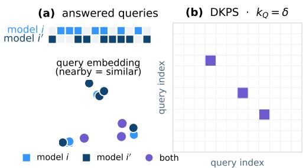

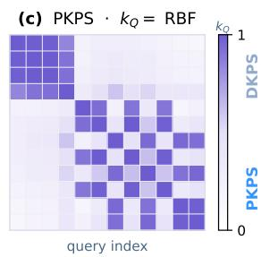

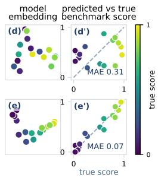  
Figure 1: An illustration of the difference between the Product Kernel Perspective Space (PKPS) and the Data Kernel Perspective Space (DKPS). (a) Top: two models respond to different sets of queries. Bottom: queries represented as vectors, colored by which model has responded to them. (b) The query kernel used by DKPS. Only information from queries both models have responded to is included. (c) The query kernel used by PKPS weighs query similarity in the embedding space. (d–e′) A benchmark prediction example. Left: each dot is a model colored by its benchmark score. Right: true benchmark score versus predicted benchmark score. Restricted to the rare shared queries, DKPS (top) is noisy and correlates poorly with benchmark score (MAE 0.31). PKPS (bottom) leverages unpaired queries and is highly correlated with true score (MAE 0.07).

positive $k _ { Q }$ , such as RBF, $D _ { i i } ^ { 2 }$ ′ includes information from unpaired responses and Eq. (1) is therefore always defined when $| Q _ { i } | , | \ddot { Q } _ { i ^ { \prime } } | \geq 1$ . We highlight the difference between the previous approaches and the PKPS in Figure 1.

## 3.1 CONCENTRATION OF PKPS REPRESENTATIONS

We next establish theoretical properties of the PKPS necessary for demonstrating its efficiency in sparse and unpaired benchmark prediction. The main result of this section establishes that the representations concentrate around their population counterparts at a rate governed by the overlap of the query distributions. We model the evaluation data of Section 2 as sampled (task, query, response) triples: conditional on model $i ,$ each triple independently draws a task, then a query from the task, and finally the model’s response (formalized in Definition 2 of Appendix D). We formally define the population PKPS in Definition 2 of Appendix D; broadly, it is defined by replacing the sums of Eq. (1) with expectations.

Our concentration result requires bounded query and response kernels, bounded embedded responses, a positive cross-model query kernel mass, and a gap after the d-th eigenvalue of the population double-centered matrix (see Assumptions 2–4, Appendix D). The required boundedness and the spectral gap are standard in spectral-embedding analyses (Yu et al., 2015; Acharyya et al., 2024; 2025). The atypical requirement in our setting is the positive cross-model query kernel mass, though this holds trivially under a strictly positive $k _ { Q }$ and does not assume that any individual query is shared.

Let $\left( \psi _ { 1 } , \ldots , \psi _ { n } \right)$ denote the population PKPS, $\begin{array} { r } { \kappa = \operatorname* { i n f } _ { i , i ^ { \prime } } \mathbb { E } [ k _ { Q } ( u , u ^ { \prime } ) ] } \end{array}$ the cross-model query kernel mass, $\lambda _ { d }$ the d-th largest eigenvalue of the population double-centered matrix $B ^ { * } , \Delta = \lambda _ { d } - \lambda _ { d + 1 }$ its eigengap, and $\beta = \| B ^ { * } \| _ { \mathrm { o p } } / \Delta$

Theorem 1 (Concentration of PKPS representations). Suppose Assumptions 2–4 hold and that every model has responded to at least m queries. Then for any $\delta \in ( 0 , 1 )$ , with probability at least $1 - \delta$ there is an orthogonal W such that max $\begin{array} { r } { \| \hat { \psi } _ { i } - W \psi _ { i } \| \le C \kappa ^ { - 2 } \lambda _ { d } ^ { - 1 / 2 } ( 1 + \beta ) n \sqrt { \log ( 4 n ^ { 2 } / \delta ) / ( 2 m ) } } \end{array}$ where C depends only on the kernel bounds.

Theorem 1 states that the PKPS representations concentrate at the rate in m enjoyed by fully paired DKPS (Acharyya et al., 2025) without requiring any shared queries. The price of unpairedness is a factor of $\kappa ^ { - 2 }$ , governed by the overlap of the query distributions. The full proof is in Appendix D.

## 3.2 INFERENCE IN THE PKPS

We next describe benchmark prediction in the PKPS and establish its query efficiency. Inference using the PKPS is a two-step statistical problem: first embed the models (Eq. (2)), then train a decision function that uses the representations as proxies for the models.

Fix a task t and let $f _ { 0 } , f _ { 1 } , \ldots , f _ { n }$ be i.i.d. draws from a model distribution. Our goal is to predict the true score of $f _ { 0 }$ on task $t , y _ { 0 } : = s ^ { ( t ) } ( f _ { 0 } , Q ^ { ( t ) } )$ . The (model, task) pairs with $m _ { i } ^ { ( t ) } > 0$ and model $f _ { 0 } { \mathrm { , } }$ ’s responses from tasks $t ^ { \prime } \neq t$ provide information potentially relevant to predicting y0.

We embed all n+1 models jointly via Eq. (2), fit a regressor $\hat { h } ^ { ( t ) } : \mathbb { R } ^ { d }  \mathcal { V }$ on the observed pairs $\{ ( \hat { \psi } _ { i } , \tilde { y } _ { i } ^ { ( t ) } ) \} _ { i = 1 } ^ { n }$ , and predict $\hat { y } _ { 0 } ^ { ( t ) } = \hat { h } ^ { ( t ) } ( \hat { \psi } _ { 0 } )$ . We note that Eq. (1) uses no score information, so the target model is embedded alongside the reference models. Out-of-sample extensions exist (see, e.g., Trosset and Priebe, 2008; Chen et al., 2022).

Helm et al. (2026) established that nearest neighbor regression using representations from paired DKPS is query efficient relative to the sample score. The main result of this section shows that benchmark prediction with PKPS is query-efficient relative to paired DKPS. The first part of our result requires only bounded scores (Assumption 1). The second part additionally requires that no two query designs share an atom, so that independently sampled query sets are disjoint almost surely (Assumption 5), that models and their caches are drawn independently (Assumption 6), and a spectral gap for the fixed-budget analogue of the population double-centered matrix (Assumption 7). All assumptions are stated in Appendix D. In the following, MSE denotes mean squared error and m denotes a per-model query budget with min $| Q _ { i } | \geq m$ . We assume the query kernel is from a family of bounded kernels indexed by a bandwidth σ whose $\sigma  0$ limit is such that $k _ { 0 } ( u , u ^ { \prime } ) > 0$ if $u = u ^ { \prime }$ and 0 otherwise $( \mathrm { e . g . } , k _ { \sigma } ( \dot { u , } u ^ { \prime } ) = \mathrm { e x p } ( - \| u - u ^ { \prime } \| ^ { 2 } / 2 \sigma ^ { 2 } ) )$ .

Definition 1 (Query efficiency; following Helm et al., 2026). Fix a per-model query budget m and let $h _ { n }$ denote a score estimator using n reference models. The sequence $( h _ { 1 } , h _ { 2 } , \ldots )$ is queryefficient relative to $( h _ { 1 } ^ { \prime } , h _ { 2 } ^ { \prime } , \ldots )$ if there exists N such that MS $\exists ( h _ { n } ) \leq \mathrm { M S E } ( h _ { n } ^ { \prime } )$ with high probability for all $n \geq N$ , with the inequality strict for at least one $n ^ { * } \geq N$

We write $h _ { n , \sigma } ^ { ( K ) }$ for an estimator that uses a K-nearest-neighbor regressor on the PKPS constructed with a query kernel with bandwidth σ. Since $k _ { 0 }$ only puts positive mass on identical queries, $h _ { n , 0 } ^ { ( K ) }$ is K-nearest-neighbor regression on the paired DKPS. Let $\hat { h } _ { n } ^ { ( K ) }$ denote the cross-validated PKPS estimator (specified in Appendix D), where the bandwidth is selected on held-out reference models over a finite grid containing $\sigma = 0$ . A nonzero bandwidth is chosen only when the estimated improvement exceeds the validation confidence radius. Finally, let $I _ { m } ( \sigma )$ denote the variance of the target score explained by the population representation of the target model computed from its m cached responses (Definition 3).

Theorem 2 (PKPS is query efficient relative to paired DKPS). Fix any per-model query budget $m \geq$ 1 and suppose the reference scores are observed exactly. (i) Under Assumption 1, for every pairing fraction $\rho \in [ 0 , 1 ]$ and every K, with high probability for all n sufficiently large, $\mathrm { M S E } \big ( \hat { h } _ { n } ^ { ( K ) } \big ) \leq$ $\mathrm { M S E } \big ( h _ { n , 0 } ^ { ( K ) } \big )$ . (ii) Suppose Assumptions 1, 2, 5, 6, and 7 hold and the grid contains a bandwidth $\sigma ^ { \star } > 0$ with $I _ { m } ( \sigma ^ { \star } ) > 0 .$ . Then for every $0 < c < I _ { m } ( \sigma ^ { \star } )$ and every $K _ { n }  \infty$ with $K _ { n } / n  0 ,$ with high probability for all n sufficiently large, MSE $\big ( \hat { h } _ { n } ^ { ( K _ { n } ) } \big ) \leq \mathrm { M S E } \big ( h _ { n , 0 } ^ { ( K _ { n } ) } \big ) - c .$ In particular, $( \hat { h } _ { n } ^ { ( K _ { n } ) } )$ is query-efficient relative to $( h _ { n , 0 } ^ { ( K _ { n } ) } )$ at every budget m with $I _ { m } ( \sigma ^ { \star } ) > 0$

Theorem 2 states that, at any fixed budget, PKPS is never worse than paired DKPS at any pairing level. When query sets are disjoint (Assumption 5), paired DKPS can do no better than predicting the mean score, while PKPS improves on it by the score variance $I _ { m } ( \sigma ^ { \star } )$ that its budget-m representation explains. Some condition of this kind is needed: if a model’s cached responses carry no information about its score, no estimator built from them improves on the mean. We note that query-efficiency is transitive and that Theorem 2(i), together with Theorem 2 of Helm et al. (2026), implies that $\hat { h } _ { n } ^ { ( \dot { K } ) }$ is query-efficient relative to the sample score.

The same machinery covers (model, task) score completion $( m _ { i } ^ { ( t ) } = 0 ) \mathrm { : }$ : since Eq. (1) uses only responses, a model that has answered none of task $t \bar { \mathrm { { s } } }$ queries is embedded from its responses to other tasks, and the regression transfers the scores of reference models evaluated on t. We evaluate both query-efficiency and completion empirically in Section 4.

## 4 EXPERIMENTS

We evaluate PKPS on synthetic data and on two large benchmark suites.

Synthetic data. We generate n models with latent ability vectors $v _ { i } \in \mathbb { R } ^ { 5 }$ and $T$ tasks with latent vectors $t _ { k } \in \mathbb { R } ^ { 5 }$ , scores $v _ { i } \cdot t _ { k } + \epsilon$ with additive noise $\epsilon ,$ and queries drawn near each task center $( u _ { j } =$ $t _ { k } + \eta _ { j }$ with isotropic noise $\eta _ { j } )$ . Each model answers m queries per task. We control unpairedness via $\rho = m _ { i i ^ { \prime } } / m$ and sparsity via a probability of observing a task $p _ { \mathrm { t a s k } }$ and, conditioned on observing a task, a probability of answering a query $p _ { \mathrm { q u e r y } }$

Benchmark suites. We consider two large benchmark suites. The first consists of 18 tasks from HELM-Lite (Liang et al., 2023) – 7 math subjects (MATH, Hendrycks et al., 2021), 5 translation pairs (WMT-14, Bojar et al., 2014), medical multiple choice (MedQA, Jin et al., 2021), and 5 legal subjects (LegalBench, Guha et al., 2023). We consider 93 models that have been evaluated on all 18 tasks and induce sparsity and unpairedness by subsampling each model’s observed queries.

The second suite is built from the Every Eval Ever datastore (Batzner et al., 2026), a communitymaintained collection of item-level evaluation results covering 36 benchmarks and 165 models (and growing). The store exhibits the sparsity and unpairedness that motivate this paper: only 15% of (model, benchmark) pairs have been evaluated and 59% of model pairs share no benchmark at all. Within a benchmark, pairedness is bimodal: on 26 of 33 tasks, models answered essentially identical item sets (mean $\rho _ { i i ^ { \prime } } > 0 . 9 9 )$ , while the remaining seven – all arena-style (Chiang et al., 2024) – are severely unpaired (mean $\rho _ { i i ^ { \prime } }$ between 0.27 and 0.66). We study a dense 45 model and 16 task submatrix so that true scores are available and sparsity and pairedness can be controlled. The tasks include MATH-MC levels 1–5 (Hendrycks et al., 2021), GSM-MC (Cobbe et al., 2021), GPQA-Diamond (Rein et al., 2024), nine categories from JudgeBench (Tan et al., 2025) and RewardBench 2 (Malik et al., 2025).

Both suites were chosen because they include item-level responses – most large public benchmark leaderboards only include scores. Details describing the HELM and EEE data such as the included models, included tasks, the number of queries per task, etc. are provided in Appendices A and B, respectively.

Methods and baselines. We evaluate PKPS on both query-efficiency and (model, task) score completion. Unless otherwise stated we embed all responses and queries into a 3072-dimensional space via gemini-embedding-001 (Lee et al., 2025), apply PCA separately to the collection of embedded queries and embedded responses, and use an RBF kernel on the reduced query space and a linear kernel on the reduced response space. Given the PKPS pairwise dissimilarity matrix, we embed the models in a $d = 8$ space via Eq. (2) and use K-nearest neighbor regression with $K = 5$

Depending on the task we include different baselines. Each produces an estimate of $y _ { i } ^ { ( t ) }$ :

1. Query-efficiency. We compare PKPS to the sample score $( \mathrm { i . e . , ~ } \tilde { y } _ { i } ^ { ( t ) } )$ , paired DKPS (Helm et al., 2026), Item Response Theory (“IRT”, Polo et al., 2024) and a convex combination of PKPS and sample score (i.e., α $\tilde { y } _ { i } ^ { ( t ) } + \left( 1 - \alpha \right) \hat { y } _ { i , \mathrm { P K P S } } ^ { ( t ) } )$

2. Score completion. We compare PKPS to Low-Rank Matrix Completion (“LRMC”, Zeng and Papailiopoulos, 2026) and a convex combination of LRMC and PKPS $( \mathrm { i . e . , } \alpha \hat { y } _ { i , \mathrm { L R M C } } ^ { ( t ) } + ( 1 -$ $\alpha ) \hat { y } _ { i , \mathrm { P K P S } } ^ { ( t ) } )$

Both the query kernel RBF bandwidth and the convex coefficient for the ensemble are selected via cross-validation on the observed data. Following Zeng and Papailiopoulos (2026), the completion methods operate on a pre-processed score matrix: observed scores are logit-transformed, standardized per task, and centered by a two-way (model, task) additive bias. Following Helm et al. (2026), we use the leave-one-family-out protocol where all models from the target model’s developer are excluded. As such, the reported errors are conservative. We report average mean absolute error (MAE) of the predicted score versus the true score for every setting over 16 seeds (50 on synthetic data). Additional experimental details are provided in Appendix A.

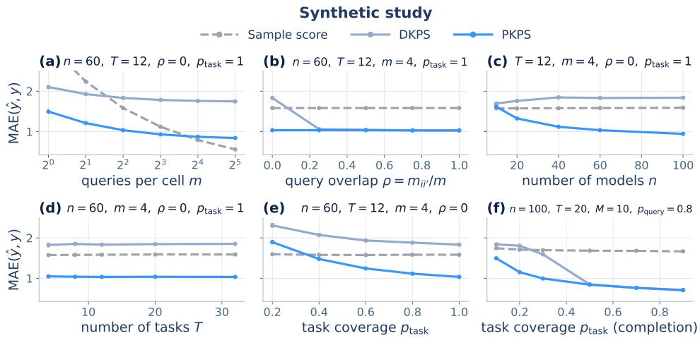  
Figure 2: MAE on the synthetic benchmark (±1 SEM). (Panels a–e) Query-efficient evaluation where every observed cell is measured with m queries. We vary the budget m (panel a), the crossmodel overlap $\rho$ (panel b), the cohort size n (panel c), the number of tasks $T$ (panel d), and the task coverage $p _ { \mathrm { t a s k } }$ (panel e), at unpaired designs (ρ=0) except where $\rho$ is swept. (panel f) Score completion of held-out cells as a function of task coverage.

## 4.1 RESULTS

PKPS is query-efficient on the synthetic data. Figure 2 shows the MAE for PKPS, DKPS, and the sample score for estimating a model’s true score under the query-efficient evaluation protocol. Every observed cell of the score matrix is calculated with a budget of m queries. We vary the query budget (panel a), the pairwise query overlap (panel b), the number of models (panel c), the number of tasks (panel d), and the task coverage (panel e). Panel (f) studies score completion, where the targets are held-out cells and the score-only baseline is the task mean.

PKPS outperforms DKPS everywhere and the sample score at small query budgets (panel a). Panel (b) is the empirical counterpart of Theorem 2. At ρ = 0, DKPS is worse than the sample score, while a single shared query $( \rho = 0 . 2 5 \mathrm { a t } m = 4 )$ restores it to PKPS’s level. PKPS is flat in ρ as it only requires distributional overlap. As n grows for a fixed sparsity and pairedness, PKPS can take advantage of additional reference models while DKPS cannot (panel c). Task coverage behaves similarly (panel e) and the number of tasks matters little for either method (panel $\mathrm { d } ) -$ though this observation likely hinges on the ratio between task-level noise and query-level noise. In the completion panel (panel f), PKPS outperforms DKPS when observed cells are scarce and they are matched for moderate to large coverage.

PKPS-based methods dominate query-efficient evaluation. Figure 3a–c shows the MAE for PKPS, DKPS, IRT, the sample score, and the ensemble on the HELM suite. Each model answers its own independently sampled queries. $\mathrm { A t } \ m { = } 1$ , PKPS attains 0.137 and the ensemble 0.126 versus 0.292 for the sample score (Wilcoxon $\scriptstyle p = 8 \times 1 0 ^ { - 6 }$ on average task error differences, better on all 18 tasks), so PKPS with one query matches the sample score at m = 4 (panel a). As the budget grows, the sample score’s noise falls below the representations’ residual bias and it eventually overtakes them. The ensemble follows the better of its two components throughout (panel a). PKPS improves with the number of reference models (panel b; $0 . 1 5 7  0 . 1 2 4 )$ and with the task coverage (panel $\mathrm { c } ; 0 . 1 6 1  0 . 1 3 0 )$ , while DKPS is flat. IRT is poorly identified without a shared item block and is worse than the sample score throughout.

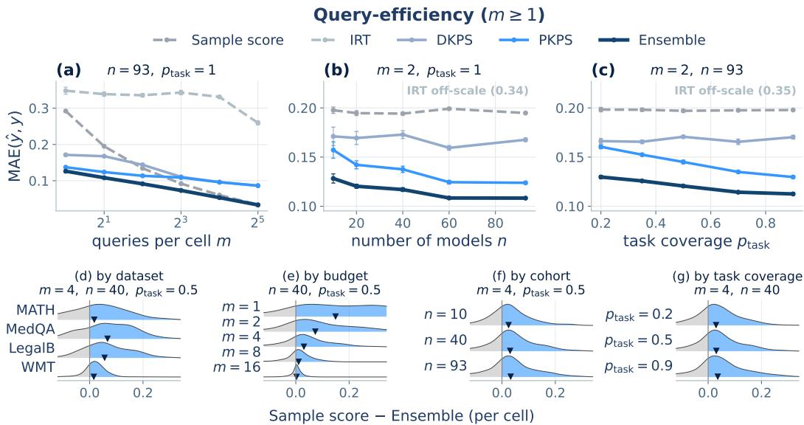  
Figure 3: Query-efficiency on the HELM suite. (a–c) MAE against the true full-evaluation score when each model answers m unpaired queries per observed cell (±1 SEM), as a function of budget m, cohort size n, and task coverage $p _ { \mathrm { t a s k } }$ . (d–g) Per-cell difference in MAE between Sample score and Ensemble (positive difference favors Ensemble) by dataset, budget, cohort, and coverage. ▼ is the mean for a given setting.

The gains hold across settings. Figure 3d–g shows the distribution of the per-cell difference between the sample score’s and the ensemble’s absolute errors, by dataset (panel d), budget (panel e), cohort (panel f), and task coverage (panel g). The ensemble outperforms the sample score on 69% of cells (78% at $m { = } 1 )$ and in the mean of every row. The gains are largest on the rich-response datasets (panel d) and at the smallest budgets (panel e), where a single response carries the most information, and they shrink toward zero as the budget grows. The mean gain is positive at every cohort size (panel f) and every coverage (panel g).

The same representations complete missing cells in the score matrix. Figure 4a–d shows the MAE for LRMC, PKPS, and the ensemble on missing cells when a fraction $p _ { \mathrm { t a s k } }$ of (model, task) cells is observed at query depth $p _ { \mathrm { q u e r y } } ,$ , at cohort sizes n=93 (solid) and $n { = } 1 0$ (dashed). No responses from a missing cell exist, so the sample score is unavailable. The ensemble matches or outperforms LRMC at every operating point, and the margin is largest when observations are scarce: at the small cohort it is more accurate at every task coverage (panel a), query depth (panel b), and number of tasks (panel c) (0.120 versus 0.139; Wilcoxon $\bar { p } { = } \bar { 1 } \times 1 0 ^ { - 3 }$ , better on 15 of 18 tasks). LRMC requires many models to estimate its factors: with n=10, additional tasks do not close the gap (panel c), and sweeping the number of reference models shows the ensemble is accurate from n=20 while LRMC approaches it only near the full cohort (panel d). At the full cohort the methods converge and the ensemble remains best on average (0.100 versus 0.105), although the per-task difference is not significant (better on 9 of 18 tasks).

The completion gains are modest but consistent. Figure 4e–h shows the distribution of the permissing-cell difference between LRMC’s and the ensemble’s absolute errors, by dataset (panel e), cohort (panel f), coverage (panel g), and query depth (panel h). The win is smaller than in the query-efficiency task but the mean gain is positive in every row.

The results are qualitatively similar on the Every Eval Ever suite. The second suite shows the same behavior with larger margins (lever sweeps in Appendix B). At m=1, PKPS attains less than a third of the sample score’s error (0.070 versus 0.224), below the accuracy the sample score reaches at $m { = } 8 \left( 0 . 0 8 1 \right)$ . On missing cells, the ensemble outperforms LRMC everywhere, including the full cohort (Wilcoxon $\scriptstyle { p = 3 } \times 1 { \bar { 0 } } ^ { - 5 }$ , better on every task), which is not significant on HELM. Table 1 shows the performance of all methods on both tasks and both suites. A PKPS-based method is the best in every column.

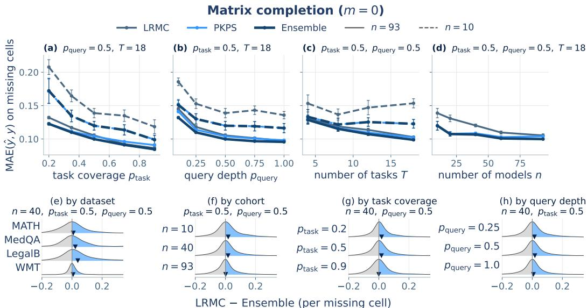  
Figure 4: Score completion on the HELM suite. (a–d) MAE on missing cells (±1 SEM) when a fraction $p _ { \mathrm { t a s k } }$ of (model, task) cells is observed at query depth $p _ { \mathrm { { q u e r y } } }$ , as a function of task coverage, query depth, number of tasks, and cohort size. (e–h) Per-cell difference in MAE between LRMC and Ensemble (positive difference favors Ensemble) by dataset, cohort, coverage, and query depth. ▼ is the mean for a given setting.

The results are insensitive to representation and pipeline choices. Varying the MDS dimension over 4–24 moves PKPS’s MAE by less than 0.02, and the cross-validated bandwidth matches the best fixed choice (Appendix C). Ablations of the regression method, the response kernel, the ensemble weighting rule, and the incidental query overlap are also in Appendix C. Our observations are generally robust across these choices.

## 5 DISCUSSION

In this paper we introduced the PKPS, a collection of low-dimensional representations of models defined on sparse and unpaired collections of embedded responses — a realistic setting outside of highly curated leaderboards and evaluation collections. We prove that the PKPS is query-efficient relative to its fully-paired counterpart and show that, as $\rho  0 .$ , paired DKPS degrades sharply while PKPS does not. The same representations support both benchmark prediction tasks and PKPS-based methods outperform the baselines on both.

Practical deployment. Our results suggest a simple workflow for practical deployment: (i) maintain the cached responses (and, optionally, per-response scores) produced when evaluating a model; (ii) fit PKPS on the cached responses; and (iii) predict with a simple regression in the perspective space, optionally ensembled with the sample score. As shared caches like the Every Eval Ever datastore grow, each new upload improves the perspective space, and the cumulative savings grow with them.

Limitations and future work. (i) Stochastic scoringfunctions. Our analysis assumes the mapping from a response to its score is deterministic. Many modern evaluation frameworks use LLM-asjudge scoring (Zheng et al., 2023), where scores are stochastic and may depend on contextual factors beyond the individual response. If each score takes the form $s ( f ( q ) ) + \epsilon$ with ϵ i.i.d., repeated scoring recovers the current setting in the limit and the extension is conceptually straightforward. (ii) Beyond uniform observation. Assumption 1 models observed cells as uniform subsamples, and our experiments induce sparsity and unpairedness by uniform masking. Missingness in deployed evaluation data is not uniform: which models are evaluated on which benchmarks correlates with developer, release date, and expected performance. Extending the analysis to modeled observation processes is a natural and important next step. (iii) Unpaired monitoring in multi-agent systems. Paired DKPS has been used as a tool for tracking the perspectives of multi-agent systems (Helm et al., 2024). These approaches require asking each agent a collection of fixed queries each time point and are prohibitively expensive at scale. The PKPS removes this requirement as agents can be monitored through the heterogeneous interactions they naturally produce.

## AI USE STATEMENT

In this work, we used generative AI tools for implementing methods and simple data processing. We also used them in the creation of artifacts (e.g., using Matplotlib to create figures) and to draft / edit parts of the manuscript with heavy user guidance. We have reviewed all AI-assisted work. For example, generated code was verified and tested for correctness by all authors. Generated text was heavily edited. We take responsibility for the final content of this work, including text, claims or artifacts produced with the aid of generative AI.

## ACKNOWLEDGMENTS

We would like to thank Heather G. Patsolic and Brandon Duderstadt for helpful discussions throughout the development of this manuscript. We gratefully acknowledge funding from the Defense Advanced Research Projects Agency (DARPA) Artificial Intelligence Quantified (AIQ) award number HR00112520026.

This project was born out of discussions within the EvalEval Coalition ( https:// evalevalai.com/), and the authors are grateful to Brian Hu, Leshem Choshen, and Andreas Haupt for their early feedback.

## REFERENCES

Aranyak Acharyya, Michael W. Trosset, Carey E. Priebe, and Hayden S. Helm. Consistent estimation of generative model representations in the Data Kernel Perspective Space. arXiv preprint arXiv:2409.17308, 2024. doi: 10.48550/arXiv.2409.17308.

Aranyak Acharyya, Joshua Agterberg, Youngser Park, and Carey E. Priebe. Concentration bounds on response-based vector embeddings of black-box generative models. arXiv preprint arXiv:2511.08307, 2025. doi: 10.48550/arXiv.2511.08307.

Jan Batzner, Sree Harsha Nelaturu, Damian Stachura, et al. Every Eval Ever: A unifying schema and community repository for AI evaluation results, 2026. Dataset: https://huggingface. co/datasets/evaleval/EEE\_datastore.

Ondˇrej Bojar, Christian Buck, Christian Federmann, Barry Haddow, Philipp Koehn, Johannes Leveling, Christof Monz, Pavel Pecina, Matt Post, Herve Saint-Amand, Radu Soricut, Lucia Specia, and Ales Tamchyna. Findings of the 2014 workshop on statistical machine transla-ˇ tion. In Proceedings of the Ninth Workshop on Statistical Machine Translation, 2014. doi: 10.3115/v1/W14-3302.

Ingwer Borg and Patrick J. F. Groenen. Modern Multidimensional Scaling: Theory and Applications. Springer, 2nd edition, 2005. doi: 10.1007/0-387-28981-X.

Sam Bowyer, Acyr Locatelli, and Kris Cao. Efficient benchmarking is just feature selection and multiple regression. arXiv preprint arXiv:2605.25773, 2026. doi: 10.48550/arXiv.2605.25773.

Sebastien Bubeck, Varun Chandrasekaran, Ronen Eldan, Johannes Gehrke, Eric Horvitz, Ece´ Kamar, Peter Lee, Yin Tat Lee, Yuanzhi Li, Scott Lundberg, Harsha Nori, Hamid Palangi, Marco Tulio Ribeiro, and Yi Zhang. Sparks of artificial general intelligence: Early experiments with GPT-4. arXiv preprint arXiv:2303.12712, 2023. doi: 10.48550/arXiv.2303.12712.

Guodong Chen, Hayden S. Helm, Kate Lytvynets, Weiwei Yang, and Carey E. Priebe. Mental state classification using multi-graph features. Frontiers in Human Neuroscience, 16, 2022. doi: 10.3389/fnhum.2022.930291.

Nan Chen, Hayden Helm, Youngser Park, Carey Priebe, and Soledad Villar. Extracting information from fine-tuned weights. In NeurIPS Workshop on Non-Euclidean Foundation Models and Geometric Learning (NEGEL), 2025a.

Rick Chen, Joseph Ternasky, Afriyie Samuel Kwesi, Ben Griffin, Aaron Ontoyin Yin, Zakari Salifu, Kelvin Amoaba, Xianling Mu, Fuat Alican, and Yigit Ihlamur. VCBench: Benchmarking LLMs in venture capital. arXiv preprint arXiv:2509.14448, 2025b. doi: 10.48550/arXiv.2509.14448.

Wei-Lin Chiang, Lianmin Zheng, Ying Sheng, Anastasios N. Angelopoulos, Tianle Li, Dacheng Li, Hao Zhang, Banghua Zhu, Michael Jordan, Joseph E. Gonzalez, and Ion Stoica. Chatbot Arena: An open platform for evaluating LLMs by human preference. In International Conference on Machine Learning (ICML), 2024. doi: 10.48550/arXiv.2403.04132.

Franc¸ois Chollet, Mike Knoop, Gregory Kamradt, Bryan Landers, and Henry Pinkard. ARC-AGI-2: A new challenge for frontier AI reasoning systems. arXiv preprint arXiv:2505.11831, 2025. doi: 10.48550/arXiv.2505.11831.

Karl Cobbe, Vineet Kosaraju, Mohammad Bavarian, Mark Chen, Heewoo Jun, Lukasz Kaiser, Matthias Plappert, Jerry Tworek, Jacob Hilton, Reiichiro Nakano, Christopher Hesse, and John Schulman. Training verifiers to solve math word problems. arXiv preprint arXiv:2110.14168, 2021. doi: 10.48550/arXiv.2110.14168.

Ivan Dokmanic, Reza Parhizkar, Juri Ranieri, and Martin Vetterli. Euclidean distance matrices:´ Essential theory, algorithms, and applications. IEEE Signal Processing Magazine, 32(6):12–30, 2015. doi: 10.1109/MSP.2015.2398954.

Brandon Duderstadt, Hayden S. Helm, and Carey E. Priebe. Comparing foundation models using data kernels. arXiv preprint arXiv:2305.05126, 2023. doi: 10.48550/arXiv.2305.05126.

Neel Guha, Julian Nyarko, Daniel E. Ho, Christopher Re, Adam Zambrano, et al. LegalBench:´ A collaboratively built benchmark for measuring legal reasoning in large language models. In Advances in Neural Information Processing Systems, 2023. doi: 10.48550/arXiv.2308.11462.

Hayden Helm, Brandon Duderstadt, Youngser Park, and Carey E. Priebe. Tracking the perspectives of interacting language models. In Conference on Empirical Methods in Natural Language Processing (EMNLP), 2024. doi: 10.18653/v1/2024.emnlp-main.90.

Hayden Helm, Aranyak Acharyya, Youngser Park, Brandon Duderstadt, and Carey Priebe. Statistical inference on black-box generative models in the Data Kernel Perspective Space. In Findings of the Association for Computational Linguistics (ACL), 2025. doi: 10.18653/v1/2025.findings-acl. 204.

Hayden Helm, Ben Johnson, and Carey E. Priebe. Query-efficient model evaluation using cached responses. arXiv preprint arXiv:2605.07096, 2026. doi: 10.48550/arXiv.2605.07096.

Dan Hendrycks, Collin Burns, Saurav Kadavath, Akul Arora, Steven Basart, Eric Tang, Dawn Song, and Jacob Steinhardt. Measuring mathematical problem solving with the MATH dataset. In NeurIPS Datasets and Benchmarks Track, 2021. doi: 10.48550/arXiv.2103.03874.

Valentin Hofmann, David Heineman, Ian Magnusson, Kyle Lo, Jesse Dodge, Maarten Sap, Pang Wei Koh, Chun Wang, Hannaneh Hajishirzi, and Noah A. Smith. Fluid language model benchmarking. In Conference on Language Modeling, 2025. doi: 10.48550/arXiv.2509.11106.

Minyoung Huh, Brian Cheung, Tongzhou Wang, and Phillip Isola. The Platonic Representation Hypothesis. In International Conference on Machine Learning (ICML), 2024. doi: 10.48550/ arXiv.2405.07987.

Pranab Islam, Anand Kannappan, Douwe Kiela, Rebecca Qian, Nino Scherrer, and Bertie Vidgen. FinanceBench: A new benchmark for financial question answering. arXiv preprint arXiv:2311.11944, 2023. doi: 10.48550/arXiv.2311.11944.

Di Jin, Eileen Pan, Nassim Oufattole, Wei-Hung Weng, Hanyi Fang, and Peter Szolovits. What disease does this patient have? a large-scale open domain question answering dataset from medical exams. Applied Sciences, 11(14), 2021. doi: 10.3390/app11146421.

Jinhyuk Lee, Feiyang Chen, Sahil Dua, et al. Gemini embedding: Generalizable embeddings from Gemini. arXiv preprint arXiv:2503.07891, 2025. doi: 10.48550/arXiv.2503.07891.

Yang Li, Jie Ma, Miguel Ballesteros, Yassine Benajiba, and Graham Horwood. Active evaluation acquisition for efficient LLM benchmarking. arXiv preprint arXiv:2410.05952, 2024. doi: 10. 48550/arXiv.2410.05952.

Percy Liang, Rishi Bommasani, Tony Lee, Dimitris Tsipras, Dilara Soylu, Michihiro Yasunaga, Yian Zhang, Deepak Narayanan, Yuhuai Wu, Ananya Kumar, Benjamin Newman, Binhang Yuan, Bobby Yan, Ce Zhang, Christian Cosgrove, Christopher D. Manning, Christopher Re, Diana´ Acosta-Navas, Drew A. Hudson, Eric Zelikman, Esin Durmus, Faisal Ladhak, Frieda Rong, Hongyu Ren, Huaxiu Yao, Jue Wang, Keshav Santhanam, Laurel Orr, Lucia Zheng, Mert Yuksekgonul, Mirac Suzgun, Nathan Kim, Neel Guha, Niladri Chatterji, Omar Khattab, Peter Henderson, Qian Huang, Ryan Chi, Sang Michael Xie, Shibani Santurkar, Surya Ganguli, Tatsunori Hashimoto, Thomas Icard, Tianyi Zhang, Vishrav Chaudhary, William Wang, Xuechen Li, Yifan Mai, Yuhui Zhang, and Yuta Koreeda. Holistic evaluation of language models. Transactions on Machine Learning Research (TMLR), 2023. doi: 10.48550/arXiv.2211.09110.

Xiao Liu, Hao Yu, Hanchen Zhang, Yifan Xu, Xuanyu Lei, Hanyu Lai, Yu Gu, Hangliang Ding, Kaiwen Men, Kejuan Yang, et al. AgentBench: Evaluating LLMs as agents. In International Conference on Learning Representations, 2024. doi: 10.48550/arXiv.2308.03688.

Saumya Malik, Valentina Pyatkin, Sander Land, Jacob Morrison, Noah A. Smith, Hannaneh Hajishirzi, and Nathan Lambert. RewardBench 2: Advancing reward model evaluation. arXiv preprint arXiv:2506.01937, 2025. doi: 10.48550/arXiv.2506.01937.

Yotam Perlitz, Elron Bandel, Ariel Gera, Ofir Arviv, Liat Ein-Dor, Eyal Shnarch, Noam Slonim, Michal Shmueli-Scheuer, and Leshem Choshen. Efficient benchmarking (of language models). In North American Chapter of the Association for Computational Linguistics (NAACL), 2024. doi: 10.18653/v1/2024.naacl-long.139.

Felipe Maia Polo, Lucas Weber, Leshem Choshen, Yuekai Sun, Gongjun Xu, and Mikhail Yurochkin. tinyBenchmarks: Evaluating LLMs with fewer examples. In International Conference on Machine Learning (ICML), 2024. doi: 10.48550/arXiv.2402.14992.

David Rein, Betty Li Hou, Asa Cooper Stickland, Jackson Petty, Richard Yuanzhe Pang, Julien Dirani, Julian Michael, and Samuel R. Bowman. GPQA: A graduate-level Google-proof Q&A benchmark. In First Conference on Language Modeling, 2024. doi: 10.48550/arXiv.2311.12022.

Yangjun Ruan, Chris J. Maddison, and Tatsunori Hashimoto. Observational scaling laws and the predictability of language model performance. In Advances in Neural Information Processing Systems, 2024. doi: 10.48550/arXiv.2405.10938.

Aarohi Srivastava, Abhinav Rastogi, Abhishek Rao, et al. Beyond the imitation game: Quantifying and extrapolating the capabilities of language models. Transactions on Machine Learning Research, 2023. doi: 10.48550/arXiv.2206.04615.

Sijun Tan, Siyuan Zhuang, Kyle Montgomery, William Y. Tang, Alejandro Cuadron, Chenguang Wang, Raluca Ada Popa, and Ion Stoica. JudgeBench: A benchmark for evaluating LLM-based judges. In International Conference on Learning Representations, 2025. doi: 10.48550/arXiv. 2410.12784.

Warren S. Torgerson. Multidimensional scaling: I. Theory and method. Psychometrika, 17(4): 401–419, 1952. doi: 10.1007/BF02288916.

Michael W. Trosset and Carey E. Priebe. The out-of-sample problem for classical multidimensional scaling. Computational Statistics & Data Analysis, 52(10):4635–4642, 2008. doi: 10.1016/j. csda.2008.02.031.

Rajan Vivek, Kawin Ethayarajh, Diyi Yang, and Douwe Kiela. Anchor points: Benchmarking models with much fewer examples. In Conference of the European Chapter of the Association for Computational Linguistics (EACL), 2024. doi: 10.18653/v1/2024.eacl-long.95.

Jason Wei, Yi Tay, Rishi Bommasani, Colin Raffel, Barret Zoph, Sebastian Borgeaud, Dani Yogatama, Maarten Bosma, Denny Zhou, Donald Metzler, Ed H. Chi, Tatsunori Hashimoto, Oriol Vinyals, Percy Liang, Jeff Dean, and William Fedus. Emergent abilities of large language models. Transactions on Machine Learning Research, 2022. doi: 10.48550/arXiv.2206.07682.

Colin White, Samuel Dooley, Manley Roberts, Arka Pal, Ben Feuer, Siddhartha Jain, Ravid Shwartz-Ziv, Neel Jain, Khalid Saifullah, Sreemanti Dey, Shubh-Agrawal, Sandeep Singh Sandha, Siddartha Naidu, Chinmay Hegde, Yann LeCun, Tom Goldstein, Willie Neiswanger, and Micah Goldblum. LiveBench: A challenging, contamination-limited LLM benchmark. In International Conference on Learning Representations (ICLR), 2025. doi: 10.48550/arXiv.2406.19314.

Qinyuan Ye, Harvey Yiyun Fu, Xiang Ren, and Robin Jia. How predictable are large language model capabilities? a case study on BIG-bench. In Findings of the Association for Computational Linguistics: EMNLP, 2023. doi: 10.18653/v1/2023.findings-emnlp.503.

Yi Yu, Tengyao Wang, and Richard J. Samworth. A useful variant of the Davis–Kahan theorem for statisticians. Biometrika, 102(2):315–323, 2015. doi: 10.1093/biomet/asv008.

Yuchen Zeng and Dimitris Papailiopoulos. You don’t need to run every eval. arXiv preprint arXiv:2606.24020, 2026. doi: 10.48550/arXiv.2606.24020.

Lianmin Zheng, Wei-Lin Chiang, Ying Sheng, Siyuan Zhuang, Zhanghao Wu, Yonghao Zhuang, Zi Lin, Zhuohan Li, Dacheng Li, Eric P. Xing, Hao Zhang, Joseph E. Gonzalez, and Ion Stoica. Judging LLM-as-a-judge with MT-Bench and Chatbot Arena. In Advances in Neural Information Processing Systems, 2023. doi: 10.48550/arXiv.2306.05685.

## A EXPERIMENTAL DETAILS

Suite. 18 tasks over four datasets from HELM-Lite (Liang et al., 2023): MATH (7 subjects), WMT-14 (5 translation directions), MedQA, and LegalBench (5 subsets), restricted to the 93 models evaluated on all four. Table 2 lists every task with its query count; the loader subsamples each task to at most 120 queries with a fixed seed, so datasets contribute comparably.

Table 2: HELM suite composition: 18 tasks over four datasets, with the number of unique queries per task. Every task is scored for all 93 shared models; the loader caps each task at 120 queries (seeded subsample).
<table><tr><td>Dataset</td><td>Task</td><td>Queries</td><td>Dataset</td><td>Task</td><td>Queries</td></tr><tr><td>MATH</td><td>algebra</td><td>135</td><td>WMT-14</td><td>cs-en</td><td>873</td></tr><tr><td>MATH</td><td>counting &amp; probability</td><td>39</td><td>WMT-14</td><td>de-en</td><td>776</td></tr><tr><td>MATH</td><td>geometry</td><td>38</td><td>WMT-14</td><td>fr-en</td><td>754</td></tr><tr><td>MATH</td><td>intermediate algebra</td><td>52</td><td>WMT-14</td><td>hi-en</td><td>387</td></tr><tr><td>MATH</td><td>number theory</td><td>30</td><td>WMT-14</td><td>ru-en</td><td>613</td></tr><tr><td>MATH</td><td>prealgebra</td><td>86</td><td>MedQA</td><td>med_qa</td><td>1000</td></tr><tr><td>MATH</td><td>precalculus</td><td>57</td><td>LegalBench</td><td>abercrombie</td><td>95</td></tr><tr><td>LegalBench</td><td>corporate lobbying</td><td>490</td><td>LegalBench</td><td>citizenship questions</td><td>1000</td></tr><tr><td>LegalBench</td><td>function of decision section</td><td>367</td><td>LegalBench</td><td>proa</td><td>95</td></tr></table>

Model coverage (HELM). The 93 shared models span 20 developers: 01-ai yi-34b, 01-ai yi-6b, 01-ai yi-large-preview, AlephAlpha luminous-base, AlephAlpha luminous-extended, AlephAlpha luminous-supreme, ai21 j2-grande, ai21 j2-jumbo, ai21 jamba-1.5-large, ai21 jamba-1.5-mini, ai21 jamba-instruct, allenai olmo-7b, amazon nova-lite-v1, amazon nova-micro-v1, amazon nova-pro-v1, anthropic claude-2.0, anthropic claude-2.1, anthropic claude-3-5-haiku-20241022,

anthropic claude-3-5-sonnet-20240620,   
anthropic claude-3-5-sonnet-20241022, anthropic claude-3-haiku-20240307,   
anthropic claude-3-opus-20240229, anthropic claude-3-sonnet-20240229,   
anthropic claude-instant-1.2, anthropic claude-instant-v1,   
anthropic claude-v1.3, cohere command, cohere command-light,   
cohere command-r, cohere command-r-plus, databricks dbrx-instruct,   
deepseek-ai deepseek-llm-67b-chat, deepseek-ai deepseek-v3,   
google gemini-1.0-pro-001, google gemini-1.0-pro-002,   
google gemini-1.5-flash-001, google gemini-1.5-flash-002,   
google gemini-1.5-pro-001, google gemini-1.5-pro-002,   
google gemini-1.5-pro-preview-0409, google gemini-2.0-flash-exp,   
google gemma-2-27b-it, google gemma-2-9b-it, google gemma-7b,   
google text-bison@001, google text-unicorn@001, meta llama-2-13b,   
meta llama-2-70b, meta llama-2-7b, meta llama-3-70b, meta llama-3-8b,   
meta llama-3.1-405b-instruct-turbo, meta llama-3.1-70b-instruct-turbo,   
meta llama-3.1-8b-instruct-turbo,   
meta llama-3.2-11b-vision-instruct-turbo,   
meta llama-3.2-90b-vision-instruct-turbo,   
meta llama-3.3-70b-instruct-turbo, meta llama-65b, microsoft phi-2,   
microsoft phi-3-medium-4k-instruct, microsoft phi-3-small-8k-instruct,   
mistralai mistral-7b-instruct-v0.3, mistralai mistral-7b-v0.1,   
mistralai mistral-large-2407, mistralai mistral-medium-2312,   
mistralai mixtral-8x22b, mistralai mixtral-8x7b-32kseqlen,   
mistralai open-mistral-nemo-2407, nvidia nemotron-4-340b-instruct,   
openai gpt-3.5-turbo-0613, openai gpt-4-0613, openai gpt-4-1106-preview,   
openai gpt-4-turbo-2024-04-09, openai gpt-4o-2024-05-13,   
openai gpt-4o-2024-08-06, openai gpt-4o-mini-2024-07-18,   
openai text-davinci-002, openai text-davinci-003, qwen qwen1.5-110b-chat,   
qwen qwen1.5-14b, qwen qwen1.5-32b, qwen qwen1.5-72b, qwen qwen1.5-7b,   
qwen qwen2-72b-instruct, qwen qwen2.5-72b-instruct-turbo,   
qwen qwen2.5-7b-instruct-turbo, snowflake snowflake-arctic-instruct,   
tiiuae falcon-40b, tiiuae falcon-7b, upstage solar-pro-241126,   
writer palmyra-x-004, writer palmyra-x-v2, writer palmyra-x-v3.

Representations. All queries and responses are embedded with gemini-embedding-001 (3072-d). MATH and WMT-14 responses are free text and are embedded directly. MedQA and LegalBench responses are single-token answers (multiple-choice letters and class indices); each is standardized to the text it denotes before embedding—the option text the letter selects, recovered from the MedQA source data and verified against model behavior on 999 of 1000 instances, and the class name the index encodes. Queries share one PCA space (capped at 64 components) and responses another, both fit on observed rows only; the response space’s dimension is set to the total that separate per-dataset reductions would retain (second Zhu–Ghodsi elbow (Zhu and Ghodsi, 2006) per dataset, at most 48 components each; 92 on this suite), and response vectors are unitnormalized. Nothing separates the datasets by construction: the query kernel, whose bandwidth is set from within-dataset distances, determines how much weight cross-dataset comparisons receive.

Kernels. The query kernel is an RBF whose bandwidth is selected per run by leave-one-model-out K-NN (K=8) on the observed scores, over the grid σ ∈ {0.03, 0.1, 0.3, 1, 3} × median pairwise query distance plus the near-delta (DKPS) limit; Appendix C shows the cross-validated bandwidth tracks the best fixed choice. The response kernel is linear on real data and RBF on synthetic. Each (model, query) pair uses one sampled response (r=1).

Model embedding. Models are embedded by classical MDS (Eq. (2)) with d=8 throughout, following Helm et al. (2026) and fixed a priori (d = latent dimension on synthetic); Appendix C probes the choice of d.

Regressor. All embedding methods use a distance-weighted K-NN (K=5) regression on the model embedding, fit leave-one-family-out: all models from the target’s developer are excluded from its training set, so predictions never lean on near-duplicate siblings (Helm et al., 2026). Heldout cells are predicted directly; observed cells leave their own target out. For query-efficiency the regression targets are the reference models’ full-task scores. For completion the targets are residuals after a logit transform, per-task standardization to unit variance, and a two-way (model + task) additive bias; this pipeline is identical to the LRMC baseline’s, so the two methods differ only in how the residual is modeled (K-NN on the perspective versus a low-rank factorization) and performance differences are attributable to the representation. Matching the per-task standardization is important: without it, the model offset is dominated by the tasks with the largest logit variance.

Baselines. Low-rank matrix completion (LRMC) follows BenchPress (Zeng and Papailiopoulos, 2026): logit space, per-task standardization, two-way bias, rank-2 ALS with ridge λ=0.1, averaged over 5 random initializations; on observed cells it is cross-fit so a cell’s prediction never sees its own sample. IRT is a 1PL (Rasch) model (Rasch, 1960) on binary tasks: item difficulties by maximum likelihood (L-BFGS, Liu and Nocedal, 1989) on the largest fully-observed (model × item) block, per-model ability by bounded scalar MLE, clipped to [−4, 4]. The sample baseline is the cell’s own m-query mean.

Ensemble. On observed cells, the prediction is $\alpha { \hat { y } } _ { \mathrm { s a m p l e } } + ( 1 - \alpha ) { \hat { y } } _ { P K P S }$ with a scalar α per held-out family, selected on a 21-point grid by leave-one-family-out validation against the other families’ cached full scores (the same information the regressor trains on); on missing cells, PKPS and LRMC are blended with a weight fit by held-out cross-validation against observed scores. No quantity ever uses the scores of the family being predicted.

Sweeps and reporting. All real-data sweeps use 16 seeds; curves and table entries report the per-seed mean over tasks, then the mean (±1 SEM) over seeds. Query efficiency: budgets $m \in \{ 1 , 2 , 4 , 8 , 1 6 ,$ 32} at full cohort and coverage; cohort $n ~ \in ~ \{ 1 0 , 2 0 , 4 0 , 6 0 , 9 3 \}$ (HELM) or {10, 20, 40, 45} (EEE) and task coverage $p _ { \mathrm { t a s k } } ~ \in ~ \{ 0 . 2 , 0 . 3 5 , 0 . 5 , 0 . 7 , 0 . 9 \}$ , both at the few-query point m=2. Completion: task coverage as above and query depth $p _ { \mathrm { q u e r y } } \in$ $\{ 0 . 1 , 0 . 2 5 , 0 . \dot { 5 } , \dot { 0 } . 7 5 , 1 . 0 \}$ with cohort lines $n \in \{ 1 0 , \mathrm { f u l l } \}$ ; task count $T \in { \dot { \{ 4 , 5 , 1 2 , 1 8 \} } }$ (HELM) or {4, 8, 12, 16} (EEE); the cohort sweep holds $p _ { \mathrm { t a s k } } { = } p _ { \mathrm { q u e r y } } { = } 0 . 5$

Statistical tests. Paired differences between methods are assessed with two-sided Wilcoxon signed-rank tests (Wilcoxon, 1945) on per-task error differences: for each task we average the percell absolute-error difference over models and seeds, and test the per-task means against zero (18 tasks on HELM, 16 on EEE). The query-efficiency tests compare the ensemble to the sample score at m=1 (full cohort and coverage); the completion tests compare the ensemble to LRMC at the central operating point $( p _ { \mathrm { t a s k } } { = } p _ { \mathrm { q u e r y } } { = } 0 . 5 )$ at each cohort size. The per-cell improvement fractions quoted in Section 4.1 are computed from the same per-cell records, pooled over the conditionalfigure sweeps.

Synthetic study. 50 seeds per configuration; latent dimension $5 ,$ observed embedding dimension 20, response noise 0.5; both kernels RBF. Query-efficiency panels (Figure 2a–e): every observed cell carries m queries and a sample score with measurement noise $4 / \sqrt { m } ;$ the true score is predicted by a distance-weighted average of the K=8 nearest models’ sample scores, restricted to cells they observe. Completion panel (f): score noise 0.1, held-out cells predicted by K-NN regression with K=5. Unswept levers default to $n { = } 6 0 , T { = } 1 2 , m { = } 4 , \rho { = } 0 , p _ { \mathrm { t a s k } } { = } 1 ;$ ; panel-specific settings are given in each figure title.

Compute. All experiments run on a single multi-core CPU node; text embeddings are precomputed once through the embedding API and cached. Embedding the EEE suite (30,304 pooled responses plus 7,665 queries, ∼11M tokens) took ∼13 minutes and under \$2 of API credit; each 16-seed sweep completes in minutes (EEE) to hours (HELM) on the same node.

## B THE EVERY EVAL EVER SUITE

The second suite is built from the Every Eval Ever datastore (Batzner et al., 2026), an MIT-licensed, community-maintained collection of item-level evaluation results in a unified format (inputs, raw model outputs, and per-item scores). The full store covers 36 benchmarks and 165 models with only 15% of (model, benchmark) pairs evaluated (median 5 benchmarks per model), and 59% of model pairs share no benchmark. Within a benchmark, 26 of the 33 with at least two models are essentially fully paired (23 with identical item sets across every model pair), while the seven arena-style benchmarks (six Fibble arenas and Wordle arena) are natively unpaired: mean per-pair overlap 0.27–0.66, median zero on six of the seven, and per-model coverage of the item union 0.15–0.33—in interactive evaluation, the queries a model sees depend on its matchups. We take the five benchmarks with the widest item-level model coverage—MATH-MC, GSM-MC, GPQA-Diamond, JudgeBench, and RewardBench 2—restricted to the 45 models present on all five, for which every model answered every item; sub-tasks (MATH-MC levels 1–5; four JudgeBench and five RewardBench 2 categories) give 16 tasks (Table 3). Every domain is free text (including the judging benchmarks’ rationales), so all responses and queries are embedded with gemini-embedding-001 directly, and the response space is built exactly as in Appendix A: one shared PCA over all five benchmarks (dimension 83, matched to the per-benchmark total), unit-normalized, with the query kernel gating cross-benchmark comparisons. Each cell’s observable pool is 32 queries drawn with a model-dependent seed, so two models share only incidental queries (median $\rho _ { i i ^ { \prime } } ^ { ( t ) } = 0 . 0 9 ;$ , mean 0.18, largest on the smallest tasks); the query-efficiency budget m and the completion depth $p _ { \mathrm { { q u e r y } } }$ subsample this pool, and the prediction target is always the cell’s full-depth mean over all items, which is never embedded. All scores are binary, so IRT applies to every task (on the HELM suite it excludes WMT). Figures 5 and 6 repeat the lever sweeps of Figures 3 and 4 on this suite; Table 1 summarizes.

Table 3: EEE suite composition: 16 tasks over five benchmarks, with the number of items per (model, task) cell. Every task is fully answered by all 45 shared models; each cell’s observable pool is 32 items, sampled per model.
<table><tr><td>Benchmark</td><td>Task</td><td>Items</td><td>Benchmark</td><td>Task</td><td>Items</td></tr><tr><td>MATH-MC</td><td>level 1</td><td>430</td><td>JudgeBench</td><td>coding</td><td>42</td></tr><tr><td>MATH-MC</td><td>level 2</td><td>882</td><td>JudgeBench</td><td>knowledge</td><td>154</td></tr><tr><td>MATH-MC</td><td>level 3</td><td>1115</td><td>JudgeBench</td><td>math</td><td>56</td></tr><tr><td>MATH-MC</td><td>level 4</td><td>1199</td><td>JudgeBench</td><td>reasoning</td><td>98</td></tr><tr><td>MATH-MC</td><td>level 5</td><td>1288</td><td>RewardBench 2</td><td>factuality</td><td>475</td></tr><tr><td>GSM-MC</td><td>gsm_mc</td><td>1319</td><td>RewardBench 2</td><td>focus</td><td>495</td></tr><tr><td>GPQA-Diamond</td><td>gpqa_diamond</td><td>198</td><td>RewardBench 2</td><td>math</td><td>183</td></tr><tr><td>RewardBench 2</td><td>precise if</td><td>160</td><td>RewardBench 2</td><td>safety</td><td>450</td></tr></table>

Model coverage (EEE). The 45 models shared by all five benchmarks span 13 developers:   
cohere/c4ai-command-a-03-2025, cohere/c4ai-command-r-08-2024,   
cohere/c4ai-command-r-plus-08-2024, cohere/c4ai-command-r7b-12-2024,   
cohere/command-a-reasoning-08-2025, deepseek/deepseek-r1-0528,   
deepseek/deepseek-v3-1-terminus, deepseek/deepseek-v3-2,   
deepseek/deepseek-v3-2-speciale, deepseek/deepseek-v4-flash-fp8,   
deepseek/deepseek-v4-pro, google/gemini-3-1-pro-preview,   
google/gemma-2-27b-it, google/gemma-2-9b-it, google/gemma-3-12b-it,   
google/gemma-3-27b-it, google/gemma-4-e2b-it, google/gemma-4-e4b-it,   
llm360/k2-v2-instruct, meta/llama-4-maverick-17b-128e-instruct-fp8,   
meta/meta-llama-3-1-8b-instruct, minimax/minimax-m2-5,   
mistral/mistral-small-4-119b-2603, moonshot/kimi-k2-5,   
moonshot/kimi-k2-6, moonshot/kimi-k2-thinking, openai/gpt-5-5,   
openai/gpt-5-mini, openai/gpt-5-nano, openai/gpt-oss-120b,   
openai/gpt-oss-20b, qwen/qwen3-30b-a3b-thinking-2507,   
qwen/qwen3-5-122b-a10b, qwen/qwen3-5-2b, qwen/qwen3-5-397b-a17b,   
qwen/qwen3-6-35b-a3b, qwen/qwen3-6-plus,   
qwen/qwen3-next-80b-a3b-thinking, stepfun/step-3-5-flash,   
xiaomi/mimo-v2-flash, zai-org/glm-4-6-fp8, zai-org/glm-4-7-flash,   
zai-org/glm-4-7-fp8, zai-org/glm-5-1-fp8, zai-org/glm-5-fp8.

## C SENSITIVITY ANALYSES

Figure 7 probes the two representation hyperparameters on the query-efficiency experiment (16 seeds throughout).

MDS dimension (a, b). Repeating the budget sweep at $d \in \{ 4 , 8 , 2 4 \}$ , the d=4 and d=8 curves are within 0.003 of each other at every budget on both suites (at the smallest budgets, smaller d is very slightly better—fewer coordinates to estimate from one noisy query per cell), while d=24 costs up to 0.013 at the smallest EEE budgets and up to 0.018 at the largest HELM budgets; the paper’s choice (d=8, following Helm et al., 2026) is never the worst point at any budget.

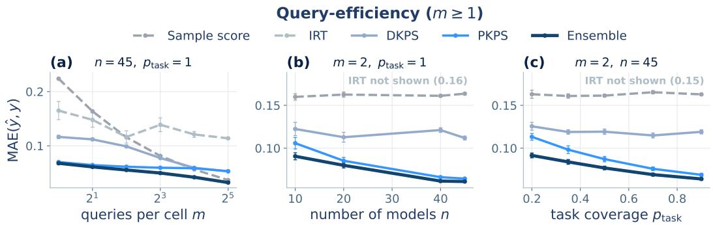

Figure 5: Query-efficient evaluation on the Every Eval Ever suite (45 models, 16 tasks; MAE against the true full-evaluation score, ±1 SEM over 16 seeds). The protocol matches Figure 3. The Ensemble is the most accurate at every budget and PKPS at every budget up to $m { = } 8 ;$ DKPS trails because the query pools are unpaired, and IRT is poorly identified.  
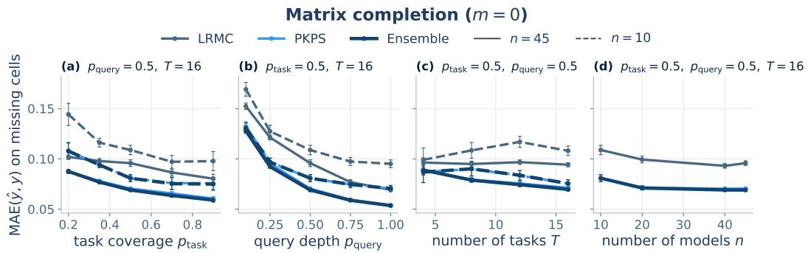  
Figure 6: Score completion on the Every Eval Ever suite (MAE on missing cells, ±1 SEM; solid $n { = } 4 5$ , dashed n=10). The protocol matches Figure 4. Unlike on the HELM suite, PKPS and the Ensemble outperform LRMC at every operating point.

Query bandwidth (c). Fixing the bandwidth at each grid multiplier instead of cross-validating traces the expected curve: near-delta multipliers and the exact-matching limit $( k _ { Q } ( u , u ^ { \prime } ) = \mathbf { 1 } \{ u =$ $u ^ { \prime } \}$ , abbreviated δ) are substantially worse (unpaired pools leave them little to compare), broad multipliers are best, and the cross-validated choice matches the best fixed multiplier on both suites (0.124 vs. 0.123 on HELM, 0.065 vs. 0.064 on EEE)—the one hyperparameter that matters is the one the method selects automatically. Sensitivity to the number of reference models is part of the main experiments (the cohort sweeps of Figures 3b and 4d).

Pipeline ablations. Repeating the budget sweep with one choice changed at a time: the crossvalidated ensemble weight is best or tied at every budget on both suites (the inverse-variance alternative loses 0.007 on HELM and 0.012 on EEE at m=1); replacing the K-NN regressor with least squares helps slightly on HELM (0.132 vs. 0.137 at m=1) but hurts on EEE (0.061 vs. 0.053 at m=32); an RBF response kernel changes PKPS by at most 0.002; and enforcing exactly disjoint EEE query pools (true $\rho = 0 )$ changes PKPS by at most 0.006 at $m \leq 8 .$

## D PROOFS OF THEOREMS 1 AND 2

Formal definitions and assumptions. We state the formal statements referenced in Section 3.

Definition 2 (Population PKPS). Let each model i’s (task, query, response) triples be drawn i.i.d. from a design distribution $P _ { i } { \mathrm { : } }$ : each triple independently draws a task, then a query conditioned on

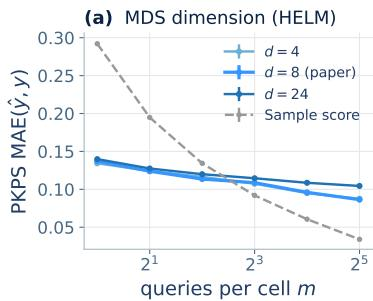

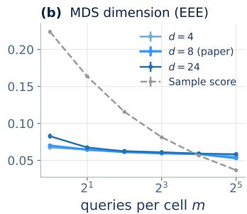

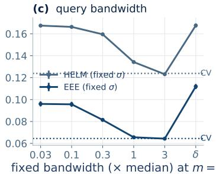  
Figure 7: Sensitivity analyses on the query-efficiency experiment (±1 SEM, 16 seeds). (a, b) PKPS MAE against budget at MDS dimension $d \in \{ 4 , \dot { 8 } , 2 4 \}$ (the paper’s choice $d { = } 8$ drawn heavier; sample dashed); d=4 and d=8 are nearly indistinguishable on both suites, while $d { = } 2 4$ trails at the extremes. (c) MAE at $m { = } 2$ with the query bandwidth fixed at each grid multiplier $( \delta = \mathtt { e x a c t }$ matching); dotted lines mark the cross-validated selection, which matches the best fixed choice on both suites.

the task, then the model’s response. Write ${ z } = ( u , x _ { i } ( u ) )$ for an embedded query–response pair (response noise included). The population affinity is

$$
A _ { i i ^ { \prime } } ^ { * } = \frac { \mathbb { E } \left[ k _ { Q } ( u , u ^ { \prime } ) k _ { R } ( x _ { i } ( u ) , x _ { i ^ { \prime } } ( u ^ { \prime } ) ) \right] } { \mathbb { E } \left[ k _ { Q } ( u , u ^ { \prime } ) \right] } , \qquad z \sim P _ { i } , ~ z ^ { \prime } \sim P _ { i ^ { \prime } } \mathrm { i n d e p e n d e n t } ,
$$

the population squared dissimilarities are $D ^ { * 2 } ( i , i ^ { \prime } ) ~ = ~ A _ { i i } ^ { * } + A _ { i ^ { \prime } i ^ { \prime } } ^ { * } - 2 A _ { i i ^ { \prime } } ^ { * }$ , and the population perspectives $\psi _ { 1 } , \ldots , \psi _ { n } \in \mathbb { R } ^ { d }$ (the rows of $\Psi ^ { \ast } ~ \in ~ \mathbb { R } ^ { n \times d } )$ are the rank-d spectral embedding of the double-centered matrix $B ^ { * } ~ = ~ - { \textstyle \frac { 1 } { 2 } } J D ^ { * 2 } J .$ , where $J ~ = ~ I - { \textstyle \frac { 1 } { n } } { \bf 1 } { \bf \dot { 1 } } ^ { \top } ; ~ \Psi ^ { * } ~ =$ $[ v _ { 1 } ^ { * } , \ldots , v _ { d } ^ { * } ] \mathrm { d i a g } ( \lambda _ { 1 } ( B ^ { * } ) ^ { 1 / 2 } , \ldots , \lambda _ { d } ( B ^ { * } ) ^ { 1 / 2 } )$ for the eigenpairs of the d largest eigenvalues of $B ^ { * }$ $\overrightharpoon { B } ^ { * }$ need not be positive semidefinite.

Assumption 1 (Observation model). Each scoring function is the mean of bounded per-query scores, and each observed cell $Q _ { i } ^ { ( t ) }$ is a uniform subsample of $Q ^ { ( t ) }$ at the budget $m$

Assumption 2 (Boundedness). Kernels and embedded responses are bounded.

Assumption 3 (Population overlap). The cross-model query-kernel mass is bounded below: $\kappa =$ $\mathrm { i n f } _ { i , i ^ { \prime } } \bar { \mathbb { E } } \big [ k _ { Q } ( u , u ^ { \prime } ) \big ] ^ { * } > 0$

Assumption 4 (Spectral identifiability). The d-th largest eigenvalue of $B ^ { * }$ is positive and separated from the next: $\lambda _ { d } ( B ^ { * } ) > 0$ and $\Delta = \mathsf { \bar { \lambda } } _ { d } ( B ^ { * } ) - \lambda _ { d + 1 } \mathsf { \bar { ( } } B ^ { * } ) > 0$

Assumption 5 (Pairing deficiency). The cross-model mass of the exact-matching kernel vanishes: $\begin{array} { r } { \kappa _ { 0 } = \operatorname* { s u p } _ { i \neq i ^ { \prime } } \mathbb { E } [ k _ { 0 } ( u , u ^ { \prime } ) ] = 0 } \end{array}$ for independent queries $u \sim P _ { i } , u ^ { \prime } \sim P _ { i ^ { \prime } }$ , where $\bar { k _ { 0 } } ( u , u ^ { \prime } ) = \mathbf { 1 } \{ u =$ $u ^ { \prime } \}$ ; equivalently, no two query designs share an atom.

Assumption 6 (Independent caches). The models and their query designs $( f _ { i } , P _ { i } ) , i = 0 , \ldots , n .$ are i.i.d., and given them the caches are drawn independently across models.

Under Assumption $^ { 6 , }$ each model together with its cache, $Z _ { i } = ( f _ { i } , C _ { i } )$ , is an i.i.d. draw from a law $\nu _ { m }$ that depends on the budget m.

Definition 3 (Fixed-budget representation). For $\sigma > 0$ let $h _ { \sigma } ( z , z ^ { \prime } ) = { \cal A } ( z , z ) + { \cal A } ( z ^ { \prime } , z ^ { \prime } ) -$ $2 A ( z , z ^ { \prime } )$ , where $A ( z , z ^ { \prime } )$ is Eq. (1) evaluated on the caches of z and $z ^ { \prime } ,$ and let

$$
b _ { \sigma } ( z , z ^ { \prime } ) = - \textstyle { \frac { 1 } { 2 } } \big ( h _ { \sigma } ( z , z ^ { \prime } ) - \bar { h } _ { \sigma } ( z ) - \bar { h } _ { \sigma } ( z ^ { \prime } ) + \bar { h } _ { \sigma } \big ) , \quad \bar { h } _ { \sigma } ( z ) = \int h _ { \sigma } ( z , w ) d \nu _ { m } ( w ) , \quad \bar { h } _ { \sigma } = \int \bar { h } _ { \sigma } d \nu _ { m } .
$$

The integral operator $\begin{array} { r } { ( T _ { \sigma } g ) ( z ) = \int b _ { \sigma } ( z , w ) g ( w ) d \nu _ { m } ( w ) } \end{array}$ on $L ^ { 2 } ( \nu _ { m } )$ is self-adjoint and compact. Let $\theta _ { 1 } \geq \cdots \geq \theta _ { d }$ be its d largest eigenvalues with orthonormal eigenfunctions $e _ { 1 } , \ldots , e _ { d } .$ , and $\theta _ { d + 1 }$ the supremum of the rest of its spectrum. The fixed-budget representation is $\phi _ { m , \sigma } ( z ) = $ $\begin{array} { r } { \left( \theta _ { k } ^ { - 1 / 2 } \int b _ { \sigma } ( z , w ) e _ { k } ( w ) d \nu _ { m } ( w ) \right) _ { k = 1 } ^ { d } } \end{array}$ , the continuous analogue of $\operatorname { E q . } \ ( 2 )$ (Trosset and Priebe, 2024), and $I _ { m } ( \sigma ) = \mathrm { V a r } \big ( \mathbb { E } [ y _ { 0 } \mid \phi _ { m , \sigma } ( Z _ { 0 } ) ] \big )$

Assumption 7 (Fixed-budget spectral identifiability). For $T _ { \sigma ^ { \star } } , \theta _ { d } > 0$ and $\theta _ { d } > \theta _ { d + 1 }$

Population quantities. Throughout, the quantities of Definition 2 are used as stated there. By Assumption 2 the kernels are bounded, $k _ { Q } \in [ 0 , 1 ]$ after normalization $( \mathbf { e . g . , R B F } )$ and $| k _ { R } | \leq B _ { R }$ and by Assumption 4 the rank-d spectral embedding exists with $\lambda _ { d } ( B ^ { * } ) > 0$

Lemma 1 (Affinity concentration). Under Assumptions 2 and 3, for models $i , i ^ { \prime }$ with min $\left( | Q _ { i } | , | Q _ { i ^ { \prime } } | \right) \geq$ m and any $\delta \in ( 0 , 1 )$ we have, with probability at least $\dot { 1 } - \delta ,$

$$
| A _ { i i ^ { \prime } } - A _ { i i ^ { \prime } } ^ { * } | \ \le \ \frac { 2 ( 1 + B _ { R } ) } { \kappa ^ { 2 } } t _ { m } ( \delta ) , \qquad t _ { m } ( \delta ) = \bar { B } \sqrt { \frac { \log ( 4 / \delta ) } { 2 m } } , \quad \bar { B } = \operatorname * { m a x } ( 2 B _ { R } , 1 ) ,
$$

provided $t _ { m } ( \delta ) \leq \kappa / 2$

Proof. The numerator $\begin{array} { r l r } { N } & { { } = } & { \frac { 1 } { | Q _ { i } | | Q _ { i ^ { \prime } } | } \sum _ { j , l } k _ { Q } ( u _ { j } , u _ { l } ^ { \prime } ) k _ { R } ( x _ { i j } , x _ { i ^ { \prime } l } ) } \end{array}$ and denominator $Z =$ $\begin{array} { r } { \frac { 1 } { | Q _ { i } | | Q _ { i ^ { \prime } } | } \sum _ { j , l } k _ { Q } ( u _ { j } , u _ { l } ^ { \prime } ) } \end{array}$ of Eq. (1) are two-sample U-statistics of order $( 1 , 1 )$ in the i.i.d. pairs $z _ { j } \sim P _ { i } , z _ { l } ^ { \prime } \sim P _ { i ^ { \prime } }$ , with kernels of range at most $2 B _ { R }$ and 1 respectively (the response draw is part $\operatorname { o f } z ,$ so no per-query response replication is needed). By Hoeffding’s inequality for two-sample U-statistics (Hoeffding, 1963, Section 5), each deviates from its mean by more than its range times $\sqrt { \log ( 4 / \delta ) / ( 2 m ) }$ with probability at most $\delta / 2 ;$ since $\bar { B }$ dominates both ranges, a union bound gives $| \dot { N } - \dot { N } ^ { * } | \le t _ { m } \dot { ( } \delta )$ and $| Z - Z ^ { \ast } | \leq t _ { m } ( \delta )$ jointly with probability $\geq 1 - \delta$ . On this event, since $Z ^ { * } \geq \kappa$ by Assumption 3 and $t _ { m } ( \delta ) \leq \kappa / 2$ , we have $Z \bar { \geq } \kappa / 2$ , and

$$
| A _ { i i ^ { \prime } } - A _ { i i ^ { \prime } } ^ { * } | = \frac { | N Z ^ { * } - N ^ { * } Z | } { Z Z ^ { * } } \leq \frac { | N - N ^ { * } | } { Z } + \frac { | N ^ { * } | | Z - Z ^ { * } | } { Z Z ^ { * } } \leq \frac { 2 L _ { m } ( \delta ) } { \kappa } + \frac { 2 B _ { R } \ell _ { m } ( \delta ) } { \kappa ^ { 2 } } \leq \frac { 2 ( 1 + B _ { R } ) } { \kappa ^ { 2 } } t _ { m } ( \delta ) ,
$$

using $| N ^ { * } | \le B _ { R }$ and $\kappa \leq 1$

Lemma 2 (Perspective perturbation). Let $\varepsilon _ { \infty } = \operatorname* { m a x } _ { i , i ^ { \prime } } \left| A _ { i i ^ { \prime } } - A _ { i i ^ { \prime } } ^ { * } \right|$ and $\beta = \| B ^ { * } \| _ { \mathrm { o p } } / \Delta$ . Under Assumption 4 there is an orthogonal $W \in \mathbb { R } ^ { d \times d }$ such that

$$
\operatorname* { m a x } _ { i } \| \hat { \psi } _ { i } - W \psi _ { i } \| \leq \frac { 5 3 ( 1 + \beta ) n \varepsilon _ { \infty } } { \sqrt { \lambda _ { d } ( B ^ { * } ) } } .
$$

Proof. Entrywise, $| D ^ { 2 } - D ^ { * 2 } | \le 4 \varepsilon _ { \infty } .$ , and double centering inflates an entrywise bound by at most a factor of 4 (each entry of $J M J$ is a signed combination of an entry, a row mean, a column mean, and the grand mean of $M )$ , so $E = B - B ^ { * }$ satisfies $\| E \| _ { \mathrm { o p } } \leq \| E \| _ { F } \leq 8 n \varepsilon _ { \infty }$ . Let $\hat { P }$ and $P ^ { * }$ be the orthogonal projections onto the eigenvectors of the d largest eigenvalues of B and $B ^ { * }$ Then $\Psi ^ { * } \Psi ^ { * \top } = P ^ { * } B ^ { * } P ^ { * }$ , and ${ \hat { \Psi } } { \hat { \Psi } } ^ { \top }$ differs from ${ \hat { P } } B { \hat { P } }$ only in that negative eigenvalues among the top d are set to zero. Each such eigenvalue satisfies $\begin{array}{c} | \lambda _ { k } \mathbf { \bar { ( } } B ) | \leq | \lambda _ { k } \mathbf { \bar { ( } } B ) - \mathbf { \bar { \lambda } } _ { k } \mathbf { ( } B ^ { * } )  \end{array}$ | because $\lambda _ { k } ( B ^ { \bar { * } } ) \geq \lambda _ { d } ( B ^ { * } ) > 0 .$ , so by the Hoffman–Wielandt inequality (Hoffman and Wielandt, 1953) $\| \hat { \Psi } \hat { \Psi } ^ { \top } - \hat { P } B \hat { P } \| _ { F } \leq \| E \| _ { F }$ . Writing

$$
\hat { \Psi } \hat { \Psi } ^ { \top } - \Psi ^ { * } \Psi ^ { * \top } = \big ( \hat { \Psi } \hat { \Psi } ^ { \top } - \hat { P } B \hat { P } \big ) + \hat { P } E \hat { P } + ( \hat { P } - P ^ { * } ) B ^ { * } \hat { P } + P ^ { * } B ^ { * } ( \hat { P } - P ^ { * } ) ,
$$

and using the Davis–Kahan bound $\| \hat { P } - P ^ { * } \| _ { F } \leq 2 \sqrt { 2 } \| E \| _ { F } / \Delta$ (Yu et al., 2015, Theorem 2), we obtain

$$
\| \hat { \Psi } \hat { \Psi } ^ { \top } - \Psi ^ { * } \Psi ^ { * \top } \| _ { F } \leq \Big ( 2 + \frac { 4 \sqrt { 2 } \| B ^ { * } \| _ { \mathrm { o p } } } { \Delta } \Big ) \| E \| _ { F } \leq 6 ( 1 + \beta ) \| E \| _ { F } .
$$

Since $\sigma _ { d } ( \Psi ^ { * } ) ^ { 2 } = \lambda _ { d } ( B ^ { * } )$ , the Procrustes alignment lemma of Tu et al. (2016, Lemma 5.4) gives

$$
\operatorname* { m i n } _ { W \in { \cal O } ( d ) } \| \hat { \Psi } - \Psi ^ { * } W \| _ { F } ^ { 2 } \leq \frac { \| \hat { \Psi } \hat { \Psi } ^ { \top } - \Psi ^ { * } \Psi ^ { * \top } \| _ { F } ^ { 2 } } { 2 ( \sqrt { 2 } - 1 ) \lambda _ { d } ( B ^ { * } ) } .
$$

Combining, maxi $\begin{array} { r } { \| \hat { \psi } _ { i } - W \psi _ { i } \| \leq \| \hat { \Psi } - \Psi ^ { * } W \| _ { F } \leq \frac { 6 ( 1 + \beta ) } { \sqrt { 2 ( \sqrt { 2 } - 1 ) } } \cdot \frac { 8 n \varepsilon _ { \infty } } { \sqrt { \lambda _ { d } ( B ^ { * } ) } } \leq \frac { 5 3 ( 1 + \beta ) n \varepsilon _ { \infty } } { \sqrt { \lambda _ { d } ( B ^ { * } ) } } . } \end{array}$

Proof of Theorem 1. Apply Lemma 1 at confidence $\delta / n ^ { 2 }$ to each of the at most $n ^ { 2 }$ model pairs; a union bound gives, with probability at least $1 - \delta$

$$
\varepsilon _ { \infty } = \operatorname* { m a x } _ { i , i ^ { \prime } } | A _ { i i ^ { \prime } } - A _ { i i ^ { \prime } } ^ { * } | \leq \frac { 2 ( 1 + B _ { R } ) \bar { B } } { \kappa ^ { 2 } } \sqrt { \frac { \log ( 4 n ^ { 2 } / \delta ) } { 2 m } } .
$$

Plugging this into Lemma 2 yields ma $\begin{array} { r } { \mathrm { ~ x } _ { i } \left\| \hat { \psi } _ { i } - W \psi _ { i } \right\| \leq C \kappa ^ { - 2 } \lambda _ { d } ^ { - 1 / 2 } ( 1 + \beta ) n \sqrt { \log ( 4 n ^ { 2 } / \delta ) / 2 m } } \end{array}$ with $C = 1 0 6 ( 1 + B _ { R } ) \bar { B }$ , which depends only on the kernel bounds. Lemma 1 requires $t _ { m } ( \delta / n ^ { 2 } ) \leq$ $\kappa / 2 ;$ in the complementary case the claimed bound already exceeds the trivial one—every perspective satisfies $\| \psi _ { i } \| ^ { 2 } \leq \lambda _ { 1 } ( B ) \leq 8 B _ { R } n$ and likewise for $\hat { \psi } _ { i }$ , so maxi $\| \hat { \psi } _ { i } - W \psi _ { i } \| \leq 6 \sqrt { B _ { R } n }$ , while the right-hand side is at least $C \kappa ^ { - 1 } ( 1 + \beta ) \sqrt { n } / ( 2 \bar { B } \sqrt { 8 B _ { R } } ) \geq 6 \sqrt { B _ { R } n }$ once $C$ also dominates $9 6 B _ { R } \bar { B } - \mathrm { s o }$ the theorem holds for every m after enlarging C by a constant factor. □

The remainder of this appendix proves Theorem 2. The first claim is a cross-validation transfer argument with a guarded selection rule. The second claim combines a lower bound on the MSE of every paired estimator under Assumption 5 with the large-n limit of the representation at the fixed budget m (Lemmas 3 and 4).

Proof of Theorem 2(i). Split the reference models into an embedding set $\mathcal { L } ,$ , a regression set ${ \mathcal { R } } ,$ and a validation set $\nu ,$ with $| { \dot { \boldsymbol { \mathcal { L } } } } | = \ell$ and $| \nu | = n _ { v }$ . For each $\sigma$ in the finite grid $\bar { \Sigma } \ni \bar { 0 }$ , compute the classical MDS embedding (Eq. (2)) of ${ \mathcal { L } } ,$ with top eigenpairs $( \hat { \lambda } _ { k } , \hat { v } _ { k } ) _ { k \le d }$ of $B _ { \mathcal { L } } .$ and embed any model z by the Nystrom out-of-sample extension (¨ Bengio et al., 2003) (see also Trosset and Priebe, 2008)

$$
\hat { \phi } _ { \mathcal { L } } ( z ) = \Big ( \hat { \lambda } _ { k } ^ { - 1 / 2 } \sum _ { j \in \mathcal { L } } \hat { v } _ { k } ( j ) \hat { b } _ { \mathcal { L } } ( z , j ) \Big ) _ { k = 1 } ^ { d } , \qquad \hat { b } _ { \mathcal { L } } ( z , j ) = - \frac { 1 } { 2 } \Big ( D ^ { 2 } ( z , j ) - \bar { D } _ { \mathcal { L } } ^ { 2 } ( z ) - \bar { D } _ { \mathcal { L } } ^ { 2 } ( j ) + \bar { D } _ { \mathcal { L } } ^ { 2 } \Big ) ,\tag{3}
$$

where $\begin{array} { r } { \bar { D } _ { \mathcal { L } } ^ { 2 } ( z ) = \ell ^ { - 1 } \sum _ { j \in \mathcal { L } } D ^ { 2 } ( z , j ) , \bar { \bar { D } } _ { \mathcal { L } } ^ { 2 } = \ell ^ { - 1 } \sum _ { j \in \mathcal { L } } \bar { D } _ { \mathcal { L } } ^ { 2 } ( j ) } \end{array}$ , and $\hat { \lambda } _ { k } ^ { - 1 / 2 }$ is read as 0 when $\hat { \lambda } _ { k } \le 0$ For $z \in \mathcal { L } , \hat { b } _ { \mathcal { L } } ( z , \cdot )$ is the corresponding row of $B _ { \mathcal { L } } .$ , so $\operatorname { E q . } \ ( 3 )$ reproduces the classical MDS coordinates. Let $\hat { y } _ { \sigma }$ be K-nearest-neighbor regression on $\mathcal { R } \mathrm { : } \mathrm { s }$ pairs $( \hat { \phi } _ { \mathcal { L } } ( f _ { i } ) , y _ { i } )$ , with validation loss $\begin{array} { r } { \hat { L } ( \sigma ) = \frac { 1 } { n . . , } \sum _ { i \in \mathcal { V } } ( \hat { y } _ { \sigma } ( f _ { i } ) - y _ { i } ) ^ { 2 } } \end{array}$ . Let $\tau = \sqrt { \log ( 2 | \Sigma | / \delta ^ { \prime } ) / 2 n _ { v } }$ be the validation confidence radius. The guarded selection is

$$
\begin{array} { r } { \hat { \sigma } = \left\{ \begin{array} { l l } { \arg \operatorname* { m i n } _ { \sigma \in \Sigma } \hat { L } ( \sigma ) } & { \mathrm { i f } \operatorname* { m i n } _ { \sigma } \hat { L } ( \sigma ) \leq \hat { L } ( 0 ) - 2 \tau , } \\ { 0 } & { \mathrm { o t h e r w i s e } . } \end{array} \right. } \end{array}
$$

Conditional on L and $\mathcal { R } ,$ , the validation losses are i.i.d. across the draw of validation models and bounded in $[ 0 , 1 ] ,$ , so by Hoeffding’s inequality (Hoeffding, 1963) and a union bound over $\Sigma ,$ with probability at least $\begin{array} { r } { 1 - \delta ^ { \prime } , \operatorname* { s u p } _ { \sigma \in \Sigma } | \hat { L } ( \sigma ) - L ( \sigma ) | \leq \tau } \end{array}$ , where $L ( \sigma )$ is the MSE on a fresh target conditional on $\mathcal { L }$ and $\mathcal { R }$ . On this event, i $\mathbf { \hat { \sigma } } \hat { \sigma } \neq 0$ then

$$
\begin{array} { r } { L ( \hat { \sigma } ) \leq \hat { L } ( \hat { \sigma } ) + \tau \leq \hat { L } ( 0 ) - 2 \tau + \tau \leq L ( 0 ) , } \end{array}
$$

and if $\hat { \sigma } = 0$ the two estimators coincide; either way $\mathrm { M S E } ( \hat { h } _ { n } ^ { ( K ) } ) \leq \mathrm { M S E } ( h _ { n , 0 } ^ { ( K ) } )$ ), since the $\sigma = 0$ member coincides with paired DKPS on the shared queries with the same regressor (Section 3.2). This holds at every $( m , \rho )$ □

Lemma 3 (Fixed-budget limit of the representation). Fix m and $\sigma = \sigma ^ { \star }$ , and suppose Assumptions $2 , \delta ,$ and 7 hold. As $\ell $ ∞ there are orthogonal $W _ { \mathcal { L } } \in \mathbb { R } ^ { d \times d } ,$ , depending on ${ \mathcal { L } } ,$ such that $\| \hat { \phi } _ { \mathcal { L } } ( Z ) - W _ { \mathcal { L } } \phi _ { m , \sigma } ( Z ) \| \to 0$ in probability for $Z \sim \nu _ { m }$ independent of $\mathcal { L } .$

Proof. Write $h = h _ { \sigma } , b = b _ { \sigma } , \phi = \phi _ { m , \sigma }$ , and let $Z _ { i } , j \in { \mathcal { L } } _ { : }$ , be the embedding models with their caches, i.i.d. with law $\nu _ { m }$ by Assumption 6. By Assumption $2 , | A | \le B _ { R }$ , so $| h | \leq 4 B _ { R }$ and $| b | \leq$ $8 B _ { R }$ . We use the versions $\begin{array} { r } { e _ { k } ( z ) = \theta _ { k } ^ { - 1 } \int b ( z , w ) e _ { k } ( w ) d \nu _ { m } ( w ) } \end{array}$ , which satisfy $| e _ { k } | \le 8 B _ { R } / \theta _ { k }$ and $\phi _ { k } = \theta _ { k } ^ { 1 / 2 } e _ { k }$

Centering. By Hoeffding’s inequality and a union bound, ma $\mathrm { x } _ { j \in \mathcal { L } } | \bar { D } _ { \mathcal { L } } ^ { 2 } ( j ) - \bar { h } ( Z _ { j } ) | , | \bar { \bar { D } } _ { \mathcal { L } } ^ { 2 } - \bar { \bar { h } } |$ , and, for any fixed $z , | \bar { D } _ { \mathcal { L } } ^ { 2 } ( z ) - \bar { h } ( z )$ are $O _ { P } ( \sqrt { { \log \ell } / { \ell } } )$ . Hence ma $\mathrm { x } _ { j \in \mathcal { L } } | \hat { b } _ { \mathcal { L } } ( z , j ) - b ( z , Z _ { j } ) |  0$ in probability for every fixed $z ,$ and $B _ { \mathcal { L } }$ differs from $[ { \dot { b } } ( Z _ { i } , Z _ { j } ) ] _ { i , j \in \mathcal { L } } \mathbf { \bar { b } } \mathbf { y } { \dot { o } } _ { P } ( \ell )$ in operator norm.

Spectrum and eigenvectors. Let $E _ { \mathcal { L } } \in \mathbb { R } ^ { \ell \times d }$ have rows $( e _ { 1 } ( Z _ { j } ) , \ldots , e _ { d } ( Z _ { j } ) )$ and $\hat { U } = [ \hat { v } _ { 1 } , \dotsc , \hat { v } _ { d } ]$ By the random-matrix approximation of integral operators (Koltchinskii, 1998; Koltchinskii and Gine´, 2000), together with Weyl’s inequality (Weyl, 1912) and the Davis–Kahan theorem (Davis and Kahan, 1970) for the $o _ { P } ( \ell )$ centering perturbation, $\hat { \lambda } _ { k } / \ell ~ \to ~ \theta _ { k }$ for $k \ \leq \ d ,$ and, since $\theta _ { 1 } , \ldots , \theta _ { d }$ are isolated from the rest of the spectrum (Assumption $^ { 7 ) }$ , the spectral projections converge: $\| \hat { U } \hat { U } ^ { \top } - \ell ^ { - 1 } E _ { \mathcal { L } } E _ { \mathcal { L } } ^ { \top } \| _ { F } \to 0$ in probability. With $\ell ^ { - 1 } E _ { \mathcal { L } } ^ { \top } E _ { \mathcal { L } }  I _ { d } ,$ this gives orthogonal $W _ { \mathcal { L } }$ with $\ell ^ { - 1 / 2 } \lVert \ell ^ { 1 / 2 } \hat { U } - E _ { \mathcal { L } } W _ { \mathcal { C } } ^ { \top } \rVert _ { F } \to 0$ . Applying the same argument to each distinct value among $\theta _ { 1 } , \ldots , \theta _ { d }$ lets $W _ { \mathcal { L } }$ be block diagonal on the corresponding eigenspaces, so it commutes with $\Theta = \mathrm { d i a g } ( \theta _ { 1 } , \dots , \theta _ { d } )$

Fixed z. Write $\hat { \phi } _ { \mathcal { L } } ( z ) ~ = ~ ( \hat { \Lambda } / \ell ) ^ { - 1 / 2 } \ell ^ { - 1 / 2 } \hat { U } ^ { \top } \hat { \beta } ( z )$ with $\hat { \Lambda } \ : = \ : \mathrm { d i a g } ( \hat { \lambda } _ { 1 } , \ldots , \hat { \lambda } _ { d } )$ and $\hat { \beta } ( z ) _ { j } ~ =$ $\hat { b } \underline { { c } } ( z , j )$ , and let $\beta ( z ) _ { j } = b ( z , Z _ { j } )$ and $e = ( e _ { 1 } , \ldots , e _ { d } )$ . Then

$$
\begin{array} { r l } { \ell ^ { - 1 / 2 } \hat { U } ^ { \top } \hat { \beta } ( z ) - W _ { \mathcal { L } } \int b ( z , w ) e ( w ) d \nu _ { m } ( w ) = } & { } \\ { \frac { 1 } { \ell } \big ( \ell ^ { 1 / 2 } \hat { U } - E _ { \mathcal { L } } W _ { \mathcal { L } } ^ { \top } \big ) ^ { \top } \hat { \beta } ( z ) } & { } \\ { + W _ { \mathcal { L } } \frac { 1 } { \ell } E _ { \mathcal { L } } ^ { \top } \big ( \hat { \beta } ( z ) - \beta ( z ) \big ) } & { } \\ { } & { + W _ { \mathcal { L } } \Big ( \frac { 1 } { \ell } E _ { \mathcal { L } } ^ { \top } \beta ( z ) - \int b ( z , w ) e ( w ) d \nu _ { m } ( w ) \Big ) . } \end{array}
$$

By Cauchy–Schwarz the first term is at most $\| \hat { \beta } ( z ) \| _ { \infty } \ell ^ { - 1 / 2 } \| \ell ^ { 1 / 2 } \hat { \boldsymbol { U } } - E _ { \mathcal { L } } \boldsymbol { W } _ { \mathcal { L } } ^ { \top } \| _ { F } \to 0 ;$ the second is at most $\sqrt { d }$ maxk $\| e _ { k } \| _ { \infty } \operatorname* { m a x } _ { j } | \hat { \beta } ( z ) _ { j } - \beta ( z ) _ { j } | \to 0$ by the centering step; the third is an average of ℓ i.i.d. bounded vectors minus its mean and vanishes by the law of large numbers. Since $( \hat { \Lambda } / \ell ) ^ { - 1 / 2 } \to$ $\Theta ^ { - 1 / 2 }$ and $W _ { \mathcal { L } }$ commutes with $\Theta , \hat { \phi } _ { \mathcal { L } } ( z ) - W _ { \mathcal { L } } \phi ( z ) \to 0$ in probability for every fixed z. For $Z \sim \nu _ { m }$ independent of ${ \mathcal { L } } ,$ dominated convergence gives $\mathrm { P r } ( \| \hat { \phi } _ { \mathcal { L } } ( Z ) - W _ { \mathcal { L } } \phi ( Z ) \| > \epsilon ) \to 0$ for every $\epsilon > 0$ □

Lemma 4 (The representation retains its information). Under the conditions of Lemma 3, let $g _ { \mathcal { L } } ( x ) = \mathbb { E } [ y _ { 0 } \mid \hat { \phi } _ { \mathcal { L } } ( Z _ { 0 } ) = x , { \mathcal { L } } ]$ and $\hat { I } _ { \mathcal { L } } ~ = ~ \mathrm { V a r } \big ( g _ { \mathcal { L } } ( \hat { \phi } _ { \mathcal { L } } ( Z _ { 0 } ) ) ~ | ~ \mathcal { L } \big )$ . Then for every $\epsilon > 0 ,$ Pr $\begin{array} { r } { \left( \hat { I } _ { \mathcal { L } } \ge I _ { m } ( \sigma ) - \epsilon \right) \to 1 a s \ell \to \infty } \end{array}$

Proof. Write $X = \phi _ { m , \sigma } ( Z _ { 0 } ) , \hat { X } = \hat { \phi } _ { \mathcal { L } } ( Z _ { 0 } ) , g ( x ) = \mathbb { E } [ y _ { 0 } \mid X = x ]$ , and $v = \mathrm { V a r } ( y _ { 0 } )$ ; scores lie in $[ 0 , 1 ]$ , and $( Z _ { 0 } , y _ { 0 } )$ is independent of L. For any bounded measurable $q , \mathbb { E } [ ( y _ { 0 } - q ( { \hat { X } } ) ) ^ { 2 } \mid$ $\mathcal { L } ] \geq \mathbb { E } [ ( y _ { 0 } - g _ { \mathcal { L } } ( \hat { X } ) ) ^ { 2 } \mid \mathcal { L } ] = v - \hat { I } _ { \mathcal { L } }$ . Fix $\epsilon ^ { \prime } > 0$ and choose a bounded continuous $q _ { 0 }$ with $\mathbb { E } \big [ ( \overline { { g } } ( X ) - q _ { 0 } ( \check { X } ) ) ^ { 2 } \big ] \overset { ^ { \prime } } { \leq } \epsilon ^ { ^ { \prime } 2 }$ , which is possible because bounded continuous functions are dense in $L ^ { \dot { 2 } }$ of the law of X, and set $q ( x ) = q _ { 0 } ( W _ { \mathcal { L } } ^ { \top } x )$ . By the triangle inequality in $L ^ { 2 }$ conditional on ${ \mathcal { L } } ,$

$$
\big ( v - \hat { I } _ { \mathcal { L } } \big ) ^ { 1 / 2 } \ \leq \ \| y _ { 0 } - g ( X ) \| + \| g ( X ) - q _ { 0 } ( X ) \| + r _ { \mathcal { L } } \ \leq \ \big ( v - I _ { m } ( \sigma ) \big ) ^ { 1 / 2 } + \epsilon ^ { \prime } + r _ { \mathcal { L } } ,
$$

where $r _ { \mathcal { L } } ^ { 2 } \ = \ \mathbb { E } [ ( q _ { 0 } ( X ) - q _ { 0 } ( W _ { \mathcal { L } } ^ { \top } \hat { X } ) ) ^ { 2 } \ | \ \mathcal { L } ]$ and we used $\| y _ { 0 } - g ( X ) \| ^ { 2 } = v - I _ { m } ( \sigma )$ . Since $W _ { c } ^ { \top } \hat { X } - X  0$ in probability (Lemma 3) and $q _ { 0 }$ is bounded and continuous, $q _ { 0 } ( W _ { \mathcal { L } } ^ { \top } \hat { X } ) - q _ { 0 } ( X ) $ 0 in probability, so $\bf \bar { E } [ \} r _ { \mathcal { L } } ^ { 2 } ]  \bar { 0 }$ by bounded convergence and $r _ { \mathcal { L } } \to 0$ in probability. Squaring and letting $\epsilon ^ { \prime } \to 0$ gives the claim. □

Contrast with paired DKPS. Under the limit kernel $k _ { 0 } ( k _ { 0 } ( u , u ^ { \prime } ) > 0 \mathrm { i f f } u = u ^ { \prime } )$ , only identical query pairs enter the double sum, so the U-statistic runs over the $\rho m$ shared queries and the rate in Lemma 1 becomes $O _ { P } \big ( ( \rho m ) ^ { - 1 / 2 } \big )$ : DKPS’s guarantee requires $\rho m  \infty$ and vacates under Assumption 5, where the cross-model mass $\kappa _ { 0 }$ is zero and its distance is undefined (Section 3).

ProofofTheorem 2(ii). Floor. Under Assumption 5, $\mathrm { P r } ( q _ { j } = q _ { l } ^ { \prime } ) = 0$ for every pair of independently drawn queries, so almost surely every identity-matched sum is empty: any measurable completion of a $. \sigma = 0$ estimator predicts as a function of the reference data alone, independent of the target. Hence, conditional on the reference data, $\mathrm { M S E } ( h _ { n , 0 } ^ { ( K ) } ) = v + ( \mathbb { E } y _ { 0 } - \hat { y } ) ^ { 2 } \geq v$ (for every neighbor count, every split, and every completion).

Achievability. Fix $0 < c < I _ { m } ( \sigma ^ { \star } )$ , let $\epsilon = ( I _ { m } ( { \sigma } ^ { \star } ) - c ) / 4$ , and let $\ell , | \mathcal { R } |$ |, and $n _ { v }$ grow proportionally with n. Conditional on L, the regression pairs $( \hat { \phi } _ { \mathcal { L } } ( Z _ { i } ) , y _ { i } ) , i \in \mathcal { R }$ , and the target’s $( \hat { X } , y _ { 0 } )$ with $\hat { X } = \hat { \phi } _ { \mathcal { L } } ( Z _ { 0 } )$ are i.i.d. (Assumption 6), so for $K _ { n }  \infty$ with $K _ { n } / n \to 0 , K _ { n }$ -nearest-neighbor regression with ties broken at random is $L ^ { 2 } .$ -consistent for $g _ { \mathcal { L } }$ (Stone, 1977). The cross term vanishes because $\mathbb { E } [ y _ { 0 } - g _ { \mathcal { L } } ( \hat { X } ) \mid \hat { X } , \mathcal { L } ] = 0 ,$ , so

$$
L ( \sigma ^ { \star } ) = \mathbb { E } \big [ ( y _ { 0 } - g _ { \mathcal { L } } ( \hat { X } ) ) ^ { 2 } \mid \mathcal { L } \big ] + \mathbb { E } \big [ ( \hat { y } _ { \sigma ^ { \star } } - g _ { \mathcal { L } } ( \hat { X } ) ) ^ { 2 } \mid \mathcal { L } , \mathcal { R } \big ] = v - \hat { I } _ { \mathcal { L } } + o _ { P } ( 1 ) ,
$$

and Lemma 4 gives $L ( \sigma ^ { \star } ) \leq v - I _ { m } ( \sigma ^ { \star } ) + 2 \epsilon$ with probability tending to one. Choose $n _ { v }$ large enough that $4 \tau \le I _ { m } ( \sigma ^ { \star } ) - 2 \epsilon$ and $\tau \leq \epsilon / 2$ . On this event and the deviation event of part (i), the guard triggers, since $\hat { L } ( \sigma ^ { \star } ) \leq L ( \sigma ^ { \star } ) + \tau \leq v - I _ { m } ( \sigma ^ { \star } ) + 2 \epsilon + \tau \leq v - 3 \tau \leq \hat { L } ( 0 ) - 2 \tau$ , using $\hat { L } ( 0 ) \ge L ( 0 ) - \tau \ge v - \tau$ . Then

$$
L ( \boldsymbol { \hat { \sigma } } ) \leq \hat { L } ( \boldsymbol { \hat { \sigma } } ) + \tau \leq \hat { L } ( \boldsymbol { \sigma } ^ { \star } ) + \tau \leq L ( \boldsymbol { \sigma } ^ { \star } ) + 2 \tau \leq v - I _ { m } ( \boldsymbol { \sigma } ^ { \star } ) + 3 \epsilon < v - c \leq \mathrm { M S E } ( h _ { n , 0 } ^ { ( K _ { n } ) } ) - c .
$$

The margin $c > 0$ supplies the strict clause of Definition 1 at the fixed budget $m .$

## APPENDIX REFERENCES

Yoshua Bengio, Jean-Franc¸ois Paiement, Pascal Vincent, Olivier Delalleau, Nicolas Le Roux, and Marie Ouimet. Out-of-sample extensions for LLE, Isomap, MDS, Eigenmaps, and spectral clustering. In Advances in Neural Information Processing Systems, volume 16. MIT Press, 2003. URL https://proceedings.neurips.cc/paper\_files/paper/ 2003/file/cf05968255451bdefe3c5bc64d550517-Paper.pdf.

Chandler Davis and William M. Kahan. The rotation of eigenvectors by a perturbation. III. SIAM Journal on Numerical Analysis, 7(1):1–46, 1970. doi: 10.1137/0707001.

Wassily Hoeffding. Probability inequalities for sums of bounded random variables. Journal of the American Statistical Association, 58(301):13–30, 1963. doi: 10.1080/01621459.1963.10500830.

Alan J. Hoffman and Helmut W. Wielandt. The variation of the spectrum of a normal matrix. Duke Mathematical Journal, 20(1):37–39, 1953. doi: 10.1215/S0012-7094-53-02004-3.

Vladimir Koltchinskii and Evarist Gine. Random matrix approximation of spectra of integral oper- ´ ators. Bernoulli, 6(1):113–167, 2000. doi: 10.2307/3318636.

Vladimir I. Koltchinskii. Asymptotics of spectral projections of some random matrices approximating integral operators. In High Dimensional Probability, volume 43 of Progress in Probability, pages 191–227. Birkhauser, 1998. doi: 10.1007/978-3-0348-8829-5¨ 11.

Dong C. Liu and Jorge Nocedal. On the limited memory BFGS method for large scale optimization. Mathematical Programming, 45(1–3):503–528, 1989. doi: 10.1007/BF01589116.

Georg Rasch. Probabilistic Models for Some Intelligence and Attainment Tests. Danish Institute for Educational Research, 1960.

Charles J. Stone. Consistent nonparametric regression. The Annals of Statistics, 5(4):595–620, 1977. doi: 10.1214/aos/1176343886.

Michael W. Trosset and Carey E. Priebe. Continuous multidimensional scaling. arXiv preprint arXiv:2402.04436, 2024. doi: 10.48550/arXiv.2402.04436.

Stephen Tu, Ross Boczar, Max Simchowitz, Mahdi Soltanolkotabi, and Benjamin Recht. Low-rank solutions of linear matrix equations via Procrustes flow. In International Conference on Machine Learning (ICML), 2016. doi: 10.48550/arXiv.1507.03566.

Hermann Weyl. Das asymptotische Verteilungsgesetz der Eigenwerte linearer partieller Differentialgleichungen (mit einer Anwendung auf die Theorie der Hohlraumstrahlung). Mathematische Annalen, 71(4):441–479, 1912. doi: 10.1007/BF01456804.

Frank Wilcoxon. Individual comparisons by ranking methods. Biometrics Bulletin, 1(6):80–83, 1945. doi: 10.2307/3001968.

Mu Zhu and Ali Ghodsi. Automatic dimensionality selection from the scree plot via the use of profile likelihood. Computational Statistics & Data Analysis, 51(2):918–930, 2006. doi: 10. 1016/j.csda.2005.09.010.