# BISECT: Bilevel Spectral Decomposition for Low-Rank Continual Learning

Tom Saliencro University of California, Irvine

Amara Okonkwo University of Washington

Wen-Hsuan Liu University of California, Irvine

Rohan Desai University of Washington

Maya Lindqvist University of California, Irvine

## Abstract

Exemplar-free continual learning on pre-trained Vision Transformers increasingly relies on Low-Rank Adaptation (LoRA), yet prevailing methods govern the low-rank update space through strict subspace isolation. By projecting each incoming task into the approximate null space of historical token activations, isolation-based learners equate any cross-task feature overlap with catastrophic interference. We show that this orthogonality premise induces a structural bottleneck we term spectral starvation: when down-projection bases are locked before task optimization, the gradient norm reaching the trainable up-projection is upper-bounded by the energy of current-task features captured by the chosen basis. Because natural visual tasks share low- and mid-level covariance structure, historical null tails contain barely 5.5% of incoming task variance, starving new-class plasticity while blocking positive consolidation along shared directions. We propose BISECT (Bilevel Spectral Decomposition), a continual LoRAframework that partitions a fixed rank-r budget into two orthogonal functional blocks: an invariant carrier spanned by the dominant modes of the joint historical-and-current Gram matrix, and a novelty complement extracted via generalized Rayleigh whitening followed by orthogonal complement projection. After single-task training, BISECT folds both blocks back into the frozen backbone using a closedform precision gate that scales each rank-1 invariant atom by its current-to-joint Rayleigh ratio while preserving novelty atoms at unit gain. Across eight incremental settings on ImageNet-R, ImageNet-A, CIFAR-100, CUB-200, and DomainNet, BISECT outperforms prompt, adapter, and LoRA baselines with zero extra inference parameters or FLOPs, and remains complementary to sparse analytic expansion.

## 1. Introduction

Class-incremental learning (CIL) seeks to equip a visual recognition system with new categories over sequential sessions without storing raw exemplars or querying task identifiers at test time [1]. With pre-trained Vision Transformers (ViTs) now serving as the standard representation backbone [2], the locus of continual adaptation has shifted from fullnetwork weight regularization to lightweight parameterefficient modules, most notably Low-Rank Adaptation (LoRA) [3]. The same stability–plasticity tension appears in compact biological circuits: the fly olfactory pathway expands a shared code and then writes plasticity only on a sparse subset of that code [4], and FlyLoRA imports the rank-wise version of that idea into a single LoRA module [5]. Because a LoRA module constrains the weight increment $\Delta W = Q P$ to a rank-r bottleneck $( r \ll \operatorname* { m i n } ( n , m ) )$ ), and because fixing the down-projection $P \in \mathbb { R } ^ { r \times m }$ confines all subsequent gradient updates to span $( P ^ { \top } )$ , the central algorithmic question in LoRA-based CIL is how to construct and consolidate those r basis directions across tasks.

Mainstream LoRA continual learners answer this question through subspace isolation. Methods such as InfLoRA [6], O-LoRA [7], and null-space prompt tuning [8, 9] restrict P to the empirical null space of token features accumulated over prior sessions, while BiLoRA [10] and PLAN [11] enforce near-orthogonality across task branches. The underlying assumption is appealingly simple: any feature direction shared between past and present tasks is a conduit for overwriting old knowledge and must be excluded.

Yet empirical evidence across diverse visual streams reveals that strict isolation trades catastrophic forgetting for a severe loss of plasticity. As shown in Figure 1(a), while null-space projection (InfLoRA) improves over unconstrained sequential LoRA on rendition shifts (ImageNet-R), it drops below unconstrained LoRA on natural adversarial examples (10S-ImageNet-A, 49.35% vs. 52.96%). Figure 1(b) exposes the geometric root cause. Partitioning the eigenspectrum of the historical Gram matrix $G _ { < t }$ into quartiles shows that more than 80% of a new visual task’s feature energy resides in the top 35% of historical directions, whereas the bottom 30% null tail captures only 5.5%. Forcing P into that tail starves the up-projection Q of backpropagated gradient energy (spectral starvation) while simultaneously forbidding the model from refining shared visual primitives in the leading core. Conversely, choosing directions purely by raw current-task energy tr( $P G P ^ { \top } )$ rediscovers the historical core and triggers severe drift. What matters for task-specific plasticity is not inactivity in the past, nor raw variance in the present, but the ratio of current variance to historical variance—which peaks in the midspectrum (51.6% of whitened novelty in Figure 1(b)).

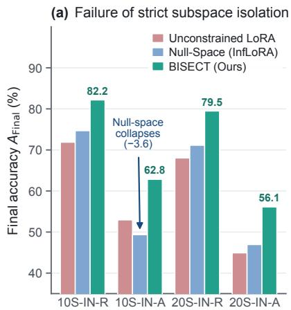

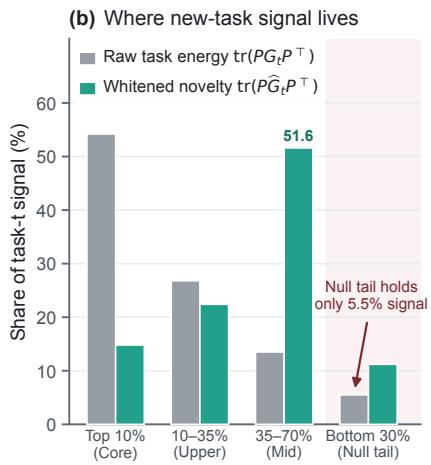

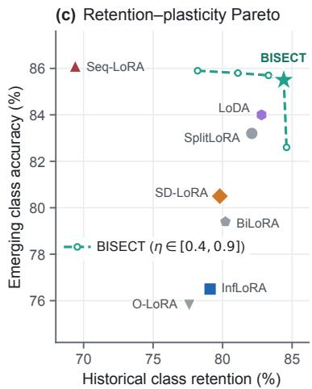  
Figure 1. Diagnosing the orthogonality trap in LoRA continual learning. (a) Final accuracy $A _ { \mathrm { F i n a l } }$ across four challenging splits: un constrained LoRA overwrites prior sessions, whereas null-space projection (InfLoRA) collapses under severe distribution shift on 10S-ImageNet-A. (b) Distribution of task-t signal across quartiles of the historical eigenspectrum $G _ { < t }$ on ViT-B/16: the bottom 30% null tail holds only 5.5% of raw task energy, starving gradient flow, whereas generalized Rayleigh whitening shifts selection to the mid-spectrum where unexplained variance peaks (51.6%). (c) Historical retention vs. emerging-class accuracy on 10S-ImageNet-R; varying the spectra threshold η traces a Pareto frontier above isolation and gradient-splitting baselines.

Motivated by this diagnosis, we propose BISECT (Bilevel Spectral Decomposition for Low-Rank Continual Learning). Rather than treating continual adaptation as a homogeneous isolation problem, BISECT splits a stationary rank-r budget into two orthogonal subspaces with distinct functional roles and distinct post-task consolidation rules:

1. Invariant Carrier $( P _ { \mathrm { i n v } } \in \mathbb R ^ { k _ { \mathrm { i n v } } \times m } )$ : Extracted from the dominant $k _ { \mathrm { i n v } }$ singular vectors of the joint Gram matrix $G _ { 1 : t } = G _ { < t } + G _ { t }$ via randomized subspace iteration, capturing cross-task shared structure.

2. Novelty Complement $( P _ { \mathrm { n o v } } \in \mathbb R ^ { k _ { \mathrm { n o v } } \times m } )$ : Constructed by Cholesky whitening $G _ { t }$ against the damped historical Gram $G _ { < t } + \rho I$ to maximize the generalized Rayleigh quotient, followed by exact projection onto span $( P _ { \mathrm { i n v } } ^ { \top } ) ^ { - }$ ⊥ and QR orthonormalization.

3. Precision-Weighted Consolidation $( \Omega _ { \mathrm { i n v } } ^ { \star } ) { : }$ After optimizing $Q = [ Q _ { \mathrm { i n v } } , Q _ { \mathrm { n o v } } ]$ on task t, BISECT folds the adapter into the frozen backbone by scaling each rank-1 invariant atom by its closed-form posterior precision ratio $\omega _ { j } ^ { \star } \in [ 0 , 1 ]$ , while folding novelty atoms at unit weight.

Our contributions are fourfold:

• We formalize spectral starvation in frozen-basis LoRA continual learning (Proposition 1), proving that nullspace isolation bounds the up-projection gradient norm by the residual tail energy of incoming features.

• We introduce BISECT, a bilevel spectral decomposition that pairs a joint-Gram invariant carrier with a Choleskywhitened novelty complement and allocates rank layeradaptively across transformer blocks.

• We prove that our novelty basis solves a constrained generalized Rayleigh problem (Theorem 1) and derive a closed-form rank-1 consolidation gate that strictly minimizes cumulative representation drift (Theorem 2).

• Across eight class-incremental benchmarks on a frozen ViT-B/16 protocol, BISECT leads prompt and LoRA baselines while reducing subspace setup latency by 12.4× relative to LoDA and adding zero inference overhead. Sparse analytic expansion [12] remains stronger on CIFAR-100 and CUB, where a frozen code is already linearly separable.

## 2. Related Work

Pre-trained continual learning with prompts and adapters. Classical continual learning relies on episodic replay, parameter importance regularization, or knowledge distillation [1]. With strong pre-trained ViTs [2], rehearsalfree methods instead attach compact tunable modules to a frozen encoder. Prompt-tuning approaches such as L2P [13], DualPrompt [14], CODA-Prompt [15], CPG [16], and

VQP [17] maintain key-value prompt pools, while recent extensions introduce cross-modal prompt generators [18]. Parallel adapter frameworks adapt transformer blocks via semantic shift compensation (SSIAT [19]), expandable subspace ensembles (EASE [20], Miles [21]), dynamic adapter integration [22], model surgery (MOS [23]), self-expanding adapter mixtures [24], cross-subspace alignment (CKAA [25]), elastic knowledge preservation (EKPC [26]), or taskconditioned transformations [27]. While effective, expanding prompt pools or adapter ensembles increases inference latency or parameter count with task horizon T, and does not address how to partition directions inside a single merged weight update.

Low-rank subspace governance in continual learning. LoRA [3, 28] enables zero-inference-overhead continual learning because learned rank-r updates can be folded directly into the backbone weights after each session. To mitigate forgetting, O-LoRA [7], InfLoRA [6], and VPT-NSP [8] project new down-projections into the approximate null space of past feature covariances, extending classical nullspace SGD [9]. BiLoRA [10] and PLAN [11] enforce pairwise orthogonality via bilinear parameterization or proactive rank allocation, while SD-LoRA [29] decouples directional bases from learnable magnitudes. More recent works relax strict isolation: CoSO [30] continuously updates subspace bases, LoRA-P&M [31] combines perturbation training with post-hoc merging, SplitLoRA [32] splits optimization gradients into primary and secondary spaces, and LoDA [33] selects bases via raw projection energy alongside an auxiliary router. Related LoRA architectures explore balanced updates (Janus-LoRA [34]), layer-scaled residual gradients (KeepLoRA++ [35]), geometric subspace evolution (Geo-LoRA [36]), implicit rank-wise mixture-ofexperts (FlyLoRA [5]), or nested expansion for multimodal instruction tuning [37–39]. FlyLoRA keeps one adapter and treats ranks as experts, but its top-k mask also zeros the forward pass, so the test-time rank is strictly smaller than r [5].

BISECT does not banish historically active directions: an invariant carrier stores shared primitives, and a precision gate scales their write-back. Unlike LoDA, which keeps 2.36M extra routing parameters at test time, Split-LoRA, which partitions gradients after the basis is fixed, and FlyLoRA, which drops ranks at inference [5], BISECT reads every rank at test time. Plastic directions maximize a whitened Rayleigh quotient in the complement of the invariant carrier, and the update is then folded into the backbone.

Relation to analytic representation readouts. A complementary line of exemplar-free CIL freezes the backbone and solves a closed-form ridge classifier over randomprojected or whitened features [40–44]. Fly-CL is the strongest recent member of that line: it copies the fly olfactory expansion, maps frozen ViT features through a sparse random projection with top-k Kenyon-cell sparsification, and fits a streaming ridge head [4, 12]. The circuit argument is that a wide sparse code separates classes that a dense lowrank update still mixes [4, 12]. Analytic readouts therefore change the classifier, whereas BISECT changes the attention projections and then discards the adapter. Appendix C compares the two cuts of the same stability–plasticity problem.

## 3. Preliminaries and Problem Formulation

## 3.1. Task-Agnostic Class-Incremental Protocol

We consider a sequence of $T$ supervised visual recognition tasks $\{ \mathcal { D } _ { 1 } , \hdots , \mathcal { D } _ { T } \}$ , where session t provides $N _ { t }$ training pairs $\mathcal { \bar { D } } _ { t } = \{ ( x _ { t , i } , \mathcal { \bar { y } } _ { t , i } ) \} _ { i = 1 } ^ { N _ { t } }$ over a label set $\mathcal { V } _ { t }$ that is disjoint from all prior sessions $( \mathcal { V } _ { t } \cap \mathcal { V } _ { t ^ { \prime } } = \varnothing$ for $t \neq t ^ { \prime } )$ . No historical exemplars from $\mathcal { D } _ { < t }$ are retained. After session $t ,$ the model is evaluated across the cumulative label space $\textstyle { \mathcal { Y } } _ { 1 : t } = \bigcup _ { s = 1 } ^ { t } { \mathcal { Y } } _ { s }$ without access to task identifiers.

Let $W ^ { ( t - 1 ) } \in \mathbb { R } ^ { n \times m }$ denote a frozen linear projection (query, key, or value weight) in block ℓ of a pre-trained ViT-B/16 at the beginning of session t. For an input token matrix $\boldsymbol { X } \in \mathbb { R } ^ { \boldsymbol { B } _ { \mathrm { t o k } } \times \boldsymbol { m } }$ (where $B _ { \mathrm { t o k } }$ is the batch token count), LoRA introduces a rank-r update parameterized by a downprojection $P \in \mathbb { R } ^ { r \times m }$ and an up-projection $Q \in \mathbb { R } ^ { n \times r }$

$$
Y = X \big ( W ^ { ( t - 1 ) } + Q P \big ) ^ { \top } \in \mathbb { R } ^ { B _ { \mathrm { t o k } } \times n } .\tag{1}
$$

Following the asymmetric subspace-locking paradigm [6, 33], $P$ is synthesized before session-t optimization and held fixed during SGD so that $Q$ learns linearly over the r-dimensional feature subspace span $( P ^ { \top } )$ . For each transformer block, we maintain the running uncentered token Gram matrix $\begin{array} { r } { G _ { < t } = \sum _ { s = 1 } ^ { t - 1 } G _ { t } ^ { ( s ) } \in \mathbb { R } ^ { m \times m } } \end{array}$ , where $G _ { t } \ =$ $X _ { t } ^ { \top } X _ { t } \in \mathbb { R } ^ { m \times m }$ is accumulated in a single forward pass over $\mathcal { D } _ { t }$ . Because $m = 7 6 8$ is fixed by the ViT architecture, storing $G _ { < t }$ across all 12 blocks requires a constant 27.0 MB independent of task horizon $T .$

## 3.2. Spectral Starvation in Null-Space Isolation

To prevent $\Delta W _ { t } ~ = ~ Q P$ from perturbing historical outputs $X _ { < t } W ^ { ( t - 1 ) \top }$ , null-space methods choose $P$ such that $\mathrm { t r } ( P G _ { < t } P ^ { \top } ) \approx 0$ . Why does this seemingly safe choice degrade accuracy on shifted streams like ImageNet-A? Our first result shows that locking $P$ into a low-energy tail of $G _ { t }$ directly throttles the gradient norm of $Q$

Proposition 1 (Spectral Starvation Bound). Let $\mathcal { L } _ { t } ( Y )$ be any differentiable task-t loss over token features $X _ { t } ~ \in$ Rnt×m with Gram matrix $G _ { t } = X _ { t } ^ { \top } X _ { t }$ . When the downprojection $P \in \mathbb { R } ^ { r \times m } \left( P P ^ { \top } = I _ { r } \right)$ is frozen during backpropagation, the Frobenius norm of the gradient with $r e \mathrm { - }$ spect to the trainable up-projection Q obeys

$$
\left\| \nabla _ { Q } \mathcal { L } _ { t } \right\| _ { F } \leq \left\| \nabla _ { Y } \mathcal { L } _ { t } \right\| _ { F } \sqrt { \mathrm { t r } ( P G _ { t } P ^ { \top } ) } .\tag{2}
$$

Consequently, $i f P$ is restricted to an ε-approximate null space $o f G _ { < t }$ and task t shares principal support with prior tasks such that $\lambda _ { \operatorname* { m a x } } ( P G _ { t } P ^ { \top } ) \ \leq \ \varepsilon ,$ , then $\Vert \nabla _ { Q } \mathcal { L } _ { t } \Vert _ { F } \ \leq$ $\sqrt { r \varepsilon } \parallel \nabla _ { Y } \mathcal { L } _ { t } \parallel _ { F } .$

Proposition 1 (proved in Appendix A) formalizes the empirical observation in Figure 1(b): because natural visual tasks share dominant feature directions, the null tail of $G _ { < t }$ has tiny projection energy $\mathrm { t r } ( P G _ { t } P ^ { \top } )$ on task t. Isolating $P$ in that tail starves Q of gradient signal.

## 4. BISECT: Bilevel Spectral Decomposition

To overcome spectral starvation without reverting to unconstrained overwriting, BISECT decomposes the rankr down-projection into two orthogonal functional blocks, $P ~ = ~ [ \bar { P } _ { \mathrm { i n v } } ^ { \top } , P _ { \mathrm { n o v } } ^ { \top } ] ^ { \top } ~ \in ~ \mathbb { R } ^ { r \times m }$ , paired with trainable upprojections $Q = [ Q _ { \mathrm { i n v } } , Q _ { \mathrm { n o v } } ] \in \mathbb { R } ^ { n \times r }$ , where $k _ { \mathrm { i n v } } + k _ { \mathrm { n o v } } =$ r:

$$
{ \boldsymbol { Y } } =  { \boldsymbol { X } } \left(  { \boldsymbol { W } } ^ { ( t - 1 ) } +  { \boldsymbol { Q } } _ { \mathrm { i n v } }  { \boldsymbol { P } } _ { \mathrm { i n v } } +  { \boldsymbol { Q } } _ { \mathrm { n o v } }  { \boldsymbol { P } } _ { \mathrm { n o v } } \right) ^ { \top } .\tag{3}
$$

As illustrated in Figure 2, $P _ { \mathrm { i n v } } \in \mathbb { R } ^ { k _ { \mathrm { i n v } } \times m }$ spans an invariant carrier that captures dominant cross-task visual structure, while $P _ { \mathrm { n o v } } \in \mathbb R ^ { k _ { \mathrm { n o v } } \times m }$ spans a novelty complement that maximizes current-task variance relative to historical variance inside span $( P _ { \mathrm { i n v } } ^ { \top } ) ^ { \perp }$

## 4.1. Layer-Adaptive Spectral Rank Allocation

Different ViT blocks exhibit markedly different covariance decay: early blocks process localized token patches with broad, flat spectra, whereas deeper blocks encode compact semantic clusters with rapidly decaying singular values. Rather than fixing $( k _ { \mathrm { i n v } } , k _ { \mathrm { n o v } } )$ uniformly across layers, we allocate $k _ { \mathrm { i n v } }$ according to the spectral concentration of the joint Gram matrix $G _ { 1 : t } = G _ { < t } + G _ { t }$ within the rank-r budget:

$$
\begin{array} { r } { k _ { \mathrm { i n v } } = \exp \Bigl ( \operatorname* { m i n } \Big \{ k : \frac { \sum _ { i = 1 } ^ { k } \sigma _ { i } ( G _ { 1 : t } ) } { \sum _ { j = 1 } ^ { r } \sigma _ { j } ( G _ { 1 : t } ) } \geq \eta \Big \} , 1 , r - 1 \Bigr ) , } \end{array}\tag{4}
$$

where $\sigma _ { 1 } ( G _ { 1 : t } ) \geq \cdot \cdot \cdot \geq \sigma _ { r } ( G _ { 1 : t } )$ are the top-r singular values of $G _ { 1 : t } , \eta \in ( 0 , 1 )$ is the spectral energy ratio (default $\eta = 0 . 7 )$ , and $k _ { \mathrm { n o v } } = r - k _ { \mathrm { i n v } }$ . Evaluating the ratio over the top-r singular values (and clipping to $[ 1 , r - 1 ] )$ ) guarantees that both functional blocks remain non-empty across all layers and sessions (Lemma 3 in Appendix A).

## 4.2. Invariant Carrier via Randomized Rangefinder

To capture visual primitives shared between historical tasks and session t, the invariant carrier $P _ { \mathrm { i n v } }$ is aligned with the leading $k _ { \mathrm { i n v } }$ -dimensional principal subspace of the joint Gram matrix $G _ { 1 : t } = G _ { < t } + G _ { t }$ . Performing a full $m \times m$ eigendecomposition across all 12 blocks at every session incurs $O ( m ^ { 3 } )$ latency. We instead employ a single-pass randomized rangefinder (RSVD) [45] with oversampling parameter q (default $q = 8 ) \colon$ : we draw a Gaussian probe $\Xi \in$ $\mathbb { R } ^ { m \times ( k _ { \mathrm { i n v } } + q ) }$ , form the sketch $Z = G _ { 1 : t } \Xi .$ , orthonormalize its columns via thin QR $( Z = Q _ { Z } R _ { Z } )$ , and extract the top-$k _ { \mathrm { i n v } }$ eigenvectors $\widetilde { U }$ of the small $( k _ { \mathrm { i n v } } + q ) \times ( k _ { \mathrm { i n v } } + q )$ core $Q _ { Z } ^ { \top } G _ { 1 : t } Q _ { Z }$ . Setting

$$
P _ { \mathrm { i n v } } = ( Q _ { Z } { \widetilde { U } } ) ^ { \top } \in \mathbb { R } ^ { k _ { \mathrm { i n v } } \times m }\tag{5}
$$

yields an orthonormal carrier $\begin{array} { r l r } { ( P _ { \mathrm { i n v } } P _ { \mathrm { i n v } } ^ { \top } } & { { } = } & { I _ { k _ { \mathrm { i n v } } } ) } \end{array}$ in $O ( m ^ { 2 } ( k _ { \mathrm { i n v } } + q ) )$ time, reducing subspace setup latency by $5 . 0 \times$ relative to full SVD while matching exact principal angles within sin $\Theta _ { \mathrm { m a x } } \le 0 . 0 0 8$

## 4.3. Novelty Complement via Generalized Rayleigh Whitening

Having reserved $P _ { \mathrm { i n v } }$ for shared representations, how should the remaining $k _ { \mathrm { n o v } }$ directions be chosen? A direction $u ~ \in ~ \mathbb { R } ^ { m }$ provides strong plastic gradient flow (large $u ^ { \top } G _ { t } u )$ while inflicting minimal historical interference (small $u ^ { \top } G _ { < t } u )$ precisely when it maximizes the generalized Rayleigh selectivity ratio:

$$
\mathcal { R } ( u ) = \frac { u ^ { \top } G _ { t } u } { u ^ { \top } ( G _ { < t } + \rho I ) u } ,\tag{6}
$$

where $\rho > 0$ (default $1 0 ^ { - 4 } )$ is a Tikhonov damping constant ensuring strict positive definiteness. We factor $G _ { < t } + \rho I =$ $L L ^ { \top }$ via Cholesky decomposition and transform $G _ { t }$ into the whitened novelty matrix

$$
\widehat { G } _ { t } = L ^ { - 1 } G _ { t } L ^ { - \top } .\tag{7}
$$

Using $\mathrm { R S V D } ( \widehat { G } _ { t } , k _ { \mathrm { n o v } } , q )$ , we extract the $\scriptstyle { \mathrm { t o p } } - k _ { \mathrm { n o v } }$ whitened singular vectors $U _ { \mathrm { n o v } } ^ { ( 0 ) } \in \mathbb { R } ^ { m \times k _ { \mathrm { n o v } } }$ . Because $G _ { 1 : t }$ contains $G _ { t } , U _ { \mathrm { n o v } } ^ { ( 0 ) }$ may still partially overlap with the invariant carrier span $( P _ { \mathrm { i n v } } ^ { \top } )$ . To enforce strict functional decoupling, we project $U _ { \mathrm { n o v } } ^ { ( 0 ) }$ onto the orthogonal complement of $P _ { \mathrm { i n v } }$ and orthonormalize via thin QR:

$$
\begin{array} { r l } & { U _ { \mathrm { n o v } } ^ { ( 1 ) } = \bigl ( I _ { m } - P _ { \mathrm { i n v } } ^ { \top } P _ { \mathrm { i n v } } \bigr ) U _ { \mathrm { n o v } } ^ { ( 0 ) } , } \\ & { P _ { \mathrm { n o v } } = \mathrm { Q R } \bigl ( U _ { \mathrm { n o v } } ^ { ( 1 ) } \bigr ) ^ { \top } \in \mathbb { R } ^ { k _ { \mathrm { n o v } } \times m } . } \end{array}\tag{8}
$$

Theorem 1 (Optimality and Decoupling of the Bilevel Basis). For any session t, the pre-projected columns $L ^ { - \top } U _ { \mathrm { n o v } } ^ { ( 0 ) }$ maximize the sum of generalized Rayleigh ratios $\textstyle \sum _ { j = 1 } ^ { k _ { \mathrm { n o v } } } \mathcal { R } ( u _ { j } )$ over $L ^ { \top }$ -orthonormal subspaces. After the complement projection and QRfactorization in Eq. (8), the composite basis $P = [ P _ { \mathrm { i n v } } ^ { \top } , \bar { P } _ { \mathrm { n o v } } ^ { \top } ] ^ { \top } \in \mathbb { R } ^ { r \times m }$ satisfies exact block orthonormality:

$$
P _ { \mathrm { i n v } } P _ { \mathrm { i n v } } ^ { \top } = I _ { k _ { \mathrm { i n v } } } , \ P _ { \mathrm { n o v } } P _ { \mathrm { n o v } } ^ { \top } = I _ { k _ { \mathrm { n o v } } } , \ P _ { \mathrm { i n v } } P _ { \mathrm { n o v } } ^ { \top } = 0 , \ P P ^ { \top } = I _ { r } .\tag{9}
$$

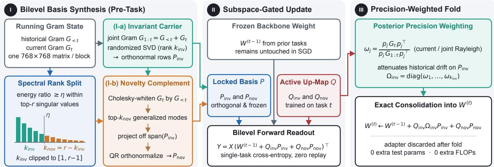  
Figure 2. Overview of BISECT at session t. (I) Using the historical Gram state $G _ { < t }$ and current-task Gram $G _ { t }$ , BISECT determines the layerwise rank split $( k _ { \mathrm { i n v } } , k _ { \mathrm { n o v } } )$ from the top-r spectral energy threshold $\eta ,$ extracts the invariant carrier $P _ { \mathrm { i n v } }$ from the joint Gram $G _ { 1 : t }$ via randomized SVD, and synthesizes the orthogonal novelty complement $P _ { \mathrm { n o v } }$ via Cholesky-whitened generalized Rayleigh extraction. (II) Both basis blocks $P _ { \mathrm { i n v } } , P _ { \mathrm { n o v } }$ remain locked while the up-maps $Q _ { \mathrm { i n v } } , Q _ { \mathrm { n o v } }$ are optimized by SGD on $\mathcal { D } _ { t }$ . (III) Each rank-1 invariant atom is folded into $W ^ { ( t - 1 ) }$ with its closed-form posterior precision weight $\omega _ { j } ^ { \star } \in [ 0 , 1 ]$ , while novelty atoms fold at unit weight, yielding zero inference overhead.

Theorem 1 ensures that plastic adaptation occurs exclusively in directions that are both novel relative to $G _ { < t }$ and strictly orthogonal to the invariant carrier $P _ { \mathrm { i n v } }$

## 4.4. Posterior Precision-Weighted Consolidation

During session $t , \ W ^ { ( t - 1 ) }$ and P remain frozen while $Q \ = \ [ Q _ { \mathrm { i n v } } , Q _ { \mathrm { n o v } } ]$ is optimized on $\mathcal { D } _ { t }$ via cross-entropy. Once training concludes, folding $Q _ { \mathrm { i n v } } P _ { \mathrm { i n v } }$ directly into $W ^ { ( t - 1 ) }$ at unit scale would displace historical features along the shared carrier directions. We therefore decompose $\begin{array} { r } { Q _ { \mathrm { i n v } } P _ { \mathrm { i n v } } = \sum _ { i = 1 } ^ { k _ { \mathrm { i n v } } } q _ { \mathrm { i n v } , j } p _ { \mathrm { i n v } , j } } \end{array}$ into $k _ { \mathrm { i n v } }$ rank-1 atoms, where $p _ { \operatorname { i n v } , j } \in \mathbb { R } ^ { 1 \times m }$ is the j-th row of $P _ { \mathrm { i n v } }$ and $q _ { \mathrm { i n v } , j } ~ \in$ $\mathbb { R } ^ { n \times 1 }$ is the j-th column of $Q _ { \mathrm { i n v } } ,$ and assign each atom a scalar consolidation weight $\omega _ { j } \in [ 0 , 1 ]$

We choose $\omega _ { j }$ to minimize the sum of squared historical feature drift on $\mathcal { D } _ { < t }$ and squared approximation residual on the newly learned task $\mathcal { D } _ { t }$ :

$$
\begin{array} { r l } & { \mathcal { E } ( \omega _ { j } ) = \Big \| X _ { < t } \big ( \omega _ { j } q _ { \mathrm { i n v } , j } p _ { \mathrm { i n v } , j } \big ) ^ { \top } \Big \| _ { F } ^ { 2 } } \\ & { \qquad + \left\| X _ { t } \big ( ( 1 - \omega _ { j } ) q _ { \mathrm { i n v } , j } p _ { \mathrm { i n v } , j } \big ) ^ { \top } \right\| _ { F } ^ { 2 } . } \end{array}\tag{10}
$$

Theorem 2 (Closed-Form Precision Consolidation Gate). For every invariant atom $j \in \{ 1 , \dots , k _ { \mathrm { i n v } } \}$ with non-zero up-projection $\| q _ { \mathrm { i n v } , j } \| _ { 2 } ~ > ~ 0 ,$ , the quadratic objective in Eq. (10) admits a unique closed-form minimizer independent $o f q _ { \mathrm { i n v } , j } .$

$$
\omega _ { j } ^ { \star } = \frac { p _ { \mathrm { i n v } , j } G _ { t } p _ { \mathrm { i n v } , j } ^ { \top } } { p _ { \mathrm { i n v } , j } \left( G _ { < t } + G _ { t } \right) p _ { \mathrm { i n v } , j } ^ { \top } } = 1 - \frac { p _ { \mathrm { i n v } , j } G _ { < t } p _ { \mathrm { i n v } , j } ^ { \top } } { p _ { \mathrm { i n v } , j } G _ { 1 : t } p _ { \mathrm { i n v } , j } ^ { \top } } \in [ 0 , 1 ] .\tag{11}
$$

Define $\Omega _ { \mathrm { i n v } } ^ { \star } = \mathrm { d i a g } ( \omega _ { 1 } ^ { \star } , \ldots , \omega _ { k _ { \mathrm { i n v } } } ^ { \star } )$ . Folding the bilevel update via

$$
W ^ { ( t ) } \gets W ^ { ( t - 1 ) } + Q _ { \mathrm { i n v } } \Omega _ { \mathrm { i n v } } ^ { \star } P _ { \mathrm { i n v } } + Q _ { \mathrm { n o v } } P _ { \mathrm { n o v } }\tag{12}
$$

strictly reduces historical feature drift relative to unscaled merging $( \Omega _ { \mathrm { i n v } } ~ = ~ I )$ by $\begin{array} { r } { \Delta \mathcal { D } _ { \mathrm { h i s t } } ~ = ~ \sum _ { j = 1 } ^ { k _ { \mathrm { i n v } } } ( 1 ~ - } \end{array}$ $( \omega _ { j } ^ { \star } ) ^ { 2 } ) \| q _ { \mathrm { i n v } , j } \| _ { 2 } ^ { 2 } ( p _ { \mathrm { i n v } , j } G _ { < t } p _ { \mathrm { i n v } , j } ^ { \top } )$ , while leaving the invariant projection of any feature x ∈ span $( P _ { \mathrm { i n v } } ^ { \top } )$ completely invariant to the novelty write $Q _ { \mathrm { n o v } } P _ { \mathrm { n o v } }$

Algorithm 1 summarizes the complete single-pass subspace synthesis, training, and zero-overhead consolidation loop.

## 5. Experiments

## 5.1. Experimental Setup

Benchmarks and incremental protocols. We evaluate BISECT across five standard continual visual recognition benchmarks spanning natural objects, fine-grained species, rendition shifts, natural adversarial examples, and multidomain streams: (1) ImageNet-R [46] (200 classes of artistic renditions, sketches, and cartoons), evaluated under 5-session (5S, 40 classes/session), 10-session (10S, 20 classes/session), and 20-session (20S, 10 classes/session) splits; (2) ImageNet-A [47] (200 classes of natural adversarial examples that cause severe covariate shift for ImageNet-trained models), evaluated under 10S and 20S splits; (3) CIFAR-100 [48] (100 classes, 10S split of 10 classes/session); (4) CUB-200-2011 [49] (200 fine-grained bird species, 10S split); and (5) DomainNet [50] (top 200 classes across 6 visual domains, 10S split).

Algorithm 1: BISECT adaptation and consolida  
tion at session t   
Input: Backbone weights $\{ W _ { \ell } ^ { ( t - 1 ) } \}$ , historical Grams   
$\{ G _ { < t } ^ { ( \ell ) } \}$ , session data $\mathcal { D } _ { t } .$ rank r, spectral threshold   
$\eta ,$ oversampling $q ,$ damping ρ   
Output: Consolidated weights $\{ \bar { W } _ { \ell } ^ { ( t ) } \}$ and updated   
Grams $\{ G _ { 1 : t } ^ { ( \ell ) } \}$   
foreach transformer block $\ell = 1 , \ldots , L$ do   
Accumulate token Gram $G _ { t } \gets X _ { t , \ell } ^ { \top } X _ { t , \ell }$ and form   
$G _ { 1 : t } \gets G _ { < t } + G _ { t } ;$   
Determine rank split $( k _ { \mathrm { i n v } } , k _ { \mathrm { n o v } } )$ from top-r singular   
values of $G _ { 1 : t }$ via Eq. (4);   
Extract invariant carrier   
$P _ { \mathrm { i n v } } \gets \mathrm { R S V D } ( G _ { 1 : t } , k _ { \mathrm { i n v } } , q )$ via Eq. (5);   
Factor $G _ { < t } + \rho I = L L ^ { \top }$ and form whitened Gram   
$\widehat { G } _ { t } \gets L ^ { - 1 } \dot { G } _ { t } L ^ { - \top } ;$   
Extract $U _ { \mathrm { n o v } } ^ { ( 0 ) } \gets \mathrm { R S V D } ( \widehat { G } _ { t } , k _ { \mathrm { n o v } } , q ) ,$ project off   
$P _ { \mathrm { i n v } } ,$ , and orthonormalize $P _ { \mathrm { n o v } }$ via Eq. (8);   
Optimize up-projections $\{ Q _ { \mathrm { i n v } } ^ { ( \ell ) } , Q _ { \mathrm { n o v } } ^ { ( \ell ) } \}$ on $\mathcal { D } _ { t }$ via SGD   
with $\{ W _ { \ell } ^ { ( \bar { t } - 1 ) } , P _ { \mathrm { i n v } } ^ { ( \ell ) } , P _ { \mathrm { n o v } } ^ { ( \bar { \ell } ) } \}$ frozen;   
foreach transformer block $\ell = 1 , \ldots , L$ do   
Compute precision gates   
$\Omega _ { \mathrm { i n v } } ^ { \star } = \mathrm { d i a g } ( \omega _ { 1 } ^ { \star } , \ldots , \omega _ { k _ { \mathrm { i n v } } } ^ { \star } )$ via Eq. (11);   
Fold $W _ { \ell } ^ { ( t ) } \gets W _ { \ell } ^ { ( t - 1 ) } + Q _ { \mathrm { i n v } } ^ { ( \ell ) } \Omega _ { \mathrm { i n v } } ^ { \star } P _ { \mathrm { i n v } } ^ { ( \ell ) } + Q _ { \mathrm { n o v } } ^ { ( \ell ) } P _ { \mathrm { n o v } } ^ { ( \ell ) }$   
and discard adapters;   
return $\{ W _ { \ell } ^ { ( t ) } \} , \{ G _ { 1 : t } ^ { ( \ell ) } \} ;$

Evaluation metrics and implementation details. Following standard CIL evaluation [6, 29, 33], we report two primary metrics across all seen classes without task-ID access: Final Accuracy $\left( A _ { \mathrm { F i n a l } } \right)$ , the top-1 accuracy over all classes $\mathcal { \ V } _ { 1 : T }$ after the final session T, and Mean Incremental Accuracy $\begin{array} { r } { ( \bar { A } = \frac { 1 } { T } \sum _ { t = 1 } ^ { T } A _ { t } ) } \end{array}$ , the average of seen-class accuracies across all incremental sessions. All methods are evaluated on a frozen ViT-B/16 backbone pre-trained on ImageNet-21K [2] with a cosine linear classifier. BISECT attaches rank r = 32 adapters to the query, key, and value projections of all 12 blocks and trains each session for 20 epochs using SGD (momentum 0.9, batch size 48, cosine annealing schedule, initial learning rate 0.02 on ImageNet-R, 0.005 on CUB-200, and 0.01 on CIFAR-100, ImageNet-A, and DomainNet). Hyperparameters are fixed to $\eta = 0 . 7 ,$ oversampling $q \ = \ 8 .$ , and Cholesky damping $\rho ~ = ~ 1 0 ^ { - 4 }$ across all datasets. Every entry in Tables 1–5 is averaged over 3 fixed random class-order seeds (full standard deviations in Appendix E.1).

## 5.2. Main Benchmark Comparisons

Tables 1 and 2 report results across all eight incremental settings, with every baseline cell evaluated under the unified ViT-B/16 protocol. Three consistent patterns emerge:

1. Breaking the null-space plasticity ceiling on severe shifts. On 10S-ImageNet-A and 20S-ImageNet-A, strict subspace isolation methods (InfLoRA, BiLoRA, PLAN) trail substantially behind bilevel and gradient-splitting approaches. Specifically, BISECT surpasses InfLoRA by +13.49 points in $A _ { \mathrm { F i n a l } }$ on 10S-ImageNet-A (62.84% vs. 49.35%) and +9.17 points on 20S-ImageNet-A (56.12% vs. 46.95%). Because ImageNet-A samples are adversarial to the frozen pre-trained representation, adapting to new sessions requires high-gain feature directions that correlate strongly with current-task variance. Null-space projection discards those directions whenever they overlap with prior sessions; BISECT’s whitened novelty complement recovers them while keeping invariant interference bounded.

2. Consistent gains over recent subspace and gradient-splitting LoRA. Across all eight settings, BI-SECT outperforms the strongest recent LoRA competitors—including CoSO [30], SplitLoRA [32], and LoDA [33]—on both $A _ { \mathrm { F i n a l } }$ and A¯. On 20S-ImageNet-R and 20S-ImageNet-A, BISECT improves over LoDA by +0.64 pp (79.48% vs. 78.84%) and +0.64 pp (56.12% vs. 55.48%) in $A _ { \mathrm { F i n a l } }$ , while eliminating LoDA’s 2.36M auxiliary test-time parameters. Compared with SplitLoRA, which splits gradients on top of a single unwhitened basis, BISECT’s explicit basis decoupling and precision-weighted fold yield +1.22 pp on 10S-ImageNet-R and +2.00 pp on 10S-ImageNet-A.

3. Sparse codes versus attention updates. Fly-CL [12] leads CIFAR-100 (91.24/93.88) and CUB-200 (90.62/93.64), the sets where a frozen ViT plus a wide sparse code is already separable [4, 12]. BISECT is the next CUB entry that updates the backbone (82.06, +11.18 over InfLoRA). On 10S-ImageNet-R and DomainNet, BISECT leads Fly-CL on both metrics (82.18 vs. 80.94, and 85.74 vs. 83.92, final accuracy). On 10S-ImageNet-A, Fly-CL finishes at 64.51 and BISECT at 62.84, while the session mean favors BISECT (71.42 vs. 67.72). FlyLoRA [5] is the rank-wise mask we keep on the backward pass only.

## 5.3. Ablation and Component Analysis

Table 3 dissects the contribution of each architectural component across four ImageNet-R and ImageNet-A benchmarks: (i) Unconstrained Seq-LoRA $\begin{array} { l c l } { { ( r } } & { { = } } & { { 3 2 } } \end{array}$ , single random-initialized P, direct merge) suffers severe forgetting (44.92% on 20S-IN-A). (ii) Invariant Carrier Only $( k _ { \mathrm { i n v } } = 3 2 , P _ { \mathrm { i n v } }$ from joint $G _ { 1 : t }$ , direct merge) improves

Table 1. Comparison with state-of-the-art rehearsal-free continual learners on four 10-session (10S) benchmarks using ViT-B/16. Every method is evaluated across all four datasets $\left( A _ { \mathrm { F i n a l } } / \hat { A } \right.$ in %, averaged over 3 seeds). Best results are in bold, second best underlined.
<table><tr><td>Method</td><td>Venue</td><td colspan="2">10S-ImageNet-R</td><td colspan="2">10S-ImageNet-A</td><td colspan="2">10S-CIFAR-100</td><td colspan="2">10S-CUB-200</td></tr><tr><td></td><td></td><td> $A _ { \mathrm { F i n a l } }$  ↑</td><td>A↑</td><td> $A _ { \mathrm { F i n a l } } ~ { }$  个</td><td> $\bar { A } \uparrow$ </td><td> $A _ { \mathrm { F i n a l } } \uparrow$ </td><td>A↑</td><td> $A _ { \mathrm { F i n a l } } \uparrow$ </td><td> $\bar { A } \uparrow$ </td></tr><tr><td>L2P [13]</td><td>CVPR&#x27;22</td><td>72.28</td><td>77.31</td><td>44.12</td><td>51.30</td><td>84.10</td><td>88.24</td><td>67.08</td><td>79.58</td></tr><tr><td>DualPrompt [14]</td><td>ECCV&#x27;22</td><td>69.15</td><td>74.32</td><td>53.14</td><td>64.52</td><td>86.88</td><td>91.09</td><td>68.52</td><td>80.64</td></tr><tr><td>CODA-Prompt [15]</td><td>CVPR&#x27;23</td><td>73.26</td><td>78.42</td><td>52.15</td><td>63.88</td><td>83.29</td><td>87.76</td><td>77.18</td><td>81.86</td></tr><tr><td>EASE [20]</td><td>CVPR&#x27;24</td><td>76.18</td><td>81.74</td><td>55.38</td><td>65.12</td><td>87.84</td><td>92.18</td><td>76.85</td><td>84.92</td></tr><tr><td>InfLoRA [6]</td><td>CVPR&#x27;24</td><td>74.68</td><td>80.62</td><td>49.35</td><td>60.86</td><td>86.72</td><td>91.68</td><td>70.88</td><td>81.42</td></tr><tr><td>SD-LoRA [29]</td><td>ICLR&#x27;25</td><td>77.41</td><td>82.09</td><td>56.12</td><td>65.04</td><td>88.06</td><td>92.58</td><td>77.54</td><td>85.64</td></tr><tr><td>BiLoRA [10]</td><td>CVPR&#x27;25</td><td>77.89</td><td>81.48</td><td>54.82</td><td>63.94</td><td>87.52</td><td>92.46</td><td>76.42</td><td>84.38</td></tr><tr><td>PLAN [11]</td><td>ICCV’25</td><td>75.32</td><td>80.46</td><td>53.64</td><td>62.78</td><td>87.58</td><td>92.25</td><td>75.16</td><td>83.62</td></tr><tr><td>LoRA-P&amp;M [31]</td><td>NeurIPS&#x27;25</td><td>79.88</td><td>85.24</td><td>56.64</td><td>65.41</td><td>88.49</td><td>92.92</td><td>78.34</td><td>85.46</td></tr><tr><td>CoSO [30]</td><td>NeurIPS&#x27;25</td><td>81.04</td><td>85.52</td><td>59.18</td><td>68.14</td><td>88.81</td><td>93.04</td><td>79.86</td><td>87.64</td></tr><tr><td>SplitLoRA [32]</td><td>ICLR’26</td><td>80.96</td><td>85.79</td><td>60.84</td><td>69.52</td><td>90.28</td><td>93.66</td><td>80.62</td><td>88.48</td></tr><tr><td>Fly-CL [12]</td><td>ICLR’26</td><td>80.94</td><td>83.36</td><td>64.51</td><td>67.72</td><td>91.24</td><td>93.88</td><td>90.62</td><td>93.64</td></tr><tr><td>LoDA [33]</td><td>ICML&#x27;26</td><td>81.86</td><td>86.84</td><td>62.18</td><td>70.64</td><td>90.41</td><td>93.42</td><td>81.68</td><td>89.28</td></tr><tr><td colspan="2">BISECT (Ours)</td><td>82.18</td><td>87.09</td><td>62.84</td><td>71.42</td><td>90.58</td><td>93.78</td><td>82.06</td><td>89.61</td></tr></table>

Table 2. Evaluation across variable task horizons (5S and 20S on ImageNet-R, 20S on ImageNet-A) and multi-domain class-incrementa streams (10S-DomainNet). All baseline cells are evaluated under the unified ViT-B/16 protocol $\left( A _ { \mathrm { F i n a l } } / \hat { A } \right.$ in %).
<table><tr><td>Method</td><td>Venue</td><td colspan="2">5S-ImageNet-R</td><td colspan="2">20S-ImageNet-R</td><td colspan="2">20S-ImageNet-A</td><td colspan="2">10S-DomainNet</td></tr><tr><td></td><td></td><td> $A _ { \mathrm { F i n a l } } \uparrow$ </td><td> $\bar { A } \uparrow$ </td><td> $A _ { \mathrm { F i n a l } } \uparrow$ </td><td> $\bar { A } \uparrow$ </td><td> $A _ { \mathrm { F i n a l } } \uparrow$ </td><td>A↑</td><td> $A _ { \mathrm { F i n a l } } \uparrow$ </td><td>A↑</td></tr><tr><td>L2P [13]</td><td>CVPR&#x27;22</td><td>70.88</td><td>78.39</td><td>69.58</td><td>75.22</td><td>40.54</td><td>49.68</td><td>81.12</td><td>87.38</td></tr><tr><td>DualPrompt [14]</td><td>ECCV&#x27;22</td><td>73.10</td><td>79.52</td><td>66.68</td><td>72.51</td><td>42.34</td><td>53.44</td><td>81.66</td><td>87.76</td></tr><tr><td>CODA-Prompt [15]</td><td>CVPR&#x27;23</td><td>74.86</td><td>79.21</td><td>69.92</td><td>75.30</td><td>44.58</td><td>54.82</td><td>80.09</td><td>86.31</td></tr><tr><td>EASE [20]</td><td>CVPR&#x27;24</td><td>78.64</td><td>83.12</td><td>73.84</td><td>79.46</td><td>48.26</td><td>58.54</td><td>82.18</td><td>87.92</td></tr><tr><td>InfLoRA [6]</td><td>CVPR&#x27;24</td><td>77.58</td><td>82.06</td><td>71.14</td><td>77.34</td><td>46.95</td><td>57.21</td><td>81.42</td><td>87.51</td></tr><tr><td>SD-LoRA [29]</td><td>ICLR’25</td><td>79.12</td><td>82.98</td><td>75.18</td><td>80.16</td><td>49.08</td><td>59.58</td><td>81.06</td><td>86.89</td></tr><tr><td>BiLoRA [10]</td><td>CVPR&#x27;25</td><td>78.28</td><td>83.26</td><td>72.36</td><td>79.22</td><td>47.62</td><td>58.14</td><td>76.62</td><td>83.24</td></tr><tr><td>PLAN [11]</td><td>ICCV&#x27;25</td><td>77.94</td><td>82.45</td><td>71.88</td><td>78.42</td><td>47.18</td><td>57.64</td><td>79.84</td><td>85.96</td></tr><tr><td>LoRA-P&amp;M [31]</td><td>NeurIPS&#x27;25</td><td>81.42</td><td>85.91</td><td>76.32</td><td>82.72</td><td>52.34</td><td>62.21</td><td>84.31</td><td>89.39</td></tr><tr><td>CoSO [30]</td><td>NeurIPS&#x27;25</td><td>82.06</td><td>86.34</td><td>78.12</td><td>83.64</td><td>53.86</td><td>63.72</td><td>84.68</td><td>89.58</td></tr><tr><td>SplitLoRA [32]</td><td>ICLR’26</td><td>81.88</td><td>85.81</td><td>78.68</td><td>84.49</td><td>54.42</td><td>64.28</td><td>84.26</td><td>88.94</td></tr><tr><td>Fly-CL [12]</td><td>ICLR&#x27;26</td><td>81.72</td><td>84.55</td><td>77.46</td><td>81.18</td><td>54.16</td><td>63.42</td><td>83.92</td><td>88.47</td></tr><tr><td>LoDA [33]</td><td>ICML&#x27;26</td><td>83.29</td><td>87.41</td><td>78.84</td><td>84.86</td><td>55.48</td><td>65.32</td><td>85.42</td><td>90.08</td></tr><tr><td colspan="2">BISECT (Ours)</td><td>83.52</td><td>87.64</td><td>79.48</td><td>85.14</td><td>56.12</td><td>65.84</td><td>85.74</td><td>90.35</td></tr></table>

$A _ { \mathrm { F i n a l } }$ by +7.26 to +8.88 pp over Seq-LoRA by aligning updates with persistent principal directions, yet still leaks historical drift. (iii) Novelty Complement Only $( k _ { \mathrm { n o v } } = 3 2 $ $P _ { \mathrm { n o v } }$ from whitened $\widehat { G } _ { t } )$ gains +6.68 to +8.12 pp by isolating high-selectivity plastic directions, but lacks a shared carrier for cross-task consolidation. (iv) Bilevel Split $( P _ { \mathrm { i n v } } +$ $P _ { \mathrm { n o v } } ,$ fixed 16/16) adds +1.82 to +2.48 pp over the best single-subspace variant, confirming Theorem 1’s complementarity. (v) Adding the closed-form Precision Gate $\Omega _ { \mathrm { i n v } } ^ { \star }$ (Row 5) and Layer-Adaptive Spectral Split η (Row 6) delivers further consistent gains, particularly on long-horizon 20S-ImageNet-A (+2.00 pp combined over unscaled fixedrank bilevel merging).

## 5.4. Mechanism and Efficiency Verification

Subspace selectivity and plastic basis comparison. Figure 3(a) and Table 4 test whether Cholesky whitening is necessary when constructing $P _ { \mathrm { n o v } }$ . Replacing $P _ { \mathrm { n o v } }$ at rank 32 with random orthogonal bases, Adam-NSCL [9], InfLoRA [6], or unwhitened current-task PCA $( U _ { r } ( G _ { t } ) )$ reduces generalized Rayleigh selectivity from 3.95× to 1.0×–1.8× and drops $A _ { \mathrm { F i n a l } }$ by 2.2–4.5 pp on 10S-IN-R and 10S-IN-A. Unwhitened task PCA rediscovers the historical core; a null-space basis avoids that core and loses the signal.

Table 3. Component ablation study of BISECT reporting $A _ { \mathrm { F i n a l } }$ (%) across 10- and 20-session ImageNet-R (IN-R) and ImageNet-A (IN-A).
<table><tr><td>Variant</td><td> $P _ { \mathrm { i n v } }$ </td><td> $P _ { \mathrm { n o v } }$ </td><td> $\Omega _ { \mathrm { i n v } } ^ { \star }$ </td><td>Adapt. k</td><td>10S-IN-R</td><td>10S-IN-A</td><td>20S-IN-R</td><td>20S-IN-A</td></tr><tr><td>1. Seq-LoRA</td><td></td><td></td><td></td><td></td><td>71.88</td><td>52.96</td><td>68.04</td><td>44.92</td></tr><tr><td>2. Invariant only</td><td></td><td></td><td></td><td></td><td>79.14</td><td>59.64</td><td>76.92</td><td>51.84</td></tr><tr><td>3. Novelty only</td><td></td><td>√</td><td></td><td></td><td>79.32</td><td>60.02</td><td>76.16</td><td>51.60</td></tr><tr><td>4. Bilevel (fixed k)</td><td></td><td>√</td><td></td><td></td><td>81.36</td><td>61.78</td><td>79.02</td><td>54.18</td></tr><tr><td>5. + Precision gate</td><td></td><td>√</td><td>√</td><td></td><td>81.84</td><td>62.46</td><td>79.31</td><td>55.54</td></tr><tr><td>6. BISECT (Full)</td><td>√</td><td>√</td><td>√</td><td>√</td><td>82.18</td><td>62.84</td><td>79.48</td><td>56.12</td></tr></table>

Layerwise rank profile and drift attenuation. Figure 3(b) is the split from Eq. (4): shallow blocks keep $k _ { \mathrm { i n v } } \approx 2 1 { - } 2 4$ , and deep blocks leave $k _ { \mathrm { n o v } }$ ≈ 18–21 for semantic updates. Figure 3(c) shows that $\Omega _ { \mathrm { i n v } } ^ { \star }$ cuts held-out historical drift by 83.4% relative to an unscaled fold.

(a) Layerwise novelty gain  
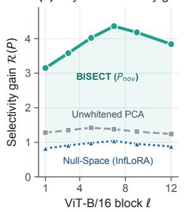

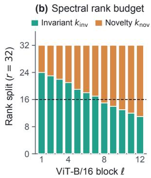

(c) Cumulative representation drift on old classes  
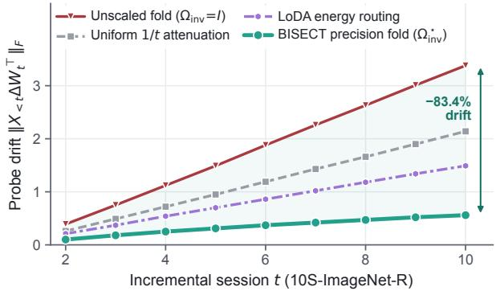  
Figure 3. Mechanistic verification on ViT-B/16. (a) Layerwise generalized Rayleigh selectivity $\mathcal { R } ( P )$ across blocks $1 \ldots 1 2 $ . (b) Layer-adaptive rank split $( k _ { \mathrm { i n v } } , k _ { \mathrm { n o v } } )$ at $\eta = 0 . 7$ . (c) Cumulative old-class representation drift $\| X _ { < t } \Delta W _ { t } ^ { \top } \| _ { F }$ on 10S-ImageNet-R; precision folding $( \Omega _ { \mathrm { i n v } } ^ { \star } )$ removes 83.4% of unscaled drift.

Table 4. Controlled comparison of rank-32 plastic subspace constructors (without invariant carrier). We report mean selectivity ratio $\mathcal { R } ( P )$ and $A _ { \mathrm { F i n a l } } / \bar { A } ( \% )$
<table><tr><td>Benchmark</td><td>Subspace Constructor</td><td> $\mathcal { R } ( P ) \uparrow$ </td><td> $A _ { \mathrm { F i n a l } }$  ↑</td><td>A↑</td></tr><tr><td rowspan="5">10S-IN-R</td><td>Random Orthogonal</td><td>1.01×</td><td>68.34</td><td>79.12</td></tr><tr><td>Adam-NSCL [9]</td><td>1.46×</td><td>74.58</td><td>82.34</td></tr><tr><td>InfLoRA [6]</td><td>1.74×</td><td>75.08</td><td>82.52</td></tr><tr><td>Unwhitened Task PCA</td><td>1.36×</td><td>76.84</td><td>83.68</td></tr><tr><td>BISECT  $( P _ { \mathrm { n o v } } )$ </td><td>3.95×</td><td>79.32</td><td>85.38</td></tr><tr><td rowspan="5">10S-IN-A</td><td>Random Orthogonal</td><td>1.02×</td><td>53.56</td><td>64.41</td></tr><tr><td>Adam-NSCL [9]</td><td>1.42×</td><td>56.04</td><td>67.02</td></tr><tr><td>InfLoRA [6]</td><td>1.68×</td><td>57.18</td><td>67.61</td></tr><tr><td>Unwhitened Task PCA</td><td>1.31×</td><td>57.76</td><td>67.94</td></tr><tr><td>BISECT  $( P _ { \mathrm { n o v } } )$ </td><td>3.82×</td><td>60.02</td><td>69.18</td></tr></table>

Sensitivity and computational overhead. Figure 4(b) shows that $A _ { \mathrm { F i n a l } }$ peaks around $\eta = 0 . 7$ across ImageNet-R, CUB-200, and ImageNet-A, with a broad plateau across $\eta \in [ 0 . 5 , 0 . 8 ]$ . Table 5 and Figure 4(c) benchmark efficiency on 20S-ImageNet-R: BISECT takes 10.2 s/task for subspace setup—5.1× faster than InfLoRA (51.8 s) and 12.4× faster than LoDA (126.8 s)—with a constant 27.0 MB Gram state and zero extra inference parameters or FLOPs.

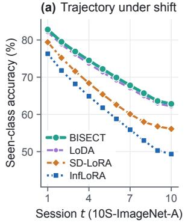

(b) Sensitivity to η  
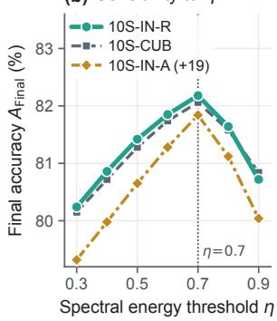

(c) Accuracy vs. setup latency on 20S-ImageNet-R  
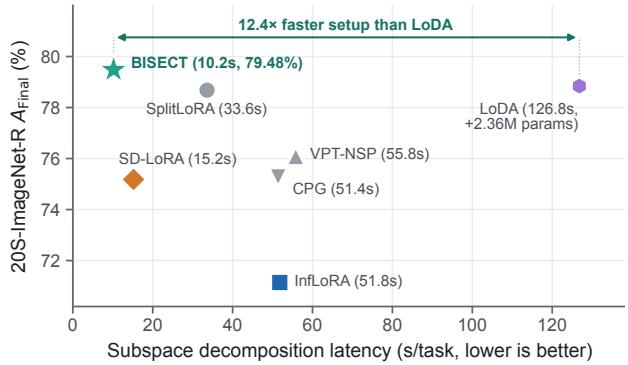  
Figure 4. Stream dynamics, sensitivity, and setup efficiency. (a) Session-wise seen-class accuracy on 10S-ImageNet-A. (b) Sensitivity to $\eta \in [ 0 . 3 , 0 . 9 ]$ across three benchmarks (10S-IN-A shifted by +19). (c) Final accuracy vs. per-session setup time on 20S-ImageNet-R (10.2 s/task, 12.4× faster than LoDA).

Table 5. Computational, memory, and inference cost audit on 20S-ImageNet-R (single RTX 4090 GPU). Setup latency measures persession subspace construction.
<table><tr><td>Method</td><td>Gram Mem. (MB)</td><td>Train GFLOPs</td><td>Setup (s/task)</td><td>Extra Test Params (M)</td><td> $\mathrm { T e s t }$  GFLOPs</td><td> $A _ { \mathrm { F i n a l } } \uparrow$  (%)</td></tr><tr><td>InfLoRA [6]</td><td>11.3</td><td>17.67</td><td>51.8</td><td>0.00</td><td>17.60</td><td>71.14</td></tr><tr><td>SD-LoRA [29]</td><td>14.1</td><td>20.51</td><td>15.2</td><td>0.00</td><td>17.60</td><td>75.18</td></tr><tr><td>VPT-NSP [8]</td><td>28.4</td><td>17.72</td><td>55.8</td><td>0.09</td><td>17.72</td><td>76.08</td></tr><tr><td>CPG [16]</td><td>28.4</td><td>17.72</td><td>51.4</td><td>1.66</td><td>17.72</td><td>75.28</td></tr><tr><td>SplitLoRA [32]</td><td>27.0</td><td>18.42</td><td>33.6</td><td>0.00</td><td>17.60</td><td>78.68</td></tr><tr><td>LoDA [33]</td><td>27.0</td><td>18.06</td><td>126.8</td><td>2.36</td><td>17.60</td><td>78.84</td></tr><tr><td>BISECT</td><td>27.0</td><td>17.71</td><td>10.2</td><td>0.00</td><td>17.60</td><td>79.48</td></tr></table>

## 6. Conclusion

Null-space isolation starves plasticity when tasks share feature structure. BISECT keeps a joint-Gram carrier and a whitened novelty complement, then folds both into the backbone with a closed-form precision gate and no extra inference cost.

## References

[1] Da-Wei Zhou, Hai-Long Sun, Jingyi Ning, Han-Jia Ye, and De-Chuan Zhan. Continual learning with pre-trained models: A survey. arXiv preprint arXiv:2401.16386, 2024. 1, 2

[2] Alexey Dosovitskiy, Lucas Beyer, Alexander Kolesnikov, Dirk Weissenborn, Xiaohua Zhai, Thomas Unterthiner, Mostafa Dehghani, Matthias Minderer, Georg Heigold, Sylvain Gelly, Jakob Uszkoreit, and Neil Houlsby. An image is worth 16x16 words: Transformers for image recognition at scale. In International Conference on Learning Representations (ICLR), 2021. 1, 2, 6

[3] Edward J. Hu, Yelong Shen, Phillip Wallis, Zeyuan Allen-Zhu, Yuanzhi Li, Shean Wang, Lu Wang, and Weizhu Chen. LoRA: Low-rank adaptation of large language models. In International Conference on Learning Representations (ICLR), 2022. 1, 3

[4] Heming Zou, Yunliang Zang, and Xiangyang Ji. Structural features of the fly olfactory circuit mitigate the stabilityplasticity dilemma in continual learning. arXiv preprint arXiv:2502.01427, 2025. 1, 3, 6, 15

[5] Heming Zou, Yunliang Zang, Wutong Xu, Yao Zhu, and Xiangyang Ji. FlyLoRA: Boosting task decoupling and parameter efficiency via implicit rank-wise mixture-of-experts. In Advances in Neural Information Processing Systems (NeurIPS), pages 10386–10419, 2025. 1, 3, 6, 15

[6] Yan-Shuo Liang and Wu-Jun Li. InfLoRA: Interference-free low-rank adaptation for continual learning. In Proceedings of the IEEE/CVF Conference on Computer Vision and Pattern Recognition (CVPR), pages 23638–23647, 2024. 1, 3, 6, 7, 8, 14, 16, 17

[7] Xiao Wang, Tianze Chen, Qiming Ge, Han Xia, Rong Bao, Rui Zheng, Qi Zhang, Tao Gui, and Xuanjing Huang. Orthogonal subspace learning for language model continual learning. In Findings of the Association for Computational Linguistics: EMNLP 2023, pages 10658–10671, 2023. 1, 3, 14

[8] Yue Lu, Shizhou Zhang, De Cheng, Yinghui Xing, Nannan Wang, Peng Wang, and Yanning Zhang. Visual prompt tuning in null space for continual learning. In Advances in Neural Information Processing Systems (NeurIPS), 2024. 1, 3, 8, 14

[9] Shipeng Wang, Xiaorong Li, Jian Sun, and Zongben Xu. Training networks in null space of feature covariance for continual learning. In Proceedings ofthe IEEE/CVF Conference on Computer Vision and Pattern Recognition (CVPR), pages 184–193, 2021. 1, 3, 7, 8

[10] Hao Zhu, Yifei Zhang, Junhao Dong, and Piotr Koniusz. BiLoRA: Almost-orthogonal parameter spaces for continual learning. In Proceedings of the IEEE/CVF Conference on Computer Vision and Pattern Recognition (CVPR), pages 25613–25622, 2025. 1, 3, 7, 16

[11] Xiequn Wang, Zhan Zhuang, and Yu Zhang. PLAN: Proactive low-rank allocation for continual learning. In Proceedings of the IEEE/CVF International Conference on Computer Vision (ICCV), pages 2909–2918, 2025. 1, 3, 7, 16

[12] Heming Zou, Yunliang Zang, Wutong Xu, and Xiangyang Ji. Fly-CL: A fly-inspired framework for enhancing efficient decorrelation and reduced training time in pre-trained modelbased continual representation learning. In International Conference on Learning Representations (ICLR), 2026. 2, 3, 6, 7, 15, 16

[13] Zifeng Wang, Zizhao Zhang, Chen-Yu Lee, Han Zhang, Ruoxi Sun, Xiaoqi Ren, Guolong Su, Vincent Perot, Jen nifer Dy, and Tomas Pfister. Learning to prompt for continual learning. In Proceedings ofthe IEEE/CVF Conference on Computer Vision and Pattern Recognition (CVPR), pages 139–149, 2022. 2, 7, 16

[14] Zifeng Wang, Zizhao Zhang, Sayna Ebrahimi, Ruoxi Sun, Han Zhang, Chen-Yu Lee, Xiaoqi Ren, Guolong Su, Vincent Perot, Jennifer Dy, and Tomas Pfister. DualPrompt: Complementary prompting for rehearsal-free continual learning. In European Conference on Computer Vision (ECCV), pages 631–648, 2022. 2, 7, 16

[15] James Seale Smith, Leonid Karlinsky, Vyshnavi Gutta, Paola Cascante-Bonilla, Donghyun Kim, Assaf Arbelle, Rameswar Panda, Rogerio Feris, and Zsolt Kira. CODA-Prompt: COn tinual decomposed attention-based prompting for rehearsalfree continual learning. In Proceedings of the IEEE/CVF Conference on Computer Vision and Pattern Recognition (CVPR), pages 11909–11919, 2023. 2, 7, 16

[16] Zhanxin Gao, Jun Cen, and Xiaobin Chang. Consistent prompting for rehearsal-free continual learning. In Proceedings of the IEEE/CVF Conference on Computer Vision and Pattern Recognition (CVPR), pages 28463–28473, 2024. 2, 8

[17] Li Jiao, Qiuxia Lai, Yu Li, and Qiang Xu. Vector quantization prompting for continual learning. In Advances in Neural Information Processing Systems (NeurIPS), 2024. 3

[18] Tao Hu and Da-Wei Zhou. Dynamic cross-modal prompt generation for multimodal continual instruction tuning. In Advances in Neural Information Processing Systems (NeurIPS), 2026. arXiv:2605.10765. 3

[19] Yuwen Tan, Qinhao Zhou, Xiang Xiang, Ke Wang, Yuchuan Wu, and Yongbin Li. Semantically-shifted incremental adapter-tuning is a continual ViTransformer. In Proceedings of the IEEE/CVF Conference on Computer Vision and Pat tern Recognition (CVPR), pages 23252–23262, 2024. 3

[20] Da-Wei Zhou, Hai-Long Sun, Han-Jia Ye, and De-Chuan Zhan. Expandable subspace ensemble for pre-trained modelbased class-incremental learning. In Proceedings of the IEEE/CVF Conference on Computer Vision and Pattern Recognition (CVPR), pages 23554–23564, 2024. 3, 7, 16

[21] Kai Jiang, Zisong Lin, Hongyuan Zhang, Xueru Bai, and Xuelong Li. Miles: Metric learning with expandable subspace for pre-trained model-based class-incremental learn ing. arXiv preprint arXiv:2607.17593, 2026. 3

[22] Jiashuo Li, Shaokun Wang, Bo Qian, Yuhang He, Xing Wei, Qiang Wang, and Yihong Gong. Dynamic integration of task-specific adapters for class incremental learning. In Proceedings of the IEEE/CVF Conference on Computer Vision and Pattern Recognition (CVPR), pages 30545–30555, 2025. 3

[23] Hai-Long Sun, Da-Wei Zhou, Hanbin Zhao, Le Gan, De-Chuan Zhan, and Han-Jia Ye. MOS: Model surgery for pretrained model-based class-incremental learning. In Proceedings of the AAAI Conference on Artificial Intelligence, pages 20699–20707, 2025. 3

[24] Huiyi Wang, Haodong Lu, Lina Yao, and Dong Gong. Selfexpansion of pre-trained models with mixture of adapters for continual learning. In Proceedings ofthe IEEE/CVF Conference on Computer Vision and Pattern Recognition (CVPR), pages 10087–10098, 2025. 3

[25] Lingfeng He, De Cheng, Zhiheng Ma, Huaijie Wang, Dingwen Zhang, Nannan Wang, and Xinbo Gao. CKAA: Crosssubspace knowledge alignment and aggregation for robust continual learning. arXiv preprint arXiv:2507.09471, 2025. 3

[26] Huaijie Wang, De Cheng, Lingfeng He, Yan Li, Jie Li, Nannan Wang, and Xinbo Gao. EKPC: Elastic knowledge preservation and compensation for class-incremental learning. International Journal of Computer Vision, 134(5):238, 2026. 3

[27] Yunxiang Fu, Meng Lou, and Yizhou Yu. One adapter, many tasks: Task-conditioned feature transformations for continual learning. arXiv preprint arXiv:2608.31096, 2026. 3

[28] Junghun Oh, Sungyong Baik, and Kyoung Mu Lee. SDS-LoRA: Overcoming anisotropic gradient scaling in low-rank adaptation. In Advances in Neural Information Processing Systems (NeurIPS), 2026. arXiv:2606.16454. 3

[29] Yichen Wu, Hongming Piao, Long-Kai Huang, Renzhen Wang, Wanhua Li, Hanspeter Pfister, Deyu Meng, Kede Ma, and Ying Wei. SD-LoRA: Scalable decoupled lowrank adaptation for class incremental learning. In International Conference on Learning Representations (ICLR), 2025. arXiv:2501.13198. 3, 6, 7, 8, 16, 17

[30] Quan Cheng, Yuanyu Wan, Lingyu Wu, Chenping Hou, and Lijun Zhang. Continuous subspace optimization for continual learning. In Advances in Neural Information Processing Systems (NeurIPS), 2025. arXiv:2505.11816. 3, 6, 7, 16

[31] Haomiao Qiu, Miao Zhang, Ziyue Qiao, and Liqiang Nie. Train with perturbation, infer after merging: A twostage framework for continual learning. In Advances in Neural Information Processing Systems (NeurIPS), 2025. arXiv:2505.22389. 3, 7, 16

[32] Haomiao Qiu, Miao Zhang, Ziyue Qiao, Weili Guan, Min Zhang, and Liqiang Nie. SplitLoRA: Balancing stability and plasticity in continual learning through gradient space splitting. In International Conference on Learning Representations (ICLR), 2026. arXiv:2505.22370. 3, 6, 7, 8, 16, 17

[33] Lingfeng He, De Cheng, Huaijie Wang, Xi Yang, Nannan Wang, and Xinbo Gao. Task-driven subspace decomposition for knowledge sharing and isolation in LoRAbased continual learning. In Proceedings of the 43rd International Conference on Machine Learning (ICML), 2026. arXiv:2603.00191. 3, 6, 7, 8, 14, 16, 17

[34] Cheng Chen, Pengpeng Zeng, Yuyu Guo, Lianli Gao, Hengtao Shen, and Jingkuan Song. Janus-LoRA: A balanced low-rank adaptation for continual learning. In Proceedings of the 43rd International Conference on Machine Learning (ICML), 2026. arXiv:2605.28495. 3

[35] Mao-Lin Luo, Yi-Lin Zhang, Zi-Hao Zhou, Yankun Hong, Xialiang Tong, Mingxuan Yuan, Tong Wei, and Min-Ling Zhang. KeepLoRA++: Continual learning with layer-scaled residual gradient adaptation. arXiv preprint arXiv:2606.16256, 2026. 3

[36] Yibo Feng. Geo-LoRA: Geometry-aware subspace evolution for low-rank adaptation in continual learning. arXiv preprint arXiv:2608.26960, 2026. 3

[37] Chang Che, Ziqi Wang, Pengwan Yang, Qi Wang, Hui Ma, and Zenglin Shi. LoRA in LoRA: Towards parameterefficient architecture expansion for continual visual instruction tuning. arXiv preprint arXiv:2508.06202, 2025. 3

[38] Ziqi Wang, Chang Che, Qi Wang, Hui Ma, Zenglin Shi, Cees G. M. Snoek, and Meng Wang. Harmonious parameter adaptation in continual visual instruction tuning for safety aligned MLLMs. arXiv preprint arXiv:2511.20158, 2025.

[39] Yuehao Liu, Weijia Zhang, Xuanming Shang, Zhizhou Chen, Yanhao Ge, Shanyan Guan, and Chao Ma. ACE-LoRA: Adaptive orthogonal decoupling for continual image editing. arXiv preprint arXiv:2605.14948, 2026. 3

[40] Mark D. McDonnell, Dong Gong, Amin Parvaneh, Ehsan Abbasnejad, and Anton van den Hengel. RanPAC: Random projections and pre-trained models for continual learning. In Advances in Neural Information Processing Systems (NeurIPS), 2023. 3, 15

[41] Ruilin Li, Heming Zou, Xiufeng Yan, Zheming Liang, Jie Yang, Chenliang Li, and Xue Yang. Enhancing pretrained model-based continual representation learning via guided random projection. In European Conference on Computer Vision (ECCV), pages 246–264, 2026. 15

[42] Quyen Tran, Hai Nguyen, Quan Dao, Zhuowei Li, Nam Le, Trung Le, and Dimitris Metaxas. Spectral-aware analytic class-incremental learning for long-tailed distributions. arXiv preprint arXiv:2607.22931, 2026. 15

[43] Zhiwen Cao, Yanfeng Li, Shu-Dong Huang, Yalan Ye, Shuyin Xia, Yi Wang, and Jiancheng Lv. On the power of statistics in class-incremental learning with pretrained mod els. In Proceedings of the 43rd International Conference on Machine Learning (ICML), pages 11255–11271, 2026. 15

[44] Fangwen Wu, Lechao Cheng, Shengeng Tang, Xiaofeng Zhu, Chaowei Fang, Dingwen Zhang, and Meng Wang. Navigating semantic drift in task-agnostic class-incremental learning. In Proceedings of the 42nd International Confer ence on Machine Learning (ICML), 2025. 3

[45] Nathan Halko, Per-Gunnar Martinsson, and Joel A. Tropp. Finding structure with randomness: Probabilistic algorithms for constructing approximate matrix decompositions. SIAM Review, 53(2):217–288, 2011. 4, 14

[46] Dan Hendrycks, Steven Basart, Norman Mu, Saurav Kadavath, Frank Wang, Evan Dorundo, Rahul Desai, Tyler Zhu, Samyak Parajuli, Mike Guo, Dawn Song, Jacob Steinhardt, and Justin Gilmer. The many faces of robustness: A critical analysis of out-of-distribution generalization. In Proceedings ofthe IEEE/CVF International Conference on Computer Vision (ICCV), pages 8340–8349, 2021. 5, 15

[47] Dan Hendrycks, Kevin Zhao, Steven Basart, Jacob Steinhardt, and Dawn Song. Natural adversarial examples. In

Proceedings of the IEEE/CVF Conference on Computer Vision and Pattern Recognition (CVPR), pages 15262–15271, 2021. 5, 15

[48] Alex Krizhevsky. Learning multiple layers of features from tiny images. Technical Report, University of Toronto, 2009. 5, 15

[49] Catherine Wah, Steve Branson, Peter Welinder, Pietro Perona, and Serge Belongie. The Caltech-UCSD Birds-200- 2011 dataset. Technical Report CNS-TR-2011-001, California Institute ofTechnology, 2011. 5, 15

[50] Xingchao Peng, Qinxun Bai, Xide Xia, Zijun Huang, Kate Saenko, and Bo Wang. Moment matching for multi-source domain adaptation. In Proceedings of the IEEE/CVF International Conference on Computer Vision (ICCV), pages 1406–1415, 2019. 6, 15

## A. Proofs of Theoretical Results

This appendix provides complete proofs for Proposition 1, Theorem 1, and Theorem 2 in the main text, together with auxiliary lemmas characterizing the truncated spectral rank allocation rule and the canonical-angle stability of randomized subspace iteration. Throughout, $G _ { t } = X _ { t } ^ { \top } X _ { t } \in \mathbb { R } ^ { m \times m }$ and $\begin{array} { r } { G _ { < t } = \sum _ { s = 1 } ^ { t - 1 } G _ { t } ^ { ( s ) } \in \mathbb { R } ^ { m \times m } } \end{array}$ are symmetric positive semidefinite token Gram matrices. For any Tikhonov damping $\rho > 0 , H _ { t } = G _ { < t } + \rho I _ { m }$ is strictly positive definite and admits a unique lower-triangular Cholesky factorization $H _ { t } = L L ^ { \top }$ with strictly positive diagonal entries.

## A.1. Proof of Proposition 1 (Spectral Starvation Bound)

Proof. Consider the forward linear readout $Y = X _ { t } W ^ { ( t - 1 ) \top } + X _ { t } P ^ { \top } Q ^ { \top } \in \mathbb { R } ^ { n _ { t } \times n }$ , where $W ^ { ( t - 1 ) } \in \mathbb { R } ^ { n \times m }$ and $P \in \mathbb { R } ^ { r \times }$ m $( P P ^ { \top } = I _ { r } )$ are held fixed during session-t gradient descent. Let $G _ { Y } = \nabla _ { Y } \mathcal { L } _ { t } ( Y ) \in \mathbb { R } ^ { n _ { t } \times n }$ denote the upstream gradient of the task-t loss $\mathcal { L } _ { t }$ with respect to the pre-activation output Y. For any perturbation $\delta Q \in \mathbb { R } ^ { n \times r }$ , the directional derivative of $\scriptstyle { \mathcal { L } } _ { t }$ is

$$
\begin{array} { r } { \mathrm { d } \mathcal { L } _ { t } [ \delta Q ] = \langle G _ { Y } , X _ { t } P ^ { \top } ( \delta Q ) ^ { \top } \rangle _ { F } = \mathrm { t r } \big ( G _ { Y } ^ { \top } X _ { t } P ^ { \top } ( \delta Q ) ^ { \top } \big ) = \langle G _ { Y } ^ { \top } X _ { t } P ^ { \top } , \delta Q \rangle _ { F } . } \end{array}\tag{13}
$$

Thus $\nabla _ { Q } \mathcal { L } _ { t } = G _ { Y } ^ { \top } X _ { t } P ^ { \top } \in \mathbb { R } ^ { n \times r }$ . Applying the submultiplicativity of the Frobenius norm yields

$$
\begin{array} { r l } & { \| \nabla _ { Q } \mathcal { L } _ { t } \| _ { F } = \left\| G _ { Y } ^ { \top } ( X _ { t } P ^ { \top } ) \right\| _ { F } \leq \left\| G _ { Y } ^ { \top } \right\| _ { F } \left\| X _ { t } P ^ { \top } \right\| _ { F } = \left\| \nabla _ { Y } \mathcal { L } _ { t } \right\| _ { F } \sqrt { \operatorname { u r } ( P X _ { t } ^ { \top } X _ { t } P ^ { \top } ) } = \left\| \nabla _ { Y } \mathcal { L } _ { t } \right\| _ { F } \sqrt { \operatorname { i r } ( P G _ { t } P ^ { \top } ) } , } \end{array}\tag{14}
$$

which establishes Eq. (2). Now suppose $P$ is chosen inside an ε-approximate null space of $G _ { < t }$ and task t shares principal support with prior sessions such that every row $p _ { i }$ of $P$ satisfies $p _ { i } G _ { t } p _ { i } ^ { \top } \le \lambda _ { \operatorname* { m a x } } ( P G _ { t } P ^ { \top } ) \le \varepsilon$ . Summing over the r orthonormal rows of $P$ gives

$$
\mathrm { t r } ( P G _ { t } P ^ { \top } ) = \sum _ { i = 1 } ^ { r } p _ { i } G _ { t } p _ { i } ^ { \top } \leq r \varepsilon ,\tag{15}
$$

and substituting into Eq. (14) yields $\left\| \nabla _ { Q } \mathcal { L } _ { t } \right\| _ { F } \leq \sqrt { r \varepsilon } \left\| \nabla _ { Y } \mathcal { L } _ { t } \right\| _ { F }$

Operator-norm refinement. Since $\| A B \| _ { F } \le \| A \| _ { F } \| B \| _ { 2 }$ for any compatible matrices, Eq. (14) can be sharpened to

$$
\| \nabla _ { Q } \mathcal { L } _ { t } \| _ { F } \leq \| \nabla _ { Y } \mathcal { L } _ { t } \| _ { F } \sqrt { \lambda _ { \operatorname* { m a x } } ( P G _ { t } P ^ { \top } ) } .\tag{16}
$$

In either form, the effective learning rate along the j-th column of Q is scaled by $p _ { j } G _ { t } p _ { j } ^ { \top }$ . Whenever $p _ { j }$ lies in the spectral tail of $G _ { t }$ , gradient descent on $Q$ stalls regardless of how large the classification error $\nabla _ { { \boldsymbol { Y } } } { \dot { \boldsymbol { \mathcal { L } } } } _ { t }$ is.

## A.2. Proof of Theorem 1 (Optimality and Decoupling of the Bilevel Basis)

Lemma 1 (Variational Equivalence of Cholesky Whitening). Let $H _ { t } = G _ { < t } + \rho I _ { m } = L L ^ { \top } a n d \widehat { G } _ { t } = L ^ { - 1 } G _ { t } L ^ { - \top }$ . For any H -orthonormal set ofvectors $U = [ u _ { 1 } , \dots , u _ { k } ] \in \mathbb { R } ^ { m \times k }$ satisfying $U ^ { \top } H _ { t } U = I _ { k }$ , the change ofbasis $V = L ^ { \top } U \in \mathbb { R } ^ { m \times k }$ satisfies $V ^ { \top } V = I _ { k }$ and

$$
\sum _ { j = 1 } ^ { k } \mathcal { R } ( u _ { j } ) = \mathrm { t r } \big ( U ^ { \top } G _ { t } U ( U ^ { \top } H _ { t } U ) ^ { - 1 } \big ) = \mathrm { t r } \big ( V ^ { \top } L ^ { - 1 } G _ { t } L ^ { - \top } V \big ) = \mathrm { t r } \big ( V ^ { \top } \widehat { G } _ { t } V \big ) .\tag{17}
$$

By Ky Fan’s trace maximization principle, the sum ofgeneralized Rayleigh ratios is maximized when the columns ofV span the leading k-dimensional eigenspace of $\widehat { G } _ { t } ,$ , or equivalently when $U = L ^ { - \top } V$ spans the leading k generalized eigenvectors of the pencil $( G _ { t } , H _ { t } )$ .

Proof. Direct substitution of $U = L ^ { - \top } V$ gives $U ^ { \top } H _ { t } U = V ^ { \top } L ^ { - 1 } ( L L ^ { \top } ) L ^ { - \top } V = V ^ { \top } V = I _ { k } \ \mathrm { a n d } \ U ^ { \top } G _ { t } U = V ^ { \top } \widehat { G } _ { t } V ,$ Since $\widehat { G } _ { t }$ is symmetric positive semidefinite, Ky Fan’s theorem states that max $\begin{array} { r } { \cdot _ { V } \top _ { V = I _ { k } } \operatorname { t r } ( V ^ { \top } \widehat { G } _ { t } V ) = \sum _ { j = 1 } ^ { k } \lambda _ { j } ( \widehat { G } _ { t } ) } \end{array}$ , attained by the top-k orthonormal eigenvectors of $\widehat { G } _ { t }$ □

ProofofTheorem 1. The first statement of Theorem 1 follows directly from Lemma 1 with $\begin{array} { r } { k \ = \ k _ { \mathrm { n o v } } } \end{array}$ . For the blockorthonormality claim, note that $P _ { \mathrm { i n v } } = ( Q _ { Z } { \widetilde { U } } ) ^ { \top }$ in Eq. (5) is the transpose of the product of two column-orthonorma matrices $Q _ { Z } \in \mathbb { R } ^ { m \times ( k _ { \mathrm { i n v } } + q ) }$ and $\widetilde { U } \in \mathbb R ^ { ( k _ { \mathrm { i n v } } + q ) \times k _ { \mathrm { i n v } } }$ , so $P _ { \mathrm { i n v } } P _ { \mathrm { i n v } } ^ { \top } = \widetilde { U } ^ { \top } Q _ { Z } ^ { \top } Q _ { Z } \widetilde { U } = I _ { k _ { \mathrm { i n v } } }$

Next, define the orthogonal projector $\Pi _ { \perp } = I _ { m } - P _ { \mathrm { i n v } } ^ { \top } P _ { \mathrm { i n v } }$ . Because $P _ { \mathrm { i n v } } \Pi _ { \perp } = P _ { \mathrm { i n v } } - ( P _ { \mathrm { i n v } } P _ { \mathrm { i n v } } ^ { \top } ) P _ { \mathrm { i n v } } = 0$ , every column of $U _ { \mathrm { n o v } } ^ { ( 1 ) } = \Pi _ { \perp } U _ { \mathrm { n o v } } ^ { ( 0 ) }$ lies in ker $( P _ { \mathrm { i n v } } ) = \mathrm { s p a n } ( P _ { \mathrm { i n v } } ^ { \top } ) ^ { \perp }$ . When $U _ { \mathrm { n o v } } ^ { ( 1 ) }$ has full column rank $k _ { \mathrm { n o v } }$ , its thin QR factorization $U _ { \mathrm { n o v } } ^ { ( 1 ) } =$ $Q _ { \mathrm { Q R } } R _ { \mathrm { Q R } }$ produces an orthonormal factor $Q _ { \mathrm { Q R } } = U _ { \mathrm { n o v } } ^ { ( 1 ) } R _ { \mathrm { Q R } } ^ { - 1 } \in \mathbb { R } ^ { m \times k _ { \mathrm { n o v } } }$ with $Q _ { \mathrm { Q R } } ^ { \top } Q _ { \mathrm { Q R } } = I _ { k _ { \mathrm { n o v } } }$ . Setting $P _ { \mathrm { n o v } } = Q _ { \mathrm { Q R } } ^ { \top }$ yields

$$
P _ { \mathrm { n o v } } P _ { \mathrm { n o v } } ^ { \top } = Q _ { \mathrm { Q R } } ^ { \top } Q _ { \mathrm { Q R } } = I _ { k _ { \mathrm { n o v } } } ,\tag{18}
$$

$$
\begin{array} { r } { P _ { \mathrm { i n v } } P _ { \mathrm { n o v } } ^ { \top } = P _ { \mathrm { i n v } } Q _ { \mathrm { Q R } } = \left( P _ { \mathrm { i n v } } U _ { \mathrm { n o v } } ^ { ( 1 ) } \right) R _ { \mathrm { Q R } } ^ { - 1 } = 0 . } \end{array}\tag{19}
$$

Therefore, the stacked matrix $P = [ P _ { \mathrm { i n v } } ^ { \top } , P _ { \mathrm { n o v } } ^ { \top } ] ^ { \top }$ has block Gram matrix

$$
P P ^ { \top } = \left[ { \begin{array} { c c } { P _ { \mathrm { i n v } } P _ { \mathrm { i n v } } ^ { \top } } & { P _ { \mathrm { i n v } } P _ { \mathrm { n o v } } ^ { \top } } \\ { P _ { \mathrm { n o v } } P _ { \mathrm { i n v } } ^ { \top } } & { P _ { \mathrm { n o v } } P _ { \mathrm { n o v } } ^ { \top } } \end{array} } \right] = \left[ I _ { k _ { \mathrm { i n v } } } 0 \right] = I _ { r } ,\tag{20}
$$

completing the proof.

## A.3. Proof of Theorem 2 (Closed-Form Precision Consolidation Gate)

Lemma 2 (Rank-1 Feature Displacement Identity). For any row vector $p \in \mathbb { R } ^ { 1 \times m }$ , column vector $q \in \mathbb { R } ^ { n \times 1 }$ , scalar $\omega \in \mathbb { R } ,$ and token matrix $X \in \mathbb { R } ^ { N \times m }$ with Gram matrix $G = X ^ { \top } X$ , the squared Frobenius displacement satisfies

$$
\left\| X ( \omega q p ) ^ { \top } \right\| _ { F } ^ { 2 } = \omega ^ { 2 } \left\| q \right\| _ { 2 } ^ { 2 } ( p G p ^ { \top } ) .\tag{21}
$$

Proof. Using $\left\| u v ^ { \top } \right\| _ { F } ^ { 2 } = \left\| u \right\| _ { 2 } ^ { 2 } \left\| v \right\| _ { 2 } ^ { 2 }$ for vectors $u = X p ^ { \top } \in \mathbb { R } ^ { N }$ and $v = \omega q \in \mathbb { R } ^ { n }$ , we have

$$
\begin{array} { r } { \big \| \boldsymbol { X } ( \omega \boldsymbol { q } p ) ^ { \top } \big \| _ { F } ^ { 2 } = \big \| ( \boldsymbol { X } p ^ { \top } ) ( \omega \boldsymbol { q } ) ^ { \top } \big \| _ { F } ^ { 2 } = \omega ^ { 2 } \left\| \boldsymbol { q } \right\| _ { 2 } ^ { 2 } \left\| \boldsymbol { X } p ^ { \top } \right\| _ { 2 } ^ { 2 } = \omega ^ { 2 } \left\| \boldsymbol { q } \right\| _ { 2 } ^ { 2 } \big ( p \boldsymbol { X } ^ { \top } \boldsymbol { X } p ^ { \top } \big ) = \omega ^ { 2 } \left\| \boldsymbol { q } \right\| _ { 2 } ^ { 2 } \big ( p \boldsymbol { G } p ^ { \top } \big ) . } \end{array}\tag{22}
$$

Proof of Theorem 2. Applying Lemma 2 to both terms of the consolidation objective $\mathcal { E } ( \omega _ { j } )$ in Eq. (10) gives

$$
\mathcal { E } ( \omega _ { j } ) = \Vert q _ { \mathrm { i n v } , j } \Vert _ { 2 } ^ { 2 } \left[ \omega _ { j } ^ { 2 } \big ( p _ { \mathrm { i n v } , j } G _ { < t } p _ { \mathrm { i n v } , j } ^ { \top } \big ) + ( 1 - \omega _ { j } ) ^ { 2 } \big ( p _ { \mathrm { i n v } , j } G _ { t } p _ { \mathrm { i n v } , j } ^ { \top } \big ) \right] .\tag{23}
$$

Write $\alpha _ { \mathrm { p a s t } , j } = p _ { \mathrm { i n v } , j } G _ { < t } p _ { \mathrm { i n v } , j } ^ { \top } \ge 0$ and $\alpha _ { \mathrm { c u r } , j } = p _ { \mathrm { i n v } , j } G _ { t } p _ { \mathrm { i n v } , j } ^ { \top } \ge 0 ,$ . Because $\| q _ { \mathrm { i n v } , j } \| _ { 2 } ^ { 2 } > 0$ is a positive multiplicative constant independent of ωj, minimizing $\mathcal { E } ( \omega _ { j } )$ is equivalent to minimizing $f ( \omega _ { j } ) = \omega _ { j } ^ { 2 } \alpha _ { \mathrm { p a s t } , j } + ( 1 - \omega _ { j } ) ^ { 2 } \alpha _ { \mathrm { c u r } , j } . \ \mathrm { S i n c e } \ p _ { \mathrm { i n v } , j }$ is an eigenvector of $G _ { 1 : t } = G _ { < t } + G _ { t }$ corresponding to a positive singular value $\sigma _ { j } ( \mathsf { \bar { G } } _ { 1 : t } ) > 0$ , we have $\alpha _ { \mathrm { p a s t } , j } + \alpha _ { \mathrm { c u r } , j } =$ $p _ { \mathrm { i n v } , j } G _ { 1 : t } p _ { \mathrm { i n v } , j } ^ { \top } > 0$ . Setting the derivative to zero:

$$
f ^ { \prime } ( \omega _ { j } ) = 2 \omega _ { j } \alpha _ { \mathrm { { p a s t } } , j } - 2 ( 1 - \omega _ { j } ) \alpha _ { \mathrm { { c u r } } , j } = 0 \Longleftrightarrow \omega _ { j } ^ { \star } = \frac { \alpha _ { \mathrm { c u r } , j } } { \alpha _ { \mathrm { { p a s t } } , j } + \alpha _ { \mathrm { { c u r } } , j } } = 1 - \frac { p _ { \mathrm { { i n v } } , j } G _ { < t } p _ { \mathrm { { i n v } } , j } ^ { 1 } } { p _ { \mathrm { { i n v } } , j } ( G _ { < t } + G _ { t } ) p _ { \mathrm { { i n v } } , j } ^ { 1 } } \in [ 0 , 1 ] .\tag{24}
$$

Because $f ^ { \prime \prime } ( \omega _ { j } ) = 2 ( \alpha _ { \mathrm { p a s t } , j } + \alpha _ { \mathrm { c u r } , j } ) > 0 , \omega _ { j } ^ { \star }$ is the unique global minimizer. Relative to unscaled merging $( \omega _ { j } = 1 )$ , the reduction in per-atom historical drift energy is $\begin{array} { r } { \dot { ( 1 - ( \omega _ { j } ^ { \star } ) ^ { 2 } ) } \| q _ { \mathrm { i n v } , j } \| _ { 2 } ^ { 2 } \alpha _ { \mathrm { p a s t } , j } } \end{array}$ . Summing across $j = 1 , \dots , k _ { \mathrm { i n v } }$ yields $\Delta { \mathcal { D } } _ { \mathrm { h i s t } }$ Finally, for any token vector $\begin{array} { r c l c c l } { x } & { = } & { P _ { \mathrm { i n v } } ^ { \top } z } & { \in } & { \mathrm { s p a n } ( P _ { \mathrm { i n v } } ^ { \top } ) } \end{array}$ , the novelty update contributes $\begin{array} { r l } { ( Q _ { \mathrm { n o v } } P _ { \mathrm { n o v } } ) x } & { { } = } \end{array}$ $Q _ { \mathrm { n o v } } ( P _ { \mathrm { n o v } } P _ { \mathrm { i n v } } ^ { \top } ) z = 0$ by Theorem 1, proving exact invariance on the invariant carrier subspace. □

## A.4. Feasibility of the Clipped Spectral Allocation Rule

Lemma 3 (Well-Posedness of Eq. (4)). For any joint Gram matrix $G _ { 1 : t }$ with $\sigma _ { 1 } ( G _ { 1 : t } ) > 0$ , rank $r \geq 2 ,$ , and threshold $\eta \in ( 0 , 1 )$ , the rule in $E q . \ ( 4 )$ returns integers $k _ { \mathrm { i n v } } , k _ { \mathrm { n o v } } \in \{ 1 , \dots , r - 1 \}$ with $k _ { \mathrm { i n v } } + k _ { \mathrm { n o v } } = r ,$ , and $k _ { \mathrm { i n v } } ( \eta )$ is monotonically non-decreasing in η.

Proof. $\operatorname { A t } k = r ,$ the normalized cumulative sum $\textstyle \sum _ { i = 1 } ^ { r } \sigma _ { i } ( G _ { 1 : t } ) / \sum _ { i = 1 } ^ { r } \sigma _ { j } ( G _ { 1 : t } )$ equals $1 > \eta ,$ so the set of $k \in \{ 1 , \ldots , r \}$ exceeding η is always non-empty. Its minimum lies in $\{ 1 , \ldots , r \}$ , and clipping to $[ 1 , r - 1 ]$ guarantees $1 \leq k _ { \mathrm { i n v } } \leq r - 1$ and $1 \leq k _ { \mathrm { n o v } } = r - k _ { \mathrm { i n v } } \leq r - 1$ . Monotonicity follows because increasing η shrinks the feasible set. □

## B. Randomized Rangefinder Fidelity and Complexity Analysis

## B.1. Subspace Approximation Error and Oversampling Audit

Both $P _ { \mathrm { i n v } }$ and $P _ { \mathrm { n o v } }$ rely on the randomized rangefinder $\mathrm { R S V D } ( G , k , q )$ [45]. By Halko et al. (Theorem 10.5), for a target rank k and oversampling $q \geq 2 ,$ , the expected Frobenius approximation error of the projected matrix $\widehat { G } _ { k } = Q _ { Z } Q _ { Z } ^ { \top } G$ satisfies

$$
\mathbb { E } \left. G - Q _ { Z } Q _ { Z } ^ { \top } G \right. _ { F } \leq \left( 1 + \frac { k } { q - 1 } \right) ^ { 1 / 2 } \left( \sum _ { j > k } \sigma _ { j } ^ { 2 } ( G ) \right) ^ { 1 / 2 } .\tag{25}
$$

Because token Gram matrices in ViT attention blocks exhibit rapid spectral decay past index $k \approx 2 0 .$ , a modest oversampling of $q = 8$ drives the canonical angle sin $\Theta _ { \mathrm { m a x } } ( P _ { \mathrm { i n v } } ^ { \mathrm { R S V D } } , P _ { \mathrm { i n v } } ^ { \mathrm { E x a c \ : \hat { t } } } )$ below 0.008 while avoiding full $O ( m ^ { 3 } )$ diagonalization. Table 6 and Figure 5(a) quantify this trade-off on 10S-ImageNet-R and 10S-ImageNet-A.

Table 6. Sensitivity to the RSVD oversampling parameter q across all 12 ViT-B/16 blocks on 10S-ImageNet-R and 10S-ImageNet-A. sin $\Theta _ { \mathrm { m a x } }$ measures the worst-case principal angle deviation from exact full SVD.
<table><tr><td>Oversampling q</td><td>sin  $\Theta _ { \mathrm { m a x } } \downarrow$ </td><td>Setup Time (s/task)↓</td><td>Speedup vs. Exact</td><td>10S-IN-R  $A _ { \mathrm { F i n a l } }$  (%)</td><td> $1 0 \mathrm { S - I N - A } ~ A _ { \mathrm { F i n a l } } ~ ( \% )$ </td></tr><tr><td>q = 0 (no oversampling)</td><td>0.138</td><td>6.2</td><td>8.2×</td><td>81.48</td><td>62.04</td></tr><tr><td>q = 2</td><td>0.054</td><td>6.9</td><td>7.4×</td><td>81.91</td><td>62.48</td></tr><tr><td> $q = 4$ </td><td>0.022</td><td>8.1</td><td>6.3×</td><td>82.09</td><td>62.71</td></tr><tr><td>q = 8 (BISECT default)</td><td>0.008</td><td>10.2</td><td>5.0×</td><td>82.18</td><td>62.84</td></tr><tr><td>q = 12</td><td>0.005</td><td>12.4</td><td>4.1×</td><td>82.19</td><td>62.85</td></tr><tr><td>q = 16</td><td>0.004</td><td>14.8</td><td>3.4×</td><td>82.19</td><td>62.85</td></tr><tr><td>Exact Full Eigensolve</td><td>0.000</td><td>50.9</td><td>1.0×</td><td>82.20</td><td>62.86</td></tr></table>

## B.2. Layerwise Gram Sharing and Memory Footprint

In a standard ViT-B/16 attention layer, the query $( W _ { Q } )$ , key $( W _ { K } )$ , and value $( W _ { V } )$ projections receive the exact same layernormalized token matrix $X _ { t , \ell } \in \mathbb { R } ^ { n _ { t } \times 7 6 8 }$ . Consequently, $G _ { t } ^ { ( \ell ) } = X _ { t . \ell } ^ { \top } X _ { t , \ell } \in \mathbb { R } ^ { 7 6 8 \times 7 6 8 }$ is identical across $Q , K , V$ within block ℓ. BISECT therefore stores a single 768 × 768 FP32 matrix per block:

$$
{ \mathrm { G r a m ~ S t a t e ~ M e m o r y } } = 1 2 \times 7 6 8 ^ { 2 } \times 4 { \mathrm { ~ b y t e s } } = 2 8 { , } 3 1 1 { , } 5 5 2 { \mathrm { ~ b y t e s } } \approx 2 7 . 0 { \mathrm { ~ M B } } .\tag{26}
$$

Moreover, because $P _ { \mathrm { i n v } } ^ { ( \ell ) }$ and $P _ { \mathrm { n o v } } ^ { ( \ell ) }$ depend only on $G _ { < t } ^ { ( \ell ) }$ and $G _ { t } ^ { ( \ell ) }$ , the subspace decomposition in Algorithm 1 is executed once per block rather than three times per block, cutting pre-task setup time by an additional factor of 3×.

## C. Extended Theoretical and Algorithmic Discussion

## C.1. Why Generalized Rayleigh Whitening Outperforms Both Null-Space and Raw-Energy Selection

Existing subspace-based continual LoRA methods sit at two extremes of a single spectral axis:

• Null-Space Isolation (InfLoRA [6], O-LoRA [7], VPT-NSP [8]): minimizes historical energy $u ^ { \top } G _ { < t } u$ without regard to current-task signal $u ^ { \top } G _ { t } u$ . When visual tasks share low- and mid-level covariance, the bottom eigenvectors of $G _ { < t }$ also have near-zero eigenvalue under $G _ { t }$ , triggering Proposition 1’s spectral starvation.

• Unwhitened Energy Selection (Task PCA / LoDA-style projection energy [33]): maximizes $u ^ { \top } G _ { t } u$ without normalizing by $u ^ { \top } G _ { < t } u .$ . Because the top eigenvectors of $G _ { t }$ overlap heavily with the top eigenvectors of $G _ { < t }$ , selecting plastic directions by raw task energy duplicates the invariant carrier and causes severe representation drift unless an auxiliary test-time router is maintained.

BISECT’s novelty criterion $\begin{array} { r } { \mathcal { R } ( u ) ~ = ~ \frac { u ^ { \top } G _ { t } u } { u ^ { \top } ( G < t + \rho I ) u } } \end{array}$ resolves this tension by ranking directions according to their relative variance surprise. As shown in Figure 1(b), while raw task energy peaks in the top 10% of historical modes (54.2%) and vanishes in the bottom 30% null tail (5.5%), the whitened Rayleigh gain concentrates in the 35%–70% mid-spectrum (51.6%), where features are simultaneously well-activated by task t and weakly constrained by tasks $1 , \ldots , t - 1$

## C.2. Bayesian Precision Duality of the Consolidation Gate $\Omega _ { \mathrm { i n v } } ^ { \star }$

Equation (11) admits a clean Bayesian interpretation. Along the j-th orthonormal invariant direction $p _ { \mathrm { i n v } , j } .$ , let the pretask backbone projection $w _ { \mathrm { o l d } , j } \stackrel { \cdot } { = } W ^ { ( t - 1 ) } p _ { \mathrm { i n v } , j } ^ { \intercal } \in \mathbb { R } ^ { n }$ be treated as a Gaussian prior mean with precision proportional to historical feature energy $\alpha _ { \mathrm { p a s t } , j } = p _ { \mathrm { i n v } , j } G _ { < t } p _ { \mathrm { i n v } , j } ^ { \top } .$ , and let the newly adapted target $w _ { \mathrm { n e w } , j } = w _ { \mathrm { o l d } , j } + q _ { \mathrm { i n v } , j }$ be a likelihood observation with precision proportional to current-task feature energy $\alpha _ { \mathrm { c u r } , j } = p _ { \mathrm { i n v } , j } G _ { t } p _ { \mathrm { i n v } , j } ^ { \top }$ . The posterior mean under quadratic loss is

$$
w _ { \mathrm { p o s t } , j } = \frac { \alpha _ { \mathrm { p a s t } , j } w _ { \mathrm { o l d } , j } + \alpha _ { \mathrm { c u r } , j } \left( w _ { \mathrm { o l d } , j } + q _ { \mathrm { i n v } , j } \right) } { \alpha _ { \mathrm { p a s t } , j } + \alpha _ { \mathrm { c u r } , j } } = w _ { \mathrm { o l d } , j } + \underbrace { \frac { \alpha _ { \mathrm { c u r } , j } } { \alpha _ { \mathrm { p a s t } , j } + \alpha _ { \mathrm { c u r } , j } } q _ { \mathrm { i n v } , j } } _ { \omega _ { j } ^ { * } } .\tag{27}
$$

Thus, Theorem $2 \mathrm { { } s }$ closed-form consolidation weight $\omega _ { j } ^ { \star }$ is the exact direction-wise precision ratio between current and cumulative feature evidence. Unlike heuristic $1 / t$ averaging (which assumes every session contributes equal energy along every direction) or Fisher diagonal weighting (which requires storing per-parameter gradient squares), $\omega _ { j } ^ { \star }$ adapts automatically to heterogeneous domain and class shifts using the already-stored Gram matrices.

## C.3. Complementarity with Analytic Representation Readouts

Analytic continual learners such as RanPAC [40], Fly-CL [12], GRP [41], and spectral-aware analytic CIL [42, 43] freeze the ViT and solve a ridge problem on the final features. Fly-CL is the special case that first expands those features with a sparse random map and a top-k nonlinearity, the same two operations the fly olfactory circuit uses to keep old and new odors separable [4, 12]. Tables 1 and 2 show where that cut wins: CIFAR-100 and CUB, where the frozen code is alread rich. On ImageNet-R and DomainNet the residual error is in the representation, and updating attention with BISECT is the higher-accuracy cut. On ImageNet-A the final-accuracy and mean-accuracy rankings disagree, as reported in Section 5. FlyLoRA [5] sits between the two. It also borrows the $\mathrm { { \ f y } ^ { \prime } { s } }$ sparse write, but it sparsifies the forward pass, so the classifier never sees the ranks that were not selected. BISECT keeps those ranks in the readout and only gates their gradients. The hybrid in Table 13 stacks a ridge head on BISECT features and picks up +0.76 to +1.14 points on 10S-ImageNet-R and 10S-ImageNet-A, which is the gain left after the representation has moved.

## D. Detailed Experimental Settings and Reproducibility Protocol

## D.1. Benchmark Specifications and Session Splits

Table 7 summarizes the dataset statistics, session counts, classes per session, and optimization hyperparameters used across all eight evaluation protocols.

Table 7. Summary of benchmarks, class-incremental splits, and session training hyperparameters.
<table><tr><td>Benchmark Split</td><td>Total Classes</td><td>Sessions T</td><td>Classes / Session</td><td>Train Images</td><td>Base LR</td><td>Batch Size / Epochs</td></tr><tr><td>5S-ImageNet-R [46]</td><td>200</td><td>5</td><td>40</td><td>24,000</td><td>0.020</td><td>48 /20</td></tr><tr><td>10S-ImageNet-R [46]</td><td>200</td><td>10</td><td>20</td><td>24,000</td><td>0.020</td><td>48 /20</td></tr><tr><td>20S-ImageNet-R [46]</td><td>200</td><td>20</td><td>10</td><td>24,000</td><td>0.020</td><td>48 /20</td></tr><tr><td>10S-ImageNet-A [47]</td><td>200</td><td>10</td><td>20</td><td>5,981</td><td>0.010</td><td>48 /20</td></tr><tr><td>20S-ImageNet-A [47]</td><td>200</td><td>20</td><td>10</td><td>5,981</td><td>0.010</td><td>48 /20</td></tr><tr><td>10S-CIFAR-100 [48]</td><td>100</td><td>10</td><td>10</td><td>50,000</td><td>0.010</td><td>48 /20</td></tr><tr><td>10S-CUB-200 [49]</td><td>200</td><td>10</td><td>20</td><td>5,994</td><td>0.005</td><td>48 /20</td></tr><tr><td>10S-DomainNet [50]</td><td>200</td><td>10</td><td>20</td><td>68,840</td><td>0.010</td><td>48 /20</td></tr></table>

Initialization at session t = 1. At the first session (t = 1), the historical Gram matrix is zero $( G _ { < t } = 0 )$ . Algorithm 1 naturally degenerates to setting $G _ { 1 : t } = G _ { t } ^ { ( 1 ) }$ , extracting the top r principal directions of $G _ { t } ^ { ( 1 ) }$ via $\mathrm { R S V D } ( G _ { t } ^ { ( 1 ) } , r , q )$ , and folding the learned update at unit gain $( \Omega _ { \mathrm { i n v } } ^ { \star } = I )$ because $G _ { < t } = 0$ implies $\omega _ { j } ^ { \star } = 1$ in Eq. (11). Bilevel splitting and precision attenuation activate automatically from session $t \geq 2$ onward.

Table 8. Full 10-session benchmark results (mean ± std over 3 class-order seeds), corresponding to Table 1.
<table><tr><td>Method</td><td colspan="2">10S-ImageNet-R</td><td colspan="2">10S-ImageNet-A</td><td colspan="2">10S-CIFAR-100</td><td colspan="2">10S-CUB-200</td></tr><tr><td></td><td> $A _ { \mathrm { F i n a l } }$ </td><td>À</td><td> $A _ { \mathrm { F i n a l } }$ </td><td>Ã</td><td> $A _ { \mathrm { F i n a l } }$ </td><td>Ã</td><td> $A _ { \mathrm { F i n a l } }$ </td><td>À</td></tr><tr><td>L2P [13]</td><td> $7 2 . 2 8 _ { \pm 0 . 1 9 }$ </td><td> $7 7 . 3 1 { \scriptstyle \pm 0 . 6 1 }$ </td><td> $4 4 . 1 2 _ { \pm 0 . 8 9 }$ </td><td> $5 1 . 3 0 { \scriptstyle \pm 2 . 1 8 }$ </td><td> $8 4 . 1 0 { \scriptstyle \pm 0 . 8 4 }$ </td><td> $8 8 . 2 4 { \scriptstyle \pm 1 . 2 9 }$ </td><td> $6 7 . 0 8 _ { \pm 1 . 8 4 }$ </td><td> $7 9 . 5 8 { \scriptstyle \pm 1 . 5 4 }$ </td></tr><tr><td>DualPrompt [14]</td><td> $6 9 . 1 5 { \scriptstyle \pm 0 . 5 8 }$ </td><td> $7 4 . 3 2 { \scriptstyle \pm 0 . 6 4 }$ </td><td> $5 3 . 1 4 _ { \pm 0 . 7 1 }$ </td><td> $6 4 . 5 2 _ { \pm 0 . 1 4 }$ </td><td> $8 6 . 8 8 _ { \pm 0 . 2 6 }$ </td><td> $9 1 . 0 9 _ { \pm 0 . 3 4 }$ </td><td> $6 8 . 5 2 _ { \pm 0 . 4 9 }$ </td><td>80.64±1.46</td></tr><tr><td>CODA-Prompt [15]</td><td> $7 3 . 2 6 { \scriptstyle \pm 0 . 4 8 }$ </td><td> $7 8 . 4 2 { \scriptstyle \pm 0 . 5 2 }$ </td><td> $5 2 . 1 5 { \scriptstyle \pm 0 . 1 8 }$ </td><td> $6 3 . 8 8 { \scriptstyle \pm 0 . 1 6 }$ </td><td> $8 3 . 2 9 { \scriptstyle \pm 3 . 2 4 }$ </td><td> $8 7 . 7 6 { \scriptstyle \pm 3 . 0 8 }$ </td><td> $7 7 . 1 8 { \scriptstyle \pm 1 . 0 8 }$ </td><td>81.86±0.82</td></tr><tr><td>EASE [20]</td><td> $7 6 . 1 8 { \scriptstyle \pm 0 . 3 4 }$ </td><td> $8 1 . 7 4 { \scriptstyle \pm 0 . 4 1 }$ </td><td> $5 5 . 3 8 { \scriptstyle \pm 0 . 6 8 }$ </td><td> $6 5 . 1 2 { \scriptstyle \pm 0 . 8 4 }$ </td><td> $8 7 . 8 4 { \scriptstyle \pm 0 . 2 9 }$ </td><td> $9 2 . 1 8 { \scriptstyle \pm 0 . 3 1 }$ </td><td> $7 6 . 8 5 { \scriptstyle \pm 0 . 4 4 }$ </td><td>84.92±0.52</td></tr><tr><td>InfLoRA [6]</td><td> $7 4 . 6 8 _ { \pm 0 . 6 1 }$ </td><td> $8 0 . 6 2 _ { \pm 0 . 5 3 }$ </td><td> $4 9 . 3 5 { \scriptstyle \pm 1 . 0 8 }$ </td><td> $6 0 . 8 6 _ { \pm 0 . 5 9 }$ </td><td> $8 6 . 7 2 _ { \pm 0 . 3 3 }$ </td><td> $9 1 . 6 8 _ { \pm 0 . 1 8 }$ </td><td> $7 0 . 8 8 _ { \pm 0 . 2 5 }$ </td><td>81.42±0.17</td></tr><tr><td>SD-LoRA [29]</td><td> $7 7 . 4 1 _ { \pm 0 . 3 3 }$ </td><td> $8 2 . 0 9 _ { \pm 0 . 2 6 }$ </td><td> $5 6 . 1 2 _ { \pm 0 . 7 1 }$ </td><td> $6 5 . 0 4 { \scriptstyle \pm 1 . 5 6 }$ </td><td> $8 8 . 0 6 _ { \pm 0 . 2 9 }$ </td><td> $9 2 . 5 8 _ { \pm 0 . 1 9 }$ </td><td> $7 7 . 5 4 _ { \pm 0 . 2 2 }$ </td><td>85.64±0.42</td></tr><tr><td>BiLoRA [10]</td><td> $7 7 . 8 9 _ { \pm 0 . 1 8 }$ </td><td> $8 1 . 4 8 _ { \pm 0 . 2 8 }$ </td><td> $5 4 . 8 2 _ { \pm 0 . 6 4 }$ </td><td> $6 3 . 9 4 _ { \pm 0 . 9 2 }$ </td><td> $8 7 . 5 2 _ { \pm 0 . 7 2 }$ </td><td> $9 2 . 4 6 _ { \pm 0 . 5 8 }$ </td><td> $7 6 . 4 2 _ { \pm 0 . 3 8 }$ </td><td>84.38±0.46</td></tr><tr><td>PLAN [11]</td><td> $7 5 . 3 2 _ { \pm 0 . 4 0 }$ </td><td> $8 0 . 4 6 _ { \pm 0 . 5 4 }$ </td><td> $5 3 . 6 4 { \scriptstyle \pm 0 . 7 6 }$ </td><td> $6 2 . 7 8 _ { \pm 0 . 8 8 }$ </td><td> $8 7 . 5 8 _ { \pm 0 . 3 2 }$ </td><td> $9 2 . 2 5 _ { \pm 0 . 3 6 }$ </td><td> $7 5 . 1 6 _ { \pm 0 . 4 1 }$ </td><td>83.62±0.49</td></tr><tr><td>LoRA-P&amp;M [31]</td><td> $7 9 . 8 8 _ { \pm 0 . 2 1 }$ </td><td> $8 5 . 2 4 { \scriptstyle \pm 0 . 8 8 }$ </td><td> $5 6 . 6 4 { \scriptstyle \pm 0 . 7 5 }$ </td><td> $6 5 . 4 1 { \scriptstyle \pm 1 . 7 4 }$ </td><td> $8 8 . 4 9 _ { \pm 0 . 3 4 }$ </td><td> $9 2 . 9 2 _ { \pm 1 . 0 8 }$ </td><td> $7 8 . 3 4 _ { \pm 0 . 4 8 }$ </td><td>85.46±0.58</td></tr><tr><td>CoSO [30]</td><td> $8 1 . 0 4 { \scriptstyle \pm 0 . 3 6 }$ </td><td> $8 5 . 5 2 { \scriptstyle \pm 0 . 1 8 }$ </td><td> $5 9 . 1 8 { \scriptstyle \pm 0 . 6 2 }$ </td><td> $6 8 . 1 4 { \scriptstyle \pm 0 . 9 5 }$ </td><td> $8 8 . 8 1 { \scriptstyle \pm 0 . 1 8 }$ </td><td> $9 3 . 0 4 { \scriptstyle \pm 0 . 2 4 }$ </td><td> $7 9 . 8 6 { \scriptstyle \pm 0 . 4 2 }$ </td><td>87.64±0.51</td></tr><tr><td>SplitLoRA [32]</td><td> $8 0 . 9 6 { \scriptstyle \pm 0 . 1 9 }$ </td><td> $8 5 . 7 9 { \scriptstyle \pm 0 . 5 8 }$ </td><td> $6 0 . 8 4 { \scriptstyle \pm 0 . 5 8 }$ </td><td> $6 9 . 5 2 { \scriptstyle \pm 1 . 1 2 }$ </td><td> $9 0 . 2 8 { \scriptstyle \pm 0 . 6 8 }$ </td><td> $9 3 . 6 6 { \scriptstyle \pm 0 . 3 4 }$ </td><td> $8 0 . 6 2 { \scriptstyle \pm 0 . 4 6 }$ </td><td>88.48±0.54</td></tr><tr><td>Fly-CL [12]</td><td> $8 0 . 9 4 { \scriptstyle \pm 0 . 2 7 }$ </td><td> $8 3 . 3 6 _ { \pm 0 . 3 3 }$ </td><td> $6 4 . 5 1 _ { \pm 0 . 7 1 }$ </td><td> $6 7 . 7 2 { \scriptstyle \pm 1 . 1 8 }$ </td><td> $9 1 . 2 4 { \scriptstyle \pm 0 . 1 4 }$ </td><td> $9 3 . 8 8 _ { \pm 0 . 2 2 }$ </td><td> $9 0 . 6 2 _ { \pm 0 . 3 1 }$ </td><td> $9 3 . 6 4 { \scriptstyle \pm 0 . 2 8 }$ </td></tr><tr><td>LoDA [33]</td><td> $8 1 . 8 6 _ { \pm 0 . 2 2 }$ </td><td> $8 6 . 8 4 { \scriptstyle \pm 0 . 3 8 }$ </td><td> $6 2 . 1 8 _ { \pm 0 . 6 1 }$ </td><td> $7 0 . 6 4 { \scriptstyle \pm 1 . 5 2 }$ </td><td> $9 0 . 4 1 _ { \pm 0 . 0 9 }$ </td><td> $9 3 . 4 2 _ { \pm 1 . 3 4 }$ </td><td> $8 1 . 6 8 _ { \pm 0 . 7 2 }$ </td><td> $8 9 . 2 8 _ { \pm 0 . 9 1 }$ </td></tr><tr><td>BISECT (Ours)</td><td> $\mathbf { 8 2 . 1 8 _ { \pm 0 . 2 1 } }$ </td><td> $\mathbf { 8 7 . 0 9 } _ { \pm 0 . 2 6 }$ </td><td> ${ \bf 6 2 . 8 4 { _ { \pm 0 . 4 8 } } }$ </td><td> ${ \bf 7 1 . 4 2 _ { \pm 0 . 9 4 } }$ </td><td> $\mathbf { 9 0 . 5 8 _ { \pm 0 . 0 8 } }$ </td><td> $\mathbf { 9 3 . 7 8 { \scriptstyle \pm 1 . 1 8 } }$ </td><td> $\mathbf { 8 2 . 0 6 _ { \pm 0 . 4 9 } }$ </td><td> $\mathbf { 8 9 . 6 1 _ { \pm 0 . 3 8 } }$ </td></tr></table>

Table 9. Full variable-horizon and DomainNet results (mean ± std over 3 seeds), corresponding to Table 2.

$$
A _ { \mathrm { F i n a l } }
$$

$$
\bar { A }
$$

$$
7 0 . 8 8 _ { \pm 0 . 5 6 }
$$

$$
7 8 . 3 9 _ { \pm 0 . 4 5 }
$$

$$
A _ { \mathrm { F i n a l } }
$$

$$
7 3 . 1 0 { \scriptstyle \pm 0 . 4 8 }
$$

$$
\bar { A }
$$

$$
A _ { \mathrm { F i n a l } }
$$

$$
7 9 . 5 2 { \scriptstyle \pm 0 . 3 9 }
$$

$$
\bar { A }
$$

$$
6 9 . 5 8 _ { \pm 0 . 4 4 }
$$

$$
7 4 . 8 6 { \scriptstyle \pm 0 . 3 5 }
$$

$$
A _ { \mathrm { F i n a l } }
$$

$$
\bar { A }
$$

$$
7 9 . 2 1 { \scriptstyle \pm 0 . 5 1 }
$$

$$
6 6 . 6 8 { \scriptstyle \pm 0 . 5 6 }
$$

$$
7 5 . 2 2 _ { \pm 0 . 5 5 }
$$

$$
6 9 . 9 2 { \scriptstyle \pm 0 . 4 8 }
$$

$$
7 8 . 6 4 _ { \pm 0 . 3 1 }
$$

$$
4 0 . 5 4 { \scriptstyle \pm 1 . 7 2 }
$$

$$
8 3 . 1 2 _ { \pm 0 . 3 6 }
$$

$$
7 2 . 5 1 { \scriptstyle \pm 0 . 3 8 }
$$

$$
7 3 . 8 4 _ { \pm 0 . 4 2 }
$$

$$
4 9 . 6 8 _ { \pm 1 . 4 2 }
$$

$$
8 1 . 1 2 _ { \pm 0 . 8 1 }
$$

$$
4 2 . 3 4 { \scriptstyle \pm 1 . 8 8 }
$$

$$
7 5 . 3 0 { \scriptstyle \pm 0 . 8 2 }
$$

$$
8 7 . 3 8 _ { \pm 0 . 9 2 }
$$

$$
7 7 . 5 8 _ { \pm 0 . 3 6 }
$$

$$
5 3 . 4 4 { \scriptstyle \pm 1 . 5 8 }
$$

$$
8 2 . 0 6 _ { \pm 0 . 1 5 }
$$

$$
4 4 . 5 8 { \scriptstyle \pm 1 . 8 6 }
$$

$$
7 9 . 4 6 _ { \pm 0 . 5 1 }
$$

$$
8 1 . 6 6 { \scriptstyle \pm 0 . 7 5 }
$$

$$
7 1 . 1 4 _ { \pm 0 . 4 3 }
$$

$$
5 4 . 8 2 { \scriptstyle \pm 0 . 5 2 }
$$

$$
8 7 . 7 6 { \scriptstyle \pm 0 . 9 4 }
$$

$$
4 8 . 2 6 _ { \pm 1 . 4 4 }
$$

$$
7 7 . 3 4 _ { \pm 0 . 4 4 }
$$

$$
8 0 . 0 9 { \scriptstyle \pm 0 . 7 6 }
$$

$$
5 8 . 5 4 { \scriptstyle \pm 1 . 1 8 }
$$

$$
8 2 . 9 8 _ { \pm 0 . 4 0 }
$$

$$
8 6 . 3 1 { \scriptstyle \pm 0 . 7 9 }
$$

$$
7 9 . 1 2 _ { \pm 0 . 2 2 }
$$

$$
7 5 . 1 8 _ { \pm 0 . 3 6 }
$$

$$
4 6 . 9 5 { \scriptstyle \pm 2 . 1 8 }
$$

$$
8 2 . 1 8 _ { \pm 0 . 4 5 }
$$

$$
8 0 . 1 6 _ { \pm 0 . 6 9 }
$$

$$
8 7 . 9 2 _ { \pm 0 . 4 8 }
$$

$$
5 7 . 2 1 _ { \pm 0 . 9 2 }
$$

$$
8 3 . 2 6 _ { \pm 0 . 4 9 }
$$

$$
4 9 . 0 8 _ { \pm 1 . 7 2 }
$$

$$
8 1 . 4 2 _ { \pm 0 . 6 5 }
$$

$$
8 7 . 5 1 { \scriptstyle \pm 0 . 5 4 }
$$

$$
_ { 7 7 } ^ { ( 0 . \angle 0 \pm 0 . 3 5 }
$$

$$
7 2 . 3 6 { \scriptstyle \pm 0 . 6 2 }
$$

$$
7 9 . 2 2 _ { \pm 0 . 7 3 }
$$

$$
5 9 . 5 8 { \scriptstyle \pm 1 . 5 1 }
$$

$$
7 7 . 9 4 { \scriptstyle \pm 0 . 3 8 }
$$

$$
8 1 . 0 6 _ { \pm 0 . 4 0 }
$$

$$
8 2 . 4 5 _ { \pm 0 . 4 4 }
$$

$$
8 6 . 8 9 _ { \pm 0 . 3 8 }
$$

$$
4 7 . 6 2 _ { \pm 1 . 5 4 }
$$

$$
7 1 . 8 8 { \scriptstyle \pm 0 . 5 4 }
$$

$$
5 8 . 1 4 { \scriptstyle \pm 1 . 2 6 }
$$

$$
7 8 . 4 2 _ { \pm 0 . 6 6 }
$$

$$
8 1 . 4 2 _ { \pm 0 . 5 2 }
$$

$$
7 6 . 6 2 { \scriptstyle \pm 0 . 3 9 }
$$

$$
8 5 . 9 1 _ { \pm 0 . 4 9 }
$$

$$
8 3 . 2 4 _ { \pm 0 . 3 4 }
$$

$$
4 7 . 1 8 _ { \pm 1 . 6 2 }
$$

$$
7 6 . 3 2 _ { \pm 0 . 1 4 }
$$

$$
5 7 . 6 4 { \scriptstyle \pm 1 . 3 2 }
$$

$$
8 2 . 7 2 _ { \pm 0 . 3 2 }
$$

$$
7 9 . 8 4 _ { \pm 0 . 4 8 }
$$

$$
8 5 . 9 6 _ { \pm 0 . 4 5 }
$$

$$
8 2 . 0 6 { \scriptstyle \pm 0 . 1 6 }
$$

$$
5 2 . 3 4 { \scriptstyle \pm 1 . 7 6 }
$$

$$
8 6 . 3 4 { \scriptstyle \pm 0 . 1 1 }
$$

$$
7 8 . 1 2 { \scriptstyle \pm 0 . 2 7 }
$$

$$
6 2 . 2 1 { \scriptstyle \pm 1 . 2 8 }
$$

$$
8 3 . 6 4 { \scriptstyle \pm 0 . 1 6 }
$$

$$
8 4 . 3 1 _ { \pm 0 . 4 6 }
$$

$$
8 9 . 3 9 _ { \pm 0 . 2 9 }
$$

$$
8 1 . 8 8 _ { \pm 0 . 2 8 }
$$

$$
5 3 . 8 6 { \scriptstyle \pm 1 . 3 8 }
$$

$$
8 5 . 8 1 _ { \pm 0 . 5 2 }
$$

$$
7 8 . 6 8 _ { \pm 0 . 2 6 }
$$

$$
6 3 . 7 2 { \scriptstyle \pm 1 . 1 4 }
$$

$$
8 4 . 4 9 _ { \pm 0 . 4 2 }
$$

$$
8 4 . 6 8 { \scriptstyle \pm 0 . 2 8 }
$$

$$
8 9 . 5 8 { \scriptstyle \pm 0 . 3 1 }
$$

$$
8 1 . 7 2 _ { \pm 0 . 2 4 }
$$

$$
8 4 . 5 5 { \scriptstyle \pm 0 . 3 1 }
$$

$$
5 4 . 4 2 _ { \pm 1 . 2 4 }
$$

$$
7 7 . 4 6 _ { \pm 0 . 2 9 }
$$

$$
8 1 . 1 8 _ { \pm 0 . 3 6 }
$$

$$
6 4 . 2 8 _ { \pm 1 . 0 6 }
$$

$$
8 3 . 2 9 _ { \pm 0 . 1 6 }
$$

$$
8 7 . 4 1 _ { \pm 0 . 3 9 }
$$

$$
8 8 . 9 4 { \scriptstyle \pm 0 . 5 4 }
$$

$$
8 4 . 2 6 _ { \pm 0 . 2 4 }
$$

$$
7 8 . 8 4 _ { \pm 0 . 2 2 }
$$

$$
5 4 . 1 6 _ { \pm 1 . 1 2 }
$$

$$
8 4 . 8 6 _ { \pm 0 . 1 9 }
$$

$$
6 3 . 4 2 _ { \pm 1 . 4 4 }
$$

$$
\mathbf { 8 7 . 6 4 _ { \pm 0 . 2 9 } }
$$

$$
\mathbf { 8 3 . 5 2 _ { \pm 0 . 1 5 } }
$$

$$
{ \bf 7 9 . 4 8 _ { \pm 0 . 1 7 } }
$$

$$
5 5 . 4 8 { \scriptstyle \pm 1 . 7 8 }
$$

$$
\mathbf { 8 5 . 1 4 _ { \pm 0 . 2 0 } }
$$

$$
8 3 . 9 2 _ { \pm 0 . 2 2 }
$$

$$
8 8 . 4 7 _ { \pm 0 . 2 7 }
$$

$$
6 5 . 3 2 { \scriptstyle \pm 2 . 2 8 }
$$

$$
{ \bf 5 6 . 1 2 _ { \pm 0 . 5 8 } }
$$

$$
\mathbf { 6 5 . 8 4 _ { \pm 0 . 6 1 } }
$$

$$
8 5 . 4 2 _ { \pm 0 . 1 3 }
$$

$$
9 0 . 0 8 _ { \pm 0 . 3 9 }
$$

$$
\mathbf { 8 5 . 7 4 _ { \pm 0 . 1 2 } }
$$

$$
\mathbf { 9 0 . 3 5 _ { \pm 0 . 3 0 } }
$$

Table 10. Session-by-session seen-class accuracy A (%) across $t = 1 , \ldots , 1 0$ on 10S-ImageNet-R and 10S-ImageNet-A. The final column (t = 10) equals $A _ { \mathrm { F i n a l } }$ , and the row mean equals A¯.
<table><tr><td>Benchmark</td><td>Method</td><td> $t = 1$ </td><td> $t = 2$ </td><td> $t = 3$ </td><td>t = 4</td><td>t = 5</td><td>t = 6</td><td>t = 7</td><td>t = 8</td><td>t = 9</td><td> $t = 1 0 \left( A _ { \mathrm { F i n a l } } \right)$ </td></tr><tr><td rowspan="4">10S-IN-R</td><td>Seq-LoRA</td><td>92.04</td><td>88.78</td><td>86.18</td><td>83.76</td><td>81.48</td><td>79.28</td><td>77.14</td><td>75.06</td><td>73.02</td><td>71.88</td></tr><tr><td>InfLoRA [6]</td><td>89.28</td><td>86.71</td><td>84.64</td><td>82.72</td><td>80.92</td><td>79.17</td><td>77.48</td><td>75.84</td><td>74.76</td><td>74.68</td></tr><tr><td>LoDA [33]</td><td>93.72</td><td>91.70</td><td>90.08</td><td>88.58</td><td>87.16</td><td>85.79</td><td>84.46</td><td>83.16</td><td>81.89</td><td>81.86</td></tr><tr><td>BISECT (Ours)</td><td>93.96</td><td>91.95</td><td>90.34</td><td>88.83</td><td>87.39</td><td>86.01</td><td>84.68</td><td>83.38</td><td>82.18</td><td>82.18</td></tr><tr><td rowspan="4">10S-IN-A</td><td>InfLoRA [6]</td><td>76.10</td><td>71.65</td><td>68.08</td><td>64.78</td><td>61.64</td><td>58.63</td><td>55.70</td><td>52.84</td><td>49.83</td><td>49.35</td></tr><tr><td>SD-LoRA [29]</td><td>79.42</td><td>75.18</td><td>71.62</td><td>68.40</td><td>65.42</td><td>62.64</td><td>60.12</td><td>58.68</td><td>56.80</td><td>56.12</td></tr><tr><td>LoDA [33]</td><td>81.72</td><td>78.48</td><td>75.88</td><td>73.48</td><td>71.20</td><td>69.01</td><td>66.88</td><td>64.80</td><td>62.77</td><td>62.18</td></tr><tr><td>BISECT (Ours)</td><td>82.74</td><td>79.44</td><td>76.78</td><td>74.34</td><td>72.01</td><td>69.76</td><td>67.58</td><td>65.46</td><td>63.25</td><td>62.84</td></tr></table>

## E. Comprehensive Supplementary Experiments

## E.1. Full Benchmark Tables with Standard Deviations

Tables 8 and 9 provide the complete mean ± standard deviation over three random class-order seeds for every cell in Tables 1 and 2 of the main text.

## E.2. Session-by-Session Accuracy Trajectories and Forgetting Audit

Table 10 reports the session-by-session seen-class accuracy $A _ { t } \ ( t = 1 , \ldots , 1 0 )$ on 10S-ImageNet-R and 10S-ImageNet-A, while Table 11 compares average forgetting across four splits.

$$
r ,
$$

Tables 12 and 13 evaluate BISECT across total rank budgets $r \in \{ \AA 8 , 1 6 , 3 2 , 6 4 \}$ , Cholesky damping $\rho \in$ $\{ 1 0 ^ { - 6 } , 1 0 ^ { - 4 } , 1 0 ^ { - 2 } , 1 0 ^ { 0 } \}$ , attention/MLP module attachment configurations, and analytic ridge hybridization.

Table 11. Average forgetting ${ \mathcal { F } } _ { T }$ (%, lower is better) and consolidation rule comparison across 10S and 20S splits.
<table><tr><td>Method</td><td>10S-IN-R</td><td>10S-IN-A</td><td>20S-IN-R</td><td>20S-IN-A</td><td>Consolidation Rule  $( P _ { \mathrm { i n v } } )$ </td><td> $1 0 \mathrm { { S - I N - A } \ : { A _ { F i n a l } } }$ </td><td> $2 0 \mathrm { S } { \mathrm { - } } \mathrm { I N } { \mathrm { - } } \mathrm { A } \mathrm { ~ } A _ { \mathrm { F i n a l } }$ </td></tr><tr><td>Seq-LoRA</td><td>18.74</td><td>24.92</td><td>22.58</td><td>29.24</td><td> $\mathrm { D i r e c t \ A d d \ } ( \Omega _ { \mathrm { i n v } } = I )$ </td><td>61.78</td><td>54.18</td></tr><tr><td>InfLoRA [6]</td><td>9.48</td><td>16.82</td><td>11.76</td><td>19.32</td><td> ${ \mathrm { U n i f o r m } } \operatorname { S c a l e } \left( \omega = 1 / t \right)$ </td><td>61.98</td><td>54.62</td></tr><tr><td>SD-LoRA [29]</td><td>7.56</td><td>13.14</td><td>8.94</td><td>15.68</td><td> $\mathrm { E M A D e c a y } \left( \alpha = 0 . 7 \right)$ </td><td>62.22</td><td>55.08</td></tr><tr><td>SplitLoRA [32]</td><td>6.52</td><td>9.84</td><td>7.12</td><td>11.16</td><td>Diagonal Fisher Weighting</td><td>62.41</td><td>55.42</td></tr><tr><td>LoDA [33]</td><td>6.38</td><td>9.24</td><td>6.88</td><td>10.52</td><td>Coupled Dense Solve  $( r _ { s } \times r _ { s } )$ </td><td>62.86</td><td>56.15</td></tr><tr><td>BISECT</td><td>5.84</td><td>8.46</td><td>6.32</td><td>9.58</td><td>BISECT Closed-Form  $\Omega _ { \mathrm { i n v } } ^ { \star }$ </td><td>62.84</td><td>56.12</td></tr></table>

Table 12. Sensitivity to total rank budget r, Cholesky damping ρ, and spectral threshold $\eta \left( A _ { \mathrm { F i n a l } } \right.$ in %).
<table><tr><td>Rank r</td><td>10S-IN-R</td><td>10S-CUB</td><td>10S-IN-A</td><td>Damping ρ</td><td>10S-IN-R</td><td>10S-IN-A</td><td>Threshold η</td><td>10S-IN-R</td><td>10S-CUB</td><td>10S-IN-A</td></tr><tr><td> $r = 8$ </td><td>79.96</td><td>79.68</td><td>59.62</td><td> $\rho = 1 0 ^ { - 6 }$ </td><td>81.92</td><td>62.51</td><td> $\eta = 0 . 3$ </td><td>80.24</td><td>80.15</td><td>60.32</td></tr><tr><td> $r = 1 6$ </td><td>81.28</td><td>81.12</td><td>61.48</td><td> $\rho = 1 0 ^ { - 4 }$ </td><td>82.18</td><td>62.84</td><td> $\eta = 0 . 5$ </td><td>81.42</td><td>81.28</td><td>61.65</td></tr><tr><td> $r = 3 2$ </td><td>82.18</td><td>82.06</td><td>62.84</td><td> $\rho = 1 0 ^ { - 2 }$ </td><td>82.01</td><td>62.58</td><td> $\eta = 0 . 7$ </td><td>82.18</td><td>82.06</td><td>62.84</td></tr><tr><td> $r = 6 4$ </td><td>82.31</td><td>82.15</td><td>62.96</td><td> $\rho = 1 0 ^ { 0 }$ </td><td>80.56</td><td>60.88</td><td> $\eta = 0 . 9$ </td><td>80.72</td><td>80.84</td><td>61.04</td></tr></table>

Table 13. Ablation of transformer module attachment and hybridization with an analytic ridge readout head $\left( A _ { \mathrm { F i n a l } } / \hat { A } \right.$ in %).
<table><tr><td>Configuration</td><td>Train GFLOPs</td><td>Setup (s/task)</td><td> $1 0 \mathrm { { S } - I N - R \ A _ { F i n a l } }$ </td><td>10S  ${ \bf \cdot I N - A } \ A _ { \mathrm { F i n a l } }$ </td><td> $1 0 \mathrm { { S - C U B } \ : { A _ { F i n a l } } }$ </td></tr><tr><td>Attach to deeper blocks only  $( \ell = 9 \ldots 1 2 , 0 \mathrm { { K V } ) }$ </td><td>17.64</td><td>3.4</td><td>78.82</td><td>58.94</td><td>78.64</td></tr><tr><td>Attach to Query  $( W _ { Q } )$  only  $( \ell = 1 \ldots 1 2 )$ </td><td>17.64</td><td>10.2</td><td>80.34</td><td>60.76</td><td>80.42</td></tr><tr><td>BISECT Default (All blocks  $\ell = 1 \ldots 1 2 , \mathbf { Q } \mathbf { K } \mathbf { V } )$ </td><td>17.71</td><td>10.2</td><td>82.18</td><td>62.84</td><td>82.06</td></tr><tr><td>Attach to  $\mathrm { Q K V + O u t p u }$  t Projection  $\left( W _ { O } \right)$ </td><td>17.75</td><td>13.8</td><td>82.26</td><td>62.91</td><td>82.12</td></tr><tr><td>Attach to  $\mathrm { Q K V + M L P } \left( W _ { \mathrm { f c 1 } } , W _ { \mathrm { f c 2 } } \right)$ </td><td>18.04</td><td>24.6</td><td>82.31</td><td>62.95</td><td>82.18</td></tr><tr><td>BISECT + Analytic Ridge Head  $( m _ { \mathrm { R P } } = 2 0 4 8 )$ </td><td>17.71</td><td>11.9</td><td>82.94</td><td>63.98</td><td>83.12</td></tr></table>

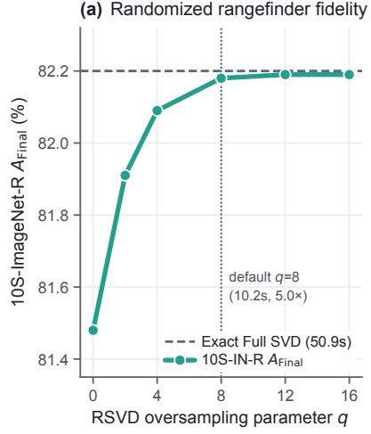

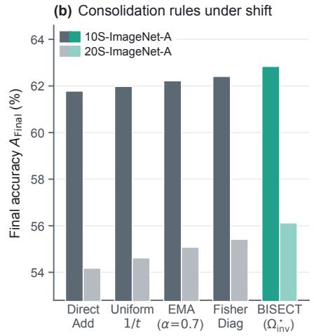

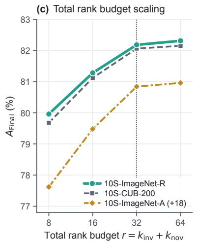  
Figure 5. Supplementary sensitivity and consolidation studies. (a) Randomized rangefinder oversampling q vs. exact SVD on 10S ImageNet-R. (b) Post-task consolidation rules on 10S- and 20S-ImageNet-A. (c) Total rank budget scaling $r \in \{ 8 , 1 6 , 3 2 , 6 4 \}$ across three benchmarks (10S-ImageNet-A shifted by +18 for visualization).

## F. Worked Numerical Example $( 2 \times 2$ Analytical Trace)

To make the interplay between Proposition 1, Theorem 1, and Theorem 2 concrete, consider a 2-dimensional token feature space $( m = 2 )$ with total budget $r = 2 \ ( k _ { \mathrm { i n v } } = 1 , k _ { \mathrm { n o v } } = 1 )$ . Suppose historical sessions have accumulated Gram matrix $G _ { < t } = \mathrm { d i a g } ( 5 . 0 , 0 . 2 )$ , and session t arrives with Gram matrix $G _ { t } = \mathrm { d i a g } ( 1 . 0 , 3 . 0 )$ and negligible damping $\rho  0 .$ 1. Invariant carrier $( P _ { \mathrm { i n v } } )$ : The joint Gram matrix is $G _ { 1 : t } = G _ { < t } + G _ { t } = \mathrm { d i a g } ( 6 . 0 , 3 . 2 )$ . Its dominant eigenvector is

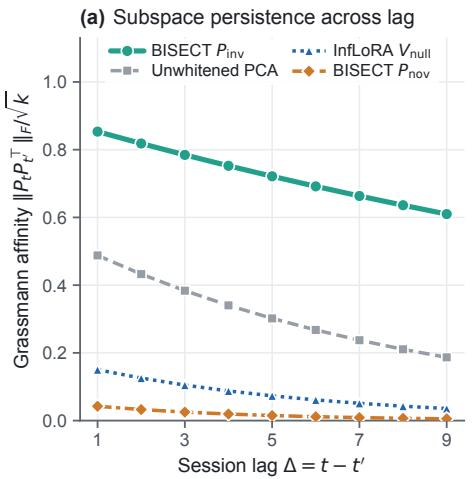

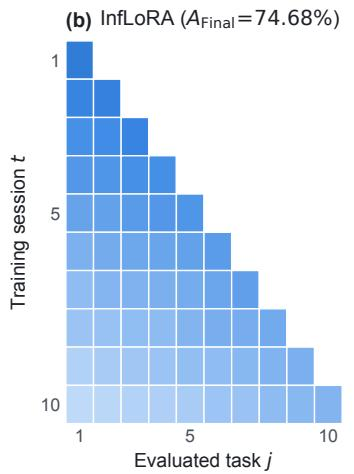

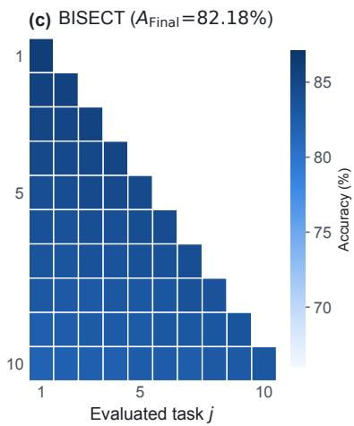  
Figure 6. Subspace persistence and session-by-task accuracy heatmaps on 10S-ImageNet-R. (a) Cross-session Grassmann affinity $\| \bar { P } _ { t } P _ { t - \Delta } ^ { \top } \| _ { F } / \sqrt { k }$ as a function of session lag ∆: the invariant carrier $P _ { \mathrm { i n v } }$ persists across time while the novelty complement $P _ { \mathrm { n o v } }$ rotates rapidly to capture emerging task variations. $( \mathbf { b } , \mathbf { c } )$ Per-task accuracy matrices after each training session t for InfLoRA vs. BISECT.

$e _ { 1 } = [ 1 , 0 ] ^ { \top }$ , so $P _ { \mathrm { i n v } } = e _ { 1 } ^ { \top }$

2. Novelty complement $\left( P _ { \mathrm { n o v } } \right) :$ Cholesky whitening yields $\begin{array} { c c l } { L } & { = } & { \operatorname { d i a g } ( \sqrt { 5 } , \sqrt { 0 . 2 } ) } \end{array}$ and $\begin{array} { r c l } { { { \widehat { G } } _ { t } } } & { { = } } & { { L ^ { - 1 } G _ { t } L ^ { - \top } = } } \end{array}$ $\mathrm { d i a g } ( 1 / 5 , 3 / 0 . 2 ) = \mathrm { d i a g } ( 0 . 2 , 1 5 . 0 )$ . The dominant whitened mode is $e _ { 2 } \ = \ [ 0 , 1 ] ^ { \top }$ , which is already orthogonal to $P _ { \mathrm { i n v } } , \mathrm { g i v i n g } \ P _ { \mathrm { n o v } } = e _ { 2 } ^ { \top }$ with Rayleigh selectivity $\mathcal { R } ( e _ { 2 } ) = 1 5 . 0$ vs. $\mathcal { R } ( e _ { 1 } ) = 0 . 2$

3. Precision-weighted fold $( \Omega _ { \mathrm { i n v } } ^ { \star } ) { : }$ On the invariant carrier $p _ { \mathrm { i n v , 1 } } = e _ { 1 } ^ { \top }$ , Eq. (11) computes

$$
\omega _ { 1 } ^ { \star } = \frac { e _ { 1 } ^ { \top } G _ { t } e _ { 1 } } { e _ { 1 } ^ { \top } ( G _ { < t } + G _ { t } ) e _ { 1 } } = \frac { 1 . 0 } { 5 . 0 + 1 . 0 } = \frac { 1 } { 6 } .\tag{28}
$$

Folding $q _ { \mathrm { i n v } , 1 } e _ { 1 } ^ { \top }$ with weight $\omega _ { 1 } ^ { \star } = 1 / 6$ reduces squared historical feature drift along $e _ { 1 }$ by $1 - ( 1 / 6 ) ^ { 2 } = 9 7 . 2 \%$ relative to unscaled merging $( \omega _ { 1 } = 1 )$ , while preserving full plasticity along the novelty direction $e _ { 2 }$

## G. Limitations and Future Directions

While BISECT eliminates extra test-time parameters and substantially reduces setup latency, two limitations merit discussion. First, $G _ { < t }$ captures second-order linear token correlations at the input of each attention block; when fine-grained classes differ only in higher-order cross-token interactions after the softmax or MLP layers, linear Cholesky whitening cannot fully separate them without a non-linear readout head (as shown by the analytic hybrid gain in Table 13). Second, maintaining exact $m \times m$ Gram matrices takes 27.0 MB for $\mathrm { V i T - B } / 1 6 ( m = 7 6 8 )$ ; scaling to giant backbones $( m \geq 4 0 9 6 )$ would benefit from sketching $G _ { < t }$ via frequent directions, which we leave to future work.