# Behavior-Discriminative Reward Shaping for Reward-Robust Reinforcement Learning

Zixuan Liu Department of Computer Science Tulane University New Orleans, LA 70118, USA zliu41@tulane.edu

Brian Summa Department of Computer Science Tulane University New Orleans, LA 70118, USA bsumma@tulane.edu

Fangzheng Wu Department of Computer Science Tulane University New Orleans, LA 70118, USA fwu6@tulane.edu

Zizhan Zheng Department of Computer Science Tulane University New Orleans, LA 70118, USA zzheng3@tulane.edu

## Abstract

Reward-robust RL typically models misspecification by specifying an uncertainty set that constrains the discrepancy of plausible rewards from a base reward. However, such reward space discrepancies can be behaviorally irrelevant: under potential-based reward shaping (PBRS), many distinct rewards preserve policy ordering. This can introduce substantial redundancy into standard uncertainty sets and degrade optimization performance. We propose Shaping-Aware Reward-Robust RL, which constructs uncertainty sets over PBRS equivalence classes by projecting each reward to a canonical representative, ensuring that the resulting set contains only rewards that induce behaviorally distinct policy rankings. We prove that this projection preserves the optimal robust value while shrinking the uncertainty set and improving empirical performance. Using the connection between robustness and regularization, we obtain a practical algorithm to solve the shaping-aware reward-robust RL problem and enjoy convergence guarantees under standard assumptions. Experiments on benchmarks spanning diverse task domains and levels of complexity show consistent improvements over representative robust RL baselines and exhibit improved robustness to reward perturbations. The code is available at https://github.com/ZixuanLiu4869/reward\_shaping.

## 1 Introduction

Despite the impressive success of reinforcement learning (RL) across a wide range of domains [1, 2, 3, 4, 5, 6, 7], deploying RL in real-world systems remains challenging. A central bottleneck is reward misspecification: the reward function used for training is often an imperfect proxy for the desired objective due to limited data, human biases, modeling errors, or distribution shift [8, 9, 10]. Therefore, in safety and reliability critical settings, we would like policies that continue to perform well under plausible reward perturbations. This motivates reward-robust RL, which models misspecification by assuming all plausible rewards lie within a given uncertainty set and solves a max-min objective that maximizes worst-case performance. Equivalently, it can also be viewed as a dynamic zero-sum game: an adversary selects the worst-case reward within the uncertainty set, while the agent seeks a policy that maximizes the resulting worst-case return [11, 12, 13, 14].

Existing reward-robust RL frameworks typically construct uncertainty sets by measuring the expected divergence of plausible rewards from a base reward [15, 16]. However, a key weakness that has been largely overlooked in the robust RL literature is that controlling such divergences in reward space does not necessarily correspond to differences in decision-making. In particular, potentialbased reward shaping (PBRS), which encompasses a general and widely adopted family of shaping transformations [17, 18, 19], shows that certain shaping rewards leave the optimal policy invariant and, more generally, preserve policy ordering. As a consequence, a divergence-based uncertainty set can contain many behaviorally equivalent rewards: they differ under the chosen divergence measure but induce identical policy rankings. This redundancy can be harmful in robust optimization. In particular, it can waste adversary iterations on rewards that provide no new behavioral distinctions rather than finding genuinely more adverse rewards (as theoretically justified and empirically shown in Section 3.1 and Figure 2), ultimately weakening the adversary and degrading robust training.

In this work, we make the first step towards behavior-discriminative robust RL by proposing Shaping-Aware Reward-Robust RL. Our framework addresses the above issues by constructing a shapingaware projected uncertainty set in which each PBRS-equivalent reward class is represented by a canonical reward. Intuitively, this removes rewards that provably do not affect policy ranking and yields an uncertainty set that better reflects behaviorally distinct objectives. We show that this reduction does not change the optimal robust value of the original reward-robust RL problem, while substantially simplifying the adversary’s search space. Empirically, we find that optimization on the projected uncertainty set makes adversary updates more identifiable and improves both performance and convergence.

However, directly solving the max-min robust RL problem with projected rewards requires projecting every candidate reward considered by the adversary to its canonical representative, which is computationally expensive. To address this, we first show that optimizing a suitably regularized objective with a projected base reward provides a conservative lower bound for the shaping-aware robust objective. This gives a tractable surrogate that only requires projecting the base reward, thereby avoiding repeated projections during the inner max-min optimization. We further show that, for certain uncertainty sets, such as entropy- and KL-induced uncertainty sets, this lower bound becomes exact in our projected setting. We further choose the canonical representative by minimizing the discrepancy induced by the uncertainty set within each PBRS equivalence class. This projection selects a representative that is consistent across equivalence classes and conservative with respect to the robust objective. Putting these together, we derive a practical algorithm that alternates between learning the canonical form of the base reward and optimizing the corresponding regularized RL objective. Since our approach only introduces a lightweight projection-learning step prior to standard policy updates, it can be integrated with a wide range of existing RL optimizers. Moreover, under standard assumptions, we establish convergence guarantees for the overall algorithm.

We empirically evaluate our method on benchmarks spanning diverse task domains and levels of complexity, comparing against representative robust RL baselines. Across all environments, our method consistently achieves higher returns and reaches strong performance in fewer training steps. We further assess robustness under reward perturbations and observe that our method exhibits smaller performance degradation than standard baselines when rewards are shifted. Overall, these results support the view that removing PBRS-induced redundancy leads to more effective robust policy learning under reward uncertainty.

To summarize, the key contribution of this work is: 1) To the best of our knowledge, we are the first to incorporate PBRS equivalence into the reward-robust RL and to construct uncertainty sets based on behavioral distinctions, rather than raw reward discrepancies, yielding stronger robust learning performance. 2) We derive a practical shaping-aware reward-robust RL algorithm that trains policies against this behaviorally distinct uncertainty set, and we provide convergence guarantees under standard assumptions. 3) We empirically validate the method across diverse environments, showing higher returns, faster convergence, and improved robustness to reward perturbations compared to representative baselines.

## 2 Preliminary

Notation. For a finite set ${ \mathcal { Z } } .$ , we write $\mathbb { R } ^ { \mathcal { Z } }$ for the set of real-valued functions on ${ \mathcal { Z } } ,$ , and $\Delta z$ for the probability simplex over $\mathcal { Z } .$ . More generally, given any set $\mathcal { X } , \Delta _ { \mathcal { Z } } ^ { \mathcal { X } }$ denotes the collection of mappings from X into $\Delta z$ . For $a , b \in \mathbb { R } ^ { \mathcal { Z } }$ , we define the standard inner product as $\begin{array} { r } { \langle a , b \rangle : = \sum _ { z \in \mathcal { Z } } a ( z ) b ( z ) } \end{array}$ Let $C \subset \mathbb { R } ^ { \mathcal { Z } }$ be a convex set and let $\Omega : C  \mathbb { R }$ be strongly convex. Throughout the paper, Ω serves as a policy regularizer. We define $\begin{array} { r } { \Omega ^ { * } ( y ) = \operatorname* { m a x } _ { a \in C } \{ \langle a , y \rangle - \Omega ( a ) \} , \forall y \in \mathbb { R } ^ { \mathcal { Z } } } \end{array}$ , which corresponds to the Legendre-Fenchel transform (also known as the convex conjugate) on C.

Standard RL. Consider an infinite-horizon Markov decision process (MDP) $( S , \mathcal { A } , \mu _ { 0 } , \gamma , P , r )$ where S and A are finite state and action spaces, $0 < \mu _ { 0 } \in \Delta _ { \mathcal { S } }$ is the initial state distribution and $\gamma \in ( 0 , 1 )$ is the discount factor. Define the state action space $\mathcal { X } : = \mathcal { S } \times \mathcal { A }$ and the transition space $\mathcal { X } ^ { \prime } : = \stackrel { \cdot } { S } \times \mathcal { A } \times \mathcal { S }$ . The dynamics are given by a transition kernel $P \in \Delta _ { s } ^ { \chi }$ , which assigns to each $( s , a ) \in \mathcal { X }$ a distribution over next states in ${ \mathcal { S } } .$ The reward is a function $r \in \mathbb { R } ^ { X ^ { \prime } }$ defined over $( s , a , s ^ { \prime } ) \in \mathcal { X } ^ { \prime }$ , where $s ^ { \prime }$ generated from $P ( \cdot | s , a )$ is the state reached after executing action a in state s. A policy $\pi \in \Delta _ { \mathcal { A } } ^ { s }$ specifies an action distribution for each state $s \in S$ . Given $\mu _ { 0 } , \pi$ and $P ,$ , the discounted return under reward r is: $\begin{array} { r } { J ( \pi , r ) : = \mathbb { E } \left[ \sum _ { t = 0 } ^ { \infty } \gamma ^ { t } r ( s _ { t } , a _ { t } , s _ { t + 1 } ) \Big | \mu _ { 0 } , \pi , P \right] } \end{array}$ . The standard RL objective is to find a policy π that maximizes the discounted return.

Potential-Based Reward Shaping (PBRS). PBRS [17] augments the environment reward via a potential function $\Phi \in \mathbb { R } ^ { S }$ , which assigns a scalar to each state. Given Φ, PBRS defines a shaping function $F$ on transition tuples $( s , a , s ^ { \prime } ) \ { \stackrel { - } { \in } } \ x ^ { \prime }$ by $F ( s , a , s ^ { \prime } ) = \gamma \Phi ( s ^ { \prime } ) - \Phi ( s )$ , and the shaping reward $r ^ { \prime } \in \mathbb { R } ^ { \mathcal { X } ^ { \prime } } \mathrm { ~ a s ~ } r ^ { \prime } ( s , a , s ^ { \prime } ) = r ( s , a , s ^ { \prime } ) + F ( s , a , s ^ { \prime } )$ . A key property of PBRS is policy invariance: replacing r with $r ^ { \prime }$ preserves the return ordering among all policies (Theorem 1 of [17]).

Reward-Robust RL. A reward-robust MDP is given by $( \mathcal { S } , \mathcal { A } , \mu _ { 0 } , \gamma , P , \mathcal { U } )$ , where the true reward is unknown but assumed to lie in a prescribed uncertainty set $\mathcal { U } \subseteq \mathbb { R } ^ { \mathcal { X } ^ { \prime } }$ . Typically, U is defined around a base reward $r \in \mathbb { R } ^ { X ^ { \prime } }$ through a discrepancy budget: $\mathcal { U } = \{ \tilde { r } \in \mathbb { R } ^ { \mathcal { X } ^ { \prime } } : \Omega ^ { * } ( r - \tilde { r } ) \leq \epsilon \}$ , where $\Omega ^ { * }$ is a dissimilarity measure and $\epsilon > 0$ controls the robustness level. The reward-robust RL objective seeks a policy π that maximizes worst-case return:

$$
\operatorname* { m a x } _ { \pi \in \Delta _ { \mathcal { A } } ^ { S } } \operatorname* { m i n } _ { \tilde { r } \in \mathcal { U } } J ( \pi , \tilde { r } ) .\tag{1}
$$

The uncertainty sets studied in the literature typically arise from specific choices of $\Omega ^ { * }$ . For example, define the reward difference $u ( s , a , s ^ { \prime } ) = r ( \bar { s , } a , s ^ { \prime } ) - \tilde { r } ( s , a , s ^ { \prime } )$ , the simplest and common used is l -constrained uncertainty set, where $\Omega ^ { * } ( u ) = \| u \| _ { p } \left[ 2 0 , 2 1 , 2 2 \right]$ . In addition, [16] consider an $\Omega ^ { * }$ of the form $\begin{array} { r } { \Omega ^ { * } ( u ) = \mathbb E \left| \sum _ { t } \gamma ^ { t } \log \sum _ { a } \exp ( u ( s _ { t } , a , s _ { t + 1 } ) ) \Big | \mu _ { 0 } , \pi , P \right| } \end{array}$ , which induces a log-sum-exp discrepancy over reward differences along trajectories. In addition, [23] define a reference policy weighted variant: $\begin{array} { r } { \Omega ^ { * } ( u ) \ = \ \mathbb { E } \Big [ \sum _ { t } \gamma ^ { t } \log { \sum _ { a \in \mathcal { A } } \pi _ { \mathrm { r e f } } \big ( a | s _ { t } \big ) } \exp \big ( u ( s _ { t } , a , s _ { t + 1 } ) \big ) \Big | \mu _ { 0 } , \pi , P \Big | } \end{array}$ , where $\pi _ { \mathrm { r e f } }$ is a reference policy. Notice that most $\Omega ^ { * }$ considered in prior work can be derived from a regularizer Ω (detailed below). Our work mainly focuses on the uncertainty set induced by such $\Omega ^ { * }$

Regularized RL. A regularized MDP is a tuple $( \mathcal { S } , \mathcal { A } , \mu _ { 0 } , \gamma , P , r , \Omega )$ , where Ω denotes an additional regularization term. The regularized RL objective takes the form

$$
\operatorname* { m a x } _ { \pi \in { \Delta _ { \mathcal { A } } ^ { s } } } J ( \pi , r ) + \Omega ( \pi ) ,\tag{2}
$$

A widely used choice is policy-entropy regularization $\begin{array} { r l r l } { [ 2 4 , } & { { } 1 6 ] { : } } & { } & { { } \Omega _ { \mathrm { E n t } } ( \pi ) } & { } & { { } = } \end{array}$ $\begin{array} { r } { - \mathbb { E } \Big [ \sum _ { t } \gamma ^ { t } \sum _ { a } \pi ( a \mid s _ { t } ) \log \pi ( a \mid s _ { t } ) \Big \vert \mu _ { 0 } , \pi , P \Big ] } \end{array}$ . Another common regularizer is the KL divergence to a reference policy [23, 25]: $\begin{array} { r } { \Omega _ { \mathrm { K L } } ( \pi ) = - \hat { \mathbb { E } } \left[ \sum _ { t } \gamma ^ { t } \sum _ { a } \pi ( a \mid s _ { t } ) \log \frac { \pi ( a \mid s _ { t } ) } { \pi _ { \mathrm { r e f } } ( a \mid s _ { t } ) } \Big \rvert \mu _ { 0 } , \pi , P \right] } \end{array}$ . Prior work has established a connection between regularization and robustness in RL for specific choices of Ω and $\Omega ^ { * } \ [ 1 6 , 2 3 , 2 6 ]$ . In particular, entropy-regularized and KL-regularized RL objectives can be interpreted as reward-robust RL problems, with corresponding discrepancies given by the log-sum-exp penalty [16] and a reference policy weighted variant [23]. For simplicity, in the remainder of the paper, we refer to these reward-robust formulations by the name of their corresponding regularizer $( \mathrm { e . g . , \tilde { \ e n t r o p y ^ { \prime \prime } o r \tilde { \Sigma } ^ { \prime \prime } K L ^ { \prime \prime } } } )$ whenever the meaning is clear. A detailed related work on PBRS, reward-robust RL, and regularized RL is in Appendix B.

## 3 Shaping-Aware Reward-Robust RL

Solving the inner minimization in the reward-robust RL objective (1) requires an adversary to search for the worst-case reward within the uncertainty set. However, when the uncertainty set is defined directly in reward space, it can contain many PBRS-equivalent rewards that induce identical policy behavior, leading to redundant adversary search. In Section 3.1, we illustrate this issue on a toy MDP and discuss its impact on optimization behavior. In Section 3.2, we introduce Shaping-Aware Reward-Robust RL, which removes this redundancy by projecting the uncertainty set onto PBRS equivalence classes so that each element corresponds to a behaviorally distinct objective. We show that this projection preserves the optimal robust value while yielding a smaller and more identifiable uncertainty set.

## 3.1 Why PBRS Redundancy Harm Optimization?

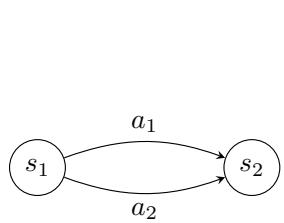  
(a)

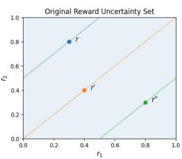

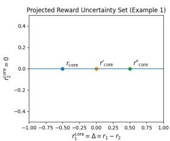  
(b)

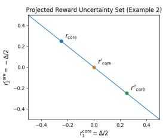  
Figure 1: (a) A two-state toy MDP. The agent starts in $s _ { 1 }$ and can choose between two actions, $a _ { 1 }$ and $a _ { 2 }$ . Regardless of the action taken in $s _ { 1 }$ , the transition to $s _ { 2 }$ is deterministic. (b) The original reward uncertainty set is the square $[ 0 , 1 ] ^ { 2 }$ over the $( r _ { 1 } , r _ { 2 } )$ plane. All points on the same dashed diagonal induce identical policy rankings under PBRS. Projecting each PBRS equivalence class to a canonical representative collapses the uncertainty set to a one-dimensional set. The left figure highlights example rewards $r , r ^ { \prime } , r ^ { \prime \prime }$ . The middle and right figure show their corresponding representatives $r _ { \mathrm { c o r e } } , \bar { r } _ { \mathrm { c o r e } } ^ { \prime } , r _ { \mathrm { c o r e } } ^ { \prime \prime }$ under two different projection choices.

In this section, we illustrate PBRS-induced redundancy and its optimization implications via the toy MDP in Figure 1a. This MDP has two states $s _ { 1 } , s _ { 2 }$ and two actions $a _ { 1 } , a _ { 2 }$ . From $s _ { 1 }$ , either action deterministically transitions to $s _ { 2 }$ . Let $r _ { 1 } : = r ( s _ { 1 } , a _ { 1 } , s _ { 2 } ) , r _ { 2 } : = r ( s _ { 1 } , a _ { 2 } , s _ { 2 } )$ , and consider the rectangular uncertainty set in Figure 1b (left), where $\mathcal { U } : = \left\{ ( r _ { 1 } , r _ { 2 } ) : r _ { 1 } \in [ 0 , 1 ] , r _ { 2 } \in [ 0 , 1 ] \right\}$ We first characterize the PBRS-equivalent rewards within U. $\mathbf { A } \mathbf { s }$ discussed in Section 2, a potential function takes the form $F ( s , a , \bar { s ^ { \prime } } ) = \gamma \Phi ( s ^ { \prime } ) - \Phi ( s )$ In this toy MDP, both actions share the same transition $s _ { 1 } \to s _ { 2 }$ , hence the shaping term applied to each action is identical, $\mathrm { i } . { \mathrm { e } } . , F _ { 1 } =$ $F _ { 2 } = \gamma \Phi ( s _ { 2 } ) - \Phi ( s _ { 1 } ) = : F .$ Consequently, adding the same shift to both rewards, $( \tilde { r } _ { 1 } , \tilde { r } _ { 2 } ) =$ $( r _ { 1 } , r _ { 2 } ) + F \cdot ( 1 , 1 )$ , does not change policy ranking. The only behaviorally relevant quantity is the reward difference $\Delta : = r _ { 1 } - r _ { 2 }$ . Geometrically, PBRS equivalence classes correspond to the slope-1 diagonals in the $( r _ { 1 } , r _ { 2 } ) { \mathrm { - p l a n e } }$ . As illustrated by the dashed lines in Figure 1b (left), all rewards lying on the same dashed diagonal are behaviorally equivalent. As a result, U contains entire families of distinct rewards that are PBRS equivalent, introducing substantial redundancy. To remove the redundancy, a natural way is to select a canonical representative $r ^ { \mathrm { c o r e } }$ from each equivalence class, thereby projecting the original reward space onto a lower-dimensional, behaviorally distinct space. Many canonicalization rules are available. For instance, we may fix $r _ { 2 } ^ { \mathrm { c o r e } } = 0$ and set $r _ { 1 } ^ { \mathrm { c o r e } } = \Delta$ yielding a one-dimensional set $\{ ( \Delta , 0 ) : \Delta \in [ - 1 , 1 ] \}$ (Figure 1b (middle)). Alternatively, we may center rewards by enforcing zero mean, $\begin{array} { r } { \mathrm { e } . \mathrm { g } . , r _ { 1 } ^ { \mathrm { c o r e } } = \frac { \Delta } { 2 } } \end{array}$ and $r _ { 2 } ^ { \mathrm { c o r e } } = - \frac { \Delta } { 2 }$ , which corresponds to the diagonal line through the origin (Figure 1b (right)).

The PBRS-induced redundancy can lead to inefficient and sometimes misleading worst-case optimization. Consider the adversary’s update over $\tilde { r } \in \mathcal { U }$ . If the adversary optimizes directly in the original reward space, its iterates can move along PBRS-invariant directions. Though in theory, the adversary would not systematically move in these directions, since the expected gradient along PBRS-invariant directions is zero. In practice, with finite rollouts and approximate return estimates, gradient estimates can induce non-zero noise even along behaviorally irrelevant directions. This noise can cause a random walk along PBRS-invariant directions, wasting adversary updates and potentially leading to premature stabilization at PBRS-equivalent rewards that provide little genuine progress in lowering the worst-case value. By contrast, optimizing over the projected reward space, where PBRS-invariant directions are removed, ensures that each adversary update is identifiable in the sense that it can meaningfully affect the worst-case objective. We further show this in Section 5 (MiniGrid experiment) and Appendix E.1 in non-convex uncertainty sets.

## 3.2 Robust Objective Invariance Under Shaping

In this section, we make the redundancy phenomenon precise and introduce our shaping-aware reward-robust RL framework to address it. We first define behaviorally equivalent rewards under PBRS: rewards that differ only by a PBRS term shift the return of every policy by the same constant, and therefore induce identical behavior in the sense of decision-making (i.e., leave policy ranking unchanged) [17].

Lemma 3.1. $L e t \Phi \in \mathbb { R } ^ { S }$ be any bounded potentialfunction and let $F ( s , a , s ^ { \prime } ) = \gamma \Phi ( s ^ { \prime } ) - \Phi ( s )$ be the corresponding shaping term. Define the shaped reward $r ^ { \prime } ( s , a , s ^ { \prime } ) \stackrel { } { = } r ( s , a , s ^ { \prime } ) + \stackrel { } { F } ( s , a , \dot { s ^ { \prime } } )$ Then,for any policy $\pi , J ( \pi , r ^ { \prime } ) = J ( \pi , r ) + C ( \Phi , \mu _ { 0 } )$ , where $C ( \Phi , \mu _ { 0 } ) = - \mathbb { E } _ { s _ { 0 } \sim \mu _ { 0 } } [ \Phi ( s _ { 0 } ) ]$ ] depends only on Φ and the initial distribution $\mu _ { 0 } ,$ , and is independent ofπ. We say $r ^ { \prime }$ is PBRS-equivalent to r.

Lemma 3.1 is a well-known property of PBRS, and we include the proof in Appendix C.1 for completeness. Notice that the additive term $C ( \Phi , \mu _ { 0 } )$ can always be eliminated by introducing a common start state $s _ { 0 }$ and setting $\Phi ( s _ { 0 } ) = 0$ . Thus, without loss of generality, we adopt the convention $C = 0$ throughout the paper. In practice, we enforce this condition by adding an extra loss term detailed in Appendix D.2. Next, we show that the standard uncertainty sets considered in the literature include rewards that are behaviorally indistinguishable under PBRS.

Proposition 3.2. Let U be an uncertainty set as defined in Section 2, oftheform $\mathcal { U } = \{ \tilde { r } : \Omega ^ { * } ( r - \tilde { r } ) \leq$ $\epsilon \}$ . Assume U contains a neighborhood ofsome $\tilde { r } \ ( e . g . , \mathcal { U }$ has nonempty interior around $\tilde { r } )$ . Then there exists a nontrivial shaping direction $F \neq 0$ (generated by some $\mathbf { \hat { \Phi } } ( \mathbf { \Phi } ) \mathbf { \Phi } ( \mathbf { R } ^ { S } )$ and a scalar $\delta > 0$ such that $\tilde { r } + \alpha F \in { \mathcal { U } } ,$ for all $| \alpha | \leq \delta . A l l$ rewards in $\left\{ \widetilde r + \alpha \bar { F } : | \alpha | \le \delta \right\}$ are PBRS-equivalent and therefore induce identical policy rankings.

The proof is provided in Appendix C.2. Proposition 3.2 highlights that, because U is defined over raw rewards, it can contain entire neighborhoods of PBRS-equivalent rewards. This redundancy motivates constructing an uncertainty set over PBRS equivalence classes, so that each element represents a unique, behaviorally distinct objective. To formalize this idea, let $\mathcal { R } \subseteq \mathbb { R } ^ { \mathcal { X } ^ { \prime } }$ denote the reward space of interest. Define the shaping subspace $S _ { \mathrm { s h a p e } } : = \{ F _ { \Phi } : \Phi \in \mathbb { R } ^ { S } \}$ , and the corresponding quotient space of PBRS equivalence classes $\mathcal { R } _ { \mathrm { c o r e } } : = \mathcal { R } / S _ { \mathrm { s h a p e } }$ , whose elements are classes $[ r ] \ \stackrel {  } { = } \ \{ r + \bar { F _ { \Phi } } : F _ { \Phi } \in S _ { \mathrm { s h a p e } } \}$ . Assume we fix a canonical representative for each equivalence class via a projection map $\dot { \mathrm { P r o j } } : \mathcal { R }  \mathcal { R }$ such that for any $r \in { \mathrm { \mathcal { R } } } , { \mathrm { P r o j } } ( r ) \in [ r ]$ and Proj $( r + F _ { \Phi } ) = \mathrm { P r o j } ( r )$ for all $F _ { \Phi } \in S _ { \mathrm { s h a p e } } .$ . Using the above definition, given any uncertainty set $\mathcal { U } \subseteq \mathcal { R }$ , we then define its projected uncertainty set as $\mathcal { U } _ { \mathrm { c o r e } } : = \mathrm { P r o j } ( \mathcal { U } ) = \{ \mathrm { P r o j } ( r ) : r \in \mathcal { U } \} \subseteq \mathcal { R } .$ which collapses PBRS-equivalent rewards in U to a single representative defined by Proj. We now establish that working with $\mathcal { U } _ { \mathrm { c o r e } }$ is not only conceptually cleaner, but also preserves the robust objective. In particular, we have:

Theorem 3.3. Let $\mathcal { U } _ { c o r e }$ be the projected uncertainty set of U as defined above, we have

$$
\operatorname* { m i n } _ { \tilde { r } \in \cal { U } } J ( \pi , \tilde { r } ) = \operatorname* { m i n } _ { \tilde { r } _ { c o r e } \in \mathcal { U } _ { c o r e } } J ( \pi , \tilde { r } _ { c o r e } ) , \qquad \forall \pi .\tag{3}
$$

Consequently, the standard reward-robust RL problem can be solved over the shaping-aware projected uncertainty set $\mathcal { U } _ { c o r e }$ without changing the robust optimal value.

The proof of Theorem 3.3 is provided in Appendix C.3. It follows directly from the definition of $\mathcal { U } _ { \mathrm { c o r e } }$ together with Lemma 3.1. Theorem 3.3 implies that one can directly solve the robust objective over $\mathcal { U } _ { \mathrm { c o r e } }$ instead of U. We instantiate this direct approach in the MiniGrid experiment in Section 5, where the projected uncertainty set is explicit and can be optimized over efficiently. We quantify how projection reduces the adversary’s effective search space in Appendix C.4, where the extent of the reduction scales with the number of independent shaping directions present in U. Additionally, Appendix C.5 shows that under mild assumptions, $\mathcal { U } _ { \mathrm { c o r e } }$ inherits key geometric properties of $u ,$ such as compactness and convexity. These properties ensure the optimization on $\mathcal { U } _ { \mathrm { c o r e } }$ is well-posed.

## 4 Shaping-Aware Reward-Robust Algorithm

A direct optimization of (3) requires solving the inner minimization over $\mathcal { U } _ { \mathrm { c o r e } }$ . In practice, this means maintaining feasibility after each adversary update and thus projecting intermediate rewards back onto $\mathcal { U } _ { \mathrm { c o r e } }$ at every inner step. However, computing this projection is itself a nontrivial optimization, adding substantial per-step overhead. This overhead can be prohibitive in large-scale RL, where the inner minimization is already the main computational bottleneck. While alternative implementations may reduce this cost, designing an efficient algorithm is nontrivial. In Section 4.1, we address the issue by leveraging the connection between robustness and regularization. And then we specify a concrete canonicalization rule. We present the overall algorithm in Section 4.2.

## 4.1 Robustness-Regularization Duality Under Shaping

We first show that the regularized objective is a conservative surrogate to $( 3 )$

Theorem 4.1. Fix $\epsilon \geq 0$ and $\lambda > 0$ . Let Ω be a proper, closed, and strongly convex regularization term, and let Ω∗ denote its convex conjugate. Define the uncertainty set $\begin{array} { r } { \mathcal { U } : = \left\{ \tilde { r } : \Omega ^ { * } \left( \frac { r - \tilde { r } } { \lambda } \right) \leq \epsilon \right\} } \end{array}$ and the projected uncertainty set $\mathcal { U } _ { \mathrm { c o r e } } = P r o j ( \mathcal { U } )$ . Let $r _ { \mathrm { c o r e } } : = P r o j ( r )$ be the projection of base reward r. Then the shaping-aware reward-robust objective satisfies

$$
\operatorname* { m i n } _ { \tilde { r } _ { \mathrm { c o r e } } \in \mathcal { U } _ { \mathrm { c o r e } } } J ( \pi , \tilde { r } _ { \mathrm { c o r e } } ) \geq J ( \pi , r _ { \mathrm { c o r e } } ) - \lambda \Omega ( \pi ) - \lambda \epsilon , \qquad \forall \pi .
$$

The proof is deferred to Appendix C.6, where we first prove the inequality for the original uncertainty set and then show that the same inequality carries over to the projected uncertainty set using Lemma 3.1 and Theorem 3.3, as projection preserves the robust objective. Theorem 4.1 shows that the regularized objective with the projected base reward $r _ { \mathrm { c o r e } }$ provides a conservative lower bound for (3) and maximizing this lower bound gives a tractable surrogate. Instead of repeatedly solving the inner minimization over projected rewards, it suffices to compute $r _ { \mathrm { c o r e } }$ and optimize the corresponding regularized objective, which substantially reduces computational overhead. We next show that, for the entropy- and KL-induced uncertainty sets, this lower-bound relation becomes exact.

Theorem 4.2. Fix $\epsilon \geq 0$ and $\lambda > 0$ . Define the uncertainty set $\begin{array} { r } { \mathcal { U } = \left\{ \tilde { r } : \Omega ^ { * } \big ( \frac { r - \tilde { r } } { \lambda } \big ) \leq \frac { \epsilon } { \lambda } \right\} } \end{array}$ and the projected uncertainty set $\mathcal { U } _ { \mathrm { c o r e } } = \mathrm { P r o j } ( \mathcal { U } )$ . Let $r _ { \mathrm { c o r e } } : = \mathrm { P r o j } ( r )$ . For the entropy-based and KL-based choices of Ω∗ introduced in Section 2, the following exact correspondence holds:

$$
\operatorname* { m i n } _ { \tilde { r } _ { \mathrm { c o r e } } \in \mathcal { U } _ { \mathrm { c o r e } } } J ( \pi , \tilde { r } _ { \mathrm { c o r e } } ) = J ( \pi , r _ { \mathrm { c o r e } } ) + \lambda \Omega ( \pi ) - \epsilon , \qquad \forall \pi ,
$$

where $\Omega = \Omega _ { \mathrm { E n t } }$ for the entropy-based and $\Omega = \Omega _ { \mathrm { K L } }$ for the KL-based uncertainty set.

The proof is deferred to Appendix C.7. We first establish the exact correspondence for the original uncertainty sets, following prior work [27], and then extend it to the projected uncertainty set similar to Theorem 4.1. Theorem 4.2 shows that, for these uncertainty sets, maximizing the regularized objective with $r _ { \mathrm { c o r e } }$ is equivalent to optimizing the corresponding shaping-aware robust objective.

It remains to specify the projection operator Proj, i.e., how we choose a canonical representative from each PBRS equivalence class. In principle, many canonicalizations are possible. Recall that our robust objective measures reward uncertainty using the dissimilarity induced by $\Omega ^ { * }$ . It is therefore natural to define the projection in a way that is consistent with this geometry. We adopt a conservative canonicalization: within each equivalence class $[ r ] ,$ , we select the representative that is smallest under the same $\Omega ^ { * }$ -induced geometry: $\begin{array} { r } { \mathrm { P r o j } ( r ) = \arg \operatorname* { m i n } _ { r ^ { \prime } \in [ r ] } \Omega ^ { * } ( r ^ { \prime } ) } \end{array}$ . Intuitively, for each PBRS-equivalence class, our method selects the representative with the smallest $\Omega ^ { * }$ value, yielding a consistent canonical reward that is aligned with the discrepancy geometry induced by the uncertainty set. Moreover, this choice avoids inadvertently interpreting PBRS-equivalent rewards outside the original budgeted set as admissible, which would correspond to certifying robustness with respect to a larger uncertainty set than the one we specify. Additional properties of this projection are detailed in Appendix C.8. In particular, we show that the projection is well-defined by establishing existence and uniqueness. We also show that, from a max-min viewpoint, this projection can tighten convergence bounds for certain optimization methods.

To implement $\mathrm { P r o j } ( r )$ , notice that $r ^ { \prime } \in [ r ]$ means that r differs from $r ^ { \prime }$ by a potential-based shaping term, i.e., $r = r ^ { \prime } + \dot { F } _ { \Phi }$ with $F _ { \Phi } ( s , a , s ^ { \prime } ) \dot { { \bf \Phi } } = \gamma \Phi ( s ^ { \prime } ) - \Phi ( s )$ . In practice, we approximate Φ using a neural network $\Phi _ { \varphi }$ with parameters $\varphi$ as a flexible and general function approximation. Then the projection reduces to optimizing over φ: $\begin{array} { r } { \varphi ^ { * } = \arg \operatorname* { m i n } _ { \varphi } \Omega ^ { * } \Big ( r - F _ { \Phi _ { \varphi } } \Big ) } \end{array}$ . Given the learned parameters $\varphi ^ { * }$ , we compute the shaping term for each reward as $F _ { \Phi _ { \omega ^ { * } } }$ , and obtain the corresponding projected reward by subtracting this shaping component, $r ^ { \prime } = r - \dot { F } _ { \Phi _ { \varphi ^ { * } } }$

## 4.2 Shaping-Aware Reward-Robust Policy Gradient

We summarize the overall training procedure to solve our shaping-aware reward-robust RL problem in Algorithm 1. At each iteration, we first learn the projected reward by estimating the projection loss $l ( \varphi _ { i , k } , \theta _ { i } ; \mathcal { D } _ { \pi _ { \theta _ { i } } } )$ , where $\Omega _ { \mathcal { D } _ { \pi _ { \theta _ { i } } } } ^ { * }$ denotes the estimate of $\Omega ^ { * }$ computed from the rollout data $\mathcal { D } _ { \pi _ { \theta _ { i } } }$ , and updating $\varphi$ via gradient descent (lines 6-8). We then replace the rewards in the same batch with the resulting projected reward and perform a standard policy update on the regularized objective (lines 10-11). We justify in Appendix C.9 that such on-policy projection-learning design is data-efficient and supports online adaptation. Although Algorithm 1 updates the policy via policy gradients, in principle, our projection simply replaces the environment reward with its canonicalized version, so it is compatible with any RL algorithm that optimizes expected return $( \mathrm { e . g . , S A C }$ [24] or PPO [28]). In Appendix C.9, we prove convergence under standard conditions by first analyzing the projectionlearning updates and then applying a two-time scale argument [29, 15] to establish convergence of the overall algorithm. Notice that our convergence guarantee relies on a strong convexity assumption for the projection loss (Assumption C.12), which does not directly apply to the neural-network setting. We discuss this further in Appendix A. Algorithm 1 learns the projector approximately from a finite rollout batch, so the learned projection may deviate from the exact projector. We show that such projection error does not affect the structure of Theorem 4.1 and 4.2 (Appendix C.9, Theorem C.26 and C.27). It only introduces an approximation error that scales with $\begin{array} { r } { \mathcal { O } \left( \frac { 1 } { 1 - \gamma } \left( \frac { \log N + \log \left( 1 / \delta \right) } { N } \right) ^ { 1 / 4 } \right) } \end{array}$ which vanishes as the number of rollout samples N increases. Overall, our algorithm should be interpreted as an approximate implementation inspired by theory.

Algorithm 1 Shaping-Aware Policy Gradient   
1: Hyperparameters: Iteration number $I , K ,$ Step size $\{ \beta _ { i } \} _ { i = 0 } ^ { I - 1 }$ for θ, Step size $\{ \alpha _ { i , k } \} _ { i = 0 , \ldots , I - 1 ; k = 0 , \ldots , K - 1 }$   
for φ.   
2: Initialize: $\theta _ { 0 } \in \Theta , \varphi _ { 0 } \in \Psi$   
3: for iteration $i = 0 , \ldots , I - 1$ do   
4: Collect a batch dataset $\mathcal { D } _ { \pi _ { \theta _ { i } } }$ from the current policy $\pi _ { \boldsymbol { \theta } _ { i } }$   
5: Initialize $\varphi _ { i , 0 } = \varphi _ { i }$   
6: for iteration $k = 0 , \ldots , K$ do   
7: Update $\varphi \colon \varphi _ { i , k + 1 } = \varphi _ { i , k } - \alpha _ { i , k } \nabla _ { \varphi } l ( \varphi _ { i , k } , \theta _ { i } ; \mathcal { D } _ { \pi _ { \theta _ { i } } } )$ where $l ( \varphi _ { i , k } , \theta _ { i } ; \mathcal { D } _ { \pi _ { \theta _ { i } } } ) = \Omega _ { \mathcal { D } _ { \pi _ { \theta _ { i } } } } ^ { * } \left( r - F _ { \Phi _ { \varphi _ { i , k } } } \right)$   
8: end for   
9: Set $\varphi _ { i + 1 } : = \varphi _ { i , K }$   
10: Transform $\mathcal { D } _ { \pi _ { \theta _ { i } } }$ to $\mathcal { D } _ { \pi _ { \theta _ { i } } } ^ { \prime }$ by replacing the rewards with $r ^ { \prime } = r - F _ { \Phi _ { \varphi _ { i + 1 } } }$   
11: Update θ via $\theta _ { i + 1 } = \bar { \theta _ { i } } + \beta _ { i } \nabla _ { \theta } \bar { J } ( \theta _ { i } , \varphi _ { i + 1 } ; \mathcal { D } _ { \pi _ { \theta _ { i } } } ^ { \prime } )$ where $\bar { J } ( \theta _ { i } , \varphi _ { i + 1 } ; \mathcal { D } _ { \pi _ { \theta _ { i } } } ^ { \prime } ) = J _ { \mathcal { D } _ { \pi _ { \theta _ { i } } } ^ { \prime } } ( \pi _ { \theta _ { i } } , r _ { \varphi _ { i + 1 } } ) -$   
$\Omega _ { \mathcal { D } _ { \pi _ { i } } ^ { \prime } } ( \pi _ { \theta _ { i } } )$   
12: end for

## 5 Experiment

We evaluate the performance and robustness of our shaping-aware reward-robust RL framework across benchmarks that span different task domains, and levels of complexity. Our goal is to test whether our method improves (i) nominal performance during robust training and (ii) robustness to reward misspecification, relative to standard reward-robust RL baselines.

Experiment setup. We use a MiniGrid environment [30] as a controlled discrete benchmark for directly studying the max-min robust objective. In this setting, we adopt an $l _ { 2 } .$ -constrained uncertainty set and compare policies trained by directly optimizing the standard max-min objective versus the shaping-aware max-min objective. For all remaining tasks, we focus on both entropy- and KL-based objectives discussed in Section 2. In each case, we compare a standard PPO baseline against our approach, which uses the same PPO but augments training with the proposed projection step. We evaluate continuous-control performance on five OpenAI Gym MuJoCo environments [31, 32]: Hopper-v4, Walker2d-v4, HalfCheetah-v4, Humanoid-v4, and Reacher-v4. These environments cover a meaningful range of state-action dimensions, where Hopper and Reacher represent smallerscale settings, Walker2d and HalfCheetah represent mid-scale locomotion tasks, and Humanoid is substantially higher-dimensional. To evaluate generalization beyond continuous-control domains, we extend the evaluation to Atari [33]. Specifically, we consider Seaquest and Pong, which have discrete action spaces and high-dimensional visual observations of size $2 1 0 \times 1 6 0 \times 3 .$ These experiments test whether the benefits of our method persist in visual decision-making settings. Finally, we include Adroit Pen from Gymnasium-Robotics [34] as a more challenging simulated robotics benchmark. This task has a high-dimensional action space (23), allowing us to assess whether our method remains effective in higher-dimensional robotic manipulation. Additional implementation details are provided in Appendix D. Additional results, including learning curves showing faster convergence of our method, computational overhead, an ablation study on the sensitivity to data coverage for the projection learning, are presented in Appendix E.

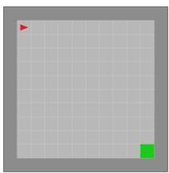  
(a)

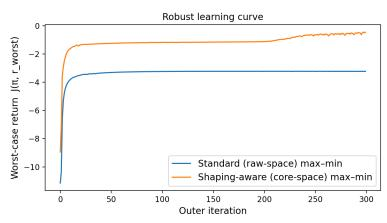  
(b)

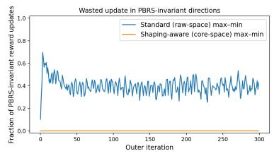  
(c)  
Figure 2: MiniGrid evaluation comparing the standard max-min baseline and our shaping-aware method. (a) Grid-world task: the agent starts in the top-left cell and must reach the goal in the bottom-right cell. (b) Worst-case return as a function of training iteration. (c) Fraction of each adversary update that lies in PBRS-invariant directions.

Table 1: Average cumulative returns and percentage improvement for different methods on various environments. Each policy is evaluated for 100 episodes. The return is in terms of the environment’s original reward. We report the mean ± 95% confidence interval over 5 random seeds. $\Delta _ { \mathrm { { e n t r o p y } } }$ and $\Delta _ { \mathrm { K L } }$ denote the improvement of our method over the corresponding base method.
<table><tr><td>Environment</td><td>Robust RL (entropy)</td><td> $\mathrm { S h a p i n g } .$  -aware (entropy)</td><td>∆entropy</td><td></td><td>Robust RL (KL)</td><td>Shaping-aware (KL)</td><td>ΔκL</td><td></td></tr><tr><td>Hopper-v4</td><td> $2 9 0 5 . 1 2 \pm 1 3 3 . 8 6$ </td><td> $3 2 1 4 . 6 8 \pm 1 1 5 . 6 0$ </td><td>+309.56</td><td>↑10.7%</td><td> $2 8 8 2 . 0 8 \pm 1 8 6 . 1 2$ </td><td> $3 2 4 9 . 2 3 \pm 1 3 1 . 8 7$ </td><td>+367.15</td><td>↑12.7%</td></tr><tr><td>Walker2d-v4</td><td> $2 8 6 1 . 8 1 \pm 3 1 6 . 3 2$ </td><td> $3 3 8 5 . 8 8 \pm 2 8 1 . 7 9$ </td><td>+524.07</td><td>↑18.3%</td><td> $2 6 7 6 . 9 4 \pm 2 6 3 . 5 4$ </td><td> $3 5 7 7 . 3 5 \pm 3 5 2 . 5 5$ </td><td>+900.41</td><td>↑33.6%</td></tr><tr><td>HalfCheetah-v4</td><td> $1 3 8 6 . 7 3 \pm 2 1 . 8 4$ </td><td> $1 6 2 5 . 9 4 \pm 2 0 . 5 8$ </td><td>+239.21</td><td>↑17.2%</td><td> $1 5 8 3 . 3 0 \pm 3 5 . 3 8$ </td><td> $3 2 8 8 . 3 0 \pm 6 0 . 4 8$ </td><td> $+ 1 7 0 5 . 0 0$ </td><td>↑107.7%</td></tr><tr><td>Humanoid-v4</td><td> $4 6 3 . 1 5 \pm 2 5 . 8 2$ </td><td>505.54 ±15.78</td><td>+42.39</td><td> $\uparrow 9 . 2 \%$ </td><td> $3 7 2 . 6 0 \pm 2 8 . 5 2$ </td><td> $4 1 8 . 1 0 \pm 1 3 . 9 0$ </td><td> $+ 4 5 . 5 0 $ </td><td>↑12.2%</td></tr><tr><td>Reacher-v4</td><td> $- 5 . 9 8 \pm 0 . 2 7$ </td><td> $- 4 . 8 8 \pm 0 . 4 9$ </td><td> $+ 1 . 1 0$ </td><td> $\uparrow 1 8 . 4 \%$ </td><td> $- 5 . 8 8 \pm 0 . 4 4$ </td><td> $- 5 . 1 7 \pm 0 . 3 2$ </td><td> $+ 0 . 7 1$ </td><td>↑12.1%</td></tr><tr><td>Seaquest</td><td> $6 0 4 . 0 0 \pm 6 8 . 5 9$ </td><td> $8 3 2 . 0 0 \pm 4 8 . 9 9$ </td><td>+228.00</td><td>↑37.7%</td><td> $6 1 6 . 0 0 \pm 3 9 . 1 9$ </td><td> $8 4 0 . 0 0 \pm 2 9 . 3 9$ </td><td> $+ 2 2 4 . 0 0$ </td><td>↑36.4%</td></tr><tr><td>Pong</td><td> $1 4 . 3 8 \pm 2 . 1 5$ </td><td> $1 6 . 1 3 \pm 1 . 3 6$ </td><td>+1.75</td><td>↑12.2%</td><td> $1 5 . 2 4 \pm 1 . 3 5$ </td><td> $1 7 . 8 8 \pm 1 . 7 4$ </td><td> $+ 2 . 6 4$ </td><td>↑17.3%</td></tr><tr><td>Adroit Pen</td><td> $4 2 3 9 . 9 4 \pm 1 1 4 . 3 8$ </td><td> $5 0 8 5 . 2 6 \pm 1 1 2 . 2 0$ </td><td>+845.32</td><td>↑19.9%</td><td> $4 4 3 4 . 2 2 \pm 6 8 . 8 9$ </td><td> $6 0 8 7 . 3 0 \pm 6 3 . 6 8$ </td><td>+1653.08</td><td>↑37.3%</td></tr><tr><td>Average</td><td> $1 5 5 8 . 6 4 \pm 8 5 . 4 0$ </td><td> $1 8 3 2 . 5 7 \pm 7 4 . 6 0$ </td><td></td><td> $+ 2 7 3 . 9 3 \quad \uparrow 1 7 . 6 \%$ </td><td> $1 5 7 1 . 8 1 \pm 7 7 . 9 3$ </td><td> $2 1 8 4 . 1 2 \pm 8 1 . 7 4$ </td><td>+612.31</td><td>↑39.0%</td></tr></table>

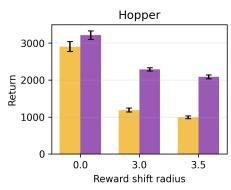

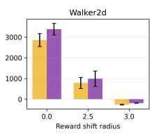

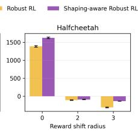

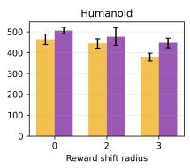

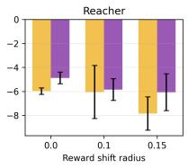  
Figure 3: $\mathrm { M e a n } \pm 9 5 \%$ confidence interval return of the evaluation policy under reward perturbation over 100 episodes and 5 seeds for the entropy-based problem.

MiniGrid max-min robust training. The evaluation result in the MiniGrid environment can be seen in Figure 2. Specifically, Figure 2b reports the worst-case return $J ( \pi , r _ { \mathrm { w o r s t } } )$ across outer iterations for the standard max-min baseline and our shaping-aware method. Both methods improve rapidly at the beginning, but the shaping-aware variant continues to make steady progress and converges to a substantially higher worst-case return. This indicates that optimizing over the PBRS-canonicalized reward space leads to a stronger robust solution under the same uncertainty budget and comparable optimization settings. Figure 2c quantifies, at each outer iteration, what fraction of the adversary’s update lies in PBRS-invariant directions. For the standard baseline, a persistent and significant fraction of adversary updates moves along shaping directions that do not alter policy orderings. This arises because the inner minimization is solved only approximately (via limited gradient descent), and the stochastic estimation noise (soft-max policies) together with inner-loop hyperparameter choices (stepsize) can induce drift along PBRS-invariant directions. Such updates are effectively wasted from the perspective of identifying more adverse behaviors and lead to premature stabilization at some PBRS-equivalent rewards that provide little genuine progress in lowering the worst-case value. In contrast, our method operates directly in the projected reward space, where PBRS-invariant directions are removed. As a result, the PBRS-invariant component of the adversary update is near zero, and each update is identifiable in the sense that it can meaningfully affect the worst-case objective. Together, these results support our motivating claim: removing PBRS redundancy makes adversary updates behaviorally identifiable, which translates into more effective robust training and better final worst-case performance.

Comparison on MuJoCo, Atari, and Gymnasium-Robotics tasks. To evaluate how well each method performs under the nominal environments, we report the results in Table 1. Across all cases, our shaping-aware variant consistently outperforms the corresponding robust RL baseline. In the MuJoCo environment, the gains are especially pronounced in mid-scale environments, e.g., 107.7% on HalfCheetah in the KL setting. For the relatively smaller and larger environments, the improvements are moderate but still consistent. Notably, even on the highest-complexity Humanoid task, our method still achieves a 12.2% improvement in the KL setting, suggesting that the benefit of our method persists beyond low-dimensional problems. The additional results from Atari and Gymnasium-Robotics further support this trend. On the visual Atari tasks, our method improves both Seaquest and Pong, while on the more challenging Adroit Pen manipulation task, it achieves substantial gains of 37.3% in the KL setting, indicating that the benefits extend to high-dimensional visual and robotic manipulation domains. Overall, these results show that our method consistently improves robust policy learning and yields higher worst-case returns, thereby supporting the framework’s broader applicability across different dimensions and task domains.

Testing for reward robustness. To assess robustness to reward uncertainty, we evaluate all methods under structured reward perturbations that change the task incentives. We focus the evaluation on MuJoCo as its reward components are easily perturbable, and such structured reward-shift protocols have been widely used in prior work [26, 27]. For the locomotion tasks (HalfCheetah, Hopper, Walker2d, and Hu-

Table 2: Effect of the shaping coefficient α on policy performance.
<table><tr><td>α</td><td>Reward Representation</td><td>Return</td></tr><tr><td>0</td><td> $r _ { \mathrm { c o r e } }$ </td><td> $- 1 8 8 . 1 4 \pm 9 . 2 6$ </td></tr><tr><td>0.25</td><td> $r _ { \mathrm { c o r e } } + 0 . 2 5 F _ { \Phi ^ { \star } }$ </td><td> $- 1 9 7 . 4 0 \pm 1 5 . 3 3$ </td></tr><tr><td>0.5</td><td> $r _ { \mathrm { c o r e } } + 0 . 5 F _ { \Phi ^ { \star } }$ </td><td> $- 2 0 6 . 7 4 \pm 1 2 . 2 1$ </td></tr><tr><td>0.75</td><td> $r _ { \mathrm { c o r e } } + 0 . 7 5 F _ { \Phi ^ { \star } }$ </td><td> $- 2 5 1 . 6 2 \pm 1 9 . 0 0$ </td></tr><tr><td>1</td><td> $r _ { \mathrm { c o r e } } + F _ { \Phi ^ { \star } } = r$ </td><td> ${ \cdot 2 5 9 . 5 9 \pm 1 6 . 0 7 }$ </td></tr></table>

manoid), the nominal reward primarily encourages forward progress, and moving backward typically yields a non-positive reward. Following the protocol of [26], during training, we flip this incentive by adding random reward shifts, so that backward motion can also be beneficial under the perturbed rewards. We report performance under the original reward during evaluation. For Reacher, where the objective is to reach a target position, we adopt the evaluation protocol of [27]. All policies are trained on the nominal environment. At test time, we relocate the target to a random position at varying distances from the nominal location and evaluate performance with respect to the reward induced by this relocated target. Implementation details for constructing the perturbed rewards are provided in Appendix D.3. Overall, these perturbations introduce systematic and interpretable reward misspecification across domains, allowing us to compare how well each method maintains performance when the reward deviates from the nominal specification.

Figure 8 reports robustness under reward perturbations for the entropy-based problem, and we include the results for KL-based problem in Appendix E.3. Overall, the shaping-aware method exhibits smaller performance degradation than the robust RL baseline as the reward shift radius increases, indicating improved stability to reward misspecification. The perturbations affect HalfCheetah and Walker2d most strongly, where returns drop sharply for both methods as the shift radius grows, suggesting these locomotion tasks are particularly sensitive to reward changes. In contrast, Hopper, Humanoid, and Reacher show more moderate changes with increasing shift radius, and the shaping aware method consistently maintains higher returns than the baseline across perturbation levels.

To provide a more direct evaluation of whether the observed improvement specifically arises from removing PBRS redundancy rather than from generic reward shaping, we define the actual PBRS component learned by our method as $F _ { \Phi ^ { \star } } = r - r _ { \mathrm { c o r e } }$ . Then we construct $r _ { \alpha } = r _ { \mathrm { c o r e } } + \alpha F _ { \Phi } ,$ , and let $\alpha = 0 , 0 . 2 5 , 0 . 5 , 0 . 7 5 ,$ 1, so that $\alpha = 0$ corresponds to our canonical reward, $\alpha = 1$ recovers the original reward, and the intermediate values progressively add back exactly the PBRS component removed by our projection. We evaluate these variants on Walker2d under reward perturbations in the entropy-based setting with a reward-shift radius of 3, and report their performance under the true reward. Table 2 shows that, under the same PPO training budget, the canonical reward with $\alpha = 0$ achieves the best performance, and the return progressively deteriorates as α increases and more of the removed PBRS component is added back. This controlled experiment directly supports our explanation that the performance gain comes from removing the PBRS-redundant component rather than from an arbitrary reward transformation.

Ablation on projection choices. To isolate the contribution of our Ω∗-aligned canonicalization, Table 3 compares several projection choices under reward perturbations. Implementation details are provided in $\mathsf { A p - }$ pendix D.4, and full results for all environments are reported in Appendix E.5. First, we include a random Φ variant, which injects an arbitrary PBRS shaping term into the reward. This variant does not yield meaningful robustness improvements, indicating that the gains of our method do not come from simply

Table 3: Ablation on canonicalization choices under reward perturbations for Walker2d with the entropybased robust objective (reward shift $\mathrm { r a d i u s } = 3 )$ . Results are reported as mean ± 95% confidence interval over 5 random seeds.
<table><tr><td>Method</td><td>Walker2d</td></tr><tr><td>Reward-Robust (baseline)</td><td> $- 2 5 9 . 5 9 \pm 1 6 . 0 7$ </td></tr><tr><td>Shaping-aware (ours, Ω*-projection)</td><td> $- 1 8 8 . 1 4 \pm 9 . 2 6 $ </td></tr><tr><td>Shaping-aware (random Φ canonicalization) Shaping-aware  $( L ^ { 2 }$  projection)</td><td> $- 2 2 6 . 1 7 \pm 3 6 . 7 2$   ${ \cdot 1 9 9 . 0 4 \pm 9 . 3 7 }$ </td></tr></table>

adding an extra shaping-like component, but from learning a canonicalization that removes PBRS redundancy in a principled way. We also consider an $L ^ { 2 }$ projection that performs orthogonal projection regardless of the uncertainty-set geometry. This variant still removes PBRS-equivalent directions and thus improves robustness relative to the baseline, confirming that redundancy removal alone is beneficial. However, the Ω∗-aligned projection performs better, suggesting that matching the canonicalization to the robustness geometry provides additional gains under reward perturbations.

## 6 Conclusion

In this paper, we propose Shaping-Aware Reward-Robust RL, which constructs behavior discriminative uncertainty sets over PBRS equivalence classes and enables practical training via a projection-learning module compatible with standard RL optimizers. Across diverse tasks, our method consistently improves robust performance over representative baselines. These results support our central claim that eliminating behaviorally equivalent rewards leads to more effective robust policy learning under reward uncertainty. We discuss limitations and future directions in Appendix A.

## References

[1] B Ravi Kiran, Ibrahim Sobh, Victor Talpaert, Patrick Mannion, Ahmad A Al Sallab, Senthil Yogamani, and Patrick Pérez. Deep reinforcement learning for autonomous driving: A survey. IEEE transactions on intelligent transportation systems, 23(6):4909–4926, 2021.

[2] Paul F Christiano, Jan Leike, Tom Brown, Miljan Martic, Shane Legg, and Dario Amodei. Deep reinforcement learning from human preferences. Advances in neural information processing systems, 30, 2017.

[3] Jens Kober, J Andrew Bagnell, and Jan Peters. Reinforcement learning in robotics: A survey. The International Journal ofRobotics Research, 32(11):1238–1274, 2013.

[4] Zixuan Liu, Xiaolin Sun, and Zizhan Zheng. Enhancing llm safety via constrained direct preference optimization. arXiv preprint arXiv:2403.02475, 2024.

[5] Zixuan Liu, WU Fangzheng, Brian Summa, and Zizhan Zheng. Risk-conditioned fine-tuning of large language models. In Proceedings ofthe 2026 Conference on Empirical Methods in Natural Language Processing, pages 22036–22076, 2026.

[6] Zixuan Liu, Siavash Khajavi, Guangkai Jiang, and Xinru Liu. Ua-ttrl: Uncertainty-aware test-time reinforcement learning. In ICASSP 2026-2026 IEEE International Conference on Acoustics, Speech and Signal Processing (ICASSP), pages 17147–17151. IEEE, 2026.

[7] Zixuan Liu, Siavash H Khajavi, Guangkai Jiang, and Xinru Liu. Targeting misalignment: A conflict-aware framework for reward-model-based llm alignment. In Proceedings ofthe AAAI Conference on Artificial Intelligence, volume 40, pages 37692–37700, 2026.

[8] Shie Mannor, Duncan Simester, Peng Sun, and John N Tsitsiklis. Bias and variance approximation in value function estimates. Management Science, 53(2):308–322, 2007.

[9] Hong Jun Jeon, Smitha Milli, and Anca Dragan. Reward-rational (implicit) choice: A unifying formalism for reward learning. In Advances in Neural Information Processing Systems, 2020.

[10] Tobias Enders, James Harrison, and Maximilian Schiffer. Risk-sensitive soft actor-critic for robust deep reinforcement learning under distribution shifts. arXiv preprint arXiv:2402.09992, 2024.

[11] Jun Morimoto and Kenji Doya. Robust reinforcement learning. Neural computation, 17(2):335–359, 2005.

[12] Shiau Hong Lim, Huan Xu, and Shie Mannor. Reinforcement learning in robust markov decision processes. Advances in Neural Information Processing Systems, 26, 2013.

[13] Lerrel Pinto, James Davidson, Rahul Sukthankar, and Abhinav Gupta. Robust adversarial reinforcement learning. In International conference on machine learning, pages 2817–2826. PMLR, 2017.

[14] Zixuan Liu, Xiaolin Sun, and Zizhan Zheng. Robust optimization for mitigating reward hacking with correlated proxies, 2025.

[15] Uri Gadot, Esther Derman, Navdeep Kumar, Maxence Mohamed Elfatihi, Kfir Levy, and Shie Mannor. Solving non-rectangular reward-robust mdps via frequency regularization. In Proceedings ofthe AAAI Conference on Artificial Intelligence, volume 38, pages 21090–21098, 2024.

[16] Benjamin Eysenbach and Sergey Levine. Maximum entropy rl (provably) solves some robust rl problems. arXiv preprint arXiv:2103.06257, 2021.

[17] Andrew Y Ng, Daishi Harada, and Stuart Russell. Policy invariance under reward transformations: Theory and application to reward shaping. In Icml, volume 99, pages 278–287. Citeseer, 1999.

[18] Henrik Müller and Daniel Kudenko. Improving the effectiveness of potential-based reward shaping in reinforcement learning. arXiv preprint arXiv:2502.01307, 2025.

[19] Aly Lidayan, Michael Dennis, and Stuart Russell. Bamdp shaping: a unified framework for intrinsic motivation and reward shaping. arXiv preprint arXiv:2409.05358, 2024.

[20] Navdeep Kumar, Esther Derman, Matthieu Geist, Kfir Y Levy, and Shie Mannor. Policy gradient for rectangular robust markov decision processes. Advances in Neural Information Processing Systems, 36:59477–59501, 2023.

[21] Chin Pang Ho, Marek Petrik, and Wolfram Wiesemann. Partial policy iteration for l1-robust markov decision processes. Journal ofMachine Learning Research, 22(275):1–46, 2021.

[22] Navdeep Kumar, Adarsh Gupta, Maxence Mohamed Elfatihi, Giorgia Ramponi, Kfir Yehuda Levy, and Shie Mannor. Dual formulation for non-rectangular lp robust markov decision processes. arXiv preprint arXiv:2502.09432, 2025.

[23] Esther Derman, Yevgeniy Men, Matthieu Geist, and Shie Mannor. Robustness and regularization in reinforcement learning. In NeurIPS 2023 Workshop on Generalization in Planning, 2023.

[24] Tuomas Haarnoja, Aurick Zhou, Pieter Abbeel, and Sergey Levine. Soft actor-critic: Off-policy maximum entropy deep reinforcement learning with a stochastic actor. In International conference on machine learning, pages 1861–1870. Pmlr, 2018.

[25] Sarah Filippi, Olivier Cappé, and Aurélien Garivier. Optimism in reinforcement learning and kullbackleibler divergence. In 2010 48th Annual Allerton Conference on Communication, Control, and Computing (Allerton), pages 115–122. IEEE, 2010.

[26] Hisham Husain, Kamil Ciosek, and Ryota Tomioka. Regularized policies are reward robust. In International Conference on Artificial Intelligence and Statistics, pages 64–72. PMLR, 2021.

[27] Yonatan Ashlag, Uri Koren, Mirco Mutti, Esther Derman, Pierre-Luc Bacon, and Shie Mannor. State entropy regularization for robust reinforcement learning. arXiv preprint arXiv:2506.07085, 2025.

[28] John Schulman, Filip Wolski, Prafulla Dhariwal, Alec Radford, and Oleg Klimov. Proximal policy optimization algorithms. arXiv preprint arXiv:1707.06347, 2017.

[29] Dimitri Bertsekas. Convex optimization theory, volume 1. Athena Scientific, 2009.

[30] Maxime Chevalier-Boisvert, Lucas Willems, and Suman Pal. Minimalistic gridworld environment for openai gym. 2018.

[31] Emanuel Todorov, Tom Erez, and Yuval Tassa. Mujoco: A physics engine for model-based control. In 2012 IEEE/RSJ international conference on intelligent robots and systems, pages 5026–5033. IEEE, 2012.

[32] Greg Brockman, Vicki Cheung, Ludwig Pettersson, Jonas Schneider, John Schulman, Jie Tang, and Wojciech Zaremba. Openai gym. arXiv preprint arXiv:1606.01540, 2016.

[33] Marc G Bellemare, Yavar Naddaf, Joel Veness, and Michael Bowling. The arcade learning environment: An evaluation platform for general agents. Journal ofartificial intelligence research, 47:253–279, 2013.

[34] Aravind Rajeswaran, Vikash Kumar, Abhishek Gupta, Giulia Vezzani, John Schulman, Emanuel Todorov, and Sergey Levine. Learning complex dexterous manipulation with deep reinforcement learning and demonstrations. arXiv preprint arXiv:1709.10087, 2017.

[35] Guodong Zhang, Chaoqi Wang, Bowen Xu, and Roger Grosse. Three mechanisms of weight decay regularization. arXiv preprint arXiv:1810.12281, 2018.

[36] Rujun Jiang and Xudong Li. Hölderian error bounds and kurdyka-łojasiewicz inequality for the trust region subproblem. Mathematics of Operations Research, 47(4):3025–3050, 2022.

[37] Feng-Yi Liao, Lijun Ding, and Yang Zheng. Error bounds, pl condition, and quadratic growth for weakly convex functions, and linear convergences of proximal point methods. In 6th Annual Learning for Dynamics & Control Conference, pages 993–1005. PMLR, 2024.

[38] Sergio Valcarcel Macua, Ian Davies, Aleksi Tukiainen, and Enrique Munoz De Cote. Fully distributed actor-critic architecture for multitask deep reinforcement learning. The Knowledge Engineering Review, 36:e6, 2021.

[39] Joar Max Viktor Skalse, Matthew Farrugia-Roberts, Stuart Russell, Alessandro Abate, and Adam Gleave. Invariance in policy optimisation and partial identifiability in reward learning. In International Conference on Machine Learning, pages 32033–32058. PMLR, 2023.

[40] Jingkang Wang, Yang Liu, and Bo Li. Reinforcement learning with perturbed rewards. In Proceedings of the AAAI conference on artificial intelligence, volume 34, pages 6202–6209, 2020.

[41] Xiangkun He and Chen Lv. Robotic control in adversarial and sparse reward environments: A robust goalconditioned reinforcement learning approach. IEEE Transactions on Artificial Intelligence, 5(1):244–253, 2023.

[42] Yuzi Yan, Xingzhou Lou, Jialian Li, Yiping Zhang, Jian Xie, Chao Yu, Yu Wang, Dong Yan, and Yuan Shen. Reward-robust rlhf in llms. arXiv preprint arXiv:2409.15360, 2024.

[43] Zixuan Liu, Fangzheng Wu, Brian Summa, and Zizhan Zheng. Robust general utility for reinforcement learning. arXiv preprint arXiv:2608.03562, 2026.

[44] Garud N Iyengar. Robust dynamic programming. Mathematics ofOperations Research, 30(2):257–280, 2005.

[45] Wolfram Wiesemann, Daniel Kuhn, and Berç Rustem. Robust markov decision processes. Mathematics ofOperations Research, 38(1):153–183, 2013.

[46] Chen Tessler, Yonathan Efroni, and Shie Mannor. Action robust reinforcement learning and applications in continuous control. In International Conference on Machine Learning, pages 6215–6224. PMLR, 2019.

[47] Shie Mannor, Ofir Mebel, and Huan Xu. Robust mdps with k-rectangular uncertainty. Mathematics of Operations Research, 41(4):1484–1509, 2016.

[48] Shie Mannor, Ofir Mebel, and Huan Xu. Lightning does not strike twice: Robust mdps with coupled uncertainty. arXiv preprint arXiv:1206.4643, 2012.

[49] Vineet Goyal and Julien Grand-Clement. Robust markov decision processes: Beyond rectangularity. Mathematics ofOperations Research, 48(1):203–226, 2023.

[50] Bahram Behzadian, Marek Petrik, and Chin Pang Ho. Fast algorithms for l-constrained s-rectangular robust mdps. Advances in Neural Information Processing Systems, 34:25982–25992, 2021.

[51] J Andrew Bagnell, Andrew Y Ng, and Jeff G Schneider. Solving uncertain markov decision processes. 2001.

[52] Julien Grand-Clément and Christian Kroer. Scalable first-order methods for robust mdps. In Proceedings ofthe AAAI Conference on Artificial Intelligence, volume 35, pages 12086–12094, 2021.

[53] Tuomas Haarnoja, Haoran Tang, Pieter Abbeel, and Sergey Levine. Reinforcement learning with deep energy-based policies. In International conference on machine learning, pages 1352–1361. PMLR, 2017.

[54] Kyungjae Lee, Sungjoon Choi, and Songhwai Oh. Sparse markov decision processes with causal sparse tsallis entropy regularization for reinforcement learning. IEEE Robotics and Automation Letters, 3(3):1466–1473, 2018.

[55] Zafarali Ahmed, Nicolas Le Roux, Mohammad Norouzi, and Dale Schuurmans. Understanding the impact of entropy on policy optimization. In International conference on machine learning, pages 151–160. PMLR, 2019.

[56] Gergely Neu, Anders Jonsson, and Vicenç Gómez. A unified view of entropy-regularized markov decision processes. arXiv preprint arXiv:1705.07798, 2017.

[57] John Schulman, Sergey Levine, Pieter Abbeel, Michael Jordan, and Philipp Moritz. Trust region policy optimization. In International conference on machine learning, pages 1889–1897. PMLR, 2015.

[58] Younggyo Seo, Lili Chen, Jinwoo Shin, Honglak Lee, Pieter Abbeel, and Kimin Lee. State entropy maximization with random encoders for efficient exploration. In International conference on machine learning, pages 9443–9454. PMLR, 2021.

[59] Huan Xu, Constantine Caramanis, and Shie Mannor. Robustness and regularization of support vector machines. Journal ofmachine learning research, 10(7), 2009.

[60] Judy Hoffman, Daniel A Roberts, and Sho Yaida. Robust learning with jacobian regularization. arXiv preprint arXiv:1908.02729, 2019.

[61] John C Duchi, Peter W Glynn, and Hongseok Namkoong. Statistics of robust optimization: A generalized empirical likelihood approach. Mathematics ofOperations Research, 46(3):946–969, 2021.

[62] Soroosh Shafieezadeh Abadeh, Peyman M Mohajerin Esfahani, and Daniel Kuhn. Distributionally robust logistic regression. Advances in neural information processing systems, 28, 2015.

[63] Riashat Islam, Zafarali Ahmed, and Doina Precup. Marginalized state distribution entropy regularization in policy optimization. arXiv preprint arXiv:1912.05128, 2019.

[64] Mingqi Yuan, Man-On Pun, and Dong Wang. Rényi state entropy maximization for exploration acceleration in reinforcement learning. IEEE transactions on artificial intelligence, 4(5):1154–1164, 2022

[65] Dongyoung Kim, Jinwoo Shin, Pieter Abbeel, and Younggyo Seo. Accelerating reinforcement learning with value-conditional state entropy exploration. Advances in Neural Information Processing Systems, 36:31811–31830, 2023.

[66] Adrien Bolland, Gaspard Lambrechts, and Damien Ernst. Off-policy maximum entropy rl with future state and action visitation measures. arXiv preprint arXiv:2412.06655, 2024.

[67] Eric Wiewiora. Potential-based shaping and q-value initialization are equivalent. Journal ofArtificial Intelligence Research, 19:205–208, 2003.

[68] John Asmuth, Michael L Littman, and Robert Zinkov. Potential-based shaping in model-based reinforce ment learning. In AAAI, pages 604–609, 2008.

[69] Haozhe Ma, Zhengding Luo, Thanh Vinh Vo, Kuankuan Sima, and Tze-Yun Leong. Highly efficient self-adaptive reward shaping for reinforcement learning. arXiv preprint arXiv:2408.03029, 2024.

[70] Christopher Berner, Greg Brockman, Brooke Chan, Vicki Cheung, Przemyslaw Debiak, Christy Dennison, David Farhi, Quirin Fischer, Shariq Hashme, Chris Hesse, et al. Dota 2 with large scale deep reinforcement learning. arXiv preprint arXiv:1912.06680, 2019.

[71] Deheng Ye, Guibin Chen, Wen Zhang, Sheng Chen, Bo Yuan, Bo Liu, Jia Chen, Zhao Liu, Fuhao Qiu, Hongsheng Yu, et al. Towards playing full moba games with deep reinforcement learning. Advances in Neural Information Processing Systems, 33:621–632, 2020.

[72] Tianhe Yu, Deirdre Quillen, Zhanpeng He, Ryan Julian, Karol Hausman, Chelsea Finn, and Sergey Levine. Meta-world: A benchmark and evaluation for multi-task and meta reinforcement learning. In Conference on robot learning, pages 1094–1100. PMLR, 2020.

[73] Srinath Mahankali, Zhang-Wei Hong, Ayush Sekhari, Alexander Rakhlin, and Pulkit Agrawal. Random latent exploration for deep reinforcement learning. arXiv preprint arXiv:2407.13755, 2024.

[74] Tenglong Liu, Jianxiong Li, Yinan Zheng, Haoyi Niu, Yixing Lan, Xin Xu, and Xianyuan Zhan. Skill expansion and composition in parameter space. arXiv preprint arXiv:2502.05932, 2025.

[75] Rati Devidze, Parameswaran Kamalaruban, and Adish Singla. Exploration-guided reward shaping for reinforcement learning under sparse rewards. Advances in Neural Information Processing Systems, 35:5829–5842, 2022.

[76] Adrià Puigdomènech Badia, Pablo Sprechmann, Alex Vitvitskyi, Daniel Guo, Bilal Piot, Steven Kapturowski, Olivier Tieleman, Martín Arjovsky, Alexander Pritzel, Andew Bolt, et al. Never give up: Learning directed exploration strategies. arXiv preprint arXiv:2002.06038, 2020.

[77] Sam Lobel, Akhil Bagaria, and George Konidaris. Flipping coins to estimate pseudocounts for exploration in reinforcement learning. In International Conference on Machine Learning, pages 22594–22613. PMLR, 2023.

[78] Marlos C Machado, Marc G Bellemare, and Michael Bowling. Count-based exploration with the successor representation. In Proceedings of the AAAI Conference on Artificial Intelligence, volume 34, pages 5125–5133, 2020.

[79] Leshem Choshen, Lior Fox, and Yonatan Loewenstein. Dora the explorer: Directed outreaching reinforcement action-selection. arXiv preprint arXiv:1804.04012, 2018.

[80] Haoran Tang, Rein Houthooft, Davis Foote, Adam Stooke, OpenAI Xi Chen, Yan Duan, John Schulman, Filip DeTurck, and Pieter Abbeel. # exploration: A study of count-based exploration for deep reinforcement learning. Advances in neural information processing systems, 30, 2017.

[81] Marc Bellemare, Sriram Srinivasan, Georg Ostrovski, Tom Schaul, David Saxton, and Remi Munos. Unifying count-based exploration and intrinsic motivation. Advances in neural information processing systems, 29, 2016.

[82] Ching-An Cheng, Andrey Kolobov, and Adith Swaminathan. Heuristic-guided reinforcement learning. Advances in Neural Information Processing Systems, 34:13550–13563, 2021.

[83] Abhishek Gupta, Aldo Pacchiano, Yuexiang Zhai, Sham Kakade, and Sergey Levine. Unpacking reward shaping: Understanding the benefits of reward engineering on sample complexity. Advances in Neural Information Processing Systems, 35:15281–15295, 2022.

[84] Xiaozhu Gao, Jinhui Liu, Bo Wan, and Lingling An. Hierarchical reinforcement learning from demonstration via reachability-based reward shaping. Neural Processing Letters, 56(3):184, 2024.

[85] Xingyu Lu, Stas Tiomkin, and Pieter Abbeel. Predictive coding for boosting deep reinforcement learning with sparse rewards. arXiv preprint arXiv:1912.13414, 2019.

[86] Tianbao Xie, Siheng Zhao, Chen Henry Wu, Yitao Liu, Qian Luo, Victor Zhong, Yanchao Yang, and Tao Yu. Text2reward: Reward shaping with language models for reinforcement learning. arXiv preprint arXiv:2309.11489, 2023.

[87] Dhawal Gupta, Yash Chandak, Scott Jordan, Philip S Thomas, and Bruno C da Silva. Behavior alignment via reward function optimization. Advances in Neural Information Processing Systems, 36:52759–52791, 2023.

[88] Chen Bo Calvin Zhang, Zhang-Wei Hong, Aldo Pacchiano, and Pulkit Agrawal. Orso: Accelerating reward design via online reward selection and policy optimization. arXiv preprint arXiv:2410.13837, 2024.

[89] Lu Chen, Rui Zheng, Binghai Wang, Senjie Jin, Caishuang Huang, Junjie Ye, Zhihao Zhang, Yuhao Zhou, Zhiheng Xi, Tao Gui, et al. Improving discriminative capability of reward models in rlhf using contrastive learning. In Proceedings ofthe 2024 Conference on Empirical Methods in Natural Language Processing, pages 15270–15283, 2024.

[90] Jean-Baptiste Hiriart-Urruty and Claude Lemaréchal. Fundamentals of convex analysis. Springer Science & Business Media, 2004.

[91] Arthur Mensch and Mathieu Blondel. Differentiable dynamic programming for structured prediction and attention. In International Conference on Machine Learning, pages 3462–3471. PMLR, 2018.

[92] Wenhao Zhan, Shicong Cen, Baihe Huang, Yuxin Chen, Jason D Lee, and Yuejie Chi. Policy mirror descent for regularized reinforcement learning: A generalized framework with linear convergence. SIAM Journal on Optimization, 33(2):1061–1091, 2023.

[93] David M Bossens and Atsushi Nitanda. Mirror descent policy optimisation for robust constrained markov decision processes. arXiv preprint arXiv:2506.23165, 2025.

[94] Manan Tomar, Lior Shani, Yonathan Efroni, and Mohammad Ghavamzadeh. Mirror descent policy optimization. arXiv preprint arXiv:2005.09814, 2020.

[95] Sébastien Bubeck et al. Convex optimization: Algorithms and complexity. Foundations and Trends® in Machine Learning, 8(3-4):231–357, 2015.

[96] Vivek S Borkar and Vivek S Borkar. Stochastic approximation: a dynamical systems viewpoint, volume 100. Springer, 2008.

[97] H. Robbins and D. Siegmund. A convergence theorem for non negative almost supermartingales and some applications\*\*research supported by nih grant 5-r01-gm-16895-03 and onr grant n00014-67-a-0108-0018. In Jagdish S. Rustagi, editor, Optimizing Methods in Statistics, pages 233–257. Academic Press, 1971.

[98] Vivek S. Borkar. Multiple Timescales, pages 64–77. Hindustan Book Agency, Gurgaon, 2008.

[99] V. S. Borkar and S. P. Meyn. The o.d.e. method for convergence of stochastic approximation and reinforcement learning. SIAM Journal on Control and Optimization, 38(2):447–469, 2000.

[100] Wassily Hoeffding. Probability inequalities for sums of bounded random variables. Journal of the American statistical association, 58(301):13–30, 1963

[101] Roman Vershynin. High-dimensional probability: An introduction with applications in data science, volume 47. Cambridge university press, 2018.

[102] Martin L Puterman. Markov decision processes: discrete stochastic dynamic programming. John Wile & Sons, 2014.

[103] Michael Kearns and Satinder Singh. Near-optimal reinforcement learning in polynomial time. Machine learning, 49(2):209–232, 2002.

[104] A Paszke. Pytorch: An imperative style, high-performance deep learning library. arXiv preprint arXiv:1912.01703, 2019.

[105] Antonin Raffin, Ashley Hill, Adam Gleave, Anssi Kanervisto, Maximilian Ernestus, and Noah Dormann. Stable-baselines3: Reliable reinforcement learning implementations. Journal of Machine Learning Research, 22(268):1–8, 2021.

[106] Krzysztof Choromanski, Aldo Pacchiano, Jack Parker-Holder, Yunhao Tang, Deepali Jain, Yuxiang Yang, Atil Iscen, Jasmine Hsu, and Vikas Sindhwani. Provably robust blackbox optimization for reinforcement learning. In Conference on robot learning, pages 683–696. PMLR, 2020.

[107] Maximilian Hüttenrauch and Gerhard Neumann. Robust black-box optimization for stochastic search and episodic reinforcement learning. Journal ofMachine Learning Research, 25(153):1–44, 2024.

[108] Johannes Kirschner, Ilija Bogunovic, Stefanie Jegelka, and Andreas Krause. Distributionally robust bayesian optimization. In International Conference on Artificial Intelligence and Statistics, pages 2174–2184. PMLR, 2020.

[109] Yu Inatsu, Shion Takeno, Masayuki Karasuyama, and Ichiro Takeuchi. Bayesian optimization for distributionally robust chance-constrained problem. In International Conference on Machine Learning, pages 9602–9621. PMLR, 2022.

[110] Yu Inatsu. Bayesian optimization of robustness measures using randomized gp-ucb-based algorithms under input uncertainty. arXiv preprint arXiv:2504.03172, 2025.

## Acknowledgments

This work was supported in part by NSF grant CNS-2146548, a grant from the Louisiana Board of Regents, a gift from Coefficient Giving, and funding from Tulane University Jurist Center for Artificial Intelligence. We thank the anonymous reviewers for their insightful and constructive feedback.

## A Limitations

Despite the effectiveness of our framework, several limitations remain. First, our current convergence guarantee relies on a strong convexity assumption for the projection objective, which does not directly apply to the neural-network setting and remains a limitation of the current work. Theoretically, this assumption is used to ensure a well-behaved projection and support convergence to the desired optimum over the projection parameters $\varphi .$ In practice, to improve the conditioning of the projection objective and facilitate optimization, we add a ridge term $\scriptstyle { \frac { \lambda } { 2 } } | \varphi | ^ { 2 }$ to the projection loss, as described in Appendix D.2. Although the projection is still learned only approximately in this deep setting, this regularization helps stabilize the projection-learning process in practice [35] and leads to promising empirical performance in our experiments. We also emphasize that, even without strong convexity, one can still analyze convergence under weaker conditions such as Hölderian error bounds [36] or the Polyak-Łojasiewicz inequality [37], which are widely used in the nonconvex optimization literature and are more realistic for neural networks. However, pursuing such an extension is beyond the scope of the current paper. We believe it is common in RL research to present theory under stronger, more tractable assumptions than those satisfied by the neural-network implementation used in experiments. In particular, much of RL theory is still built around tabular, linear, or otherwise structured function classes, while practical success often relies on deep neural networks, for which comparable end-to-end guarantees are much harder to obtain. For example, [38] derives a two time-scale convergence result under Assumptions $^ { 6 - 7 , }$ which do not hold for the deep neural network used in their experiments, but are introduced to illustrate the behavior of the proposed algorithm (page 12). Overall, we view our current theory as a simplified analysis that highlights the main idea, and the lack of strong convexity for neural networks remains a limitation.

Second, our theory builds on PBRS equivalence relations, and thus, the benefit of the method may be limited when reward misspecification is not PBRS-type redundant. In fact, many widely used uncertainty sets in reward-robust RL literature, including $\ell _ { p } { \ - } \mathrm { n o r m }$ , entropy-based, and KL-based uncertainty sets, do contain PBRS-type redundancy as shown in the paper. We also acknowledge that there may be settings where the redundancy is not of PBRS type. For example, [39] shows that reward learning and policy optimization can exhibit additional forms of reward non-identifiability beyond PBRS: rewards that differ on unreachable transitions, differ only by next-state redistribution, differ by positive linear scaling, or belong to broader optimality-preserving classes may induce the same downstream object or policy behavior. Extending our framework to handle such forms of redundancy, or more general behavior-discriminative uncertainty sets beyond PBRS, is not covered in the current paper and is an important direction for future work.

## B Related Work

## B.1 Reward-Robust RL and Regularization RL

Reward-robust RL studies how to learn policies that remain effective when the reward signal is perturbed in an adversarial manner [8], and has been explored in a broad range of settings [11, 40, 41, 42, 43]. A common view is to think of the problem as a dynamic zero-sum game: the agent selects a policy to maximize return, while an adversary selects a reward within a prescribed uncertainty set to minimize it [44, 45]. This leads to a max-min optimization problem that is often expensive to solve, creating practical bottlenecks for large-scale applications [46]. To improve tractability, recent work has pursued several directions. Some approaches exploit structured uncertainty sets that admit more efficient optimization [47, 48, 49]. In contrast, a larger body of work adopts rectangular uncertainty across states or state-action pairs to derive scalable solvers [50, 21, 51, 52]. In parallel, the strong empirical performance of regularized policy optimization has motivated many methods that use explicit regularizers to encourage desirable behavior, such as better exploration [53, 54, 55, 56], improved training stability [57, 24], and improved sample efficiency [58].

More recently, there is growing recognition that certain robust RL objectives are closely connected to regularized RL formulations. Such robustness-regularization duality typically relies on the Legendre-Fenchel transform, which has been well established in statistical learning [59, 60, 61, 62]. In the RL setting, [23] formally proves that policy regularization methods solve a particular instance of robust MDPs with uncertain rewards. A representative example is [16], which shows that maximum policy entropy regularized RL maximizes a lower bound on a reward-robust RL objective, and thus can be used to learn policies that are robust to some disturbances in the reward function. Subsequent work has expanded this perspective beyond policy regularization to state- and state-action-based regularizer, which induce robustness against adversaries that depend on global patterns rather than only local information [63, 58, 64, 65, 66]. In particular, [26] studies a broad family of regularized RL objectives and derives the corresponding adversarial-reward dual problems, and [27] analyzes the special case of state-entropy regularization, demonstrating improved robustness to structured, spatially correlated perturbations.

In this work, we build on the same Legendre-Fenchel duality and show that the regularizationrobustness correspondence can be extended to our shaping-aware reward-robust objective. This equivalence enables us to avoid solving the inner minimization on the projected uncertainty set directly and instead optimize an associated regularized objective, substantially reducing the computational overhead of our approach.

## B.2 Potential-Based Reward Shaping

Potential-based reward shaping (PBRS) was introduced by [17] as a principled way to modify rewards without changing the optimal policy. The key idea is to add a shaping term defined by the difference of a potential function evaluated at two states, which can be canceled out in the Bellman equation, thus preserving the optimal policy [67, 68]. PBRS is generally used to incorporate heuristics or taskagnostic metrics that encourage broader state exploration [69]. Accordingly, much of the literature focuses on how to construct effective potential functions. In some large-scale practical RL tasks, the potential functions are heavily handcrafted based on prior knowledge [70, 71, 72]. Besides reward engineering, a distinct line of work applies exploration bonuses to reward novel or infrequently visited states [73, 74, 75, 76]. For example, count-based reward shaping tracks visitation counts and assigns higher rewards to less frequently visited states [77, 78, 79]. However, in continuous spaces, exact state counting is typically infeasible, and prior work mainly relies on approximations. For example, [80] uses hashing to discretize the state space and enable count-style bonuses, while [81] proposes pseudo-counts derived from recording probabilities. Beyond count-based reward shaping, several works incorporate structured domain knowledge into shaping to guide exploration more directly, for example, by using heuristic shaping to reduce the effective horizon [82] or by exploiting shaping to narrow the portion of the state space that must be searched [83]. Recent approaches also consider alternative feedback signals, such as success rates derived from historical experience as the shaped rewards, to balance exploration and exploitation in a more adaptive way [69].

Beyond exploration, PBRS has also been used as a general mechanism for integrating task structure and prior knowledge into RL objectives. For instance, [84] proposes a reachability-based shaping signal for hierarchical RL to alleviate the negative interference of suboptimal demonstrations, where shaped rewards encode progress toward subgoals, enabling efficient skill learning. In addition, reward shaping has been adopted in deep RL practice as a way to mitigate sparse reward problems. [85] introduces a predictive coding-based shaping objective that understands the structure and dynamics of the environment and emphasize on features most useful for learning, improving learning stability under sparse rewards. More recently, reward shaping has been revisited through the lens of foundation models. Text2Reward [86] uses language models to generate reward signals from natural-language task descriptions, reflecting an emerging direction where shaping is produced from semantic feedback rather than hand-designed potentials.

Our paper is also related to a broader line of work on reward design and reward optimization as a method of shaping agent behavior. For instance, behavior alignment via reward optimization directly treats the reward as a design variable to induce desired behaviors [87], while online reward selection methods intertwine reward selection with policy optimization to improve sample efficiency in reward design loops [88]. In RLHF, recent work studies how to improve the discriminative power of learned reward models $( \mathrm { e . g . }$ ., via contrastive objectives), which are conceptually adjacent to our emphasis on behavior-discriminative reward representations [89].

In contrast to prior work, which primarily designs shaped rewards to improve exploration or induce desired behaviors, we use reward shaping as a tool for robustness modeling. To the best of our knowledge, we are the first to bring PBRS into reward-robust RL to construct uncertainty sets over behaviorally meaningful variations rather than variations in raw reward values. Leveraging PBRS’s policy invariance property, we identify and remove shaping-induced redundancies in standard uncertainty sets, yielding a reduced set in which each remaining reward corresponds to a behaviorally distinct objective.

## C Proofs

## C.1 Proof of Lemma 3.1

Proof. Fix any policy $\pi$ and initial state $\begin{array} { r l r } { s _ { 0 } } & { { } = } & { s . } \end{array}$ For all $s \in \mathsf { \Gamma } _ { S }$ , define $\begin{array} { r l } { v _ { r } ^ { \pi } ( s ) } & { { } = } \end{array}$ $\begin{array} { r } { \mathbb { E } \Big [ \sum _ { t = 0 } ^ { \infty } \gamma ^ { t } r \big ( s _ { t } , a _ { t } , s _ { t + 1 } \big ) \Big | s _ { 0 } = s , \pi , P \Big ] } \end{array}$ as the value function at state s. Consider the discounted return under reward $r ^ { \prime } { : }$

$$
\begin{array} { r l r } & { } & { v _ { r ^ { \prime } } ^ { \pi } ( s ) = \mathbb { E } \left[ \displaystyle \sum _ { t = 0 } ^ { \infty } \gamma ^ { t } \big ( r ( s _ { t } , a _ { t } , s _ { t + 1 } ) + ( \gamma \Phi ( s _ { t + 1 } ) - \Phi ( s _ { t } ) ) \big ) \Big | s _ { 0 } = s , \pi , P \right] } \\ & { } & { = v _ { r } ^ { \pi } ( s ) + \mathbb { E } \left[ \displaystyle \sum _ { t = 0 } ^ { \infty } \gamma ^ { t + 1 } \Phi ( s _ { t + 1 } ) - \displaystyle \sum _ { t = 0 } ^ { \infty } \gamma ^ { t } \Phi ( s _ { t } ) \Big | s _ { 0 } = s , \pi , P \right] . } \end{array}
$$

The first sum can be re-indexed as $\begin{array} { r } { \sum _ { t = 0 } ^ { \infty } \gamma ^ { t + 1 } \Phi ( s _ { t + 1 } ) = \sum _ { t = 1 } ^ { \infty } \gamma ^ { t } \Phi ( s _ { t } ) } \end{array}$ . Therefore the two series telescope:

$$
\sum _ { t = 1 } ^ { \infty } \gamma ^ { t } \Phi ( s _ { t } ) - \sum _ { t = 0 } ^ { \infty } \gamma ^ { t } \Phi ( s _ { t } ) = - \Phi ( s _ { 0 } ) .
$$

Hence

$$
v _ { r ^ { \prime } } ^ { \pi } ( s ) = v _ { r } ^ { \pi } ( s ) - \Phi ( s _ { 0 } ) ,
$$

and consequently

$$
J ( \pi , r ^ { \prime } ) = \mathbb { E } _ { s _ { 0 } \sim \mu _ { 0 } } \bigl [ v _ { r } ^ { \pi } \bigl ( s _ { 0 } \bigr ) \bigr ] = J ( \pi , r ) - \mathbb { E } _ { s _ { 0 } \sim \mu _ { 0 } } [ \Phi ( s _ { 0 } ) ] .
$$

The shift $- \mathbb { E } _ { s _ { 0 } \sim \mu _ { 0 } } [ \Phi ( s _ { 0 } ) ]$ does not depend on $\pi . { \mathrm { ~ } } \mathrm { { S o } }$ within each equivalence class, all rewards differ by a policy-independent constant shift. This completes the proof. □

## C.2 Proof of Proposition 3.2

Proof. Fix $( \mu _ { 0 } , \pi , P )$ and view rewards as vectors in the finite-dimensional space $\mathbb { R } ^ { \mathcal { X } ^ { \prime } }$ . Since U has nonempty interior around r˜, for any chosen norm $\| \cdot \| \ o \mathtt { n } \mathbb { R } ^ { \mathcal { X } ^ { \prime } }$ , there exists $\rho > 0$ such that the open ball

$$
B ( \tilde { r } , \rho ) : = \ \{ u \in \mathbb { R } ^ { \chi ^ { \prime } } : \lVert u - \tilde { r } \rVert < \rho \} \subseteq \mathcal { U } .
$$

Next, choose any potential function $\Phi \in \mathbb { R } ^ { S }$ that is not constant (e.g., pick two states $s _ { 1 } \neq s _ { 2 }$ and set $\Phi ( s _ { 1 } ) = 1 , \Phi ( s _ { 2 } ) = 0$ , and $\Phi = 0$ elsewhere). Define the corresponding shaping term $F \in \mathbb { R } ^ { X ^ { \prime } }$ by $F \dot { ( } s , a , s ^ { \prime } ) = \dot { \gamma } \Phi ( s ^ { \prime } ) - \Phi ( s )$ . Because Φ is not constant, $F \neq 0$ , hence $\mathbf { \left| \left| \boldsymbol { F } \right| \right| } > \mathbf { \bar { 0 } }$ . Let $\delta : = \rho / \| F \|$ Then for any $\alpha \in$ R with $| \alpha | \le \delta$

$$
\| \widetilde { r } + \alpha F - \widetilde { r } \| = \| \alpha F \| \le | \alpha | \| F \| \le \delta \| F \| = \rho ,
$$

which implies $\tilde { r } + \alpha F \in B ( \tilde { r } , \rho ) \subseteq \mathcal { U }$

It remains to show PBRS equivalence. Fix any policy π and initial state $s _ { 0 } = s$ . For all $s \in S$ define $\begin{array} { r } { v _ { r } ^ { \pi } ( s ) = \mathbb { E } \Big [ \sum _ { t = 0 } ^ { \infty } \gamma ^ { t } r ( s _ { t } , a _ { t } , s _ { t + 1 } ) \Big | s _ { 0 } = s , \pi , P \Big ] } \end{array}$ as the value function at state s. Consider

the discounted return under reward $\tilde { r } + \alpha F { : }$

$$
\begin{array} { r l r } & { } & { v _ { \bar { r } + \alpha F } ^ { \pi } ( s ) = \mathbb { E } \left[ \displaystyle \sum _ { t = 0 } ^ { \infty } \gamma ^ { t } \big ( \tilde { r } ( s _ { t } , a _ { t } , s _ { t + 1 } ) + \alpha ( \gamma \Phi ( s _ { t + 1 } ) - \Phi ( s _ { t } ) ) \big ) \Big | s _ { 0 } = s , \pi , P \right] } \\ & { } & { = v _ { \bar { r } } ^ { \pi } ( s ) + \alpha \mathbb { E } \left[ \displaystyle \sum _ { t = 0 } ^ { \infty } \gamma ^ { t + 1 } \Phi ( s _ { t + 1 } ) - \displaystyle \sum _ { t = 0 } ^ { \infty } \gamma ^ { t } \Phi ( s _ { t } ) \Big | s _ { 0 } = s , \pi , P \right] . } \end{array}
$$

The first sum can be re-indexed as $\begin{array} { r } { \sum _ { t = 0 } ^ { \infty } \gamma ^ { t + 1 } \Phi ( s _ { t + 1 } ) = \sum _ { t = 1 } ^ { \infty } \gamma ^ { t } \Phi ( s _ { t } ) } \end{array}$ . Therefore the two series telescope:

$$
\sum _ { t = 1 } ^ { \infty } \gamma ^ { t } \Phi ( s _ { t } ) - \sum _ { t = 0 } ^ { \infty } \gamma ^ { t } \Phi ( s _ { t } ) = - \Phi ( s _ { 0 } ) .
$$

Hence

$$
v _ { \tilde { r } + \alpha F } ^ { \pi } ( s ) = v _ { \tilde { r } } ^ { \pi } ( s ) - \alpha \Phi ( s _ { 0 } ) ,
$$

and consequently

$$
J ( \pi , \tilde { r } + \alpha F ) = \mathbb { E } _ { s _ { 0 } \sim \mu _ { 0 } } \big [ v _ { \tilde { r } + \alpha F } ^ { \pi } ( s _ { 0 } ) \big ] = J ( \pi , \tilde { r } ) - \alpha \mathbb { E } _ { s _ { 0 } \sim \mu _ { 0 } } \big [ \Phi ( s _ { 0 } ) \big ] .
$$

The shift $- \alpha \mathbb { E } _ { s _ { 0 } \sim \mu _ { 0 } } [ \Phi ( s _ { 0 } ) ]$ ] does not depend on π, so for any two policies $\pi _ { 1 } , \pi _ { 2 }$

$$
J ( \pi _ { 1 } , \tilde { r } + \alpha F ) - J ( \pi _ { 2 } , \tilde { r } + \alpha F ) = J ( \pi _ { 1 } , \tilde { r } ) - J ( \pi _ { 2 } , \tilde { r } ) .
$$

Thus all rewards in $\left\{ \widetilde r + \alpha F : | \alpha | \le \delta \right\}$ induce identical policy rankings, i.e., they are PBRSequivalent. This completes the proof. □

## C.3 Proof of Theorem 3.3

Proof. Take any $\tilde { r } \in \mathcal { R }$ . By construction of the projection Proj, we have $\mathrm { P r o j } ( \tilde { r } ) = \tilde { r } + { F _ { \Phi } }$ for some shaping term $F _ { \Phi } \in { \mathcal { S } } _ { \mathrm { s h a p e } } .$ . By Lemma 3.1, we have

$$
J ( \pi , \mathrm { P r o j } ( \tilde { r } ) ) = J ( \pi , \tilde { r } + F _ { \Phi } ) = J ( \pi , \tilde { r } ) \qquad \forall \pi .\tag{4}
$$

So for each reward, its value is exactly the same as its projected version.

Let

$$
m : = \operatorname* { m i n } _ { \tilde { r } \in \mathcal { U } } J ( \pi , \tilde { r } ) , \qquad m _ { \mathrm { c o r e } } : = \operatorname* { m i n } _ { \tilde { r } _ { \mathrm { c o r e } } \in \mathcal { U } _ { \mathrm { c o r e } } } J ( \pi , \tilde { r } _ { \mathrm { c o r e } } ) .
$$

Take any ${ \tilde { r } } \in { \mathcal { U } } .$ . From Equation $^ { 4 , }$ we have

$$
J ( \pi , \tilde { r } ) = J ( \pi , \mathrm { P r o j } ( \tilde { r } ) ) \ge m _ { \mathrm { c o r e } } ,
$$

because $\mathrm { P r o j } ( \tilde { r } ) \in \mathcal { U } _ { \mathrm { c o r e } }$ by definition and $m _ { \mathrm { c o r e } }$ is the minimum over that set.

Since this holds for every ${ \tilde { r } } \in { \mathcal { U } } .$ , we can take the minimum over $\tilde { r } \in \mathcal { U }$ on the left:

$$
m = \operatorname* { m i n } _ { \tilde { r } \in \mathcal { U } } J ( \pi , \tilde { r } ) \geq m _ { \mathrm { c o r e } } .\tag{5}
$$

Now take any $\tilde { r } _ { \mathrm { c o r e } } \in \mathcal { U } _ { \mathrm { c o r e } }$ . By definition of $\mathcal { U } _ { \mathrm { c o r e } }$ , there exists some $\tilde { r } \in \mathcal { U }$ such that

$$
\tilde { r } _ { \mathrm { c o r e } } = \mathrm { P r o j } ( \tilde { r } ) .
$$

Using Lemma 3.1 again,

$$
J ( \pi , \tilde { r } _ { \mathrm { c o r e } } ) = J ( \pi , \tilde { r } ) .
$$

By definition of $m ,$

$$
m : = \operatorname* { m i n } _ { \tilde { r } \in \mathcal { U } } J ( \pi , \tilde { r } ) \ \leq \ J ( \pi , \tilde { r } ) = J ( \pi , \tilde { r } _ { \mathrm { c o r e } } ) .
$$

Since this holds for every $\tilde { r } _ { \mathrm { c o r e } } \in \mathcal { U } _ { \mathrm { c o r e } }$ , we can take the minimum over $\tilde { r } _ { \mathrm { c o r e } } \in \mathcal { U } _ { \mathrm { c o r e } }$ on the right-hand side:

$$
m \ \leq \ \operatorname* { m i n } _ { \tilde { r } _ { \mathrm { c o r e } } \in \mathcal { U } _ { \mathrm { c o r e } } } J ( \pi , \tilde { r } _ { \mathrm { c o r e } } ) = m _ { \mathrm { c o r e } } .\tag{6}
$$

From Equation 5 and Equation 6, we have

$$
m \geq m _ { \mathrm { c o r e } } \mathrm { a n d } m \leq m _ { \mathrm { c o r e } } \Rightarrow m = m _ { \mathrm { c o r e } } .
$$

Thus, for any policy $\pi ,$

$$
\operatorname* { m i n } _ { \tilde { r } \in \mathcal { U } } J ( \pi , \tilde { r } ) = \operatorname* { m i n } _ { \tilde { r } _ { \mathrm { c o r e } } \in \mathcal { U } _ { \mathrm { c o r e } } } J ( \pi , \tilde { r } _ { \mathrm { c o r e } } ) .
$$

Now take the max over policies:

$$
\operatorname* { m a x } _ { \pi } \operatorname* { m i n } _ { \widetilde { r } \in \mathcal { U } } J ( \pi , \widetilde { r } ) = \operatorname* { m a x } _ { \pi } \operatorname* { m i n } _ { \widetilde { r } _ { \mathrm { c o r e } } \in \mathcal { U } _ { \mathrm { c o r e } } } J ( \pi , \widetilde { r } _ { \mathrm { c o r e } } ) .
$$

Because the inner quantities are identical for each π, the set of maximizers arg max is also the same for the original and projected uncertainty sets. This shows that the robust optimal value is unchanged when we pass from U to $\mathcal { U } _ { \mathrm { c o r e } }$

## C.4 Dimension Drop for Shaping-Aware Projected Uncertainty Set

In this section, we quantify how projection reduces the adversary’s effective search space. Since $\mathcal { U } _ { \mathrm { c o r e } }$ collapses all PBRS-equivalent rewards to a single representative, it removes entire directions in reward space that provably do not affect policy ranking. Under a linear parameterization, this reduction can be characterized explicitly as a decrease in affine dimension:

Proposition C.1. Assume a linear parameterization of the reward function: $r _ { \theta } ( s , a , s ^ { \prime } ) =$ $\phi ( s , a , s ^ { \prime } ) ^ { \top } \theta , \theta \in \Theta .$ , where $\Theta \subseteq \mathbb { R } ^ { d }$ is a convex ambiguity set in parameter space corresponding to $\mathcal { U } \left( i . e , \mathcal { U } = \left\{ r _ { \theta } : \theta \in \Theta \right\} \right)$ , and let $S _ { s h a p e } \subseteq \mathbb { R } ^ { d }$ be the shaping subspace. Let af(Θ) denote the affine hull $o f \Theta .$ Then the projected set can be carried out over the lower-dimensional set $\Theta _ { \mathrm { c o r e } } = \{ P r o j ( \theta )$ $\theta \in \Theta \}$ , whose affine dimension is at most $\dim ( \Theta _ { \mathrm { c o r e } } ) ~ \leq ~ \dim ( \Theta ) - \dim \bigl ( S _ { s h a p e } \cap \mathrm { a f f } ( \Theta ) \bigr )$ . In particular, whenever $ { S _ { s h a p e } }$ is nontrivial and intersects the span of $\Theta ,$ , the projected search space strictly shrinks.

Proof. Let $A : = \mathrm { a f f } \left( \Theta \right)$ ) be the affine hull of $\Theta ,$ and let $k : = \dim ( A ) = \dim ( \Theta )$ , the affine dimension of Θ. Pick any fixed $\dot { \theta } _ { 0 } \in \Theta$ , and define the associated linear subspace

$$
V : = A - \theta _ { 0 } = \{ \theta - \theta _ { 0 } : \theta \in A \} \subseteq \mathbb { R } ^ { d } .
$$

Then $V$ is a k-dimensional linear subspace, i.e. dim $( V ) = k$ . Similarly, define the intersection of the shaping subspace with this affine subspace: $S ^ { \prime } : = \delta _ { \mathrm { s h a p e } } \cap A$ . Then the corresponding linear subspace inside V is

$$
S : = S ^ { \prime } - \theta _ { 0 } = S _ { \mathrm { s h a p e } } \cap V .
$$

where dim $\begin{array} { r } { \mathrm { _ { 1 } } ( S ) = \dim ( S _ { \mathrm { s h a p e } } \cap A ) } \end{array}$ . Define a shifted version of Proj on $V { : }$

$$
T : V \to \mathbb { R } ^ { d } , \qquad T ( v ) : = \operatorname { P r o j } ( \theta _ { 0 } + v ) - \operatorname { P r o j } ( \theta _ { 0 } ) .
$$

Intuitively, $T$ describes how Proj moves points relative to the base point $\theta _ { 0 }$ . Observe that, for any $v \in V$ and any $u \in S ( \mathrm { s o } u \in \mathring { S } _ { \mathrm { s h a p e } } \cap \bar { V } )$ , we have $\theta _ { 0 } + v + u \in A$ . This is because $u \in V$ by definition of u and $V$ is a linear subspace, so $v + u \in V .$ . Thus, we have $\theta _ { 0 } + ( v + u ) \in \theta _ { 0 } + V = A { \mathrm { b y } }$ definition of $V .$ . Next, by shaping invariance, we have $\mathrm { P r o j } ( \theta _ { 0 } + v + u ) = \mathrm { P r o j } ( \theta _ { 0 } + v )$ . Therefore,

$$
T ( v + u ) = \mathrm { P r o j } ( \theta _ { 0 } + v + u ) - \mathrm { P r o j } ( \theta _ { 0 } ) = \mathrm { P r o j } ( \theta _ { 0 } + v ) - \mathrm { P r o j } ( \theta _ { 0 } ) = T ( v ) .
$$

So $T$ is constant along directions in $S .$ That means points that differ by something in $S$ are indistinguishable to $T .$ . In other words, $T$ factors through the quotient space $V / S$ . Let $C : V $ $V / S , \bar { C ( v ) } : = [ v ]$ be the canonical quotient map sending each $v \in V$ to its equivalence class $[ v ]$ Because ${ \dot { T } } ( v + { \dot { u } } ) = T ( v )$ for all $u \in S$ , if two vectors are equivalent $( v ^ { \prime } \sim v )$ , then they get mapped to the same output: $v ^ { \prime } = \dot { v } + u , u \in S \implies T ( v ^ { \prime } ) = T ( v )$ . So $T$ only depends on the equivalence class [v], not the specific representative. We define:

$$
\tilde { T } : V / S \to \mathbb { R } ^ { d } , \qquad \tilde { T } ( [ v ] ) : = T ( v ) .
$$

And we can write:

$$
T = { \tilde { T } } \circ C ,
$$

because for any $v \in V ,$

$$
( \tilde { T } \circ C ) ( v ) = \tilde { T } ( [ v ] ) = T ( v ) .
$$

By construction, $\tilde { T }$ is linear, and its image is the linear span of $T ( V )$ :

$$
\operatorname { I m } ( { \tilde { T } } ) = \operatorname { s p a n } ( T ( V ) ) .
$$

The dimension of the quotient space is

$$
\dim ( V / S ) = \dim ( V ) - \dim ( S ) = k - \dim ( S _ { \mathrm { s h a p e } } \cap A ) .
$$

Since $\tilde { T }$ is a linear map from $V / S$ to $\mathbb { R } ^ { d }$ , its rank is at most the dimension of its domain:

$$
\operatorname { r a n k } ( \tilde { T } ) \ \leq \ \dim ( V / S ) = k - \dim ( S _ { \mathrm { s h a p e } } \cap A ) .
$$

And notice that ran $\operatorname { k } ( { \tilde { T } } ) = \dim ( \operatorname { I m } ( { \tilde { T } } ) ) = \dim ( \operatorname { s p a n } ( T ( V ) ) )$ . By definition, $\Theta _ { \mathrm { c o r e } } = \{ \operatorname { P r o j } ( \theta )$ $\theta \in \Theta \}$ . Any $\theta \in \Theta$ can be written as $\theta = \theta _ { 0 } + v$ with $v \in V$ . Then

$$
\operatorname { P r o j } ( \theta ) = \operatorname { P r o j } ( \theta _ { 0 } + v ) = \operatorname { P r o j } ( \theta _ { 0 } ) + T ( v ) .
$$

Therefore

$$
\Theta _ { \mathrm { c o r e } } \subseteq \operatorname { P r o j } ( \theta _ { 0 } ) + T ( V ) ,
$$

and consequently,

$$
\mathrm { a f f } ( \Theta _ { \mathrm { c o r e } } ) \subseteq \operatorname { P r o j } ( \theta _ { 0 } ) + \mathrm { s p a n } ( T ( V ) ) .
$$

Thus the affine dimension of $\Theta _ { \mathrm { c o r e } }$ satisfies

$$
\dim ( \Theta _ { \mathrm { c o r e } } ) = \dim \bigl ( \mathrm { a f f } ( \Theta _ { \mathrm { c o r e } } ) \bigr ) \leq \dim \bigl ( \mathrm { s p a n } ( T ( V ) ) \bigr ) = \mathrm { r a n k } ( \tilde { T } ) \leq k - \dim ( S _ { \mathrm { s h a p e } } \cap A ) .
$$

Recall $k = \dim ( A ) = \dim ( \Theta )$ , so we obtain:

$$
\dim ( \Theta _ { \mathrm { c o r e } } ) \ \leq \ \dim ( \Theta ) - \dim \bigl ( S _ { \mathrm { s h a p e } } \cap \mathrm { a f f } ( \Theta ) \bigr ) .
$$

which completes the proof. If $S _ { \mathrm { s h a p e } } \cap \mathrm { a f f } \left( \Theta \right)$ is nontrivial (i.e., has positive dimension), then

$$
\dim \left( S _ { \mathrm { s h a p e } } \cap \operatorname { a f f } ( \Theta ) \right) > 0 ,
$$

so

$$
\dim ( \Theta _ { \mathrm { c o r e } } ) \ \leq \ \dim ( \Theta ) - \underbrace { \dim \bigl ( S _ { \mathrm { s h a p e } } \cap \mathrm { a f f } ( \Theta ) \bigr ) } _ { > 0 } < \ \dim ( \Theta ) ,
$$

i.e., the affine dimension of the projected ambiguity set is strictly smaller than that of the original ambiguity set. □

In general, replacing U with $\mathcal { U } _ { \mathrm { c o r e } }$ reduces the adversary’s search space, and the extent of this reduction scales with the number of independent shaping directions present in $\mathcal { U } .$ . The toy example in Figure 1 is a concrete illustration: here $\mathrm { d i m } ( \mathcal { U } ) = 2$ and the shaping subspace $S _ { \mathrm { s h a p e } } = \operatorname { s p a n } \{ ( 1 , 1 ) \}$ has dimension 1, so $\mathcal { U } _ { \mathrm { c o r e } }$ is one-dimensional. At the other extreme, if U consists only of shaping rewards, then $\mathcal { U } _ { \mathrm { c o r e } }$ collapses to a single representative and removes all dimensions. We further show that for any discounted multi-armed bandit, the projection removes exactly one degree of freedom.

Proposition C.2. Consider a discounted multi-armed bandit with a single state s and action set A. Let $\mathcal { R } = \mathbb { R } ^ { A }$ denote the reward space, and let $ { S _ { \mathrm { s h a p e } } }$ be the shaping subspace. Then the quotient space $\mathcal { R } _ { \mathrm { c o r e } } = \mathcal { R } / S _ { \mathrm { s h a p e } }$ has dimension $| { \mathcal { A } } | - 1  \overset { \cdot } { } { }$ . Equivalently, projecting to canonical representatives removes exactly one behaviorally redundant direction.

Proof. PBRS shaping is

$$
F ( s , a , s ^ { \prime } ) \ : = \ : \gamma \Phi ( s ^ { \prime } ) \ : - \ : \Phi ( s ) .
$$

For multi-armed bandit MPD, there is only one state, so $s ^ { \prime } = s .$ , hence the PBRS shaping term

$$
F ( s , a , s ) = \gamma \Phi ( s ) - \Phi ( s ) = ( \gamma - 1 ) \Phi ( s ) = : F
$$

is a constant independent of the action. Thus, shaping can only add the same constant $F$ to every reward. Therefore, two reward vectors $r , r ^ { \prime } \in \mathbb { R } ^ { | \mathcal { A } | }$ are PBRS-equivalent iff

$$
r ^ { \prime } = r + F \cdot { \bf 1 } ,
$$

i.e., they differ by the all-ones direction. Then the shaping subspace is

$$
S _ { \mathrm { s h a p e } } \ = \ \{ F \cdot { \bf 1 } : F \in \mathbb { R } \} \ = \ \mathrm { s p a n } \{ \bf 1 \} ,
$$

which has dimension 1. Therefore, the quotient space has dimension

$$
\mathrm { d i m } ( { \mathcal { R } } / S _ { \mathrm { s h a p e } } ) = | A | - 1 .
$$

This completes the proof.

## C.5 Additional Properties of Shaping-aware Projected Uncertainty Set

In this section, we propose additional properties of the projected uncertainty set.

Proposition C.3. Let $\mathcal { U } \subseteq \mathcal { R }$ be a compact uncertainty set and $\mathcal { U } _ { c o r e } : = \mathrm { P r o j } ( \mathcal { U } ) = \{ \mathrm { P r o j } ( r ) : r \in$ $\mathcal { U } \}$ is the corresponding projected uncertainty set. If Proj : $\mathcal { R }  \mathcal { R }$ is continuous, then $\mathcal { U } _ { c o r e }$ is compact.

Proof. Since Proj is continuous, the continuous image of a compact set is compact. Hence $\mathcal { U } _ { \mathrm { c o r e } }$ is compact. □

Proposition C.4. Let $\mathcal { U } \subseteq \mathcal { R }$ be a convex uncertainty set and $\mathcal { U } _ { c o r e } : = \mathrm { P r o j } ( \mathcal { U } ) = \{ \mathrm { P r o j } ( r ) : r \in \mathcal { U } \}$ is the corresponding projected uncertainty set. $I f \mathrm { P r o j } : \mathcal { R } \to \mathcal { R }$ is affine, i.e.,for all $r _ { 1 } , r _ { 2 } \in \mathcal { R }$ and $\lambda \in [ 0 , 1 ] ,$

$$
\mathrm { P r o j } ( ( 1 - \lambda ) r _ { 1 } + \lambda r _ { 2 } ) = ( 1 - \lambda ) \mathrm { P r o j } ( r _ { 1 } ) + \lambda \mathrm { P r o j } ( r _ { 2 } ) ,
$$

then $\mathcal { U } _ { c o r e }$ is convex.

Proof. Take any $u _ { 1 } ^ { \prime } , u _ { 2 } ^ { \prime } \in \mathcal { U } _ { \mathrm { c o r e } }$ . Then there exist $u _ { 1 } , u _ { 2 } \in \mathcal { U }$ such that $u _ { i } ^ { \prime } = \mathrm { P r o j } ( u _ { i } )$ for $i \in \{ 1 , 2 \}$ For any $\lambda \in [ 0 , 1 ]$ , since U is convex, we have $( 1 - \lambda ) u _ { 1 } + \lambda u _ { 2 } \in \mathcal { U }$ . If Proj is affine, then we have

$$
( 1 - \lambda ) u _ { 1 } ^ { \prime } + \lambda u _ { 2 } ^ { \prime } = ( 1 - \lambda ) \mathrm { P r o j } ( u _ { 1 } ) + \lambda \mathrm { P r o j } ( u _ { 2 } ) = \mathrm { P r o j } ( ( 1 - \lambda ) u _ { 1 } + \lambda u _ { 2 } ) \in \mathcal { U } _ { \mathrm { c o r e } } .
$$

Thus $\mathcal { U } _ { \mathrm { c o r e } }$ is convex.

## C.6 Proof of Theorem 4.1

To prove Theorem 4.1, we first recall a standard connection between regularization and robustness with penalty. The statement below is adapted from Theorem 1 of [26] to match our notation.

Theorem C.5. Let Ω be proper, closed, and strongly convex, and let $\Omega ^ { * }$ denote its convex conjugate. Then, for any policy π,

$$
J ( \pi , r ) - \Omega ( \pi ) = \operatorname* { m i n } _ { \tilde { r } \in \mathbb { R } ^ { \mathcal { X } ^ { \prime } } } \Bigl \{ J ( \pi , \tilde { r } ) + \Omega ^ { * } ( r - \tilde { r } ) \Bigr \} .
$$

Proof. (Sketch) The key part of the proof is to rewrite Ω in terms of the convex conjugate of $- \Omega$ which is well-defined since we assume Ω to be strongly convex. The detailed proof can be found in [26]. □

We now turn to budgeted uncertainty sets. For $\epsilon \geq 0$ and a regularization weight $\lambda > 0$ , define

$$
\mathcal { U } : = \Big \{ \tilde { r } \in \mathbb { R } ^ { \mathcal { X } ^ { \prime } } : \ \Omega ^ { * } \left( \frac { r - \tilde { r } } { \lambda } \right) \leq \epsilon \Big \} .
$$

Theorem C.6. Fix any policy π, $\epsilon \geq 0$ and $\lambda > 0 ,$ , then thefollowing lower bound holds:

$$
\operatorname* { m i n } _ { \tilde { r } \in \mathcal { U } } J ( \pi , \tilde { r } ) \geq J ( \pi , r ) - \lambda \Omega ( \pi ) - \lambda \epsilon .
$$

Proof. Consider the inner problem

$$
\operatorname* { m i n } _ { \tilde { r } \in \mathcal { U } } J ( \pi , \tilde { r } ) .
$$

For every feasible $\tilde { r } \in \mathcal { U } ,$ , we have

$$
\Omega ^ { * } \left( \frac { r - \tilde { r } } { \lambda } \right) \leq \epsilon .
$$

Therefore,

$$
\lambda \Omega ^ { * } \left( \frac { r - \tilde { r } } { \lambda } \right) - \lambda \epsilon \leq 0 .
$$

Hence, for every $\tilde { r } \in \mathcal { U } ,$

$$
J ( \pi , \tilde { r } ) \ge J ( \pi , \tilde { r } ) + \lambda \Omega ^ { * } \left( \frac { r - \tilde { r } } { \lambda } \right) - \lambda \epsilon .
$$

Taking the minimum over $\tilde { r } \in \mathcal { U }$ gives

$$
\operatorname* { m i n } _ { \tilde { r } \in \mathcal { U } } J ( \pi , \tilde { r } ) \geq \operatorname* { m i n } _ { \tilde { r } \in \mathcal { U } } \left\{ J ( \pi , \tilde { r } ) + \lambda \Omega ^ { * } \left( \frac { r - \tilde { r } } { \lambda } \right) - \lambda \epsilon \right\} .
$$

Since minimizing over the feasible set is no smaller than minimizing over the entire reward space, we further have

$$
\operatorname* { m i n } _ { \tilde { r } \in \mathcal { U } } \left\{ J ( \pi , \tilde { r } ) + \lambda \Omega ^ { * } \left( \frac { r - \tilde { r } } { \lambda } \right) - \lambda \epsilon \right\} \geq \operatorname* { m i n } _ { \tilde { r } \in \mathbb { R } ^ { \mathcal { X } ^ { \prime } } } \left\{ J ( \pi , \tilde { r } ) + \lambda \Omega ^ { * } \left( \frac { r - \tilde { r } } { \lambda } \right) - \lambda \epsilon \right\} .
$$

By the scaling property of convex conjugates [90, 91, 29], for any $\lambda > 0$ , the convex conjugate of the scaled regularizer λΩ is

$$
( \lambda \Omega ) ^ { * } ( y ) = \lambda \Omega ^ { * } \left( \frac { y } { \lambda } \right) .
$$

Applying Theorem C.5 to the scaled regularizer λΩ gives

$$
J ( \pi , r ) - \lambda \Omega ( \pi ) = \operatorname * { m i n } _ { \tilde { r } \in \mathbb { R } ^ { \chi ^ { \prime } } } \left\{ J ( \pi , \tilde { r } ) + ( \lambda \Omega ) ^ { * } ( r - \tilde { r } ) \right\} .
$$

Using the scaling property, this becomes

$$
J ( \pi , r ) - \lambda \Omega ( \pi ) = \operatorname* { m i n } _ { \tilde { r } \in \mathbb { R } ^ { \alpha ^ { \prime } } } \left\{ J ( \pi , \tilde { r } ) + \lambda \Omega ^ { * } \left( \frac { r - \tilde { r } } { \lambda } \right) \right\} .
$$

Therefore,

$$
\operatorname* { m i n } _ { \tilde { r } \in \mathbb { R } ^ { \alpha ^ { \prime } } } \left\{ J ( \pi , \tilde { r } ) + \lambda \Omega ^ { * } \left( \frac { r - \tilde { r } } { \lambda } \right) - \lambda \epsilon \right\} = J ( \pi , r ) - \lambda \Omega ( \pi ) - \lambda \epsilon .
$$

Combining this with the previous inequalities yields

$$
\operatorname* { m i n } _ { \tilde { r } \in \mathcal { U } } J ( \pi , \tilde { r } ) \geq J ( \pi , r ) - \lambda \Omega ( \pi ) - \lambda \epsilon .
$$

This completes the proof.

Theorem 4.1 holds because the inequality above is agnostic to the particular reward domain. It only requires that the inner problem optimizes over an uncertainty set defined through $\Omega ^ { * }$ and that Slater’s condition holds. In our setting, the projection $\mathrm { P r o j }$ maps each reward to a PBRS-equivalent canonical representative and satisfies $\mathrm { P r o j } ( r \dot { + } \dot { F } _ { \Phi } ) = \mathrm { P r o j } \bar { ( } r )$ ). Therefore, replacing the original uncertainty set by its projected counterpart $\mathcal { U } _ { \mathrm { c o r e } } = \mathrm { P r o j } ( \mathcal { U } )$ simply restricts the adversary to one representative per PBRS class without altering policy rankings. The same duality applies verbatim on $\mathcal { U } _ { \mathrm { c o r e } }$ . Concretely, fix any policy π, Theorem 3.3 gives

$$
\operatorname* { m i n } _ { \tilde { r } _ { \mathrm { c o r e } } \in \mathcal { U } _ { \mathrm { c o r e } } } J ( \pi , \tilde { r } _ { \mathrm { c o r e } } ) = \operatorname* { m i n } _ { \tilde { r } \in \mathcal { U } } J ( \pi , \tilde { r } ) .
$$

Moreover, Lemma 3.1 shows

$$
J ( \pi , r _ { \mathrm { c o r e } } ) = J ( \pi , r ) .
$$

Applying Theorem C.6 to the right-hand side yields

$$
\operatorname* { m i n } _ { \tilde { r } _ { \mathrm { c o r e } } \in \mathcal { U } _ { \mathrm { c o r e } } } J ( \pi , \tilde { r } _ { \mathrm { c o r e } } ) = \operatorname* { m i n } _ { \tilde { r } \in \mathcal { U } } J ( \pi , \tilde { r } ) \geq J ( \pi , r ) - \lambda \Omega ( \pi ) - \lambda \epsilon .
$$

Using $J ( \pi , r ) = J ( \pi , r _ { \mathrm { c o r e } } )$ , we obtain

$$
\operatorname* { m i n } _ { \tilde { r } _ { \mathrm { c o r e } } \in \mathcal { U } _ { \mathrm { c o r e } } } J ( \pi , \tilde { r } _ { \mathrm { c o r e } } ) \geq J ( \pi , r _ { \mathrm { c o r e } } ) - \lambda \Omega ( \pi ) - \lambda \epsilon .
$$

Finally, taking the maximum over π gives

$$
\operatorname* { m a x } _ { \pi } \operatorname* { m i n } _ { \tilde { r } _ { \mathrm { c o r e } } \in \mathcal { U } _ { \mathrm { c o r e } } } J ( \pi , \tilde { r } _ { \mathrm { c o r e } } ) \geq \operatorname* { m a x } _ { \pi } \left[ J ( \pi , r _ { \mathrm { c o r e } } ) - \lambda \Omega ( \pi ) \right] - \lambda \epsilon .
$$

This completes the proof.

## C.7 Proof of Theorem 4.2

Proof. Following a similar idea used in the proof of Theorem 4.1, it suffices to prove the result for the unprojected uncertainty set and then replace U by $\mathcal { U } _ { \mathrm { c o r e } }$ and r by $r _ { \mathrm { c o r e } }$

Fix a policy π. Let

$$
u = \frac { r - \tilde { r } } { \lambda } .
$$

Then $\tilde { r } = r - \lambda u .$ , and the constraint $\Omega ^ { * } ( ( r - \tilde { r } ) / \lambda ) \leq \epsilon / \lambda$ becomes

$$
\Omega ^ { \ast } ( u ) \leq \frac { \epsilon } { \lambda } .
$$

Therefore,

$$
\begin{array} { l } { \displaystyle \operatorname* { m i n } _ { \tilde { r } \in \mathcal { U } } J ( \pi , \tilde { r } ) = \displaystyle \operatorname* { m i n } _ { u : \Omega ^ { * } ( u ) \le \epsilon / \lambda } J ( \pi , r - \lambda u ) } \\ { \displaystyle \qquad = J ( \pi , r ) - \lambda \displaystyle \operatorname* { s u p } _ { u : \Omega ^ { * } ( u ) \le \epsilon / \lambda } \mathbb { E } \left[ \sum _ { t } \gamma ^ { t } u ( s _ { t } , a _ { t } ) \Bigm | \mu _ { 0 } , \pi , P \right] . } \end{array}
$$

Define

$$
d _ { \pi } ( s , a ) : = \mathbb { E } \left[ \sum _ { t = 0 } ^ { \infty } \gamma ^ { t } \mathbf { 1 } \{ s _ { t } = s , a _ { t } = a \} ~ \Big | ~ \mu _ { 0 } , \pi , P \right] , \qquad d _ { \pi } ( s ) : = \sum _ { a } d _ { \pi } ( s , a ) .
$$

Then

$$
d _ { \pi } ( s , a ) = d _ { \pi } ( s ) \pi ( a | s ) ,
$$

and the objective in the inner maximization can be written as

$$
\mathbb { E } \left[ \sum _ { t } \gamma ^ { t } u ( s _ { t } , a _ { t } ) \middle | \mu _ { 0 } , \pi , P \right] = \sum _ { s } \sum _ { a } d _ { \pi } ( s , a ) u ( s , a ) .
$$

For the entropy-based uncertainty set,

$$
\Omega ^ { * } ( u ) = \mathbb E \left[ \sum _ { t } \gamma ^ { t } \log \sum _ { a } \exp ( u ( s _ { t } , a _ { t } ) ) \Big | \mu _ { 0 } , \pi , P \right] ,
$$

Equivalently,

$$
\Omega ^ { * } ( u ) = \sum _ { s } d _ { \pi } ( s ) \log \sum _ { a } \exp ( u ( s , a ) ) .
$$

Therefore, the constrained maximization is

$$
\operatorname* { s u p } _ { u : \Omega ^ { * } ( u ) \leq \epsilon / \lambda } \sum _ { s } \sum _ { a } d _ { \pi } ( s , a ) u ( s , a ) .
$$

Equivalently, we minimize the negative objective:

$$
\operatorname* { m i n } _ { u } - \sum _ { s } \sum _ { a } d _ { \pi } ( s , a ) u ( s , a ) \quad \mathrm { s . t . } \quad \Omega ^ { * } ( u ) \leq \frac { \epsilon } { \lambda } .
$$

The Lagrangian is

$$
\mathcal { L } ( u , \eta ) = - \sum _ { s } \sum _ { a } d _ { \pi } ( s , a ) u ( s , a ) + \eta \left( \sum _ { s } d _ { \pi } ( s ) \log \sum _ { a } \exp ( u ( s , a ) ) - \frac { \epsilon } { \lambda } \right) .
$$

The KKT conditions are

$$
\sum _ { s } d _ { \pi } ( s ) \log \sum _ { a } ^ { \eta \ge 0 , } \exp ( u ( s , a ) ) \le \frac { \epsilon } { \lambda } ,
$$

$$
\eta \left( \sum _ { s } d _ { \pi } ( s ) \log \sum _ { a } \exp ( u ( s , a ) ) - \frac { \epsilon } { \lambda } \right) = 0 ,
$$

and, for every $( s , a )$

$$
\frac { \partial \mathcal { L } } { \partial u ( s , a ) } = - d _ { \pi } ( s , a ) + \eta d _ { \pi } ( s ) \frac { \exp ( u ( s , a ) ) } { \sum _ { a ^ { \prime } } \exp ( u ( s , a ^ { \prime } ) ) } = 0 .
$$

Using $d _ { \pi } ( s , a ) = d _ { \pi } ( s ) \pi ( a | s )$ , this becomes

$$
- d _ { \pi } ( s ) \pi ( a | s ) + \eta d _ { \pi } ( s ) \frac { \exp ( u ( s , a ) ) } { \sum _ { a ^ { \prime } } \exp ( u ( s , a ^ { \prime } ) ) } = 0 .
$$

For every visited state with $d _ { \pi } ( s ) > 0$ , dividing by $d _ { \pi } ( s )$ gives

$$
\pi ( a | s ) = \eta \frac { \exp ( u ( s , a ) ) } { \sum _ { a ^ { \prime } } \exp ( u ( s , a ^ { \prime } ) ) } .
$$

Summing both sides over a yields $\eta = 1$ . Hence

$$
\pi ( a | s ) = \frac { \exp ( u ( s , a ) ) } { \sum _ { a ^ { \prime } } \exp ( u ( s , a ^ { \prime } ) ) } .
$$

Equivalently,

$$
\begin{array} { r } { u ( s , a ) = \log \pi ( a | s ) + c ( s ) , } \end{array}
$$

where $c ( s )$ is independent of a. We next show that the constraint must be active at the optimum. Suppose, for contradiction, that an optimal solution u satisfies

$$
\Omega ^ { \ast } ( u ) < \frac { \epsilon } { \lambda } .
$$

For any scalar $c > 0 .$ , define

$$
u _ { c } ( s , a ) = u ( s , a ) + c .
$$

Then

$$
\log \sum _ { a } \exp ( u _ { c } ( s , a ) ) = \log \sum _ { a } \exp ( u ( s , a ) + c ) = c + \log \sum _ { a } \exp ( u ( s , a ) ) .
$$

Therefore,

$$
\Omega ^ { \ast } ( u _ { c } ) = \Omega ^ { \ast } ( u ) + c \sum _ { s } d _ { \pi } ( s ) .
$$

For sufficiently small $c > 0$ , we still have

$$
\Omega ^ { \ast } ( u _ { c } ) \leq \frac { \epsilon } { \lambda } .
$$

However, the objective strictly increases:

$$
\sum _ { s } \sum _ { a } d _ { \pi } ( s , a ) u _ { c } ( s , a ) = \sum _ { s } \sum _ { a } d _ { \pi } ( s , a ) u ( s , a ) + c \sum _ { s } \sum _ { a } d _ { \pi } ( s , a ) > \sum _ { s } \sum _ { a } d _ { \pi } ( s , a ) u ( s , a ) .
$$

This contradicts the optimality of u. Hence the constraint must be active:

$$
\Omega ^ { * } ( u ) = \frac { \epsilon } { \lambda } .
$$

Substituting $u ( s , a ) = \log \pi ( a | s ) + c ( s )$ into $\Omega ^ { * } ( u )$ , we obtain

$$
\sum _ { s } d _ { \pi } ( s ) \log \sum _ { a } \exp ( u ( s , a ) ) = \sum _ { s } d _ { \pi } ( s ) \log \sum _ { a } \exp ( \log \pi ( a | s ) + c ( s ) ) = \sum _ { s } d _ { \pi } ( s ) c ( s ) ,
$$

because $\begin{array} { r } { \sum _ { a } \pi ( a | s ) = 1 } \end{array}$ . Hence

$$
\sum _ { s } d _ { \pi } ( s ) c ( s ) = \frac { \epsilon } { \lambda } .
$$

Therefore,

$$
\begin{array} { r l } & { \underset { u : \Omega ^ { * } ( u ) \leq \epsilon / \lambda } { \operatorname* { s u p } } \mathbb { E } \Bigg [ \sum _ { t } \gamma ^ { t } u ( s _ { t } , a _ { t } ) \Bigm | \ \mu _ { 0 } , \pi , P \Bigg ] } \\ & { = \underset { s } { \sum } \underset { a } { \sum } d _ { \pi } ( s , a ) \big ( \log \pi ( a | s ) + c ( s ) \bigm ) } \\ & { = \underset { s } { \sum } d _ { \pi } ( s ) \sum _ { a } \pi ( a | s ) \log \pi ( a | s ) + \underset { s } { \sum } d _ { \pi } ( s ) c ( s ) } \\ & { = - \Omega _ { \mathrm { E n t } } ( \pi ) + \frac { \epsilon } { \lambda } . } \end{array}
$$

For the KL-based uncertainty set, write

$$
\Omega ^ { * } ( u ) = \sum _ { s } d _ { \pi } ( s ) \log \sum _ { a } \pi _ { \mathrm { r e f } } ( a | s ) \exp ( u ( s , a ) ) .
$$

The Lagrangian is

$$
\mathcal { L } ( u , \eta ) = - \sum _ { s } \sum _ { a } d _ { \pi } ( s , a ) u ( s , a ) + \eta \left( \sum _ { s } d _ { \pi } ( s ) \log \sum _ { a } \pi _ { \mathrm { r e f } } ( a | s ) \exp ( u ( s , a ) ) - \frac { \epsilon } { \lambda } \right) .
$$

The stationarity condition is

$$
- d _ { \pi } ( s , a ) + \eta d _ { \pi } ( s ) \frac { \pi _ { \mathrm { r e f } } ( a | s ) \exp ( u ( s , a ) ) } { \sum _ { a ^ { \prime } } \pi _ { \mathrm { r e f } } ( a ^ { \prime } | s ) \exp ( u ( s , a ^ { \prime } ) ) } = 0 .
$$

Using $d _ { \pi } ( s , a ) = d _ { \pi } ( s ) \pi ( a | s )$ and summing over a again gives $\eta = 1$ , so

$$
\pi ( a | s ) = \frac { \pi _ { \mathrm { r e f } } ( a | s ) \exp ( u ( s , a ) ) } { \sum _ { a ^ { \prime } } \pi _ { \mathrm { r e f } } ( a ^ { \prime } | s ) \exp ( u ( s , a ^ { \prime } ) ) } .
$$

Equivalently,

$$
u ( s , a ) = \log { \frac { \pi ( a | s ) } { \pi _ { \mathrm { r e f } } ( a | s ) } } + c ( s ) .
$$

Since the constraint is active,

$$
\sum _ { s } d _ { \pi } ( s ) c ( s ) = \frac { \epsilon } { \lambda } .
$$

Thus

$$
\begin{array} { r l } & { \underset { u : \Omega ^ { * } ( u ) \leq \epsilon / \lambda } { \operatorname* { s u p } } \mathbb { E } \Bigg [ \sum _ { t } \gamma ^ { t } u ( s _ { t } , a _ { t } ) \ \biggm \rvert \ \mu _ { 0 } , \pi , P \Bigg ] } \\ & { = \displaystyle \sum _ { s } d _ { \pi } ( s ) \sum _ { a } \pi ( a | s ) \log \frac { \pi ( a | s ) } { \pi _ { \mathrm { r e f } } ( a | s ) } + \frac { \epsilon } { \lambda } } \\ & { = - \Omega _ { \mathrm { K L } } ( \pi ) + \frac { \epsilon } { \lambda } . } \end{array}
$$

Substituting either identity into

$$
\operatorname* { m i n } _ { \tilde { r } \in \mathcal { U } } J ( \pi , \tilde { r } ) = J ( \pi , r ) - \lambda \operatorname* { s u p } _ { u : \Omega ^ { * } ( u ) \leq \epsilon / \lambda } \mathbb { E } \left[ \sum _ { t } \gamma ^ { t } u ( s _ { t } , a _ { t } ) \Bigm | \mu _ { 0 } , \pi , P \right]
$$

gives

$$
\operatorname* { m i n } _ { \tilde { r } \in \mathcal { U } } J ( \pi , \tilde { r } ) = J ( \pi , r ) + \lambda \Omega ( \pi ) - \epsilon ,
$$

where $\Omega = \Omega _ { \mathrm { E n t } }$ in the entropy case and $\Omega = \Omega _ { \mathrm { K L } }$ in the KL case. This completes the proof.

## C.8 Properties of Ω∗-induced Projection

Recall that we estimate the projection using

$$
\mathrm { P r o j } ( r ) = \arg \operatorname* { m i n } _ { \Phi } \Omega ^ { * } \Big ( r ( s , a , s ^ { \prime } ) - \big ( \gamma \Phi ( s ^ { \prime } ) - \Phi ( s ) \big ) \Big ) .
$$

Next, we establish conditions under which the projection is well-defined, i.e., the minimizer exists and is unique. We begin with a technical lemma that will be used in the proof.

Lemma C.7. $ { S _ { s h a p e } }$ is a linear subspce.

Proof. Recall that PBRS shaping terms are of the form

$$
F _ { \Phi } ( s , a , s ^ { \prime } ) = \gamma \Phi ( s ^ { \prime } ) - \Phi ( s ) .
$$

Then we define the shaping set as

$$
S _ { \mathrm { s h a p e } } : = \{ F _ { \Phi } : \Phi \in \mathbb { R } ^ { S } \} .
$$

Now take any $\Phi _ { 1 } , \Phi _ { 2 }$ and scalars $a , b .$ Because the map $\Phi \mapsto F _ { \Phi }$ is linear,

$$
F _ { a \Phi _ { 1 } + b \Phi _ { 2 } } ( s , a , s ^ { \prime } ) = \gamma ( a \Phi _ { 1 } + b \Phi _ { 2 } ) ( s ^ { \prime } ) - ( a \Phi _ { 1 } + b \Phi _ { 2 } ) ( s ) = a F _ { \Phi _ { 1 } } ( s , a , s ^ { \prime } ) + b F _ { \Phi _ { 2 } } ( s , a , s ^ { \prime } ) .
$$

So:

$$
\begin{array} { r l } { \bullet } & { F _ { \Phi _ { 1 } } + F _ { \Phi _ { 2 } } = F _ { \Phi _ { 1 } + \Phi _ { 2 } } \in S _ { \mathrm { s h a p e } } , } \\ { \bullet } & { a F _ { \Phi _ { 1 } } = F _ { a \Phi _ { 1 } } \in S _ { \mathrm { s h a p e } } . } \end{array}
$$

This completes the proof.

Theorem C.8. Assume $s$ and $\mathcal { X } ^ { \prime }$ arefinite and $\Omega ^ { * }$ is proper, lower semicontinuous, and convex. Let $[ r ] : = \{ r + F _ { \Phi } : \Phi \in \mathbb { R } ^ { S } \}$ denote the PBRS equivalence class ofr. Assume that $\Omega ^ { * }$ is level-bounded on [r], i.e., for every $c \in$ R the set

$$
\{ r ^ { \prime } \in [ r ] : \Omega ^ { \ast } ( r ^ { \prime } ) \leq c \} \quad i s b o u n d e d .
$$

Then the minimization min $\boldsymbol { \mathrm { 1 } } _ { r ^ { \prime } \in [ r ] } \boldsymbol { \Omega } ^ { * } ( { r } ^ { \prime } )$ exists, equivalently, Proj(r) is nonempty.

If additionally $\Omega ^ { * }$ is strictly convex, then the projected reward Proj(r) is unique.

Proof. Since $\Omega ^ { * }$ is proper, lower semicontinuous, and convex, it is a closed convex function on the finite-dimensional space $\mathbb { R } ^ { \mathcal { X } ^ { \prime } }$ . The set $[ r ] = r + S _ { \mathrm { s h a p e } }$ is a nonempty affine set (it contains $r )$ and is closed and convex because $ { S _ { \mathrm { s h a p e } } }$ is a linear subspace as proved in Lemma C.7. By the assumed level-boundedness on [r], each sublevel set

$$
L _ { c } : = \{ r ^ { \prime } \in [ r ] : \Omega ^ { * } ( r ^ { \prime } ) \leq c \}
$$

is bounded. Since $\Omega ^ { * }$ is lower semicontinuous and [r] is closed, $L _ { c }$ is also closed, hence compact in finite dimensions. Therefore, the infimum of $\Omega ^ { * }$ over $[ r ]$ is attained on $L _ { c }$ for any c above the infimum, and arg mi $\mathsf { l } _ { \boldsymbol { r } ^ { \prime } \in [ \boldsymbol { r } ] } \Omega ^ { * } ( \boldsymbol { r } ^ { \prime } )$ is nonempty.

$\mathrm { H } \Omega ^ { * }$ is strictly convex, then its restriction to the convex set [r] is strictly convex. Hence, there can be at most one minimizer on [r]. Therefore Proj(r) is unique. □

Beyond the conceptual motivation in the main paper, namely that the $\Omega ^ { * }$ -aligned projection yields a consistent and conservative canonicalization, the projection can also improve inner optimization of the reward-robust RL problem from a max-min perspective. A growing line of work solves the inner minimization using dimension-free convex optimization methods such as mirror descent [92, 93, 94]. For these methods, iteration complexity typically depends on the size of the feasible set. In our setting, the projection selects, within each PBRS equivalence class, the representative that is smallest under the $\Omega ^ { * }$ -geometry. As a consequence, projection cannot increase the $\Omega ^ { * }$ -radius of the uncertainty set, which directly tightens the corresponding mirror-descent convergence bound. We first prove that the projection cannot increase the $\Omega ^ { * }$ -radius of the uncertainty set.

Proposition C.9. Assume $\Omega ^ { * } : \mathcal { R }  \mathbb { R }$ is convex and bounded below. Define ${ \mathrm { R a d } } _ { \Omega ^ { * } } ( \mathcal { U } ) : =$ $\mathrm { s u p } _ { r \in \mathcal { U } } \Omega ^ { * } ( r )$ . Then for any uncertainty set $\mathcal { U } \subseteq \mathcal { R }$

$$
\operatorname { R a d } _ { \Omega ^ { * } } ( \operatorname { P r o j } ( \mathcal { U } ) ) \ \leq \ \operatorname { R a d } _ { \Omega ^ { * } } ( \mathcal { U } ) .
$$

Proof. Fix any $r \in \mathcal { R }$ . By definition,

$$
\mathrm { P r o j } ( r ) \in \arg \operatorname* { m i n } _ { \Phi } \Omega ^ { * } \big ( r - ( \gamma \Phi ( s ^ { \prime } ) - \Phi ( s ) ) \big ) .
$$

Since $\Phi \equiv 0$ is feasible, we have $\Omega ^ { * } ( \mathrm { P r o j } ( r ) ) \le \Omega ^ { * } ( r )$ . Taking the supremum over $r \in \mathcal { U }$ yields

$$
\operatorname* { s u p } _ { \tilde { r } \in \mathrm { P r o j } ( \mathcal { U } ) } \Omega ^ { * } ( \tilde { r } ) = \operatorname* { s u p } _ { r \in \mathcal { U } } \Omega ^ { * } ( \mathrm { P r o j } ( r ) ) \leq \operatorname* { s u p } _ { r \in \mathcal { U } } \Omega ^ { * } ( r ) .
$$

This completes the proof.

Since standard mirror-descent bounds scale with a geometry-dependent size term of the feasible set (e.g., a Bregman radius under the mirror map), reducing $\mathrm { R a d } _ { \Omega ^ { * } }$ tightens the worst-case iteration complexity constants for the inner minimization. To make this dependence explicit, consider minimizing a convex function $f$ over a convex set $\kappa$ using mirror descent with mirror map Ψ that is ρ-strongly convex with respect to a norm ∥ · ∥. Assume the subgradients are bounded as $\| g _ { t } \| _ { * } \overset { \cdot } { \leq } L$ for all iterations. A standard guarantee (e.g., Theorem 4.3 of [95]) states that with a suitable step size,

$$
f ( \bar { x } _ { t } ) - f ( x ^ { \star } ) \leq L \sqrt { \frac { 2 D } { \rho t } } , \qquad D : = \operatorname* { s u p } _ { x \in { \mathcal K } } D _ { \Psi } ( x , x _ { 1 } ) ,
$$

where $D _ { \Psi }$ is the Bregman radius induced by $\Psi$ and $x _ { 1 }$ is the initialization. Equivalently, to reach accuracy $f ( { \bar { x } } _ { t } ) - f ( x ^ { \star } ) \leq \delta ,$ , it suffices that

$$
t \geq \frac { 2 L ^ { 2 } } { \rho \delta ^ { 2 } } D .
$$

In our setting, we take $\Psi = \Omega ^ { * }$ (we additionally assume $\Omega ^ { * }$ is ρ-strongly convex) and initialize at $x _ { 1 } = 0 . ^ { 1 }$ Then the domain-size term becomes

$$
D = \operatorname* { s u p } _ { x \in { \mathcal K } } D _ { \Omega ^ { * } } ( x , 0 ) = \operatorname* { s u p } _ { x \in { \mathcal K } } \Omega ^ { * } ( x ) = : \operatorname { R a d } _ { \Omega ^ { * } } ( { \mathcal K } ) .
$$

Therefore, the mirror-descent iteration complexity scales linearly with $\operatorname { R a d } _ { \Omega ^ { * } } ( K )$

$$
t ( \delta ) \ge \frac { 2 L ^ { 2 } } { \rho \delta ^ { 2 } } \operatorname { R a d } _ { \Omega ^ { * } } ( K ) .
$$

As proved in Proposition C.9, for any feasible set $\kappa \subseteq \mathcal { R }$ , projection cannot increase the $\Omega ^ { * }$ -radius:

$$
\mathrm { R a d } _ { \Omega ^ { * } } ( \mathrm { P r o j } ( { \mathcal K } ) ) \ \leq \ \mathrm { R a d } _ { \Omega ^ { * } } ( { \mathcal K } ) .
$$

Combining with the bound above, optimizing the inner problem over the projected set tightens the worst-case mirror-descent complexity guarantee, implying that fewer inner-loop iterations suffice to reach a target accuracy.

Since the $\Omega ^ { * }$ -induced geometry can be abstract in full generality, we now illustrate the projection in a simple and concrete setting. Specifically, we consider the Hilbert space case and $\Omega ^ { * }$ is the squared $L ^ { 2 }$ norm. In this case, learning the projection reduces to fitting the shaping network (i.e., the potential $\Phi _ { \varphi } )$ by solving:

$$
\varphi ^ { \ast } = \arg \operatorname* { m i n } _ { \varphi } \Bigl ( r ( s , a , s ^ { \prime } ) - \bigl ( \gamma \Phi _ { \varphi } ( s ^ { \prime } ) - \Phi _ { \varphi } ( s ) \bigr ) \Bigr ) ^ { 2 } .
$$

To further understand this, we will continue to use the simple MDP defined in Figure 1 as an example. Here, every transition from $s _ { 1 }$ to $s _ { 2 }$ is deterministic, so the shaping term is the same constant $F$ for both actions. Then the projection becomes to fit a single constant $F$ to best match the two rewards $r _ { 1 } = r ( s _ { 1 } , a _ { 1 } , s _ { 2 } )$ and $r _ { 2 } = r ( s _ { 1 } , a _ { 2 } , s _ { 2 } )$

$$
\operatorname* { m i n } _ { F } { ( r _ { 1 } - F ) ^ { 2 } } + ( r _ { 2 } - F ) ^ { 2 } .
$$

This has a unique solution

$$
F ^ { * } = \frac { r _ { 1 } + r _ { 2 } } { 2 } .
$$

And then the projected rewards:

$$
r _ { 1 } ^ { \prime } = r _ { 1 } - F ^ { * } = { \frac { r _ { 1 } - r _ { 2 } } { 2 } } , \qquad r _ { 2 } ^ { \prime } = r _ { 2 } - F ^ { * } = { \frac { r _ { 2 } - r _ { 1 } } { 2 } } ,
$$

which is exactly the reward example in Figure 1b (right).

## C.9 Analysis of Algorithm 1

In this section, we justify our key design choices and provide an overall analysis of Algorithm 1.

Pre-computing vs. on-policy learning of the projection. Theoretically, Theorem 4.1 is stated for an ideal canonicalized base reward $r _ { \mathrm { c o r e } } = \mathrm { P r o j } ( r )$ . In principle, one may approximate this projection offline prior to policy optimization. For example, one can collect a large dataset, solve the projection problem to obtain $r _ { \mathrm { c o r e } } .$ and then run a standard RL optimizer using this fixed projected reward. This approach is viable when the discrepancy $\Omega ^ { * }$ is fixed $( \mathrm { e . g . , } \ell _ { p }$ constrained uncertainty) and one is willing to pay the upfront data collection cost.

However, offline pre-computation can be undesirable for two reasons. First, it can be data-inefficient, since obtaining an accurate projection may require a large coverage dataset that is collected solely for canonicalization. Second, our framework allows general choices of $\Omega ^ { * }$ . In some instances $\Omega ^ { * }$ is fixed, while in others it is defined through a trajectory-weighted objective (e.g., entropy/KL-induced forms) that depends on the current policy and therefore changes as learning proceeds. In this latter case, a single pre-computed projection may become stale as the policy evolves.

To obtain an algorithm that is both data-efficient and applicable to both policy-independent and policydependent $\Omega ^ { * }$ , we adopt the on-policy strategy in Algorithm 1. The same rollouts are used to update the projection estimate and perform the policy update, so no additional data collection is required. Importantly, if $\Omega ^ { * }$ depends on the policy, then the target projection itself changes over training. Estimating the projection from rollouts under the current policy allows the learned canonicalization to adapt online as π evolves.

Convergence Analysis. Algorithm 1 can be shown to converge asymptotically using standard two-timescale stochastic approximation arguments [96, 15]. We place the projection update on the fast timescale and the policy update on the slow timescale. Intuitively, the projection parameters track their near-optimal values for the current policy, so the policy updates evolve as if they were computed using an almost-converged projection. Under standard conditions, this separation of timescales yields convergence to a stationary point of the target objective. Next, we outlined the detailed analysis. We begin by stating the assumptions used throughout this section.

Assumption C.10. The iterates $\{ \theta _ { i } \}$ generated by the algorithm remain bounded almost surely:

$$
\operatorname* { s u p } _ { i } \| \theta _ { i } \| < \infty \qquad a . s .
$$

This is a standard boundedness assumption used to ensure that the parameter iterates remain in a compact region, thereby enabling the convergence analysis.

Assumption C.11. For each fixed $\theta \in \Theta ;$ , the Markov chain induced by $( \mu _ { 0 } , \pi _ { \theta } , P )$ on states is ergodic with unique stationary distribution, and the trajectory used in Algorithm 1 are sampledfrom the stationary regime (orfrom sufficiently long rollouts)

This assumption typically holds when the environment is a continuous task where every state remains reachable, and the policy continues to explore. Sampling from the stationary regime ensures unbiased stochastic gradients.

Assumption C.12. Let $l ( \varphi , \theta ) : = \Omega _ { \pi _ { \theta } } ^ { \ast } ( r - F _ { \Phi _ { \varphi } } )$ denote the projection loss in Algorithm 1, and let $\ell ( \varphi , \theta ; { \mathcal { D } } _ { \pi _ { \theta } } )$ denote its empirical estimate computed from a rollout dataset $\mathcal { D } _ { \pi _ { \theta } }$ . The population objective $L ( \bar { \varphi } , \theta ) : = \mathbb { E } [ l ( \varphi , \bar { \theta ) } | \theta ]$ (the expectation of l over the data-generating distribution induced

by the policy πθ) is µ-strongly convex with $L _ { \varphi } – L i$ pschitz gradient in $\varphi ,$ , uniformly over $\theta \in \Theta$ , and L -Lipschitz gradient in $\theta ,$ uniformly over $\varphi \in \Psi$ , hence admits a unique minimizer:

$$
\varphi ^ { * } ( \theta ) : = \arg \operatorname* { m i n } _ { \varphi \in \Psi } L ( \varphi , \theta ) .
$$

Moreover, the stochastic gradient satisfies:

$$
\begin{array} { r } { \mathbb { E } \Big [ \| \nabla _ { \varphi } \ell ( \varphi , \theta ; \mathcal { D } _ { \pi _ { \theta } } ) - \nabla _ { \varphi } L ( \varphi , \theta ) \| ^ { 2 } \big | \varphi , \theta \Big ] \leq \sigma ^ { 2 } . } \end{array}
$$

This assumption holds when $\Phi _ { \varphi }$ is tabular or linear in parameters $( \mathrm { i . e . , } \Phi _ { \varphi } = \phi ( s ) ^ { \top } \varphi$ for some features $\phi ( s ) )$ since in this case, minimizing $L ( \varphi , \theta )$ actually solves a strongly convex problem, and the minimizer $\varphi ^ { * }$ is unique. For other function classes, for example, neural networks, this assumption does not necessarily hold, and in practice, we run SGD and treat the resulting Φ as an approximate projection and empirically observe stable behavior. The stochastic gradient assumption ensures the SGD update is stable.

Assumption C.13. The policy class $\pi _ { \theta }$ is differentiable in $\theta ,$ and $\nabla _ { \boldsymbol { \theta } } \bar { J } ( \theta , \varphi ) : = J ( \pi _ { \boldsymbol { \theta } } , r _ { \varphi } ) - \Omega ( \pi _ { \boldsymbol { \theta } } )$ is Lipschitz in $( \theta , \varphi )$

This usually holds for smooth policy-gradient surrogates, and PPO is one practical instantiation.

Assumption C.14. Let t index every update, including inner $\varphi$ update and outer θ update. Stepsizes $\left\{ \alpha _ { t } \right\}$ (for ϕ) and $\{ \beta _ { t } \}$ (for θ) satisfy

$$
\sum _ { t } \alpha _ { t } = \infty , \sum _ { t } { \alpha _ { t } ^ { 2 } } < \infty , \sum _ { t } { \beta _ { t } } = \infty , \sum _ { t } { \beta _ { t } ^ { 2 } } < \infty , \frac { \beta _ { t } } { \alpha _ { t } }  0 .
$$

This assumption make sure that Algorithm 1 satisfies a two timescale argument where we update $\varphi$ (by SGD on $l ( \varphi , \theta ) )$ fast while update θ (by policy gradient for $\bar { J } ( \theta , \varphi ) )$ slow so that $\varphi$ stays near $\varphi ^ { * } ( \pi _ { \theta } )$ and if $\pi _ { \theta }  \pi _ { \theta ^ { * } }$ , then $\varphi \to \varphi ^ { * } ( \pi _ { \theta ^ { * } } )$

Next, before presenting the convergence proof, we first establish several supporting lemmas.

Lemma C.15.

$$
\| a - b \| ^ { 2 } ~ \leq ~ ( 1 + \eta ) \| a \| ^ { 2 } + \left( 1 + \frac { 1 } { \eta } \right) \| b \| ^ { 2 } , \qquad \forall \eta > 0 .
$$

Proof. Notice that

$$
\| a - b \| ^ { 2 } = \| a \| ^ { 2 } + \| b \| ^ { 2 } - 2 \langle a , b \rangle \leq \| a \| ^ { 2 } + \| b \| ^ { 2 } + 2 | \langle a , b \rangle | \leq \| a \| ^ { 2 } + \| b \| ^ { 2 } + 2 \| a \| \| b \| .
$$

Consider the nonnegative square

$$
\left( { \sqrt { \eta } } u - { \frac { 1 } { \sqrt { \eta } } } v \right) ^ { 2 } \ \geq \ 0 .
$$

Expanding gives

$$
\eta u ^ { 2 } + \frac { 1 } { \eta } v ^ { 2 } - 2 u v \geq 0 \Longrightarrow 2 u v \leq \eta u ^ { 2 } + \frac { 1 } { \eta } v ^ { 2 } .
$$

Let $u = \| a \| , v = \| b \|$

$$
2 \| a \| \| b \| \leq \eta \| a \| ^ { 2 } + \frac { 1 } { \eta } \| b \| ^ { 2 } .
$$

Hence

$$
\| a - b \| ^ { 2 } \leq ( 1 + \eta ) \| a \| ^ { 2 } + \left( 1 + \frac { 1 } { \eta } \right) \| b \| ^ { 2 } .
$$

This completes the proof.

Lemma C.16. Under Assumption C.12, there exists some constant $K ,$ such that

$$
\begin{array} { r } { \big \| \varphi ^ { \star } ( \theta _ { 1 } ) - \varphi ^ { \star } ( \theta _ { 2 } ) \big \| \le K \big \| \theta _ { 1 } - \theta _ { 2 } \big \| , \qquad \forall \theta _ { 1 } , \theta _ { 2 } . } \end{array}
$$

Proof. Under Assumption C.12,there exists $\mu > 0$ such that for all θ and all $\varphi _ { 1 } , \varphi _ { 2 }$

$$
\begin{array} { r l } & { \langle \nabla _ { \varphi } L ( \varphi _ { 1 } , \theta ) - \nabla _ { \varphi } L ( \varphi _ { 2 } , \theta ) , \varphi _ { 1 } - \varphi _ { 2 } \rangle \ \geq \ \mu \| \varphi _ { 1 } - \varphi _ { 2 } \| ^ { 2 } . } \end{array}
$$

And there exists $L _ { \theta } > 0$ such that for all $\varphi$ and all $\theta _ { 1 } , \theta _ { 2 }$

$$
\begin{array} { r } { \left\| \nabla _ { \varphi } L ( \varphi , \theta _ { 1 } ) - \nabla _ { \varphi } L ( \varphi , \theta _ { 2 } ) \right\| \ \leq \ L _ { \theta } \left\| \theta _ { 1 } - \theta _ { 2 } \right\| . } \end{array}
$$

Fix any $\theta _ { 1 } , \theta _ { 2 }$ and set

$$
\varphi _ { 1 } : = \varphi ^ { \star } ( \theta _ { 1 } ) , \qquad \varphi _ { 2 } : = \varphi ^ { \star } ( \theta _ { 2 } ) .
$$

Because $\varphi _ { 1 }$ and $\varphi _ { 2 }$ minimize $L ( \cdot , \theta _ { 1 } )$ and $L ( \cdot , \theta _ { 2 } )$ , they satisfy the first-order optimality conditions:

$$
\nabla _ { \varphi } L ( \varphi _ { 1 } , \theta _ { 1 } ) = 0 , \qquad \nabla _ { \varphi } L ( \varphi _ { 2 } , \theta _ { 2 } ) = 0 .
$$

Consider

$$
\begin{array} { r l } & { 0 = \nabla _ { \varphi } L ( \varphi _ { 1 } , \theta _ { 1 } ) - \nabla _ { \varphi } L ( \varphi _ { 2 } , \theta _ { 2 } ) } \\ & { \quad = \underbrace { \left( \nabla _ { \varphi } L ( \varphi _ { 1 } , \theta _ { 1 } ) - \nabla _ { \varphi } L ( \varphi _ { 2 } , \theta _ { 1 } ) \right) } _ { ( 1 ) } + \underbrace { \left( \nabla _ { \varphi } L ( \varphi _ { 2 } , \theta _ { 1 } ) - \nabla _ { \varphi } L ( \varphi _ { 2 } , \theta _ { 2 } ) \right) } _ { ( 2 ) } . } \end{array}
$$

Take the inner product of both sides with $\varphi _ { 1 } - \varphi _ { 2 } ;$

$$
\big < ( 1 ) , \varphi _ { 1 } - \varphi _ { 2 } \big > \ = \ - \big < ( 2 ) , \varphi _ { 1 } - \varphi _ { 2 } \big > .
$$

Lower bound the left-hand side:

$$
\begin{array} { r } { \big \langle ( 1 ) , \varphi _ { 1 } - \varphi _ { 2 } \big \rangle = \big \langle \nabla _ { \varphi } L ( \varphi _ { 1 } , \theta _ { 1 } ) - \nabla _ { \varphi } L ( \varphi _ { 2 } , \theta _ { 1 } ) , \varphi _ { 1 } - \varphi _ { 2 } \big \rangle \geq \mu \| \varphi _ { 1 } - \varphi _ { 2 } \| ^ { 2 } . } \end{array}
$$

Upper bound the right-hand side:

$$
\begin{array} { r l } & { \left| \langle ( 2 ) , \varphi _ { 1 } - \varphi _ { 2 } \rangle \right| \leq \left\| ( 2 ) \right\| \left\| \varphi _ { 1 } - \varphi _ { 2 } \right\| } \\ & { \qquad = \left\| \nabla _ { \varphi } L ( \varphi _ { 2 } , \theta _ { 1 } ) - \nabla _ { \varphi } L ( \varphi _ { 2 } , \theta _ { 2 } ) \right\| \left\| \varphi _ { 1 } - \varphi _ { 2 } \right\| } \\ & { \qquad \leq L _ { \theta } \left\| \theta _ { 1 } - \theta _ { 2 } \right\| \left\| \varphi _ { 1 } - \varphi _ { 2 } \right\| . } \end{array}
$$

Combining above gives

$$
\mu \| \varphi _ { 1 } - \varphi _ { 2 } \| ^ { 2 } \leq L _ { \theta } \| \theta _ { 1 } - \theta _ { 2 } \| \| \varphi _ { 1 } - \varphi _ { 2 } \| .
$$

If $\varphi _ { 1 } = \varphi _ { 2 }$ , the claim is trivial. Otherwise, divide both sides by $\| \varphi _ { 1 } - \varphi _ { 2 } \|$ to obtain

$$
\| \varphi _ { 1 } - \varphi _ { 2 } \| \leq \frac { L _ { \theta } } { \mu } \| \theta _ { 1 } - \theta _ { 2 } \| = K \| \theta _ { 1 } - \theta _ { 2 } \| .
$$

This completes the proof.

Theorem C.17. Consider Algorithm 1 and suppose Assumptions C.10, C.11, C.12, C.13 and $C . I 4$ hold. Then, the iterates $( \theta _ { i } , \varphi _ { i } )$ generated by Algorithm 1 satisfy, almost surely:

1. The iterate for φ tracks the instantaneous minimizer:

$$
\| \varphi _ { i } - \varphi ^ { * } ( \theta _ { i } ) \| \to 0 , \qquad \varphi ^ { * } ( \theta ) : = \arg \operatorname* { m i n } _ { \varphi } L ( \varphi , \theta ) .
$$

2. Define the mean drift as $h ( \theta , \varphi ) : = \mathbb { E } [ \nabla _ { \theta } \bar { J } ( \theta , \varphi ) | \theta , \varphi ]$ The iterate $\{ \theta _ { i } \}$ is an asymptotic pseudo-trajectory ofthe ODE

$$
{ \dot { \theta } } = h ( \theta , \varphi ^ { * } ( \theta ) ) ,
$$

hence every limit point of $\{ \theta _ { i } \}$ lies in an internally chain transitive invariant set of this ODE.

3. If the mean θ-update is an exact gradient field (i.e., the stochastic gradient estimator is unbiased so that the expected update $h ( \theta , \varphi )$ equals $\nabla _ { \boldsymbol { \theta } } \bar { J } ( \boldsymbol { \theta } , \boldsymbol { \varphi } ) ,$ , then every limit point $\theta _ { \infty }$ satisfies

$$
\nabla _ { \boldsymbol { \theta } } \bar { J } \big ( \theta _ { \infty } , \varphi ^ { * } ( \theta _ { \infty } ) \big ) = 0 .
$$

Proof. 1. For fixed outer index $i ,$ define the gradient noise at inner step k:

$$
\begin{array} { r } { M _ { i , k + 1 } : = \nabla _ { \varphi } \ell ( \varphi _ { i , k } , \theta _ { i } ; D _ { \pi _ { \theta _ { i } } } ) - \nabla _ { \varphi } L ( \varphi _ { i , k } , \theta _ { i } ) . } \end{array}
$$

By Assumption C.12, we have $\mathbb { E } \big [ \| M _ { i , k + 1 } \| ^ { 2 } \mid \varphi _ { i , k } , \theta _ { i } \big ] \leq \sigma ^ { 2 }$ . Then the inner update can be written as

$$
\varphi _ { i , k + 1 } = \varphi _ { i , k } - \alpha _ { i , k } \big ( \nabla _ { \varphi } L ( \varphi _ { i , k } , \theta _ { i } ) + M _ { i , k + 1 } \big ) ,
$$

which is standard SGD on $L ( \cdot , \theta _ { i } )$ . Let $e _ { i , k } : = \varphi _ { i , k } - \varphi ^ { * } ( \theta _ { i } )$ . Since $\varphi ^ { * } ( \theta _ { i } )$ minimizes $L ( \cdot , \theta _ { i } )$ , we have $\nabla _ { \varphi } L \big ( \varphi ^ { * } ( \theta _ { i } ) , \theta _ { i } \big ) = 0$ . Then we have,

$$
\begin{array} { r l } & { \| e _ { i , k + 1 } \| ^ { 2 } = \left\| \varphi _ { i , k + 1 } - \varphi ^ { * } ( \theta _ { i } ) \right\| ^ { 2 } } \\ & { \qquad = \left\| \varphi _ { i , k } - \varphi ^ { * } ( \theta _ { i } ) - \alpha _ { i , k } \big ( \nabla _ { \varphi } L ( \varphi _ { i , k } , \theta _ { i } ) + M _ { i , k + 1 } \big ) \right\| ^ { 2 } } \\ & { \qquad = \left\| e _ { i , k } - \alpha _ { i , k } \big ( \nabla _ { \varphi } L ( \varphi _ { i , k } , \theta _ { i } ) + M _ { i , k + 1 } \big ) \right\| ^ { 2 } } \end{array}
$$

Take the conditional expectation given $\mathcal F _ { i , k } : = \sigma \big ( \theta _ { i } , \varphi _ { i , 0 } , \ldots , \varphi _ { i , k } , D _ { \pi _ { \theta _ { i } } } \big )$ . We obtain:

$$
\begin{array} { r l } & { \mathbb { E } \big [ \| e _ { i , k + 1 } \| ^ { 2 } \mid \mathcal { F } _ { i , k } \big ] = \| e _ { i , k } \| ^ { 2 } - 2 \alpha _ { i , k } \big \langle e _ { i , k } , \nabla _ { \varphi } L ( \varphi _ { i , k } , \theta _ { i } ) \big \rangle - 2 \alpha _ { i , k } \big \langle e _ { i , k } , \mathbb { E } \big [ M _ { i , k + 1 } \mid \mathcal { F } _ { i , k } \big ] \big \rangle } \\ & { \qquad + \alpha _ { i , k } ^ { 2 } \big \| \nabla _ { \varphi } L ( \varphi _ { i , k } , \theta _ { i } ) \big \| ^ { 2 } + \alpha _ { i , k } ^ { 2 } \mathbb { E } \big [ \| M _ { i , k + 1 } \| ^ { 2 } \mid \mathcal { F } _ { i , k } \big ] . } \\ & { \qquad \overset { ( i ) } { = } \| e _ { i , k } \| ^ { 2 } - 2 \alpha _ { i , k } \big \langle e _ { i , k } , \nabla _ { \varphi } L ( \varphi _ { i , k } , \theta _ { i } ) \big \rangle } \\ & { \qquad + \alpha _ { i , k } ^ { 2 } \big \| \nabla _ { \varphi } L ( \varphi _ { i , k } , \theta _ { i } ) \big \| ^ { 2 } + \alpha _ { i , k } ^ { 2 } \mathbb { E } \big [ \| M _ { i , k + 1 } \| ^ { 2 } \mid \mathcal { F } _ { i , k } \big ] . } \\ & { \qquad \overset { ( i i ) } { \leq } \big ( 1 - 2 \mu \alpha _ { i , k } + L _ { \varphi } ^ { 2 } \alpha _ { i , k } ^ { 2 } \big ) \| e _ { i , k } \| ^ { 2 } + \sigma ^ { 2 } \alpha _ { i , k } ^ { 2 } } \end{array}
$$

(i) uses $\mathbb { E } [ M _ { i , k + 1 } \ | \ \mathcal { F } _ { i , k } ] = 0$ (unbiased stochastic gradient under stationary sampling from Assumption $\mathrm { C . 1 1 } \mathrm { j } ; \mathrm { ( i i ) }$ use the µ-strong convexity, $\scriptstyle { L _ { \varphi } - \mathrm { I } }$ ipschitz and bounded second moment of stochastic gradient from Assumption C.12

$$
\begin{array} { r l } & { \langle e _ { i , k } , \nabla _ { \varphi } L ( \varphi _ { i , k } , \theta _ { i } ) \rangle = \langle e _ { i , k } , \nabla _ { \varphi } L ( \varphi _ { i , k } , \theta _ { i } ) - \nabla _ { \varphi } L ( \varphi ^ { * } ( \theta _ { i } ) , \theta _ { i } ) \rangle \geq \mu \| e _ { i , k } \| ^ { 2 } , } \\ & { \qquad \| \nabla _ { \varphi } L ( \varphi _ { i , k } , \theta _ { i } ) \| = \| \nabla _ { \varphi } L ( \varphi _ { i , k } , \theta _ { i } ) - \nabla _ { \varphi } L ( \varphi ^ { * } ( \theta _ { i } ) , \theta _ { i } ) \| \leq L _ { \varphi } \| e _ { i , k } \| . } \end{array}
$$

Because $\textstyle \sum _ { k } \alpha _ { i , k } ^ { 2 } < \infty$ (Assumption C.14) and $\textstyle \sum _ { k } \alpha _ { i , k } = \infty$ , the Robbins-Siegmund supermartingale theorem [97] implies

$$
\| e _ { i , k } \| ^ { 2 } \longrightarrow 0 \qquad \mathrm { a . s . } \mathrm { a s } k \to \infty \quad ( \mathrm { f o r } \mathrm { f i x e d } \theta _ { i } ) .
$$

Next, according to Assumption C.14, when we use t index every update, then $\begin{array} { r } { \frac { \beta _ { t } } { \alpha _ { t } }  0 } \end{array}$ means that θ moves so slowly that $\varphi$ has effectively infinite time to equilibrate between meaningful changes in $\theta .$ Define $e _ { t } : = \varphi _ { t } - \varphi ^ { * } ( \theta _ { t } )$ , where now θ changes over time, so the optimum is moving. Now when we update $\varphi$ at time $t ,$ the next error is $e _ { t + 1 } = \varphi _ { t + 1 } - \varphi ^ { * } ( \theta _ { t + 1 } ) = { \big ( } \varphi _ { t + 1 } - \varphi ^ { * } ( \theta _ { t } ) { \big ) } + \left( \varphi ^ { * } ( \theta _ { t } ) - \varphi ^ { * } ( \theta _ { t } ) \right)$ $\varphi ^ { * } ( \theta _ { t + 1 } ) )$ ). Now use the inequality from Lemma C.15:

$$
\| a - b \| ^ { 2 } ~ \leq ~ ( 1 + \eta ) \| a \| ^ { 2 } + \left( 1 + \frac { 1 } { \eta } \right) \| b \| ^ { 2 } , \qquad \forall \eta > 0 .
$$

Apply this with $a = \varphi _ { t + 1 } - \varphi ^ { * } ( \theta _ { t } ) , b = \varphi ^ { * } ( \theta _ { t } ) - \varphi ^ { * } ( \theta _ { t + 1 } ) ) \colon$

$$
\Vert \mathscr { e } _ { t + 1 } \Vert ^ { 2 } \leq ( 1 + \eta ) \Vert \varphi _ { t + 1 } - \varphi ^ { * } ( \theta _ { t } ) \Vert ^ { 2 } + \left( 1 + \frac { 1 } { \eta } \right) \Vert \varphi ^ { * } ( \theta _ { t } ) - \varphi ^ { * } ( \theta _ { t + 1 } ) ) \Vert ^ { 2 } .
$$

Take conditional expectation given $\mathcal { F } _ { t }$

$$
\mathbb { E } \big [ \| e _ { t + 1 } \| ^ { 2 } \mid \mathcal { F } _ { t } \big ] \ \le \ ( 1 + \eta ) \mathbb { E } \big [ \| \varphi _ { t + 1 } - \varphi ^ { * } ( \theta _ { t } ) \| ^ { 2 } \mid \mathcal { F } _ { t } \big ] + \left( 1 + \frac { 1 } { \eta } \right) \| \varphi ^ { * } ( \theta _ { t } ) - \varphi ^ { * } ( \theta _ { t + 1 } ) ) \| ^ { 2 } .
$$

As for bounding $\mathbb { E } \big [ \| \varphi _ { t + 1 } - \varphi ^ { * } ( \theta _ { t } ) \| ^ { 2 } \mid \mathcal { F } _ { t } \big ]$ , i.e., the error to the old minimizer $\varphi ^ { * } ( \theta _ { t } )$ , based on the previous results regarding $e _ { i , k + 1 }$ , we have that there exist constant $c _ { 1 } , c _ { 2 } , c _ { 3 } > 0$ , such that

$$
\mathbb { E } \big [ \| \varphi _ { t + 1 } - \varphi ^ { * } ( \theta _ { t } ) \| ^ { 2 } \mid \mathcal { F } _ { t } \big ] \leq \big ( 1 - c _ { 1 } \alpha _ { t } + c _ { 2 } \alpha _ { t } ^ { 2 } \big ) \| e _ { t } \| ^ { 2 } + c _ { 3 } \alpha _ { t } ^ { 2 }
$$

Next, we bound $\lVert \varphi ^ { * } ( \theta _ { t } ) - \varphi ^ { * } ( \theta _ { t + 1 } ) ) \rVert ^ { 2 }$ . Under Lemma $\mathbf { C } . 1 6 , \varphi ^ { * } ( \theta )$ is Lipschitz:

$$
\| \varphi ^ { * } ( \theta ^ { \prime } ) - \varphi ^ { * } ( \theta ) \| \ \leq \ K \| \theta ^ { \prime } - \theta \| \quad \mathrm { f o r ~ s o m e ~ } K > 0 .
$$

So

$$
\lVert \varphi ^ { * } ( \theta _ { t } ) - \varphi ^ { * } ( \theta _ { t + 1 } ) ) \rVert ~ \leq ~ K \lVert \theta _ { t + 1 } - \theta _ { t } \rVert .
$$

But $\theta$ changes with step size $\beta _ { t } , \mathrm { i . e . }$

$$
\lVert { \boldsymbol { \theta } } _ { t + 1 } - { \boldsymbol { \theta } } _ { t } \rVert = O ( \beta _ { t } ) .
$$

Hence we have:

$$
\| \varphi ^ { * } ( \theta _ { t } ) - \varphi ^ { * } ( \theta _ { t + 1 } ) ) \| ^ { 2 } \leq c _ { 4 } \beta _ { t } ^ { 2 } , \qquad { \mathrm { f o r ~ s o m e ~ } } c _ { 4 } > 0 .
$$

Now apply Robbins-Siegmund again. Since $\textstyle \sum _ { t } \alpha _ { t } ^ { 2 } <$ ∞ and $\begin{array} { r } { \sum _ { t } \beta _ { t } ^ { 2 } < \infty . } \end{array}$ , the error terms are summable, and because $\textstyle \sum _ { t } \alpha _ { t } = \infty$ , we conclude that:

$$
\lVert e _ { t + 1 } \rVert \longrightarrow 0 \quad \mathrm { a . s . }
$$

Once we have $\| e _ { t + 1 } \| ~  ~ 0$ for the global time t, it implies that at the subsequence of times corresponding to the end of each outer iteration (i.e., when we set $\varphi _ { i + 1 } = \varphi _ { i , K _ { i } } )$ , we also have

$$
\| \varphi _ { i } - \varphi ^ { * } ( \theta _ { i } ) \| \longrightarrow 0 \quad { \mathrm { a . s . } }
$$

2. The θ-update can be written as

$$
\theta _ { i + 1 } = \theta _ { i } + \beta _ { i } \big ( h ( \theta _ { i } , \varphi _ { i + 1 } ) + \xi _ { i + 1 } \big ) ,
$$

where $\{ \xi _ { i + 1 } \}$ is a noise term:

$$
\xi _ { i + 1 } : = \nabla _ { \boldsymbol { \theta } } \bar { J } ( \theta _ { i } , \varphi _ { i + 1 } ; D _ { \pi _ { \theta _ { i } } } ^ { \prime } ) - h ( \theta _ { i } , \varphi _ { i + 1 } ) .
$$

The Lipschitz assumption on $\nabla _ { \boldsymbol { \theta } } \bar { J } ( \boldsymbol { \theta } , \boldsymbol { \varphi } )$ (Assumption C.13) implies that h is Lipschitz in $( \theta , \varphi )$ on the bounded region visited by the iterates since expectation preserves Lipschitzness. Boundedness of $\{ \theta _ { i } \}$ in Assumption C.10 and also $\textstyle \sum _ { i } \beta _ { i } ^ { 2 } < \infty$ (Assumption C.14) ensures that the accumulated noise is controlled in the ODE method. Now use $\lVert \varphi _ { i + 1 } - \varphi ^ { * } ( \theta _ { i } ) \rVert \to 0 \mathrm { ~ a } .$ s. By Lipschitzness of $h ,$

$$
\begin{array} { r } { \left\| h ( \theta _ { i } , \varphi _ { i + 1 } ) - h ( \theta _ { i } , \varphi ^ { * } ( \theta _ { i } ) ) \right\| \leq L _ { h } \left\| \varphi _ { i + 1 } - \varphi ^ { * } ( \theta _ { i } ) \right\| \ \longrightarrow \ 0 \quad \mathrm { a . s . } } \end{array}
$$

Hence the θ-recursion is an SA scheme with vanishing bias:

$$
\theta _ { i + 1 } = \theta _ { i } + \beta _ { i } \Big ( h ( \theta _ { i } , \varphi ^ { * } ( \theta _ { i } ) ) + o ( 1 ) + \xi _ { i + 1 } \Big ) .
$$

Standard ODE-method conclusions (Kushner-Clark two-timescale SA [98, 99]) then imply that the continuous-time interpolation of $\{ \theta _ { i } \}$ is an asymptotic pseudo-trajectory of the limiting ODE

$$
{ \dot { \theta } } = h ( \theta , \varphi ^ { * } ( \theta ) ) .
$$

3. If we assume $h \big ( \theta , \varphi ^ { * } ( \theta ) \big ) = \nabla _ { \theta } \bar { J } ( \theta , \varphi )$ , then the limiting ODE is

$$
\begin{array} { r } { \dot { { \boldsymbol \theta } } = \nabla _ { { \boldsymbol \theta } } \bar { J } \big ( { \boldsymbol \theta } , \varphi ^ { * } ( { \boldsymbol \theta } ) \big ) . } \end{array}
$$

Use $\bar { J } ( \theta )$ short for $J ( \theta , \varphi ^ { * } ( \theta ) )$ , consider any solution trajectory $\theta ( t )$ of this ODE. By the chain rule,

$$
\frac { d } { d t } \bar { J } ( \theta ( t ) ) = \langle \nabla \bar { J } ( \theta ( t ) ) , \dot { \theta } ( t ) \rangle .
$$

Substituting $\dot { { \boldsymbol { \theta } } } ( t ) = \nabla \bar { J } ( { \boldsymbol { \theta } } ( t ) )$ yields

$$
\frac { d } { d t } \bar { J } ( \theta ( t ) ) = \big \langle \nabla \bar { J } ( \theta ( t ) ) , \nabla \bar { J } ( \theta ( t ) ) \big \rangle = \big \| \nabla \bar { J } ( \theta ( t ) ) \big \| ^ { 2 } \geq 0 .
$$

Therefore $\bar { J } ( \theta ( t ) )$ is non-decreasing along trajectories, and the only points where $\bar { J }$ stops increasing are those for which $\nabla \bar { J } ( \theta ) = 0$ . Hence every limit point of the ODE must lie in the set of stationary points

$$
\{ \theta : \nabla { \bar { J } } ( \theta ) = 0 \} .
$$

Since the stochastic iterates $\{ \theta _ { i } \}$ form an asymptotic pseudo-trajectory of the ODE, their limit points are contained in the same stationary set, i.e.,

$$
\nabla \bar { J } ( \theta _ { \infty } ) = 0 .
$$

Equivalently,

$$
\nabla _ { \boldsymbol { \theta } } \bar { J } \big ( \theta _ { \infty } , \varphi ^ { * } ( \theta _ { \infty } ) \big ) = 0 ,
$$

This completes the proof.

Projection Error Analysis. In Algorithm 1, the projection objective is estimated from a finite batch of rollout samples, and the projector is learned approximately using a neural network. As a result, the learned projection may deviate from the exact population projector. We next quantify this approximation error. Fix the policy parameter θ, let $l ( \varphi , \bar { \theta } ) : = \Omega _ { \pi _ { \theta } } ^ { \ast } \big ( \bar { r } - \bar { F } _ { \Phi _ { \varphi } } \big )$ denote the projection loss in Algorithm 1, and Let $l ( \varphi , \theta ; \tau )$ denote the projection loss evaluated on a rollout sample τ, and define the population projection objective

$$
L ( \varphi , \theta ) : = \mathbb { E } [ l ( \varphi , \theta ; \tau ) \mid \theta ] , \tau \sim { \mathcal { D } } _ { \pi _ { \theta } } .
$$

Given N i.i.d. rollouts $\tau _ { 1 } , \dots , \tau _ { N } \sim \mathcal { D } _ { \pi _ { \theta } }$ , define the empirical objective

$$
\hat { L } ( \varphi , \theta ) : = \frac { 1 } { N } \sum _ { n = 1 } ^ { N } l ( \varphi , \theta ; \tau _ { n } ) .
$$

We make the following standard assumptions:

Assumption C.18. The projection parameters φ are restricted to a bounded set $\Psi \subset \mathbb { R } ^ { p }$ , where p is the dimension ofthe projection parameter. In particular, there exists $R > 0$ such that

$$
\| \varphi \| _ { 2 } \leq R , \qquad \forall \varphi \in \Psi ,
$$

This is similar to Assumption C.10. Here, we assume that the projection parameter $\varphi$ also remains bounded.

Assumption C.19. Forfixed θ, the sample projection loss is uniformly bounded. That is, there exists $B _ { \ell } > 0$ such that,for all $\varphi \in \Psi$ and rollout samples τ ,

$$
| l ( \varphi , \theta ; \tau ) | \leq B _ { \ell } .
$$

This is a standard bounded-loss assumption, which allows us to control the finite-sample estimation error of the projection objective.

Assumption C.20. For fixed θ, the empirical projection objective $\hat { L } ( \cdot , \theta )$ is Lipschitz on Ψ. That is, there exists $G _ { \varphi } > 0$ such that, for all $\varphi , \varphi ^ { \prime } \in \Psi$

$$
| \hat { L } ( \varphi , \theta ) - \hat { L } ( \varphi ^ { \prime } , \theta ) | \leq G _ { \varphi } \| \varphi - \varphi ^ { \prime } \| _ { 2 } .
$$

This is the empirical-objective counterpart of Assumption C.12, which imposes regularity on the population projection objective. Here, we similarly assume that the empirical projection objective is Lipschitz.

Theorem C.21. Under Assumption C.18, C.19, C.20 and C.12, let

$$
\varphi ^ { \star } \in \arg \operatorname* { m i n } _ { \varphi \in \Psi } L ( \varphi , \theta ) , \qquad \hat { \varphi } \in \arg \operatorname* { m i n } _ { \varphi \in \Psi } \hat { L } ( \varphi , \theta ) .
$$

Forfixed θ, with probability at least $1 - \delta ,$ we have

$$
L ( \hat { \varphi } , \theta ) - L ( \varphi ^ { \star } , \theta ) = \mathcal { O } \left( \sqrt { \frac { p \log N + \log ( 1 / \delta ) } { N } } \right) .
$$

Proof. Fix θ. For any fixed $\varphi \in \Psi$ , the random variables

$$
l ( \varphi , \theta ; \tau _ { 1 } ) , \dots , l ( \varphi , \theta ; \tau _ { N } )
$$

are i.i.d. under the rollout distribution $\mathcal { D } _ { \pi _ { \theta } }$ , and by Assumption C.19, each of them is bounded in $[ - B _ { l } , B _ { l } ]$ . Hoeffding’s inequality [100] says that if $l ( \varphi , \theta ; \bar { \tau _ { n } } ) \in [ a _ { n } , b _ { n } ]$ , then:

$$
\operatorname* { P r } \left( \left| \sum _ { n = 1 } ^ { N } l ( \varphi , \theta ; \tau _ { n } ) - \mathbb { E } \sum _ { n = 1 } ^ { N } l ( \varphi , \theta ; \tau _ { n } ) \right| \geq t \right) \leq 2 \exp \left( - { \frac { 2 t ^ { 2 } } { \sum _ { n = 1 } ^ { N } ( b _ { n } - a _ { n } ) ^ { 2 } } } \right) .
$$

Here $a _ { n } = - B _ { \ell } , b _ { n } = B _ { \ell }$ , so $b _ { n } - a _ { n } = 2 B _ { \ell }$ , and therefore

$$
\sum _ { n = 1 } ^ { N } ( b _ { n } - a _ { n } ) ^ { 2 } = 4 N B _ { \ell } ^ { 2 } .
$$

Thus,

$$
\operatorname* { P r } \left( \left| \sum _ { n = 1 } ^ { N } l ( \varphi , \theta ; \tau _ { n } ) - \mathbb { E } \sum _ { n = 1 } ^ { N } l ( \varphi , \theta ; \tau _ { n } ) \right| \geq t \right) \leq 2 \exp \left( - \frac { t ^ { 2 } } { 2 N B _ { \ell } ^ { 2 } } \right) .
$$

Now divide by N. Since

$$
\hat { L } ( \varphi , \theta ) = \frac { 1 } { N } \sum _ { n = 1 } ^ { N } l ( \varphi , \theta ; \tau _ { n } ) , \qquad L ( \varphi , \theta ) = \mathbb { E } [ l ( \varphi , \theta ; \tau _ { n } ) ] ,
$$

we have

$$
\left| \hat { L } ( \varphi , \theta ) - L ( \varphi , \theta ) \right| = \frac { 1 } { N } \left| \sum _ { n = 1 } ^ { N } l ( \varphi , \theta ; \tau _ { n } ) - \mathbb { E } \sum _ { n = 1 } ^ { N } l ( \varphi , \theta ; \tau _ { n } ) \right| .
$$

Setting $t = N \varepsilon$ , we get

$$
\operatorname* { P r } \biggr ( \bigl | \hat { L } ( \varphi , \theta ) - L ( \varphi , \theta ) \bigr | \geq \varepsilon \biggr ) \leq 2 \exp \mathopen { } \mathclose \bgroup \left( - \frac { N \varepsilon ^ { 2 } } { 2 B _ { \ell } ^ { 2 } } \aftergroup \egroup \right) .
$$

Now set the right-hand side equal to $\delta \colon$

$$
2 \exp \biggl ( - \frac { N \varepsilon ^ { 2 } } { 2 B _ { \ell } ^ { 2 } } \biggr ) = \delta .
$$

Solving for ε,

$$
\varepsilon = B _ { \ell } \sqrt { \frac { 2 \log ( 2 / \delta ) } { N } } .
$$

Therefore, for any fixed $\varphi _ { i }$ , with probability at least $1 - \delta ,$

$$
\big | \hat { L } ( \varphi , \theta ) - L ( \varphi , \theta ) \big | \leq B _ { \ell } \sqrt { \frac { 2 \log ( 2 / \delta ) } { N } } .
$$

Notice that this is a pointwise concentration bound, as it holds for one fixed value of $\varphi .$ To obtain a uniform bound over all $\varphi \in \Psi$ , we use a standard metric-covering argument [101]. Let $\mathcal { N } _ { \rho } \subset \Psi$ be a finite ρ-cover of Ψ under the Euclidean norm, meaning that for every $\varphi \in \Psi$ , there exists $\varphi _ { \rho } \in \mathcal { N } _ { \rho }$ such that

$$
\| \varphi - \varphi _ { \rho } \| _ { 2 } \leq \rho .
$$

Since $\Psi \subset \mathbb { R } ^ { p }$ is contained in a radius-R ball by Assumption C.18, every $\varphi \in \Psi$ lies inside the Euclidean ball

$$
B _ { 2 } ( R ) = \{ \varphi \in \mathbb { R } ^ { p } : \| \varphi \| _ { 2 } \leq R \} .
$$

So it is enough to cover the larger set $B _ { 2 } ( R )$ . If we can cover $B _ { 2 } ( R )$ , then we automatically cover Ψ. By the standard covering-number bound for Euclidean balls (Corollary 4.2.11 in [101]), the radius-R Euclidean ball in $\mathbb { R } ^ { p }$ admits a ρ-cover with cardinality at most

$$
\left( 1 + \frac { 2 R } { \rho } \right) ^ { p } .
$$

For $\rho \leq R ,$ , this is bounded by

$$
\left( { \frac { 3 R } { \rho } } \right) ^ { p } .
$$

Thus we may choose $\mathcal { N } _ { \rho }$ such that

$$
| \mathcal { N } _ { \rho } | \leq \left( \frac { 3 R } { \rho } \right) ^ { p } .
$$

Intuitively, the factor $R / \rho$ counts the number of grid points needed along one coordinate direction, and the exponent p comes from covering a p-dimensional parameter space.

Now apply the pointwise concentration bound to each element of $\mathcal { N } _ { \rho }$ . For any fixed $\varphi \in \mathcal N _ { \rho }$ , the previous argument gives

$$
\operatorname* { P r } \biggr ( \bigl | \hat { L } ( \varphi , \theta ) - L ( \varphi , \theta ) \bigr | \geq \varepsilon \biggr ) \leq 2 \exp \mathopen { } \mathclose \bgroup \left( - \frac { N \varepsilon ^ { 2 } } { 2 B _ { \ell } ^ { 2 } } \aftergroup \egroup \right) .
$$

Therefore,

$$
\operatorname* { P r } \left( \operatorname* { s u p } _ { \varphi \in \mathcal { N } _ { \rho } } \left| \hat { L } ( \varphi , \theta ) - L ( \varphi , \theta ) \right| \geq \varepsilon \right)
$$

$$
\leq \sum _ { \varphi \in \mathcal { N } _ { \rho } } \operatorname* { P r } \Big ( \big | \hat { L } ( \varphi , \theta ) - L ( \varphi , \theta ) \big | \geq \varepsilon \Big )
$$

$$
\leq 2 | \mathcal { N } _ { \rho } | \exp \biggl ( - \frac { N \varepsilon ^ { 2 } } { 2 B _ { \ell } ^ { 2 } } \biggr ) .
$$

Using

$$
| \mathcal { N } _ { \rho } | \leq \left( \frac { 3 R } { \rho } \right) ^ { p } ,
$$

we obtain

$$
\operatorname* { P r } \left( \operatorname* { s u p } _ { \varphi \in \mathcal { N } _ { \rho } } \left| \hat { L } ( \varphi , \theta ) - L ( \varphi , \theta ) \right| \geq \varepsilon \right) \leq 2 \exp \left( p \log ( 3 R / \rho ) - \frac { N \varepsilon ^ { 2 } } { 2 B _ { \ell } ^ { 2 } } \right) .
$$

Set the right-hand side equal to δ:

$$
2 \exp \biggl ( p \log ( 3 R / \rho ) - \frac { N \varepsilon ^ { 2 } } { 2 B _ { \ell } ^ { 2 } } \biggr ) = \delta .
$$

Solving for ε, we get

$$
\varepsilon = B _ { \ell } \sqrt { \frac { 2 \left( p \log ( 3 R / \rho ) + \log ( 2 / \delta ) \right) } { N } } .
$$

Thus, with probability at least $1 - \delta$

$$
\operatorname* { s u p } _ { \varphi \in { \cal N } _ { \rho } } \big | \hat { L } ( \varphi , \theta ) - L ( \varphi , \theta ) \big | \leq B _ { \ell } \sqrt { \frac { 2 \left( p \log ( 3 R / \rho ) + \log ( 2 / \delta ) \right) } { N } } .
$$

It remains to extend the bound from the finite cover $\mathcal { N } _ { \rho }$ to the whole parameter set Ψ. By Assumption C.12, $L ( \cdot , \theta )$ is $L _ { \varphi } \mathrm { - L i p s c h i t z }$ in $\varphi$ on Ψ. By Assumption C.20, $\hat { L } ( \cdot , \theta )$ is $G _ { \varphi }$ -Lipschitz in $\varphi$ on Ψ. Let

$$
\bar { L } _ { \varphi } : = \operatorname* { m a x } \{ L _ { \varphi } , G _ { \varphi } \} .
$$

Then, for any $\varphi \in \Psi$ , choose $\varphi _ { \rho } \in \mathcal { N } _ { \rho }$ such that

$$
\| \varphi - \varphi _ { \rho } \| _ { 2 } \leq \rho .
$$

We have

$$
| L ( \varphi , \theta ) - L ( \varphi _ { \rho } , \theta ) | \leq L _ { \varphi } \rho \leq \bar { L } _ { \varphi } \rho ,
$$

and

$$
\left| \hat { L } ( \varphi , \theta ) - \hat { L } ( \varphi _ { \rho } , \theta ) \right| \leq G _ { \varphi } \rho \leq \bar { L } _ { \varphi } \rho .
$$

Therefore,

$$
\begin{array} { r l } & { \Big | \hat { L } ( \varphi , \theta ) - L ( \varphi , \theta ) \Big | \leq \Big | \hat { L } ( \varphi _ { \rho } , \theta ) - L ( \varphi _ { \rho } , \theta ) \Big | } \\ & { \qquad + \left| \hat { L } ( \varphi , \theta ) - \hat { L } ( \varphi _ { \rho } , \theta ) \right| + | L ( \varphi , \theta ) - L ( \varphi _ { \rho } , \theta ) | } \\ & { \qquad \leq \underset { \varphi ^ { \prime } \in \mathcal { N } _ { \rho } } { \operatorname* { s u p } } \Big | \hat { L } ( \varphi ^ { \prime } , \theta ) - L ( \varphi ^ { \prime } , \theta ) \Big | + 2 \bar { L } _ { \varphi } \rho . } \end{array}
$$

Taking the supremum over $\varphi \in \Psi$ , we obtain that, with probability at least $1 - \delta ,$

$$
\operatorname* { s u p } _ { \varphi \in \Psi } \Big | \hat { L } ( \varphi , \theta ) - L ( \varphi , \theta ) \Big | \leq B _ { \ell } \sqrt { \frac { 2 \left( p \log ( 3 R / \rho ) + \log ( 2 / \delta ) \right) } { N } } + 2 \bar { L } _ { \varphi } \rho .
$$

Now choose

$$
\rho = N ^ { - 1 / 2 } .
$$

Then

$$
p \log ( 3 R / \rho ) = p \log ( 3 R \sqrt { N } ) = p \log ( 3 R ) + \frac { p } { 2 } \log N = \mathcal { O } ( p \log N ) .
$$

Moreover,

$$
2 \bar { L } _ { \varphi } \rho = \frac { 2 \bar { L } _ { \varphi } } { \sqrt { N } } = \mathcal { O } \left( \sqrt { \frac { 1 } { N } } \right) \leq \mathcal { O } \left( \sqrt { \frac { p \log N + \log ( 1 / \delta ) } { N } } \right) ,
$$

for $p \ge 1 , N \ge 2$ , and $\delta \in ( 0 , 1 )$ . Therefore,

$$
\operatorname* { s u p } _ { \varphi \in \Psi } \left| \hat { L } ( \varphi , \theta ) - L ( \varphi , \theta ) \right| = \mathcal { O } \left( \sqrt { \frac { p \log N + \log ( 1 / \delta ) } { N } } \right) .
$$

Since absolute value is symmetric, this is equivalent to

$$
\operatorname* { s u p } _ { \varphi \in \Psi } \left| L ( \varphi , \theta ) - \hat { L } ( \varphi , \theta ) \right| = \mathcal { O } \left( \sqrt { \frac { p \log N + \log ( 1 / \delta ) } { N } } \right) .
$$

Since

$$
\varphi ^ { \star } \in \arg \operatorname* { m i n } _ { \varphi \in \Psi } L ( \varphi , \theta ) , \qquad \hat { \varphi } \in \arg \operatorname* { m i n } _ { \varphi \in \Psi } \hat { L } ( \varphi , \theta ) ,
$$

we have

$$
\begin{array} { r l } & { L ( \hat { \varphi } , \theta ) - L ( \varphi ^ { \star } , \theta ) = \big [ L ( \hat { \varphi } , \theta ) - \hat { L } ( \hat { \varphi } , \theta ) \big ] + \big [ \hat { L } ( \hat { \varphi } , \theta ) - \hat { L } ( \varphi ^ { \star } , \theta ) \big ] } \\ & { \qquad + \left[ \hat { L } ( \varphi ^ { \star } , \theta ) - L ( \varphi ^ { \star } , \theta ) \right] . } \end{array}
$$

Because $\hat { \varphi }$ minimizes $\hat { L } ( \cdot , \theta )$ , we have

$$
\hat { L } ( \hat { \varphi } , \theta ) - \hat { L } ( \varphi ^ { \star } , \theta ) \leq 0 .
$$

Therefore,

$$
L ( \boldsymbol { \hat { \varphi } } , \boldsymbol { \theta } ) - L ( \boldsymbol { \varphi } ^ { \star } , \boldsymbol { \theta } ) \leq 2 \operatorname* { s u p } _ { \boldsymbol { \varphi } \in \Psi } \left| L ( \boldsymbol { \varphi } , \boldsymbol { \theta } ) - \boldsymbol { \hat { L } } ( \boldsymbol { \varphi } , \boldsymbol { \theta } ) \right| .
$$

Combining this with the previous uniform convergence bound gives, with probability at least $1 - \delta ,$

$$
L ( \hat { \varphi } , \theta ) - L ( \varphi ^ { \star } , \theta ) = \mathcal { O } \left( \sqrt { \frac { p \log N + \log ( 1 / \delta ) } { N } } \right) .
$$

This completes the proof.

Notice that the proof does not require the strong convexity part of Assumption C.12. It only uses the Lipschitz regularity of the projection objectives. Theorem C.21 shows that the statistical complexity of projection learning does not scale directly with the size of the state-action space, but instead with the dimension p of the projection parameterization. Thus, when the potential function is represented by a compact model, the number of rollout samples needed to learn a reliable projection can remain moderate even in large environments. The bound also clarifies the role of the minibatch size N: increasing N reduces the projection error at the standard $1 / \sqrt { N }$ rate, up to a logarithmic factor. Therefore, projection error can be controlled by using larger rollout batches, while the dependence on the confidence level is only logarithmic through $\log ( 1 / \bar { \delta } )$

Next, we translate the projection-objective error into a bound on the distance between the exact projected reward and its empirical approximation. We use the following regularity assumption:

Assumption C.22. There exists $L _ { F } > 0$ such that,for all $\varphi , \varphi ^ { \prime } \in \Psi$

$$
\left\| F _ { \Phi _ { \varphi } } - F _ { \Phi _ { \varphi ^ { \prime } } } \right\| \leq L _ { F } \| \varphi - \varphi ^ { \prime } \| _ { 2 } .
$$

This is a standard assumption ensuring that the potential function is Lipschitz in the projection parameter.

Theorem C.23. Fix θ. Define the exact and empirical projected rewards as

$$
r _ { \mathrm { c o r e } } : = r - F _ { \Phi _ { \varphi } \star } , \qquad \hat { r } _ { \mathrm { c o r e } } : = r - F _ { \Phi _ { \varphi } } .
$$

Then, under Assumption C.18, C.19, C.20, C.12, and C.22, with probability at least $1 - \delta ,$

$$
\left\| \hat { r } _ { \mathrm { c o r e } } - r _ { \mathrm { c o r e } } \right\| = \mathcal { O } \left( \left( \frac { p \log N + \log ( 1 / \delta ) } { N } \right) ^ { 1 / 4 } \right) .
$$

Proof. By Theorem C.21, with probability at least $1 - \delta ,$

$$
L ( \hat { \varphi } , \theta ) - L ( \varphi ^ { \star } , \theta ) = \mathcal { O } \left( \sqrt { \frac { p \log N + \log ( 1 / \delta ) } { N } } \right) .
$$

Since $L ( \cdot , \theta )$ is µ-strongly convex in φ by Assumption C.12, and $\varphi ^ { \star }$ minimizes $L ( \cdot , \theta )$ , we have

$$
L ( \hat { \varphi } , \theta ) - L ( \varphi ^ { \star } , \theta ) \geq \frac { \mu } { 2 } \| \hat { \varphi } - \varphi ^ { \star } \| _ { 2 } ^ { 2 } .
$$

Therefore,

$$
\| \hat { \varphi } - \varphi ^ { \star } \| _ { 2 } \leq \sqrt { \frac { 2 } { \mu } \left( L ( \hat { \varphi } , \theta ) - L ( \varphi ^ { \star } , \theta ) \right) } .
$$

Combining this with Theorem C.21 gives

$$
\| \hat { \varphi } - \varphi ^ { \star } \| _ { 2 } = \mathcal { O } \left( \left( \frac { p \log N + \log ( 1 / \delta ) } { N } \right) ^ { 1 / 4 } \right) .
$$

Finally, by the Lipschitzness of the potential function in Assumption C.22,

$$
\begin{array} { r l } & { \| \hat { r } _ { \mathrm { c o r e } } - r _ { \mathrm { c o r e } } \| = \big \| \big ( r - F _ { \Phi _ { \hat { \varphi } } } \big ) - \big ( r - F _ { \Phi _ { \varphi ^ { \star } } } \big ) \big \| } \\ & { \qquad = \big \| F _ { \Phi _ { \varphi ^ { \star } } } - F _ { \Phi _ { \hat { \varphi } } } \big \| } \\ & { \qquad \leq L _ { F } \| \hat { \varphi } - \varphi ^ { \star } \| _ { 2 } . } \end{array}
$$

Thus,

$$
\left\| \hat { r } _ { \mathrm { c o r e } } - r _ { \mathrm { c o r e } } \right\| = \mathcal { O } \left( \left( \frac { p \log N + \log ( 1 / \delta ) } { N } \right) ^ { 1 / 4 } \right) .
$$

This completes the proof.

Finally, we quantify how the empirical projection error propagates to the robust objectives in Theorems 4.1 and 4.2. We begin with a widely used lemma [102, 103], which will be useful for the analysis.

Lemma C.24. Let $r _ { \mathrm { c o r e } }$ be the exact projected reward and let $\hat { r } _ { \mathrm { c o r e } }$ be its empirical approximation. Define

$$
\Delta _ { r } : = \| r _ { \mathrm { c o r e } } - \hat { r } _ { \mathrm { c o r e } } \| .
$$

Then, for any policy π,

$$
| J ( \pi , r _ { \mathrm { c o r e } } ) - J ( \pi , \hat { r } _ { \mathrm { c o r e } } ) | \leq \frac { \Delta _ { r } } { 1 - \gamma } .
$$

Proof. Define the discounted occupancy measure

$$
d _ { \pi } ( s , a , s ^ { \prime } ) : = \mathbb { E } \left[ \sum _ { t = 0 } ^ { \infty } \gamma ^ { t } \mathbf { 1 } \{ s _ { t } = s , a _ { t } = a , s _ { t + 1 } = s ^ { \prime } \} \ \middle | \ \mu _ { 0 } , \pi , P \right] .
$$

Then, for any reward r,

$$
J ( \pi , r ) = \langle d _ { \pi } , r \rangle .
$$

Therefore,

$$
\begin{array} { r } { | J ( \pi , r _ { \mathrm { c o r e } } ) - J ( \pi , \hat { r } _ { \mathrm { c o r e } } ) | = | \langle d _ { \pi } , r _ { \mathrm { c o r e } } - \hat { r } _ { \mathrm { c o r e } } \rangle | } \\ { \leq \| d _ { \pi } \| \| r _ { \mathrm { c o r e } } - \hat { r } _ { \mathrm { c o r e } } \| . } \end{array}
$$

Moreover,

$$
\| d _ { \pi } \| \leq \| d _ { \pi } \| _ { 1 } = \sum _ { s , a , s ^ { \prime } } d _ { \pi } ( s , a , s ^ { \prime } ) = \sum _ { t = 0 } ^ { \infty } \gamma ^ { t } = { \frac { 1 } { 1 - \gamma } } .
$$

Thus,

$$
| J ( \pi , r _ { \mathrm { c o r e } } ) - J ( \pi , \hat { r } _ { \mathrm { c o r e } } ) | \le \frac { \| r _ { \mathrm { c o r e } } - \hat { r } _ { \mathrm { c o r e } } \| } { 1 - \gamma } .
$$

This completes the proof.

Next, we bound the return difference between the exact projected reward and its empirical approximation.

Lemma C.25. Under the assumptions of Theorem C.23, with probability at least $1 - \delta ,$ , for any policy π,

$$
| J ( \pi , r _ { \mathrm { c o r e } } ) - J ( \pi , \hat { r } _ { \mathrm { c o r e } } ) | = \mathcal { O } \left( \frac { 1 } { 1 - \gamma } \left( \frac { p \log N + \log ( 1 / \delta ) } { N } \right) ^ { 1 / 4 } \right) .
$$

Proof. By Theorem C.23, with probability at least $1 - \delta ,$

$$
\| r _ { \mathrm { c o r e } } - \hat { r } _ { \mathrm { c o r e } } \| _ { 2 } = \mathcal { O } \left( \left( \frac { p \log N + \log ( 1 / \delta ) } { N } \right) ^ { 1 / 4 } \right) .
$$

Combining this with Lemma C.24 gives

$$
| J ( \pi , r _ { \mathrm { c o r e } } ) - J ( \pi , \hat { r } _ { \mathrm { c o r e } } ) | = \mathcal { O } \left( \frac { 1 } { 1 - \gamma } \left( \frac { p \log N + \log ( 1 / \delta ) } { N } \right) ^ { 1 / 4 } \right) .
$$

Theorem C.26. Under the assumptions of Lemma C.25, with probability at least $1 - \delta ,$ , for any policy π,

$$
\operatorname* { m i n } _ { \tilde { r } _ { \mathrm { c o r e } } \in \mathcal { U } _ { \mathrm { c o r e } } } J ( \pi , \tilde { r } _ { \mathrm { c o r e } } ) \geq J ( \pi , \hat { r } _ { \mathrm { c o r e } } ) - \lambda \Omega ( \pi ) - \lambda \epsilon - \alpha _ { N } ,
$$

where

$$
\alpha _ { N } : = \mathcal { O } \left( \frac { 1 } { 1 - \gamma } \left( \frac { p \log N + \log ( 1 / \delta ) } { N } \right) ^ { 1 / 4 } \right) .
$$

Proof. By Theorem 4.1, for any policy $\pi ,$

$$
\operatorname* { m i n } _ { \tilde { r } _ { \mathrm { c o r e } } \in \mathcal { U } _ { \mathrm { c o r e } } } J ( \pi , \tilde { r } _ { \mathrm { c o r e } } ) \geq J ( \pi , r _ { \mathrm { c o r e } } ) - \lambda \Omega ( \pi ) - \lambda \epsilon .
$$

By Lemma C.25,

$$
J ( \pi , r _ { \mathrm { c o r e } } ) \geq J ( \pi , \hat { r } _ { \mathrm { c o r e } } ) - \alpha _ { N } .
$$

Substituting this into the previous inequality gives

$$
\operatorname* { m i n } _ { \tilde { r } _ { \mathrm { c o r e } } \in \mathcal { U } _ { \mathrm { c o r e } } } J ( \pi , \tilde { r } _ { \mathrm { c o r e } } ) \geq J ( \pi , \hat { r } _ { \mathrm { c o r e } } ) - \lambda \Omega ( \pi ) - \lambda \epsilon - \alpha _ { N } .
$$

This completes the proof.

Theorem C.26 shows that using the empirical projected reward $\hat { r } _ { \mathrm { c o r e } }$ does not change the structure of Theorem 4.1. It only introduces an additional finite-sample error term $\alpha _ { N } .$ . This error depends on the number of rollout samples used to learn the projection and vanishes as N increases. Thus, the regularized objective with $\hat { r } _ { \mathrm { c o r e } }$ remains a valid conservative surrogate for the shaping-aware robust objective, up to a controllable approximation error.

Theorem C.27. Under the assumptions ofLemma C.25,for the entropy- and KL-induced uncertainty sets in Theorem 4.2, with probability at least $1 - \delta ,$ , for any policy π,

$$
\left| \operatorname* { m i n } _ { \tilde { r } _ { \mathrm { c o r c } } \in \mathcal { U } _ { \mathrm { c o r c } } } J ( \pi , \tilde { r } _ { \mathrm { c o r e } } ) - [ J ( \pi , \hat { r } _ { \mathrm { c o r e } } ) + \lambda \Omega ( \pi ) - \epsilon ] \right| \leq \mathcal { O } \left( \frac { 1 } { 1 - \gamma } \left( \frac { p \log N + \log ( 1 / \delta ) } { N } \right) ^ { 1 / 4 } \right) .
$$

Proof. By Theorem 4.2,

$$
\operatorname* { m i n } _ { \tilde { r } _ { \mathrm { c o r e } } \in \mathcal { U } _ { \mathrm { c o r e } } } J ( \pi , \tilde { r } _ { \mathrm { c o r e } } ) = J ( \pi , r _ { \mathrm { c o r e } } ) + \lambda \Omega ( \pi ) - \epsilon .
$$

Therefore,

$$
\begin{array} { r l } & { \left| \underset { \tilde { r } _ { \mathrm { c o r e } } \in \mathcal { U } _ { \mathrm { c o r e } } } { \operatorname* { m i n } } J ( \pi , \tilde { r } _ { \mathrm { c o r e } } ) - [ J ( \pi , \hat { r } _ { \mathrm { c o r e } } ) + \lambda \Omega ( \pi ) - \epsilon ] \right| } \\ & { = | J ( \pi , r _ { \mathrm { c o r e } } ) - J ( \pi , \hat { r } _ { \mathrm { c o r e } } ) | . } \end{array}
$$

Applying Lemma C.25 gives the claim.

Theorem C.27 shows that, when the projection is learned from finite rollout data, the regularized objective with the empirical projected reward $\hat { r } _ { \mathrm { c o r e } }$ approximates the shaping-aware reward-robust objective up to an additive error $\begin{array} { r } { \mathcal { O } \left( \frac { 1 } { 1 - \gamma } \left( \frac { p \log N + \log \left( 1 / \delta \right) } { N } \right) ^ { 1 / 4 } \right) } \end{array}$ . This error vanishes as the number of rollout samples N increases. Therefore, the empirical projection does not change the exact duality in Theorem 4.2 in the large-sample limit. It only introduces a finite-sample approximation error.

## D Additional Implementation Details

All experiments were conducted on a single NVIDIA RTX 4090 GPU (24GB memory) and a 13th Gen Intel Core i9-13900KF CPU (32 threads). We implemented all methods in Python 3.9 using PyTorch 2.6.0 [104], and SB3 [105].

## D.1 Implementation Details for MiniGrid

We use a simple deterministic $N \times N$ grid-world task as in previous work [27, 30]. As shown in Figure 2, the agent starts in the top-left cell and aims to reach a fixed goal in the bottom-right cell. The action space consists of four deterministic moves: up, down, left, and right. Attempting to move outside the grid leaves the agent in the same cell. The goal state is terminal and absorbing. Rewards are defined on deterministic transitions. Each non-terminal step incurs a constant step cost of −0.01. In addition, the agent receives a 1 reward upon entering the goal cell. Once at the goal, all subsequent rewards are zero. We use a discount factor $\gamma = 0 . 9 9$ and an initial state distribution concentrated on the start state.

For the robust training, we consider an $l _ { 2 }$ -bounded perturbation set over state-action rewards. Concretely, letting r denote the original reward and δ as additive perturbation, we define:

$$
\mathcal { U } = \{ r + \delta : \| \delta \| _ { 2 } \leq \varepsilon \} \subset \mathbb { R } ^ { \mathcal { X } ^ { \prime } } .
$$

Then the reward-robust objective is the standard max-min problem:

$$
\operatorname* { m a x } _ { \pi } \operatorname* { m i n } _ { \tilde { r } \in \mathcal { U } } J ( \pi , \tilde { r } )
$$

To optimize this objective, we use a standard game-style procedure. At each outer iteration $i ,$ given the current policy $\pi _ { i } .$ , we approximately solve the inner minimization by projected gradient steps on the reward perturbation $\delta ,$ descending the return $J ( \pi _ { i } , r + \delta )$ while projecting back onto the feasible set $\{ \delta : \| \bar { \delta \| } _ { 2 } \leq \varepsilon \}$ . This yields an approximate worst-case reward $\tilde { r } _ { i } \in \mathcal { U }$ . We then perform a policy-optimization step via solving the Bellman equations to increase $J ( \pi , \tilde { r } _ { i } )$ , producing the next policy $\pi _ { i + 1 }$ . Repeating these two steps implements a practical saddle-point optimization of the robust objective.

As for implementing our shaping-aware method, recall that the shaping-aware uncertainty set is defined as the image of the original uncertainty set under the PBRS canonicalization map:

$$
\mathcal { U } _ { \mathrm { c o r e } } : = \mathrm { P r o j } ( \mathcal { U } ) = \{ \mathrm { P r o j } ( r + \delta ) : \| \delta \| _ { 2 } \leq \varepsilon \} .
$$

In our grid-world, transitions are deterministic, so the rewards can be represented as a state-action vector $\bar { \boldsymbol { r } } \in \mathbb { R } ^ { X }$ . We use the $l _ { 2 }$ geometry in our uncertainty set, consequently, Proj is an orthogonal projection that removes PBRS components.

Let $\Phi \in \mathbb { R } ^ { S }$ be a potential function and define the shaping operator $\boldsymbol { B } \in \mathbb { R } ^ { S \mathcal { A } \times S }$ by

$$
( B \Phi ) ( s , a , s ^ { \prime } ) : = \gamma \Phi ( s ^ { \prime } ) - \Phi ( s ) ,
$$

where $s ^ { \prime }$ is the deterministic next state after taking action a in state s. The shaping subspace is $S _ { \mathrm { s h a p e } } = \mathrm { r a n g e } ( B )$ . To make the decomposition unique, we fix a gauge $( \mathbf { e . g . } , \Phi ( s _ { 0 } ) = 0 )$ . The projection of a reward r is then

$$
\operatorname { P r o j } ( r ) = r - B \Phi ^ { * } ( r ) , \qquad \Phi ^ { * } ( r ) \in \arg \operatorname* { m i n } _ { \Phi : \Phi ( s _ { 0 } ) = 0 } \bigl \| r - B \Phi \bigr \| _ { 2 } ^ { 2 } .
$$

Equivalently, Proj(r) is linear and can be written as $\mathrm { P r o j } ( r ) = P r$ , where $P \in \mathbb { R } ^ { S \mathcal { A } \times S \mathcal { A } }$ is the orthogonal projector onto the complement of range(B). We denote the nominal core reward by

$$
r _ { \mathrm { c o r e } } : = \mathrm { P r o j } ( r ) = P r .
$$

A direct characterization of $\mathcal { U } _ { \mathrm { c o r e } }$ is therefore:

$$
\mathcal { U } _ { \mathrm { c o r e } } = \{ r _ { \mathrm { c o r e } } + P \delta : \| \delta \| _ { 2 } \leq \varepsilon \} ,
$$

Thus, the original $\ell _ { 2 } { \mathrm { - b a l l } }$ uncertainty set becomes a linear image of that set under $P \colon$ a convex polytope in the core reward space. Importantly, the projection collapses all PBRS-equivalent perturbations, i.e., all perturbations differing only by an element of range(B), to the same core reward.

In practice, rather than explicitly parameterizing $\delta$ and repeatedly applying $P ,$ we optimize the inner problem directly in a core coordinate system. Concretely, we precompute a matrix $Q \in \mathbb { R } ^ { S A \times d }$ whose columns form an orthonormal basis for the projected subspace (so that $P = \mathsf { \bar { Q } } Q ^ { \top } )$ , and represent core rewards as $r _ { \mathrm { c o r e } } = Q z { \mathrm { ~ f o r ~ } } z \in \mathbb { R } ^ { d }$ . The inner minimization is then carried out over z˜ with an $\ell _ { 2 }$ budget:

$$
\operatorname* { m i n } _ { \widetilde { z } : \| \widetilde { z } - z \| _ { 2 } \leq \varepsilon } J ( \pi , Q \widetilde { z } ) , \qquad z : = Q ^ { \top } r ,
$$

using projected gradient descent in z˜-space. The outer maximization updates the policy parameters using the resulting worst-case core reward $Q z$ . This yields the shaping-aware max-min solver, where every adversary update is confined to the behaviorally meaningful directions by construction.

For the numerical simulation, we use a softmax policy and set the uncertainty budget $\varepsilon = 5 . 0$ . Both methods are trained for 300 outer policy iterations, using a policy learning rate of 0.5. For the inner adversary problem, we run 20 update steps per outer iteration with an adversary learning rate of 0.5. To quantify how much the inner adversary optimization spends updating PBRS-invariant directions, we measure, for each inner step, the fraction of the update that lies in the shaping subspace range(B). Define the complementary projector onto shaping directions by

$$
P _ { \mathrm { s h a p e } } : = I - P .
$$

At outer iteration i, let $r ^ { ( i , j ) }$ be the reward after the j-th inner adversary step $( j = 0 , \ldots , J )$ , and define the per-step update

$$
\Delta r ^ { ( i , j ) } : = r ^ { ( i , j + 1 ) } - r ^ { ( i , j ) } .
$$

We then compute the PBRS-invariant update fraction for that step as

$$
\alpha ^ { ( i , j ) } : = \frac { \left. P _ { \mathrm { s h a p e } } \Delta r ^ { ( i , j ) } \right. _ { 2 } } { \left. \Delta r ^ { ( i , j ) } \right. _ { 2 } + \epsilon } ,
$$

where $\epsilon > 0$ is a small constant for numerical stability. Finally, we report the average fraction over the $J$ inner updates at iteration i:

$$
\mathrm { F r a c } ( i ) : = \frac { 1 } { J } \sum _ { j = 0 } ^ { J - 1 } \alpha ^ { ( i , j ) } .
$$

By construction, values $\mathrm { F r a c } ( i ) \approx 1$ indicate that most adversary updates move along PBRSequivalent directions, whereas values near 0 indicate that the updates primarily change the core reward.

## D.2 Implementation Details for MuJoCo, Atari, and Gymnasium-Robotics

For the MuJoCo, Atari, and Gymnasium-Robotics experiments, we consider two reward-robust formulations introduced in Section 2. In both cases, we report results under the corresponding reward-robust objective

$$
\operatorname* { m a x } _ { \pi } \operatorname* { m i n } _ { \tilde { r } \in \mathcal { U } } J ( \pi , \tilde { r } ) ,
$$

and implement training via the equivalent regularized RL objective. We optimize this objective using PPO [28], where the regularization term is included as an intrinsic reward. Notice that in all environments considered in our experiments, the per-step reward depends on the current state and action. We therefore write reward as $r ( s , a )$ and omit the next state argument for simplicity.

Entropy-based robust objective. We first consider the entropy-induced uncertainty set

$$
\mathcal { U } = \left\{ \tilde { r } : \mathbb { E } \left[ \sum _ { t = 0 } ^ { \infty } \gamma ^ { t } \log \int _ { \mathcal { A } } \exp \bigl ( r ( s _ { t } , a ) - \tilde { r } ( s _ { t } , a ) \bigr ) d a \Big | \mu _ { 0 } , \pi , P \right] \leq \epsilon \right\} ,
$$

which is well known to be equivalent to optimizing an entropy-regularized RL objective:

$$
\operatorname* { m a x } _ { \pi } ~ J ( \pi , r ) ~ - ~ \mathbb { E } \left[ \sum _ { t = 0 } ^ { \infty } \gamma ^ { t } \int _ { \cal A } \pi ( a \mid s _ { t } ) \log \pi ( a \mid s _ { t } ) d a \Bigg | \mu _ { 0 } , \pi , P \right] ,
$$

following prior work [24, 16].

For our shaping-aware variant, we add a projection step that learns the shaping potential function $\Phi _ { \varphi }$ and replaces the reward with its PBRS-canonicalized version. For the entropy case, the projection loss is

$$
\varphi ^ { * } \in \arg \operatorname* { m i n } _ { \varphi } l ( \varphi ) = \arg \operatorname* { m i n } _ { \varphi } \mathbb { E } _ { \mathcal { D } } \left[ \sum _ { t = 0 } ^ { \infty } \gamma ^ { t } \log \int _ { \mathcal { A } } \exp \Bigl ( r ( s _ { t } , a ) - \bigl ( \gamma \Phi _ { \varphi } ( s _ { t + 1 } ) - \Phi _ { \varphi } ( s _ { t } ) \bigr ) \Bigr ) d a \right] .
$$

We estimate the objective using a batch dataset D of N on-policy trajectories. The inner log $\int _ { \mathcal { A } } \exp ( \cdot )$ da term is an action-space log-partition function, which we approximate by Monte Carlo with a proposal density $q ( \cdot \mid s )$ . In our implementation we take $q ( \cdot \mid s ) = \pi ( \cdot \mid s )$ (the current policy) and draw K i.i.d. actions $a ^ { ( 1 ) } , \dots , a ^ { ( K ) } \sim \pi ( \cdot \mid s _ { t } )$ , yielding the importance-sampled estimator

$$
\log \int _ { \mathcal { A } } \exp ( u _ { t } ( a ) ) d a \approx \log \left( \frac { 1 } { K } \sum _ { k = 1 } ^ { K } \frac { \exp ( u _ { t } ( a ^ { ( k ) } ) ) } { \pi ( a ^ { ( k ) } \mid s _ { t } ) } \right) ,
$$

where $u _ { t } ( a ) = r ( s _ { t } , a ) - ( \gamma \Phi _ { \varphi } ( s _ { t + 1 } ) - \Phi _ { \varphi } ( s _ { t } ) )$ . Substituting this estimator into the projection objective yields the empirical minibatch loss

$$
\widehat { l } ( \varphi ; \mathcal { D } ) : = \frac { 1 } { N } \sum _ { i = 1 } ^ { N } \sum _ { t = 0 } ^ { T _ { i } - 1 } \gamma ^ { t } \log \left( \frac { 1 } { K } \sum _ { k = 1 } ^ { K } \frac { \exp \bigl ( u _ { t } ^ { ( i ) } ( a ^ { ( i , k ) } ) \bigr ) } { \pi ( a ^ { ( i , k ) } \mid s _ { t } ^ { ( i ) } ) } \right) , \qquad \varphi ^ { * } \in \arg \operatorname* { m i n } _ { \varphi } \widehat { l } ( \varphi ; \mathcal { D } ) .
$$

KL-based robust objective. Next, we consider the KL-induced uncertainty set

$$
\mathcal { U } = \bigg \{ \tilde { r } : \mathbb { E } \left[ \sum _ { t = 0 } ^ { \infty } \tau \gamma ^ { t } \log \int _ { \mathcal { A } } \pi _ { \mathrm { r e f } } ( a \mid s _ { t } ) \exp \left( \frac { r ( s _ { t } , a ) - \tilde { r } ( s _ { t } , a ) } { \tau } \right) d a \Bigg | \mu _ { 0 } , \pi , P \right] \leq \varepsilon \bigg \} ,
$$

where $\tau > 0$ is the regularization weight and $\pi _ { \mathrm { r e f } }$ is a reference policy. This robust formulation corresponds to a KL-regularized RL objective (Table 3 in [23]):

$$
\operatorname* { m a x } _ { \pi } ~ J ( \pi , r ) ~ - ~ \tau \mathbb { E } \left[ \sum _ { t = 0 } ^ { \infty } \gamma ^ { t } \mathrm { K L } \big ( \pi ( \cdot \mid s _ { t } ) \big \| \pi _ { \mathrm { r e f } } ( \cdot \mid s _ { t } ) \big ) ~ \Bigg | ~ \mu _ { 0 } , \pi , P \right] .
$$

For our shaping-aware variant, the projection loss becomes

$$
\varphi ^ { * } \in \arg \operatorname* { m i n } _ { \varphi } l ( \varphi ) = \arg \operatorname* { m i n } _ { \varphi } \mathbb { E } _ { \mathcal { P } } \left[ \sum _ { t = 0 } ^ { \infty } \gamma ^ { t } \log \int _ { \mathcal { A } } \pi _ { \mathrm { r e f } } ( a \mid s _ { t } ) \exp \left( \frac { r ( s _ { t } , a ) - \left( \gamma \Phi _ { \varphi } ( s _ { t + 1 } ) - \Phi _ { \varphi } ( s _ { t } ) \right) } { \tau } \right) d a \right] .
$$

Similarly, we estimate the expectation using a batch dataset D of N on-policy trajectories. Define

$$
u _ { t } ( a ) : = \frac { r ( s _ { t } , a ) - \left( \gamma \Phi _ { \varphi } ( s _ { t + 1 } ) - \Phi _ { \varphi } ( s _ { t } ) \right) } { \tau } .
$$

We approximate the inner log term by Monte Carlo using a proposal density $q ( \cdot \mid s )$ . In our implementation, we take $q ( \cdot \mid s ) = \pi _ { \mathrm { r e f } } ( \cdot \mid s )$ to be the reference policy. Drawing K i.i.d. actions $a ^ { ( 1 ) } , \dots , a ^ { ( K ) } \sim \pi _ { \mathrm { r e f } } ( \cdot \mid s _ { t } )$ yields the importance-sampled estimator

$$
\log \int _ { A } { \pi } _ { \mathrm { r e f } } ( a \mid s _ { t } ) \exp \bigl ( u _ { t } ( a ) \bigr ) d a \ \approx \ \log \Biggl ( \frac { 1 } { K } \sum _ { k = 1 } ^ { K } \exp \bigl ( u _ { t } ( a ^ { ( k ) } ) \bigr ) \Biggr ) \ .
$$

Substituting this estimator yields the empirical minibatch loss

$$
\widehat { l } ( \varphi ; \mathcal { D } ) : = \frac { 1 } { N } \sum _ { i = 1 } ^ { N } \sum _ { t = 0 } ^ { T _ { i } - 1 } \gamma ^ { t } \log \left( \frac { 1 } { K } \sum _ { k = 1 } ^ { K } \exp \Bigl ( u _ { t } ^ { ( i ) } ( a ^ { ( i , k ) } ) \Bigr ) \right) , \qquad \varphi ^ { * } \in \arg \operatorname* { m i n } _ { \varphi } \widehat { l } ( \varphi ; \mathcal { D } ) .
$$

Finally, to satisfy the technical conditions required by our convergence analysis (Assumption C.12), we add a small ridge term to the shaping loss,

$$
\ell _ { \lambda , \beta } ( \varphi ) : = \ell ( \varphi ) + \frac { \lambda } { 2 } \| \varphi \| ^ { 2 } + \beta \mathbb { E } _ { s _ { 0 } \sim { \mathcal D } } \bigl [ \Phi _ { \varphi } ( s _ { 0 } ) ^ { 2 } \bigr ] , \qquad \lambda > 0 , \beta > 0 ,
$$

where the β-term also encourages the gauge condition corresponding to $C ( \Phi ) = 0$ in our PBRS normalization. We parameterize $\Phi _ { \varphi }$ by a two-layer MLP with 256 hidden units per layer and ReLU activations, and use the same architecture across all environments. For the reference policy $\pi _ { \mathrm { r e f } } ,$ we use a uniform policy to ensure the baseline is not informative so that all methods have equal room for improvement. In our implementation, we fix the step size and the number of iterations for projection update. Full hyperparameters for the projection step and PPO are reported in Table 5 and Table 4.

Table 4: Hyperparameters used for projection across different environments.
<table><tr><td>Hyperparameter</td><td>Hopper</td><td>Walker</td><td>HalfCheetah</td><td>Humanoid</td><td>Reacher</td><td>Seaquest</td><td>Pong</td><td>Adroit Pen</td></tr><tr><td>Iteration number</td><td>10</td><td>5</td><td>5</td><td>5</td><td>5</td><td>5</td><td>5</td><td>5</td></tr><tr><td>Batch size</td><td>256</td><td>256</td><td>256</td><td>256</td><td>256</td><td>256</td><td>256</td><td>256</td></tr><tr><td>Sampled actions K</td><td>64</td><td>64</td><td>64</td><td>64</td><td>64</td><td>64</td><td>64</td><td>128</td></tr><tr><td>Optimizer</td><td>Adam</td><td>Adam</td><td>Adam</td><td>Adam</td><td>Adam</td><td>Adam</td><td>Adam</td><td>Adam</td></tr><tr><td>Step size</td><td> $1 \times 1 0 ^ { - }$ </td><td> $1 \times 1 0 ^ { - 4 }$ </td><td> $3 \times 1 0 ^ { - 4 }$ </td><td> $3 \times 1 0 ^ { - 4 }$ </td><td> $3 \times 1 0 ^ { - 4 }$ </td><td> $1 \times { 1 0 } ^ { - 3 }$ </td><td> $1 \times 1 0 ^ { - }$  3</td><td> $1 \times { 1 0 } ^ { - 3 }$ </td></tr><tr><td>Ridge term weight λ</td><td> $1 \times 1 0 ^ { - }$  -4</td><td> $1 \times 1 0 ^ { - 4 }$ </td><td> $1 \times 1 0 ^ { - 4 }$ </td><td> $1 \times 1 0 ^ { - 4 }$ </td><td> $1 \times 1 0 ^ { - 4 }$ </td><td> $1 \times 1 0 ^ { - 4 }$ </td><td> $1 \times 1 0 ^ { - }$  4</td><td> $1 \times 1 0 ^ { - 4 }$ </td></tr><tr><td>Gauge term weight β</td><td> $1 \times 1 0 ^ { - 3 }$ </td><td> $1 \times 1 0 ^ { - 3 }$ </td><td> $1 \times 1 0 ^ { - 3 }$ </td><td> $1 \times 1 0 ^ { - 3 }$ </td><td> $1 \times 1 0 ^ { - 3 }$ </td><td> $1 \times 1 0 ^ { - 3 }$ </td><td> $1 \times 1 0 ^ { - 3 }$ </td><td> $1 \times 1 0 ^ { - 3 }$ </td></tr><tr><td>KL coefficient τ</td><td>0.2</td><td>0.1</td><td>0.2</td><td>0.1</td><td>0.1</td><td>0.2</td><td>0.2</td><td>0.2</td></tr></table>

Table 5: Hyperparameters used for PPO training for all methods across different environments.
<table><tr><td>Hyperparameter</td><td>Hopper</td><td>Walker</td><td>HalfCheetah</td><td>Humanoid</td><td>Reacher</td><td>Seaquest</td><td>Pong</td><td>Adroit Pen</td></tr><tr><td>Total timesteps</td><td>500000</td><td>1000000</td><td>1000000</td><td>1000000</td><td>500000</td><td>10000000</td><td>1000000</td><td>2000000</td></tr><tr><td>Batch size</td><td>64</td><td>64</td><td>64</td><td>64</td><td>64</td><td>64</td><td>64</td><td>64</td></tr><tr><td>Number steps</td><td>2048</td><td>2048</td><td>2048</td><td>2048</td><td>2048</td><td>2048</td><td>2048</td><td>2048</td></tr><tr><td>Number envs</td><td>1</td><td>1</td><td>1</td><td>1</td><td>1</td><td>1</td><td>1</td><td>1</td></tr><tr><td>Update epochs</td><td>10</td><td>10</td><td>10</td><td>10</td><td>10</td><td>10</td><td>10</td><td>10</td></tr><tr><td>Optimizer</td><td>Adam</td><td>Adam</td><td>Adam</td><td>Adam</td><td>Adam</td><td>Adam</td><td>Adam</td><td>Adam</td></tr><tr><td>Learning rate</td><td> $3 \times 1 0 ^ { - 4 }$ </td><td> $3 \times 1 0 ^ { - 4 }$ </td><td> $3 \times 1 0 ^ { - 4 }$ </td><td>3 × 10−4</td><td>3 × 10−4</td><td>2.5 × 10−4</td><td>2.5 × 10−4</td><td> $3 \times 1 0 ^ { - 4 }$ </td></tr><tr><td>Discount factor (γ)</td><td>0.99</td><td>0.99</td><td>0.99</td><td>0.99</td><td>0.99</td><td>0.99</td><td>0.99</td><td>0.99</td></tr><tr><td>Entropy coefficient</td><td>0.01</td><td>0.01</td><td>0.001</td><td>0.001</td><td>0.01</td><td>0.01</td><td>0.01</td><td>0.001</td></tr><tr><td>KL coefficient</td><td>0.2</td><td>0.1</td><td>0.2</td><td>0.1</td><td>0.1</td><td>0.2</td><td>0.2</td><td>0.2</td></tr></table>

## D.3 Implementation Details for Reward Perturbation

For the locomotion tasks (HalfCheetah, Hopper, Walker2d, and Humanoid), during training, we construct the adversarial reward $r _ { \mathrm { a d v } }$ using [26]:

$$
r _ { \mathrm { a d v } } = { \left\{ \begin{array} { l l } { r ( s , a ) + \delta , } & { { \mathrm { i f ~ } } r ( s , a ) \leq 0 , } \\ { r ( s , a ) , } & { { \mathrm { o t h e r w i s e } } . } \end{array} \right. }
$$

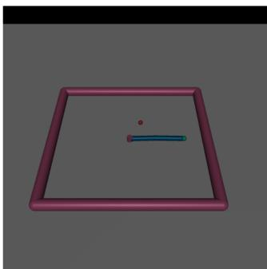

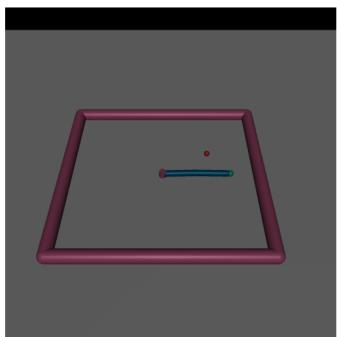  
Figure 4: Example goal shift in Reacher. Left: the original environment. Right: the perturbed environment with a shifted goal.

where $\delta$ is drawn from a Gaussian distribution whose mean (the reward-shift radius) varies across conditions, while the variance is fixed to 0.1. We found performance to be largely insensitive to this variance choice, so we keep it fixed and vary only the mean.

For Reacher, we relocate the goal to a random position at varying distances from its nominal location during evaluation [27]. Figure 4 illustrates the original Reacher environment and an example perturbed setting with a shifted goal.

## D.4 Implementation Details for Ablation Study

To isolate the contribution of our Ω∗-aligned canonicalization, we compare against several alternative projection choices. First, we include a random Φ variant, where the potential network $\Phi _ { \varphi }$ is kept at its random initialization $( \mathrm { i . e . , } \varphi$ is not trained). Second, we include an $L ^ { 2 }$ projection baseline that ignores the geometry induced by the uncertainty set and instead defines $\Omega ^ { * }$ as a squared $\ell _ { 2 }$ norm. Concretely, for both the entropy and KL settings, this corresponds to fitting $\Phi _ { \varphi } \ : \mathrm { b y }$

$$
\varphi ^ { * } \in \arg \operatorname* { m i n } _ { \varphi } \ l ( \varphi ) : = \mathbb { E } _ { \mathcal { D } } \left[ \sum _ { t = 0 } ^ { \infty } \gamma ^ { t } \left( r ( s _ { t } , a _ { t } , s _ { t + 1 } ) - \left( \gamma \Phi _ { \varphi } ( s _ { t + 1 } ) - \Phi _ { \varphi } ( s _ { t } ) \right) \right) ^ { 2 } \right] .
$$

We estimate the objective using a batch dataset $\mathcal { D }$ of $N$ on-policy trajectories:

$$
\widehat { l } ( \varphi ; \mathcal { D } ) = \frac { 1 } { N } \sum _ { i = 1 } ^ { N } \sum _ { t = 0 } ^ { T _ { i } - 1 } \gamma ^ { t } \Big ( r ^ { ( i ) } \big ( s _ { t } , a _ { t } , s _ { t + 1 } \big ) - \big ( \gamma \Phi _ { \varphi } \big ( s _ { t + 1 } ^ { ( i ) } \big ) - \Phi _ { \varphi } \big ( s _ { t } ^ { ( i ) } \big ) \big ) \Big ) ^ { 2 } ,
$$

## E Additional Experiment Results

## E.1 Analysis on Non-convex Uncertainty Set

As discussed in the main text, when the adversary searches for a worst-case reward directly in the original reward space, it may spend many iterations moving along PBRS-invariant directions that do not change policy ranking. This issue is particularly acute for non-convex uncertainty sets (e.g., unions of scenarios) or implicitly specified feasible sets, where there may be no efficient dedicated solver for the optimization, and one must resort to black-box procedures (random search, Bayesian optimization, etc.) [106, 107, 108, 109, 110]. Such methods typically suffer from sample complexity that scales badly with the dimension. Our shaping-aware projection reduces the intrinsic search dimension by removing PBRS-invariant directions, which can substantially improve the efficiency of black-box adversary search.

To illustrate, consider the same toy setting as in the main text in Figure 1 and define a non-convex uncertainty set as the union of K thin diagonal bands:

$$
\mathcal { U } = \bigcup _ { k = 1 } ^ { K } \left\{ ( r _ { 1 } , r _ { 2 } ) \in [ 0 , 1 ] ^ { 2 } \ : \ \left| ( r _ { 1 } - r _ { 2 } ) - \delta _ { k } \right| \leq \eta \right\} .
$$

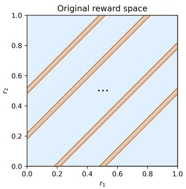  
Figure 5: Illustration of a nonconvex uncertainty set.

When η is small, U consists of K narrow strips aligned with the PBRS-invariant (1, 1) direction (Figure 5). The union of several scenarios makes the feasible set highly non-convex. Under the projection that fixes one coordinate $( \mathrm { e . g . , } r _ { 2 } ^ { \mathrm { c o r e } } = 0 )$ , the set collapses to a one-dimensional union of intervals:

$$
\mathcal { U } _ { \mathrm { c o r e } } = \bigcup _ { k = 1 } ^ { K } [ \delta _ { k } - \eta , \ : \delta _ { k } + \eta ] \ : \subset \ : [ - 1 , 1 ] .
$$

Thus, projection removes the long PBRS-invariant direction, retaining only the behaviorally relevant coordinate.

Now suppose the adversary can only query feasible rewards. In the original two-dimensional set $\mathcal { U } , \mathfrak { a }$ generic black-box exploration strategy will nevertheless allocate evaluations across both directions in the ambient space. Since rewards are behaviorally identical along the invariant direction, many of these evaluations are redundant. In contrast, searching over $\mathcal { U } _ { \mathrm { c o r e } }$ allocates all evaluations along the identified coordinate, so each query is informative.

A simple scaling argument makes this difference explicit. Consider a single strip of width 2η. In $\mathcal { U } _ { \mathrm { c o r e } } ,$ choosing one reward that is within ε of the true worst-case reward along the interval requires on the order of

$$
N _ { \mathcal { U } _ { \mathrm { c o r c } } } \approx \frac { 2 \eta } { \varepsilon }
$$

feasible evaluations. In the original reward space, the corresponding strip has area approximately

$$
A \approx ( 2 \eta ) L , \qquad L \approx 1 - | \delta _ { k } |
$$

where L is the length of the diagonal segment inside $[ 0 , 1 ] ^ { 2 }$ . For a two-dimensional space with N points, the typical spacing scales as $h \approx \sqrt { A / N }$ . To obtain comparable ε-level resolution, one needs

$$
N _ { \mathcal { U } } \approx \frac { A } { \varepsilon ^ { 2 } } \approx \frac { 2 \eta L } { \varepsilon ^ { 2 } } .
$$

Therefore, black-box search scales as $\mathcal { O } ( 1 / \varepsilon )$ over $\mathcal { U } _ { \mathrm { c o r e } }$ but $\mathcal { O } ( 1 / \varepsilon ^ { 2 } )$ over U, with the extra factor arising from the algorithm implicitly spending samples to cover the PBRS-invariant direction.

For a numerical illustration, let η = 0.01, δ = 0.2 (so $L \approx 0 . 8 )$ , and $\varepsilon = 1 0 ^ { - 3 }$ . Then

$$
N _ { \mathrm { { \mathscr { u } } _ { \mathrm { c o r e } } } } \approx { \frac { 0 . 0 2 } { 0 . 0 0 1 } } = 2 0 , \qquad N _ { \mathscr { U } } \approx { \frac { 2 \eta L } { \varepsilon ^ { 2 } } } = { \frac { 0 . 0 2 \times 0 . 8 } { 1 0 ^ { - 6 } } } = 1 6 , 0 0 0 .
$$

In the original space, the overwhelming majority of evaluations are effectively spent spreading points along a behaviorally irrelevant direction. After projection, essentially every evaluation contributes to identifying a more adverse reward.

## E.2 Learning Curves on MuJoCo, Atari, and Gymnasium-Robotics Tasks.

Figure 6 and Figure7 compares learning curves for both methods. Overall, our method achieves higher returns throughout training and typically exhibits more stable optimization dynamics. The improvement is especially clear on HalfCheetah, Pong, and Adroit Pen, where the shaping-aware policy stays above the baseline at essentially every timestep and continues to improve late in training, while the baseline progresses more slowly and plateaus earlier. We observe a similar trend on Walker2d and Seaquest: although both methods reach comparable performance in the mid-training regime, the baseline becomes noticeably more volatile later on, whereas our method maintains a higher and more stable return trajectory. Beyond final performance, the curves also show a consistent sample-efficiency advantage. On Reacher, our method reaches near-solved performance almost immediately, while the baseline requires substantially more interaction (on the order of $2 \times 1 0 ^ { 5 }$ timesteps) to catch up. On Hopper and Humanoid, the two methods share similar early-stage trends, but our method converges to a better asymptotic return and tends to reduce training instability as learning proceeds. Taken together, these results indicate that the shaping-aware projection not only improves final performance, but also enables the agent to reach a given performance level with fewer environment interactions, i.e., it converges faster than the standard reward-robust baseline.

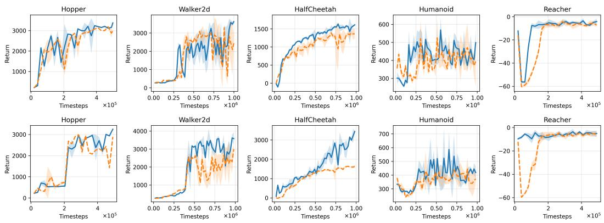  
Figure 6: Mean and standard deviation return of the evaluation policy over 10 rollouts and 5 seeds, reported every 20k environment steps for MuJoCo environment. The return is in terms of the environment’s original reward. Top row: Entropy-based reward-robust problem, bottom row: KLbased reward-robust problem.

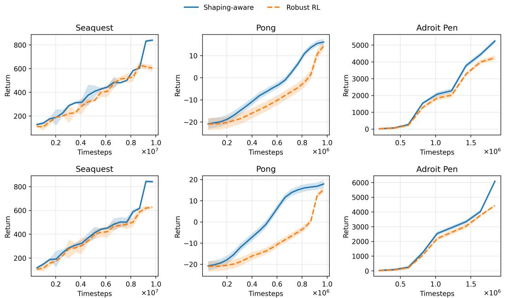  
Figure 7: Mean and standard deviation return of the evaluation policy over 10 rollouts and 5 seeds, reported every 20k environment steps for Atari and Gymnasium-Robotics environment. The return is in terms of the environment’s original reward. Top row: Entropy-based reward-robust problem, bottom row: KL-based reward-robust problem.

## E.3 Reward Robustness Results

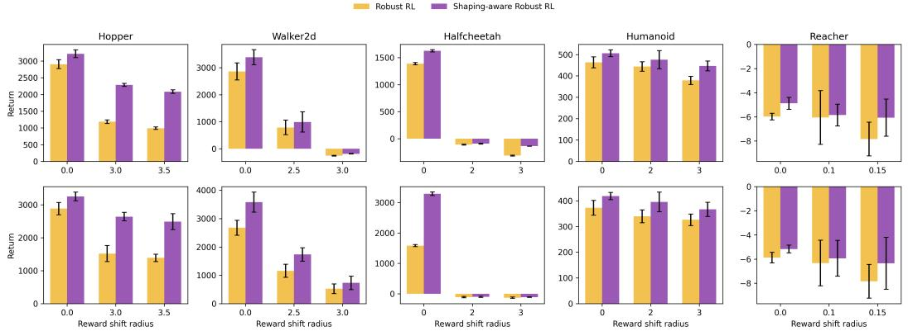  
Figure 8: Mean ± 95% confidence interval return of the evaluation policy under reward perturbation over 100 episodes and 5 seeds. Top row: Entropy-based reward-robust problem, bottom row: KLbased reward-robust problem.

Figure 8 shows the robustness under reward perturbations for both reward-robust problems. Overall, the shaping-aware method exhibits smaller performance degradation than the robust RL baseline as the reward shift radius increases, indicating improved stability to reward misspecification.

## E.4 Analysis on Training Time

Table 6: Approximate training time for each algorithm across different environments.
<table><tr><td>Environment</td><td>Standard Reward-Robust RL</td><td>Shaping-aware Reward-Robust RL</td></tr><tr><td>Hopper</td><td>≈50m</td><td>≈1h</td></tr><tr><td>Walker</td><td>≈1h50m</td><td>≈2h10m</td></tr><tr><td>HalfCheetah</td><td>≈1h30m</td><td>≈1h50m</td></tr><tr><td>Humanoid</td><td>≈1h40m</td><td>≈2h</td></tr><tr><td>Reacher</td><td>≈50m</td><td>≈1h</td></tr><tr><td>Seaquest</td><td>≈5h20m</td><td>≈5h50m</td></tr><tr><td>Pong</td><td>≈1h</td><td>≈1h10m</td></tr><tr><td>Adroit Pen</td><td>≈3h50m</td><td>≈4h20m</td></tr></table>

Table 6 reports the approximate training time for the standard reward-robust baseline and our shapingaware variant. Across all tasks, the shaping-aware method incurs a small additional cost (typically around 10–30 minutes), which is attributable to the extra projection step that fits the potential function. Importantly, this overhead is modest relative to the overall training time (on the order of around 10–25% depending on the environment) and remains practical in the same computational setting. Given the consistent gains in final return and faster convergence observed in Section 5, the added computation is a affordable trade-off for improved robustness and performance.

## E.5 Additional Ablation Study

Sensitivity to data coverage in the projection estimate. As detailed in Appendix D, the Ω∗ term used in our experiments involves a log-sum-exp over actions. Since the action space is continuous, we approximate this quantity via Monte Carlo by sampling K actions (from the policy or the reference policy, depending on the objective). This approximation quality directly affects the projection step.

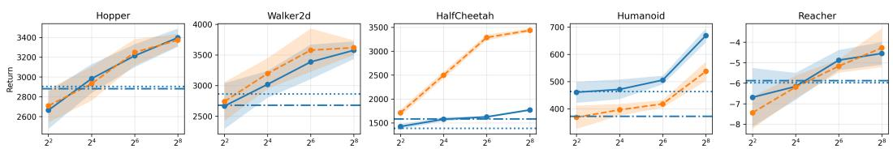  
Number of sampled actions per projection learning estimate  
Figure 9: Ablations on sampled actions for projection learning in MuJoCo environment. We evaluate each policy for 100 episodes and show 95% confidence interval across 5 seeds.

Table 7: Ablation on canonicalization choices under reward perturbations. For Hopper, Walker2d, HalfCheetah, and Humanoid, we use a reward-shift radius of 3. For Reacher, we use a goal-shift radius of 0.1. Results are reported as mean ± 95% confidence interval over 5 random seeds.
<table><tr><td>Method</td><td>Hopper</td><td>Walker2d</td><td>HalfCheetah</td><td>Humanoid</td><td>Reacher</td></tr><tr><td colspan="6">Entropy-based robust objective</td></tr><tr><td>Reward-Robust (baseline)</td><td>1186.66±52.27</td><td>-259.59±16.07</td><td>-313.50±9.73</td><td>378.97±18.90</td><td>-6.05±2.22</td></tr><tr><td>Shaping-aware (ours, Ω*-projection)</td><td>2287.66±44.64</td><td>-188.14±9.26</td><td>-138.06±1.57</td><td>446.41±23.16</td><td>-5.85±0.90</td></tr><tr><td>Shaping-aware (random Φ canonicalization)</td><td>1252.33±43.81</td><td>-226.17±36.72</td><td>-361.70±9.97</td><td>338.29±22.26</td><td>-6.35±2.14</td></tr><tr><td>Shaping-aware  $( L ^ { 2 }$  projection)</td><td>1491.77±37.04</td><td>-199.04±9.37</td><td>-144.56±6.25</td><td>474.09±40.15</td><td>-5.94±1.48</td></tr><tr><td colspan="6">KL-based robust objective</td></tr><tr><td>Reward-Robust (baseline)</td><td>1519.33±241.86</td><td>525.17±171.17</td><td>-128.73±21.13</td><td>325.81±22.22</td><td>-6.33±1.89</td></tr><tr><td>Shaping-aware (ours, Ω*-projection)</td><td>2638.49±129.72</td><td>733.78±238.30</td><td>-110.16±10.06</td><td>366.31±27.34</td><td>-5.94±1.48</td></tr><tr><td>Shaping-aware (random Φ canonicalization)</td><td> $1 2 3 0 . 9 5 { \pm } 1 2 4 . 3 9$ </td><td>446.50±170.87</td><td> $- 1 2 5 . 5 1 \pm 2 1 . 9 8$ </td><td>311.47±15.03</td><td>-6.98±1.92</td></tr><tr><td>Shaping-aware  $( L ^ { 2 }$  projection)</td><td>2016.28±113.72</td><td>693.48±109.97</td><td>-111.75±13.99</td><td>335.10±14.12</td><td>-6.17±1.41</td></tr></table>

When K is small, the estimated projection loss can be noisy or biased, leading to an inaccurate canonicalization and, in turn, degraded downstream learning. To quantify this effect, we vary K across all MuJoCo environments while keeping the rest of the training pipeline fixed, and evaluate the resulting performance. Figure 9 shows a clear dependence on action-sample coverage. With a very small K, our method can underperform the standard reward-robust baselines, consistent with an unreliable estimate of the log-sum-exp term. This is particularly pronounced in Hopper, where a handful of action samples (e.g., K = 4) provides a poor approximation. As K increases, the projection estimate becomes more accurate and performance improves accordingly, eventually recovering and typically exceeding the baseline. Overall, this ablation highlights a practical tradeoff: the gains from shaping-aware projection are realized when the projection loss is estimated with sufficient action coverage, at the cost of additional sampling in the projection-learning step.

Ablation on canonicalization choices To isolate the contribution of our Ω∗-aligned canonicalization, Table 7 compares several projection choices under reward perturbations. First, we include a random Φ variant, which injects an arbitrary PBRS shaping term into the reward. This variant does not yield meaningful robustness improvements, indicating that the gains of our method do not come from simply adding an extra shaping-like component, but from learning a canonicalization that removes PBRS redundancy in a principled way. We also consider an $L ^ { 2 }$ projection that performs orthogonal projection regardless of the uncertainty-set geometry. This variant still removes PBRS-equivalent directions and thus improves robustness relative to the baseline, confirming that redundancy removal alone is beneficial. However, the Ω∗-aligned projection performs better in most cases, suggesting that matching the canonicalization to the robustness geometry provides additional gains under reward perturbations beyond what a generic $L ^ { 2 }$ projection achieves.

## NeurIPS Paper Checklist

## 1. Claims

Question: Do the main claims made in the abstract and introduction accurately reflect the paper’s contributions and scope?

Answer: [Yes]

Justification: The abstract and introduction state the core contributions, which is shapingaware reward-robust RL framework

Guidelines:

• The answer [N/A] means that the abstract and introduction do not include the claims made in the paper.

• The abstract and/or introduction should clearly state the claims made, including the contributions made in the paper and important assumptions and limitations. A [No] or [N/A] answer to this question will not be perceived well by the reviewers.

• The claims made should match theoretical and experimental results, and reflect how much the results can be expected to generalize to other settings.

• It is fine to include aspirational goals as motivation as long as it is clear that these goals are not attained by the paper.

## 2. Limitations

Question: Does the paper discuss the limitations of the work performed by the authors?

Answer: [Yes]

Justification: Limitations of the work is discussed in Appendix A.

Guidelines:

• The answer [N/A] means that the paper has no limitation while the answer [No] means that the paper has limitations, but those are not discussed in the paper.

• The authors are encouraged to create a separate “Limitations” section in their paper.

• The paper should point out any strong assumptions and how robust the results are to violations of these assumptions (e.g., independence assumptions, noiseless settings, model well-specification, asymptotic approximations only holding locally). The authors should reflect on how these assumptions might be violated in practice and what the implications would be.

• The authors should reflect on the scope of the claims made, e.g., if the approach was only tested on a few datasets or with a few runs. In general, empirical results often depend on implicit assumptions, which should be articulated.

• The authors should reflect on the factors that influence the performance of the approach. For example, a facial recognition algorithm may perform poorly when image resolution is low or images are taken in low lighting. Or a speech-to-text system might not be used reliably to provide closed captions for online lectures because it fails to handle technical jargon.

• The authors should discuss the computational efficiency of the proposed algorithms and how they scale with dataset size.

• If applicable, the authors should discuss possible limitations of their approach to address problems of privacy and fairness.

• While the authors might fear that complete honesty about limitations might be used by reviewers as grounds for rejection, a worse outcome might be that reviewers discover limitations that aren’t acknowledged in the paper. The authors should use their best judgment and recognize that individual actions in favor of transparency play an important role in developing norms that preserve the integrity of the community. Reviewers will be specifically instructed to not penalize honesty concerning limitations.

## 3. Theory assumptions and proofs

Question: For each theoretical result, does the paper provide the full set of assumptions and a complete (and correct) proof?

Answer: [Yes]

Justification: All the assumptions and proof can be found in the Appendix.

## Guidelines:

• The answer [N/A] means that the paper does not include theoretical results.

• All the theorems, formulas, and proofs in the paper should be numbered and crossreferenced.

• All assumptions should be clearly stated or referenced in the statement of any theorems.

• The proofs can either appear in the main paper or the supplemental material, but if they appear in the supplemental material, the authors are encouraged to provide a short proof sketch to provide intuition.

• Inversely, any informal proof provided in the core of the paper should be complemented by formal proofs provided in appendix or supplemental material.

• Theorems and Lemmas that the proof relies upon should be properly referenced.

## 4. Experimental result reproducibility

Question: Does the paper fully disclose all the information needed to reproduce the main experimental results of the paper to the extent that it affects the main claims and/or conclusions of the paper (regardless of whether the code and data are provided or not)?

Answer: [Yes]

Justification: All training hyperparameters are specified in Appendix D.

Guidelines:

• The answer [N/A] means that the paper does not include experiments.

• If the paper includes experiments, a [No] answer to this question will not be perceived well by the reviewers: Making the paper reproducible is important, regardless of whether the code and data are provided or not.

• If the contribution is a dataset and/or model, the authors should describe the steps taken to make their results reproducible or verifiable.

• Depending on the contribution, reproducibility can be accomplished in various ways. For example, if the contribution is a novel architecture, describing the architecture fully might suffice, or if the contribution is a specific model and empirical evaluation, it may be necessary to either make it possible for others to replicate the model with the same dataset, or provide access to the model. In general. releasing code and data is often one good way to accomplish this, but reproducibility can also be provided via detailed instructions for how to replicate the results, access to a hosted model (e.g., in the case of a large language model), releasing of a model checkpoint, or other means that are appropriate to the research performed.

• While NeurIPS does not require releasing code, the conference does require all submissions to provide some reasonable avenue for reproducibility, which may depend on the nature of the contribution. For example

(a) If the contribution is primarily a new algorithm, the paper should make it clear how to reproduce that algorithm.

(b) If the contribution is primarily a new model architecture, the paper should describe the architecture clearly and fully.

(c) If the contribution is a new model (e.g., a large language model), then there should either be a way to access this model for reproducing the results or a way to reproduce the model (e.g., with an open-source dataset or instructions for how to construct the dataset).

(d) We recognize that reproducibility may be tricky in some cases, in which case authors are welcome to describe the particular way they provide for reproducibility. In the case of closed-source models, it may be that access to the model is limited in some way (e.g., to registered users), but it should be possible for other researchers to have some path to reproducing or verifying the results.

## 5. Open access to data and code

Question: Does the paper provide open access to the data and code, with sufficient instructions to faithfully reproduce the main experimental results, as described in supplemental material?

## Answer: [Yes]

Justification: The code is included in the supplementary. All data is open accessible.

## Guidelines:

• The answer [N/A] means that paper does not include experiments requiring code.

• Please see the NeurIPS code and data submission guidelines (https://neurips.cc/ public/guides/CodeSubmissionPolicy) for more details.

• While we encourage the release of code and data, we understand that this might not be possible, so [No] is an acceptable answer. Papers cannot be rejected simply for not including code, unless this is central to the contribution (e.g., for a new open-source benchmark).

• The instructions should contain the exact command and environment needed to run to reproduce the results. See the NeurIPS code and data submission guidelines (https: //neurips.cc/public/guides/CodeSubmissionPolicy) for more details.

• The authors should provide instructions on data access and preparation, including how to access the raw data, preprocessed data, intermediate data, and generated data, etc.

• The authors should provide scripts to reproduce all experimental results for the new proposed method and baselines. If only a subset of experiments are reproducible, they should state which ones are omitted from the script and why.

• At submission time, to preserve anonymity, the authors should release anonymized versions (if applicable).

• Providing as much information as possible in supplemental material (appended to the paper) is recommended, but including URLs to data and code is permitted.

## 6. Experimental setting/details

Question: Does the paper specify all the training and test details (e.g., data splits, hyperparameters, how they were chosen, type of optimizer) necessary to understand the results?

Answer: [Yes]

Justification: All details can be found in Appendix D.

Guidelines:

• The answer [N/A] means that the paper does not include experiments.

• The experimental setting should be presented in the core of the paper to a level of detail that is necessary to appreciate the results and make sense of them.

• The full details can be provided either with the code, in appendix, or as supplemental material.

## 7. Experiment statistical significance

Question: Does the paper report error bars suitably and correctly defined or other appropriate information about the statistical significance of the experiments?

Answer: [Yes]

Justification: We report mean ± 95% confidence interval over 5 random seeds.

Guidelines:

• The answer [N/A] means that the paper does not include experiments.

• The authors should answer [Yes] if the results are accompanied by error bars, confidence intervals, or statistical significance tests, at least for the experiments that support the main claims of the paper.

• The factors of variability that the error bars are capturing should be clearly stated (for example, train/test split, initialization, random drawing of some parameter, or overall run with given experimental conditions).

• The method for calculating the error bars should be explained (closed form formula, call to a library function, bootstrap, etc.)

• The assumptions made should be given (e.g., Normally distributed errors).

• It should be clear whether the error bar is the standard deviation or the standard error of the mean.

• It is OK to report 1-sigma error bars, but one should state it. The authors should preferably report a 2-sigma error bar than state that they have a 96% CI, if the hypothesis of Normality of errors is not verified.

• For asymmetric distributions, the authors should be careful not to show in tables or figures symmetric error bars that would yield results that are out of range (e.g., negative error rates).

• If error bars are reported in tables or plots, the authors should explain in the text how they were calculated and reference the corresponding figures or tables in the text.

## 8. Experiments compute resources

Question: For each experiment, does the paper provide sufficient information on the computer resources (type of compute workers, memory, time of execution) needed to reproduce the experiments?

Answer: [Yes]

Justification: All details can be found in Appendix D.

Guidelines:

• The answer [N/A] means that the paper does not include experiments.

• The paper should indicate the type of compute workers CPU or GPU, internal cluster, or cloud provider, including relevant memory and storage.

• The paper should provide the amount of compute required for each of the individual experimental runs as well as estimate the total compute.

• The paper should disclose whether the full research project required more compute than the experiments reported in the paper (e.g., preliminary or failed experiments that didn’t make it into the paper).

## 9. Code of ethics

Question: Does the research conducted in the paper conform, in every respect, with the NeurIPS Code of Ethics https://neurips.cc/public/EthicsGuidelines?

Answer: [Yes]

Justification: The research conforms with the NeurIPS Code of Ethics.

Guidelines:

• The answer [N/A] means that the authors have not reviewed the NeurIPS Code of Ethics.

• If the authors answer [No], they should explain the special circumstances that require a deviation from the Code of Ethics.

• The authors should make sure to preserve anonymity (e.g., if there is a special consideration due to laws or regulations in their jurisdiction).

## 10. Broader impacts

Question: Does the paper discuss both potential positive societal impacts and negative societal impacts of the work performed?

Answer: [N/A]

Justification: This paper presents work whose goal is to advance the field of Machine Learning. There are many potential societal consequences of our work, none which we feel must be specifically highlighted.

Guidelines:

• The answer [N/A] means that there is no societal impact of the work performed.

• If the authors answer [N/A] or [No], they should explain why their work has no societal impact or why the paper does not address societal impact.

• Examples of negative societal impacts include potential malicious or unintended uses (e.g., disinformation, generating fake profiles, surveillance), fairness considerations (e.g., deployment of technologies that could make decisions that unfairly impact specific groups), privacy considerations, and security considerations.

• The conference expects that many papers will be foundational research and not tied to particular applications, let alone deployments. However, if there is a direct path to any negative applications, the authors should point it out. For example, it is legitimate to point out that an improvement in the quality of generative models could be used to generate Deepfakes for disinformation. On the other hand, it is not needed to point out that a generic algorithm for optimizing neural networks could enable people to train models that generate Deepfakes faster.

• The authors should consider possible harms that could arise when the technology is being used as intended and functioning correctly, harms that could arise when the technology is being used as intended but gives incorrect results, and harms following from (intentional or unintentional) misuse of the technology.

• If there are negative societal impacts, the authors could also discuss possible mitigation strategies (e.g., gated release of models, providing defenses in addition to attacks, mechanisms for monitoring misuse, mechanisms to monitor how a system learns from feedback over time, improving the efficiency and accessibility of ML).

## 11. Safeguards

Question: Does the paper describe safeguards that have been put in place for responsible release of data or models that have a high risk for misuse (e.g., pre-trained language models, image generators, or scraped datasets)?

Answer: [N/A]

Justification: The paper poses no such risks.

Guidelines:

• The answer [N/A] means that the paper poses no such risks.

• Released models that have a high risk for misuse or dual-use should be released with necessary safeguards to allow for controlled use of the model, for example by requiring that users adhere to usage guidelines or restrictions to access the model or implementing safety filters.

• Datasets that have been scraped from the Internet could pose safety risks. The authors should describe how they avoided releasing unsafe images.

• We recognize that providing effective safeguards is challenging, and many papers do not require this, but we encourage authors to take this into account and make a best faith effort.

## 12. Licenses for existing assets

Question: Are the creators or original owners of assets (e.g., code, data, models), used in the paper, properly credited and are the license and terms of use explicitly mentioned and properly respected?

Answer: [Yes]

Justification: All assets have been cited.

Guidelines:

• The answer [N/A] means that the paper does not use existing assets.

• The authors should cite the original paper that produced the code package or dataset.

• The authors should state which version of the asset is used and, if possible, include a URL.

• The name of the license (e.g., CC-BY 4.0) should be included for each asset.

• For scraped data from a particular source (e.g., website), the copyright and terms of service of that source should be provided.

• If assets are released, the license, copyright information, and terms of use in the package should be provided. For popular datasets, paperswithcode.com/datasets has curated licenses for some datasets. Their licensing guide can help determine the license of a dataset.

• For existing datasets that are re-packaged, both the original license and the license of the derived asset (if it has changed) should be provided.

• If this information is not available online, the authors are encouraged to reach out to the asset’s creators.

## 13. New assets

Question: Are new assets introduced in the paper well documented and is the documentation provided alongside the assets?

Answer: [N/A]

Justification: The paper does not release new assets.

Guidelines:

• The answer [N/A] means that the paper does not release new assets.

• Researchers should communicate the details of the dataset/code/model as part of their submissions via structured templates. This includes details about training, license, limitations, etc.

• The paper should discuss whether and how consent was obtained from people whose asset is used.

• At submission time, remember to anonymize your assets (if applicable). You can either create an anonymized URL or include an anonymized zip file.

## 14. Crowdsourcing and research with human subjects

Question: For crowdsourcing experiments and research with human subjects, does the paper include the full text of instructions given to participants and screenshots, if applicable, as well as details about compensation (if any)?

Answer: [N/A]

Justification: This work does not involve crowdsourcing or research with human subjects. Guidelines:

• The answer [N/A] means that the paper does not involve crowdsourcing nor research with human subjects.

• Including this information in the supplemental material is fine, but if the main contribution of the paper involves human subjects, then as much detail as possible should be included in the main paper.

• According to the NeurIPS Code of Ethics, workers involved in data collection, curation, or other labor should be paid at least the minimum wage in the country of the data collector.

## 15. Institutional review board (IRB) approvals or equivalent for research with human subjects

Question: Does the paper describe potential risks incurred by study participants, whether such risks were disclosed to the subjects, and whether Institutional Review Board (IRB) approvals (or an equivalent approval/review based on the requirements of your country or institution) were obtained?

Answer: [N/A]

Justification: This work does not involve human subjects research.

Guidelines:

• The answer [N/A] means that the paper does not involve crowdsourcing nor research with human subjects.

• Depending on the country in which research is conducted, IRB approval (or equivalent) may be required for any human subjects research. If you obtained IRB approval, you should clearly state this in the paper.

• We recognize that the procedures for this may vary significantly between institutions and locations, and we expect authors to adhere to the NeurIPS Code of Ethics and the guidelines for their institution.

• For initial submissions, do not include any information that would break anonymity (if applicable), such as the institution conducting the review.

## 16. Declaration of LLM usage

Question: Does the paper describe the usage of LLMs if it is an important, original, or non-standard component of the core methods in this research? Note that if the LLM is used only for writing, editing, or formatting purposes and does not impact the core methodology, scientific rigor, or originality of the research, declaration is not required.

## Answer: [N/A]

Justification: The core method development in this research does not involve LLMs as any important, original, or non-standard components.

## Guidelines:

• The answer [N/A] means that the core method development in this research does not involve LLMs as any important, original, or non-standard components.

• Please refer to our LLM policy in the NeurIPS handbook for what should or should not be described.