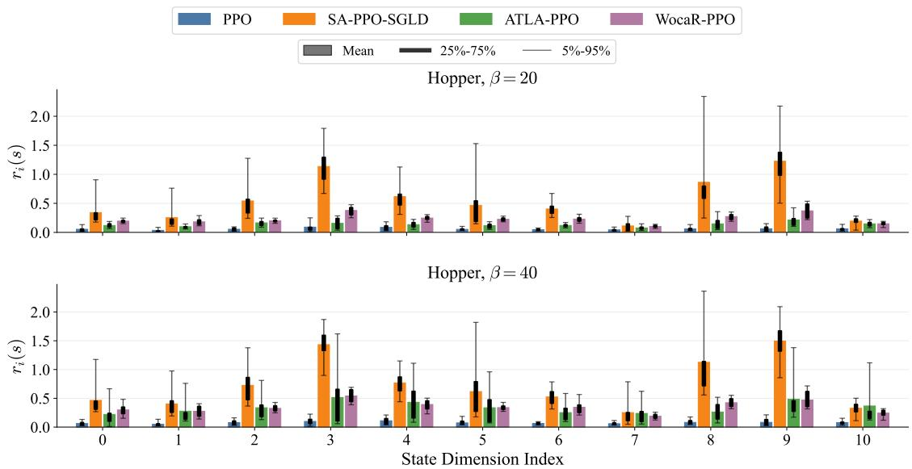
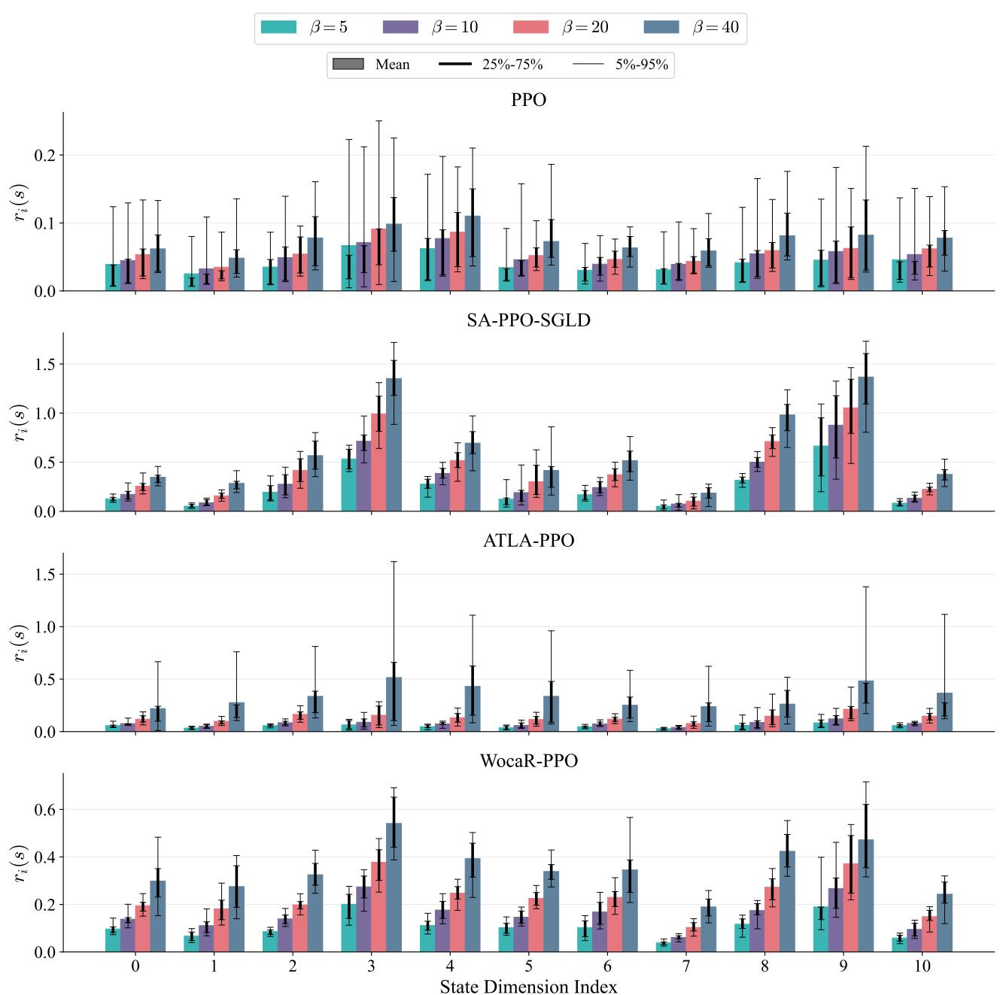

# Beyond L∞-Norm Sets: Synthesizing Interpretable Non-Uniform Uncertainty Sets for Evaluation-Time State-Adversarial Robustness

Xulin Chen, Ruipeng Liu, Garrett E. Katz

Department of Electrical Engineering and Computer Science

Syracuse University

Syracuse, NY 13244 USA

{xchen168,rliu02,gkatz01}@syr.edu

## Abstract

Deep reinforcement learning (DRL) agents are vulnerable to perturbations of their observed state inputs. Prior works often constrain state adversaries with $L _ { p } { \mathrm { - n o r m } }$ uncertainty sets and evaluate policy performance under the resulting perturbations. However, in continuous control tasks like robotics control, diferent state dimensions have distinct physical meanings and influence policy behavior to diferent degrees, which $L _ { p ^ { - } }$ norm sets fail to capture or explain. Moreover, it is important to identify when and along which state dimensions a policy is vulnerable, independently of the algorithm used to train it. In this paper, we focus on evaluation-time attacks applied to pretrained policies. We propose Performance-Degradation Non-Uniform Uncertainty Set (PD-NUUS), an interpretable formulation of uncertainty sets for state perturbations. PD-NUUS is state-dependent, dimension-wise non-uniform, and can be synthesized online during policy evaluation. We first formulate an ideal constrained optimization problem for PD-NUUS computation, then introduce a surrogate constraint to make the problem tractable. Experiments across multiple continuous-control environments, policy algorithms, and state attacks show that PD-NUUS reveals variation in policy sensitivity across states and dimensions, while its performance degradation is moderately controlled.

## 1 Introduction

Deep reinforcement learning (DRL) has achieved remarkable success in complex control problems, including robotics and autonomous driving. However, even well-trained policies may remain vulnerable to perturbations in observed states, transition dynamics, or action execution, which substantially degrade policy performance and cause unsafe behavior. Improving policy robustness against these perturbations is therefore essential when deploying DRL policies.

In this work, we focus on policy robustness against observed state perturbations in continuous control tasks. While some studies consider more structured formulations (Mandlekar et al. 2017; Everett, Lütjens, and How 2021), prior methods commonly constrain perturbations using an $L _ { \infty ^ { - } }$ norm uncertainty set which assumes a fixed perturbation budget across all states and state dimensions, and then evaluate or optimize the resulting performance degradation (Zhang et al. 2020; Oikarinen et al. 2021; Zhang et al. 2021; Liang et al. 2022). Although convenient, the $L _ { \infty }$ -norm formulation has two important limitations that hinder its interpretability. First, a fixed perturbation budget does not account for variations in policy sensitivity across states and state dimensions. State features can difer substantially in their physical meanings and contributions to policy behavior (see a toy experiment in Table 1). Even perturbations along the same dimension have diferent efects depending on the current state; for example, a robot is more sensitive to perturbations when it is about to fall than when it is stable. Therefore, $L _ { \infty } \mathrm { - n o r m }$ produces insuficiently realistic perturbations that are restrictive in some scenarios but damaging in others. Second, in prior work the perturbation budget is often selected empirically and lacks a direct interpretation in terms of performance degradation. An appropriate budget for one environment or policy-learning algorithm can be unsuitable for another. While some works (Zhang et al. 2020, 2021) show how to design adversarial perturbations within a specified uncertainty set, they rarely explore how to design a policy-specific uncertainty set which controls the resulting performance degradation.

The limitations motivate an interpretable formulation of uncertainty sets. We aim to answer the following question:

Given a policy, what is the largest uncertainty set whose admissible perturbations remain consistent with a predefined tolerance on performance degradation?

Our main contributions are summarized as follows:

• We propose Performance-Degradation Non-Uniform Uncertainty Set (PD-NUUS), a state-dependent and nonuniform uncertainty set for observed state perturbations. Unlike $L _ { \infty } \mathrm { - n o r m }$ , PD-NUUS relates local perturbations to a predefined tolerance on degradation in discounted return, providing a performance-based interpretation of the admissible perturbations.

• We formulate the synthesis of PD-NUUS as a constrained optimization problem, and derive a tractable surrogate constraint that mitigates occupancy shift with a policy divergence regularizer. The resulting closed-form solution can be directly applied to pretrained policies for robustness evaluation without changing the policy update rule.

• Extensive experiments across multiple policy-learning algorithms, environments, and state-adversarial attacks demonstrate that PD-NUUS provides generally reliable performance-level control over the degradation in discounted return.

<table><tr><td rowspan="2">Noise (δ)</td><td colspan="10">State Dimensions</td></tr><tr><td>Hopper</td><td>Torso</td><td></td><td>Joint Angles</td><td></td><td></td><td>Torso Linear Velocities</td><td>Torso Angular</td><td colspan="3">Joint Velocities</td></tr><tr><td></td><td>Height</td><td>Angle</td><td>Thigh</td><td>Leg</td><td>Foot</td><td>X-Axis</td><td>Z-Axis</td><td>Velocity</td><td>Thigh</td><td>Leg</td><td>Foot</td></tr><tr><td>0</td><td></td><td></td><td></td><td></td><td></td><td>3547.9</td><td></td><td></td><td></td><td></td><td></td></tr><tr><td>0.1</td><td>3282.5</td><td>3580.5</td><td>3486.3</td><td>3497.9</td><td>3499.9</td><td>3490.9</td><td>3435.4</td><td>3475.6</td><td>3579.6</td><td>3561.0</td><td>3580.4</td></tr><tr><td>0.2</td><td>2169.2</td><td>3575.7</td><td>3440.7</td><td>3540.5</td><td>3294.4</td><td>3245.6</td><td>3035.1</td><td>3395.5</td><td>3484.2</td><td>3472.8</td><td>2966.1</td></tr><tr><td>0.3</td><td>1501.0</td><td>3468.9</td><td>2918.6</td><td>3153.6</td><td>2632.2</td><td>3217.5</td><td>1967.7</td><td>1627.0</td><td>3373.2</td><td>3342.9</td><td>2523.7</td></tr><tr><td>0.4</td><td>1093.8</td><td>3583.8</td><td>2172.6</td><td>3098.3</td><td>2539.1</td><td>2399.4</td><td>994.7</td><td>414.6</td><td>2895.7</td><td>2896.6</td><td>1744.4</td></tr></table>

Table 1: A toy experiment in which each state dimension is perturbed for a PPO (Schulman et al. 2017) policy trained on Hopper environment. To perturb the i-th state dimension, we apply constant noise, i.e. $s _ { i } \gets s _ { i } + \delta .$ . We report the mean total reward over 20 episodes. For each value of noise $\delta ,$ the most and least robust dimensions are shown in bold and underlined, respectively.

## 2 Related Work

## 2.1 $L _ { p } .$ -Norm Uncertainty Set in Robust RL

Robust reinforcement learning (robust RL) studies how policies maintain reliable performance under perturbations to diferent components of a Markov Decision Process (MDP), including observed states and transition dynamics (Iyengar 2005; Zhang et al. 2020). A single type of $L _ { p } .$ -norm uncertainty set is most widely used to model perturbations. For example, Zhang et al. (2020); Oikarinen et al. (2021); Zhang et al. (2021); Liang et al. (2022) improve policy robustness against state perturbations constrained within a predefined $L _ { \infty } \mathrm { - n o r m }$ set. Pattanaik et al. (2017) constrain adversarial state noise using an $L _ { \mathrm { { 2 } } } \mathrm { { - n o r m } }$ set. Kuang et al. (2022) propose an $L _ { \infty } \mathrm { - n o r m }$ based method to handle dynamics perturbations. Randomized smoothing approaches provide certified policy robustness under L -norm perturbations, although the certification is for a smoothed policy rather than the original policy (Kumar, Levine, and Feizi 2022; Mu et al. 2024).

## 2.2 Non-Uniform Perturbations

Erdemir et al. (2021) introduce non-uniform perturbations for classification and prediction problems, and Wong and Kolter (2020) propose to learn a non-uniform perturbation set with conditional variational autoencoders (CVAEs). For vision-based RL, Sun et al. (2026) employ difusion models to generate realistic perturbations semantically distinct from the original images. In robust MDPs where transition dynamics are perturbed, Petrik and Russel (2019); Zhang, Wang, and Boedecker (2023) optimize the shape of the uncertainty set using value functions, while Behzadian et al. (2021) leverage a percentile-performance criterion. For observed state perturbations, Mandlekar et al. (2017) use the fast gradient method to create adversarial perturbations, and Everett, Lütjens, and How (2021) certify the robustness of action-value function. Additionally, Korkmaz and Brown-Cohen (2023) identify adversarial directions through local quadratic approximations of policy loss, Shen et al. (2020) improve robustness through policy smoothness regularization, and Wu et al. (2021) certify action and cumulativereward robustness through functional smoothing. However, we instead aim to explore how to attack a pretrained policy in a controlled way, and our method constrains the degradation directly in return rather than value functions, motivated by the observation from Beechey, Smith, and Şimşek (2023) that contributions of state features to the value function do not necessarily provide faithful insight into contributions to policy performance.

## 3 Preliminaries

## 3.1 MDP and SA-MDP

We consider tasks with continuous state and action spaces. An MDP is specified by a tuple $( S , \mathcal { A } , P , \rho , R , \gamma )$ , where ${ \mathcal { S } } \subseteq$ $\mathbb { R } ^ { m }$ and ${ \mathcal { A } } \subseteq { \mathcal { R } } ^ { n }$ denote state and action spaces respectively, $P : \mathcal { S } \times \mathcal { A }  \Delta _ { \mathcal { S } }$ is the transition kernel with $\Delta _ { ( \cdot ) }$ denoting the set of probability distributions over the given space, $\rho \in$ $\Delta _ { \mathcal { S } }$ is the initial state distribution, $R : S \times \mathcal { A } \stackrel { . } {  } \mathbb { R }$ is the reward function, and $\gamma \in \mathsf { \Gamma } ( 0 , 1 )$ is the discount factor. A policy $\pi : S  \Delta _ { \mathcal { A } }$ maps each state to a distribution over actions. The discounted return of π is defined as

$$
J ( \pi ) \triangleq \mathbb { E } _ { s _ { 0 } \sim \rho , a _ { t } \sim \pi ( \cdot | s _ { t } ) , s _ { t + 1 } \sim P ( \cdot | s _ { t } , a _ { t } ) } \left[ \sum _ { t = 0 } ^ { \infty } \gamma ^ { t } R ( s _ { t } , a _ { t } ) \right] .\tag{1}
$$

The advantage function $A ^ { \pi } ( s , a )$ quantifies how much better a specific action is compared to the average action in that state. The normalized discounted future state distribution $d ^ { \pi }$ induced by π, also called the occupancy distribution, is defined as

$$
d ^ { \pi } ( s ) \triangleq ( 1 - \gamma ) \sum _ { t = 0 } ^ { \infty } \gamma ^ { t } \operatorname* { P r } ( s _ { t } = s ; \pi , \rho ) .\tag{2}
$$

In this work, we focus on the scenarios in which the policy observes perturbed states. The State-Adversarial Markov Decision Process (SA-MDP) (Zhang et al. 2020) augments the standard MDP with a state adversary $\nu : { \mathcal { S } } \to { \mathcal { S } }$ only for the observed states. The action is predicted by a perturbed policy, while the environment still transitions from the true state s to the next state. Although SA-MDP shows the influence of a state adversary on the Bellman operator during policy training, we only consider policy evaluation.

## 3.2 $L _ { p }$ -Norm Uncertainty Set of State Adversary

The state adversary ν is typically constrained to make the problem well-posed. A common choice is an $L _ { p } .$ -norm ball around each state $s \in S { : }$ That is, $\nu ( s ) \in B ( s )$ , where $B ( s ) \triangleq$ $\{ \hat { s } \in \mathcal { S } | \ | | s - \hat { s } | | _ { p } \leq \epsilon \}$ , and $\epsilon > 0$ controls the perturbation budget. Diferent choices of p-norm correspond to diferent assumptions on the perturbation geometry. A policy observes a perturbed state $\nu ( s )$ sampled from $B ( s )$ and uses $\nu ( s )$ as the basis for selecting an action, though the actual state transition proceeds from the true state s.

## 4 Methodology

## 4.1 Problem Formulation of PD-NUUS

We consider the scenario where a policy is evaluated under observed state perturbations. At each time step, if the policy reaches a state s, then a PD-NUUS is synthesized online around s after which a perturbation is sampled. Given a continuous state space ${ \mathcal { S } } \subseteq \mathbb { R } ^ { m }$ , we define PD-NUUS with a state-dependent budget function $r : \mathcal { S }  [ 0 , r _ { \mathrm { m a x } } ] ^ { m }$

$$
B _ { r } ( s ) \triangleq \left\{ \hat { s } \in \mathcal { S } | \ | s _ { i } - \hat { s } _ { i } | \leq r _ { i } ( s ) , \ i = 1 , \dots , m \right\} .\tag{3}
$$

In other words, a PD-NUUS $B _ { r } ( s )$ augments an $L _ { \infty }$ -norm ball with anisotropic scaling. We leave the correlation of state dimensions for future work. The class of admissible state adversaries induced by a PD-NUUS is denoted as

$$
\mathcal { V } _ { r } \triangleq \{ \nu : \mathscr { S } \to \mathscr { S } | \nu ( s ) \in B _ { r } ( s ) , \forall s \in \mathscr { S } \} ,\tag{4}
$$

and attacking the observed state of a clean policy π with a state adversary $\nu \in \mathcal { V } _ { r }$ induces a new policy $\pi _ { \nu } ( \cdot | s ) =$ $\pi ( \cdot | \nu ( s ) )$ . The synthesis of PD-NUUS is then formulated as a constrained functional optimization problem over $r ( \cdot )$

Uncertainty Set Size as Objective. Since $r _ { i } ( s ) \geq 0$ for all state dimensions, we define the objective $\Phi ( { \boldsymbol \pi } , r )$ as the expected 1-norm of $r ( s )$ over states visited by the policy π:

$$
\begin{array} { r } { \Phi ( \pi , r ) = \mathbb { E } _ { s \sim d ^ { \pi } } \left[ | | r ( s ) | | _ { 1 } \right] = \mathbb { E } _ { s \sim d ^ { \pi } } [ \mathbf { 1 } ^ { \top } r ( s ) ] . } \end{array}\tag{5}
$$

Performance Degradation as Constraint. We constrain the worst-case performance degradation in the expected discounted return. Given a tolerance $\beta > 0$ , all admissible adversaries are required to satisfy

$$
\operatorname* { s u p } _ { \nu \in \mathcal { V } _ { r } } \left[ J ( \pi ) - J ( \pi _ { \nu } ) \right] \leq \beta .\tag{6}
$$

We apply the following performance diference equation which is obtained immediately by setting $\pi ^ { \prime } = \pi _ { \nu }$ in Lemma 6.1 of Kakade and Langford (2002):

$$
J ( \pi ) - J ( \pi _ { \nu } ) = - \frac { 1 } { 1 - \gamma } \mathbb { E } _ { s \sim d ^ { \pi _ { \nu } } , a \sim \pi _ { \nu } } \left[ A ^ { \pi } ( s , a ) \right] .\tag{7}
$$

Therefore, the constraint is equivalent to

$$
\operatorname* { s u p } _ { \nu \in \mathcal { V } _ { r } } - \mathbb { E } _ { s \sim d ^ { \pi _ { \nu } } , a \sim \pi _ { \nu } } [ A ^ { \pi } ( s , a ) ] \leq ( 1 - \gamma ) \beta .\tag{8}
$$

Ideal Problem Formulation. Combining objective and constraint, the formal PD-NUUS synthesis problem is:

$$
\operatorname* { m a x } _ { r } \mathbb { E } _ { s \sim d ^ { \pi } } [ \mathbf { 1 } ^ { \top } r ( s ) ] ,\tag{9}
$$

$$
\mathrm { s . t . } \quad \operatorname* { s u p } _ { \nu \in \mathcal { V } _ { r } } - \mathbb { E } _ { s \sim d ^ { \pi _ { \nu } } , a \sim \pi _ { \nu } } [ A ^ { \pi } ( s , a ) ] \leq ( 1 - \gamma ) \beta .\tag{10}
$$

Ideally, after specifying the hyperparameter $\beta ,$ the optimal solution $r ^ { * } ( s )$ defines PD-NUUS over the visited states such that the worst-case degradation in discounted total return does not exceed $\beta .$ However, directly solving this problem is generally intractable. This is because the constraint contains a state adversary $\nu ,$ which has no explicit expression but is only known to be constrained. Although $\pi _ { \nu }$ can be approximated through a Taylor expansion, accurately computing $d ^ { \pi _ { \nu } }$ generally requires both knowledge of the environment dynamics and an explicitly specified $\pi _ { \nu } .$ . Alternatively, $d ^ { \pi _ { \nu } }$ may be estimated from trajectories sampled by $\pi _ { \nu } ,$ but repeating this process throughout the optimization is computationally expensive. Moreover, unlike prior works on policy optimization (Schulman et al. 2015; Achiam et al. 2017; Schulman et al. 2017) which typically assume $d ^ { \pi _ { \nu } } \approx d ^ { \pi }$ to guarantee policy improvement within constrained policy change, our formulation admits substantially perturbed policies, especially when $\beta$ is large. This implies $d ^ { \pi _ { \nu } }$ may difer considerably from $d ^ { \pi }$

## 4.2 Approximate Closed-Form Solution

Surrogate Constraint for Intractable $d ^ { \pi _ { \nu } }$ . Inspired by the divergence regularizer in ofline RL (Wu, Tucker, and Nachum 2019), we replace the LHS of Eq. (10) by a surrogate

$$
\operatorname* { s u p } _ { \nu \in \mathcal { V } _ { r } } - \mathbb { E } _ { s \sim d ^ { \pi } } [ \mathbb { E } _ { a \sim \pi _ { \nu } } [ A ^ { \pi } ( s , a ) ] - \alpha D _ { \mathrm { K L } } ( \pi _ { \nu } | | \pi ) [ s ] ] ,\tag{11}
$$

where a constant $\alpha > 0$ controls the strength of the Kullback–Leibler (KL) divergence penalty. In ofline ${ \mathrm { R L } } ,$ such regularization handles occupancy shift by encouraging the learned policy to locally stay close to the behavior policy. In our setting, we use this approach to penalize state adversaries that induce large deviations between $\pi _ { \nu }$ and π. The following lemma motivates the calibration of α.

Lemma 1 (Proof in Appendix A.1). Assume that a transition kernel is $L _ { P } – L i p s c h i t z$ continuous w.r.t the action: $| | P ( \cdot | s , a _ { 1 } ) - P ( \cdot | s , a _ { 2 } ) | | _ { 1 } \leq L _ { P } | | a _ { 1 } - a _ { 2 } | | _ { 1 }$ for all $s \in S$ and for all $a _ { 1 } , a _ { 2 } \in { \mathcal { A } } ,$ and a stochastic $p o l i c y ~ \pi ~ i s ~ L _ { \pi } .$ Lipschitz continuous from states to action distributions: $\bar { W _ { 1 } } ( \pi ( \cdot | s _ { 1 } ) , \pi ( \cdot | s _ { 2 } ) ) \leq L _ { \pi } | | s _ { 1 } - s _ { 2 } | | _ { \infty }$ for all $s _ { 1 } , s _ { 2 } \in S$ where $W _ { 1 }$ is the 1-Wasserstein distance induced by the $L _ { 1 } -$ norm on the action space A. Then for any state adversary $\nu \in \mathcal { V } _ { r }$

$$
D _ { T V } ( d ^ { \pi } , d ^ { \pi _ { \nu } } ) \leq \frac { \gamma L _ { P } L _ { \pi } r _ { \operatorname* { m a x } } } { 2 ( 1 - \gamma ) } .\tag{12}
$$

Although $D _ { \mathrm { T V } } ( d ^ { \pi } , d ^ { \pi _ { \nu } } )$ is over the entire state space and the Lipschitz assumption on transition dynamics is often violated in continuous control tasks, Lemma 1 indicates that the occupancy shift can depend on both the policy sensitivity and environment dynamics. This observation motivates calibrating α separately for each environment and policy algorithm. In practice, we determine α empirically according to diagnostics obtained from trajectories sampled by $\pi ,$ and keep it fixed throughout the synthesis and evaluation of PD-NUUS. We also provide an ${ \dot { O ( \alpha ^ { - 1 } ) } }$ upper bound on the possible violation of the prescribed degradation tolerance $\beta .$ . Increasing α reduces this upper bound, although it does not necessarily make the actual degradation decrease monotonically.

Lemma 2 (Proof in Appendix $\mathbf { A } . 2 )$ . Consider a fixed policy $\pi , \gamma \in ( 0 , 1 )$ , and $\alpha , \beta > 0 .$ . After using the surrogate constraint in Eq. (11), the supremum degradation ofdiscounted return satisfies thefollowing upper bound

$$
\operatorname* { s u p } _ { \nu \in \mathcal { V } _ { r } } \left[ J ( \pi ) - J ( \pi _ { \nu } ) \right] - \beta \leq \frac { \gamma ^ { 2 } ( \operatorname* { m a x } _ { s , a } | A ^ { \pi } ( s , a ) | ) ^ { 2 } } { 2 \alpha ( 1 - \gamma ) ^ { 3 } } .\tag{13}
$$

Reformulation with a Convex Quadratic Constraint. The detailed derivation is provided in Appendix B. To express Eq. (11) more directly in terms of $r ( s )$ , we approximate the perturbed policy $\pi _ { \nu }$ using a second-order Taylor expansion, and approximate the local KL divergence $D _ { \mathrm { K L } } ( \dot { \pi } _ { \nu } | | \pi ) [ s ]$ using the state Fisher information matrix. Letting $\delta ( s ) = \nu ( s ) - s ,$ the resulting supremum over $\nu \in \mathcal { V } _ { r }$ becomes

$$
\operatorname* { s u p } _ { \delta \colon | \delta _ { i } ( s ) | \leq r _ { i } ( s ) } \left\{ { \frac { 1 } { 2 } } \delta ( s ) ^ { \top } H _ { \pi , \alpha } ( s ) \delta ( s ) - g _ { \pi } ( s ) ^ { \top } \delta ( s ) \right\} ,\tag{14}
$$

where

$$
\begin{array} { r l } & { H _ { \pi , \alpha } ( s ) = \alpha \mathbb { E } _ { a \sim \pi } [ \nabla _ { s } \log \pi ( a | s ) \nabla _ { s } \log \pi ( a | s ) ^ { \top } ] } \\ & { \quad - \mathbb { E } _ { a \sim \pi } \Big [ A ^ { \pi } ( s , a ) \Big ( \nabla _ { s } \log \pi ( a | s ) \nabla _ { s } \log \pi ( a | s ) ^ { \top } } \\ & { \quad \quad \quad \quad \quad + \nabla _ { s } ^ { 2 } \log \pi ( a | s ) \Big ) \Big ] , } \end{array}\tag{15}
$$

and

$$
g _ { \pi } ( s ) = \mathbb { E } _ { a \sim \pi } [ A ^ { \pi } ( s , a ) \nabla _ { s } \log \pi ( a | s ) ] .\tag{16}
$$

The matrix $H _ { \pi , \alpha } ( s )$ is symmetric but not necessarily positive semidefinite. Consequently, Eq. (14) does not generally admit a simple analytical solution. To obtain a closedform solution, we construct a diagonal positive-definite matrix $M _ { \pi , \alpha } ( s )$ which upper bounds ${ \cal H } _ { \pi , \alpha } ( s )$ in the Loewner order, meaning $M _ { \pi , \alpha } ( s ) \ \succeq \ H _ { \pi , \alpha } ( s )$ . This indicates that $\delta ( s ) ^ { \top } M _ { \pi , \alpha } ( s ) \delta ( s ) \geq \delta ( s ) ^ { \top } H _ { \pi , \alpha } ( s ) \delta ( s )$ holds for every $\delta ( s )$ . We implement $M _ { \pi , \alpha } ( s )$ as a separable quadratic surrogate (SQS) majorization (McGafin and Fessler 2015):

$$
M _ { \pi , \alpha } ( s ) = \mathrm { d i a g } _ { j } \Big \{ \sum _ { i = 1 } ^ { m } \big | [ H _ { \pi , \alpha } ( s ) ] _ { i j } \big | \Big \} + \tau I ,\tag{17}
$$

where $\tau > 0$ is a small ofset. Since $M _ { \pi , \alpha } ( s )$ is diagona with positive diagonal entries, the majorized supremum is separable across dimensions and can be evaluated exactly:

$$
\begin{array} { r l } & { \underset { \delta : | \delta _ { i } ( s ) | \leq r _ { i } ( s ) } { \operatorname* { s u p } } \left\{ \frac { 1 } { 2 } \delta ( s ) ^ { \top } H _ { \pi , \alpha } ( s ) \delta ( s ) - g _ { \pi } ( s ) ^ { \top } \delta ( s ) \right\} } \\ & { \leq \frac { 1 } { 2 } r ( s ) ^ { \top } M _ { \pi , \alpha } ( s ) r ( s ) + | g _ { \pi } ( s ) | ^ { \top } r ( s ) . } \end{array}\tag{18}
$$

We replace the supremum in the surrogate constraint with the upper bound in Eq (18). Although the majorization induces a more conservative solution for $r ( \cdot )$ , it renders the constraint convex and analytically tractable. Finally, we obtain a tractable optimization problem for PD-NUUS with $\beta > 0 \colon$

$$
\begin{array} { r l } { \underset { r } { \operatorname* { m a x } } } & { { } \mathbb { E } _ { s \sim d ^ { \pi } } [ \mathbf { 1 } ^ { \top } r ( s ) ] , } \end{array}\tag{19}
$$

$$
\mathrm { s . t . } \quad \mathbb { E } _ { s \sim d ^ { \pi } } \Big [ \frac { 1 } { 2 } r ( s ) ^ { \top } M _ { \pi , \alpha } ( s ) r ( s )
$$

$$
+ | g _ { \pi } ( s ) | ^ { \top } r ( s ) | \leq ( 1 - \gamma ) \beta ,\tag{20}
$$

$$
0 \leq r _ { i } ( s ) \leq r _ { \operatorname* { m a x } } , \forall s \in \mathcal { S } , i = 1 , \ldots , m .\tag{21}
$$

Algorithm 1: Evaluate a policy with PD-NUUS.   
Input: Policy π, PD-NUUS hyperparameters $\alpha , \beta ,$ observa  
tion attacker $\nu .$   
Output: Trajectories with PD-NUUS synthesized based on   
each visited state.   
1: Pre-sample trajectories with π and estimate κ in Eq. (86).   
2: for each episode do   
3: for time step $t = 1 \dots T$ do   
4: Observe the current true state $s _ { t } .$   
5: Calculate $r ^ { * } ( s _ { t } )$ with Eq. (85).   
6: Create a PD-NUUS $B _ { r } ( s _ { t } )$ in Eq. (58) via $r ^ { * } ( s _ { t } )$   
7: Use attacker ν to sample a perturbed observed state   
$\hat { s } _ { t } \sim B _ { r } ( s _ { t } ) .$   
8: Predict an action: $a _ { t } \sim \pi ( \cdot | \hat { s } _ { t } )$   
9: Step forward with $a _ { t } .$   
10: end for   
11: end for

When the optimal solution $r _ { i } ^ { * } ( s )$ satisfies $0 ~ < ~ r _ { i } ^ { * } ( s ) ~ <$ $r _ { \mathrm { m a x } }$ for every state dimension i, the box constraints are inactive. By complementary slackness, their associate Karush–Kuhn–Tucker (KKT) multipliers vanish and the stationarity condition yields a closed-form solution for $\beta > 0$

$$
r ^ { \ast } ( s ) = M _ { \pi , \alpha } ( s ) ^ { - 1 } \left( \kappa \mathbf { 1 } - | g _ { \pi } ( s ) | \right) ,\tag{22}
$$

where

$$
\kappa = \sqrt { \frac { 2 ( 1 - \gamma ) \beta + \mathbb { E } _ { s ^ { \prime } \sim d ^ { \pi } } [ | g _ { \pi } ( s ^ { \prime } ) | ^ { \top } M _ { \pi , \alpha } ( s ^ { \prime } ) ^ { - 1 } | g _ { \pi } ( s ^ { \prime } ) | ] } { \mathbb { E } _ { s ^ { \prime } \sim d ^ { \pi } } \left[ \mathbf { 1 } ^ { \top } M _ { \pi , \alpha } ( s ^ { \prime } ) ^ { - 1 } \mathbf { 1 } \right] } }\tag{23}
$$

is a global scalar estimated from trajectories collected under the clean policy π, and $g _ { \pi } ( s )$ and $M _ { \pi , \alpha } ( s )$ are defined in Eq. (16) and (17), respectively. We empirically observe that the interior condition is generally satisfied if α is appropriately calibrated. However, when a non-negligible portion of $r _ { i } ( s )$ reaches $r _ { \mathrm { m a x } } ,$ the closed-form solution becomes unreliable. We analyze the failures in Appendix D. The closedform solution leads us to a simple evaluation procedure with PD-NUUS: We first sample trajectories to estimate κ, then evaluate the policy while synthesizing PD-NUUS online at each visited state. Algorithm 1 presents the pseudocode.

## 5 Experimental Results

In this section, we aim to answer the following questions:

• Does PD-NUUS produce diferent perturbation scales for diferent policy algorithms?

<table><tr><td colspan="5">PPO SA-PPO-SGLD ATLA-PPO WocaR-PPO</td></tr><tr><td>Hopper</td><td>0.15</td><td>0.25</td><td>0.0075</td><td>0.2</td></tr><tr><td>HalfCheetah 0.06</td><td></td><td>0.2</td><td>0.02</td><td>0.075</td></tr><tr><td>Walker2d</td><td>0.025</td><td>0.075</td><td>0.05</td><td>0.15</td></tr></table>

Table 2: The coeficient α of the KL divergence regularizer in Eq. (11) for each environment and algorithm during policy evaluation with PD-NUUS.

<table><tr><td rowspan="2">Set</td><td rowspan="2">Parameter Attacker</td><td rowspan="2"></td><td colspan="4">Algorithm</td></tr><tr><td>PPO</td><td> $\mathrm { S A { - } P P O { - } S G L D }$ </td><td>ATLA-PPO</td><td> $\mathrm { W o c a R – P P O }$ </td></tr><tr><td>No Attack</td><td></td><td>一</td><td> $4 2 1 . 5 \pm 5 7 . 5$ </td><td> $3 4 9 . 4 \pm 4 0 . 3$ </td><td> $3 4 5 . 7 \pm 2 4 . 9$ </td><td> $3 3 1 . 4 \pm 1 0 . 4$ </td></tr><tr><td rowspan="10"> $L _ { \infty } \mathrm { - N o r m }$ </td><td> $\epsilon = 0 . 0 5$ </td><td>Random</td><td> $4 1 5 . 0 \pm 4 6 . 7 ( 6 . 5 )$ </td><td> $3 5 0 . 5 \pm 4 0 . 7 ( - 1 . 1 )$ </td><td> $3 4 2 . 9 \pm 2 1 . 0 \ : ( 2 . 8 )$ </td><td> $3 3 1 . 3 \pm 1 0 . 1 ( 0 . 1 )$ </td></tr><tr><td rowspan="3"></td><td>Critic</td><td> $4 0 4 . 7 \pm 7 2 . 6 ( 1 6 . 8 )$ </td><td> $3 5 0 . 4 \pm 3 9 . 3 \ : ( - 1 . 0 )$ </td><td> $3 4 4 . 3 \pm 1 8 . 8 ( 1 . 4 )$ </td><td> $3 3 1 . 6 \pm 1 0 . 7 ( - 0 . 2 )$ </td></tr><tr><td>MAD</td><td> $3 3 6 . 7 \pm 4 7 . 7 ( 8 4 . 8 )$ </td><td> $3 4 9 . 9 \pm 3 7 . 5 ( - 0 . 5 )$ </td><td> $3 3 9 . 1 \pm 2 1 . 4 ( 6 . 6 )$ </td><td> $3 2 8 . 4 \pm 9 . 3 ( 3 . 0 ) $ </td></tr><tr><td>PA-AD</td><td> $3 3 8 . 3 \pm 6 7 . 0 ( 8 3 . 2 )$ </td><td> $3 4 8 . 8 \pm 3 8 . 6 ( 0 . 6 )$ </td><td> ${ \bf 3 1 3 . 1 } \pm 3 8 . 0 \ : ( 3 2 . 6 )$ </td><td> $3 2 4 . 8 \pm 7 . 1 ( 6 . 6 )$ </td></tr><tr><td rowspan="3"> $\epsilon = 0 . 1 0$ </td><td>Random</td><td> $3 8 2 . 9 \pm 4 4 . 2 ( 3 8 . 6 )$ </td><td> $3 5 0 . 6 \pm 3 7 . 9 ( - 1 . 2 )$ </td><td> $3 4 5 . 2 \pm 1 9 . 7 ( 0 . 5 )$ </td><td> $3 2 8 . 2 \pm 9 . 0 ( 3 . 2 ) $ </td></tr><tr><td>Critic</td><td> $3 6 7 . 3 \pm 9 8 . 8 ( 5 4 . 2 )$ </td><td> $3 5 0 . 5 \pm 4 1 . 5 ( - 1 . 1 )$ </td><td> $3 3 4 . 1 \pm 1 7 . 5 ( 1 1 . 6 )$ </td><td> $3 2 9 . 5 \pm 8 . 1 ( 1 . 9 ) $ </td></tr><tr><td>MAD PA-AD</td><td> $2 2 4 . 6 \pm 5 8 . 6 ( 1 9 6 . 9 )$   ${ \bf 1 6 8 . 0 \pm 5 9 . 8 ( 2 5 3 . 5 ) }$ </td><td> $3 4 8 . 2 \pm 4 0 . 0 ( 1 . 2 )$ </td><td> $2 9 3 . 0 \pm 4 2 . 8 ( 5 2 . 7 )$ </td><td> ${ \bf 3 2 2 . 6 \pm 7 . 0 }$  (8.8)</td></tr><tr><td rowspan="3"> $\epsilon = 0 . 1 5$ </td><td></td><td></td><td> $3 4 8 . 0 \pm 4 2 . 6 ( 1 . 4 )$ </td><td> $2 4 3 . 7 \pm 4 4 . 2 ( 1 0 2 . 0 )$ </td><td> $3 2 8 . 4 \pm 8 . 0 ( 3 . 0 ) $ </td></tr><tr><td>Random</td><td> $3 6 8 . 3 \pm 3 6 . 5 ( 5 3 . 2 )$ </td><td> $3 5 1 . 2 \pm 3 8 . 2 ( - 1 . 8 )$ </td><td> $3 3 9 . 6 \pm 2 4 . 5 ( 6 . 1 )$ </td><td> $3 2 6 . 7 \pm 9 . 8 ( 4 . 7 )$ </td></tr><tr><td>Critic MAD</td><td> $3 3 2 . 2 \pm 9 2 . 5 ( 8 9 . 3 )$   $1 6 2 . 1 \pm 5 5 . 2 ( 2 5 9 . 4 )$ </td><td> $3 5 1 . 1 \pm 3 9 . 7 ( - 1 . 7 )$ </td><td> $3 2 1 . 5 \pm 1 5 . 7 ( 2 4 . 2 )$ </td><td> $3 2 9 . 5 \pm 1 0 . 1 $  (1.9)</td></tr><tr><td rowspan="3"> $\epsilon = 0 . 2 0$ </td><td>PA-AD</td><td> ${ \bf 1 0 0 . 3 \pm 4 7 . 7 ( 3 2 1 . 2 ) }$ </td><td> $3 4 4 . 6 \pm 3 7 . 6 ( 4 . 8 )$   $3 3 9 . 7 \pm 2 7 . 3 ( 9 . 7 )$ </td><td> $2 3 2 . 8 \pm 3 9 . 9 ( 1 1 2 . 9 )$   $\mathbf { 1 7 3 . 8 \pm 5 3 . 7 ( 1 7 1 . 9 ) }$ </td><td> $3 1 5 . 3 \pm 8 . 4$  (16.1)  ${ \bf 3 0 0 . 9 \pm 1 7 . 2 }$  (30.5)</td></tr><tr><td>Random</td><td> $3 2 1 . 8 \pm 3 8 . 5 ( 9 9 . 7 )$ </td><td> $3 4 8 . 5 \pm 4 0 . 1 \ : ( 0 . 9 )$ </td><td> $3 2 8 . 3 \pm 2 6 . 3 ( 1 7 . 4 )$ </td><td> $3 2 4 . 3 \pm 8 . 5 ( 7 . 1 )$ </td></tr><tr><td>Critic</td><td> $2 8 0 . 5 \pm 1 0 0 . 5 ( 1 4 1 . 0 )$ </td><td> $3 4 7 . 2 \pm 4 2 . 7 ( 2 . 2 )$ </td><td> $2 9 5 . 5 \pm 1 6 . 0 ( 5 0 . 2 )$ </td><td> $3 2 4 . 7 \pm 1 2 . 2$  (6.7)</td></tr><tr><td rowspan="3"></td><td>MAD</td><td> $1 1 7 . 1 \pm 4 2 . 6 ( 3 0 4 . 4 )$ </td><td> $3 4 2 . 5 \pm 3 8 . 2 ( 6 . 9 )$ </td><td> $1 6 4 . 5 \pm 3 6 . 9 ( 1 8 1 . 2 )$ </td><td> $3 0 3 . 2 \pm 6 . 8 ( 2 8 . 2 )$ </td></tr><tr><td>PA-AD</td><td> $2 2 . 3 \pm 3 3 . 6 ( 3 9 9 . 2 )$ </td><td> $3 3 7 . 8 \pm 4 2 . 7 ( 1 1 . 6 )$ </td><td> ${ \bf 8 6 . 6 \pm 5 5 . 7 ( 2 5 9 . 1 ) }$ </td><td> $2 8 7 . 0 \pm 1 2 . 2 ( 4 4 . 4 )$ </td></tr><tr><td></td><td> $4 2 1 . 2 \pm 6 0 . 9 ( 0 . 3 )$ </td><td> $3 5 0 . 0 \pm 3 9 . 9 ( - 0 . 6 )$ </td><td> $3 4 9 . 8 \pm 2 2 . 7 ( - 4 . 1 ) $ </td><td> $3 3 0 . 1 \pm 1 1 . 9 ( 1 . 3 )$ </td></tr><tr><td rowspan="9">PD-NUUS</td><td rowspan="3"> $\beta = 5$ </td><td>Random</td><td></td><td></td><td></td><td></td></tr><tr><td>Critic MAD</td><td> $4 1 8 . 1 \pm 5 6 . 6 ( 3 . 4 )$   $4 0 9 . 2 \pm 6 5 . 3 \ : ( 1 2 . 3 )$ </td><td> $3 5 0 . 4 \pm 4 1 . 3 ( - 1 . 0 )$ </td><td> $3 5 0 . 2 \pm 2 0 . 1 \ : ( - 4 . 5 )$ </td><td> $3 3 2 . 1 \pm 9 . 4 ( - 0 . 7 )$ </td></tr><tr><td>PA-AD</td><td> $4 1 8 . 2 \pm 6 0 . 8 ( 3 . 3 )$ </td><td> $3 4 9 . 6 \pm 4 1 . 4 ( - 0 . 2 )$ </td><td> $3 4 9 . 4 \pm 2 0 . 0 \ : ( - 3 . 7 )$ </td><td> ${ \bf 3 2 9 . 6 \pm 9 . 2 ( 1 . 8 ) }$ </td></tr><tr><td rowspan="3"> $\beta = 1 0$ </td><td></td><td></td><td> $3 4 6 . 2 \pm 4 1 . 2 ( 3 . 2 )$ </td><td> $3 4 7 . 9 \pm 2 1 . 7 \ : ( - 2 . 2 )$ </td><td> $3 2 9 . 9 \pm 8 . 9 ( $  1.5)</td></tr><tr><td>Random Critic</td><td> $4 1 7 . 6 \pm 5 8 . 1 ( 3 . 9 )$   $4 1 7 . 9 \pm 5 9 . 9 ( 3 . 6 )$ </td><td> $3 4 8 . 3 \pm 4 1 . 2 ( 1 . 1 )$ </td><td> $3 5 0 . 1 \pm 1 9 . 2 ( - 4 . 4 )$ </td><td> $3 3 0 . 4 \pm 9 . 6 ( 1 . 0 ) $ </td></tr><tr><td>MAD</td><td> $4 2 2 . 4 \pm 6 0 . 0 ( - 0 . 9 )$ </td><td> $3 5 1 . 5 \pm 4 0 . 4 ( - 2 . 1 )$   ${ 3 4 8 . 1 \pm 3 8 . 8 ( 1 . 3 ) }$ </td><td> $3 5 1 . 4 \pm 1 8 . 3 ( - 5 . 7 )$   $3 4 6 . 3 \pm 2 3 . 8 ( - 0 . 6 )$ </td><td> $3 3 3 . 4 \pm 1 0 . 3 ( - 2 . 0 )$   $3 2 9 . 2 \pm 1 1 . 4 ( 2 . 2 )$ </td></tr><tr><td rowspan="3"> $\beta = 2 0$ </td><td>PA-AD</td><td> $4 2 4 . 4 \pm 5 8 . 1 ( - 2 . 9 )$ </td><td> $3 4 8 . 6 \pm 3 8 . 8 ( 0 . 8 )$ </td><td> $3 4 4 . 2 \pm 2 1 . 2 \ : ( 1 . 5 )$ </td><td> ${ \bf 3 2 5 . 6 \pm 8 . 6 \ ( 5 . 8 ) }$ </td></tr><tr><td>Random</td><td> $4 0 9 . 3 \pm 5 9 . 1 ( 1 2 . 2 )$ </td><td> $3 4 7 . 7 \pm 3 9 . 3 ( 1 . 7 )$ </td><td> $3 5 0 . 3 \pm 2 1 . 2 ( - 4 . 6 )$ </td><td></td></tr><tr><td>Critic</td><td> $4 1 4 . 8 \pm 6 5 . 6 ( 6 . 7 )$ </td><td> $3 5 0 . 5 \pm 4 0 . 4 ( - 1 . 1 )$ </td><td></td><td> $3 2 9 . 8 \pm 1 0 . 2 ( 1 . 6 )$ </td></tr><tr><td rowspan="3"></td><td>MAD</td><td> $4 1 3 . 9 \pm 6 8 . 6 ( 7 . 6 )$ </td><td> $3 4 6 . 5 \pm 3 6 . 8 ( 2 . 9 )$ </td><td> $3 4 6 . 1 \pm 2 0 . 4 ( - 0 . 4 )$   $3 4 4 . 1 \pm 2 4 . 5 ( 1 . 6 )$ </td><td> $3 3 1 . 4 \pm 1 1 . 2 ( 0 . 0 )$   $3 2 6 . 8 \pm 1 2 . 2 ( 4 . 6 )$ </td></tr><tr><td>PA-AD</td><td> $4 0 4 . 3 \pm 5 4 . 5 ( 1 7 . 2 )$ </td><td> $3 4 5 . 2 \pm 3 8 . 7 ( 4 . 2 )$ </td><td> $3 3 2 . 3 \pm 1 9 . 0 ( 1 3 . 4 )$ </td><td> $3 1 1 . 5 \pm 1 3 . 6 ( 1 9 . 9 )$ </td></tr><tr><td>Random</td><td></td><td></td><td></td><td></td></tr><tr><td rowspan="4"> $\beta = 4 0$ </td><td>Critic</td><td> $4 1 6 . 7 \pm 5 9 . 0 ( 4 . 8 )$ </td><td> $3 4 7 . 1 \pm 3 8 . 1 ( 2 . 3 )$ </td><td> $3 4 9 . 6 \pm 2 0 . 7 \ : ( - 3 . 9 )$ </td><td> $3 2 1 . 3 \pm 1 2 . 8 ( 1 0 . 1 )$ </td></tr><tr><td></td><td> $4 1 3 . 6 \pm 6 0 . 6 ( 7 . 9 )$ </td><td> $3 4 0 . 4 \pm 3 6 . 2 \mathrm { \ : ( 9 . 0 ) }$ </td><td> $3 3 5 . 2 \pm 2 3 . 4 ( 1 0 . 5 )$ </td><td> $3 2 4 . 0 \pm 9 . 1 ( 7 . 4 )$ </td></tr><tr><td>MAD</td><td> $4 0 5 . 4 \pm 6 1 . 6 ( 1 6 . 1 )$ </td><td> $3 3 0 . 2 \pm 2 9 . 4 ( 1 9 . 2 ) $ </td><td> $3 3 5 . 8 \pm 2 4 . 6 ( 9 . 9 )$ </td><td> $3 1 0 . 2 \pm 1 1 . 9 ( 2 1 . 2 )$ </td></tr><tr><td>PA-AD</td><td> $3 8 7 . 3 \pm 6 8 . 3 ( 3 4 . 2 )$ </td><td> $3 2 7 . 0 \pm 4 4 . 3 ( 2 2 . 4 )$ </td><td> ${ \bf 3 1 9 . 6 \pm 1 9 . 1 \ ( 2 6 . 1 ) }$ </td><td> $2 8 7 . 0 \pm 2 4 . 8 ( 4 4 . 4 )$ </td></tr></table>

Table 3: Comparison of $L _ { \infty } \mathrm { - n o r m }$ uncertainty sets and PD-NUUS on HalfCheetah. Each entry reports the discounted return, with degradation in parentheses. The largest degradation across attackers is in bold. The episode rewards of clean policies are 5275.1 ± 1586.0 (PPO), $4 3 2 0 . 3 \pm 6 1 1 . 3 ^ { \circ }$ (SA-PPO-SGLD), 4267.1 ± 854.5 (ATLA-PPO) and 3952.2 ± 566.3 (WocaR-PPO).

• Is β correlated with the empirical worst-case performance degradation, and how does this relationship compare with that of an $L _ { \infty }$ -norm uncertainty set?

report the average results. Since synthesizing PD-NUUS requires estimates of the advantage function $A ^ { \pi } ( s , a )$ , we train an auxiliary advantage network alongside each policy without changing the underlying policy update rule. The discount factor is fixed at $\gamma = 0 . 9 9$ throughout the experiments.

• Does addressing the discrepancy between $d ^ { \pi _ { \nu } }$ and $d ^ { \pi }$ with non-zero α improve the quality of PD-NUUS?

State Attackers. We consider four attackers that perturb the observed states within a given uncertainty set:

## 5.1 Experiment Setup

Algorithms and Environments. We choose PPO (Schulman et al. 2017), SA-PPO-SGLD (Zhang et al. 2020), ATLA-PPO (Zhang et al. 2021), and WocaR-PPO (Liang et al. 2022) for policy training. Except for PPO, all algorithms incorporate dedicated mechanisms for improving robustness against state perturbations. We conduct experiments on Hopper, HalfCheetah, and Walker2d environments from MuJoCo (Todorov, Erez, and Tassa 2012). For each environment and algorithm, we train policies using four random seeds and • Random: Uniformly samples from the uncertainty set.

• Critic (Zhang et al. 2020): Uses projected gradient descent (PGD) to search for an adversarial state that minimizes the state-value function.

• Maximal Action Diference (MAD) (Zhang et al. 2020): A critic-free attack that searches for an adversarial state sˆ by maximizing the KL divergence $D _ { \mathrm { K L } } ( \pi ( \cdot | s ) | | \pi ( \cdot | \hat { s } ) )$ .

• PA-AD (Sun et al. 2022): Formulates state perturbations as a Policy Adversary MDP (PAMDP), where a director learns to select an adversarial action, and an actor finds a feasible state perturbation that induces the desired policy change. An optimal policy of the PAMDP theoretically induces a state adversary that minimizes the clean policy’s expected discounted return.

<table><tr><td rowspan="2">Environment</td><td rowspan="2">Algorithm</td><td colspan="4"> $L _ { \infty } \mathrm { - N o r m }$ </td><td colspan="4">PD-NUUS</td></tr><tr><td> $\epsilon = 0 . 0 5$ </td><td> $\epsilon = 0 . 1 0$ </td><td> $\epsilon = 0 . 1 5$ </td><td> $\epsilon = 0 . 2 0$ </td><td> $\beta = 5$ </td><td> $\beta = 1 0$ </td><td> $\beta = 2 0$ </td><td> $\beta = 4 0$ </td></tr><tr><td rowspan="4">Hopper</td><td>PPO</td><td>52.0</td><td>162.3</td><td>168.9</td><td>198.5</td><td>1.7</td><td>10.0</td><td>2.7</td><td>21.0</td></tr><tr><td>SA-PPO-SGLD</td><td>0.6</td><td>0.6</td><td>0.6</td><td>28.4</td><td>3.9</td><td>5.8</td><td>14.6</td><td>30.8</td></tr><tr><td>ATLA-PPO</td><td>17.3</td><td>78.7</td><td>103.0</td><td>136.8</td><td>1.0</td><td>2.5</td><td>24.5</td><td>127.7</td></tr><tr><td>WocaR-PPO</td><td>1.2</td><td>10.6</td><td>25.7</td><td>151.7</td><td>2.7</td><td>2.4</td><td>9.3</td><td>21.7</td></tr><tr><td rowspan="4">HalfCheetah</td><td>PPO</td><td>84.8</td><td>253.5</td><td>321.2</td><td>399.2</td><td>12.3</td><td>3.9</td><td>17.2</td><td>34.2</td></tr><tr><td>SA-PPO-SGLD</td><td>0.6</td><td>1.4</td><td>9.7</td><td>11.6</td><td>3.2</td><td>1.3</td><td>4.2</td><td>22.4</td></tr><tr><td>ATLA-PPO</td><td>32.6</td><td>102.0</td><td>171.9</td><td>259.1</td><td>-2.2</td><td>1.5</td><td>13.4</td><td>26.1</td></tr><tr><td>WocaR-PPO</td><td>6.6</td><td>8.8</td><td>30.5</td><td>44.4</td><td>1.8</td><td>5.8</td><td>19.9</td><td>44.4</td></tr><tr><td rowspan="4">Walker2d</td><td>PPO</td><td>50.3</td><td>139.0</td><td>162.3</td><td>205.3</td><td>2.8</td><td>7.7</td><td>60.5</td><td>105.6</td></tr><tr><td>SA-PPO-SGLD</td><td>1.0</td><td>23.0</td><td>50.3</td><td>128.9</td><td>16.0</td><td>14.9</td><td>15.4</td><td>128.3</td></tr><tr><td>ATLA-PPO</td><td>49.0</td><td>125.7</td><td>165.1</td><td>191.5</td><td>0.1</td><td>3.2</td><td>7.9</td><td>12.3</td></tr><tr><td>WocaR-PPO</td><td>2.9</td><td>42.3</td><td>135.2</td><td>139.0</td><td>5.6</td><td>1.7</td><td>16.7</td><td>50.0</td></tr></table>

Table 4: Maximum empirical degradation in discounted return, observed among all state attackers for each environment, algorithm and uncertainty set parameter.

According to Zhang et al. (2020); Liang et al. (2022), Random and Critic are weaker than PA-AD and MAD. All four attacks were originally formulated for $L _ { \infty }$ -norm uncertainty sets (Zhang et al. 2020, 2021; Sun et al. 2022; Liang et al. 2022). To adapt them to PD-NUUS, we replace the budget ϵ with $r _ { i } ( s )$ for every state dimension i.

Implementation Details. For PD-NUUS, Table 2 reports the value of α for each environment and algorithm, and we clip the solution $r ( s )$ to [0.001, 2.5]. We parameterize the policy π with a Gaussian distribution $\mathcal { N } ( \bar { \mu } _ { \boldsymbol { \theta } } ( s ) , \Sigma )$ , where µ is a multilayer perceptron for predicting the mean and $\mathbf { \bar { \Sigma } } = \mathrm { d i a g } ( \sigma _ { 1 } ^ { 2 } , \ldots , \mathbf { \bar { \sigma } } _ { n } ^ { 2 } )$ is a diagonal covariance matrix. We exploit this Gaussian policy structure to compute the state Fisher information matrix and approximate the Hessian term in $H _ { \pi , \alpha } ( s )$ in Eq. (68), using a Gauss-Newton approximation. More implementation details are provided in $\mathsf { A p - }$ pendix C.

## 5.2 Empirical Results

$L _ { \infty }$ -Norm vs. PD-NUUS. We report the empirical κ values for synthesizing PD-NUUS in Appendix D. Table 3 compares the empirical degradation in discounted return on HalfCheetah under $L _ { \infty }$ -norm uncertainty sets with $\epsilon \in \lbrace 0 . 0 5 , 0 . 1 , 0 . 1 5 , 0 . 2 \rbrace$ and PD-NUUS with $\beta \ \in$ {5, 10, 20, 40}. Results for Hopper and Walker2d are provided in Appendix D. We use the maximum degradation observed among all attackers as an empirical approximation of the worst-case degradation. As expected, increasing ϵ enlarges the $L _ { \infty }$ -norm uncertainty set and generally admits stronger perturbations. However, the relationship between ϵ and return degradation is highly algorithm-dependent: SA-PPO-SGLD and WocaR-PPO experience substantially smaller degradation than PPO and ATLA-PPO under the same $\epsilon .$ In contrast, the tolerance $\beta$ of PD-NUUS is specified in units of discounted return. The maximum degradation across attackers is better aligned with β than with $\epsilon ,$ and generally remains below or moderately above the tolerance $\beta .$

Tolerance Calibration. Table 4 summarizes the empirical maximum degradation in discounted return among all attackers. Although several failure cases occur when $\beta = 4 0 ,$ PD-NUUS generally provides more reliable control of empirical degradation for diferent algorithms. We next quantitatively evaluate whether the tolerance $\beta$ controls the maximum degradation in Table 4. Requiring the maximum degradation to stay strictly below $\beta$ as in Eq. (6) is too restrictive, because the surrogate constraint, local approximation errors, SQS majorization and finite-horizon trajectories can introduce discrepancies between the predefined and observed degradations. Therefore, we define the relaxed-tolerancefrequency

$$
C ( \tau ) = \frac { 1 } { N } \sum _ { j = 1 } ^ { N } \mathbb { I } [ \Delta \widehat { J } _ { \operatorname* { m a x } , j } \leq ( 1 + \tau ) \beta ] , \tau \geq 0\tag{24}
$$

where $N = 4 8$ is the total number of evaluations with PD-NUUS, $\Delta \hat { J } _ { \mathrm { m a x } , j }$ is the empirical maximum degradation in setting $j ,$ and $\mathbb { I } [ X ] = 1$ if X is true and 0 otherwise. Thus, $C ( \tau )$ denotes the fraction of settings in which the empirical maximum degradation exceeds the tolerance $\beta$ by no more than a relative margin $\tau .$ Table 5 indicates that $\dot { \boldsymbol { \beta } }$ provides informative control over the scale of empirical degradation.

Ablation Study of the KL Divergence Regularizer. We conduct an ablation study to evaluate the role of the KL divergence regularizer in Eq. (11). Omitting the regularizer induces a solution that completely ignores the occupancy shift for any β value (assuming $d ^ { \pi _ { \nu } } \approx d ^ { \pi } )$ . Table 6 shows that the policy performance degrades substantially without the KL divergence regularizer for both $\beta$ values and all algorithms.

  
Figure 1: We report the mean and confidence range of the calculated budget function $r _ { i } ( s )$ for each state dimension across four algorithms and $\bar { \beta } \in \{ 2 0 , 4 0 \}$ on Hopper under PA-AD attack. The statistics are computed over 200 sampled trajectories.

<table><tr><td>T</td><td>0</td><td>0.1</td><td>0.2</td><td>0.25</td></tr><tr><td>C(τ)</td><td>77.08%</td><td>77.08%</td><td>81.25%</td><td>85.42%</td></tr></table>

Table 5: C(τ) values calculated across all PD-NUUS tests.

PD-NUUS Visualization Results. In Figure 1, we visualize the synthesized PD-NUUS budgets $r _ { i } ( s )$ for four algorithms under PA-AD attack. As $\beta$ increases, the budgets generally increase for all algorithms. SA-PPO-SGLD admits larger perturbations than other algorithms nearly for all dimensions. Under PA-AD attack, PD-NUUS at $\dot { \boldsymbol { \beta } } = 4 0$ reduces episode rewards from $3 4 7 1 . 7 \pm 3 9 1 . 7$ to 2489.8 ± 1287.3 for PPO, from $3 2 0 3 . 0 \pm 3 7 8 . 5 \mathrm { t o } 1 1 9 8 . 2 \pm 1 0 8 5 . 3$ for SA-PPO-SGLD, from $3 2 2 7 . 5 \pm 6 3 4 . 9 \tan 9 2 4 . 3 \pm 1 3 2 3 . 3$ for ATLA-PPO, and from $3 3 5 8 . 3 \pm 4 5 2 . 8$ to $1 6 6 3 . 1 \pm 1 0 8 1 . 5$ for WocaR-PPO compared with no attack.

## 6 Limitations and Conclusion

We discuss several limitations of our work here. First, PD-NUUS selects the degradation in expected discounted return as the criterion. However, the discount factor significantly underweight rewards at later time steps. To address this issue, we may extend PD-NUUS to average-return scenarios. In addition, while the surrogate constraint makes the problem tractable, it introduces additional approximations. Finally, in this work we only use PD-NUUS for policy evaluation, and the efects of PD-NUUS on policy training remain unknown. Meanwhile for training, the pre-sampling phase at early training stages may result in unreliable PD-NUUS. Future work should address these concerns for robust policy training.

<table><tr><td rowspan="2">Environment Algorithm</td><td rowspan="2"></td><td colspan="2"> $\beta = 2 0$ </td><td colspan="2"> $\beta = 4 0$ </td></tr><tr><td>w/</td><td>w/o</td><td>w/</td><td>w/o</td></tr><tr><td rowspan="3">Hopper</td><td>PPO</td><td>2.7</td><td>228.7</td><td>21.0</td><td>241.4</td></tr><tr><td>SA-PPO-SGLD</td><td>14.6</td><td>55.0</td><td>30.8</td><td>72.4</td></tr><tr><td>ATLA-PPO WocaR-PPO</td><td>24.5 9.3</td><td>128.1 134.5</td><td>127.7 21.7</td><td>176.7</td></tr><tr><td rowspan="4">HalfCheetah</td><td>PPO</td><td>17.2</td><td>285.3</td><td>34.2</td><td>183.2 341.7</td></tr><tr><td>SA-PPO-SGLD</td><td>4.2</td><td>112.8</td><td>22.4</td><td>151.5</td></tr><tr><td>ATLA-PPO</td><td>13.4</td><td>245.1</td><td>26.1</td><td>284.3</td></tr><tr><td>WocaR-PPO</td><td>19.9</td><td>129.4</td><td>44.4</td><td>157.5</td></tr><tr><td rowspan="4">Walker2d</td><td>PPO</td><td>60.5</td><td>256.0</td><td>105.6</td><td>273.4</td></tr><tr><td>SA-PPO-SGLD</td><td>15.4</td><td>252.9</td><td>128.3</td><td>251.9</td></tr><tr><td>ATLA-PPO</td><td>7.9</td><td>211.5</td><td>12.3</td><td>232.5</td></tr><tr><td>WocaR-PPO</td><td>16.7</td><td>218.7</td><td>50.0</td><td>203.4</td></tr></table>

Table 6: Empirical degradation $J ( \pi ) - J ( \pi _ { \nu } )$ in discounted total returns using PD-NUUS with (w/) and without (w/o) the KL divergence regularizer. With regularization, we report the maximum empirical degradation across four attackers; without regularization $( \alpha = 0 )$ , we report degradation under PA-AD. Even under this conservative comparison, degradation without regularization substantially exceeds $\beta .$

In summary, we introduce PD-NUUS, an interpretable uncertainty set formulation for observed state perturbations. By formulating its synthesis as a constrained optimization problem, we derive an eficient closed-form solution for analyzing policy robustness. In empirical results, PD-NUUS provides anisotropic uncertainty sets with generally constrained performance degradation.

## References

Achiam, J.; Held, D.; Tamar, A.; and Abbeel, P. 2017. Constrained policy optimization. In International conference on machine learning, 22–31. PMLR.

Beechey, D.; Smith, T. M.; and Şimşek, Ö. 2023. Explaining reinforcement learning with shapley values. In International Conference on Machine Learning, 2003–2014. PMLR.

Behzadian, B.; Russel, R. H.; Petrik, M.; and Ho, C. P. 2021. Optimizing percentile criterion using robust MDPs. In International Conference on Artificial Intelligence and Statistics, 1009–1017. PMLR.

Erdemir, E.; Bickford, J.; Melis, L.; and Aydore, S. 2021. Adversarial robustness with non-uniform perturbations. Advances in Neural Information Processing Systems, 34: 19147–19159.

Everett, M.; Lütjens, B.; and How, J. P. 2021. Certifiable robustness to adversarial state uncertainty in deep reinforcement learning. IEEE Transactions on Neural Networks and Learning Systems, 33(9): 4184–4198.

Iyengar, G. N. 2005. Robust dynamic programming. Mathematics ofOperations Research, 30(2): 257–280.

Kakade, S.; and Langford, J. 2002. Approximately optimal approximate reinforcement learning. In Proceedings of the nineteenth international conference on machine learning, 267–274.

Korkmaz, E.; and Brown-Cohen, J. 2023. Detecting adversarial directions in deep reinforcement learning to make robust decisions. In International Conference on Machine Learning, 17534–17543. PMLR.

Kuang, Y.; Lu, M.; Wang, J.; Zhou, Q.; Li, B.; and Li, H. 2022. Learning robust policy against disturbance in transition dynamics via state-conservative policy optimization. In Proceedings of the AAAI Conference on Artificial Intelligence, volume 36, 7247–7254.

Kumar, A.; Levine, A.; and Feizi, S. 2022. Policy Smoothing for Provably Robust Reinforcement Learning. In International Conference on Learning Representations (ICLR).

Liang, Y.; Sun, Y.; Zheng, R.; and Huang, F. 2022. Eficient adversarial training without attacking: Worst-case-aware robust reinforcement learning. Advances in neural information processing systems, 35: 22547–22561.

Mandlekar, A.; Zhu, Y.; Garg, A.; Fei-Fei, L.; and Savarese, S. 2017. Adversarially robust policy learning: Active construction of physically-plausible perturbations. In 2017 IEEE/RSJ International Conference on Intelligent Robots and Systems (IROS), 3932–3939. IEEE.

Mao, Y.; Qu, Y.; Wang, Q.; and Ji, X. 2026. Adaptive neighborhood-constrained q learning for ofline reinforcement learning. Advances in Neural Information Processing Systems, 38: 26008–26041.

McGafin, M. G.; and Fessler, J. A. 2015. Algorithmic design of majorizers for large-scale inverse problems. arXiv preprint arXiv:1508.02958.

Mu, R.; Marcolino, L. S.; Zhang, Y.; Zhang, T.; Huang, X.; and Ruan, W. 2024. Reward certification for policy smoothed

reinforcement learning. In Proceedings of the AAAI confer ence on artificial intelligence, volume 38, 21429–21437.

Oikarinen, T.; Zhang, W.; Megretski, A.; Daniel, L.; and Weng, T.-W. 2021. Robust deep reinforcement learning through adversarial loss. Advances in Neural Information Processing Systems, 34: 26156–26167.

Pattanaik, A.; Tang, Z.; Liu, S.; Bommannan, G.; and Chowdhary, G. 2017. Robust deep reinforcement learning with adversarial attacks. arXiv preprint arXiv:1712.03632.

Petrik, M.; and Russel, R. H. 2019. Beyond confidence regions: Tight bayesian ambiguity sets for robust mdps. Advances in neural information processing systems, 32.

Schulman, J.; Levine, S.; Abbeel, P.; Jordan, M.; and Moritz, P. 2015. Trust region policy optimization. In International conference on machine learning, 1889–1897. PMLR.

Schulman, J.; Wolski, F.; Dhariwal, P.; Radford, A.; and Klimov, O. 2017. Proximal policy optimization algorithms. arXiv preprint arXiv:1707.06347.

Shen, Q.; Li, Y.; Jiang, H.; Wang, Z.; and Zhao, T. 2020. Deep reinforcement learning with robust and smooth policy. In International Conference on Machine Learning, 8707– 8718. PMLR.

Sun, X.; Liu, F.; Ding, Z.; and Zheng, Z. 2026. Difusion Guided Adversarial State Perturbations in Reinforcement Learning. Advances in Neural Information Processing Systems, 38: 43780–43815.

Sun, Y.; Zheng, R.; Liang, Y.; and Huang, F. 2022. Who Is the Strongest Enemy? Towards Optimal and Eficient Evasion Attacks in Deep RL. In International Conference on Learning Representations.

Todorov, E.; Erez, T.; and Tassa, Y. 2012. Mujoco: A physics engine for model-based control. In 2012 IEEE/RSJ international conference on intelligent robots and systems, 5026– 5033. IEEE.

Wong, E.; and Kolter, J. Z. 2020. Learning perturbation sets for robust machine learning. arXiv preprint arXiv:2007.08450.

Wu, F.; Li, L.; Huang, Z.; Vorobeychik, Y.; Zhao, D.; and Li, B. 2021. Crop: Certifying robust policies for reinforcement learning through functional smoothing. arXiv preprint arXiv:2106.09292.

Wu, Y.; Tucker, G.; and Nachum, O. 2019. Behavior regularized ofline reinforcement learning. arXiv preprint arXiv:1911.11361.

Zhang, H.; Chen, H.; Boning, D. S.; and Hsieh, C.-J. 2021. Robust Reinforcement Learning on State Observations with Learned Optimal Adversary. In International Conference on Learning Representations.

Zhang, H.; Chen, H.; Xiao, C.; Li, B.; Liu, M.; Boning, D.; and Hsieh, C.-J. 2020. Robust deep reinforcement learning against adversarial perturbations on state observations. Advances in Neural Information Processing Systems, 33: 21024–21037.

Zhang, Y.; Wang, J.; and Boedecker, J. 2023. Robust reinforcement learning in continuous control tasks with uncertainty set regularization. In Conference on Robot Learning, 1400–1424. PMLR.

## A Proofs

## A.1 Proof of Lemma 1

Lemma 1. Assume that a transition kernel is L -Lipschitz continuous w.r.t the action: $| | P ( \cdot | s , a _ { 1 } ) - P ( \cdot | s , a _ { 2 } ) | | _ { 1 } \ \leq$ $L _ { P } | | a _ { 1 } - a _ { 2 } | | .$ 1 for all $s \in S$ and for all $a _ { 1 } , a _ { 2 } \in { \mathcal { A } } ,$ , and a stochastic policy π is $L _ { \pi } – L i p s c h i t z$ continuous from states to action distributions: $W _ { 1 } ( \pi ( \cdot | s _ { 1 } ) , \pi ( \cdot | s _ { 2 } ) ) \leq \bar { L _ { \pi } } | | s _ { 1 } - s _ { 2 } | | _ { \infty }$ for all $s _ { 1 } , s _ { 2 } \in S$ where $W _ { 1 }$ is the 1-Wasserstein distance induced by the L1-norm on the action space A. Then for any state adversary $\nu \in \mathcal { V } _ { r }$

$$
D _ { T V } ( d ^ { \pi } , d ^ { \pi _ { \nu } } ) \leq \frac { \gamma L _ { P } L _ { \pi } r _ { \operatorname* { m a x } } } { 2 ( 1 - \gamma ) } .\tag{25}
$$

Proof. The proof is motivated by Achiam et al. (2017); Mao et al. (2026). Define

$$
P ^ { \pi } ( s ^ { \prime } | s ) \triangleq \int _ { a \in \mathcal { A } } P ( s ^ { \prime } | s , a ) \pi ( a | s ) d a .\tag{26}
$$

The 1-Wasserstein induced by $L _ { 1 }$ -norm on the action space A is expressed as

$$
W _ { 1 } ( \xi _ { 1 } , \xi _ { 2 } ) \triangleq \operatorname* { i n f } _ { \zeta \in \Gamma ( \xi _ { 1 } , \xi _ { 2 } ) } \int | | a - a ^ { \prime } | | _ { 1 } \zeta ( d a , d a ^ { \prime } ) ,\tag{27}
$$

where $\Gamma ( \xi _ { 1 } , \xi _ { 2 } )$ denotes the set ofcouplings whose marginals are $\xi _ { 1 }$ and $\xi _ { 2 }$ . Then, for any coupling $\bar { \zeta } _ { s } \in \Gamma ( \pi ( \cdot | s ) , \pi _ { \nu } \bar { ( } \cdot | s ) )$ we upper bound the 1-norm distance

$$
| | P ^ { \pi } ( \cdot \mid s ) - P ^ { \pi _ { \nu } } ( \cdot \mid s ) | | _ { 1 }\tag{28}
$$

$$
= \left\| \int _ { A } P ( s ^ { \prime } | s , a ) \pi ( d a | s ) - \int _ { A } P ( s ^ { \prime } | s , a ^ { \prime } ) \pi _ { \nu } ( d a ^ { \prime } | s ) \right\| _ { \mathrm { \scriptsize { J } } }\tag{29}
$$

$$
= \left\| \int _ { A \times A } [ P ( \cdot | s , a ) - P ( \cdot | s , a ^ { \prime } ) ] \zeta _ { s } ( d a , d a ^ { \prime } ) \right\| _ { 1 }\tag{30}
$$

$$
\leq \int _ { \mathcal { A } \times \mathcal { A } } | | P ( \cdot | s , a ) - P ( \cdot | s , a ^ { \prime } ) | | _ { 1 } \zeta _ { s } ( d a , d a ^ { \prime } )\tag{31}
$$

$$
\leq L _ { P } \int _ { A \times A } | | a - a ^ { \prime } | | _ { 1 } \zeta _ { s } ( d a , d a ^ { \prime } ) ,\tag{32}
$$

which holds for every coupling $\zeta _ { s } .$ Besides, for $\nu \in \mathcal V _ { r }$ r we have $| | s - \nu ( s ) | | _ { \infty } \leq | | r ( s ) | | _ { \infty } \leq r _ { \operatorname* { m a x } }$ for $\forall s \in S$ . Taking the infimum over all couplings yields

$$
D _ { \mathrm { T V } } ( P ^ { \pi } ( \cdot  { | } s ) , P ^ { \pi _ { \nu } } ( \cdot  { | } s ) ) \le L _ { P } W _ { 1 } ( \pi ( \cdot | s ) , \pi _ { \nu } ( \cdot | s ) )\tag{33}
$$

$$
\leq L _ { P } L _ { \pi } | | s - \nu ( s ) | | _ { \infty }\tag{34}
$$

$$
\leq L _ { P } L _ { \pi } r _ { \operatorname* { m a x } } .\tag{35}
$$

The occupancy $d ^ { \pi }$ is also expressed as:

$$
d ^ { \pi } ( s ) = ( 1 - \gamma ) \rho + \gamma \int _ { s ^ { \prime } \in S } P ^ { \pi } ( s | s ^ { \prime } ) d ^ { \pi } ( s ^ { \prime } ) d s .\tag{36}
$$

Then

$$
\begin{array} { l } { { \displaystyle d ^ { \pi } ( s ) - d ^ { \pi _ { \nu } } ( s ) } } \\ { { \displaystyle = \gamma \int _ { s ^ { \prime } } \left[ P ^ { \pi } ( s | s ^ { \prime } ) d ^ { \pi } ( s ^ { \prime } ) - P ^ { \pi _ { \nu } } ( s | s ^ { \prime } ) d ^ { \pi _ { \nu } } ( s ^ { \prime } ) \right] d s ^ { \prime } } } \\ { { \displaystyle = \gamma \int _ { s ^ { \prime } } P ^ { \pi } ( s | s ^ { \prime } ) [ d ^ { \pi } ( s ^ { \prime } ) - d ^ { \pi _ { \nu } } ( s ^ { \prime } ) ] d s ^ { \prime } } } \\ { { \displaystyle ~ + \gamma \int _ { s ^ { \prime } } [ P ^ { \pi } ( s | s ^ { \prime } ) - P ^ { \pi _ { \nu } } ( s | s ^ { \prime } ) ] d ^ { \pi _ { \nu } } ( s ^ { \prime } ) d s ^ { \prime } } . } \end{array}
$$

Let $\Delta ( s ) \triangleq d ^ { \pi } ( s ) - d ^ { \pi \nu } ( s )$ then use the triangle inequality

37)

$$
\begin{array} { r l } & { \quad | | \Delta | | _ { 1 } } \\ & { : = \displaystyle \int _ { s } | \Delta ( s ) | d s } \\ & { \le \gamma \displaystyle \int _ { s } \int _ { s ^ { \prime } } p ^ { \pi } ( s | s ^ { \prime } ) | d ^ { \pi } ( s ^ { \prime } ) - d ^ { \pi _ { \nu } } ( s ^ { \prime } ) | d s ^ { \prime } d s } \\ & { \quad \quad + \gamma \displaystyle \int _ { s ^ { \prime } } \int _ { s ^ { \prime } } | P ^ { \pi } ( s | s ^ { \prime } ) - P ^ { \pi _ { \nu } } ( s | s ^ { \prime } ) | d ^ { \pi _ { \nu } } ( s ^ { \prime } ) d s ^ { \prime } d s } \\ & { = \gamma \displaystyle \int _ { s ^ { \prime } } | \Delta ( s ^ { \prime } ) | \Big [ \int _ { s } P ^ { \pi } ( s | s ^ { \prime } ) d s \Big ] d s ^ { \prime } } \\ & { \quad \quad + \gamma \displaystyle \int _ { s ^ { \prime } } d ^ { \pi _ { \nu } } ( s ^ { \prime } ) \Big [ \int _ { s } | P ^ { \pi } ( s | s ^ { \prime } ) - P ^ { \pi _ { \nu } } ( s | s ^ { \prime } ) | d s \Big ] d s ^ { \prime } } \end{array}\tag{38}
$$

(39)

$$
\leq \gamma | | \Delta | | _ { 1 } + \gamma \int _ { s ^ { \prime } } d ^ { \pi _ { \nu } } ( s ^ { \prime } ) | | P ^ { \pi } ( \cdot | s ^ { \prime } ) - P ^ { \pi _ { \nu } } ( \cdot | s ^ { \prime } ) | | _ { 1 } d s ^ { \prime }\tag{40}
$$

$$
\leq \gamma | | \Delta | | _ { 1 } + \gamma \operatorname* { s u p } _ { s ^ { \prime } \in S } | | P ^ { \pi } ( \cdot | s ^ { \prime } ) - P ^ { \pi _ { \nu } } ( \cdot | s ^ { \prime } ) | | _ { 1 } .\tag{41}
$$

This indicates

$$
| | \Delta | | _ { 1 } \leq \frac { \gamma } { 1 - \gamma } \operatorname* { s u p } _ { s ^ { \prime } \in \mathcal { S } } | | P ^ { \pi } ( \cdot | s ^ { \prime } ) - P ^ { \pi _ { \nu } } ( \cdot | s ^ { \prime } ) | | _ { 1 } .\tag{42}
$$

Since $\begin{array} { r } { D _ { \mathrm { T V } } ( d ^ { \pi } , d ^ { \pi _ { \nu } } ) = \frac { 1 } { 2 } | | \Delta | | _ { 1 } } \end{array}$ , from Eq. (35) we get

$$
D _ { \mathrm { T V } } ( d ^ { \pi } , d ^ { \pi _ { \nu } } ) \leq \frac { \gamma } { 2 ( 1 - \gamma ) } \operatorname* { s u p } _ { s ^ { \prime } \in S } | | P ^ { \pi } ( \cdot | s ^ { \prime } ) - P ^ { \pi _ { \nu } } ( \cdot | s ^ { \prime } ) | | _ { 1 }\tag{43}
$$

$$
\leq \frac { \gamma L _ { P } L _ { \pi } r _ { \mathrm { m a x } } } { 2 ( 1 - \gamma ) } .\tag{44}
$$

This completes the proof.

## A.2 Proof of Lemma 2

Lemma 2. Consider a fixed policy $\pi , \ \gamma \ \in \ ( 0 , 1 )$ , and $\alpha , \beta > 0 .$ . After using the surrogate constraint in Eq. (11), the supremum degradation of discounted return satisfies the following upper bound

$$
\operatorname* { s u p } _ { \nu \in \mathcal { V } _ { r } } \left[ J ( \pi ) - J ( \pi _ { \nu } ) \right] - \beta \leq \frac { \gamma ^ { 2 } ( \operatorname* { m a x } _ { s , a } | A ^ { \pi } ( s , a ) | ) ^ { 2 } } { 2 \alpha ( 1 - \gamma ) ^ { 3 } } .\tag{45}
$$

Proof. Fix an arbitrary adversary $\nu \in \mathcal { V } _ { r }$ and denote

$$
\ell _ { \nu } ( s ) = - \mathbb { E } _ { a \sim \pi _ { \nu } ( \cdot | s ) } [ A ^ { \pi } ( s , a ) ] ,\tag{46}
$$

$$
{ \cal K } _ { \nu } = \mathbb { E } _ { s \sim d ^ { \pi } } \left[ D _ { \mathrm { K L } } \big ( \pi _ { \nu } ( \cdot \mid s ) \vert \pi ( \cdot \mid s ) \big ) \right] ,\tag{47}
$$

$$
S _ { \alpha } ( \nu ) = \mathbb { E } _ { s \sim d ^ { \pi } } [ \ell _ { \nu } ( s ) ] + \alpha K _ { \nu } .\tag{48}
$$

Surrogate feasibility implies

$$
S _ { \alpha } ( \nu ) \leq ( 1 - \gamma ) \beta , \forall \nu \in \mathcal { V } _ { r } .\tag{49}
$$

By the performance diference lemma,

$$
J ( \pi ) - J ( \pi _ { \nu } ) = \frac { 1 } { 1 - \gamma } \mathbb { E } _ { s \sim d ^ { \pi _ { \nu } } } [ \ell _ { \nu } ( s ) ] .\tag{50}
$$

Denote $G = \operatorname* { m a x } _ { s , a } \vert A ^ { \pi } ( s , a )$ |, for every $\nu \in \mathcal { V } _ { r }$

$$
\begin{array} { r l } & { \underset { s } { \operatorname* { m a x } } \left| { \mathbb { E } } _ { a \sim \pi _ { \nu } ( \cdot \vert s ) } [ A ^ { \pi } ( s , a ) ] \right| \leq \underset { s } { \operatorname* { m a x } } { \mathbb { E } } _ { a \sim \pi _ { \nu } ( \cdot \vert s ) } \left[ \vert A ^ { \pi } ( s , a ) \vert \right] } \\ & { \qquad \leq \underset { s , a } { \operatorname* { m a x } } \vert A ^ { \pi } ( s , a ) \vert = G . } \end{array}\tag{51}
$$

Applying Corollary 1 and 3 of (Achiam et al. 2017) with $\pi ^ { \prime } = \pi _ { \nu }$ , together with G, gives

$$
\begin{array} { r } { \mathbb { E } _ { s \sim d ^ { \pi _ { \nu } } } [ \ell _ { \nu } ( s ) ] \le \mathbb { E } _ { s \sim d ^ { \pi } } [ \ell _ { \nu } ( s ) ] + C \sqrt { K _ { \nu } } , } \end{array}\tag{52}
$$

where

$$
C = \frac { \sqrt { 2 } \gamma G } { 1 - \gamma } .\tag{53}
$$

For $\alpha > 0$ , Young’s inequality yields

$$
C \sqrt { K _ { \nu } } \leq \alpha K _ { \nu } + \frac { C ^ { 2 } } { 4 \alpha } .\tag{54}
$$

Equivalently, this follows by expanding $( \sqrt { \alpha K _ { \nu } } \textrm { -- }$ $\dot { C / } ( 2 \sqrt { \alpha } ) ) ^ { \bar { 2 } } \geq 0$ . Then

$$
\begin{array} { r l } & { ( 1 - \gamma ) [ J ( \pi ) - J ( \pi _ { \nu } ) ] \leq \mathbb { E } _ { s \sim d ^ { \pi } } [ \ell _ { \nu } ( s ) ] + C \sqrt { K _ { \nu } } } \\ & { \qquad = \mathbb { E } _ { s \sim d ^ { \pi } } [ \ell _ { \nu } ( s ) ] + \alpha K _ { \nu } + \displaystyle \frac { C ^ { 2 } } { 4 \alpha } } \\ & { \qquad \leq S _ { \alpha } ( \nu ) + \displaystyle \frac { C ^ { 2 } } { 4 \alpha } } \\ & { \qquad \leq ( 1 - \gamma ) \beta + \displaystyle \frac { C ^ { 2 } } { 4 \alpha } . } \end{array}\tag{55}
$$

Dividing by $1 - \gamma$ and substituting the definition of $C$ gives

$$
J ( \pi ) - J ( \pi _ { \nu } ) - \beta \leq \frac { \gamma ^ { 2 } G ^ { 2 } } { 2 \alpha ( 1 - \gamma ) ^ { 3 } } .\tag{56}
$$

Since ν was arbitrary and $G$ is independent of the adversary class $\mathcal { V } _ { r }$ , taking the supremum over $\nu \in \mathcal V _ { \ast }$ r proves the lemma.

## B Derivation of a Closed-Form Solution

## B.1 Reformulate the Surrogate Constraint

The original constrained optimization problem is intractable because it relies on $d ^ { \pi _ { \nu } }$ which requires the knowledge of both the transition dynamics and the perturbed policy $\pi _ { \nu }$ , while the exact $\pi _ { \nu }$ is unknown but only known to be constrained by a PD-NUUS $B _ { r } ( s )$ and an admissible set $\mathcal { V } _ { r }$ of state adversary

$$
\mathcal { V } _ { r } \triangleq \{ \nu : \mathscr { S } \to \mathscr { S } | \nu ( s ) \in B _ { r } ( s ) , \forall s \in \mathscr { S } \} ,\tag{57}
$$

$$
B _ { r } ( s ) \triangleq \{ \hat { s } \in \mathcal { S } | \ | s _ { i } - \hat { s } _ { i } | \leq r _ { i } ( s ) , i = 1 , \dots , m \}\tag{58}
$$

We propose a surrogate constraint

$$
\operatorname* { s u p } _ { \nu \in \mathcal { V } _ { r } } - \mathbb { E } _ { s \sim d ^ { \pi } } \left[ \mathbb { E } _ { a \sim \pi _ { \nu } } [ A ^ { \pi } ( s , a ) ] - \alpha D _ { \mathrm { K L } } ( \pi _ { \nu } | | \pi ) [ s ] \right]\tag{59}
$$

to make the problem tractable. This constraint is still dependent on $\nu ,$ and we express it as a function of $r ( s )$

Let $\delta ( s ) = \nu ( s ) - s$ , then the perturbed policy $\pi _ { \nu }$ is approximated by a second-order Taylor expansion

(60)

$$
\begin{array} { r l } & { \quad \pi _ { \nu } ( a \vert s ) } \\ & { = \pi ( a \vert s ) + \nabla _ { s } \pi ( a \vert s ) ^ { \top } \delta ( s ) } \\ & { \qquad + \frac { 1 } { 2 } \delta ( s ) ^ { \top } \nabla _ { s } ^ { 2 } \pi ( a \vert s ) \delta ( s ) + o ( \vert \delta \vert \vert _ { 2 } ^ { 2 } ) } \\ & { \approx \pi ( a \vert s ) \Big [ 1 + \nabla _ { s } \log \pi ( a \vert s ) ^ { \top } \delta ( s ) } \\ & { \qquad + \frac { 1 } { 2 } \delta ( s ) ^ { \top } \Big ( \nabla _ { s } \log \pi ( a \vert s ) \nabla _ { s } \log \pi ( a \vert s ) ^ { \top } } \\ & { \qquad + \nabla _ { s } ^ { 2 } \log \pi ( a \vert s ) \Big ) \delta ( s ) \Big ] . } \end{array}\tag{61}
$$

(62)

The KL divergence is approximated by using the state Fisher information matrix $F _ { \pi } ( s )$

$$
D _ { \mathrm { K L } } ( \pi _ { \nu } | | \pi ) [ s ] \approx \frac { 1 } { 2 } \delta ( s ) ^ { \top } F _ { \pi } ( s ) \delta ( s ) ,\tag{63}
$$

$$
F _ { \pi } ( s ) = \mathbb { E } _ { a \sim \pi } [ \nabla _ { s } \log \pi ( a | s ) \nabla _ { s } \log \pi ( a | s ) ^ { \top } ] .\tag{64}
$$

Since $\mathbb { E } _ { a \sim \pi } [ A ^ { \pi } ( s , a ) ] = 0$ , we get that

$$
\begin{array} { r l } & { \quad \mathbb { E } _ { a \sim \pi _ { \nu } } [ A ^ { \pi } ( s , a ) ] - \alpha D _ { \mathrm { K L } } ( \pi _ { \nu } | | \pi ) [ s ] } \\ & { = \mathbb { E } _ { a \sim \pi } \Big [ \displaystyle \frac { \pi _ { \nu } ( a | s ) } { \pi ( a | s ) } A ^ { \pi } ( s , a ) \Big ] - \alpha D _ { \mathrm { K L } } ( \pi _ { \nu } | | \pi ) [ s ] } \end{array}\tag{65}
$$

$$
\begin{array} { r l } {  { \approx \mathbb { E } _ { a \sim \pi } \Big [ A ^ { \pi } ( s , a ) \nabla _ { s } \log \pi ( a | s ) ^ { \top } \delta ( s ) } } \\ & { \quad + \frac { A ^ { \pi } ( s , a ) } { 2 } \delta ( s ) ^ { \top } \Big ( \nabla _ { s } \log \pi ( a | s ) \nabla _ { s } \log \pi ( a | s ) ^ { \top } } \\ & { \quad + \nabla _ { s } ^ { 2 } \log \pi ( a | s ) \Big ) \delta ( s ) \Big ] - \frac { \alpha } { 2 } \delta ( s ) ^ { \top } F _ { \pi } ( s ) \delta ( s ) \quad ( } \end{array}\tag{66}
$$

$$
= - \frac { 1 } { 2 } \delta ( s ) ^ { \top } H _ { \pi , \alpha } ( s ) \delta ( s ) + g _ { \pi } ( s ) ^ { \top } \delta ( s ) ,\tag{67}
$$

where

$$
\begin{array} { r l } & { H _ { \pi , \alpha } ( s ) = \alpha F _ { \pi } ( s ) - \mathbb { E } _ { a \sim \pi } \Big [ A ^ { \pi } ( s , a ) \Big ( } \\ & { \qquad \nabla _ { s } \log \pi ( a | s ) \nabla _ { s } \log \pi ( a | s ) ^ { \top } + \nabla _ { s } ^ { 2 } \log \pi ( a | s ) \Big ) \Big ] , } \end{array}\tag{68}
$$

and

$$
g _ { \pi } ( s ) = \mathbb { E } _ { a \sim \pi } [ A ^ { \pi } ( s , a ) \nabla _ { s } \log \pi ( a | s ) ] .\tag{69}
$$

Then the surrogate constraint is equivalent to

$$
\mathbb { E } _ { s \sim d ^ { \pi } } \left[ \operatorname* { s u p } _ { \delta ( s ) } \left\{ { \frac { 1 } { 2 } } \delta ( s ) ^ { \top } H _ { \pi , \alpha } ( s ) \delta ( s ) - g _ { \pi } ( s ) ^ { \top } \delta ( s ) \right\} \right]\tag{70}
$$

where $| \delta _ { i } ( s ) | \leq r _ { i } ( s )$ holds for each state dimension i. However, $H _ { \pi , \alpha } ( s )$ is not necessarily positive semidefinite, and if this happens then the problem generally does not have a closed-form solution. To derive a closed-form solution, we construct a positive-definite matrix $M _ { \pi , \alpha }$ satisfying both $M _ { \pi , \alpha } ( s ) \succ 0$ and $M _ { \pi , \alpha } ( s ) \succeq H _ { \pi , \alpha } ( s )$ . This indicates that $\delta ( s ) ^ { \top } M _ { \pi , \alpha } ( s ) \delta ( s ) \geq \delta ( s ) ^ { \top } H _ { \pi , \alpha } ( s ) \delta ( s )$ holds for every $\delta ( s )$ We implement $M _ { \pi , \alpha } ( s )$ using SQS majorization as in Section 4.2. Then we obtain a convex constraint by:

$$
\operatorname* { s u p } _ { \delta ( s ) } \left\{ \frac { 1 } { 2 } \delta ( s ) ^ { \top } H _ { \pi , \alpha } ( s ) \delta ( s ) - g _ { \pi } ( s ) ^ { \top } \delta ( s ) \right\}\tag{71}
$$

$$
\leq \operatorname* { s u p } _ { \delta ( s ) } \left\{ { \frac { 1 } { 2 } } \delta ( s ) ^ { \top } M _ { \pi , \alpha } ( s ) \delta ( s ) - g _ { \pi } ( s ) ^ { \top } \delta ( s ) \right\}\tag{72}
$$

$$
= \frac { 1 } { 2 } r ( s ) ^ { \top } M _ { \pi , \alpha } ( s ) r ( s ) + | g _ { \pi } ( s ) | ^ { \top } r ( s ) .\tag{73}
$$

Finally, the problem of PD-NUUS is reformulated as a tractable constrained problem:

$$
\begin{array} { r l } { \underset { r } { \operatorname* { m a x } } } & { { } \mathbb { E } _ { s \sim d ^ { \pi } } [ \mathbf { 1 } ^ { \top } r ( s ) ] , } \end{array}\tag{74}
$$

$$
\mathrm { s . t . } \quad \mathbb { E } _ { s \sim d ^ { \pi } } \Big [ \frac { 1 } { 2 } r ( s ) ^ { \top } M _ { \pi , \alpha } ( s ) r ( s )
$$

$$
+ | g _ { \pi } ( s ) | ^ { \top } r ( s ) | \leq ( 1 - \gamma ) \beta ,\tag{75}
$$

$$
0 \leq r _ { i } ( s ) \leq r _ { \operatorname* { m a x } } , \forall s \in \mathcal { S } , i = 1 , \ldots , m .\tag{76}
$$

## B.2 Derive a Closed-Form Solution

The Lagrangian is constructed with $\lambda \geq 0 , \eta ( s ) \succeq 0$ and $\xi ( s ) \succeq 0$

$$
\begin{array} { r l } & { \mathcal { L } ( r , \lambda , \eta , \xi ) = - \mathbb { E } _ { s \sim d ^ { \pi } } [ \mathbf { 1 } ^ { \top } r ( s ) ] + \lambda \Big ( \mathbb { E } _ { s \sim d ^ { \pi } } \Big [ } \\ & { \quad \frac { 1 } { 2 } r ( s ) ^ { \top } M _ { \pi , \alpha } ( s ) r ( s ) + \vert g _ { \pi } ( s ) \vert ^ { \top } r ( s ) \Big ] - ( 1 - \gamma ) \beta \Big ) } \\ & { \quad - \mathbb { E } _ { s \sim d ^ { \pi } } [ \eta ( s ) ^ { \top } r ( s ) ] + \mathbb { E } _ { s \sim d ^ { \pi } } [ \xi ( s ) ^ { \top } ( r ( s ) - r _ { \operatorname* { m a x } } ) ] . } \end{array}\tag{77}
$$

When the optimal solution $r _ { i } ^ { * } ( s )$ satisfies $0 < r _ { i } ^ { * } ( s ) < r _ { \operatorname* { m a x } }$ for every state dimension $i ,$ by complementary slackness we have

$$
\eta ( s ) ^ { \top } r ^ { * } ( s ) = 0\tag{78}
$$

$$
\xi ( s ) ^ { \top } ( r ^ { * } ( s ) - r _ { \operatorname* { m a x } } ) = 0\tag{79}
$$

$$
\begin{array} { r l } & { \lambda \Big ( \mathbb { E } _ { s \sim d ^ { \pi } } \Big [ \frac { 1 } { 2 } r ^ { * } ( s ) ^ { \top } M _ { \pi , \alpha } ( s ) r ^ { * } ( s ) } \\ & { \phantom { \frac { 1 } { 2 } } + | g _ { \pi } ( s ) | ^ { \top } r ^ { * } ( s ) \Big ] - ( 1 - \gamma ) \beta \Big ) = 0 } \end{array}\tag{80}
$$

for all sampled states and each state dimension i. Since $0 <$ $r _ { i } ^ { * } ( s ) < r _ { \operatorname* { m a x } }$ , the only solution is that $\eta ( s ) = \xi ( s ) = 0$ Then we diferentiate with respect to $r ( s )$

$$
\frac { \partial \mathcal { L } } { \partial r ( s ) } = - \mathbf { 1 } + \lambda ( M _ { \pi , \alpha } ( s ) r ( s ) + | g _ { \pi } ( s ) | ) .\tag{81}
$$

For the optimal solution $r ^ { * } ( s )$ we have this gradient equals $0 ,$ meaning

$$
\begin{array} { r } { - 1 + \lambda ( M _ { \pi , \alpha } ( s ) r ^ { * } ( s ) + | g _ { \pi } ( s ) | ) = 0 } \end{array}\tag{82}
$$

Since $M _ { \pi , \alpha } ( s ) \succ 0 , r _ { i } ^ { * } ( s ) > 0$ and $| g _ { \pi } ( s ) | \succeq 0 , \lambda = 0$ does not allow this to happen. Therefore, $\lambda > 0$ holds and we

$$
r ^ { * } ( s ) = M _ { \pi , \alpha } ( s ) ^ { - 1 } ( \frac { 1 } { \lambda } \mathbf { 1 } - | g _ { \pi } ( s ) | ) ,\tag{83}
$$

and Eq. (80) is equivalent to

$$
\mathbb { E } _ { s \sim d ^ { \pi } } \Big [ \frac { 1 } { 2 } r ^ { * } ( s ) ^ { \top } M _ { \pi , \alpha } ( s ) r ^ { * } ( s ) + | g _ { \pi } ( s ) | ^ { \top } r ^ { * } ( s ) \Big ] = ( 1 - \gamma ) \beta .\tag{84}
$$

Solving $r ^ { * } ( s )$ in Eq. (83) and (84) derives our closed-form solution

$$
r ^ { \ast } ( s ) = M _ { \pi , \alpha } ( s ) ^ { - 1 } \left( \kappa \mathbf { 1 } - | g _ { \pi } ( s ) | \right) ,\tag{85}
$$

where

$$
\kappa = \sqrt { \frac { 2 ( 1 - \gamma ) \beta + \mathbb { E } _ { s ^ { \prime } \sim d ^ { \pi } } \left[ | g _ { \pi } ( s ^ { \prime } ) | ^ { \top } M _ { \pi , \alpha } ( s ^ { \prime } ) ^ { - 1 } | g _ { \pi } ( s ^ { \prime } ) | \right] } { \mathbb { E } _ { s ^ { \prime } \sim d ^ { \pi } } \left[ \mathbf { 1 } ^ { \top } M _ { \pi , \alpha } ( s ^ { \prime } ) ^ { - 1 } \mathbf { 1 } \right] } } .\tag{86}
$$

However, the closed-form solution is based on $0 < r _ { i } ( s ) <$ $r _ { \mathrm { m a x } } .$ , and we have to calibrate α to guarantee that

$$
0 < M _ { \pi , \alpha } ( s ) ^ { - 1 } \left( \kappa \mathbf { 1 } - | g _ { \pi } ( s ) | \right) < r _ { \operatorname* { m a x } } .\tag{87}
$$

## C Additional Implementation Details

## C.1 Exploit Gaussian Policy for PD-NUUS

In our experiments, the policy is parameterized as a Gaussian distribution $\pi ( \cdot | s ) = \mathcal { N } ( \mu ( s ) , \Sigma )$ where $\mu ( s )$ is a neural network for predicting the mean, and $\Sigma = \mathrm { d i a g } ( \sigma _ { 1 } ^ { 2 } , \dots , \sigma _ { d } ^ { 2 } )$ is a learnable but state-independent diagonal covariance matrix. The terms $H _ { \pi , \alpha } ( s )$ and $g _ { \pi } ( s )$ in Eq. (68) and (69) involve $\nabla _ { s } \log \pi ( a | s )$ , ∇2s log $\pi ( a | s )$ , and $A ^ { \pi } ( s , a )$ in the expectation terms. We leverage the structure of Gaussian policy to avoid explicitly estimating $\nabla _ { s }$ log $\pi ( a | s )$ and $\nabla _ { s } ^ { 2 } \log \pi ( \boldsymbol { a } | s )$ Let $\begin{array} { r } { J _ { \mu } ( s ) = \frac { \partial \mu ( s ) } { \partial s } } \end{array}$ denote the Jacobian matrix of the policy mean w.r.t. the state, our implementation uses

$$
g _ { \pi } ( s ) = { J _ { \mu } } ( s ) ^ { \top } \mathbb { E } _ { a \sim \pi } [ \nabla _ { a } A ^ { \pi } ( s , a ) ]
$$

and

(88)

$$
\begin{array} { c } { { H _ { \pi , \alpha } ( s ) \approx \alpha J _ { \mu } ( s ) ^ { \top } \Sigma ^ { - 1 } J _ { \mu } ( s ) } } \\ { { - J _ { \mu } ( s ) ^ { \top } \mathbb { E } _ { a \sim \pi } [ \nabla _ { a } ^ { 2 } A ^ { \pi } ( s , a ) ] J _ { \mu } ( s ) } } \end{array}\tag{89}
$$

## C.2 Experiment Setup

All experiments were conducted on Quadro RTX 6000 GPU. We build on the oficial implementation of SA-PPO, ATLA-PPO and WocaR-PPO. For all methods, the actor and critic are parameterized by multilayer perceptrons with hidden layers [64, 64], and each policy is trained for $2 \times 1 0 ^ { 6 }$ environment steps. We made two changes compared to the oficial implementation. First, we train an auxiliary advantage network $A ^ { \pi } ( s , a )$ of hidden layers [64, 64] alongside the policy. Second, while the oficial implementation enables reward normalization, we disable it because naively reversing reward normalization on the learned advantage network does not provide reliable advantage estimates. We train each algorithm using four random seeds.

We train each PA-AD attacker for $1 \times 1 0 ^ { 6 }$ environment steps. Its actor and critic use the same MLP architecture, with hidden layers [64, 64], and are both optimized with a learning rate of $3 \times \mathrm { 1 0 ^ { - 4 } }$

## D Additional Experimental Results

Table 7, Table 8 and Table 9 present the discounted total return and the degradation compared to the clean policy under Random, Critic, MAD and PA-AD attackers on Hopper, HalfCheetah and Walker2d environments, respectively. We use these results to generate Table 4 in the main paper by taking the largest degradation across all state attackers.

In Table 10 we present the degradation in discounted return caused by diferent α values, and the percentage of perturbation budget $r ( s )$ reaching the upper bound $r _ { \mathrm { m a x } }$

Table 11 reports the empirical values of global multiplier κ for PD-NUUS.

Table 12 reports the episode rewards of clean policies and policies perturbed by PD-NUUS $( \beta \in \{ 2 0 , 4 0 \} )$ and $\mathrm { P A } { \cdot } \mathrm { A D }$ attacker.

In Figure 2 we show the visualized budgets of PD-NUUS for PPO, SA-PPO-SGLD, ATLA-PPO and WocaR-PPO policies when $\beta \in \{ 5 , 1 0 , 2 0 , 4 0 \}$

<table><tr><td rowspan="2">Set</td><td rowspan="2">Parameter Attacker</td><td rowspan="2"></td><td colspan="4">Algorithm</td></tr><tr><td>PPO</td><td>SA-PPO-SGLD</td><td>ATLA-PPO</td><td>WocaR-PPO</td></tr><tr><td>No Attack</td><td>一</td><td>一</td><td> $2 6 9 . 2 \pm 1 0 . 0$ </td><td> $2 5 6 . 4 \pm 6 . 5$ </td><td> $2 5 7 . 5 \pm 6 . 2$ </td><td> $2 6 7 . 9 \pm 4 . 5$ </td></tr><tr><td rowspan="20"> $L _ { \infty } \mathrm { - N o r m }$ </td><td rowspan="4"> $\epsilon = 0 . 0 5$ </td><td>Random</td><td> $2 6 8 . 2 \pm 9 . 1 ( 1 . 0 ) $ </td><td> $2 5 6 . 1 \pm 6 . 3 ( 0 . 3 )$ </td><td> $2 5 7 . 2 \pm 5 . 8 ( 0 . 3 )$ </td><td> $2 6 8 . 0 \pm 4 . 3 ( - 0 . 1 )$ </td></tr><tr><td>Critic</td><td> $2 6 9 . 0 \pm 1 1 . 0 ( 0 . 2 )$ </td><td> $2 5 5 . 9 \pm 6 . 2 ( 0 . 5 )$ </td><td> $2 5 8 . 3 \pm 5 . 7 ( - 0 . 8 )$ </td><td> $2 6 8 . 4 \pm 5 . 7 ( - 0 . 5 )$ </td></tr><tr><td>MAD</td><td> $2 6 5 . 9 \pm 9 . 1 ( 3 . 3 )$ </td><td> $2 5 6 . 1 \pm 5 . 5 ( 0 . 3 )$ </td><td> $2 5 4 . 8 \pm 6 . 5 ( 2 . 7 )$ </td><td> $2 6 7 . 4 \pm 4 . 3 ( 0 . 5 )$ </td></tr><tr><td>PA-AD</td><td> $2 1 7 . 2 \pm 2 9 . 3 ( 5 2 . 0 )$ </td><td> $2 5 5 . 8 \pm 4 . 8 ( 0 . 6 )$ </td><td> $2 4 0 . 2 \pm 1 7 . 7 ( 1 7 . 3 )$ </td><td> $2 6 6 . 7 \pm 2 . 1 ( 1 . 2 )$ </td></tr><tr><td rowspan="3"> $\epsilon = 0 . 1 0$ </td><td>Random</td><td> $2 6 7 . 5 \pm 8 . 8 ( 1 . 7 )$ </td><td> $2 5 6 . 0 \pm 6 . 3 ( 0 . 4 )$ </td><td> $2 5 6 . 3 \pm 6 . 5 ( 1 . 2 )$ </td><td> $2 6 7 . 8 \pm 4 . 3 ( 0 . 1 )$ </td></tr><tr><td>Critic</td><td> $2 6 6 . 0 \pm 1 1 . 2 ( 3 . 2 )$ </td><td> $2 5 5 . 9 \pm 5 . 7 ( 0 . 5 )$ </td><td> $2 5 2 . 7 \pm 8 . 3 ( 4 . 8 )$ </td><td> $2 7 0 . 7 \pm 3 . 5 ( - 2 . 8 )$ </td></tr><tr><td>MAD</td><td> $2 4 1 . 4 \pm 1 4 . 9 ( 2 7 . 8 )$ </td><td> $2 5 5 . 8 \pm 5 . 5 ( 0 . 6 )$ </td><td> $2 4 3 . 5 \pm 9 . 7 ( 1 4 . 0 )$ </td><td> $2 6 5 . 4 \pm 4 . 2 ( 2 . 5 )$ </td></tr><tr><td rowspan="3"> $\epsilon = 0 . 1 5$ </td><td>PA-AD</td><td> $\mathbf { 1 0 6 . 9 \pm 6 4 . 9 ( 1 6 2 . 3 ) }$ </td><td> $2 6 0 . 4 \pm 7 . 4 ( - 4 . 0 )$ </td><td> ${ \bf 1 7 8 . 8 \pm 6 0 . 7 \ : ( 7 8 . 7 ) }$ </td><td> ${ \bf 2 5 7 . 3 \pm 8 . 1 ( 1 0 . 6 ) }$ </td></tr><tr><td>Random</td><td> $2 6 4 . 0 \pm 8 . 3 ( 5 . 2 )$ </td><td> $2 5 6 . 1 \pm 5 . 8 ( 0 . 3 )$ </td><td> $2 5 6 . 4 \pm 6 . 3 ( 1 . 1 )$ </td><td> $2 6 7 . 6 \pm 4 . 0 ( 0 . 3 )$ </td></tr><tr><td>Critic MAD</td><td> $2 6 0 . 9 \pm 1 1 . 6 ( 8 . 3 )$   $1 8 6 . 0 \pm 4 6 . 0 ( 8 3 . 2 )$ </td><td> $2 5 5 . 8 \pm 5 . 8 ( 0 . 6 )$   $2 5 7 . 0 \pm 4 . 9 ( - 0 . 6 )$ </td><td> $2 3 7 . 5 \pm 2 8 . 0 ( 2 0 . 0 )$ </td><td> $2 7 0 . 7 \pm 3 . 4 ( - 2 . 8 )$ </td></tr><tr><td rowspan="4"></td><td>PA-AD</td><td> $\mathbf { 1 0 0 . 3 \pm 6 6 . 5 ( 1 6 8 . 9 ) }$ </td><td> $2 5 6 . 2 \pm 1 3 . 1 ( 0 . 2 )$ </td><td> $2 3 0 . 8 \pm 1 5 . 9 ( 2 6 . 7 )$   $\mathbf { 1 5 4 . 5 \pm 6 9 . 2 ( 1 0 3 . 0 ) }$ </td><td> $2 6 2 . 6 \pm 3 . 4$  (5.3)  ${ \bf 2 4 2 . 2 \pm 1 6 . 2 }$  (25.7)</td></tr><tr><td>Random</td><td> $2 6 3 . 7 \pm 7 . 8 ( 5 . 5 )$ </td><td> $2 5 5 . 7 \pm 6 . 4 ( 0 . 7 )$ </td><td></td><td></td></tr><tr><td>Critic</td><td> $2 4 2 . 5 \pm 2 5 . 8 ( 2 6 . 7 )$ </td><td> $2 5 5 . 0 \pm 6 . 6 ( 1 . 4 )$ </td><td> $2 5 2 . 6 \pm 7 . 4 ( 4 . 9 )$   $2 3 3 . 5 \pm 2 6 . 3 ( 2 4 . 0 )$ </td><td> $2 6 6 . 6 \pm 4 . 5 ( 1 . 3 )$ </td></tr><tr><td>MAD</td><td> $1 6 2 . 8 \pm 5 4 . 2 ( 1 0 6 . 4 )$ </td><td> $2 5 5 . 2 \pm 3 . 0 ( 1 . 2 )$ </td><td> $2 2 3 . 1 \pm 1 5 . 1 ( 3 4 . 4 )$ </td><td> $2 7 0 . 0 \pm 3 . 5 ( - 2 . 1 )$   $2 5 8 . 0 \pm 6 . 4 ( 9 . 9 ) $ </td></tr><tr><td rowspan="4">β= 5</td><td>PA-AD</td><td> $\mathbf { 7 0 . 7 } \pm 3 4 . 0 \ : ( \mathbf { 1 9 8 . 5 } )$ </td><td> ${ 2 2 8 . 0 \pm 2 9 . 4 ( 2 8 . 4 ) }$ </td><td> ${ \bf 1 2 0 . 7 \pm 6 4 . 8 \ : ( 1 3 6 . 8 ) }$ </td><td> $\mathbf { 1 1 6 . 2 \pm 4 3 . 2 ( 1 5 1 . 7 ) }$ </td></tr><tr><td>Random</td><td> $2 6 8 . 9 \pm 1 0 . 3 ( 0 . 3 )$ </td><td> $2 5 5 . 5 \pm 5 . 6 ( 0 . 9 )$ </td><td> $2 5 7 . 3 \pm 5 . 8 ( 0 . 2 )$ </td><td></td></tr><tr><td>Critic</td><td> $2 6 8 . 6 \pm 1 1 . 2 ( 0 . 6 )$ </td><td> $2 5 3 . 6 \pm 6 . 3 ( 2 . 8 )$ </td><td> $2 5 7 . 3 \pm 5 . 4 ( 0 . 2 )$ </td><td> $2 6 8 . 0 \pm 4 . 2 ( - 0 . 1 )$   $2 6 5 . 2 \pm 7 . 5 ( 2 . 7 )$ </td></tr><tr><td>MAD</td><td> ${ \bf 2 6 7 . 5 \pm 1 0 . 3 ( 1 . 7 ) }$ </td><td> $2 5 2 . 5 \pm 8 . 8 ( 3 . 9 )$ </td><td> $\mathbf { 2 5 6 . 5 \pm 5 . 6 ( 1 . 0 ) }$ </td><td> $2 6 7 . 4 \pm 4 . 6 ( 0 . 5 )$ </td></tr><tr><td rowspan="8">PD-NUUS</td><td>PA-AD</td><td> $2 6 8 . 5 \pm 1 0 . 8 ( 0 . 7 )$ </td><td> $2 5 7 . 4 \pm 6 . 6 ( - 1 . 0 )$ </td><td> $2 5 6 . 6 \pm 6 . 3 ( 0 . 9 )$ </td><td> $2 6 6 . 5 \pm 5 . 9 ( 1 . 4 )$ </td></tr><tr><td>Random Critic  $\beta = 1 0$ </td><td> $2 6 8 . 9 \pm 1 0 . 3 ( 0 . 3 )$ </td><td> $2 5 6 . 1 \pm 5 . 5 ( 0 . 3 )$ </td><td> $2 5 7 . 3 \pm 6 . 0 ( 0 . 2 )$ </td><td> $2 6 7 . 3 \pm 4 . 8 ( 0 . 6 )$ </td></tr><tr><td rowspan="3"></td><td> $2 6 8 . 3 \pm 1 1 . 6 ( 0 . 9 )$ </td><td> $2 5 2 . 3 \pm 7 . 4 ( 4 . 1 )$ </td><td> $2 5 6 . 7 \pm 6 . 1 ( 0 . 8 )$ </td><td> ${ \bf 2 6 5 . 5 \pm 6 . 0 \ ( 2 . 4 ) }$ </td></tr><tr><td>MAD</td><td></td><td> ${ \bf 2 5 0 . 6 \pm 1 2 . 0 \ ( 5 . 8 ) }$ </td><td> ${ \bf 2 5 5 . 0 \pm 6 . 0 \ : ( 2 . 5 ) }$ </td><td> $2 6 7 . 1 \pm 4 . 6 ( 0 . 8 )$ </td></tr><tr><td>PA-AD</td><td> $2 6 7 . 2 \pm 9 . 5 ( 2 . 0 )$   $\mathbf { 2 5 9 . 2 \pm 1 7 . 5 ( 1 0 . 0 ) }$ </td><td> $2 5 1 . 5 \pm 5 . 6 ( 4 . 9 )$ </td><td> $2 5 7 . 1 \pm 5 . 6 ( 0 . 4 )$ </td><td></td></tr><tr><td rowspan="4"> $\beta = 2 0$ </td><td></td><td></td><td></td><td></td><td> $2 6 6 . 0 \pm 6 . 5 ( 1 . 9 )$ </td></tr><tr><td>Random</td><td> $2 6 8 . 5 \pm 9 . 5 ( 0 . 7 )$ </td><td> $2 5 5 . 6 \pm 6 . 4 ( 0 . 8 )$ </td><td> $2 5 6 . 1 \pm 6 . 7 ( 1 . 4 )$ </td><td> $2 6 7 . 3 \pm 4 . 6 ( 0 . 6 )$ </td></tr><tr><td>Critic</td><td> $2 6 9 . 0 \pm 1 1 . 6 ( 0 . 2 )$ </td><td> $2 5 0 . 6 \pm 8 . 3 ( 5 . 8 )$ </td><td> $2 5 7 . 2 \pm 6 . 0 ( 0 . 3 )$ </td><td> $2 6 2 . 7 \pm 1 0 . 9 ( 5 . 2 )$ </td></tr><tr><td>MAD PA-AD</td><td> ${ \bf 2 6 6 . 5 \pm 9 . 4 ( 2 . 7 ) }$ </td><td> ${ \bf 2 4 1 . 8 \pm 2 0 . 3 ( 1 4 . 6 ) }$ </td><td> $2 4 9 . 7 \pm 9 . 4 ( 7 . 8 )$ </td><td> $2 5 9 . 1 \pm 1 6 . 1$  (8.8)</td></tr><tr><td rowspan="4">β = 40</td><td>Random</td><td> $2 6 8 . 4 \pm 1 1 . 9 ( 0 . 8 )$ </td><td> $2 4 9 . 2 \pm 1 1 . 5 ( 7 . 2 )$ </td><td> $2 3 3 . 0 \pm 2 3 . 6 ( 2 4 . 5 )$ </td><td> $2 5 8 . 6 \pm 1 3 . 7 ( 9 . 3 )$ </td></tr><tr><td>Critic</td><td> $2 6 8 . 4 \pm 9 . 5 ( 0 . 8 )$   $2 6 7 . 6 \pm 1 2 . 2 ( 1 . 6 )$ </td><td> $2 5 4 . 5 \pm 6 . 1 ( 1 . 9 )$ </td><td> $2 5 7 . 2 \pm 5 . 3 ( 0 . 3 )$ </td><td> $2 6 6 . 6 \pm 4 . 7 ( 1 . 3 )$ </td></tr><tr><td>MAD</td><td> $2 6 1 . 3 \pm 1 2 . 9 ( 7 . 9 )$ </td><td> $2 4 8 . 2 \pm 5 . 8 ( 8 . 2 )$   ${ \bf 2 2 5 . 6 \pm 2 7 . 0 \ ( 3 0 . 8 ) }$ </td><td> $2 5 2 . 4 \pm 7 . 5 ( 5 . 1 )$   $2 3 8 . 8 \pm 1 7 . 3 ( 1 8 . 7 )$ </td><td> $2 6 1 . 4 \pm 1 1 . 9 ( 6 . 5 )$   $2 5 3 . 5 \pm 2 2 . 8 ( 1 4 . 4 )$ </td></tr><tr><td>PA-AD</td><td> $\mathbf { 2 4 8 . 2 \pm 1 6 . 6 \ ( 2 1 . 0 ) }$ </td><td> $2 2 6 . 7 \pm 1 2 . 4 ( 2 9 . 7 )$ </td><td> ${ \bf 1 2 9 . 8 \pm 9 5 . 9 ( 1 2 7 . 7 ) }$ </td><td> ${ \bf 2 4 6 . 2 \pm 8 . 6 \ ( 2 1 . 7 ) }$ </td></tr><tr><td></td><td></td><td></td><td></td><td></td><td></td></tr><tr><td rowspan="2">Set</td><td rowspan="2">Parameter</td><td rowspan="2">Attacker</td><td colspan="4">Algorithm</td></tr><tr><td>PPO</td><td>SA-PPO-SGLD</td><td>ATLA-PPO</td><td>WocaR-PPO</td></tr><tr><td>No Attack</td><td>一</td><td>一</td><td> $4 2 1 . 5 \pm 5 7 . 5$ </td><td> $3 4 9 . 4 \pm 4 0 . 3$ </td><td> $3 4 5 . 7 \pm 2 4 . 9$ </td><td> $3 3 1 . 4 \pm 1 0 . 4$ </td></tr><tr><td rowspan="20"> $L _ { \infty } \mathrm { - N o r m }$ </td><td rowspan="4"> $\epsilon = 0 . 0 5$ </td><td>Random</td><td> $4 1 5 . 0 \pm 4 6 . 7 ( 6 . 5 )$ </td><td> $3 5 0 . 5 \pm 4 0 . 7 ( - 1 . 1 )$ </td><td> $3 4 2 . 9 \pm 2 1 . 0 \ : ( 2 . 8 )$ </td><td> $3 3 1 . 3 \pm 1 0 . 1 ( 0 . 1 )$ </td></tr><tr><td>Critic</td><td> $4 0 4 . 7 \pm 7 2 . 6 ( 1 6 . 8 )$ </td><td> $3 5 0 . 4 \pm 3 9 . 3 \ : ( - 1 . 0 )$ </td><td> $3 4 4 . 3 \pm 1 8 . 8 ( 1 . 4 )$ </td><td> $3 3 1 . 6 \pm 1 0 . 7 ( - 0 . 2 )$ </td></tr><tr><td>MAD</td><td> $3 3 6 . 7 \pm 4 7 . 7 ( 8 4 . 8 )$ </td><td> $3 4 9 . 9 \pm 3 7 . 5 ( - 0 . 5 )$ </td><td> $3 3 9 . 1 \pm 2 1 . 4 ( 6 . 6 )$ </td><td> $3 2 8 . 4 \pm 9 . 3 ( 3 . 0 ) $ </td></tr><tr><td>PA-AD</td><td> $3 3 8 . 3 \pm 6 7 . 0 ( 8 3 . 2 )$ </td><td> $3 4 8 . 8 \pm 3 8 . 6 ( 0 . 6 )$ </td><td> ${ \bf 3 1 3 . 1 } \pm 3 8 . 0 \ : ( 3 2 . 6 )$ </td><td> $3 2 4 . 8 \pm 7 . 1 ( 6 . 6 )$ </td></tr><tr><td rowspan="3"> $\epsilon = 0 . 1 0$ </td><td>Random</td><td> $3 8 2 . 9 \pm 4 4 . 2 ( 3 8 . 6 )$ </td><td> $3 5 0 . 6 \pm 3 7 . 9 ( - 1 . 2 )$ </td><td> $3 4 5 . 2 \pm 1 9 . 7 ( 0 . 5 )$ </td><td> $3 2 8 . 2 \pm 9 . 0 ( 3 . 2 ) $ </td></tr><tr><td>Critic</td><td> $3 6 7 . 3 \pm 9 8 . 8 ( 5 4 . 2 )$ </td><td> $3 5 0 . 5 \pm 4 1 . 5 ( - 1 . 1 )$ </td><td> $3 3 4 . 1 \pm 1 7 . 5 ( 1 1 . 6 )$ </td><td> $3 2 9 . 5 \pm 8 . 1 ( 1 . 9 ) $ </td></tr><tr><td>MAD</td><td> $2 2 4 . 6 \pm 5 8 . 6 ( 1 9 6 . 9 )$   ${ \bf 1 6 8 . 0 \pm 5 9 . 8 ( 2 5 3 . 5 ) }$ </td><td> $3 4 8 . 2 \pm 4 0 . 0 ( 1 . 2 )$ </td><td> $2 9 3 . 0 \pm 4 2 . 8 ( 5 2 . 7 )$ </td><td> ${ \bf 3 2 2 . 6 \pm 7 . 0 }$  (8.8)</td></tr><tr><td rowspan="3"> $\epsilon = 0 . 1 5$ </td><td>PA-AD</td><td></td><td> $3 4 8 . 0 \pm 4 2 . 6 ( 1 . 4 )$ </td><td> $2 4 3 . 7 \pm 4 4 . 2 ( 1 0 2 . 0 )$ </td><td> $3 2 8 . 4 \pm 8 . 0 ( 3 . 0 ) $ </td></tr><tr><td>Random</td><td> $3 6 8 . 3 \pm 3 6 . 5 ( 5 3 . 2 )$ </td><td> $3 5 1 . 2 \pm 3 8 . 2 ( - 1 . 8 )$ </td><td> $3 3 9 . 6 \pm 2 4 . 5 ( 6 . 1 )$ </td><td> $3 2 6 . 7 \pm 9 . 8$  (4.7)</td></tr><tr><td>Critic</td><td> $3 3 2 . 2 \pm 9 2 . 5 ( 8 9 . 3 )$   $1 6 2 . 1 \pm 5 5 . 2 ( 2 5 9 . 4 )$ </td><td> $3 5 1 . 1 \pm 3 9 . 7 ( - 1 . 7 )$ </td><td> $3 2 1 . 5 \pm 1 5 . 7 ( 2 4 . 2 )$ </td><td> $3 2 9 . 5 \pm 1 0 . 1 $  (1.9)</td></tr><tr><td rowspan="4"></td><td>MAD PA-AD</td><td> ${ \bf 1 0 0 . 3 \pm 4 7 . 7 ( 3 2 1 . 2 ) }$ </td><td> $3 4 4 . 6 \pm 3 7 . 6 ( 4 . 8 )$   $3 3 9 . 7 \pm 2 7 . 3 ( 9 . 7 )$ </td><td> $2 3 2 . 8 \pm 3 9 . 9 ( 1 1 2 . 9 )$   $\mathbf { 1 7 3 . 8 \pm 5 3 . 7 ( 1 7 1 . 9 ) }$ </td><td> $3 1 5 . 3 \pm 8 . 4$  (16.1)  ${ \bf 3 0 0 . 9 \pm 1 7 . 2 }$  (30.5)</td></tr><tr><td></td><td> $3 2 1 . 8 \pm 3 8 . 5 ( 9 9 . 7 )$ </td><td></td><td></td><td></td></tr><tr><td>Random Critic</td><td> $2 8 0 . 5 \pm 1 0 0 . 5 ( 1 4 1 . 0 )$ </td><td> $3 4 8 . 5 \pm 4 0 . 1 \ : ( 0 . 9 )$   $3 4 7 . 2 \pm 4 2 . 7 ( 2 . 2 )$ </td><td> $3 2 8 . 3 \pm 2 6 . 3 ( 1 7 . 4 )$   $2 9 5 . 5 \pm 1 6 . 0 ( 5 0 . 2 )$ </td><td> $3 2 4 . 3 \pm 8 . 5 ( 7 . 1 )$   $3 2 4 . 7 \pm 1 2 . 2 ( 6 . 7 )$ </td></tr><tr><td>MAD</td><td> $1 1 7 . 1 \pm 4 2 . 6 ( 3 0 4 . 4 )$ </td><td> $3 4 2 . 5 \pm 3 8 . 2 ( 6 . 9 )$ </td><td> $1 6 4 . 5 \pm 3 6 . 9 ( 1 8 1 . 2 )$ </td><td> $3 0 3 . 2 \pm 6 . 8$  (28.2)</td></tr><tr><td rowspan="4">β=5</td><td>PA-AD</td><td> $2 2 . 3 \pm 3 3 . 6 ( 3 9 9 . 2 )$ </td><td> $3 3 7 . 8 \pm 4 2 . 7 ( 1 1 . 6 )$ </td><td> ${ \bf 8 6 . 6 \pm 5 5 . 7 ( 2 5 9 . 1 ) }$ </td><td> $2 8 7 . 0 \pm 1 2 . 2 ( 4 4 . 4 )$ </td></tr><tr><td>Random</td><td> $4 2 1 . 2 \pm 6 0 . 9 ( 0 . 3 )$ </td><td> $3 5 0 . 0 \pm 3 9 . 9 ( - 0 . 6 )$ </td><td> $3 4 9 . 8 \pm 2 2 . 7 ( - 4 . 1 ) $ </td><td></td></tr><tr><td>Critic</td><td> $4 1 8 . 1 \pm 5 6 . 6 ( 3 . 4 )$ </td><td> $3 5 0 . 4 \pm 4 1 . 3 ( - 1 . 0 )$ </td><td> $3 5 0 . 2 \pm 2 0 . 1 \ : ( - 4 . 5 )$ </td><td> $3 3 0 . 1 \pm 1 1 . 9 ( 1 . 3 )$   $3 3 2 . 1 \pm 9 . 4 ( - 0 . 7 )$ </td></tr><tr><td>MAD</td><td> $4 0 9 . 2 \pm 6 5 . 3 \ : ( 1 2 . 3 )$ </td><td> $3 4 9 . 6 \pm 4 1 . 4 ( - 0 . 2 )$ </td><td> $3 4 9 . 4 \pm 2 0 . 0 \ : ( - 3 . 7 )$ </td><td> ${ \bf 3 2 9 . 6 \pm 9 . 2 ( 1 . 8 ) }$ </td></tr><tr><td rowspan="9">PD-NUUS</td><td>PA-AD</td><td> $4 1 8 . 2 \pm 6 0 . 8 ( 3 . 3 )$ </td><td> $3 4 6 . 2 \pm 4 1 . 2 ( 3 . 2 )$ </td><td> $3 4 7 . 9 \pm 2 1 . 7 \ : ( - 2 . 2 )$ </td><td> $3 2 9 . 9 \pm 8 . 9 ( 1 . 5 )$ </td></tr><tr><td rowspan="3"> $\beta = 1 0$ </td><td></td><td></td><td></td><td></td></tr><tr><td>Random</td><td> $4 1 7 . 6 \pm 5 8 . 1 ( 3 . 9 )$ </td><td> $3 4 8 . 3 \pm 4 1 . 2 ( 1 . 1 )$ </td><td> $3 5 0 . 1 \pm 1 9 . 2 ( - 4 . 4 )$ </td><td> $3 3 0 . 4 \pm 9 . 6 ( 1 . 0 ) $ </td></tr><tr><td>Critic MAD</td><td> $4 1 7 . 9 \pm 5 9 . 9 ( 3 . 6 )$   $4 2 2 . 4 \pm 6 0 . 0 ( - 0 . 9 )$ </td><td> $3 5 1 . 5 \pm 4 0 . 4 ( - 2 . 1 )$ </td><td> $3 5 1 . 4 \pm 1 8 . 3 ( - 5 . 7 )$ </td><td> $3 3 3 . 4 \pm 1 0 . 3 ( - 2 . 0 )$ </td></tr><tr><td rowspan="3"></td><td></td><td></td><td> ${ 3 4 8 . 1 \pm 3 8 . 8 ( 1 . 3 ) }$ </td><td> $3 4 6 . 3 \pm 2 3 . 8 ( - 0 . 6 )$ </td><td> $3 2 9 . 2 \pm 1 1 . 4$  (2.2)</td></tr><tr><td>PA-AD</td><td> $4 2 4 . 4 \pm 5 8 . 1 ( - 2 . 9 )$ </td><td> $3 4 8 . 6 \pm 3 8 . 8 ( 0 . 8 )$ </td><td> $3 4 4 . 2 \pm 2 1 . 2 ( 1 . 5 )$ </td><td> ${ \bf 3 2 5 . 6 \pm 8 . 6 \ ( 5 . 8 ) }$ </td></tr><tr><td>Random</td><td> $4 0 9 . 3 \pm 5 9 . 1 ( 1 2 . 2 )$ </td><td> $3 4 7 . 7 \pm 3 9 . 3 ( 1 . 7 )$ </td><td> $3 5 0 . 3 \pm 2 1 . 2 ( - 4 . 6 )$ </td><td> $3 2 9 . 8 \pm 1 0 . 2 ( 1 . 6 )$ </td></tr><tr><td rowspan="4"> $\beta = 2 0$ </td><td>Critic</td><td> $4 1 4 . 8 \pm 6 5 . 6 ( 6 . 7 )$ </td><td> $3 5 0 . 5 \pm 4 0 . 4 ( - 1 . 1 )$ </td><td> $3 4 6 . 1 \pm 2 0 . 4 ( - 0 . 4 )$ </td><td> $3 3 1 . 4 \pm 1 1 . 2 ( 0 . 0 )$ </td></tr><tr><td>MAD</td><td> $4 1 3 . 9 \pm 6 8 . 6 ( 7 . 6 )$ </td><td> $3 4 6 . 5 \pm 3 6 . 8 ( 2 . 9 )$ </td><td> $3 4 4 . 1 \pm 2 4 . 5 ( 1 . 6 )$ </td><td> $3 2 6 . 8 \pm 1 2 . 2 ( 4 . 6 )$ </td></tr><tr><td>PA-AD</td><td> $4 0 4 . 3 \pm 5 4 . 5 ( 1 7 . 2 )$ </td><td> $3 4 5 . 2 \pm 3 8 . 7 ( 4 . 2 )$ </td><td> $3 3 2 . 3 \pm 1 9 . 0 ( 1 3 . 4 )$ </td><td> $3 1 1 . 5 \pm 1 3 . 6 ( 1 9 . 9 )$ </td></tr><tr><td>Random</td><td> $4 1 6 . 7 \pm 5 9 . 0 ( 4 . 8 )$ </td><td> $3 4 7 . 1 \pm 3 8 . 1 ( 2 . 3 )$ </td><td> $3 4 9 . 6 \pm 2 0 . 7 \ : ( - 3 . 9 )$ </td><td> $3 2 1 . 3 \pm 1 2 . 8 ( 1 0 . 1 )$ </td></tr><tr><td rowspan="4">β = 40</td><td>Critic</td><td> $4 1 3 . 6 \pm 6 0 . 6 ( 7 . 9 )$ </td><td> $3 4 0 . 4 \pm 3 6 . 2 ( 9 . 0 )$ </td><td> $3 3 5 . 2 \pm 2 3 . 4 ( 1 0 . 5 )$ </td><td> $3 2 4 . 0 \pm 9 . 1 ( 7 . 4 )$ </td></tr><tr><td>MAD</td><td> $4 0 5 . 4 \pm 6 1 . 6 ( 1 6 . 1 )$ </td><td> $3 3 0 . 2 \pm 2 9 . 4 ( 1 9 . 2 ) $ </td><td> $3 3 5 . 8 \pm 2 4 . 6 ( 9 . 9 )$ </td><td> $3 1 0 . 2 \pm 1 1 . 9 ( 2 1 . 2 )$ </td></tr><tr><td>PA-AD</td><td> $3 8 7 . 3 \pm 6 8 . 3 ( 3 4 . 2 )$ </td><td> $3 2 7 . 0 \pm 4 4 . 3 ( 2 2 . 4 )$ </td><td> ${ \bf 3 1 9 . 6 \pm 1 9 . 1 \ ( 2 6 . 1 ) }$ </td><td> $2 8 7 . 0 \pm 2 4 . 8 ( 4 4 . 4 )$ </td></tr><tr><td></td><td></td><td></td><td></td><td></td></tr></table>

Table 7: Discounted returns $( \gamma = 0 . 9 9 )$ under state attackers on Hopper environment. When using PD-NUUS, the values of α for PPO, SA-PPO-SGLD, ATLA-PPO and WocaR-PPO are 0.15, 0.25, 0.0075 and 0.2, respectively. The values in parentheses represent degradation compared to no attack.

Table 8: Discounted returns $( \gamma = 0 . 9 9 )$ under state attackers on HalfCheetah environment. When using PD-NUUS, the value of α for PPO, SA-PPO-SGLD, ATLA-PPO and WocaR-PPO are 0.06, 0.2, 0.02 and 0.075, respectively. The values in parentheses represent degradation compared to no attack.

<table><tr><td rowspan="2">Set</td><td rowspan="2">Parameter</td><td rowspan="2">Attacker</td><td colspan="4">Algorithm</td></tr><tr><td>PPO</td><td>SA-PPO-SGLD</td><td> $\mathbf { A T L A - P P O }$ </td><td>WocaR-PPO</td></tr><tr><td>No Attack</td><td>一</td><td>一</td><td> $2 7 8 . 5 \pm 8 . 5$ </td><td> $2 9 8 . 3 \pm 1 2 . 6$ </td><td> $2 7 6 . 7 \pm 1 4 . 0$ </td><td> $2 8 7 . 9 \pm 1 7 . 6$ </td></tr><tr><td rowspan="20"> $L _ { \infty } \mathrm { - N o r m }$ </td><td rowspan="3"> $\epsilon = 0 . 0 5$ </td><td>Random</td><td> $2 7 8 . 2 \pm 9 . 6 ( 0 . 3 ) $ </td><td> $2 9 9 . 0 \pm 1 2 . 7 \ : ( - 0 . 7 )$ </td><td> $2 7 8 . 6 \pm 1 1 . 5 ( - 1 . 9 )$ </td><td> $2 8 7 . 6 \pm 1 7 . 8 ( 0 . 3 )$ </td></tr><tr><td>Critic</td><td> $2 7 5 . 9 \pm 9 . 4 ( 2 . 6 )$ </td><td> $3 0 2 . 6 \pm 1 0 . 8 ( - 4 . 3 )$ </td><td> $2 7 5 . 6 \pm 1 6 . 3 ( 1 . 1 )$ </td><td> $2 8 9 . 5 \pm 1 9 . 0 ( - 1 . 6 )$ </td></tr><tr><td>MAD</td><td> $2 6 5 . 1 \pm 1 4 . 5 ( 1 3 . 4 )$ </td><td> $2 9 9 . 6 \pm 1 0 . 4 ( - 1 . 3 )$ </td><td> $2 6 0 . 3 \pm 1 0 . 4 ( 1 6 . 4 )$ </td><td> $2 8 6 . 9 \pm 1 7 . 6 ( 1 . 0 )$ </td></tr><tr><td rowspan="3"> $\epsilon = 0 . 1 0$ </td><td>PA-AD</td><td> $2 2 8 . 2 \pm 4 4 . 6 ( 5 0 . 3 )$ </td><td> $2 9 7 . 3 \pm 1 4 . 4 ( 1 . 0 )$ </td><td> $2 2 7 . 7 \pm 3 5 . 1 ( 4 9 . 0 )$ </td><td> ${ \bf 2 8 5 . 0 \pm 1 9 . 0 \ ( 2 . 9 ) }$ </td></tr><tr><td>Random</td><td> $2 7 7 . 7 \pm 9 . 7 ( 0 . 8 )$ </td><td> $2 9 8 . 2 \pm 1 2 . 8 ( 0 . 1 )$ </td><td> $2 7 4 . 8 \pm 1 2 . 2 ( 1 . 9 )$ </td><td> $2 8 7 . 6 \pm 1 7 . 8 ( 0 . 3 )$ </td></tr><tr><td>Critic</td><td> $2 6 0 . 5 \pm 2 1 . 8 ( 1 8 . 0 )$ </td><td> $2 9 6 . 6 \pm 9 . 7 ( 1 . 7 )$ </td><td> $2 5 5 . 0 \pm 2 3 . 7 ( 2 1 . 7 )$ </td><td> $2 9 2 . 3 \pm 1 8 . 8 ( - 4 . 4 )$ </td></tr><tr><td rowspan="3"></td><td>MAD</td><td> $2 2 9 . 9 \pm 2 9 . 4 ( 4 8 . 6 )$   $\mathbf { 1 3 9 . 5 \pm 1 6 . 5 ( 1 3 9 . 0 ) }$ </td><td> $2 9 5 . 3 \pm 1 1 . 1 \ : ( 3 . 0 )$   ${ \bf 2 7 5 . 3 \pm 4 2 . 0 \ ( 2 3 . 0 ) }$ </td><td> $2 2 2 . 1 \pm 1 4 . 4 ( 5 4 . 6 )$   $\mathbf { 1 5 1 . 0 \pm 1 7 . 6 \ ( 1 2 5 . 7 ) }$ </td><td> $2 8 2 . 8 \pm 1 7 . 3 ( 5 . 1 )$   ${ \pm 4 5 . 6 \pm 3 8 . 1 }$ </td></tr><tr><td>PA-AD</td><td></td><td></td><td></td><td>(42.3)</td></tr><tr><td>Random</td><td> $2 6 8 . 5 \pm 1 3 . 3 ( 1 0 . 0 )$ </td><td> $2 9 8 . 1 \pm 1 1 . 7 ( 0 . 2 )$ </td><td> $2 6 8 . 9 \pm 1 1 . 7 ( 7 . 8 )$ </td><td> $2 8 6 . 7 \pm 1 8 . 4 ( 1 . 2 )$ </td></tr><tr><td rowspan="3"> $\epsilon = 0 . 1 5$ </td><td>Critic MAD</td><td> $2 4 6 . 6 \pm 2 5 . 1 ( 3 1 . 9 )$   $1 9 7 . 4 \pm 2 3 . 0 ( 8 1 . 1 )$ </td><td> $2 8 7 . 1 \pm 2 8 . 2 ( 1 1 . 2 )$   $2 9 0 . 8 \pm 8 . 6 ( 7 . 5 )$ </td><td> $2 3 2 . 9 \pm 2 9 . 7 \ : ( 4 3 . 8 )$   $1 8 6 . 4 \pm 1 9 . 4 ( 9 0 . 3 )$ </td><td> $2 9 4 . 5 \pm 1 7 . 8 ( - 6 . 6 )$   $2 7 5 . 3 \pm 1 7 . 2 ( $  12.6)</td></tr><tr><td>PA-AD</td><td> $\mathbf { 1 1 6 . 2 \pm 3 1 . 7 \ : ( 1 6 2 . 3 ) }$ </td><td> ${ \bf 2 4 8 . 0 \pm 1 7 . 9 \ ( 5 0 . 3 ) }$ </td><td> $\mathbf { 1 1 1 . 6 \pm 2 3 . 0 ( 1 6 5 . 1 ) }$ </td><td> ${ \bf 1 5 2 . 7 \pm 6 0 . 8 }$  (135.2)</td></tr><tr><td>Random</td><td> $2 6 7 . 1 \pm 1 3 . 0 ( 1 1 . 4 )$ </td><td> $2 9 7 . 9 \pm 1 0 . 4 ( 0 . 4 )$ </td><td> $2 6 4 . 0 \pm 1 1 . 4 ( 1 2 . 7 )$ </td><td> $2 8 6 . 9 \pm 1 7 . 9 ( 1 . 0 )$ </td></tr><tr><td rowspan="4"> $\epsilon = 0 . 2 0$ </td><td>Critic</td><td> $2 2 7 . 1 \pm 4 0 . 0 ( 5 1 . 4 )$ </td><td> $2 7 1 . 8 \pm 4 0 . 7 ( 2 6 . 5 )$ </td><td> $2 2 1 . 1 \pm 2 7 . 2 ( 5 5 . 6 )$ </td><td> $2 9 7 . 7 \pm 1 3 . 8 \ : ( - 9 . 8 )$ </td></tr><tr><td>MAD</td><td> $1 7 8 . 5 \pm 1 7 . 6 ( 1 0 0 . 0 )$ </td><td> $2 7 8 . 5 \pm 1 0 . 1 ( 1 9 . 8 )$ </td><td> $1 6 2 . 7 \pm 2 1 . 9 ( 1 1 4 . 0 )$ </td><td> $2 7 2 . 0 \pm 1 9 . 9$  (15.9)</td></tr><tr><td>PA-AD</td><td> $7 3 . 2 \pm 3 3 . 5 ( 2 0 5 . 3 )$ </td><td> $\mathbf { 1 6 9 . 4 \pm 2 3 . 7 ( 1 2 8 . 9 ) }$ </td><td> $\mathbf { 8 5 . 2 \pm 4 1 . 7 ( 1 9 1 . 5 ) }$ </td><td> $\mathbf { 1 4 8 . 9 \pm 5 7 . 7 ( 1 3 9 . 0 ) }$ </td></tr><tr><td></td><td></td><td></td><td></td><td></td></tr><tr><td rowspan="9">PD-NUUS</td><td rowspan="3">β=5</td><td>Random</td><td> $2 7 9 . 2 \pm 7 . 6 ( - 0 . 7 )$ </td><td> $2 9 8 . 0 \pm 1 4 . 5 ( 0 . 3 )$ </td><td> $2 7 6 . 8 \pm 1 4 . 2 ( - 0 . 1 )$ </td><td> $2 8 7 . 6 \pm 1 7 . 9 ( 0 . 3 )$ </td></tr><tr><td>Critic</td><td> $2 7 6 . 5 \pm 8 . 0 ( 2 . 0 )$ </td><td> $3 0 5 . 3 \pm 9 . 8 ( - 7 . 0 )$ </td><td> $\mathbf { 2 7 6 . 6 \pm 1 5 . 5 ( 0 . 1 ) }$ </td><td> $2 8 9 . 3 \pm 1 8 . 4 ( - 1 . 4 )$ </td></tr><tr><td>MAD</td><td> $2 7 9 . 3 \pm 8 . 5 ( - 0 . 8 )$ </td><td> $2 9 6 . 4 \pm 1 4 . 4 ( 1 . 9 )$ </td><td> $2 7 6 . 8 \pm 1 1 . 9 ( - 0 . 1 )$ </td><td> $2 8 7 . 9 \pm 1 7 . 3 ( 0 . 0 )$ </td></tr><tr><td rowspan="5"> $\beta = 1 0$ </td><td>PA-AD</td><td> ${ \bf 2 7 5 . 7 \pm 6 . 4 \ : ( 2 . 8 ) }$ </td><td> $2 8 2 . 3 \pm 1 7 . 3 ( 1 6 . 0 )$ </td><td> $2 7 7 . 8 \pm 1 0 . 0 ( - 1 . 1 )$ </td><td> $2 8 2 . 3 \pm 1 9 . 8 \ : ( 5 . 6 )$ </td></tr><tr><td>Random Critic</td><td> $2 7 8 . 0 \pm 8 . 9 ( 0 . 5 )$   $2 7 4 . 8 \pm 1 0 . 6 ( 3 . 7 )$ </td><td> $2 9 7 . 6 \pm 1 4 . 8 ( 0 . 7 )$ </td><td> $2 7 7 . 6 \pm 1 3 . 7 ( - 0 . 9 )$ </td><td> $2 8 8 . 0 \pm 1 7 . 3 ( - 0 . 1 )$ </td></tr><tr><td>MAD</td><td></td><td> $3 0 4 . 1 \pm 7 . 1 \ : ( - 5 . 8 )$ </td><td> $2 7 6 . 1 \pm 1 4 . 7 ( 0 . 6 )$ </td><td> $2 8 9 . 7 \pm 1 8 . 3$  (-1.8)</td></tr><tr><td></td><td> $2 7 6 . 2 \pm 7 . 7 ( 2 . 3 )$ </td><td> $2 9 7 . 0 \pm 1 2 . 8 ( 1 . 3 )$ </td><td> $2 7 6 . 0 \pm 1 2 . 8 ( 0 . 7 )$ </td><td> $2 8 7 . 7 \pm 1 7 . 3 ( 0 . 2 )$ </td></tr><tr><td>PA-AD</td><td> $2 7 0 . 8 \pm 1 1 . 9 ( 7 . 7 )$ </td><td> $2 8 3 . 4 \pm 1 6 . 2 ( 1 4 . 9 )$ </td><td> $2 7 3 . 5 \pm 1 5 . 5 ( 3 . 2 )$ </td><td> $2 8 6 . 2 \pm 2 0 . 7 \ : ( 1 . 7 )$ </td></tr><tr><td rowspan="4"> $\beta = 2 0$ </td><td>Random</td><td> $2 7 7 . 9 \pm 1 0 . 1 ( 0 . 6 )$ </td><td> $2 9 7 . 6 \pm 1 2 . 5 ( 0 . 7 )$ </td><td> $2 7 8 . 2 \pm 1 1 . 7 ( - 1 . 5 )$ </td><td> $2 8 8 . 0 \pm 1 7 . 8 ( - 0 . 1 )$ </td></tr><tr><td>Critic</td><td> $2 6 8 . 9 \pm 1 3 . 7 ( 9 . 6 )$ </td><td> $2 9 6 . 1 \pm 1 2 . 4 ( 2 . 2 )$ </td><td> $2 7 6 . 2 \pm 1 4 . 0 ( 0 . 5 )$ </td><td> $2 8 9 . 9 \pm 1 8 . 9 ( - 2 . 0 )$ </td></tr><tr><td>MAD</td><td> $2 6 9 . 8 \pm 1 0 . 2 ( 8 . 7 )$ </td><td> $2 9 6 . 6 \pm 6 . 1 ( 1 . 7 )$ </td><td> $2 7 7 . 7 \pm 1 3 . 2 ( - 1 . 0 )$ </td><td> $2 8 6 . 6 \pm 1 8 . 3 ( 1 . 3 )$ </td></tr><tr><td>PA-AD</td><td> ${ \bf 2 1 8 . 0 \pm 4 0 . 7 \ : ( 6 0 . 5 ) }$ </td><td> $2 8 2 . 9 \pm 1 5 . 6 ( 1 5 . 4 )$ </td><td> $2 6 8 . 8 \pm 1 1 . 3 ( 7 . 9 )$ </td><td> ${ \bf 2 7 1 . 2 \pm 2 6 . 6 \ : ( 1 6 . 7 ) }$ </td></tr><tr><td rowspan="4">β = 40</td><td>Random</td><td> $2 7 7 . 2 \pm 1 0 . 0 ( 1 . 3 )$ </td><td> $2 9 6 . 3 \pm 8 . 4 ( 2 . 0 )$ </td><td> $2 7 5 . 2 \pm 1 1 . 8 ( 1 . 5 )$ </td><td> $2 8 7 . 4 \pm 1 7 . 8 ( 0 . 5 )$ </td></tr><tr><td>Critic</td><td> $2 6 3 . 7 \pm 1 8 . 3 ( 1 4 . 8 )$ </td><td> $2 8 8 . 0 \pm 8 . 8 ( 1 0 . 3 )$ </td><td> $2 7 4 . 0 \pm 1 6 . 1 ( 2 . 7 )$ </td><td> $2 9 2 . 2 \pm 1 7 . 3 ( - 4 . 3 )$ </td></tr><tr><td>MAD</td><td> $2 5 5 . 6 \pm 8 . 3 ( 2 2 . 9 )$ </td><td> $2 8 0 . 5 \pm 1 0 . 1 ( 1 7 . 8 )$ </td><td> $2 7 2 . 1 \pm 1 1 . 8 ( 4 . 6 )$ </td><td> $2 8 2 . 6 \pm 1 7 . 8 ( 5 . 3 )$ </td></tr><tr><td>PA-AD</td><td> $\mathbf { 1 7 2 . 9 \pm 4 4 . 8 ( 1 0 5 . 6 ) }$ </td><td> $\mathbf { 1 7 0 . 0 \ : \pm 8 1 . 1 \ : ( 1 2 8 . 3 ) }$ </td><td> $2 6 4 . 4 \pm 2 2 . 6 \ : ( 1 2 . 3 )$ </td><td> ${ \bf 2 3 7 . 9 \pm 5 0 . 4 \ : ( 5 0 . 0 ) }$ </td></tr><tr><td>Environment</td><td>Policy</td><td>α</td><td>Budget r(s) at  $r _ { \mathrm { m a x } }$  (%)</td><td>Degradation in Discounted Return</td></tr><tr><td rowspan="5">Hopper</td><td rowspan="2">PPO</td><td>0</td><td>36.219</td><td>241.4</td></tr><tr><td>0.015</td><td>4.855</td><td colspan="4">234.7</td></tr><tr><td></td><td>0.15*</td><td>0.137</td><td colspan="4">21.0</td></tr><tr><td rowspan="2">SA-PPO-SGLD</td><td>0  $0 . 2 5 ^ { * }$ </td><td>18.343 7.515</td><td colspan="4">72.3</td></tr><tr><td>0.3</td><td>8.758</td><td colspan="4">29.6 22.4</td></tr><tr><td rowspan="4"></td><td>ATLA-PPO</td><td>0</td><td>15.982</td><td>176.7</td></tr><tr><td rowspan="2"></td><td> $0 . 0 0 7 5 ^ { \ast }$  0.02</td><td>0.325 0.033</td><td colspan="4">127.7</td></tr><tr><td></td><td></td><td colspan="4">17.7</td></tr><tr><td rowspan="2">WocaR-PPO</td><td>0 0.15</td><td>18.400 4.021</td><td colspan="4">183.2 189.0</td></tr><tr><td rowspan="2"></td><td>0.2*</td><td>1.145</td><td colspan="4">21.7</td></tr><tr><td></td><td></td><td></td><td colspan="4"></td></tr></table>

Table 9: Discounted returns $( \gamma = 0 . 9 9 )$ under state attackers on Walker2d environment. When using PD-NUUS, the value of α for PPO, SA-PPO-SGLD, ATLA-PPO and WocaR-PPO are 0.025, 0.075, 0.05 and 0.15, respectively. The values in parentheses represent degradation compared to no attack.

Table 10: Percentage of perturbation budgets $r ( s )$ that reach the upper bound $r _ { \mathrm { m a x } }$ under PA-AD attacks with PD-NUUS at $\beta = 4 0$ . We compare the selected value (with ∗) of α with other α values. An inappropriate choice of α yields degradation in discounted total return substantially greater than $\beta$ and cause a larger fraction of the learned budgets to saturate at $r _ { \mathrm { m a x } }$

<table><tr><td>Environment</td><td> $\beta$ </td><td>PPO</td><td>SA-PPO-SGLD</td><td>ATLA-PPO</td><td>WocaR-PPO</td></tr><tr><td rowspan="4">Hopper</td><td>5</td><td> $0 . 4 5 8 \pm 0 . 0 7 7$ </td><td> $0 . 0 2 6 \pm 0 . 0 0 1$ </td><td> $0 . 1 3 6 \pm 0 . 0 2 4$ </td><td> $0 . 0 6 3 \pm 0 . 0 0 3$ </td></tr><tr><td>10</td><td> $0 . 6 4 3 \pm 0 . 1 0 9$ </td><td> $0 . 0 3 4 \pm 0 . 0 0 2$ </td><td> $0 . 1 8 2 \pm 0 . 0 3 6$ </td><td> $0 . 0 8 6 \pm 0 . 0 0 4$ </td></tr><tr><td>20</td><td> $0 . 9 0 6 \pm 0 . 1 5 4$ </td><td> $0 . 0 4 5 \pm 0 . 0 0 2$ </td><td> $0 . 2 4 9 \pm 0 . 0 5 2$ </td><td> $0 . 1 1 8 \pm 0 . 0 0 5$ </td></tr><tr><td>40</td><td> $1 . 2 7 9 \pm 0 . 2 1 8$ </td><td> $0 . 0 6 2 \pm 0 . 0 0 3$ </td><td> $0 . 3 4 7 \pm 0 . 0 7 5$ </td><td> $0 . 1 6 6 \pm 0 . 0 0 7$ </td></tr><tr><td rowspan="4">HalfCheetah</td><td>5</td><td> $0 . 1 5 5 \pm 0 . 0 2 9$ </td><td> $0 . 0 2 1 \pm 0 . 0 0 6$ </td><td> $0 . 1 3 0 \pm 0 . 0 2 9$ </td><td> $0 . 0 1 5 \pm 0 . 0 0 3$ </td></tr><tr><td>10</td><td> $0 . 2 1 6 \pm 0 . 0 4 1$ </td><td> $0 . 0 2 8 \pm 0 . 0 0 7$ </td><td> $0 . 1 8 0 \pm 0 . 0 4 1$ </td><td> $0 . 0 1 9 \pm 0 . 0 0 4$ </td></tr><tr><td>20</td><td> $0 . 3 0 4 \pm 0 . 0 5 8$ </td><td> $0 . 0 3 8 \pm 0 . 0 1 0$ </td><td> $0 . 2 5 1 \pm 0 . 0 5 8$ </td><td> $0 . 0 2 6 \pm 0 . 0 0 5$ </td></tr><tr><td>40</td><td> $0 . 4 2 9 \pm 0 . 0 8 2$ </td><td> $0 . 0 5 3 \pm 0 . 0 1 4$ </td><td> $0 . 3 5 3 \pm 0 . 0 8 2$ </td><td> $0 . 0 3 5 \pm 0 . 0 0 7$ </td></tr><tr><td rowspan="4">Walker2d</td><td>5</td><td> $0 . 2 1 0 \pm 0 . 0 2 6$ </td><td> $0 . 0 5 1 \pm 0 . 0 0 2$ </td><td> $0 . 3 3 8 \pm 0 . 0 4 5$ </td><td> $0 . 0 7 2 \pm 0 . 0 0 6$ </td></tr><tr><td>10</td><td> $0 . 2 8 2 \pm 0 . 0 3 7$ </td><td> $0 . 0 6 4 \pm 0 . 0 0 3$ </td><td> $0 . 4 6 7 \pm 0 . 0 6 4$ </td><td> $0 . 0 9 5 \pm 0 . 0 0 8$ </td></tr><tr><td>20</td><td> $0 . 3 8 8 \pm 0 . 0 5 2$ </td><td> $0 . 0 8 5 \pm 0 . 0 0 4$ </td><td> $0 . 6 5 3 \pm 0 . 0 9 2$ </td><td> $0 . 1 2 9 \pm 0 . 0 1 1$ </td></tr><tr><td>40</td><td> $0 . 5 4 1 \pm 0 . 0 7 4$ </td><td> $0 . 1 1 6 \pm 0 . 0 0 6$ </td><td> $0 . 9 1 7 \pm 0 . 1 3 0$ </td><td> $0 . 1 7 8 \pm 0 . 0 1 4$ </td></tr></table>

Table 11: The mean and standard deviation of κ values estimated from sampled trajectories, when synthesizing PD-NUUS.

<table><tr><td>Environment Attacker</td><td></td><td> $\beta$ </td><td>PPO</td><td>SA-PPO-SGLD</td><td>ATLA-PPO</td><td>WocaR-PPO</td></tr><tr><td rowspan="3">Hopper</td><td></td><td>一</td><td> $3 4 7 1 . 7 \pm 3 9 1 . 7$ </td><td> $3 2 0 3 . 0 \pm 3 7 8 . 5$ </td><td> $3 2 2 7 . 5 \pm 6 3 4 . 9$ </td><td> $3 3 5 8 . 3 \pm 4 5 2 . 8$ </td></tr><tr><td>PD-NUUS</td><td>20</td><td> $3 1 1 2 . 9 \pm 7 5 7 . 8$ </td><td> $1 8 0 2 . 7 \pm 1 3 1 1 . 8$ </td><td> $1 5 7 3 . 8 \pm 1 1 1 1 . 0$ </td><td> $2 5 0 1 . 1 \pm 1 1 7 3 . 0$ </td></tr><tr><td>PD-NUUS</td><td>40</td><td> $2 4 8 9 . 8 \pm 1 2 8 7 . 3$ </td><td> $1 1 9 8 . 2 \pm 1 0 8 5 . 3$ </td><td> $9 2 4 . 3 \pm 1 3 2 3 . 3$ </td><td> $1 6 6 3 . 1 \pm 1 0 8 1 . 5$ </td></tr><tr><td rowspan="3">HalfCheetah</td><td></td><td>1</td><td> $5 2 7 5 . 1 \pm 1 5 8 6 . 0$ </td><td> $4 3 2 0 . 3 \pm 6 1 1 . 3$ </td><td> $4 2 6 7 . 1 \pm 8 5 4 . 5$ </td><td> $3 9 5 2 . 2 \pm 5 6 6 . 3$ </td></tr><tr><td>PD-NUUS</td><td>20</td><td> $4 7 9 3 . 0 \pm 1 8 1 0 . 3$ </td><td> $4 2 4 1 . 0 \pm 5 6 1 . 7$ </td><td> $3 9 3 0 . 9 \pm 9 5 4 . 0$ </td><td> $2 3 3 9 . 6 \pm 1 3 8 9 . 2$ </td></tr><tr><td>PD-NUUS</td><td>40</td><td> $4 3 5 6 . 1 \pm 1 9 8 6 . 7$ </td><td> $3 9 5 2 . 1 \pm 7 5 1 . 8$ </td><td> $3 7 3 0 . 3 \pm 9 7 1 . 5$ </td><td> $2 1 6 5 . 6 \pm 1 1 9 3 . 5$ </td></tr><tr><td rowspan="3">Walker2d</td><td>一</td><td>一</td><td> $3 8 8 7 . 0 \pm 1 2 9 0 . 8$ </td><td> $3 8 5 8 . 3 \pm 1 2 4 4 . 0$ </td><td> $3 6 4 7 . 7 \pm 1 2 4 1 . 3$ </td><td> $4 2 7 1 . 3 \pm 6 8 1 . 9$ </td></tr><tr><td>PD-NUUS</td><td>20</td><td> $1 7 1 3 . 6 \pm 1 7 0 4 . 0$ </td><td> $3 4 2 6 . 0 \pm 1 4 2 1 . 2$ </td><td> $2 8 7 2 . 9 \pm 1 3 8 8 . 8$ </td><td> $3 2 1 3 . 1 \pm 1 5 6 2 . 4$ </td></tr><tr><td>PD-NUUS</td><td>40</td><td> $9 2 1 . 1 \pm 1 3 3 3 . 2$ </td><td> $1 3 4 7 . 8 \pm 1 2 5 1 . 3$ </td><td> $2 9 9 2 . 0 \pm 1 4 5 3 . 8$ </td><td> $2 5 2 6 . 1 \pm 1 5 2 6 . 7$ </td></tr></table>

Table 12: Episode rewards $\mathbb { E } [ \sum _ { t = 0 } ^ { T } R ( s _ { t } , a _ { t } ) ]$ without attack and under PA-AD attack with PD-NUUS $( \beta \in \{ 2 0 , 4 0 \} )$ ).

  
Figure 2: The mean and confidence range of calculated budget r (s) of policies under PA-AD attack sampled from PD-NUUS with $\beta \in \{ 5 , 1 0 , 2 0 , 4 0 \}$ on Hopper. SA-PPO-SGLD, ATLA-PPO and WocaR-PPO admit higher perturbation tolerance than PPO in nearly all state dimensions.