# CFD-driven symbolic regression of RANS transition models

Louenas Zemmour1\*, Xavier Gloerfelt2 and Paola Cinnella1

1\*Sorbonne Universit´e, CNRS, Institut Jean Le Rond D’Alembert, 4 Pl. Jussieu, Paris, 75005, France.

2DynFluid Laboratory, Arts et Metiers Institute of Technology, 151 Bd. de l’Hˆopital, Paris, 75013, France.

\*Corresponding author(s). E-mail(s): louenas.zemmour@sorbonne-universite.fr; Contributing authors: xavier.gloerfelt@ensam.eu; paola.cinnella@sorbonne-universite.fr;

## Abstract

Laminar–turbulent transition governs skin friction, heat transfer and losses in turbomachinery, yet Reynolds-averaged Navier–Stokes (RANS) transition models rely on empirical correlations and hand-calibrated activation functions whose structural deficiencies cannot be resolved by recalibration. We propose a CFDdriven sparse symbolic regression framework to learn interpretable, closed-form corrections to the production and destruction activation functions in the intermittency equation of the local, Galilean-invariant k–ω–γ model of Ge et al. [1]. Each correction combines a polynomial of a local pressure-gradient parameter, controlling amplitude and sign, with a bounded exponential of local flow features, controlling spatial support. This construction bounds the corrections without ad hoc limiters. Coeficients are identified by gradient-free optimization with the RANS solver in the loop, accelerated by POD–Kriging field surrogates, using mean-velocity data from wall-resolved large-eddy simulations (LES) of the ERCOFTAC T3 flat-plate cases. Elastic-net hyperparameters are selected automatically through bi-level optimization with leave-one-case-out cross-validation. The resulting model retains 11 of 21 candidate terms, compared with 20 under conventional grid-search tuning, while achieving comparable or slightly better accuracy on training and unseen cases. Both approaches recover the same leading-order correction. Applied without retraining to the transonic LS89 turbine cascade, far beyond the training envelope, the augmented model remains numerically robust and improves heat-transfer predictions at all four operating

points, reducing errors by up to 70% where the baseline predicts premature transition under high freestream turbulence. Residual errors in transition onset and length highlight the limits of training on flat-plate data alone.

Keywords: Laminar–turbulent transition, RANS modeling, Intermittency, Symbolic regression, CFD-driven learning, Bi-level optimization, Turbomachinery

## 1 Introduction

Transitional flows are ubiquitous in turbomachinery, wind turbines and aircraft, where laminar-to-turbulent transition governs skin friction, heat transfer and flow separation, and hence performance and thermal loads. In turbomachinery, blades are exposed to high freestream turbulence levels and periodic wakes, and bypass transition is a dominant mechanism [2, 3]. Transition prediction nevertheless remains a challenge for computational fluid dynamics (CFD), owing to its sensitivity to a large set of parameters, including the Reynolds and Mach numbers, the freestream turbulence intensity and length scale, pressure gradients, surface roughness and three-dimensional efects [2, 4]. Scale-resolving simulations have clarified the mechanisms of bypass transition on flat plates [5–8] and in turbomachinery passages [9–11], and reproduce experiments accurately provided that the freestream disturbances are carefully prescribed [12, 13]. They remain, however, too costly for routine design, so that transition models for Reynolds-averaged Navier–Stokes (RANS) solvers are still an active research topic. To be usable in general-purpose solvers, such models should rely on local quantities only, so as to remain compatible with unstructured grids and massively parallel computations.

Early methods based on linear stability theory [14, 15] predict transition when the logarithm N of the amplification factor of the most unstable disturbances reaches an empirical threshold. These $e ^ { N }$ methods have been successful in applied aerodynamics [16] and have been made local by transporting the amplification factor [17, 18]. They describe, however, the modal growth of Tollmien–Schlichting waves, the freestream turbulence entering only through empirical adjustments of the critical N factor, valid at low turbulence levels [19]. They are therefore unsuitable for bypass transition, in which the non-modal growth of streaks forced by high-amplitude freestream disturbances bypasses the modal route [3, 20].

Intermittency-based models describe transition through the intermittency factor, i.e. the fraction of time during which the flow is turbulent [21]. Steelant & Dick [22] coupled an intermittency transport equation with conditioned Navier–Stokes equations, i.e. separate sets of conditionally averaged equations for the laminar and turbulent parts of the flow, coupled through the intermittency. Solving two sets of flow equations is, however, expensive and incompatible with general-purpose solvers, designed for a single set of RANS equations. Suzen & Huang [23] therefore adopted a single-set formulation, in which the intermittency multiplies the eddy viscosity, but their model still relies on non-local quantities, namely onset correlations based on boundary-layer-edge values and the streamwise distance from the onset location. Evaluating such quantities requires searches along grid lines or streamlines, which are impractical on complex geometries, especially on unstructured meshes and in parallel computations.

Considerable eforts have since been devoted to models based solely on local quantities. The $k { - } \omega { - } \gamma { - } R e _ { \theta t }$ model of Menter et al. [24, 25] transports the intermittency and a transition-onset Reynolds number, the local momentum-thickness Reynolds number being estimated from the vorticity Reynolds number [26]. Its correlations, initially not released, were recalibrated by several authors [27–30] before being published [25]; the model has since been widely applied to turbomachinery flows [31, 32], but proved sensitive to numerical schemes and implementation details [33]. Moreover, early local formulations such as the $\gamma { - } R e _ { \theta t }$ model involve the local velocity magnitude, e.g. in the estimates of the freestream turbulence intensity and of the pressure-gradient parameter, and are therefore not Galilean invariant [34]. This motivated the simpler, Galilean-invariant one-equation γ model of Menter et al. [34]. Being calibrated on limited data, correlation-based models may fail outside their calibration range, as reported for the high-Reynolds-number flows of wind turbines [35], and their predictions of transonic turbine flows are highly sensitive to the uncertainties of the correlations [36]. Other models build the intermittency source terms from local flow sensors, either algebraically [37] or through a transport equation [1, 38]. In the latter, used here as baseline, transition results from the difusion of intermittency into the boundary layer and is controlled by ramp functions of the vorticity Reynolds number and of the eddy-viscosity ratio.

Laminar kinetic energy (LKE) models, originating from the work of Mayle & Schulz [39], instead transport the energy $k _ { L }$ of the pre-transitional fluctuations, which is transferred to the turbulent kinetic energy as transition proceeds [40, 41]. Walters & Cokljat [42] refined this approach in a k–ω framework and assessed it on the ERCOF-TAC T3 flat plates [43] and on airfoils. Juntasaro & Ngiamsoongnirn [44] combined both families by defining $\gamma = k / ( k + k _ { L } )$ , whose transport equation is derived from the k-equation of the SST model [45] and the k -equation of Walters & $\mathrm { C o k l j a t }$ , and later extended their model to pressure gradients [46]. Comparative assessments nevertheless show that no model is uniformly successful [20, 47]: in their review of turbomachinery applications, Dick & Kubacki [20] found that the $\gamma { - } R e _ { \theta t }$ model performs well overall but requires improvement for transition in separated flows, whereas the $k { - } k _ { L } { - } \omega$ LKE model of Walters & Cokljat fails to predict wake-induced transition.

All these models share a common limitation: their functional forms and closure coeficients were devised from physical reasoning and human expertise, and calibrated by hand on limited experimental data, mostly flat-plate boundary layers. They are thus data-driven in an empirical way, but lack a systematic procedure for consistently formulating and calibrating them from data. They consequently remain tailored to specific transition mechanisms, and recent developments have mostly consisted of casespecific recalibrations [35] rather than corrections of their structural deficiencies.

Machine learning (ML) has recently emerged as a means of improving RANS closures from high-fidelity data [48–52]. In a priori, or frozen-field, approaches, corrections computed from high-fidelity fields are regressed onto flow features, e.g. with neural networks [53], gene expression programming (GEP) [54] or sparse regression [55–57].

They are inexpensive, but accuracy on the training targets does not guarantee accurate predictions once the corrections are coupled with the solver, because the RANS equations may be ill-conditioned with respect to the learned terms [50, 58]. In field inversion and machine learning (FIML) [59], a correction field is first inferred with the RANS solver, usually through an adjoint method, and then generalized as a function of local features. In CFD-driven, or model-consistent, approaches, the solver is embedded in the training loop, candidate models being assessed on converged RANS solutions [60–64], and the cost can be mitigated by surrogate models [64–66].

For transition modeling, Duraisamy et al. [67] and Srivastava & Duraisamy [68] used FIML to correct intermittency-based models; the latter generalized to turbine cascades, but required an adjoint solver and predicted premature transition for combinations of pressure gradient and turbulence intensity absent from the training data. Yang & Xiao [69] applied FIML to a four-equation transition model, using an ensemble Kalman filter instead of an adjoint. Wu et al. [70] and Li et al. [71] predicted the intermittency or the eddy viscosity with neural networks trained a priori, and Zafar et al. [72] used neural networks to predict amplification factors in the framework of linear stability theory, at the expense of interpretability and extrapolation capability. Interpretable corrections of LKE models for turbine flows were obtained with CFDdriven GEP [73–75], leading to the reformulated model of Pacciani et al. [76]; GEP is, however, stochastic, and some of the features used were not Galilean invariant. Simoni et al. [77] used the deterministic elastic-net regression, but trained their LKE model a priori on an experimental database.

CFD-driven learning is particularly well suited to transition modeling for two reasons. First, intermittency is a modeling construct: its extraction from high-fidelity data depends on non-unique conditional-sampling procedures and thresholds [78, 79], making a priori targets for intermittency and its source terms ambiguous. Second, transition models are strongly nonlinear: improving intermittency a priori may substantially degrade skin-friction predictions once the model is coupled with the RANS equations [80]. In the presence of model inadequacy, a model term must therefore be assessed through its efect on observable predictions, allowing its calibration to compensate for errors elsewhere in the model [81]. In FIML, the corrective field inferred through data assimilation is regressed in a separate step, which does not guarantee consistency between the learned correction and the coupled solver [60]. Training corrections directly against RANS predictions of observable quantities addresses this issue, but entails a nonlinear, high-dimensional optimization problem with the solver in the loop, at substantial computational cost when adjoint gradients are unavailable. To date, CFD-driven learning of transition models has mainly relied on GEP [73, 75], which typically requires many costly CFD evaluations.

In this work, we combine CFD-driven training with sparse symbolic regression to augment the intermittency transport equation of the k–ω–γ model of Ge et al. [1]. First, we learn additive corrections to the activation functions of the production and destruction terms, expressed as the product of a polynomial of a local pressuregradient parameter, which sets their amplitude and sign, and of an exponential of local, Galilean-invariant features, which sets their spatial support. The exponential is bounded by construction, so that the augmented model preserves the structure of the baseline and can be integrated in the RANS solver without ad hoc limiters. Second, building on the framework of Ben Hassan Sa¨ıdi et al. [64], we train the model coeficients through a gradient-free, surrogate-assisted optimization with the RANS solver in the loop. Elastic-net regularization promotes sparsity and robustness, but its hyperparameters are conventionally tuned by cross-validating models trained on a grid of hyperparameter values, which is costly and whose outcome depends on the arbitrary choice of the grid. To reduce this burden while exploring the hyperparameter space continuously, we introduce an automatic bi-level optimization strategy combined with a leave-one-case-out cross-validation. The models are trained on large-eddy simulation (LES) data of freestream-turbulence-induced transition on flat plates [82], for a range of freestream turbulence intensities and pressure gradients. The LES database mimics and complements the ERCOFTAC T3 experiments [43, 83], while providing a controlled numerical set-up and full flow fields for data-driven model development. Finally, the most promising model is applied without retraining to the transonic LS89 turbine cascade [84], whose curvature, acceleration, Mach and Reynolds numbers lie well outside the training data. This stress test delineates the benefits and the limitations of the proposed approach.

The paper is organized as follows. Section 2 presents the governing equations and the baseline transition model, and Section 3 the proposed corrections. Section 4 describes the training and test data, and Section 5 the CFD-driven identification procedure under two hyperparameter optimization strategies. The identified models are analyzed and assessed on flat-plate flows in Section $6 ,$ and applied to the LS89 cascade in Section 7. Conclusions and perspectives are drawn in Section 8.

## 2 Baseline transition model

The flow is governed by the compressible Reynolds-averaged Navier–Stokes (RANS) equations, written in conservative form for the mean density, velocity and total energy, the molecular viscosity $\mu$ being given by Sutherland’s law. The Reynolds stresses are modeled with the Boussinesq hypothesis, $\tau _ { i j } = 2 \mu _ { t } ( S _ { i j } - S _ { k k } \delta _ { i j } / 3 ) - 2 \rho k \delta _ { i j } / 3$ , where $S _ { i j } = ( \partial u _ { i } / \partial x _ { j } + \partial u _ { j } / \partial x _ { i } ) / 2$ is the mean strain-rate tensor, k the turbulent kinetic energy and $\mu _ { t }$ the eddy viscosity, and the turbulent heat flux with a Reynolds analogy based on a turbulent Prandtl number. The eddy viscosity is provided by the k–ω model of Wilcox [85], in which the production of turbulent kinetic energy is weighted by the intermittency γ, as proposed by Ge et al. [1]. To reduce the stifness associated with the steep near-wall gradients of $\omega$ and to guarantee its positivity, the model is rewritten in terms of $\hat { \omega } = \ln \omega \ \left[ 8 6 \right]$

$$
\frac { { \partial ( \rho k ) } } { { \partial t } } + \frac { { \partial ( \rho { u _ { j } } k ) } } { { \partial { x _ { j } } } } = \gamma { { P _ { k } } } - { C _ { \mu } } \rho k { { e ^ { \hat { \omega } } } } + \frac { \partial } { { \partial { x _ { j } } } } \left[ { \left( \mu + { \sigma _ { k } } { \mu _ { t } } \right) \frac { { \partial k } } { { \partial { x _ { j } } } } } \right] ,\tag{1}
$$

$$
\begin{array} { r l r } { \displaystyle \frac { \partial ( \rho \hat { \omega } ) } { \partial t } + \frac { \partial ( \rho u _ { j } \hat { \omega } ) } { \partial x _ { j } } = C _ { \omega 1 } \frac { \mathcal { P } } { k } - C _ { \omega 2 } \rho e ^ { \hat { \omega } } + \frac { \partial } { \partial x _ { j } } \left[ ( \mu + \sigma _ { \omega } \mu _ { t } ) \frac { \partial \hat { \omega } } { \partial x _ { j } } \right] } & { } & \\ { + \left( \mu + \sigma _ { \omega } \mu _ { t } \right) \frac { \partial \hat { \omega } } { \partial x _ { j } } \frac { \partial \hat { \omega } } { \partial x _ { j } } , } & { } & \end{array}\tag{2}
$$

with $\mu _ { t } = \rho k e ^ { - \hat { \omega } }$ . The last term of Eq. (2) results from the change of variable. The production of turbulent kinetic energy by the mean flow, $\mathcal { P } = \tau _ { i j } \partial u _ { i } / \partial x _ { j }$ , is bounded in Eq. (1) by the realizability limiter adopted by Ge et al. [1]:

$$
P _ { k } = \operatorname* { m i n } \left( \mathcal { P } , \frac { \rho k | S | } { \sqrt { 3 } } \right) , \qquad | S | = \sqrt { S _ { i j } ^ { * } S _ { i j } ^ { * } } , \qquad S _ { i j } ^ { * } = S _ { i j } - \frac { 1 } { 3 } S _ { k k } \delta _ { i j } .\tag{3}
$$

The model constants are $C _ { \mu } = 0 . 0 9 , C _ { \omega 1 } = 5 / 9 , C _ { \omega 2 } = 3 / 4 0$ and $\sigma _ { k } = \sigma _ { \omega } = 0 . 5 ~ [ 8 5 ]$

The intermittency γ, which represents the fraction of time during which the flow is turbulent at a given location, tends to zero in laminar regions, where the production of turbulent kinetic energy is thus suppressed, and is close to unity in fully turbulent regions, where the original $k { \mathrm { - } } \omega$ model is recovered. In the $k { - } \omega { - } \gamma$ model of Ge et al. [1], which extends the intermittency model of Durbin [38] to general-purpose CFD codes, Eqs. (1)–(2) are supplemented with a transport equation for the intermittency, written in conservative form as

$$
\frac { \partial ( \rho \gamma ) } { \partial t } + \frac { \partial ( \rho u _ { j } \gamma ) } { \partial x _ { j } } = \frac { \partial } { \partial x _ { j } } \left[ \left( \frac { \mu } { \sigma _ { L } } + \frac { \mu _ { t } } { \sigma _ { \gamma } } \right) \frac { \partial \gamma } { \partial x _ { j } } \right] + P _ { \gamma } - E _ { \gamma } ,\tag{4}
$$

with $\sigma _ { L } = 5$ and $\sigma _ { \gamma } = 0 . 2 , \gamma = 1$ in the freestream and $\partial \gamma / \partial n = 0$ at walls. In this model, bypass transition results from the difusion of intermittency from the freestream into the boundary layer: once $\gamma$ becomes non-zero, turbulent kinetic energy is produced, which increases the eddy viscosity and further enhances the difusion of γ. The production and destruction terms read

$$
P _ { \gamma } = F _ { \gamma } \rho \Omega ( \gamma _ { \mathrm { m a x } } - \gamma ) \sqrt { \gamma } , \qquad E _ { \gamma } = G _ { \gamma } F _ { \mathrm { t u r b } } \rho \Omega \gamma ^ { 1 . 5 } ,\tag{5}
$$

where $\gamma _ { \mathrm { m a x } } ~ = ~ 1 . 1 , ~ \Omega ~ = ~ \sqrt { 2 W _ { i j } W _ { i j } }$ is the vorticity magnitude and $\begin{array} { r l } { W _ { i j } } & { { } = } \end{array}$ $\frac { 1 } { 2 } \left( \partial u _ { i } / \partial x _ { j } - \partial u _ { j } / \partial x _ { i } \right)$ the rotation-rate tensor. The destruction term keeps the boundary layer laminar upstream of transition, and is switched of in turbulent regions by the function

$$
F _ { \mathrm { t u r b } } = \exp [ - ( R e _ { v } R _ { t } ) ^ { 1 . 2 } ]\tag{6}
$$

where $R _ { t } = \mu _ { t } / \mu$ is the eddy-viscosity ratio and $R e _ { v } = \rho d _ { w } ^ { 2 } \Omega / ( 2 . 1 8 8 \mu )$ the vorticity Reynolds number, $d _ { w }$ being the distance to the nearest wall. The vorticity Reynolds number $R e _ { v }$ is a local surrogate of the momentum-thickness Reynolds number, to which its maximum across a Blasius boundary layer is equal [1, 24, 26]. Transition onset is controlled by a critical Reynolds number,

$$
R e _ { c } = 4 0 0 - 3 6 0 \operatorname* { m i n } \left( \frac { T _ { \omega } } { 2 } , 1 \right) ,\tag{7}
$$

where $T _ { \omega } = R _ { t } \Omega / \omega$ is a sensor for the freestream turbulence. The critical Reynolds number decreases as $T _ { \omega }$ increases, thus leading to earlier transition at higher turbulence levels.

The activation functions $F _ { \gamma }$ and $G _ { \gamma }$ are linear ramps comparing the local vorticity Reynolds number with threshold values:

$$
F _ { \gamma } = 2 \operatorname* { m a x } \left[ 0 , \operatorname* { m i n } \left( 1 0 0 - 0 . 7 R e _ { v } , 1 \right) \right] \times \operatorname* { m i n } \left[ \operatorname* { m a x } \left( R e _ { v } - R e _ { c } , 0 \right) , 4 \right] ,\tag{8}
$$

$$
G _ { \gamma } = 7 . 5 \operatorname* { m a x } \left[ 0 , \operatorname* { m i n } \left( 1 0 0 - R e _ { v } , 1 \right) \right] \times \operatorname* { m i n } \left[ \operatorname* { m a x } \left( R e _ { v } - 1 8 , 0 \right) , 1 \right] .\tag{9}
$$

In both functions, the second factor activates the source term where $R e _ { v }$ exceeds a threshold value, namely $R e _ { c }$ for the production and 18 for the destruction, whereas the first factor switches it of where $R e _ { v }$ exceeds about 143 and 100, respectively. The correction for separation-induced transition proposed in [1], which allows the intermittency to exceed unity in separated shear layers, is not used in this work.

The RANS equations and the turbulence and transition models are solved with the in-house code MUSICAA, in which all transport equations are discretized in conservative form on structured multi-block curvilinear grids with high-order centered finite diferences [87].

## 3 Transition model augmentation

The k– $- \omega - \gamma$ model relies on empirical source terms, heuristic activation functions and calibrated closure coeficients. In the following, we introduce a methodology to augment such formulations with data-driven analytical corrections. More specifically, we augment the activation functions $F _ { \gamma }$ and $G _ { \gamma }$ , which drive the production and destruction terms of the intermittency equation (4), with additive corrective terms:

$$
\tilde { P } _ { \gamma } = \left( F _ { \gamma } + R ^ { P } ( \eta ) \right) \rho \Omega ( \gamma _ { \mathrm { m a x } } - \gamma ) \sqrt { \gamma } ,\tag{10}
$$

$$
\tilde { E } _ { \gamma } = \left( G _ { \gamma } + { \cal R } ^ { E } ( \pmb { \eta } ) \right) F _ { \mathrm { t u r b } } \rho \Omega \gamma ^ { 1 . 5 } .\tag{11}
$$

The corrections $R ^ { P }$ and $R ^ { E }$ account for the structural inadequacy of the ramp functions $F _ { \gamma }$ and $G _ { \gamma }$ , which depend only on the vorticity Reynolds number and on the critical Reynolds number, and are expressed as functions of a vector of local flow features $\pmb { \eta } = ( \eta _ { 0 } , \eta _ { 1 } , \eta _ { 2 } , \eta _ { 3 } )$ , defined in Section 3.1. Correcting the activation functions, rather than adding independent source terms to the transport equation, preserves the structure of the baseline model, and the dependence of the source terms on γ.

The relation between the features η and the corrections $R ^ { P }$ and $R ^ { E }$ is learned by symbolic regression [57], and more specifically by a sparse identification algorithm based on regularized least-squares regression [88, 89], which yields compact and physically interpretable analytical expressions. Unlike previous work on the augmentation of turbulence models [55, 56], the least-squares problem is not formulated on target values of the corrective terms extracted from the data, but on observable quantities of interest (QoIs), i.e. outputs of the RANS solver, through a CFD-driven training approach [64]. To this end, the corrections are formulated as combinations of a large number of candidate functions of η:

$$
R ^ { P } = f ( \eta ) \exp \Big ( - \sum _ { i \in \mathcal { Z } _ { P } } \Gamma _ { i } \phi _ { i } ( \eta ) \Big ) , \qquad R ^ { E } = g ( \eta ) \exp \Big ( - \sum _ { j \in \mathcal { Z } _ { E } } \Gamma _ { j } \psi _ { j } ( \eta ) \Big ) ,\tag{12}
$$

where $\phi _ { i }$ and $\psi _ { j }$ are candidate basis functions, $\mathcal { T } _ { P }$ and $\mathcal { T } _ { E }$ the corresponding index sets, and the Γ unknown coeficients identified by sparse regression. The two factors in each of Eqs. (12) play distinct roles: the prefactors $f$ and $g$ set the amplitude and sign of the corrections, that is, how strongly the baseline ramp functions are modified, whereas the exponential factors set their spatial support, that is, where the modification acts. The latter are designed to vanish in fully turbulent regions, where the eddy-viscosity ratio becomes large, so that the baseline formulation, and hence the underlying k–ω model, is recovered away from the transitional region. This separation facilitates the interpretation of the identified models.

## 3.1 Choice of the features

The features are chosen to satisfy four requirements: i) non-dimensionality, ii) Galilean and rotational invariance, iii) informativeness with respect to the transition process, and iv) locality. The last requirement, shared by most modern transition models, ensures compatibility with parallel and unstructured CFD solvers. Specifically, we retain four features, all of which are already used, in some form, in existing transition models [24, 34, 68, 75].

The first feature, which enters the prefactors of the corrections, is the local pressuregradient parameter of Menter et al. [34],

$$
\eta _ { 0 } = \lambda _ { \theta } = - 7 . 5 7 \times 1 0 ^ { - 3 } \frac { \partial V } { \partial n } \frac { \rho d _ { w } ^ { 2 } } { \mu } + 0 . 0 1 2 8 ,\tag{13}
$$

where $\partial V / \partial n$ is the wall-normal derivative of the wall-normal velocity component. In a boundary layer, continuity relates this derivative to the streamwise acceleration of the flow, so that $\lambda _ { \theta }$ is a local surrogate of the classical pressure-gradient parameter $( \theta ^ { 2 } / \nu ) \mathrm { d } U _ { e } / \mathrm { d } s , \theta$ being the momentum thickness, $U _ { e }$ the boundary-layer edge velocity and s the direction tangent to the wall. This feature is introduced because the baseline model does not include any explicit dependence on the pressure gradient, which strongly afects transition onset. As in [34], $\lambda _ { \theta }$ is bounded to the interval [−1, 1] for numerical robustness.

The three remaining features enter the exponential factors:

$$
\eta _ { 1 } = R _ { t } = \frac { \mu _ { t } } { \mu } , \qquad \eta _ { 2 } = \frac { d _ { w } } { d _ { w } + \sqrt { k } / \omega } , \qquad \eta _ { 3 } = \frac { \rho d _ { w } ^ { 2 } \Omega } { \mu } .\tag{14}
$$

The eddy-viscosity ratio $\eta _ { 1 }$ is small in laminar boundary layers and much larger than unity in turbulent ones, and thus discriminates between the two regimes; it already enters the baseline model through $T _ { \omega }$ and $F _ { \mathrm { t u r b } }$ . Moreover, since $\mu _ { t } / \mu = \sqrt { k } \ell _ { t } / \nu ,$ with $\ell _ { t } = \sqrt { k } / \omega$ the turbulent length scale and $\nu = \mu / \rho , \eta _ { 1 }$ is, in the freestream, a turbulence Reynolds number built on the velocity and length scales of the turbulence, analogous to the freestream-turbulence Reynolds number introduced by Fransson $\&$ Shahinfar [90] to account for the combined efects of the turbulence intensity and of the integral length scale on bypass transition. The second feature, $\eta _ { 2 } = ( 1 + \ell _ { t } / d _ { w } ) ^ { - 1 }$ , compares the wall distance with the turbulent length scale. The ratio $\ell _ { t } / d _ { w }$ is proportional to the local, Galilean-invariant estimate of the turbulence intensity used by Menter et al. [34], $T u _ { L } = 1 0 0 \sqrt { 2 k / 3 } / ( \omega d _ { w } )$ , so that $\eta _ { 2 }$ decreases monotonically as the local turbulence intensity increases and provides information on the freestream turbulence level, which controls bypass transition. Finally, $\eta _ { 3 }$ is the vorticity Reynolds number of van Driest $\&$ Blumer [26], whose maximum across a zero-pressure-gradient boundary layer is proportional to the momentum-thickness Reynolds number [24]. It is the basis of the onset criterion of most local transition models, including the baseline model, in which $R e _ { v } = \eta _ { 3 } / 2$ .188. The four features can thus be regarded as local counterparts of the parameters that govern bypass transition in classical correlations [25, 90]: the momentum-thickness Reynolds number $( \eta _ { 3 } )$ , the freestream turbulence intensity $( \eta _ { 2 } )$ and length scale $\left( \eta _ { 1 } \right)$ , and the pressure-gradient parameter $( \eta _ { 0 } )$ . These features then correlate with transition onset and extent.

The features are not rescaled further, $\mathrm { e . g . }$ by statistics of the training fields, so as to avoid any dependence on dataset-specific scaling constants. As a consequence, they span very diferent ranges: $\eta _ { 2 } \in [ 0 , 1 ]$ and $\lambda _ { \theta } \in [ - 1 , 1 ]$ , whereas η is much larger than unity in turbulent regions and $\eta _ { 3 }$ reaches $\mathcal { O } ( 1 0 ^ { 2 } )$ to $\mathcal { \bar { O } } ( 1 0 ^ { 3 } )$ in a transitional boundary layer. These diferences in scale are absorbed by the coeficients of the basis functions introduced below, which must be interpreted accordingly.

## 3.2 Modeling ansatz

The prefactors f and g are modeled as third-order polynomials of the pressure-gradient parameter $\eta _ { 0 } = \lambda _ { \theta }$ only, so that the amplitude and the sign of the corrections adapt to the local pressure gradient, whereas the exponential factors depend on the remaining features. Following previous work on sparse symbolic regression for turbulence modeling [55, 56], the basis functions $\phi _ { i }$ and $\psi _ { j }$ are monomials

$$
\phi _ { i } = \eta _ { 1 } ^ { p _ { 1 } } \eta _ { 2 } ^ { p _ { 2 } } , \qquad \psi _ { j } = \eta _ { 1 } ^ { q _ { 1 } } \eta _ { 3 } ^ { q _ { 2 } } , \qquad p _ { 1 } , p _ { 2 } , q _ { 1 } , q _ { 2 } \in \mathbb { Z } _ { \ge 0 } .\tag{15}
$$

Since $\eta _ { 1 } , \eta _ { 2 }$ and $\eta _ { 3 }$ can vanish, negative exponents are excluded, so that the basis functions remain bounded over the whole range of the features. All coeficients $\Gamma _ { i }$ of the exponential terms are moreover constrained to be non-negative. Since the monomials are non-negative, the exponential terms remain bounded within $] 0 , 1 ]$ , and the magnitude of each correction is bounded by that of its polynomial prefactor, i.e. $| R ^ { P } | \leq | f |$ and $| R ^ { E } | \leq | g |$ . Neither correction can therefore grow without bound in the freestream or in fully turbulent regions, which allows the augmented model to be integrated in the RANS solver without ad hoc limiters.

Guided by a prior local sensitivity analysis of the outputs to the correction terms, and by the need to keep the dimension of the design space reasonable, the libraries are restricted as follows: the production basis contains the seven monomials of $\eta _ { 1 }$ and $\eta _ { 2 }$ of total degree at most three and partial degrees at most two, and the destruction basis the six mixed monomials $\eta _ { 1 } ^ { q _ { 1 } } \eta _ { 3 } ^ { q _ { 2 } }$ , with $q _ { 1 } , q _ { 2 } \geq 1$ , of total degree at most four. Together with the eight polynomial coeficients, the 21 unknown coeficients are gathered in a single vector $\mathbf { r } = \left( \Gamma _ { 1 } , \ldots , \Gamma _ { 2 1 } \right)$ , and the corrective terms explicitly read

$$
R ^ { P } = ( \Gamma _ { 1 } + \Gamma _ { 2 } \lambda _ { \theta } + \Gamma _ { 3 } \lambda _ { \theta } ^ { 2 } + \Gamma _ { 4 } \lambda _ { \theta } ^ { 3 } )
$$

$$
\times \exp \left( - \Gamma _ { 5 } \eta _ { 1 } - \Gamma _ { 6 } \eta _ { 2 } - \Gamma _ { 7 } \eta _ { 1 } ^ { 2 } - \Gamma _ { 8 } \eta _ { 1 } \eta _ { 2 } - \Gamma _ { 9 } \eta _ { 2 } ^ { 2 } - \Gamma _ { 1 0 } \eta _ { 1 } ^ { 2 } \eta _ { 2 } - \Gamma _ { 1 1 } \eta _ { 1 } \eta _ { 2 } ^ { 2 } \right) ,\tag{16}
$$

$$
\begin{array} { r l } & { R ^ { E } = ( \Gamma _ { 1 2 } + \Gamma _ { 1 3 } \lambda _ { \theta } + \Gamma _ { 1 4 } \lambda _ { \theta } ^ { 2 } + \Gamma _ { 1 5 } \lambda _ { \theta } ^ { 3 } ) } \\ & { \qquad \times \exp \left( - \Gamma _ { 1 6 } \eta _ { 1 } \eta _ { 3 } - \Gamma _ { 1 7 } \eta _ { 1 } \eta _ { 3 } ^ { 2 } - \Gamma _ { 1 8 } \eta _ { 1 } ^ { 2 } \eta _ { 3 } - \Gamma _ { 1 9 } \eta _ { 1 } ^ { 2 } \eta _ { 3 } ^ { 2 } - \Gamma _ { 2 0 } \eta _ { 1 } ^ { 3 } \eta _ { 3 } - \Gamma _ { 2 1 } \eta _ { 1 } \eta _ { 3 } ^ { 3 } \right) } \end{array}\tag{17}
$$

so that $\mathcal { I } _ { P } = \{ 5 , \ldots , 1 1 \}$ and $\mathcal { T } _ { E } = \{ 1 6 , \dots , 2 1 \}$ in Eq. (12). Such a full expansion is overly complex and prone to overfitting. It is therefore pruned automatically, the relevant components of Γ being identified from high-fidelity data through the sparse symbolic regression procedure detailed in Section 5.

## 4 Datasets

Model training relies on a recent wall-resolved LES database of boundary layers undergoing transition induced by freestream turbulence (FST) [82], whose time-averaged statistics are publicly available [91]. The numerical set-up and the validation against the ERCOFTAC T3 experiments [43, 83] are presented in a companion paper [82]; only the elements required for the present study are recalled here.

The simulations were performed with the in-house code MUSICAA, which solves the compressible Navier–Stokes equations with high-order centered finite diferences (tenth order for the Eulerian fluxes, fourth order for the viscous fluxes) and a fourstage Runge–Kutta scheme with implicit residual smoothing [87]. Explicit selective filtering regularizes the unresolved scales, and freestream turbulence is injected with a synthetic generation technique based on random Fourier modes [13], calibrated so as to reproduce the turbulence intensity at the leading edge of the plate. Due to the use of a compressible flow solver, the simulations were performed at higher Mach numbers than the experiments and the geometry was rescaled to match the experimental Reynolds number. Details of the simulated flow conditions and grid resolutions are given in Table 1. The database includes full fields of mean flow quantities and turbulent statistics, as well as postprocessed wall quantities, including the skin friction coeficient.

Two families of configurations are considered (Table 1). The T3A and T3B cases are zero-pressure-gradient (ZPG) boundary layers under moderate and high freestream turbulence, respectively. The T3C cases combine moderate freestream turbulence with a streamwise pressure gradient, first favorable and then adverse, imposed by shaping the upper wall of the domain according to the profile of Suluksna et al. [29]:

$$
\frac { h } { D } = \operatorname* { m i n } \left( 1 . 2 3 1 x ^ { 6 } - 6 . 7 0 5 x ^ { 5 } + 1 4 . 0 6 1 x ^ { 4 } - 1 4 . 1 1 3 x ^ { 3 } + 7 . 1 0 9 x ^ { 2 } - 1 . 9 0 0 x + 0 . 9 5 0 , \ 1 \right) ; \frac { 1 } { x ^ { 0 } - x ^ { 3 } }\tag{18}
$$

where D is the height of the domain at the inlet, h the local height and x the dimensional streamwise coordinate measured from the leading edge. The training set comprises the T3A, T3B, T3C3 and T3C5 cases: the first two inform the model about the efect of the freestream turbulence intensity, while the last two correspond to transition under an adverse and a favorable pressure gradient, respectively.

Two held-out cases are used for testing: the T3C2 configuration, whose diferent pressure-gradient history leads to transition in the adverse-pressure-gradient region,

and an additional ZPG flat-plate case, referred to as $\mathrm { Z P G - v a l } .$ with a freestream turbulence intensity intermediate between those of T3A and T3B but a much larger integral length scale [13], whose statistics are also available on Zenodo [92].
<table><tr><td></td><td>T3A</td><td>T3B</td><td>T3C3</td><td>T3C5</td><td>T3C2</td><td>ZPG-val</td></tr><tr><td>Pressure gradient</td><td>zero</td><td>zero</td><td>variable</td><td>variable</td><td>variable</td><td>zero</td></tr><tr><td> $T u _ { \mathrm { { e x p } } } ^ { x = 0 } ~ ( \% )$ </td><td>3</td><td>6</td><td>3</td><td>3</td><td>3</td><td></td></tr><tr><td> $T u _ { x } ^ { x = 0 } ( \% )$ </td><td>3.2</td><td>6.2</td><td>2.7</td><td>3.1</td><td>2.7</td><td>4.0</td></tr><tr><td> $R e _ { L _ { f } }$ </td><td>2261</td><td>7914</td><td>713</td><td>2319</td><td>1249</td><td>14350</td></tr><tr><td> $M _ { \mathrm { i n } } ^ { \mathrm { e x p } }$ </td><td>0.0157</td><td>0.0274</td><td>0.0108</td><td>0.0245</td><td>0.0146</td><td></td></tr><tr><td> $M _ { \mathrm { { i n } } }$ </td><td>0.5</td><td>0.5</td><td>0.2</td><td>0.2</td><td>0.2</td><td>0.1</td></tr><tr><td>Grid points</td><td>13.2M</td><td>46M</td><td>44.1 M</td><td>186M</td><td>88M</td><td>270 M</td></tr><tr><td> $\Delta x ^ { + } , ~ \Delta y ^ { + } , ~ \Delta z ^ { + }$  Use</td><td>20, 0.9, 12 training</td><td>23, 1.0, 13 training</td><td>19, 1.5, 11 training</td><td>14, 1.4, 14 training</td><td>16, 1.5, 10 test</td><td>26, 0.9, 10 test</td></tr></table>

Table 1: Flow cases of the LES database. For each case: streamwise pressure gradient; turbulence intensity at the leading edge of the plate in the experiments $( T u _ { \mathrm { e x p } } ^ { x = 0 } )$ and streamwise turbulence intensity at the same location in the simulations $( T u _ { x } ^ { x = 0 } )$ ; Reynolds number based on the integral length scale of the inflow turbulence, $R e _ { L _ { f } } ;$ inlet Mach number in the experiments $( M _ { \mathrm { i n } } ^ { \mathrm { e x p } } )$ and in the simulations $( M _ { \mathrm { i n } } ) ;$ number of grid points and near-wall resolution in wall units. Experimental values from [43, 83], numerical values from [13, 82].

## 5 CFD-driven symbolic identification

The coeficient vector Γ is identified from the high-fidelity database with a surrogateassisted CFD-driven approach, inspired by Ben Hassan Sa¨ıdi et al. [64]. Unlike a priori methods, which learn the correction from high-fidelity fields under the frozen-field assumption, this strategy embeds the RANS solver in the optimization loop. Because the identification is driven by the RANS outputs themselves, inconsistencies between the modeled terms and the resulting flow fields are mitigated, while the surrogate model greatly reduces the computational cost.

## 5.1 Objective function and regularization

Model training minimizes the mean squared error (MSE) between the high-fidelity data $Q _ { i }$ and the RANS predictions $Q _ { i } ^ { \mathrm { R A N S } } ( \mathbf { T } )$ , normalized by the error of the baseline model:

$$
\mathcal { L } _ { \mathrm { M S E } } ( \mathbf { T } ) = \frac { 1 } { M } \sum _ { i = 1 } ^ { M } \frac { \left. Q _ { i } - Q _ { i } ^ { \mathrm { R A N S } } ( \mathbf { T } ) \right. _ { 2 } ^ { 2 } } { \left. Q _ { i } - Q _ { i } ^ { \mathrm { R A N S , b a s e l i n e } } \right. _ { 2 } ^ { 2 } } ,\tag{19}
$$

where the index i runs over the M target fields, i.e. the QoIs of all the training cases, and $\| \cdot \| _ { 2 }$ is the discrete $L _ { 2 }$ norm over the masked region defined below. The normalization makes the contributions of the diferent QoIs and cases comparable. To prevent

overfitting and to promote interpretability through sparsity, we use the elastic-net regularization [93], which combines the least absolute shrinkage and selection operator (Lasso) [94] and ridge [95] penalties:

$$
\mathcal { L } ( \mathbf { r } ; \lambda _ { \mathrm { r e g } } , r ) = \mathcal { L } _ { \mathrm { M S E } } ( \mathbf { r } ) + \lambda _ { \mathrm { r e g } } \left( r \| \mathbf { r } \| _ { 1 } + \frac { 1 - r } { 2 } \| \mathbf { r } \| _ { 2 } ^ { 2 } \right) ,\tag{20}
$$

where $\| \Gamma \| _ { 1 } = \textstyle \sum _ { j } | \Gamma _ { j } |$ and $\begin{array} { r } { \| \mathbf { r } \| _ { 2 } ^ { 2 } = \sum _ { j } \Gamma _ { j } ^ { 2 } } \end{array}$ , the sums running over the $N _ { p } ~ = ~ 2 1$ coeficients, $\lambda _ { \mathrm { r e g } } \overset { \sim } { = } 0$ controls the overall regularization strength, and $r \in [ 0 , 1 ]$ the mixing ratio between the $L _ { 1 }$ and $L _ { 2 }$ penalties.

An intrinsic dificulty in learning transition models is that transition is spatially localized: it is confined to boundary layers and wakes, and leaves the freestream unaffected. Most of the field data are therefore uninformative for the transition process, and would severely unbalance the loss function. To exclude the freestream when computing the losses of Eqs. (20) and (25), the normalized strain-rate magnitude

$$
S ^ { * } = \frac { \sqrt { S _ { i j } S _ { i j } } } { \sqrt { S _ { i j } S _ { i j } } + \sqrt { W _ { i j } W _ { i j } } }\tag{21}
$$

is used as a mask that identifies the high-shear regions where transition occurs. In sheared regions such as boundary layers and wakes, the strain-rate and rotation-rate magnitudes are comparable, so that $S ^ { * } \approx 0 . 5$ , whereas in the freestream the rotation rate rapidly drops to zero and $S ^ { * }$ tends to unity. Only points with $S ^ { * } < 0 . 8$ are retained in the loss computation, which excludes the freestream while preserving the boundary-layer and wake regions.

The identified models are assessed a posteriori with the improvement score of Cherroud et al. [56], adapted so that each QoI and each case carry the same weight. The score for the i-th QoI reads

$$
m _ { Q _ { i } } = \frac { 1 } { N _ { c } } \sum _ { j = 1 } ^ { N _ { c } } \left( 1 - \frac { \left\| Q _ { i , j } - Q _ { i , j } ^ { \mathrm { R A N S } } ( \mathbf { T } ) \right\| _ { 2 } ^ { 2 } } { \left\| Q _ { i , j } - Q _ { i , j } ^ { \mathrm { R A N S , b a s e l i n e } } \right\| _ { 2 } ^ { 2 } } \right) ,\tag{22}
$$

where $N _ { c }$ is the number of cases considered and $Q _ { i , j }$ the i-th QoI of the $j \mathrm { - t h }$ case, and the global score is the average over the $N _ { \mathrm { Q o I } }$ QoIs,

$$
m _ { \mathrm { m o d e l } } = \frac { 1 } { N _ { \mathrm { Q o I } } } \sum _ { i = 1 } ^ { N _ { \mathrm { Q o I } } } m _ { Q _ { i } } .\tag{23}
$$

A positive score indicates an improvement over the baseline model, a negative score a degradation, and a score of 100% perfect agreement with the high-fidelity data. In the following, scores are reported for the two training QoIs, the mean streamwise velocity u and its wall-normal derivative $\partial \overline { { u } } / \partial g$ (Section 5.2), and for the skin-friction coeficient $C _ { f }$ , which is not used for training and thus provides an additional check of the identified models.

## 5.2 Surrogate modeling

Learning a model in a CFD-driven setting requires many solver evaluations for diferent values of the coeficients as the minimization of the loss of Eq. (20) proceeds; in sparse symbolic regression, this minimization is moreover repeated for each combination of hyperparameters to be tested. Using the full RANS solver for every evaluation would make training computationally prohibitive, and a surrogate model is therefore introduced. A standard choice consists in learning the input–output relation between the coeficients and the loss, $\mathbf { r } \mapsto \mathcal { L } _ { \mathrm { M S E } } ( \mathbf { r } )$ . This lumps the error information into a single scalar and discards its spatial distribution. We instead introduce a field surrogate that reconstructs the full spatial distributions of the QoIs, an approach shown to be more efective than emulating the loss for high-dimensional problems [96].

Most transition models are calibrated against a limited set of experimental skinfriction distributions, which are generally not measured directly but derived from measured near-wall velocity profiles [43, 83]. Here, the QoIs used for training are the mean streamwise velocity u and its wall-normal derivative $\partial \overline { { u } } / \partial g$ , the latter being computed from the mean velocity fields with high-order finite diferences. The surrogate, referred to as POD–Kriging, combines a proper orthogonal decomposition (POD) of RANS fields obtained for diferent values of Γ with a Kriging (Gaussian-process) regression of the POD coeficients as functions of Γ.

In practice, Γ is sampled with a space-filling Sobol sequence [97] generated with the SMT toolbox [98]. A total of 1024 samples is propagated through the RANS solver for each training case, yielding 1024 parameter-dependent fields per case. For a given case, the sampled fields are projected onto a POD basis obtained by singular value decomposition (SVD), and approximated as

$$
Q ^ { \mathrm { R A N S } } ( \Gamma , \pmb { x } ) \approx Q _ { 0 } ( \pmb { x } ) + \sum _ { k = 1 } ^ { K } a _ { k } ( \Gamma ) \Phi _ { k } ( \pmb { x } ) ,\tag{24}
$$

where $Q _ { 0 }$ is the mean field and $\Phi _ { k }$ are the K retained POD modes. Each modal coeficient is then approximated by a Kriging model $\hat { a } _ { k } : \Gamma \mapsto a _ { k } ( \Gamma )$ . The construction and accuracy of the surrogates are detailed in Appendix A.

## 5.3 Hyperparameter optimization strategies

The efectiveness of the elastic-net regularization depends critically on the hyperparameters $\lambda _ { \mathrm { r e g } }$ and $r$ in Eq. (20). The standard cross-validated grid search is outlined below, followed by an alternative approach based on a bi-level formulation of the elastic-net problem.

## 5.3.1 Grid search with clustering

The standard practice is to select $\lambda _ { \mathrm { r e g } }$ and r by grid search: the hyperparameter space is discretized, a model is trained for each combination, and the best combination is selected by cross-validation. To account for possible discrepancies between the surrogate and the actual RANS solutions, the cross-validation is performed by propagating the trained models through the RANS solver and comparing their predictions with the high-fidelity data. Because the grid points are chosen arbitrarily, however, this discrete search may miss the optimum. Here, the hyperparameter space is discretized with nine values of $\lambda _ { \mathrm { r e g } } \ \in \ \{ 1 0 ^ { - 7 } , 1 0 ^ { - 6 } , \ldots , 1 0 \}$ and eight values of $r \in \{ 0 , 0 . 1 , 0 . 2 5 , 0 . 4 , 0 . 5 , 0 . 7 5 , 0 . 9 , 1 \}$ , yielding 72 combinations. For each combination, the loss of Eq. (20) is minimized on the four training cases with the diferential evolution algorithm [99] of the $\mathrm { P y }$ thon package pymoo [100], with a population of 300 individuals evolved over at most 1500 generations. The search is stopped when the loss falls below $1 0 ^ { - 5 }$ or when the best individual has not improved over 50 consecutive generations. Most runs converge well before the maximum budget, after 400 generations on average; each run uses a single core of a workstation with about 4 GB of memory and takes about 30 min.

The resulting 72 candidate models often share very similar structures and coefficient values. Instead of cross-validating all of them on the four training cases, we first group them with a k-means clustering algorithm [101], and only the cluster centroids, which represent distinct model forms, are propagated through the solver and compared with the high-fidelity data (Appendix B). The centroid with the best skinfriction accuracy over all training cases, denoted $M _ { G . S }$ , is retained for the analyses that follow.

## 5.3.2 Bi-level optimization

To automate the hyperparameter tuning, and to avoid an arbitrary discretization of the hyperparameter space, multiple independent optimizations and a manual crossvalidation, we adopt a bi-level optimization framework [102], which explores the hyperparameter space continuously. Hyperparameter selection is treated as the leader (upper-level) problem, which minimizes the validation error, while the identification of the coeficients is the follower (lower-level) problem. To this end, the loss of Eq. (20) is rewritten in terms of two independent hyperparameters, $\alpha = \lambda _ { \mathrm { r e g } } r$ and $\beta = \lambda _ { \mathrm { r e g } } ( 1 - r ) / 2$ , which weight the $L _ { 1 }$ and $L _ { 2 }$ penalties, respectively:

$$
\tilde { \mathcal { L } } ( \mathbf { { r } } ; \alpha , \beta ) = \mathcal { L } _ { \mathrm { M S E } } ( \mathbf { { r } } ) + \alpha \sum _ { j = 1 } ^ { N _ { p } } | \Gamma _ { j } | + \beta \sum _ { j = 1 } ^ { N _ { p } } \Gamma _ { j } ^ { 2 } .\tag{25}
$$

The bi-level problem then reads

$$
\operatorname* { m i n } _ { \alpha , \beta \geq 0 } ~ \mathcal L _ { \mathrm { M S E } } ^ { \mathrm { v a l } } \big ( \mathbf { r } ^ { * } ( \alpha , \beta ) \big ) ~ \mathrm { s u b j e c t ~ t o } ~ \mathbf { T } ^ { * } ( \alpha , \beta ) = \arg \operatorname* { m i n } _ { \mathbf { T } } \tilde { \mathcal L } ^ { \mathrm { t r a i n } } ( \mathbf { T } ; \alpha , \beta ) ,\tag{26}
$$

where the superscripts indicate that the losses are evaluated on the validation and training cases, respectively. Both levels are solved by diferential evolution with the surrogate models in the loop.

To promote generalization to unseen flow conditions, the validation set is built with a leave-one-case-out cross-validation (LOCOCV) strategy rather than a random split. Whereas standard cross-validation partitions individual samples at random, LOCOCV partitions the data at the level of flow cases, so that no observation of a given case appears in both the training and validation sets. This prevents data leakage and provides a more demanding assessment of the ability of the model to generalize to unseen flow regimes. The four training cases thus yield four training/validation splits, and the bi-level problem is solved independently for each of them; the model that performs best on its validation case after propagation through the RANS solver, denoted $M _ { B , L }$ is retained (Appendix C).

## 6 Results on flat-plate boundary layers

This section compares the models $M _ { G . S }$ and $M _ { B , L }$ identified with the two hyperparameter optimization strategies, and assesses them against the LES data and the baseline $k { - } \omega { - } \gamma$ model on the training and test cases of Section 4.

## 6.1 Identified model structures

The structures of the two models are compared in Fig. 1, and their analytical forms are given in Eqs. (27) $( M _ { G . S } )$ and (28) $( M _ { B . L } )$ , respectively.

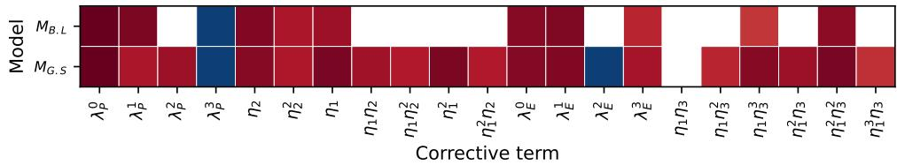  
Fig. 1: Structure of the models identified with the bi-level $( M _ { B . L }$ , top row) and grid-search $( M _ { G . S } ,$ , bottom row) strategies. Each column corresponds to one of the 21 candidate terms of Eqs. (16)–(17): $\lambda _ { P } ^ { n }$ and $\lambda _ { E } ^ { n }$ denote the n-th order terms of the production and destruction prefactors, and the remaining labels the monomials of the production $( \eta _ { 1 } , \eta _ { 2 } )$ and destruction $( \eta _ { 1 } , \eta _ { 3 } )$ exponents. White cells correspond to terms pruned by the sparse regression; colored cells to active terms, the color indicating the value of the coeficient. The color scale goes from -1 to 1 with a step of 0.1.

$$
\begin{array} { r l } & { { \boldsymbol { R } } ^ { P } = \left( 1 . 7 0 4 \times 1 0 ^ { - 2 } + 2 . 6 4 7 \times 1 0 ^ { - 1 } \lambda _ { \theta } + 4 . 0 4 0 \times 1 0 ^ { - 1 } \lambda _ { \theta } ^ { 2 } - 9 . 1 9 5 \times 1 0 ^ { - 1 } \lambda _ { \theta } ^ { 3 } \right) } \\ & { \mathrm { ~ ~ } \times \exp \left( - \left[ 7 . 2 1 3 \times 1 0 ^ { - 1 } \eta _ { 2 } + 2 . 5 9 2 \times 1 0 ^ { - 1 } \eta _ { 2 } ^ { 2 } + 1 . 0 0 0 \eta _ { 1 } + 3 . 8 4 1 \times 1 0 ^ { - 1 } \eta _ { 1 } \eta _ { 2 } \right. \right. } \\ & { \mathrm { ~ ~ } \left. \left. + 2 . 3 8 7 \times 1 0 ^ { - 1 } \eta _ { 1 } \eta _ { 2 } ^ { 2 } + 9 . 2 7 6 \times 1 0 ^ { - 1 } \eta _ { 1 } ^ { 2 } + 2 . 3 4 0 \times 1 0 ^ { - 1 } \eta _ { 1 } ^ { 2 } \eta _ { 2 } \right] \right) , } \end{array}
$$

$$
\begin{array} { r l } & { { \cal R } ^ { E } = \left( 7 . 6 4 7 \times 1 0 ^ { - 1 } + 7 . 8 2 0 \times 1 0 ^ { - 1 } \lambda _ { \theta } - 9 . 6 2 8 \times 1 0 ^ { - 1 } \lambda _ { \theta } ^ { 2 } + 3 . 2 1 7 \times 1 0 ^ { - 1 } \lambda _ { \theta } ^ { 3 } \right) } \\ & { \quad \times \exp \left( - \left[ 1 . 5 9 8 \times 1 0 ^ { - 1 } \eta _ { 1 } \eta _ { 3 } ^ { 2 } + 6 . 8 5 3 \times 1 0 ^ { - 1 } \eta _ { 1 } \eta _ { 3 } ^ { 3 } + 3 . 9 2 5 \times 1 0 ^ { - 1 } \eta _ { 1 } ^ { 2 } \eta _ { 3 } \right. \right. } \\ & { \quad \left. \left. + 9 . 9 1 1 \times 1 0 ^ { - 1 } \eta _ { 1 } ^ { 2 } \eta _ { 3 } ^ { 2 } + 1 . 1 5 6 \times 1 0 ^ { - 1 } \eta _ { 1 } ^ { 3 } \eta _ { 3 } \right] \right) , } \end{array}\tag{27}
$$

$$
\begin{array} { r l } & { \boldsymbol { R } ^ { P } = \left( 1 . 6 3 7 \times 1 0 ^ { - 2 } + 9 . 2 8 1 \times 1 0 ^ { - 1 } \lambda _ { \theta } - 9 . 4 7 8 \times 1 0 ^ { - 1 } \lambda _ { \theta } ^ { 3 } \right) } \\ & { \qquad \times \exp \left( - \left[ 8 . 5 9 5 \times 1 0 ^ { - 1 } \eta _ { 2 } + 2 . 9 6 7 \times 1 0 ^ { - 1 } \eta _ { 2 } ^ { 2 } + 4 . 1 8 2 \times 1 0 ^ { - 1 } \eta _ { 1 } \right] \right) , } \\ & { \boldsymbol { R } ^ { E } = \left( 6 . 9 5 3 \times 1 0 ^ { - 1 } + 8 . 8 5 9 \times 1 0 ^ { - 1 } \lambda _ { \theta } + 1 . 6 2 2 \times 1 0 ^ { - 1 } \lambda _ { \theta } ^ { 3 } \right) } \\ & { \qquad \times \exp \left( - \left[ 1 . 0 5 8 \times 1 0 ^ { - 1 } \eta _ { 1 } \eta _ { 3 } ^ { 3 } + 5 . 5 7 7 \times 1 0 ^ { - 1 } \eta _ { 1 } ^ { 2 } \eta _ { 3 } ^ { 2 } \right] \right) . } \end{array}\tag{28}
$$

The grid-search model retains 20 of the 21 candidate coeficients, discarding only the η η monomial of the destruction exponent: at the selected hyperparameter pair, the elastic-net penalty has practically failed to sparsify the correction. The bi-level model retains 11 coeficients, and its support is a subset of that of $M _ { G . S }$ in both corrections. The bi-level procedure therefore does not identify a diferent correction, but prunes the one contained in $M _ { G . S } \colon$ the quadratic terms of both prefactors are removed, the production exponent reduces to a separable form, in which the correction is damped independently by the eddy-viscosity ratio $\eta _ { 1 }$ and by the ratio of wall distance to turbulent length scale $\eta _ { 2 }$ , and the destruction exponent reduces to the two terms $\eta _ { 1 } \eta _ { 3 } ^ { 3 }$ and $\eta _ { 1 } ^ { 2 } \eta _ { 3 } ^ { 2 }$ . This diference in sparsity results from the selected hyperparameters. The pair retained by the grid search, $\lambda _ { \mathrm { r e g } } = 0 . 0 1$ and $r = 0 . 5 \AA$ , corresponds to $\alpha = 0 . 0 0 5$ and $\beta = 0 . 0 0 2 5$ in the notation of Eq. (25), whereas the bi-level procedure selects $\alpha = 0 . 0 7 8 2$ and $\beta = 0 . 3 7 2 7$ for the retained model, obtained with T3A as validation case. The bi-level procedure thus selects a much larger $L _ { 1 }$ penalty, which explains the sparsity of the resulting model.

The retained coeficients confirm that the two models share a common core. The constant terms of the production and destruction prefactors agree to within 4% and 10%, respectively, the cubic coeficient of the production prefactor to within 3%, the linear coeficient of the destruction prefactor to within 13%, and the coeficients of the $\eta _ { 2 }$ and $\eta _ { 2 } ^ { 2 }$ terms of the production exponent to within about 20% and 15%. Two procedures based on diferent hyperparameter strategies and diferent training subsets thus converge to the same leading-order correction, which suggests that these directions of the parameter space are constrained by the data rather than by the tuning strategy. The largest diferences concern the two high-order terms of the destruction exponent, whose coeficients difer by factors of about 6.5 and $1 . 8 ,$ and the $\eta _ { 1 }$ term of the production exponent, whose role in $M _ { G . S }$ is shared with the four $\eta _ { 1 }$ monomials pruned by the bi-level procedure.

## 6.2 Application to training and test cases

Table 2 summarizes the improvement scores over the four cases used for the identification, T3A having served as validation case for $M _ { B , L }$ , and over the two test cases. On the training cases, both models improve on the baseline for all QoIs, $M _ { B , L }$ by 28.3% on average against 25.2% for $M _ { G . S } ,$ with about half as many active terms. The skinfriction distributions and velocity profiles of Figs. 2 and 3 show that both corrections move the transition onset upstream, toward the LES, on T3A and on the pressuregradient cases, $M _ { B , L }$ being the closest to the LES. Two shortcomings remain: the transition length is not fully captured in the pressure-gradient cases, and the improvement on T3B is marginal, although T3B belongs to the training set of both models. Both are discussed in Section 6.3.

Both models also improve on the baseline for the two unseen test cases $\left( { \mathrm { F i g . ~ 4 } } \right) :$ on T3C2, they move the transition onset upstream, close to the LES, whereas the baseline transitions too late; on ZPG-val, they reduce the skin-friction overshoot of the baseline, although transition remains more abrupt than in the LES. The margin between the two models is small, and of the same order as on the training cases. The benefit of the bi-level procedure therefore lies less in a gain in accuracy than in the automatic selection of a model that is as accurate while being about twice as sparse, which improves its interpretability and, as discussed in Section 6.3, narrows the range of some of its corrections outside the training conditions.
<table><tr><td>Cases</td><td>Model</td><td> $m _ { \overline { { u } } } ~ ( \% )$ </td><td> $( \% )$   $\displaystyle m _ { \partial \overline { { u } } } / \partial { y }$ </td><td>(%)  $m _ { C _ { f } }$ </td><td> $m _ { \mathrm { m o d e l } } ~ ( \% )$ </td></tr><tr><td>Training</td><td> $M _ { G . S }$ </td><td>23.83</td><td>30.46</td><td>21.26</td><td>25.18</td></tr><tr><td rowspan="3">Test</td><td> $M _ { B , L }$ </td><td>25.15</td><td>34.42</td><td>25.22</td><td>28.26</td></tr><tr><td> $M _ { G . S }$ </td><td>16.46</td><td>40.70</td><td>13.01</td><td>23.39</td></tr><tr><td> $M _ { B , L }$ </td><td>18.40</td><td>41.03</td><td>14.90</td><td>24.78</td></tr></table>

Table 2: Improvement scores of the grid-search $( M _ { G . S } )$ and bi-level $( M _ { B . L } )$ models with respect to the baseline $k { - } \omega { - } \gamma$ model (Eqs. (22)– (23)), averaged over the training cases (T3A, T3B, T3C3, T3C5) and test cases (T3C2, ZPG-val), for the mean streamwise velocity, its wall-normal derivative and the skin-friction coeficient; $m _ { \mathrm { m o d e l } }$ is the mean of the three scores. Positive values denote an improvement over the baseline, and 100% a perfect agreement with the LES. For $M _ { B , L }$ , T3A is the validation case of the leave-one-case-out procedure.

## 6.3 Interpretation of the identified corrections

The relative magnitudes of the identified terms clarify the nature of the correction. In both models, the constant term of the destruction prefactor is 42 to 45 times larger than that of the production prefactor: the production correction is a small perturbation of the ramp function $F _ { \gamma } ,$ whereas the destruction correction substantially modifies $G _ { \gamma }$ . This asymmetry reflects the roles of the two terms in the transport equation. The production correction acts through $\rho \Omega ( \gamma _ { \mathrm { m a x } } - \gamma ) \sqrt { \gamma }$ , a factor that is largest precisely where the intermittency starts to grow, so that a small change of the activation function sufices to shift the onset location; the destruction correction acts through $F _ { \mathrm { t u r b } } \rho \Omega \gamma ^ { 1 . 5 }$ and remains inactive until the intermittency has grown appreciably.

The two procedures also agree on the response of the corrections to $\lambda _ { \theta }$ . Both destruction prefactors increase with $\lambda _ { \theta }$ with similar slopes, so that the destruction correction is reinforced in accelerated regions and weakened in decelerated ones. Both production prefactors change sign for moderately negative values of $\lambda _ { \theta }$ (below $\lambda _ { \theta }$ ≈ −0.02 for $M _ { B , L }$ , and within $- 0 . 3 1 < \lambda _ { \theta } < - 0 . 0 7$ for $M _ { G . S } )$ , where the production correction delays rather than promotes the growth of intermittency. This dependence should nevertheless be interpreted with care: since $\lambda _ { \theta }$ is evaluated locally from the wall-normal derivative of the wall-normal velocity, it responds to the thickening of the boundary layer through the transitional region as well as to the imposed pressure gradient, and the sign reversal cannot be attributed to the latter alone.

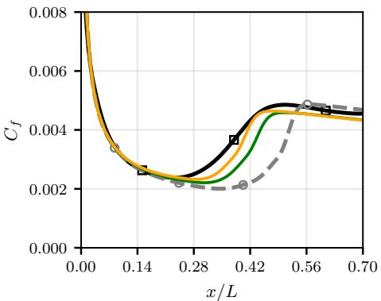  
(a) T3A, skin-friction coeficient

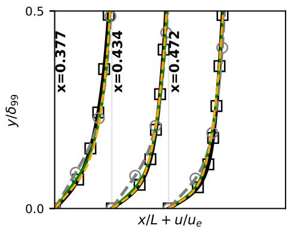  
(b) $\mathrm { T 3 A } ,$ , velocity profiles

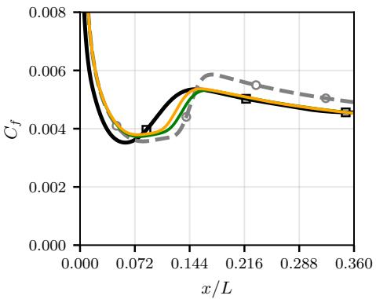

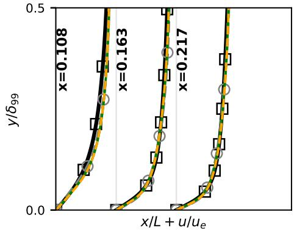  
(c) T3B, skin-friction coeficient  
(d) T3B, velocity profiles  
Fig. 2: Zero-pressure-gradient training cases T3A (top, validation case of $M _ { B . L } )$ and T3B (bottom): skin-friction coeficient along the plate (left) and mean-velocity profiles $u / u _ { e }$ versus $y / \delta _ { 9 9 }$ at three streamwise stations across the transitional region, each profile being shifted by its abscissa $x / L$ (right). LES: black line with squares; baseline $k { - } \omega { - } \gamma$ model: gray dashed line with circles; $M _ { B , L } \colon$ orange line; $M _ { G . S } \colon$ green line.

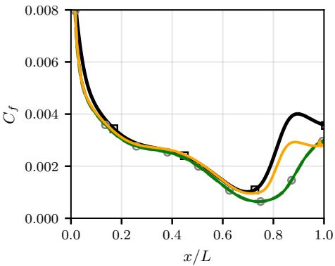  
(a) T3C3, skin-friction coeficient

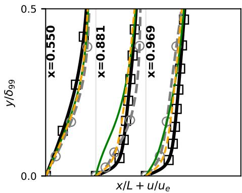  
(b) T3C3, velocity profiles

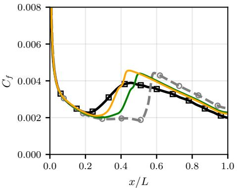  
(c) T3C5, skin-friction coeficient

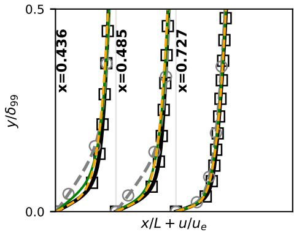  
(d) T3C5, velocity profiles  
Fig. 3: Pressure-gradient training cases T3C3 (top, transition in the adverse-pressuregradient region) and T3C5 (bottom, transition in the favorable-pressure-gradient region): skin-friction coeficient (left) and mean-velocity profiles (right). Lines as in Fig. 2.

The same reading explains the two shortcomings noted above. The transition length is controlled almost entirely by the destruction correction, whose exponent reduces in $M _ { B , L }$ to a combination of $\eta _ { 1 } \eta _ { 3 } ^ { 3 }$ and $\eta _ { 1 } ^ { 2 } \eta _ { 3 } ^ { 2 }$ . Since the vorticity Reynolds number η reaches $\mathcal { O } ( 1 0 ^ { 2 } )$ to $\mathcal { O } ( 1 0 ^ { 3 } )$ in a transitional boundary layer and enters at the cubic power, the exponential drops from one to zero as soon as the eddy-viscosity ratio exceeds about $1 0 ^ { - 8 }$ to $1 0 ^ { - 5 }$ , depending on the local value of $\eta _ { 3 } .$ so that $R ^ { E }$ behaves in practice as an indicator function rather than as a smooth decay. Such a switch can displace the end of the transitional region but has little authority over its extent, which is consistent with the residual discrepancy in transition length observed in the pressure-gradient cases. The marginal improvement on T3B points to a limitation of the dictionary rather than of the hyperparameter tuning: the selected features cannot distinguish the high freestream turbulence of T3B $( T u = 6 \% )$ from the moderate levels of the other cases.

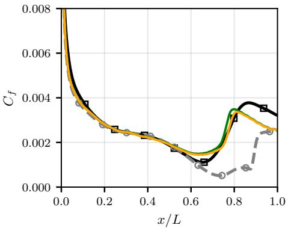  
(a) T3C2, skin-friction coeficient

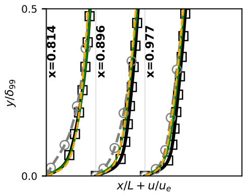  
(b) T3C2, velocity profiles

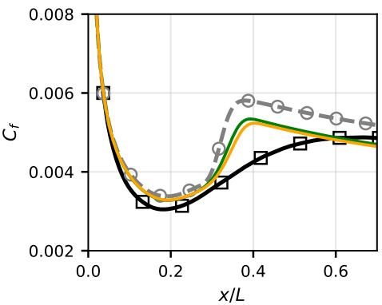  
(c) $\mathrm { Z P G - v a l } ,$ , skin-friction coeficient

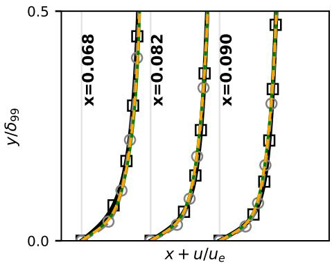  
(d) $\mathrm { Z P G - v a l }$ , velocity profiles  
Fig. 4: Test cases, not used for training: T3C2 (top, diferent pressure-gradient history) and ZPG-val (bottom, zero pressure gradient with a large integral length scale of the freestream turbulence). Skin-friction coeficient (left) and mean-velocity profiles (right); lines as in Fig. 2.

Finally, since $\lambda _ { \theta }$ enters only through the polynomial prefactors, and since the exponential factors are bounded within ]0, 1], the behavior of each correction outside the training conditions can be inspected directly from its prefactor over the admissible range $\lambda _ { \theta } \in [ - 1 , 1 ]$ . The destruction prefactor of $M _ { B , L }$ remains positive down to $\lambda _ { \theta } \approx - 0 . 7 2$ , whereas that of $M _ { G . S }$ changes sign at $\lambda _ { \theta } \approx - 0 . 5 5$ and would therefore, under strong adverse pressure gradients, subtract from $G _ { \gamma }$ rather than add to it. The production prefactor of $M _ { B , L }$ is bounded by about 0.37 in magnitude, about three times less than that of $M _ { G . S }$

In summary, the bi-level formulation automatically selects a model that is about twice as sparse as the grid-search model and at least as accurate on both training and test cases. In the next section, $M _ { B , L }$ is applied to the LS89 turbine cascade, where the corrections are evaluated well outside the range of $\lambda _ { \theta }$ covered by the T3 cases, in particular under the strong acceleration of the suction side.

## 7 Application to a turbine cascade

In this section, $M _ { B , L }$ is applied to a more complex configuration, the highly loaded LS89 linear turbine cascade studied experimentally at the von Karman Institute (VKI) by Arts et al. [84, 103], which is widely used as a benchmark for transition and heattransfer predictions in turbomachinery [11, 31, 36, 104].

The simulations are performed on a structured nine-block grid extending from $x / c = - 1 . 0$ at the inlet to $x / c = 2 . 0$ at the outlet, with a first-cell height below $y ^ { + } = 0 . 5$ to resolve the transitional boundary layers. No-slip isothermal conditions are applied on the blade surface and periodic conditions on the upper and lower boundaries of the domain. Riemann-invariant conditions are imposed at the inlet and the static pressure is prescribed at the outlet, so as to reproduce the experimental conditions.

Four operating points are considered, referred to as MUR129, MUR235, MUR116 and MUR241 in [103] (Table 3). They form two pairs: MUR129 and MUR116 correspond to a low inlet turbulence intensity $( T u = 0 . 8 \%$ , a level at which freestreamturbulence efects are small), MUR235 and MUR241 to a high one $( T u = 6 \% )$ . Within each pair, the second case has an outlet Reynolds number about twice as high and a slightly supersonic outlet Mach number $( M _ { 2 } \approx 1 . 0 9 )$ , with shocks impinging on the rear part of the suction side. The inlet turbulence intensity is set to the experimental value. The inlet specific dissipation rate, which is not documented in the experiments, is imposed through the eddy-viscosity ratio, with values comparable with those used by Smirnov & Smirnovsky [105] in their simulations of the LS89 cascade.

The augmented model $M _ { B , L }$ is compared with the baseline model of Ge et al. [1]. The predictions are assessed on the distribution along the blade surface of the heat transfer coeficient

$$
H = \frac { q _ { w } } { T _ { 0 } - T _ { w } } ,\tag{29}
$$

where $q _ { w }$ is the wall heat flux, $T _ { 0 }$ the inlet total temperature and $T _ { w }$ the wall temperature, as in [103]. The distributions of H are shown in Fig. 5, and the corresponding improvement scores $m _ { H }$ , computed as in Eq. (22) with the baseline model as reference, are reported in Table 3.

This configuration lies well outside the training envelope: compared with the T3 cases, it combines a curved geometry, a much stronger acceleration, higher Reynolds numbers and, for two of the cases, a transonic regime. The extent of this extrapolation can be quantified by projecting the input features of the corrections onto a twodimensional space, following Oulghelou et al. [106]. The four features of Section 3.1 are used, namely the pressure-gradient parameter $\lambda _ { \theta }$ , the eddy-viscosity ratio $\eta _ { 1 }$ , the wall-distance ratio $\eta _ { 2 }$ and the vorticity Reynolds number $\eta _ { 3 }$ , the logarithms of $\eta _ { 1 }$ and η being taken since they vary over several orders of magnitude. The training points are taken from the T3A, T3B, T3C3 and T3C5 cases, restricted to the masked region $( S ^ { * } < 0 . 8 )$ used in the training loss, and the test points from the four computational blocks surrounding the blade in each LS89 case. A principal component analysis (PCA) of the training data provides the two directions along which the training features vary the most, and both the training and the test points are projected onto these directions (Fig. 6). The region occupied by the training data is represented by the ellipse that contains 95% of the training points under a Gaussian assumption, its extent along each direction being set by the spread of the training data in that direction, so that test points falling outside this ellipse correspond to flow conditions not represented in the training set. Between 38% and 55% of the points of the four LS89 cases lie outside this region, the largest fraction being found for MUR241, which combines high freestream turbulence with a supersonic outlet. Moreover, the bypass transition process itself is afected by such strong pressure gradients and curvature [10].

<table><tr><td></td><td>MUR129</td><td>MUR116</td><td>MUR235</td><td>MUR241</td></tr><tr><td> $T u \ ( \% )$ </td><td>0.8</td><td>0.8</td><td>6</td><td>6</td></tr><tr><td> $M _ { \mathrm { i n } }$ </td><td>0.15</td><td>0.157</td><td>0.15</td><td>0.15</td></tr><tr><td> $M _ { 2 }$ </td><td>0.84</td><td>1.09</td><td>0.927</td><td>1.089</td></tr><tr><td> $T _ { 0 } ~ \mathrm { { ( K ) } }$ </td><td>409.2</td><td>418.9</td><td>413.3</td><td>416.4</td></tr><tr><td> $T _ { w } ~ \mathrm { ( K ) }$ </td><td>297.75</td><td>297.55</td><td>301.15</td><td>299.75</td></tr><tr><td>Inlet  $\mu _ { t } / \mu$ </td><td>1.56</td><td>3</td><td>15.47</td><td>20</td></tr><tr><td> $m _ { H }$  of  $M _ { B , L }$  (%)</td><td>15.2</td><td>2.4</td><td>5.1</td><td>70.1</td></tr></table>

Table 3: LS89 operating points: inlet turbulence intensity, inlet and isentropic outlet Mach numbers, inlet total temperature, wall temperature and eddy-viscosity ratio imposed at the inlet of the RANS simulations. Last row: improvement score of $M _ { B , L }$ on the heat transfer coeficient $H ,$ relative to the baseline model of Ge et al. [1].

For the low-turbulence cases, the baseline and augmented models give nearly identical predictions on the pressure side and on the front part of the suction side, where the boundary layer remains laminar, and both agree well with the measurements. The diferences are confined to the rear part of the suction side. On MUR129, the baseline model predicts transition only at $s \approx 8 4$ mm, whereas $M _ { B , L }$ triggers it at s ≈ 76 mm, in closer agreement with the rise of the measured heat transfer at s ≈ 77 mm; this earlier onset accounts for the improvement of about 15% over the baseline. On MUR116, the measurements indicate a gradual rise of H from s ≈ 40 mm to the trailing edge, characteristic of an extended transitional region. The augmented model hardly difers from the baseline there: both keep the boundary layer laminar almost up to the trailing edge and underpredict the heat transfer over the rear half of the suction side, hence an improvement of only 2.4%. Neither model captures the transitional region, consistently with the limitation identified in Section 6.3: the destruction correction behaves as a switch that can move the end of transition but has little control over its length.

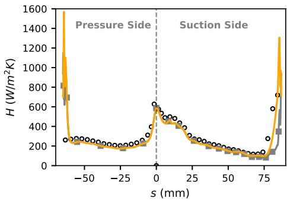  
(a) MUR129 $( T u = 0 . 8 \%$ $M _ { 2 } = 0 . 8 4 )$

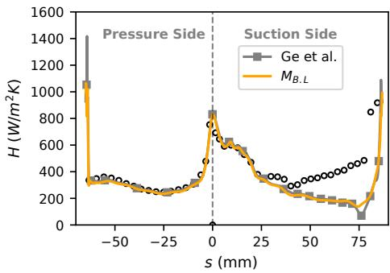  
(b) MUR116 $( T u = 0 . 8 \%$ $M _ { 2 } = 1 . 0 9 )$

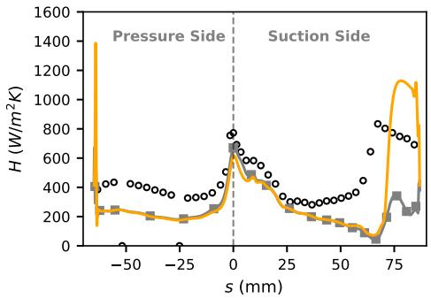  
(c) MUR235 ( $T u = 6 \%$ $M _ { 2 } = 0 . 9 3 )$

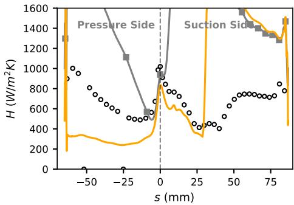  
(d) MUR241 $( T u = 6 \%$ $M _ { 2 } = 1 . 0 9 )$  
Fig. 5: Heat transfer coeficient H (Eq. 29) along the LS89 blade surface, as a function of the curvilinear abscissa s measured from the leading edge $( s < 0 \colon$ pressure side; $s > 0 \mathrm { : }$ suction side), for the four operating points. Symbols: experiments of Arts et al. [103]; gray line with squares: baseline model of Ge et al.; orange line: augmented model $M _ { B , L }$ . Transition appears as a sharp rise of H on the suction side.

The high-turbulence cases are more demanding. On MUR235, the measured transition onset lies at s ≈ 60–64 mm. The baseline model remains essentially laminar along the suction side, with only a weak rise of H near s ≈ 75 mm, whereas $M _ { B , L }$ predicts transition at s ≈ 68 mm, closer to the measurements, but overshoots the measured turbulent level; since the benefit of the earlier onset is ofset by this overshoot, the improvement is limited to 5.1%. On MUR241, the baseline model predicts an almost fully turbulent boundary layer on both sides of the blade and overpredicts the heat transfer by a factor of two to three. The augmented model removes this premature transition: it restores a laminar boundary layer on the pressure side and on the front of the suction side, and delays the onset to s ≈ 30 mm, the measurements showing a local minimum of H at s ≈ 40 mm followed by a sharp rise. The onset is still premature, but the error is substantially reduced, which explains the improvement of 70% over the baseline. This behavior is consistent with the structure of the identified correction. In the laminar region, where $\eta _ { 1 }  0$ , the exponential factor of $R ^ { E }$ tends to unity, and its prefactor increases with $\lambda _ { \theta } .$ The destruction of intermittency is therefore reinforced precisely in the strongly accelerated boundary layer of the suction side, which delays the growth of $\gamma$ and counteracts the premature transition of the baseline model on MUR241. These gains should nevertheless be interpreted with caution: the improvement scores integrate the whole blade surface, and the large score obtained on MUR241 is dominated by the gross overprediction of the baseline model, whereas the predicted onset remains upstream of the measured one for this case and the transitional region is not reproduced on MUR116. Finally, neither model reproduces the increase of the heat transfer induced by the freestream turbulence on the pressure side, which is clearly visible in the measurements of the high-turbulence cases: where the boundary layer is predicted laminar, the computed heat transfer remains close to that obtained at low turbulence intensity.

Overall, the augmented model, trained exclusively on flat-plate boundary layers, remains numerically robust on a transonic turbine cascade without any additional limiter, and improves on the baseline in all four cases, most markedly on MUR241, where the baseline transitions prematurely. The remaining discrepancies in the location and extent of transition on the suction side indicate, however, that the training database should be extended to flows with strong acceleration, surface curvature and shock–boundary-layer interactions to achieve accurate predictions in turbomachinery configurations.

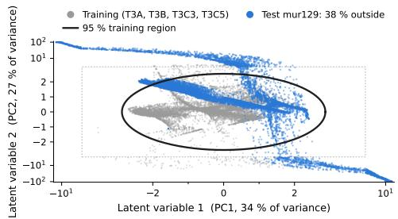  
(a) MUR129

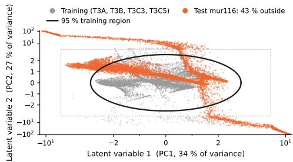  
(b) MUR116

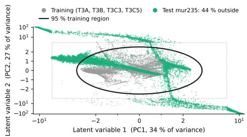  
(c) MUR235

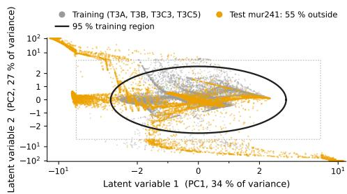  
(d) MUR241  
Fig. 6: Extrapolation range of the LS89 simulations in feature space: projection of the input features of the corrections onto the first two principal components of the training data (gray: T3A, T3B, T3C3 and T3C5; colors: LS89 cases). The ellipse encloses 95% of the training points, and the fraction of LS89 points lying outside it is indicated in each legend. The dashed rectangle delimits the domain of the training data. Symmetric logarithmic axes.

## 8 Conclusions

A CFD-driven sparse symbolic regression framework has been proposed to correct the structural deficiencies of the activation functions of the local, Galilean-invariant k– ω–γ transition model of Ge et al. [1]. Each correction is expressed as a polynomial of a local pressure-gradient parameter multiplied by a bounded exponential of local features. This yields closed-form corrections whose amplitude and spatial support can be interpreted separately, and an augmented model that runs without ad hoc limiters, including on a transonic turbine cascade.

The CFD-driven procedure, accelerated by POD–Kriging surrogates of the RANS solver, identifies the coeficients from observable quantities, namely the mean velocity and its wall-normal derivative, without need for an adjoint solver and without target fields for the intermittency. The learned models improve on the baseline model on both training and unseen flat-plate cases. A bi-level formulation of the elastic-net problem, combined with a leave-one-case-out cross-validation, identifies the regularization hyperparameters automatically, yields a sparser model than the conventional grid search, with equal or slightly better accuracy, and removes the need for an arbitrary discretization of the hyperparameter space and for the cross-validation of many candidate models. Both procedures converge to the same leading-order correction, which consists of a small perturbation of the production term and a substantial, pressure-gradient-dependent reinforcement of the destruction term.

Applied without retraining to the LS89 cascade, the augmented model improves the heat-transfer predictions of the baseline at all four operating points, most markedly where the baseline predicts premature transition under high freestream turbulence. The transition length and, at high turbulence intensity, the onset location remain inaccurately predicted, consistently with the switch-like behavior of the destruction correction and with the large fraction of LS89 flow states that lie outside the training envelope.

These results suggest several perspectives. First, the training data should be extended to flows with surface curvature, stronger pressure gradients and shock– boundary-layer interactions, possibly including turbomachinery cases [10, 11]. Second, the dictionary could be enriched with features able to better discriminate between freestream turbulence levels, and with functional forms giving authority over the transition length. Of note, the proposed methodology is not specific to the present baseline, and could be applied to other local transition models, such as the one-equation model of Menter et al. [34] or the reformulated laminar-kinetic-energy model of Pacciani et al. [76].

Acknowledgments. PC acknowledges funding by the French National Research Agency (ANR) under the France 2030 program, within the framework of the IA Cluster initiative (grant ANR-23-IACL-0007). Access to the HPC resources has been granted by CINES and TGCC under the allocations A0182A13457 and A0192A01736 made by GENCI (Grand Equipement National de Calcul Intensif).

## Declarations

• Funding: The present research was partly funded by the French National Research Agency (ANR) under the France 2030 program, within the framework of the IA Cluster initiative (grant ANR-23-IACL-0007).

• Competing interests: The authors declare no competing interests.

• Data availability: The time-averaged statistics of the LES database are available on Zenodo [91]; the ZPG-val data are available in [92].

• Code availability: The identification framework is available at https://github. com/LouenasZm/AugTransitionRANS.

• Author contributions: L. Zemmour: Methodology, Formal Analysis, Algorithm implementation, Writing – Original Draft. X. Gloerfelt: Supervision, Writing – Review & Editing. P. Cinnella: Conceptualization, Supervision, Writing – Review & Editing

## References

[1] Ge, X., Arolla, S., Durbin, P.: A bypass transition model based on the

intermittency function. Flow, Turbulence and Combustion 93(1), 37–61 (2014)

[2] Mayle, R.E.: The role of laminar-turbulent transition in gas turbine engines. Journal of Turbomachinery 113(4), 509–537 (1991)

[3] Durbin, P.A.: Perspectives on the phenomenology and modeling of boundary layer transition. Flow, Turbulence and Combustion 99(1), 1–23 (2017)

[4] Arnal, D., Casalis, G.: Laminar-turbulent transition prediction in threedimensional flows. Progress in Aerospace Sciences 36(2), 173–191 (2000)

[5] Jacobs, R.G., Durbin, P.A.: Simulations of bypass transition. Journal of Fluid Mechanics 428, 185–212 (2001)

[6] Brandt, L., Schlatter, P., Henningson, D.S.: Transition in boundary layers subject to free-stream turbulence. Journal of Fluid Mechanics 517, 167–198 (2004)

[7] Zaki, T.A., Durbin, P.A.: Mode interaction and the bypass route to transition. Journal of Fluid Mechanics 531, 85–111 (2005)

[8] Ovchinnikov, V., Choudhari, M.M., Piomelli, U.: Numerical simulations of boundary-layer bypass transition due to high-amplitude free-stream turbulence. Journal of Fluid Mechanics 613, 135–169 (2008)

[9] Zaki, T.A., Wissink, J.G., Rodi, W., Durbin, P.A.: Direct numerical simulations of transition in a compressor cascade: the influence of free-stream turbulence. Journal of Fluid Mechanics 665, 57–98 (2010)

[10] Zhao, Y., Sandberg, R.D.: Bypass transition in boundary layers subject to strong pressure gradient and curvature efects. Journal of Fluid Mechanics 888, 4 (2020)

[11] Dupuy, D., Gicquel, L., Odier, N., Duchaine, F., Arts, T.: Analysis of the efect of intermittency in a high-pressure turbine blade. Physics of Fluids 32(9), 095101 (2020)

[12] Pinto, B., Lodato, G.: Synthetic freestream disturbance for the numerical reproduction of experimental zero-pressure-gradient bypass transition test cases. Flow, Turbulence and Combustion 103(1), 25–54 (2019)

[13] Bienner, A., Gloerfelt, X., Cinnella, P.: Influence of large-scale free-stream turbulence on bypass transition in air and organic vapour flows. Journal of Fluid Mechanics 997, 56 (2024)

[14] Smith, A.M.O., Gamberoni, N.: Transition, pressure gradient and stability theory. Technical Report ES 26388, Douglas Aircraft Company (1956)

[15] van Ingen, J.L.: A suggested semi-empirical method for the calculation of the boundary layer transition region. Technical Report VTH-74, Delft University of Technology, Department of Aeronautical Engineering (1956)

[16] van Ingen, J.L.: The $e ^ { N }$ method for transition prediction. Historical review of work at TU Delft. In: 38th AIAA Fluid Dynamics Conference and Exhibit (2008). AIAA Paper 2008-3830

[17] Coder, J.G., Maughmer, M.D.: Computational fluid dynamics compatible transition modeling using an amplification factor transport equation. AIAA Journal 52(11), 2506–2512 (2014)

[18] Coder, J.G.: Enhancement of the amplification factor transport transition modeling framework. In: 55th AIAA Aerospace Sciences Meeting, Grapevine, TX (2017). AIAA Paper 2017-1709

[19] Mack, L.M.: Transition prediction and linear stability theory. In: AGARD Conference Proceedings CP-224: Laminar-Turbulent Transition (1977). pp. 1-1–1-22

[20] Dick, E., Kubacki, S.: Transition models for turbomachinery boundary layer flows: A review. International Journal of Turbomachinery, Propulsion and Power 2(2), 4 (2017)

[21] Dhawan, S., Narasimha, R.: Some properties of boundary layer flow during the transition from laminar to turbulent motion. Journal of Fluid Mechanics 3(4), 418–436 (1958)

[22] Steelant, J., Dick, E.: Modelling of bypass transition with conditioned Navier– Stokes equations coupled to an intermittency transport equation. International Journal for Numerical Methods in Fluids 23(3), 193–220 (1996)

[23] Suzen, Y.B., Huang, P.G.: Modeling of flow transition using an intermittency transport equation. Journal of Fluids Engineering 122(2), 273–284 (2000)

[24] Menter, F.R., Langtry, R., V¨olker, S.: Transition modelling for general purpose CFD codes. Flow, Turbulence and Combustion 77(1), 277–303 (2006)

[25] Langtry, R.B., Menter, F.R.: Correlation-based transition modeling for unstructured parallelized computational fluid dynamics codes. AIAA Journal 47(12), 2894–2906 (2009)

[26] Van Driest, E.R., Blumer, C.B.: Boundary layer transition: Freestream turbulence and pressure gradient efects. AIAA Journal 1(6), 1303–1306 (1963)

[27] Piotrowski, W., Elsner, W., Drobniak, S.: Transition prediction on turbine blade profile with intermittency transport equation. In: Turbo Expo: Power for Land, Sea, and Air, vol. 43147, pp. 1291–1300 (2008)

[28] Suluksna, K., Juntasaro, E.: Assessment of intermittency transport equations for modeling transition in boundary layers subjected to freestream turbulence. International Journal of Heat and Fluid Flow 29(1), 48–61 (2008)

[29] Suluksna, K., Dechaumphai, P., Juntasaro, E.: Correlations for modeling transitional boundary layers under influences of freestream turbulence and pressure gradient. International Journal of Heat and Fluid Flow 30(1), 66–75 (2009)

[30] Content, C., Houdeville, R.: Application of the $\gamma { - } R e _ { \theta }$ laminar-turbulent transition model in Navier–Stokes computations. In: 40th AIAA Fluid Dynamics Conference and Exhibit, Chicago, IL (2010). Paper AIAA 2010-4445

[31] Benyahia, A., Houdeville, R.: Transition prediction in transonic turbine configurations using a correlation-based transport equation model. International Journal of Engineering Systems Modelling and Simulation 3, 36–45 (2011)

[32] Benyahia, A., Houdeville, R., Castillon, L.: Prediction of separation-induced transition on high lift low pressure turbine blade. In: ASME 2011 Turbo Expo, pp. 1835–1846 (2011). Paper GT2011-45566

[33] Cheng, G., Nichols, R., Neroorkar, K., Radhamony, P.: Validation and assessment of turbulence transition models. In: 47th AIAA Aerospace Sciences Meeting Including The New Horizons Forum and Aerospace Exposition, p. 1141 (2009)

[34] Menter, F.R., Smirnov, P.E., Liu, T., Avancha, R.: A one-equation local correlation-based transition model. Flow, Turbulence and Combustion 95(4), 583–619 (2015)

[35] Colonia, S., Leble, V., Steijl, R., Barakos, G.: Assessment and calibration of the γ-equation transition model at low Mach. AIAA Journal 55(4), 1126–1139 (2017)

[36] Pecnik, R., Witteveen, J.A.S., Iaccarino, G.: Assessment of uncertainties in modeling of laminar to turbulent transition for transonic flows. Flow, Turbulence and Combustion 91(1), 41–61 (2013)

[37] Kubacki, S., Dick, E.: An algebraic intermittency model for bypass, separationinduced and wake-induced transition. International Journal of Heat and Fluid Flow 62, 344–361 (2016)

[38] Durbin, P.: An intermittency model for bypass transition. International Journal of Heat and Fluid Flow 36, 1–6 (2012)

[39] Mayle, R.E., Schulz, A.: The path to predicting bypass transition. Journal of Turbomachinery 119(3), 405–411 (1997)

[40] Walters, D.K., Leylek, J.H.: A new model for boundary layer transition using

a single-point RANS approach. Journal of Turbomachinery 126(1), 193–202 (2004)

[41] Walters, D.K., Leylek, J.H.: Computational fluid dynamics study of wakeinduced transition on a compressor-like flat plate. Journal of Turbomachinery 127(1), 52–63 (2005)

[42] Walters, D.K., Cokljat, D.: A three-equation eddy-viscosity model for Reynoldsaveraged Navier–Stokes simulations of transitional flow. Journal of Fluids Engineering 130(12), 121401 (2008)

[43] Savill, A.M.: Evaluating turbulence model predictions of transition: An ERCOF-TAC special interest group project. Applied Scientific Research 51(1), 555–562 (1993)

[44] Juntasaro, E., Ngiamsoongnirn, K.: A new physics-based γ–k transition model. International Journal of Computational Fluid Dynamics 28(5), 204–218 (2014)

[45] Menter, F.R.: Two-equation eddy-viscosity turbulence models for engineering applications. AIAA Journal 32(8), 1598–1605 (1994)

[46] Juntasaro, E., Narejo, A.A.: A γ–kL transition model for transitional flow with pressure gradient efects. Engineering Journal 21(2), 279–304 (2017)

[47] Cutrone, L., De Palma, P., Pascazio, G., Napolitano, M.: An evaluation of bypass transition models for turbomachinery flows. International Journal of Heat and Fluid Flow 28(1), 161–177 (2007)

[48] Duraisamy, K., Iaccarino, G., Xiao, H.: Turbulence modeling in the age of data. Annual Review of Fluid Mechanics 51(1), 357–377 (2019)

[49] Xiao, H., Cinnella, P.: Quantification of model uncertainty in RANS simulations: A review. Progress in Aerospace Sciences 108, 1–31 (2019)

[50] Duraisamy, K.: Perspectives on machine learning-augmented Reynolds-averaged and large eddy simulation models of turbulence. Physical Review Fluids 6(5), 050504 (2021)

[51] Cinnella, P.: Data-driven turbulence modeling. von Karman Institute Lecture Series “Machine Learning for Fluid Mechanics”, arXiv:2404.09074 (2024)

[52] Hu, J., Yang, J.: Bridging physics and data: A review of machine learning approaches for turbulence closure modeling. Physics of Fluids 38(9), 091302 (2026)

[53] Ling, J., Kurzawski, A., Templeton, J.: Reynolds averaged turbulence modelling using deep neural networks with embedded invariance. Journal of Fluid Mechanics 807, 155–166 (2016)

[54] Weatheritt, J., Sandberg, R.: A novel evolutionary algorithm applied to algebraic modifications of the RANS stress–strain relationship. Journal of Computational Physics 325, 22–37 (2016)

[55] Schmelzer, M., Dwight, R.P., Cinnella, P.: Discovery of algebraic Reynolds-stress models using sparse symbolic regression. Flow, Turbulence and Combustion 104(2), 579–603 (2020)

[56] Cherroud, S., Merle, X., Cinnella, P., Gloerfelt, X.: Sparse Bayesian learning of explicit algebraic Reynolds-stress models for turbulent separated flows. International Journal of Heat and Fluid Flow 98, 109047 (2022)

[57] Cinnella, P.: Symbolic regression methods. In: Data Driven Analysis and Modeling of Turbulent Flows, pp. 355–396. Elsevier, Amsterdam (2025)

[58] Wu, J., Xiao, H., Sun, R., Wang, Q.: Reynolds-averaged Navier–Stokes equations with explicit data-driven Reynolds stress closure can be ill-conditioned. Journal of Fluid Mechanics 869, 553–586 (2019)

[59] Parish, E.J., Duraisamy, K.: A paradigm for data-driven predictive modeling using field inversion and machine learning. Journal of Computational Physics 305, 758–774 (2016)

[60] Holland, J.R., Baeder, J.D., Duraisamy, K.: Field inversion and machine learning with embedded neural networks: Physics-consistent neural network training. In: AIAA Aviation 2019 Forum (2019). AIAA Paper 2019-3200

[61] Zhao, Y., Akolekar, H.D., Weatheritt, J., Michelassi, V., Sandberg, R.D.: RANS turbulence model development using CFD-driven machine learning. Journal of Computational Physics 411, 109413 (2020)

[62] Lav, C., Haghiri, A., Sandberg, R.: RANS predictions of trailing-edge slot flows using heat-flux closures developed with CFD-driven machine learning. Journal of the Global Power and Propulsion Society, 1–13 (2021)

[63] Michel´en Str¨ofer, C.A., Xiao, H.: End-to-end diferentiable learning of turbulence models from indirect observations. Theoretical and Applied Mechanics Letters 11(4), 100280 (2021)

[64] Ben Hassan Sa¨ıdi, I., Schmelzer, M., Cinnella, P., Grasso, F.: CFD-driven symbolic identification of algebraic Reynolds-stress models. Journal of Computational Physics 457, 111037 (2022)

[65] Rinc´on, M.J., Amarloo, A., Reclari, M., Yang, X.I.A., Abkar, M.: Progressive augmentation of Reynolds stress tensor models for secondary flow prediction by computational fluid dynamics driven surrogate optimisation. International Journal of Heat and Fluid Flow 104, 109242 (2023)

[66] Fang, Y., Waschkowski, F., Reissmann, M., Sandberg, R.D., Oda, T., Tanimoto, K.: A surrogate-augmented symbolic CFD-driven training framework for accelerating multi-objective physical model development. arXiv:2512.19031 (2025)

[67] Duraisamy, K., Zhang, Z.J., Singh, A.P.: New approaches in turbulence and transition modeling using data-driven techniques. In: 53rd AIAA Aerospace Sciences Meeting, p. 1284 (2015)

[68] Srivastava, V., Duraisamy, K.: Generalizable physics-constrained modeling using learning and inference assisted by feature-space engineering. Physical Review Fluids 6(12), 124602 (2021)

[69] Yang, M., Xiao, Z.: Improving the k–ω–γ–Ar transition model by the field inversion and machine learning framework. Physics of Fluids 32(6), 064101 (2020)

[70] Wu, L., Cui, B., Xiao, Z.: Two-equation turbulent viscosity model for simulation of transitional flows: An eficient artificial neural network strategy. Physics of Fluids 34(10) (2022)

[71] Li, Z., Ju, Y., Zhang, C.: Machine-learning data-driven modeling of laminarturbulent transition in compressor cascade. Physics of Fluids 35(8), 085133 (2023)

[72] Zafar, M.I., Xiao, H., Choudhari, M.M., Li, F., Chang, C.-L., Paredes, P., Venkatachari, B.: Convolutional neural network for transition modeling based on linear stability theory. Physical Review Fluids 5(11), 113903 (2020)

[73] Akolekar, H.D., Waschkowski, F., Zhao, Y., Pacciani, R., Sandberg, R.D.: Transition modeling for low pressure turbines using computational fluid dynamics driven machine learning. Energies 14(15), 4680 (2021)

[74] Akolekar, H.D., Waschkowski, F., Pacciani, R., Zhao, Y., Sandberg, R.D.: Multiobjective development of machine-learnt closures for fully integrated transition and wake mixing predictions in low pressure turbines. In: Proceedings of the ASME Turbo Expo 2022: Turbomachinery Technical Conference and Exposition, Volume 10C. American Society of Mechanical Engineers, Rotterdam, Netherlands (2022). Paper V10CT32A013

[75] Fang, Y., Zhao, Y., Akolekar, H.D., Ooi, A.S., Sandberg, R.D., Pacciani, R., Marconcini, M.: A data-driven approach for generalizing the laminar kinetic energy model for separation and bypass transition in low-and high-pressure turbines. Journal of Turbomachinery 146(9), 091005 (2024)

[76] Pacciani, R., Fang, Y., Metti, L., Marconcini, M., Sandberg, R.: A reformulation of the laminar kinetic energy model to enable multi-mode transition predictions.

[77] Simoni, D., Barsi, D., Dellacasagrande, M., Lengani, D., Yepmo, V.: Modified formulation of laminar kinetic energy transition models by means of elasticnet of a big experimental database of separated flows. Flow, Turbulence and Combustion 105(3), 671–697 (2020)

[78] Nolan, K.P., Zaki, T.A.: Conditional sampling and statistical analysis of transitional flows. In: Proceedings of the Summer Program, pp. 25–34 (2012)

[79] Veerasamy, D., Atkin, C.: A rational method for determining intermittency in the transitional boundary layer. Experiments in Fluids 61, 11 (2020)

[80] Capel-Jorquera, J., Ch´avez-M´odena, M., Gonz´alez, L.M., Valero, E.: Decoding a physics-based RANS transition model. In: Journal of Physics: Conference Series, vol. 3230, p. 012015. IOP Publishing, Bristol (2026)

[81] Kennedy, M.C., O’Hagan, A.: Bayesian calibration of computer models. Journal of the Royal Statistical Society Series B: Statistical Methodology 63(3), 425–464 (2001)

[82] Zemmour, L., Gloerfelt, X., Cinnella, P.: A high-fidelity numerical database for free-stream-turbulence-induced transition under varying pressure gradients. arXiv preprint arXiv:2606.20139 (2026)

[83] Roach, P.E., Brierley, D.H.: The influence of a turbulent free-stream on zero pressure gradient transitional boundary layer development. Part I: Test cases T3A and T3B. In: Pironneau, O., Rodi, W., Ryhming, I.L., Savill, A.M., Truong, T.V. (eds.) Numerical Simulation of Unsteady Flows and Transition to Turbulence, pp. 319–347. Cambridge University Press, Cambridge (1992)

[84] Arts, T., Lambert de Rouvroit, M.: Aero-thermal performance of a twodimensional highly loaded transonic turbine nozzle guide vane: A test case for inviscid and viscous flow computations. Journal of Turbomachinery 114(1), 147–154 (1992)

[85] Wilcox, D.C.: Reassessment of the scale-determining equation for advanced turbulence models. AIAA Journal 26(11), 1299–1310 (1988)

[86] Bassi, F., Crivellini, A., Rebay, S., Savini, M.: Discontinuous Galerkin solution of the Reynolds-averaged Navier–Stokes and k–ω turbulence model equations. Computers & Fluids 34(4-5), 507–540 (2005)

[87] Bienner, A., Gloerfelt, X., Yal¸cın, O., Cinnella, P.: Multiblock parallel high-¨ order implicit residual smoothing time scheme for compressible Navier–Stokes equations. Computers & Fluids 269, 106138 (2024)

[88] Brunton, S.L., Proctor, J.L., Kutz, J.N.: Discovering governing equations from data by sparse identification of nonlinear dynamical systems. Proceedings of the National Academy of Sciences 113(15), 3932–3937 (2016)

[89] McConaghy, T.: FFX: Fast, scalable, deterministic symbolic regression technology. In: Riolo, R., Vladislavleva, E., Moore, J.H. (eds.) Genetic Programming Theory and Practice IX, pp. 235–260. Springer, New York, NY (2011)

[90] Fransson, J.H.M., Shahinfar, S.: On the efect of free-stream turbulence on boundary-layer transition. Journal of Fluid Mechanics 899, 23 (2020)

[91] Zemmour, L., Gloerfelt, X., Cinnella, P.: A high-fidelity database for bypass transition. Zenodo (2025). https://doi.org/10.5281/zenodo.17166216

[92] Bienner, A., Gloerfelt, X., Cinnella, P.: Database: Influence of large-scale freestream turbulence on bypass transition in air and organic vapour flows. Zenodo (2024). https://doi.org/10.5281/zenodo.12915280

[93] Zou, H., Hastie, T.: Regularization and variable selection via the elastic net. Journal of the Royal Statistical Society Series B: Statistical Methodology 67(2), 301–320 (2005)

[94] Tibshirani, R.: Regression shrinkage and selection via the Lasso. Journal of the Royal Statistical Society Series B: Statistical Methodology 58(1), 267–288 (1996)

[95] Hoerl, A.E., Kennard, R.W.: Ridge regression: Biased estimation for nonorthogonal problems. Technometrics 12(1), 55–67 (1970)

[96] Carlozo, M.N., Wang, K., Dowling, A.W.: Bayesian optimization methods for nonlinear model calibration. Industrial & Engineering Chemistry Research 64(37), 18277–18297 (2025)

[97] Sobol’, I.M.: On the distribution of points in a cube and the approximate evaluation of integrals. USSR Computational Mathematics and Mathematical Physics 7(4), 86–112 (1967)

[98] Saves, P., Lafage, R., Bartoli, N., Diouane, Y., Bussemaker, J., Lefebvre, T., Hwang, J.T., Morlier, J., Martins, J.R.R.A.: SMT 2.0: A surrogate modeling toolbox with a focus on hierarchical and mixed variables Gaussian processes. Advances in Engineering Software 188, 103571 (2024)

[99] Price, K.V., Storn, R.M., Lampinen, J.A.: Diferential evolution: A practical approach to global optimization. Natural Computing Series. Springer, Berlin, Heidelberg (2005)

[100] Blank, J., Deb, K.: Pymoo: Multi-objective optimization in Python. IEEE Access

[101] Lloyd, S.P.: Least squares quantization in PCM. IEEE Transactions on Information Theory 28(2), 129–137 (1982)

[102] Bonnel, H., Schneider, C.: Post-Pareto analysis and a new algorithm for the optimal parameter tuning of the elastic net. Journal of Optimization Theory and Applications 183(3), 993–1027 (2019)

[103] Arts, T., Lambert de Rouvroit, M., Rutherford, A.W.: Aero-thermal investigation of a highly loaded transonic linear turbine guide vane cascade. Technical Note 174, von Karman Institute for Fluid Dynamics (1990)

[104] Fornasari, D., Regazzo, S., Benini, E., De Vanna, F.: RANS-based aerothermal database of LS89 transonic turbine cascade under adiabatic and cooled wall conditions. Energies 18(19), 5321 (2025)

[105] Smirnov, E., Smirnovsky, A.: Turbine vane cascade heat transfer predictions using a modified version of the γ–Re laminar-turbulent transition model. In: International Symposium on Heat Transfer in Gas Turbine Systems, Antalya, Turkey (2009)

[106] Oulghelou, M., Cherroud, S., Merle, X., Cinnella, P.: Machine-learning-assisted blending of data-driven turbulence models. Flow, Turbulence and Combustion 115(3), 1095–1132 (2025)

[107] Bouhlel, M.A., Bartoli, N., Otsmane, A., Morlier, J.: Improving Kriging surrogates of high-dimensional design models by Partial Least Squares dimension reduction. Structural and Multidisciplinary Optimization 53(5), 935–952 (2016)

[108] Rousseeuw, P.J.: Silhouettes: A graphical aid to the interpretation and validation of cluster analysis. Journal of Computational and Applied Mathematics 20, 53–65 (1987)

# Appendix A Construction and accuracy of the surrogate models

For each training case and QoI, the 1024 samples are split into training, validation and test sets $( 6 0 / 2 0 / 2 0 \% )$ , and POD modes are retained up to 99% of the captured energy. A grid search is then performed over the trend functions (constant, linear, quadratic) and correlation models of the Kriging regression (standard Kriging and KPLSK, i.e. Kriging with a partial-least-squares reduction of the input dimension [107], both available in SMT [98]), and the configuration minimizing the error on the validation set is retained. The accuracy of the surrogates is quantified by the coeficient of determination $R ^ { 2 }$ , which measures the quality of the fit on the training samples, and by $Q ^ { 2 }$ which measures the predictive quality on the unseen test samples:

$$
R ^ { 2 } = 1 - \frac { \sum _ { i = 1 } ^ { N } | y _ { i , \mathrm { t r a i n } } - \hat { y } _ { i , \mathrm { t r a i n } } | ^ { 2 } } { \sum _ { i = 1 } ^ { N } | y _ { i , \mathrm { t r a i n } } - \bar { y } _ { \mathrm { t r a i n } } | ^ { 2 } } , \qquad Q ^ { 2 } = 1 - \frac { \sum _ { i = 1 } ^ { N } | y _ { i , \mathrm { t e s t } } - \hat { y } _ { i , \mathrm { t e s t } } | ^ { 2 } } { \sum _ { i = 1 } ^ { N } | y _ { i , \mathrm { t e s t } } - \bar { y } _ { \mathrm { t e s t } } | ^ { 2 } } ,\tag{A1}
$$

where $y _ { i }$ is the RANS value, $\hat { y } _ { i }$ the surrogate prediction and $\bar { y }$ the mean of the RANS values over the corresponding set; values close to unity indicate a good fit and a good predictive capability, respectively. As reported in Table $\mathrm { A 1 }$ , both scores exceed 99.8% for all cases and QoIs.

<table><tr><td>Case</td><td>QoI</td><td>Kriging model</td><td> $R ^ { 2 } \ ( \% )$ </td><td> $Q ^ { 2 } \ ( \% )$ </td></tr><tr><td rowspan="2">T3A</td><td>u</td><td>Kriging</td><td>99.9953</td><td>99.9856</td></tr><tr><td> $\partial \overline { { u } } / \partial y$ </td><td>Kriging</td><td>99.9914</td><td>99.9632</td></tr><tr><td rowspan="2">T3B</td><td>u</td><td>KPLSK</td><td>99.9978</td><td>99.9887</td></tr><tr><td> $\partial \overline { { u } } / \partial y$ </td><td>KPLSK</td><td>99.9981</td><td>99.986</td></tr><tr><td rowspan="2">T3C3</td><td>u</td><td>Kriging</td><td>99.9685</td><td>99.3043</td></tr><tr><td> $\partial \overline { { u } } / \partial y$ </td><td>Kriging</td><td>99.966</td><td>99.7159</td></tr><tr><td rowspan="2">T3C5</td><td>u</td><td>Kriging</td><td>99.9952</td><td>99.9615</td></tr><tr><td> $\partial \overline { { u } } / \partial y$ </td><td>Kriging</td><td>99.977</td><td>99.5766</td></tr></table>

Table A1: Accuracy of the POD–Kriging surrogates for each training case and QoI (mean streamwise velocity $\overline { { u } }$ and its wall-normal derivative $\partial \overline { { u } } / \partial g )$ selected Kriging model, coeficient of determination on the training $( R ^ { 2 } )$ and on the test samples $( Q ^ { 2 } )$

## Appendix B Grid search and model selection

This appendix details the grid-search procedure outlined in Section 5.3.1. For each of the 72 hyperparameter pairs $( \lambda _ { \mathrm { r e g } } , r )$ of the grid, a candidate model is trained by CFD-driven optimization (Fig. B1).

Propagating all the candidates through the RANS solver would be computationally prohibitive. The candidates are therefore first grouped by similarity, and only one representative model per group is propagated through the solver. Each candidate is represented by its coeficient vector $\bar { \mathbf { T } } \in \mathbb { R } ^ { \bar { N } _ { p } }$ , with $N _ { p } = 2 1$ . Rather than clustering the raw coeficient values, each vector is expanded into three complementary descriptors: (i) a binary mask of the active (non-zero) coeficients, which captures the structure of the model; (ii) the coeficient vector normalized to unit $L _ { 2 }$ norm, which captures the relative weights of the active coeficients independently of their overall scale; and (iii) the absolute coeficient values normalized to sum to one, which capture the relative importance of each term. The three descriptors are concatenated into a single feature vector per model and standardized to zero mean and unit variance across the 72 models, so that neither a descriptor nor an individual coeficient dominates the distance metric merely because of its scale.

The standardized feature vectors are then partitioned with the k-means algorithm [101], which assigns each vector to one of k clusters so as to minimize the total within-cluster sum of squared distances to the cluster centroids. The number of clusters is chosen by evaluating, over a range of candidate values, the silhouette score [108], which measures how well separated and internally coherent the clusters are, together with the conventional elbow criterion on the k-means inertia. The cluster centroids are then propagated through the RANS solver. Since the candidate models are trained on the velocity field and its wall-normal derivative, and none of the training targets involves the skin-friction coeficient directly, each propagated centroid is evaluated on the skin-friction coeficient of the full RANS solution, through its MSE with respect to the high-fidelity data. This provides an independent check of predictive accuracy on a quantity that played no role in the fitting. The global improvement score of Eq. (23), which also accounts for the training QoIs, is used as a check, and both criteria yield the same ranking.

The procedure is illustrated in Figs. B1–B4 for the grid search performed on the two ZPG training cases, T3A and T3B. Most of the 72 candidates share almost the same dense structure and similar coeficient values, whereas the others are much sparser, and 14 of them reduce to the baseline model, all their coeficients being pruned (Fig. B1). The silhouette score and the elbow criterion lead to two clusters, well separated along the first principal component of the descriptors (Fig. B2), so that only two models instead of 72 have to be propagated through the solver. The centroid of the first cluster, $M _ { 1 } ^ { \mathrm { Z P G } }$ , retains 20 of the 21 candidate terms, only the $\eta _ { 1 } \eta _ { 2 }$ monomial of the production exponent being pruned, whereas the centroid of the second cluster, $M _ { 2 } ^ { \mathrm { Z P G } }$ is much sparser and retains 13 terms (Fig. B3).

The skin-friction predictions of the two centroids are compared in Fig. B4. On T3A, both move the transition onset upstream, toward the LES, $M _ { 2 } ^ { \mathrm { Z P G } }$ being the closest. On T3B, the two centroids are almost indistinguishable: they slightly reduce the skinfriction overshoot of the baseline, but the transition onset remains downstream of the LES. The improvement scores confirm this ranking: $M _ { 1 } ^ { \mathrm { Z P G } }$ improves on the baseline by 25.35% on T3A and 2.3% on T3B, i.e. 13.82% on average, against 28.14% and 2.6%, i.e. an average of 15.37%, for $M _ { 2 } ^ { \mathrm { Z P G } }$ , which is therefore retained for the ZPG cases. The same procedure is applied to the candidates trained on the four training cases, and the retained centroid is the model $M _ { G . S } .$ , written explicitly in Eq. (27).

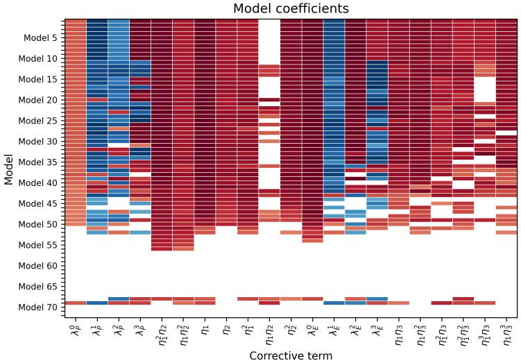  
Fig. B1: Coeficients of the 72 candidate models obtained by the elastic-net grid search on the ZPG training cases T3A and T3B (one row per hyperparameter pair; one column per candidate term, with the notation of Fig. 1). Red and blue shades correspond to positive and negative coeficients, respectively; white cells correspond to inactive terms.

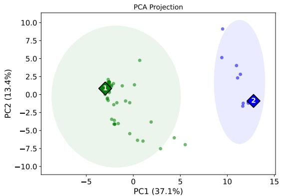  
Fig. B2: Projection of the standardized descriptors of the 72 candidate models of Fig. B1 onto their first two principal components. Dots: candidate models, colored by k-means cluster; diamonds: the two cluster centroids, $M _ { 1 } ^ { \mathrm { Z P G } } ~ ( 1 )$ and $M _ { 2 } ^ { \mathrm { Z P G } } ~ ( 2 )$ 2 propagated through the RANS solver; shaded ellipses: extent of each cluster.

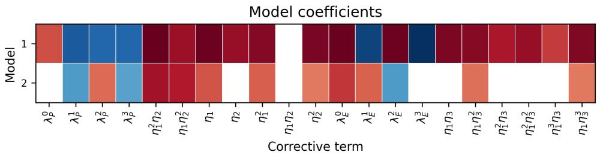  
Fig. B3: Coeficients of the two cluster centroids propagated through the RANS solver, $M _ { 1 } ^ { \mathrm { Z P G } }$ (model 1) and $M _ { 2 } ^ { \mathrm { Z P G } }$ (model 2); color code as in Fig. B1.

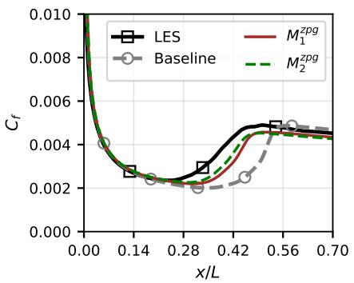  
(a) T3A

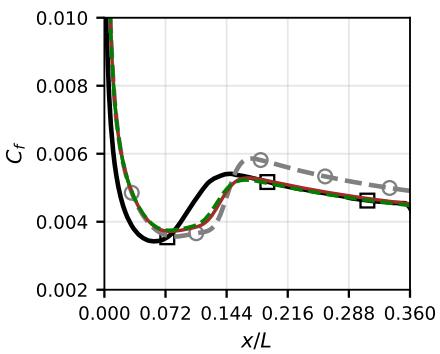  
(b) T3B  
Fig. B4: Cross-validation of the two cluster centroids of the ZPG grid search: skinfriction coeficient predicted on T3A and T3B by $M _ { 1 } ^ { \mathrm { Z P G } }$ (red solid line) and $M _ { 2 } ^ { \mathrm { Z P G } }$ (green dashed line), compared with the LES (black line with squares) and the baseline model (gray dashed line with circles).

## Appendix C Leave-one-case-out cross-validation

This appendix provides additional information on the LOCOCV procedure adopted in the bi-level optimization strategy. The four training cases are split into four subsets (Table C2), each comprising three training cases and one validation case. The bi-level optimization is performed independently on each subset, which yields four candidate models. For each subset, the leader problem is solved by diferential evolution with a population of 40 individuals and a maximum of 100 generations, and each follower problem with a population of 300 individuals and a maximum of 1000 generations. Both use the same $1 0 ^ { - 5 }$ threshold on the loss and are stopped when the best individual has not improved over 20 consecutive generations. Most runs converge well before the maximum budget, the leader problem requiring 40 generations on average, so that the whole optimization can be completed within a reasonable time on a standard workstation.

Table C2 also reports the improvement scores of the four models, each evaluated a posteriori with the RANS solver on its own validation case. All four models improve over the baseline on the case they have not seen, although only marginally for $M _ { S ^ { ( 2 ) } }$ and $M _ { S ^ { ( 3 ) } }$ , validated on T3B and T3C3, respectively. The model $M _ { S ^ { ( 1 ) } }$ , trained on T3B, T3C3 and T3C5, achieves the highest score on its validation case, T3A, and is retained as the bi-level model $M _ { B , L }$ , written explicitly in Eq. (28).
<table><tr><td>Subset</td><td> $S ^ { ( 1 ) }$ </td><td> $S ^ { ( 2 ) }$ </td><td> $S ^ { ( 3 ) }$ </td><td> $S ^ { ( 4 ) }$ </td></tr><tr><td>Training cases</td><td>T3B, T3C3, T3C5</td><td>T3A, T3C3, T3C5</td><td>T3A, T3B, T3C5</td><td>T3A, T3B, T3C3</td></tr><tr><td>Validation case</td><td>T3A</td><td>T3B</td><td>T3C3</td><td>T3C5</td></tr><tr><td> $m _ { \overline { { u } } } \ ( \% )$ </td><td>27.15</td><td>4.09</td><td>1.3</td><td>20.4</td></tr><tr><td> $m _ { \partial \overline { { u } } / \partial y } \ ( \% )$ </td><td>37.81</td><td>5.78</td><td>2.4</td><td>33.97</td></tr><tr><td> $m _ { C _ { f } } \mathrm { ~ ( \bar { \% } ) ~ }$ </td><td>24.82</td><td>2.59</td><td>1.14</td><td>23.69</td></tr><tr><td>mmodel (%)</td><td>29.92</td><td>4.15</td><td>1.61</td><td>26.02</td></tr></table>

Table C2: Leave-one-case-out splits of the four training cases used in the bi-level optimization, and improvement scores of the resulting models $M _ { S ^ { ( k ) } }$ , each evaluated with the RANS solver on its own validation case. The model obtained with subset $S ^ { ( 1 ) }$ is retained as $M _ { B , L }$