# CR-Bench-v2: Evaluating the Real-World Utility of AI Code Review Agents

Kristen Pereira\*, Neelabh Sinha\*, Rajat Ghosh\*, Debojyoti Dutta

Nutanix, Inc.

{kristen.pereira, neelabh.sinha, rajat.ghosh, debojyoti.dutta}@nutanix.com

## Abstract

The rapid growth of automated code generation has created a pressing need for automated code review. Yet code review resists full automation: it depends on context beyond the diff, on the author’s intent, and on judgments about design and maintainability on which even expert reviewers disagree. Existing code review benchmarks lack standardization and rely largely on noisy human review comments scored with text-similarity metrics, which reward surface overlap and fail to measure precision. We in troduce CR-Bench, a defect-centric evaluation framework that recasts SWE-Bench issues as pull-request review tasks with full repository context. After filtering for review-detectable defects and grounding each to a single originating pull request, CR-Bench contains 584 instances, with a 174-instance CR-Bench-Verified sub set derived from SWE-Bench Verified. Each instance pairs a pull request with a known defect, its ground-truth fix, and a taxonomy label for bug category, impact, and severity. We propose two complementary metrics: Known-Defect Detection Rate (KDDR), which measures whether an agent identifies the labeled defect, and Usefulness Rate, which measures the fraction of review comments that are actionable. We evaluate eight code review agents over four backbones, plus commercially available Gemini Code Assist, using three independent LLM judges. Even the strongest systems detect only about one-third of known defects (KDDR ≈ 33%), and Gemini Code Assist detects 8.1%.

## 1 Introduction

Despite significant commercial interest (CodeRabbit, 2024; Google Cloud, 2024; Anthropic, 2024), code review automation remains difficult (Yang et al., 2024; Bacchelli and Bird, 2013) because it is time-consuming for large multi-file repositories, costly, and inherently subjective (GitHub, 2026;

Zeng et al., 2025; Sghaier et al., 2025). Existing code review benchmarks (Table 3, Appendix) fail in pull requests with at least one of these scenarios: multiple diff hunks, multi-file PR context, systematic categorization, and verifiable defect handling (Zeng et al., 2025; Sghaier et al., 2025; Tufano et al., 2021, 2022; Thongtanunam et al., 2022).

Feedback from engineers using review agents on live repositories shows that noisy comments hamper productivity and slow adoption. Before deploying an agent, a team needs to know how often it catches real defects and how much of its output is worth reading.

In this paper, we introduce CR-Bench/CR-Bench-Verified, a benchmark for evaluating how well code review agents detect defects and generate useful review comments. Each review task consists of the source repository, the identification number of the pull request (PR) within that repository, a description of the defect introduced by the PR, the ground-truth patch that resolves the defect, and three taxonomy labels: category, impact, and severity (see Figure 7 in the Appendix). It prioritizes defect-identifying reviews that target functional, performance, reliability, or security regressions: defects cause system faults and can be verified, whereas stylistic preferences are subjective and better handled by linters or human judgment.

Our key contributions are as follows:

• CR-Bench and CR-Bench-Verified. A benchmark of real-world, detectable defects for evaluating automated code review agents, with each defect labeled under a fine-grained taxonomy of category, impact, and severity.

• Two-axis evaluation metrics. A measurement framework that scores code review agents on both logical defect detection and the usefulness of their generated comments.

• Comprehensive benchmarking. An evaluation of eight code review agents and one commercial code review agent, showing that even the strongest agent detects only about one-third of known defects, with practical guidance for teams deploying review agents (§ 6).

## 2 Related Work

Table 3 (Appendix) compares CR-Bench with prior code review datasets on four properties: multiple diff hunks per task, full Pull Request (PR) context, categorization of the reviewed issue, and a focus on a verifiable defect. It also lists how each dataset scores reviews.

Learning-based code review. Early work frames review automation as a sequence-tosequence task over a single code change. Tufano et al. (2021) and Tufano et al. (2022) train models to generate reviewer comments and revised code for method-level changes, and AutoTransform (Thongtanunam et al., 2022) learns the code transformations that reviewers request. CodeReviewer (Li et al., 2022) pre-trains on diff hunks for review comment generation and code refinement. Each task pairs one change with a reference comment or revision, so these datasets lack multi-hunk and cross-file PR context and carry no categorization of the underlying issue. They are scored with Exact Match, BLEU, or Code-BLEU, which reward similarity to the reference rather than detection of a defect. LLM agents such as CodeAgent (Tang et al., 2024) and production tools such as CodeRabbit (CodeRabbit, 2024), Gemini Code Assist (Google Cloud, 2024), and Qodo (Qodo AI, 2024) now review entire PRs, which calls for repository-scale evaluation.

Code review benchmarks. SWR-Bench (Zeng et al., 2025) provides full PR context at repository scale, includes multiple diff hunks, categorizes its PRs, and scores comments with an LLM judge (Liu et al., 2023) using precision, recall, and F1. However, it scores hits against human-verified change points, so its ground truth inherits the subjectivity of those changes and is not tied to a verifiable defect. CR-Bench/CR-Bench-Verified keep the multi-hunk, full-PR setting, ground each instance in a SWE-Bench defect (Jimenez et al., 2024) labeled by category, impact, and severity, and measure both defect detection (KDDR) and developer utility (Usefulness Rate). To the best of our knowledge, they are the first code review benchmarks with all four properties in Table 3.

## 3 CR-Bench: Benchmarking Framework for Code Review

Code Review starts with a Pull Request $( P R )$ on a base code state $( S _ { B } ) - \mathbf { a }$ proposal to integrate a sequence of code modifications into a target codebase. Formally, PR is a set of $\{ { \mathcal { C } } , \Delta , { \mathcal { M } } \}$ , where $\mathcal { C } = \{ c _ { 1 } , c _ { 2 } , . . . , c _ { n } \}$ is a set of discrete commits, $\Delta$ is the cumulative code diff, and M denotes the associated metadata (e.g., title, description, and author). The output for a code review process is a set of m reviews: $\mathcal { R } = \{ ( r _ { c } , r _ { \delta } ) _ { i } \ | \ 1 \leq i \leq m \}$ $r _ { c }$ is a natural language comment, which identifies specific defects or suggests improvements, and $r _ { \delta }$ provides a concrete code-level resolution to the identified defects. The code review task is formalized in Equation 1.

$$
( P R , { \mathcal { S } } _ { \mathcal { B } } ) { \xrightarrow { \mathrm { C R ~ A g e n t o r ~ H u m a n } } } { \mathcal { R } } ^ { m }\tag{1}
$$

We construct the CR-Bench/CR-Bench-Verified benchmarks by transforming the SWE-Bench (Jimenez et al., 2024)/SWE-Bench Verified (Chowdhury et al., 2024) datasets using Algorithm 1. The algorithm converts SWE-Bench’s (issue, patch) instances into (PR, Review) instances: the PR is the earlier pull request that introduced the defect, and the reference review pairs a comment derived from the issue with the fix patch.

## 3.1 Dataset Creation Algorithm

Given the SWE-Bench or SWE-Bench Verified dataset S, each instance $s \in { \mathcal { S } }$ is processed through three sequential phases. Every LLM call in the pipeline uses Claude Opus 4.5 (Anthropic, 2025a) as L. First, we apply an LLM-based detectability filter to classify whether the underlying issue in the patch is inferable from the code change itself. Specifically, we query an LLM L with a detectability prompt $\mathcal { P } _ { D }$ (Listing 1 in the Appendix) over the patch s.patch, and we discard instances deemed non-detectable. This step removes cases that require external context or latent knowledge. Second, we apply PR grounding to link each instance to the real-world pull requests that introduced the modified code. Starting from the base commit $\mathit { c } _ { \mathrm { b a s e } }$ , we retrieve commit IDs of modified lines using git blame. Using these, we retrieve associated PRs of these commit IDs via the GitHub API. Third, we apply a single-PR filter. We retain only the instances that map to a single PR, ensuring an unambiguous correspondence between the patch and its origin

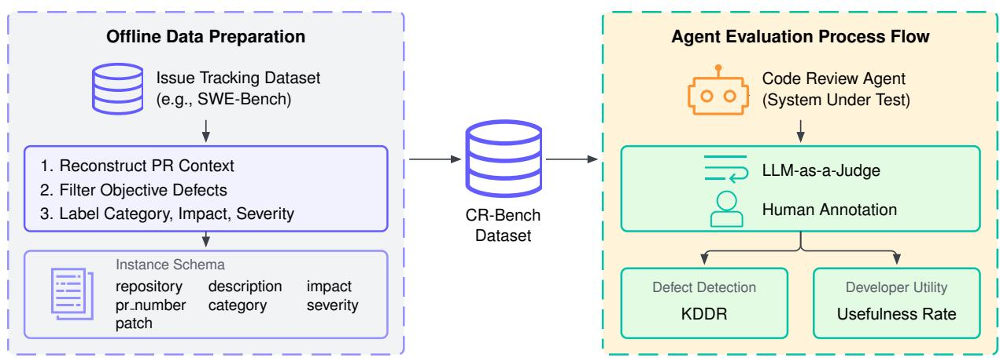  
Figure 1: CR-Bench framework. Offline preparation turns SWE-Bench defects into PR-context instances with taxonomy labels. An LLM judge classifies agent comments, and human annotations validate the classifications. KDDR measures labeled-defect detection. Usefulness Rate measures developer utility.

Algorithm 1: CR-Bench Construction via SWE-Bench Transformation   
Require: SWE-Bench S, LLM L, prompts $\mathcal { P } _ { D }$ (detectability), $\mathcal { P } _ { C }$ (comment),   
$\mathcal { P } _ { T }$ (tagging)   
Ensure: CR-Bench dataset D   
1: $\mathcal { D }  \emptyset$   
2: for each instance $s \in S$ do   
3: Detectabilityfiltering: is\_detectable ← L(P<sub>D</sub>, s.patch)   
4: continue if ¬is\_detectable   
5: PR grounding: $c _ { b a s e }  s$ .base\_commit   
6: $\mathcal { C } _ { b l a m e }  \mathrm { G I T B L A M E } ( c _ { b a s e } )$   
7: PR ← QUERYGITHUBAPI(C<sub>blame</sub>)   
8: Single-PRfilter: continue if $| P R | \neq 1$   
9: pr ← unique element of P R   
10: Attribute generation & aggregation: $r _ { c } \gets \mathcal { L } ( \mathcal { P } _ { C } , s . \mathrm { d e s c } )$   
11: r<sub>δ</sub> ← s.patch   
12: $t _ { g e n } \gets \mathsf { \tilde { L } } ( \mathcal { P } _ { T } , r _ { \delta } , r _ { c } )$   
13: D ← D ∪ {(pr, r<sub>δ</sub>, r<sub>c</sub>, t<sub>gen</sub>)}   
14: end for   
15: return $\mathcal { D }$

PR. Instances with zero or multiple associated PRs are discarded. Finally, we perform attribute generation and dataset aggregation. For each retained instance, we generate a natural language review comment $r _ { c }$ using L with prompt $\mathcal { P } _ { C }$ (Listing 2 in Appendix), conditioned on the original problem description. The patch itself is retained as $r _ { \delta }$ We further assign tags of category, impact, severity $t _ { \mathrm { g e n } }$ using a tagging prompt $\mathcal { P } _ { T }$ (Listing 3 in Appendix) over both the patch and generated comment. The resulting tuple $( p r , r _ { \delta } , r _ { c } , t _ { \mathrm { g e n } } )$ is added to the dataset D. Together, these steps keep only actionable, context-resolvable review scenarios, and the generated attributes support fine-grained evaluation. They reduce SWE-Bench from 2,294 to 584 instances (CR-Bench) and SWE-Bench Verified from 500 to 174 (CR-Bench-Verified). The 174 CR-Bench-Verified tasks span 11 source repositories, led by Django with 63 (Figure 5, Appendix). Other repositories include mathematical libraries like sympy/sympy, and specialized tools such as astropy/astropy and scikit-learn/scikit-learn. The statistics in Table 4, Appendix show that CR-Bench covers large scale PRs and an code review agents must be robust to perform well on it. An example of data instance is given in Figure 6 in Appendix.

<table><tr><td>Taxonomy</td><td>Elements</td></tr><tr><td>Category</td><td>Structural, IIS, RFF, Data, Concurrency, Memory, Secu- rity, Coding</td></tr><tr><td>Impact</td><td>Functional Suitability, Per- formance Efficiency, Com- patibility, Usability, Reliabil- ity, Security, Maintainability, Portability</td></tr><tr><td>Severity</td><td>Low, Medium, High</td></tr></table>

Table 1: The CR-Bench taxonomy elements for defect labeling. Category follows Beizer (1984); Islam et al. (2019) and impact follows ISO 25010 (International Organization for Standardization and International Electrotechnical Commission, 2023); severity is ours.

For ease of evaluation analytics, each instance of the CR-Bench/CR-Bench-Verified datasets is labeled into three classes: category, impact, and severity, as defined in Table 1 and Figure 7 in the Appendix. In order to generate class labels, we make an LLM call (Step 12 in Algorithm 1) using the problem definition (desc) and fix patch with a tag generation prompt $\mathcal { P } ^ { \mathcal { T } }$ (Listing 3 in Appendix). The prompt also elaborates on the definition of each of the items in all three buckets.

As per Figure 8, CR-Bench-Verified is heavily weighted toward Structural Bugs, accounting for 82.8% of the corpus. These represent complex errors in logical flow. The primary impacts are Functional Suitability and Reliability. The rigor is further evidenced by 92.5% of the defects being Medium or High severity. High-severity defects are predominantly linked to Reliability and Functional Suitability, representing critical failures that would likely result in system regressions if merged. The 174 instances are what survives applying detectability filtering, PR grounding, and the single-PR filter to the 500 human-validated instances of SWE-Bench Verified (Chowdhury et al., 2024), a scale comparable to agentic benchmarks that verify every instance by hand, such as Terminal-Bench 2.0 with 89 tasks (Merrill et al., 2026).

The expansion into the full CR-Bench further reinforces these findings while increasing the size of the benchmark. As shown in Figure 9, Appendix C, this larger dataset adds instances of impacts like Maintainability, Security, and some readjustments to proportions of different categories, impacts, and bugs. This ensures that the benchmark provides a meaningful assessment of an agent’s ability.

## 4 Experiments

We assess the construct validity of CR-Bench by testing whether it reproduces well-established patterns from prior work. We test two: iterative self-reflection on a model’s own output improves over single-shot generation (Shinn et al., 2023), and stronger models resolve more repository-level tasks, as reflected in the SWE-Bench leaderboard (Jimenez et al., 2024). Reflexion should thus beat single-shot on each backbone, and GPT-5 backbones should beat the smaller open-weight ones.

We evaluate four backbone LLMs: two closed-API models, GPT-5.2 (Singh et al., 2025; OpenAI, 2025a) and GPT-5-mini (Singh et al., 2025), and two open-weight models, Gemma 4 31B (Google DeepMind, 2026) and GPT-OSS 20B (OpenAI, 2025b). All nine resulting systems are evaluated on CR-Bench-Verified.

We evaluate each model under two harnesses of increasing complexity: a single-shot harness that issues one model call over the PR diff (Listing 4 in Appendix, inspired by Qodo AI (2024)), and a self-reflection harness that iteratively critiques and revises its review (Shinn et al., 2023) (Listing 5,

Appendix A.2). We also evaluate Gemini Code Assist, a fully managed commercial agent whose underlying LLM and harness are not disclosed, by cloning PRs and repositories into a private GitHub instance and invoking it through its GitHub $\mathsf { A p p } ^ { 1 }$

CR-Bench itself was built with Claude Opus 4.5 (§3), which we use neither as a review agent nor as a judge. We score each fixed set of reviews independently with GPT-5.4 (OpenAI, 2026), Claude Sonnet 4.5 (Anthropic, 2025b), and DeepSeek V4 Flash (DeepSeek-AI, 2026) using the same balanced evaluator prompt (Listing 6 in Appendix). We additionally test strict (Listing 7 in Appendix) and lenient (Listing 8) prompt variants for the GPT-5.2 single-shot and Reflexion outputs.

## 4.1 Evaluation Methodology with LLM-as-a-Judge

CR-Bench uses LLM-as-a-Judge evaluators (Listing 6, Appendix A.3) to classify each review comment into one of two labels: first, Bug Hit (H) corresponds to reviews that accurately identify or directly relate to the specific bug described in the ground truth review, and second, Valid Suggestion (S) corresponds to reviews with constructive feedback such as stylistic improvements, performance optimizations, or edge-case handling. These reviews are significant, but not related to the primary defects in ground truth. We measure identification of the benchmark’s labeled defect using the Known-Defect Detection Rate (KDDR). Let each of the B benchmark instances contain one SWE-Bench-derived known defect. A PR may contain other unlabeled defects. Let $d _ { i } = 1$ when at least one review comment identifies instance i’s known defect, and $d _ { i } = 0$ otherwise:

$$
\mathrm { K D D R } = \frac { 1 } { B } \sum _ { i = 1 } ^ { B } d _ { i }\tag{2}
$$

KDDR scores review output against the defect CR-Bench labels for each instance, so it measures detection rather than repair and is not comparable to SWE-Bench resolve rates.

Because agents can produce useful comments beyond the single labeled defect, we also report Usefulness Rate (U). Here, R is the total number of review comments:

$$
U = { \frac { H + S } { R } }\tag{3}
$$

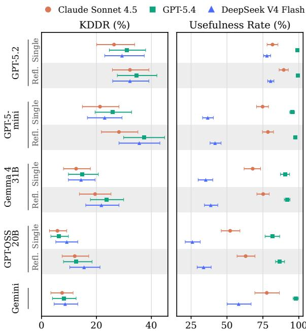  
Figure 2: Judge-specific KDDR (left) and Usefulness Rate (right) for the same fixed review comments on all 174 verified instances under the balanced prompt. Single = single-shot, Refl. = Reflexion, and Gemini = Gemini Code Assist. Marker shape identifies the judge. Points are full-sample estimates. Bars are 95% percentile confidence intervals from 1,000 instance-level bootstrap resamples.

Uncertainty and robustness. Point estimates use all 174 instances. 95% confidence intervals come from 1,000 instance-level bootstrap resamples (seed 42) that keep each instance’s comments together. Strategy comparisons are paired by instance\_id, with paired bootstrap intervals and two-sided permutation tests (1,000 permutations). The balanced evaluator prompt is primary; strict and lenient variants measure prompt sensitivity (Appendix F).

## 5 Results

## 5.1 Does CR-Bench Reproduce Known Patterns?

Both patterns from Section 4 hold. First, Reflexion improves KDDR for every backbone under every judge (Table 2), significantly in 8 of the 12 backbone–judge pairs. GPT-5.2, the strongest single-shot system, gains 2.9–5.7 points without reaching significance. Second, both GPT-5 backbones beat both open-weight backbones under each strategy (Figure 3). Gemini Code Assist detects only $8 . 1 \pm 0 . 6 \%$ of known defects, below every system except single-shot GPT-OSS 20B. Even the best systems detect only about one-third of known defects (KDDR ≈ 33%), so CR-Bench is far from saturated.

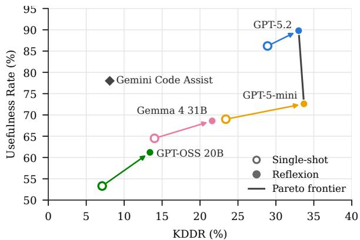

Figure 3: Three-judge mean KDDR and Usefulness Rate per system (Table 7). Arrows go from single-shot (hollow) to Reflexion (filled). The solid line is the Pareto frontier.
<table><tr><td>Backbone</td><td>Claude</td><td>GPT-5.4</td><td>DeepSeek</td></tr><tr><td>GPT-5.2</td><td> $+ 5 . 7$ </td><td> $+ 3 . 4$ </td><td> $+ 2 . 9$ </td></tr><tr><td>GPT-5-mini</td><td> $+ 6 . 9 ^ { * }$ </td><td> $+ 1 1 . 5 ^ { * }$ </td><td> $+ 1 2 . 6 ^ { * }$ </td></tr><tr><td>Gemma 431B</td><td> $+ 6 . 9 ^ { * }$ </td><td> $+ 8 . 6 ^ { * }$ </td><td> $+ 7 . 5 ^ { * }$ </td></tr><tr><td>GPT-OSS 20B</td><td> $+ 6 . 3 ^ { * }$ </td><td> $+ 6 . 3 ^ { * }$ </td><td> $+ 6 . 3$ </td></tr></table>

Table 2: Reflexion minus single-shot KDDR (percentage points) on CR-Bench-Verified, per backbone and judge. $^ { * } p < 0 . 0 5$ , two-sided paired permutation test over instances. Confidence intervals and the other metrics are in Table 9, Appendix F.

## 5.2 Defect Detection versus Developer Utility

Reflexion improves both for every backbone, so self-reflection does not trade usefulness for detection. Only GPT-5.2 and GPT-5-mini Reflexion are Pareto-optimal: GPT-5-mini matches GPT-5.2 on KDDR (33.7 vs. 33.0%) but trails it by 17 points in Usefulness Rate. Gemini Code Assist shows the opposite profile: its comments are often useful (78.0%) but rarely hit the known defect.

## 5.3 Robustness to the Evaluator

Each judge scores the same fixed review comments (Figure 2). The judges agree on direction but not on level: GPT-5.4 gives the highest Usefulness Rate for all nine systems and DeepSeek V4 Flash the lowest, while Claude Sonnet 4.5 gives the lowest KDDR for eight of nine. Paired comparisons within a judge are therefore more reliable than absolute scores. For GPT-5.2, the Reflexion KDDR gain also holds under strict and lenient evaluator prompts (Table 10, Appendix F).

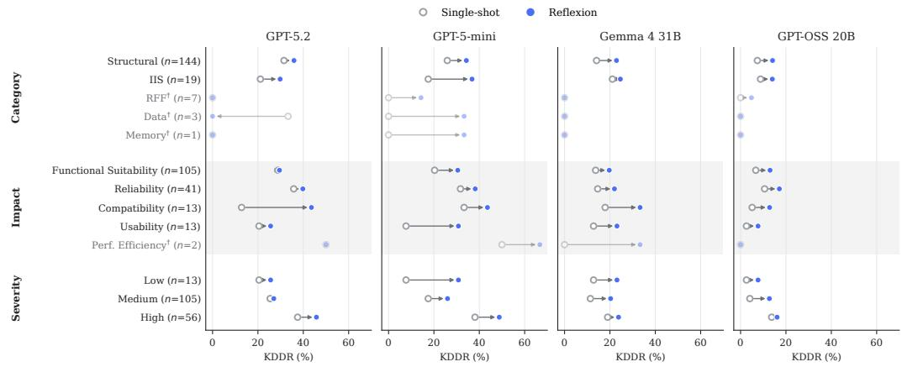  
Figure 4: KDDR for every taxonomy group (Table 11, Appendix F), one panel per backbone. Hollow gray markers are single-shot, filled blue markers are Reflexion, and arrows point from single-shot to Reflexion. Each value averages the three judges under the balanced prompt. Faded rows marked <sup>†</sup> have fewer than 10 instances and are shown for completeness only. RFF = Requirements, Features and Functionality, IIS = Interface, Integration and System.

## 5.4 Which Defects Do Agents Catch?

Figure 4 breaks KDDR down by taxonomy group. Four groups have fewer than ten instances, so we draw conclusions only from groups with at least 13. Severity matters only for the GPT-5 backbones: with Reflexion, GPT-5.2 and GPT-5-mini detect 45.8% and 48.8% of high-severity defects against 27.0% and 26.0% of medium ones, while Gemma 4 31B and GPT-OSS 20B show no clear difference. Reflexion improves KDDR in every well-populated group for every backbone, most for GPT-5-mini; the largest single gain is GPT-5.2 on Compatibility defects (12.8% to 43.6%). Table 11 and Figure 16 give the full breakdown.

## 5.5 Can an LLM Judge Replace Human Annotators?

Three expert developers independently labeled 60 reviews from the GPT-5.2 Reflexion agent. Claude Sonnet 4.5 matches the human majority on 71.7% of them, while pairwise agreement among the experts themselves ranges from 0.48 to 0.75. Under the Alternative Annotator Test (Calderon et al., 2025), its winning rate is 67% at ϵ = 0.3 and 100% at ϵ = 0.5, so once the cost of expert annotation is counted $( \epsilon \geq 0 . 3 )$ , it is a statistically justified substitute for an individual expert annotator. Appendix E reports the full study.

## 6 Conclusion

We introduced CR-Bench, a defect-centric (PR, Review) benchmark of 584 instances (174 verified) labeled by root cause, impact, and severity, which scores review agents on known-defect detection and usefulness.

Implications for practice. (1) The best systems catch about one-third of known defects, so agents should assist human reviewers, not gate merges. (2) Self-reflection raised both KDDR and Usefulness Rate for every backbone. (3) Usefulness alone misleads: Gemini Code Assist’s comments are useful 78.0% of the time, yet it detects 8.1% of known defects, so test agents against known defects before deployment. (4) LLM judges differ in calibration, so compare agents under the same judge.

Future work will add more languages and agent designs and use CR-Bench for post-training.

## Limitations

Scope of the data. CR-Bench inherits the scope of SWE-Bench: all instances come from open-source Python repositories, and the 174 CR-Bench-Verified tasks span only 11 of them, with Django alone contributing 63. Results may not transfer to other languages, to proprietary or monorepo codebases, or to review practices outside these projects. The reported agent evaluation uses only the verified split; broader conclusions require evaluating the full corpus and additional ecosystems.

One known defect per instance. Each instance supplies a single known defect, so KDDR measures whether an agent finds that defect, not whether it finds every defect in a PR. Other correct defect reports are counted as Valid Suggestions rather than

Bug Hits and contribute to the Usefulness Rate instead.

LLM-generated references and labels. Claude Opus 4.5 filters instances for detectability, writes the reference review comments, and assigns the taxonomy labels. Errors in these steps propagate to KDDR and to the per-group results, and the detectability filter may exclude defects that a human reviewer could catch.

Evaluator dependence. Absolute scores depend on judge calibration: the three judges agree on the direction of differences but not on their magnitude. Our primary human-validated judge, Claude Sonnet 4.5, belongs to the same model family as the model that generated the references, which may favor phrasing close to those references. The human study covers 60 comments from a single system (GPT-5.2 Reflexion) and validates only that judge. We mitigate these effects by reporting three judges, prompt variants, and paired within-judge comparisons.

Contamination. The repositories, issues, and fixes behind SWE-Bench are public and may appear in the training data of the evaluated models, which could inflate KDDR.

Agents evaluated. We evaluate two reproducible harnesses, neither of which executes code or uses tools, and one commercial agent whose model and harness are undisclosed and may change over time. We do not report cost or latency, so the extra model calls that Reflexion requires are not weighed against its gains.

## Ethical Considerations

Data. CR-Bench is derived from SWE-Bench and SWE-Bench Verified, which are built from public open-source repositories. It adds pull request identifiers, LLM-generated reference comments, and taxonomy labels, and it contains no private or proprietary code.

Human annotation. Two in-house software engineers and one technical director labeled 60 review comments as Bug Hit, Valid Suggestion, or Noise as part of their regular duties, and they agreed to the use of their labels. The task involved only public code and model-generated review text.

Responsible use. The best evaluated systems detect about one-third of known defects. Teams that rely on review agents as the only safeguard may therefore merge defective code. We recommend using such agents to assist human reviewers rather than to replace them, and testing them against known defects before deployment.

## References

Anthropic. 2024. Claude code: Github actions documentation. Accessed: 2024-05-20.

Anthropic. 2025a. Claude Opus 4.5. https://www. anthropic.com/news/claude-opus-4-5. Large language model.

Anthropic. 2025b. Claude sonnet 4.5. https:// www.anthropic.com/news/claude-sonnet-4-5. Large language model.

Alberto Bacchelli and Christian Bird. 2013. Expectations, outcomes, and challenges of modern code review. In 2013 35th International Conference on Software Engineering (ICSE), pages 712–721.

B. Beizer. 1984. Software System Testing and Quality Assurance. Electrical-Computer Science and Engineering Series. Van Nostrand Reinhold.

Nitay Calderon, Roi Reichart, and Rotem Dror. 2025. The alternative annotator test for LLM-as-a-judge: How to statistically justify replacing human annotators with LLMs. In Proceedings of the 63rd Annual Meeting of the Association for Computational Linguistics (Volume 1: Long Papers), pages 16051– 16081, Vienna, Austria. Association for Computational Linguistics.

Neil Chowdhury, James Aung, Chan Jun Shern, Oliver Jaffe, Dane Sherburn, Giulio Starace, Evan Mays, Rachel Dias, Marwan Aljubeh, Mia Glaese, Carlos E. Jimenez, John Yang, Kevin Liu, and Aleksander Madry. 2024. Introducing SWE-bench verified. OpenAI.

CodeRabbit. 2024. Coderabbit: Ai-powered code reviews. Accessed: 2024-05-20.

DeepSeek-AI. 2026. DeepSeek-V4-Flash. https://huggingface.co/deepseek-ai/ DeepSeek-V4-Flash. Open-weight large language model.

GitHub. 2026. How to improve code with code reviews. https://github.com/resources/articles/ how-to-improve-code-with-code-reviews. GitHub Resources article. Accessed: 2026-10-31.

Google Cloud. 2024. Gemini code assist: Ai-powered assistance for software development. Accessed: 2024-05-20.

Google DeepMind. 2026. Gemma 4 31B. https: //huggingface.co/google/gemma-4-31B. Openweight large language model.

International Organization for Standardization and International Electrotechnical Commission. 2023. Systems and software engineering — systems and software quality requirements and evaluation (square) product quality model. Technical Report ISO/IEC 25010:2023, International Organization for Standard ization, Geneva, Switzerland.

Md Johirul Islam, Giang Nguyen, Rangeet Pan, and Hridesh Rajan. 2019. A comprehensive study on deep learning bug characteristics. Preprint, arXiv:1906.01388.

Carlos E Jimenez, John Yang, Alexander Wettig, Shunyu Yao, Kexin Pei, Ofir Press, and Karthik R Narasimhan. 2024. SWE-bench: Can language models resolve real-world github issues? In The Twelfth International Conference on Learning Representations.

Zhiyu Li, Shuai Lu, Daya Guo, Nan Duan, Shailesh Jannu, Grant Jenks, Deep Majumder, Jared Green, Alexey Svyatkovskiy, Shengyu Fu, et al. 2022. Codereviewer: Pre-training for automating code review activities. arXiv preprint arXiv:2203.09095.

Yang Liu, Dan Iter, Yichong Xu, Shuohang Wang, Ruochen Xu, and Chenguang Zhu. 2023. G-eval: NLG evaluation using gpt-4 with better human alignment. In Proceedings of the 2023 Conference on Empirical Methods in Natural Language Processing, pages 2511–2522, Singapore. Association for Computational Linguistics.

Mike A. Merrill, Alexander G. Shaw, Nicholas Carlini, Boxuan Li, Harsh Raj, Ivan Bercovich, Andy Konwinski, Ludwig Schmidt, et al. 2026. Terminalbench: Benchmarking agents on hard, realistic tasks in command line interfaces. Preprint, arXiv:2601.11868.

OpenAI. 2025a. Gpt-5.2. https://openai.com/ index/introducing-gpt-5-2/. Large language model.

OpenAI. 2025b. gpt-oss-120b & gpt-oss-20b Model Card. Preprint, arXiv:2508.10925.

OpenAI. 2026. Introducing GPT-5.4. https: //openai.com/index/introducing-gpt-5-4/. Large language model.

Qodo AI. 2024. Pr-agent: Ai-powered tool for automated pull request analysis, feedback, and suggestions. Accessed: 2024-05-20.

Oussama Ben Sghaier, Martin Weyssow, and Houari Sahraoui. 2025. Harnessing large language models for curated code reviews. Preprint, arXiv:2502.03425.

Noah Shinn, Federico Cassano, Edward Berman, Ashwin Gopinath, Karthik Narasimhan, and Shunyu Yao. 2023. Reflexion: Language agents with verbal reinforcement learning. Preprint, arXiv:2303.11366.

Aaditya Singh, Adam Fry, Adam Perelman, Adam Tart, Adi Ganesh, Ahmed El-Kishky, Aidan McLaughlin, Aiden Low, AJ Ostrow, Akhila Ananthram, Akshay Nathan, Alan Luo, Alec Helyar, Aleksander Madry, Aleksandr Efremov, Aleksandra Spyra, Alex Baker-Whitcomb, Alex Beutel, Alex Karpenko, and 465 others. 2025. Openai gpt-5 system card. Preprint, arXiv:2601.03267.

Xunzhu Tang, Kisub Kim, Yewei Song, Cedric Lothritz, Bei Li, Saad Ezzini, Haoye Tian, Jacques Klein, and Tegawendé F. Bissyandé. 2024. CodeAgent: Autonomous communicative agents for code review. In Proceedings of the 2024 Conference on Empirical Methods in Natural Language Processing, pages 11279–11313, Miami, Florida, USA. Association for Computational Linguistics.

Patanamon Thongtanunam, Chanathip Pornprasit, and Chakkrit Tantithamthavorn. 2022. Autotransform: automated code transformation to support modern code review process. In Proceedings of the 44th International Conference on Software Engineering, ICSE ’22, pages 237–248, New York, NY, USA. Association for Computing Machinery.

Rosalia Tufano, Simone Masiero, Antonio Mastropaolo, Luca Pascarella, Denys Poshyvanyk, and Gabriele Bavota. 2022. Using pre-trained models to boost code review automation. In Proceedings ofthe 44th International Conference on Software Engineering, ICSE ’22, pages 2291–2302, New York, NY, USA. Association for Computing Machinery.

Rosalia Tufano, Luca Pascarella, Michele Tufano, Denys Poshyvanyk, and Gabriele Bavota. 2021. Towards automating code review activities. In Proceedings of the 43rd International Conference on Software Engineering, ICSE ’21, pages 163–174. IEEE Press.

Zezhou Yang, Cuiyun Gao, Zhaoqiang Guo, Zhenhao Li, Kui Liu, Xin Xia, and Yuming Zhou. 2024. A survey on modern code review: Progresses, challenges and opportunities. Preprint, arXiv:2405.18216.

Zhengran Zeng, Ruikai Shi, Keke Han, Yixin Li, Kaicheng Sun, Yidong Wang, Zhuohao Yu, Rui Xie, Wei Ye, and Shikun Zhang. 2025. Benchmarking and studying the llm-based code review. Preprint, arXiv:2509.01494.

## Appendix

A Prompts 10   
A.1 Dataset Creation Prompts . 10   
A.2 Agent Prompts 12   
A.3 Evaluation Prompts 14   
B Novelty Positioning Matrix 16   
C Dataset 16   
C.1 Statistics . 16   
C.2 Example Instance 16   
D Taxonomy 19   
E Alternative Annotator Test 22   
E.1 Annotation Setup 22   
E.2 Formalism 22   
E.3 Results . . 22   
E.4 Agreement Analyses 23   
F Results 26   
F.1 Evaluator Robustness and Uncertainty 26   
F.2 KDDR by Taxonomy Group 26

## A Prompts

A.1 Dataset Creation Prompts

system = """ You are a software   
engineering expert analyzing code   
changes .   
Your task is to determine if a change is   
of the kind that might have been   
prevented by reviewing the PR/ commit   
that made that change more   
carefully or NOT .   
Name these PREVENTABLE and UNPREVENTABLE   
PREVENTABLE : Code changes that fix   
incorrect behavior , errors , crashes ,   
or unexpected results introduced by   
a previous code change (PR/ commit ).   
UNPREVENTABLE : Everything else including   
but not limited to: New features ,   
refactoring , documentation ,   
performance improvements , or   
enhancements .   
Respond with JSON only :   
{ " category ": " PREVENTABLE " or "   
UNPREVENTABLE ", " confidence ": 0.0 to   
1.0 , " reasoning ": " brief   
explanation " }"""   
user = """ Problem Statement :   
{ problem\_statement }   
Patch :   
{ patch }   
Is this a bug fix that might have been   
introduced by a previous code change   
( PR / commit ) ?"""

Listing 1: Prompt for classifying a SWE Bench bug as detectable/not detectable.

```python
system =""" You are a software engineering
expert writing technical bug
descriptions .
Given a problem statement and the code
fix patch , write a concise technical
description of the bug .
** Format Requirements :**
- Start with a clear statement of what 's
wrong
- Include specific code snippets showing
the problematic pattern
- Explain why it 's a bug ( runtime impact
incorrect behavior )
- Keep it under 100 words
- Use technical language
- Focus on the root cause , not symptoms
Respond with ONLY the bug description (
no JSON , no extra formatting ) ."""
user =""" Bug Description Task
## Problem Statement
{row[' problem_statement ']}
```

## Code Fix   
File : { file\_path }   
Lines : { line\_start }-{ line\_end }   
\`\`\`diff   
{ patch }   
Write a concise technical description of   
this bug ."""

Listing 2: Prompt for paraphrasing the issue description.

system = """ You are a software   
engineering expert analyzing bug   
reports to classify them according   
to a predefined bug taxonomy used in   
empirical software engineering   
research .   
Analyze the bug from the issue   
description ( problem statement ) and   
the code fix patch , and provide a   
classification using the following   
fields .   
### 1. \*\* category \*\*   
Choose EXACTLY ONE of the following bug   
types :   
#### \*\*1. Requirements , Features , and   
Functionality Bugs \*\*   
\*\* Source :\*\* Ambiguous , incomplete ,   
misunderstood , or changing   
requirements / specifications .   
\*\* Types :\*\*   
\* \*\* Requirements bugs :\*\* Missing ,   
ambiguous , or inconsistent   
requirements .   
\* \*\* Feature bugs :\*\* Wrong , missing , or   
extra features , including undesired   
enhancements .   
\*\* Detection / Remedy :\*\* Formal   
specification languages ,   
functional testing ( transaction   
flow , domain , logic , state - based   
testing ) .   
#### \*\*2. Structural Bugs \*\*   
\*\* Source :\*\* Code control flow , sequence ,   
and logical structure .   
\*\* Types :\*\*   
\* \*\* Control & sequence bugs :\*\* Missing   
paths , unreachable code , improper   
loop nesting , misused GOTO / labels .   
\* \*\* Logic bugs :\*\* Incorrect logical   
expressions and Boolean errors .   
\* \*\* Processing bugs :\*\* Arithmetic ,   
algorithm , type conversion , overflow   
errors .

\* \*\* Initialization bugs :\*\* Uninitialized variables or improper first - loop values .

\* \*\* Data - flow anomalies :\*\* Using uninitialized or stale data or failing to store or modify data correctly .

\*\* Detection / Remedy :\*\* Structural / path testing , unit testing , domain testing .

\#### \*\*3. Data Bugs \*\*

\*\* Source :\*\* Specification , format , initial values , and usage of data objects .

\* \*\* Dynamic data bugs :\*\* Temporary data issues , shared memory residues .

\* \*\* Static data bugs :\*\* Fixed content , parameters , and preprocessing errors

\* \*\* Role - based bugs :\*\* Errors in data used as control , parameter , or information .

\* \*\* Attributes , structure , content bugs :\*\* Incorrect semantics , memory allocation , or representation .

\*\* Detection / Remedy :\*\* Validate all data declarations , centralize shared resources , defensive coding , compile - time checks .

## #### \*\*4. Coding Bugs \*\*

\*\* Source :\*\* Programming errors , including wild - card or arbitrary mistakes .

\* \*\* Syntax errors :\*\* Usually caught by compilers .

\* \*\* Documentation bugs :\*\* Misleading comments or manuals .

\*\* Detection / Remedy :\*\* Proper code review , accurate documentation , automated syntax checking .

\#### \*\*5. Interface , Integration , and System Bugs \*\*

\*\* Source :\*\* Interactions between components , systems , or hardware .

\*\* Types :\*\*

\* \*\* External interface bugs :\*\* Wrong device or protocol handling .

\* \*\* Internal interface bugs :\*\* Improper module communication .

\* \*\* Hardware bugs :\*\* Misunderstood device behavior , I/O errors .

\* \*\* OS bugs :\*\* Misuse or assumption of OS services .

\* \*\* Software architecture bugs :\*\* Emergent behavior due to module interactions or stress .

\* \*\* Integration bugs :\*\* Incompatibilities between integrated modules .

\* \*\* System bugs :\*\* Complex interaction of multiple components , rare but expensive .

\*\* Detection / Remedy :\*\* Design for modularity , stress testing , integration testing , specialist interfaces .

\#### \*\*6. Test and Test Design Bugs \*\*

\*\* Source :\*\* Errors in testing processes or test code .

\* \*\* Test execution bugs :\*\* Incorrect test implementation .

\* \*\* Test design bugs :\*\* Flawed test scenarios or criteria . \*\* Detection / Remedy :\*\* Test debugging , automation of test execution and design , test quality assurance .

\* \*\* Buffer overflow :\*\* Access beyond allocated memory .

\* \*\* Stack smashing :\*\* Overwriting function return addresses .

\* \*\* Memory leak :\*\* Lost pointers to allocated memory .

\* \*\* Uninitialized read :\*\* Accessing memory before initialization .

\* \*\* Double free :\*\* Freeing memory twice . \*\* Detection / Remedy :\*\* Careful memory management , automated memory checking tools .

\*\* Source :\*\* Multi - threading or multi - process synchronization issues .

\* \*\* Data race bugs :\*\* Conflicting access to shared memory .

\* \*\* Atomicity bugs :\*\* Interrupted sequences of operations .

\* \*\* Deadlock :\*\* Processes waiting indefinitely for shared resources . \*\* Detection / Remedy :\*\* Proper synchronization , lock ordering , deadlock detection mechanisms .

## ### 2. \*\* severity \*\*

Classify the runtime impact of the bug :

\* \*\* Critical :\*\* System crash , severe malfunction , data loss , or serious security risk .

\* \*\* High :\*\* Core functionality broken or system unusable in common scenarios

\* \*\* Medium :\*\* Partial malfunction ,   
degraded behavior , or non - critical   
failures .   
\* \*\* Low :\*\* Minor issues , cosmetic   
problems , edge cases , or test - only   
failures .   
### 3. \*\* impact \*\*   
Choose EXACTLY ONE aspect of the   
software that the bug directly   
compromises :   
#### \*\*1. Functional Suitability \*\*   
\* \*\* Description :\*\* Bugs that cause   
incorrect , missing , or inappropriate   
behavior relative to requirements .   
\* \*\* Examples :\*\* Wrong outputs , missing   
features , incorrect calculations .   
#### \*\*2. Performance Efficiency \*\*   
\* \*\* Description :\*\* Bugs that degrade   
system performance or resource   
utilization .   
\* \*\* Examples :\*\* Slow response , high CPU /   
memory usage , poor throughput .   
#### \*\*3. Compatibility \*\*   
\* \*\* Description :\*\* Bugs that interfere   
with interoperability or co -   
existence with other systems ,   
devices , or software .   
\* \*\* Examples :\*\* Integration failures ,   
protocol mismatches , API   
incompatibilities .   
#### \*\*4. Usability \*\*   
\* \*\* Description :\*\* Bugs that make the   
system confusing , hard to use , or   
increase user errors .   
\* \*\* Examples :\*\* Misleading error   
messages , poor workflow ,   
inaccessible UI elements .   
#### \*\*5. Reliability \*\*   
\* \*\* Description :\*\* Bugs that cause   
system instability , crashes ,   
incorrect state , or inability to   
recover from failures .   
\* \*\* Examples :\*\* Crashes , deadlocks ,   
memory leaks , data corruption .   
#### \*\*6. Security \*\*   
\* \*\* Description :\*\* Bugs that expose the   
system to threats , unauthorized   
access , or data compromise .   
\* \*\* Examples :\*\* Buffer overflows ,   
improper access control , injection   
vulnerabilities .   
#### \*\*7. Maintainability \*\*

```python
* ** Description :** Bugs that make code
harder to understand , modify , or
extend .
* ** Examples :** Poorly structured code ,
missing documentation , complex
interdependencies .
#### **8. Portability **
* ** Description :** Bugs that prevent
software from being installed ,
executed , or transferred across
different environments .
* ** Examples :** OS - specific assumptions ,
hardware incompatibilities ,
environment - specific failures .
### 4. ** reasoning **
Concisely explain the reasoning behind
the ** category **, ** impact **, and **
severity ** of the bug .
### Output format
Respond ONLY with valid JSON in the
following format :
`json
{
" category ":
" severity ":
" impact ": 11
" reasoning ":
}
Do not include explanations , markdown ,
or any additional text outside the
JSON ."""
user = """# Bug Classification Task
## Problem Statement
{ problem_statement }
## Code Fix
File : { file_path }
Lines : { line_start }-{ line_end }
```diff
{ correct_fix }
Analyze this bug and provide
classification as JSON ."""
```

Listing 3: Prompt for categorizing PR and bugs into category, impact, severity.

## A.2 Agent Prompts

```jinja
SYSTEM_PROMPT = """ You are an expert ## Focus Areas :
code reviewer analyzing pull 1. ** Bugs **: Logic errors , incorrect
requests for potential bugs and implementations , type mismatches
issues . 2. ** Edge Cases **: Unhandled null /
undefined , empty arrays , boundary
Your task is to review the provided code conditions
changes and identify : 3. ** Security **: SQL injection , XSS ,
1. Potential bugs or errors authentication bypasses , data leaks
2. Logic issues 4. ** Concurrency **: Race conditions ,
3. Edge cases not handled deadlocks , thread safety issues
4. Security vulnerabilities 5. ** Performance **: Memory leaks ,
5. Performance problems infinite loops , inefficient
algorithms
For each issue found , provide :
- file : The file path ## Output Format :
- line : The line number ( approximate ) Return a JSON array . Each issue must
- comment : Clear description of the include :
issue file : Exact file path from the diff
- severity : " high ", " medium ", or " low" line : Line number where issue occurs
comment : Specific , actionable
Output your review as a JSON array of description of the bug ( not generic
comments . Example : warnings )
[ severity : " high " ( crashes / security ),
{ medium " ( data corruption / incorrect
" file ": " src / module .py", behavior ), "low" ( minor issues )
" line ": 42,
" comment ": " Potential null pointer ## Quality Standards :
dereference . Variable 'user ' may - Be SPECIFIC : Point to exact
be None .", problematic code , not general
" severity ": " high " concerns
} - Be CERTAIN : Only report issues you 're
] confident are real bugs
Explain WHY: Include the consequence
If no issues found , return an empty of the bug
array : [] Suggest FIX: Briefly mention how to
resolve it
Focus on actual bugs , not style or
formatting issues . Do not be verbose Return [] if no bugs found .
, just provide the review comments
in concise manner that descirbes the Example :
issue completely .""" [
{
" file ": "src/ auth .py",
USER_PROMPT_TEMPLATE = Template ("""# " line ": 23,
Pull Request Review " comment ": " Missing null check
before accessing 'user . email '.
** Repository :** {{ repo }} Will throw AttributeError if
** PR Number :** #{{ pr_number }} user is None . Add : if user is
** Title :** {{ title }} None : return error ",
** Description :** {{ description }} " severity ": " high "
}
## Diff ]" n "
```diff
{{ diff }}
USER_PROMPT_TEMPLATE = Template ("""#
Pull Request to Review
Please review the above changes and
identify any potential bugs or ** Repository :** {{ repo }}
issues .""") ** PR #{{ pr_number }}:** {{ title }}
Listing 4: Prompt for Single-shot agent. {{ description }}
SYSTEM_PROMPT = """ You are an expert ## Code Changes
code reviewer specializing in bug ```diff
detection and security analysis . {{ diff }}
Review the provided code changes and
identify ONLY actual bugs and issues Analyze the diff above and identify
, NOT style or formatting concerns . concrete bugs . Focus on what could
```

actually break or cause incorrect   
behavior .""")   
REFLECTION\_SYSTEM\_PROMPT = """ You are   
performing iterative self -   
improvement using the Reflexion   
framework .   
Your goal : Produce a MORE COMPLETE and   
ACCURATE review by finding bugs you   
missed .   
## Reflexion Strategy :   
### PRIMARY FOCUS : Find Missed Bugs (   
False Negatives )   
Your previous review likely MISSED   
important bugs . Search for :   
- Null / undefined dereferences you   
overlooked   
Logic errors in conditionals or loops   
- Off - by - one errors , incorrect operators   
- Unhandled exceptions or error cases   
- Security vulnerabilities ( injection ,   
auth bypass )   
- Resource leaks , race conditions ,   
memory issues   
### SECONDARY : Remove Only OBVIOUS False   
Positives   
\*\* When in doubt , KEEP the issue .\*\* Err   
on the side of caution .   
### TERTIARY : Improve Existing Issues   
- Make vague comments more specific   
- Adjust severity if clearly wrong   
- Add fix suggestions   
## Output Requirements :   
- Return the FULL JSON array with ALL   
valid issues   
- Prioritize ADDING missed bugs over   
removing uncertain ones   
- Each comment must point to specific   
problematic code   
- Be thorough - it 's better to report a   
potential bug than miss a real one   
Return [] only if you 're absolutely   
certain no bugs exist ."""   
REFLECTION\_USER\_PROMPT\_TEMPLATE =   
Template ("""# Reflexion - Iteration   
{{ iteration }}: Find What You   
Missed   
\*\* Repository :\*\* {{ repo }} | \*\* PR :\*\* #{{   
pr\_number }}   
## Code to Review   
\`\`\`diff   
{{ diff }}

## Your Previous Review ( Iteration {{   
prev\_iteration }})   
You found {{ num\_comments }} issue (s):   
\`\`\`json   
{{ previous\_comments }}   
## Reflexion Task : FIND MISSED BUGS   
### PRIMARY : What Bugs Did You Miss ?   
Carefully re - examine the diff . Look for   
bugs you may have overlooked in the   
previous review , including failures that   
emerge from interactions across   
changed   
lines , invalid assumptions , missing   
validation , incorrect state   
transitions ,   
and changed call sites . Do not duplicate   
issues already covered by the   
previous   
review .   
## Output Your Complete Refined Review   
Return a JSON array with :   
1. All valid issues from previous review   
( unless clearly false positive )   
2. NEW bugs you discovered in this   
reflection   
3. Improved comments and severity levels   
Format :   
\`\`\`json   
[   
{   
" file ": " path /to/ file .py",   
" line ": 42,   
" comment ": " Specific bug : what   
breaks , why , and how to fix",   
" severity ": " high | medium |low "   
}   
]   
Return [] only if absolutely no bugs   
exist .""")

Listing 5: Prompt for Reflexion agent.

## A.3 Evaluation Prompts

```python
SYSTEM_PROMPT = """ You are a careful
code review evaluation assistant .
You classify review comments against a
known bug .
Respond with valid JSON only and avoid
extra prose ."""
USER_PROMPT_TEMPLATE = """ You are
evaluating code review comments
against a known bug.
## Known Bug Description :
{ bug_description }
```

## Files Changed in Fix :   
{ patch\_files }   
## Review Comment to Evaluate :   
File : { file }   
Line : { line }   
Comment : { comment }   
## Task :   
Classify this review comment into ONE of   
these categories :   
1. \*\* BUG\_HIT \*\*: The comment identifies   
or relates to the same issue   
described in the bug description   
2. \*\* VALID\_SUGGESTION \*\*: The comment   
makes a valid point (style ,   
performance , maintainability , edge   
case , etc .) but is NOT about the   
known bug   
3. \*\* NOISE \*\*: The comment is incorrect ,   
irrelevant , or not actionable , only   
select this if really feel annoying   
or not helpful else classify as   
valid .   
Respond with ONLY a JSON object :   
{{" classification ": " BUG\_HIT |   
VALID\_SUGGESTION | NOISE ", " reason ": "   
brief explanation "}}   
n1 n n1

Listing 6: Balanced prompt for CR-Bench LLM-as-ajudge evaluation.

```python
SYSTEM_PROMPT = """ You are a code review
evaluation assistant .
You classify review comments against a
known bug .
Return valid JSON only ."""
USER_PROMPT_TEMPLATE = """
You are a code review classifier .
Known bug :
{ bug_description }
Files changed in fix :
{ patch_files }
Review comment :
File : { file }
Line : { line }
Comment : { comment }
Decision rubric :
BUG_HIT :
* Mentions the same defect
* Identifies the same edge case
* Describes the same incorrect behavior
* Points to the same logical flaw
VALID_SUGGESTION :
* Correct and actionable
* Improves maintainability , style ,
readability , safety , or performance
```

\* Discusses a different issue than the   
known bug   
NOISE :   
\* Incorrect analysis   
\* Non - actionable   
\* Irrelevant   
\* Pure speculation without evidence   
Output ONLY :   
{{" classification ":" BUG\_HIT |   
VALID\_SUGGESTION | NOISE "," reason ":"   
brief explanation "}}   
11 1 11

Listing 7: Strict evaluator prompt used in the promptrobustness sweep.

```jinja
SYSTEM_PROMPT = """ You are a generous
but honest code review evaluation
assistant .
Give credit to comments that are
meaningfully related or clearly
useful , but still distinguish true
bug hits from general suggestions .
Return valid JSON only ."""
USER_PROMPT_TEMPLATE = """
You are evaluating whether a code review
comment matches a known bug .
Known bug :
{ bug_description }
Files changed :
{ patch_files }
Review comment :
File : { file }
Line : { line }
Comment : { comment }
First determine :
1. What issue the review comment is
describing
2. Whether that issue matches the known
bug
Then classify as :
* BUG_HIT
* VALID_SUGGESTION
* NOISE
Return ONLY :
{{" classification ":" BUG_HIT |
VALID_SUGGESTION | NOISE "," reason ":"
brief explanation "}}
1 n n1
```

Listing 8: Lenient evaluator prompt used in the promptrobustness sweep.

## B Novelty Positioning Matrix

Table 3 positions CR-Bench against prior code review datasets on the four properties discussed in Section 2: multiple diff hunks, full PR context, categorization, and a focus on a verifiable defect.
<table><tr><td>Method</td><td># Tasks</td><td>Multiple Diffs</td><td>Full PR Context</td><td>Categorization</td><td>Defect-focused Evaluation</td><td></td></tr><tr><td>Tufano et al., 2021</td><td>1718</td><td>x</td><td>x</td><td>x</td><td>x</td><td>Exact/BLEU</td></tr><tr><td>Tufano et al., 2022</td><td>147,533</td><td>x</td><td>x</td><td>x</td><td>x</td><td>Exact/BLEU</td></tr><tr><td>Thongtanunam et al., 2022</td><td>17K</td><td>x</td><td>x</td><td>x</td><td>x</td><td>Exact</td></tr><tr><td>Li et al., 2022</td><td>54K</td><td>x</td><td>x</td><td>x</td><td>x</td><td>CodeBLEU</td></tr><tr><td>Zeng et al., 2025</td><td>1000</td><td>√</td><td>√</td><td>√</td><td>x</td><td>LLM Judge (P, R, F1)</td></tr><tr><td>CR-Bench (Ours)</td><td>584</td><td>√</td><td>√</td><td>√</td><td>√</td><td>LLM Judge (KDDR, U)</td></tr><tr><td>CR-Bench-Verified (Ours)</td><td>174</td><td>√</td><td>√</td><td>√</td><td>√</td><td>LLM Judge (KDDR, U)</td></tr></table>

Table 3: A novelty matrix positioning CR-Bench compared to existing code review datasets.

## C Dataset

This appendix reports dataset statistics and an example instance.

## C.1 Statistics

Table 4 reports per-instance means for both splits, and Figure 5 shows how the CR-Bench-Verified tasks are distributed across source repositories.

<table><tr><td>Dataset</td><td>Fixed lines</td><td>PR comments</td></tr><tr><td>CR-Bench</td><td>10.28</td><td>41.03</td></tr><tr><td>CR-Bench-Verified</td><td>8.69</td><td>35.83</td></tr></table>

Table 4: Per-instance means for all 584 CR-Bench instances and the 174-instance verified subset. Fixed lines count lines changed by the known repair. PR comments count comments in the originating pull request.

## C.2 Example Instance

Figure 6 shows one CR-Bench instance: the pull request, the known fix patch, and the reference review comment.

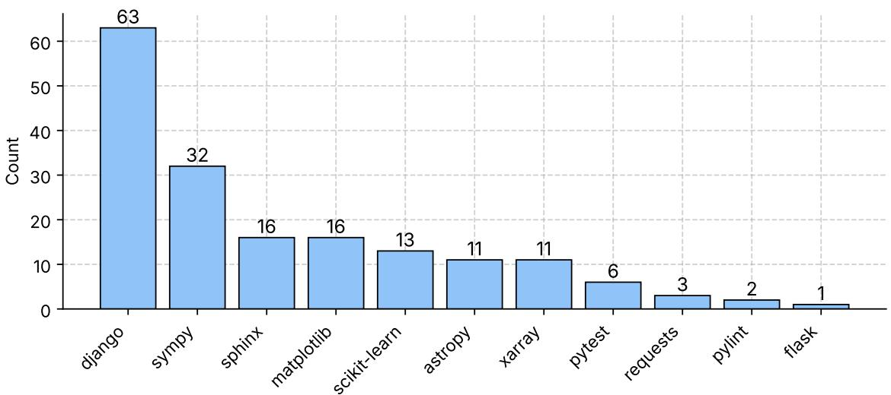  
Figure 5: Tasks per source repository in CR-Bench-Verified (174 instances). Repositories are inherited from SWE-Bench Verified. Django is the largest repository with 63 tasks (36.2%), and Django and SymPy together account for just over half of the benchmark (54.6%). The remaining nine repositories span documentation tooling (Sphinx), scientific computing (Matplotlib, scikit-learn, Astropy, xarray), testing and linting (pytest, pylint), and HTTP and web libraries (Requests, Flask).

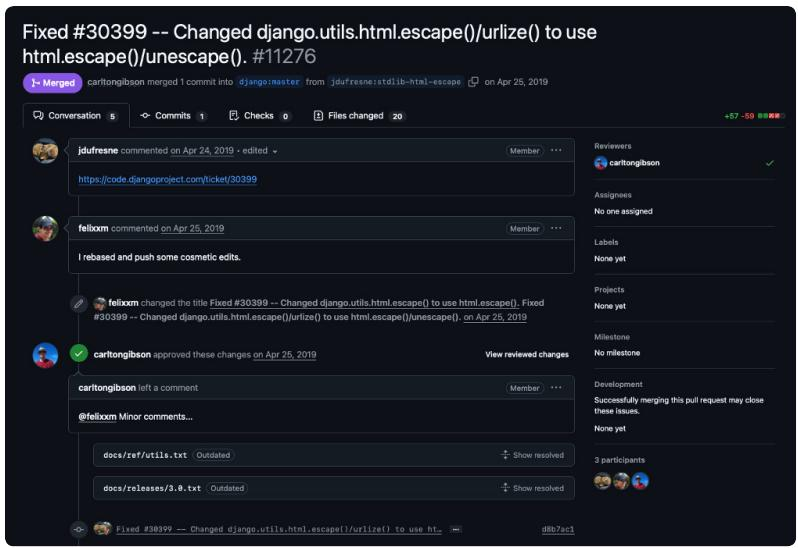  
(a) Originating pull request (PR)

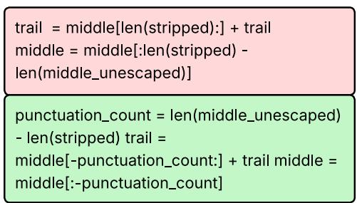  
(b) Known repair patch (r<sub>δ</sub>)

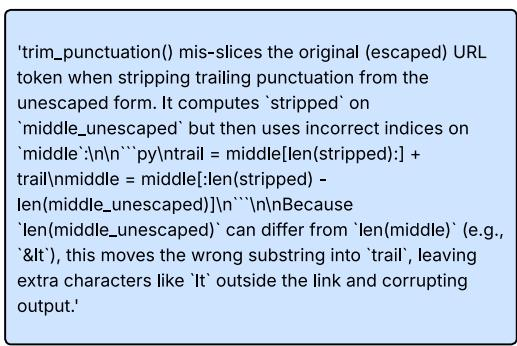  
(c) Target review comment (r<sub>c</sub>), labeled Bug Hit  
Figure 6: One CR-Bench instance. The PR context (top) concerns Django’s escaped-URL punctuation handling. Its known defect is that trim\_punctuation() slices escaped URLs with indices derived from the unescaped string. The repair $r _ { \delta }$ (bottom left) computes the removed punctuation count before slicing. Red and green mark removed and added code. The target comment $r _ { c }$ (bottom right) identifies the same defect, so its label is Bug Hit.

Figure 7 lists the taxonomy labels assigned to each defect. Figures 8 and 9 show how the labels cooccur in CR-Bench-Verified and CR-Bench.

## D Taxonomy

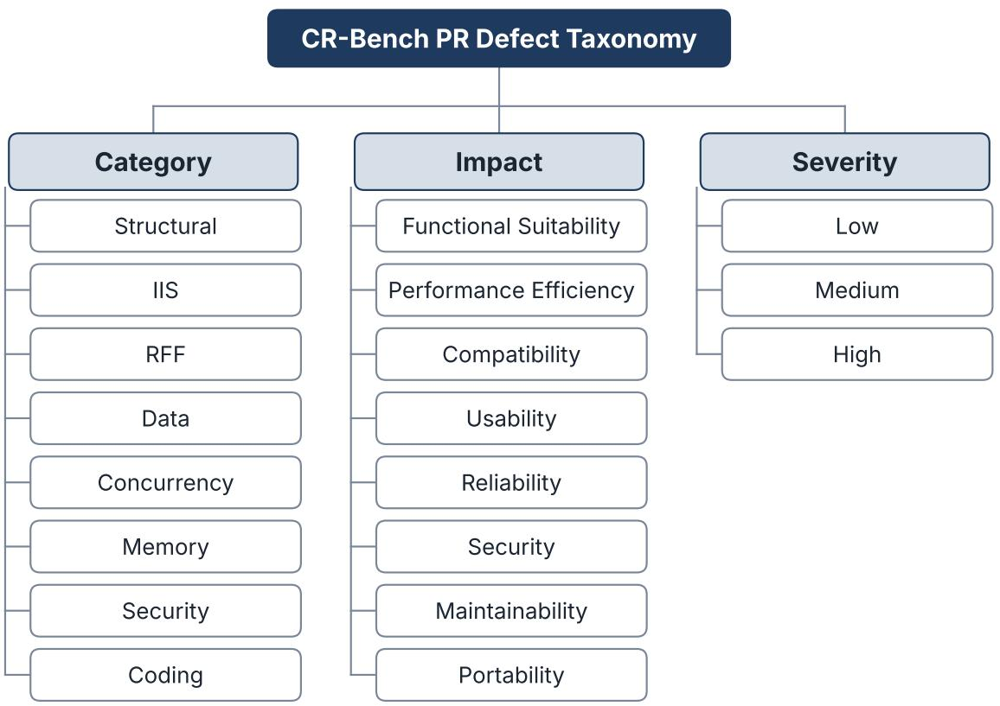  
IIS: Interface, Integration, and System RFF: Requirements, Features, and Functionality  
Figure 7: Taxonomy Labels for PR defects including Category, Impact, and Severity.

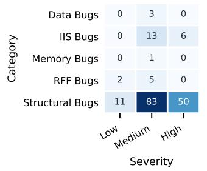

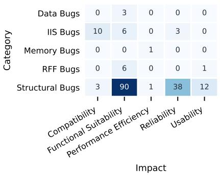

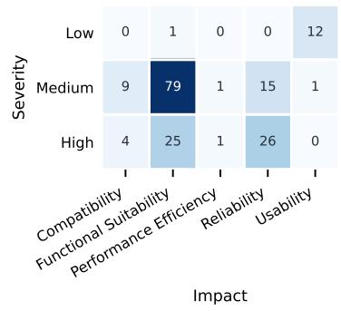  
Figure 8: Pairwise counts for the 174 CR-Bench-Verified instances. Panels show category by severity (left), category by impact (center), and severity by impact (right). Only observed taxonomy levels appear. RFF = Requirements, Features and Functionality. IIS = Interface, Integration and System.

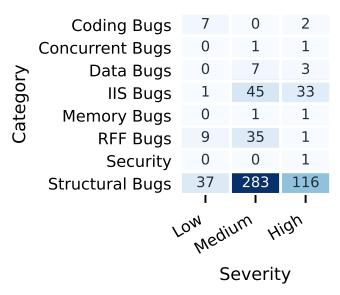

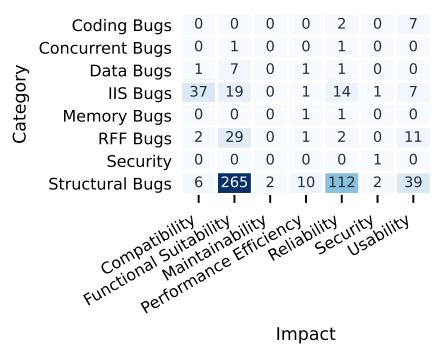

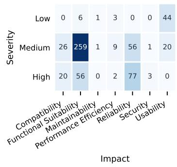  
Figure 9: Pairwise cross-tabulations for all 584 CR-Bench instances. The panels show category by severity (left), category by impact (center), and severity by impact (right). Each cell counts instances. Only observed taxonomy levels are shown. RFF = Requirements, Features and Functionality. IIS = Interface, Integration and System.

## E Alternative Annotator Test

We use Alt-Test (Calderon et al., 2025) to evaluate the suitability of an LLM as a replacement for a human code reviewer.

## E.1 Annotation Setup

To verify the quality of CR-Bench’s LLM-as-ajudge, Claude Sonnet 4.5, we study its alignment with humans. We employ $M = 3$ expert developers to independently annotate a subsample of 60 reviews from Reflexion agent with GPT-5.2 (Table 5 shows one annotated instance).

## E.2 Formalism

We formalize code review evaluation as a classification task over a set of annotators, comprising both LLMs and human reviewers. Let x ∈ X denote a code review instance and $y \in \mathcal { V }$ denote a review label. Each annotator $a \sim A$ induces a conditional distribution $P _ { a } ( y \mid x )$

Given the inherently subjective nature of code review, label assignment is influenced by annotatorspecific biases and contextual factors. To capture this variability, we define the aggregated label distribution as:

$$
\hat { P } ( y \mid x ) = \frac { 1 } { | \mathcal { A } | } \sum _ { a \in \mathcal { A } } P _ { a } ( y \mid x ) .\tag{4}
$$

We quantify the degree of subjectivity for an instance x as the entropy of the aggregated distribution:

$$
\begin{array} { l } { { \mathcal { S } } ( x ) = H ( \hat { P } ( y \mid x ) ) } \\ { \displaystyle = - \sum _ { y \in \mathcal { V } } \hat { P } ( y \mid x ) \log \hat { P } ( y \mid x ) . } \end{array}\tag{5}
$$

Individual Annotator Evaluation. Given an annotator a producing prediction $y _ { a } ( x )$ , this approach compares this prediction against the judgments $\{ R _ { i } \} _ { i = 1 } ^ { M }$ of M independent annotators using parameterized majority voting. The agreement score is defined as (k is a parameter):

$$
\operatorname { A g r e e } ( x , a ) = { \left\{ \begin{array} { l l } { 1 } & { { \mathrm { i f ~ } } \sum _ { i = 1 } ^ { M } \mathbb { I } ( R _ { i } = y _ { a } ) \geq k } \\ { 0 } & { { \mathrm { o t h e r w i s e } } . } \end{array} \right. }\tag{6}
$$

This formulation implicitly treats consensus labels as ground truth, thereby collapsing the underlying distribution of valid annotations into a single point estimate and introducing majority bias in subjective settings. However, annotator disagreement is intrinsic to such tasks and reflects a latent distribution rather than noise. To account for this, we adopt the Alternative Annotator Test (Alt-Test) (Calderon et al., 2025), which evaluates annotator quality relative to the inter-annotator agreement baseline instead of a fixed consensus label.

The Alt-Test excludes each human annotator and compares LLM alignment with the remaining. It needs two parameters: the cost-benefit penalty (ϵ) and the False Discovery Rate threshold (q). ϵ quantifies the cost-benefit trade-off of using an LLM. A higher ϵ means a larger associated penalty to using human annotators, maybe because they are more expensive, slow, etc. We evaluate the system across a range of penalties $( \epsilon \in [ 0 . 0 , 1 . 0 ] )$ and report winning rate ω, the fraction of annotators an LLM can be better than. We use $q \ : = \ : 0 . 0 5$ , meaning we strictly limit the probability of falsely concluding the LLM as a valid replacement to 5%.

## E.3 Results

As per IAA score in Table 6, model can’t make a strict agreement with all the annotators $( k = 3 )$ , but is able to maintain a consistency at lesser thresholds. With the ω analysis using Alt-Test, we further determine that LLM cannot statistically justify replacing humans at low $\epsilon ( \omega = 0 \% )$ . However, as ϵ increases to simulate the operational benefits of automation, the model’s ω climbs to 67% at $\epsilon = 0 . 3$ and reaches 100% at $\epsilon = 0 . 5$

As per experienced software engineer annotators’ feedback, this is a complex and time-taking labeling. So, consistent with the Alt-Test paper, this is $\epsilon \geq 0 . 2$ . Further, $\omega \ge 5 0 \%$ translates to LLMs being able to replace humans. We sweep ω as a function of ϵ in Figure 10a and show that our judge achieves 67% ω at $\epsilon = 0 . 3$ and 100% at $\epsilon = 0 . 5 . \omega = 0$ for $\epsilon \leq 0 . 2$ shows that code-review of this standard is a difficult task for even skilled humans to annotate.

Further, as discussed earlier, we only consider $N = 6 0$ out of approx. 1600 reviews generated from 174 PRs for this study. In order to understand its sufficiency, we plot a graph of $\omega$ v/s N. For each $n \in N$ , we randomly sample n instances and calculate ω for a given ϵ. We do this 20 times and plot the average in Figure 10b. Saturation of ω after $N \ge 5 0 \forall \epsilon \in \{ 0 . 1 , 0 . 3 , 0 . 5 \}$ shows that $N = 6 0$ is sufficient for statistical significance.

<table><tr><td rowspan=1 colspan=1>instance_id</td><td rowspan=1 colspan=1>django_django-12708</td></tr><tr><td rowspan=1 colspan=1>Repository</td><td rowspan=1 colspan=1>django/django</td></tr><tr><td rowspan=1 colspan=1>Bug Origin PR</td><td rowspan=1 colspan=1>8432</td></tr><tr><td rowspan=1 colspan=1>PR Link</td><td rowspan=1 colspan=1>https://github.com/django/django/pull/8432</td></tr><tr><td rowspan=1 colspan=1>Known Bug Description</td><td rowspan=1 colspan=1>Deleting an index_together could crash when the same columns are also inunique_together because the schema editor searched for any constraint match-ing the columns and index=True, which also matches unique constraints. Inalter_index_together() it called:self._delete_composed_index(model, fields, {&#x27;index&#x27;: True},self.sql_delete_index)This can return both the unique and non-unique index constraints, causing_delete_composed_index() to raise ValueError due to multiple matches. Thefix constrains the lookup to non-unique indexes ({&#x27;index&#x27;: True, &#x27;unique&#x27;:False}), ensuring only the intended index is deleted.</td></tr><tr><td rowspan=1 colspan=1>Known Fix Patch</td><td rowspan=1 colspan=1>diff -git a/django/db/backends/base/schema.py b/django/db/backends/base/schema.py- a/django/db/backends/base/schema.py+++ b/django/db/backends/base/schema.py@@ -393,7 +393,12 @@ def alter_index_together(self, model,old_index_together, new_index_together):news = {tuple(fields) for fields in new_index_together}# Deleted indexesfor fields in olds.difference(news):- self._delete_composed_index(model, fields, {&#x27;index&#x27;: True}, self.sql_delete_index)+ self._delete_composed_index(+ model,+ fields,+ {&#x27;index&#x27;: True, &#x27;unique&#x27;: False},+ self.sql_delete_index,+)</td></tr><tr><td rowspan=1 colspan=1>Files Changed in Fix</td><td rowspan=1 colspan=1>django/db/backends/base/schema.py</td></tr><tr><td rowspan=1 colspan=1>Review File</td><td rowspan=1 colspan=1>django/contrib/auth/backends.py</td></tr><tr><td rowspan=1 colspan=1>Review Line</td><td rowspan=1 colspan=1>57</td></tr><tr><td rowspan=1 colspan=1>Review Comment</td><td rowspan=1 colspan=1>Potential compatibility risk if this branch is intended to support Python &lt;2.7: setliterals and dict comprehensions used throughout this PR (e.g., &quot;%s . %s&quot; %(ct,name) for ct, name in perms) require Python 2.7+/3.x. If any supported run-time is older, this will raise SyntaxError at import time. Fix by keeping set(. . .for ...) /dict(...).</td></tr><tr><td rowspan=1 colspan=1>Review Type Label</td><td rowspan=1 colspan=1>Noise</td></tr></table>

Table 5: An example of a human review annotation

<table><tr><td rowspan=1 colspan=1>Metric</td><td rowspan=1 colspan=1>Setting</td><td rowspan=1 colspan=1>Value(%)</td></tr><tr><td rowspan=3 colspan=1>IAA score</td><td></td><td></td></tr><tr><td rowspan=2 colspan=1>k = 1k = 2k = 3</td><td></td></tr><tr><td rowspan=1 colspan=1>71.66%71.66%28.33%</td></tr><tr><td rowspan=3 colspan=1>Winning rate</td><td rowspan=3 colspan=1>€ = 0.1€ = 0.3€ = 0.5</td><td rowspan=1 colspan=1>0%</td></tr><tr><td rowspan=1 colspan=1>67%</td></tr><tr><td rowspan=1 colspan=1>100%</td></tr></table>

Table 6: IAA score and Alt-Test winning rate(ω) (Calderon et al., 2025) for classifying reviews using claude-4.5-sonnet.

## E.4 Agreement Analyses

Further analyses also show that classifying review comments as Bug Hit, Valid Suggestion, or Noise is a difficult task even for expert annotators. Pairwise agreement between the expert annotators themselves spans 0.48 to 0.75, and the judge aligns most closely with the most central annotator (Figure 11), which suggests it approximates consensus behavior rather than any one reviewer. The confusion matrix against the human majority (Figure 12) shows strong agreement on Bug Hits, with most residual error being Bug Hits softened into Valid Suggestions. Figure 13, 14 show inter and intra-annotator entropy of AI falls in similar range with majority humans.

Pairwise agreement among the human annotators ranges from 0.48 to 0.75. Human-2 has the highest agreement with the other annotators. Claude Sonnet 4.5 has its highest human agreement with Human-2 (0.72). This pattern is consistent with consensus-oriented labeling.

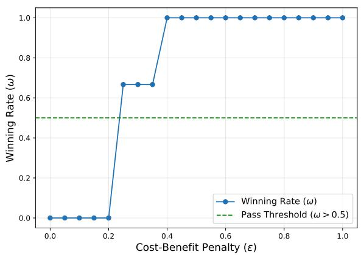  
(a) Winning Rate (ω) vs. Cost-Benefit Penalty (ϵ)

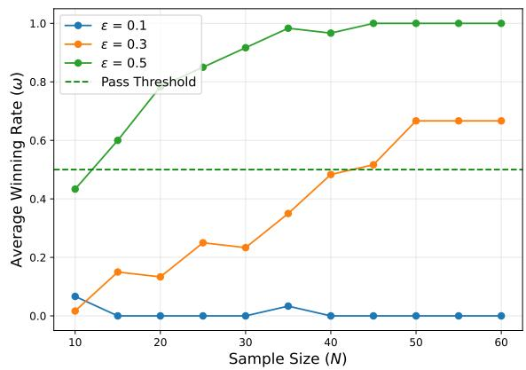  
(b) Winning Rate (ω) vs. Sample Size (N)  
Figure 10: Alternative Annotator Test (Alt-Test) Results. (a) The LLM’s winning rate (ω) across varying cost-benefit penalties (ϵ) $( N = 6 0 )$ . The LLM successfully replaces the human majority $( \omega > 0 . 5 ) \mathrm { a t } \epsilon \geq 0 . 2 5 $ . (b) The effect of sample size on winning rate, averaged over 20 random iterations. Test reaches statistical significance within the available data.

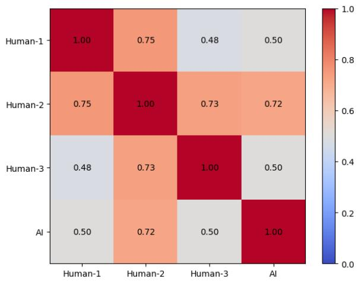  
Figure 11: Pairwise raw agreement over 60 review comments labeled as Bug Hit, Valid Suggestion, or Noise by three human experts and Claude Sonnet 4.5. Each cell is the proportion of identical labels. Diagonal cells show self-agreement.

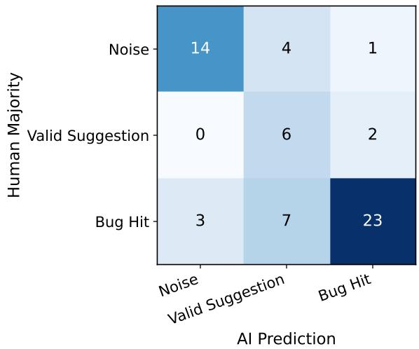  
Figure 12: Human majority vs. AI prediction confusion matrix across three categories (Noise, Valid Suggestion, Bug Hit). Each cell reports the number of instances with a given human majority label (rows) and corresponding AI prediction (columns). The strong diagonal for Bug Hit indicates high alignment on objective cases, while off-diagonal mass, particularly from Bug Hit to Valid Suggestion, highlights systematic ambiguity and the AI’s tendency to produce softer, non-definitive judgments in borderline instances.

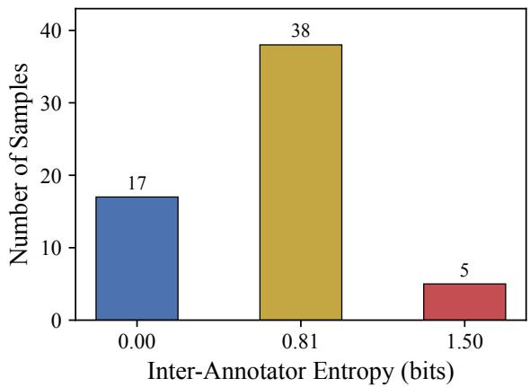  
Figure 13: Distribution of per-sample inter-annotator entropy across 60 code review comments, computed over four annotators (three human, one AI). An entropy of 0.00 bits indicates unanimous agreement, 0.81 bits reflects a 3-vs-1 split, and 1.50 bits indicates a threeway split across all label categories. The majority of samples (63%) exhibit partial disagreement with a single dissenting annotator.

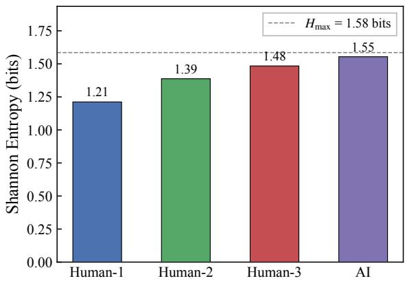  
Figure 14: Shannon entropy of the label distribution for each annotator, computed over 60 code review comments across three categories: Bug Hit, Noise, and Valid Suggestion. The dashed line denotes the maximum entropy $( H _ { \operatorname* { m a x } } = 1 . 5 8$ bits) for a uniform distribution over three classes. Human-1 exhibits the most concentrated labeling (1.21 bits), while AI produces the most uniform distribution (1.55 bits), suggesting greater diversity in its label assignments.

## F Results

## F.1 Evaluator Robustness and Uncertainty

All results below use clean judge runs with zero fallback classifications. To separate review-system performance from evaluator choice, each judge independently classifies the same fixed review comments. Table 8 reports every review-system– judge combination, while Table 9 directly compares Reflexion with single-shot for matched backbones. Confidence intervals resample benchmark instances. Paired tests align strategies by instance\_id.

Across judges, Reflexion has higher KDDR than single-shot for every backbone. The magnitude of Usefulness Rate varies more because judges differ in how often they classify comments as Noise.

## F.2 KDDR by Taxonomy Group

Table 11 reports KDDR for every taxonomy group, and Figure 16 plots the severity groups with confidence intervals.

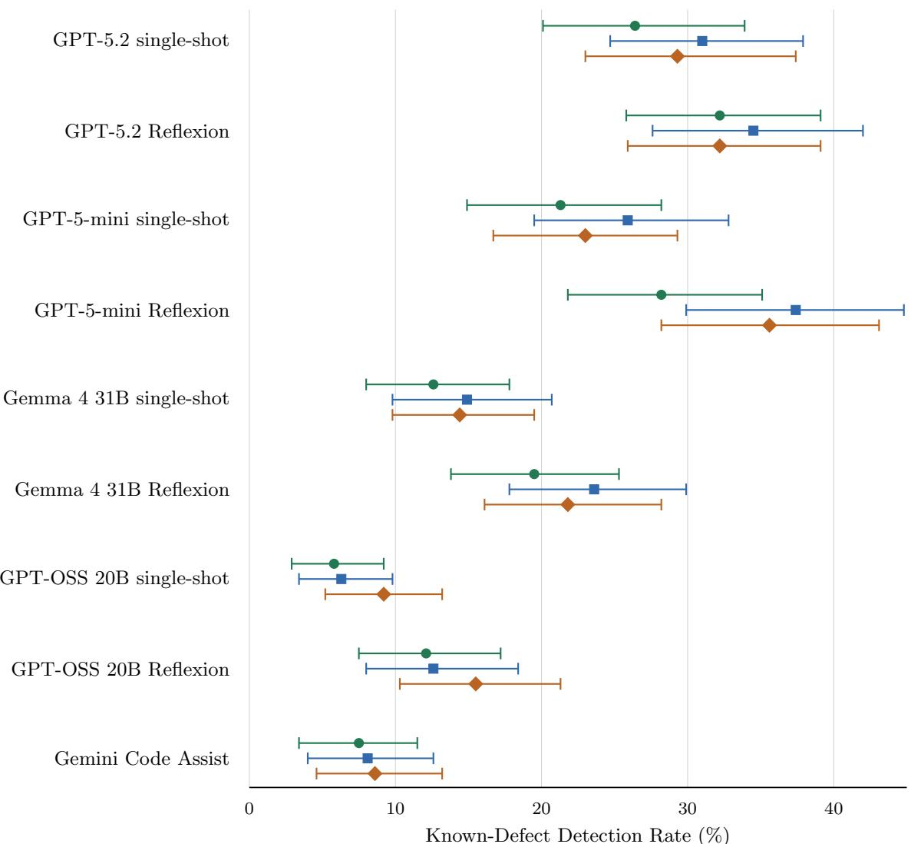

Figure 15: Judge-specific Known-Defect Detection Rate (KDDR) for the same fixed review comments on all 174 verified instances under the balanced prompt. Points are full-sample estimates. Bars are 95% percentile confidence intervals from 1,000 instance-level bootstrap resamples. Marker shape identifies the judge independently of color.
<table><tr><td>System</td><td>KDDR</td><td>Usefulness Rate</td></tr><tr><td>GPT-5.2 single-shot</td><td> $2 8 . 9 \pm 2 . 3$ </td><td> $8 6 . 2 \pm 1 1 . 3$ </td></tr><tr><td>GPT-5.2 Reflexion</td><td> $3 3 . 0 \pm 1 . 3$ </td><td> $8 9 . 8 \pm 9 . 5$ </td></tr><tr><td>GPT-5-mini single-shot</td><td> $2 3 . 4 \pm 2 . 3$ </td><td> $6 9 . 0 \pm 2 9 . 9$ </td></tr><tr><td>GPT-5-mini Reflexion</td><td> $3 3 . 7 \pm 4 . 9$ </td><td> $7 2 . 6 \pm 2 8 . 4$ </td></tr><tr><td>Gemma 4 31B single-shot</td><td> $1 4 . 0 \pm 1 . 2$ </td><td> $6 4 . 5 \pm 2 7 . 8$ </td></tr><tr><td>Gemma 4 31B Reflexion</td><td> $2 1 . 6 \pm 2 . 1$ </td><td> $6 8 . 6 \pm 2 7 . 3$ </td></tr><tr><td>GPT-OSS 20B single-shot</td><td> $7 . 1 \pm 1 . 8$ </td><td> $5 3 . 3 \pm 2 7 . 9$ </td></tr><tr><td>GPT-OSS 20B Reflexion</td><td> $1 3 . 4 \pm { 1 . 8 }$ </td><td> $6 1 . 2 \pm 2 6 . 6$ </td></tr><tr><td>Gemini Code Assist</td><td> $8 . 1 \pm 0 . 6$ </td><td> $7 8 . 0 \pm 2 0 . 0$ </td></tr></table>

Table 7: Performance on CR-Bench-Verified. Each cell is the mean ± sample standard deviation over the three judges (GPT-5.4, Claude Sonnet 4.5, DeepSeek V4 Flash, $n = 3 )$ under the balanced prompt. The deviation measures spread across evaluators, not sampling error; per-judge estimates with instance-bootstrap confidence intervals are in Table 8. Percentage metrics omit the % symbol.

<table><tr><td>Review system</td><td>Evaluation judge</td><td>KDDR (%) [95% CI]</td><td>Usefulness Rate (%) [95% CI]</td></tr><tr><td>GPT-5.2 single-shot</td><td>Claude Sonnet 4.5</td><td>26.4 [20.1,33.9]</td><td>81.7 [77.9,85.5]</td></tr><tr><td></td><td>GPT-5.4</td><td>31.0 [24.7,37.9]</td><td>99.1 [98.6,99.5]</td></tr><tr><td></td><td>DeepSeek V4 Flash</td><td>29.3 [23.0,37.4]</td><td>77.8 [75.5,80.4]</td></tr><tr><td>GPT-5.2 Reflexion</td><td>Claude Sonnet 4.5</td><td>32.2 [25.8,39.1]</td><td>89.5 [86.3,92.7]</td></tr><tr><td></td><td>GPT-5.4</td><td>34.5 [27.6,42.0]</td><td>99.4 [98.9,99.8]</td></tr><tr><td></td><td>DeepSeek V4 Flash</td><td>32.2 [25.9,39.1]</td><td>80.4 [78.3,82.7]</td></tr><tr><td>GPT-5-mini single-shot</td><td>Claude Sonnet 4.5</td><td>21.3 [14.9,28.2]</td><td>74.8 [70.6,78.9]</td></tr><tr><td></td><td>GPT-5.4</td><td>25.9 [19.5,32.8]</td><td>95.5 [93.7,97.0]</td></tr><tr><td></td><td>DeepSeek V4 Flash</td><td>23.0 [16.7,29.3]</td><td>36.6 [33.0,40.5]</td></tr><tr><td>GPT-5-mini Reflexion</td><td>Claude Sonnet 4.5</td><td>28.2 [21.8,35.1]</td><td>78.5 [74.7,82.4]</td></tr><tr><td></td><td>GPT-5.4</td><td>37.4 [29.9,44.8]</td><td>97.5 [96.3,98.4]</td></tr><tr><td></td><td>DeepSeek V4 Flash</td><td>35.6 [28.2,43.1]</td><td>41.7 [38.2,45.9]</td></tr><tr><td>Gemma 4 31B single-shot</td><td>Claude Sonnet 4.5</td><td>12.6 [8.0,17.8]</td><td>67.9 [61.9,73.4]</td></tr><tr><td></td><td>GPT-5.4</td><td>14.9 [9.8,20.7]</td><td>90.5 [87.2,93.6]</td></tr><tr><td></td><td>DeepSeek V4 Flash</td><td>14.4 [9.8,19.5]</td><td>35.2 [29.9,40.1]</td></tr><tr><td>Gemma 4 31B Reflexion</td><td>Claude Sonnet 4.5</td><td>19.5 [13.8,25.3]</td><td>75.2 [70.8,79.4]</td></tr><tr><td></td><td>GPT-5.4</td><td>23.6 [17.8,29.9]</td><td>92.0 [89.9,93.9]</td></tr><tr><td></td><td>DeepSeek V4 Flash</td><td>21.8 [16.1,28.2]</td><td>38.7 [34.3,43.6]</td></tr><tr><td>GPT-OSS 20B single-shot</td><td>Claude Sonnet 4.5</td><td>5.8 [2.9,9.2]</td><td>52.2 [46.0,59.0]</td></tr><tr><td></td><td>GPT-5.4</td><td>6.3 [3.4,9.8]</td><td>81.7 [76.5,86.7]</td></tr><tr><td></td><td>DeepSeek V4 Flash</td><td>9.2 [5.2,13.2]</td><td>25.9 [20.9,31.4]</td></tr><tr><td>GPT-OSS 20B Reflexion</td><td>Claude Sonnet 4.5</td><td>12.1 [7.5,17.2]</td><td>63.0 [57.0,69.5]</td></tr><tr><td></td><td>GPT-5.4</td><td>12.6 [8.0,18.4]</td><td>86.8 [83.8,90.1]</td></tr><tr><td></td><td>DeepSeek V4 Flash</td><td>15.5 [10.3,21.3]</td><td>33.7 [29.2,39.0]</td></tr><tr><td>Gemini Code Assist</td><td>Claude Sonnet 4.5</td><td>7.5 [3.4,11.5]</td><td>77.7 [69.4,86.5]</td></tr><tr><td></td><td>GPT-5.4</td><td>8.1 [4.0,12.6]</td><td>98.1 [96.1,99.7]</td></tr><tr><td></td><td>DeepSeek V4 Flash</td><td>8.6 [4.6,13.2]</td><td>58.1 [50.1,66.8]</td></tr></table>

Table 8: Performance by evaluation judge under the balanced prompt. Each judge independently classifies the same fixed review comments. Point estimates use all 174 instances. The 95% percentile confidence intervals use 1,000 instance-level bootstrap resamples (seed 42), with comments grouped by instance. KDDR measures detection of the labeled defect, and Usefulness Rate measures the percentage of beneficial comments. See Section 4.1 for metric definitions and the statistical protocol.

<table><tr><td>Backbone</td><td>Evaluation judge</td><td>∆KDDR [CI], p</td><td>∆Usefulness Rate [CI], p</td></tr><tr><td>GPT-5.2</td><td>Claude Sonnet 4.5</td><td>+5.7 [-0.0,11.5], 0.083</td><td>+7.8 [5.2,10.7], 0.001</td></tr><tr><td></td><td>GPT-5.4</td><td>+3.4 [-2.3,9.2], 0.336</td><td>+0.3 [-0.2,0.9], 0.284</td></tr><tr><td></td><td>DeepSeek V4 Flash</td><td>+2.9 [-3.4,9.2], 0.504</td><td>+2.6 [-0.2,5.3], 0.066</td></tr><tr><td>GPT-5-mini</td><td>Claude Sonnet 4.5</td><td>+6.9 [1.1,13.2], 0.036</td><td>+3.7 [0.2,7.4], 0.101</td></tr><tr><td></td><td>GPT-5.4</td><td>+11.5 [4.6,18.4], 0.002</td><td>+2.1 [0.4,3.9], 0.012</td></tr><tr><td></td><td>DeepSeek V4 Flash</td><td>+12.6 [5.7,19.5], 0.004</td><td>+5.1 [1.2,9.0], 0.032</td></tr><tr><td>Gemma 4 31B</td><td>Claude Sonnet 4.5</td><td>+6.9 [1.7,12.1], 0.027</td><td>+7.4 [2.5,12.1], 0.007</td></tr><tr><td></td><td>GPT-5.4</td><td>+8.6 [2.3,14.9], 0.006</td><td>+1.5 [-1.8,4.9], 0.318</td></tr><tr><td></td><td>DeepSeek V4 Flash</td><td>+7.5 [1.7,13.8], 0.016</td><td>+3.5 [-1.8,9.2], 0.251</td></tr><tr><td>GPT-OSS 20B</td><td>Claude Sonnet 4.5</td><td>+6.3 [1.7,11.5], 0.023</td><td></td></tr><tr><td></td><td>GPT-5.4</td><td>+6.3 [1.7,11.5], 0.030</td><td>+10.8 [3.9,17.2], 0.001 +5.2 [0.3,10.2], 0.032</td></tr><tr><td></td><td>DeepSeek V4 Flash</td><td></td><td></td></tr><tr><td></td><td></td><td>+6.3 [0.6,12.6], 0.060</td><td>+7.8 [2.3,13.5], 0.004</td></tr></table>

Table 9: Paired Reflexion-minus-single-shot differences for the same backbone and evaluation judge. Positive differences favor Reflexion. Strategies are matched by instance\_id. Confidence intervals use 1,000 paired bootstrap resamples, and p-values use two-sided paired permutation tests with 1,000 permutations. Gemini Code Assist is excluded because it has no matched single-shot and Reflexion pair. KDDR and Usefulness Rate differences are in percentage points. See Section 4.1 for metric definitions and the statistical protocol.

<table><tr><td rowspan="2"></td><td rowspan="2">Prompt</td><td colspan="2">Single-shot</td><td colspan="2">Reflexion</td></tr><tr><td>KDDR</td><td>U</td><td>KDDR</td><td>U</td></tr><tr><td>Claude Sonnet 4.5</td><td>Balanced</td><td>26.4</td><td>81.7</td><td>32.2</td><td>89.5</td></tr><tr><td></td><td>Strict</td><td>25.9</td><td>38.2</td><td>32.8</td><td>50.7</td></tr><tr><td></td><td>Lenient</td><td>27.0</td><td>44.0</td><td>32.2</td><td>52.7</td></tr><tr><td>GPT-5.4</td><td>Balanced</td><td>31.0</td><td>99.1</td><td>34.5</td><td>99.4</td></tr><tr><td></td><td>Strict</td><td>24.7</td><td>94.3</td><td>32.2</td><td>98.8</td></tr><tr><td></td><td>Lenient</td><td>23.6</td><td>35.4</td><td>31.6</td><td>53.0</td></tr><tr><td>DeepSeek V4 Flash</td><td>Balanced</td><td>29.3</td><td>77.8</td><td>32.2</td><td>80.4</td></tr><tr><td></td><td>Strict</td><td>21.8</td><td>41.1</td><td>30.5</td><td>51.0</td></tr><tr><td></td><td>Lenient</td><td>26.4</td><td>15.4</td><td>29.3</td><td>43.8</td></tr></table>

Table 10: Prompt robustness for fixed GPT-5.2 single-shot and Reflexion outputs on all 174 verified instances. Each judge classifies the same comments under balanced, strict, and lenient evaluator prompts. KDDR and Usefulness Rate (U) are percentages. Higher is better.

<table><tr><td>Dimension</td><td>Group</td><td>n</td><td>GPT-5.2</td><td>GPT-5-mini</td><td>Gemma 4 31B</td><td>GPT-OSS 20B</td></tr><tr><td>Category</td><td>Structural</td><td>144</td><td> $3 1 . 5  3 5 . 9$ </td><td> $2 5 . 9  3 4 . 3$ </td><td> $1 4 . 1  2 2 . 9$ </td><td> $7 . 4  1 4 . 1$ </td></tr><tr><td></td><td>IIS</td><td>19</td><td> $2 1 . 1  2 9 . 8$ </td><td> $1 7 . 5  3 6 . 8 $ </td><td> $2 1 . 1  2 4 . 6$ </td><td> $8 . 8  1 4 . 0$ </td></tr><tr><td></td><td>RFF†</td><td>7</td><td> $0 . 0  0 . 0$ </td><td> $0 . 0  1 4 . 3$ </td><td> $0 . 0  0 . 0$ </td><td> $0 . 0  4 . 8$ </td></tr><tr><td></td><td> $\mathrm { D a t a } ^ { \dagger }$ </td><td>3</td><td> $3 3 . 3  0 . 0$ </td><td> $0 . 0  3 3 . 3$ </td><td> $0 . 0  0 . 0$ </td><td> $0 . 0  0 . 0$ </td></tr><tr><td></td><td> $\scriptstyle \mathrm { M e m o r y } ^ { \dag }$ </td><td>1</td><td> $0 . 0  0 . 0$ </td><td> $0 . 0  3 3 . 3$ </td><td> $0 . 0  0 . 0$ </td><td> $0 . 0  0 . 0$ </td></tr><tr><td>Impact</td><td>Functional Suitability</td><td>105</td><td> $2 8 . 9  2 9 . 5$ </td><td> $2 0 . 3  3 0 . 5$ </td><td> $1 3 . 7  1 9 . 7$ </td><td> $6 . 7  1 3 . 0$ </td></tr><tr><td></td><td>Reliability</td><td>41</td><td> $3 5 . 8  3 9 . 8 $ </td><td> $3 1 . 7  3 8 . 2 $ </td><td> $1 4 . 6  2 2 . 0$ </td><td> $1 0 . 6  1 7 . 1$ </td></tr><tr><td></td><td>Compatibility</td><td>13</td><td> $1 2 . 8  4 3 . 6 $ </td><td> $3 3 . 3  4 3 . 6$ </td><td> $1 7 . 9  3 3 . 3$ </td><td> $5 . 1  1 2 . 8$ </td></tr><tr><td></td><td>Usability</td><td>13</td><td> $2 0 . 5  2 5 . 6$ </td><td> $7 . 7  3 0 . 8 $ </td><td> $1 2 . 8  2 3 . 1$ </td><td> $2 . 6  7 . 7$ </td></tr><tr><td></td><td> $\mathrm { P e r f . \ E f f i c i e n c y ^ { \dagger } }$ </td><td>2</td><td> $5 0 . 0  5 0 . 0 $ </td><td> $5 0 . 0  6 6 . 7 $ </td><td> $0 . 0  3 3 . 3$ </td><td> $0 . 0  0 . 0$ </td></tr><tr><td>Severity</td><td>Low</td><td>13</td><td> $2 0 . 5  2 5 . 6$ </td><td> $7 . 7  3 0 . 8 $ </td><td> $1 2 . 8  2 3 . 1$ </td><td> $2 . 6  7 . 7$ </td></tr><tr><td></td><td>Medium</td><td>105</td><td> $2 5 . 4  2 7 . 0$ </td><td> $1 7 . 5  2 6 . 0$ </td><td> $1 1 . 4  2 0 . 3$ </td><td> $4 . 1  1 2 . 7$ </td></tr><tr><td></td><td>High</td><td>56</td><td> $3 7 . 5  4 5 . 8 $ </td><td> $3 8 . 1  4 8 . 8 $ </td><td> $1 9 . 0  2 3 . 8 $ </td><td> $1 3 . 7  1 6 . 1$ </td></tr></table>

Table 11: KDDR (%) for every taxonomy group, written as single-shot → Reflexion. Each value averages the three judges under the balanced prompt. n is the number of CR-Bench-Verified instances in the group. <sup>†</sup>Groups with fewer than 10 instances are listed for completeness only. Their confidence intervals are tens of percentage points wide, so we draw no conclusions from them. The dimensions overlap: 12 of the 13 Usability instances are also the Low-severity instances, and Reliability is mostly high severity (26 High, 15 Medium, 0 Low). Differences across impact groups therefore partly reflect severity. Figure 16 plots the severity rows with confidence intervals. Figure 4 plots every row. RFF = Requirements, Features and Functionality, $\mathrm { I I S } = \mathrm { I n t e r f a c e } .$ Integration and System.

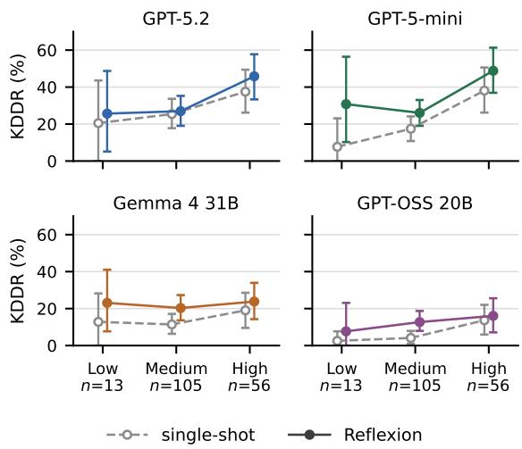  
Figure 16: KDDR by defect severity for each backbone. Points average the three judges under the balanced prompt, and bars are 95% bootstrap confidence intervals. The number of instances per severity level is printed on the axis. Table 11 reports the same numbers for every category and impact group.