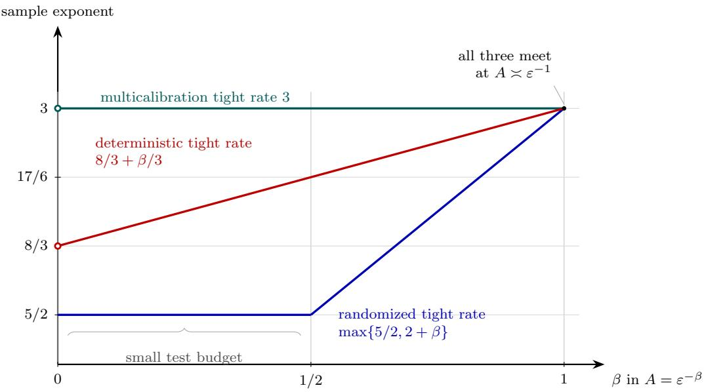
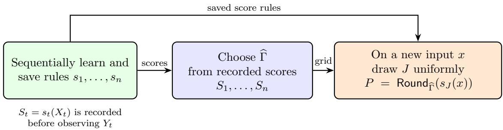
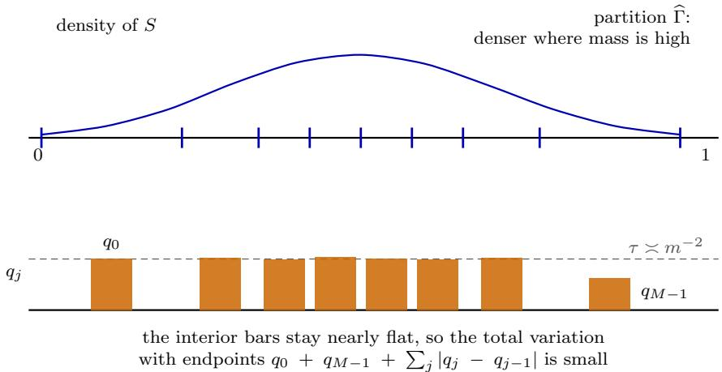
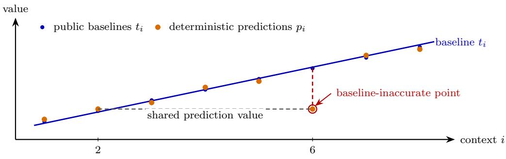

# Calibrated Multiaccuracy: Deterministic and Randomized Sample Complexity

Jiuyao Lu University of Pennsylvania

Georgy Noarov Institute for Advanced Study

Aaron Roth Resolution University of Pennsylvania

November 3, 2026

## Abstract

Calibrated multiaccuracy asks that a predictor be globally calibrated and multiaccurate with respect to a bounded test family $\mathcal { G } ;$ that is, its residuals should be uncorrelated with every test $g ( x ) \in { \mathcal { G } }$ . It has emerged as a promising weakening of multicalibration that nonetheless is suficient for many applications. However, the sample complexity of learning a predictor satisfying calibrated multiaccuracy has remained poorly understood — and in fact was not known to be less than the sample complexity needed for full multicalibration, which is $\begin{array} { r } { \widetilde { \Theta } \left( \frac { \log | \mathcal { G } | } { \varepsilon ^ { 2 } } + \frac { 1 } { \varepsilon ^ { 3 } } \right) } \end{array}$ when |G| is at least a suficiently large power of $\log ( 1 / \varepsilon )$ . We resolve the sample complexity of ε-calibrated multiaccuracy, showing that it scales as

$$
\widetilde { \Theta } \left( \frac { \log | \mathcal { G } | } { \varepsilon ^ { 2 } } + \frac { 1 } { \varepsilon ^ { 5 / 2 } } \right) ,
$$

separating it from the complexity of multicalibration. The upper bound is obtained by an algorithm that outputs a randomized predictor.

We also determine the sample complexity for calibrated multiaccuracy when the learning algorithm is restricted to outputting a deterministic predictor. The rate is

$$
\widetilde { \Theta } \left( \frac { \log | \mathcal { G } | } { \varepsilon ^ { 2 } } + \frac { ( \log | \mathcal { G } | ) ^ { 1 / 3 } } { \varepsilon ^ { 8 / 3 } } \right)
$$

whenever log $| \mathcal { G } | = \Omega ( \log ( 1 / \varepsilon ) )$ . When log $\left| \mathcal { G } \right| \le \varepsilon ^ { - 1 + \kappa }$ for any fixed $\kappa \in ( 0 , 1 )$ , this rate is polynomially larger than the rate for randomized predictors. Thus, unlike for multicalibration, calibrated multiaccuracy exhibits a genuine sample-complexity separation between deterministic and randomized predictors. The matching upper and lower bounds show that the unusual cuberoot dependence on log |G| is intrinsic. At log $| \mathcal { G } | \asymp \varepsilon ^ { - 1 }$ , the minimax rates for randomized and deterministic calibrated multiaccuracy both coincide with the minimax rate for multicalibration.

## Contents

1 Introduction 1   
1.1 Our results 2   
1.2 Technical overview 3   
1.2.1 Randomized upper bound 4   
1.2.2 Deterministic upper bound 7   
1.2.3 Lower bounds 9   
1.3 Related work 11   
2 Setting and calibration definitions 12   
2.1 A score coarsening identity 12   
3 Ingredients for the randomized upper bound 13   
3.1 Learning against finitely many residual tests 13   
3.2 Mean-preserving randomized rounding 13   
3.3 Choosing a low-variation rounding partition 16   
3.4 Prediction-value tests induced by rounding 17   
4 Upper bound for randomized predictors 18   
5 Upper bound for deterministic predictors 21   
5.1 What category averaging accomplishes 22   
5.2 The population assignment argument . 23   
5.3 Learning a score for the later assignments 27   
5.4 Choosing assignments on the empirical distribution 29   
5.5 Fixing the category assignments 30   
5.6 Transferring the empirical guarantees to the true labels 30   
6 Matching lower bound for randomized predictors 32   
6.1 The sample cost of recovering hidden ofsets 33   
Lower bound for deterministic predictors 36   
8 Discussion 40   
A Deferred proofs for the deterministic upper bound 43   
A.1 Confidence intervals and the context partition . 44   
A.2 Transferring empirical residuals to the true labels 46   
A.3 Fixing the category assignments 48   
B Deferred proofs from the randomized lower bound 50   
C Deferred proofs from the deterministic lower bound 51   
D Proof of the finite-test online lemma 52   
E Polynomial-time implementation in the real-arithmetic model 53

## 1 Introduction

Calibration and multiaccuracy. Calibration and multiaccuracy are both statistical consistency measures that we can ask of a model $p : \mathcal { X }  [ 0 , 1 ]$ mapping features to predictions of bounded labels $Y \in [ 0 , 1 ]$ . Calibration asks that, among examples assigned prediction value $p ,$ the average label should be close to $p .$ Multiaccuracy asks that for every test $( \mathrm { o r g r o u p } ^ { \mathrm { * } } )$ function $g : \mathcal { X }  [ - 1 , 1 ]$ in a prescribed family, the residual $Y - p ( X )$ should be nearly uncorrelated with $g ( X )$ [H´ebert-Johnson et al., 2018, Kim et al., 2019]. Multicalibration combines these two ideas in a strong way, asking for calibration not just overall but also simultaneously within the feature subsets or test-weighted populations specified by the group family [H´ebert-Johnson et al., 2018].

This paper studies an intermediate guarantee, weaker than multicalibration, obtained by imposing global calibration together with multiaccuracy. We study both randomized and deterministic predictors. In both regimes, the training algorithm may use randomness. The important distinction is the type of predictor it outputs. A randomized predictor $Q = ( Q _ { x } ) _ { x \in \mathcal { X } }$ assigns to each feature value x a distribution $Q _ { x }$ over predictions in [0, 1]. On a fresh example $( X , Y )$ , let $P \sim Q _ { X }$ be the realized prediction, drawn independently of Y conditional on X. A deterministic predictor is instead a fixed function $p : \mathcal { X }  [ 0 , 1 ]$ , corresponding to the special case in which $Q _ { x }$ is a point mass at $p ( x )$ , so that $P = p ( X )$ . For a finite class $\mathcal { G }$ of tests $g : \mathcal { X }  [ - 1 , 1 ]$ , define the multiaccuracy (MA) error and expected calibration error (ECE) in terms of the realized prediction:

$$
\mathrm { M A } ( Q ; { \mathcal { G } } ) = \operatorname* { s u p } _ { g \in { \mathcal { G } } } \left| \mathbb { E } [ g ( X ) ( Y - P ) ] \right| , \qquad \mathrm { E C E } ( Q ) = \mathbb { E } \left| \mathbb { E } [ Y - P \mid P ] \right| .
$$

The calibrated multiaccuracy error is

$$
\operatorname { C M A } ( Q ; { \mathcal { G } } ) = \operatorname* { m a x } \{ \operatorname { M A } ( Q ; { \mathcal { G } } ) , \operatorname { E C E } ( Q ) \} .
$$

Why calibrated multiaccuracy is interesting. Over the past several years, multicalibration has been the subject of intense study in part because it has found so many diferent applications, from omniprediction [Gopalan et al., 2022] to conditional guarantees in conformal prediction [Bastani et al., 2022, Jung et al., 2023] to complexity-theoretic constructions [Casacuberta et al., 2024] to multiparty information aggregation [Collina et al., 2025, 2026a, Kearns et al., 2026]. A growing line of work, however, has shown that calibrated multiaccuracy is enough for tasks where multicalibration had previously been the standard tool. In omniprediction, the outcomeindistinguishability viewpoint decomposes loss minimization into calibration plus multiaccuracy for a loss-derived class of tests [Gopalan et al., 2023]. Casacuberta et al. [2025] show that adding global calibration to multiaccuracy recovers several implications previously known from multicalibration, including optimal-density hardcore measures. In computational complexity, the multicalibrationbased characterization of product-distribution indistinguishability of Marcussen et al. [2025] can also be obtained from calibrated multiaccuracy [Dwork and Tankala, 2025].

These results suggest that calibrated multiaccuracy is a useful relaxation of multicalibration: strong enough for many applications, but structurally weaker. However, prior to this paper, it had not been established that calibrated multiaccuracy error could actually be driven to 0 any faster than multicalibration error, as a function of the number of samples needed for learning. The best known sample complexity upper bounds for calibrated multiaccuracy in the regime $| \mathcal { G } | = \mathrm { p o l y } ( 1 / \varepsilon )$ were $\widetilde { \cal O } ( \varepsilon ^ { - 3 } )$ [Gibbs and Tibshirani, 2026, Noarov and Roth, 2027], no better than the minimax optimal rates for multicalibration [Collina et al., 2027]. The only non-trivial lower bound for calibrated multiaccuracy was the $\bar { \Omega ( \varepsilon ^ { - 5 / 2 } ) }$ bound of Gibbs and Tibshirani [2026], which applied only when the output after training was a deterministic predictor $p : \mathcal { X }  [ 0 , 1 ]$ . In particular, no $\mathrm { s u p e r } { - \varepsilon ^ { - 2 } }$ lower bound was known for algorithms outputting randomized predictors.

Randomized versus deterministic predictors. One might naturally expect allowing the output predictor to randomize not to matter for a batch learning problem. For many familiar distributional learning objectives, randomization is not needed. It is never needed for risk minimization of a single expected loss, for example. The closely related multicalibration problem reinforces this expectation: Collina et al. [2027] identified the minimax optimal sample complexity, initially with upper bounds that were realized by randomized predictors. However subsequently, Noarov and Roth [2027] showed that deterministic predictors sufice to achieve the minimax optimal sample complexity. Thus one might reasonably expect the same for calibrated multiaccuracy — that there should be no worst-case advantage to outputting a randomized predictor. Surprisingly (to us, at least), we show that the story is diferent for calibrated multiaccuracy: for polynomial-size test families, randomized predictors attain a strictly smaller minimax sample complexity!

## 1.1 Our results

Write $A = \operatorname* { m a x } \{ 1 , \log | \mathcal { G } | \}$ for the group budget. We prove the following, where the lower bounds take the worst case over distributions and bounded test families of the specified cardinality.

1. Tight randomized sample complexity. We give an eficient algorithm which, given n samples and a test family $\mathcal { G } _ { : }$ outputs a randomized predictor Q satisfying, with probability $1 - \delta \colon$

$$
\mathrm { C M A } ( Q ; \mathcal { G } ) \leq C \left\{ \sqrt { \frac { \log ( | \mathcal { G } | / \delta ) } { n } } + \left( \frac { \log ( n / \delta ) } { n } \right) ^ { 2 / 5 } \right\} .
$$

Equivalently, error $\varepsilon$ is achievable with $\begin{array} { r } { \widetilde { O } \left( \frac { A } { \varepsilon ^ { 2 } } + \frac { 1 } { \varepsilon ^ { 5 / 2 } } \right) } \end{array}$ samples. We prove a matching lower bound for arbitrary randomized predictors that is tight for every value of A. For polynomialsize test families, this rate is $\widetilde { \Theta } ( \bar { \varepsilon } ^ { - 5 / 2 } )$ , compared with $ { \widetilde { \Theta } } ( \varepsilon ^ { - 3 } )$ for full multicalibration. The formal upper bound is Theorem 4.1; the matching randomized lower bound is Theorem 6.1.

2. Tight deterministic sample complexity and a separation. For algorithms that must output a deterministic predictor $p ,$ we prove the information-theoretic sample-complexity upper bound

$$
\widetilde { \cal O } \left( \frac { A } { \varepsilon ^ { 2 } } + \frac { A ^ { 1 / 3 } } { \varepsilon ^ { 8 / 3 } } \right) .
$$

We also prove that, for $\log ( 1 / \varepsilon ) \lesssim A \lesssim \varepsilon ^ { - 1 }$ , some bounded test family with log $| \mathcal { G } | = \Theta ( A )$ requires $\overset { - } { \Omega } ( A ^ { 1 / 3 } \varepsilon ^ { - 8 / 3 } )$ samples from every algorithm whose output is a deterministic predictor. The randomized $\Omega ( A / \varepsilon ^ { 2 } )$ multiaccuracy lower bound applies a fortiori to deterministic predictors and supplies the matching term. Thus the upper bound is tight up to logarithmic factors for every $A = \Omega ( \log ( 1 / \varepsilon ) )$ . In particular, the matching bounds show that the unusual $A ^ { 1 / 3 }$ dependence is a genuine feature of deterministic prediction, not an artifact of the upperbound analysis. Unlike the eficient algorithm for randomized predictors in item 1, this is an information-theoretic construction whose direct implementation can require exponential time. The formal upper and lower bounds are Theorems 5.1 and 7.1, respectively.

In the matching lower-bound range, this deterministic rate is polynomially larger than the randomized rate whenever $A \leq \varepsilon ^ { - 1 + \kappa }$ for a fixed $\kappa \in ( 0 , 1 )$ . For example, at $A = \Theta ( \log ( 1 / \varepsilon ) )$ , deterministic predictors require $\widetilde { \Theta } ( \varepsilon ^ { - 8 / 3 } )$ samples, while randomized predictors need only $\widetilde { \Theta } ( \varepsilon ^ { - 5 / 2 } )$ . At $A \asymp \varepsilon ^ { - 1 }$ , both deterministic terms are of order $\varepsilon ^ { - 3 }$ , matching the deterministic multicalibration rate of Noarov and Roth [2027].

It is useful to visualize the group-budget dependence by writing $A = \varepsilon ^ { - \beta }$ . Figure 1 summarizes the resulting sample-complexity landscape.

  
Figure 1: The group-budget rate landscape, with $A = \varepsilon ^ { - \beta }$ and vertical axis the sample-complexity exponent of $1 / \varepsilon$ , suppressing logarithmic factors. Blue and red give the tight randomized and deterministic calibrated multiaccuracy rates; teal gives the tight multicalibration rate. The open endpoints represent subpolynomial budgets.

## 1.2 Technical overview

A shared upper-bound template. Both upper bounds first learn a real valued intermediate score $S \in [ 0 , 1 ]$ and then transform it into the final discrete prediction $P .$ . We call this second stage score coarsening: it replaces S by a predictor with finitely many prediction values.

The final objective involves two kinds of tests. Each $g \in { \mathcal { G } }$ defines the multiaccuracy test $\phi _ { g } ( x , p ) = g ( x )$ . Calibration also has a test-based form: writing $Q$ for the final predictor and $P \sim Q _ { X }$ for its realized prediction,

$$
\operatorname { E C E } ( Q ) = \operatorname* { s u p } _ { h : [ 0 , 1 ] \to \{ - 1 , 1 \} } \mathbb { E } [ h ( P ) ( Y - P ) ] .
$$

Thus each sign-valued function h of the prediction defines a calibration test $\phi _ { h } ( x , p ) = h ( p )$

Now fix a coarsening rule. For any bounded test $\phi ( x , p )$ of the context and final prediction, define its $l i f t$ to the intermediate score by

$$
\phi ^ { \uparrow } ( x , s ) = \mathbb { E } [ \phi ( x , P ) \mid X = x , S = s ] ,
$$

where the expectation is over any randomness in the coarsening rule. The rule uses no information about $Y$ once (X, S) is fixed, and so Lemma 2.1 will give:

$$
\mathbb { E } [ \phi ( X , P ) ( Y - P ) ] = \mathbb { E } [ \phi ^ { \uparrow } ( X , S ) ( Y - S ) ] + \mathbb { E } [ \phi ( X , P ) ( S - P ) ] .\tag{1}
$$

For a multiaccuracy test $\phi _ { g }$ , the lift is simply g. For a calibration test $\phi _ { h }$ , write

$$
a _ { h } ( x , s ) = \mathbb { E } [ h ( P ) \mid X = x , S = s ] ,
$$

for its lift. The score learner controls residuals of $S$ against both the original tests $g \in { \mathcal { G } }$ and these additional lifted calibration tests. The analysis of the coarsening rule controls the second term in the decomposition, and we choose the coarsening rule as a function of $S$ to minimize it.

There is an apparent circularity: the chosen coarsening rule depends on the learned score, but its lifted tests must be known when the score is learned. Both algorithms resolve this by specifying a finite menu of candidate rules in advance and learning S against every induced lifted test. The randomized algorithm then chooses one rule from the menu. The deterministic algorithm will use diferent rules on diferent parts of the context space.

The randomized algorithm coarsens using mean-preserving rounding to a grid. The deterministic algorithm coarsens using category averaging: it partitions contexts into categories and replaces the scores in each category by their average. We next explain the main idea in each construction, followed by the two lower bounds.

## 1.2.1 Randomized upper bound

We process the i.i.d. training examples $( X _ { 1 } , Y _ { 1 } ) , \dots , ( X _ { n } , Y _ { n } )$ sequentially, learning score rules $s _ { 1 } , \ldots , s _ { n }$ . Rule $s _ { t }$ depends only on the preceding labeled examples $( X _ { i } , Y _ { i } ) _ { i < t }$ . On observing $X _ { t } .$ it produces the score $S _ { t } = s _ { t } ( X _ { t } )$ before observing $Y _ { t } .$ . On a new input $x ,$ the intermediate predictor $Q ^ { \mathrm { p r e } }$ draws an index J uniformly from [n] and outputs the score $S = s _ { J } ( x )$

In addition to the original multiaccuracy tests ${ \mathcal { G } } _ { : }$ , the learner controls a finite class A of lifted calibration tests, corresponding to the linear interpolations of binary signs at points on a fixed candidate collection of grids. For every candidate grid and sign assignment to its points, A contains the corresponding lift from (1). After training, we choose a grid $\widetilde { \Gamma }$ with $O ( m )$ intervals using the recorded scores $S _ { 1 } , \ldots , S _ { n }$ . The parameter $m$ trades of learning a larger auxiliary class against more accurate rounding. The final predictor rounds $S$ to this grid while preserving its conditional mean. Figure 2 summarizes the construction.

  
Figure 2: Rule $s _ { t }$ is learned from the preceding examples and produces the recorded score $S _ { t } = s _ { t } ( X _ { t } )$ before observing $Y _ { t }$ . These n scores determine a grid from the fixed candidate menu. On a new input, the final predictor evaluates a uniformly chosen saved score rule and then rounds its score to the selected grid while preserving its mean.

Learning the pre-rounded scores. We now bound the size of the auxiliary class A, which is separate from the original multiaccuracy test class G. Each candidate grid consists of $O ( m )$ partition points selected from a fixed fine mesh with polynomially many points in n, and each selected point receives a sign in {−1, 1} in each calibration test defined on that grid. For every collection of $O ( m )$ grid points from the mesh and assignment of signs to the grid points, we include in A the function that linearly interpolates the signs between the grid points. The choices of points and signs give at most $\exp ( O ( m \log n ) )$ lifted tests, so log $| { \mathcal { A } } | = O ( m \log n )$ . Standard multiobjective learning methods (e.g. [Lee et al., 2022, Noarov et al., 2025, Farina and Perdomo, 2026]) let us learn score rules promising:

$$
\operatorname* { m a x } \left\{ \operatorname* { s u p } _ { g \in { \mathcal { G } } } \left| \frac { 1 } { n } \sum _ { t = 1 } ^ { n } g ( X _ { t } ) ( Y _ { t } - S _ { t } ) \right| , \operatorname* { s u p } _ { a \in { \mathcal { A } } } \left| \frac { 1 } { n } \sum _ { t = 1 } ^ { n } a ( S _ { t } ) ( Y _ { t } - S _ { t } ) \right| \right\} \lesssim \sqrt { \frac { \log | { \mathcal { G } } | + m \log n } { n } } .
$$

Rounding for calibration. The original tests ensure multiaccuracy of the scores, but the auxiliary tests do not directly ensure calibration (since they correspond to lifts of calibration tests for scores that are restricted to discrete grids, but our learned scores are not confined to a grid). Deterministically rounding scores to m grid values can introduce $\Theta ( 1 / m )$ error; balancing this with the learning error $\sqrt { m / n }$ gives only the $n ^ { - 1 / 3 }$ rate from prior work. We instead randomly round S to one of its two neighboring grid points so that

$$
\mathbb { E } [ P \mid S ] = S .
$$

This preserves every prediction-independent multiaccuracy constraint without loss.

For calibration, fix a grid $\Gamma = ( \gamma _ { 0 } , \dots , \gamma _ { M } )$ and a sign test $h$ on its points. This rounding rule depends on $S$ but not on $X$ , so its lift is the function

$$
a _ { h } ( s ) = \mathbb { E } [ h ( P ) \mid S = s ] .
$$

This function is the linear interpolant of the signs $h ( \gamma _ { j } )$ and belongs to ${ \mathcal { A } } .$ It remains to control the error created by rounding. Write $h _ { j } = h ( \gamma _ { j } )$ and let $q _ { j }$ denote the coeficient measuring the expected rounding contribution from the jth interval:

$$
q _ { j } = { \mathbb E } \left[ \frac { ( S - \gamma _ { j } ) ( \gamma _ { j + 1 } - S ) } { \gamma _ { j + 1 } - \gamma _ { j } } { \bf 1 } \{ \gamma _ { j } < S < \gamma _ { j + 1 } \} \right] .
$$

A direct calculation from the two-point rounding rule gives

$$
\mathbb { E } [ h ( P ) ( S - P ) ] = \sum _ { j = 0 } ^ { M - 1 } ( h _ { j } - h _ { j + 1 } ) q _ { j } .
$$

The factor $h _ { j } - h _ { j + 1 }$ creates the potential for cancellation between adjacent prediction values. If all the coeficients $q _ { j }$ were to equal a common value $q ,$ then the sum would telescope to

$$
\sum _ { j = 0 } ^ { M - 1 } ( h _ { j } - h _ { j + 1 } ) q = q ( h _ { 0 } - h _ { M } ) ,
$$

whose magnitude is at most $2 q$ , independently of the number of intervals. This is the cancellation the construction will approximate. Set $q _ { - 1 } = q _ { M } = 0$ . Taking the supremum over h and applying summation by parts shows that the worst rounding contribution is the endpoint-inclusive total variation of the $q _ { j }$ coeficients:

$$
q _ { 0 } + q _ { M - 1 } + \sum _ { j = 1 } ^ { M - 1 } | q _ { j } - q _ { j - 1 } | = \sum _ { j = 0 } ^ { M } | q _ { j } - q _ { j - 1 } | .
$$

Thus we want a partition for which the coeficients $( q _ { j } )$ are nearly equal and small. We construct it directly from the recorded scores $S _ { 1 } , \ldots , S _ { n }$ . Starting with a left endpoint $a = 0$ , move the right endpoint b to the right along a fixed fine grid, tracking

$$
\widehat { q } ( a , b ) = \frac { 1 } { n } \sum _ { t : a < S _ { t } < b } \frac { ( S _ { t } - a ) ( b - S _ { t } ) } { b - a } .
$$

This is the coeficient $q _ { j }$ for the candidate interval $( a , b )$ , with the expectation replaced by the empirical average of the recorded scores. It is nondecreasing as b increases. End the interval at the first grid point where ${ \widehat { q } } ( a , b )$ reaches a common threshold $\tau \asymp m ^ { - 2 }$ , then start the next interval there. If the threshold is never reached, end the final interval at 1. This rule produces $O ( m )$ intervals whose empirical coeficients have total variation $O ( m ^ { - 2 } )$ . Figure 3 illustrates the cancellation.

  
Figure 3: The adaptive partition makes the coeficients $( q _ { j } )$ nearly equal. Top: the greedy rule places partition points $\gamma _ { j }$ from the marginal distribution of S, more densely where S has more mass, so that each full interval has coeficient close to $\tau \asymp m ^ { - 2 }$ . Bottom: the resulting sequence is nearly flat. The terms $q _ { 0 }$ and $q _ { M - 1 }$ are the boundary jumps from $q _ { - 1 } = q _ { M } = 0 ;$ only the final interval may fall below the threshold. The endpoint-inclusive total variation, and hence the calibration error from rounding, is $O ( m ^ { - 2 } )$ .

Each score rule $s _ { t }$ was chosen using only preceding examples. For each fixed candidate grid and test, a martingale bound controls the average residual from rounding the recorded scores by the average population residual of the saved score rules after rounding. The bound holds simultaneously for all candidate grids and tests, so it remains valid for the grid chosen using the recorded scores. Its statistical error is of order $\sqrt { ( \log | \mathcal { G } | + m \log n ) / n }$

Applying (1) to a sign test h, the lifted residual is controlled because $a _ { h } \in { \mathcal { A } }$ , while the rounding contribution is $O ( m ^ { - 2 } )$ . The resulting error is

$$
\sqrt { \frac { \log | \mathcal { G } | + m \log n } { n } } + m ^ { - 2 } .
$$

Choosing $m \asymp ( n / \log n ) ^ { 1 / 5 }$ gives the theorem.

## 1.2.2 Deterministic upper bound

Our randomized construction uses randomness in two places: the score function S it learns is already randomized, and the coarsening procedure adds additional randomness. To give a deterministic upper bound we need to remove both sources of randomness. Recall that $A = \operatorname* { m a x } \{ 1 , \log | \mathcal { G } | \}$ denotes the group budget. To learn a deterministic score function, we use two components of the deterministic finite-test construction of Noarov and Roth [2027]: an algorithm that learns a randomized score satisfying a finite family of residual tests, followed by a procedure that fixes one random seed on each part of a finite context partition, making that score deterministic. Given a finite family of bounded tests $a : \mathcal { X } \times [ 0 , 1 ] \to [ - 1 , 1 ]$ the resulting deterministic score S has small residual ${ \mathbb E } [ a ( X , S ( X ) ) ( Y - S ( X ) ) ]$ for every test a. With N labeled examples and test family Φ, the statistical error is $\widetilde { O } ( \sqrt { \log | \Phi | / N } )$ . We include both the original multiaccuracy tests and auxiliary tests that anticipate the later coarsening. Lemma 5.5 gives the precise guarantee.

The main dificulty is in removing the randomness of the coarsening rule. Why does deterministic prediction need a diferent coarsening rule, rather than there being a simple derandomization of our randomized rounding procedure? If the context distribution were discrete and every context were rare, we could fix one independent rounding coin per context: each test would average many low-influence choices, and the realized calibrated multiaccuracy error would be close to its expectation, resulting in a simple derandomization of our randomized construction. This fails if certain contexts have substantial mass, since now fixing the randomness on each context might be a high variance operation. On the other hand, very frequent contexts can be identified in the training sample and their conditional label means estimated. Thus very frequent contexts could be handled as a special case. At the target sample size, however, a context can have enough probability mass that fixing its coin causes substantial error, yet appear too few times to estimate its conditional label mean to the required accuracy. Our construction does give each very frequent context its own category and keeps its score unchanged. But rather than attempting to fix the randomness of other contexts it handles all remaining contexts collectively by assigning them to a small number of categories and replacing the scores in each category by their average. This is the deterministic score-coarsening step.

Category averaging. Assign each suficiently frequent context its own singleton category, and assign all remaining contexts to $K + 1$ shared categories. On every category $C _ { j }$ , set the final prediction to $p ( x ) = \mathbb { E } [ S ( X ) \mid X \in C _ { j } ] ;$ ; on a singleton this simply retains the original score. This results in a predictor that is calibrated to the score S (but without further argument, not yet to the labels $Y )$ . To obtain calibration relative to Y, it sufices to make every signed combination of the category residuals $e _ { j } = \mathbb { E } [ { \bf 1 } \{ X \in C _ { j } \} ( Y - S ) ]$ small. Maximizing $\sum _ { j } \sigma _ { j } e _ { j }$ over signs gives $\textstyle \sum _ { j } | e _ { j } |$ , and category averaging preserves each residual. Indeed, applying Lemma 2.1 with $\phi _ { j } ( x , p ) \overset { \cdot } { = } \mathbf { 1 } \{ x \in C _ { j } \}$ and using $\mathbb { E } [ S - p \mid X \in C _ { j } ] = 0$ gives

$$
{ \mathbb { E } } [ { \bf 1 } \{ X \in C _ { j } \} ( Y - p ) ] = { \mathbb { E } } [ { \bf 1 } \{ X \in C _ { j } \} ( Y - S ) ] .
$$

We establish this control using the auxiliary tests and the assignment analysis below.

Writing $P _ { X }$ for the marginal distribution of X, for any test h the change in the multiaccuracy residual of $p$ relative to $S$ is a sum of within-category covariances (singleton categories contribute zero):

$$
\mathbb { E } [ h ( X ) ( S ( X ) - p ( X ) ) ] = \sum _ { j = 0 } ^ { K } P _ { X } ( C _ { j } ) \operatorname { C o v } ( h ( X ) , S ( X ) \mid X \in C _ { j } ) .
$$

It remains to choose categories for which all these covariance sums are small.

Choosing the categories. Let $\mathcal { H } = \mathcal { G } \cup ( - \mathcal { G } )$ , so controlling the largest residual over $\mathcal { H }$ controls absolute error for every test in ${ \mathcal { G } } .$ . Endow the tests in $\mathcal { H }$ temporarily with a distribution $\pi .$ . Leave the suficiently frequent contexts in their singleton categories, where their scores remain unchanged. Partition all other contexts into low-mass parts. For each part $U$ , independently sample $m _ { \mathrm { s p } }$ tests from $\pi$ and average them:

$$
f _ { U } ( x ) = \frac { 1 } { m _ { \mathrm { s p } } } \sum _ { \ell = 1 } ^ { m _ { \mathrm { s p } } } h _ { U , \ell } ( x ) .
$$

Here $h _ { U , 1 } , \ldots , h _ { U , m _ { \mathrm { s p } } }$ are the sampled tests, and we write $U ( x )$ for the part containing x. We assign $x \in U$ to a category by rounding the scalar $f _ { U } ( x ) + \lambda _ { \mathrm { c a t } } S ( x )$ , where $\lambda _ { \mathrm { c a t } } > 0$ controls the relative weight on the score, to an equally spaced grid of $K + 1$ values; write $J ( x )$ for the resulting category index. The score learner includes the signed category tests for every rule that uses one tuple from $\mathcal { H } ^ { m _ { \mathrm { s p } } }$ throughout the context space. The expected residual under the cellwise choices is an average of these finite-menu residuals; we later use concentration to fix the choices.

Why the assignment rule preserves multiaccuracy. Fix the sampled tests and consider a shared category $C _ { j }$ . By construction, $f _ { U ( x ) } ( x ) + \lambda _ { \mathrm { c a t } } S ( x )$ is close to the grid point $u _ { j }$ defining this category. Because p is the average of S within $C _ { j }$ , the diference $S - p$ has mean zero conditional on $X \in C _ { j }$ . Since $p$ is constant on $C _ { j }$ , we also have

$$
\begin{array} { r l } & { \mathbb { E } [ S ( S - p ) \mid X \in C _ { j } ] = \mathbb { E } [ ( S - p ) ^ { 2 } \mid X \in C _ { j } ] + p \mathbb { E } [ S - p \mid X \in C _ { j } ] } \\ & { \qquad = \mathbb { E } [ ( S - p ) ^ { 2 } \mid X \in C _ { j } ] . } \end{array}
$$

Since $u _ { j }$ is constant within $C _ { j }$ , its contribution is exactly zero:

$$
\begin{array} { r } { { \mathbb { E } } [ u _ { j } ( S - p ) \mid { \cal X } \in { \cal C } _ { j } ] = u _ { j } { \mathbb { E } } [ S - p \mid { \cal X } \in { \cal C } _ { j } ] = 0 . } \end{array}
$$

Subtracting $u _ { j }$ and using the identity for $S ( S - p )$ therefore gives

$$
\begin{array} { r l } & { \mathbb { E } [ f _ { U ( X ) } ( X ) ( S - p ) \mid X \in C _ { j } ] = - \lambda _ { \mathrm { c a t } } \mathbb { E } [ ( S - p ) ^ { 2 } \mid X \in C _ { j } ] } \\ & { \phantom { a a a a a a a a a a a a a a a a a a a a a a a a a a a a a a a a a a a a a a a a a a a a a a a a a } + \mathbb { E } [ ( f _ { U ( X ) } ( X ) + \lambda _ { \mathrm { c a t } } S - u _ { j } ) ( S - p ) \mid X \in C _ { j } ] . } \end{array}
$$

The first term is nonpositive: it subtracts $\lambda _ { \mathrm { c a t } }$ times the mean squared change in predictions within this category. The second term is the grid approximation error, which we bound below.

We now average over the sampled tests as well. Write $V = \mathbb { E } [ ( S - p ) ^ { 2 } ]$ for the expected squared change caused by category averaging, where the expectation includes both the context and the randomly sampled tests. Let $d _ { h } ( \pi )$ be the corresponding expected change in the residual for test h from category averaging.

For each context assigned to a shared category, $f _ { U } ( x )$ averages $m _ { \mathrm { s p } }$ independent tests in $[ - 1 , 1 ]$ It therefore has mean $f _ { \pi } ( x ) = \mathbb { E } _ { h \sim \pi } [ h ( x ) ]$ and mean-squared error at most $1 / m _ { \mathrm { s p } }$ . Replacing $f _ { U }$ by $f _ { \pi }$ in the residual multiplies this error by $S - p$ . Cauchy–Schwarz, averaging over both contexts and sampled tests, bounds the resulting contribution by $\sqrt { V / m _ { \mathrm { s p } } }$ . This does not require independence between $S - p$ and the sampling error.

For the grid error, let w denote the grid spacing. For $x \in C _ { j }$ , the assignment score $f _ { U ( x ) } ( x ) +$ $\lambda _ { \mathrm { c a t } } S ( x )$ is within $w / 2$ of $u _ { j }$ . Averaging over contexts and sampled tests, the absolute contribution of the grid approximation error is therefore at most

$$
\frac { w } { 2 } \mathbb { E } | S - p | \leq \frac { w } { 2 } \sqrt { V } .
$$

Contexts whose scores remain unchanged contribute zero to both errors. Adding the bounds and using that $f _ { \pi }$ is the π-weighted average of the tests gives

$$
\sum _ { h \in \mathcal { H } } \pi ( h ) d _ { h } ( \pi ) \leq e _ { \mathrm { a p p } } \sqrt { V } - \lambda _ { \mathrm { c a t } } V , \qquad e _ { \mathrm { a p p } } = \frac { w } { 2 } + \frac { 1 } { \sqrt { m _ { \mathrm { s p } } } } .
$$

Finally recall that the distribution π is not intrinsic to the problem, and that we are free to choose it. A fixed-point argument chooses π self-consistently so that it places weight only on tests maximizing $d _ { h } ( \pi )$ . Hence

$$
\operatorname* { m a x } _ { h } d _ { h } ( \pi ) = \sum _ { h } \pi ( h ) d _ { h } ( \pi ) .
$$

The negative quadratic term now bounds both the largest residual increase and V . Lemma 5.3 makes this argument precise. This is the conceptual core of the deterministic upper bound. The argument applies to any context distribution, including an empirical one. The training algorithm therefore searches for a mixture with small expected empirical residuals and then fixes the random category assignments.

Fixing the category assignments. The preceding argument selects a distribution over category assignments. The training algorithm now draws and stores one test set for every low-mass part U. This produces a fixed category map and hence a deterministic predictor. A variance-sensitive concentration bound shows that the multiaccuracy residuals remain small with high probability over the training randomness. We apply this argument to the empirical context distribution, using S as the label. Calibration relative to S is then exact for every assignment: each category predicts its empirical average score. It remains to transfer both guarantees to the population and the true labels Y.

Implementing the population argument from samples. A preprocessing sample is used to identify frequent contexts, build confidence intervals for their conditional means, and partition the remaining space into low-mass parts. A second labeled sample is used to learn S. On a fresh context-only sample, the algorithm then chooses the assignment distribution and computes the final category averages. A transfer argument compares the final predictor’s population residuals against Y with its empirical residuals against S, for both group tests and signs on categories. The finite-menu score guarantees and sample concentration control the expected diference; the confidence radii and squared part masses control fluctuations across the independent assignments. This comparison is uniform over the category averages. Thus the same context sample can both be used to select the assignments and supply their predictions. Section 5 gives the details.

The error beyond the score-learning term is $O ( \sqrt { A / K ^ { 3 } } )$ . Balancing it with the target error ε gives $K \asymp ( A / \varepsilon ^ { 2 } ) ^ { 1 / 3 }$ . Learning the resulting finite test class uses $\widetilde { O } ( ( A + K ) / \varepsilon ^ { 2 } )$ samples, and hence

$$
\widetilde { \cal O } \left( \frac { A } { \varepsilon ^ { 2 } } + \frac { A ^ { 1 / 3 } } { \varepsilon ^ { 8 / 3 } } \right) .
$$

The matching lower bound shows that this unusual cube-root dependence on A is intrinsic. Section 5 gives the formal construction and proof.

## 1.2.3 Lower bounds

A shared hard family with diferent decoding mechanisms. Both lower bounds use the same basic construction. On an ordered finite domain, the conditional mean at point i is a known increasing baseline value plus a small perturbation determined by a hidden randomly chosen sign vector θ. We show that a low-error predictor could be used to decode many coordinates of θ. The shared recovery bound in Lemma 6.2 then shows that too few samples cannot produce such a predictor.

What difers in the two bounds is how the predictor reveals the hidden vector. For an arbitrary randomized predictor, calibration and multiaccuracy with respect to the single test $g ( x ) = x$ force the realized prediction close to the public baseline in squared error. This controls distance at the relatively coarse scale $\sqrt { \varepsilon }$ , enough to distinguish a grid of $k \asymp \varepsilon ^ { - 1 / 2 }$ points and give the $\varepsilon ^ { - 5 / 2 }$ lower bound. For a deterministic predictor, we use the test-family budget A to resolve more points. On a domain of R ordered points, a family of $\exp ( \Theta ( A ) )$ sign tests forces the average distance between $p ( i )$ and the public baseline to be at most $O ( \varepsilon \sqrt { R / A } )$ . The baseline values are spaced $1 / R$ apart, so balancing these two scales gives $R \asymp A ^ { 1 / 3 } \varepsilon ^ { - 2 / 3 }$ . For this choice, most prediction values are distinct and hence form singleton level sets. Calibration on these singletons reveals $\Omega ( R )$ coordinates of $\theta ,$ and the resulting information bound gives the $A ^ { 1 / 3 } \varepsilon ^ { - 8 / 3 }$ lower-bound term.

Randomized predictors. The randomized lower bound uses the finite-domain construction of Gibbs and Tibshirani [2026] for deterministic predictors, with the single bounded test $g ( x ) = x$ . A sample draws a uniform grid index $I \in \{ 1 , \ldots , k \}$ and sets $X = x _ { I }$ , where $x _ { i } = i / k$ . The label Y is Bernoulli with conditional mean

$$
\mathbb { E } [ Y \mid X = x _ { i } ] = b _ { i } + \Delta \theta _ { i } , \qquad b _ { i } = { \frac { 1 } { 4 } } + { \frac { x _ { i } } { 2 } } , \qquad \Delta \asymp k ^ { - 2 } ,
$$

where the hidden bits $\theta _ { 1 } , \ldots , \theta _ { k }$ are chosen independently and uniformly from $\{ 0 , 1 \}$

Calibration controls $\mathbb { E } [ Y - P ]$ and $\mathbb { E } [ P ( Y - P ) ]$ , and multiaccuracy controls E $\left[ X ( Y - P ) \right]$ Since the baseline is linear in X, combining these moments bounds $\mathbb { E } [ ( P - b _ { I } ) ^ { 2 } ]$ by $O ( \varepsilon + \Delta ^ { 2 } )$ The baselines are separated by $\Theta ( 1 / k )$ , so at the target accuracy a prediction is closest to its input’s baseline most of the time.

To recover the hidden bits, group prediction values by their nearest baseline value. Calibration controls the total label residual in each such bin. Subtracting the contribution of $b _ { I }$ , the original input’s baseline value, from the predictions in a bin therefore estimates its hidden ofset. Predictions assigned to incorrect bins afect only a small fraction of the mass, so thresholding these estimates recovers most of the bits. Section 6 gives the quantitative argument.

Deterministic predictors. The deterministic lower bound uses R ordered points with public baseline values $t _ { 1 } < \cdots < t _ { R }$ separated by $\Theta ( 1 / R )$ . The conditional mean at point i is $t _ { i } + \Theta ( \varepsilon ) \theta _ { i }$ for an unknown sign $\theta _ { i }$

We construct a family of sign tests with a detection property: unless the average distance between $p _ { i } = p ( i )$ and $t _ { i }$ is small, some test has noticeable correlation with $( t _ { i } - p _ { i } ) _ { i = 1 } ^ { R }$ . The strength of this property grows with the test budget. Multiaccuracy therefore places $p _ { i }$ within a small fraction of the baseline spacing for most indices.

This is where determinism enters. A deterministic predictor partitions the domain into level sets $\{ i : p _ { i } = v \}$ . No two indices whose predictions are close to their respective baselines can share a value, because the baselines are separated. Moreover, any such index that does share its value must share it with one of the few poorly approximated indices. Hence most points form singleton prediction level sets.

On a singleton level set $\{ i \}$ , calibration compares $p _ { i }$ directly with $t _ { i } + \Theta ( \varepsilon ) \theta _ { i }$ . The sign of $p _ { i } - t _ { i }$ must therefore recover $\theta _ { i }$ on most such points; otherwise their calibration errors add up. Thus low multiaccuracy error and low ECE decode a constant fraction of the hidden signs. Flipping one sign changes the label mean by $O ( \varepsilon )$ at only one of the R equally likely contexts, so the shared recovery lemma requires $\Omega ( R / \varepsilon ^ { 2 } )$ samples. With $R \asymp A ^ { 1 / 3 } \varepsilon ^ { - 2 / 3 }$ , this is the claimed $\Omega ( A ^ { 1 / 3 } \varepsilon ^ { - 8 / 3 } )$ bound.

This argument does not extend to randomized predictors because the sign tests force only the mean prediction ${ \bar { p } } ( i ) = \mathbb { E } [ P \mid X = i ]$ close to $t _ { i }$ , whereas calibration conditions on the realized P. For a deterministic predictor, $P = \bar { p } ( \boldsymbol { X } ) = p ( \boldsymbol { X } )$ , so both constraints concern the same level sets.

## 1.3 Related work

Calibration goes back at least to Dawid [1982]. H´ebert-Johnson et al. [2018] introduced multicalibration and also studied, under the name multi-AE, the groupwise mean-accuracy condition now called multiaccuracy (cf. Kim et al., 2019). These conditions were initially motivated as fairness guarantees that prevent systematic bias on algorithmically identifiable subpopulations. Dwork et al. [2021] later placed them in a hierarchy of outcome-indistinguishability conditions: the lower levels recover multiaccuracy and multicalibration, while the stronger levels permit tests with greater access to the predictor. Omniprediction supplied a compelling downstream motivation by connecting these conditions to simultaneous loss minimization [Gopalan et al., 2022, 2023]. Subsequent work showed that full multicalibration is stronger than necessary for several of these applications, including omniprediction [Gopalan et al., 2023, Garg et al., 2024, Okoroafor et al., 2025]. Sharp lower bounds for multicalibration in both batch and online settings further motivate the study of weaker conditions [Collina et al., 2027, 2026b].

Gopalan et al. [2023] show that calibrated multiaccuracy sufices for omniprediction for important classes of losses. Casacuberta et al. [2025] study calibrated multiaccuracy more generally and show that it recovers strong agnostic learning and optimal-density hardcore measures, consequences that had previously been obtained using stronger multicalibration-based tools. Dwork and Tankala [2025] similarly show that the multicalibration-based characterization of productdistribution indistinguishability due to Marcussen et al. [2025] can be obtained from calibrated multiaccuracy.

These applications motivate understanding the statistical complexity of calibrated multiaccuracy, a study initiated by Gibbs and Tibshirani [2026]. They prove an $\Omega ( \varepsilon ^ { - 5 / 2 } )$ sample lower bound for algorithms whose output is a deterministic predictor. They also prove a multiaccuracy lower bound that gives the log $| \mathcal { G } | / \varepsilon ^ { 2 }$ term in our randomized lower bound after specializing to a finite bounded test family. Our $\varepsilon ^ { - 5 / 2 }$ lower bound uses their hard family, with a decoder that also applies to randomized predictors.

Several other papers compare randomized and deterministic prediction in batch learning. Noarov and Roth [2027] show that randomized predictors are not needed for minimax-optimal learning of multicalibrated predictors, in contrast to what we find for calibrated multiaccuracy. Agnostic multi-distribution learning is another problem where randomization is needed. In that problem, the learning algorithm seeks one predictor whose worst-case risk is small across several data distributions. Recent work gives near-optimal sample complexity for VC classes [Peng, 2024, Zhang et al., 2024]; in particular, Zhang et al. [2024] obtain the optimal order with randomized hypotheses and prove that deterministic hypotheses can require more samples. Larsen et al. [2024] show further that, in the fully general multi-distribution setting, derandomizing such predictors can be computationally hard even when ERM over the benchmark class is eficient. Our setting is diferent: calibrated multiaccuracy is evaluated under a single joint distribution, not by worst-case risk across several distributions. The connection is that both lines of work identify natural batch learning objectives for which randomized prediction can reduce sample complexity.

## 2 Setting and calibration definitions

Let $( X , Y ) \sim { \mathcal { D } }$ , where $X \in { \mathcal { X } }$ and $Y \in [ 0 , 1 ]$ , and write $P _ { X }$ for the marginal distribution of X. A randomized predictor $Q = ( Q _ { x } ) _ { x \in \mathcal { X } }$ assigns to each input x a distribution $Q _ { x }$ on [0, 1]. When evaluating the predictor, we draw $P \sim Q _ { X }$ using randomness independent of Y conditional on X. All expectations below include this prediction randomness. We write the error as a function of the predictor Q, with the realized prediction P appearing inside the defining expectations.

For a finite class $\mathcal { G }$ of maps $g : \mathcal { X }  [ - 1 , 1 ]$ , define the multiaccuracy error of a predictor as:

$$
\operatorname { M A } ( Q ; { \mathcal { G } } ) = \operatorname* { s u p } _ { g \in { \mathcal { G } } } \left| \mathbb { E } [ g ( X ) ( Y - P ) ] \right| .
$$

The population expected calibration error is

$$
\operatorname { E C E } ( Q ) = \mathbb { E } \left| \mathbb { E } [ Y - P \mid P ] \right| .
$$

Equivalently,

$$
\operatorname { E C E } ( Q ) = \operatorname* { s u p } _ { h : [ 0 , 1 ] \to \{ - 1 , 1 \} } \mathbb { E } [ h ( P ) ( Y - P ) ] ,\tag{2}
$$

where h ranges over sign-valued one-dimensional tests of the prediction value. This is equivalent to the absolute-value definition because the supremum is attained by choosing $h ( P )$ to be the sign of $\mathbb { E } [ Y - P \mid P ]$ , with either sign chosen when this conditional expectation is zero.

The calibrated multiaccuracy error of a predictor is

$$
\operatorname { C M A } ( Q ; { \mathcal { G } } ) = \operatorname* { m a x } \{ \operatorname { M A } ( Q ; { \mathcal { G } } ) , \operatorname { E C E } ( Q ) \} .
$$

## 2.1 A score coarsening identity

Both upper bounds learn an intermediate score and then coarsen it. The following simple identity separates the residual already controlled while learning the score from the error introduced by this coarsening.

Lemma 2.1 (Residual decomposition under postprocessing). Let $( X , Y , S )$ be jointly distributed, with $S \in [ 0 , 1 ]$ . For each input-score pair $( x , s )$ , let $\mathsf { R } _ { x , s }$ be a distribution on [0, 1], and draw the postprocessed prediction $P \sim \mathsf { R } _ { X , S }$ using randomness independent of Y conditional on $( X , S )$ . For a bounded test $\phi : \mathcal { X } \times [ 0 , 1 ] \to [ - 1 , 1 ]$ , define its lift to the intermediate score by

$$
\phi ^ { \uparrow } ( x , s ) = \mathbb { E } _ { P \sim \mathsf { R } _ { x , s } } [ \phi ( x , P ) ] .
$$

Then

$$
\mathbb { E } [ \phi ( X , P ) ( Y - P ) ] = \mathbb { E } [ \phi ^ { \uparrow } ( X , S ) ( Y - S ) ] + \mathbb { E } [ \phi ( X , P ) ( S - P ) ] .\tag{3}
$$

Proof. Split $Y - P = ( Y - S ) + ( S - P )$ . Conditional independence gives

$$
\mathbb { E } [ \phi ( X , P ) ( Y - S ) \mid X , S ] = \phi ^ { \uparrow } ( X , S ) \mathbb { E } [ Y - S \mid X , S ] .
$$

Taking expectations and applying the tower property to the right-hand side proves the identity.

The first term in (3) explains why the score learner will anticipate a finite menu of rules: it controls the corresponding lifted tests before the data are used to select a rule or a distribution over rules. The two upper bounds difer in how they control the second term.

## 3 Ingredients for the randomized upper bound

## 3.1 Learning against finitely many residual tests

The first ingredient is a standard online algorithm that controls finitely many residual tests. Such multiobjective learning arguments have been used for online multiaccuracy and multicalibration [Gupta et al., 2022, Lee et al., 2022, Noarov et al., 2025, Farina and Perdomo, 2026]. We use its predictions to choose the rounding partition, then convert the rounded predictions into a batch predictor. Appendix D gives the standard analysis for completeness.

Lemma 3.1 (Online residual control for finite tests). Let $N \geq 1$ , and let Φ be a finite nonempty class of tests $\phi : \mathcal { X } \times [ 0 , 1 ] \to [ - 1 , 1 ]$ that are continuous in their second argument. There is an online algorithm that, before round $t ,$ determines a prediction rule $s _ { t } : \mathcal { X } \to [ 0 , 1 ]$ from the preceding examples. It observes $X _ { t }$ , predicts $S _ { t } = s _ { t } ( X _ { t } )$ , and then observes $Y _ { t }$ . For every sequence of examples in $\mathcal { X } \times [ 0 , 1 ]$

$$
\operatorname* { s u p } _ { \phi \in \Phi } \left| \frac { 1 } { N } \sum _ { t = 1 } ^ { N } \phi ( X _ { t } , S _ { t } ) ( Y _ { t } - S _ { t } ) \right| \leq C \sqrt { \frac { \log ( 2 | \Phi | ) } { N } } .
$$

This lemma controls the empirical residuals of the sequential predictions. For i.i.d. examples, a martingale argument will transfer the final rounded residuals to the population in the proof of Theorem 4.1. The deterministic upper bound uses an analogous finite-test learner in Lemma 5.5, with additional structure to make the intermediate predictor deterministic.

## 3.2 Mean-preserving randomized rounding

The second ingredient is a one-dimensional randomized rounding scheme. It rounds an intermediate prediction to finitely many values while preserving its conditional mean.

Fix a grid increment $\rho > 0$ such that $1 / \rho$ is an integer, and write

$$
\Lambda _ { \rho } = \{ 0 , \rho , 2 \rho , \ldots , 1 \} .
$$

A grid partition is a sequence

$$
\Gamma = ( \gamma _ { 0 } , \ldots , \gamma _ { M } ) , \qquad 0 = \gamma _ { 0 } < \gamma _ { 1 } < \cdot \cdot \cdot < \gamma _ { M } = 1 , \qquad \gamma _ { j } \in \Lambda _ { \rho } .
$$

We call $\gamma _ { 0 } , \ldots , \gamma _ { M }$ the partition points. Given Γ, define the adjacent mean-preserving randomized rounding rule Round as follows. If $s \in [ \gamma _ { j } , \gamma _ { j + 1 } ]$ , let $\Delta _ { j } = \gamma _ { j + 1 } - \gamma _ { j }$ and set

$$
\mathbb { P } ( \mathsf { R o u n d } _ { \Gamma } ( s ) = \gamma _ { j } ) = \frac { \gamma _ { j + 1 } - s } { \Delta _ { j } } , \qquad \mathbb { P } ( \mathsf { R o u n d } _ { \Gamma } ( s ) = \gamma _ { j + 1 } ) = \frac { s - \gamma _ { j } } { \Delta _ { j } } .
$$

At a partition point either adjacent interval gives the same prediction $P = s$ . The rule preserves the conditional mean: if $S = s \in [ \gamma _ { j } , \gamma _ { j + 1 } ]$ , then

$$
\begin{array} { r l } & { \mathbb { E } [ P \mid S = s ] = \gamma _ { j } \frac { \gamma _ { j + 1 } - s } { \Delta _ { j } } + \gamma _ { j + 1 } \frac { s - \gamma _ { j } } { \Delta _ { j } } } \\ & { \quad \quad \quad = \frac { \gamma _ { j } \gamma _ { j + 1 } - \gamma _ { j } s + \gamma _ { j + 1 } s - \gamma _ { j } \gamma _ { j + 1 } } { \Delta _ { j } } = s . } \end{array}
$$

Thus, for $P = \mathsf { R o u n d } _ { \Gamma } ( S )$

$$
\mathbb { E } [ P \mid S ] = S .\tag{4}
$$

We next observe that the lift of a test defined on the grid under this randomized rounding scheme is simply a linear interpolation of the original test values on the grid points:

Lemma 3.2 (Lifted rounded tests are linear interpolants). Fix a grid partition $\Gamma = ( \gamma _ { 0 } , \dots , \gamma _ { M } )$ and a test h $\mathbf { \langle } \gamma _ { 0 } , \dots , \gamma _ { M } \mathbf { \rangle } \to \mathbb { R }$ . Let $P = \mathsf { R o u n d } _ { \Gamma } ( S )$ and define

$$
a _ { h } ( s ) = \mathbb { E } [ h ( P ) \mid S = s ] .
$$

Then, for $s \in [ \gamma _ { j } , \gamma _ { j + 1 } ]$ 2

$$
a _ { h } ( s ) = h ( \gamma _ { j } ) \frac { \gamma _ { j + 1 } - s } { \gamma _ { j + 1 } - \gamma _ { j } } + h ( \gamma _ { j + 1 } ) \frac { s - \gamma _ { j } } { \gamma _ { j + 1 } - \gamma _ { j } } .
$$

Thus $a _ { h }$ is the continuous piecewise-linear interpolation of the values $h ( \gamma _ { j } )$ on the partition points. Proof. The formula follows by averaging the two endpoint values of h with the rounding probabilities. It is afine on each interval and equals $h ( \gamma _ { j } )$ at each partition point, so the pieces agree at their endpoints. □

We next identify the rounding error that our choice of partition must control. Fix a bounded calibration test h on the rounded prediction values and define $a _ { h } ( s ) = \mathbb { E } [ h ( P ) \mid S = s ]$ . Applying Lemma 2.1 with $\phi ( x , p ) = h ( p )$ gives

$$
\mathbb { E } [ h ( P ) ( Y - P ) ] = \mathbb { E } [ a _ { h } ( S ) ( Y - S ) ] + \mathbb { E } [ h ( P ) ( S - P ) ] .
$$

The score-learning step controls the first term. We now analyze the second, which is the error introduced by mean-preserving rounding.

For an interval $I _ { j } = ( \gamma _ { j } , \gamma _ { j + 1 } )$ , define

$$
r _ { j } ( s ) = { \frac { ( s - \gamma _ { j } ) ( \gamma _ { j + 1 } - s ) } { \gamma _ { j + 1 } - \gamma _ { j } } } \mathbf { 1 } \{ s \in I _ { j } \} .
$$

For a distribution ν on [0, 1], write

$$
q _ { j } ( \nu , \Gamma ) = \mathbb { E } _ { S \sim \nu } [ r _ { j } ( S ) ] .
$$

Define the following quantity from the sequence $q _ { j } ( \nu , \Gamma )$ :

$$
\mathrm { R o u n d E r r } ( \nu , \Gamma ) = \operatorname* { s u p } _ { \substack { h : \{ \gamma _ { 0 } , \dots , \gamma _ { M } \} \to \{ - 1 , 1 \} } } \left| \sum _ { j = 0 } ^ { M - 1 } \big ( h ( \gamma _ { j } ) - h ( \gamma _ { j + 1 } ) \big ) q _ { j } ( \nu , \Gamma ) \right| .
$$

The supremum ranges over the sign-valued calibration tests on the finite set of possible rounded predictions; $h ( \gamma _ { j } )$ is the value assigned to prediction $\gamma _ { j }$ . The next lemma shows that $\mathrm { R o u n d E r r } ( \nu , \Gamma )$ is exactly the largest calibration residual caused by rounding and rewrites it as the total variation of the sequence $( q _ { j } )$

Lemma 3.3 (Rounding error as total variation). Let $S \sim \nu ,$ let $P = \mathsf { R o u n d } _ { \Gamma } ( S )$ , and set $q _ { - 1 } = q _ { M } = 0$ . Then

$$
\begin{array} { l } { \displaystyle \mathrm { R o u n d E r r } ( \nu , \Gamma ) = \operatorname* { s u p } _ { \substack { h \colon \{ \gamma _ { 0 } , \ldots , \gamma _ { M } \} \to [ - 1 , 1 ] } } | \mathbb { E } [ h ( P ) ( S - P ) ] | = q _ { 0 } + q _ { M - 1 } + \displaystyle \sum _ { j = 1 } ^ { M - 1 } | q _ { j } - q _ { j - 1 } | } \\ { \displaystyle \qquad = \sum _ { j = 0 } ^ { M } | q _ { j } - q _ { j - 1 } | , } \end{array}
$$

where $q _ { j } = q _ { j } ( \nu , \Gamma )$

Proof. Fix a test $h : \{ \gamma _ { 0 } , \ldots , \gamma _ { M } \} \to [ - 1 , 1 ]$ and write $h _ { j } = h ( \gamma _ { j } )$ . Condition on $S = s \in ( \gamma _ { j } , \gamma _ { j + 1 } )$ Then

$$
\begin{array} { r l } & { \mathbb { E } [ h ( P ) ( S - P ) \mid S = s ] = h _ { j } \frac { \gamma _ { j + 1 } - s } { \Delta _ { j } } ( s - \gamma _ { j } ) + h _ { j + 1 } \frac { s - \gamma _ { j } } { \Delta _ { j } } ( s - \gamma _ { j + 1 } ) } \\ & { \quad \quad \quad \quad = ( h _ { j } - h _ { j + 1 } ) \frac { ( s - \gamma _ { j } ) ( \gamma _ { j + 1 } - s ) } { \Delta _ { j } } . } \end{array}
$$

At partition points the same conditional expectation is zero. Taking expectations gives

$$
\mathbb { E } [ h ( P ) ( S - P ) ] = \sum _ { j = 0 } ^ { M - 1 } \big ( h ( \gamma _ { j } ) - h ( \gamma _ { j + 1 } ) \big ) q _ { j } ( \nu , \Gamma ) .
$$

Summation by parts makes the cancellation between adjacent intervals explicit:

$$
\begin{array} { l } { { { \displaystyle \sum _ { j = 0 } ^ { M - 1 } } ( h _ { j } - h _ { j + 1 } ) q _ { j } = h _ { 0 } q _ { 0 } - h _ { M } q _ { M - 1 } + \sum _ { j = 1 } ^ { M - 1 } h _ { j } ( q _ { j } - q _ { j - 1 } ) \ ~ } } \\ { { { } } } \\ { { { } = { \displaystyle \sum _ { j = 0 } ^ { M } } h _ { j } ( q _ { j } - q _ { j - 1 } ) , } } \end{array}
$$

where $q _ { - 1 } = q _ { M } = 0$ . The values $h _ { j }$ can be chosen independently, so the supremum over $h _ { j } \in [ - 1 , 1 ]$ is attained by choosing each $h _ { j }$ to have the sign of $q _ { j } - q _ { j - 1 }$ , with either sign when the diference is zero. Its value is therefore

$$
\sum _ { j = 0 } ^ { M } \left| q _ { j } - q _ { j - 1 } \right| = q _ { 0 } + q _ { M - 1 } + \sum _ { j = 1 } ^ { M - 1 } | q _ { j } - q _ { j - 1 } | .
$$

The maximizing choices are sign-valued, so this supremum is also the quantity RoundEr $: ( \nu , \Gamma )$ defined above. □

The scale of the coeficients explains why an $m ^ { - 2 }$ bound is possible. Writing $\Delta _ { j } = \gamma _ { j + 1 } - \gamma _ { j }$ and $s = \gamma _ { j } + u \Delta _ { j }$ for $u \in [ 0 , 1 ]$ gives

$$
r _ { j } ( s ) = \Delta _ { j } u ( 1 - u ) \le \frac { \Delta _ { j } } { 4 } , \qquad q _ { j } \le \frac { \Delta _ { j } } { 4 } \operatorname* { P r } ( S \in I _ { j } ) .
$$

Thus $m ^ { - 2 }$ is the natural target when both the interval width and its probability mass are of order $1 / m$ . For example, if S is uniform and the partition consists of m equal-width intervals, then every interval has

$$
q _ { j } = \int _ { \gamma _ { j } } ^ { \gamma _ { j + 1 } } r _ { j } ( s ) d s = \frac { 1 } { 6 m ^ { 2 } } .
$$

Summing the interval contributions separately would give only an $m ^ { - 1 }$ bound. The useful cancellation occurs across adjacent intervals. If $q _ { 0 } = \cdot \cdot \cdot = q _ { M - 1 } = q _ { \cdot }$ , then

$$
\sum _ { j = 0 } ^ { M - 1 } ( h _ { j } - h _ { j + 1 } ) q = q ( h _ { 0 } - h _ { M } ) .
$$

Thus all interior values of h cancel, regardless of how rapidly h changes across the grid, and the rounding error is at most $2 q .$ . In the uniform example this is $1 / ( 3 m ^ { 2 } )$ . More generally, Lemma 3.3 shows that only the endpoint terms and the total variation of $( q _ { j } )$ matter. The construction below chooses the grid to make this small.

## 3.3 Choosing a low-variation rounding partition

The next lemma introduces the two parameters used to choose the partition. The parameter m is the target number of rounding intervals, up to a constant factor; later it will be optimized against the statistical error. The parameter $\rho$ is a fine-grid increment used to make the candidate partitions finite, and it will be chosen small enough that its efect is absorbed into the $m ^ { - 2 }$ rounding term.

Lemma 3.4 (Population grid rounding rule). Let ν be any distribution on $[ 0 , 1 ]$ , let $m \geq 2$ , and let $\rho > 0$ with $1 / \rho$ an integer and $\rho \leq m ^ { - 2 }$ . There is a partition Γ whose partition points belong to $\Lambda _ { \rho } = \{ 0 , \rho , 2 \rho , \ldots , 1 \}$ , with at most $4 m + 2$ intervals, such that

$$
{ \mathrm { R o u n d E r r } } ( \nu , \Gamma ) \leq { \frac { C } { m ^ { 2 } } } .
$$

Proof. Let $S \sim \nu ;$ all expectations in this proof are with respect to this score distribution. By Lemma 3.3, it sufices to make the interval contributions $q _ { j }$ nearly equal while keeping their common scale small. We do this constructively by iteratively growing the next interval, and then ending it and beginning the next when its contribution first reaches a common threshold.

Equalizing the interval contributions. Let $\begin{array} { r } { \tau = \frac { 1 } { 6 4 m ^ { 2 } } } \end{array}$ . Starting from $\gamma _ { 0 } = 0$ , greedily choose $\gamma _ { j + 1 }$ to be the smallest gridpoint larger than $\gamma _ { j }$ such that

$$
\mathbb { E } \left[ \frac { ( S - \gamma _ { j } ) ( \gamma _ { j + 1 } - S ) } { \gamma _ { j + 1 } - \gamma _ { j } } \mathbf { 1 } \{ \gamma _ { j } < S < \gamma _ { j + 1 } \} \right] \ge \tau ,
$$

if such a gridpoint exists. Otherwise set $\gamma _ { j + 1 } = 1$ . Stop as soon as the right endpoint reaches 1.

Call an interval $f u l l$ if the search finds a right endpoint whose contribution is at least $\tau .$ . If the search never reaches the threshold, the algorithm adds one final leftover interval ending at 1.

The fine grid limits the total overshoot. Fix a left endpoint a. Scores $s \leq a$ contribute zero. For $s > a$ , the contribution is nondecreasing in the right endpoint $b ;$ where $b > s$ its derivative is

$$
\frac { d } { d b } \frac { ( s - a ) ( b - s ) } { b - a } = \frac { ( s - a ) ^ { 2 } } { ( b - a ) ^ { 2 } } \in [ 0 , 1 ] .
$$

It is zero for $b \leq s$ and continuous at $b = s$ . Increasing the right endpoint by one grid step therefore changes the contribution by at most $\rho ,$ , and only for scores inside the new interval. Write ${ \cal I } _ { j } = ( \gamma _ { j } , \gamma _ { j + 1 } )$ and let $\nu ( I _ { j } ) = \mathrm { P r } _ { S \sim \nu } ( S \in I _ { j } )$ denote its score probability mass. $\mathrm { A t }$ the first threshold crossing, a full interval consequently has

$$
q _ { j } = \tau + e _ { j } , \qquad 0 \leq e _ { j } \leq \rho \nu ( I _ { j } ) .
$$

The intervals are disjoint, so $\sum _ { \mathrm { f u l l } ~ j } e _ { j } \leq \rho .$ A final leftover interval has contribution less than $\tau .$

Bounding the number of intervals. Every full interval has $q _ { j } \geq \tau$ . Since

$$
q _ { j } \leq \frac { \Delta _ { j } } { 4 } \nu ( ( \gamma _ { j } , \gamma _ { j + 1 } ) ) ,
$$

each full interval satisfies

$$
\Delta _ { j } \nu ( ( \gamma _ { j } , \gamma _ { j + 1 } ) ) \ge 4 \tau .
$$

If J is the number of full intervals, Cauchy–Schwarz and disjointness give

$$
2 J \sqrt { \tau } \leq \sum _ { j = 0 } ^ { J - 1 } \sqrt { \Delta _ { j } \nu ( ( \gamma _ { j } , \gamma _ { j + 1 } ) ) } \leq \left( \sum _ { j } \Delta _ { j } \right) ^ { 1 / 2 } \left( \sum _ { j } \nu ( ( \gamma _ { j } , \gamma _ { j + 1 } ) ) \right) ^ { 1 / 2 } \leq 1 .
$$

Thus $J \leq ( 2 { \sqrt { \tau } } ) ^ { - 1 } = 4 m$ . There is at most one leftover interval, so $M \leq 4 m + 1$

Bounding the rounding error. Replace every full coeficient $q _ { j }$ by $\tau$ and retain the final leftover coeficient, if there is one. This reference sequence is constant until a possible final drop to a value below $\tau ,$ so its variation, including both endpoints at zero, is at most $2 \tau$ . Restoring the overshoots increases variation by at most $\begin{array} { r } { 2 \sum _ { \mathrm { f u l l } ~ j } e _ { j } \le 2 \rho \quad } \end{array}$ , since each coeficient occurs in two adjacent diferences. Lemma 3.3 gives

$$
\mathrm { R o u n d E r r } ( \nu , \Gamma ) \leq 2 \tau + 2 \rho \leq C / m ^ { 2 } .
$$

We will apply this construction to the empirical distribution of the sequential predictions. Its guarantee holds for any distribution, so this step requires no independence among those predictions.

## 3.4 Prediction-value tests induced by rounding

Lemma 3.2 says that every sign-valued test of a rounded predictor lifts to a piecewise-linear test of the pre-rounded score. The next finite class collects exactly these lifted tests for grid partitions with at most M intervals. For an integer $M \geq 1$ and grid $\Lambda _ { \rho } ,$ let $\mathcal { A } _ { M , \rho }$ be the class of functions obtained as follows: choose a grid partition $\Gamma = ( \gamma _ { 0 } , \ldots , \gamma _ { L } )$ with $L \leq M$ intervals, choose a sign-valued test $h : \{ \gamma _ { 0 } , \ldots , \gamma _ { L } \}  \{ - 1 , 1 \}$ on the partition points, and include the lifted function

$$
a _ { h } ( s ) = \mathbb { E } [ h ( \mathsf { R o u n d } _ { \Gamma } ( s ) ) ] ,
$$

where the expectation is only over the rounding randomness. Equivalently, if $P = \mathsf { R o u n d } _ { \Gamma } ( S )$ 2 then $a _ { h } ( s ) = \mathbb { E } [ h ( P ) \mid S = s ]$ ; by Lemma 3.2, $a _ { h }$ is the continuous piecewise-linear interpolation of the values $a _ { h } ( \gamma _ { j } ) = h ( \gamma _ { j } )$

We can bound the size of $\mathcal { A } _ { M , \rho }$ by counting. Write $K _ { \rho } = | \Lambda _ { \rho } | = 1 / \rho + 1 \leq 2 / \rho .$ For a fixed number L of intervals, there are at most $\textstyle { \binom { K _ { \rho } } { L + 1 } }$ choices of partition points and $2 ^ { L + 1 }$ choices of signs. Therefore

$$
| \mathcal { A } _ { M , \rho } | \leq \sum _ { L = 1 } ^ { M } { \binom { K _ { \rho } } { L + 1 } } 2 ^ { L + 1 } \leq ( M + 1 ) ( 2 K _ { \rho } ) ^ { M + 1 } .
$$

Taking logarithms gives

$$
\log | \mathcal { A } _ { M , \rho } | \leq \log ( M + 1 ) + ( M + 1 ) \log ( 2 K _ { \rho } ) .
$$

Here $K _ { \rho } \leq 2 / \rho _ { ; }$ , so log $( 2 K _ { \rho } ) \le C \log ( e / \rho )$ . The $\log ( M + 1 )$ term is also absorbed: since $M \geq 1$ and $\log ( e / \rho ) \geq 1$ , we have $\log ( M + 1 ) \leq M \leq M \log ( e / \rho )$ . Hence, for a universal constant $C ,$

$$
\log | \mathcal { A } _ { M , \rho } | \leq C M \log ( e / \rho ) .\tag{5}
$$

Thus $\mathcal { A } _ { M , \rho }$ is the auxiliary finite class needed for the learning step: controlling the pre-rounded score against all functions in $\mathcal { A } _ { M , \rho }$ controls every sign-valued calibration test after rounding to any grid partition with at most M intervals.

```latex
Algorithm 1 Learning a randomized calibrated-multiaccurate predictor
1. Input: n labeled examples, a finite test class ${ \overline { { \mathcal { G } } } } ,$ and a failure probability δ.
2. Set
$m = \operatorname* { m a x } \left\{ 2 , \left\lceil \left( \frac { n } { \log ( 2 n / \delta ) } \right) ^ { 1 / 5 } \right\rceil \right\} , \quad \quad \rho = m ^ { - 2 } , \quad \quad M _ { * } = 4 m + 2 ,$
and let $\mathcal { A } = \mathcal { A } _ { M _ { * } , \rho }$ be the lifted test class from Subsection 3.4.
3. Run Lemma 3.1 on all n examples with
$\Phi _ { \mathcal { G } , A } = \{ ( x , s ) \mapsto g ( x ) : g \in \mathcal { G } \} \cup \{ ( x , s ) \mapsto a ( s ) : a \in \mathcal { A } \} .$
Save the prediction rules $s _ { 1 } , \ldots , s _ { n }$ and the scores $S _ { t } = s _ { t } ( X _ { t } )$ made before observing $Y _ { t }$
4. Apply the greedy construction from Lemma 3.4 to $\begin{array} { r } { \widehat { \nu } = n ^ { - 1 } \sum _ { t = 1 } ^ { n } \delta _ { S _ { t } } } \end{array}$ , with parameters $m , \rho ,$ to
obtain a grid partition $\widehat { \Gamma } .$
5. Output: the randomized predictor Q that, on a new input x, draws J uniformly from $\{ 1 , \ldots , n \}$
and then draws
$P = \mathsf { R o u n d } _ { \widehat { \Gamma } } ( s _ { J } ( x ) )$
using fresh independent rounding randomness.
```

## 4 Upper bound for randomized predictors

We now combine the residual identity (3) with the ingredients from Section 3. We learn score rules sequentially and choose the rounding partition from the scores recorded during training. The output rounds a uniformly chosen score rule.

Theorem 4.1 (Randomized upper bound for calibrated multiaccuracy). There is a universal constant $C < \infty$ such that the following holds. Let G be a finite class of functions $g : \mathcal { X }  [ - 1 , 1 ]$ Given $n \geq 2 \ i . i . d .$ samples from a distribution on $\mathcal { X } \times [ 0 , 1 ]$ and $\delta \in ( 0 , 1 / 2 )$ , Algorithm 1 returns a randomized predictor $Q = ( Q _ { x } ) _ { x \in \mathcal { X } }$ such that, with probability at least $1 - \delta$ over the training sample and the construction randomness,

$$
\mathrm { C M A } ( Q ; \mathcal { G } ) \leq C \left\{ \sqrt { \frac { \log ( 2 | \mathcal { G } | / \delta ) } { n } } + \left( \frac { \log ( 2 n / \delta ) } { n } \right) ^ { 2 / 5 } \right\} .
$$

The computational issue is that the auxiliary prediction-value test class A is too large to enumerate directly. There is an eficient implementation which represents each piecewise-linear test by the fine-grid breakpoints where its sign is specified. With this representation, the exponentialpotential update factors over paths in a directed acyclic graph on the fine grid, so the online algorithm can compute its next prediction by dynamic programming rather than by summing over all tests. The rounding partition can also be found from sorted predictions and prefix sums. Appendix E gives the details of this eficient implementation; in the body we focus on sample complexity.

The theorem immediately gives the following sample-complexity form.

Corollary 4.2 (Sample complexity for randomized predictors). There is a universal constant $C < \infty$ such that, for every $\varepsilon , \delta \in ( 0 , 1 / 2 )$ , the following holds. Write

$$
A _ { \delta } = \log ( 8 | \mathcal { G } | / \delta ) + 1 .
$$

If the algorithm receives

$$
n \ge C \left( \frac { A _ { \delta } } { \varepsilon ^ { 2 } } + \frac { \log ( 2 ( A _ { \delta } + 2 ) / ( \varepsilon \delta ) ) } { \varepsilon ^ { 5 / 2 } } \right)
$$

samples, it outputs a randomized predictor $Q$ satisfying $\operatorname { C M A } ( Q ; { \mathcal { G } } ) \leq \varepsilon$ with probability at least $1 - \delta$

Proof of Theorem 4.1. Keep $m \geq 2$ and $\rho \leq m ^ { - 2 }$ symbolic until the final optimization, and write $\mathcal { A } = \mathcal { A } _ { 4 m + 2 , \rho } .$

Controlling the rounded residuals on the sample. Lemma 3.1 and (5) give, for every realized sample,

$$
\operatorname* { s u p } _ { \phi \in \Phi _ { \mathcal { G } , A } } \left| \frac { 1 } { n } \sum _ { t = 1 } ^ { n } \phi ( X _ { t } , S _ { t } ) ( Y _ { t } - S _ { t } ) \right| \leq B _ { n } : = C \sqrt { \frac { \log ( 2 | \mathcal { G } | ) + m \log ( e / \rho ) } { n } } .
$$

Lemma 3.4, applied to the empirical distribution $\widehat { \nu }$ of these scores, gives RoundErr $( \widehat { \nu } , \widehat { \Gamma } ) \leq C / m ^ { 2 }$

For a candidate partition Γ with at most 4m + 2 intervals and a sign assignment h on its points, define

$$
Z _ { t } ( \Gamma , h ) = \mathbb { E } _ { P \sim \mathsf { R o u n d } _ { \Gamma } ( S _ { t } ) } [ h ( P ) ( Y _ { t } - P ) ] .
$$

Here the example and score are fixed; only the rounding draw is averaged. The lift $a _ { \Gamma , h } ( s ) =$ $\mathbb { E } [ h ( \mathsf { R o u n d } _ { \Gamma } ( s ) ) ]$ belongs to A. Applying Lemma 2.1 to the uniform empirical distribution on $\left( X _ { t } , Y _ { t } , S _ { t } \right)$ gives

$$
\left| { \frac { 1 } { n } } \sum _ { t = 1 } ^ { n } Z _ { t } ( \widehat \Gamma , h ) \right| \leq B _ { n } + \operatorname { R o u n d E r r } ( \widehat \nu , \widehat \Gamma ) \leq B _ { n } + C / m ^ { 2 } .
$$

This holds for every sign assignment on the selected partition. For $g \in { \mathcal { G } }$ , mean preservation gives

$$
\mathbb { E } _ { P \sim \mathsf { R o u n d } _ { \Gamma } ( S _ { t } ) } [ g ( X _ { t } ) ( Y _ { t } - P ) ] = g ( X _ { t } ) ( Y _ { t } - S _ { t } ) ,
$$

so the empirical multiaccuracy residuals are bounded by $B _ { n }$ for every partition.

Transferring the final residuals to the population. Let $\mathcal { F } _ { t - 1 }$ be the history before example t. For each fixed candidate pair (Γ, h), define

$$
\overline { { Z } } _ { t } ( \Gamma , h ) = \mathbb { E } [ Z _ { t } ( \Gamma , h ) \mid \mathcal { F } _ { t - 1 } ] .
$$

The rule $s _ { t }$ is determined by this history, and example t is independent of it. Thus $\overline { { Z } } _ { t } ( \Gamma , h )$ is the population residual of the rule $s _ { t }$ rounded using Γ. Since $| Z _ { t } ( \Gamma , h ) | \leq 1$ , the diferences $Z _ { t } - \overline { { Z } } _ { t }$ are martingale diferences bounded by 2. The number of candidate partition-sign pairs is at most

$$
\sum _ { L \leq 4 m + 2 } { \binom { | \Lambda _ { \rho } | } { L + 1 } } 2 ^ { L + 1 } \leq \exp \{ C m \log ( e / \rho ) \} .
$$

Azuma–Hoefding and a union bound over these pairs and the |G| multiaccuracy tests therefore $\mathrm { g i v e }$ , with probability at least $1 - \delta .$ , simultaneous deviations of the averages n $\begin{array} { r } { \mathbf { \Sigma } ^ { - 1 } \sum _ { t } Z _ { t } ( \Gamma , h ) } \end{array}$ and n $\begin{array} { r } { \mathbf { \mu } ^ { - 1 } \sum _ { t } g ( X _ { t } ) ( Y _ { t } - S _ { t } ) } \end{array}$ from their conditional population averages of at most

$$
D _ { n } = C \sqrt { \frac { \log ( 2 \vert \mathcal { G } \vert / \delta ) + m \log ( e / \rho ) } { n } } .
$$

Fix a complete training transcript on this event. In what follows, all population expectations are over an independent test example and fresh prediction randomness, conditional on this transcript. The final predictor draws J uniformly from [n] and rounds $s _ { J } ( X )$ with ${ \widehat { \Gamma } } ,$ so for every sign test on its support,

$$
\mathbb { E } [ h ( P ) ( Y - P ) ] = \frac { 1 } { n } \sum _ { t = 1 } ^ { n } \overline { { Z } } _ { t } ( \widehat { \Gamma } , h ) .
$$

The functions $\overline { { Z } } _ { t } ( \Gamma , h )$ were defined for fixed candidates; we substitute $\widehat { \Gamma }$ only after obtaining the uniform event. Consequently, the preceding empirical bounds imply

$$
\mathrm { M A } ( Q ; { \mathcal { G } } ) \leq B _ { n } + D _ { n } , \qquad \mathrm { E C E } ( Q ) \leq B _ { n } + D _ { n } + C / m ^ { 2 } .
$$

Here the calibration bound uses the finite-support dual form (2). In particular,

$$
\mathrm { C M A } ( Q ; { \mathcal { G } } ) \leq C \left\{ \sqrt { \frac { \log ( 2 \vert { \mathcal { G } } \vert / \delta ) + m \log ( e / \rho ) } { n } } + \frac { 1 } { m ^ { 2 } } \right\} .\tag{6}
$$

Choose m and $\rho = m ^ { - 2 }$ as in Algorithm 1. When $n / \log ( 2 n / \delta ) \geq 3 2$ , the ceiling changes m by at most a constant factor, and

$$
\sqrt { \frac { m \log ( e / \rho ) } { n } } + m ^ { - 2 } \leq C \left( \frac { \log ( 2 n / \delta ) } { n } \right) ^ { 2 / 5 } .
$$

In the remaining case the theorem follows from $\operatorname { C M A } ( Q ; { \mathcal { G } } ) \leq 1$ after increasing C. Substituting into (6) proves the claim. □

Proof of Corollary 4.2. Let

$$
A _ { \delta } = \log ( 8 | \mathcal { G } | / \delta ) + 1 , \qquad L = \log ( 2 ( A _ { \delta } + 2 ) / ( \varepsilon \delta ) ) .
$$

Set

$$
n _ { 0 } = \left\lceil C \left( A _ { \delta } \varepsilon ^ { - 2 } + L \varepsilon ^ { - 5 / 2 } \right) \right\rceil
$$

for a suficiently large universal constant C. Then $C \sqrt { A _ { \delta } / n _ { 0 } } \leq \varepsilon / 2$ . Also log $( 2 n _ { 0 } / \delta ) \le C ^ { \prime } L$ after increasing constants, because $\varepsilon , \delta < 1 / 2$ and L already dominates $\log ( A _ { \delta } + 2 ) , \log ( 1 / \varepsilon )$ , and $\log ( 1 / \delta )$ . Hence

$$
C \left( \frac { \log ( 2 n _ { 0 } / \delta ) } { n _ { 0 } } \right) ^ { 2 / 5 } \leq \varepsilon / 2 .
$$

Theorem 4.1, applied to any subset of $n _ { 0 }$ examples if more are available, gives the claim. □

## 5 Upper bound for deterministic predictors

This construction follows the same strategy of choosing a coarsening rule from a finite menu, as in the randomized upper bound. Before learning an intermediate score $S ,$ , we enumerate a finite family of rules that assign each context-score pair $( x , s )$ to a category. For each rule, we include auxiliary tests that assign an arbitrary sign to each category and measure the corresponding signed residual of S. Combining the finite-test learning and cellwise rounding procedures of Noarov and Roth [2027], we learn a deterministic score function S against the original multiaccuracy tests and these auxiliary tests. After S is known, we choose the category assignments and replace the scores in each category by their average.

The residual identity (3) specializes here to the identities in Lemma 5.2. The auxiliary tests control the residuals inherited from $S ,$ while the assignment rule controls the error caused by replacing $S$ with the category averages. First suppose we could replace the scores in each category $C _ { j }$ by their true average under the context distribution. The resulting predictor $p$ satisfies $p ( x ) = \mathbb { E } [ S ( X ) \mid X \in C _ { j } ]$ for $x \in C _ { j }$ , so $S - p$ has mean zero within every category. Consequently, category averaging adds no error to any signed sum of category residuals. The same cancellation applies to every calibration test $h ( p ( X ) )$ ), since $p ,$ and hence $h ( p ( X ) )$ , is constant within each category. For a multiaccuracy test $g ( X )$ , which can vary within a category, the additional residual is instead

$$
\mathbb { E } [ g ( X ) ( S ( X ) - p ( X ) ) ] = \sum _ { j } \mathbb { P } ( X \in C _ { j } ) \ \operatorname { C o v } ( g ( X ) , S ( X ) \mid X \in C _ { j } ) .
$$

The algorithm estimates the category averages from samples; we later bound the resulting estimation error.

We first choose a distribution over assignments for which the additional multiaccuracy residuals are small in expectation. We then fix the random choices during training. Concentration, using the small probability mass of each part receiving an independent choice, keeps these residuals small. Calibration requires a diferent argument: category averaging is exactly calibrated relative to $S ,$ but we need calibration relative to $Y$ . The auxiliary tests control the signed sums of $Y - S$ over the categories in expectation over the assignment choices. Concentration then controls these sums for the fixed assignment, allowing us to transfer calibration from S to $Y$

The training algorithm below may randomize, but after training it outputs a fixed function of the context. Unlike the randomized upper bound in Section $^ { 4 , }$ the construction is information-theoretic: its direct implementation can require exponential time.

Theorem 5.1 (Deterministic upper bound). Suppose $\mathcal { X } \subseteq [ 0 , 1 ] ^ { d }$ is a Borel set, and let $\mathcal { G }$ be a finite nonempty family of measurable tests $g : \mathcal { X }  [ - 1 , 1 ]$ . There is a learning algorithm $t h a t ,$ given accuracy and confidence parameters $\varepsilon , \delta \in ( 0 , 1 / 1 0 )$ , outputs a deterministic predictor $p : \mathcal { X }  [ 0 , 1 ]$ satisfying

$$
\operatorname { C M A } ( p ; { \mathcal { G } } ) \leq \varepsilon 
$$

with probability at least $1 - \delta$ using a set of i.i.d. samples of size

$$
\widetilde { \cal O } \left( \frac { A _ { \delta } } { \varepsilon ^ { 2 } } + \frac { A _ { \delta } ^ { 1 / 3 } } { \varepsilon ^ { 8 / 3 } } \right) , \qquad A _ { \delta } = \log \frac { 8 | \mathcal { G } | } { \delta } + 1 .
$$

The probability is over the sample and the training algorithm’s randomness; the output is the fixed function $p .$

## 5.1 What category averaging accomplishes

Category averaging has a direct interpretation as an $L _ { 2 }$ projection: it replaces the score by its conditional expectation given the category. We will use the following elementary identities which follow from this viewpoint.

For a finite measurable partition C of $x ,$ define its cellwise calibration error by

$$
\operatorname { C a l } _ { \mathcal { C } } ( q ) = \sum _ { C \in \mathcal { C } } \left| \mathbb { E } [ { \bf 1 } \{ X \in C \} ( Y - q ( X ) ) ] \right| .
$$

Lemma 5.2 (Category averaging as projection). Fix an intermediate score $S : \mathcal { X }  [ 0 , 1 ]$ and a measurable assignment $J : \mathcal { X }  \mathcal { I }$ of contexts to a finite set of categories $\mathcal { I }$ . Set

$$
p _ { J } ( X ) = \mathbb { E } [ S ( X ) \mid J ] \qquad a n d \qquad R _ { J } = S - p _ { J } .
$$

Then

$$
{ \mathbb E } [ R _ { J } \mid J ] = 0 , \qquad { \mathbb E } [ S R _ { J } ] = { \mathbb E } [ R _ { J } ^ { 2 } ] .\tag{7}
$$

Consequently, for every bounded test $g : \mathcal { X }  \mathbb { R }$

$$
\mathbb { E } [ g ( X ) R _ { J } ( X ) ] = \sum _ { j \in { \mathcal { I } } } \mathbb { P } ( J = j ) \operatorname { C o v } ( g ( X ) , S ( X ) \mid J = j ) .\tag{8}
$$

Moreover, $i f { \mathcal { C } } _ { J } = \{ J ^ { - 1 } ( j ) : j \in { \mathcal { T } } \}$ , then

$$
\operatorname { C a l } _ { \mathcal { C } _ { J } } ( p _ { J } ) = \operatorname* { m a x } _ { \sigma \in \{ - 1 , 1 \} ^ { \mathcal { I } } } \left| \mathbb { E } [ \sigma _ { J ( X ) } ( Y - S ( X ) ) ] \right| .\tag{9}
$$

Proof. The first identity is the defining property of conditional expectation. Since $p _ { J }$ is constant within each category and $\mathbb { E } [ R _ { J } \mid J ] = 0$ , we have $\mathbb { E } [ p _ { J } R _ { J } ] = \mathbb { E } [ p _ { J } \mathbb { E } [ R _ { J } ~ | ~ J ] ] = 0$ . Therefore,

$$
\begin{array} { r } { \mathbb { E } [ S R _ { J } ] = \mathbb { E } [ ( p _ { J } + R _ { J } ) R _ { J } ] = \mathbb { E } [ R _ { J } ^ { 2 } ] . } \end{array}
$$

Conditioning $\mathbb { E } [ g R _ { J } ]$ on each category gives (8). Finally, $\mathbb { E } [ { \bf 1 } \{ J = j \} R _ { J } ] = 0$ for every $j ,$ , so

$$
{ \mathbb E } [ { \bf 1 } \{ J = j \} ( Y - p _ { J } ) ] = { \mathbb E } [ { \bf 1 } \{ J = j \} ( Y - S ) ] .
$$

Summing absolute values over $j$ and applying $\ell _ { 1 } / \ell _ { \infty }$ duality proves (9).

By (8), the change in the multiaccuracy residual for $g$ is the probability-weighted sum of its within-category covariances with S. Our goal is therefore to choose the categories so that this sum is small in absolute value for every $g \in { \mathcal { G } }$

If $q$ is constant on every cell of a partition ${ \mathcal { C } } ,$ then

$$
\begin{array} { r } { \operatorname { E C E } ( q ) \le \operatorname { C a l } _ { \mathcal { C } } ( q ) . } \end{array}\tag{10}
$$

ECE groups together all contexts receiving the same prediction. Since $q$ is constant on each cell, each such group is a union of cells assigned the same prediction value. Combining these cells adds their residual expectations before taking an absolute value. By the triangle inequality, this is at most the sum of the absolute residual expectations of the individual cells.

We call the expectations $\mathbb { E } [ \sigma _ { J ( X ) } ( Y - S ( X ) ) ]$ , one for each choice of category signs $\sigma _ { \mathrm { { ; } } }$ the category-sign residuals. The score-learning algorithm will need to control these residuals for the assignment rules used in the later stages.

Three diferent partitions appear later, with diferent roles. An assignment cell is a set of contexts that shares one random choice made during training. Using a finite partition lets the training algorithm store one seed per cell and thereby define a fixed measurable predictor. A category is a set $J ^ { - 1 } ( j )$ on which we replace S by its average. A prediction level set contains all contexts receiving a particular prediction value; it may be a union of several categories.

The proof has two steps. The population argument chooses a distribution over category assignments for which the expected signed change in every multiaccuracy residual is small in absolute value, and the expected squared change in the score is small. Both expectations are over the assignments. The finite-sample argument applies the same construction to an empirical context distribution, fixes one assignment per cell, and transfers the resulting empirical coarsening guarantees to the population.

## 5.2 The population assignment argument

We first control a weighted average of the changes in the multiaccuracy residuals that come from category averaging. We will then choose the weights so that this average equals the largest change among the signed tests. Including both $g$ and $- g$ lets us control changes in either direction. To see how this works, let $\mathcal { H } = \mathcal { G } \cup ( - \mathcal { G } )$ , let π be a distribution on $\mathcal { H } .$ , and write

$$
f _ { \pi } ( x ) = \mathbb { E } _ { h \sim \pi } [ h ( x ) ] .
$$

Suppose that, for some $\lambda _ { \mathrm { c a t } } > 0$ , we could group contexts by the exact value of $Z = f _ { \pi } ( X ) +$ $\lambda _ { \mathrm { c a t } } S ( X )$ and replace S by $p ^ { \star } = \mathbb { E } [ S \mid Z ]$ . Fix π, so $p ^ { \star }$ does not depend on which test h is drawn. Since $f _ { \pi } ( x ) = \mathbb { E } _ { h \sim \pi } [ h ( x ) ]$ ], averaging the residual over tests drawn from $\pi$ is the same as testing against $f _ { \pi }$ . Thus

$$
\begin{array} { r l } { \mathbb { E } _ { h \sim \pi } \mathbb { E } [ h ( X ) ( S - p ^ { \star } ) ] = \mathbb { E } [ f _ { \pi } ( X ) ( S - p ^ { \star } ) ] } & { } \\ & { = \mathbb { E } [ ( Z - \lambda _ { \mathrm { c a t } } S ) ( S - p ^ { \star } ) ] } \\ & { = - \lambda _ { \mathrm { c a t } } \mathbb { E } [ ( S - p ^ { \star } ) ^ { 2 } ] . } \end{array}
$$

The term containing Z vanishes because $\mathbb { E } [ S - p ^ { \star } \mid Z ] = 0$ , while $\mathbb { E } [ S ( S - p ^ { \star } ) ] = \mathbb { E } [ ( S - p ^ { \star } ) ^ { 2 } ]$ Thus grouping by $f _ { \pi } + \lambda _ { \mathrm { c a t } } S$ and averaging S creates a negative quadratic term in the π-weighted change in the multiaccuracy residuals.

The construction below approximates $f _ { \pi }$ by an average of a small number of sampled tests and the exact level sets of Z by K + 1 categories. These approximations introduce an error proportional to the root-mean-square change in the score; Lemma 5.3 makes this tradeof precise. We now define the finite construction. Fix an intermediate score S, a finite measurable partition $u ,$ and a finite set $\boldsymbol { B } = \{ x _ { 1 } ^ { \mathrm { p r i v } } , \dots , x _ { K _ { \mathrm { p r i v } } } ^ { \mathrm { p r i v } } \}$ whose singletons are cells of $\mathcal { U } .$ Each point in $\boldsymbol { B }$ will form a private category and retain its score; every other cell will independently choose an assignment rule as described below. Also fix an integer $K \geq 1$ , a tuple length $m _ { \mathrm { s p } } \geq 1$ , and a parameter $\lambda _ { \mathrm { c a t } } > 0$

For this finite construction, let π again denote a distribution over the signed tests in H. For a tuple $\tau = ( h _ { 1 } , \ldots , h _ { m _ { \mathrm { s p } } } ) \in \mathcal { H } ^ { m _ { \mathrm { s p } } }$ , define its sparse average

$$
f _ { \tau } ( x ) = \frac { 1 } { m _ { \mathrm { s p } } } \sum _ { \ell = 1 } ^ { m _ { \mathrm { s p } } } h _ { \ell } ( x ) .
$$

For a possible score value $s \in [ 0 , 1 ]$ , the assignment score $f _ { \tau } ( x ) + \lambda _ { \mathrm { c a t } } s$ lies in $[ - 1 , \lambda _ { \mathrm { c a t } } + 1 ]$ . Let $u _ { 0 } , \ldots , u _ { K }$ be the uniform grid on this interval, with spacing

$$
w = \frac { \lambda _ { \mathrm { c a t } } + 2 } { K } ,
$$

and let $j _ { \tau } ( x , s ) \in \{ 0 , \ldots , K \}$ be the index of the nearest grid point, with fixed tie-breaking. We call the categories indexed by $0 , \ldots , K$ the nominal categories, to distinguish them from the private singleton categories. The full category map is

$$
\begin{array} { r } { J _ { \tau } ( x , s ) = \left\{ \begin{array} { l l } { j _ { \tau } ( x , s ) , } & { x \notin \mathcal { B } , } \\ { K + i , } & { x = x _ { i } ^ { \mathrm { p r i v } } . } \end{array} \right. } \end{array}
$$

Scores assigned to the same nominal category, even under diferent tuples, are close: if $j _ { \tau } ( x , s ) = j _ { \tau ^ { \prime } } ( x ^ { \prime } , s ^ { \prime } )$ , then

$$
\lambda _ { \mathrm { c a t } } | s - s ^ { \prime } | \leq | f _ { \tau } ( x ) - f _ { \tau ^ { \prime } } ( x ^ { \prime } ) | + w \leq 2 + w .
$$

Thus every nominal category has score diameter at most

$$
D _ { \mathrm { c a t } } = \frac { 2 + w } { \lambda _ { \mathrm { c a t } } } .\tag{11}
$$

A private category has score diameter zero.

Independently for each nonprivate cell $U \in \mathcal { U }$ , draw $\tau _ { U } \sim \pi ^ { m _ { \mathrm { s p } } }$ . Write $\omega = ( \tau _ { U } ) _ { U }$ and, for $x \in U$ , set

$$
f _ { \omega } ( x ) = f _ { \tau _ { U } } ( x ) , \qquad J _ { \omega } ( x ) = j _ { \tau _ { U } } ( x , S ( x ) ) .
$$

For $x = x _ { i } ^ { \mathrm { p r i v } }$ , set $J _ { \omega } ( x ) = K + i ;$ the value of $f _ { \omega }$ there is set to zero. For every category of positive mass, let $\boldsymbol { r } _ { \omega , j } = \mathbb { E } [ S ( X ) \mid J _ { \omega } ( X ) = j ]$ . Set $r _ { \omega , K + i } = S ( x _ { i } ^ { \mathrm { p r i v } } )$ for a private category of probability mass zero, and assign zero to a nominal category of probability mass zero. Define the category-averaged predictor globally by

$$
p _ { \omega } ( x ) = r _ { \omega , J _ { \omega } ( x ) } .\tag{12}
$$

This is a version of $\mathbb { E } [ S ( X ) \mid J _ { \omega } ]$ and equals $S ( x _ { i } ^ { \mathrm { p r i v } } )$ on a private singleton.

For a fixed assignment, define the additional residual for test h and the squared change in the score by

$$
F _ { h } ( \omega ) = \mathbb { E } [ h ( X ) ( S ( X ) - p _ { \omega } ( X ) ) ] , \qquad V ( \omega ) = \mathbb { E } [ ( S ( X ) - p _ { \omega } ( X ) ) ^ { 2 } ] .
$$

Let

$$
d _ { h } ( \pi ) = \mathbb { E } _ { \omega } F _ { h } ( \omega ) , \qquad \overline { { V } } ( \pi ) = \mathbb { E } _ { \omega } V ( \omega ) .
$$

Thus $d _ { h } ( \pi )$ is the expected signed change in the multiaccuracy residual for test h, and $\overline { { V } } ( \pi )$ is the expected squared change caused by category averaging. We call d the residual-change map.

The next lemma contains the complete population argument. Its first step bounds the π- weighted average of the residual changes. Its second chooses π supported on tests attaining the largest expected change $d _ { h } ( \pi )$ , so this weighted average equals the maximum.

Lemma 5.3 (Population category assignment). There is a distribution $\pi ^ { \star }$ on H such that

$$
\operatorname* { m a x } _ { h } d _ { h } ( \pi ^ { \star } ) \leq \frac { e _ { \mathrm { a p p } } ^ { 2 } } { 4 \lambda _ { \mathrm { c a t } } } , \qquad \overline { { V } } ( \pi ^ { \star } ) \leq \frac { e _ { \mathrm { a p p } } ^ { 2 } } { \lambda _ { \mathrm { c a t } } ^ { 2 } } , \qquad e _ { \mathrm { a p p } } = \frac { w } { 2 } + \frac { 1 } { \sqrt { m _ { \mathrm { s p } } } } .
$$

The bounds hold for every context distribution and every fixed choice of S, U, and B in the construction above.

Proof. Fix any distribution $\pi$ on H and let $\begin{array} { r } { f _ { \pi } = \sum _ { h } \pi ( h ) h } \end{array}$ . On a point in nominal category $j ,$ write

$$
e _ { \omega } ( x ) = f _ { \omega } ( x ) + \lambda _ { \mathrm { c a t } } S ( x ) - u _ { j } , \qquad | e _ { \omega } ( x ) | \le w / 2 .
$$

Set $e _ { \omega } = 0$ on the private categories, where $S - p _ { \omega } = 0$ . The category-projection identities give $\mathbb { E } [ u _ { J _ { \omega } } ( S - p _ { \omega } ) ] = 0$ (extend $u _ { j }$ by zero on private indices) and $\mathbb { E } [ S ( S - p _ { \omega } ) ] = V ( \omega )$ . Since $S - p _ { \omega } = 0$ on every private category,

$$
\begin{array} { r l } & { \mathbb { E } [ f _ { \omega } ( X ) ( S - p _ { \omega } ) ] = - \lambda _ { \mathrm { c a t } } V ( \omega ) + \mathbb { E } [ e _ { \omega } ( X ) ( S - p _ { \omega } ) ] } \\ & { \qquad \le \displaystyle \frac { w } { 2 } \sqrt { V ( \omega ) } - \lambda _ { \mathrm { c a t } } V ( \omega ) . } \end{array}
$$

For each fixed nonprivate context, $f _ { \omega } ( x )$ is the average of $m _ { \mathrm { s p } }$ independent draws from $\pi ,$ so it has mean $f _ { \pi } ( x )$ and variance at most $1 / m _ { \mathrm { s p } }$ . Since $S - p _ { \omega } = 0$ on the private points, Cauchy–Schwarz over the context and assignment randomness gives

$$
| \mathbb { E } _ { \omega , X } [ ( f _ { \pi } ( X ) - f _ { \omega } ( X ) ) ( S ( X ) - p _ { \omega } ( X ) ) ] | \le m _ { \mathrm { s p } } ^ { - 1 / 2 } \sqrt { \overline { { V } } ( \pi ) } .
$$

Thus replacing $f _ { \omega }$ by $f _ { \pi }$ in the averaged residual changes it by at most this amount. Averaging the preceding residual bound over ω and applying Jensen’s inequality gives

$$
\sum _ { h } \pi ( h ) d _ { h } ( \pi ) \leq e _ { \mathrm { a p p } } \sqrt { \overline { { V } } ( \pi ) } - \lambda _ { \mathrm { c a t } } \overline { { V } } ( \pi ) .\tag{13}
$$

Worst-test fixed point. For each fixed seed vector $\omega , F _ { h } ( \omega )$ is independent of $\pi .$ Because $\boldsymbol { \mathcal { U } }$ and H are finite, $d _ { h } ( \pi )$ is a finite sum of these fixed residuals weighted by assignment probabilities, each polynomial in π. Hence d is continuous. Also d $\mathbf { \sigma } _ { - h } ( \pi ) = - d _ { h } ( \pi )$ . Let $\Pi _ { \Delta }$ be Euclidean projection onto the simplex $\Delta ( \mathcal { H } )$ . The map

$$
\pi \longmapsto \Pi _ { \Delta } ( \pi + d ( \pi ) )
$$

is continuous and maps the simplex to itself, so Brouwer’s theorem gives a fixed point $\pi ^ { \star }$ . By the definition of projection, moving from $\pi ^ { \star }$ toward any $q \in \Delta ( \mathcal { H } )$ cannot decrease squared distance to $\pi ^ { \star } + d ( \pi ^ { \star } )$ . Diferentiating along this segment at its starting point gives

$$
\langle d ( \pi ^ { \star } ) , q - \pi ^ { \star } \rangle \leq 0 .
$$

Taking $q$ to be each point mass shows that every coordinate of $d ( \pi ^ { \star } )$ is at most its $\pi ^ { \star }$ -weighted average. Hence

$$
\operatorname* { m a x } _ { h } d _ { h } ( { \pi } ^ { \star } ) = \sum _ { h } { \pi } ^ { \star } ( h ) d _ { h } ( { \pi } ^ { \star } ) .
$$

Combining this identity with (13) gives

$$
\operatorname* { m a x } _ { h } d _ { h } ( \pi ^ { \star } ) \leq e _ { \mathrm { a p p } } \sqrt { \overline { { V } } ( \pi ^ { \star } ) } - \lambda _ { \mathrm { c a t } } \overline { { V } } ( \pi ^ { \star } ) \leq \frac { e _ { \mathrm { a p p } } ^ { 2 } } { 4 \lambda _ { \mathrm { c a t } } } .
$$

Antisymmetry makes the maximum nonnegative, so

$$
0 \leq e _ { \mathrm { a p p } } \sqrt { \overline { { V } } ( \pi ^ { \star } ) } - { \lambda } _ { \mathrm { c a t } } \overline { { V } } ( \pi ^ { \star } ) .
$$

Solving this quadratic inequality in $\sqrt { \overline { { V } } ( \pi ^ { \star } ) }$ proves the variance bound.

This completes the population argument. The remaining work is to construct $S , { \mathcal { U } } ,$ and B from samples, apply this argument to an empirical context distribution, and fix the assignment tuples.

We next derive the parameters from the errors they must control. The next subsections construct the finite-sample partition and score and then choose the assignments; here we first record the scales those steps must achieve. Set

$$
K = \left\lceil c _ { K } ( A _ { \delta } / \varepsilon ^ { 2 } ) ^ { 1 / 3 } \right\rceil , \qquad \alpha = c _ { \alpha } \varepsilon , \qquad \gamma = \alpha / 6 4 ,
$$

where $c _ { K }$ is large and $c _ { \alpha }$ is small. We first consider $A _ { \delta } \leq c / \varepsilon$ , which implies $A _ { \delta } \ \leq \ K$ ; the complementary range will follow by applying the finite-test learner directly. Write

$$
\xi = \sqrt { \frac { A _ { \delta } } { K ^ { 3 } } } .
$$

The score learner must anticipate every sparse tuple and every sign assignment to the eventual $O ( K )$ categories. The resulting auxiliary class has log-cardinality $m _ { \mathrm { s p } } \log | \mathcal { H } | + O ( K )$ . Taking

$$
m _ { \mathrm { s p } } = \left\lceil \frac { K } { A _ { \delta } } \right\rceil
$$

keeps this quantity $O ( K )$ and gives sparse-average error $m _ { \mathrm { s p } } ^ { - 1 / 2 } = O ( \sqrt { A _ { \delta } / K } )$ . Match the categorygrid spacing to this error as follows. For a general choice of $\lambda _ { \mathrm { c a t } }$

$$
e _ { \mathrm { a p p } } = O \left( \frac { \lambda _ { \mathrm { c a t } } } { K } + \sqrt { \frac { A _ { \delta } } { K } } \right) , \qquad \frac { e _ { \mathrm { a p p } } ^ { 2 } } { \lambda _ { \mathrm { c a t } } } = O \left( \frac { \lambda _ { \mathrm { c a t } } } { K ^ { 2 } } + \frac { A _ { \delta } } { K \lambda _ { \mathrm { c a t } } } \right) .
$$

Balancing these two terms leads to

$$
\lambda _ { \mathrm { c a t } } = c _ { \mathrm { c a t } } \sqrt { A _ { \delta } K } , \qquad w = \frac { \lambda _ { \mathrm { c a t } } + 2 } K .
$$

Then $e _ { \mathrm { a p p } } = w / 2 + m _ { \mathrm { s p } } ^ { - 1 / 2 } = O ( \sqrt { A _ { \delta } / K } )$ , and Lemma 5.3 gives a population mixture with

$$
\frac { e _ { \mathrm { a p p } } ^ { 2 } } { \lambda _ { \mathrm { c a t } } } = O ( \xi ) , \qquad \overline { { { V } } } ( \pi ^ { \star } ) = O ( K ^ { - 2 } ) .
$$

The same bounds hold when the context distribution is empirical, which will let us choose the assignment distribution from samples.

Lemma A.1 bounds the deviation of each additional multiaccuracy residual from its expectation, when fixing the assignment seeds, by

$$
O \left( \sqrt { b \overline { { { V } } } ( \pi ) A _ { \delta } } + b D _ { \mathrm { c a t } } A _ { \delta } \right) ,
$$

where b is the largest assignment-cell mass. Since $\overline { { { V } } } ( \pi ) = O ( K ^ { - 2 } )$ and $D _ { \mathrm { c a t } } = O ( ( A _ { \delta } K ) ^ { - 1 / 2 } )$ for the chosen distribution, both terms are $O ( \xi )$ when $b = O ( 1 / K )$ . We therefore give suficiently frequent contexts private categories and partition the rest into cells of mass $O ( 1 / K )$

The finite-sample construction uses three independent samples. A labeled preprocessing sample constructs confidence intervals for the conditional label means and the context partition. A second labeled sample learns the intermediate deterministic score. A context-only sample then supplies both the assignment distribution and the final category means.

## 5.3 Learning a score for the later assignments

Write $p _ { x } = P _ { X } ( \{ x \} )$ for the probability mass of a context $x ,$ and call x an atom of the context distribution when $p _ { x } > 0$ . Use a labeled preprocessing sample to construct confidence intervals $I _ { x } ,$ allowed grid values $\Lambda _ { x }$ , and a finite set $\widehat { B }$ of frequently observed contexts. Each point in $\widehat { B }$ forms a private singleton category and keeps its score $S ( x )$ , so we call $\widehat { B }$ the fixed-score set. It is chosen to contain every atom of mass greater than $C / K$ and has size $O ( K )$

The same sample produces a finite measurable partition U: each observed context is a singleton, and the remaining cells are the gaps between successive observed contexts in lexicographic order, together with the two outer gaps before the first and after the last observed context. A singleton from $\widehat { B }$ is excluded from the random assignment; every other cell is an assignment cell. All contexts in an assignment cell use the same sampled tuple of tests. The confidence intervals and partition also provide a squared-mass bound for controlling all category-sign tests at once.

Call a context observed if it appears in the preprocessing sample, and call a partition cell unobserved if it contains no observed context. The next lemma records all properties of this preprocessing that the proof uses. Its proof, including the construction of $I _ { x } , \Lambda _ { x }$ , and $u ,$ is in Appendix A. Let $\rho _ { x }$ be the confidence radius used to construct $I _ { x }$ before clipping to [0, 1], and fix a measurable version $\mu ( x ) = \mathbb { E } [ Y \mid X = x ]$ with values in $[ 0 , 1 ]$

Lemma 5.4 (Finite preprocessing). Set

$$
\ell = C _ { \ell } \log \frac { C _ { \ell } ( A _ { \delta } + K ) } { \alpha \delta } , \qquad N = \left\lceil C _ { N } \frac { ( A _ { \delta } + K ) \ell } { \alpha ^ { 2 } } \right\rceil
$$

for suficiently large universal constants $C _ { \ell } , C _ { N }$ . Using N labeled preprocessing examples, with probability at least $1 - \delta / 1 0$ all of the following hold simultaneously.

(i) The confidence intervals contain the conditional mean pointwise: $\mu ( x ) \in I _ { x }$ for every $x \in \mathcal { X }$ Moreover, every $\Lambda _ { x }$ is a nonempty subset of one common finite grid $\Lambda \subseteq [ 0 , 1 ]$ , every $u \in I _ { x }$ lies within distance $\gamma \ o f \Lambda _ { x }$ , and every $v \in \Lambda _ { x }$ lies within distance γ of $I _ { x }$ .

(ii) The fixed-score set has size

$$
| \widehat { B } | = O ( K ) ,\tag{14}
$$

and contains every atom of mass greater than $C / K$

(iii) The partition satisfies

$$
\operatorname* { m a x } _ { U \ a s s i g n m e n t \ c e l l } { P } _ { X } ( U ) = O ( 1 / K ) ,\tag{15}
$$

and its squared-mass budget obeys

$$
V _ { \mathcal { U } } : = \sum _ { \stackrel { x } { \mathstrut } { \mathstrut } _ { x } \mathstrut _ { p x } ^ { o } d } p _ { x } ^ { 2 } \rho _ { x } ^ { 2 } + \sum _ { \substack { U \ u n o b s e r v e d \ c e l l } } P _ { X } ( U ) ^ { 2 } \leq C \frac { \ell } { N } \leq C \frac { \alpha ^ { 2 } } { A _ { \delta } + K } .\tag{16}
$$

The two terms in $V _ { \mathcal { U } }$ control the efects of fixing assignments. For a score restricted to $\Lambda _ { x } ,$ its value and the conditional mean at an observed singleton are within $2 \rho _ { x } + \gamma$ of one another; on an unobserved cell their diference is at most one. The contribution of a cell $U$ to any signed $Y - S$ residual has absolute value at most $\textstyle \int _ { U } | \mu - S | d P _ { X } $ . Summing the squares of these bounds gives $O ( V _ { U } )$ plus a small grid-tolerance term. The same budget also controls the earlier cellwise rounding that makes $S$ deterministic.

The next lemma states the consequence of the deterministic finite-test algorithm that we use. It packages two steps from Noarov and Roth [2027]: learning a randomized score from intervals known to contain the conditional mean and then fixing one sampler seed per partition cell.

Lemma 5.5 (Deterministic finite-test score learning). Fix a finite grid $\Lambda \subseteq [ 0 , 1 ]$ , nonempty closed intervals $( I _ { x } ) _ { x \in \mathcal { X } }$ , nonempty allowed sets $\Lambda _ { x } \subseteq \Lambda$ , and a finite partition U produced by the preprocessing construction. Suppose $\mu ( x ) \in I _ { x }$ for every x, every point of $I _ { x }$ lies within γ of $\Lambda _ { x . }$ and every point of $\Lambda _ { x }$ lies within γ of $I _ { x }$ . Let $V _ { \mathcal { U } }$ be the quantity in (16). For every finite nonempty family Φ of measurable tests $\phi : \mathcal { X } \times [ 0 , 1 ] \to [ - 1 , 1 ]$ and every $\beta \in ( 0 , 1 )$ , an algorithm using N fresh labeled examples and training randomness outputs a deterministic score $S$ with $S ( x ) \in \Lambda _ { x }$ for every x and, with probability at least $1 - \beta$

$$
\operatorname* { m a x } _ { \phi \in \Phi } | \mathbb { E } [ \phi ( X , S ( X ) ) ( Y - S ( X ) ) ] | \leq C \left( \gamma + \sqrt { \frac { \log ( 2 | \Phi | / \beta ) } { N } } + \sqrt { V _ { U } \log \frac { 2 | \Phi | } { \beta } } \right) .\tag{17}
$$

Proof. Condition on the preprocessing transcript, so the grid, intervals, allowed sets, partition, and test family are fixed. Lemma 8.1 of Noarov and Roth [2027], applied to Φ with failure probability $\beta / 2$ , returns a randomized grid predictor $Q$ supported on $\Lambda _ { x }$ whose residuals are at most the first two terms in (17). Conditional also on this predictor, apply their Proposition 6.1 to the same intervals and partition, again with failure probability $\beta / 2$ . Its one-seed-per-cell rounding produces a deterministic $S$ and adds at most the last square-root term and another $O ( \gamma )$ ). A union bound proves the stated probability, and reversing $S - Y$ to $Y - S$ does not change the absolute residual. □

The cellwise category assignment will be chosen only after $S$ is learned. We first bound its category-sign residual in expectation over the assignment randomness, and later use concentration to fix the random choices. Order the fixed-score set lexicographically as $\widehat { B } = \{ x _ { 1 } ^ { \mathrm { p r i v } } , \ldots , x _ { K _ { \mathrm { p r i v } } } ^ { \mathrm { p r i v } } \}$ where $K _ { \mathrm { p r i v } } = | \widehat { B } | = O ( K )$ , and instantiate the full single-tuple map $J _ { \tau }$ above with $\boldsymbol { B } = \boldsymbol { \widehat { B } }$ The private categories introduce no assignment randomness and retain the score $S ( x _ { i } ^ { \mathrm { p r i v } } )$ . Every assignment cell draws its tuple from the same distribution. For a fixed context, its category therefore has the same distribution as if one tuple were drawn and used everywhere. Averaging over contexts shows that the expected category-sign residual is an average of the residuals for these global rules. It sufices to control each global rule while learning S; concentration will later control the realized cellwise assignments. For every $\sigma \in \{ - 1 , 1 \} ^ { K + 1 + K _ { \mathrm { p r i v } } }$ , include the test

$$
a _ { \tau , \sigma } ( x , s ) = \sigma _ { J _ { \tau } ( x , s ) } .\tag{18}
$$

The logarithm of the number of these tests is

$$
m _ { \mathrm { s p } } \log | \mathcal { H } | + ( K + 1 + K _ { \mathrm { p r i v } } ) \log 2 = O ( K ) .
$$

Let

$$
\Phi _ { K } = \mathcal { G } \cup \left\{ a _ { \tau , \sigma } : \tau \in \mathcal { H } ^ { m _ { \mathrm { s p } } } , \sigma \in \left\{ - 1 , 1 \right\} ^ { K + 1 + K _ { \mathrm { p r i v } } } \right\}
$$

be the full finite residual-test family, where each $g \in { \mathcal { G } }$ is viewed as the prediction-independent test $( x , s ) \mapsto g ( x )$ . Since $A _ { \delta } \leq K$ , its log-cardinality is $O ( K )$ . Conditional on the preprocessing sample, Lemma 5.5 applied to $\Phi _ { K }$ restricts each $S ( x )$ to $\Lambda _ { x }$ and returns a deterministic score $S : \mathcal { X }  [ 0 , 1 ]$ satisfying

$$
\operatorname* { m a x } _ { g \in { \mathcal { G } } } | \mathbb { E } [ g ( X ) ( Y - S ( X ) ) ] | \leq C \alpha ,\tag{19}
$$

$$
\operatorname* { m a x } _ { \tau , \sigma } | \mathbb { E } [ a _ { \tau , \sigma } ( X , S ( X ) ) ( Y - S ( X ) ) ] | \leq C \alpha .\tag{20}
$$

## 5.4 Choosing assignments on the empirical distribution

Once preprocessing and score learning are complete, the score $S ,$ partition $u ,$ and fixed-score set $\widehat { B }$ are fixed. Draw a fresh context-only sample $Z _ { 1 } , \dots , Z _ { N }$ . Write $P _ { X } [ f ] = \mathbb { E } [ f ( X ) ]$ and

$$
{ \widehat { P } } _ { X } [ f ] = { \frac { 1 } { N } } \sum _ { i = 1 } ^ { N } f ( Z _ { i } ) .
$$

We apply the population construction directly to this empirical distribution. For a seed vector $\omega ,$ let $\widehat { r } _ { \omega , j }$ be the empirical average of $S$ in nominal category $j ,$ using zero if no sample point falls in that category. Let $\widehat { p } _ { \omega }$ predict this average on each nominal category and retain $S$ on ${ \widehat { B } } .$ . Define

$$
\widehat F _ { h } ( \omega ) = \widehat P _ { X } [ h ( S - \widehat { p } _ { \omega } ) ] , \qquad \widehat V ( \omega ) = \widehat P _ { X } [ ( S - \widehat { p } _ { \omega } ) ^ { 2 } ] ,
$$

and average over independent cell tuples with law $\pi ^ { m _ { \mathrm { s p } } }$

$$
\widehat { d } _ { h } ( \pi ) = \mathbb { E } _ { \omega } \widehat { F } _ { h } ( \omega ) , \qquad \widehat { \overline { { V } } } ( \pi ) = \mathbb { E } _ { \omega } \widehat { V } ( \omega ) .
$$

These are finite sums over all cellwise assignments. Observations in the same partition cell share one tuple, just as in the population construction.

Lemma 5.6 (Choosing the empirical assignment distribution). For every context sample, the training algorithm can select a distribution $\widehat { \pi }$ on H such that

$$
\operatorname* { m a x } _ { h \in \mathcal H } \widehat { d } _ { h } ( \widehat { \pi } ) \leq C \xi , \qquad \widehat { \overline { { V } } } ( \widehat { \pi } ) \leq C / K ^ { 2 } .\tag{21}
$$

The selection is information-theoretic.

Proof. Lemma 5.3 applies with context distribution ${ \widehat { P } } _ { X }$ , so some mixture has maximum empirical residual at most $e _ { \mathrm { a p p } } ^ { 2 } / ( 4 \lambda _ { \mathrm { c a t } } )$ . Enumerate the rational points of $\Delta ( \mathcal { H } )$ in a fixed order and accept the first $\widehat { \pi }$ satisfying

$$
\operatorname* { m a x } _ { h } \widehat { d } _ { h } ( \widehat { \pi } ) < \frac { e _ { \mathrm { a p p } } ^ { 2 } } { 4 \lambda _ { \mathrm { c a t } } } + \xi .
$$

For each fixed assignment, its empirical residual is independent of $\pi _ { \ i }$ , while the assignment probability is a polynomial in $\pi .$ . Thus $\widehat { d }$ is continuous, and density of rational points and the strict slack $\xi$ ensure termination. Each evaluation is a finite sum; choosing the first accepted point also makes the selection measurable.

Antisymmetry gives $\begin{array} { r } { \sum _ { h } \widehat { \pi } ( h ) \widehat { d } _ { h } ( \widehat { \pi } ) \geq - \operatorname* { m a x } _ { h } \widehat { d } _ { h } ( \widehat { \pi } ) } \end{array}$ . Write $\widehat { \overline { { V } } } = \widehat { \overline { { V } } } ( \widehat { \pi } )$ . Applying (13) under ${ \widehat { P } } _ { X }$ therefore yields

$$
\lambda _ { \mathrm { c a t } } \widehat { \overline { { V } } } \leq e _ { \mathrm { a p p } } \sqrt { \widehat { \overline { { V } } } } + \operatorname* { m a x } _ { h } \widehat { d } _ { h } ( \widehat { \pi } ) .
$$

Young’s inequality gives $\widehat { \overline { { V } } } \le e _ { \mathrm { a p p } } ^ { 2 } / \lambda _ { \mathrm { c a t } } ^ { 2 } + 2 \operatorname* { m a x } _ { h } \widehat { d } _ { h } ( \widehat { \pi } ) / \lambda _ { \mathrm { c a t } } = O ( K ^ { - 2 } ) .$

On the preprocessing event, the empirical assignment cells also have small mass: with probability at least $1 - \delta / 2 0$ over the context sample,

$$
{ \widehat { b } } : = \operatorname* { m a x } _ { U \mathrm { ~ a s s i g n m e n t ~ c e l l } } { \widehat { P } } _ { X } ( U ) = O ( 1 / K ) .\tag{22}
$$

Appendix A.2 proves this bound together with the population transfer below. Conditional on this event, we can apply the same variance-sensitive concentration argument to the empirical distribution.

## 5.5 Fixing the category assignments

Draw one tuple from $\widehat { \pi } ^ { m _ { \mathrm { s p } } }$ for each assignment cell and store the resulting seed vector. We first show that the empirical multiaccuracy residuals remain small. Empirical calibration relative to $S$ is exact for every assignment, since each category predicts its empirical average. The next subsection transfers both guarantees to the true labels.

The population argument applied to the sample and the assignment concentration bound have three rate-critical terms:

$$
\begin{array} { r } { \displaystyle \frac { e _ { \mathrm { a p p } } ^ { 2 } } { \lambda _ { \mathrm { c a t } } } = O ( \xi ) } \\ { \displaystyle \sqrt { \widehat { b } \widehat { \overline { { V } } } ( \widehat { \pi } ) A _ { \delta } } = O ( \xi ) } \\ { \widehat { b } D _ { \mathrm { c a t } } A _ { \delta } = O ( \xi ) } \end{array}
$$

(expected empirical residual),

(fixing seeds: variance term),

(fixing seeds: scale term).

Here $\widehat { b } = O ( 1 / K )$ and $\widehat { \overline { { V } } } ( \widehat { \pi } ) = O ( K ^ { - 2 } )$ . Consequently,

$$
\xi = \sqrt { A _ { \delta } / K ^ { 3 } } \lesssim \varepsilon \qquad \Longleftrightarrow \qquad K ^ { 3 } \gtrsim A _ { \delta } / \varepsilon ^ { 2 } .
$$

Together with the score-learning cost, this gives the error tradeof $O ( \sqrt { K / N } + \sqrt { A _ { \delta } / K ^ { 3 } } )$ , suppressing logarithmic factors. The transfer to the population will fit within the first term.

Lemma 5.7 (Fixing the cellwise assignments). Condition on successful preprocessing and score learning, and on a context sample satisfying (22). Choose $\widehat { \pi }$ as in Lemma 5.6. With probability at least $1 - \delta / 1 0$ over the independent tuples drawn for the assignment cells,

$$
\operatorname* { m a x } _ { g \in { \mathcal { G } } } | { \widehat { F } } _ { g } ( \omega ) | \leq C \xi .\tag{23}
$$

The proof is in Appendix A.3. We use Lemma A.1 on the empirical distribution. Deleting an assignment cell changes the total covariance by an amount whose square is bounded by a constant times the cell’s mass times the integral of $( S - \widehat { p } _ { \omega } ) ^ { 2 }$ over that cell. A moment form of the Efron–Stein inequality gives the two seed-fixing terms above.

## 5.6 Transferring the empirical guarantees to the true labels

The empirical category means use the same sample that selected ${ \widehat { \pi } } ,$ and the categories depend on the assignment seeds. We need a transfer bound that allows both dependencies. The next lemma compares the final predictor’s population residuals against Y directly with its empirical residuals against S. The auxiliary category-sign tests learned with S are what make this comparison possible for calibration.

Lemma 5.8 (Population transfer for the selected coarsening). Condition on successful preprocessing and score learning. Let $\widehat { \pi }$ be any measurable choice based on the fresh context sample. Conditional on this sample, independently draw one tuple from $\widehat { \pi } ^ { m _ { \mathrm { s p } } }$ per assignment cell, and let $\widehat { p } _ { \omega }$ use the empirical category means defined above. With probability at least $1 - \delta / 1 0$ over this sample and these tuples, both

$$
\begin{array} { r } { \underset { g \in \mathcal { G } } { \mathrm { m a x } } \left| \mathbb { E } [ g ( X ) ( Y - \widehat { p } _ { \omega } ( X ) ) ] - \widehat { P } _ { X } [ g ( S - \widehat { p } _ { \omega } ) ] \right| \leq C \alpha , } \\ { \underset { \sigma \in \{ \pm 1 \} ^ { K + 1 + K _ { \mathrm { p r i v } } } } { \mathrm { m a x } } \left| \mathbb { E } [ \sigma _ { J _ { \omega } ( X ) } ( Y - \widehat { p } _ { \omega } ( X ) ) ] - \widehat { P } _ { X } [ \sigma _ { J _ { \omega } } ( S - \widehat { p } _ { \omega } ) ] \right| \leq C \alpha } \end{array}\tag{24}
$$

hold.

The proof in Appendix A.2 uses the same finite-menu principle as score learning. For each global tuple, the score-learning guarantee controls the $Y - S$ residual, and sample concentration controls the remaining empirical error. Averaging over global tuples bounds the expected error for any selected law. Independent cell assignments then concentrate around this expectation, using the confidence intervals and squared cell masses. For fixed assignments and a fixed test, the residual diference is afine in the category prediction values. Its absolute value is therefore maximized at a vertex of $[ 0 , 1 ] ^ { K + 1 }$ . Checking every assignment of prediction values in {0, 1} to the nominal categories thus covers all values in [0, 1], including the empirical means. The context sample needs no labels: Y appears only in the population quantity being bounded.

We can now finish both error bounds. For multiaccuracy, the first transfer bound and Lemma 5.7 give

$$
\mathrm { M A } ( \widehat { p } _ { \omega } ; \mathcal { G } ) \leq \operatorname* { m a x } _ { g } | \widehat { F } _ { g } ( \omega ) | + C \alpha \leq C ( \alpha + \xi ) .
$$

For calibration, every category has zero empirical coarsening residual:

$$
\widehat { P } _ { X } [ 1 \{ J _ { \omega } = j \} ( S - \widehat { p } _ { \omega } ) ] = 0 .
$$

This includes empty empirical categories and private singletons. The second transfer bound therefore gives $\mathrm { C a l } _ { \mathcal { C } _ { \omega } } ( \widehat { p } _ { \omega } ) \leq C \alpha$ , where $\mathcal { C } _ { \omega }$ is the partition into the nominal categories and private singletons. Merging categories with equal numerical predictions can only decrease this error, so (10) also gives ECE $\left( \widehat { p } _ { \omega } \right) \leq C \alpha$

```latex
Algorithm 2 The deterministic construction for $A _ { \delta } \leq c / \varepsilon$
1. Given $\varepsilon , \delta ,$ and G with $A _ { \delta } ~ \leq ~ c / \varepsilon$ , use the parameter choices above and set $\begin{array} { r } { \overline { { L \ = \ A _ { \delta } + K , \ \ell \ = \ } } } \end{array}$
$C _ { \ell } \log ( C _ { \ell } L / ( \alpha \delta ) )$ , and $N = \lceil C _ { N } L \ell / \alpha ^ { 2 } \rceil$
2. Use one labeled preprocessing sample to construct $I _ { x } , \Lambda _ { x } , \widehat { B }$ and the partition U as in Lemma 5.4.
3. Form $\Phi _ { K }$ and apply Lemma 5.5, with failure probability $\delta / 1 0$ , on a fresh labeled sample to learn the
deterministic intermediate score $S .$
4. On a fresh context-only selection sample, construct the empirical residual-change map $\widehat { d }$ and use
Lemma 5.6 to choose a mixture $\widehat { \pi }$ satisfying the empirical residual bound (21).
5. Independently for each assignment cell $U _ { : }$ draw and store $\tau _ { U } \sim \widehat { \pi } ^ { m _ { \mathrm { s p } } }$ , and use $J _ { \tau _ { U } } ( x , S ( x ) )$ to assign its
contexts to nominal categories. Give each point in $\widehat { B }$ a private category and keep its score unchanged.
Lemma 5.7 shows that coarsening introduces only small empirical multiaccuracy residuals.
6. Using the same context sample as in step 4, compute the empirical mean of S in each nominal category;
if no sample point falls in a category, use zero. Keep the private predictions equal to their scores.
Output $\widehat { p } _ { \omega }$ , which has at most $K + 1 + K _ { \mathrm { p r i v } } = O ( K )$ distinct prediction values. Lemma 5.8 transfers
its empirical guarantees relative to S to the population guarantees relative to $Y .$
Each sample split has size N. The cell seeds inside Lemma 5.5 make S deterministic. After $S$
and $\widehat { \pi }$ are fixed, fresh training randomness draws the independent assignment tuples $\tau _ { U }$ . Each
stage succeeds with high probability, so the algorithm uses a single run.
Proof of Theorem 5.1. In the range $A _ { \delta } \leq c / \varepsilon$ , choose $K = \Theta ( ( A _ { \delta } / \varepsilon ^ { 2 } ) ^ { 1 / 3 } )$ and $\alpha = \Theta ( \varepsilon )$ as above.
Then
${ \sqrt { A _ { \delta } / K ^ { 3 } } } = O ( \varepsilon ) .$
The preceding construction uses a constant number of independent samples, each of size
$\widetilde O \left( \frac { A _ { \delta } + K } { \varepsilon ^ { 2 } } \right) = \widetilde O \left( \frac { A _ { \delta } } { \varepsilon ^ { 2 } } + \frac { A _ { \delta } ^ { 1 / 3 } } { \varepsilon ^ { 8 / 3 } } \right) .$
```

The preprocessing, score-learning, empirical cell-mass, assignment-fixing, and population-transfer events have failure probabilities at most $\delta / 1 0 , \delta / 1 0 , \delta / 2 0 , \delta / 1 0 , \delta / 1 0$ , respectively. Empirical assignment selection succeeds for every context sample. A union bound therefore gives success probability at least $1 - \delta$

For $A _ { \delta } > c / \varepsilon$ , the finite-test learner sufices without postprocessing. Use the common uniform grid $\Lambda = \{ i / N _ { \mathrm { g r i d } } : 0 \leq i \leq N _ { \mathrm { g r i d } } \}$ with $N _ { \mathrm { g r i d } } = \lceil 1 / \gamma \rceil$ and $\gamma = \alpha / 6 4$ . For each $\sigma \in \{ \pm 1 \} ^ { \Lambda }$ , let $a _ { \sigma } ( x , s ) = \sigma ( s )$ on this grid, extended by zero elsewhere. Take

$$
\Phi = \mathcal { G } \cup \{ a _ { \sigma } : \sigma \in \{ \pm 1 \} ^ { \Lambda } \} , \qquad \log ( 2 | \Phi | / \delta ) = O ( A _ { \delta } + 1 / \varepsilon ) .
$$

Here a feature test $g \in { \mathcal { G } }$ is regarded as the function $( x , s ) \mapsto g ( x )$ . Construct the same confidence intervals and singleton-and-gap partition, using ${ \cal L } = { \cal A } _ { \delta } + | \Lambda |$ in the sample-size formula of Algorithm 2. The coverage and squared-mass proof in Appendix A does not use the fixed-score set: it gives $V _ { \mathcal { U } } = O ( \alpha ^ { 2 } / L )$ with probability at least $1 - \delta / 1 0$ . Apply Lemma 5.5 to Φ with failure probability $\delta / 1 0$ and N fresh labeled examples. It returns a deterministic score S with every test residual $O ( \alpha )$ . The original tests bound $\mathrm { M A }$ , while

$$
\operatorname { E C E } ( S ) = \operatorname* { m a x } _ { \sigma \in \{ \pm 1 \} ^ { \Lambda } } { | \mathbb { E } [ \sigma ( S ( X ) ) ( Y - S ( X ) ) ] | }
$$

bounds ECE by the same amount. Thus S itself is the final predictor, and the sample requirement is

$$
\widetilde { \cal O } \left( \frac { A _ { \delta } + 1 / \varepsilon } { \varepsilon ^ { 2 } } \right) = \widetilde { \cal O } ( A _ { \delta } / \varepsilon ^ { 2 } )
$$

in this range. Taking $c _ { \alpha }$ suficiently small proves the theorem.

## 6 Matching lower bound for randomized predictors

The matching randomized lower bound has two independent components. The log $| \mathcal { G } | / \varepsilon ^ { 2 }$ term is already required by multiaccuracy for a finite family of tests. The $\varepsilon ^ { - 5 / 2 }$ term is required by calibration together with a single multiaccuracy constraint, and therefore persists even when the bounded test family has constant size.

Theorem 6.1 (Matching lower bound for randomized predictors). There are universal constants $c , c _ { 0 } > 0$ such that the following holds. Fix an integer $N _ { \mathcal { G } } \geq 2$ and a suficiently small $\varepsilon > 0$ Suppose a learning algorithm has the following uniform guarantee: for every finite domain $\mathcal { X }$ every bounded test family $\mathcal { G } \subseteq [ - 1 , 1 ] ^ { \mathcal { X } }$ with $| \mathcal { G } | \le N _ { \mathcal { G } }$ , and every distribution D on $\mathcal { X } \times [ 0 , 1 ]$ , the algorithm receives n i.i.d. examples and outputs an arbitrary randomized predictor $Q = ( Q _ { x } ) _ { x \in \mathcal { X } }$ satisfying

$$
\mathbb { P } \left( \mathrm { C M A } _ { \mathcal { D } } ( Q ; \mathcal { G } ) \leq c \varepsilon \right) \geq \frac { 2 } { 3 } .
$$

Then

$$
n \geq c _ { 0 } \left( \frac { \log N _ { \mathscr { G } } } { \varepsilon ^ { 2 } } + \frac { 1 } { \varepsilon ^ { 5 / 2 } } \right) .
$$

Here the probability is over the sample and all randomness of the learning algorithm.

## 6.1 The sample cost of recovering hidden ofsets

The two randomized lower-bound terms and the deterministic lower bound in Section $^ { 7 }$ all use distributions in which independent hidden bits add small ofsets to otherwise fixed label means. The following lemma isolates their common sample requirement: changing one bit changes the label distribution at only one of the R equally likely contexts.

Lemma 6.2 (Sample cost of recovering hidden coordinates). There is a universal constant $c _ { \mathrm { i n f o } } > 0$ such that the following holds. Fix either $B = \{ 0 , 1 \}$ or $B = \{ \pm 1 \}$ . Let $R \geq 1 , \eta > 0$ , and $t _ { 1 } , \ldots , t _ { R } \in [ 0 , 1 ]$ . For $\theta \in B ^ { R }$ , let $\mathcal { D } _ { \theta }$ have uniform marginal on [R] and Bernoulli label means

$$
\mu _ { i } ^ { \theta } = t _ { i } + \eta \theta _ { i } ,
$$

all lying in $[ 1 / 8 , 7 / 8 ]$ . Suppose n $i . i . d .$ . samples and an independent random seed determine an estimate $\widehat { \theta } \in B ^ { R }$ such that, for every $\theta ,$

$$
\mathbb { P } \big ( d _ { H } ( \widehat { \theta } , \theta ) \leq 0 . 2 R \big ) \geq \frac { 2 } { 3 } ,
$$

where $d _ { H }$ denotes Hamming distance. Then

$$
n \geq c _ { \mathrm { i n f o } } { \frac { R } { \eta ^ { 2 } } } .
$$

The proof compares two hidden vectors that difer in one coordinate. With fewer than order $R / \eta ^ { 2 }$ samples, these two sample distributions are too similar to distinguish their bits reliably. Averaging this comparison over coordinates proves the lemma; the calculation is in Appendix B.

We establish the two lower-bound terms separately. The finite-class multiaccuracy term is the finite-cardinality specialization of the lower bound of Gibbs and Tibshirani [2026].

Lemma 6.3 (Finite-class multiaccuracy lower bound [Gibbs and Tibshirani, 2026]). There are universal constants $c , c _ { 0 } > 0$ such that the following holds. For every integer $N _ { \mathcal { G } } \geq 2$ and every suficiently small $\varepsilon > 0$ , there are a finite domain $\mathcal { X } _ { 0 }$ , a bounded test family $\mathcal { G } _ { 0 } \subseteq \{ \pm 1 \} ^ { \mathcal { X } _ { 0 } }$ with $| \mathcal { G } _ { 0 } | \le N _ { \mathcal { G } }$ , and a finite family $\mathfrak { D } _ { 0 }$ of distributions on $\mathcal { X } _ { 0 } \times \{ 0 , 1 \}$ such that the following is true. Let a learning algorithm receive n i.i.d. examples and output an arbitrary randomized predictor $Q = ( Q _ { x } ) _ { x \in \mathcal { X } _ { 0 } }$ . If, for every $\mathcal { D } \in \mathfrak { D } _ { 0 }$ ,

$$
\mathbb { P } \left( \mathrm { C M A } _ { \mathcal { D } } ( Q ; \mathcal { G } _ { 0 } ) \leq c \varepsilon \right) \geq \frac { 2 } { 3 } ,
$$

then

$$
n \geq c _ { 0 } \frac { \log N _ { \mathscr { G } } } { \varepsilon ^ { 2 } } .
$$

The proof uses sign tests on a domain of size Θ(log $N _ { \mathscr { G } } )$ , chosen so that multiaccuracy bounds the average absolute diference between $\mathbb { E } [ P \mid X = x ]$ and $\mathbb { E } [ Y \mid X = x ]$ . Thresholding the prediction means recovers the hidden signs. Lemma 6.2 gives the sample bound; the details appear in Appendix B.

We now turn to the $\varepsilon ^ { - 5 / 2 }$ term, using the one-dimensional hard family from Proposition 2 of Gibbs and Tibshirani [2026]. The bounded test family is the singleton $\mathcal { G } = \{ g \}$ with $g ( x ) = x$ We extend their deterministic-predictor lower bound by recovering hidden bits from an arbitrary randomized predictor.

The construction uses ordered points with known baseline means, each shifted by a smal ofset determined by a hidden bit. Calibration and the single multiaccuracy constraint first force realized predictions close to their baselines. We assign each prediction to its nearest baseline value; most predictions are then assigned to the correct input index. Calibration on these bins, after subtracting the known baseline contributions, reveals most hidden bits.

Fix an integer $k \geq 2$ and let

$$
x _ { i } = { \frac { i } { k } } , \qquad b _ { i } = { \frac { 1 } { 4 } } + { \frac { x _ { i } } { 2 } } , \qquad i = 1 , \ldots , k .
$$

For $\theta \in \{ 0 , 1 \} ^ { k }$ and a parameter $\Delta > 0$ , define the distribution $\mathcal { D } _ { \theta }$ by drawing $I \sim \operatorname { U n i f } \{ 1 , \dots , k \}$ setting $X = x _ { I }$ , and drawing

$$
Y \mid I = i \sim \mathrm { B e r } ( \mu _ { i } ^ { \theta } ) , \qquad \mu _ { i } ^ { \theta } = b _ { i } + \Delta \theta _ { i } .
$$

We will choose $\Delta = a / k ^ { 2 }$ for a suficiently small universal constant $a > 0$ , so all means lie in a fixed subinterval of (0, 1).

For a randomized predictor $Q$ and a fixed vector $\theta ,$ consider the joint experiment in which $( X , Y ) \sim { \mathcal { D } } _ { \theta }$ and then $P \sim Q _ { X }$ is drawn independently of $Y$ conditional on X. All expectations and conditional expectations in the next equation are with respect to this joint law. Write

$$
\operatorname { C M A } _ { \theta } ( Q ) : = \operatorname* { m a x } \left\{ \left| \mathbb { E } [ X ( Y - P ) ] \right| , \mathbb { E } \left| \mathbb { E } [ Y - P \mid P ] \right| \right\} .
$$

This is exactly the calibrated multiaccuracy error under $\mathcal { D } _ { \theta }$ for the singleton bounded test $g ( x ) = x$ The next lemma gives a decoder that depends only on the full predictor $Q$ and the public construction.

Lemma 6.4 (Recovering hidden bits from a randomized predictor). There are universal constants $a , c > 0$ such that, for $\Delta = a / k ^ { 2 }$ , there is a decoder depending only on $Q _ { i }$ , the public baselines, and $\Delta$ whose estimate $\widehat { \theta }$ satisfies

$$
\mathrm { C M A } _ { \theta } ( Q ) \leq c / k ^ { 2 } \quad \Longrightarrow \quad d _ { H } ( \widehat \theta , \theta ) \leq k / 5
$$

for every $\theta \in \{ 0 , 1 \} ^ { k }$ and every randomized predictor $Q$

Proof. Fix $Q ,$ , and write $\nu = \mathrm { C M A } _ { \theta } ( Q )$ . All expectations are over a fresh test point and a prediction drawn from this fixed predictor. Let $J ( p )$ be the index of the baseline $b _ { j }$ nearest to $p ,$ breaking ties by the smaller index. Define

$$
z _ { j } = \frac { k } \Delta \mathbb { E } [ \mathbf { 1 } \{ J ( P ) = j \} ( P - b _ { I } ) ] , \qquad \widehat { \theta } _ { j } = \mathbf { 1 } \{ z _ { j } \geq 1 / 2 \} .
$$

The joint law of $( I , P )$ is determined by $Q$ and the known uniform context distribution, so this decoder uses no labels or hidden bits. It subtracts the baseline contribution in each bin before estimating the small ofset.

Most predictions identify the correct baseline. Calibration controls both $\mathbb { E } [ P ( Y - P ) ]$ and $\mathbb { E } [ Y - P ]$ in absolute value by $\nu ,$ while multiaccuracy controls $\mathbb { E } [ X ( Y - P ) ]$ ]. Since $b _ { I } = 1 / 4 + X / 2$ it follows that

$$
| \mathbb { E } [ ( P - b _ { I } ) ( Y - P ) ] | \leq { \frac { 7 } { 4 } } \nu .
$$

Put $T = \mathbb { E } [ ( P - b _ { I } ) ^ { 2 } ]$ . Conditional independence of P and Y given I and the formula for $\mu _ { I } ^ { \theta }$ give

$$
\begin{array} { r } { \mathbb { E } [ ( P - b _ { I } ) ( Y - P ) ] = - T + \Delta \mathbb { E } [ ( P - b _ { I } ) \theta _ { I } ] . } \end{array}
$$

Cauchy–Schwarz and $0 \leq \theta _ { I } \leq 1$ imply

$$
T \le \frac { 7 } { 4 } \nu + \Delta \sqrt { T } \le \frac { 7 } { 4 } \nu + \frac { T } { 2 } + \frac { \Delta ^ { 2 } } { 2 } , \qquad T \le \frac { 7 } { 2 } \nu + \Delta ^ { 2 } .
$$

Distinct baselines are separated by $1 / ( 2 k )$ , so $J ( P ) \neq I$ requires $| P - b _ { I } | \geq 1 / ( 4 k )$ . Hence

$$
q : = \mathbb { P } ( J ( P ) \neq I ) \leq 1 6 k ^ { 2 } T .
$$

Calibration reveals the ofsets in these bins. For the analysis, let

$$
c _ { j } = { \mathbb E } [ { \bf 1 } \{ J ( P ) = j \} ( Y - P ) ] .
$$

Each bin is an event determined by $P ,$ , so $c _ { j } = { \mathbb { E } } [ { \bf 1 } \{ J ( P ) = j \} { \mathbb { E } } [ Y - P \mid P ] ]$ . The bins partition the prediction values, and the triangle inequality gives $\begin{array} { r } { \sum _ { j } | c _ { j } | \leq \mathbb { E } | \mathbb { E } [ Y - P \mid P ] | \leq \nu } \end{array}$ . The label-mean formula gives

$$
z _ { j } = k \mathbb { E } [ \mathbf { 1 } \{ J ( P ) = j \} \theta _ { I } ] - \frac { k } { \Delta } c _ { j } .
$$

If every prediction were assigned correctly, the first term would be $\theta _ { j }$ . In general, moving a prediction to the wrong bin changes the vector of bin contributions in at most two coordinates. Formally,

$$
\sum _ { j } \left| \mathbb { E } [ \mathbf { 1 } \{ J ( P ) = j \} \theta _ { I } ] - { \frac { \theta _ { j } } { k } } \right| \leq \mathbb { E } \sum _ { j } { \big | } ( \mathbf { 1 } \{ J ( P ) = j \} - \mathbf { 1 } \{ I = j \} ) \theta _ { I } { \big | } \leq 2 q .
$$

Therefore

$$
\frac { 1 } { k } \sum _ { j } | z _ { j } - \theta _ { j } | \leq 2 q + \frac { \nu } { \Delta } .
$$

Every incorrectly decoded bit contributes at least $1 / 2$ to this absolute error. Combining the bounds gives

$$
\frac { 1 } { k } d _ { H } ( \widehat { \theta } , \theta ) \leq 4 q + \frac { 2 \nu } { \Delta } \leq 2 2 4 k ^ { 2 } \nu + 6 4 k ^ { 2 } \Delta ^ { 2 } + \frac { 2 \nu } { \Delta } .
$$

For $\Delta = a / k ^ { 2 } , \nu \leq c / k ^ { 2 }$ , and $k \geq 2$ , the last expression is at most $2 2 4 c + 1 6 a ^ { 2 } + 2 c / a$ . Choose $a \leq 1 / 4$ suficiently small, then $c > 0$ suficiently small, to make this at most $1 / 5$ □

Combining this decoder with Lemma 6.2 gives the calibration-driven term in the sample lower bound.

Lemma 6.5 (Calibration lower bound for randomized predictors). There are universal constants $c , c _ { 0 } > 0$ such that the following holds for every suficiently small $\varepsilon > 0$ . There is a finite domain $\mathcal { X } _ { \varepsilon } \subseteq [ 0 , 1 ]$ such that, for the singleton bounded test family $\mathcal { G } = \{ g \}$ with $g ( x ) = x$ on $\mathcal { X } _ { \varepsilon }$ , any learning algorithm with the following guarantee must use at least $c _ { 0 } \varepsilon ^ { - 5 / 2 }$ samples: for every distribution D on $\mathcal { X } _ { \varepsilon } \times \{ 0 , 1 \}$ , the algorithm outputs an arbitrary randomized predictor $Q = ( Q _ { x } ) _ { x \in \mathcal { X } _ { \varepsilon } }$ satisfying

$$
\mathbb { P } \left( \mathrm { C M A } _ { \mathcal { D } } ( Q ; \mathcal { G } ) \leq c \varepsilon \right) \geq \frac { 2 } { 3 } .
$$

Take $k = \Theta ( \varepsilon ^ { - 1 / 2 } )$ and $\Delta = \Theta ( k ^ { - 2 } )$ . Lemma 6.4 turns a successful predictor into a bit vector that is correct on at least 0.8k coordinates. Lemma 6.2 then requires $\Omega ( k / \Delta ^ { 2 } ) = \Omega ( \varepsilon ^ { - 5 / 2 } )$ samples. The parameter choices are recorded in Appendix B.

The lemma uses the single bounded test $g ( x ) = x$ . It also yields a version using only indicator tests, at the cost of a polynomial-size test family. On the grid above,

$$
x _ { i } = { \frac { 1 } { k } } \sum _ { j = 1 } ^ { k } \mathbf { 1 } \{ x _ { i } \geq x _ { j } \} .
$$

Consequently, multiaccuracy for the k threshold tests on the right controls multiaccuracy for $g ( x ) = x$ . Since the lower-bound choice is $k = \Theta ( \varepsilon ^ { - 1 / 2 } )$ , the same $\varepsilon ^ { - 5 / 2 }$ obstruction holds for a polynomial-size family of indicator tests, while the constant-size statement uses the bounded test formulation.

Proof of Theorem 6.1. Let c be no larger than the accuracy constants in Lemmas 6.3 and 6.5. A learning algorithm satisfying the guarantee of Theorem 6.1 also satisfies the hypotheses of Lemma 6.5, because the singleton bounded test family has size at most $N _ { \mathcal { G } }$ . Therefore $n \geq c _ { 1 } \varepsilon ^ { - 5 / 2 }$ for a universal $c _ { 1 } > 0$

The same learning algorithm also satisfies the hypotheses of Lemma 6.3, so $n \geq c _ { 2 } \log ( N _ { \mathscr { G } } ) / \varepsilon ^ { 2 }$ for a universal $c _ { 2 } > 0$ . Hence

$$
n \geq c _ { 4 } \operatorname* { m a x } \left\{ \frac { \log N _ { \mathscr { G } } } { \varepsilon ^ { 2 } } , \frac { 1 } { \varepsilon ^ { 5 / 2 } } \right\} \geq \frac { c _ { 4 } } { 2 } \left( \frac { \log N _ { \mathscr { G } } } { \varepsilon ^ { 2 } } + \frac { 1 } { \varepsilon ^ { 5 / 2 } } \right) ,
$$

which proves the theorem after renaming the constant.

## 7 Lower bound for deterministic predictors

At the level of the hard distributions, this construction resembles the randomized lower bound: the domain is ordered, and the conditional mean is a public baseline plus a small hidden perturbation. The decoding mechanism is diferent. The randomized proof uses the identity test $g ( x ) = x ,$ together with calibration, to place realized predictions close to the baseline at a relatively coarse scale. Here a larger family of sign tests forces a deterministic predictor p close to the public baseline at a finer scale. Because $p$ is a fixed function, its prediction values create exact level sets $\{ x : p ( x ) = v \}$ that partition the domain.

The proof uses those level sets to recover one hidden sign per domain point. Multiaccuracy against the sign tests forces p to have small average distance from the known baseline. Since the baseline values are separated, most points then have distinct prediction values and hence singleton level sets. Calibration on a singleton directly reveals the corresponding hidden sign. An application of the shared recovery bound, Lemma 6.2, converts recovery of many signs into the sample lower bound.

Theorem 7.1 (Deterministic lower bound with a group budget). There are universal constants $c , c _ { \mathrm { s i z e } } , c _ { \mathrm { s a m p } } , C _ { 0 } , a _ { 0 } > 0$ such that the following holds for every suficiently small $\varepsilon > 0$ . Let A be a target budget for log |G| satisfying

$$
C _ { 0 } \log ( 1 / \varepsilon ) \leq A \leq a _ { 0 } \varepsilon ^ { - 1 } .
$$

Then there exist a finite domain $\mathcal { X } _ { \varepsilon , A }$ , a finite family $\mathfrak { D } _ { \varepsilon , A }$ of distributions on $\mathcal { X } _ { \varepsilon , A } \times \{ 0 , 1 \}$ , and a finite bounded test family $\mathcal { G } _ { \varepsilon , A } \subseteq \{ \pm 1 \} ^ { \mathcal { X } _ { \varepsilon , A } }$ with

$$
c _ { \mathrm { s i z e } } A \leq \log | \mathcal { G } _ { \varepsilon , A } | \leq A
$$

with the following property. If a learning algorithm receives n i.i.d. examples, outputs a deterministic predictor $p : \mathcal { X } _ { \varepsilon , A } \to [ 0 , 1 ]$ , and, for every $\mathcal { D } \in \mathfrak { D } _ { \varepsilon , A }$ , guarantees

$$
\mathbb { P } \left( \mathrm { C M A } _ { \mathcal { D } } ( p ; \mathcal { G } _ { \varepsilon , A } ) \leq c \varepsilon \right) \geq \frac { 2 } { 3 } ,
$$

then

$$
n \geq c _ { \mathrm { s a m p } } A ^ { 1 / 3 } \varepsilon ^ { - 8 / 3 } .
$$

Proof structure. The hard family uses R ordered points. The conditional mean at point i is a known baseline $t _ { i }$ plus a hidden ofset $\varepsilon \theta _ { i }$ , where $\theta _ { i } \in \{ \pm 1 \}$ . Figure 4 illustrates the counting step that turns closeness to the separated baseline into singleton prediction values.

  
Figure 4: Most prediction values $p _ { i }$ (orange) lie close to distinct baseline values $t _ { i } \ ( \mathrm { b l u e } )$ , so they form singleton level sets. The displayed collision $p _ { 2 } = p _ { 6 }$ is possible only because point 6 is far from its baseline. Each collision involving a baseline-accurate point can therefore be charged to a baseline-inaccurate point. Calibration on the remaining singletons makes the sign of $p _ { i } - t _ { i }$ reveal $\theta _ { i }$

The first lemma isolates the deterministic part of the argument. It converts average closeness to the separated baseline into many singleton prediction values, on which calibration reveals the hidden signs directly.

Lemma 7.2 (Decoding signs from a predictor close to separated baselines). Let $R \geq 2$ , let X be uniform on [R], and let $\Delta _ { t } > 0$ . Suppose $t _ { 1 } , \ldots , t _ { R }$ satisfy $| t _ { i } - t _ { j } | \geq \Delta _ { t }$ whenever $i \neq j$ . Fix $\theta \in \{ \pm 1 \} ^ { R }$ and $\eta > 0$ , and suppose

$$
\mu _ { i } ^ { \theta } = t _ { i } + \eta \theta _ { i }
$$

defines valid Bernoulli means. Let $\mathcal { D } _ { \theta }$ be the distribution with this uniform marginal and these label means. Let $p : [ R ]  [ 0 , 1 ]$ be deterministic, and set

$$
\overline { { e } } ( p , t ) = \frac { 1 } { R } \sum _ { i = 1 } ^ { R } | p ( i ) - t _ { i } | .
$$

For every $0 < r < \Delta _ { t } / 2$ , the decoder $\widehat { \theta _ { i } } = \mathrm { s i g n } ( p ( i ) - t _ { i } )$ , with ties broken arbitrarily, satisfies

$$
\frac { 1 } { R } d _ { H } ( \widehat { \theta } , \theta ) \leq \frac { 2 \overline { { e } } ( p , t ) } { r } + \frac { \mathrm { E C E } _ { \mathcal { D } _ { \theta } } ( p ) } { \eta } ,\tag{25}
$$

where $d _ { H }$ denotes Hamming distance.

Proof. Write $p _ { i } = p ( i )$ and call i good if $| p _ { i } - t _ { i } | < r$ . Markov’s inequality shows that at most $R \overline { { e } } ( p , t ) / r$ indices are bad. No two good indices have the same prediction value: if $i \neq j ,$ , then

$$
\vert p _ { i } - p _ { j } \vert \ge \vert t _ { i } - t _ { j } \vert - \vert p _ { i } - t _ { i } \vert - \vert p _ { j } - t _ { j } \vert > \Delta _ { t } - 2 r > 0 .
$$

Every good index that shares its prediction value with another index must therefore share it with a bad index. Diferent good indices have diferent prediction values, so they must share with diferent bad indices. Thus there are at most $R \overline { { e } } ( p , t ) / r$ such good indices. All but at most $2 R \overline { { e } } ( p , t ) / r$ indices are therefore good and have a prediction value shared by no other index.

If a good index i whose prediction value is unique is decoded incorrectly, then $| \mu _ { i } ^ { \theta } - p _ { i } | \geq \eta \colon$ for example, when $\theta _ { i } = 1$ , an incorrect sign means $p _ { i } \leq t _ { i }$ while $\mu _ { i } ^ { \theta } = t _ { i } + \eta$ , and the other case is symmetric. Because no other point receives prediction $p _ { i }$ , this point contributes $| \mu _ { i } ^ { \theta } - p _ { i } | / R$ to ECE. Hence the number of incorrectly decoded singleton good indices is at most

$$
\frac { R \mathrm { E C E } _ { \mathcal { D } _ { \theta } } ( p ) } { \eta } .
$$

Adding this count to the bound on the remaining indices proves (25).

Lemma 6.2 now converts this decoding guarantee into a sample lower bound of order $R / \eta ^ { 2 }$

It remains to choose a prescribed number of sign tests that force the predictor close to the baseline. The next lemma uses a parameter $K _ { \mathrm { t e s t } }$ to construct about $\exp ( \Theta ( K _ { \mathrm { t e s t } } ) )$ sign tests such that every vector $d \in \mathbb { R } ^ { N }$ has correlation at least a constant times $\sqrt { K _ { \mathrm { t e s t } } / N } \lVert d \rVert _ { 1 }$ with one of them. Therefore, if the residual vector $d _ { i } = \mu _ { i } ^ { \theta } - p _ { i }$ had large average absolute value, some test in the family would detect it. Multiaccuracy therefore bounds the distance from the conditional means, which are themselves close to the public baselines.

Lemma 7.3 (A small family of sign tests detects $\ell _ { 1 }$ error). There are universal constants $a _ { * } , A _ { * } , c _ { * } , C _ { * } > 0$ such that the following holds. Let $N \geq 2$ and let $K _ { \mathrm { t e s t } }$ satisfy

$$
A _ { * } \log N \le K _ { \mathrm { t e s t } } \le a _ { * } N .
$$

Then there is a family $\mathcal { G } \subseteq \{ \pm 1 \} ^ { [ N ] }$ with

$$
\exp ( c _ { * } K _ { \mathrm { t e s t } } ) \leq | \mathcal { G } | \leq \exp ( C _ { * } K _ { \mathrm { t e s t } } )
$$

such that, for every d $\in \mathbb { R } ^ { N }$ ，

$$
\operatorname* { m a x } _ { g \in \mathcal { G } } \left| \sum _ { i = 1 } ^ { N } g ( i ) d _ { i } \right| \geq c _ { * } \sqrt { \frac { K _ { \mathrm { t e s t } } } { N } } \sum _ { i = 1 } ^ { N } | d _ { i } | .\tag{26}
$$

The construction splits the coordinates into about $K _ { \mathrm { t e s t } }$ blocks. A distribution over a small set of sign patterns gives, in each block, an expected absolute inner product at least a constant times the Euclidean norm of that block’s residual vector. We include every choice of sign flips on the blocks. For each pattern, suitable flips make all block contributions nonnegative, so averaging over patterns shows that some test attains the sum of these lower bounds. Each block has $O ( N / K _ { \mathrm { t e s t } } )$ coordinates, so its Euclidean norm is at least a constant times $\sqrt { K _ { \mathrm { t e s t } } / N }$ times its $\ell _ { 1 }$ norm. The proof is deferred to Appendix C.

Proof of Theorem 7.1. Let $a _ { * } , A _ { * } , c _ { * } , C _ { * }$ be the constants from Lemma 7.3, increasing $C _ { * }$ if necessary so that $C _ { * } \geq 1$ . Set $K _ { \mathrm { t e s t } } = A / C _ { * }$

Choosing the domain size. With R domain points, the sign-test lemma and multiaccuracy will bound the average distance from the conditional means by $O ( \varepsilon \sqrt { R / K _ { \mathrm { t e s t } } } )$ . The means themselves are within ε of the public baselines. The decoding lemma requires average distance from the baselines to be a small fraction of their spacing, $1 / R$ . Balancing the first error with this spacing gives

$$
\varepsilon \sqrt { \frac { R } { K _ { \mathrm { t e s t } } } } \asymp \frac { 1 } { R } , \qquad \mathrm { s o ~ w e ~ s e t } \qquad R = \left\lfloor K _ { \mathrm { t e s t } } ^ { 1 / 3 } \varepsilon ^ { - 2 / 3 } \right\rfloor .
$$

The second error, ε, is small relative to $1 / R$ because $R \varepsilon \le ( K _ { \mathrm { t e s t } } \varepsilon ) ^ { 1 / 3 } \le ( a _ { 0 } / C _ { * } ) ^ { 1 / 3 }$

For suficiently small $\varepsilon , R \geq 2$ and the floor loses at most a factor two. Also log $R = O ( \log ( 1 / \varepsilon ) )$ and

$$
\frac { K _ { \mathrm { t e s t } } } { R } \le 2 ( K _ { \mathrm { t e s t } } \varepsilon ) ^ { 2 / 3 } \le 2 ( a _ { 0 } / C _ { * } ) ^ { 2 / 3 } .
$$

Thus taking $C _ { 0 }$ suficiently large and $a _ { 0 }$ suficiently small ensures A<sub>∗</sub> log $R \leq K _ { \mathrm { t e s t } } \leq a _ { * } R$ , as required by the sign-test lemma.

Constructing the hard family. Apply Lemma 7.3 with $N = R$ to obtain $\mathcal { G } \subseteq \{ \pm 1 \} ^ { [ R ] }$ satisfying (26) and

$$
{ \frac { c _ { * } } { C _ { * } } } A \leq \log | { \mathcal { G } } | \leq A .
$$

Set $\mathcal { X } _ { \varepsilon , A } = [ R ]$ and $\mathcal { G } _ { \varepsilon , A } = \mathcal { G }$ . Let X be uniform on $[ R ]$ , and define

$$
t _ { i } = \frac { 1 } { 3 } + \frac { i } { 1 0 R } , \qquad \mu _ { i } ^ { \theta } = t _ { i } + \varepsilon \theta _ { i } , \qquad i = 1 , \dots , R .
$$

For each $\theta \in \{ \pm 1 \} ^ { R }$ , let $\mathcal { D } _ { \theta }$ have conditional labels $Y \mid X = i \sim \operatorname { B e r } ( \mu _ { i } ^ { \theta } )$ , and put $\mathfrak { D } _ { \varepsilon , A } = \{ \mathcal { D } _ { \theta }$ $\theta \in \{ \pm 1 \} ^ { R } \}$ . All means lie in $[ 1 / 4 , 3 / 4 ]$ for suficiently small ε.

Multiaccuracy forces closeness to the baseline. Fix θ and a deterministic predictor p with $\mathrm { M A } _ { { \mathcal { D } } _ { \theta } } ( p ; { \mathcal { G } } ) \leq c \varepsilon$ , and write $p _ { i } = p ( i )$ . Apply the sign-test lemma directly to the residual vector $( \mu _ { i } ^ { \theta } - p _ { i } ) _ { i = 1 } ^ { R } \colon$

$$
c _ { * } \sqrt { \frac { K _ { \mathrm { t e s t } } } { R } } \sum _ { i = 1 } ^ { R } | \mu _ { i } ^ { \theta } - p _ { i } | \leq \operatorname* { m a x } _ { g \in \mathcal { G } } \left| \sum _ { i = 1 } ^ { R } g ( i ) ( \mu _ { i } ^ { \theta } - p _ { i } ) \right| \leq R c \varepsilon .
$$

Since $| \mu _ { i } ^ { \theta } - t _ { i } | = \varepsilon$ , the triangle inequality gives

$$
\overline { { e } } ( p , t ) \leq \frac { c } { c _ { * } } \varepsilon \sqrt { \frac { R } { K _ { \mathrm { t e s t } } } } + \varepsilon .
$$

Calibration reveals the signs. On the event $\operatorname { C M A } _ { \mathcal { D } _ { \theta } } ( p ; \mathcal { G } ) \leq c \varepsilon$ , we also have $\mathrm { E C E } _ { { \mathcal { D } } _ { \theta } } ( p ) \leq c \varepsilon$ Apply Lemma 7.2 with $r = 1 / ( 4 0 R )$ and $\eta = \varepsilon$ . The baselines have spacing $1 / ( 1 0 R ) > 2 r$ , and

$$
\begin{array} { r l r } {  { \frac { 1 } { R } d _ { H } ( \widehat \theta , \theta ) \leq 8 0 R \overline { { e } } ( p , t ) + c } } \\ & { } & \\ & { } & { \leq \frac { 8 0 c } { c _ { * } } \frac { \varepsilon R ^ { 3 / 2 } } { \sqrt { K _ { \mathrm { t e s t } } } } + 8 0 R \varepsilon + c } \\ & { } & { \leq ( \frac { 8 0 } { c _ { * } } + 1 ) c + 8 0 ( a _ { 0 } / C _ { * } ) ^ { 1 / 3 } . } \end{array}
$$

Choose $a _ { 0 }$ suficiently small that the second term is at most $1 / 1 0$ and c suficiently small that the first is at most $1 / 1 0$ . The decoder therefore recovers at least 0.8R hidden signs on the success event. It uses only p and the public baselines, not the conditional means used in the preceding analysis.

The learning guarantee makes this event occur with probability at least $2 / 3$ for every θ. Lemma 6.2, with $\eta = \varepsilon ,$ gives

$$
n \geq c _ { \mathrm { i n f o } } \frac { R } { \varepsilon ^ { 2 } } \geq c ^ { \prime } A ^ { 1 / 3 } \varepsilon ^ { - 8 / 3 } ,
$$

using $K _ { \mathrm { t e s t } } = A / C _ { * }$ and the floor estimate above. For constant confidence, the upper bound constructs $\Theta ( A ^ { 1 / 3 } \varepsilon ^ { - 2 / 3 } )$ categories, essentially the same number R of singleton prediction values forced by this lower bound. Taking $c _ { \mathrm { s i z e } } \leq c _ { * } / C _ { * }$ <sub>∗</sub> and $c _ { \mathrm { s a m p } } \leq c ^ { \prime }$ proves the theorem. □

## 8 Discussion

We have resolved the sample complexity of calibrated multiaccuracy for both randomized predictors and deterministic predictors and have shown that requiring the output to be deterministic comes with a polynomial statistical cost.

Two questions remain. First, the learning algorithm that we give achieving the tight deterministic upper bound runs in exponential time; finding a polynomial-time algorithm with the same rate is open. Second, our lower bound for deterministic learners requires log $| \mathcal { G } | = \Omega ( \log ( 1 / \varepsilon ) )$ . Thus the deterministic rate remains open when log $| \mathcal { G } | = o ( \log ( 1 / \varepsilon ) )$ , including in particular for constant-size families of real-valued bounded tests. For these constant-size families, the known bounds are $\Omega ( \varepsilon ^ { - 5 / 2 } )$ and $\widetilde { O } ( \varepsilon ^ { - 8 / 3 } )$ . Note that easy improvements are possible in the special case of a constant number of binary valued indicator tests (i.e. “groups”): if we have k groups for some constant k, partitioning contexts by their $2 ^ { k }$ group-membership patterns yields only a constant number of cells despite the exponential blow-up. Predicting the empirical label mean on each cell gives a deterministic predictor that satisfies calibrated multi-accuracy with sample complexity $O ( \varepsilon ^ { - 2 } )$ . This construction fails for real-valued test functions.

## AI methodology

We used GPT models ranging from GPT-5.5 to GPT-6 in the development of this paper to explore proof strategies, simplify arguments, and draft and revise mathematical proofs. In particular, after we had the randomized upper bound and both lower bounds, the construction of the matching deterministic upper bound from Section 5 was found by GPT-5.6 Sol during an approximately 24-hour goal-directed run in the Codex environment using Ultra mode. The authors have verified all proofs and are responsible for the contents of the paper.

## Acknowledgments

This work was partially supported by the Simons Collaboration on Algorithmic Fairness, NSF grants RI-2551608 and CCF-2217062, and a gift from Apple.

## References

Osbert Bastani, Varun Gupta, Christopher Jung, Georgy Noarov, Ramya Ramalingam, and Aaron Roth. Practical adversarial multivalid conformal prediction. In Advances in Neural Information Processing Systems, volume 35, pages 29362–29373. Curran Associates, Inc., 2022. doi: 10.52202/068431-2129. URL https://proceedings.neurips.cc/paper\_files/paper/ 2022/hash/bcdaaa1aec3ae2aa39542acefdec4e4b-Abstract-Conference.html.

St´ephane Boucheron, G´abor Lugosi, and Pascal Massart. Concentration Inequalities: A Nonasymptotic Theory of Independence. Oxford University Press, 2013. ISBN 9780199535255. doi: 10.1093/acprof:oso/9780199535255.001.0001. URL https://academic.oup.com/book/26549.

S´ılvia Casacuberta, Cynthia Dwork, and Salil Vadhan. Complexity-theoretic implications of multicalibration. In Proceedings of the 56th Annual ACM Symposium on Theory of Computing, pages 1071–1082. Association for Computing Machinery, 2024. doi: 10.1145/3618260.3649748.

S´ılvia Casacuberta, Parikshit Gopalan, Varun Kanade, and Omer Reingold. How global calibration strengthens multiaccuracy. In 66th IEEE Annual Symposium on Foundations of Computer Science (FOCS 2025), pages 1198–1227. IEEE, 2025. doi: 10.1109/FOCS63196.2025.00063.

Alain Celisse and Tristan Mary-Huard. Theoretical analysis of cross-validation for estimating the risk of the k-nearest neighbor classifier. Journal of Machine Learning Research, 19(58):1–54, 2018. URL https://www.jmlr.org/papers/v19/15-498.html.

Natalie Collina, Surbhi Goel, Varun Gupta, and Aaron Roth. Tractable agreement protocols. In Proceedings of the 57th Annual ACM Symposium on Theory of Computing, pages 1532–1543. Association for Computing Machinery, 2025. doi: 10.1145/3717823.3718222.

Natalie Collina, Ira Globus-Harris, Surbhi Goel, Varun Gupta, Aaron Roth, and Mirah Shi. Collaborative prediction: Tractable information aggregation via agreement. In Proceedings of the 2026 Annual ACM-SIAM Symposium on Discrete Algorithms (SODA), pages 4712–4798. Society for Industrial and Applied Mathematics, 2026a. doi: 10.1137/1.9781611978971.172.

Natalie Collina, Jiuyao Lu, Georgy Noarov, and Aaron Roth. Optimal lower bounds for online multicalibration. In 67th Annual IEEE Symposium on Foundations of Computer Science (FOCS 2026), 2026b. URL https://arxiv.org/abs/2601.05245.

Natalie Collina, Jiuyao Lu, Georgy Noarov, and Aaron Roth. The sample complexity of multicalibration. In Proceedings of the 2027 Annual ACM-SIAM Symposium on Discrete Algorithms (SODA). Society for Industrial and Applied Mathematics, 2027. URL https: //arxiv.org/abs/2604.21923.

A. Philip Dawid. The well-calibrated Bayesian. Journal of the American Statistical Association, 77(379):605–610, 1982. doi: 10.1080/01621459.1982.10477856.

Cynthia Dwork and Pranay Tankala. Supersimulators, 2025. URL https://arxiv.org/abs/ 2509.17994.

Cynthia Dwork, Michael P. Kim, Omer Reingold, Guy N. Rothblum, and Gal Yona. Outcome indistinguishability. In Proceedings of the 53rd Annual ACM SIGACT Symposium on Theory of Computing, pages 1095–1108. Association for Computing Machinery, 2021. doi: 10.1145/ 3406325.3451064.

Gabriele Farina and Juan Carlos Perdomo. An eficient black-box reduction from online learning to multicalibration, and a new route to Φ-regret minimization, 2026. URL https://arxiv. org/abs/2604.19592.

Sumegha Garg, Christopher Jung, Omer Reingold, and Aaron Roth. Oracle eficient online multicalibration and omniprediction. In Proceedings of the 2024 Annual ACM-SIAM Symposium on Discrete Algorithms (SODA), pages 2725–2792. Society for Industrial and Applied Mathematics, 2024. doi: 10.1137/1.9781611977912.98.

Isaac Gibbs and Ryan J. Tibshirani. Sample-eficient omniprediction for proper losses. In Steve Hanneke and Tor Lattimore, editors, Proceedings of Thirty Ninth Conference on Learning Theory, volume 336 of Proceedings of Machine Learning Research, pages 2679–2719. PMLR, 2026. URL https://proceedings.mlr.press/v336/gibbs26a.html.

Parikshit Gopalan, Adam Tauman Kalai, Omer Reingold, Vatsal Sharan, and Udi Wieder. Om nipredictors. In 13th Innovations in Theoretical Computer Science Conference (ITCS 2022), volume 215 of Leibniz International Proceedings in Informatics (LIPIcs), pages 79:1–79:21. Schloss Dagstuhl – Leibniz-Zentrum f¨ur Informatik, 2022. doi: 10.4230/LIPIcs.ITCS.2022.79.

Parikshit Gopalan, Lunjia Hu, Michael P. Kim, Omer Reingold, and Udi Wieder. Loss minimization through the lens of outcome indistinguishability. In 14th Innovations in Theoretical Computer Science Conference (ITCS 2023), volume 251 of Leibniz International Proceedings in Informatics (LIPIcs), pages 60:1–60:20. Schloss Dagstuhl – Leibniz-Zentrum f¨ur Informatik, 2023. doi: 10.4230/LIPIcs.ITCS.2023.60.

Varun Gupta, Christopher Jung, Georgy Noarov, Mallesh M. Pai, and Aaron Roth. Online multivalid learning: Means, moments, and prediction intervals. In 13th Innovations in Theoretical Computer Science Conference (ITCS 2022), volume 215 of Leibniz International Proceedings in Informatics (LIPIcs), pages 82:1–82:24. Schloss Dagstuhl – Leibniz-Zentrum f¨ur Informatik, 2022. doi: 10.4230/LIPIcs.ITCS.2022.82.

Ursula H´ebert-Johnson, Michael Kim, Omer Reingold, and Guy Rothblum. Multicalibration: Cali-<sup>´</sup> bration for the (Computationally-identifiable) masses. In Proceedings of the 35th International Conference on Machine Learning, volume 80 of Proceedings of Machine Learning Research, pages 1939–1948. PMLR, 2018. URL https://proceedings.mlr.press/v80/hebert-johnson18a. html.

Christopher Jung, Georgy Noarov, Ramya Ramalingam, and Aaron Roth. Batch multivalid conformal prediction. In The Eleventh International Conference on Learning Representations, 2023. URL https://openreview.net/forum?id=Dk7QQp8jHEo.

Michael Kearns, Aaron Roth, and Emily Ryu. Networked information aggregation via machine learning. In Proceedings of the 2026 Annual ACM-SIAM Symposium on Discrete Algorithms (SODA), pages 4799–4845. Society for Industrial and Applied Mathematics, 2026. doi: 10.1137/ 1.9781611978971.173.

Michael P. Kim, Amirata Ghorbani, and James Zou. Multiaccuracy: Black-box post-processing for fairness in classification. In Proceedings of the 2019 AAAI/ACM Conference on AI, Ethics, and Society, pages 247–254. ACM, 2019. doi: 10.1145/3306618.3314287.

Kasper Green Larsen, Omar Montasser, and Nikita Zhivotovskiy. Derandomizing multi-distribution learning. In Advances in Neural Information Processing Systems, volume 37, pages 94246–94264. Curran Associates, Inc., 2024. doi: 10.52202/079017-2989.

Daniel Lee, Georgy Noarov, Mallesh Pai, and Aaron Roth. Online minimax multiobjective optimization: Multicalibeating and other applications. In Advances in Neural Information Processing Systems, volume 35, pages 29051–29063. Curran Associates, Inc., 2022. doi: 10. 52202/068431-2106.

Cassandra Marcussen, Aaron Putterman, and Salil Vadhan. Characterizing the distinguishability of product distributions through multicalibration. In Srikanth Srinivasan, editor, 40th Computational Complexity Conference (CCC 2025), volume 339 of Leibniz International Proceedings in Informatics (LIPIcs), pages 19:1–19:19, Dagstuhl, Germany, 2025. Schloss Dagstuhl – Leibniz-Zentrum f¨ur Informatik. doi: 10.4230/LIPIcs.CCC.2025.19. URL https://drops.dagstuhl.de/entities/document/10.4230/LIPIcs.CCC.2025.19.

Georgy Noarov and Aaron Roth. Optimal deterministic multicalibration and omniprediction. In Proceedings of the 2027 Annual ACM-SIAM Symposium on Discrete Algorithms (SODA). Society for Industrial and Applied Mathematics, 2027. URL https://arxiv.org/abs/2606.20557.

Georgy Noarov, Ramya Ramalingam, Aaron Roth, and Stephan Xie. High-dimensional prediction for sequential decision making. In Proceedings of the 42nd International Conference on Machine Learning, volume 267 of Proceedings of Machine Learning Research, pages 46762–46783. PMLR, 2025. URL https://proceedings.mlr.press/v267/noarov25b.html.

Princewill Okoroafor, Robert Kleinberg, and Michael P. Kim. Near-optimal algorithms for omniprediction. In 2025 IEEE 66th Annual Symposium on Foundations of Computer Science (FOCS), pages 1595–1609. IEEE, 2025. doi: 10.1109/FOCS63196.2025.00084.

Binghui Peng. The sample complexity of multi-distribution learning. In Proceedings of Thirty Seventh Conference on Learning Theory, volume 247 of Proceedings of Machine Learning Research, pages 4185–4204. PMLR, 2024. URL https://proceedings.mlr.press/v247/peng24b.html.

Zihan Zhang, Wenhao Zhan, Yuxin Chen, Simon S. Du, and Jason D. Lee. Optimal multidistribution learning. In Proceedings of Thirty Seventh Conference on Learning Theory, volume 247 of Proceedings of Machine Learning Research, pages 5220–5223. PMLR, 2024. URL https: //proceedings.mlr.press/v247/zhang24b.html.

## A Deferred proofs for the deterministic upper bound

This appendix supplies the preprocessing and concentration arguments used in Section 5. Each stage succeeds with high probability, so one run sufices for the theorem’s guarantee.

Throughout this appendix, assume $A _ { \delta } ~ \leq ~ c / \varepsilon$ and use the parameters from the proof of Theorem 5.1. Thus

$$
K = \left\lceil c _ { K } ( A _ { \delta } / \varepsilon ^ { 2 } ) ^ { 1 / 3 } \right\rceil , \qquad \alpha = c _ { \alpha } \varepsilon , \qquad L = A _ { \delta } + K ,
$$

with $A _ { \delta } \leq K$ and $\sqrt { A _ { \delta } / K ^ { 3 } } = O ( \varepsilon )$ . Let

$$
\ell = C _ { \ell } \log \frac { C _ { \ell } L } { \alpha \delta } , \qquad N = \biggl \lceil C _ { N } \frac { L \ell } { \alpha ^ { 2 } } \biggr \rceil .\tag{27}
$$

Here the universal constants are chosen so that the inequalities below hold. Each sample split has size N.

## A.1 Confidence intervals and the context partition

Let $O _ { 0 }$ be the contexts observed in the preprocessing sample, and let $N _ { x }$ be the number of appearances of x. For $x \in O _ { 0 }$ , let $\widehat { \mu } _ { x }$ be the average label and set

$$
\begin{array} { r } { \rho _ { x } = \operatorname* { m i n } \{ 1 , \sqrt { \ell / N _ { x } } \} , \qquad I _ { x } = [ \widehat { \mu } _ { x } - \rho _ { x } , \widehat { \mu } _ { x } + \rho _ { x } ] \cap [ 0 , 1 ] . } \end{array}
$$

For $x \notin O _ { 0 }$ , set $I _ { x } = [ 0 , 1 ]$ . With $\gamma = \alpha / 6 4$ and $N _ { \mathrm { g r i d } } = \lceil 1 / \gamma \rceil$ , define

$$
\Lambda = \{ i / N _ { \mathrm { g r i d } } : 0 \leq i \leq N _ { \mathrm { g r i d } } \} , \qquad \Lambda _ { x } = \{ v \in \Lambda : \mathrm { d i s t } ( v , I _ { x } ) \leq \gamma \} .
$$

Fix a constant $c _ { \mathrm { f i x } } > 0$ and define

$$
\widehat { B } = \{ x : N _ { x } \geq c _ { \mathrm { f i x } } N / K \} .\tag{28}
$$

Each point in this fixed-score set keeps its score and forms a private singleton category.

The preprocessing sample also induces the context partition. Sort its distinct observed contexts in lexicographic order as $z _ { 1 } < \dots < z _ { q }$ . Partition $\mathcal { X } \backslash O _ { 0 }$ into the gap cells

$$
\{ x : x < z _ { 1 } \} , \qquad \{ x : z _ { i } < x < z _ { i + 1 } \} \ ( 1 \leq i < q ) , \qquad \{ x : x > z _ { q } \} ,
$$

where every set is understood to lie in $\mathcal { X } \backslash O _ { 0 } .$ , and add the singleton $\{ x \}$ for every $x \in O _ { 0 }$ . Empty gap cells may be retained by the implementation and are ignored when calling the resulting family a partition. Denote this finite measurable partition by U. A singleton {x} with $x \in { \widehat { B } }$ is excluded from the random assignment; all other cells are assignment cells. If no assignment cells remain, their maximum mass is taken to be zero and all coarsening errors vanish.

Proof of Lemma 5.4. The counts sum to N, so $| \widehat { B } | \le K / c _ { \mathrm { f i x } }$ . At the parameters above, $N / K \geq$ $c \ell / \varepsilon ^ { 2 } .$ , so the inclusion threshold exceeds two. For every atom of mass $p > C / K$ , its expected count is a suficiently large constant factor above this threshold. A lower-tail Chernof bound gives miss probability at most $\exp ( - c N / K )$ . There are at most $K / C$ such atoms, so a union bound detects all of them with failure probability at most $\delta / 1 0 0$ . For coverage, condition on the full feature sample $( X _ { 1 } , \ldots , X _ { N } )$ . Almost surely in this sample, the labels are conditionally independent and the labels at an observed context x have mean $\mu ( x )$ . Whenever $\rho _ { x } < 1$ , Hoefding’s inequality gives

$$
\begin{array} { r } { \mathbb { P } \left( | \widehat { \mu } _ { x } - \mu ( x ) | > \sqrt { \ell / N _ { x } } \Big | X _ { 1 } , \ldots , X _ { N } \right) \leq 2 e ^ { - 2 \ell } . } \end{array}
$$

There are at most N observed contexts. A union bound, followed by averaging over the feature sample, proves simultaneous coverage of them; contexts with $\rho _ { x } = 1$ and unobserved contexts receive [0, 1]. Thus, on the coverage event, $\mu ( x ) \in I _ { x }$ for every $x \in \mathcal { X }$ . Taking $C _ { \ell }$ suficiently large makes the failure probability $2 N e ^ { - 2 \ell }$ at most $\delta / 1 0 0$ . For any $u \in I _ { x }$ , the γ-net property of Λ gives a grid value v with $| u - v | \leq \gamma$ . Then dis ${ \mathrm { ( } } v , I _ { x } { \mathrm { ) } } \leq \gamma ,$ so $v \in \Lambda _ { x }$ . This also proves that every $\Lambda _ { x }$ is nonempty. By definition, every $v \in \Lambda _ { x }$ satisfies dist $( v , I _ { x } ) \leq \gamma _ { : }$ and all allowed sets are subsets of the common finite grid Λ.

For the radius term, consider atoms with $p _ { x } \ge 8 \ell / N$ . There are at most N of them. Chernof’s inequality and a union bound give $N _ { x } \ge N p _ { x } / 2$ simultaneously for these atoms, except with probability at most $N e ^ { - \ell } \leq \delta / 1 0 0$ . On this event,

$$
\begin{array} { r l r } {  { \sum _ { x \mathrm { ~ o b s e r v e d } } p _ { x } ^ { 2 } \rho _ { x } ^ { 2 } \le \sum _ { p _ { x } \ge 8 \ell / N } p _ { x } ^ { 2 } \frac { 2 \ell } { N p _ { x } } + \sum _ { 0 < p _ { x } < 8 \ell / N } p _ { x } ^ { 2 } } } \\ & { } & { \le \frac { 2 \ell } { N } \sum _ { x } p _ { x } + \frac { 8 \ell } { N } \sum _ { x } p _ { x } \le \frac { 1 0 \ell } { N } . \quad } \end{array}
$$

For the gaps, write $m _ { U } = P _ { X } ( U )$ and introduce r fresh independent contexts only for the analysis. Conditional on the preprocessing sample, $\Sigma _ { U } m _ { U } ^ { r }$ is the probability that all r lie in the same gap. Attach independent uniform [0, 1] tie-breakers to all $N + r$ contexts, sorting first by context and using these numbers only between equal contexts. If the fresh contexts lie in one unobserved gap, they occupy r consecutive positions. This also covers equal fresh contexts, since none of the preprocessing contexts can lie in that gap. Exchangeability makes their positions a uniform r-subset, and there are $N + 1$ possible consecutive blocks. Thus

$$
\mathbb { E } \sum _ { U \mathrm { ~ u n o b s e r v e d } } m _ { U } ^ { r } \le \frac { N + 1 } { \binom { N + r } { r } } \le N \left( \frac { r } { N } \right) ^ { r } .
$$

Consequently, Markov’s inequality applied to $\Sigma _ { U } m _ { U } ^ { r }$ gives

$$
\mathbb { P } \left( \operatorname* { m a x } _ { U \mathrm { ~ u n o b s e r v e d } } m _ { U } > \frac { e r } { N } \right) \leq N e ^ { - r } .
$$

Take $r = \lceil \log ( 1 0 0 N / \delta ) \rceil$ . The parameters in (27) ensure $r = O ( \ell )$ , so, with failure probability at most $\delta / 1 0 0$

$$
\sum _ { U \mathrm { ~ u n o b s e r v e d } } m _ { U } ^ { 2 } \leq \operatorname* { m a x } _ { U } m _ { U } \sum _ { U } m _ { U } \leq \frac { C \ell } { N } .
$$

The tie-breakers are not part of the algorithm.

Combining these events proves $V \mathcal { U } \le C \ell / N \le C \alpha ^ { 2 } / L$ with failure probability at most $\delta / 1 0$ The gap bound also gives

$$
\operatorname* { m a x } _ { U \mathrm { \ u n o b s e r v e d } } P _ { X } ( U ) \leq C \ell / N = O ( \alpha ^ { 2 } / L ) = O ( 1 / K ) .
$$

An observed atom outside the fixed-score set has mass $O ( 1 / K )$ by the detection guarantee, and an observed non-atom has mass zero. This proves the assignment-cell mass bound. □

The coverage and squared-mass arguments do not use the fixed-score threshold. For any N and $\ell \ge C \log ( N / \delta )$ , the same intervals, allowed grid values, and singleton-and-gap partition therefore give pointwise coverage and $V _ { \mathcal { U } } \le C \ell / N$ with probability at least $1 - \delta / 1 0$ , without forming ${ \widehat { B } } .$ We use this observation in the large-budget case.

Conditional on the event in Lemma 5.4, the auxiliary class in (18) is fixed before the labeled score sample is drawn. Its log-cardinality is $O ( K )$ . Applying Lemma 5.5, with failure probability $\delta / 1 0$ , gives a deterministic S supported on $\Lambda _ { x }$ for which (19)–(20) hold. Indeed, their conditional bound is

$$
C \gamma + C \sqrt { \frac { \log ( 2 0 | \Phi _ { K } | / \delta ) } { N } } + C \sqrt { \frac { \alpha ^ { 2 } } { L } \log ( 2 0 | \Phi _ { K } | / \delta ) } = O ( \alpha ) .
$$

## A.2 Transferring empirical residuals to the true labels

Proof of Lemma 5.8. We also establish the empirical mass bound (22). Condition throughout on successful preprocessing and score learning. The partition, fixed-score set, and score are therefore fixed before the fresh context sample is drawn. Write $\Delta = P _ { X } - \widehat { P } _ { X }$ and $\mu ( x ) = \mathbb { E } [ Y \mid X = x ]$

The proof first bounds, for each cell, the diference between population and sample averages of bounded functions supported on that cell. We then combine these bounds with the score residuals $\mu - S$ to control the efect of fixing the independent assignment choices. The expected residual diference is an average over rules that use one tuple everywhere; score learning and a finite-class sample bound control each of those rules.

Squared cell discrepancies. Let $m _ { U } = P _ { X } ( U ) , \widehat { m } _ { U } = \widehat { P } _ { X } ( U )$ , and define

$$
a _ { U } = \left\{ \begin{array} { l l } { | m _ { U } - \widehat { m } _ { U } | , } & { U { \mathrm { ~ i s ~ a n ~ o b s e r v e d ~ s i n g l e t o n } } , } \\ { m _ { U } + \widehat { m } _ { U } , } & { U { \mathrm { ~ i s ~ a n ~ u n o b s e r v e d ~ g a p } } . } \end{array} \right.
$$

For every function f with $| f | \le 1$ on $U , | \Delta [ \mathbf { 1 } _ { U } f ] | \leq a _ { U }$ . For a singleton $U = \{ x \}$ , the diference is $( m _ { U } - \widehat { m } _ { U } ) f ( x )$ ; for a gap, the population and empirical integrals have absolute values at most $m _ { U }$ and $\widehat { m } _ { U }$ . Since $( m _ { U } + \widehat { m } _ { U } ) ^ { 2 } \leq 8 m _ { U } ^ { 2 } + 2 ( \widehat { m } _ { U } - m _ { U } ) ^ { 2 }$ , we have

$$
T _ { \Delta } : = \sum _ { U } a _ { U } ^ { 2 } \le 2 \| \widehat { \mathbf { m } } - \mathbf { m } \| _ { 2 } ^ { 2 } + 8 \sum _ { U \mathrm { ~ u n o b s e r v e d } } m _ { U } ^ { 2 } ,
$$

where m, mb are the vectors of cell masses. Conditional on the partition, and taking expectation over the fresh context sample, the empirical mass vector satisfies

$$
\mathbb { E } \| \widehat { \mathbf { m } } - \mathbf { m } \| _ { 2 } ^ { 2 } = \frac { 1 - \sum _ { U } m _ { U } ^ { 2 } } { N } \leq \frac { 1 } { N } .
$$

Changing one observation moves the empirical mass vector by at most ${ \sqrt { 2 } } / N$ in Euclidean norm, and hence changes $\| \widehat { \mathbf { m } } - \mathbf { m } \| _ { 2 }$ by at most the same amount. Jensen’s inequality and bounded diferences therefore give, with failure probability at most $\delta / 2 0$

$$
\| \widehat { \mathbf { m } } - \mathbf { m } \| _ { 2 } \leq \frac { 1 } { \sqrt { N } } + \sqrt { \frac { \log ( 2 0 / \delta ) } { N } } .
$$

The preprocessing bound on squared gap masses now implies

$$
\begin{array} { r } { T _ { \Delta } \le C \ell / N . } \end{array}\tag{29}
$$

On the same event,

$$
\widehat { b } \leq \operatorname* { m a x } _ { U \mathrm { \ a s s i g n m e n t \ c e l l } } m _ { U } + \| \widehat { \mathbf { m } } - \mathbf { m } \| _ { 2 } \leq C / K + C \sqrt { \ell / N } = O ( 1 / K ) .
$$

The last step uses $N \geq C K ^ { 2 } \ell ,$ which follows from the parameter choices after taking $C _ { N }$ suficiently large: $N = \Theta ( K ^ { 4 } \ell / A _ { \delta } )$ and $A _ { \delta } \leq K$ . This proves (22).

Residual diferences for global tuples. For any nominal prediction vector $r \in [ 0 , 1 ] ^ { K + 1 }$ , let $p _ { \omega , r }$ predict $r _ { j }$ on nominal category j and retain $S$ on private categories. Write $p _ { \tau , r }$ when the same tuple $\tau$ is used in every assignment cell. Initially restrict to $r \in \{ 0 , 1 \} ^ { K + 1 }$ . For each global tuple, consider either a group test or a full category-sign test,

$$
\chi _ { \tau , v } ( x ) = g ( x ) \quad \mathrm { o r } \quad \chi _ { \tau , v } ( x ) = \sigma _ { J _ { \tau } ( x , S ( x ) ) } , \qquad \sigma \in \{ \pm 1 \} ^ { K + 1 + K _ { \mathrm { p r i v } } } ,
$$

where v records the chosen test and prediction vector r. Put $f _ { \tau , v } = \chi _ { \tau , v } ( S - p _ { \tau , r } )$ . The residual diference we must control is, by Lemma 2.1,

$$
\begin{array} { r l } & { Z _ { \tau , v } = \mathbb { E } [ \chi _ { \tau , v } ( X ) ( Y - p _ { \tau , r } ( X ) ) ] - \widehat { P } _ { X } [ f _ { \tau , v } ] } \\ & { \quad \quad = P _ { X } [ \chi _ { \tau , v } ( \mu - S ) ] + \Delta [ f _ { \tau , v } ] . } \end{array}
$$

The score residual $P _ { X } [ \chi _ { \tau , v } ( \mu - S ) ]$ is at most Cα in absolute value by (19)–(20). The functions $f _ { \tau , v }$ vanish on private categories and are bounded by one. Their number is at most

$$
\begin{array} { r } { | \mathcal { H } | ^ { m _ { \mathrm { s p } } } \bigl ( | \mathcal { G } | 2 ^ { K + 1 } + 2 ^ { 2 ( K + 1 ) + K _ { \mathrm { p r i v } } } \bigr ) , } \end{array}
$$

whose logarithm is $O ( A _ { \delta } + K )$ . This class is fixed before the context sample. Hoefding’s inequality and a union bound give, with failure probability at most $\delta / 4 0$

$$
\operatorname* { m a x } _ { \tau , v } \vert \Delta [ f _ { \tau , v } ] \vert \leq C \sqrt { \frac { A _ { \delta } + K } { N } } \leq C \alpha .
$$

Consequently, on this event,

$$
\operatorname* { m a x } _ { \tau , v } | Z _ { \tau , v } | \leq C \alpha .\tag{30}
$$

Independent cell assignments. Now fix a context sample satisfying this event and (29), and let $\widehat { \pi }$ be its selected distribution. Define $\chi _ { \omega , v }$ and $Z _ { \omega , v }$ by replacing the global tuple with the realized cell tuples:

$$
Z _ { \omega , v } = P _ { X } [ \chi _ { \omega , v } ( \mu - S ) ] + \Delta [ \chi _ { \omega , v } ( S - p _ { \omega , r } ) ] .
$$

For an assignment cell $U _ { : }$ put $c _ { U } = P _ { X } [ \mathbf { 1 } _ { U } | \mu - S | ]$ . Coverage and $S ( x ) \in \Lambda _ { x }$ imply $c _ { \{ x \} } \leq p _ { x } ( 2 \rho _ { x } + \gamma )$ at observed singletons, while $c _ { U } \leq P _ { X } ( U )$ on unobserved gaps. Let $b = O ( 1 / \tilde { K ) }$ be the largest population assignment-cell mass. Then

$$
\sum _ { U \mathrm { \ a s s i g n m e n t { \ c e l l } } } c _ { U } ^ { 2 } \le 8 V _ { U } + 2 \gamma ^ { 2 } \sum _ { x \mathrm { \ a b s e r v e d , \ n o n p r i v a t e } } p _ { x } ^ { 2 } \le 8 V _ { U } + 2 \gamma ^ { 2 } b .
$$

The contribution of $U$ to $Z _ { \omega , v }$ has absolute value at most $c \upsilon + a \upsilon$ . Therefore

$$
\sum _ { U { \mathrm { ~ a s s i g n m e n t ~ c e l l } } } ( c _ { U } + a _ { U } ) ^ { 2 } \leq C { \big ( } V _ { \mathcal { U } } + \gamma ^ { 2 } b + T _ { \Delta } { \big ) } \leq C { \frac { \alpha ^ { 2 } } { A _ { \delta } + K } } .
$$

Here $V _ { \mathcal { U } } , T _ { \Delta } = O ( \ell / N ) , \gamma = \alpha / 6 4$ , and $A _ { \delta } \leq K$ . Conditional on the sample, the assignment-cell contributions are independent. The private contribution is deterministic and disappears after centering. Hoefding’s inequality and a union bound over v thus give, with conditional failure probability at most $\delta / 4 0$ ,

$$
\operatorname* { m a x } _ { v } | Z _ { \omega , v } - \mathbb { E } _ { \omega } Z _ { \omega , v } | \leq C \alpha .
$$

Every assignment cell has the same marginal tuple law; private categories are unchanged under every tuple. Hence

$$
\mathbb { E } _ { \omega } Z _ { \omega , v } = \mathbb { E } _ { \tau \sim \widehat { \pi } ^ { m \mathrm { s p } } } Z _ { \tau , v } .
$$

Equation (30) bounds this expectation even when $\widehat { \pi }$ depends on the sample. Combining the bounds gives ma $\mathrm { x } _ { v } | Z _ { \omega , v } | \le C \alpha$

For a fixed assignment and test, $Z _ { \omega , v }$ is afine in r. Its absolute value on $[ 0 , 1 ] ^ { K + 1 }$ is maximized at a vertex, so the same event covers every nominal prediction vector, including the empirical means computed from this sample and assignment, with zero for categories containing no sample points. For these means, $Z _ { \omega , v }$ is exactly the diference of population and empirical residuals in (24). The three failure probabilities sum to $\delta / 1 0$ , completing the proof of Lemma 5.8. □

## A.3 Fixing the category assignments

We first isolate the concentration estimate used for the multiaccuracy residuals.

Lemma A.1 (Concentration after category averaging). Suppose every assignment cell has mass at most b, and every category has score diameter at most $D _ { \mathrm { c a t } }$ . Then, for every $h : \mathcal { X }  [ - 1 , 1 ]$ and $t \geq 0$

$$
\mathbb { P } _ { \omega } \left( | F _ { h } ( \omega ) - \mathbb { E } _ { \omega } F _ { h } ( \omega ) | > C \left( \sqrt { b \mathbb { E } _ { \omega } V ( \omega ) t } + b D _ { \mathrm { c a t } } t \right) \right) \le 2 e ^ { - t } .
$$

The change caused by deleting an assignment cell is controlled by the integral of $( S - p _ { \omega } ) ^ { 2 }$ over that cell. Summing over cells gives the two bounds needed for a moment form of the Efron–Stein inequality.

We use the following leave-one-coordinate-out form of the generalized Efron–Stein inequality [Celisse and Mary-Huard, 2018, Corollary D.1, equation $\left( \mathrm { D . 4 } \right.$ ; see also Boucheron et al. [2013, Theorem 15.5] for the coordinate-resampling form. If Z is a measurable function of independent coordinates and $Z _ { - i }$ is any measurable function of all coordinates except the ith, then, for every real $q \geq 2$ , writing $\| Z \| _ { q } = ( \mathbb { E } | Z | ^ { q } ) ^ { 1 / q }$

$$
\| Z - \mathbb { E } Z \| _ { q } \leq C \sqrt { q } \left\| \left( \sum _ { i } ( Z - Z _ { - i } ) ^ { 2 } \right) ^ { 1 / 2 } \right\| _ { q } .\tag{31}
$$

For a measurable set A of positive mass, write

$$
\overline { { S } } _ { A } = \frac { 1 } { P _ { X } ( A ) } \int _ { A } S d P _ { X } , \qquad \overline { { h } } _ { A } = \frac { 1 } { P _ { X } ( A ) } \int _ { A } h d P _ { X } ,
$$

and define the mass-weighted variance and covariance

$$
V ( A ) = \int _ { A } ( S - \overline { { S } } _ { A } ) ^ { 2 } d P _ { X } , \qquad F _ { h } ( A ) = \int _ { A } h ( S - \overline { { S } } _ { A } ) d P _ { X } .
$$

These are $P _ { X } ( A )$ times the conditional variance of S and the conditional covariance of h and $S$ on $A ,$ respectively. Both are defined to be zero when $P _ { X } ( A ) = 0$ . The following identity controls the efect of deleting part of a positive-mass category $C = A \sqcup B$

$$
F _ { h } ( C ) - F _ { h } ( B ) = \int _ { A } ( h - \overline { { h } } _ { B } ) ( S - \overline { { S } } _ { C } ) d P _ { X } .\tag{32}
$$

Indeed, integrating the product on the right over C gives $F _ { h } ( C )$ , because $S - \overline { { S } } _ { C }$ has mean zero there. Integrating it over B gives $F _ { h } ( B )$ , because $h - \overline { { h } } _ { B }$ has mean zero there. Subtracting proves the identity. If $P _ { X } ( B ) = 0$ , choose any $\overline { { h } } _ { B } \in [ - 1 , 1 ]$

Lemma A.2 (Squared changes from deleting assignment cells). Fix a realized assignment and a test $h : \mathcal { X }  [ - 1 , 1 ]$ . Let $V _ { \mathrm { t o t } }$ and $F _ { \mathrm { t o t } }$ be the sums of $V ( C _ { j } )$ and $F _ { h } ( C _ { j } )$ over its nominal categories. Delete assignment cell $U _ { i }$ from every category, leaving the other assignments fixed and recomputing each category average on the remaining contexts. Denote the resulting totals by $V _ { - i }$ and $F _ { h , - i }$ . If every assignment cell has mass at most b and every category has score diameter at most $D _ { \mathrm { c a t } }$ , then

$$
\sum _ { i } ( F _ { \mathrm { t o t } } - F _ { h , - i } ) ^ { 2 } \leq 4 b V _ { \mathrm { t o t } } , \qquad \sum _ { i } ( V _ { \mathrm { t o t } } - V _ { - i } ) ^ { 2 } \leq b D _ { \mathrm { c a t } } ^ { 2 } V _ { \mathrm { t o t } } .\tag{33}
$$

Proof. Write $p _ { \omega }$ for the category-averaged score and set

$$
c _ { i } = P _ { X } ( U _ { i } ) , \qquad E _ { i } = \int _ { U _ { i } } ( S - p _ { \omega } ) ^ { 2 } d P _ { X } .
$$

The assignment cells partition the nonprivate region, so $\textstyle \sum _ { i } E _ { i } = V _ { \mathrm { t o t } }$ . Apply (32) to $A = C _ { j } \cap U _ { i }$ $B = C _ { j } \setminus U _ { i }$ , and sum over positive-mass categories; zero-mass categories contribute zero. Since $| h - \overline { { h } } _ { B } | \leq 2$ , Cauchy–Schwarz gives

$$
| F _ { \mathrm { t o t } } - F _ { h , - i } | ^ { 2 } \leq 4 c _ { i } E _ { i } .
$$

The same identity with $h = S$ controls variance, because $F _ { S } ( C ) = V ( C )$ . Both S and $\overline { { S } } _ { B }$ lie in the interval spanned by the scores in $C _ { j } ;$ when $P _ { X } ( B ) = 0$ , choose $\overline { { S } } _ { B }$ anywhere in that interval. This auxiliary choice does not afect the zero-mass covariance. Thus

$$
| V _ { \mathrm { t o t } } - V _ { - i } | ^ { 2 } \leq D _ { \mathrm { c a t } } ^ { 2 } c _ { i } E _ { i } .
$$

Summing these inequalities and using $c _ { i } \leq b$ proves the claim.

Proof of Lemma A.1. All objects in the lemma other than the assignment seeds are fixed. In the application, this means conditioning on the preprocessing transcript, the learned score $S ,$ the selection sample, and the selected distribution πb. Under this conditioning, the cell seeds are independent. All expectations and moment norms below are over these seeds. Write $V _ { \mathrm { t o t } } = V ( \omega )$ $F _ { \mathrm { t o t } } = F _ { h } ( \omega )$ , and $\overline { { V } } = \mathbb { E } _ { \omega } V _ { \mathrm { t o t } }$

First control $W = { \sqrt { V _ { \mathrm { t o t } } } }$ , the root-mean-square change in the score. Taking the square root gives a deletion bound that no longer depends on the realized $V _ { \mathrm { t o t } }$ . Write $W _ { - i } = \sqrt { V _ { - i } }$ . When $V _ { \mathrm { t o t } } > 0$ , (33) gives

$$
\sum _ { i } ( W - W _ { - i } ) ^ { 2 } = \sum _ { i } \frac { ( V _ { \mathrm { t o t } } - V _ { - i } ) ^ { 2 } } { ( \sqrt { V _ { \mathrm { t o t } } } + \sqrt { V _ { - i } } ) ^ { 2 } } \leq b D _ { \mathrm { c a t } } ^ { 2 } .
$$

When $V _ { \mathrm { t o t } } = 0$ , the same deletion bound forces every $V _ { - i } = 0$ . Applying (31) to $W$ , then using $\mathbb { E } W \le \sqrt { \overline { { V } } }$ , shows that for $q \geq 2$

$$
\| W \| _ { q } \leq \sqrt { \overline { { V } } } + C D _ { \mathrm { c a t } } \sqrt { b q } .
$$

Now apply (31) to $F _ { \mathrm { t o t } }$ . The first bound in (33) gives

$$
\begin{array} { r } { \| F _ { \mathrm { t o t } } - \mathbb { E } F _ { \mathrm { t o t } } \| _ { q } \leq C \sqrt { b q } \| W \| _ { q } \leq C \left( \sqrt { b \overline { { V } } q } + b D _ { \mathrm { c a t } } q \right) . } \end{array}
$$

For $t \geq 2 ,$ take $q = t$ and apply Markov’s inequality at a suficiently large constant multiple of the right side to obtain failure probability at most $2 e ^ { - t }$ . When $t \leq \log 2$ , the asserted probability bound is trivial; for log $2 < t < 2$ , the $q = 2$ bound implies it after enlarging the same universal constant. This proves Lemma A.1. □

Proof of Lemma 5.7. Condition on the preprocessing, score, and context sample satisfying (22). Apply Lemma A.1 to the empirical distribution ${ \widehat { P } } _ { X }$ , with its category averages $\widehat { p } _ { \omega }$ . Its assignmentcell mass bound is $\widehat { b } = O ( 1 / K )$ , and Lemma 5.6 gives $\mathbb { E } _ { \omega } \widehat { V } ( \omega ) = O ( K ^ { - 2 } )$ and $| \mathbb { E } _ { \omega } \widehat { F } _ { g } ( \omega ) | = O ( \xi )$ Taking $t = C A _ { \delta }$ and union bounding over the signed class gives (23) with failure probability at most $\delta / 1 0$ , since

$$
\sqrt { \hat { b } \mathbb { E } _ { \omega } \hat { V } t } = O \left( \sqrt { \frac { A _ { \delta } } { K ^ { 3 } } } \right) , \qquad \widehat { b } D _ { \mathrm { c a t } } t = O \left( \sqrt { \frac { A _ { \delta } } { K ^ { 3 } } } \right) .
$$

## B Deferred proofs from the randomized lower bound

This appendix proves the shared recovery bound, followed by the two applications from Section 6.

Proof of Lemma 6.2. Pair a hidden vector θ with $\theta ^ { ( i ) }$ , obtained by flipping only coordinate i. Write $a = t _ { i } + \eta \theta _ { i }$ and $b = t _ { i } + \eta \theta _ { i } ^ { ( i ) }$ for the two label means at that coordinate. They lie in $[ 1 / 8 , 7 / 8 ]$ and satisfy $| a - b | \leq 2 \eta$ . For one sample, the likelihood ratio $L _ { 1 } = d \mathcal { D } _ { \theta } / d \mathcal { D } _ { \theta ^ { ( i ) } }$ is 1 unless the sampled context is i. Here $\mathbb { E } _ { \theta ^ { ( i ) } }$ denotes expectation over samples from $\mathcal { D } _ { \theta ^ { ( i ) } }$ , with the hidden vector fixed. Consequently,

$$
\mathbb { E } _ { \theta ^ { ( i ) } } L _ { 1 } ^ { 2 } = 1 - \frac { 1 } { R } + \frac { 1 } { R } \left( \frac { a ^ { 2 } } { b } + \frac { ( 1 - a ) ^ { 2 } } { 1 - b } \right) = 1 + \frac { ( a - b ) ^ { 2 } } { R b ( 1 - b ) } \le 1 + \frac { C \eta ^ { 2 } } { R } .
$$

For n independent samples the likelihood ratio $L _ { n }$ is a product, so $\mathbb { E } _ { \theta ^ { ( i ) } } L _ { n } ^ { 2 } \le \exp ( C n \eta ^ { 2 } / R )$ Including the estimator’s independent seed does not change this ratio. If $\mathbb { P } _ { \theta }$ denotes the law of this full transcript, Cauchy–Schwarz gives

$$
\mathrm { T V } \big ( \mathbb P _ { \theta } , \mathbb P _ { \theta ^ { ( i ) } } \big ) = \frac 1 2 \mathbb E _ { \theta ^ { ( i ) } } \big | L _ { n } - 1 \big | \leq \frac 1 2 \sqrt { \exp ( C n \eta ^ { 2 } / R ) - 1 } .
$$

Here total variation is the supremum of the absolute diference in probabilities assigned to the same event. Thus, when $n \leq c _ { \mathrm { i n f o } } R / \eta ^ { 2 }$ for a suficiently small universal constant $ { c _ { \mathrm { i n f o } } }$ , it is at most $1 / 3 0$

The two values of coordinate i are diferent. Applying the total-variation bound to the event $\{ \widehat { \theta } _ { i } = \theta _ { i } \}$ therefore gives

$$
\mathbb { P } _ { \theta } ( \widehat { \theta } _ { i } \neq \theta _ { i } ) + \mathbb { P } _ { \theta ^ { ( i ) } } ( \widehat { \theta } _ { i } \neq \theta _ { i } ^ { ( i ) } ) \geq 1 - \operatorname { T V } ( \mathbb { P } _ { \theta } , \mathbb { P } _ { \theta ^ { ( i ) } } ) \geq \frac { 2 9 } { 3 0 } .
$$

Average over all pairs in $B ^ { R }$ and sum over i. For uniform $\Theta \in B ^ { R }$ , this implies $\mathbb { E } d _ { H } ( \widehat { \Theta } , \Theta ) \geq 2 9 R / 6 0$ On the other hand, the Hamming distance is at most $R / 5$ on success and at most R on failure, so the assumed recovery guarantee gives

$$
\mathbb { E } d _ { H } ( \widehat { \Theta } , \Theta ) \leq \frac { 2 } { 3 } \frac { R } { 5 } + \frac { 1 } { 3 } R = \frac { 7 R } { 1 5 } < \frac { 2 9 R } { 6 0 } .
$$

This contradiction proves the sample lower bound.

Proof of Lemma 6.3. Fix $N _ { \mathcal { G } } ~ \ge ~ 2$ and let $d \ : = \ : \lfloor \log _ { 2 } N _ { \mathcal { G } } \rfloor$ . Take ${ \mathcal { X } } _ { 0 } ~ = ~ [ d ]$ with the uniform distribution and $\mathcal { G } _ { 0 } = \{ \pm 1 \} ^ { [ d ] }$ . Then $| \mathcal { G } _ { 0 } | = 2 ^ { d } \le N _ { \mathcal { G } }$ , and for every $z \in \mathbb { R } ^ { d }$

$$
\operatorname* { m a x } _ { g \in { \mathcal G } _ { 0 } } | \langle g , z \rangle | = \| z \| _ { 1 } .
$$

For each $\theta \in \{ \pm 1 \} ^ { d }$ , let $\mathcal { D } _ { \theta }$ have this uniform marginal and label means $\mu _ { i } ^ { \theta } = 1 / 2 + 4 \varepsilon \theta _ { i }$ , and let $\mathfrak { D } _ { 0 }$ consist of all these distributions. The means lie in $[ 1 / 4 , 3 / 4 ]$ for $\varepsilon \le 1 / 1 6$ . Fix an output predictor $Q ,$ , and write $\bar { p } _ { i } = \mathbb { E } _ { P \sim Q _ { i } } P$ . The sign-test identity gives

$$
\mathrm { M A } _ { { \mathscr { D } _ { \theta } } } ( Q ; { \mathcal { G } _ { 0 } } ) = \frac { 1 } { d } \sum _ { i } | \mu _ { i } ^ { \theta } - \bar { p } _ { i } | .
$$

Decode $\widehat { \theta _ { i } } = \mathrm { s i g n } ( \bar { p } _ { i } - 1 / 2 )$ , breaking ties arbitrarily. Each mistake contributes at least 4ε to the sum, so

$$
\frac { 1 } { d } d _ { H } ( \widehat { \theta } , \theta ) \leq \frac { \mathrm { M A } _ { \mathcal { D } _ { \theta } } ( Q ; \mathcal { G } _ { 0 } ) } { 4 \varepsilon } .
$$

Choose the accuracy constant $c \leq 4 / 5$ . Whenever the learning algorithm succeeds, this decoder recovers at least 0.8d signs. Lemma 6.2, with $\eta = 4 \varepsilon$ , now gives $n = \Omega ( d / \varepsilon ^ { 2 } ) = \Omega ( \log N _ { \mathcal { G } } / \varepsilon ^ { 2 } )$ □

Proof of Lemma 6.5. Let $a , c _ { \mathrm { d e c } } > 0$ be the constants in Lemma 6.4. For suficiently small $\varepsilon ,$ set

$$
k = \lfloor \varepsilon ^ { - 1 / 2 } \rfloor \ge 2 , \qquad \Delta = a / k ^ { 2 } .
$$

Use the hard family $\mathcal { D } _ { \theta } , \theta \in \{ 0 , 1 \} ^ { k }$ , defined in Section 6. Since $a \leq 1 / 4$ , all label means lie in $[ 1 / 8 , 7 / 8 ]$ . Choose $c \leq c _ { \mathrm { d e c } }$ . On every successful training run,

$$
\mathrm { C M A } _ { \theta } ( Q ) \leq c \varepsilon \leq c _ { \mathrm { d e c } } / k ^ { 2 } ,
$$

so Lemma 6.4 returns a bit vector correct on at least 0.8k coordinates. This estimate is a function of the sample and the learning algorithm’s independent seed. Applying Lemma 6.2 with $B = \{ 0 , 1 \}$ and $\eta = \Delta$ yields

$$
n \geq c _ { \mathrm { i n f o } } \frac { k } { \Delta ^ { 2 } } = \frac { c _ { \mathrm { i n f o } } } { a ^ { 2 } } k ^ { 5 } = \Omega ( \varepsilon ^ { - 5 / 2 } ) ,
$$

where the last step uses $k \geq \varepsilon ^ { - 1 / 2 } / 2$

## C Deferred proofs from the deterministic lower bound

Proof of Lemma 7.3. Partition $[ N ]$ into $k = \lceil K _ { \mathrm { t e s t } } \rceil$ nonempty blocks $B _ { 1 } , \ldots , B _ { k }$ , each of size at most $s = \lceil N / k \rceil$ . The assumed parameter range, with suitable universal constants, ensures $1 \leq k \leq N$ . We construct a small family of sign patterns and then allow each block to flip its sign independently.

First, there is a distribution on sign vectors $\zeta \in \{ \pm 1 \} ^ { N }$ , supported on at most

$$
D _ { 4 } = \sum _ { \ell = 0 } ^ { \operatorname* { m i n } \{ 4 , N \} } { \binom { N } { \ell } } = O ( N ^ { 4 } )
$$

vectors, whose moments of degree at most four agree with independent uniform signs. To see this, associate to each sign vector its vector of products $\prod _ { i \in T } \zeta _ { i }$ with $T \subseteq [ N ]$ and $| T | \leq 4$ , including the empty product 1. Start with the uniform distribution on all sign vectors. If its support has more than $D _ { 4 }$ points, the corresponding moment vectors are linearly dependent. Adjust the probabilities along a nonzero dependence until one becomes zero. The constant coordinate preserves total mass; all probabilities remain nonnegative, and all moments are unchanged. Repeating gives the claimed support bound.

For any $\boldsymbol { v } \in \mathbb { R } ^ { N }$ , put $Z = \textstyle \sum _ { i } v _ { i } \zeta _ { i }$ . Since $\zeta _ { i } ^ { 2 } = 1$ , these moments imply

$$
\mathbb { E } Z ^ { 2 } = \| v \| _ { 2 } ^ { 2 } , \qquad \mathbb { E } Z ^ { 4 } = 3 \| v \| _ { 2 } ^ { 4 } - 2 \sum _ { i } v _ { i } ^ { 4 } \leq 3 \| v \| _ { 2 } ^ { 4 } .
$$

H¨older’s inequality in the form $\mathbb { E } Z ^ { 2 } \leq ( \mathbb { E } | Z | ) ^ { 2 / 3 } ( \mathbb { E } Z ^ { 4 } ) ^ { 1 / 3 }$ therefore gives

$$
\mathbb { E } | Z | \geq \frac { 1 } { \sqrt { 3 } } \| v \| _ { 2 } ,
$$

with the zero vector handled trivially.

Let $s$ be the support of this distribution. For $\zeta \in \mathcal S$ and $\sigma \in \{ \pm 1 \} ^ { k }$ , include the test

$$
g _ { \zeta , \sigma } ( i ) = \sigma _ { b } \zeta _ { i } \quad \mathrm { f o r } \ i \in B _ { b }
$$

in $\mathcal { G }$ . For a fixed pattern $\zeta ,$ the block signs can make all block contributions nonnegative. Hence, for every $d \in \mathbb { R } ^ { N }$ ，

$$
\begin{array} { l } { \displaystyle \operatorname* { m a x } _ { \boldsymbol { g } \in \mathcal { G } } | \langle \boldsymbol { g } , \boldsymbol { d } \rangle | = \operatorname* { m a x } _ { \boldsymbol { \xi } \in S } \displaystyle \sum _ { b = 1 } ^ { k } \left| \sum _ { i \in B _ { b } } \zeta _ { i } d _ { i } \right| } \\ { \displaystyle \quad \geq \mathbb { E } _ { \zeta } \sum _ { b = 1 } ^ { k } \left| \sum _ { i \in B _ { b } } \zeta _ { i } d _ { i } \right| } \\ { \displaystyle \quad \geq \frac { 1 } { \sqrt { 3 } } \sum _ { b = 1 } ^ { k } \| d _ { B _ { b } } \| _ { 2 } \geq \frac { 1 } { \sqrt { 3 s } } \| d \| _ { 1 } \geq \sqrt { \frac { k } { 6 N } } \| d \| _ { 1 } . } \end{array}
$$

The last inequality uses $s \leq 2 N / k$ . The family was fixed independently of $d ,$ so the guarantee holds simultaneously for every vector.

For any one pattern, the $2 ^ { k }$ block flips are distinct. Thus

$$
2 ^ { k } \leq | \mathcal { G } | \leq D _ { 4 } 2 ^ { k } , \qquad \log | \mathcal { G } | = \Theta ( K _ { \mathrm { t e s t } } ) ,
$$

where the upper bound uses $K _ { \mathrm { t e s t } } \geq A _ { * } \log N$ . This proves both the cardinality and detection guarantees. □

## D Proof of the finite-test online lemma

Proof of Lemma 3.1. We first describe the online prediction rule. Let

$$
{ \mathcal { F } } = \Phi \times \{ - 1 , 1 \} .
$$

For $f = \left( \phi , \sigma \right)$ , define $\psi _ { f } ( x , p ) = \sigma \phi ( x , p )$ . Let $D = | \mathcal { F } | = 2 | \Phi |$

On round t, before observing $Y _ { t } .$ , maintain the residual sums

$$
R _ { t - 1 } ( f ) = \sum _ { s < t } \psi _ { f } ( X _ { s } , S _ { s } ) ( Y _ { s } - S _ { s } ) , \qquad f \in \mathcal { F } .
$$

Set

$$
\eta = \operatorname* { m i n } \left\{ 1 , \sqrt { \frac { \log D } { N } } \right\} .
$$

After observing $X _ { t } = x ,$ , put $w _ { f } = \exp ( \eta R _ { t - 1 } ( f ) )$ and consider

$$
H _ { t } ( p ) = \sum _ { f \in \mathcal { F } } w _ { f } \psi _ { f } ( x , p ) .
$$

This is continuous in $p .$ If $H _ { t }$ has a zero in $[ 0 , 1 ]$ , choose its smallest zero as $S _ { t }$ . If $H _ { t } ( p ) > 0$ for all $p ,$ choose $S _ { t } = 1$ . If $H _ { t } ( p ) < 0$ for all $p ,$ choose $S _ { t } = 0$ . In all cases, for every label $y \in [ 0 , 1 ]$

$$
( y - S _ { t } ) H _ { t } ( S _ { t } ) \leq 0 .\tag{34}
$$

This is immediate at a zero. If $H _ { t }$ is everywhere positive then $S _ { t } = 1$ , and if $H _ { t }$ is everywhere negative then $S _ { t } = 0$

Let

$$
z _ { t } ( f ) = \psi _ { f } ( X _ { t } , S _ { t } ) ( Y _ { t } - S _ { t } ) .
$$

Then $| z _ { t } ( f ) | \leq 1$ . For the exponential potential

$$
W _ { t } = \sum _ { f \in \mathcal { F } } \exp ( \eta R _ { t } ( f ) ) ,
$$

the inequality $e ^ { u } \leq 1 + u + u ^ { 2 }$ for $| u | \leq 1$ gives

$$
\begin{array} { r l r } {  { W _ { t } = \sum _ { f } \exp ( \eta R _ { t - 1 } ( f ) ) \exp ( \eta z _ { t } ( f ) ) } } \\ & { } & { \leq W _ { t - 1 } + \eta \displaystyle \sum _ { f } w _ { f } z _ { t } ( f ) + \eta ^ { 2 } \sum _ { f } w _ { f } z _ { t } ( f ) ^ { 2 } } \\ & { } & { \leq W _ { t - 1 } ( 1 + \eta ^ { 2 } ) , } \end{array}
$$

because

$$
\sum _ { f } w _ { f } z _ { t } ( f ) = ( Y _ { t } - S _ { t } ) H _ { t } ( S _ { t } ) \leq 0
$$

by (34). Therefore $W _ { N } \le D \exp ( \eta ^ { 2 } N )$ . If log $D \leq N$ , every coordinate satisfies

$$
R _ { N } ( f ) \leq \frac { \log D } { \eta } + \eta N \leq C \sqrt { N \log D } .
$$

If log $D > N$ , the trivial bound $| R _ { N } ( f ) | \le N$ gives the same conclusion. Since both signs of every test are included,

$$
\operatorname* { s u p } _ { \phi \in \Phi } \left| \sum _ { t = 1 } ^ { N } \phi ( X _ { t } , S _ { t } ) ( Y _ { t } - S _ { t } ) \right| \leq C \sqrt { N \log D } .\tag{35}
$$

For each history, let $s _ { t } ( x )$ be the prediction selected by the same rule after seeing a context x. Then $S _ { t } = s _ { t } ( X _ { t } )$ , and (35) is the claimed bound. □

## E Polynomial-time implementation in the real-arithmetic model

The preceding appendix defines and analyzes the online score rules $s _ { t }$ . This section shows that these rules, and hence the full construction from Theorem 4.1, can be implemented in polynomial time in an idealized real-arithmetic model. Throughout this section we assume that $\mathcal { G }$ is given explicitly and that, on input $x ,$ each value $g ( x )$ can be evaluated in unit time. Arithmetic on real numbers, including exponentials, is also counted at unit cost.

There is one small bookkeeping point. For implementation it is cleaner to work with representations of piecewise-linear tests rather than distinct functions. Let $\widetilde { A } _ { M , \rho }$ be the set of tuples

$$
\begin{array} { r } { ( 0 = i _ { 0 } < i _ { 1 } < \cdot \cdot \cdot < i _ { L } = N _ { \mathrm { g r i d } } ; \sigma _ { 0 } , \dotsc , \sigma _ { L } ) , \qquad 1 \leq L \leq M , \quad N _ { \mathrm { g r i d } } = 1 / \rho , \quad \sigma _ { j } \in \{ - 1 , 1 \} , } \end{array}
$$

interpreted as the linear interpolation through the selected grid points $i _ { j } \rho$ with values $\sigma _ { j }$ . Diferent tuples may represent the same function, but this causes no problem: the exponential-potential

proof is valid for a finite multiset of represented tests, and every test in $\mathcal { A } _ { M , \rho }$ has at least one representation. Moreover

$$
| \widetilde { \mathcal { A } } _ { M , \rho } | \leq \sum _ { L \leq M } { \binom { N _ { \mathrm { g r i d } } - 1 } { L - 1 } } 2 ^ { L + 1 } \leq \exp \{ C M \log ( e N _ { \mathrm { g r i d } } ) \} .
$$

The running time in the next proposition depends polynomially on the fine grid size $N _ { \mathrm { g r i d } } = 1 / \rho ;$ with the parameter choice in Theorem 4.1, this is $N _ { \mathrm { g r i d } } = m ^ { 2 } = O ( n ^ { 2 / 5 } )$

Proposition E.1 (Unit-cost arithmetic implementation). Fix M and ρ with $N _ { \mathrm { g r i d } } = 1 / \rho$ an integer. If G is explicit, then the online intermediate-prediction algorithm from Lemma 3.1, run with the represented test family $\widetilde { A } _ { M , \rho } ,$ can be implemented using poly $( N , | \mathcal { G } | , M , N _ { \mathrm { g r i d } } )$ arithmetic operations. Consequently, with the parameter choice used in Theorem $4 . 1 ,$ the full calibrated multiaccuracy algorithm can be implemented in time polynomial in n and |G| in this arithmetic model.

Proof. We describe how to implement one online prediction step from the stored history of earlier rounds. This sufices, because the batch predictor evaluates $s _ { J } ( x )$ by applying the same rule to one of the stored online states. The grid-selection step uses the scores already recorded during training.

Let the previous predictions be $S _ { 1 } , \ldots , S _ { t - 1 }$ and write $e _ { s } = Y _ { s } - S _ { s }$ . For grid indices $0 \leq i <$ $j \le N _ { \mathrm { g r i d } }$ , let $z _ { i } = i \rho$ and define the half-open interval

$$
I _ { i j } = \left\{ \begin{array} { l l } { { [ z _ { i } , z _ { j } ) , } } & { { j < N _ { \mathrm { g r i d } } , } } \\ { { [ z _ { i } , 1 ] , } } & { { j = N _ { \mathrm { g r i d } } . } } \end{array} \right.
$$

Define two edge residuals

$$
A _ { i j } = \sum _ { s : S _ { s } \in I _ { i j } } e _ { s } \frac { z _ { j } - S _ { s } } { z _ { j } - z _ { i } } , \qquad B _ { i j } = \sum _ { s : S _ { s } \in I _ { i j } } e _ { s } \frac { S _ { s } - z _ { i } } { z _ { j } - z _ { i } } .
$$

These quantities can be computed for all $i < j$ by direct summation in ${ \cal O } ( t N _ { \mathrm { g r i d } } ^ { 2 } )$ arithmetic operations, or faster using sorted prefix sums. The direct bound is already polynomial.

Consider a represented one-dimensional test

$$
a = ( 0 = i _ { 0 } < i _ { 1 } < \cdot \cdot \cdot < i _ { L } = N _ { \mathrm { g r i d } } ; \sigma _ { 0 } , \cdot \cdot \cdot , \sigma _ { L } ) .
$$

With the half-open convention above, each previous prediction belongs to a unique selected edge. The cumulative residual of the test a is therefore the sum of its edge contributions:

$$
R _ { t - 1 } ( a ) = \sum _ { \ell = 1 } ^ { L } \left( \sigma _ { \ell - 1 } A _ { i _ { \ell - 1 } , i _ { \ell } } + \sigma _ { \ell } B _ { i _ { \ell - 1 } , i _ { \ell } } \right) .\tag{36}
$$

Thus the exponential weight of a represented test factors along a path in the directed acyclic graph whose vertices are pairs $( i , \sigma )$ and whose edges go from $( i , \sigma )$ to $( j , \tau )$ for $i < j$

Fix $\theta \in \{ \eta , - \eta \}$ and set

$$
T _ { \theta } ( i , \sigma , j , \tau ) = \exp \left( \theta ( \sigma A _ { i j } + \tau B _ { i j } ) \right) .
$$

For a candidate prediction p and an edge $e = ( ( i , \sigma ) , ( j , \tau ) )$ , define

$$
c _ { e } ( p ) = { \bf 1 } \{ p \in I _ { i j } \} \left( \sigma { \frac { z _ { j } - p } { z _ { j } - z _ { i } } } + \tau { \frac { p - z _ { i } } { z _ { j } - z _ { i } } } \right) .
$$

Every represented path contains exactly one edge whose interval contains $p ,$ so its test value is the sum of these edge contributions.

A forward recurrence can accumulate both path weights and test values. Let $W _ { \ell } ^ { \theta } ( v )$ be the total weight of prefixes with ℓ edges ending at vertex $v ,$ and let $B _ { \ell } ^ { \theta } ( v ; p )$ be their weighted sum of accumulated edge contributions at $p .$ Initialize

$$
{ \cal W } _ { 0 } ^ { \theta } ( ( 0 , \sigma ) ) = 1 , \qquad { \cal B } _ { 0 } ^ { \theta } ( ( 0 , \sigma ) ; p ) = 0 ,
$$

and set both quantities to zero at every other vertex. Writing $T _ { \theta } ( e ) = T _ { \theta } ( i , \sigma , j , \tau )$ , extend the prefixes by

$$
W _ { \ell + 1 } ^ { \theta } ( v ) = \sum _ { e : u  v } T _ { \theta } ( e ) W _ { \ell } ^ { \theta } ( u ) ,
$$

$$
B _ { \ell + 1 } ^ { \theta } ( v ; p ) = \sum _ { e : u \to v } T _ { \theta } ( e ) \big ( B _ { \ell } ^ { \theta } ( u ; p ) + W _ { \ell } ^ { \theta } ( u ) c _ { e } ( p ) \big ) .
$$

The first recurrence multiplies each prefix weight by its new edge weight; the second also adds the new edge contribution. Summing over complete paths gives

$$
S _ { \theta } ( p ) : = \sum _ { a \in \tilde { \mathcal { A } } _ { M , \rho } } \exp ( \theta R _ { t - 1 } ( a ) ) a ( p ) = \sum _ { \ell = 1 } ^ { M } \sum _ { \sigma \in \{ \pm 1 \} } B _ { \ell } ^ { \theta } ( ( N _ { \mathrm { g r i d } } , \sigma ) ; p ) .\tag{37}
$$

There are ${ \cal O } ( N _ { \mathrm { g r i d } } )$ vertices and ${ \cal O } ( N _ { \mathrm { g r i d } } ^ { 2 } )$ edges. Computing the tables for $\ell \leq M$ therefore takes $O ( M N _ { \mathrm { g r i d } } ^ { 2 } )$ operations for each candidate $p .$

It remains to choose the online prediction. The group contribution is explicit:

$$
G _ { t } ( x ) = \sum _ { g \in \mathcal { G } } \left( \exp ( \eta R _ { t - 1 } ( g ) ) - \exp ( - \eta R _ { t - 1 } ( g ) ) \right) g ( x ) ,
$$

where $\begin{array} { r } { R _ { t - 1 } ( g ) = \sum _ { s < t } g ( X _ { s } ) e _ { s } } \end{array}$ is maintained directly. The function used to choose the next prediction for the represented test family is therefore

$$
H _ { t } ( p ) = G _ { t } ( x ) + S _ { \eta } ( p ) - S _ { - \eta } ( p ) .
$$

Every represented one-dimensional test is linear on each fine grid interval $[ z _ { q } , z _ { q + 1 } ]$ , and hence so is $H _ { t }$ . We evaluate $H _ { t } ( z _ { q } )$ for all $q = 0 , \ldots , N _ { \mathrm { g r i d } }$ using (37). Zero-valued gridpoints and zeros interpolated between adjacent values of opposite signs are the candidates; choose the smallest candidate, if any. If all grid values are strictly positive, then $H _ { t }$ is positive on all of [0, 1] and we choose $S _ { t } = 1$ ; if all are strictly negative, we choose $S _ { t } = 0$ . This exactly implements the prediction rule in Lemma 3.1.

After $Y _ { t }$ is observed, the algorithm appends $( S _ { t } , e _ { t } )$ to the history and updates the |G| multiaccuracy residuals. Thus every online step, every later evaluation of a stored online state, and hence the full intermediate-prediction subroutine use only polynomially many arithmetic operations in N, |G|, M, and $N _ { \mathrm { g r i d } }$

Finally, choose the grid from the recorded scores $S _ { 1 } , \ldots , S _ { N }$ . After sorting, prefix sums of 1, $S _ { i }$ , and $S _ { i } ^ { 2 }$ evaluate the empirical interval contribution in Lemma 3.4 for every pair of fine-grid endpoints. Indeed, its numerator is $( S _ { i } - a ) ( b - S _ { i } ) = - S _ { i } ^ { 2 } + ( a + b ) S _ { i }$ − ab for $a < S _ { i } < b$ . There are ${ \cal O } ( N _ { \mathrm { g r i d } } ^ { 2 } )$ candidate intervals, so grid selection is also polynomial. □