# Causal discovery needs explicit epistemic standards

Harald Kugler   
Department of Mathematical Sciences   
University of Copenhagen, Denmark hku@math.ku.dk

Leonard Henckel School of Mathematics and Statistics University College Dublin, Ireland leonard.henckel@ucd.ie

Sebastian Weichwald   
Department of Mathematical Sciences   
University of Copenhagen, Denmark sweichwald@math.ku.dk

## Abstract

There are many causal discovery algorithms, but few guiding principles for choosing between them. Methods are usually compared through three lenses: identifiability, consistency, and benchmarks. Each introduces assumptions about the data-generating process that are often untestable. We argue that there are no shared standards for comparing, prioritizing, or even discussing those assumptions. We support this claim by showing that (i) identifiability assumptions are often preferred by convention rather than by principle, (ii) uniform consistency requires further untestable assumptions, while the weaker pointwise consistency has arguably narrowed algorithm design, and (iii) benchmarks are not neutral tests but carry an epistemic role of their own: they quietly fix which regimes matter, which guarantees come into play, and what counts as success. In doing so, they shape what algorithm comparisons are taken to show and thus perform some of the same epistemic work as theory, but less transparently. In this position paper we argue for a more transparent, integrated practice: Make the epistemic standards for discussing identifiability and consistency assumptions explicit, especially their failure modes and scope conditions; design benchmarks to operationalize those standards, by stress-testing and ablating both. Then, theoretical and empirical results jointly clarify when, why, and how algorithms may work rather than accumulate as disconnected advances.

## 1 Introduction

Causal discovery research has produced a large and still growing collection of methods for learning causal graphical structure from data.1 However, choosing between these methods remains difficult, and recent surveys largely bypass their use in real-world applications altogether [Brouillard et al.,

2025]. The problem is no longer a lack of assumptions under which recovery is possible, or a lack of algorithms that succeed under some conditions, but a lack of guiding principles to navigate the existing landscape of methods.

Methods are usually compared through three lenses: (i) identifiability asks what can in principle be recovered, (ii) consistency asks if recovery should be expected as sample sizes grow, and (iii) benchmarks ask what works in some finite-sample regimes. Each lens injects implicit or explicit assumptions about the data-generating process. However, none comes with a principled, practicefacing community standard for how to justify, compare, or prioritize those assumptions. As a result, assumptions are studied in isolation, justified mainly by the positive results they enable, and rarely in a picture of when they fail. Therefore, the landscape of structure learning algorithms, methods, assumptions, guarantees, benchmark settings, trade-offs, and failure modes is hard to read.

Identifiability research shows this symptom clearly. Some assumptions become de facto standards and are debated extensively, while others are barely discussed. The choice between them is driven more by convention than by logical hierarchy, testability, or empirical plausibility. In Section 3, we make this concrete by contrasting faithfulness with covariance-faithfulness. From there we draw the conclusion that we can change how we navigate the landscape of assumptions. Once covariance-faithfulness is taken seriously, distinctions such as linear versus nonlinear, Gaussian versus non-Gaussian, or additive versus non-additive no longer organize the space in the same way. Seemingly separate lines of work can then be re-read as living under one assumption instead and algorithms developed for one of these settings turn out to apply across all of them. Additionally, we examine further assumptions that enable structure recovery yet would likely not be recognized as legitimate under current practice, although they tend to hold in standard benchmark settings.

Consistency raises a parallel concern. Pointwise consistency is a weak design criterion as it does not prevent poor finite-sample behavior. As we show in Section 4, pointwise consistency is relatively easy to obtain and yet it has kept algorithm design conservative and based on narrow adaptations, even though less narrowly developed algorithms can outperform them. Uniform consistency is a stronger standard as it provides an asymptotic worst-case guarantee over an entire model class, but only under additional assumptions. Because consistency guarantees are relative to an identifiability regime, analyzing consistency and identifiability in isolation can obscure what the guarantees amount to, and is a poor epistemic guide.

Benchmarks are easy to underestimate as playing a merely empirical role, but they carry an epistemic role of their own. By fixing the distribution of test graphs, edge densities, functional forms, noise distributions, sample sizes, and evaluation metrics, benchmarks quietly determine which regimes matter, which guarantees come into play, and what counts as success. In Section 5, we present carefully designed experiments that go beyond familiar benchmark pathologies to demonstrate how benchmarks perform some of the same epistemic work as theory, but less transparently. This becomes visible when methods outperform competitors while their formal assumptions are violated, or when benchmark success cannot be justified by current theory.

We claim that these three lenses cannot be studied in isolation. To make the core issues arising from the interplay of each lens’s implicit epistemic standards precise, we develop our argument in a deliberately chosen, narrow context: We assume causal sufficiency with the goal of learning either a directed acyclic graph or its Markov equivalence class. The issues only become harder in the broader space of causal discovery. Our position is that causal discovery needs to make epistemic standards for comparing assumptions, interpreting guarantees, and designing benchmarks explicit. Theory should not merely add another mathematically pleasing assumption to the list, but should be discussed comparatively. Benchmarks should not merely reward methods that align with one chosen regime but stress-test and systematically ablate those assumptions. Together, the three threads we develop outline a direction in which future identifiability, consistency, and algorithm work could change what practitioners can do, and in which characterizing failures counts as progress.

## 2 Preliminaries

## 2.1 Notation and Definitions

We follow standard definitions from the causal graphical modeling literature. For a comprehensive overview, see, for example, Spirtes et al. [2001], Pearl [2009], Peters et al. [2017]. Formal statements are collected in Appendix A.

We assume that the underlying causal structure can be represented by a directed acyclic graph (DAG) with vertex set $V = \{ X _ { 1 } , \bar { \ldots } \bar { , } X _ { p } \}$ and edge set $E \subset \{ { \bar { X } } _ { i }  X _ { j } \mid { \bar { X } } _ { i } , X _ { j } \in V \}$ . The set of parents of a node $X _ { j }$ is denoted by $\operatorname { P a } ( j )$ , and the average (in)degree ¯d of a DAG is defined as the average number of parents per node.

DAGs can be used to encode conditional independence statements via a graphical criterion called d-separation [Geiger et al., 1990]. We identify each vertex $X _ { i }$ with a random variable. Concretely, we say that a distribution P over V is Markov to a DAG $\mathcal { G } = ( V , E )$ if every d-separation in $\mathcal { G }$ [Geiger et al., 1990] implies the corresponding conditional independence in P. If both implications hold, that is, $X _ { A } \ \mathring { \bot } _ { \mathrm { d - s e p } } \ \mathring { X } _ { B } \ | \ X _ { Z } \ \Longleftrightarrow \ \mathring { X _ { A } } \ \underline { { { \sqcup } } } _ { \mathbb { P } } \ X _ { B } \ | \ X _ { Z }$ for all disjoint $X _ { A } , X _ { B } , \mathbf { \dot { X } } _ { Z } \subseteq V$ then $\mathbb { P }$ is faithful to G (Definition 1). Two DAGs are Markov-equivalent if every distribution that is Markov to one is also Markov to the other; an equivalence class under this relation is called a Markov equivalence class (MEC) [Chickering, 1995]. Each MEC can be represented by a completed partially directed acyclic graph (CPDAG): edges that point in the same direction across all DAGs in the MEC remain directed in the CPDAG, while edges that point in different directions in different DAGs are represented as undirected [Chickering, 2002a].

A structural causal model (SCM) associated to a DAG (V, E) is a tuple $( V , \{ f _ { j } \} _ { j = 1 } ^ { p } , \{ N _ { j } \} _ { j = 1 } ^ { p } )$ , where each variable $X _ { j }$ satisfies a structural equation of the form $X _ { j } = f _ { j } ( X _ { \mathrm { P a } ( j ) } , N _ { j } )$ , where $X _ { \operatorname { P a } ( j ) }$ are the direct causes of $X _ { j } , N _ { j }$ an exogenous noise variable independent of all other noise terms, and $f _ { j }$ a measurable function. Throughout, we assume structural minimality of the SCM such that every parent in the graph is relevant to the corresponding child node’s observational, interventional, or counterfactual distribution; this is a convention on representation that avoids redundant SCM representations and is not a substantive assumption about the data-generating process, see Remark 6.6 in Peters et al. [2017] for more details.

An additive noise model (ANM) is an SCM with each structural equation decomposing additively as $X _ { j } = g _ { j } ( X _ { \mathrm { P a } ( j ) } ) + N _ { j }$ , where $g _ { j }$ is a measurable function. If each $g _ { j }$ in an ANM is linear, we call it a linear ANM.

## 2.2 Algorithms

We focus on a representative, tractable corner of the causal discovery landscape and consider algorithms designed for linear ANMs under causal sufficiency. Beyond this shared setting, the algorithms differ in their further assumptions and guarantees.

DirectLiNGAM [Shimizu et al., 2011] finds a DAG via first, finding a causal ordering by iteratively selecting an exogenous variable based on independence from remaining variables’ regression residuals, and second, selecting each variable’s parents in that order using adaptive Lasso regression.

VarSortRegress [Reisach et al., 2021] exploits the observation that marginal variance tends to increase along the causal order in commonly used benchmarks to recover a causal order. It then estimates the DAG by regressing each variable on its predecessors in this order, using Lasso regression with the Bayesian Information Criterion (BIC) [Schwarz, 1978] for model selection.

FLOP [Wienöbst et al., 2026] is a score-based causal discovery algorithm originally introduced for linear Gaussian ANMs that optimizes the BIC score via discrete search over topological orders and parent sets. It returns a CPDAG. Since we use FLOP as a DAG-learner, we consider a random DAG from the MEC encoded by its CPDAG output.

## 2.3 Evaluation Metrics

It is a common observation that the choice of metric shapes relative algorithm performance (see also Figure 7). Related work on identifiable representation learning shows more broadly that evaluation metrics can encode additional assumptions about the data-generating process, the estimate, and which aspects of the theoretical recovery target count as successfully recovered [Joshi et al., 2026]. We therefore use two metrics that capture different aspects of the discovered DAG’s structural accuracy. In the main text, we present the structural Hamming distance (SHD) [Tsamardinos et al., 2006], which quantifies the total number of edge additions, deletions, and re-orientations required to transform the estimated graph into the true DAG. For each experiment, we present analogous results using the ancestor adjustment identification distance (AID) [Henckel et al., 2024] in Appendix C.3. The ancestor AID quantifies the accuracy of the learned graph by counting all pairs of single treatment and outcome nodes where the ancestors of the treatment in the learned graph do not form a valid adjustment set (for the effect of the treatment onto the outcome node) in the true graph. It therefore is a task-oriented metric that evaluates how well the learned graph can be used for the downstream task of causal effect identification via ancestor adjustment. Ancestor AID evaluation emphasizes the found ordering and if the found graph respects the causal orders of the true graph the ancestor AID is zero.

## 3 Identifiability: Which assumptions count as fundamental?

The causal discovery literature has produced a rich variety of identifiability assumptions characterizing when graphs can be learned from observational distributions. In this section, we argue that these assumptions are often chosen by implicit and inconsistent standards. There is no principled criterion by which one assumption is preferred over another. We illustrate this through two observations: First, well-established assumptions such as faithfulness and covariance-faithfulness form no logical hierarchy, and second, the community applies an inconsistent standard in deciding which assumptions are acceptable. Together, these suggest that the identifiability literature, while valuable for mapping the space of what is recoverable under which assumptions, has no clear sense of direction unless the community agrees on the epistemic standards to decide between assumptions.

The Markov and faithfulness assumptions (Definition 1) are treated as the fundamental baseline assumptions in the literature [Spirtes et al., 2001, Chickering, 2002b]. Under causal sufficiency they identify the MEC of a causal DAG and both have been debated philosophically [Cartwright, 2001]. On one hand, the Markov assumption holds by construction: once one commits to the datagenerating process over the chosen variables to admit an SCM-based causal description, and hence to learning a causal graph over these variables as a meaningful task (itself a substantive representational commitment [Dawid, 2010, Eberhardt, 2016, Rubenstein et al., 2017, Schölkopf et al., 2021, Jørgensen et al., 2026]), the induced distribution is Markov to the causal graph (Proposition 6.31 in Peters et al., 2017). Faithfulness, on the other hand, may be violated. It does, however, hold generically for many parametric models [Spirtes et al., 2001, Boeken et al., 2026]. Nonetheless, its plausibility in real-world settings has been debated at times, as it is, for example, naturally violated in settings with mechanistic relationships [Triantafillou et al., 2017]. In the following, we argue that its standard treatment as a fundamental baseline is also not justified from another perspective: it does not logically dominate many other arguably equally plausible identifiability assumptions.

For example, covariance-faithfulness is an equally valid but distinct condition for MEC identifiability. Intuitively, it requires that whenever two variables show no (partial) correlation in the data, the graph must reflect this through a corresponding d-separation. Formally, a distribution $\mathbb { P }$ over $V =$ $\mathbf { \check { \{ } }  \bar { X _ { 1 } } , \dotsc , \bar { X _ { p } } \}$ is covariance-faithful to G if, for all distinct $X _ { i } , X _ { j } \in V$ and all $X _ { S } \subseteq V \setminus \{ X _ { i } , X _ { j } \}$ we have $\rho ( { \dot { X _ { i } } } , X _ { j } \mid X _ { S } ) = 0 \iff X _ { i } \bot _ { \mathrm { d - s e p } } X _ { j } \mid X _ { S }$ , where $\mathsf { \bar { \rho } } ( X _ { i } , X _ { j } \mid X _ { S } )$ denotes the (linear) partial correlation, defined as the correlation between the residuals obtained from linearly regressing $X _ { i }$ and $X _ { j }$ on $X _ { S }$ (Definition 2). The term covariance-faithfulness reflects that verifying it with respect to a given graph requires only second-order information, namely (inverses of) (submatrices of) the covariance matrix.

In the Gaussian case, covariance-faithfulness coincides with faithfulness; outside the Gaussian setting it should be understood as a restriction to second-order information. In general, although equivalent in the linear Gaussian case, neither zero (partial) correlation nor conditional independence implies the other. Through the following two counter-examples, we exhibit two SCMs that make this concrete, showing that P being faithful to $\mathcal { G }$ neither implies nor is implied by P being covariance-faithful to G. In both cases, causal discovery relying on the respective other assumption will yield a wrong graph (that is, not the underlying causal graph but one that exactly encodes the vanishing correlation or independence constraints).

Example 1 (Covariance-faithfulness does not imply faithfulness) Consider the SCM

$$
\begin{array} { l } { { X _ { 1 } = N _ { 1 } } } \\ { { X _ { 2 } = - 3 + 3 \cdot 1 \{ X _ { 1 } = 2 \} + N _ { 2 } } } \\ { { X _ { 3 } = - 3 + 1 \{ X _ { 1 } > 0 \} + \mathrm { s i g n } ( X _ { 2 } ) \cdot N _ { 3 } } } \end{array}
$$

with $N _ { 1 } \sim \mathrm { U n i f } ( \{ 0 , 1 , 2 \} ) , N _ { 2 } , N _ { 3 } \sim \mathrm { U n i f } ( \{ - 1 , 1 \} )$ jointly independent. The induced distribution P is uniform over 12 configurations, and the causal graph G is the fully connected triangle $X _ { 1 } \stackrel { \displaystyle \longrightarrow } { \longrightarrow } X _ { 2 } \stackrel { \displaystyle \longrightarrow } { \longrightarrow } X _ { 3 }$ . All entries of the covariance matrix Σ and precision matrix $\Sigma ^ { - 1 }$ are nonzero, so P is covariance-faithful to $\mathcal { G } _ { 0 }$ . Yet $X _ { 2 } \perp \perp X _ { 3 } \mid X _ { 1 }$ (the only conditional independence among $X _ { 1 } , X _ { 2 } , X _ { 3 } ) ,$ , whereas under faithfulness $\mathcal { G } _ { 0 }$ would imply $X _ { 2 } ~ \dot { \mathcal { U } } ~ X _ { 3 } ~ | ~ X _ { 1 }$ via the edge $X _ { 2 }  X _ { 3 }$ Hence P is not faithful to G . See Appendix B for the enumeration, the matrices $\Sigma , \bar { \Sigma } ^ { - 1 }$ , and the derivation.

Example 2 (Faithfulness does not imply covariance-faithfulness) Consider the SCM

$$
\begin{array} { l } { { X _ { 1 } = N _ { 1 } } } \\ { { X _ { 2 } = X _ { 1 } + N _ { 2 } } } \\ { { X _ { 3 } = 2 X _ { 1 } - X _ { 2 } + N _ { 3 } } } \end{array}
$$

with $N _ { 1 } , N _ { 2 } , N _ { 3 }$ jointly independent, zero mean, unit variance, and non-Gaussian withfinitefourth moment; the reduced form is $X _ { 2 } = N _ { 1 } + N _ { 2 } , X _ { 3 } = N _ { 1 } - N _ { 2 } + N _ { 3 } .$ . The causal graph G0 is thefully connected triangle $X _ { 1 } \stackrel { \displaystyle \longrightarrow } { \longrightarrow } X _ { 2 } \stackrel { \displaystyle \longrightarrow } { \longrightarrow } X _ { 3 }$ . Direct computation gives Cov $( X _ { 2 } , X _ { 3 } ) = 0$ while $X _ { 2 } , X _ { 3 }$ are adjacent in $\mathcal { G } _ { 0 } ,$ , so covariance-faithfulnessfails. Yet P isfaithful to $\mathcal { G } _ { 0 } .$ no conditional independence holds among $X _ { 1 } , X _ { 2 } , X _ { 3 } .$ . In particular, despite Cov $( X _ { 2 } , X _ { 3 } ) = 0 ,$ , the Darmois– Skitovich theorem gives $X _ { 2 } \not \vdash X _ { 3 }$ because $N _ { 1 } , N _ { 2 }$ are non-Gaussian. See Appendix Bfor covariance matrix Σ, precision matrix $\Sigma ^ { - 1 }$ and the verification of the remaining dependences.

The above examples show that faithfulness and covariance-faithfulness are logically independent: neither implies the other. Both are equally untestable, yet faithfulness has become the backbone of much of the causal discovery literature, while covariance-faithfulness has received comparatively little attention [Spirtes et al., 1998, Bühlmann et al., 2010, Schultheiss and Bühlmann, 2023].

To our knowledge, covariance-faithfulness has only been studied in linear ANMs. But as a secondorder condition, it can hold under nonlinear functional forms or non-additive errors.2 It can be stated directly as a distribution-level assumption on the generated distribution, rather than an implication of an assumption-restricted SCM class. Assuming covariance-faithfulness, the MEC is identifiable as the unique CPDAG that encodes those and only those partial correlations that are vanishing, which can be read off the covariance matrix, and does not require commitment to functional or distributional forms of an underlying SCM. The algorithm FLOP, for example, was introduced only for the linear, additive Gaussian case under faithfulness (and causal sufficiency) [Wienöbst et al., 2026]. It could, however, have been formulated to handle linear and nonlinear, Gaussian and non-Gaussian, additive and non-additive SCMs by assuming only covariance-faithfulness. In fact, Wienöbst et al. [2026] themselves present ablation studies that show no substantial performance drop when deviating from the stated Gaussian noise assumption, which could be explained by these settings still satisfying covariance-faithfulness.

Why this generalization has not been pursued is unclear. One might suspect that faithfulness enjoys stronger theoretical support than covariance-faithfulness, but this is not the case. The traditional zero-measure argument [Spirtes et al., 1993, Meek, 1995] was formulated for linear Gaussian SCMs, and in that setting faithfulness and covariance-faithfulness coincide. The classical justification applies therefore to both equally. We see no principled reason to prefer faithfulness combined with functional or distributional restrictions over covariance-faithfulness alone. The observed community preference must therefore rest on standards that are implicit.

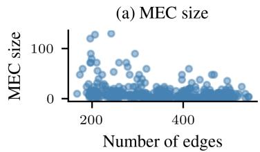

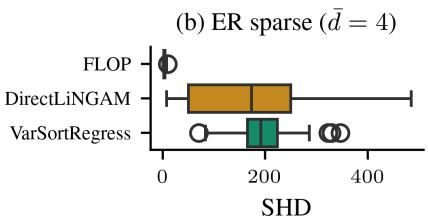

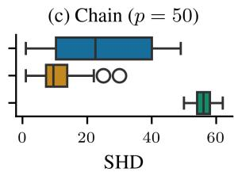  
Figure 1: FLOP vs. DirectLiNGAM vs. VarSortRegress on linear ANMs with $p = 5 0$ nodes, $n = 1 0 0 0$ samples, and generalized normal noise $( \beta = \bar { 1 } . 4 ) ;$ 50 sampled graphs per setting. (a) MEC size vs. number of edges on ER graphs (one point per graph): small across the considered range. (b) SHD to the true DAG on ER graphs: although FLOP targets the MEC rather than the DAG, the small MEC leaves few edges undirected, and FLOP outperforms DirectLiNGAM despite the latter’s assumptions being satisfied. (c) The same comparison on chains without colliders (MEC size of 50): FLOP recovers the skeleton $\left( \mathrm { S H D } \le 4 9 \right)$ but orients edges at random, and is therefore outperformed by DirectLiNGAM. See Figure 3 for the corresponding ancestor AID results.

The above illustrates a general problem in the causal discovery literature: We have no principled means to decide between identifiability assumptions other than mathematical beauty. This applies equally to stronger assumptions that allow full identifiability of the DAG, where various functional and distributional assumptions have emerged. For example, Shimizu et al. [2006] establish identifiability under linear non-Gaussian ANMs. Peters and Bühlmann [2014] show that the full DAG is recoverable when Gaussian noise terms have equal variance. Park [2020] establish a more general condition exploiting marginal and conditional variances with heterogeneous error variances.

It is relatively easy to come up with alternatives allowing DAG identifiability, as the following two examples illustrate. First, we could impose the structural assumption that the MEC has size one, that is, the true DAG is the unique member of its equivalence class. This may seem strong, given that MECs are known to potentially be large [Jahn et al., 2025]. Yet, for Erdos–Rényi (ER) graphs˝ [Erdos and Rényi˝ , 1960], commonly used in benchmarks, this assumption is far from unrealistic as their MEC sizes are often very small (Figure 1(a)). This has direct consequences for algorithm performance, as shown in Figure 1(b) and 1(c), and discussed further in Section 5.

Second, we could reframe sortability (Definition 4) as an identifiability assumption. Varsortability [Reisach et al., 2021] measures the extent to which the causal order of the variables agrees with the order induced by their marginal variances. When it equals one, the two orders coincide, so a causal order can be recovered by sorting variables by marginal variance, and the true DAG by sparse regression [Shojaie and Michailidis, 2010]. The same applies to $R ^ { 2 }$ -sortability [Reisach et al., 2023], where variables are sorted by the fraction of their variance explained by the remaining variables. A third instance is the assumption that the temporal order is known. Reisach et al. [2021] show that varsortability is high in commonly used benchmarks and that algorithms such as NOTEARS [Zheng et al., 2018] implicitly exploit this property. This has led to the development of benchmarks specifically designed to eliminate sortability patterns [Andrews and Kummerfeld, 2026, Herman et al., 2025, Ormaniec et al., 2025], therefore treating varsortability as an artifact to be removed rather than an identifiability assumption. However, there is empirical evidence that sortability may reflect genuine properties of some real-world data [Lohse and Wahl, 2025]. Further, one may argue that knowledge of the temporal order is realistic in experimental setups where variables are measured at known time points, such as longitudinal studies or time-series experiments [Bang et al., 2026, Reisach et al., 2026b], and that the widespread framing of the causal discovery task without such knowledge is in fact itself contrived.

While the established assumptions undoubtedly provide useful mathematical insights and explore the theoretical limitations of identifiability, it remains unclear what makes them more plausible than alternatives like those above, which, to our knowledge, have not been considered before. Common benchmark instances are concentrated near the boundary of these two exemplary identifiability assumptions (that is, MEC size and varsortability are often close to one), and for varsortability, there is even real-world evidence. Why then embrace conceptually more restrictive assumptions while dismissing simpler ones like a MEC size of one? Why spend effort removing sortability from benchmarks rather than exploiting it directly? These questions deserve an open discussion, so that the standards for what constitutes a valid identifiability assumption do not remain implicit. Specifically, this means that we should discuss also when an assumption may not hold, not only when it may hold, otherwise new results accumulate as disconnected advances.

## 4 Consistency: Which guarantees count as meaningful?

Here, we discuss standards around statistical guarantees and their epistemic role in the causal discovery literature. It is natural to study which statistical guarantees causal discovery algorithms possess as estimators. Although well-known to be too weak to ensure satisfactory performance, pointwise consistency is a common property to require of an estimator. For causal discovery algorithms, it is often the only statistical guarantee [Chickering, 2002b, Nazaret and Blei, 2024]. We argue that pointwise consistency has failed in its epistemic role of incentivizing the development of good causal discovery algorithms. First, most causal discovery algorithms can easily be used in ways that ensure pointwise consistency. Second, proofs are easier for simple and theoretically tractable algorithms [Spirtes et al., 2001, Colombo et al., 2012, Nandy et al., 2018] even though these often have mediocre performance [Rios et al., 2025].

We illustrate both points in score-based causal discovery. Here, the BIC score has long been known to be pointwise consistent for graph recovery [Koller and Friedman, 2009]. Exact algorithms that find a graph with globally optimal BIC score [Koivisto and Sood, 2004, Silander and Myllymäki, 2006] are therefore pointwise consistent graph estimators, simply because the underlying score is. Unfortunately, exhaustive search over the graph space has exponential runtime and is only feasible up to about 30 nodes. To resolve this runtime bottleneck, the development of greedy equivalence search (GES) was an important milestone: it builds on the observation that the BIC score is also locally consistent, which guarantees recovery of the MEC via a greedy search that first iteratively adds and then deletes the edge with the greatest score improvement [Chickering, 2002b].

Pointwise consistency of GES does not, however, guarantee good finite-sample performance, since greedy search can get stuck in local optima and fail to find a globally BIC-optimal graph. Follow-up algorithms such as XGES [Nazaret and Blei, 2024] are motivated by this limitation. Yet, to preserve consistency via the GES proof strategy, XGES retains greedy insertion and deletion phases, with the new heuristic acting only as an outer wrapper reinitializing the search [Nazaret and Blei, 2024]. Therefore, the reliance on the GES proof template constrains how far the algorithm can depart from GES. This is unnecessary. Given a pointwise consistent baseline like GES, any procedure producing a candidate graph can be made consistent by running GES in parallel and returning whichever output attains the better score. This separates score-level guarantees from the convergence behavior of the candidate-generating method and does not even require it to be score-based. New algorithms are therefore not bound to greedily optimize the BIC score. For example, BOSS [Andrews et al., 2023] and FLOP [Wienöbst et al., 2026] already embody this philosophy, optimizing the Gaussian BIC through broader discrete search techniques, and deliver substantial performance gains over GES and alternatives. Decoupling algorithm design from consistency proofs is particularly valuable for continuous approaches such as DAGMA [Bello et al., 2022], which optimize a relaxed objective and then threshold and project back to a discrete graph, making direct consistency proofs technically challenging.

By contrast, uniform consistency provides a stronger, practically relevant epistemic standard than pointwise consistency: It ensures convergence to the ground-truth graph at a uniform rate over all models. This means there is no sequence of particularly challenging models for which convergence fails in arbitrarily large samples. However, Robins et al. [2003] show that uniform consistency is unachievable under faithfulness alone, so additional assumptions are necessary.

One such assumption is λ-strong faithfulness (Definition 3) [Zhang and Spirtes, 2003]. By requiring that all partial correlations corresponding to d-connections exceed a fixed threshold λ (which mirrors conditions for PC’s uniform consistency [Kalisch and Bühlmann, 2007]), this assumption rules out the near-unfaithful distributions that obstruct uniform convergence [Zhang and Spirtes, 2003]. This comes at a cost. Uhler et al. [2013] show that, for linear Gaussian models, the set of non-λ-strong-faithful distributions has strictly positive Lebesgue measure and can be surprisingly large. Furthermore, its volume grows rapidly with both the number of nodes and the graph density [Uhler et al., 2013]. So, λ-strong faithfulness cannot be justified by appealing to its violations forming a zero-measure set, unlike faithfulness [Spirtes et al., 1993, Meek, 1995].

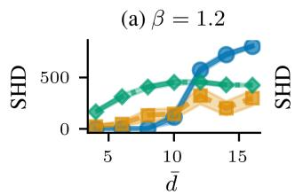

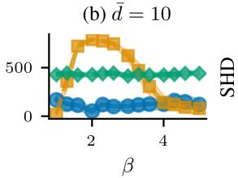

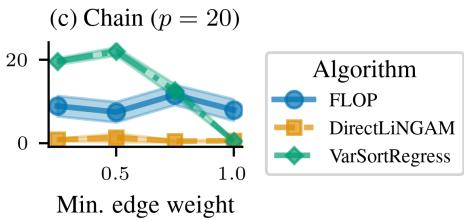  
Figure 2: FLOP vs. DirectLiNGAM vs. VarSortRegress on linear ANMs with $n = 1 0 0 0$ samples and generalized normal noise (β controls peakedness and tails). (a) Varying average degree ¯d on ER graphs $( p = 5 0 , \beta = 1 . 2 ) $ : FL $\varOmega \mathrm { P s }$ performance degrades with density, while DirectLiNGAM and VarSortRegress remain stable. (b) Varying the noise distribution parameter $\beta$ on ER graphs $( p = 5 0$ $\bar { d } = 1 0 )$ : DirectLiNGAM is sensitive to $\beta$ and fails close to $\beta = 2$ (Gaussian noise, violating its assumptions); FLOP and VarSortRegress are stable. (c) Varying edge weights on chains $( p = 2 0$ $\beta = 1 . 2 )$ : VarSortRegress improves with larger absolute weights; FLOP and DirectLiNGAM are stable. See Figure 4 for the corresponding ancestor AID results.

To summarize, neither guarantee on offer is unproblematic. Pointwise consistency is weak and as a design target has shaped algorithm design in ways that are neither obviously helpful nor necessary. Uniform consistency requires assumptions that are difficult to test. Nevertheless, consistency-relevant conditions may silently shape benchmark performance (Section 5). We therefore argue for a broader discussion of consistency as epistemic standard. Assumptions need to be explicit and transparent to avoid misattributing differences between algorithms solely to identifiability assumptions instead. While the literature treats identifiability and consistency as largely separate questions, with advances often in separate papers, the two are coupled and should always be considered jointly.

## 5 Benchmarks: Which regimes count as informative and representative?

Causal discovery algorithms are predominantly evaluated on simulated benchmarks, largely because reliable real-world ground truth is scarce [Gentzel et al., 2019, Brouillard et al., 2025]. However, benchmark performance is known to depend on hidden features of the benchmark setup itself. Commonly used benchmark instances exhibit high varsortability, or, after standardization, high $R ^ { 2 }$ -sortability [Reisach et al., 2021, 2023]. This could explain why NOTEARS [Zheng et al., 2018] achieves strong DAG recovery performance even though the invoked identifiability theory only guarantees identification of the MEC. In the following, we work out examples connected to the previous sections: These examples include identifiability assumptions implicit in the benchmark design, whether the test setting satisfies uniform consistency conditions, and the degree to which algorithm assumptions are met or violated. Left unexamined, these factors render algorithm comparisons largely uninformative.

As discussed in Section 3, ER graphs typically exhibit small MECs (Figure 1(a)). The smaller the MEC, the fewer edges remain unoriented, and therefore recovering the MEC already determines most of the DAG. In the limiting case of a size-one MEC the two coincide rendering the DAG identifiable. This makes algorithms such as exact search for BIC-optimal graphs [Koivisto and Sood, 2004, Silander and Myllymäki, 2006], BOSS [Andrews et al., 2023], or FLOP [Wienöbst et al., 2026] a suitable choice for DAG recovery, even though they are designed only to recover the MEC under their respective assumptions. Note that a MEC of size one as a DAG identifiability assumption (Section 3) is generally not satisfied in this setting. Nevertheless, FLOP followed by randomly drawing a DAG from the found small MEC can outperform DAG-learners whose assumptions are met, because the residual orientation ambiguity within a small MEC is minor. To illustrate this, consider ER graphs with an average degree of four and 1000 samples, where the noise is drawn from a generalized normal distribution with $\beta = 1 . 4$ . Therefore, the noise is non-Gaussian and the identifiability assumptions of DirectLiNGAM [Shimizu et al., 2011] are satisfied. Despite that, FLOP exhibits superior performance in DAG recovery: FLOP recovers the structure robustly and leaves only the few edges of the small MEC to a random draw. When the MEC is small, the errors introduced by random orientation are smaller than the errors of DirectLiNGAM’s estimation (Figure 1(b) and Reisach et al. [2026a]).

The picture flips for chains, that is, DAGs whose skeleton is a single path $X _ { 1 } - X _ { 2 } - \cdot \cdot \cdot - X _ { p }$ and without colliders (their MEC then has size p). In an experiment with these graphs and the other experiment parameters unchanged, FLOP yields an SHD of at most 49, indicating that it recovers the true skeleton. However, since the edges are randomly oriented, we see worse performance than for DirectLiNGAM (Figure 1(c)). So, FLOP’s strong DAG recovery performance on ER graphs is incidental to the design of the benchmark. It works there because the MECs happen to be small. This underscores the importance of comparisons against algorithms whose assumptions are not fulfilled, as these may still perform well on a given benchmark. Recent work has begun to examine algorithm behavior under assumption violations [Montagna et al., 2023a, Yi et al., 2025].

Of course, FLOP’s performance is not guaranteed even when the MEC is small. As average degree increases, FLOP degrades rapidly while DirectLiNGAM remains comparatively robust (Figure 2(a)). The failure is not only one of search but also of score reliability: BIC’s optima no longer correspond to the true graph in this regime (Figure 5). Intuitively, this observation can be understood through λ-strong faithfulness (Definition 3): Larger parent sets tend to reduce the magnitude of individual partial correlations, pushing the sampled distributions closer to the non-λ-strong-faithful regime. While Uhler et al. [2013] establish this theoretically for linear Gaussian models, Olko et al. [2025] demonstrate empirically that the proportion of λ-strong-faithful distributions decreases with graph density in nonlinear settings, suggesting the phenomenon is not specific to the linear Gaussian case. These observations suggest that benchmark evaluations should not only discuss the identifiability assumptions, but also whether the chosen parameters place the settings within a regime that supports uniform consistency.

DirectLiNGAM has an analogous axis of degradation. By manipulating the β-parameter of a generalized normal distribution, we vary the degree of Gaussianity of the noise. DirectLiNGAM’s performance drops as the distribution approaches the Gaussian, while FLOP is unaffected by that change: it relies only on second-order information not the distribution (Figure 2(b)). To our knowledge, no theory has been developed to quantify the relationship between the degree of non-Gaussianity and the sample size DirectLiNGAM needs to exploit it. Therefore, systematic, gradual ablation along different axes trying to break a method should become best practice. Mapping out failure modes helps advance the field, especially in settings where there are no uniform consistency results yet.

More generally, for any algorithm we can find some subspace of the model space where it performs well. Figure 2(c) shows that increasing the lower bound of the edge weight interval makes the sampled models more varsortable, and VarSortRegress achieves correspondingly lower SHDs. Whether the properties of that subspace are framed as artifacts or as implicit theoretical assumptions is a choice, and the current benchmark development largely treats them as artifacts to remove [Andrews and Kummerfeld, 2026, Herman et al., 2025]. Ormaniec et al. [2025], for instance, reduce varsortability through variance standardization (iSCMs); but the same operation restricts the implied edge weights to a smaller region of the parameter space (Figure 6), where the sampled models lie closer to the hypersurfaces of non-faithful distributions and are more likely to violate λ-strong faithfulness assumptions. Eliminating one artifact installs another, and we conjecture that no exhaustive benchmark design can escape this: Any restriction of the model space leaves regions where different algorithms perform better.

Benchmarks are not neutral arbiters of empirical performance. By restricting which models, noise distributions, and parameter regions are sampled, they implicitly answer theoretical questions the field has not yet agreed on how to answer explicitly. In this sense, benchmarks are already doing the work of theory but less transparently. Just as we argued for identifiability and consistency in Sections 3 and 4, this work should be surfaced and made discussable. Concretely, this means that algorithm development should report failure modes rather than only successes, and that benchmark choices should be presented as assumptions on the data-generating process, which a practitioner can interrogate, contest, or accept depending on the application.

## 6 Conclusion

Across identifiability, consistency, and benchmarking, the same pattern recurs. Each lens introduces conditions on the data-generating process, and each is governed by standards that operate implicitly: which assumptions count as fundamental, which guarantees count as meaningful, which benchmarks count as informative and representative. Methods accumulate, theoretical frameworks proliferate, and benchmark suites multiply, but the criteria by which they are compared often remain unstated.

We take the position that this is a central bottleneck in causal discovery. The field does not lack methods, results, or benchmarks; it lacks shared standards for navigating the ones it already has. The three lenses cannot be addressed separately either, because none of them supplies an epistemic standard on its own: a consistency guarantee is stated relative to an identifiability regime, and both become visible only in the finite-sample regimes and metrics a benchmark happens to select. Bayesian model selection and posterior uncertainty can operationalize such standards once model spaces, priors, likelihoods, and targets are specified, but they do not determine which assumptions or benchmark regimes are appropriate in the first place. Causal discovery needs to make these standards explicit.

Several concrete questions follow. When an identifiability assumption is only approximately satisfied, does performance degrade gradually or fail abruptly, and can finite-sample analyses and benchmark ablations characterize where that change occurs? This has been studied for faithfulness [Uhler et al., 2013], but not systematically across identifiability assumptions. Whether small MEC size or sortability is a legitimate assumption or a benchmark artifact likewise cannot be decided by theory or benchmark construction alone; it depends on the downstream task and on whether the metric rewards the relevant recovery target, as the reversals across graph families, noise regimes, and metrics in Section 5 illustrate. More generally, how do benchmark artifacts arise from choices of model classes, parameter regions, and metrics? We conjecture they cannot be eliminated, only relocated; if so, the question is not which benchmark is neutral but which commitments a benchmark should be designed to make legible. Several recent studies pursue these questions [Weichwald et al., 2020, Reisach et al., 2021, 2023, 2026a, Montagna et al., 2023b, Andrews and Kummerfeld, 2026, Herman et al., 2025, Ormaniec et al., 2025, Lohse and Wahl, 2025].

Answering them requires benchmarks that vary assumption satisfaction gradually, reveal where methods cease to outperform alternatives, and relate these crossovers to finite-sample behavior and identifiability guarantees. Explicit standards of this kind also let a practitioner ask which assumptions a method requires and whether their application plausibly meets them. Real-world and physically grounded benchmarks [Runge et al., 2019, Göbler et al., 2024, Gamella et al., 2025] can confront such plausibility judgments with reality.

The change we advocate is therefore modest in form and substantial in consequence. Treat alternative assumptions as candidates rather than non-standard curiosities. Treat consistency results as tools for understanding regimes rather than as design constraints. Treat benchmarks as instruments that encode theoretical commitments and should be designed to surface them. We have worked through these moves in a deliberately narrow setting; they only become more important in the broader landscape, where the relevant assumptions and targets differ across latent-variable, temporal, interventional, representation-learning, and application-specific settings. Characterizing where and why algorithms fail should count as progress, not as an inconvenience to be avoided. Without that shift, further methodological work will produce more results without producing more clarity.

## Acknowledgments and Disclosure of Funding

We thank Hubert Drazkowski, Luigi Gresele, Francesco Freni, Silvan Vollmer and Emanuele Marconato for the helpful discussions, insights and feedback on earlier drafts of this work. We also express our gratitude to the anonymous reviewers for the feedback during the rebuttal phase. HK and SW were supported by a research grant (0069071) from Novo Nordisk Fonden. This research was supported by the Pioneer Centre for AI, DNRF grant number P1.

## References

B. Andrews and E. Kummerfeld. Better simulations for validating causal discovery with the DAGadaptation of the onion method. Journal ofMachine Learning Research, 27(147):1–42, 2026.

B. Andrews, J. Ramsey, R. Sanchez-Romero, J. Camchong, and E. Kummerfeld. Fast scalable and accurate discovery of DAGs using the best order score search and grow shrink trees. In Advances in Neural Information Processing Systems (NeurIPS), volume 36, pages 63945–63956, 2023.

B. Aragam and Q. Zhou. Concave penalized estimation of sparse Gaussian Bayesian networks. Journal ofMachine Learning Research, 16(69):2273–2328, 2015.

C. Bang, J. Witte, R. Foraita, and V. Didelez. Improving finite sample performance of causal discovery by exploiting temporal structure. Statistical Methods in Medical Research, 35(4):867–886, 2026.

K. Bello, B. Aragam, and P. Ravikumar. DAGMA: Learning DAGs via M-matrices and a logdeterminant acyclicity characterization. In Advances in Neural Information Processing Systems (NeurIPS), volume 35, pages 8226–8239, 2022.

P. Boeken, P. Forré, and J. M. Mooij. Are Bayesian networks typically faithful? arXiv preprint arXiv:2410.16004, 2026.

P. Brouillard, S. Lachapelle, A. Lacoste, S. Lacoste-Julien, and A. Drouin. Differentiable causal discovery from interventional data. In Advances in Neural Information Processing Systems (NeurIPS), volume 33, pages 21865–21877, 2020.

P. Brouillard, C. Squires, J. Wahl, K. P. Körding, K. Sachs, A. Drouin, and D. Sridhar. The landscape of causal discovery data: Grounding causal discovery in real-world applications. In Causal Learning and Reasoning (CLeaR), volume 275, pages 834–873. PMLR, 2025.

P. Bühlmann, M. Kalisch, and M. H. Maathuis. Variable selection in high-dimensional linear models: Partially faithful distributions and the PC-simple algorithm. Biometrika, 97(2):261–278, 2010.

P. Bühlmann, J. Peters, and J. Ernest. CAM: Causal additive models, high-dimensional order search and penalized regression. The Annals ofStatistics, 42(6):2526–2556, 2014.

N. Cartwright. What is wrong with Bayes nets? The Monist, 84(2):242–264, 2001.

D. M. Chickering. A transformational characterization of equivalent Bayesian network structures. In Uncertainty in Artificial Intelligence (UAI), pages 87–98, 1995.

D. M. Chickering. Learning equivalence classes of Bayesian-network structures. Journal ofMachine Learning Research, 2:445–498, 2002a.

D. M. Chickering. Optimal structure identification with greedy search. Journal of Machine Learning Research, 3(11):507–554, 2002b.

D. Colombo, M. H. Maathuis, M. Kalisch, and T. S. Richardson. Learning high-dimensional directed acyclic graphs with latent and selection variables. The Annals ofStatistics, 40(1):294–321, 2012.

G. F. Cooper and E. Herskovits. A Bayesian method for the induction of probabilistic networks from data. Machine Learning, 9(4):309–347, 1992.

A. P. Dawid. Beware of the DAG! In Causality: Objectives and Assessment, volume 6, pages 59–86. PMLR, 2010.

T. Deleu, A. Góis, C. Emezue, M. Rankawat, S. Lacoste-Julien, S. Bauer, and Y. Bengio. Bayesian structure learning with generative flow networks. In Uncertainty in Artificial Intelligence (UAI), volume 180, pages 518–528. PMLR, 2022.

F. Eberhardt. Green and grue causal variables. Synthese, 193(4):1029–1046, 2016.

P. Erdos and A. Rényi. On the evolution of random graphs. ˝ Publications of the Mathematical Institute ofthe Hungarian Academy ofSciences, 5(1):17–60, 1960.

J. L. Gamella, J. Peters, and P. Bühlmann. Causal chambers as a real-world physical testbed for AI methodology. Nature Machine Intelligence, 7(1):107–118, 2025.

D. Geiger, T. Verma, and J. Pearl. Identifying independence in Bayesian networks. Networks, 20(5): 507–534, 1990.

A. Gentzel, D. Garant, and D. Jensen. The case for evaluating causal models using interventional measures and empirical data. In Advances in Neural Information Processing Systems (NeurIPS), volume 32, pages 11722–11732, 2019.

C. Glymour, K. Zhang, and P. Spirtes. Review of causal discovery methods based on graphical models. Frontiers in Genetics, 10:524, 2019.

K. Göbler, T. Windisch, M. Drton, T. Pychynski, M. Roth, and S. Sonntag. causalAssembly: Generating realistic production data for benchmarking causal discovery. In Causal Learning and Reasoning (CLeaR), volume 236, pages 609–642. PMLR, 2024.

A. Hauser and P. Bühlmann. Characterization and greedy learning of interventional Markov equivalence classes of directed acyclic graphs. Journal of Machine Learning Research, 13(79):2409–2464, 2012.

D. Heckerman, D. Geiger, and D. M. Chickering. Learning Bayesian networks: The combination of knowledge and statistical data. Machine Learning, 20(3):197–243, 1995.

L. Henckel, T. Würtzen, and S. Weichwald. Adjustment identification distance: A gadjid for causal structure learning. In Uncertainty in Artificial Intelligence (UAI), volume 244, pages 1569–1598. PMLR, 2024.

R. J. Herman, J. Wahl, U. Ninad, and J. Runge. Unitless unrestricted Markov-consistent SCM generation: Better benchmark datasets for causal discovery. In Causal Learning and Reasoning (CLeaR), volume 275, pages 1506–1531. PMLR, 2025.

A. Hyttinen, F. Eberhardt, and M. Järvisalo. Constraint-based causal discovery: Conflict resolution with answer set programming. In Uncertainty in Artificial Intelligence (UAI), pages 340–349, 2014.

T. Ikeuchi, M. Ide, Y. Zeng, T. N. Maeda, and S. Shimizu. Python package for causal discovery based on LiNGAM. Journal ofMachine Learning Research, 24(14):1–8, 2023.

E. Jahn, F. Eberhardt, and L. J. Schulman. Lower bounds on the size of Markov equivalence classes. In Uncertainty in Artificial Intelligence (UAI), volume 286, pages 1819–1836. PMLR, 2025.

F. H. Jørgensen, L. Gresele, and S. Weichwald. What is causal about causal models and representations? arXiv preprint arXiv:2501.19335, 2026.

S. Joshi, T. Saulus, W. Brendel, P. Brouillard, D. Sridhar, and P. Reizinger. Who guards the guardians? The challenges of evaluating identifiability of learned representations. In Uncertainty in Artificial Intelligence (UAI), volume 337, pages 2618–2660. PMLR, 2026.

M. Kalisch and P. Bühlmann. Estimating high-dimensional directed acyclic graphs with the PCalgorithm. Journal ofMachine Learning Research, 8(22):613–636, 2007.

N. K. Kitson, A. C. Constantinou, Z. Guo, Y. Liu, and K. Chobtham. A survey of Bayesian network structure learning. Artificial Intelligence Review, 56(8):8721–8814, 2023.

M. Koivisto and K. Sood. Exact Bayesian structure discovery in Bayesian networks. Journal of Machine Learning Research, 5:549–573, 2004.

D. Koller and N. Friedman. Probabilistic Graphical Models: Principles and Techniques. MIT Press, 2009.

W.-Y. Lam, B. Andrews, and J. Ramsey. Greedy relaxations of the sparsest permutation algorithm. In Uncertainty in Artificial Intelligence (UAI), volume 180, pages 1052–1062. PMLR, 2022.

C. Lohse and J. Wahl. Sortability of time series data. Transactions on Machine Learning Research, 2025.

S. Magliacane, T. Claassen, and J. M. Mooij. Ancestral causal inference. In Advances in Neural Information Processing Systems (NeurIPS), volume 29, pages 4466–4474, 2016.

C. Meek. Strong completeness and faithfulness in Bayesian networks. In Uncertainty in Artificial Intelligence (UAI), pages 411–418, 1995.

C. Meek. Graphical Models: Selecting Causal and Statistical Models. PhD thesis, Carnegie Mellon University, 1997.

F. Montagna, A. A. Mastakouri, E. Eulig, N. Noceti, L. Rosasco, D. Janzing, B. Aragam, and F. Locatello. Assumption violations in causal discovery and the robustness of score matching. In Advances in Neural Information Processing Systems (NeurIPS), volume 36, pages 47339–47378, 2023a.

F. Montagna, N. Noceti, L. Rosasco, and F. Locatello. Shortcuts for causal discovery of nonlinear models by score matching. arXiv preprint arXiv:2310.14246, 2023b.

F. Montagna, N. Noceti, L. Rosasco, K. Zhang, and F. Locatello. Scalable causal discovery with score matching. In Causal Learning and Reasoning (CLeaR), volume 213, pages 752–771. PMLR, 2023c.

J. M. Mooij, S. Magliacane, and T. Claassen. Joint causal inference from multiple contexts. Journal of Machine Learning Research, 21(99):1–108, 2020.

P. Nandy, A. Hauser, and M. H. Maathuis. High-dimensional consistency in score-based and hybrid structure learning. The Annals of Statistics, 46(6A):3151–3183, 2018.

A. Nazaret and D. Blei. Extremely greedy equivalence search. In Uncertainty in Artificial Intelligence (UAI), volume 244, pages 2716–2745. PMLR, 2024.

M. Olko, M. Gajewski, J. Wojciechowska, M. Morzy, P. Sankowski, and P. Miłos. Since faithfulness´ fails: The performance limits of neural causal discovery. In International Conference on Machine Learning (ICML), volume 267, pages 47155–47175. PMLR, 2025.

W. Ormaniec, S. Sussex, L. Lorch, B. Schölkopf, and A. Krause. Standardizing structural causal models. In International Conference on Learning Representations (ICLR), pages 68912–68954, 2025.

G. Park. Identifiability of additive noise models using conditional variances. Journal of Machine Learning Research, 21(75):1–34, 2020.

J. Pearl. Causality: Models, Reasoning, and Inference. Cambridge University Press, 2009.

J. Peters and P. Bühlmann. Identifiability of Gaussian structural equation models with equal error variances. Biometrika, 101(1):219–228, 2014.

J. Peters, J. M. Mooij, D. Janzing, and B. Schölkopf. Causal discovery with continuous additive noise models. Journal ofMachine Learning Research, 15(58):2009–2053, 2014.

J. Peters, D. Janzing, and B. Schölkopf. Elements of Causal Inference: Foundations and Learning Algorithms. MIT Press, Cambridge, MA, USA, 2017.

A. Reisach, C. Seiler, and S. Weichwald. Beware of the simulated DAG! Causal discovery benchmarks may be easy to game. In Advances in Neural Information Processing Systems (NeurIPS), volume 34, pages 27772–27784, 2021.

A. Reisach, M. Tami, C. Seiler, A. Chambaz, and S. Weichwald. A scale-invariant sorting criterion to find a causal order in additive noise models. In Advances in Neural Information Processing Systems (NeurIPS), volume 36, pages 785–807, 2023.

A. Reisach, A. Chambaz, G. Blanchard, and S. Weichwald. A topological sorting criterion for random causal directed acyclic graphs. arXiv preprint arXiv:2605.06288, 2026a.

A. Reisach, A. Suárez, S. Weichwald, and A. Chambaz. The case for time in causal DAGs. Philosophy ofScience, pages 1–21, 2026b.

F. L. Rios, G. Moffa, and J. Kuipers. Benchpress: A versatile platform for structure learning in causal and probabilistic graphical models. Journal ofStatistical Software, 114(12):1–43, 2025.

J. M. Robins, R. Scheines, P. Spirtes, and L. Wasserman. Uniform consistency in causal inference. Biometrika, 90(3):491–515, 2003.

P. K. Rubenstein, S. Weichwald, S. Bongers, J. M. Mooij, D. Janzing, M. Grosse-Wentrup, and B. Schölkopf. Causal consistency of structural equation models. In Uncertainty in Artificial Intelligence (UAI), volume R15, pages 151–160. PMLR, 2017.

J. Runge, S. Bathiany, E. Bollt, G. Camps-Valls, D. Coumou, E. Deyle, C. Glymour, M. Kretschmer, M. D. Mahecha, J. Muñoz-Marí, E. H. van Nes, J. Peters, R. Quax, M. Reichstein, M. Scheffer, B. Schölkopf, P. Spirtes, G. Sugihara, J. Sun, K. Zhang, and J. Zscheischler. Inferring causation from time series in Earth system sciences. Nature Communications, 10(1):2553, 2019.

J. Runge, A. Gerhardus, G. Varando, V. Eyring, and G. Camps-Valls. Causal inference for time series. Nature Reviews Earth & Environment, 4(7):487–505, 2023.

B. Schölkopf, F. Locatello, S. Bauer, N. R. Ke, N. Kalchbrenner, A. Goyal, and Y. Bengio. Toward causal representation learning. Proceedings ofthe IEEE, 109(5):612–634, 2021.

C. Schultheiss and P. Bühlmann. On the pitfalls of Gaussian likelihood scoring for causal discovery. Journal of Causal Inference, 11(1):20220068, 2023.

G. Schwarz. Estimating the dimension of a model. The Annals ofStatistics, 6(2):461–464, 1978.

S. Shimizu, P. O. Hoyer, A. Hyvärinen, and A. Kerminen. A linear non-Gaussian acyclic model for causal discovery. Journal ofMachine Learning Research, 7:2003–2030, 2006.

S. Shimizu, T. Inazumi, Y. Sogawa, A. Hyvärinen, Y. Kawahara, T. Washio, P. O. Hoyer, and K. Bollen. DirectLiNGAM: A direct method for learning a linear non-Gaussian structural equation model. Journal ofMachine Learning Research, 12:1225–1248, 2011.

A. Shojaie and G. Michailidis. Penalized likelihood methods for estimation of sparse high dimensional directed acyclic graphs. Biometrika, 97(3):519–538, 2010.

T. Silander and P. Myllymäki. A simple approach for finding the globally optimal Bayesian network structure. In Uncertainty in Artificial Intelligence (UAI), pages 445–452, 2006.

P. Spirtes and C. Glymour. An algorithm for fast recovery of sparse causal graphs. Social Science Computer Review, 9(1):62–72, 1991.

P. Spirtes and C. Meek. Learning Bayesian networks with discrete variables from data. In Knowledge Discovery and Data Mining (KDD), pages 294–299. AAAI Press, 1995.

P. Spirtes, C. Glymour, and R. Scheines. Causation, Prediction, and Search, volume 81 of Lecture Notes in Statistics. Springer, 1993.

P. Spirtes, T. Richardson, C. Meek, R. Scheines, and C. Glymour. Using path diagrams as a structural equation modeling tool. Sociological Methods & Research, 27(2):182–225, 1998.

P. Spirtes, C. Glymour, and R. Scheines. Causation, Prediction, and Search. MIT Press, 2nd edition, 2001.

M. Teyssier and D. Koller. Ordering-based search: A simple and effective algorithm for learning Bayesian networks. In Uncertainty in Artificial Intelligence (UAI), pages 584–590, 2005.

S. Triantafillou, V. Lagani, C. Heinze-Deml, A. Schmidt, J. Tegner, and I. Tsamardinos. Predicting causal relationships from biological data: Applying automated causal discovery on mass cytometry data of human immune cells. Scientific Reports, 7(1):12724, 2017.

I. Tsamardinos, L. Brown, and C. Aliferis. The max-min hill-climbing Bayesian network structure learning algorithm. Machine Learning, 65(1):31–78, 2006.

C. Uhler, G. Raskutti, P. Bühlmann, and B. Yu. Geometry of the faithfulness assumption in causal inference. The Annals ofStatistics, 41(2):436–463, 2013.

J. Viinikka, A. Hyttinen, J. Pensar, and M. Koivisto. Towards scalable Bayesian learning of causal DAGs. In Advances in Neural Information Processing Systems (NeurIPS), volume 33, pages 6584–6594, 2020.

M. J. Vowels, N. C. Camgoz, and R. Bowden. D’ya like DAGs? A survey on structure learning and causal discovery. ACM Computing Surveys, 55(4):1–36, 2022.

S. Weichwald, M. E. Jakobsen, P. B. Mogensen, L. Petersen, N. Thams, and G. Varando. Causal structure learning from time series: Large regression coefficients may predict causal links better in practice than small p-values. In NeurIPS 2019 Competition and Demonstration Track, volume 123, pages 27–36. PMLR, 2020.

M. Wienöbst, L. Henckel, and S. Weichwald. Embracing discrete search: A reasonable approach to causal structure learning. In International Conference on Learning Representations (ICLR), pages 54630–54652, 2026.

H. Yi, Y. He, D. Chen, M. Kang, H. Wang, and W. Yu. The robustness of differentiable causal discovery in misspecified scenarios. In International Conference on Learning Representations (ICLR), pages 22347–22385, 2025.

Y. Yu, J. Chen, T. Gao, and M. Yu. DAG-GNN: DAG structure learning with graph neural networks. In International Conference on Machine Learning (ICML), volume 97, pages 7154–7163. PMLR, 2019.

J. Zhang and P. Spirtes. Strong faithfulness and uniform consistency in causal inference. In Uncertainty in Artificial Intelligence (UAI), pages 632–639, 2003.

X. Zheng, B. Aragam, P. K. Ravikumar, and E. P. Xing. DAGs with no tears: Continuous optimization for structure learning. In Advances in Neural Information Processing Systems (NeurIPS), volume 31, pages 9472–9483, 2018.

Y. Zheng, B. Huang, W. Chen, J. Ramsey, M. Gong, R. Cai, S. Shimizu, P. Spirtes, and K. Zhang. Causal-learn: Causal discovery in Python. Journal of Machine Learning Research, 25(60):1–8, 2024.

## A Formal Definitions

In the following, we state the formal definitions of relevant concepts used above.

Definition 1 (Markov property and faithfulness) Let P be a distribution over $V = \{ X _ { 1 } , \ldots , X _ { p } \}$ and let $\mathcal { G } = ( V , E )$ be $a D A G$ . We say that P is Markov to G ifevery d-separation in G implies the corresponding conditional independence in P,

$$
X _ { A } \perp _ { \mathrm { d } \thinspace \mathrm { s e p } } \thinspace X _ { B } \mid \thinspace X _ { Z } \implies \thinspace X _ { A } \thinspace \perp _ { \mathbb { P } } \thinspace X _ { B } \mid \thinspace X _ { Z } ~ f o r a l l ~ d i s j o i n t ~ X _ { A } , X _ { B } , X _ { Z } \subseteq V ,
$$

and faithful to G if additionally the converse holds, that is

$$
X _ { A } \ \bot _ { \mathrm { d } \mathrm { s e p } } \ X _ { B } \ | \ X _ { Z } \ \iff \ X _ { A } \ \bot _ { \mathbb { P } } \ X _ { B } \ | \ X _ { Z } { \mathrm { ~ } } \quad \ f o r \ a l l \ d i s j o i n t \ X _ { A } , X _ { B } , X _ { Z } \subseteq V .
$$

Definition 2 (Covariance-faithfulness) Let P be a distribution over random variables $V =$ $\{ X _ { 1 } , \ldots , X _ { p } \}$ and let $\mathcal { G } = ( V , E )$ be a DAG. We say that $\mathbb { P }$ is covariance-faithful to G if, for all distinct $\dot { X _ { i } } , X _ { j } \in V$ and all $X _ { S } \subseteq V \setminus \{ X _ { i } , X _ { j } \}$ ,

$$
\rho ( X _ { i } , X _ { j } \mid X _ { S } ) = 0 \iff X _ { i } \bot _ { \mathrm { d - s e p } } X _ { j } \mid X _ { S } ,
$$

where $\rho ( X _ { i } , X _ { j } \mid X _ { S } )$ denotes the linear partial correlation, that is, the correlation between the residuals obtainedfrom linearly regressing $X _ { i }$ and $X _ { j }$ on $X _ { S }$

Definition 3 (λ-strong faithfulness) Fix $\lambda ~ \in ~ ( 0 , 1 )$ Let P be a distribution over $V =$ $\{ X _ { 1 } , \ldots , X _ { p } \}$ and let $\mathcal { G } = ( V , E )$ be a DAG. We say that P is λ-strong-faithful to G if, for all distinct $X _ { i } , \overset { \cdot } { X } _ { j } \in V$ and all ${ \dot { X } } _ { S } \subseteq V \setminus \{ X _ { i } , X _ { j } \}$ ,

$$
\left| \rho ( X _ { i } , X _ { j } \mid X _ { S } ) \right| > \lambda \iff X _ { i } \downarrow _ { \mathrm { d - s e p } } X _ { j } \mid X _ { S } ,
$$

that $i s ,$ every partial correlation corresponding to a d-connection is bounded away from zero by λ.

Remark: Zhang and Spirtes [2003] and Uhler et al. [2013] state λ-strong faithfulness for linear Gaussian models. We state it for arbitrary distributions with finite second moments, since the partial correlations in Definition 3 are well-defined whenever those exist, and we consider it beyond that case. Covariance-faithfulness (Definition 2) is the excluded limiting case $\lambda = 0$

Definition 4 (Varsortability and $R ^ { 2 }$ -sortability) Let P be a distribution over $V = \{ X _ { 1 } , \ldots , X _ { p } \}$ that is Markov to a DAG G with at least one edge, and let τ assign a value $\tau _ { i }$ to each node. The τ-sortability $v _ { \tau } ( \mathbb { P } , \mathcal { G } ) \in [ 0 , 1 ]$ ] is thefraction of triples $( X _ { i } , X _ { j } , k )$ for which G contains a directed path oflength k from $X _ { i } \overset { \cdot } { t o } \bar { X } _ { j }$ and $\tau _ { i } < \tau _ { j }$ , counting ties as one half[Reisach et al., 2021, 2023]. Varsortability takes $\tau _ { i } = \mathrm { V a r } ( X _ { i } )$ , and $R ^ { 2 }$ -sortability takes $\tau _ { i } = R _ { i } ^ { 2 }$ , thefraction ofthe variance of $X _ { i }$ explained by the remaining variables, which in the linear case equals $1 - \left( \operatorname { V a r } ( X _ { i } ) ( \Sigma ^ { - 1 } ) _ { i i } \right) ^ { - 1 }$ for Σ the covariance matrix of P. Either measure equals 1 iff every node’s criterion value strictly exceeds that ofall its ancestors.

## B Extended Discussion of Examples

Here, we provide the full details of Examples 1 and 2. Together, they showcase that without further assumptions there is no principled reason to prefer faithfulness over covariance-faithfulness. Hence, they exemplify the implicit standards in the causal discovery literature of how we decide which identifiability assumptions count as fundamental.

## B.1 Example 1: Covariance-faithfulness does not imply faithfulness

Consider the data-generating process described by the following SCM:

$$
\begin{array} { l } { { X _ { 1 } = N _ { 1 } } } \\ { { X _ { 2 } = - 3 + 3 \cdot 1 \{ X _ { 1 } = 2 \} + N _ { 2 } } } \\ { { X _ { 3 } = - 3 + 1 \{ X _ { 1 } > 0 \} + \mathrm { s i g n } ( X _ { 2 } ) \cdot N _ { 3 } } } \end{array}
$$

where $N _ { 1 } \sim \mathrm { U n i f } ( \{ 0 , 1 , 2 \} ) , N _ { 2 } , N _ { 3 } \sim \mathrm { U n i f } ( \{ - 1 , 1 \} )$ are jointly independent and $\mathbf { 1 } \{ \cdot \}$ denotes the indicator function. This SCM induces an observational joint distribution P over 12 configurations, each occurring with equal probability. The 12 equally likely configurations are

$$
X _ { 1 } \atop  \scriptstyle { \begin{array} { c c c c c c c c c c c c c c c c c c c c c c } { { } } & { { } } & { { } } & { { } } & { { 0 } } & { { } } & { { 0 } } & { { } } & { { 1 } } & { { 1 } } & { { 1 } } & { { 1 } } & { { 2 } } & { { } } & { { 2 } } & { { } } & { { 2 } } & { { } } & { { 2 } } & { { } } \\ { X _ { 2 } } & { { } } & { { - 4 } } & { { - 4 } } & { { - 2 } } & { { - 2 } } & { { - 4 } } & { { - 4 } } & { { - 2 } } & { { - 2 } } & { { - 2 } } & { { - 1 } } & { { - 1 } } & { { 1 } } & { { 1 } } & { { } } & { { 1 } } & { { } } \\ { X _ { 3 } } & { { } } & { { - 2 } } & { { - 4 } } & { { - 2 } } & { { - 4 } } & { { - 1 } } & { { - 3 } } & { { - 1 } } & { { - 3 } } & { { - 1 } } & { { - 3 } } & { { - 3 } } & { { - 3 } } & { { - 1 } } & { { } } & { { } } \end{array} }
$$

The SCM is structurally minimal (Remark 6.6 in Peters et al., 2017) and the causal graph $\mathcal { G } _ { 0 }$ therefore is the fully connected triangle $X _ { 1 } \stackrel { \longleftrightarrow } { \longrightarrow } X _ { 2 } \stackrel { \longleftrightarrow } { \longrightarrow } X _ { 3 }$ . Direct computation yields the covariance and precision matrices

$$
\Sigma = \frac { 1 } { 9 } \left( \begin{array} { c c c } { { 6 } } & { { 9 } } & { { 3 } } \\ { { 9 } } & { { 2 7 } } & { { 3 } } \\ { { 3 } } & { { 3 } } & { { 1 1 } } \end{array} \right) , \qquad \Sigma ^ { - 1 } = \frac { 1 } { 2 8 } \left( \begin{array} { c c c } { { 9 6 } } & { { - 3 0 } } & { { - 1 8 } } \\ { { - 3 0 } } & { { 1 9 } } & { { 3 } } \\ { { - 1 8 } } & { { 3 } } & { { 2 7 } } \end{array} \right) .
$$

All entries of $\Sigma$ are nonzero, and all entries of $\Sigma ^ { - 1 }$ are nonzero. Therefore, P is covariance-faithful to $\mathcal { G } _ { 0 }$ . Yet, P is not faithful to $\mathcal { G } _ { 0 } \colon$ enumeration of the 12 configurations shows that $X _ { 2 } \perp \perp X _ { 3 } \mid X _ { 1 }$ and that this is the only (conditional) independence among $X _ { 1 } , \bar { X } _ { 2 } , X _ { 3 }$ . Specifically, conditional on $X _ { 1 } \in \{ 0 , 1 \} , \mathrm { s i g n } ( X _ { 2 } ) = - 1$ deterministically, so $X _ { 3 } = \bar { - } 3 + { \bf 1 } \{ X _ { 1 } > 0 \} \bar { - } N _ { 3 }$ depends only on $X _ { 1 }$ and the independent noise $N _ { 3 } ;$ conditional on $X _ { 1 } = 2 , X _ { 2 } = N _ { 2 }$ and $X _ { 3 } = - 2 + \mathrm { s i g n } ( X _ { 2 } ) N _ { 3 }$ , so $X _ { 3 } \mid X _ { 1 } = \bar { 2 } , X _ { 2 } = x _ { 2 }$ is uniform on $\{ - 3 , - 1 \}$ regardless of the value x2. The graph $\mathcal { G } _ { 0 }$ , however, contains the edge $X _ { 2 }  X _ { 3 }$ , so no conditioning set d-separates $X _ { 2 }$ from $X _ { 3 }$ and the conditional independence $X _ { 2 } \perp \perp X _ { 3 } \mid X _ { 1 }$ has no counterpart in $\mathcal { G } _ { 0 } . \mathrm { ~ B y ~ }$ contrast, P is faithful, for example, to the chain $X _ { 2 }  X _ { 1 }  X _ { 3 }$ , whose only d-separation statement is $X _ { 2 } \perp \perp X _ { 3 } \mid X _ { 1 }$

## B.2 Example 2: Faithfulness does not imply covariance-faithfulness

Consider the data-generating process described by the following SCM:

$$
\begin{array} { l } { { X _ { 1 } = N _ { 1 } } } \\ { { X _ { 2 } = X _ { 1 } + N _ { 2 } } } \\ { { X _ { 3 } = 2 X _ { 1 } - X _ { 2 } + N _ { 3 } } } \end{array}
$$

where $N _ { 1 } , N _ { 2 } , N _ { 3 }$ are jointly independent with zero mean, unit variance, and non-Gaussian distribution with finite fourth moment. Substituting yields the reduced form $X _ { 2 } = N _ { 1 } + N _ { 2 }$ and $X _ { 3 } = N _ { 1 } - N _ { 2 } + N _ { 3 }$ . It is structurally minimal and the causal graph $\mathcal { G } _ { 0 }$ is the fully connected triangle $X _ { 1 } \stackrel { \displaystyle \longrightarrow } { \longrightarrow } X _ { 2 } \stackrel { \displaystyle \longrightarrow } { \longrightarrow } X _ { 3 }$ . Direct computation yields the covariance and precision matrices

$$
\begin{array}{c} \Sigma = { \binom { 1 } { 1 } } \quad { \begin{array} { l } { 1 } \\ { 2 } \end{array} }  \\ { 1 } \end{array}  \quad { \begin{array} { l } { 1 } \\ { 1 } \\ { 3 } \end{array} } \quad { \begin{array} { l } { 1 } \\ { 5 ^ { - 1 } = { \binom { 6 } { - 3 } } \quad { \begin{array} { l l l } { - 3 } & { - 2 } \\ { 2 } & { 1 } & { 1 } \\ { - 2 } & { 1 } & { 1 } \end{array} } } \end{array} } .
$$

Thus, covariance-faithfulness to $\mathcal { G } _ { 0 }$ is not fulfilled, since $\Sigma _ { 2 3 } = 0$ despite $X _ { 2 }$ and $X _ { 3 }$ being adjacent in $\mathcal { G } _ { 0 }$ . Yet, P is faithful to $\mathcal { G } _ { 0 }$ , as we verify by checking that no (conditional) independence holds among $X _ { 1 } , X _ { 2 } , X _ { 3 }$ . The marginal dependences $X _ { 1 } ~ \ X ~ X _ { 2 }$ and $X _ { 1 } ~ \ X ~ X _ { 3 }$ follow from $\Sigma _ { 1 2 } =$ $\Sigma _ { 1 3 } = 1 \neq 0$ . Despite vanishing covariance $\Sigma _ { 2 3 } = 0$ , we have $X _ { 2 } \ \mathscr { L } \ X _ { 3 } ;$ Since $X _ { 2 } = N _ { 1 } + N _ { 2 }$ and $X _ { 3 } = N _ { 1 } - \bar { N } _ { 2 } + N _ { 3 }$ are linear combinations of $N _ { 1 }$ and $N _ { 2 }$ with nonzero coefficients, the Darmois–Skitovich theorem implies that $X _ { 2 } \perp \perp X _ { 3 }$ would force $N _ { 1 }$ and $N _ { 2 }$ to be Gaussian. However, by assumption they are non-Gaussian, so $X _ { 2 } \ \mathscr { X } \ X _ { 3 }$ . For the conditional dependences, note that $\dot { X } _ { 3 } \mid \bar { X } _ { 1 } \stackrel { . } { = } x _ { 1 } , \dot { X } _ { 2 } = x _ { 2 } \sim 2 x _ { 1 } - x _ { 2 } + \dot { N _ { 3 } }$ depends on both $x _ { 1 }$ and $x _ { 2 }$ . Since $N _ { 2 }$ is nondegenerate, conditioning on $X _ { 2 }$ alone leaves $X _ { 1 }$ random, so the conditional law of $X _ { 3 } \ \mid \ X _ { 2 }$ still depends on $X _ { 1 }$ , giving $\mathsf { \bar { X } 3 } \mathrm { ~ \textmu ~ } \mathrm { \bar { X } 1 } \mathrm { ~ \textbar { X } 2 } \mathsf { ; }$ the symmetric argument with $X _ { 1 }$ and $X _ { 2 }$ exchanged gives $X _ { 3 } \nmid \times X _ { 2 } \mid X _ { 1 }$ . Finally, the joint conditional density of $( X _ { 1 } , X _ { 2 } )$ given $X _ { 3 } = x _ { 3 }$ satisfies $p ( x _ { 1 } , x _ { 2 } \mid x _ { 3 } ) \propto p _ { N _ { 1 } } ( x _ { 1 } ) p _ { N _ { 2 } } ( x _ { 2 } - x _ { 1 } ) p _ { N _ { 3 } } ( x _ { 3 } - 2 x _ { 1 } + x _ { 2 } )$ , which does not factorize into a function of x alone times a function of $x _ { 2 }$ alone, since $p _ { N _ { 3 } } ( x _ { 3 } - 2 x _ { 1 } + x _ { 2 } )$ couples $x _ { 1 }$ and $x _ { 2 } ;$ hence $X _ { 1 } \downarrow \downarrow X _ { 2 } \mid X _ { 3 }$

## C Additional Experimental Details

Here, we give an overview of the experimental details and provide additional figures.

Min. edge weight

## C.1 Data Generation

1. Graph generation: We consider ER graphs and chains without colliders. To sample a chain without colliders, we first build a chain skeleton and shuffle the node indices. We then randomly select a source node and orient all edges away from it.

2. Edge weights: Unless specified otherwise, we draw edge coefficients uniformly from ±[0.25, 1.0].

3. Noise distributions: The noise is drawn either from a generalized normal distribution, where the degree of Gaussianity is controlled by the β-parameter (1.0 corresponds to the Laplace distribution, 2.0 to the Gaussian distribution), or from a zero-centered uniform distribution (with the bounds set to meet the desired variance). Unless specified otherwise, we draw the variances of the noise distributions uniformly from [0.5, 2.0].

4. MEC size computation: We first sample an ER-DAG, then obtain its CPDAG by calling dag2cpdag in the causal-learn Python package [Zheng et al., 2024], and compute the MEC size using the CliquePicking Python package available at https://github.com/ mwien/CliquePicking.

## C.2 Algorithms

1. FLOP: We use the implementation from the Python package available at https://github. com/CausalDisco/flopsearch. Unless specified otherwise, we set the number of restarts to 20 and the BIC penalty to 2.0, following the original paper. FLOP outputs a CPDAG, but we use it as a DAG-learner. To sample a DAG from the MEC, we randomly select an undirected edge and orient it in a random direction. We then apply Meek’s rules to obtain a CPDAG again, and repeat this process until all edges are oriented.

2. DirectLiNGAM: We use the implementation from the official Python package of DirectLiNGAM [Ikeuchi et al., 2023]. We use the default parameters throughout.

3. VarSortRegress: Compared to the existing implementation at https://github.com/ CausalDisco/CausalDisco/, we standardize the data before parent selection. We did not observe any differences between the results of the existing implementation and ours.

## C.3 Figures

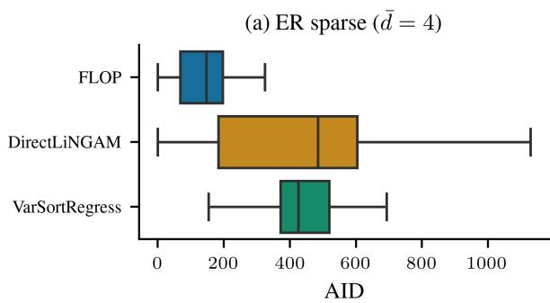

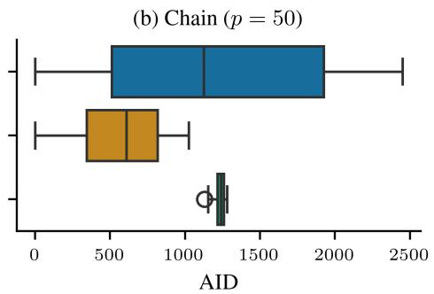  
Figure 3: As Figure 1(b) and (c), but reporting ancestor AID instead of SHD.

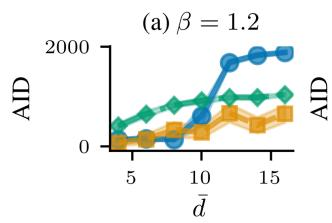

(b) d = 10  
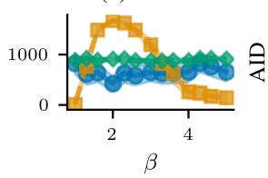

(c) Chain (p = 20)  
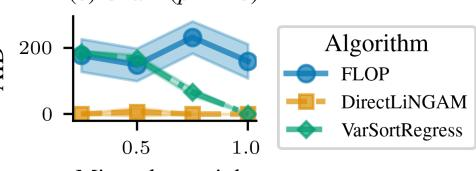  
Figure 4: As Figure 2, but reporting ancestor AID instead of SHD.

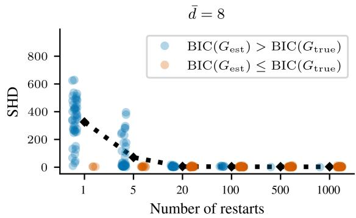

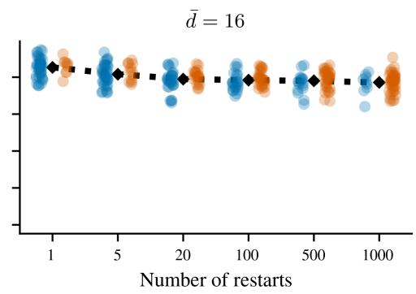

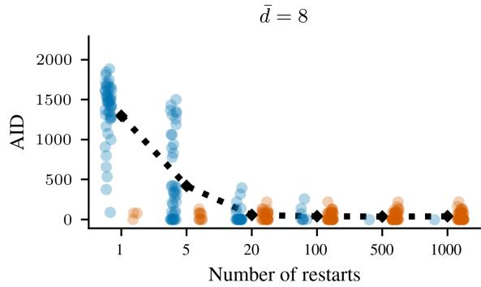

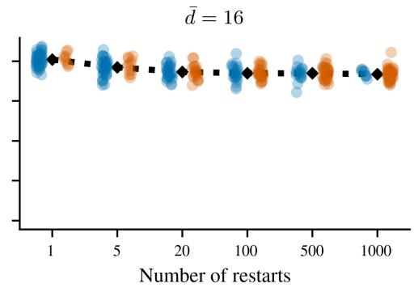  
Figure 5: SHD and ancestor AID vs. number of restarts in FLOP, on linear ANMs with $p = 5 0$ nodes, $n = 1 0 0 0$ samples, and uniform noise; results across 50 sampled graphs per setting, with average degree $\bar { d } = 8$ (left) and ¯d = 16 (right). Lower BIC is better, so points with $\begin{array} { r } { \dot { \mathrm { B I C } } ( G _ { \mathrm { e s t } } ) \dot { { } } \leq \mathrm { B I C } ( G _ { \mathrm { t r u e } } ) } \end{array}$ mark runs in which the search found a graph scoring at least as well as the true graph. With more restarts $\mathrm { F L O P }$ increasingly does $\mathbf { s o } ,$ but for $\bar { d } = 1 6$ this does not translate to recovering the true graph: the search succeeds while the graph remains wrong.

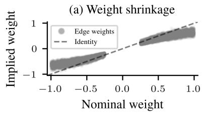

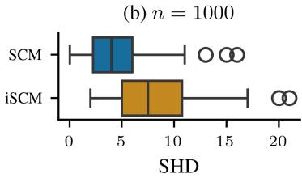

(c) n = 1000  
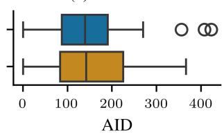  
Figure 6: (a): The implied edge weights of an iSCM tend to be smaller than the originally drawn weights, where implied weights are computed via Algorithm 2 in Ormaniec et al. [2025]. (b) and (c): FLOP exhibits a slightly worse performance on the iSCMs compared to standard ER graphs. Both use $p = 5 0$ nodes, ${ \bar { d } } = { \bar { 8 } } ,$ and Gaussian noise.

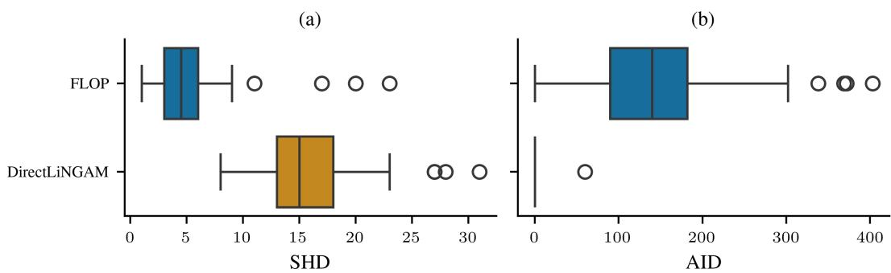  
Figure 7: FLOP vs. DirectLiNGAM across two different metrics, SHD and ancestor AID, on linear ANMs with $p = 5 0$ node ER graphs with $\bar { d } = 8 , n = 1 0 0 0$ samples, and uniform noise (variances uniformly sampled from [0.5, 2.0]); results across 50 sampled graphs. FLOP outperforms DirectLiNGAM with respect to SHD, but DirectLiNGAM outperforms FLOP with respect to ancestor AID, illustrating that the choice of metric influences results. VarSortRegress is omitted because its performance is not informative here.