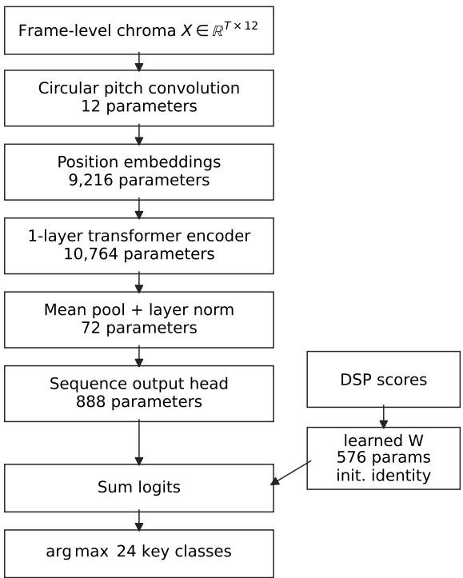
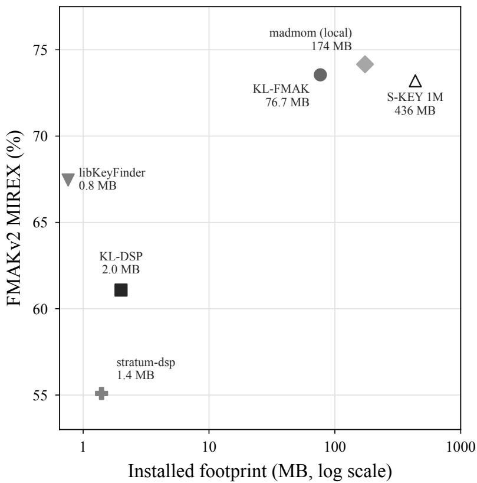

# Deployment-constrained key estimation with a DSP-guided transformer reranker

Pardis Noorzad Cue Labs pardis@cuelabs.ca

## Abstract

Local music applications estimate key during library import and benefit from an analyzer that is small, fast, and runs in-process. We start from a compact chroma-template key analyzer that fits this budget but lags behind learned references. Learned systems reach higher accuracy, but their installed model and runtime dependencies can occupy tens to hundreds of megabytes. We present key lime, a 21.5k-parameter DSP-guided transformer reranker with a 115 KB model artifact and a 76.7 MB installed footprint, including the extracted ONNX Runtime. It adds 0.32 ms per track to deterministic DSP scoring. Trained from labels on 4,040 FMAK tracks, with 449 tracks for validation and 1,000 disjoint FMAKv2 tracks held out for evaluation, it improves MIREX from 61.08 to 73.55 ± 0.46 and exact accuracy from 52.30 to 67.07 ± 0.65 over three seeds (mean ± population SD). It approaches a same-manifest local madmom KeyCNN reference at 74.16 MIREX. A 12-parameter circular input stage matches the accuracy range of a 468-parameter linear input projection.

Keywords: music information retrieval, key estimation, local-first software, audio analysis

## 1 Introduction

Local music applications such as Cueport1 display estimated musical keys during library import. Because this analysis runs in-process on the user’s laptop [1], the estimator’s footprint matters as much as its accuracy: it must add little binary size and few runtime dependencies, and finish fast enough that importing thousands of tracks remains practical. Compact chroma-template methods [2, 3, 4] meet this budget. Our Rust analyzer, trail mix2, computes tempo, beat-position, key, and waveform summaries locally; only key is evaluated here. Its key scorer reaches 61.08 MIREX on our 1,000-track FMAKv2 holdout, compared with 74.16 for local madmom KeyCNN [5]. S-KEY [6] reports 72.1 and 73.2 MIREX on the full 5,489-track protocol. This key gap motivates adding a small learned component while retaining the broader DSP analyzer. We call the deterministic trail mix key scorer KL-DSP and the learned reranker KL-FMAK. Madmom and S-KEY occupy 174 MB and 436 MB when installed (Table 3).

We introduce key lime, a transformer with 21,528 parameters, exported as a 115 KB ONNX file that adds 0.32 ms per track to DSP scoring. It reranks the 24 DSP key scores using frame-level chroma context. The selected model uses an identity-initialized DSP-score projection and a circular input convolution as low-cost structural choices. The ablation in Table 2 shows that the frame-sequence branch accounts for the measured accuracy gain. Circular input and identity initialization were not distinguishable at three seeds. The circular input shares weights over pitch classes, giving the input stage a transposition-equivariant form related in spirit to the transposition objectives of STONE and $\mathbf { M T } ^ { 2 } \left[ 7 , 8 \right]$ . Training uses 4,040 labeled FMAK tracks, selects checkpoints on 449 disjoint FMAK validation tracks, and reports final and diagnostic results on a sealed 1,000-track FMAKv2 holdout.

Over three seeds, KL-FMAK raises held-out MIREX from 61.08 to $7 3 . 5 5 \pm 0 . 4 6$ , approaching the local madmom reference at 74.16 on the same files. Its 76.7 MB installed footprint, dominated by ONNX Runtime, is 2.3× smaller than madmom’s and 5.7× smaller than S-KEY’s; the model file itself is 115 KB. Published S-KEY and madmom scores use the full 5,489-track protocol and provide context for the local same-manifest results.

Our contributions are: (i) a compact DSP-guided transformer reranker for a DSP key scorer; (ii) a held-out, three-seed evaluation against DSP and local madmom with paired-bootstrap and McNemar tests; and (iii) an ablation separating the sequence branch, circular input, identity initialization, and distillation, together with measured model, runtime, and installed footprints.

## 2 Related Work

## 2.1 Key estimation: DSP and learned approaches

Major and minor keys produce characteristic pitch-class distributions that remain consistent across instruments; comparing a chroma histogram against 24 fixed key templates via Pearson correlation recovers the key using deterministic scoring in the Krumhansl-Schmuckler tradition [9]. Profiles from Krumhansl-Kessler [2] and Temperley [3] target common-practice tonality; genre-adapted variants such as Faraldo’s EDM templates [4] address the distinct harmonic vocabulary of electronic dance music.

CNN-based methods replace hand-crafted profiles with filters learned from labeled data. madmom KeyCNN [5] trains a convolutional network on labeled chroma frames; a CNN captures richer correlations among pitch classes than a fixed template, raising accuracy above profile-matching across diverse genres at the cost of a learned model artifact and inference runtime.

Self-supervised methods reduce dependence on labeled corpora by pre-training on large unlabeled collections. STONE [7] and its successor S-KEY [6] exploit pitch transposition as a free supervisory signal: the same audio shifted by � semitones should yield a representation shifted by � in key space, and training this consistency at scale via cross-power spectral density losses reduces reliance on labeled data. STONE variants use limited supervision, whereas S-KEY requires no human annotation; $\mathbf { M T } ^ { 2 }$ combines CPSD with a contrastive objective [8]. These systems need an external inference runtime, which can dominate their installed footprint.

## 2.2 Existing key-analysis tools

Essentia [10], libKeyFinder3, and stratum-dsp4 provide local key analysis in C++ or Rust. We include them in the footprint comparison because they represent the deployment profile of local DSP analyzers without a separate learned model runtime. The method studied here is a compact learned global-key DSP-score reranker that preserves much of that local deployment profile while correcting some key-estimation errors. It adds a 115 KB model and an ONNX Runtime dependency to a local analyzer rather than replacing the analyzer with a larger learned system. We use trail mix as the base scorer because it is the target local analyzer and already computes tempo, beat-position, key, waveform summaries, and the 24-key score vector consumed by the reranker. We report Essentia’s EDMM profile because it is the EDM-oriented profile rather than selecting an Essentia profile on the holdout. The libKeyFinder result shows that another compact DSP scorer is stronger than KL-DSP on this holdout; reranking other scorers’ 24-key score vectors is future work.

## 3 Method

## 3.1 DSP key scorer

The key analyzer computes chroma from two complementary front ends, a fixed-window Goertzel bank and a Constant-Q transform [11, 12], and normalizes and averages them into ˜�. Scoring uses Pearson correlation $\rho ( \tilde { c } , p _ { k } )$ against 24 key templates $p _ { k }$ (12 major, 12 minor) drawn from Krumhansl-Kessler [2], Temperley [3], and Faraldo EDM profiles [4], plus a GiantSteps Key-fitted profile in the archived scorer. That fitted profile was learned from trail mix GiantSteps Key benchmark output and does not use FMAK or FMAKv2 audio or labels. Correlations are averaged across the major/minor template pairs from each profile family. The winning template sets global key, and the reported confidence is the margin between the top and second-best correlations. This paper evaluates only the global key estimate.

## 3.2 Compact learned key backend

The learned key backend is a compact transformer encoder [13] over the same frame-level chroma sequence used by the DSP key scorer. The KL-FMAK artifact uses one encoder layer, $d _ { m } = 3 6$ , four attention heads, a 72-dim feed-forward block, dropout 0.3 [14], and weight decay 0.05 [15]. Training uses AdamW with learning rate 0.001, batch size 16, at most 25 epochs, validation-based early stopping, class balancing over the 24 labels, a five-epoch DSP-margin curriculum, and MIREX-aware soft targets that spread mass �=0.2 to fifth, relative, and parallel neighbours of the true key. Transposition augmentation rotates each input sequence, label, and DSP prior consistently through all 12 semitones. Inputs use the first 256 chroma frames, which covers about 32 seconds at trail mix’s chroma rate of approximately 8 Hz; shorter tracks are zero-padded to the same length. The exported model uses no padding mask, so mean pooling includes those zero-padded frames exactly as in training. Early stopping uses validation MIREX. Section 4.1 defines the train, validation, and holdout split used for these settings. The DSP-margin curriculum orders early training examples by the DSP score margin between the top two candidate keys, starting with high-margin examples and linearly exposing the full training set over five epochs.

Figure 1 summarizes the two input branches and trainable parameter split. The DSP-guided reranker fuses the frame sequence with the 24-dim DSP key score vector $s _ { \mathrm { d s p } }$ emitted over the 24 templates. This vector is the raw averaged Pearson-correlation score vector from the full-track aggregate chroma; it is not normalized before the identity-initialized projection. Writing $z _ { \mathrm { s e q } } \in \mathbb { R } ^ { 2 4 }$ for the pooled encoder logits, the reranker logits and prediction are

$$
z = z _ { \mathrm { s e q } } + W \ : s _ { \mathrm { d s p } } , \qquad \hat { y } = \arg \operatorname* { m a x } _ { k } z _ { k } ,\tag{1}
$$

with trainable $W \in \mathbb { R } ^ { 2 4 \times 2 4 }$ initialized to the identity, so before training the DSP score vector is already present in the logits. The encoder then learns a residual correction over the DSP prediction. This matches the deployment setting: the local analyzer already computes a useful 24-key DSP ranking, and the learned backend is intended to correct that ranking under the small-footprint budget rather than replace the analyzer with a standalone classifier. This residual form also gives the small model an easier target than a from-scratch global-key classifier: it can preserve high-confidence DSP decisions and spend its limited capacity on frames where chroma context changes the ranking. The learn-only-� ablation in Table 2 isolates the DSP-score projection and falls below the DSP baseline, so the gain is not a learned lookup over DSP scores alone. The frame sequence is the evidence source that lets the residual branch improve the template ranking.

  
Figure 1: KL-FMAK architecture and trainable parameter split. The circular convolution is part of the selected KL-FMAK model. The six blocks sum to 21,528 parameters in a 115 KB fp32 ONNX file.

KL-FMAK replaces the linear input projection with a circular 1-D convolution � over the 12 pitch classes that shares one kernel across all positions. The single chroma channel feeds three shared output channels with a three-bin kernel, producing $1 2 \times 3 = 3 6$ features per frame. For a semitone rotation $R _ { t }$ , a cyclic shift of the pitch-class axis applied to the input,

$$
g ( R _ { t } x ) = R _ { t } g ( x ) ,\tag{2}
$$

so transposition equivariance is built into this input stage. STONE and $\mathbf { M T } ^ { 2 }$ use CPSD losses for transposition objectives [7, 8]. The rest of the model is unconstrained, so the guarantee applies to the input stage. The motivation was to share input-stage statistics across pitch transpositions, so limited training data need not learn separate first-layer patterns for each tonic. Training minimizes MIREX-aware soft-target cross-entropy,

$$
{ \mathcal { L } } = \mathbf { C E } ( q , p ) ,\tag{3}
$$

where $p = \operatorname { s o f t m a x } ( z )$ and the target $q = ( 1 - \lambda ) e _ { y } + \lambda r$ places residual mass � on the fifth, relative, and parallel neighbours of the true key � in proportion to their MIREX weight. The fifth relation includes both same-mode fifth directions, while the relative relation follows the directional MIREX convention. We use $\lambda { = } 0 . 2$ and a three-bin pitch convolution kernel. KL-FMAK trains on 4,040 FMAK tracks and selects checkpoints on a deterministic 449-track FMAK validation split. An ablation distills a frozen madmom KeyCNN with $\alpha { = } 0 . 3$ and temperature �=4 [16], but the final model uses labels only.

## 4 Evaluation

## 4.1 Data split and metrics

FMAKv2 provides key annotations for 5,489 Free Music Archive tracks [17, 18, 19]. We seal a deterministic 1,000-track holdout (fingerprint 43a35a0b...c863) before model selection. After removing those track IDs, 4,489 FMAK tracks remain; a deterministic hash split assigns 4,040 to training and 449 to validation. Track ID overlap is zero. The training pool uses FMAK labels while the holdout uses FMAKv2 labels; FMAKv2 revises about 200 annotations, so the label sources are not identical. The 61.08 MIREX DSP baseline is regenerated from the archived source revision on this sealed manifest. The holdout ablations and sensitivity checks below are reported as diagnostics rather than as validation criteria.

Key uses the MIREX weighted score: 1.0 exact, 0.5 perfect fifth, 0.3 relative, 0.2 parallel, and 0 otherwise. Paired comparisons report a bootstrap 95% confidence interval on the per-track MIREX delta [20]. For KL-FMAK versus deterministic baselines, each track’s MIREX score is averaged across the three KL-FMAK seeds, the deterministic baseline score for that same track is subtracted, and the bootstrap resamples those 1,000 per-track deltas. McNemar tests are exact-binomial tests on paired exact-match outcomes, not on the weighted MIREX scores [21].

## 4.2 Results and ablations

Table 1 separates published reference values from local same-manifest evaluations. The published S-KEY and madmom values use all 5,489 tracks [6]; local rows use only the sealed holdout. The KL-FMAK row in Table 1 is the labels-only final variant reported in Table 2. KL-FMAK improves over KL-DSP by 12.47 MIREX and 14.77 exact points on average. The representative seed 1729 reaches 73.53 MIREX with a paired 95% CI of [+9.51, +15.40] points and exact-match McNemar $p = 9 . 4 \times 1 0 ^ { - 1 6 }$ . The three-seed mean lies 0.61 MIREX below local madmom, while its exact accuracy is 0.37 points higher. The three KL-FMAK seed MIREX values are 73.00, 73.53, and 74.12; seed 1729 is the selected representative artifact because it is closest to the three-seed mean. The local madmom comparison is a deterministic same-manifest point estimate. A seed-averaged paired bootstrap gives KL-FMAK minus madmom as −0.61 MIREX with 95% CI [−3.27, +2.03], so the point gap is not resolved by this sample. A single-seed sensitivity check around the soft-target mass gives MIREX/exact of 72.65/65.70 for �=0.1, 73.53/67.00 for �=0.2, and 73.26/66.80 for �=0.3 (seed 1729; cf. the 73.55 three-seed mean for the same �=0.2 recipe), so this setting does not reveal a sharp optimum.

Against KL-DSP, the selected seed converts 244 of KL-DSP’s 477 non-exact tracks into exact matches: 59 fifth errors, 42 relative errors, 34 parallel errors, and 109 other errors. The same KL-FMAK seed’s final non-exact distribution is 76 fifth, 51 relative, 60 parallel, and 143 other. This distribution is over KL-FMAK predictions, not the remaining subset of KL-DSP’s original non-exact tracks. Net, the reranker corrects more DSP errors than it introduces: it converts 244 non-exact tracks to exact against 97 demotions of previously exact tracks, the +147-track net that raises exact accuracy from 52.30% to 67.00% for this seed. The demotions are 19 fifth, 18 relative, 22 parallel, and 38 other errors, so they are not confined to one harmonic relation. For deployment settings that prefer avoiding demotions over maximizing the average exact rate, the relevant next evaluation is a confidence-gated deferral rule that keeps DSP predictions on selected tracks; the present study reports the ungated reranker.

Table 2 shows that access to the frame sequence is necessary: the learn-only-� row trains only the DSP-score projection with $z _ { \mathrm { s e q } } { = } 0$ and remains below DSP. This ablation tests access to sequence evidence and DSP scores, not attention against every possible frame-sequence architecture. The three-seed mean is unchanged by circular input and identity initialization; random initialization is numerically similar to identity initialization. The circular input stage uses 12 trainable weights, compared with 468 for the linear input projection (468 linear versus 12 circular; net +456 parameters in Table 2). The full model therefore keeps the linear-input variant’s accuracy range while using about 39× fewer input-stage parameters. Labelsonly training is numerically above the distilled row. The 1.05-point gap is small relative to the three-seed variation. A seed-matched paired bootstrap over track IDs gives labels-only minus distilled full as +1.05 MIREX with 95% CI [−0.43, +2.51]. Labels-only exceeds learn-only-� by +13.30 MIREX with 95% CI [+10.67, +16.01]. Removing the DSP-margin curriculum gives 73.16±0.62 MIREX, close to the final labels-only row. The reported gain is present in labels-only training, so distillation is optional. The learn-only-� row starts from the DSP score vector, but training updates � under FMAK labels, class weighting, and soft targets; validation early stopping therefore need not preserve the identity map on the FMAKv2 holdout. Inspecting the selected seed-1729 � shows learned structure rather than an identity map. Diagonal weights average 0.80, mean absolute of-diagonal weight is 0.225, and fifth/relative/parallel entries average $+ 0 . 1 9 / + 0 . 1 8 / + 0 . 3 6$ , while other of-diagonal entries average −0.12. This raises musically adjacent alternatives but is insuficient without frame evidence, matching the learn-only-� ablation.

Table 1: FMAKv2 key estimation, MIREX / exact (%). Published S-KEY and madmom rows are quoted from Kong et al. [6] and use the full 5,489-track protocol. Local rows use the same 1,000-track holdout; KL-FMAK reports mean ± population standard deviation over three seeds. A dash marks a quantity not reported by the cited source, or an SD that is not applicable for a single deterministic run.
<table><tr><td></td><td colspan="2">MIREX (%)</td><td colspan="2">Exact (%)</td></tr><tr><td>System</td><td>Mean</td><td>SD</td><td>Mean</td><td>SD</td></tr><tr><td>S-KEY 60k (pub.)</td><td>72.10</td><td>一</td><td>一</td><td>一</td></tr><tr><td>S-KEY 1M (pub.)</td><td>73.20</td><td>一</td><td>一</td><td>1</td></tr><tr><td>madmom (pub.)</td><td>73.10</td><td>一</td><td>一</td><td>一</td></tr><tr><td>KL-DSP</td><td>61.08</td><td></td><td>52.30</td><td></td></tr><tr><td>KL-FMAK (labels-only, final)</td><td>73.55</td><td>0.46</td><td>67.07</td><td>0.65</td></tr><tr><td>madmom (local)</td><td>74.16</td><td>一</td><td>66.70</td><td>一</td></tr></table>

Table 2: FMAKv2 ablation, MIREX / exact (%), mean ± population standard deviation over three seedmatched runs on the sealed holdout. Recipe and architecture rows use labels-only training unless stated otherwise. ΔDSP is MIREX points relative to the 61.08 KL-DSP baseline. The table first compares training objectives, then recipe and architecture variants.
<table><tr><td>Variant</td><td>Params</td><td colspan="2">MIREX (%)</td><td colspan="2">∆DSP</td><td colspan="2">Exact (%)</td></tr><tr><td></td><td></td><td>Mean ±</td><td>SD</td><td>(pts)</td><td></td><td>Mean ±</td><td>SD</td></tr><tr><td colspan="8">Training objective</td></tr><tr><td>Full, labels-only (final)</td><td>21,528</td><td>73.55±</td><td>0.46</td><td>十</td><td>12.47</td><td>67.07 ±</td><td>0.65</td></tr><tr><td>Full, distilled</td><td>21,528</td><td>72.50±</td><td>0.58</td><td>+</td><td>11.42</td><td>64.97±</td><td>0.76</td></tr><tr><td colspan="8">Training recipe, labels-only</td></tr><tr><td>No curriculum</td><td>21,528</td><td>73.16±</td><td>0.62</td><td>+</td><td>12.08</td><td>66.07 ±</td><td>0.56</td></tr><tr><td colspan="8">Architecture, labels-only</td></tr><tr><td>Linear input</td><td>21,984</td><td>72.50±</td><td>0.47</td><td>+</td><td>11.42</td><td>65.13 ±</td><td>0.87</td></tr><tr><td>Random-init W</td><td>21,528</td><td>72.73 ±</td><td>0.33</td><td>+</td><td>11.65</td><td>65.33 ±</td><td>0.69</td></tr><tr><td>Learn only W</td><td>576</td><td>60.25 ±</td><td>0.45</td><td>一</td><td>0.83</td><td>50.90 ±</td><td>0.62</td></tr></table>

Table 3: Deployment footprint for key estimation systems. Footprint columns measure MB on disk after installation. Model is the learned model artifact; binary/deps is the executable, library, runtime, and nonmodel dependency closure. A zero means no learned model artifact. Installed footprints compare deployable software ecosystems rather than model-only parameter counts. Rows keep KL-DSP and KL-FMAK adjacent, then list compact DSP tools and larger learned systems.
<table><tr><td>System</td><td>Model (MB)</td><td>Binary/deps (MB)</td><td>Total (MB)</td></tr><tr><td>KL-DSP</td><td>0</td><td>2.0</td><td>2.0</td></tr><tr><td>KL-FMAK</td><td>0.115</td><td>76.58</td><td>76.7</td></tr><tr><td>stratum-dsp</td><td>0</td><td>1.4</td><td>1.4</td></tr><tr><td>Essentia EDMM</td><td>0</td><td>48.4</td><td>48.4</td></tr><tr><td>libKeyFinder</td><td>0</td><td>0.8</td><td>0.8</td></tr><tr><td>madmom KeyCNN</td><td>2.5</td><td>171</td><td>174</td></tr><tr><td>S-KEY</td><td>0.75</td><td>435</td><td>436</td></tr></table>

## 4.3 SWD cross-corpus check

We also score the selected labels-only artifact on the 24-track SC06 performance from the Schubert Winterreise Dataset [22], chosen because the release documents that performance as CC BY 3.0 audio. This is a domain shift from FMAK/FMAKv2 popular and electronic material to a classical song-cycle performance with piano and voice, so it tests whether the reranker only fits the training-domain error profile. KL-FMAK reaches 93.33 MIREX and 91.67 exact, compared with 83.33/79.17 for KL-DSP and 87.08/83.33 for local madmom. The paired MIREX delta over KL-DSP is +10.00 points with 95% CI [−3.75, +25.00]; the interval remains wide because the corpus is small.

The error mix narrows under reranking. KL-DSP has 19 exact matches, one fifth error, one relative error, one parallel error, and two other errors. KL-FMAK has 22 exact matches and two parallel errors, with no fifth, relative, or other errors. Local madmom has 20 exact matches, one relative error, and three parallel errors. This small check shows that the same artifact can correct some non-harmonic DSP errors outside FMAK/FMAKv2, while the two remaining mistakes are parallel-key confusions. A larger classical corpus is needed to confirm corpus-level generalization.

## 4.4 Runtime and deployment

For the footprint-accuracy comparison in Figure 2, local FMAKv2 holdout scoring gives libKeyFinder 67.46 MIREX over 996 scored tracks, stratum-dsp 55.09 MIREX, and Essentia EDMM 48.92 MIREX over all 1,000 tracks. The KL-FMAK model artifact is a 115 KB fp32 ONNX file with 21,528 parameters. The 76.7 MB installed footprint in Table 3 includes the 2.0 MB trail mix binary, the 74.58 MB extracted macOS arm64 ONNX Runtime installation, and the model artifact. The 0.32 ms figure measures batch-size-one ONNX Runtime 1.30.0 CPUExecutionProvider inference over a 195-track FMAKv2 export fixture after one warmup track on a macOS arm64 Apple M-series desktop, on top of the 486 ms DSP analysis on identical audio. This fixture was drawn from the FMAKv2 holdout pool, but it is used only for the runtime artifact, not for model selection or accuracy reporting. The selected labels-only artifact uses the same exported graph and tensor shapes as that latency artifact. The ONNX Runtime footprint is therefore the measured evaluation package, not the pure-Rust integration footprint. Removing the 74.58 MB ONNX Runtime term leaves the 2.0 MB trail mix binary plus 0.115 MB of selected weights, about 2.1 MB before measuring the final Rust application build.

  
Figure 2: FMAKv2 MIREX against installed footprint (Table 3). Filled points use local measurements on the sealed holdout; libKeyFinder covers 996 scored tracks. The hollow S-KEY point combines a locally measured installed footprint with a published full-protocol score. Essentia is omitted from the scatter because it falls below the plotted y-range.

## 5 Discussion and Conclusion

With a 115 KB ONNX model, KL-FMAK brings the DSP scorer within a point of local madmom while adding 0.32 ms per track. It uses a much smaller model artifact and a smaller installed footprint than the local madmom and S-KEY baselines measured here, while keeping deterministic DSP as the base analyzer. The frame-sequence branch is the supported source of the measured gain; the DSP-margin curriculum, circular input, identity initialization, and distillation show similar three-seed means and do not produce resolved gains in this sample. We keep the circular input and identity-initialized DSP-score projection because they encode transposition and DSP-score residual structure at negligible parameter cost. Confirming the result on a broader cross-corpus evaluation, beyond the single SWD check, is the main open item. Future work should also add same-manifest measurements for additional learned baselines.

## Code availability

The public implementation and paper artifact are available in the trail mix repository: https://github. com/djpardis/trailmix/releases/tag/key-lime-paper-v1. The archived software release is avail able at https://doi.org/10.5281/zenodo.23866516. This tagged release records the code revision, selected model state, split fingerprint, seeds, and evidence identifiers used for the reported results.

## Compliance with Ethical Standards

This is a software and evaluation study for which no ethical approval was required. Evaluation used publicly released datasets under their original licenses: FMAKv2 annotations with audio from the Free Music Archive, and the SC06 performance from the Schubert Winterreise Dataset. No new data was collected.

## Conflict of Interest and Funding

The author is afiliated with Cue Labs, which develops Cueport, a local music application in the deployment setting discussed in the introduction. No external funding was received for this work.

## References

[1] Martin Kleppmann, Adam Wiggins, Peter van Hardenberg, and Mark McGranaghan, “Local-first software: You own your data, in spite of the cloud,” in Proceedings ofthe 2019 ACM SIGPLAN International Symposium on New Ideas, New Paradigms, and Reflections on Programming and Software, 2019, pp. 154–178.

[2] Carol L. Krumhansl and Edward J. Kessler, “Tracing the dynamic changes in perceived tonal organi zation in a spatial representation of musical keys,” Psychological Review, vol. 89, no. 4, pp. 334–368, 1982.

[3] David Temperley, “What’s key for key? the krumhansl-schmuckler key-finding algorithm reconsidered,” Music Perception, vol. 17, no. 1, pp. 65–100, 1999.

[4] Angel Faraldo, Perfecto Herrera, and Sergi Jord´ a, “Key estimation in electronic dance music,” in\` Proceedings ofthe 38th European Conference on Information Retrieval, 2016, pp. 335–347.

[5] Filip Korzeniowski and Gerhard Widmer, “Genre-agnostic key classification with convolutional neural networks,” in Proceedings of the 19th International Society for Music Information Retrieval Conference, 2018, pp. 264–270.

[6] Yuexuan Kong, Gabriel Meseguer-Brocal, Vincent Lostanlen, Mathieu Lagrange, and Romain Hennequin, “S-key: Self-supervised learning of major and minor keys from audio,” in ICASSP 2025 - 2025 IEEE International Conference on Acoustics, Speech and Signal Processing, 2025, pp. 1–5.

[7] Yuexuan Kong, Vincent Lostanlen, Gabriel Meseguer-Brocal, Stella Wong, Mathieu Lagrange, and Romain Hennequin, “STONE: Self-supervised tonality estimator,” in Proceedings of the 25th International Societyfor Music Information Retrieval Conference, 2024.

[8] Yuexuan Kong, Vincent Lostanlen, Romain Hennequin, Mathieu Lagrange, and Gabriel Meseguer-Brocal, “Multi-class-token transformer for multitask self-supervised music information retrieval,” in IEEE Workshop on Applications of Signal Processing to Audio and Acoustics, 2025.

[9] Carol L. Krumhansl, Cognitive Foundations of Musical Pitch, Oxford University Press, 1990.

[10] Dmitry Bogdanov, Nicolas Wack, Emilia Gomez, Sankalp Gulati, Perfecto Herrera, Oscar Mayor,´ Gerard Roma, Justin Salamon, Jose R. Zapata, and Xavier Serra, “Essentia: An audio analysis library´ for music information retrieval,” in Proceedings ofthe 14th International Societyfor Music Information Retrieval Conference, 2013, pp. 493–498.

[11] Judith C. Brown, “Calculation of a constant q spectral transform,” The Journal of the Acoustical Society ofAmerica, vol. 89, no. 1, pp. 425–434, 1991.

[12] Christian Schorkhuber and Anssi Klapuri, “Constant-q transform toolbox for music processing,” in ¨ Proceedings ofthe 7th Sound and Music Computing Conference, 2010.

[13] Ashish Vaswani, Noam Shazeer, Niki Parmar, Jakob Uszkoreit, Llion Jones, Aidan N. Gomez, Lukasz Kaiser, and Illia Polosukhin, “Attention is all you need,” in Advances in Neural Information Processing Systems 30, 2017, pp. 5998–6008.

[14] Nitish Srivastava, Geofrey Hinton, Alex Krizhevsky, Ilya Sutskever, and Ruslan Salakhutdinov, “Dropout: A simple way to prevent neural networks from overfitting,” Journal of Machine Learning Research, vol. 15, no. 1, pp. 1929–1958, 2014.

[15] Ilya Loshchilov and Frank Hutter, “Decoupled weight decay regularization,” in Proceedings of the 7th International Conference on Learning Representations, 2019.

[16] Geofrey Hinton, Oriol Vinyals, and Jef Dean, “Distilling the knowledge in a neural network,” arXiv preprint arXiv:1503.02531, 2015.

[17] Yuexuan Kong, “FMAKv2: A dataset of key and mode annotations for the free music archive,” Zenodo, 2024.

[18] Stella Wong and Gandalf Hernandez, “FMAK: A dataset of key and mode annotations for the free music archive,” International Society for Music Information Retrieval Late-Breaking/Demo Session, 2023.

[19] Michael Deferrard, Kirell Benzi, Pierre Vandergheynst, and Xavier Bresson, “FMA: A dataset for ¨ music analysis,” in Proceedings of the 18th International Society for Music Information Retrieval Conference, 2017, pp. 316–323.

[20] Bradley Efron and Robert Tibshirani, “Bootstrap methods for standard errors, confidence intervals, and other measures of statistical accuracy,” Statistical Science, vol. 1, no. 1, pp. 54–75, 1986.

[21] Quinn McNemar, “Note on the sampling error of the diference between correlated proportions or percentages,” Psychometrika, vol. 12, no. 2, pp. 153–157, 1947.

[22] Christof Weiß, Frank Zalkow, Vlora Arifi-M¨uller, Meinard M¨uller, Hendrik Vincent Koops, Anja Volk, and Harald G. Grohganz, “Schubert winterreise dataset: A multimodal scenario for music analysis,” in ACM Journal on Computing and Cultural Heritage, 2021, vol. 14, pp. 25:1–25:18.