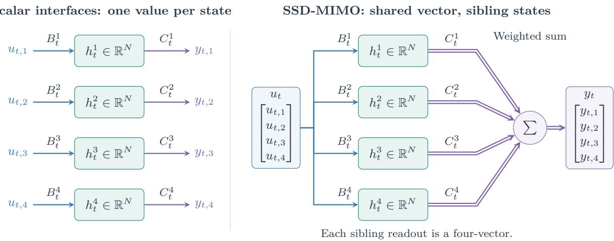
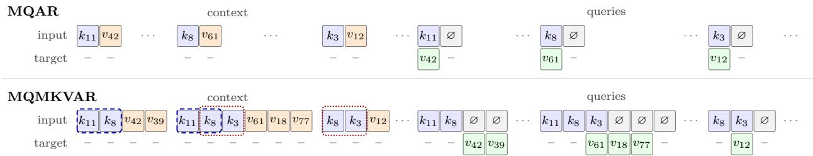
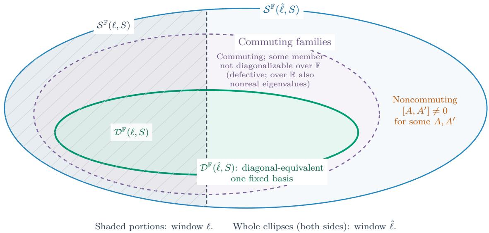
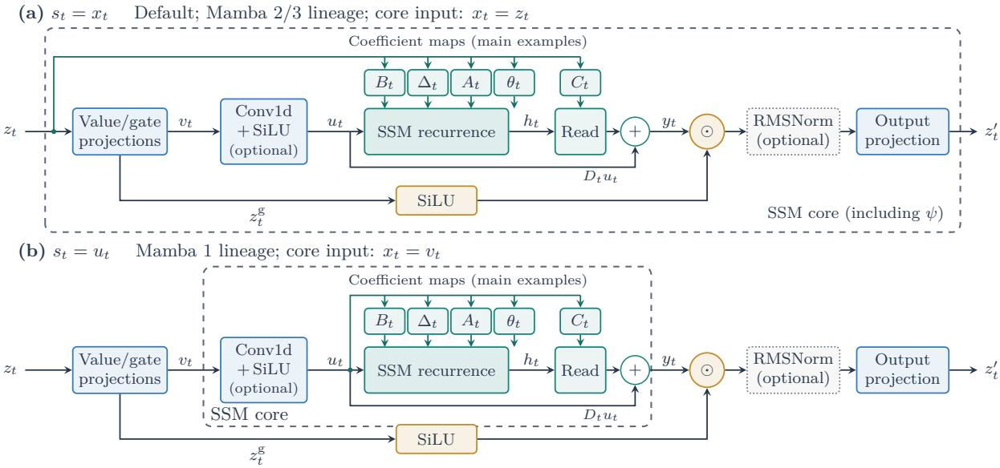
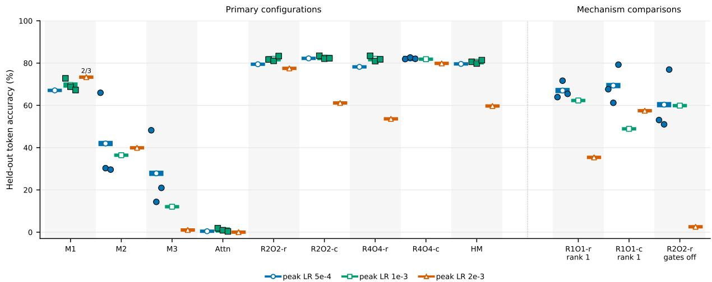
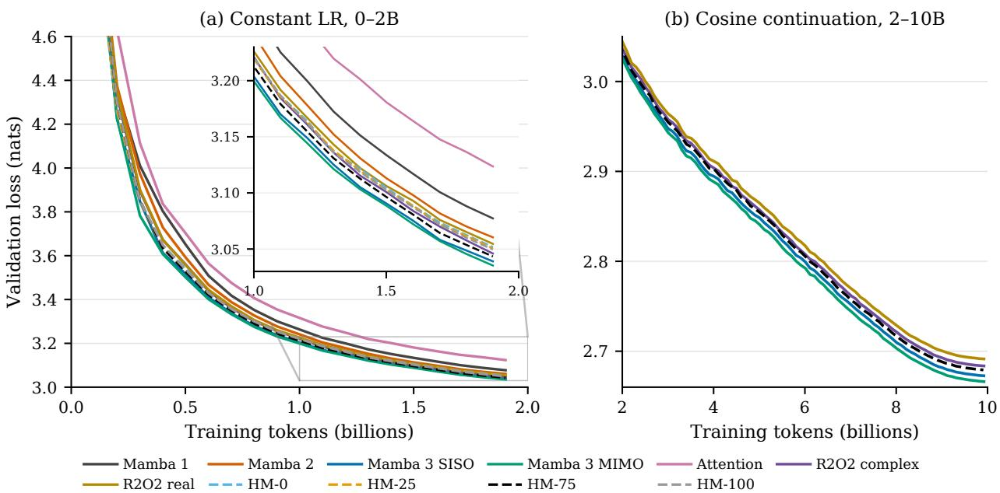

# Diagonal Equivalence in State Space Models: Characterization, Retrieval Rank, and Selective Extensions

Dennis Rochau

Institute of Mathematics, Technische Universität Berlin rochau@math.tu-berlin.de

## Abstract

We classify real and complex state-space models (SSMs) with linear transitions, distinguishing fixed-basis diagonal equivalence from input–output equivalence and tracking coeficientconditioning windows under coordinate changes. We characterize diagonal equivalence through commuting transition families whose members are diagonalizable over the chosen field. With time-shared token-local matrix maps, we identify this class’s state-mediated kernels with unnormalized scalar-mode linear attention with multiplicative masks. Mamba 3’s multiple-input, multiple-output (MIMO) construction lifts one value per local interface; SSD-MIMO routes independent values for local retrieval rank above one. HybridMamba combines Mamba 1’s per-coordinate decay, Mamba 2-style heads and Mamba 3’s complex rotations and two-endpoint writes, mixing real and rotating state blocks with diferent decay laws. They recover Mamba 1–3 single-input, single-output (SISO) configurations as exact special cases. On five large H100 bfloat16 workloads, our fused GPU kernels improve geometric-mean training time over oficial Mamba 1/3 in matched SISO recoveries, with Mamba 2 near parity at SSM-core scope. Memory tradeofs depend on the baseline and metric: savedfor-backward versus peak allocation. In small-model multi-token recall experiments, both designs outperform Mamba 1–3 on the hardest tier; higher routing ranks perform best in gated or phase-diverse configurations. In single-seed language models with about 500M parameters, both improve on Mamba 1/2 in test loss at 2B tokens, but the routing gains do not translate into lower language-model loss. Our best configurations approach Mamba 3 SISO through 10B tokens while remaining behind it and Mamba 3 MIMO in language-model loss.

## 1 Introduction

Selective state-space models (SSMs) process sequences through a fixed-size recurrent state, with transition, write and read maps conditioned on a bounded window of inputs. They ofer an alternative to the quadratic token interactions of dense self-attention (Vaswani et al., 2017; Dao et al., 2022; Dao, 2024). The state update remains afine in the state. Which state-space models are diagonal-equivalent, meaning that one fixed basis diagonalizes their transitions for every input and step? When can a model outside this class nevertheless admit an input–output-equivalent diagonal realization, and what coeficient-conditioning windows does that require? How can selective models within the class be extended?

For the fixed-basis question, the criterion is precise: over R or C, the entire realized transition family admits one diagonalizing basis exactly when its members commute pairwise and each is diagonalizable (Theorem 8). A transition need not be supplied as a diagonal matrix; what matters is one basis that works for every input and step. Noncommuting pairs therefore rule out diagonal equivalence for nondegenerate DeltaNet, DeltaProduct and RWKV-7 configurations, even when individual transitions are diagonalizable (Yang et al., 2024b; 2025; Siems et al., 2025; Peng et al., 2025). A defective transition obstructs diagonalization over both fields; over R, nonreal eigenvalues provide an additional obstruction.

  
Figure 1: Local value routing, illustrated at equal total state width 4N. Left: four scalar interfaces, with $B _ { t } ^ { \bar { r } } \in \mathbb { R } ^ { N \times 1 }$ and $C _ { t } ^ { r } \in \mathbb { R } ^ { 1 \times N }$ . Right: one SSD-MIMO group at $R = O = 4$ supplies the same vector to four sibling states, with $B _ { t } ^ { r } \in \mathbb { R } ^ { N \times 4 }$ and $C _ { t } ^ { r } \in \mathbb { R } ^ { 4 \times N }$ , then combines their vector readouts as $\begin{array} { r } { y _ { t } = \sum _ { r } \zeta _ { r , t } C _ { t } ^ { r } h _ { t } ^ { r } } \end{array}$ with scalar sibling weights $\zeta _ { r , t }$ . Both yield four output coordinates; parameter sharing and computation need not match; coeficient generation and feedthrough are omitted.

By this criterion, many widely used SSMs and gated linear recurrences, selective or not, are diagonalequivalent (Table 1). The structured state space sequence model (S4) used a time-invariant SSM evaluated by convolution (Gu et al., 2022a) and belongs to this class when its learned transition is diagonalizable. Diagonal state spaces (DSS), diagonal S4 (S4D) and simplified state space layers (S5) developed diagonal and scan-based formulations (Gupta et al., 2022; Gu et al., 2022b; Smith et al., 2023). Mamba introduced input-dependent selection (Gu & Dao, 2024), Mamba 2 scalar-transition state space duality (SSD) (Dao & Gu, 2024), and Mamba 3 complex dynamics with a revised write rule (Lahoti et al., 2026). Further examples include the linear recurrent unit (LRU) (Orvieto et al., 2023), retention network (RetNet) (Sun et al., 2023), gated linear attention (GLA) (Yang et al., 2024a), matrix long short-term memory (mLSTM) (Beck et al., 2024), real-gated LRU (RG-LRU) (De et al., 2024), hierarchically gated recurrent network with state expansion (HGRN2) (Qin et al., 2024) and adaptive unitary state space model (AUSSM) (Karuvally et al., 2025). In a fixed diagonalizing basis, their recurrence cores therefore difer mainly in how they parametrize per-coordinate decay, phase, writes and reads.

Why the fixed basis matters. We study recurrences of the form

$$
h _ { t } = A _ { t } h _ { t - 1 } + B _ { t } u _ { t } ,
$$

$$
y _ { t } = C _ { t } h _ { t } + D _ { t } u _ { t } ,\tag{1}
$$

At one local interface in real state coordinates, $u _ { t } \in \mathbb { R } ^ { R } , h _ { t } \in \mathbb { R } ^ { N }$ and $y _ { t } \in \mathbb { R } ^ { O }$ , with $A _ { t } \in \mathbb { R } ^ { N \times N } , B _ { t } \in \mathbb { R } ^ { N \times R }$ $C _ { t } \in \mathbb { R } ^ { O \times N }$ and $D _ { t } \in \mathbb { R } ^ { O \times R }$ . Thus R counts supplied input features and O counts local outputs; $R = O = 1$ is the scalar, single-input, single-output (SISO) interface; $R , O > 1$ gives a multiple-input, multiple-output (MIMO) interface, without requiring $R = O$ . The coeficient maps may depend on a wider conditioning input than $u _ { t }$

Within the characterized class, one fixed change of coordinates turns the state evolution into independent diagonal recurrences and transforms the writes and reads accordingly. This fixed-basis property is stronger than input–output equivalence: with invertible transitions, a prefix-dependent change of state coordinates yields identity transitions and preserves outputs, but may require the full input prefix in the coeficient maps (Lemma 10). A fixed change of basis preserves the original conditioning window. Afine composition admits parallel scans for states and gradients even with non-diagonal transitions; diagonal structure makes the transition compositions coordinatewise, avoiding dense matrix products. Scalar transitions shared across state coordinates also yield a common history mask and the chunked matrix-multiply form of SSD (Dao & $\mathrm { G u }$ 2024); general diagonal transitions may require separate masks per coordinate, and coeficient sharing and map costs decide which form is eficient. With time-shared token-local maps, the state-mediated (write–state–read) kernels are exactly those of the masked linear attention class defined here. The correspondence preserves the complete output, including the initial-state contribution and direct feedthrough $D _ { t } u _ { t }$ (Theorem 24).

Our taxonomy records transition families, input windows and local interfaces, complementing dynamical system (Sieber et al., 2024), structured linear controlled diferential equation (Walker et al., 2025) and test-time regression (Wang et al., 2025) formulations.

Two axes within the class. Our designs extend diferent parts of this common structure (Figure 1; Section 5). SSD-MIMO routes multiple independent values through MIMO interfaces, with decay shared across state coordinates within each scan head; Mamba 3’s implemented MIMO construction instead lifts one supplied scalar per subsystem. HybridMamba (HM) combines per-coordinate decay, head sharing, complex rotation and the two-endpoint write through SISO interfaces. Neither design combines full MIMO routing with independently selected per-coordinate decay. These are distinctions in local interfaces and transition structure, rather than a whole-architecture expressivity ordering.

Evidence and contributions. Multi-query, multi-key, variable-length associative recall (MQMKVAR) combines multi-query associative recall (MQAR)’s layout (Arora et al., 2023a) with the multi-token keys and variable-length values of Mechanistic Architecture Design (MAD)’s fuzzy in-context recall (Poli et al., 2024), introducing controlled prefix and substring overlap to test recall under ambiguous keys (Figure 2). We evaluate three dificulty tiers, routing width, gates and transition mixtures. Our contributions are:

1. A structural framework and taxonomy. We distinguish fixed-basis diagonal equivalence from input– output equivalence and give a head-organized taxonomy of SSMs over R and C by transition families, coeficient-conditioning windows, and local state and interface widths (Section 3). Applying classica simultaneous diagonalization, we identify the diagonal-equivalent class and its obstructions. We place many established architectures within this class, including models formulated with non-diagona transitions. We track how moving frames change coeficient windows, bound local retrieval rank and characterize token-local masked-linear-attention representations (Sections 2–4).

2. Two designs with validated baseline recovery. We introduce SSD-MIMO to route multiple independent values through each local interface, and HybridMamba to combine per-coordinate decay, head sharing, complex rotations and two-endpoint writes within one model. Explicit parameter maps recover Mamba 1, Mamba 2 and Mamba 3 SISO in exact arithmetic. Copied-weight tests check outputs, input gradients and parameter gradients against the oficial implementations, with finite-precision agreement and its limits reported in Section 5.6.

3. Optimized GPU kernels. Our native kernels support the two designs’ real and complex dynamics, read/write gates, variable initial states and diferentiable state continuation. SSD-MIMO supports SISO and MIMO interfaces, including unequal input and output widths $( R \neq O )$ . For SISO baseline recoveries on H100 with bfloat16 (bf16), we outperform the oficial Mamba 1 and Mamba 3 implementations in geometric-mean training speed at both scan and full-mixer scope across five workloads varying batch size, sequence length and inner model width. Our Mamba 2 recovery is near parity with the oficial implementation at scan scope but slower at full-mixer scope on average; individual shapes can reverse these speed comparisons. Section 5.5 reports per-shape times and memory.

4. Multi-token recall findings. On MQMKVAR’s multi-token, overlapping-key tasks, both designs outperform the Mamba 1–3 baselines on the hardest tier in our small-model setting. Routing two or four independent values per local interface gives SSD-MIMO its strongest results on the hardest tier; HybridMamba mixtures lead on the intermediate tier. These gains occur in configurations with write gates or difering sibling phases; their causal roles are not isolated. Section 6.1 defines the tiers and reports the shared learning-rate sweep and baseline budget diferences.

5. Language-modelling findings. In approximately 500M-parameter models trained on FineWeb-Edu (Penedo et al., 2024), both SSD-MIMO and HybridMamba improve on Mamba 1 and Mamba 2 in test loss at 2B tokens under the same training recipe. HybridMamba with 75% complex dynamic rows stays near Mamba 3 SISO through 10B tokens, slightly behind on loss; the tested SSD-MIMO configurations also remain close, while Mamba 3 MIMO has the lowest loss. The recall gains from wider routing described above do not translate into lower language-model loss in these experiments. These comparisons use one training seed per configuration; downstream outcomes and the role of routing are discussed in Section 6.2.

  
Figure 2: MQMKVAR recall combines MQAR (Arora et al., 2023a) with MAD’s fuzzy recall (Poli et al., 2024). Dashed outlines mark $k _ { 1 1 } k _ { 8 } .$ , a proper prefix of $k _ { 1 1 } k _ { 8 } k _ { 3 }$ ; dotted outlines mark the longer key’s sufix $k _ { 8 } k _ { 3 }$ . Queries match keys from their first token. By convention, proper-prefix queries start their targets at the first padding token ∅, which confirms key completion; other answers start at their last key token. Targets align with the input positions predicting them; “–” and all context positions carry no loss. Earlier answers never enter the query input. “· · · ” elides context entries, queries and variable-length, loss-masked padding gaps between queries. Results: Section 6.1; protocol: Appendix E.1.

Relation to prior analysis. The fixed-basis criterion is classical simultaneous diagonalization (Horn & Johnson, 2013, Sec. 1.3), and the local rank bound is the matrix-product rank inequality; held-input discretization and afine scans use variation of constants (Teschl, 2012, Ch. 3) and prefix composition (Blelloch, 1993, Sec. 1.4). S5 diagonalizes a multidimensional-input/output system (Smith et al., 2023, Sec. 3), and Sieber et al. (2024, Sec. 3) compare recurrent architectures in one representation.

Recurrent/attention correspondences include the recurrent evaluation of linear attention (Katharopoulos et al., 2020), SSD’s structured and scalar-mask forms (Dao & Gu, 2024, Secs. 3–5) and its extension to diagonal SSMs with a necessary and suficient condition for a 1-semiseparable masked-attention dual (Hu et al., 2025), implicit attention with surrounding gates and convolutions (Zimerman et al., 2024, Sec. 3), GateLoop’s cumulative transitions (Katsch, 2023, Sec. 3.3) and Mamba 3’s complex-to-rotary equivalences (Lahoti et al., 2026, Props. 2–4). Order restrictions from commuting dynamics are known for diagonal controlled diferential equations (Cirone et al., 2024, Thm. 4.3), a simultaneously diagonalizable, zero-forcing automaton encoding (Terzić et al., 2025, Prop. 1) and finite-precision group tracking (Shakerinava et al., 2026, Sec. 4).

Building on these results, we make explicit the whole realized transition family, state field, conditioning window and supplied-value interface. We distinguish a fixed basis from a prefix-dependent frame, and a kernel factorization from one with token-local generating maps. Our interior-swap test excludes shared token-local scalar-mode representations of a given observable kernel.

Implementation. We implement SSD-MIMO and HybridMamba in a PyTorch library with fused Triton/Gluon GPU kernels (Tillet et al., 2019). The code is publicly available at https://github.com/ d-rochau/OrbitSSM. The SSD-MIMO scan extends the SSD decomposition used by Mamba 2/3 to routed contractions, rotation and the two-endpoint write; one backward kernel is modelled on Mamba 3’s. The per-coordinate scan extends Mamba 1’s selective scan to rotation and mixed decay laws. Tuned for NVIDIA Hopper and Blackwell, the kernels are timed against Mamba on an H100 (Section 5.5). All scans support diferentiable initial/final states in whole-sequence, continued and step evaluation, including training through states carried across segments.

## 2 State-space models: exact discretization, fixed basis, and evaluation

The coeficients below may be noncommuting matrices; Section 2.1 defines their transfer operator and sequence kernel before the fixed-basis, real/complex, SSD and scan analyses.

## 2.1 Continuous-time formulation, zero-order hold (ZOH), and discretization

We abbreviate ordinary diferential equation as ODE and rotary positional embedding as RoPE.

Throughout this section, $\mathbb { F } \in \{ \mathbb { R } , \mathbb { C } \}$ is the state field, while $d , S , O \in \mathbb { N }$ denote the external-input dimension, the combined state dimension, and the combined output dimension of one dynamical system. Inputs and outputs are real even when the state is complex, and we write $\mathrm { R e } _ { \mathbb { R } } : = \mathrm { i d }$ and $\mathrm { R e } _ { \mathbb { C } } : = \mathrm { R e }$ componentwise. Section 3 partitions the state into $H P$ subsystems of width N, giving $S = H P N$ , and uses O for each subsystem’s read width (Definition 20); Sections 2.3–2.5 concern one general system: S is its real state width, R its write-feature width and O its output width; Section 2.3 realifies K complex state coordinates into $S = 2 K$ real coordinates.

To relate the complex and real cases, we use the realification $\chi _ { m } \colon \mathbb { C } ^ { m } \to \mathbb { R } ^ { 2 m }$ , also used in Section 2.3, defined by $\chi _ { m } ( z ) : = ( \operatorname { R e } z _ { 1 } , \operatorname { I m } z _ { 1 } , \dots , \operatorname { R e } z _ { m } , \operatorname { I m } z _ { m } ) ^ { \top }$ . It is a real-linear bijection preserving the Euclidean norm, with $\mathbb { C } ^ { m }$ viewed as a real vector space. For a complex scalar $a + i b$ , with $a , b \in \mathbb { R }$ , define its real matrix representation by

$$
\Re ( a + i b ) : = { \binom { a } { b } } \quad { \binom { - b } { a } } .
$$

For a matrix $M = \left( M _ { j k } \right) \in \mathbb { C } ^ { m \times n }$ , define $\Re ( M ) : = [ \Re ( M _ { j k } ) ] _ { j , k } \in \mathbb { R } ^ { 2 m \times 2 n }$ : each scalar entry is replaced by its $2 \times 2$ block. Then

$$
\chi _ { m } ( M z ) = \Re ( M z ) \chi _ { n } ( z ) , \qquad M \in \mathbb { C } ^ { m \times n } , ~ z \in \mathbb { C } ^ { n } .\tag{2}
$$

This entrywise block map preserves compatible products, $\Re ( M N ) = \Re ( M ) \Re ( N )$ ; for square M, the exponential power series therefore gives $\Re ( \bar { e } ^ { M } ) = \bar { e } ^ { \mathbf { \hat { \Re } ( } M ) }$

Definition 1. Fix an initial time $\tau _ { - 1 } \in \mathbb { R }$ and an initial state $h _ { - 1 } \in \mathbb { F } ^ { S }$ . An admissible input is a measurable signal $x : [ \tau _ { - 1 } , \infty ) \to { \mathbb R } ^ { d }$ that is bounded on every compact time interval. A continuous-time SSM over F has continuous coeficient maps $A : \mathbb { R } ^ { d }  \mathbb { F } ^ { S \times S }$ and $b : \mathbb { R } ^ { d } \to \mathbb { F } ^ { S }$ , and a Borel-measurable readout $f : \mathbb { R } ^ { d } \times \mathbb { F } ^ { S }  \mathbb { R } ^ { O }$ . For each admissible input, its state and output satisfy

$$
\begin{array} { r l } & { h ^ { \prime } ( \tau ) = A ( x ( \tau ) ) h ( \tau ) + b ( x ( \tau ) ) , \quad h ( \tau _ { - 1 } ) = h _ { - 1 } , } \\ & { y ( \tau ) = f ( x ( \tau ) , h ( \tau ) ) \in \mathbb { R } ^ { O } . } \end{array}\tag{3}
$$

Here $h : [ \tau _ { - 1 } , \infty ) \to \mathbb { F } ^ { S }$ is the hidden-state trajectory, b the forcing, and $\boldsymbol { y } : [ \tau _ { - 1 } , \infty )  \mathbb { R } ^ { O }$ the output signal. Both A and b may depend nonlinearly on the input. The state diferential equation is afine in $h ,$ , with linear homogeneous part. Solutions are understood in the Carathéodory sense: h is locally absolutely continuous and its diferential equation holds almost everywhere.

The locally integrable coeficients and state-Lipschitz bound give a unique Carathéodory state trajectory and measurable output (Remark 26 in Appendix A.1, following Teschl, 2012, pp. 41–42); for $\mathbb { F } = \mathbb { C }$ , the same argument applies to $v = \chi _ { S } ( h )$ through

$$
v ^ { \prime } ( \tau ) = \Re ( A ( x ( \tau ) ) ) v ( \tau ) + \chi _ { S } ( b ( x ( \tau ) ) ) , \qquad v ( \tau _ { - 1 } ) = \chi _ { S } ( h _ { - 1 } ) .
$$

Definition 2. Let $L \in \mathbb { N } \cup \{ \infty \}$ , write $\mathbb { T } _ { L } : = \{ 0 , \dots , L - 1 \}$ for finite L and $\mathbb { T } _ { \infty } : = \mathbb { N } _ { 0 }$ , and take tokens $( x _ { t } ) _ { t \in \mathbb { T } _ { I } }$ in $\mathbb { R } ^ { d }$ . Choose strictly increasing finite times $( \tau _ { t } ) _ { t \in \{ - 1 \} \cup \mathbb { T } _ { L } }$ and set $\Delta _ { t } : = \tau _ { t } - \tau _ { t - 1 } > 0$ for $t \in \mathbb { T } _ { L }$ When $L = \infty$ , assume $\tau _ { t } \to \infty$ , equivalently $\begin{array} { r } { \sum _ { t \geq 0 } \Delta _ { t } = \infty } \end{array}$ . The zero-order hold of the token sequence on this grid is the input

$$
x ( \tau ) \ : = \ : x _ { t } \qquad \mathrm { f o r } \ : \tau \in [ \tau _ { t - 1 } , \tau _ { t } ) , t \in \mathbb { T } _ { L } .\tag{4}
$$

For finite $L ,$ set $x ( \tau ) = x _ { L - 1 } \mathrm { f o r } \ \tau \geq \tau _ { L - 1 }$

A continuous selective step $\Delta : \mathbb { R } ^ { d }  ( 0 , \infty )$ gives $\tau _ { t } = \tau _ { t - 1 } + \Delta ( x _ { t } )$ ; Theorem 3 applies on each resulting grid. For $L = \infty$ , if all tokens lie in a compact set K, then minx∈K $\Delta ( x ) > 0$ , so $\tau _ { t } \to \infty$ as $t \to \infty$

Each compact time interval meets only finitely many holds, so the held input is admissible; its coeficients are piecewise constant, and the state is continuously diferentiable inside each hold interval and continuous across boundaries. Token $x _ { t }$ is held on $[ \tau _ { t - 1 } , \tau _ { t } )$ and maps $h _ { t - 1 }$ to the post-update state

$$
h _ { t } : = h ( \tau _ { t } ) , \qquad y _ { t } : = f ( x _ { t } , h _ { t } ) , \qquad t \in  { \mathbb { T } } _ { L } ,\tag{5}
$$

so it is indexed by the end of its interval; the alternative convention holds $x _ { t }$ on $\left[ \tau _ { t } , \tau _ { t + 1 } \right)$ and produces $h _ { t + 1 }$ . Changing input values only at the hold boundaries, a countable null set, leaves the state trajectory unchanged but may change the output there. The discrete readout pairs $x _ { t }$ with the state it produces; it need not equal $y ( \tau _ { t } )$ , since at a nonterminal boundary the right-continuous hold already takes the next token’s value. On each hold interval, the state follows a constant-coeficient linear ODE with coeficients $A ( x _ { t } ) , b ( x _ { t } ) ;$ subscripted symbols denote the discrete step maps defined next.

For non-commutative matrix products, we write

$$
\prod _ { j = i } ^ { k } A _ { j } : = A _ { k } A _ { k - 1 } \cdot \cdot \cdot A _ { i } \qquad ( i \leq k ) ,\tag{6}
$$

with the convention that the product over an empty index range $( i > k )$ equals the identity matrix.

Theorem 3. Assume the continuous-time model of Definition 1 and the zero-order-hold input of Definition 2. There is a unique locally absolutely continuous state trajectory $h : [ \tau _ { - 1 } , \infty ) \to \mathbb { F } ^ { S }$ . Define $h _ { t } , y _ { t }$ by (5). For $Z \in \mathbb { F } ^ { S \times S }$ let

$$
\varphi ( Z ) : = \sum _ { j = 0 } ^ { \infty } { \frac { Z ^ { j } } { ( j + 1 ) ! } } = \int _ { 0 } ^ { 1 } e ^ { r Z } d r .\tag{7}
$$

The series converges for every square matrix $Z ,$ and $\varphi ( Z ) = Z ^ { - 1 } ( e ^ { Z } - I )$ whenever Z is invertible. Define the discrete coeficients

$$
A _ { t } : = e ^ { \Delta _ { t } A ( x _ { t } ) } , \qquad b _ { t } : = \Delta _ { t } \varphi \big ( \Delta _ { t } A ( x _ { t } ) \big ) b ( x _ { t } ) = \biggl ( \int _ { 0 } ^ { \Delta _ { t } } e ^ { r A ( x _ { t } ) } d r \biggr ) b ( x _ { t } ) \in \mathbb { R } ^ { S } .\tag{8}
$$

Then at every finite index $t \in \mathbb { T } _ { L }$ the sampled state and discrete readout satisfy

$$
h _ { t } \ = \ A _ { t } h _ { t - 1 } \ + \ b _ { t } , y _ { t } \ = \ f ( x _ { t } , h _ { t } ) .\tag{9}
$$

Define the transfer operator

$$
\Phi ( t , s ) : = \prod _ { j = s + 1 } ^ { t } A _ { j } , \qquad - 1 \leq s \leq t , \quad t \in \{ - 1 \} \cup \mathbb { T } _ { L } , \qquad \Phi ( t , t ) = I ,\tag{10}
$$

which propagates the homogeneous state from step s to step t. The closed form is

$$
h _ { t } = \Phi ( t , - 1 ) h _ { - 1 } + \sum _ { s = 0 } ^ { t } \Phi ( t , s ) b _ { s } = \Bigg ( \prod _ { j = 0 } ^ { t } A _ { j } \Bigg ) h _ { - 1 } + \sum _ { s = 0 } ^ { t } \Bigg ( \prod _ { j = s + 1 } ^ { t } A _ { j } \Bigg ) b _ { s } .\tag{11}
$$

The recurrence and closed form are exact under the stated hold and grid assumptions for every positive step size. For $L = \infty$ these are finite-prefix identities; no convergence of states or infinite matrix products is asserted.

Appendix A.1 proves the result by variation of parameters and telescoping. The matrices in (8) are the standard ZOH matrices presented by Mamba 1 (Gu & Dao, 2024, Equation (4)); its scan implementation combines the exact exponential transition with the forcing approximation identified after (20).

The matrix-form specialization. Many architectures use forcing and readout maps of the matrix form

$$
b ( x ) = B ( x ) x , \qquad f ( x , h ) = \mathrm { R e } _ { \mathbb { F } } { \big ( } C ( x ) h { \big ) } + D ( x ) x ,\tag{12}
$$

with $B : \mathbb { R } ^ { d }  \mathbb { F } ^ { S \times d } , C : \mathbb { R } ^ { d }  \mathbb { F } ^ { O \times S }$ and $D : \mathbb { R } ^ { d }  \mathbb { R } ^ { O \times d }$ , subject to Definition 1’s regularity assumptions. A linear preprocessing map g in $B ( x ) g ( x )$ can be absorbed into $B ;$ nonlinear g need not admit a continuous factorization $B ( x ) g ( x ) = \tilde { B } ( x ) x$ and is covered by the general forcing b. With $A _ { t } = e ^ { \Delta _ { t } A ( x _ { t } ) }$ , set

$$
B _ { t } : = \Delta _ { t } \varphi \big ( \Delta _ { t } A ( x _ { t } ) \big ) B ( x _ { t } ) , \qquad C _ { t } : = C ( x _ { t } ) , \qquad D _ { t } : = D ( x _ { t } ) ,\tag{13}
$$

so the discretized forcing is $b _ { t } = B _ { t } x _ { t }$ . When $A ( x _ { t } )$ is invertible, the equivalent expression is

$$
B _ { t } = A ( x _ { t } ) ^ { - 1 } \big ( e ^ { \Delta _ { t } A ( x _ { t } ) } - I \big ) B ( x _ { t } ) = A ( x _ { t } ) ^ { - 1 } ( A _ { t } - I ) B ( x _ { t } ) .
$$

Define the sequence kernel

$$
W ( t , s ) : = C _ { t } \Phi ( t , s ) B _ { s } \in \mathbb { F } ^ { O \times d } , \qquad 0 \leq s \leq t , \quad t \in \mathbb { T } _ { L } .\tag{14}
$$

It combines the write at step $s ,$ the transfer to step $t ,$ and the read at step t. Theorem 3 gives the recurrence and closed form

$$
h _ { t } = A _ { t } h _ { t - 1 } + B _ { t } x _ { t } ,
$$

$$
y _ { t } = \mathrm { R e } _ { \mathbb { F } } ( C _ { t } h _ { t } ) + D _ { t } x _ { t } ,\tag{15}
$$

$$
h _ { t } \ = \ \Phi ( t , - 1 ) h _ { - 1 } + \sum _ { s = 0 } ^ { t } \Phi ( t , s ) B _ { s } x _ { s } .\tag{16}
$$

Lowercase $b ( \cdot ) , b _ { t }$ denote the general forcing and uppercase $B ( \cdot ) , B _ { t }$ the matrix-form specialization.

Substituting the closed-form state into the readout gives the data-dependent causal kernel representation

$$
y _ { t } = \mathrm { R e } _ { \mathbb { F } } \Bigg ( C _ { t } \Phi ( t , - 1 ) h _ { - 1 } + \sum _ { s = 0 } ^ { t } W ( t , s ) x _ { s } \Bigg ) + D _ { t } x _ { t } .\tag{17}
$$

If $A _ { t } , B _ { t } , C _ { t } , D _ { t }$ are independent of the input sequence, the input–output map is linear for $h _ { - 1 } = 0$ and afine for any fixed $h _ { - 1 } ;$ input-dependent coeficients can make it nonlinear.

Quadrature discretizations. Mamba 1–3 use the exponential transition $A _ { t } = e ^ { \Delta _ { t } A ( x _ { t } ) }$ and approximate the forcing integral. To obtain these updates, hold $A ( x _ { t } )$ fixed on the interval and choose a continuous forcing $q _ { t } : [ \tau _ { t - 1 } , \bar { \tau } _ { t } ] \to \bar { \mathbb { F } } ^ { S }$ with endpoint values $q _ { t } ^ { + } = q _ { t } ( \tau _ { t } ) = b ( x _ { t } )$ for $t \in \mathbb { T } _ { L }$ and $q _ { t } ^ { - } = q _ { t } ( \tau _ { t - 1 } ) = b ( x _ { t - 1 } )$ for $t \geq 1$ We initialize the earlier forcing sample by $q _ { 0 } ^ { - } = q _ { 0 } ( \tau _ { - 1 } ) = 0$ . Variation of parameters gives (Appendix A.1)

$$
h _ { t } \ : = \ : A _ { t } h _ { t - 1 } \ : + \ : \int _ { \tau _ { t - 1 } } ^ { \tau _ { t } } e ^ { ( \tau _ { t } - \tau ) A ( x _ { t } ) } q _ { t } ( \tau ) d \tau .\tag{18}
$$

Approximating this integral by $\Delta _ { t }$ t times a weighted average of the integrand’s endpoint values gives the discrete update

$$
h _ { t } = A _ { t } h _ { t - 1 } + \Delta _ { t } \Bigl [ ( 1 - \lambda _ { t } ) A _ { t } q _ { t } ^ { - } + \lambda _ { t } q _ { t } ^ { + } \Bigr ] , \qquad \lambda _ { t } \in [ 0 , 1 ] .\tag{19}
$$

Here $A _ { t }$ transports the earlier sample; $q _ { 0 } ^ { - } = 0$ leaves only the current sample at $t = 0$ . Following Lahoti et al. (2026), the weighted family is exponential-trapezoidal, with the classical trapezoidal rule at $\lambda _ { t } = \frac { 1 } { 2 } ; \lambda _ { t } = 1$ is exponential-Euler, used by Mamba $1 / 2$ with write $\Delta _ { t } B ( x _ { t } ) x _ { t }$ . The latter also follows by retaining the leading term of the exact ZOH forcing coeficient:

$$
\Delta _ { t } \varphi \big ( \Delta _ { t } A ( x _ { t } ) \big ) = \Delta _ { t } I + { \textstyle \frac { 1 } { 2 } } \Delta _ { t } ^ { 2 } A ( x _ { t } ) + { \cal { O } } ( \Delta _ { t } ^ { 3 } ) \approx \Delta _ { t } I .\tag{20}
$$

For bounded $A ( x _ { t } )$ this gives $B _ { t } \approx \Delta _ { t } B ( x _ { t } )$ . Mamba 3 selects $\lambda _ { t } = \mathrm { s i g m } ( \mathrm { p r o j } ( x _ { t } ) )$ per head.1 For the local error orders relative to the chosen continuous forcing, the required smoothness and endpoint-weight conditions, and their relation to the learned gate, see Lahoti et al. (2026, Section 3.1, Remark 3 and Appendices A.2–A.3).

Other schemes. S4’s bilinear (Tustin) transform (Gu et al., 2022a;b) approximates the transition as well as the forcing, and therefore changes the transfer operator. We restrict attention to the exponential schemes above.

## 2.2 Fixed-basis diagonal equivalence

From here on we study discrete state recurrences without requiring a continuous-time origin. Their maps may depend on the step and the input prefix.

A transition with of-diagonal entries in its supplied coordinates may still be diagonal in another fixed basis. The restriction to a fixed basis carries the whole content, since an input-dependent moving frame transforms every realization with invertible transitions into one with identity transitions (Lemma 10).

Definition 4. Fix $\mathbb { F } \in \{ \mathbb { R } , \mathbb { C } \}$ , dimensions $d , S , O \in \mathbb { N }$ , a horizon $L \in \mathbb { N } \cup \{ \infty \}$ and an input-window bound $\ell \in \mathbb { N } \cup \{ \infty \}$ . For $t \in \mathbb { T } _ { L }$ , write

$$
\begin{array} { r } { x _ { t ; \ell } : = x _ { \operatorname* { m a x } \{ 0 , t - \ell + 1 \} : t } \quad ( \ell < \infty ) , \qquad x _ { t ; \infty } : = x _ { 0 : t } , \qquad m _ { t , \ell } : = \operatorname* { m i n } \{ \ell , t + 1 \} . } \end{array}
$$

A discrete SSM realization Σ over F has step maps

$$
A _ { t } ^ { \diamond } : ( \mathbb { R } ^ { d } ) ^ { m _ { t , \ell } } \to \mathbb { F } ^ { S \times S } , \qquad b _ { t } ^ { \diamond } : ( \mathbb { R } ^ { d } ) ^ { m _ { t , \ell } } \to \mathbb { F } ^ { S } , \qquad f _ { t } ^ { \diamond } : ( \mathbb { R } ^ { d } ) ^ { m _ { t , \ell } } \times \mathbb { F } ^ { S } \to \mathbb { R } ^ { O } ,
$$

defined for every input $x \in ( \mathbb { R } ^ { d } ) ^ { L }$ and run from any initial state $h _ { - 1 } \in \mathbb { F } ^ { S }$ through

$$
h _ { t } = A _ { t } ^ { \diamondsuit } ( x _ { t ; \ell } ) h _ { t - 1 } + b _ { t } ^ { \diamondsuit } ( x _ { t ; \ell } ) , \qquad y _ { t } = f _ { t } ^ { \diamondsuit } ( x _ { t ; \ell } , h _ { t } ) .\tag{21}
$$

Write $S ^ { \mathbb { F } } ( \ell , S )$ for these realizations; the field superscript is explicit, and an omitted S means its fixed contextual value $\mathrm { o r . }$ , if none is specified, the union over allowed dimensions. The window bound applies to all three maps for every state argument of the readout; maps factoring through $x _ { t ; \ell }$ are identified with their induced window maps, so the classes are nested in ℓ. Since $x _ { t ; L } = x _ { 0 : t } , \ell = L$ is unrestricted causal dependence, including $\ell = L = \infty ;$ larger bounds add nothing. An $L = \infty$ realization is streaming; a finite one admits, but does not specify, a streaming continuation (Appendix A.2).

The subscript t indexes the step and ⋄ marks a step map. Fix an arbitrary $x \in ( \mathbb { R } ^ { d } ) ^ { L }$ ; even for an infinite sequence, each step reads only its finite window $x _ { t ; \ell }$ . Abbreviate the evaluated maps by

$$
A _ { t } : = A _ { t } ^ { \diamond } ( x _ { t ; \ell } ) , \qquad b _ { t } : = b _ { t } ^ { \diamond } ( x _ { t ; \ell } ) .
$$

These are relative to the fixed input; otherwise we display the diamond-marked maps and their arguments. Thus $h _ { t } = A _ { t } h _ { t - 1 } + b _ { t }$ and $y _ { t } = f _ { t } ^ { \circ } ( x _ { t ; \ell } , h _ { t } )$ , with input dependence explicit. States may be complex, but inputs and outputs remain real. System labels distinguish the maps $A _ { t } ^ { \circ } [ \Sigma ] , b _ { t } ^ { \circ } [ \Sigma ] , f _ { t } ^ { \circ } [ \Sigma ]$ from evaluated $A _ { t } [ \Sigma ] , b _ { t } [ \Sigma ]$ ; omit [Σ] when clear.

The matrix form writes the input directly, with $b _ { t } = B _ { t } x _ { t }$

$$
h _ { t } = A _ { t } h _ { t - 1 } + B _ { t } x _ { t } , \qquad y _ { t } = \mathrm { R e _ { \mathbb { F } } } ( C _ { t } h _ { t } ) + D _ { t } x _ { t } .\tag{22}
$$

Here $M _ { t } : = M _ { t } ^ { \circ } ( x _ { t ; \ell } )$ for $M \in \{ B , C , D \}$ , with $B _ { t } \in \mathbb { F } ^ { S \times d } , C _ { t } \in \mathbb { F } ^ { O \times S }$ and $D _ { t } \in \mathbb { R } ^ { O \times d }$ . Their input dependence is suppressed only in the evaluated notation. The matrix form with input features fixes $R \in \mathbb N$ and a causal map $\mathring { g } _ { t } ^ { \diamond } : ( \mathbb { R } ^ { d } ) ^ { m _ { t , \ell } }  \mathbb { R } ^ { R }$ . Write $u _ { t } : = g _ { t } ^ { \diamond } ( x _ { t ; \ell } )$ and $b _ { t } = B _ { t } u _ { t }$ , giving

$$
h _ { t } = A _ { t } h _ { t - 1 } + B _ { t } u _ { t } , \qquad y _ { t } = \mathrm { R e } _ { \mathbb { F } } ( C _ { t } h _ { t } ) + D _ { t } u _ { t } , \qquad B _ { t } \in \mathbb { F } ^ { S \times R } , \quad D _ { t } \in \mathbb { R } ^ { O \times R } .
$$

The coeficient maps still read the conditioning input $\boldsymbol { x } _ { t ; \ell } ;$ they need not factor through $u _ { t }$ . The feature construction is included in $b _ { t } ^ { \diamond }$ and $f _ { t } ^ { \diamond } ; u _ { t }$ is an optional abbreviation. Unless stated otherwise, the matrix form below means this feature form; the direct-input case is $\boldsymbol { u } _ { t } = \boldsymbol { x } _ { t }$ and $R = d .$

With finite $\ell < L .$ , a realization runs in memory independent of t: the state plus a bufer of the last $\ell - 1$ inputs. At full-prefix dependence $\ell = L .$ every realization with invertible transitions admits an output-equivalent diagonal realization, even when fixed-basis diagonal equivalence fails (Corollary 11).

The case $\ell = 1$ is token-local: $x _ { t ; 1 } = x _ { t }$ . In matrix form, $B _ { t } ^ { \circ } , C _ { t } ^ { \circ } , D _ { t } ^ { \circ } , g _ { t } ^ { \circ }$ obey the same window bound. Explicit step dependence remains allowed. Time sharing instead uses one map each for $A , b , f$ at every step, after fixed boundary padding of a finite window; this may specify a forcing sample rather than a padding token. At window one, write

$$
A _ { t } ^ { \diamondsuit } ( x _ { t } ) = A ( x _ { t } ) , \qquad b _ { t } ^ { \diamondsuit } ( x _ { t } ) = b ( x _ { t } ) , \qquad f _ { t } ^ { \diamondsuit } ( x _ { t } , h ) = f ( x _ { t } , h ) .\tag{23}
$$

Here $A , b , f$ denote discrete updates, distinct from the continuous-time maps of Section 2.1; indexed notation remains valid. Selective maps may depend on the conditioning input, while input-independent maps are included. Class membership does not require time sharing. ZOH updates (8) are token-local. The endpointweighted rule (19) keeps token-local transitions, but its write reads $x _ { t - 1 }$ through $q _ { t } ^ { - }$ and has window two (one if $\lambda _ { t } \equiv 1 )$ .

Linear time-invariant systems. A matrix-form realization with fixed $A , B , C , D$ , independent of time and input, is linear time-invariant (LTI) in its driving features $u ;$ with zero initial state its input–output map is linear and time-invariant. For $u _ { t } = x _ { t }$ , this is LTI in the system input itself. Nonlinear feature generation need not preserve that property. Time sharing alone allows selective or nonlinear maps, while a singleton realized transition family fixes only $A ;$ neither condition alone makes the realization LTI.

For $x \in ( \mathbb { R } ^ { d } ) ^ { L }$ , extend the transfer and kernel notation of Section 2.1 to the causal maps above. For $t \in \mathbb { T } _ { L }$ and $- 1 \leq s \leq t .$ , define the transfer

$$
\Phi [ x ] ( t , s ) : = \prod _ { j = s + 1 } ^ { t } A _ { j } ^ { \diamond } ( x _ { j ; \ell } ) , \qquad \Phi [ x ] ( t , t ) = I .\tag{24}
$$

In the matrix form, define the sequence kernel

$$
W [ \boldsymbol { x } ] ( t , s ) : = C _ { t } ^ { \diamond } ( x _ { t ; \ell } ) \Phi [ \boldsymbol { x } ] ( t , s ) B _ { s } ^ { \diamond } ( x _ { s ; \ell } ) \in \mathbb { F } ^ { O \times R } , \qquad 0 \leq s \leq t .\tag{25}
$$

Unless stated otherwise, evaluated coeficients, transfers and kernels refer to a fixed arbitrary input $x \in ( \mathbb { R } ^ { d } ) ^ { L }$ with input arguments displayed only when useful. We write $\begin{array} { r } { \Phi ( t , s ) = \overleftarrow { \prod } _ { j = s + 1 } ^ { t } A _ { j } } \end{array}$ and $W ( t , s ) = C _ { t } \Phi ( t , s ) B _ { s }$ Finite induction gives the state and matrix-form output:

$$
h _ { t } = \Phi ( t , - 1 ) h _ { - 1 } + \sum _ { s = 0 } ^ { t } \Phi ( t , s ) b _ { s } ,
$$

$$
y _ { t } = \mathrm { R e } _ { \mathbb { F } } \left( C _ { t } \Phi ( t , - 1 ) h _ { - 1 } + \sum _ { s = 0 } ^ { t } W ( t , s ) u _ { s } \right) + D _ { t } u _ { t } .\tag{26}
$$

For an LTI realization with zero initial state, $\Phi ( t , s ) = A ^ { t - s } .$ , so (26) takes the convolutional form

$$
y = K * u + D u , \qquad ( K * u ) _ { t } = \sum _ { s = 0 } ^ { t } K _ { t - s } u _ { s } , \qquad K _ { \tau } = \mathrm { R e } _ { \mathbb { F } } ( C A ^ { \tau } B ) .\tag{27}
$$

The realized transition family of a realization $\Sigma$ is

$$
\mathcal { A } _ { \Sigma } : = \left\{ A _ { t } ^ { \diamond } [ \Sigma ] ( x _ { t ; \ell } ) : x \in ( \mathbb { R } ^ { d } ) ^ { L } , \ t \in \mathbb { T } _ { L } \right\} \ \subseteq \ \mathbb { F } ^ { S \times S } .\tag{28}
$$

It discards order and multiplicity and need not be finite.

To discuss a real realization Σ over C, we extend its state space from $\mathbb { R } ^ { S }$ to $\mathbb { C } ^ { S }$ , retain its real $A _ { t } , b _ { t }$ , and set $f _ { t } ^ { \diamond , \mathbb { C } } ( x _ { t ; \ell } , z ) : = f _ { t } ^ { \diamond } ( x _ { t ; \ell } , \operatorname { R e } z )$ . This defines its complexification $\Sigma ^ { \mathbb { C } }$ ; the realized transition family is unchanged, now read over C. Runs from real initial states remain in the invariant subspace $\mathbb { R } ^ { S } \subset \mathbb { C } ^ { \check { S } }$ and have the original states and outputs.

We write Dia $\mathbf { y } _ { S } ( \mathbb { F } ) \subset \mathbb { F } ^ { S \times S }$ for the diagonal matrices, ${ \mathrm { G L } } _ { S } ( \mathbb { F } )$ for the invertible ones, spec $( A ) \subset \mathbb { C }$ for the spectrum, and $[ A , A ^ { \prime } ] : = A A ^ { \prime } - A ^ { \prime } A$ for the commutator. A family $\mathcal { M } \subseteq \mathbb { F } ^ { S \times S }$ is abelian if $[ A , A ^ { \prime } ] = 0$ for all $A , A ^ { \prime } \in { \mathcal { M } }$ , and non-abelian otherwise. A square matrix is defective if some eigenvalue has geometric multiplicity strictly below its algebraic multiplicity; Lemma $1 2 ( \mathrm { i } )$ states how diagonalizability depends on defectiveness and, for real matrices, on the field.

Definition 5. For a realization Σ and $Q \in \operatorname { G L } _ { S } ( \mathbb { F } )$ , define $\Sigma ^ { Q }$ on the same input, state and output spaces and horizon by the maps

$$
\begin{array} { r l } & { \quad A _ { t } ^ { \diamond } [ \Sigma ^ { Q } ] ( x _ { t ; \ell } ) = Q ^ { - 1 } A _ { t } ^ { \diamond } [ \Sigma ] ( x _ { t ; \ell } ) Q , } \\ & { \quad b _ { t } ^ { \diamond } [ \Sigma ^ { Q } ] ( x _ { t ; \ell } ) = Q ^ { - 1 } b _ { t } ^ { \diamond } [ \Sigma ] ( x _ { t ; \ell } ) , } \\ & { \quad f _ { t } ^ { \diamond } [ \Sigma ^ { Q } ] ( x _ { t ; \ell } , z ) = f _ { t } ^ { \diamond } [ \Sigma ] ( x _ { t ; \ell } , Q z ) , } \end{array}\tag{29}
$$

for every $x \in ( \mathbb { R } ^ { d } ) ^ { L } , t \in \mathbb { T } _ { L }$ and $z \in \mathbb { F } ^ { S }$ . Pair each initial state $h _ { - 1 }$ of Σ with $\hat { h } _ { - 1 } = Q ^ { - 1 } h _ { - 1 }$ for $\Sigma ^ { Q }$ . Two realizations are similar over F, written $\Sigma \simeq _ { \mathbb { F } } \Sigma ^ { \prime } , \mathrm { i f } \Sigma ^ { \prime } = \Sigma ^ { Q }$ for some $Q \in \operatorname { G L } _ { S } ( \mathbb { F } )$ ; these transformations form a group action, so similarity is an equivalence relation. We call Q a frame. It is fixed, independent of time and input; time-dependent frames are treated in Lemma 10.

For realizations $\Sigma , \Sigma ^ { \prime }$ on the same input/output spaces and horizon, write $y _ { t } [ \Sigma ; x , h ]$ for the output at step t from initial state h. They are output-equivalent if an input-independent bijection $\mathcal { I }$ between their initial-state spaces satisfies

$$
y _ { t } [ \Sigma ; x , h ] = y _ { t } [ \Sigma ^ { \prime } ; x , \mathcal { I } ( h ) ] \qquad \mathrm { f o r ~ e v e r y ~ } x , h \mathrm { ~ a n d ~ } t \in \mathbb { T } _ { L } .
$$

When a correspondence $\mathcal { I }$ is specified, output equivalence refers to that map; fixed similarity uses $\mathcal { I } ( h ) =$ $Q ^ { - 1 } h$ . Output equivalence alone imposes no fixed relation between later states.

Definition 6. A realization is diagonal over F if every realized transition lies in $\mathrm { D i a g } _ { S } ( \mathbb { F } )$ , and diagonalequivalent over F if it is similar over F to a diagonal realization. For window bound ℓ and state dimension $S ,$ define

$$
\mathcal { D } ^ { \mathbb { F } } ( \ell , S ) : = \{ \Sigma \in S ^ { \mathbb { F } } ( \ell , S ) : \Sigma ^ { Q } \mathrm { ~ i s ~ d i a g o n a l ~ f o r ~ s o m e ~ } Q \in \mathrm { G L } _ { S } ( \mathbb { F } ) \} .\tag{30}
$$

Such a $Q$ is a witness for membership, and $\Sigma ^ { Q }$ is a diagonal representative. We omit S under the convention of Definition 4; without a specified dimension, this means the union over $S \in \mathbb { N }$ . The case $\ell = L$ allows unrestricted causal input dependence. For a real realization $\Sigma ,$ the shorthand $\Sigma \in { \mathcal { D } } ^ { \mathbb { C } } ( \ell , S )$ means $\Sigma ^ { \mathbb { C } } \in$ $\mathcal { D } ^ { \mathbb { C } } ( \ell , S )$ under the complexification defined above, which preserves the window bound and uses $S$ complex coordinates.

For fixed field, state dimension and horizon, the window classes satisfy

$$
\begin{array} { r l } & { \mathcal { C } ^ { \mathbb { F } } ( \ell _ { 1 } , S ) \subseteq \mathcal { C } ^ { \mathbb { F } } ( \ell _ { 2 } , S ) \quad ( \ell _ { 1 } \leq \ell _ { 2 } ) , \qquad \mathcal { C } \in \{ S , \mathcal { D } \} , } \\ & { \mathcal { D } ^ { \mathbb { F } } ( \ell , S ) = S ^ { \mathbb { F } } ( \ell , S ) \cap \mathcal { D } ^ { \mathbb { F } } ( L , S ) . } \end{array}
$$

Lemma 7. Let Σ be a general causal realization and $Q \in \operatorname { G L } _ { S } ( \mathbb { F } )$ . For every input $x \in ( \mathbb { R } ^ { d } ) ^ { L }$ and initial state $h _ { - 1 } \in \mathbb { F } ^ { S }$ , let $( h _ { t } , y _ { t } )$ be its run and $( \hat { h } _ { t } , \hat { y } _ { t } )$ the run of $\Sigma ^ { Q }$ from $\hat { h } _ { - 1 } = Q ^ { - 1 } h _ { - 1 }$ . Then, for every $t \in \mathbb { T } _ { L }$

$$
\hat { h } _ { t } = Q ^ { - 1 } h _ { t } , \qquad \hat { y } _ { t } = y _ { t } .
$$

In the matrix form of Definition 4, use the induced coeficients $\hat { B } _ { t } = Q ^ { - 1 } B _ { t } , \hat { C } _ { t } = C _ { t } Q$ and $\hat { D } _ { t } = D _ { t }$ . Their kernels $\hat { W } [ x ]$ and $W [ x ]$ agree: suppressing the fixed input,

$$
\hat { W } ( t , s ) = \bigl ( C _ { t } Q \bigr ) \bigl ( Q ^ { - 1 } \Phi ( t , s ) Q \bigr ) \bigl ( Q ^ { - 1 } B _ { s } \bigr ) = W ( t , s ) , \qquad 0 \leq s \leq t .\tag{31}
$$

Moreover, for every window bound ℓ,

$$
\Sigma \in { \mathcal { C } } ^ { \mathbb { F } } ( \ell , S ) \iff \Sigma ^ { Q } \in { \mathcal { C } } ^ { \mathbb { F } } ( \ell , S ) , \qquad { \mathcal { C } } \in \{ S , { \mathcal { D } } \} .\tag{32}
$$

Time sharing is also preserved in both directions. In particular, a diagonal representative retains the window bound, state dimension and any time sharing of the original realization.

Proof. Induction from $\hat { h } _ { - 1 } = Q ^ { - 1 } h _ { - 1 }$ gives $\hat { h } _ { t } = ( Q ^ { - 1 } A _ { t } Q ) \hat { h } _ { t - 1 } + Q ^ { - 1 } b _ { t } = Q ^ { - 1 } h _ { t }$ . The general readout then satisfies

$$
\hat { y } _ { t } = f _ { t } ^ { \diamond } [ \Sigma ^ { Q } ] ( x _ { t ; \ell } , \hat { h } _ { t } ) = f _ { t } ^ { \diamond } [ \Sigma ] ( x _ { t ; \ell } , Q \hat { h } _ { t } ) = f _ { t } ^ { \diamond } [ \Sigma ] ( x _ { t ; \ell } , h _ { t } ) = y _ { t } .
$$

For the matrix kernel, the transitions telescope to ${ \hat { \Phi } } ( t , s ) = Q ^ { - 1 } \Phi ( t , s ) Q$ , giving (31). The fixed maps $Q ^ { - 1 } A _ { t } ^ { \circ } Q , Q ^ { - 1 } b _ { t } ^ { \circ }$ and $f _ { t } ^ { \circ } ( x _ { t ; \ell } , Q h )$ introduce no new input arguments or step dependence; the inverse frame gives the converse for window dependence and time sharing. Composition of fixed frames preserves the existence of a diagonalizing frame, giving the $\mathcal { D } ^ { \mathbb { F } }$ equivalence. □

Output equivalence alone need not preserve either class membership or the input-window bound (Corollary 16). Theorem 8. For $\Sigma \in { \cal S } ^ { \mathbb { F } } ( \ell , S )$ , the following conditions are equivalent:

$$
\begin{array} { r l } & { \Sigma \in \mathcal { D } ^ { \mathbb { F } } ( \ell , S ) \Longleftrightarrow \mathcal { A } _ { \Sigma } \mathrm { ~ i s ~ s i m u l t a n e o u s l y ~ d i a g o n a l i z a b l e ~ o v e r ~ } \mathbb { F } } \\ & { \qquad \Longleftrightarrow [ A , A ^ { \prime } ] = 0 \mathrm { ~ a n d ~ } A \mathrm { ~ i s ~ } \mathbb { F } \mathrm { - d i a g o n a l i z a b l e } \quad \forall A , A ^ { \prime } \in \mathcal { A } _ { \Sigma } . } \end{array}\tag{33}
$$

Under these conditions, there is a single $Q \in \operatorname { G L } _ { S } ( \mathbb { F } )$ with $Q ^ { - 1 } A Q \in \operatorname { D i a g } _ { S } ( \mathbb { F } )$ for all $A \in { \mathcal { A } } _ { \Sigma }$ . Every such $Q$ gives the diagonal representative $\Sigma ^ { Q }$ , with $\hat { h } _ { t } = Q ^ { - 1 } h _ { t }$ and the same outputs for corresponding initial states. For a fixed arbitrary input $x \in ( \mathbb { R } ^ { d } ) ^ { L }$ , write

$$
\Lambda _ { t } : = A _ { t } [ \Sigma ^ { Q } ] = Q ^ { - 1 } A _ { t } [ \Sigma ] Q \in \operatorname { D i a g } _ { S } ( \mathbb { F } ) .
$$

In the matrix form of Definition 4, its recurrence is

$$
\begin{array} { r } { \hat { h } _ { t } = \Lambda _ { t } \hat { h } _ { t - 1 } + Q ^ { - 1 } B _ { t } u _ { t } , } \end{array}
$$

$$
\begin{array} { r } { y _ { t } = \mathrm { R e } _ { \mathbb F } \Big ( C _ { t } Q \hat { h } _ { t } \Big ) + D _ { t } u _ { t } , } \end{array}\tag{34}
$$

with the feedthrough $D _ { t }$ untouched. Within the declared window class, membership is decided by transitions alone; forcing and readout are otherwise unrestricted.

Proof. For the first equivalence, Definition 6 requires one Q for which $\Sigma ^ { Q }$ has diagonal transitions on every input and step. By (29), this is exactly $Q ^ { - 1 } A Q \in \operatorname { D i a g } _ { S } ( \mathbb { F } )$ for every $A \in { \mathcal { A } } _ { \Sigma }$

For the second equivalence, a common diagonalizing basis makes every member diagonalizable and every pair commute. Conversely, suppose the members commute and are individually diagonalizable over $\mathbb { F } .$ . Choose $A _ { 1 } , \ldots , A _ { m } \in { \mathcal { A } } _ { \Sigma }$ spanning $\mathrm { s p a n } _ { \mathbb { F } } \mathcal { A } _ { \Sigma } ;$ this is possible with $m \leq S ^ { 2 }$ , even if the family is infinite. The finite commuting family $A _ { 1 } , \ldots , A _ { m }$ has a common diagonalizing basis $Q$ (Horn & Johnson, 2013, Thm. 1.3.21 and Cor. 1.3.30). Every other member is a linear combination of these matrices, so

$$
A = \sum _ { k = 1 } ^ { m } c _ { k } A _ { k } \quad \Longrightarrow \quad Q ^ { - 1 } A Q = \sum _ { k = 1 } ^ { m } c _ { k } { \bigl ( } Q ^ { - 1 } A _ { k } Q { \bigr ) } \in \operatorname { D i a g } _ { S } ( \mathbb { F } ) .
$$

Thus the same $Q$ diagonalizes the entire realized family. Substituting this $Q$ into (29) gives the stated diagonal representative and (34). □

Commutativity is field-independent; diagonalizability is checked over F. Appendix A.2 gives the finite-horizon consequences.

For an SSM obtained by ZOH discretization as in Section 2.1, a common eigenbasis of its continuous-time generators is inherited by its discrete transitions: if $A ( x ) = Q \Lambda ( x ) Q ^ { - 1 }$ with diagonal $\Lambda ( x )$ and fixed $Q ,$ , then

$$
A _ { t } = e ^ { \Delta _ { t } A ( x _ { t } ) } = Q e ^ { \Delta _ { t } \Lambda ( x _ { t } ) } Q ^ { - 1 } .
$$

Thus the resulting discrete realization belongs to $\mathcal { D } ^ { \mathbb { F } } ( 1 , S )$ , with the same witness $Q .$ It is also time-shared when its step-size and coeficient laws are shared; a nonuniform prescribed time grid need not have this property.

Remark 9. Let $\Sigma \in { \mathcal { D } } ^ { \mathbb { F } } ( \ell , S )$ with witness $Q ,$ so that $A _ { t } = Q \Lambda _ { t } Q ^ { - 1 }$ with diagonal $\Lambda _ { t }$ . Then

$$
\| \Phi ( t , s ) \| _ { 2 } \leq \kappa _ { 2 } ( Q ) \operatorname* { m a x } _ { n } \prod _ { r = s + 1 } ^ { t } \left| ( \Lambda _ { r } ) _ { n n } \right| , \qquad \kappa _ { 2 } ( Q ) = \| Q \| _ { 2 } \| Q ^ { - 1 } \| _ { 2 } .
$$

Eigenvalue moduli at most one keep the transfer, and with it the gradients through the carried state, bounded up to the fixed factor $\kappa _ { 2 } ( Q )$ . A bounded state under bounded writes $b _ { t }$ needs more: moduli at most some $\rho < 1$ give $\begin{array} { r } { \| h _ { t } \| _ { 2 } \leq \kappa _ { 2 } ( Q ) \big ( \| h _ { - 1 } \| _ { 2 } + \operatorname* { s u p } _ { s } \| b _ { s } \| _ { 2 } / ( 1 - \rho ) \big ) } \end{array}$ , whereas with moduli equal to one, constant forcing can grow the state linearly. Practical parameterizations keep moduli at most one: decays $e ^ { \Delta a }$ with $a < 0$ and gates in (0, 1) give moduli below one, and rotations give modulus one. For non-abelian families, moduli alone do not bound products of non-normal factors; delta-rule transitions $I - \beta k k ^ { \top }$ with unit-norm keys and $\beta \in [ 0 , 2 ]$ are symmetric with spectrum in $[ - 1 , 1 ]$ , hence non-expansive.

Fixed and moving frames. Allowing the frame to depend on the prefix changes the question: it can move temporal dependence from the transition into the write and read maps.

Lemma 10. Let $\Sigma \in { \cal S } ^ { \mathbb { F } } ( \ell , S )$ have horizon L. For each input $x ,$ let $Q _ { t } [ x ] \in \operatorname { G L } _ { S } ( \mathbb { F } )$ depend only on $x _ { 0 : t } .$ with $Q _ { - 1 }$ independent of the input. Fix an arbitrary $x \in ( \mathbb { R } ^ { d } ) ^ { L }$ and use the evaluated coeficients $A _ { t } , b _ { t }$ and, in the matrix form, $B _ { t } , C _ { t } , D _ { t } ;$ ; write $Q _ { t } : = Q _ { t } [ x ]$ . For $t \in \mathbb { T } _ { L }$ , set $\tilde { h } _ { t } : = Q _ { t } ^ { - 1 } h _ { t }$ and define the transformed readout by

$$
\tilde { f } _ { t } ^ { \diamond } ( x _ { t ; L } , z ) : = f _ { t } ^ { \diamond } ( x _ { t ; \ell } , Q _ { t } [ x ] z ) .
$$

Then the transformed recurrence and output are

$$
\tilde { h } _ { t } = \big ( Q _ { t } ^ { - 1 } A _ { t } Q _ { t - 1 } \big ) \tilde { h } _ { t - 1 } + Q _ { t } ^ { - 1 } b _ { t } , \qquad \tilde { y } _ { t } = \tilde { f } _ { t } ^ { \diamond } ( x _ { t ; L } , \tilde { h } _ { t } ) = y _ { t } , \qquad \tilde { h } _ { - 1 } = Q _ { - 1 } ^ { - 1 } h _ { - 1 } .\tag{35}
$$

The transformed realization lies in $S ^ { \mathbb { F } } ( L , S )$ on the same horizon $L .$ Here $f _ { t } ^ { \diamond }$ and $y _ { t }$ belong to $\Sigma ,$ , while $\tilde { f } _ { t } ^ { \circ }$ and $\tilde { y } _ { t }$ belong to the transformed realization. Its transfer is $\tilde { \Phi } ( t , s ) = Q _ { t } ^ { - 1 } \Phi ( \bar { t } , s ) Q _ { s } ;$ in the matrix form,

$$
W ( t , s ) = ( C _ { t } Q _ { t } ) \tilde { \Phi } ( t , s ) ( Q _ { s } ^ { - 1 } B _ { s } ) .
$$

Assume now that every realized transition is invertible, and set $\Pi _ { t } : = \Phi ( t , - 1 )$ , with $\Pi _ { - 1 } : = I$

(i) Prefix-frame construction. The choice $Q _ { t } : = \Pi _ { t }$ gives $\Phi ( t , s ) = \Pi _ { t } \Pi _ { s } ^ { - 1 }$ and turns (35) into a diagonal realization with identity transitions:

$$
\tilde { h } _ { t } = \tilde { h } _ { t - 1 } + \Pi _ { t } ^ { - 1 } b _ { t } = h _ { - 1 } + \sum _ { s = 0 } ^ { t } \Pi _ { s } ^ { - 1 } b _ { s } , \qquad y _ { t } = f _ { t } ^ { \diamond } ( x _ { t ; \ell } , \Pi _ { t } \tilde { h } _ { t } ) .
$$

In the matrix form, $W ( t , s ) = ( C _ { t } \Pi _ { t } ) ( \Pi _ { s } ^ { - 1 } B _ { s } )$ . This realization is in ${ \mathcal { D } } ^ { \mathbb { F } } ( L , S )$ ; the prefix products now enter the write and read maps.

(ii) Characterization of diagonalizing frames. Any frame producing diagonal transitions $\Lambda _ { t } : = Q _ { t } ^ { - 1 } A _ { t } Q _ { t - 1 }$ must satisfy

$$
Q _ { t } = \Pi _ { t } Q _ { - 1 } \Big ( \prod _ { j = 0 } ^ { t } \Lambda _ { j } \Big ) ^ { - 1 } , \qquad \Lambda _ { t } \in \operatorname { D i a g } _ { S } ( \mathbb { F } ) .\tag{36}
$$

Conversely, any fixed $Q _ { - 1 } \in \mathrm { G L } _ { S } ( \mathbb { F } )$ and causal invertible diagonal maps $\Lambda _ { t }$ define a diagonalizing frame by (36). The prefix construction chooses $Q _ { - 1 } = I , \Lambda _ { t } = I$

Independently of invertibility, a constant diagonalizing frame exists exactly when $A _ { \Sigma }$ is simultaneously diagonalizable over F (Theorem 8).

Proof. Substitute $h _ { t } = Q _ { t } { \tilde { h } } _ { t }$ into $h _ { t } = A _ { t } h _ { t - 1 } + b _ { t }$ to obtain (35). Its readout is unchanged since $Q _ { t } \tilde { h } _ { t } = h _ { t }$ Multiplying the transformed transitions cancels adjacent frame factors, giving $\tilde { \Phi } ( t , s ) \stackrel { - } { = } Q _ { t } ^ { - 1 } \Phi ( t , s ) Q _ { s }$ and the matrix-kernel identity.

For (i), $\Pi _ { t } = A _ { t } \Pi _ { t - 1 }$ gives $\Pi _ { t } ^ { - 1 } A _ { t } \Pi _ { t - 1 } = I ;$ summing the resulting recurrence gives the stated closed form. For (ii), writing $A _ { t } = Q _ { t } \Lambda _ { t } Q _ { t - 1 } ^ { - 1 }$ and telescoping gives $\Pi _ { t } = Q _ { t } \big ( \widetilde { \prod } _ { j = 0 } ^ { t } \Lambda _ { j } \big ) Q _ { - 1 } ^ { - 1 }$ . Each $\Lambda _ { j }$ is invertible because

$A _ { j }$ and the frames are invertible, so rearranging gives (36). Conversely, if $P _ { t } : = \prod _ { j = 0 } ^ { t } \Lambda _ { j } , P _ { - 1 } : = I$ , and $Q _ { t } = \Pi _ { t } Q _ { - 1 } P _ { t } ^ { - 1 }$ , then $Q _ { t } ^ { - 1 } A _ { t } Q _ { t - 1 } = P _ { t } P _ { t - 1 } ^ { - 1 } = \Lambda _ { t } ;$ the frame is causal and invertible. Finally, setting $Q _ { t } \equiv Q$ reduces diagonalization to $Q ^ { - 1 } A Q \in \operatorname { D i a g } _ { S } ( \mathbb { F } )$ for every realized transition $A$ □

Corollary 11. Every $\Sigma \in { \cal S } ^ { \mathbb { F } } ( \ell , S )$ with invertible transitions has the output-equivalent identity-transition realization $\widetilde \Sigma \in { \mathcal { D } } ^ { \mathbb { F } } ( L , S )$ of Lemma $1 0 ( \mathrm { i } )$ , on the same horizon L. The construction need not preserve a smaller window bound or time sharing. If $\Sigma \in { \mathcal { D } } ^ { \mathbb { F } } ( L , S )$ already, both realizations lie in that full-window diagonal class; this does not make them fixed-frame similar.

Fixed similarity preserves window bounds; a prefix frame guarantees only full-prefix dependence. Thus for unrestricted causal maps $( \ell = L )$ with invertible transitions, noncommutativity excludes fixed diagonal equivalence but alone gives no input–output expressivity separation. Its identity-transition scan still requires forming and applying $\Pi _ { t } , \Pi _ { t } ^ { - 1 }$ at controlled cost and conditioning. See Appendix A.4 for per-coordinate potentials and the accumulator form.

Leaving the class. Negating (33) leaves exactly two exits from the class. Noncommutativity and, over $\mathbb { R } .$ nonreal spectrum survive suficiently small perturbations; defectiveness need not.

Lemma 12. For a realization Σ over F with realized transition family $A _ { \Sigma } \colon$

(i) Individual obstruction — F-dependent. If some $A \in { \mathcal { A } } _ { \Sigma }$ is not diagonalizable over $\mathbb { F } _ { : }$ then $\Sigma \not \in { \mathcal { D } } ^ { \mathbb { F } } ( L )$ even when $A _ { \Sigma }$ is abelian. For a real matrix,

A is diagonalizable over $\mathbb { C } \iff A$ is nondefective,

A is diagonalizable over R ⇐⇒ A is nondefective and spec $( A ) \subseteq \mathbb { R }$

Thus defectiveness obstructs both fields, whereas nonreal spectrum alone obstructs only real diagonalization. These are individual obstructions; whole-family membership additionally requires pairwise commutativity.

(ii) Pairwise obstruction — field-independent and robust. If $A _ { \Sigma }$ is non-abelian, that is, $[ A , A ^ { \prime } ] \neq 0$ for some $A , A ^ { \prime } \in { \mathcal { A } } _ { \Sigma } .$ , then $\Sigma \not \in { \mathcal { D } } ^ { \mathbb { F } } ( L )$ for both fields. Moreover, the pair $( A , A ^ { \prime } )$ has a neighborhood in $( \mathbb { F } ^ { S \times S } ) ^ { 2 }$ containing no commuting — hence no simultaneously diagonalizable — pair: noncommutativity survives every suficiently small perturbation of the realized transitions.

Proof. The exclusions follow by the contrapositive of Theorem 8. The field criteria in part (i) are standard (Horn & Johnson, 2013, Thm. 1.3.29 and p. 77). The robustness claim in part (ii) holds because the commutator map $( A , A ^ { \prime } ) \mapsto [ A , A ^ { \prime } ]$ is continuous and nonzero at $( A , A ^ { \prime } )$ □

Remark 13. For a realization with constant transition A and readouts continuous in the state, diagonal realizations can approximate its outputs on each fixed finite input run, from each prescribed initial state. Over C this holds for every $A ;$ a real realization is first complexified. Approximation of a real A by realdiagonalizable transitions is possible exactly when A has real spectrum; this spectral condition concerns transition approximation, not arbitrary output approximation. The approximants retain the state width over the chosen field, input-window bound and any time sharing. This is finite-run output convergence, not exact fixed similarity, uniform infinite-horizon approximation, or convergence of diagonal coordinates or parameters. The construction is in Appendix A.3.

## 2.3 Complex-diagonal SSMs and real diagonal evaluation

Definition 14. Specialize Definition 4 to a complex realization with $K \in \mathbb N$ state coordinates, window bound ℓ, and diagonal transitions. In its matrix form with input features $u _ { t } = g _ { t } ^ { \diamond } ( x _ { t ; \ell } ) \in \mathbb { R } ^ { R }$ , it has initial state $z _ { - 1 } \in \mathbb { C } ^ { K }$ , output $y _ { t } \in \mathbb { R } ^ { O }$ , and recurrence

$$
\begin{array} { r l } & { z _ { t } = \Lambda _ { t } z _ { t - 1 } + B _ { t } ^ { \mathbb { C } } u _ { t } , \qquad \Lambda _ { t } = \mathrm { d i a g } _ { k = 1 } ^ { K } \big ( \rho _ { t } ^ { ( k ) } e ^ { i \theta _ { t } ^ { ( k ) } } \big ) , } \\ & { y _ { t } = \mathrm { R e } ( C _ { t } ^ { \mathbb { C } } z _ { t } ) + D _ { t } u _ { t } , \quad \rho _ { t } ^ { ( k ) } \geq 0 , \qquad \theta _ { t } ^ { ( k ) } \in { \mathbb R } , } \end{array}\tag{37}
$$

where $B _ { t } ^ { \mathbb { C } } \in \mathbb { C } ^ { K \times R } , C _ { t } ^ { \mathbb { C } } \in \mathbb { C } ^ { O \times K }$ and $D _ { t } \in \mathbb { R } ^ { O \times R }$ . The superscript C identifies the complex representation.   
The polar form allows every complex diagonal entry.

For any complex realization Σ with K state coordinates, its realification $\Sigma _ { \mathbb { R } }$ has state $\chi _ { K } ( h _ { t } )$ , initial state $\chi _ { K } ( h _ { - 1 } )$ , and maps $\Re \circ A _ { t } ^ { \circ } , \chi _ { K } \circ b _ { t } ^ { \circ }$ , and $f _ { t } ^ { \circ } ( x _ { t ; \ell } , \chi _ { K } ^ { - 1 } ( v ) )$ . By (2), it preserves outputs, the window bound and time sharing.

Using the maps $\chi _ { K }$ and R of Section 2.1, define the real write/read blocks and rotation matrix by

$$
\begin{array} { r l } & { \boldsymbol { B } _ { t } ^ { ( k ) } = \left( \mathrm { R e } ( \boldsymbol { B } _ { t } ^ { \mathbb { C } } ) _ { k , : } \right) , \quad \boldsymbol { C } _ { t } ^ { ( k ) } = \left( \mathrm { R e } ( \boldsymbol { C } _ { t } ^ { \mathbb { C } } ) _ { : , k } \quad - \mathrm { I m } ( \boldsymbol { C } _ { t } ^ { \mathbb { C } } ) _ { : , k } \right) , } \\ & { \qquad \quad \mathcal { R } ( \boldsymbol { \theta } ) = \Re ( e ^ { i \boldsymbol { \theta } } ) = \left( \cos \boldsymbol { \theta } \quad - \sin \boldsymbol { \theta } \right) . } \end{array}\tag{38}
$$

For all $\theta , \theta ^ { \prime } \in \mathbb { R }$

$$
\mathcal { R } ( \theta ) \mathcal { R } ( \theta ^ { \prime } ) = \mathcal { R } ( \theta + \theta ^ { \prime } ) , \qquad \mathcal { R } ( \theta ) ^ { - 1 } = \mathcal { R } ( \theta ) ^ { \top } = \mathcal { R } ( - \theta ) .
$$

Here $B _ { t } ^ { ( k ) } \in \mathbb { R } ^ { 2 \times R }$ and $C _ { t } ^ { ( k ) } \in \mathbb { R } ^ { O \times 2 }$

For $\Sigma \in { \mathcal { D } } ^ { \mathbb { C } } ( \ell , K )$ and a fixed diagonalizing frame, Theorem 15 gives two real forms with $2 K$ coordinates: a recurrence on rotation–scaling pairs, and a real diagonal recurrence with the rotations folded into the write and read maps, which Mamba 3 calls the $R o P E$ trick (Lahoti et al., 2026).

Theorem 15. Let $\Sigma \in { \mathcal { D } } ^ { \mathbb { C } } ( \ell , K )$ be a complex realization with state $w _ { t } ,$ output $y _ { t } ,$ , evaluated coeficients $A _ { t } , b _ { t }$ and readout $f _ { t } ^ { \diamond }$ . Fix a diagonalizing frame Q. Its diagonal representative $\Sigma _ { D } : = \Sigma ^ { Q }$ has state $z _ { t } = Q ^ { - 1 } w _ { t }$ the same outputs $y _ { t }$ , and transition $\Lambda _ { t } = Q ^ { - 1 } A _ { t } Q = \mathrm { d i a g } _ { k } ( \rho _ { t } ^ { ( k ) } e ^ { i \theta _ { t } ^ { ( k ) } } )$ , in the polar notation of Definition 14. Write $\Sigma _ { \mathbb { R } }$ and $( \Sigma _ { D } ) _ { \mathbb { R } }$ for their realifications. The following real realizations have $S = 2 K$ state coordinates and the same outputs for every input and corresponding initial states. Their state correspondences are fixed in (i) and generally moving in (ii).

(i) Realification. Set $h _ { t } = \chi _ { K } ( z _ { t } ) = \chi _ { K } ( Q ^ { - 1 } w _ { t } )$ , including at $t = - 1$ . The realification $( \Sigma _ { D } ) _ { \mathbb { R } }$ , called its rotational real representation, has maps

$$
\hat { A } _ { t } = \Re ( \Lambda _ { t } ) = \bigoplus _ { k = 1 } ^ { K } \rho _ { t } ^ { ( k ) } \mathcal { R } ( \theta _ { t } ^ { ( k ) } ) , \qquad \hat { b } _ { t } = \chi _ { K } ( Q ^ { - 1 } b _ { t } ) ,
$$

and recurrence

$$
h _ { t } = \hat { A } _ { t } h _ { t - 1 } + \hat { b } _ { t } , \qquad \hat { y } _ { t } = \hat { f } _ { t } ^ { \diamond } ( x _ { t ; \ell } , h _ { t } ) = y _ { t } .
$$

It is fixed-similar over $\mathbb { R }$ to $\Sigma _ { \mathbb { R } }$ , through R(Q).

When Σ is in matrix form, $\Sigma _ { D }$ has the form (37). Form $B _ { t } ^ { ( k ) } , C _ { t } ^ { ( k ) }$ from its coeficients using (38), retaining the original features and feedthrough (Lemma 7). The pair coordinates $h _ { t } ^ { ( k ) } = \chi _ { 1 } ( z _ { t } ^ { ( k ) } )$ then satisfy

$$
h _ { t } ^ { ( k ) } = \rho _ { t } ^ { ( k ) } \mathcal { R } ( \theta _ { t } ^ { ( k ) } ) h _ { t - 1 } ^ { ( k ) } + B _ { t } ^ { ( k ) } u _ { t } ,\tag{39}
$$

$$
y _ { t } = \sum _ { k = 1 } ^ { K } C _ { t } ^ { ( k ) } h _ { t } ^ { ( k ) } + D _ { t } u _ { t } .\tag{40}
$$

For an already-diagonal $\Sigma ,$ , one may choose $Q = I .$

(ii) Real diagonal recurrence. Define

$$
\Theta _ { t } ^ { ( k ) } = \sum _ { s = 0 } ^ { t } \theta _ { s } ^ { ( k ) } , \qquad \Theta _ { - 1 } ^ { ( k ) } = 0 , \qquad Q _ { t } = \bigoplus _ { k = 1 } ^ { K } \mathcal { R } ( \Theta _ { t } ^ { ( k ) } ) .\tag{41}
$$

The folded realization $\widetilde { \Sigma }$ has state $\tilde { h } _ { t } = Q _ { t } ^ { - 1 } h _ { t }$ , initial state $\tilde { h } _ { - 1 } = h _ { - 1 } = \chi _ { K } ( Q ^ { - 1 } w _ { - 1 } )$ and maps

$$
\begin{array} { r l r } {  { \tilde { A } _ { t } = \bigoplus _ { k = 1 } ^ { K } \rho _ { t } ^ { ( k ) } I _ { 2 } , } } & { { } } & { \tilde { b } _ { t } = Q _ { t } ^ { - 1 } \hat { b } _ { t } , } \\ { \quad } & { { } } & { \tilde { f } _ { t } ^ { \diamond } ( x _ { t ; L } , h ) = f _ { t } ^ { \diamond } ( x _ { t ; \ell } , Q \chi _ { K } ^ { - 1 } ( Q _ { t } h ) ) . } \end{array}
$$

Thus

$$
\tilde { h } _ { t } = \tilde { A } _ { t } \tilde { h } _ { t - 1 } + \tilde { b } _ { t } , \qquad \tilde { y } _ { t } = \tilde { f } _ { t } ^ { \diamond } ( x _ { t ; L } , \tilde { h } _ { t } ) = y _ { t } .
$$

The frame $Q _ { t }$ may depend on the input prefix, while $Q$ and $\chi _ { K }$ are fixed. Given $Q _ { t }$ , the complex states are recovered by

$$
z _ { t } = \chi _ { K } ^ { - 1 } ( Q _ { t } \tilde { h } _ { t } ) , \qquad w _ { t } = Q z _ { t } .
$$

In matrix form, rotate the write and read blocks of (i) as

$$
\tilde { B } _ { t } ^ { ( k ) } = \mathcal { R } ( - \Theta _ { t } ^ { ( k ) } ) B _ { t } ^ { ( k ) } , \qquad \tilde { C } _ { t } ^ { ( k ) } = C _ { t } ^ { ( k ) } \mathcal { R } ( \Theta _ { t } ^ { ( k ) } ) .\tag{42}
$$

With $\tilde { h } _ { t } ^ { ( k ) } = \mathcal { R } ( - \Theta _ { t } ^ { ( k ) } ) h _ { t } ^ { ( k ) }$ , the recurrence becomes

$$
\begin{array} { r l } & { \tilde { h } _ { t } ^ { ( k ) } = \rho _ { t } ^ { ( k ) } \tilde { h } _ { t - 1 } ^ { ( k ) } + \tilde { B } _ { t } ^ { ( k ) } u _ { t } , \qquad \tilde { h } _ { - 1 } ^ { ( k ) } = h _ { - 1 } ^ { ( k ) } , } \\ & { y _ { t } = \displaystyle \sum _ { k = 1 } ^ { K } \tilde { C } _ { t } ^ { ( k ) } \tilde { h } _ { t } ^ { ( k ) } + D _ { t } u _ { t } . } \end{array}\tag{43}
$$

Each pair shares one real nonnegative multiplier; no rotation is performed inside the recurrence.

Proof. For general Σ, apply Lemma 7 with Q and then realify using (2). Preservation of products and inverses, together with $\chi _ { K } ( Q ^ { - 1 } w ) = \Re ( Q ) ^ { - 1 } \chi _ { K } ( w )$ , gives the maps and state/output correspondence in (i). The matrix readout specialization follows from $\operatorname { R e } ( c z ) = ( \operatorname { R e } c , - \operatorname { I m } c ) \chi _ { 1 } ( z )$ . Part (ii) applies the moving-frame identity (35) of Lemma 10 with this $Q _ { t }$ . Explicitly, $\Theta _ { t } ^ { ( k ) } = \Theta _ { t - 1 } ^ { ( k ) } + \theta _ { t } ^ { ( k ) }$ gives

$$
\mathcal { R } ( - \Theta _ { t } ^ { ( k ) } ) \rho _ { t } ^ { ( k ) } \mathcal { R } ( \theta _ { t } ^ { ( k ) } ) \mathcal { R } ( \Theta _ { t - 1 } ^ { ( k ) } ) = \rho _ { t } ^ { ( k ) } I _ { 2 } .
$$

Substitution gives the folded write and read; $\Theta _ { - 1 } ^ { ( k ) } = 0$ preserves the initial state. No inverse of a transition is needed. □

Relative rotations and RoPE. In matrix form, $( \Sigma _ { D } ) _ { \mathbb { R } }$ and $\widetilde { \Sigma }$ from Theorem $1 5 ( \mathrm { i } ) { - } ( \mathrm { i i } )$ have the same sequence kernel on the features. Writing $\begin{array} { r } { \Phi _ { \mathbb { C } } ( t , s ) = \prod _ { r = s + 1 } ^ { t } \Lambda _ { \ i } } \end{array}$ for the complex diagonal transfer,

$$
\begin{array} { r l } & { W _ { \mathrm { r e a l } } ( t , s ) = \mathrm { R e } \big ( C _ { t } ^ { \mathbb { C } } \Phi _ { \mathbb { C } } ( t , s ) B _ { s } ^ { \mathbb { C } } \big ) } \\ & { \qquad = \displaystyle \sum _ { k = 1 } ^ { K } \Big ( \prod _ { r = s + 1 } ^ { t } \rho _ { r } ^ { ( k ) } \Big ) \underbrace { C _ { t } ^ { ( k ) } { \mathcal R } ( \Theta _ { t } ^ { ( k ) } - \Theta _ { s } ^ { ( k ) } ) B _ { s } ^ { ( k ) } } _ { \tilde { C } _ { t } ^ { ( k ) } \tilde { B } _ { s } ^ { ( k ) } } , \qquad 0 \le s \le t . } \end{array}
$$

The read at t and write at s interact through $\begin{array} { r } { \Theta _ { t } ^ { ( k ) } - \Theta _ { s } ^ { ( k ) } = \sum _ { r = s + 1 } ^ { t } \theta _ { r } ^ { ( k ) } } \end{array}$ . Standard RoPE uses prescribed, input-independent frequencies, so its relative angles depend only on t − s (Su et al., 2021); here the increments may depend on the input, making the relative rotation content-dependent, which learned fixed frequencies would not.

Mamba 3 ties the modulus across pairs while retaining per-pair angles (Lahoti et al., 2026); Theorem 15 does not require that tying.

Appendix A.5 gives the fixed real block characterization of complex diagonal equivalence, with scalar coordinates and rotation–scaling pairs at the original real dimension.

Corollary 16. Let $\Sigma \in { \mathcal { D } } ^ { \mathbb { C } } ( \ell , K )$ be a complex realization of horizon $L ,$ and let $\Sigma _ { D } = \Sigma ^ { Q }$ be a diagonal representative. Write $\Sigma _ { \mathbb { R } }$ and $( \Sigma _ { D } ) _ { \mathbb { R } }$ for their realifications, and $\widetilde { \Sigma }$ for the rotation fold in Theorem 15(ii). Then these realizations, related by fixed similarity (Q, R(Q)), realification (R), complexification (C) and the

fold, lie in the classes shown:

$$
\begin{array} { r l } & { \Sigma \in \mathcal { D } ^ { \mathbb { C } } ( \ell , K ) \longleftarrow \qquad \overset { Q } { \overbrace { \mathbf { \Lambda } ^ { \mathbb { Q } } } } \ \Sigma _ { D } \in \mathcal { D } ^ { \mathbb { C } } ( \ell , K ) \xrightarrow { \mathrm { ~ f o l d ~ } } \quad \quad \begin{array} { r l } { \mathrm { ~ f o l d } } & { \ } \\ { \ } & { \ } \end{array} } \\ & { \qquad \Sigma _ { \mathbb { R } } \in \mathcal { S } ^ { \mathbb { R } } ( \ell , 2 K ) \longleftarrow \qquad \overset { \mathbb { R } ( Q ) } { \overbrace { \mathbf { \Lambda } ^ { \mathbb { R } } ( Q ) } } \quad \longrightarrow ( \Sigma _ { D } ) _ { \mathbb { R } } \in \mathcal { S } ^ { \mathbb { R } } ( \ell , 2 K ) } \\ & { \qquad \mathbb { C } \Bigg | } \\ & { \ \left( \Sigma _ { \mathbb { R } } \right) ^ { \mathbb { C } } \in \mathcal { D } ^ { \mathbb { C } } ( \ell , 2 K ) } \end{array}
$$

All have identical outputs under the initial-state correspondences of the theorem; $\scriptstyle \left( \sum _ { \mathbb { R } } \right) ^ { \mathbb { C } }$ reproduces these outputs from the corresponding real initial states. If some realized transition of Σ has a nonreal eigenvalue, neither realification belongs to $\mathcal { D } ^ { \mathbb { R } } ( \ell ^ { \prime } , 2 K )$ for any window bound $\ell ^ { \prime } .$ . The folded realization need not retain the original window bound or time sharing.

Proof. Square. Theorem 15 defines $\Sigma _ { D } = \Sigma ^ { Q }$ and gives the fixed real similarity $\Re ( Q )$ between the realifications; both similarities are invertible. By Lemma $7 , \Sigma _ { D }$ keeps the window bound and time sharing of Σ and has diagonal transitions $\Lambda _ { t } ,$ so $\Sigma _ { D } \in { \mathcal { D } } ^ { \mathbb { C } } ( \ell , K )$ . Realification composes every map with the fixed $\chi _ { K }$ and R, which preserve products by (2); it therefore preserves outputs, the window bound and time sharing, so $\Sigma _ { \mathbb { R } } , ( \Sigma _ { D } ) _ { \mathbb { R } } \in \mathcal { S } ^ { \mathbb { R } } ( \ell , 2 K )$

Complexification and fold. By Theorem $1 5 ( \mathrm { i } ) , \Sigma _ { \mathbb { R } }$ and the rotational real representation $( \Sigma _ { D } ) _ { \mathbb { R } }$ are fixed-similar through $\Re ( Q )$ , and so are their complexifications. Its transitions $\begin{array} { r l } { } & { { } \bigoplus _ { k } \rho _ { t } ^ { ( k ) } \mathcal { R } ( \theta _ { t } ^ { ( k ) } ) } \end{array}$ have the form (81) with $Q = I$ and $J = 0$ , so the complexification of $( \Sigma _ { D } ) _ { \mathbb { R } }$ is complex diagonal-equivalent by Corollary 30, hence so is $\begin{array} { r } { ( \Sigma _ { \mathbb { R } } ) ^ { \mathbb { C } } ; } \end{array}$ ; complexification keeps the maps and the window bound, so $( \Sigma _ { \mathbb { R } } ) ^ { \bar { \mathbb { C } } } \in \mathcal { D } ^ { \mathbb { C } } ( \ell , 2 K )$ ). Theorem 15(ii) gives $\widetilde { \Sigma }$ with real diagonal transitions $\begin{array} { r } { \bigoplus _ { k } \rho _ { t } ^ { ( k ) } I _ { 2 } } \end{array}$ and causal maps, so $\widetilde \Sigma \in { \mathcal { D } } ^ { \mathbb { R } } ( L , 2 K )$ . Its window bound and time sharing can be lost: take $d = K = \ddot { 1 } , A _ { t } = e ^ { i x _ { t } }$ , general forcing $b _ { t } = 1$ , and $f _ { t } ^ { \diamond } ( x _ { t } , z ) = \operatorname { R e } z$ . Its folded forcing $( \cos \Theta _ { t } , - \sin \Theta _ { t } ) ^ { \top }$ , with $\begin{array} { r } { \Theta _ { t } = \sum _ { s = 0 } ^ { t } x _ { s } } \end{array}$ , depends on every token in the prefix. Choosing instead constant increments $\theta _ { t } = \pi / 2$ makes that forcing position-dependent, showing that time sharing can also be lost.

Exclusion. If A has a nonreal eigenvalue $\lambda ,$ then $\Re ( A _ { t } )$ has the nonreal eigenvalues $\lambda , { \bar { \lambda } } ,$ so neither realification is real diagonalizable, and Lemma 12(i) excludes $\mathcal { D } ^ { \mathbb { R } } ( \ell ^ { \prime } , 2 K )$ for every $\ell ^ { \prime } .$ □

Output equivalence alone thus preserves neither fixed diagonal equivalence over a specified field nor the window bound: in the proof’s example $( \ell = 1 )$ ), both realifications keep window one, whereas for $L > 1$ the fold depends on the entire prefix.

## 2.4 State space duality for scalar transitions

State space duality (SSD) evaluates a scalar-transition recurrence by masked matrix products (Dao $\& \mathrm { ~ G u ~ }$ 2024). The scalar may vary with the token but is shared across state coordinates, giving one temporal mask and allowing chunkwise general matrix multiplication (GEMM).

Specialize the real matrix form with input features of Definition 4 to $A _ { t } = \alpha _ { t } I _ { S } , \alpha _ { t } \in \mathbb { R }$ , on a finite restriction of length $L \in \mathbb { N }$ . For a streaming realization, this may be any finite prefix. Use the evaluated coeficients and features $u _ { t } = g _ { t } ^ { \diamond } ( x _ { t ; \ell } ) \in \mathbb { R } ^ { R }$ for this restriction, with $B _ { t } \in \tilde { \mathbb { R } } ^ { S \times R } , \hat { C _ { t } } \in \mathbb { R } ^ { O \times S }$ and $h _ { - 1 } \in \mathbb { R } ^ { S }$ . All maps may use $x _ { t ; \ell }$ for any window bound $\ell ,$ including the unrestricted case $\ell = L$ . We omit the feedthrough $D _ { t } u _ { t }$ to simplify the formulas; it is a separate additive term with straightforward evaluation and diferentiation.

Proposition 17. Let $\Gamma _ { t , s } : = \prod _ { \substack { j = s + 1 } } ^ { t } \alpha _ { j }$ for $- 1 \leq s \leq t < L$ , so $\Phi ( t , s ) = \Gamma _ { t , s } I _ { S }$ , and set $\Gamma _ { t , s } = 0$ for $s > t$ The history mask ${ \Gamma } = ( { \Gamma } _ { t , s } ) _ { t , s = 0 } ^ { L - 1 } \in \mathbb { R } ^ { L \times L }$ has unit diagonal. Then

$$
h _ { t } = \Gamma _ { t , - 1 } h _ { - 1 } + \sum _ { s = 0 } ^ { t } \Gamma _ { t , s } B _ { s } u _ { s } ,
$$

$$
y _ { t } = C _ { t } \Gamma _ { t , - 1 } h _ { - 1 } + \sum _ { s = 0 } ^ { t } \Gamma _ { t , s } ( C _ { t } B _ { s } ) u _ { s } .\tag{44}
$$

For write-feature coordinate r and output coordinate $^ { O , }$ define $\mathsf { B } ^ { r } , \mathsf { C } ^ { o } \in \mathbb { R } ^ { L \times S }$ and $U ^ { r } \in \mathbb { R } ^ { L }$ by

$$
( \mathsf { B } ^ { r } ) _ { t , n } = ( B _ { t } ) _ { n , r } , \qquad ( \mathsf { C } ^ { o } ) _ { t , n } = ( C _ { t } ) _ { o , n } , \qquad ( U ^ { r } ) _ { t } = ( u _ { t } ) _ { r } .
$$

Let $Y ^ { o } \in \mathbb { R } ^ { L }$ collect output coordinate o, and define

$$
( Y _ { \mathrm { i n i t } } ^ { o } ) _ { t } = \Gamma _ { t , - 1 } ( C _ { t } h _ { - 1 } ) _ { o } .
$$

Contracting the read and write matrices first gives form (a):

$$
Y ^ { o } = Y _ { \mathrm { i n i t } } ^ { o } + \sum _ { r = 1 } ^ { R } \Big ( \Gamma \odot \big ( \mathsf { C } ^ { o } ( \mathsf { B } ^ { r } ) ^ { \top } \big ) \Big ) U ^ { r } .\tag{45}
$$

Alternatively, absorb the features into the writes. Define $V , \mathsf { H } \in \mathbb { R } ^ { L \times S }$ and $\gamma \in \mathbb { R } ^ { L }$ by $V _ { t , : } = ( B _ { t } u _ { t } ) ^ { \top }$ $\mathsf { H } _ { t , : } = h _ { t } ^ { \top }$ and $\gamma _ { t } = \Gamma _ { t , - 1 }$ . Form (b) computes the states first:

$$
\mathsf { H } = \gamma h _ { - 1 } ^ { \top } + \Gamma V , \qquad y _ { t } = C _ { t } ( \mathsf { H } _ { t , : } ) ^ { \top } .
$$

Both associations give the same outputs.

Proof. For $A _ { j } = \alpha _ { j } I _ { S }$ , the transfer (24) is $\Phi ( t , s ) = \Gamma _ { t , s } I _ { S }$ . Substituting $b _ { s } = B _ { s } u _ { s }$ and omitting feedthrough in (26) proves (44). For form (a), contracting the state coordinate gives

$$
\left[ \mathsf { C } ^ { o } ( \mathsf { B } ^ { r } ) ^ { \top } \right] _ { t , s } = \sum _ { n = 1 } ^ { S } ( C _ { t } ) _ { o , n } ( B _ { s } ) _ { n , r } = ( C _ { t } B _ { s } ) _ { o , r } .
$$

Using $\Gamma _ { t , s } = 0$ for $s > t$ , the proposed matrix output therefore has coordinate

$$
\begin{array} { r } { \left[ Y _ { \mathrm { i n i t } } ^ { o } + \displaystyle \sum _ { r = 1 } ^ { R } \bigl ( \Gamma \odot \mathsf C ^ { o } ( { \mathsf B } ^ { r } ) ^ { \top } \bigr ) U ^ { r } \right] _ { t } = \Gamma _ { t , - 1 } ( C _ { t } h _ { - 1 } ) _ { o } + \displaystyle \sum _ { r = 1 } ^ { R } \sum _ { s = 0 } ^ { t } \Gamma _ { t , s } ( C _ { t } B _ { s } ) _ { o , r } ( u _ { s } ) _ { r } } \\ { = \Gamma _ { t , - 1 } ( C _ { t } h _ { - 1 } ) _ { o } + \displaystyle \sum _ { s = 0 } ^ { t } \Gamma _ { t , s } ( C _ { t } B _ { s } u _ { s } ) _ { o } = ( y _ { t } ) _ { o } . } \end{array}
$$

For form (b), aggregating the writes first gives, row by row,

$$
[ \gamma h _ { - 1 } ^ { \top } + \Gamma V ] _ { t , : } = \Gamma _ { t , - 1 } h _ { - 1 } ^ { \top } + \sum _ { s = 0 } ^ { t } \Gamma _ { t , s } ( B _ { s } u _ { s } ) ^ { \top } = h _ { t } ^ { \top } ,
$$

$$
C _ { t } ( \mathsf { H } _ { t , : } ) ^ { \top } = \Gamma _ { t , - 1 } C _ { t } h _ { - 1 } + \sum _ { s = 0 } ^ { t } \Gamma _ { t , s } C _ { t } B _ { s } u _ { s } = y _ { t } .
$$

Thus both contraction orders include the same transported initial state and give the same output. □

Form (a) has OR read–write contractions sharing one mask; form (b) aggregates the writes first and computes one state sequence shared by all O readouts. At $R = O = 1$ this is Mamba $2 \mathrm { { ^ { \circ } s } }$ scalar-write identity. Here $\mathsf { C } ^ { o }$ contains the queries, $\mathsf { B } ^ { r }$ the keys and $U ^ { r }$ the values. The unnormalized masked-attention form is

$$
Y = [ \Gamma \odot ( \mathsf { Q K } ^ { \top } ) ] \mathsf { V } , \qquad \mathsf { Q } , \mathsf { K } \in \mathbb { R } ^ { L \times d _ { k } } , \quad \mathsf { V } \in \mathbb { R } ^ { L \times d _ { v } } .\tag{46}
$$

Equation (45) sums this expression with $\mathsf Q = \mathsf C ^ { o } , \mathsf K = \mathsf B ^ { r } , \mathsf V = U ^ { r }$ , plus $Y _ { \mathrm { i n i t } } ^ { o }$ . Its mask is the scalar-transition product; masked linear attention membership additionally requires token-local generating maps (Section 4.2). Normalization is a separate readout (Katharopoulos et al., 2020; Dao & Gu, 2024).

Subsystems sharing $\alpha _ { t }$ reuse one mask; coordinate-dependent decay requires up to S masks. A shared modulus lets a complex-diagonal system use one mask after Theorem 15, with folded endpoints whose accumulated angles are scalar prefix sums and may depend on the full prefix. Continuation carries the folded state and these angles. Applying the identities within chunks and carrying the boundary state between them avoids materializing the full $L \times L$ mask (Section 5.5). For positive scalar decays, this chunked evaluation applies the rescaling of Corollary 29 with chunk-local cumulative log-decays, avoiding the potentially overflowing global factors $e ^ { \pm \mu _ { t } }$

## 2.5 Parallel scan and gradients

Work on a finite restriction of length $L \in \mathbb { N }$ . For a streaming realization, this may be any finite prefix; the loss includes only its steps $0 \leq t < L$ . The maps retain their declared window bound $\ell ;$ for a finite restriction, any larger bound reduces to L

An associative scan of $( p _ { 0 } , \ldots , p _ { L - 1 } )$ under ⋆ returns the inclusive prefixes $p _ { 0 } \star \cdots \star p _ { t }$ in ${ \mathcal { O } } ( \log L )$ combine depth on $L$ processors (Kogge & Stone, 1973; Blelloch, 1993; Merrill & Garland, 2016). The forward construction carries $h _ { t }$ (Lemma 19); reverse scanning gives the sensitivities below. Scalar addition and multiplication give the prefix sums $\textstyle \sum _ { s = 0 } ^ { t } a _ { s }$ and products $\textstyle \prod _ { s = 0 } ^ { t } a _ { s }$

Lemma 18. Consider $h _ { t } = A _ { t } h _ { t - 1 } + b _ { t }$ for $0 \leq t < L$ , with $A _ { t } \in \mathbb { R } ^ { S \times S } , b _ { t } , h _ { t } \in \mathbb { R } ^ { S }$ and initial state $h _ { - 1 }$ Treat $( A _ { t } , b _ { t } ) _ { t = 0 } ^ { L - 1 }$ and $h _ { - 1 }$ as independent inputs to the recurrence. Let $\begin{array} { r } { \mathcal { L } = \sum _ { t } \mathcal { L } _ { t } ( y _ { t } ) } \end{array}$ depend on the states only through $y _ { t } = f _ { t } ^ { \circ } ( x _ { t ; \ell } , h _ { t } )$ , with $\mathcal { L } _ { t }$ diferentiable and $f _ { t } ^ { \diamond }$ diferentiable in its state argument. Derivatives through the causal coeficient maps and the readout’s input dependence are chained separately. Gradients with respect to vectors are row vectors; write $\begin{array} { r } { \varepsilon _ { t } : = \frac { \partial \mathcal { L } _ { t } } { \partial y _ { t } } \frac { \partial f _ { t } ^ { \diamond } } { \partial h } ( x _ { t ; \ell } , h _ { t } ) \in \mathbb { R } ^ { 1 \times S } } \end{array}$ for the direct sensitivity of the loss to $h _ { t }$ through its own readout, and $\mathrm { d } { \mathcal { L } } / \mathrm { d } ( \cdot )$ for total derivatives along the recurrence. For the real matrix readout $y _ { t } = C _ { t } h _ { t } + D _ { t } u _ { t }$ , this specializes to $\varepsilon _ { t } = ( \partial \mathcal { L } _ { t } / \partial y _ { t } ) C _ { t }$ . Then:

(i) Forcing. The state and forcing sensitivities agree, $\mathrm { d } \mathcal { L } / \mathrm { d } h _ { t } = \mathrm { d } \mathcal { L } / \mathrm { d } b _ { t }$ , with

$$
\frac { \mathrm { d } \mathcal { L } } { \mathrm { d } b _ { t } } = \sum _ { k = t } ^ { L - 1 } \varepsilon _ { k } \Phi ( k , t ) , \quad \mathrm { ~ e q u i v a l e n t l y } \quad \quad \frac { \mathrm { d } \mathcal { L } } { \mathrm { d } b _ { t - 1 } } = \varepsilon _ { t - 1 } + \frac { \mathrm { d } \mathcal { L } } { \mathrm { d } b _ { t } } A _ { t } , \quad \frac { \mathrm { d } \mathcal { L } } { \mathrm { d } b _ { L - 1 } } = \varepsilon _ { L - 1 } .\tag{47}
$$

For $1 \leq t < L$ , this is a time-reversed afine recurrence, right-multiplied by $A _ { t }$ where the forward recurrence left-multiplies.

(ii) Transition.

$$
\frac { \mathrm { d } \mathcal { L } } { \mathrm { d } A _ { t } } = \Bigl ( \frac { \mathrm { d } \mathcal { L } } { \mathrm { d } b _ { t } } \Bigr ) ^ { \top } h _ { t - 1 } ^ { \top } \ \in \ \mathbb { R } ^ { S \times S } , \qquad \Bigl ( \frac { \mathrm { d } \mathcal { L } } { \mathrm { d } A _ { t } } \Bigr ) _ { i j } \ = \ \Bigl ( \frac { \mathrm { d } \mathcal { L } } { \mathrm { d } b _ { t } } \Bigr ) _ { i } ( h _ { t - 1 } ) _ { j } ,\tag{48}
$$

of which only the diagonal $\frac { \mathrm { d } \mathcal { L } } { \mathrm { d } b _ { t } } \odot h _ { t - 1 } ^ { \top }$ survives when $A _ { t }$ is constrained to be diagonal. For the scalar constraint $A _ { t } = \alpha _ { t } I _ { S }$

$$
\frac { \mathrm { d } \mathcal { L } } { \mathrm { d } \alpha _ { t } } = \frac { \mathrm { d } \mathcal { L } } { \mathrm { d } b _ { t } } h _ { t - 1 } .
$$

(iii) Initial state.

$$
{ \frac { \mathrm { d } { \mathcal { L } } } { \mathrm { d } h _ { - 1 } } } = { \frac { \mathrm { d } { \mathcal { L } } } { \mathrm { d } b _ { 0 } } } A _ { 0 } .\tag{49}
$$

For the stated loss, the terminal sensitivity is $\mathrm { d } \mathcal { L } / \mathrm { d } h _ { L - 1 } = \varepsilon _ { L - 1 }$

If the final state is passed to a later chunk, the sensitivity arriving from that chunk is added to the terminal condition $\varepsilon _ { L - 1 }$

Lemma 19. Define a forward operator ⋆ and a reverse operator $\star _ { \mathrm { R } }$ on pairs $( A , v ) \in \mathbb { R } ^ { S \times S } \times \mathbb { R } ^ { S }$ by

$$
( A _ { 1 } , v _ { 1 } ) \star ( A _ { 2 } , v _ { 2 } ) : = \big ( A _ { 2 } A _ { 1 } , A _ { 2 } v _ { 1 } + v _ { 2 } \big ) ,\tag{50}
$$

$$
\begin{array} { r } { \big ( A _ { 1 } , v _ { 1 } \big ) \star _ { \mathrm { R } } \big ( A _ { 2 } , v _ { 2 } \big ) : = \big ( A _ { 1 } A _ { 2 } , A _ { 2 } ^ { \top } v _ { 1 } + v _ { 2 } \big ) . } \end{array}\tag{51}
$$

Both are associative for arbitrary $A _ { t } \in \mathbb { R } ^ { S \times S }$ , and they coincide on pairs whose matrix components are diagonal. Under these operators:

(i) Forward states. With $p _ { 0 } : = ( A _ { 0 } , A _ { 0 } h _ { - 1 } + b _ { 0 } )$ and $p _ { t } : = ( A _ { t } , b _ { t } )$ for $t \geq 1$ , the left-to-right scan recovers the states of (21),

$$
p _ { 0 } \star p _ { 1 } \star \cdot \cdot \star p _ { t } \ = \ \big ( \Phi ( t , - 1 ) , \ h _ { t } \big ) ;\tag{52}
$$

(ii) Reverse gradients. With $\bar { p } _ { L - 1 } : = ( I , \varepsilon _ { L - 1 } ^ { \top } )$ and $\bar { p } _ { t } : = ( A _ { t + 1 } , \varepsilon _ { t } ^ { \top } )$ for $t < L - 1$ , the right-to-left scan recovers the forcing gradients of (47),

$$
\begin{array} { r } { \bar { p } _ { L - 1 } \star _ { \mathrm { R } } \bar { p } _ { L - 2 } \star _ { \mathrm { R } } \cdot \cdot \cdot \star _ { \mathrm { R } } \bar { p } _ { t } \ = \ \Big ( \Phi ( L - 1 , t ) , \ \left( \frac { \mathrm { d } \mathcal { L } } { \mathrm { d } b _ { t } } \right) ^ { \top } \Big ) . } \end{array}\tag{53}
$$

With the forward states, the reverse-scan values $\mathrm { d } \mathcal { L } / \mathrm { d } b _ { t }$ give the transition and initial-state gradients (Lemma 18); parameter and input gradients follow by chaining through the coeficient maps, including the readout’s direct derivatives. Proofs are in Appendix A.6. The scan constructions use only the associativity of afine composition; the transition matrices need neither commute nor be invertible. A combine costs $\mathcal { O } ( S ^ { 3 } )$ for dense transitions and $\mathcal O ( S )$ for diagonal or scalar ones, excluding the generation of the causal coeficients and readouts, whose cost and parallelism depend on their specified maps. For complex states, apply the lemmas after realification.

## 3 A unified taxonomy for head-organized SSMs

Architectures partition the S-dimensional state of Section 2 into one or several subsystems. A declared shape records state and interface widths, and a separate annotation records the transition class (Figure 3); the construction specifies the maps and parameter sharing. Table 1 thus compares existing architectures, models outside the diagonal class and our designs (Section 5) by transition class and by interface widths separately.

## 3.1 Head-organized realizations

Definition 20. Fix ${ \mathbb { F } } \in \{ { \mathbb { R } } , { \mathbb { C } } \} , d , H , P , R , N , O \in { \mathbb { N } }$ , a horizon $L \in \mathbb { N } \cup \{ \infty \}$ and a window bound $\ell \in \mathbb { N } \cup \{ \infty \}$ (default 1 in this section, including the matrix form). A head-organized SSM is a realization $\Sigma \in \mathcal { S } ^ { \mathbb { F } } ( \ell , H \overset { \cdot } { P } \overset { \cdot } { N } )$ in the sense of Definition 4, equipped with a declared partition into H heads of P subsystems, each with state width N over F, declared write-feature width R and real output width O. We set

$$
\mathrm { s h a p e } ( \Sigma ) : = ( H , P ; R , N , O ) .
$$

Write $j = ( \eta , p )$ for head $\eta \in \{ 1 , \ldots , H \}$ and subsystem $p \in \{ 1 , \ldots , P \}$ . The shared system input $\boldsymbol { x } = ( \boldsymbol { x } _ { t } ) _ { t \in \mathbb { T } _ { L } }$ $x _ { t } \in \mathbb { R } ^ { d }$ , conditions the component maps; subsystem $j$ has state $h _ { t } ^ { j } \in \mathbb { F } ^ { N }$ and output $\boldsymbol { y } _ { t } ^ { j } \in \mathbb { R } ^ { O }$ . For a fixed input x, its causal maps follow Definition 4, with evaluations

$$
A _ { t } ^ { j } : = A _ { t } ^ { \diamond , j } ( x _ { t ; \ell } ) \in \mathbb { F } ^ { N \times N } , \qquad b _ { t } ^ { j } : = b _ { t } ^ { \diamond , j } ( x _ { t ; \ell } ) \in \mathbb { F } ^ { N } .
$$

From the specified initial state $h _ { - 1 } ^ { j }$ , they give

$$
h _ { t } ^ { j } = A _ { t } ^ { j } h _ { t - 1 } ^ { j } + b _ { t } ^ { j } , \qquad y _ { t } ^ { j } = f _ { t } ^ { \diamond , j } ( x _ { t ; \ell } , h _ { t } ^ { j } ) .\tag{54}
$$

Transition classes and a common window restriction $\ell < \hat { \ell }$

Figure 3: Transition classes at common field $\mathbb { F } ,$ state dimension $S \geq 2$ (for $S = 1$ they coincide) and horizon $L .$ Whole ellipses use window bound $\hat { \ell } ;$ the shaded portions impose $1 \leq \ell < \hat { \ell } \leq L$ on every class, so ${ \mathcal { D } } ^ { \mathbb { F } } ( \ell , S ) = { \mathcal { D } } ^ { \mathbb { F } } ( \hat { \ell } , S ) \cap S ^ { \mathbb { F } } ( \ell , S )$ , and likewise for commuting families. Diagonal equivalence requires, and is guaranteed by, pairwise commutativity and individual diagonalizability over F of the entire realized transition family (Theorem 8).

In the matrix form, write $M _ { t } ^ { j } : = M _ { t } ^ { \diamond , j } ( x _ { t ; \ell } )$ for $M \in \{ B , C , D \}$ . Set $u _ { t } ^ { j } : = g _ { t } ^ { \diamond , j } ( x _ { t ; \ell } ) \in \mathbb { R } ^ { R }$ and use

$$
b _ { t } ^ { \diamond , j } ( \boldsymbol { x } _ { t ; \ell } ) = B _ { t } ^ { j } u _ { t } ^ { j } , \qquad f _ { t } ^ { \diamond , j } ( \boldsymbol { x } _ { t ; \ell } , h ) = \mathrm { R e } _ { \mathbb { F } } ( C _ { t } ^ { j } h ) + D _ { t } ^ { j } u _ { t } ^ { j } .\tag{55}
$$

Here $B _ { t } ^ { j } \in \mathbb { F } ^ { N \times R } , C _ { t } ^ { j } \in \mathbb { F } ^ { O \times N }$ and $D _ { t } ^ { j } \in \mathbb { R } ^ { O \times R }$ . All component maps use the declared window; coeficients need not factor through $u _ { t } ^ { j }$ . For finite-window time-shared maps, we write $A ^ { j } ( x _ { t ; \ell } ) , b ^ { j } ( x _ { t ; \ell } ) , f ^ { j } ( x _ { t ; \ell } , h )$ and similarly $B ^ { j } , C ^ { j } , D ^ { j } , g ^ { j }$ , with the fixed boundary padding of Section 2. Otherwise the step index and diamond remain. Stacking the subsystem vectors $( \boldsymbol { v } ^ { j } ) _ { j }$ in lexicographic order of $j = ( \eta , p )$ (head first) gives

$$
h _ { t } = ( h _ { t } ^ { j } ) _ { j } \in \mathbb { F } ^ { H P N } , \qquad u _ { t } = ( u _ { t } ^ { j } ) _ { j } \in \mathbb { R } ^ { H P R } , \qquad y _ { t } ^ { \mathrm { p r e } } = ( y _ { t } ^ { j } ) _ { j } \in \mathbb { R } ^ { H P O } .
$$

An optional stateless aggregation map $\psi _ { t } ^ { \diamond } : ( \mathbb { R } ^ { d } ) ^ { m _ { t , \ell } } \times \mathbb { R } ^ { H P O } \to \mathbb { R } ^ { O _ { \operatorname { o u t } } }$ , with $O _ { \mathrm { o u t } } \in \mathbb { N }$ specified separately, gives $y _ { t } = \psi _ { t } ^ { \circ } ( x _ { t ; \ell } , y _ { t } ^ { \mathrm { p r e } } )$ ; by default it is the identity on local outputs, with $O _ { \mathrm { o u t } } = H P O$ . The combined realization has $S = H P N$ and maps

$$
\begin{array} { c } { { A _ { t } [ \Sigma ] = \displaystyle \bigoplus _ { j } A _ { t } ^ { j } , \qquad b _ { t } [ \Sigma ] = ( b _ { t } ^ { j } ) _ { j } , } } \\ { { \nonumber } } \\ { { f _ { t } ^ { \diamond } [ \Sigma ] ( x _ { t ; \ell } , h ) = \psi _ { t } ^ { \diamond } \left( x _ { t ; \ell } , \big ( f _ { t } ^ { \diamond , j } ( x _ { t ; \ell } , h ^ { j } ) \big ) _ { j } \right) . } } \end{array}
$$

All local maps and $\psi _ { t } ^ { \diamond }$ satisfy the declared window bound and any time-sharing requirement.

Shape describes the declared presentation, though the realization may admit others; time is indexed below and subsystems above. Widths $( R , O )$ give single-input, single-output (SISO, $R = O = 1 )$ , multiple-input, single-output (MISO, $R > 1 , O = 1 )$ , single-input, multiple-output (SIMO, $R = 1 , O > 1 )$ , or multiple-input, multiple-output $( \mathrm { M I M O } , R , O > 1 )$ . The write-feature width R is not an invariant of $b _ { t } ^ { j } \colon u _ { t } ^ { j } = x _ { t }$ with $R = d$ gives the direct-input matrix form when the forcing admits $b _ { t } ^ { j } = B _ { t } ^ { j } x _ { t } ;$ general forcing need not have this form. Meanwhile, Table 1 uses the smallest exhibited $R , O$ under the reductions below. A convolution inside $g _ { t } ^ { \diamond , j }$ leaves the one-step feature width R unchanged; multi-endpoint writes combine such samples in $b _ { t } ^ { j }$ . Stacked widths are logical, so shared features need not be stored repeatedly. Aggregation $\psi _ { t } ^ { \diamond }$ may use input-dependent gates, weighted sums and output projections; if nonlinear, it need not preserve matrix-form readout. Section 2 applies to subsystems and their combination at state/output widths $( N , O )$ and $( S , O _ { \mathrm { o u t } } ) ;$ ; d is shared, while $O _ { \mathrm { o u t } }$ need not equal d. Class membership $( \mathrm { e . g . } , \Sigma \in \mathcal { D } ^ { \mathbb { F } } ( \ell , H P N ) )$ , time sharing and transition structure are separate from shape and justified by the maps and ties. The field determines coordinate count: realifying a complex presentation changes $( H , P ; R , N , O )$ to $\left( H , P ; R , 2 N , O \right)$ ; complexifying a real one to test diagonal equivalence does not change its declared real shape (Section 2.2).

Declared input boundary. The declared input x supplies every branch used by the realization. All intervening projections, convolutions and gates are included in its maps, and their temporal dependence is included in ℓ.

Exhibited interface reductions. For a fixed state partition, Table 1 uses the smallest $R , O$ exhibited by linear interface reductions. Suppressing j, take window-dependent real matrices $V _ { t } \ \in \ \mathbb { R } ^ { R \times R ^ { \prime } }$ and $\breve { U _ { t } } \in \mathbb { R } ^ { O ^ { \prime } \times O }$ . An input factorization $u _ { t } = V _ { t } \tilde { g } _ { t } ^ { \diamond } ( x _ { t ; \ell } )$ , with $\tilde { u } _ { t } : = \tilde { g } _ { t } ^ { \diamond } ( \bar { x } _ { t ; \ell } ) \in \mathbb { R } ^ { R ^ { \prime } }$ , and a local output contraction $z _ { t } = U _ { t } y _ { t } \in \mathbb { R } ^ { O ^ { \prime } }$ give

$$
\hat { B } _ { t } = B _ { t } V _ { t } , \qquad \hat { C } _ { t } = U _ { t } C _ { t } , \qquad \hat { D } _ { t } = U _ { t } D _ { t } V _ { t } .
$$

These factor the supplied interfaces without absorbing values into coeficient branches, and retain the declared window. The complete aggregation must admit $\psi _ { t } ^ { \diamond } ( \bar { x } , ( y ^ { j } ) _ { j } ) = \tilde { \psi } _ { t } ^ { \diamond } ( x , ( U _ { t } ^ { j } y ^ { j } ) _ { j } )$ . A nonlinear operation before contraction is allowed only if this factorization still holds: normalization may depend on components that $\boldsymbol { U } _ { t } ^ { j }$ discards. These are exhibited factorizations, not a global minimum over arbitrary feature maps. Nonlinear preprocessing may discard information even at unchanged width; Theorem 21 concerns linear transport of the supplied values with coeficients fixed. Corollary 22 exhibits the Mamba 3 scalar-lift and local-read reductions.

Examples of head grouping. Mamba 2 shares transition, step and write/read vectors across a head’s P subsystems with diferent scalar values; output gates lie in $\psi ,$ and feedthrough may be head-shared or per-channel. Local widths depend on the declared interface and partition, while $H P$ need not equal d (as in S5). Any $H ^ { \prime } P ^ { \prime } = H P$ regroups the same subsystems without changing their maps or sharing.

Transition classes. For a fixed transition family, changing writes or readout aggregation preserves membership in ${ \mathcal { D } } ^ { \mathbb { F } } ( \ell )$ as long as the new maps keep window $\ell ;$ maps with a larger window move the realization to that larger class. For block-diagonal transitions, $[ A , A ^ { \prime } ] = \oplus _ { i } [ A ^ { j } , ( A ^ { \prime } ) ^ { j } ]$ , and a transition is diagonalizable exactly when all its blocks are. Theorem 8 therefore applies blockwise. Table 1 uses the nested classes ${ \mathcal { D } } ^ { \mathbb { R } } ( \ell ) \subseteq { \mathcal { D } } ^ { \mathbb { C } } ( \ell )$ and, for real realizations, $S _ { \mathrm { n d } } ^ { \mathbb { R } } ( \ell , S ) : = \bar { S } ^ { \mathbb { R } } ( \ell , S ) \setminus \mathcal { D } ^ { \mathbb { C } } ( \ell , S )$ , using complexification. The latter denotes failure even over $\mathbb { C } ,$ with the transition column naming the obstruction; annotations omit $S = H P N$ . Each class refers to the displayed recurrence at the smallest established window among exhibited presentations with the same input boundary, state size and interfaces, not a global minimum. For Mamba 3, this uses the two-endpoint write (19) with rotations in the transition; Theorem 15 folds them into potentially prefix-dependent endpoints. The table thus classifies a presentation, not the computation an implementation runs, and the compared presentations need not be diagonal-equivalent: Mamba 3’s kernels evaluate the fold, an output-equivalent realization in ${ \mathcal { D } } ^ { \mathbb { R } } ( L )$ (Corollary 16). Taking the smallest window matters, because with a prefix-dependent frame every realization with invertible transitions becomes diagonal (Lemma 10).

## 3.2 Architecture classification

SSM core. The SSM core comprises the recurrence, maps producing its driving features and coeficients from the core input $x = ( x _ { t } ) , x _ { t } \in \mathbb { R } ^ { d }$ , and the stateless aggregation ψ of Definition 20. Convolutions and shifts before the recurrence belong to the core; processing only subsystem outputs and the core input, including stacking, combining and output gates, belongs to ψ. Mamba $2 / 3$ compute coeficients and gate from the same input, placing the gate in ψ; Mamba 1 computes coeficients from its convolved value branch and its gate from a separate branch outside the core (Figure 4). Table 1 uses each model’s stated defaults; S counts recurrent-state coordinates, separately from bufers used to generate coeficients.

Table 1: SSM cores of published architectures with shapes $( H , P ; R , N , O )$ (Definition 20; N counts real state coordinates per subsystem). Each row shows the presentation with the smallest established window, usually the unfolded one; the class argument bounds that window, and all maps are time-shared. $S _ { \mathrm { n d } } ^ { \mathbb { R } } ( \ell ) = S ^ { \mathbb { R } } ( \ell ) \setminus \bar { D } ^ { \mathbb { C } } ( \ell )$ real cores not diagonal-equivalent even over C for generic weights (Section 3.2). Input-dep.: input-dependent discrete maps among A, B, C (driving features and $\psi$ not listed; Appendix B.3). $k _ { \mathrm { c o n v } } \mathrm { : }$ default shortconvolution width (1 if none); $k _ { \mathrm { s h i f t } } .$ : H3’s shift width; $d _ { \mathrm { s s m } } \colon$ number of scalar driving channels; $d _ { h } \colon$ H3’s key/value width per head; $n _ { h } \colon$ DeltaProduct’s updates per token. “Scalar (decay)”: one decay per subsystem. The last group previews our designs (Section 5).
<table><tr><td>Model</td><td>Declared shape</td><td>Class</td><td>Input-dep.</td><td>Transition structure</td></tr><tr><td>Mamba 1 (Gu &amp; Dao, 2024)</td><td> $( d _ { \mathrm { s s m } } , 1 ; 1 , N , 1 )$ </td><td> ${ \mathcal { D } } ^ { \mathbb { R } } ( k _ { \mathrm { c o n v } } ) ^ { \mathrm { f } }$ </td><td> $A , B , C$ </td><td>diagonal</td></tr><tr><td>Mamba 2 (Dao &amp; Gu, 2024)</td><td> $( H , P ; 1 , N , 1 )$ </td><td> $\mathcal { D } ^ { \mathbb { R } } ( k _ { \mathrm { c o n v } } )$ </td><td>A, B, C</td><td>scalar</td></tr><tr><td>GLA (Yang et al., 2024a)</td><td> $( H , P ; 1 , N , 1 )$ </td><td> $\mathcal { D } ^ { \mathbb { R } } ( 1 )$ </td><td>A, B, C</td><td>diagonal</td></tr><tr><td>mLSTM (Beck et al., 2024)</td><td> $( H , P + 1 ; 1 , N , 1 ) ^ { \mathrm { d } }$ </td><td> $\mathcal { D } ^ { \mathbb { R } } ( k _ { \mathrm { c o n v } } )$ </td><td>A, B, C</td><td>scalar</td></tr><tr><td>RG-LRU (De et al., 2024)</td><td> $( d _ { \mathrm { s s m } } , 1 ; 1 , 1 , 1 )$ </td><td> $\mathcal { D } ^ { \mathbb { R } } ( k _ { \mathrm { c o n v } } )$ </td><td>A, B</td><td>scalar</td></tr><tr><td>HGRN2 (Qin et al., 2024)</td><td> $( H , P ; 1 , N , 1 )$ </td><td> $\mathcal { D } ^ { \mathbb { R } } ( 1 )$ </td><td>A, B, C</td><td>diagonal</td></tr><tr><td>S4 (Gu et al., 2022a)</td><td> $( d _ { \mathrm { s s m } } , 1 ; 1 , N , 1 )$ </td><td> $\mathcal { D } ^ { \mathbb { C } } ( 1 ) ^ { \mathrm { e } }$ </td><td></td><td>DPLR-derived</td></tr><tr><td>S4D (Gu et al., 2022b) / DSS (Gupta et al., 2022)</td><td> $( d _ { \mathrm { s s m } } , 1 ; 1 , N , 1 )$ </td><td> ${ \mathcal { D } } ^ { \mathbb { C } } ( 1 )$ </td><td></td><td>complex diag.</td></tr><tr><td>GSS (Mehta et al., 2022), DSS core</td><td> $( d _ { \mathrm { s s m } } , 1 ; 1 , N , 1 )$ </td><td> ${ \mathcal { D } } ^ { \mathbb { C } } ( 1 )$ </td><td></td><td>complex diag.</td></tr><tr><td>H3 (Fu et al., 2023), diagonal core</td><td> $( H , d _ { h } ^ { 2 } ; 1 , N , 1 )$ </td><td> $\mathcal { D } ^ { \mathbb { C } } ( k _ { \mathrm { s h i f t } } ) ^ { \mathrm { g } }$ </td><td></td><td>complex diag.</td></tr><tr><td>S5 (Smith et al., 2023)</td><td> $( 1 , 1 ; d , N , d )$ </td><td> ${ \mathcal { D } } ^ { \mathbb { C } } ( 1 )$ </td><td></td><td>complex diag.</td></tr><tr><td>LRU (Orvieto et al., 2023)</td><td> $( 1 , 1 ; d , N , d )$ </td><td> ${ \mathcal { D } } ^ { \mathbb { C } } ( 1 )$ </td><td></td><td>complex diag.</td></tr><tr><td>RetNet (Sun et al., 2023), unfolded</td><td> $( H , P ; 1 , N , 1 )$ </td><td> ${ \mathcal { D } } ^ { \mathbb { C } } ( 1 )$ </td><td> $B , C$ </td><td>complex diag., scalar decay</td></tr><tr><td>Mamba 3 SISO (Lahoti et al., 2026)</td><td> $( H , P ; 1 , N , 1 )$ </td><td> ${ \mathcal { D } } ^ { \mathbb { C } } ( 2 ) ^ { \mathrm { a } }$ </td><td>A, B, C</td><td>complex diag., scalar decay</td></tr><tr><td>Mamba 3 MIMO (Lahoti et al., 2026)</td><td> $( H , P ; 1 , N , 1 ) ^ { \mathrm { c } }$ </td><td> ${ \mathcal { D } } ^ { \mathbb { C } } ( 2 ) ^ { \mathrm { a } }$ </td><td>A, B, C</td><td>complex diag., scalar decay</td></tr><tr><td>AUSSM (Karuvally et al., 2025)</td><td> $( d _ { \mathrm { s s m } } , 1 ; 1 , N , 1 )$ </td><td> ${ \mathcal { D } } ^ { \mathbb { C } } ( k _ { \mathrm { { c o n v } } } )$ </td><td>A, B</td><td>complex diag., unitary</td></tr><tr><td>H3 (Fu et al., 2023), shift core</td><td> $( H , d _ { h } ; 1 , N , 1 )$ </td><td> $S _ { \mathrm { n d } } ^ { \mathbb { R } } ( 1 )$ </td><td></td><td>nilpotent shift, defective</td></tr><tr><td>DeltaNet (Schlag et al., 2021; Yang et al., 2024b)</td><td> $( H , P ; 1 , N , 1 )$ </td><td> $S _ { \mathrm { n d } } ^ { \mathbb { R } } ( k _ { \mathrm { c o n v } } )$ </td><td>A, B, C</td><td>identity - rank one, non-abelian</td></tr><tr><td>Gated DeltaNet (Yang et al., 2025)</td><td> $( H , P ; 1 , N , 1 )$ </td><td> $S _ { \mathrm { n d } } ^ { \mathbb { R } } ( k _ { \mathrm { c o n v } } )$ </td><td>A, B, C</td><td>scaled identity - rank one, non-abelian</td></tr><tr><td>DeltaProduct (Siems et al., 2025)</td><td> $\left( H , P ; n _ { h } , N , 1 \right)$ </td><td> $S _ { \mathrm { n d } } ^ { \mathbb { R } } ( k _ { \mathrm { c o n v } } )$ </td><td>A, B, C</td><td>product of ]  $n _ { h }$  such factors, non-abelian</td></tr><tr><td>RWKV-7 (Peng et al., 2025)</td><td> $( H , P ; 1 , N , 1 )$ </td><td> $S _ { \mathrm { n d } } ^ { \mathbb { R } } ( 2 )$ </td><td>A, B, C</td><td>diagonal – rank one, non-abelian</td></tr><tr><td>HybridMamba (§5.4)</td><td> $( H , P ; 1 , N , 1 )$ </td><td> ${ \mathcal { D } } ^ { \mathbb { C } } ( \ell ) ^ { \mathrm { b } }$ </td><td>A, B, C</td><td>complex diag., per-row decay</td></tr><tr><td>SSD-MIMO (§5.3)</td><td>(H, G R; R, N, O)</td><td> ${ \mathcal { D } } ^ { \mathbb { C } } ( \ell ) ^ { \mathrm { b } }$ </td><td>A, B, C</td><td>complex diag., scalar decay</td></tr></table>

a Convolution-free Mamba 3 before the phase fold.  
$\mathrm { ~ b ~ } \ell = k _ { \mathrm { c o n v } } + \iota ,$ with $k _ { \mathrm { c o n v } } = 1$ without a convolution and $\iota = 1$ if two-endpoint writes or $\mu$ rows (Section 5.4) are used (either or both), ι = 0 otherwise. Both default configurations use $k _ { \mathrm { c o n v } } = 4$ and two-endpoint writes, so $\ell = 5 .$ c Input rank one by Corollary 22 (data-independent scalar lift), with the local read contraction absorbed (O = 1). With the optional normalization across subsystems before contraction (of by default), ψ needs all $R _ { \mathrm { M 3 } }$ rank outputs: (H, P; 1, N, RM3); the class is unchanged.  
d Normalizer as an extra unit-value subsystem; division and output gate in the aggregation ψ.  
e Diagonalizable at HiPPO-LegS initialization (distinct eigenvalues $- ( n + 1 ) )$ and generically after training, but not guaranteed; bilinear discretization keeps the eigenvectors.  
f Real default; the complex variant (Gu & Dao, 2024, Section 3.6) belongs to ${ \mathcal { D } } ^ { \mathbb { C } } ( k _ { \mathrm { { c o n v } } } )$ (Appendix B.3.2).  
g Window from the shift filter on the drive only; $A , B , C$ are constant.

Windows. Windows include every conditioning branch and are measured on the core input. A width-kconv convolution gives window $k _ { \mathrm { c o n v } } ;$ shifting those features one token adds one. A two-endpoint write (Section 2.1) also reuses the previous features, giving $k _ { \mathrm { c o n v } } + 1$ or two without convolution. Without these operations, maps are token-local (window one), though the state retains history. If preprocessing feeds only the drive $u _ { t } .$ as with a convolution on the value branch alone, the coeficient maps stay token-local and Theorem 24 takes u as the value sequence; coeficients computed from convolved features, as in Mamba $1 / 2 ,$ , inherit its window. A two-endpoint write cannot be absorbed this way: $x _ { t - 1 }$ enters its write coeficients.

The families below difer by commutativity of the entire realized transition family and individual diagonalizability over F (Theorem 8). For diagonal-equivalent SSMs with time-shared token-local maps, the state-mediated kernel is masked linear attention over that field (Theorem $2 4 ( \mathrm { i } ) )$ ; nonlinear $\psi ,$ such as mLSTM’s division, acts afterward. See Appendix B.3 for coeficient laws, constructions and qualifications.

Constant transitions. A singleton transition family commutes, leaving only diagonalizability over F. The structured state space sequence model (S4) uses a diagonal plus low rank (DPLR) parameterization and qualifies when its learned transition is diagonalizable (Table 1, footnote e). Diagonal S4 (S4D), diagonal state spaces (DSS), gated state spaces (GSS), simplified state space layers (S5), the linear recurrent unit (LRU) and the retention network (RetNet) use fixed complex bases; DSS’s softmax variant fixes the horizon, and RetNet is shown unfolded before rotations move into queries and keys. Linear time-invariant (LTI) cores with token-local drives have window one and, at zero initial state, the causal convolution (27), which S4 evaluates via its kernel K (Gu et al., 2022a). H3’s diagonal core instead has window $k _ { \mathrm { s h i f t } }$ (Appendix B.3.1).

Input-dependent real diagonal transitions. Mamba $1 / 2 ,$ , gated linear attention (GLA), matrix long short-term memory (mLSTM), real-gated LRU (RG-LRU) and the hierarchically gated recurrent network with state expansion (HGRN2) use real diagonal, including scalar, transitions. Token-dependent coeficients rescale coordinates without changing direction, so both conditions hold in this basis. Appendix B.3.2 constructs mLSTM’s extra normalizer subsystem (footnote d) and exact stabilizer rescaling. Although usually described as a linear recurrent neural network (RNN) or gated linear attention (Beck et al., 2025a), mLSTM is thus a real-diagonal SSM here, unlike LSTM and sLSTM, whose gates read the previous hidden state.

Input-dependent rotations. Mamba 3, the adaptive unitary state space model (AUSSM), and our multi-head HybridMamba and multiple-input, multiple-output state space duality (SSD-MIMO) designs (Section 5) use input-dependent rotations on fixed coordinate pairs. Both coordinates share one decay, except in AUSSM, which has none. Rotations on the same pairs commute and share a fixed complex diagonalizing basis, so these cores are complex diagonal-equivalent, in ${ \mathcal { D } } ^ { \mathbb { C } } ( \ell )$ (Appendix B.3.3).

Inside $S ^ { \mathbb { F } } ( \ell )$ , outside ${ \mathcal { D } } ^ { \mathbb { F } } ( \ell )$ . Hungry Hungry Hippos (H3) has a constant shift that is defective for $N > 1 :$ a nonzero nilpotent shift has no eigenbasis. DeltaNet, Gated DeltaNet and DeltaProduct apply $I - \beta _ { t } k _ { t } k _ { t } ^ { \top }$ along each key; non-parallel, non-orthogonal keys yield noncommuting updates, so no common eigenbasis serves all inputs. Receptance weighted key value (RWKV-7) has analogous diagonal-minus-rank-one transitions. Appendix B.3.4 gives attained noncommuting pairs. Their $S _ { \mathrm { n d } } ^ { \mathbb { R } }$ entries hold for generic parameters; degenerate ones, such as a key map with one-dimensional image, can give diagonal-equivalent realizations.

Outside the SSM class $S ^ { \mathbb { F } } ( \ell )$ . Nonlinear hidden-state feedback makes gated recurrent units (GRUs), long short-term memory (LSTM) and scalar-memory LSTM (sLSTM) non-afine in their specified recurrent state. Full softmax attention keeps a growing key/value history; Hyena (Poli et al., 2023) specifies its long-convolution filter as a learned function of lag over the horizon. These specified architectures do not supply an SSM core of fixed width S independent of the horizon. A long convolution is an SSM only if its kernel can be generated by a finite state, $K _ { \tau } = C A ^ { \tau } B$ with state width independent of the horizon; S4’s and H3’s kernels are generated this way, whereas a freely learned kernel such as Hyena’s generally is not. These are architecture classifications, not input–output separations: unrestricted causal maps can compute from history even when the readout ignores the state (Appendix B.3.5).

## 4 Retrieval rank and the attention correspondence

## 4.1 Setup: the retrieval operator

Fix one subsystem of shape $( H , P ; R , N , O )$ with a matrix-form readout, drop its index, and prescribe its initial state $h _ { - 1 }$ independently of the current input sequence. Work in real coordinates, realifying a complex subsystem when needed, so N counts real state coordinates. The evaluated maps may have any input-window bound ℓ. Use $\Phi ( t , s ) = \prod _ { q = s + 1 } ^ { t } A _ { q }$ and the closed form (26). For a write $b _ { s } = B _ { s } u _ { s }$ , with $B _ { s } \in \mathbb { R } ^ { N \times R }$ and $C _ { t } \in \mathbb { R } ^ { O \times N }$ , its state-mediated retrieval operator is the kernel of (25):

$$
W ( t , s ) = C _ { t } \Phi ( t , s ) B _ { s } \ \in \ \mathbb { R } ^ { O \times R } .\tag{56}
$$

With the evaluated coeficients held fixed, $W ( t , s )$ maps the supplied value at s to its contribution to the state-mediated read at t. The initial-state contribution is separate: it changes the output but not $W ( t , s )$ or the retrieval-rank bounds below.

For the exhibited interface reductions of Section 3.1, write $u _ { s } = V _ { s } \tilde { u } _ { s } , \tilde { u } _ { s } \in \mathbb { R } ^ { R ^ { \prime } }$ , and $z _ { t } = U _ { t } y _ { t } \in \mathbb { R } ^ { O ^ { \prime } }$ . The efective endpoints and operator are

$$
\begin{array} { r } { \hat { B } _ { s } = B _ { s } V _ { s } , \qquad \hat { C } _ { t } = U _ { t } C _ { t } , \qquad W _ { \mathrm { e f f } } ( t , s ) = \hat { C } _ { t } \Phi ( t , s ) \hat { B } _ { s } \in \mathbb { R } ^ { O ^ { \prime } \times R ^ { \prime } } . } \end{array}
$$

For an already reduced interface, take $V _ { s } = I , U _ { t } = I , R ^ { \prime } = R$ and $O ^ { \prime } = O$ . We study the rank of $W _ { \mathrm { e f f } }$ as a linear map on the supplied value space $\mathbb { R } ^ { R ^ { \prime } }$ , holding the evaluated coeficients and interface maps fixed.

Theorem 21. Let $\hat { B } \in \mathbb { R } ^ { N \times R ^ { \prime } } , \hat { C } \in \mathbb { R } ^ { O ^ { \prime } \times N }$ and $\Phi \in \mathbb { R } ^ { N \times N }$ be the efective write, efective read and transfer of one subsystem at a fixed pair $( t , s )$ . Set $W _ { \mathrm { e f f } } = \hat { C } \Phi \hat { B }$ . For every Φ, including singular transfers,

$$
\operatorname { r a n k } W _ { \mathrm { e f f } } \leq \operatorname* { m i n } \bigl ( \operatorname { r a n k } \hat { C } , \operatorname { r a n k } \hat { B } \bigr ) \leq \operatorname* { m i n } ( O ^ { \prime } , \operatorname { r a n k } \hat { B } ) .
$$

For fixed $\hat { B }$ and nonsingular Φ, there exists an unrestricted efective read $\hat { C } \in \mathbb { R } ^ { O ^ { \prime } \times N }$ attaining $r _ { \mathrm { v a l } } : =$ min $( O ^ { \prime }$ , rank $\hat { B } )$ , the value-routing rank ceiling. Constrained reads $\hat { C } = U C$ retain the bound but need their own attainment witness. In particular, $O ^ { \prime } = 1$ or rank $\hat { B } \le 1$ implies rank at most one. No diagonality, commutativity or decay assumption is required.

Proof. The rank-product inequality (Horn & Johnson, 2013, Sec. $0 . 4 . 5 ( \mathrm { c } ) )$ gives the first inequality; rank $\hat { C } \le$ $O ^ { \prime }$ gives the second. To show that the ceiling is attainable, suppose Φ is nonsingular. The image of $\Phi \hat { B }$ then has dimension rank ${ \hat { B } } .$ . Set $k = \operatorname* { m i n } ( O ^ { \prime } , \operatorname { r a n k } \hat { B } )$ and choose k orthonormal vectors in this image. Take their transposes as the first k rows of ${ \hat { C } } ,$ , with all remaining rows zero. Then $\hat { C } \Phi \hat { B }$ has rank $k ,$ attaining the ceiling. □

Ghodsi (2025) counts the attention heads needed to represent a linear SSM by the dimension of its lag operators; Theorem 21 instead bounds the rank of one local interface.

Linear aggregation across subsystems. Let $J = \{ j _ { 1 } , \dots , j _ { m } \}$ be subsystem indices $j = ( \eta , p )$ sharing $\tilde { u } _ { s } \in \mathbb { R } ^ { R ^ { \prime } }$ , with $u _ { s } ^ { j } = V _ { s } ^ { j } \tilde { u } _ { s }$ . For an aggregation of Section 3.1 of the form $\begin{array} { r } { \psi _ { t } ^ { \diamond } ( x _ { t ; \ell } , ( y ^ { j } ) _ { j } ) = \sum _ { j \in J } M _ { t } ^ { j } y ^ { j } } \end{array}$ , where $M _ { t } ^ { j } \in \mathbb { R } ^ { O _ { \mathrm { o u t } } \times O }$ uses only the declared input window, set $\hat { B } _ { s } ^ { j } = B _ { s } ^ { j } V _ { s } ^ { j }$ and $L _ { t } ^ { j } = M _ { t } ^ { j } C _ { t } ^ { j } \Phi ^ { j } ( t , s ) \in \mathbb { R } ^ { O _ { \mathrm { o u t } } \times N }$ and $\hat { \boldsymbol B } _ { s } ^ { \mathrm { s t a c k } } = [ ( \hat { \boldsymbol B } _ { s } ^ { j _ { 1 } } ) ^ { \top } , \ldots , ( \hat { \boldsymbol B } _ { s } ^ { j _ { m } } ) ^ { \top } ] ^ { \top } \in \mathbb { R } ^ { m N \times R ^ { \prime } }$ . Then $\begin{array} { r } { W _ { \mathrm { a g g } } ( t , s ) = \sum _ { j \in J } L _ { t } ^ { j } \hat { B } _ { s } ^ { j } } \end{array}$ factors through $\hat { B } _ { s } ^ { \mathrm { s t a c k } }$ , giving

$$
\mathrm { r a n k } W _ { \mathrm { a g g } } ( t , s ) \leq \operatorname* { m i n } \bigl ( O _ { \mathrm { o u t } } , \mathrm { r a n k } \hat { B } _ { s } ^ { \mathrm { s t a c k } } \bigr ) \leq \operatorname* { m i n } ( O _ { \mathrm { o u t } } , R ^ { \prime } ) .\tag{57}
$$

The shared input and linear aggregation are additional assumptions; Corollary 31 gives the block factorization and proof.

Mamba 3’s scalar-lift MIMO interface. The following corollary applies Theorem 21 to its scalar value lift and identifies when the local readout also reduces to width one.

Corollary 22. Suppose $u _ { s } = v \tilde { u } _ { s }$ with $\tilde { u } _ { s } \in$ R and fixed $v \in \mathbb { R } ^ { R }$ , as in Mamba 3 MIMO. The efective write and feedthrough are $\hat { B } _ { s } = B _ { s } v$ and $\hat { D } _ { s } = D _ { s } v$ , exhibiting $R ^ { \prime } = 1$ . For any transition sequence, the single-write retrieval operato

$$
W _ { \mathrm { e f f } } ( t , s ) = C _ { t } \Phi ( t , s ) B _ { s } v \in \mathbb { R } ^ { O \times 1 }
$$

has rank at most one. The same per-sample bound holds for the two-endpoint write (19). If the complete aggregation factors through a local contraction $U _ { t } y _ { t }$ with $U _ { t } \in \mathbb { R } ^ { 1 \times O }$ , the efective read and feedthrough are $\boldsymbol { U } _ { t } \boldsymbol { C } _ { t }$ and $U _ { t } D _ { t } \boldsymbol { v } .$ , exhibiting $O ^ { \prime } = 1$ as well.

Proof. The scalar lift gives rank $( B _ { s } v ) \leq 1$ , so Theorem 21 applies without any decay or diagonality assumption. For a two-endpoint write, both injections of the sample $\tilde { u } _ { s }$ are columns multiplying that same scalar; after transport, their sum is still an $O \times 1$ operator. The output contraction preserves this bound, and substitution gives the reduced interfaces. □

## 4.2 Masked linear attention: definition and exact membership

We compare state-mediated kernels with unnormalized masked linear attention, using time-shared token-local features and multiplicative scalar masks. Hu et al. (2025) extend state space duality to real diagonal SSMs, analysed with scalar inputs, and characterize through semiseparable structure when an SSM has a 1-semiseparable masked-attention dual. Theorem 24 states the class equality for realizations with one fixed diagonalizing basis over R or $\mathbb { C } .$ , with vector writes and the initial state, and adds an exclusion test for non-abelian kernels. A prefix-dependent Gram factorization alone is insuficient: every invertible transition family admits one (Lemma 10); token locality is therefore an essential restriction (Remark 32).

Use the matrix interfaces of Sections 2.2 and 3.2 at layer scope: state width S, conditioning input $x _ { t } \in \mathbb { R } ^ { d }$ supplied features $u _ { t } = g ( x _ { t } ) \in \mathbb R ^ { R }$ , and output width $O _ { \mathrm { o u t } }$ . Here $g$ is the value map, commonly $g ( x ) = W _ { V } x$ The matrix U below stacks these values; $B$ (or the mode covectors $k ^ { ( n ) } )$ writes them into memory. For a prescribed initial state $h _ { - 1 } \in \mathbb { F } ^ { S }$ independent of the current input sequence,

$$
\begin{array} { l } { { \displaystyle y _ { t } = y _ { t } ^ { \mathrm { i n i t } } + \mathrm { R e } _ { \mathbb { F } } \Big ( \sum _ { s = 0 } ^ { t } W [ x ] ( t , s ) u _ { s } \Big ) + D ( x _ { t } ) u _ { t } } , \ ~ } \\ { { \displaystyle y _ { t } ^ { \mathrm { i n i t } } = \mathrm { R e } _ { \mathbb { F } } \big ( C ( x _ { t } ) \Phi ( t , - 1 ) h _ { - 1 } \big ) } , \ ~ } \\ { { \displaystyle W [ x ] ( t , s ) = C ( x _ { t } ) \Phi ( t , s ) B ( x _ { s } ) } , \quad ~ \Phi ( t , s ) = \overbrace { \prod _ { r = s + 1 } } ^ { t } A ( x _ { r } ) , } \end{array}\tag{58}
$$

where $B ( x ) \in \mathbb { F } ^ { S \times R }$ and $C ( x ) \in \mathbb { F } ^ { O _ { \mathrm { o u t } } \times S }$ . A nonlinear aggregation $\psi$ is outside this kernel comparison. Locality is relative to the declared input: after temporal preprocessing, $x _ { t }$ must include all coeficient branches. A representation in these processed inputs need not be token-local in the original sequence; swap witnesses must lie in the domain being compared.

The following form covers linear attention (Katharopoulos et al., 2020), decayed retention (Sun et al., 2023), gated linear attention (Yang et al., 2024a), rotary position masks (Su et al., 2021) and the structured masked attention of state space duality (Dao & Gu, 2024, Section 4); in attention notation the values are $v _ { t } = g ( x _ { t } ) = u _ { t }$

Definition 23. Fix an input sequence $x = ( x _ { t } ) _ { t \in  { \mathbb { T } } _ { L } } , x _ { t } \in  { \mathbb { R } } ^ { d }$ , of horizon $L \in \mathbb { N } \cup \{ \infty \}$ , with values $u _ { t } = g ( x _ { t } ) \in \mathbb R ^ { R }$ . For each mode $n \in \{ 1 , \ldots , S \}$ , choose time-shared token-local maps

$$
\delta ^ { ( n ) } : \mathbb { R } ^ { d } \to \mathbb { F } , \qquad q ^ { ( n ) } : \mathbb { R } ^ { d } \to \mathbb { F } ^ { O _ { \mathrm { o u t } } } , \qquad k ^ { ( n ) } : \mathbb { R } ^ { d } \to \mathbb { F } ^ { R } ,
$$

the mode’s scalar transition, query (output direction) and key (write direction), and write $\delta _ { t } ^ { ( n ) } = \delta ^ { ( n ) } ( x _ { t } )$ $q _ { t } ^ { ( n ) } = q ^ { ( n ) } ( x _ { t } ) , k _ { t } ^ { ( n ) } = k ^ { ( n ) } ( x _ { t } )$ . Given an initial memory $z _ { - 1 } \in \mathbb { F } ^ { S }$ , independent of the current input sequence, and a feedthrough D, the masked linear attention evaluates scalar mode memories $z _ { t } ^ { ( n ) } \in \mathbb { F }$ and outputs $y _ { t } \in \mathbb { R } ^ { O _ { \mathrm { o u t } } }$ by

$$
z _ { t } ^ { ( n ) } = \delta _ { t } ^ { ( n ) } z _ { t - 1 } ^ { ( n ) } + ( k _ { t } ^ { ( n ) } ) ^ { * } u _ { t } , \qquad y _ { t } = \mathrm { R e _ { \mathbb { F } } } \sum _ { n = 1 } ^ { S } q _ { t } ^ { ( n ) } z _ { t } ^ { ( n ) } + D ( x _ { t } ) u _ { t } ,\tag{59}
$$

where ∗ denotes conjugate transpose. Its kernel is

$$
W [ \boldsymbol { x } ] ( t , s ) = \sum _ { n = 1 } ^ { S } \gamma ^ { ( n ) } ( t , s ) q _ { t } ^ { ( n ) } ( k _ { s } ^ { ( n ) } ) ^ { * } , \qquad \gamma ^ { ( n ) } ( t , s ) = \prod _ { r = s + 1 } ^ { t } \delta _ { r } ^ { ( n ) } ,\tag{60}
$$

for $s \leq t ,$ , with empty products equal to one; a kernel of this form is a masked linear attention kernel with S modes. It is causal by construction.

Each mode is one scalar memory: linear attention with $d _ { k }$ key features and $d _ { v }$ value channels has $d _ { k } d _ { v }$ modes, one per entry of its state matrix (see below).

Unrolling (59) gives

$$
z _ { t } ^ { ( n ) } = \gamma ^ { ( n ) } ( t , - 1 ) z _ { - 1 } ^ { ( n ) } + \sum _ { s = 0 } ^ { t } \gamma ^ { ( n ) } ( t , s ) ( k _ { s } ^ { ( n ) } ) ^ { * } u _ { s } ,\tag{61}
$$

the transported initial memory plus the kernel action, so that $\begin{array} { r c l } { y _ { t } } & { = } & { \mathrm { R e } _ { \mathbb { F } } \bigl ( \sum _ { n } q _ { t } ^ { ( n ) } \gamma ^ { ( n ) } ( t , - 1 ) z _ { - 1 } ^ { ( n ) } \ + } \end{array}$ $\begin{array} { r } { \sum _ { s < t } W [ x ] ( t , s ) u _ { s } \big ) + D ( x _ { t } ) u _ { t } ; z _ { - 1 } = 0 } \end{array}$ recovers the usual attention sum over the supplied tokens. The mask $\gamma ^ { ( n ) }$ accumulates the mode’s transitions; it is not a value map. Constant $\delta ^ { ( n ) } = 1$ gives a plain causal mask, $0 < \delta ^ { ( n ) } < 1$ decay, $\delta _ { t } ^ { ( n ) } \in ( 0 , 1 )$ input-dependent forgetting and $\delta ^ { ( n ) } = e ^ { i \omega }$ a rotary mask; amplification and sign changes are also allowed. A mask-tie class is a maximal set of modes sharing one transition map $\delta ^ { ( n ) }$ hence one value $\delta _ { t } ^ { ( n ) }$ at every step and one mask $\gamma ^ { ( n ) }$ ; the shared value may still vary with t. Its dimension is its mode count. Modes describe the combined kernel; no architectural head count is prescribed, and a mask-tie class need not coincide with a head.

Theorem 24. Let $\Sigma \in { \cal S } ^ { \mathbb { F } } ( 1 , { \cal S } )$ have time-shared token-local matrix maps and kernel (58).

(i) If $\Sigma \in { \mathcal { D } } ^ { \mathbb { F } } ( 1 , S )$ and Q is a fixed diagonalizing basis, the maps

$$
\delta ^ { ( n ) } ( x ) = \left( Q ^ { - 1 } A ( x ) Q \right) _ { n n } , \qquad q ^ { ( n ) } ( x ) = C ( x ) Q e _ { n } , \qquad k ^ { ( n ) } ( x ) ^ { * } = \epsilon _ { n } ^ { \top } Q ^ { - 1 } B ( x ) , \qquad n = 1 , \ldots , S ,\tag{62}
$$

with mode memory $z _ { - 1 } = Q ^ { - 1 } h _ { - 1 }$ and the same value map and feedthrough, define a masked linea attention with S modes and kernel W that reproduces the complete output of Σ, including $y _ { t } ^ { \mathrm { i n i t } }$ Conversely, for every masked linear attention with S modes, the realization with $A ( x ) = \mathrm { d i a g } _ { n } \delta ^ { ( n ) } ( x )$ $C ( x ) e _ { n } = q ^ { ( n ) } ( x ) , e _ { n } ^ { \top } B ( x ) = k ^ { ( n ) } ( x ) ^ { \ast }$ , initial state $h _ { - 1 } = z _ { - 1 }$ and the same value map and feedthrough lies in $\mathcal { D } ^ { \mathbb { F } } ( 1 , S )$ and has the same kernel and output; its maps are (62) with $Q = I$ . Hence, for the matrix interfaces above,

$\{ W : \Sigma \in { \cal D } ^ { \mathbb { F } } ( 1 )$ , maps shared across time} = {masked linear attention kernels over F}.

(63)

(ii) Suppose an input x and strictly interior times $s < r < r ^ { \prime } < t$ witness

$$
W [ x ^ { ( r  r ^ { \prime } ) } ] ( t , s ) \neq W [ x ] ( t , s ) ,\tag{64}
$$

where $x ^ { ( r  r ^ { \prime } ) }$ exchanges $x _ { r } , x _ { r ^ { \prime } }$ . Then W is neither a masked linear attention kernel over R or C with finitely many modes nor a pointwise limit of such kernels.

Appendix B.2 proves the theorem. Part (ii) tests one kernel entry with fixed source and read tokens, not the complete output. Shared scalar masks, including relative-position phases and lag dependence such as $\gamma ( t , s ) = c ^ { t - s }$ , are invariant under interior swaps. For a non-abelian realization, an exposed change $C ( x _ { t } ) ( \Phi ^ { \prime } - \Phi ) B ( x _ { s } ) \neq 0$ , where $\Phi ^ { \prime } = \Phi [ x ^ { ( r  r ^ { \prime } ) } ] ( t , s )$ , at $s < r < r ^ { \prime } < t$ for a swap in the stated domain, excludes its kernel; degenerate endpoints may hide the change, so this test is suficient, not necessary.

Part (i) and its converse also hold for step-indexed token-local maps $A _ { t } ( x _ { t } ) , B _ { t } ( x _ { t } ) , C _ { t } ( x _ { t } )$ and $\delta ^ { ( n ) } ( t , \cdot ) , q ^ { ( n ) } ( t , \cdot ) , k ^ { ( n ) } ( t , \cdot )$ when one fixed basis diagonalizes the realized family. Part (ii) needs time sharing: a single diagonal mode with $\delta _ { t } ( x ) = e ^ { t x }$ and unit endpoints detects interior order. The scan–attention identity itself does not require time sharing (Dao & Gu, 2024; Ali et al., 2024; Zimerman et al., 2024; Katsch, 2023).

Matrix form and the attention correspondence. On a sequence of length $L ,$ let the mask $\Gamma _ { c } \in \mathbb { F } ^ { L \times L }$ of a mask-tie class c have entries $\gamma _ { c } ( t , s )$ for $s \leq t$ and zero otherwise, stack $u _ { t } ^ { \top }$ as the rows of $U _ { : }$ , and collect the mode coordinates over time in the vectors $\mathbf { q } _ { o } ^ { ( n ) } , \mathbf { k } _ { r } ^ { ( n ) } \in \mathbb { F } ^ { L }$ with entries $( q _ { t } ^ { ( n ) } ) _ { o }$ and $( k _ { t } ^ { ( n ) } ) _ { r }$

Corollary 25. Take a masked linear attention with S modes and mode memory $z _ { - 1 }$ , without feedthrough. Group its modes into mask-tie classes c with masks $\Gamma _ { c } ,$ and let ${ \mathsf { C } } _ { c } ^ { o }$ and $\mathsf { B } _ { c } ^ { r }$ have the columns $\mathbf { q } _ { o } ^ { ( n ) }$ and $\mathbf { k } _ { r } ^ { ( n ) }$ of the modes in class c. Then every output coordinate o satisfies

$$
Y _ { : , o } = \sum _ { c } \Big ( Y _ { c , : , o } ^ { \mathrm { i n i t } } + \mathrm { R e } _ { \mathbb F } \sum _ { r = 1 } ^ { R } \big [ \Gamma _ { c } \odot \big ( \mathsf { C } _ { c } ^ { o } ( \mathsf { B } _ { c } ^ { r } ) ^ { \top } \big ) \big ] U _ { : , r } \Big ) ,\tag{65}
$$

where $\begin{array} { r } { Y _ { c , t , o } ^ { \mathrm { i n i t } } = \mathrm { R e } _ { \mathbb { F } } \Big ( \gamma _ { c } ( t , - 1 ) \sum _ { n \in c } ( q _ { t } ^ { ( n ) } ) _ { o } z _ { - 1 } ^ { ( n ) } \Big ) } \end{array}$ . Each class term is the matrix form (45). Through the modes of Theorem $2 4 ( \mathrm { i } )$ with $z _ { - 1 } = Q ^ { - 1 } h _ { - 1 }$ , this also gives the output of every $\Sigma \in { \mathcal { D } } ^ { \mathbb { F } } ( 1 , S )$ with time-shared token-local matrix maps and no feedthrough; adding $D ( x _ { t } ) u _ { t }$ restores the general matrix-form output.

Proof. By the converse in Theorem $2 4 ( \mathrm { i } )$ , the attention is the diagonal realization with transitions dia $\mathrm { g } _ { n } \delta _ { t } ^ { ( n ) }$ The modes of class c form a subsystem with scalar transition $\delta _ { c , t } I$ , read and write maps given by ${ \mathsf { C } } _ { c } ^ { o }$ and $\mathsf { B } _ { c } ^ { r } .$ and initial state $( z _ { - 1 } ^ { ( n ) } ) _ { n \in c }$ . Proposition 17, whose argument holds verbatim over $\mathbb { F } ,$ gives its output as the class term, and the output is the sum over classes. □

The standard head (46) has $R = { \cal O } _ { \mathrm { o u t } } = d _ { v } , S = d _ { k } d _ { v }$ , zero initial memory, $u _ { t } = \mathsf { V } _ { t , : } ^ { \top }$ , and one mask class Γ. Its mode $( a , b ) , a \leq d _ { k } , b \leq d _ { v }$ , is entry $( a , b )$ of the usual $d _ { k } \times d _ { v }$ memory: set $q _ { t } ^ { ( a , b ) } = \mathsf Q _ { t , a } e _ { t }$ and $k _ { t } ^ { ( a , b ) } = \mathsf { K } _ { t , a } e _ { b }$ . Then $\mathsf { C } ^ { o } ( \mathsf { B } ^ { r } ) ^ { \top } = \mathsf { Q } \mathsf { K } ^ { \top }$ for $o = r$ and is zero otherwise, so (65) gives $Y = [ \Gamma \odot ( { \mathsf { Q } } \mathsf { K } ^ { \top } ) ] \mathsf { V }$ Input-dependent masks per key coordinate, $\delta _ { t } ^ { ( a , b ) } = \alpha _ { t , a } ,$ give gated linear attention (Yang et al., 2024a). Modes permit independent read and write directions, but their masks are causal scalar-transition products, not arbitrary lower-triangular masks. Normalized linear attention (Katharopoulos et al., 2020) divides its masked-linear-attention numerator by a key-only memory; adding that memory as a subsystem makes a diagonal SSM with nonlinear aggregation, as for mLSTM (Section 3.2); only the division lies outside this kernel comparison. Softmax attention instead keeps every past key and value, a shift-register state that grows with the context and is not diagonalizable. Multiple heads use block-supported modes; Appendix B.2 details their concatenation and fixed output projections.

Example: rotary features. For an attention query $\mathsf { q } _ { t } \in \mathbb { R } ^ { 2 }$ and key $\mathsf { k } _ { s } \in \mathbb { R } ^ { 2 }$ , RoPE (Su et al., 2021) rotates each pair by its absolute position at frequency $\omega ,$ giving

$$
\left( \mathcal { R } ( t \omega ) \mathbf { q } _ { t } \right) ^ { \top } \left( \mathcal { R } ( s \omega ) \mathbf { k } _ { s } \right) = \mathbf { q } _ { t } ^ { \top } \mathcal { R } \left( ( s - t ) \omega \right) \mathbf { k } _ { s } .\tag{66}
$$

One complex mode realizes this score. For time-shared token-local ${ \mathfrak { q } } ( x ) = W _ { Q } x$ and $\mathsf { k } ( x ) = W _ { K } x \in \mathbb { R } ^ { 2 }$ , set ${ \mathfrak { q } } ^ { \mathbb { C } } = { \mathfrak { q } } [ 1 ] + i { \mathfrak { q } } [ 2 ] , { \mathfrak { k } } ^ { \mathbb { C } } = { \mathfrak { k } } [ 1 ] + i { \mathfrak { k } } [ 2 ]$ , and

$$
\delta ^ { ( 1 ) } = e ^ { - i \omega } , \qquad q ^ { ( 1 ) } ( x ) = \overline { { \mathsf { q } ^ { \mathbb { C } } ( x ) } } , \qquad k ^ { ( 1 ) } ( x ) = \overline { { \mathsf { k } ^ { \mathbb { C } } ( x ) } } .\tag{67}
$$

Since $\overline { { \mathsf { q } _ { t } ^ { \mathbb { C } } } } \mathsf { k } _ { s } ^ { \mathbb { C } } = \mathsf { q } _ { t } ^ { \top } \mathsf { k } _ { s } + i ( \mathsf { q } _ { t } [ 1 ] \mathsf { k } _ { s } [ 2 ] - \mathsf { q } _ { t } [ 2 ] \mathsf { k } _ { s } [ 1 ] )$ , the real part of the kernel (60) is

$$
\begin{array} { r l } & { { \mathrm { R e } W ( t , s ) } = \mathrm { R e } \big ( e ^ { - i \omega ( t - s ) } \mathbb { q } _ { t } ^ { \mathbb { C } } \mathsf { k } _ { s } ^ { \mathbb { C } } \big ) } \\ & { \qquad = \mathbb { q } _ { t } ^ { \top } \mathsf { k } _ { s } \cos \big ( \omega ( t - s ) \big ) + ( \mathsf { q } _ { t } [ 1 ] \mathsf { k } _ { s } [ 2 ] - \mathsf { q } _ { t } [ 2 ] \mathsf { k } _ { s } [ 1 ] ) \sin \big ( \omega ( t - s ) \big ) = \mathsf { q } _ { t } ^ { \top } \mathcal { R } \big ( ( s - t ) \omega \big ) \mathsf { k } _ { s } , } \end{array}\tag{68}
$$

This equals (66); relative position enters only through $\gamma ^ { ( 1 ) } ( t , s ) = e ^ { - i \omega ( t - s ) }$ , with time-shared maps. The converse of Theorem 24(i) gives a complex diagonal SSM with transition $e ^ { - i \omega }$ , read $\overline { { \mathsf { q } ^ { \mathbb { C } } } } .$ , and write $\mathsf { k } ^ { \mathbb { C } }$ . Its rotational real representation (Theorem 15(i)) has $A = \mathcal { R } ( - \omega ) , B ( x ) = \mathsf { k } ( x )$ , and $C ( x ) = \mathsf { q } ( x ) ^ { \top }$ : Mamba 3’s rotation law at constant angle and unit decay. A width-2K head uses K pairs with frequencies $\omega _ { k } .$ , giving K complex modes per value coordinate and transition $\bigoplus _ { k } \mathcal { R } ( - \omega _ { k } )$ . Decay moduli $\rho ^ { ( k ) }$ may vary by pair under Theorem $1 5 ;$ Mamba 3 shares them across pairs. An input-dependent angle $\theta ( x _ { r } )$ in place of $- \omega$ gives $\delta _ { r } ^ { ( 1 ) } = e ^ { i \theta ( x _ { r } ) }$ , the rotation law (71) of our designs and Mamba 3 (Lahoti et al., 2026). Folded RoPE rotates $\mathsf { q } _ { t } , \mathsf { k } _ { s }$ by absolute positions and has step-indexed maps; the extension of part (i), not part (ii), applies.

Applications of the classification table. Table 1’s cores in ${ \mathcal { D } } ^ { \mathbb { F } } ( 1 )$ with time-shared maps have masked linear attention kernels over $\mathbb { F } ;$ RetNet’s rotational core needs complex modes. Coeficient-branch convolutions and two-endpoint writes read earlier tokens, breaking token locality on original block inputs. A drive-only convolution can instead be absorbed into the values (Section 3.2). Failing these hypotheses neither excludes another masked linear attention representation nor ranks expressivity. Mamba 3’s per-sample rank bound is Corollary 22. Folded rotations can make endpoints prefix-dependent, so a real folded scan alone does not establish real masked linear attention; Section 5.1 gives the conditions for our designs.

  
Figure 4: Shared HybridMamba/SSD-MIMO mixer. Conv1d is one-dimensional convolution; RMSNorm is root-mean-square normalization. Dashed boundaries define the core input $x _ { t }$ separately in each variant: (a) before the value projection, $x _ { t } = z _ { t } ,$ , with coeficients from $s _ { t } = x _ { t }$ (default, Mamba $2 / 3$ lineage); (b) after it, $x _ { t } = v _ { t }$ , with coeficients from $s _ { t } = u _ { t }$ (Mamba 1 lineage). Boxes show step $\Delta _ { t } .$ , decay $A _ { t }$ (per coordinate in Mamba 1/HM, or head-shared), angle $\theta _ { t }$ (with rotation), write $B _ { t }$ and read $C _ { t } ;$ gates, trapezoid weight and potential are omitted. The read adds $D _ { t } u _ { t }$ $\mathrm { B / C }$ normalization is on by default; output root-mean-square (RMS) normalization is of by default and on in the Mamba 2 preset.

## 5 Extending dynamics and routing within the diagonal-equivalent class

We develop two complementary extensions within the ${ \mathcal { D } } ^ { \mathbb { C } } ( \ell )$ class. SSD-MIMO provides multidimensional local writes and reads with scalar per-scan-head decay, folding rotation into the endpoint maps when present. The multi-head HybridMamba (HM) extends Mamba 1’s per-coordinate decay: it combines per-coordinate and per-head laws, with real or complex dynamics, in one row-partitioned state. Appendix C gives the map constructions, state-continuation interface and Mamba specializations; chunk algorithms are in Appendix D. Both designs run on custom fused Triton and Gluon GPU kernels (Section 5.1), with $\mathrm { P y }$ Torch reference scans for validation.

## 5.1 Mixer, SSM core and scan algorithms

Mixer. Both designs use the Mamba-style mixer in Figure 4. Input $z _ { t } ~ \in ~ \mathbb { R } ^ { d _ { \mathrm { m o d e l } } }$ projects to values $v _ { t } = W _ { v } z _ { t } \in \mathbb R ^ { d }$ and gate $z _ { t } ^ { \mathrm { g } } = W _ { q } z _ { t } \in \mathbb R ^ { d }$ ; optional short convolution and a sigmoid linear unit (SiLU) produce the recurrence drive $u _ { t } \in \mathbb { R } ^ { d }$ . The core boundary (Section 3.2) depends on the variant: in (a), it includes the value projection, so $x _ { t } = z _ { t }$ and coeficients use $s _ { t } = x _ { t }$ (default, Mamba $2 / 3 )$ ; in (b), it starts after that projection, so $x _ { t } = v _ { t }$ and coeficients use $s _ { t } = u _ { t }$ (Mamba 1). In case (a), all projections may be packed into one. The core output $y _ { t }$ is multiplied by $\mathrm { S i L U } ( z _ { t } ^ { \mathrm { g } } )$ and projected to $z _ { t } ^ { \prime } .$ . Mamba 2’s preset also convolves $\mathrm { B / C } ;$ Mamba $3 \mathrm { { } s }$ bypasses convolution and drive SiLU. Section 5.6’s presets recover each block exactly.

Indexing. Both designs split drive width $d = H P$ into H heads η of P coordinates, carrying dN real state coordinates. Subsystem $( \eta , p )$ has N state rows and drive $u _ { t } [ \eta , p ]$ . SSD-MIMO splits $p = ( g , r ) , P = G R$ each head has G groups of R siblings, each with its own state and shared drive $u _ { t } [ \eta , g , : ] \in \mathbb { R } ^ { R }$ . A scan head $( \eta , r )$ shares one scalar decay (Section 5.3); k indexes rotating pairs. Endpoint maps $\bar { B } , \bar { C }$ are base projections, optionally gated and then shifted by additive biases (Section 5.2). Coeficient maps share along p in HM and $g$ in SSD-MIMO; base write/read projections also share across heads and siblings, which difer in biases, steps and rates. This sharing reduces coeficient-generation costs; the recurrence still updates dN state coordinates.

Recurrence. The SSM core evaluates the recurrence of Section 2,

$$
h _ { t } = A _ { t } h _ { t - 1 } + b _ { t } , \qquad y _ { t } = C _ { t } h _ { t } + D _ { t } u _ { t } ,
$$

per subsystem with state $h _ { t } \in \mathbb { R } ^ { N }$ , input $u _ { t } \in \mathbb { R } ^ { R }$ and output $\boldsymbol { y } _ { t } \in \mathbb { R } ^ { O }$ , where $A _ { t } \in \mathbb { R } ^ { N \times N }$ is diagonal or $2 \times 2 \cdot$ -block diagonal, $B _ { t } \in \mathbb { R } ^ { N \times R } , C _ { t } \in \mathbb { R } ^ { O \times N } , D _ { t } \in \mathbb { R } ^ { O \times R } \left( R = O = 1 \right.$ in HM), and $b _ { t } = \Delta _ { t } B _ { t } u _ { t }$ under Euler forcing or the two-endpoint write (72), which also uses $u _ { t - 1 }$ . Section 5.2 gives the class and input window of both designs.

Scan algorithms. Both chunked scans carry state across boundaries (Section 5.5), difering in transition resolution and write/read shapes. Our fused Triton/Gluon kernels (Tillet et al., 2019) accept initial and return final recurrent state, accumulated phase and previous write; the mixer also carries convolution history. All carries and rotations are diferentiable, supporting training across segments (Appendix C.2). GPU-specific chunk lengths, tiles and backward schedules change execution, not the recurrence.

SSD-MIMO scan. Each scan head uses $A _ { t } = \alpha _ { \eta , r , t } I$ , in folded coordinates when rotating (Section 5.3); a chunk is a masked matrix contraction. Each sibling takes R inputs through $B _ { t } \in \mathbb { R } ^ { N \times R }$ and returns O outputs through $C _ { t } \in \mathbb { R } ^ { O \times N }$ . Complex blocks fold rotation into these maps with phase per pair k (Section 5.2). Intra-chunk work grows with RO (76): $R = O = 8$ costs about 64 times the $R = O = 1$ term. The scan covers SSD-MIMO, HM’s flat rows and Mamba $2 / 3$ SISO presets. Chunk-level kernels form masked read/write scores and evaluate $R \times O$ routed contractions, rotation, the two-endpoint write and carry, with dedicated $R = O = 1$ paths. They use Proposition 17’s SSD decomposition, as do Mamba $2 / 3$ (Dao & Gu, 2024; Lahoti et al., 2026). Appendices D.1 and D.2 give the routed contractions/chunk factorization and two-endpoint evaluation/numerics.

Per-coordinate scan. Diagonal transitions may vary across all N state coordinates. Complex rows use real arithmetic, folding rotation into $B _ { t } , C _ { t }$ (Section 5.2) or applying it inside the scan for $P < 1 6 .$ , where folding costs more. A rotating pair shares decay and phase across its two coordinates: these vary per k, with $N / 2$ pairs if all rows rotate. Each log decay must sum at most two terms, each a static subsystem/coordinate coeficient times a selected head-shared schedule (Appendix C.1). The scan covers HM’s per-coordinate rows and the Mamba 1 preset; Appendix D.3 gives both scans’ schedules.

## 5.2 Transition laws, rotation and the write

Let $s _ { t } \in \{ x _ { t } , u _ { t } \}$ denote the selected coeficient source. The selected step $\Delta _ { \eta , t } > 0$ is the softplus of a projection of $s _ { t }$ . Each law has a negative rate a; the decay applied per step is $\alpha = \exp ( \Delta a ) \in ( 0 , 1 )$ , except under HM’s potential law (below). In Table 2, $W _ { a }$ and $b _ { a }$ are rate-projection weights and biases, $A _ { \mathrm { l o g } }$ is the learned log-rate magnitude, and act denotes the selected rate activation.

Here h $\operatorname { t } ( v ) = 1 + v$ for $v \geq 0$ and $( 1 - v ) ^ { - 1 }$ otherwise. For HM potential, $a _ { n } ^ { j } = - \exp ( A _ { \log , n } ^ { j } )$ and

$$
\begin{array} { r } { \mu _ { t } = \operatorname { t a n h } ( W _ { \mu } s _ { t } ) , \qquad c _ { n } ^ { j } = G _ { \mu } \operatorname { s i g m } ( v _ { n } ^ { j } ) , \qquad G _ { \mu } = \frac { 1 } { 2 } \log \mu _ { \mathrm { c a p } } , } \end{array}\tag{69}
$$

where $W _ { \mu }$ is the bias-free potential-projection matrix and sigm is the logistic sigmoid, $\mu _ { \mathrm { c a p } } > 1$ is finite (default 4), the potential starts at $\mu _ { - 1 } = 0$ , and $v _ { n } ^ { j }$ is the stored gain logit. Thus $0 < c _ { n } ^ { j } < G _ { \mu }$ . Potential increments telescope: in exact arithmetic their factor on any span is in $( 1 / \mu _ { \mathrm { c a p } } , \mu _ { \mathrm { c a p } } )$ , and the total decay product is in $( 0 , \mu _ { \mathrm { c a p } } )$ (Corollary 28). Here $G _ { \mu }$ is a gain bound, distinct from the SSD channel-group count $G$

Endpoint maps and gates. Both designs form their write and read maps from base projections $\widehat { B } _ { t } , \widehat { C } _ { t }$ of $s _ { t } ,$ RMS-normalized along the state axis by default:

$$
\bar { B } _ { t } = \phi _ { B } ( s _ { t } ) \odot \widehat { B } _ { t } + \beta , \qquad \bar { C } _ { t } = \phi _ { C } ( s _ { t } ) \odot \widehat { C } _ { t } + \gamma , \qquad \phi _ { B } ( s _ { t } ) = \phi ( W _ { g } ^ { B } s _ { t } ) , \quad \phi _ { C } ( s _ { t } ) = \phi ( W _ { g } ^ { C } s _ { t } ) ,\tag{70}
$$

Table 2: Decay laws. Rates a are negative, so the applied decay $\alpha = \exp ( \Delta a )$ lies in (0, 1) (potential law: see text). Heavy-tail selection is the default for the SSD dynamic rate and the HM dynamic and per-head dynamic rates.
<table><tr><td>Family/law</td><td>Formula</td><td>Resolution/default</td></tr><tr><td>SSD dynamic</td><td> $a _ { t } = - \operatorname* { m a x } ( \operatorname { h t } ( W _ { a } s _ { t } + b _ { a } ) , 1 0 ^ { - 4 } )$ </td><td>Default; head/token, optionally sib- ling; zero-initialized bias</td></tr><tr><td>SSD static</td><td> $a = - \exp ( A _ { \log } )$ </td><td>Per  $( \eta , r ) ;$  spread rate ladder</td></tr><tr><td>HM static</td><td> $a = - \exp ( A _ { \log } )$ </td><td>Default;  $( \eta , p , n )$  , tied within complex</td></tr><tr><td>HM dynamic</td><td> $a _ { t } = - \operatorname { a c t } ( W _ { a } s _ { t } )$ </td><td>pairs; no rate bias Per n or head; no bias/floor</td></tr><tr><td>HM potential</td><td> $\log \alpha = \Delta a + c _ { n } ^ { j } ( \mu _ { t } - \mu _ { t - 1 } )$ </td><td>Bounded selected potential</td></tr><tr><td>HM flat dynamic</td><td> $a _ { t } = - \operatorname* { m a x } ( \operatorname { a c t } ( W _ { a } s _ { t } + b _ { a } ) , 1 0 ^ { - 4 } )$ </td><td>Head/token; zero-initialized bias</td></tr><tr><td>HM flat static</td><td> $a = - \exp ( A _ { \log } )$ </td><td>Per head</td></tr></table>

where $\phi _ { B } ,$ , ϕ are the write and read gates: a gate activation $\phi ,$ by default $\phi ( v ) = 1 + v$ , of gate projections $W _ { g } ^ { B } , W _ { g } ^ { C }$ . SSD-MIMO initializes these projections to zero, so its gates start at one; HM uses uniform fan-in initialization when its optional gates are enabled. ⊙ is the elementwise product, broadcast along the input or output axis, and $\beta , \gamma$ are static additive biases. A gate rescales the base map per state row before the bias is added, and the rotation below then acts on the result. Without gates, $\phi \equiv 1$ . Sections 5.3 and 5.4 state which indices gates and biases resolve and when gates are on; Appendix C.1 gives the per-design shapes.

Paired rotation. One rotation law serves both designs on their complex row blocks, with $K _ { \mathrm { r o t } }$ rotating pairs; real rows have identity rotation, including the read ofset. In the default interleaved layout, pair k is (2k, 2k + 1). With the subsystem index suppressed (Sections 5.3 and 5.4 resolve it), pair k carries

$$
A _ { t } | _ { k } = \alpha _ { k , t } \mathcal { R } ( \theta _ { k , t } ) , \qquad \theta _ { k , t } = - \omega _ { k } \operatorname { t a n h } ( q _ { k , t } ) \Delta _ { t } , \qquad \Theta _ { k , t } = \sum _ { s \leq t } \theta _ { k , s } ,\tag{71}
$$

the rotational real representation of the complex eigenvalue $\alpha _ { k , t } e ^ { i \theta _ { k , t } }$ (Theorem 15(i)), where ${ { q } _ { k , t } }$ is the projected angle feature and $\omega _ { k } = \pi \operatorname { t a n h } ( \varphi _ { k } )$ the frequency, with a learned $\varphi _ { k }$ initialized at 3.8, so that $\omega _ { k }$ starts at 0.999π. The phase changes by $\theta _ { k , t }$ per step whatever the decay rate: in $\exp ( \Delta ( a + i \omega ) )$ the rate $a < 0$ sets only the modulus, so the step is the clock. This is a data-dependent, trainable RoPE, related to selective $\mathrm { R o P E }$ (Movahedi et al., 2025): with a constant angle per step it reduces to RoPE (Section 4.2); here the increment depends on the token through ${ { q } _ { k , t } }$ and $\Delta _ { t }$ . As in Mamba 3, the rotation is folded into the endpoint maps (Theorem 15(ii)),

$$
\tilde { B } _ { t } = \mathcal { R } \mathopen { } \mathclose \bgroup \left( - \Theta _ { t } \aftergroup \egroup \right) \bar { B } _ { t } , \qquad \tilde { C } _ { t } = \bar { C } _ { t } \mathcal { R } \mathopen { } \mathclose \bgroup \left( \Theta _ { t } + \nu \aftergroup \egroup \right) , \qquad \tilde { C } _ { t } \widetilde { B } _ { s } = \bar { C } _ { t } \mathcal { R } \mathopen { } \mathclose \bgroup \left( \Theta _ { t } - \Theta _ { s } + \nu \aftergroup \egroup \right) \bar { B } _ { s } ,
$$

where ${ \mathcal { R } } ( \theta )$ is the $2 \times 2$ rotation of Section 2.3, $\bar { B } , \bar { C }$ are the endpoint maps after their additive biases, and ν holds one static ofset per pair. By default both designs apply gate → bias → rotation, so the ungated score depends on the phase diference alone. The ofset is carried on the read side: a write-side ofset would enter the score only through $ { \boldsymbol \nu } ^ { C } -  { \boldsymbol \nu } ^ { B }$ , an exact gauge redundancy. Zero phase is the real case; rotation is of by default in both designs.

Discretization. SSD rows and HM per-coordinate and flat dynamic rows default to the two-endpoint rule, while HM flat static rows use exponential Euler; the two-endpoint rule uses a selected per-head weight:

$$
h _ { t } = A _ { t } h _ { t - 1 } + \Delta _ { t } \big [ \lambda _ { \eta , t } v _ { t } + ( 1 - \lambda _ { \eta , t } ) A _ { t } v _ { t - 1 } \big ] , \qquad \lambda _ { \eta , t } = \mathrm { s i g m } ( w _ { \lambda } ^ { \top } s _ { t } + b _ { \lambda } ) ,\tag{72}
$$

where $v _ { t }$ is the undiscretized write in the state coordinates of $h _ { t } , v _ { - 1 } = 0$ , and $A _ { t }$ is the full transition — decay and rotation — acting on the transported previous write. Exponential Euler is $\lambda \equiv 1 , b _ { t } = \Delta _ { t } v _ { t }$ , used by the exact Mamba 1 and Mamba 2 specializations. The step multiplies the write exactly once (no $\Delta ^ { 2 } )$ , and the read map is never discretized.

Class and window. Before folding, transitions consist of real diagonal rows and rotation–scaling pairs. The latter share a fixed complex diagonalizing basis (Corollary 30). Without complex rows, both designs therefore lie in ${ \mathcal { D } } ^ { \mathbb { R } } ( \ell )$ (Definition 6). With complex rows, the implemented recurrence is the realification of a diagonal complex realization, so the designs lie in ${ \mathcal { D } } ^ { \mathbb { C } } ( \ell )$ , as their rows in Table 1 of Section 3.2 record, and not in ${ \mathcal { D } } ^ { \mathbb { R } } ( \ell )$ if some realized rotation increment lies outside $\pi \mathbb { Z } ,$ , giving nonreal eigenvalues. The fold of Theorem 15(ii) gives a real diagonal recurrence with window bound $L ;$ it need not retain a smaller window because the folded maps carry accumulated phase (Corollary 16). The window $\ell$ comes only from the convolution, the two-endpoint write and the potential, since all other coeficient maps are token-local: a $\mathrm { w i d t h } { - } k _ { \mathrm { c o n v } }$ convolution gives window $k _ { \mathrm { c o n v } } .$ , and the two-endpoint write and the potential each reach back one token, so either of them, or both together, add one. Hence $\ell = k _ { \mathrm { c o n v } } + 1 = 5$ by default, $\ell = 2$ without convolution, as for Mamba $^ { 3 , }$ and $\ell = 1$ with Euler writes, no convolution and no potential rows. In that token-local case, the time-shared state-mediated kernel is a masked linear attention kernel over the class’s field (Theorem 24(i)). Gates preserve this: they act before the rotation or, after ${ \mathrm { i t } } ,$ are pair-tied and commute with it (Section 5.4).

## 5.3 SSD-MIMO: vector-valued local inputs and outputs

With the siblings of Section 5.1, group $( \eta , g )$ has the shared drive $u _ { \eta , g , t } = u _ { t } [ \eta , g , : ] \in \mathbb { R } ^ { R }$ , and o indexes output coordinates. The design has $H G R = d$ input channels, $H G R N = d N$ state coordinates and $H G O$ output channels, hence is width-preserving at the default $O = R$ . The implementation supports $R , O \in \{ 1 , 2 , 4 , 8 \}$ and at most one real and one complex row block, which share one decay law. Since the scan work grows with RO (Section 5.1), $R = O = 8$ is implemented but not recommended; where multi-value routing is wanted, we recommend $R = O = 2$ , the most optimized configuration, or $R = O = 4$ when more values per step are needed. The declared shape is $( H , G R ; R , N , O )$ : each sibling receives all R supplied channels and writes their linear combination through an $N \times R$ map, permitting multiple independent value directions within one subsystem. Coeficient maps may depend on the complete declared input, beyond this local drive. In folded coordinates $\tilde { h } _ { \eta , g , r , t } = \mathcal { R } ( - \Theta _ { \eta , r , t } ) h _ { \eta , g , r , t }$ , the transition is scalar, and the recurrence with the default two-endpoint write (72) and the group readout are

$$
\begin{array} { r l } & { \widetilde { h } _ { \eta , g , r , t } = \alpha _ { \eta , r , t } \widetilde { h } _ { \eta , g , r , t - 1 } + \Delta _ { \eta , r , t } \Big [ \lambda _ { \eta , t } \widetilde { B } _ { \eta , r , t } u _ { \eta , g , t } + \left( 1 - \lambda _ { \eta , t } \right) \alpha _ { \eta , r , t } \widetilde { B } _ { \eta , r , t - 1 } u _ { \eta , g , t - 1 } \Big ] , } \\ & { \quad y _ { \eta , g , t } = \displaystyle \sum _ { r = 1 } ^ { R } \zeta _ { \eta , r , t } \left( \widetilde { C } _ { \eta , r , t } \widetilde { h } _ { \eta , g , r , t } + D _ { \eta , g , r , : } u _ { \eta , g , t } [ r ] \right) \in \mathbb { R } ^ { O } . } \end{array}\tag{73}
$$

with $\tilde { h } _ { \eta , g , r , t } \in \mathbb { R } ^ { N } , \ \widetilde { B } _ { \eta , r , t } \in \mathbb { R } ^ { N \times R } , \ \widetilde { C } _ { \eta , r , t } \in \mathbb { R } ^ { O \times N } , D _ { \eta , g , r ; } \in \mathbb { R } ^ { O }$ and scalar sibling weights $\zeta _ { \eta , r , t }$ . Folding moves the rotation of the previous write into $\widetilde { B } _ { \eta , r , t - 1 }$ , so only the decay $\alpha _ { \eta , r , t }$ transports it. The skip acts inside the weighted sibling sum and permits $O \neq R$ . On complex blocks, pair k of scan head $( \eta , r )$ follows (71) with its decay $\alpha _ { \eta , r , t }$ and step $\Delta _ { \eta , r , t } ;$ biases enter per scan head and never along the group axis $g .$ SSD-MIMO can also learn $\omega _ { k }$ per head and pair or per head, use per-head angle features $q _ { \eta , k , t } .$ , and carries the read ofsets per head and pair, $\nu _ { \eta }$ . The mixer’s output gate acts after the sibling sum, on both state and skip contributions, with one factor per group and output coordinate.

At $R > 1$ the default sibling weights are $\zeta _ { \eta , r , t } = \zeta _ { \eta , r } + ( W _ { \operatorname* { m i x } } s _ { t } ) _ { \eta , r } ,$ , with static weights initialized to $1 / R$ and the selected projection to zero. They are shared over $g , o$ and are not softmax-normalized. Static learned mixing remains an option. $\mathrm { A t } \ R = 1$ the default has no mixing parameters and the reduction is the identity, including when $O > 1 :$ ; the output gate remains.

Variation across siblings. If transitions, writes and initial states agree across $r ,$ all sibling states coincide, and varying only the read cannot separate them. By default the siblings of a group therefore difer in their steps $\Delta _ { \eta , r , t } .$ , hence also in their phases on complex blocks, and on real blocks in write gates $( R > 1 )$ and read gates $( O > 1 )$ of (70) that vary per sibling: the write gate $\phi _ { B } ( s _ { t } ) [ : , r ]$ scales every input column of sibling $r ,$ the read gate resolves output coordinates, both are shared over the groups $^ { g , }$ and the biases $\beta ^ { \eta , r } \in \mathbb { R } ^ { N \times R } .$ $\gamma ^ { \eta , r } \in \mathbb { R } ^ { \tilde { O } \times N }$ resolve the scan head. Complex blocks are ungated by default, since their siblings already difer in phase through their steps; gates are pair-tied when enabled. The additive biases are initialized to difer across siblings, and the dynamic rate can optionally vary per sibling. These map gates difer from the mixer output gate (Appendix C.1).

Local transport rank. At fixed coeficient schedules one SSD-MIMO sibling can attain local transport rank $\operatorname* { m i n } ( N , R , O )$ (Theorem 21). Among the selective models of Table 1, SSD-MIMO is thus the only one that is MIMO in this rank sense: S5 and LRU attain local rank above one with time-invariant maps, and Mamba 3, including its MIMO variant with its data-independent scalar lift, keeps rank one (Corollary 22). The sibling sum is a linear aggregation over subsystems in the sense of Section 4.1, with aggregation matrices $M _ { t } ^ { r } = \zeta _ { \eta , r , t } I _ { O }$ on the shared drive of width $R ^ { \prime } = R .$ . By (57), the whole group’s transfer from $u _ { \eta , g , s }$ to $y _ { \eta , g , t }$ therefore has rank at most $\operatorname* { m i n } ( O , R )$ : summing siblings does not raise the routing rank beyond the supplied width. Several scalar-input subsystems can also attain full aggregate rank, so this local interface distinction is not a whole-model expressivity ordering; comparisons must control state budgets and parameter sharing. Appendix C.1 gives the witness and the group aggregation bound.

## 5.4 HybridMamba: the hybrid of the Mamba 1–3 laws

HybridMamba generalizes Mamba 1’s per-coordinate diagonal decay to multi-head systems with datadependent complex states: it shares Mamba 3’s two-endpoint write and rotation law while keeping per-row decay. Subsystem $j = ( \eta , p )$ receives the scalar $u _ { t } ^ { j } = u _ { t } [ \eta , p ]$ and carries $h _ { t } ^ { j } \in \mathbb { R } ^ { N }$ :

$$
h _ { t } ^ { j } = A _ { t } ^ { j } h _ { t - 1 } ^ { j } + \Delta _ { \eta , t } \big [ \lambda _ { \eta , t } B _ { \eta , t } u _ { t } ^ { j } + ( 1 - \lambda _ { \eta , t } ) A _ { t } ^ { j } B _ { \eta , t - 1 } u _ { t - 1 } ^ { j } \big ] , \qquad y _ { t } ^ { j } = C _ { \eta , t } h _ { t } ^ { j } + D _ { \eta } u _ { t } ^ { j } ,\tag{74}
$$

with $B _ { \eta , t } \in \mathbb { R } ^ { N \times 1 } , C _ { \eta , t } \in \mathbb { R } ^ { 1 \times N }$ and the default two-endpoint write (72), or Euler forcing as in the Mamba 1 preset; $A _ { t } ^ { j } \in \mathbb { R } ^ { N \times N }$ is block diagonal, with scalar real rows and $2 \times 2$ rotation–scaling blocks on complex pairs. Thus the declared local widths are $R = O = 1$ and the shape is $( H , P ; 1 , N , 1 )$ , as recorded in Table 1. Heads difer through their biases, steps and rates. Static rates may vary over $( \eta , p , n )$ . Rotation ties each pair’s modulus and phase. Unlike the complex variant of Mamba 1 (Gu & Dao, 2024, Section 3.6), which drives each mode’s decay and phase by the same step $\Delta _ { t } .$ so that each eigenvalue moves along a fixed spiral, HybridMamba selects the phase through input-dependent angle features (71), independently of its decay law. Pair k of subsystem $( \eta , p )$ carries $A _ { t } | _ { k } = \alpha _ { \eta , p , k , t } \mathcal { R } ( \theta _ { \eta , k , t } )$ by (71) with the head step $\Delta _ { \eta , t } ;$ the modulus is tied within the pair but may vary over $( \eta , p )$ and k. HM implements the write and read gates of (70), with head-shared gate features and per-head biases, before or after the rotation, but leaves them of by default (Section 6.1); its post-rotation gates are pair-tied, so they commute with the rotation (Section 5.2). HM’s flat rows, which run on the SSD-MIMO scan, rotate as in Mamba 3: $\omega = \pi$ fixed, $\nu = 0$ and a head-shared angle feature; rotation settings are global per HM core, so a core with complex flat rows also fixes the frequencies and ofsets of its per-coordinate rows. The step is one projection from $s _ { t }$ to the H heads by default; when the heads are many and narrow, a Mamba 1-style low-rank bottleneck of rank $\lceil d _ { \mathrm { m o d e l } } / 1 6 \rceil$ is cheaper and used instead, and either can be configured. Mamba 1 is the case $H = d , P = 1$ with static real rows, Euler writes and Mamba 1’s maps (Section 5.6).

State-row mixtures. Partitioning the state rows into blocks $\textstyle { \mathcal { N } } _ { q }$ gives independent recurrences, a direct sum of block subsystems whose readouts add,

$$
\{ 1 , \dots , N \} = \bigcup _ { q } { \mathcal { N } } _ { q } , \qquad y _ { t } ^ { j } = \sum _ { q } C _ { \eta , t } [ : , \mathcal { N } _ { q } ] h _ { t } ^ { j } [ \mathcal { N } _ { q } ] + D _ { \eta } u _ { t } ^ { j } .\tag{75}
$$

Each block chooses a law and real or paired state, preserving rotation pairs; readouts add without a convexity constraint. The step, the coeficient source and the base $\mathrm { B / C }$ projections are shared across blocks, each block reading its own rows. One state can thus mix Mamba 1-style per-coordinate decay, Mamba 2-style per-head decay and Mamba 3-style rotation with the two-endpoint write; the subcomponents behave like their Mamba counterparts but are not exact Mamba 1–3 layers, whose maps and steps would difer. Per-coordinate blocks use the per-coordinate scan; flat blocks use SSD at $R = O = 1$ . Appendices C.2 and C.3 give state continuation, flat rows and exact specializations.

## 5.5 Computational cost

For batch size B, drive width d and state width N, let W denote SSM-core work and M memory saved for backward, measured in scalar entries. The bounds exclude surrounding projections; M excludes parameters and temporary workspace, counting inputs and outputs only when saved. HM’s reverse afine recurrence (Lemma 18) and the adjoints of SSD’s local and chunk-state products preserve their respective forward work orders. The bounds W therefore apply to forward and backward separately, including state recomputation (Appendix D.3). Both routes use bounded tiles of length $T _ { \ast }$ , with $m = \lceil L / T \rceil$ growing with sequence length. Let $s _ { \mathrm { H M } } , s _ { \mathrm { S S D } } \in \{ 0 , 1 \}$ indicate whether recurrent boundary states are saved or recomputed.

HybridMamba. The coordinate kernel uses Triton/Gluon’s hierarchical associative scan: thread-local prefixes, Kogge–Stone-style lane shufles and inter-warp propagation. The shufle work is $\mathcal { O } ( w \log w )$ over w lanes, with fixed warp width $w = 3 2$ . For bounded tiles, scanning and carrying across chunks costs $\mathcal { O } ( \mathsf { B } m T d N ) = \mathcal { O } ( \mathsf { B } L d N )$ . Grouping $d = H P$ coordinates into heads changes coeficient reuse, not the dN state recurrences. HM’s flat rows use the SSD algorithm below.

With shared coeficients, drive/output tensors (BLd), head clocks (BLH) and base endpoint, rate and angle features (BLN) give $\mathcal { O } ( \mathsf { B } L ( d + N ) )$ storage since $H \leq d .$ . Recurrent checkpoints store a dN-coordinate state every $T _ { \mathrm { c } }$ tokens, where $T _ { \mathrm { c } } \mid T$ is also the backward tile length; the forward scan still spans T. Rotating rows temporarily form BLHN folded-map entries, with $N _ { \mathrm { f } } \leq N$ coordinates on this route and endpoint biases shared across $P .$ These maps are recomputed, but phase checkpoints every $T _ { \phi }$ tokens $( T _ { \phi } = 1 2 8$ here) remain saved independently of s . Thus,

$$
\begin{array} { r l } & { W _ { \mathrm { H M } } = \mathcal { O } ( \mathsf { B } L d N ) , } \\ & { M _ { \mathrm { H M } } = \mathcal { O } \big ( \mathsf { B } L ( d + N ) + s _ { \mathrm { H M } } \mathsf { B } d N \lceil L / T _ { \mathrm { c } } \rceil + \mathsf { B } H N _ { \mathrm { f } } \lceil L / T _ { \phi } \rceil \big ) . } \end{array}\tag{76a}
$$

SSD-MIMO. Each of $H R = d / G$ scan heads processes its $G$ value streams in tiles of width $G _ { t } \leq G$ . For each write/read pair $( r , o )$ , chunk endpoint maps $B _ { r } , C _ { o } \in \mathbb { R } ^ { T \times N }$ form $C _ { o } B _ { r } ^ { \top }$ ; the decay-weighted score $K _ { o , r } = \Gamma \odot ( C _ { o } B _ { r } ^ { \top } )$ then multiplies routed inputs $X _ { r } \in \mathbb { R } ^ { T \times G _ { t } }$ (Appendix D.1). The score is shared across streams, but recomputed for each group tile. The RO pairs cost $\mathcal { O } ( R O ( T ^ { 2 } N + T ^ { 2 } G _ { t } ) )$ per tile and chunk; multiplying by Bm $H R ( G / G _ { t } ) = \mathsf { B } m d / G _ { t }$ gives $\mathcal { O } ( { \mathsf { B } L d T R O } ( 1 + N / G _ { t } ) )$ . Chunk-state writes multiply $( N \times T R ) ( T R \times G _ { t } )$ matrices; incoming-carry reads multiply $( T O \times N ) ( N \times G _ { t } )$ matrices. Together they add $\mathcal { O } ( \mathsf { B } L d N ( R + O ) )$ , with the same order for their adjoints. The scalar boundary-state recurrence and its adjoint cost only O(BmdN), already covered by this term. For $R = O = 1$ and $G _ { t } = G = P$ , the score term is Mamba 2’s $T ( 1 + N / P )$

Saved sibling drives/readouts cost ${ \mathsf { B } } L d ( R + O )$ ; accumulated phases and rotating $\mathrm { S I S O ^ { \circ } s }$ folded maps contribute at most BLHRN. The two-endpoint write saves the local $O \times R$ product $\widetilde { C } _ { t } \widetilde { B } _ { t }$ per token and scan head (BLHRRO). Shared endpoint maps contribute $\mathsf { B } L N ( R ^ { 2 } + O )$ for R sibling-specific $N \times R$ write maps and one $O \times N$ read map. Sharing the write map reduces $N R ^ { 2 }$ to $N R ;$ sibling-dependent write gates materialize the extra axis, while per-head biases are applied in the kernel. The general fused route and rotation-free SISO route reconstruct boundary states by default $( s _ { \mathrm { S S D } } = 0 )$ ; the specialized rotating SISO backward retains them $( s _ { \mathrm { S S D } } = 1 )$ . Hence,

$$
\begin{array} { r l } & { W _ { \mathrm { S S D } } = \mathcal { O } \big ( \mathsf { B } L d [ N ( R + O ) + T R O ( 1 + N / G _ { t } ) ] \big ) , } \\ & { M _ { \mathrm { S S D } } = \mathcal { O } \big ( \mathsf { B } L [ d ( R + O ) + H R ( N + R O ) + N ( R ^ { 2 } + O ) ] + s _ { \mathrm { S S D } } \mathsf { B } d N [ L / T ] \big ) . } \end{array}\tag{76b}
$$

Measured cost. We compare the Mamba recoveries with the oficial modules on matched functions (Table 3, ratios ours/oficial), using copied weights and output checks before timing. Measurements use H100 PCIe, bf16, PyTorch 2.14 and Triton 3.8. Kernel scope is aligned within each comparison pair; mixer timings cover the full module. Each side uses its production configuration. We report three-round medians from the first valid comparison-group attempt, with per-group canary spread at most 1.15; whole-run drift is recorded rather than gated. Appendix D.4 gives the protocol and limitations. The main tables share four Large shapes with $\mathsf { B } L d _ { \mathrm { i n n e r } } = 2 ^ { 2 7 }$ and one LM shape, $( \mathsf { B } , d _ { \mathrm { i n n e r } } , L ) = ( 6 , 2 0 4 8 , 2 0 4 8 )$ . The appendix additionally reports six-LM summaries; HM measurements beyond these five shapes retain the earlier backward-bufer schedule and are labelled separately.

Table 3: Same-function ours/oficial ratios (< 1: faster or smaller) over Table 4’s five shapes. Panels show forward-and-backward time, peak allocation and retained-for-backward storage for aligned SSM-core kernels and eager full mixers; memory accounting is defined in Table 4. We measure on an H100 PCIe GPU in bf16; Mamba 1 uses N = 16, Mamba 2/3 N = 128. Final rows give equal-weight geometric means of unrounded per-shape ratios. Table 12 adds four-Large/six-LM summaries, forward-only and graph timings; additional HM shapes use the labelled earlier bufer schedule. Absolute times: Tables 13, 14 and 15.
<table><tr><td></td><td colspan="2">HM / Mamba 1</td><td colspan="2">SSD / Mamba 2</td><td colspan="2">SSD / Mamba 3 SISO</td></tr><tr><td>Shape</td><td>Kernel</td><td>Mixer</td><td>Kernel</td><td>Mixer</td><td>Kernel</td><td>Mixer</td></tr><tr><td colspan="7">Forward-and-backward time ratios</td></tr><tr><td>Balanced</td><td>0.68</td><td>0.87</td><td>0.91</td><td>1.07</td><td>0.84</td><td>0.87</td></tr><tr><td>Long</td><td>0.79</td><td>0.90</td><td>0.87</td><td>1.05</td><td>0.77</td><td>0.76</td></tr><tr><td>Wide</td><td>0.72</td><td>0.94</td><td>0.95</td><td>1.02</td><td>0.83</td><td>0.89</td></tr><tr><td>Batch</td><td>0.72</td><td>0.82</td><td>0.85</td><td>1.00</td><td>0.89</td><td>0.86</td></tr><tr><td>LM</td><td>0.83</td><td>0.94</td><td>1.52</td><td>1.48</td><td>1.17</td><td>0.95</td></tr><tr><td>Geomean (5 shapes)</td><td>0.74</td><td>0.89</td><td>1.00</td><td>1.11</td><td>0.89</td><td>0.86</td></tr><tr><td colspan="7">Peak memory ratios</td></tr><tr><td>Balanced</td><td>1.09</td><td>0.86</td><td>2.56</td><td>1.27</td><td>0.95</td><td>1.01</td></tr><tr><td>Long</td><td>1.10</td><td>0.86</td><td>2.53</td><td>1.26</td><td>0.95</td><td>1.01</td></tr><tr><td>Wide</td><td>1.08</td><td>0.86</td><td>2.62</td><td>1.28</td><td>0.95</td><td>1.01</td></tr><tr><td>Batch</td><td>1.09</td><td>0.86</td><td>2.10</td><td>1.23</td><td>0.97</td><td>1.03</td></tr><tr><td>LM</td><td>1.09</td><td>0.86</td><td>2.33</td><td>1.26</td><td>0.96</td><td>1.02</td></tr><tr><td>Geomean (5 shapes)</td><td>1.09</td><td>0.86</td><td>2.42</td><td>1.26</td><td>0.96</td><td>1.01</td></tr><tr><td colspan="7">Retained for backward ratios</td></tr><tr><td>Balanced</td><td>1.11</td><td>1.06</td><td>0.54</td><td>1.03</td><td>0.90</td><td>1.08</td></tr><tr><td>Long</td><td>1.11</td><td>1.06</td><td>0.57</td><td>1.06</td><td>0.90</td><td>1.08</td></tr><tr><td>Wide</td><td>1.11</td><td>1.05</td><td>0.53</td><td>1.02</td><td>0.90</td><td>1.07</td></tr><tr><td>Batch</td><td>1.10</td><td>1.06</td><td>0.62</td><td>1.11</td><td>0.91</td><td>1.08</td></tr><tr><td>LM</td><td>1.11</td><td>1.06</td><td>0.57</td><td>1.06</td><td>0.90</td><td>1.08</td></tr><tr><td>Geomean (5 shapes)</td><td>1.11</td><td>1.06</td><td>0.56</td><td>1.05</td><td>0.90</td><td>1.08</td></tr></table>

Across these five shapes, kernel forward-and-backward time is lower on geometric mean for the Mamba 1 function (0.74×, N = 16) and Mamba 3 SISO (0.89×), with Mamba 2 at near parity (1.00×). The eager full mixers are also faster than Mamba 1/3 (0.89/0.86×), but slower than Mamba 2 (1.11×). Individual shapes can be slower: at the LM shape, Mamba 2 recovery has kernel/mixer ratios 1.52/1.48, and Mamba 3 recovery has 1.17/0.95.

On geometric mean, kernel memory saved for backward is about 44% lower than Mamba 2 and 10% lower than Mamba 3, but 11% higher than Mamba 1. Kernel peak allocation is 4% lower than Mamba 3, 9% higher than Mamba 1 and 2.42× Mamba 2. Full mixers hold 5–8% more memory for backward; their peak allocation is 14% lower than Mamba 1, near Mamba 3 and 26% higher than Mamba 2. Mixer measurements include projections, coeficient preparation and output processing; these comparisons do not isolate the efect of fusion. The memory figures describe the measured scopes, not end-to-end training.

HM reduces backward temporary bufers and their overlapping lifetimes, without reducing memory saved for backward. Relative to the unreduced-bufer schedule, HM-0/75/100 at P = 64 reduce geometric-mean kernel peak allocation by 48–51% and mixer peak by 35–45% over the five shapes. Mixer training time decreases by 4.2%/0.7% for HM-0/75 but increases by 3.8% for HM-100. At P = 32, rotating HM-75/100 mixers are 3.9%/7.8% slower on geometric mean, up to 18% on one shape; the reduced peak therefore comes with a configuration-dependent timing tradeof (Table 20).

Table 4 reports absolute scan costs across model configurations that generally compute diferent input–output mappings, rather than matched-function recovery ratios. From R2O2 to R4O4, kernel forward-and-backward time grows 3.92–4.20× for real rows and 4.41–4.81× for complex rows across the five shapes. Model head width is fixed, but kernel head count, kernel width and execution configurations change with rank. These deployed costs do not establish a universal 4× scaling bound or isolate the cause of the complex overhead. A small baseline-tracking ablation with 32-bit floating-point (fp32) input and output is given in Appendix D.5; the main timing and memory results use bf16.

Table 4: Absolute forward-and-backward time (ms) at aligned SSM-core scope, with retained-for-backward storage and peak allocation (MiB) at the LM shape. Shapes $( \mathsf { B } , d _ { \mathrm { i n n e r } } , L ) \colon$ Balanced (16, 4096, 2048), Long (2, 2048, 32768), Wide (4, 8192, 4096), Batch (128, 1024, 1024), LM (6, 2048, 2048) (tensor sizes: Table 11). We measure on an H100 PCIe GPU in bf16, with $N = 1 2 8$ and $P = 6 4$ unless indicated $( P = 1$ for Mamba 1). Mamba rows use oficial kernels. Retained counts unique nonparameter backing storage held for backward, including saved caller inputs/outputs; aliases count once. Peak is the maximum allocation during one forward/backward call above resident parameters, inputs and output cotangent, including output, workspace and new gradients. The metrics overlap and must not be added; neither measures full-model memory. Rows generally compute diferent mappings, so these are costs rather than recovery ratios. Mamba 3 MIMO’s timing metric is explained below.
<table><tr><td rowspan="2">Model</td><td colspan="4">Kernel time (ms)</td><td colspan="3">LM (one shape)</td></tr><tr><td>Balanced</td><td>Long</td><td>Wide</td><td>Batch</td><td>Time (ms)</td><td>Retained (MiB)</td><td>Peak (MiB)</td></tr><tr><td>Mamba 1 (official)</td><td>119.5</td><td>121.1</td><td>114.2</td><td>136.4</td><td>20.70</td><td>116.0</td><td>178</td></tr><tr><td>Mamba 2 (official)</td><td>9.63</td><td>10.69</td><td>8.79</td><td>11.59</td><td>2.01</td><td>104.3</td><td>239</td></tr><tr><td>Mamba 3 SISO (official)</td><td>10.95</td><td>17.52</td><td>11.75</td><td>11.03</td><td>2.49</td><td>507.9</td><td>759</td></tr><tr><td>Mamba 3 MIMO R=4 (official)a</td><td>65.76</td><td>148.86</td><td>73.92</td><td>65.82</td><td>14.27</td><td>203.6</td><td>1618</td></tr><tr><td>HM m1exact (P=1)</td><td>70.65</td><td>83.11</td><td>72.00</td><td>70.98</td><td>15.82</td><td>201.0</td><td>284</td></tr><tr><td>HM-0, P=64</td><td>94.98</td><td>138.9</td><td>95.44</td><td>95.51</td><td>19.30</td><td>275.5</td><td>453</td></tr><tr><td>HM-75, P=64</td><td>106.5</td><td>150.6</td><td>106.8</td><td>111.3</td><td>22.51</td><td>443.8</td><td>1043</td></tr><tr><td>HM-100, P=64</td><td>104.9</td><td>149.0</td><td>104.1</td><td>111.2</td><td>22.09</td><td>289.8</td><td>1223</td></tr><tr><td>HM-0, P=32</td><td>94.98</td><td>141.7</td><td>95.88</td><td>95.70</td><td>19.25</td><td>284.5</td><td>464</td></tr><tr><td>HM-75, P=32</td><td>111.9</td><td>163.3</td><td>113.8</td><td>117.7</td><td>24.15</td><td>456.4</td><td>1632</td></tr><tr><td>HM-100, P=32</td><td>111.4</td><td>163.1</td><td>112.1</td><td>120.1</td><td>23.92</td><td>299.6</td><td>2001</td></tr><tr><td>SSD m2exact (R=O=1)</td><td>8.66</td><td>8.99</td><td>8.35</td><td>9.67</td><td>3.04</td><td>59.2</td><td>555</td></tr><tr><td>SSD m3exact (R=O=1)</td><td>9.18</td><td>13.51</td><td>9.76</td><td>9.76</td><td>3.12</td><td>459.0</td><td>728</td></tr><tr><td>SSD R1O1 real</td><td>13.60</td><td>14.14</td><td>13.32</td><td>15.09</td><td>3.37</td><td>125.3</td><td>619</td></tr><tr><td>SSD R1O1 complex</td><td>12.44</td><td>16.76</td><td>13.34</td><td>13.09</td><td>3.16</td><td>514.5</td><td>776</td></tr><tr><td>SSD R2O2 real</td><td>43.48</td><td>51.57</td><td>43.40</td><td>48.55</td><td>8.86</td><td>273.1</td><td>1050</td></tr><tr><td>SSD R2O2 complex</td><td>68.83</td><td>81.93</td><td>67.42</td><td>76.68</td><td>13.98</td><td>468.9</td><td>1442</td></tr><tr><td>SSD R4O4 real</td><td>182.7</td><td>202.4</td><td>180.0</td><td>200.2</td><td>35.38</td><td>639.5</td><td>2334</td></tr><tr><td>SSD R4O4 complex</td><td>328.0</td><td>361.7</td><td>324.3</td><td>355.1</td><td>63.71</td><td>1030.3</td><td>3125</td></tr></table>

a Oficial Mamba 3 MIMO at kernel scope reports summed profiler GPU-kernel time over three calls, excluding the TileLang wrapper’s persistent host overhead; the other timing rows report elapsed CUDA-event time. Its eager mixer timing is therefore n/a; its CUDA-graph replay is reported separately.

## 5.6 Recovering the Mamba configurations

Table 5 summarizes the exact mappings of Appendix C.3, where finite-precision agreement is checked separately.

Finite-precision agreement. With copied weights and identical inputs, all tested outputs, input gradients and parameter gradients agree with the oficial modules within twice the arithmetic-derived tolerance at B = 6, L = 2048: 60/60, 75/75 and 80/80 tensor–seed comparisons for Mamba 1, 2 and 3, respectively, in each of bf16 and fp32. The full matrix uses Blackwell, with an A100 cross-check (Appendix C.4). In bf16 the median ours–oficial output errors are 3.5 · 10−3, 1.4 · 10−3 and $4 . 3 \cdot 1 0 ^ { - 3 }$ . At B = 2, L = 16384, Mamba 3’s bf16 angle-projection gradient exceeds twice the tolerance in all five seeds (75/80 comparisons pass). fp32 input/output does not imply matched scan arithmetic: oficial Mamba 3 uses bf16 scan operands, whereas our default uses TensorFloat-32 (tf32) products.

Table 5: Mamba SISO configurations recovered in exact arithmetic after matching coeficients, projections, normalization and initial state
<table><tr><td>Target</td><td>Design</td><td>Matching settings</td></tr><tr><td>Mamba 1</td><td>HybridMamba</td><td>Real static per-coordinate decay; exponential Euler; state-branch coefficients; matched convolution and projections.</td></tr><tr><td>Mamba 2</td><td>SSD-MIMO</td><td>Scalar decay, scalar local interfaces; exponential Euler; joint drive/write/read convolution and output normalization.</td></tr><tr><td>Mamba 3 SISO</td><td>SSD-MIMO</td><td>Scalar local interfaces; matched rate law and rotation, two-endpoint write, write/read normalization and biases; convolution-free mixer.</td></tr></table>

Gradient accuracy of the rotation. The angle-projection gradient is sensitive to long context and strong forgetting (Appendix C.5). Across nine constructed scenarios, oficial Mamba 3’s median angle-gradient error against 64-bit floating point (fp64) is 1.4–7.4 times ours in bf16 and 14–49 times ours with fp32 input/output; the latter comparison uses diferent operand precisions. These ratios do not imply that ours always meets tolerance. With tf32 operands, our angle gradient fails at strong forgetting tokens; full-fp32 products pass the nine scenarios but fail a separate, stronger boundary probe. The bf16 long-context stress also has two gradient tensors exceeding tolerance on Blackwell but not in the A100 cross-check. Neither our models nor the oficial baselines showed training instability attributable to these efects in our experiments.

Trained independently under the same recipe, from independent initializations, the matched Mamba 3 SISO configuration and the reference end within 0.0032 nats of each other at 1B tokens (test loss 3.2335 versus 3.2367, one seed each); this is a training-level check, not a parity test; downstream comparisons and the real-only variant are in Appendix E.4.

## 6 Experiments

We evaluate complete configurations on recall and language modelling, measuring recall separately from text loss: Zoology links much of eficient LMs’ quality gap to in-context recall, and Based shows its tradeof with recurrent state size (Arora et al., 2023a; 2024a). Our tasks build on Zoology’s MQAR and Based’s LM recall evaluation; Section 5.5 reports cost.

## 6.1 Multi-token associative recall (MQMKVAR)

MQMKVAR extends Zoology’s MQAR (Arora et al., 2023a) and MAD’s fuzzy recall (Poli et al., 2024) with controlled prefix/substring overlap, variable evaluation key lengths, masked ambiguous continuations and padded answer slots (Figure 2; Appendix E.1). No earlier answer enters the input: each value list must be recalled from the context state. Easy uses Zoology’s MQAR generator; medium/hard use ours with vocabulary 8192, 32 pairs, key/value lengths up to 12 and sequence length up to 2048 (Table 25). We target confusable multi-token keys, without comparing dificulty to MAD. Easy saturates at three-seed means of 99.9–100% for all configurations, including attention; medium/hard separate them, spanning 22.2–96.9% and 1.1–82.6% (Table 6), the separation MQMKVAR was designed to provide.

Easy/medium share peak learning rate (LR) $1 0 ^ { - 3 }$ without per-model tuning (Appendix E.2). Hard adds $5 \times 1 0 ^ { - 4 }$ and $2 \times 1 0 ^ { - 3 }$ for every configuration, three seeds per rate; the table reports each configuration’s best eligible rate on this common grid (Appendix E.2).

Parameter budget and configurations. Our non-embedding budgets are within $\pm 2 \%$ of Mamba 1’s (M1) 1,220,352 parameters. Mamba 2/3 (M2/M3) retain upstream head width 64 and expansion 2, restricting dmodel to steps of 32: 288 gives 1.158M/1.183M, below the anchor, so we use 320, 16–18% above it. Attention follows Zoology’s Figure 2 (Arora et al., 2023a) and meets the M1 size floor. SSD-MIMO RkOk denotes $R = O = k .$ , with real-row gates by default for $k > 1$ (Section 5.3); $- \mathrm { r / - c }$ means all-real/half-complex rows. R1O1 and HM mixtures are ungated; HM’s A and “dynamic” denote static per-coordinate decay and input-dependent rate rows. Appendix E.2 gives gate masks, mixtures and per-seed scores.

Table 6: Held-out token accuracy (percent), three-seed mean [min–max]. Easy/medium use peak LR $1 0 ^ { - 3 } \colon$ hard selects each row’s highest mean among rates with three completed seeds. Selected rates and diverged runs (which make a rate ineligible) appear in Appendix E.2. Bold marks the best medium/hard means; easy saturates. Widths are model/inner; r/c denote real/complex.
<table><tr><td rowspan=1 colspan=8>Configuration               Non-emb.   $d _ { \mathrm { m o d e l } } ~ / ~ d _ { \mathrm { i n n e r } }$          Easy             Medium           Hard       Hard LR</td></tr><tr><td rowspan=1 colspan=1>M1                         1,220,352     256</td><td rowspan=1 colspan=1>/512      99.9</td><td rowspan=1 colspan=2>[99.9–100.0]   89.3 [</td><td rowspan=1 colspan=1>88.8–89.7]</td><td rowspan=1 colspan=1>69.6[</td><td rowspan=1 colspan=1>67.3–72.8]</td><td rowspan=1 colspan=1> $1 0 ^ { - 3 }$ </td></tr><tr><td rowspan=1 colspan=1>M2a                         1,410,300     320</td><td rowspan=1 colspan=1>/640     100.0</td><td rowspan=1 colspan=2>[100.0–100.0]   91.7</td><td rowspan=1 colspan=1>[88.7–97.3]</td><td rowspan=1 colspan=1>42.0</td><td rowspan=1 colspan=1>[29.6–66.0]</td><td rowspan=1 colspan=1> $5 \times 1 0 ^ { - 4 }$ </td></tr><tr><td rowspan=1 colspan=1>M3a                        1,438,952    320</td><td rowspan=1 colspan=1>/640      99.9[</td><td rowspan=1 colspan=2>99.6–100.0]   76.6[</td><td rowspan=1 colspan=1>58.1–87.1]</td><td rowspan=1 colspan=1>27.8 [</td><td rowspan=1 colspan=1>14.3–48.2]</td><td rowspan=1 colspan=1> $5 \times 1 0 ^ { - 4 }$ </td></tr><tr><td rowspan=1 colspan=1>Attention                   1,236,368     392</td><td rowspan=1 colspan=1>/       100.0</td><td rowspan=1 colspan=2>[100.0–100.0]  22.2[</td><td rowspan=1 colspan=1>22.2–22.2]</td><td rowspan=1 colspan=1>1.1 [</td><td rowspan=1 colspan=1>0.4–1.9]</td><td rowspan=1 colspan=1> $1 0 ^ { - 3 }$ </td></tr><tr><td rowspan=1 colspan=1>R101-r                     1,203,486     296</td><td rowspan=1 colspan=1>/576     100.0</td><td rowspan=1 colspan=2>[100.0–100.0]  89.6 [8</td><td rowspan=1 colspan=1>9.4–89.7]</td><td rowspan=1 colspan=1>67.0 [</td><td rowspan=1 colspan=1>63.9–71.7]</td><td rowspan=1 colspan=1> $5 \times 1 0 ^ { - 4 }$ </td></tr><tr><td rowspan=1 colspan=1>R101-c                     1,223,070    296</td><td rowspan=1 colspan=1>/576     99.9[</td><td rowspan=1 colspan=1>99.9–100.0]</td><td rowspan=1 colspan=1>89.8[</td><td rowspan=1 colspan=1>89.5–90.3]</td><td rowspan=1 colspan=1>69.4 [</td><td rowspan=1 colspan=1>61.2–79.3]</td><td rowspan=1 colspan=1> $5 \times 1 0 ^ { - 4 }$ </td></tr><tr><td rowspan=1 colspan=1>R2O2-r                     1,217,308    248</td><td rowspan=1 colspan=1>/448     100.0</td><td rowspan=1 colspan=1>[100.0–100.0]</td><td rowspan=1 colspan=1>91.3[</td><td rowspan=1 colspan=1>91.0–91.5]</td><td rowspan=1 colspan=1>82.0[</td><td rowspan=1 colspan=1>81.1–83.3]</td><td rowspan=1 colspan=1> $1 0 ^ { - 3 }$ </td></tr><tr><td rowspan=1 colspan=1>R2O2-r, gates off            1,206,492     312</td><td rowspan=1 colspan=1>/448     100.0[</td><td rowspan=1 colspan=1>100.0–100.0]</td><td rowspan=1 colspan=1>89.4</td><td rowspan=1 colspan=1>[89.3–89.6]</td><td rowspan=1 colspan=1>60.3</td><td rowspan=1 colspan=1>[51.0–76.9]</td><td rowspan=1 colspan=1> $5 \times 1 0 ^ { - 4 }$ </td></tr><tr><td rowspan=1 colspan=1>R2O2-c                     1,207,944    248/</td><td rowspan=1 colspan=1>512    100.0[</td><td rowspan=1 colspan=1>100.0–100.0]</td><td rowspan=1 colspan=1>91.1</td><td rowspan=1 colspan=1>[90.8–91.5]</td><td rowspan=1 colspan=1>82.6 [8</td><td rowspan=1 colspan=1>2.1–83.5]</td><td rowspan=1 colspan=1> $1 0 ^ { - 3 }$ </td></tr><tr><td rowspan=1 colspan=1>R2O2-c, gates off           1,217,256    280</td><td rowspan=1 colspan=1>512     100.0</td><td rowspan=1 colspan=1>[100.0–100.0]</td><td rowspan=1 colspan=1>90.4[</td><td rowspan=1 colspan=1>89.9–90.8]</td><td rowspan=1 colspan=1>82.2[</td><td rowspan=1 colspan=1>81.4–82.6]</td><td rowspan=1 colspan=1>10-3</td></tr><tr><td rowspan=1 colspan=1>R2O2-c, head frequency     1,195,992    248</td><td rowspan=1 colspan=1>512     100.0</td><td rowspan=1 colspan=1>[100.0–100.0]</td><td rowspan=1 colspan=1>91.0[</td><td rowspan=1 colspan=1>90.5–91.7]</td><td rowspan=1 colspan=1>82.0[</td><td rowspan=1 colspan=1>80.9–83.2]</td><td rowspan=1 colspan=1> $5 \times 1 0 ^ { - 4 }$ </td></tr><tr><td rowspan=1 colspan=1>R4O4-r                     1,204,744    176</td><td rowspan=1 colspan=1>384     100.0</td><td rowspan=1 colspan=1>[100.0–100.0]</td><td rowspan=1 colspan=1>91.5[</td><td rowspan=1 colspan=1>91.1–92.0]</td><td rowspan=1 colspan=1>82.0[</td><td rowspan=1 colspan=1>80.9–83.4]</td><td rowspan=1 colspan=1> $1 0 ^ { - 3 }$ </td></tr><tr><td rowspan=1 colspan=1>R4O4-c                     1,214,248    208</td><td rowspan=1 colspan=1>/384    100.0</td><td rowspan=1 colspan=1>[100.0–100.0]</td><td rowspan=1 colspan=1>90.5[</td><td rowspan=1 colspan=1>89.6–91.6]</td><td rowspan=1 colspan=1>82.2[</td><td rowspan=1 colspan=1>81.9–82.7]</td><td rowspan=1 colspan=1> $5 \times 1 0 ^ { - 4 }$ </td></tr><tr><td rowspan=1 colspan=1>HM A+dynamic            1,236,416    256</td><td rowspan=1 colspan=1>512    100.0 [1</td><td rowspan=1 colspan=1>00.0–100.0]</td><td rowspan=1 colspan=1>93.5 [9</td><td rowspan=1 colspan=1>1.2–96.0]</td><td rowspan=1 colspan=1>80.6 [</td><td rowspan=1 colspan=1>79.8–81.4]</td><td rowspan=1 colspan=1>10⁻3</td></tr><tr><td rowspan=1 colspan=1>HM complex-A mix         1,237,472    256</td><td rowspan=1 colspan=1>/512     100.0</td><td rowspan=1 colspan=1>[100.0–100.0]</td><td rowspan=1 colspan=1>95.1</td><td rowspan=1 colspan=1>[90.9–98.1]</td><td rowspan=1 colspan=1>79.6</td><td rowspan=1 colspan=1>[79.1–80.0]</td><td rowspan=1 colspan=1>10-3</td></tr><tr><td rowspan=1 colspan=1>HM complex-dynamic mix  1,237,472    256</td><td rowspan=1 colspan=1>512     100.0[</td><td rowspan=1 colspan=1>100.0–100.0]</td><td rowspan=1 colspan=1>96.9[</td><td rowspan=1 colspan=1>96.5–97.2</td><td rowspan=1 colspan=1>]   80.7 [</td><td rowspan=1 colspan=1>79.8–81.5]</td><td rowspan=1 colspan=1> $5 \times 1 0 ^ { - 4 }$ </td></tr><tr><td rowspan=1 colspan=1>HM all-A real               1,236,416    256</td><td rowspan=1 colspan=1>512     100.0</td><td rowspan=1 colspan=1>[100.0–100.0]</td><td rowspan=1 colspan=1>91.2</td><td rowspan=1 colspan=1>[90.3–92.9]</td><td rowspan=1 colspan=1>79.2 [</td><td rowspan=1 colspan=1>78.2–80.1]</td><td rowspan=2 colspan=1> $5 \times 1 0 ^ { - 4 }$  $1 0 ^ { - 3 }$ </td></tr><tr><td rowspan=1 colspan=1>HM all-A complex          1,200,922    256</td><td rowspan=1 colspan=1>496     100.0 [1</td><td rowspan=1 colspan=1>00.0–100.0]</td><td rowspan=1 colspan=1>92.3[</td><td rowspan=1 colspan=1>89.5–96.9]</td><td rowspan=1 colspan=1>69.0 [</td><td rowspan=1 colspan=1>61.4–74.6]</td></tr></table>

aUpstream default head width and expansion at the next supported width above the budget.

  
Figure 5: Hard-tier held-out token accuracy at each swept peak LR, rates increasing from left to right within each configuration. Horizontal lines mark seed means; the selected eligible rate has a thick line and filled seed markers. Mamba 1’s $2 / 3$ marks one diverged seed at $2 \times 1 0 ^ { - 3 }$ . The mechanism group shows rank-one SSD and real R2O2 with gates of. HM denotes A+dynamic; $\mathrm { r / c }$ denote real/complex.

Local width and recall. Real/complex R2O2 and R4O4 beat all three Mamba baselines on hard at each configuration’s best eligible LR, despite M2/M3’s 16–18% larger budgets (Table 6). Real R4O4 matches real R2O2 at width 176 versus 248 (29% narrower); complex R4O4 does not improve on R2O2. Thus widening beyond two gives no further hard-tier gain here; on medium, HM’s complex mixtures lead.

Gates and sibling diversity. At the shared LR, removing gates strongly hurts real-row hard-tier recall but barely changes the complex configuration (Table 27). The asymmetry persists after selecting each configuration’s best eligible LR: real gates-of reaches 60.3 [51.0–76.9], versus 82.0 with gates, whereas complex gates-of reaches 82.2, versus 82.6 for the complex default. For the half-complex default, only real-block gates are removed. Write gates vary real siblings’ write directions; complex siblings’ selected steps also vary their phases, consistent with the stronger real-row gate efect. This remains a hypothesis: steps and additive biases also difer across siblings (Section 5.3), and budget matching changes model width. $\mathrm { A t ~ 2 \times 1 0 ^ { - 3 } }$ , the highest tested LR, both gates-of configurations fail on all three seeds (at most 3.8), versus gated scores of 77.5 and 61.1 (Table 27).

Routing rank. At each configuration’s best eligible LR, ungated R2O2-c reaches 82.2 [81.4–82.6], against 69.4 [61.2–79.3] for R1O1-c, with disjoint seed ranges. For real rows, gated R2O2-r reaches 82.0, but ungated R2O2-r, at 60.3, falls below R1O1-r (67.0) on average. The ungated rank-one HM mixture also reaches 80.6 [79.8–81.4]. These configuration comparisons do not isolate the efect of routing rank (Figure 5).

Attention reference. Attention solves easy but remains low on medium at the shared LR and on hard throughout the sweep, which does not exhaust attention tuning. Replacing only learned absolute positions with RoPE gives low scores on medium/hard (0.7/0.3%, three seeds per tier).

HybridMamba. At the Mamba 1 budget, the three HM mixtures with dynamic rows exceed all three Mamba baselines on medium and hard. On medium, the complex-dynamic mix has the highest mean of all configurations, 96.9 [96.5–97.2]; on hard, the mixtures reach 79.6–80.7, the best within 1.9 points of the best SSD-MIMO configuration. The gains build up from Mamba 1’s static design. With the same static per-coordinate decay, HM’s maps, two-endpoint write and head organization raise the hard mean from 69.6 to 79.2; dynamic rows add 1.4 points on hard and 2.3 on medium; complex dynamic rows add a further 3.4 on medium and are neutral on hard. Complex rows with only static decay hurt on hard (69.0). Each step changes several settings at once, so the steps are not isolated mechanisms. HM uses neither map gates nor potential rows: earlier studies found gates not worth their width cost at this budget, and potential rows less accurate and stable than dynamic rows (Appendix E.2).

## 6.2 Language-model pretraining on FineWeb-Edu

We train approximately 500M-parameter models on FineWeb-Edu (Penedo et al., 2024), one seed per arm, one recipe and no per-model tuning. Table 7 reports 2B/10B-token test loss and downstream scores; Figure 6 shows validation loss. Recall-6 averages Based/Just Read Twice’s SWDE, FDA, SQuAD, TriviaQA, NQ-1024 and DROP tasks, also reported by Mamba 3 (Lahoti et al., 2026, Table 4). Our needle-in-a-haystack (NIAH) diagnostic is our own implementation of RULER-style single- and multi-key needles (Hsieh et al., 2024) at 512–2048 tokens; Mamba 3 also uses RULER. Appendices E.3 and E.4 give the recipe/configurations and per-task/paired comparisons. Paired bootstraps on shared evaluation items estimate score-diference intervals; significance means Holm-adjusted $p < 0 . 0 5$ . These intervals capture finite-evaluation-set uncertainty, not variation across training seeds.

Loss and downstream development. Mamba 3 MIMO leads on loss at both budgets and 10B zeroshot/NIAH means. At 2B, our primary SSD-MIMO arms improve on Mamba 1 by 0.024–0.030 nats and match or slightly improve on Mamba 2 (0.006–0.011 nats), but trail both Mamba 3 variants. At 10B, R2O2-c trails Mamba 3 SISO by 0.011 nats with NIAH 4.0 points higher; R2O2-r loses its early Recall-6 lead over SISO. The baseline ordering agrees with Mamba 2 over Mamba 1 and Mamba 3 over Mamba 2 (Dao & Gu, 2024; Lahoti et al., 2026).

Routing rank on language. SSD-MIMO’s MQMKVAR rank advantage does not transfer to language modelling here. Rank-one Mamba 3 MIMO (Corollary 22) beats R2O2-c at 10B on loss (2.6933 versus 2.7101) and NIAH (+4.1 points, significant), with Recall-6 level (27.9 versus 28.0). By our analysis its advantage is not routing rank: each channel mixes R head-shared projections for its write/read directions, whereas SISO shares one write/read map per head. This suggests rank one sufices here and richer per-channel coeficients matter more than routing more values; difering decay laws and state geometries prevent an isolated ablation.

Table 7: FineWeb-Edu language modelling, one training seed per model, 504.5–508.0M parameters, at most the Mamba 3 SISO anchor (507.95M) and within 1% below it. The 2B checkpoints are on the constant-LR trajectory; 10B continues from 2B with cosine decay to 10−5. Loss is test-shard cross-entropy (nats). Zero-shot (ZS) columns show LAMBADA, HellaSwag, PIQA, ARC-Easy, ARC-Challenge, WinoGrande and OpenBookQA, followed by their average (ZS); HellaSwag and ARC-Challenge use normalized accuracy; Recall-6 and NIAH are in percent. Underlining marks the best value per column and budget, without implying significance. Attention is a context reference trained with the Mamba recipe. HM-x is HybridMamba with x% complex dynamic rows; the remaining rows are split equally between real static and real dynamic decay (Appendix E.4).
<table><tr><td></td><td></td><td colspan="8">Zero-shot accuracy (%)</td><td colspan="2">Retrieval (%)</td></tr><tr><td>Model</td><td>Loss</td><td>LAMB.</td><td>Hella.</td><td>PIQA ARC-E ARC-C</td><td></td><td></td><td>Wino.</td><td>OBQA</td><td>Avg.</td><td>Recall-6 NIAH</td><td></td></tr><tr><td colspan="10">2B tokens</td></tr><tr><td>Mamba 1</td><td>3.0979</td><td>25.5</td><td>34.3</td><td>64.6</td><td>55.2</td><td>26.3</td><td>50.3</td><td>21.6</td><td>39.7</td><td>14.8</td><td>19.4</td></tr><tr><td>Mamba 2</td><td>3.0793</td><td>24.9</td><td>35.0</td><td>63.2</td><td>54.0</td><td>26.2</td><td>50.6</td><td>20.4</td><td>39.2</td><td>15.8</td><td>35.8</td></tr><tr><td>Mamba 3 SISO</td><td>3.0592</td><td>27.4</td><td>35.2</td><td>63.9</td><td>55.7</td><td>26.5</td><td>51.1</td><td>19.4</td><td>39.9</td><td>16.8</td><td>25.6</td></tr><tr><td>Mamba 3 MIMO</td><td>3.0561</td><td>27.3</td><td>34.9</td><td>64.6</td><td>55.6</td><td>27.2</td><td>49.4</td><td>20.8</td><td>40.0</td><td>16.8</td><td>27.4</td></tr><tr><td>Attention</td><td>3.1439</td><td>25.3</td><td>32.8</td><td>62.8</td><td>52.0</td><td>25.4</td><td>51.2</td><td>18.4</td><td>38.3</td><td>25.0</td><td>56.8</td></tr><tr><td>SSD-MIMO R2O2-r</td><td>3.0736</td><td>23.5</td><td>34.3</td><td>63.3</td><td>54.6</td><td>25.8</td><td>49.8</td><td>20.2</td><td>38.8</td><td>18.3</td><td>39.0</td></tr><tr><td>SSD-MIMO R2O2-c</td><td>3.0682</td><td>25.2</td><td>34.7</td><td>64.6</td><td>54.7</td><td>28.2</td><td>50.9</td><td>20.2</td><td>39.8</td><td>17.0</td><td>36.8</td></tr><tr><td>HM-0</td><td>3.0745</td><td>28.7</td><td>35.0</td><td>64.3</td><td>53.9</td><td>26.5</td><td>51.9</td><td>19.2</td><td>39.9</td><td>16.2</td><td>22.6</td></tr><tr><td>HM-25</td><td>3.0701</td><td>28.2</td><td>34.8</td><td>64.5</td><td>55.0</td><td>25.3</td><td>51.9</td><td>19.2</td><td>39.8</td><td>17.0</td><td>16.3</td></tr><tr><td>HM-75</td><td>3.0639</td><td>26.7</td><td>35.1</td><td>65.2</td><td>54.5</td><td>24.9</td><td>51.1</td><td>20.4</td><td>39.7</td><td>16.9</td><td>33.7</td></tr><tr><td>HM-100</td><td>3.0698</td><td>28.3</td><td>34.7</td><td>63.7</td><td>55.2</td><td>25.6</td><td>51.1</td><td>18.8</td><td>39.6</td><td>16.9</td><td>18.5</td></tr><tr><td colspan="10">10B tokens</td><td></td><td></td></tr><tr><td>Mamba 3 SISO</td><td>2.6991</td><td>36.7</td><td>44.8</td><td>68.0</td><td>64.3</td><td>30.2</td><td>52.2</td><td>25.6</td><td>46.0</td><td>27.3</td><td>38.8</td></tr><tr><td>Mamba 3 MIMO</td><td>2.6933</td><td>38.0</td><td>45.2</td><td>68.7</td><td>64.4</td><td>31.9</td><td>53.7</td><td>23.4</td><td>46.5</td><td>27.9</td><td>46.8</td></tr><tr><td>SSD-MIMO R2O2-r</td><td>2.7184</td><td>36.1</td><td>43.9</td><td>68.1</td><td>65.0</td><td>30.6</td><td>51.5</td><td>23.4</td><td>45.5</td><td>27.3</td><td>36.5</td></tr><tr><td>SSD-MIMO R2O2-c</td><td>2.7101</td><td>36.4</td><td>44.5</td><td>67.8</td><td>64.1</td><td>31.4</td><td>53.3</td><td>25.6</td><td>46.2</td><td>28.0</td><td>42.8</td></tr><tr><td>HM-75</td><td>2.7057</td><td>38.8</td><td>44.7</td><td>69.3</td><td>62.7</td><td>29.4</td><td>52.6</td><td>25.0</td><td>46.1</td><td>27.6</td><td>37.8</td></tr></table>

HybridMamba. HM improves on its Mamba 1 starting point, as on MQMKVAR. At 2B, HM-75 beats Mamba 1/2 on loss (3.0639 versus 3.0979/3.0793) and Recall-6 (+2.1/+1.0 points); NIAH is 14.2 above Mamba 1 and 2.1 below Mamba 2, all four retrieval-score diferences significant. It narrows Mamba 1’s loss gap to Mamba 3 SISO from 0.039 to 0.005 nats. At 10B it stays near SISO: 0.007 nats behind (2.7057 versus 2.6991), with ZS/Recall-6/NIAH diferences +0.1/+0.2/−1.0 points, none significant; its 2B NIAH lead of 8.1 points disappears. Per-row decay (Section 5.4) is neither a clear advantage nor disadvantage here. Without multi-input routing, HM-75 has our lowest 10B loss but trails Mamba 3 MIMO (0.012 nats; NIAH −9.1 points, significant). Of four tested complex fractions, excluding Mamba 3’s 50%, 75% gives the lowest loss and highest NIAH: at 2B its NIAH exceeds HM-0/25 by 11.1/17.3 points; HM-100 loses 15.2 points and 0.006 nats (Table 32). All four beat Mamba 1/2’s 2B loss; ZS and Recall-6 means difer by at most 0.3 and 0.8 points. Appendix E.4 gives full scores, paired comparisons and the format check.

Attention context. At 2B, attention leads Recall-6 (25.0) and NIAH (56.8) despite higher loss (3.1439). Against Mamba 3 SISO it gains 8.2 Recall-6 and 31.2 NIAH points and loses 1.6 ZS points, all significant, without attention-specific tuning. Its Recall-6 lead is mainly extraction: SWDE/FDA 37.2/20.9, versus R2O2- r’s 16.8/3.9, with the other four tasks closer. The attention–SSM ordering reverses between medium/hard MQMKVAR and LM retrieval, but the references difer in size (two layers/one head versus 29 layers/16 heads), data, objectives and scoring: scale is not isolated. Replacing learned absolute positions with RoPE does not resolve the low MQMKVAR scores in the tested configuration.

  
Figure 6: Validation-loss curves, one seed per arm, without smoothing: (a) the eleven main-table configurations at constant LR up to 2B tokens, with a 1–2B zoom; (b) the five configurations continued from 2B to 10B with cosine decay. Fixed-window validation losses, distinct from the test-shard losses of Table 7.

## 7 Conclusion

Fixed diagonal equivalence holds exactly when the realized transitions commute pairwise and are individually diagonalizable over the chosen field; their failures are the two exits (Theorem 8). Many widely used SSMs satisfy this criterion, including Mamba 1–3 and S4 when its learned transition is diagonalizable. In a fixed diagonalizing basis, their cores difer mainly in decay, phase, writes and reads (Table 1). Local retrieval rank is at most min(O, rank $B _ { s } )$ for any transfer, attainable with nonsingular transfer and unrestricted reads (Theorem 21). With time-shared token-local matrix maps, diagonal-equivalent state-mediated kernels are exactly masked linear attention: transitions, reads and writes in the fixed diagonalizing basis give its decays, queries and keys (Theorem 24(i)).

SSD-MIMO widens local writes and reads, the taxonomy’s only selective model with local rank above one; HybridMamba combines Mamba 1–3 decay laws in one state, extending Mamba 1 to multi-head, datadependent complex states. Both support input-dependent rotation phases and diferentiable carries. At about 1M parameters, SSD-MIMO’s R2O2 configurations reach about 82% hard MQMKVAR recall, compared with 67–69% for R1O1, while rank-one HM with per-coordinate decay reaches 80%: rank is one way to pack values into a small state. At about 500M, scalar-input subsystems already supply rank in aggregate (Section 5.3), possibly explaining why multi-rank routing improves neither LM loss nor retrieval over rank-one Mamba 3 MIMO at 10B tokens, where it leads NIAH and matches Recall-6. Local rank one appears suficient in these comparisons; complex SSD-MIMO stays close to Mamba 3 SISO, and HM remains competitive with Mamba 3, reaching near parity with SISO through 10B tokens but trailing MIMO.

Limitations. Local rank permits more independent values per step, not necessarily better trained models or lower loss. MQMKVAR compares complete configurations difering in geometry, initialization, steps and biases, so phase diversity remains a hypothesis; three seeds at each of three common rates measure sensitivity only within that grid. LM evidence covers one seed per arm, one scale and recipe through 10B tokens; small loss gaps are untested. Tasks needing more values per step may benefit from multi-input routing, but whether MQMKVAR’s gain reflects task or small model scale remains untested.

## Acknowledgements

The research leading to these results is funded by the German Federal Ministry for Economic Afairs and Energy within the project “NXT GEN AI METHODS – Generative Methoden für Perzeption, Prädiktion und Planung”. The author would like to thank the consortium for the successful cooperation.

The author thanks the Gauss Centre for Supercomputing e.V. (GCS) for providing computing time on the Supercomputer JUPITER at the Jülich Supercomputing Centre via the John von Neumann Institute for Computing. JUPITER is supported by the EuroHPC JU and GCS through funding by the European Commission, the German Federal Ministry of Research, Technology and Space, and the Ministry of Culture and Science of the State of North Rhine-Westphalia.

## References

Ameen Ali, Itamar Zimerman, and Lior Wolf. The hidden attention of Mamba models. arXiv preprint arXiv:2403.01590, 2024.

Simran Arora, Sabri Eyuboglu, Aman Timalsina, Isys Johnson, Michael Poli, James Zou, Atri Rudra, and Christopher Ré. Zoology: Measuring and improving recall in eficient language models, 2023a. URL https://arxiv.org/abs/2312.04927.

Simran Arora, Brandon Yang, Sabri Eyuboglu, Avanika Narayan, Andrew Hojel, Immanuel Trummer, and Christopher Ré. Language Models Enable Simple Systems for Generating Structured Views of Heterogeneous Data Lakes, 2023b. URL https://arxiv.org/abs/2304.09433.

Simran Arora, Sabri Eyuboglu, Michael Zhang, Aman Timalsina, Silas Alberti, James Zou, Atri Rudra, and Christopher Ré. Simple linear attention language models balance the recall-throughput tradeof. In Proceedings of the 41st International Conference on Machine Learning, volume 235 of Proceedings of Machine Learning Research, pp. 1763–1840, 2024a. URL https://proceedings.mlr.press/v235/arora24a.html.

Simran Arora, Aman Timalsina, Aaryan Singhal, Benjamin Spector, Sabri Eyuboglu, Xinyi Zhao, Ashish Rao, Atri Rudra, and Christopher Ré. Just read twice: closing the recall gap for recurrent language models, 2024b. URL https://arxiv.org/abs/2407.05483.

Maximilian Beck, Korbinian Pöppel, Markus Spanring, Andreas Auer, Oleksandra Prudnikova, Michael Kopp, Günter Klambauer, Johannes Brandstetter, and Sepp Hochreiter. xLSTM: Extended long short-term memory. In Advances in Neural Information Processing Systems (NeurIPS), 2024.

Maximilian Beck, Korbinian Pöppel, Phillip Lippe, and Sepp Hochreiter. Tiled flash linear attention: More eficient linear RNN and xLSTM kernels. arXiv preprint arXiv:2503.14376, 2025a.

Maximilian Beck, Korbinian Pöppel, Phillip Lippe, Richard Kurle, Patrick M Blies, Günter Klambauer, Sebastian Böck, and Sepp Hochreiter. xLSTM 7B: A recurrent LLM for fast and eficient inference. In Proceedings of the 42nd International Conference on Machine Learning, volume 267 of Proceedings of Machine Learning Research, pp. 3335–3357. PMLR, 2025b. URL https://proceedings.mlr.press/v267/ beck25b.html.

Yonatan Bisk, Rowan Zellers, Ronan Le Bras, Jianfeng Gao, and Yejin Choi. PIQA: Reasoning about Physical Commonsense in Natural Language, 2019. URL https://arxiv.org/abs/1911.11641.

Guy E. Blelloch. Prefix sums and their applications. In John H. Reif (ed.), Synthesis of Parallel Algorithms. Morgan Kaufmann, 1993.

Nicola Muca Cirone, Antonio Orvieto, Benjamin Walker, Cristopher Salvi, and Terry Lyons. Theoretical foundations of deep selective state-space models. In Advances in Neural Information Processing Systems 37 (NeurIPS), 2024.

Peter Clark, Isaac Cowhey, Oren Etzioni, Tushar Khot, Ashish Sabharwal, Carissa Schoenick, and Oyvind Tafjord. Think you have Solved Question Answering? Try ARC, the AI2 Reasoning Challenge, 2018. URL https://arxiv.or /abs/1803.05457.

Tri Dao. FlashAttention-2: Faster attention with better parallelism and work partitioning. In International Conference on Learning Representations, 2024.

Tri Dao and Albert Gu. Transformers are SSMs: Generalized models and eficient algorithms through structured state space duality. In International Conference on Machine Learning (ICML), 2024.

Tri Dao, Daniel Y Fu, Stefano Ermon, Atri Rudra, and Christopher Ré. FlashAttention: Fast and memoryeficient exact attention with IO-awareness. In Advances in Neural Information Processing Systems, 2022.

Soham De, Samuel L. Smith, Anushan Fernando, Aleksandar Botev, George Cristian-Muraru, Albert Gu, Ruba Haroun, Leonard Berrada, Yutian Chen, Srivatsan Srinivasan, Guillaume Desjardins, Arnaud Doucet, David Budden, Yee Whye Teh, Razvan Pascanu, Nando de Freitas, and Caglar Gulcehre. Grifin: Mixing gated linear recurrences with local attention for eficient language models. arXiv preprint arXiv:2402.19427, 2024. URL https://arxiv.org/abs/2402.19427.

Daniel Y. Fu, Tri Dao, Khaled K. Saab, Armin W. Thomas, Atri Rudra, and Christopher Ré. Hungry Hungry Hippos: Towards language modeling with state space models. In International Conference on Learning Representations (ICLR), 2023.

Leo Gao, Jonathan Tow, Baber Abbasi, Stella Biderman, Sid Black, Anthony DiPofi, Charles Foster, Laurence Golding, Jefrey Hsu, Alain Le Noac’h, Haonan Li, Kyle McDonell, Niklas Muennighof, Chris Ociepa, Jason Phang, Laria Reynolds, Hailey Schoelkopf, Aviya Skowron, Lintang Sutawika, Eric Tang, Anish Thite, Ben Wang, Kevin Wang, and Andy Zou. The language model evaluation harness, 07 2024. URL https://zenodo.org/records/12608602.

Ali Ghodsi. How many heads make an SSM? a unified framework for attention and state space models. arXiv preprint arXiv:2512.15115, 2025.

Albert Gu and Tri Dao. Mamba: Linear-time sequence modeling with selective state spaces. In Conference on Language Modeling (COLM), 2024.

Albert Gu, Karan Goel, and Christopher Ré. Eficiently modeling long sequences with structured state spaces. In International Conference on Learning Representations (ICLR), 2022a.

Albert Gu, Ankit Gupta, Karan Goel, and Christopher Ré. On the parameterization and initialization of diagonal state space models. In Advances in Neural Information Processing Systems (NeurIPS), 2022b.

Ankit Gupta, Albert Gu, and Jonathan Berant. Diagonal state spaces are as efective as structured state spaces. In Advances in Neural Information Processing Systems (NeurIPS), 2022.

Qiang Hao, Rui Cai, Yanwei Pang, and Lei Zhang. From One Tree to a Forest: A Unified Solution for Structured Web Data Extraction. In Proceedings of the 34th International ACM SIGIR Conference on Research and Development in Information Retrieval, 2011. URL https://www.microsoft.com/en-us/ research/?p=161608.

Marlis Hochbruck and Alexander Ostermann. Exponential integrators. Acta Numerica, 19:209–286, 2010.

Roger A. Horn and Charles R. Johnson. Matrix Analysis. Cambridge University Press, 2nd edition, 2013.

Cheng-Ping Hsieh, Simeng Sun, Samuel Kriman, Shantanu Acharya, Dima Rekesh, Fei Jia, Yang Zhang, and Boris Ginsburg. RULER: What’s the Real Context Size of Your Long-Context Language Models?, 2024. URL https://arxiv.org/abs/2404.06654.

Jerry Yao-Chieh Hu, Xiwen Zhang, Ali ElSheikh, Weimin Wu, and Han Liu. On structured state-space duality. arXiv preprint arXiv:2510.04944, 2025.

Arjun Karuvally, Franz Nowak, Andy Keller, Carmen Amo Alonso, Terrence J. Sejnowski, and Hava T. Siegelmann. Bridging expressivity and scalability with adaptive unitary SSMs. In Advances in Neural Information Processing Systems 38 (NeurIPS 2025), 2025. URL https://proceedings.neurips.cc/ paper\_files/paper/2025/hash/1fd79230a683f2c70b07cac5ad704f21-Abstract-Conference.html.

Angelos Katharopoulos, Apoorv Vyas, Nikolaos Pappas, and François Fleuret. Transformers are RNNs: Fast autoregressive transformers with linear attention. In International Conference on Machine Learning (ICML), pp. 5156–5165, 2020.

Tobias Katsch. GateLoop: fully data-controlled linear recurrence for sequence modeling. arXiv preprint arXiv:2311.01927, 2023.

Peter M. Kogge and Harold S. Stone. A parallel algorithm for the eficient solution of a general class of recurrence equations. IEEE Trans. Comput., 22(8):786–793, August 1973. ISSN 0018-9340. doi: 10.1109/TC.1973.5009159. URL https://doi.org/10.1109/TC.1973.5009159.

Aakash Lahoti, Kevin Y. Li, Berlin Chen, Caitlin Wang, Aviv Bick, J. Zico Kolter, Tri Dao, and Albert Gu. Mamba-3: Improved sequence modeling using state space principles. In International Conference on Learning Representations (ICLR), 2026.

Harsh Mehta, Ankit Gupta, Ashok Cutkosky, and Behnam Neyshabur. Long range language modeling via gated state spaces. arXiv preprint arXiv:2206.13947, 2022.

Duane Merrill and Michael Garland. Single-pass parallel prefix scan with decoupled look-back. Technical Report NVR-2016-002, NVIDIA, 2016.

Todor Mihaylov, Peter Clark, Tushar Khot, and Ashish Sabharwal. Can a suit of armor conduct electricity? a new dataset for open book question answering. In Ellen Rilof, David Chiang, Julia Hockenmaier, and Jun’ichi Tsujii (eds.), Proceedings of the 2018 Conference on Empirical Methods in Natural Language Processing, pp. 2381–2391, Brussels, Belgium, October-November 2018. Association for Computational Linguistics. doi: 10.18653/v1/D18-1260. URL https://aclanthology.org/D18-1260/.

Sajad Movahedi, Timur Carstensen, Arshia Afzal, Frank Hutter, Antonio Orvieto, and Volkan Cevher. Selective rotary position embedding. arXiv preprint arXiv:2511.17388, 2025.

Antonio Orvieto, Samuel L Smith, Albert Gu, Anushan Fernando, Caglar Gulcehre, Razvan Pascanu, and Soham De. Resurrecting recurrent neural networks for long sequences. In Andreas Krause, Emma Brunskill, Kyunghyun Cho, Barbara Engelhardt, Sivan Sabato, and Jonathan Scarlett (eds.), Proceedings of the 40th International Conference on Machine Learning, volume 202 of Proceedings of Machine Learning Research, pp. 26670–26698. PMLR, 23–29 Jul 2023. URL https://proceedings.mlr.press/v202/orvieto23a.html.

Denis Paperno, Germán Kruszewski, Angeliki Lazaridou, Ngoc Quan Pham, Rafaella Bernardi, Sandro Pezzelle, Marco Baroni, Gemma Boleda, and Raquel Fernández. The LAMBADA dataset: Word prediction requiring a broad discourse context. In Katrin Erk and Noah A. Smith (eds.), Proceedings of the 54th Annual Meeting of the Association for Computational Linguistics (Volume 1: Long Papers), pp. 1525–1534, Berlin, Germany, August 2016. Association for Computational Linguistics. doi: 10.18653/v1/P16-1144. URL https://aclanthology.org/P16-1144/.

Guilherme Penedo, Hynek Kydlíček, Loubna Ben Allal, Anton Lozhkov, Margaret Mitchell, Colin Rafel, Leandro Von Werra, and Thomas Wolf. The FineWeb datasets: Decanting the web for the finest text data at scale. In Advances in Neural Information Processing Systems (NeurIPS) Datasets and Benchmarks Track, 2024.

Bo Peng, Ruichong Zhang, Daniel Goldstein, Eric Alcaide, Xingjian Du, Haowen Hou, Jiaju Lin, Jiaxing Liu, Janna Lu, William Merrill, Guangyu Song, Kaifeng Tan, Saiteja Utpala, Nathan Wilce, Johan S. Wind, Tianyi Wu, Daniel Wuttke, and Christian Zhou-Zheng. RWKV-7 "Goose" with expressive dynamic state evolution. arXiv preprint arXiv:2503.14456, 2025.

Michael Poli, Stefano Massaroli, Eric Nguyen, Daniel Y. Fu, Tri Dao, Stephen Baccus, Yoshua Bengio, Stefano Ermon, and Christopher Ré. Hyena hierarchy: Towards larger convolutional language models. In International Conference on Machine Learning (ICML), 2023.

Michael Poli, Armin W Thomas, Eric Nguyen, Pragaash Ponnusamy, Björn Deiseroth, Kristian Kersting, Taiji Suzuki, Brian Hie, Stefano Ermon, Christopher Ré, Ce Zhang, and Stefano Massaroli. Mechanistic design and scaling of hybrid architectures. In Proceedings of the 41st International Conference on Machine Learning, volume 235 of Proceedings of Machine Learning Research, pp. 40908–40950. PMLR, 2024. URL https://proceedings.mlr.press/v235/poli24a.html.

Zhen Qin, Songlin Yang, Weixuan Sun, Xuyang Shen, Dong Li, Weigao Sun, and Yiran Zhong. HGRN2: Gated linear RNNs with state expansion. In Conference on Language Modeling, 2024. URL https: //arxiv.org/abs/2404.07904.

Pranav Rajpurkar, Jian Zhang, Konstantin Lopyrev, and Percy Liang. SQuAD: 100,000+ questions for machine comprehension of text. In Jian Su, Kevin Duh, and Xavier Carreras (eds.), Proceedings of the 2016 Conference on Empirical Methods in Natural Language Processing, pp. 2383–2392, Austin, Texas, November 2016. Association for Computational Linguistics. doi: 10.18653/v1/D16-1264. URL https://aclanthology.org/D16-1264/.

Keisuke Sakaguchi, Ronan Le Bras, Chandra Bhagavatula, and Yejin Choi. WinoGrande: An Adversarial Winograd Schema Challenge at Scale, 2019. URL https://arxiv.org/abs/1907.10641.

Imanol Schlag, Kazuki Irie, and Jürgen Schmidhuber. Linear transformers are secretly fast weight programmers. In International Conference on Machine Learning (ICML), 2021.

Denis Serre. Matrices: Theory and Applications, volume 216 of Graduate Texts in Mathematics. Springer, 2nd edition, 2010. doi: 10.1007/978-1-4419-7683-3.

Mehran Shakerinava, Behnoush Khavari, Siamak Ravanbakhsh, and Sarath Chandar. The expressive limits of diagonal SSMs for state-tracking. In International Conference on Learning Representations (ICLR), 2026.

Jerome Sieber, Carmen Amo Alonso, Alexandre Didier, Melanie N. Zeilinger, and Antonio Orvieto. Understanding the diferences in foundation models: attention, state space models, and recurrent neural networks. In Advances in Neural Information Processing Systems 37 (NeurIPS), 2024.

Julien Siems, Timur Carstensen, Arber Zela, Frank Hutter, Massimiliano Pontil, and Riccardo Grazzi. DeltaProduct: Improving state-tracking in linear RNNs via Householder products. arXiv preprint arXiv:2502.10297, 2025.

Jimmy T.H. Smith, Andrew Warrington, and Scott W. Linderman. Simplified state space layers for sequence modeling. In International Conference on Learning Representations (ICLR), 2023.

Jianlin Su, Yu Lu, Shengfeng Pan, Ahmed Murtadha, Bo Wen, and Yunfeng Liu. RoFormer: Enhanced transformer with rotary position embedding. arXiv preprint arXiv:2104.09864, 2021. URL https: //arxiv.org/abs/2104.09864.

Yutao Sun, Li Dong, Shaohan Huang, Shuming Ma, Yuqing Xia, Jilong Xue, Jianyong Wang, and Furu Wei. Retentive Network: A successor to transformer for large language models. arXiv preprint arXiv:2307.08621, 2023.

Aleksandar Terzić, Michael Hersche, Giacomo Camposampiero, Thomas Hofmann, Abu Sebastian, and Abbas Rahimi. On the expressiveness and length generalization of selective state-space models on regular languages. In Proceedings of the AAAI Conference on Artificial Intelligence, 2025.

Gerald Teschl. Ordinary Diferential Equations and Dynamical Systems, volume 140 of Graduate Studies in Mathematics. American Mathematical Society, Providence, RI, 2012.

Philippe Tillet, Hsiang-Tsung Kung, and David Cox. Triton: An intermediate language and compiler for tiled neural network computations. In Proceedings of the 3rd ACM SIGPLAN International Workshop on Machine Learning and Programming Languages (MAPL), pp. 10–19, 2019.

Ashish Vaswani, Noam Shazeer, Niki Parmar, Jakob Uszkoreit, Llion Jones, Aidan N Gomez, Łukasz Kaiser, and Illia Polosukhin. Attention is all you need. In Advances in Neural Information Processing Systems, volume 30, 2017.

Benjamin Walker, Lingyi Yang, Nicola Muca Cirone, Cristopher Salvi, and Terry Lyons. Structured linear CDEs: Maximally expressive and parallel-in-time sequence models. arXiv preprint arXiv:2505.17761, 2025.

Ke Alexander Wang, Jiaxin Shi, and Emily B. Fox. Test-time regression: a unifying framework for designing sequence models with associative memory. arXiv preprint arXiv:2501.12352, 2025.

Songlin Yang, Bailin Wang, Yikang Shen, Rameswar Panda, and Yoon Kim. Gated linear attention transformers with hardware-eficient training. In International Conference on Machine Learning (ICML), 2024a.

Songlin Yang, Bailin Wang, Yu Zhang, Yikang Shen, and Yoon Kim. Parallelizing linear transformers with the delta rule over sequence length. In Advances in Neural Information Processing Systems (NeurIPS), 2024b.

Songlin Yang, Jan Kautz, and Ali Hatamizadeh. Gated delta networks: Improving Mamba2 with delta rule. In International Conference on Learning Representations (ICLR), 2025.

Rowan Zellers, Ari Holtzman, Yonatan Bisk, Ali Farhadi, and Yejin Choi. HellaSwag: Can a Machine Really Finish Your Sentence?, 2019. URL https://arxiv.org/abs/1905.07830.

Itamar Zimerman, Ameen Ali, and Lior Wolf. Explaining modern gated-linear RNNs via a unified implicit attention formulation. arXiv preprint arXiv:2405.16504, 2024.

## A State-space theory: proofs and examples

## A.1 Proof of Theorem 3

Remark 26. Under Definition 1’s assumptions, the state equation is well posed. Here $\| \cdot \|$ denotes the Euclidean vector norm and its induced matrix operator norm. On each compact time interval the input range lies in a compact ball, so continuity of A, b makes $A \circ x , b \circ$ x measurable and bounded, hence locally integrable. For $F _ { x } ( \tau , h ) : = A ( x ( \tau ) ) h + b ( x ( \tau ) )$ , the bound $\| F _ { x } ( \tau , h ) - F _ { x } ( \tau , \tilde { h } ) \| \le \| A ( x ( \tau ) ) \| \| h - \tilde { h } \|$ gives global Lipschitz continuity in the state with a locally integrable Lipschitz bound. Thus a unique Carathéodory solution exists on every finite interval $[ \tau _ { - 1 } , T ]$ (Teschl, 2012, Corollary 2.6 and the subsequent Carathéodory remark, pp. 41–42). By uniqueness these solutions agree on overlapping intervals, defining a unique solution on $[ \tau _ { - 1 } , \infty )$ . For $\mathbb { F } = \mathbb { C }$ , use the realified initial-value problem displayed after Definition 1, with $v = \chi _ { S } ( h )$ . The maps $\chi _ { S }$ and $\chi _ { S } ^ { - 1 }$ preserve local absolute continuity and commute with diferentiation almost everywhere. The existence and uniqueness of v therefore give the existence and uniqueness of $h = \chi _ { S } ^ { - 1 } \circ v$ . The Borel-measurable readout then defines the measurable output $y ( \tau ) = f ( x ( \tau ) , h ( \tau ) )$ uniquely.

Proof. The held input is admissible, so Remark 26 gives its unique state trajectory. Realification preserves matrix products, exponentials and integration, transferring the real calculation below to $\mathbb { F } = \mathbb { C }$

Single-interval recurrence. Fix a finite index $t \in \mathbb { T } _ { L }$ and its interval $[ \tau _ { t - 1 } , \tau _ { t } ]$ . Consider first the more general interval problem $h ^ { \prime } ( \tau ) = A ( x _ { t } ) h ( \tau ) + q _ { t } ( \tau )$ with the coeficient held at $A ( x _ { t } )$ and an integrable forcing $q _ { t } \colon [ \tau _ { t - 1 } , \tau _ { t } ] \to \mathbb { F } ^ { S }$ ; the quadrature schemes at the end of Section 2.1 start from this problem, and the held input (4) is the case $q _ { t } \equiv b ( x _ { t } )$ . The state equation is understood almost everywhere, as in Definition 1. By the variation-of-parameters formula for linear systems with time-varying forcing (Teschl, 2012), the unique such solution with initial condition $h ( \tau _ { t - 1 } ) = h _ { t - 1 }$ is

$$
h ( \tau ) ~ = ~ e ^ { ( \tau - \tau _ { t - 1 } ) A ( x _ { t } ) } h _ { t - 1 } ~ + ~ \int _ { \tau _ { t - 1 } } ^ { \tau } e ^ { ( \tau - \sigma ) A ( x _ { t } ) } q _ { t } ( \sigma ) d \sigma , \qquad \tau \in [ \tau _ { t - 1 } , \tau _ { t } ] .\tag{77}
$$

At $\tau = \tau _ { t }$ , with $h _ { t } = h ( \tau _ { t } )$ and $A _ { t } = e ^ { \Delta _ { t } A ( x _ { t } ) }$ , this gives the endpoint formula (18):

$$
h _ { t } = A _ { t } h _ { t - 1 } + \int _ { \tau _ { t - 1 } } ^ { \tau _ { t } } e ^ { ( \tau _ { t } - \sigma ) A ( x _ { t } ) } q _ { t } ( \sigma ) d \sigma .\tag{18}
$$

Now impose the hold (4): each token $x _ { t }$ specifies the input on the whole interval $[ \tau _ { t - 1 } , \tau _ { t } )$ . On the closed interval, $x ( \sigma ) = x _ { t }$ except possibly at $\tau _ { t } ,$ so $A ( x ( \sigma ) ) = A ( x _ { t } )$ and $q _ { t } ( \sigma ) = b ( x _ { t } )$ almost everywhere. Changing the signal only at isolated endpoints leaves its state integral equation unchanged; changing a token changes the input on its entire hold interval. Thus the constant forcing $b ( x _ { t } )$ leaves the integral. The remaining integral is evaluated by the substitution $r = \tau _ { t } - \sigma$ and termwise integration of the exponential series, which converges uniformly on this finite interval by comparison with the scalar series $e ^ { \Delta _ { t } \| A ( x _ { t } ) \| }$ ，

$$
\int _ { \tau _ { t - 1 } } ^ { \tau _ { t } } e ^ { ( \tau _ { t } - \sigma ) A ( x _ { t } ) } d \sigma = \int _ { 0 } ^ { \Delta _ { t } } e ^ { r A ( x _ { t } ) } d r = \sum _ { j \geq 0 } \frac { \Delta _ { t } ^ { j + 1 } } { ( j + 1 ) ! } A ( x _ { t } ) ^ { j } = \Delta _ { t } \varphi \big ( \Delta _ { t } A ( x _ { t } ) \big ) ,
$$

in the notation of (7). The same comparison shows absolute convergence in operator norm of the $\varphi$ series for every real or complex matrix argument. Termwise multiplication gives $Z \varphi ( Z ) = e ^ { Z } - I , .$ yielding the stated inverse formula whenever $Z$ is invertible. Evaluating (77) at $\tau = \tau _ { t }$ therefore gives

$$
h _ { t } \ = \ e ^ { \Delta _ { t } A ( x _ { t } ) } h _ { t - 1 } \ + \ \left( \int _ { 0 } ^ { \Delta _ { t } } e ^ { r A ( x _ { t } ) } d r \right) b ( x _ { t } ) \ = \ A _ { t } h _ { t - 1 } \ + \ b _ { t } .\tag{78}
$$

Here $A _ { t } = e ^ { \Delta _ { t } A ( x _ { t } ) }$ and $b _ { t } = \Delta _ { t \varphi } ( \Delta _ { t } A ( x _ { t } ) ) b ( x _ { t } )$ are the discrete coeficients of (8), giving (9). The t-th LTI subsystem maps $h _ { t - 1 }$ at time $\tau _ { t - 1 }$ exactly to $h _ { t }$ at time $\tau _ { t }$ . Whenever $t + 1 \in \mathbb { T } _ { L }$ , the next subsystem on $[ \tau _ { t } , \tau _ { t + 1 } ]$ takes $h _ { t }$ as its initial condition. Consequently, the discrete state sequence is the exact trace of the

continuous-time trajectory at the partition points; the discrete readout $y _ { t } = f ( x _ { t } , h _ { t } )$ of (5) is a definition and needs no argument.

Closed form. The base case is $h _ { 0 } = A _ { 0 } h _ { - 1 } + b _ { 0 }$ . At the induction step, multiply the expression for $h _ { t }$ on the left by $A _ { t + 1 }$ and add $b _ { t + 1 }$ . This yields, at every finite index,

$$
h _ { t } = ( A _ { t } \cdots A _ { 0 } ) h _ { - 1 } + \sum _ { s = 0 } ^ { t } ( A _ { t } \cdots A _ { s + 1 } ) b _ { s } = \Phi ( t , - 1 ) h _ { - 1 } + \sum _ { s = 0 } ^ { t } \Phi ( t , s ) b _ { s } ,\tag{79}
$$

where $\Phi ( t , s ) : = A _ { t } \cdot \cdot \cdot A _ { s + 1 }$ and the empty product is $\Phi ( t , t ) = I ,$ as in (10). For $L = \infty$ , this induction proves the identity at every finite index. To cover continuous time, fix any finite $T \geq \tau _ { - 1 }$ . Since $\tau _ { t } \to \infty$ there is a finite n with $\tau _ { n } > T ;$ the holds indexed $0 , \ldots , n$ cover $[ \tau _ { - 1 } , T ]$ . Their solutions match at the boundaries by the recurrence and agree with the unique global solution. As T is arbitrary, this covers all of $\lbrack \tau _ { - 1 } , \infty )$ □

## A.2 Consequences of the fixed-basis criterion

Streaming membership from finite truncations.

Corollary 27. Fix $\ell \in \mathbb { N } \cup \{ \infty \}$ and $S \in \mathbb { N } .$ . Let $\Sigma \in { \cal S } ^ { \mathbb { F } } ( \ell , S )$ have horizon $L = \infty$ and, for $L ^ { \prime } \in \mathbb { N }$ , let $\Sigma \vert _ { L ^ { \prime } }$ denote the restriction of its causal transition, forcing, and readout rules to inputs $x \in ( \mathbb { R } ^ { d } ) ^ { L ^ { \prime } }$ . Then

$$
\mathcal A _ { \Sigma | _ { L ^ { \prime } } } \subseteq \mathcal A _ { \Sigma | _ { L ^ { \prime \prime } } } \quad ( L ^ { \prime } \leq L ^ { \prime \prime } ) , \qquad \mathcal A _ { \Sigma } = \bigcup _ { L ^ { \prime } \in \mathbb N } \mathcal A _ { \Sigma | _ { L ^ { \prime } } } ,\tag{80}
$$

and $\Sigma \in { \mathcal { D } } ^ { \mathbb { F } } ( \ell , S )$ if and only if $\Sigma | _ { L ^ { \prime } } \in { \mathcal { D } } ^ { \mathbb { F } } ( \ell , S )$ for every $L ^ { \prime } \in \mathbb { N } .$

Proof. The step-t coeficients read only the prefix $x _ { 0 : t }$ , so the restrictions are well defined, a transition realized at step $t < L ^ { \prime }$ on $x \in ( \mathbb { R } ^ { d } ) ^ { L ^ { \prime } }$ is realized at the same step on every extension of $x ,$ and every transition realized by Σ reads a finite prefix, hence lies in $\boldsymbol { \mathcal { A } } _ { \Sigma | _ { L ^ { \prime } } }$ for all $L ^ { \prime } > t ;$ this gives (80). Each restriction retains the window bound ℓ and state dimension S. Criterion (33) is decided on pairs, and any pair in the union lies in a single $\boldsymbol { \mathcal { A } } _ { \Sigma \vert _ { L ^ { \prime } } } ,$ so it holds on $A _ { \Sigma }$ if it holds on every $\boldsymbol { \mathcal { A } } _ { \Sigma | _ { L ^ { \prime } } }$ ; Theorem 8, applied to Σ and to each $\Sigma | _ { L ^ { \prime } } ,$ converts this into the membership claim. □

For time-shared token-local transitions the conclusion is stronger: $A _ { \Sigma | _ { L ^ { \prime } } } = \{ A ( x _ { 0 } ) : x _ { 0 } \in \mathbb { R } ^ { d } \}$ for every $L ^ { \prime } \geq 1$ , so one pairwise test settles every horizon at once. It does not extend to a transition rule with explicit position or prefix dependence, whose realized family may grow with $L ^ { \prime } { : }$ a short truncation can then lie in the class when a longer one does not, and the corollary is what remains.

Further consequences. A single diagonalizable transition is diagonal-equivalent however dense, and so is any family $A _ { t } = g _ { t } ( A )$ , defined as $g _ { t } ( A ) : = Q g _ { t } ( \Lambda ) Q ^ { - 1 }$ for functions $g _ { t } \colon \mathrm { s p e c } ( A )  \mathbb { F }$ on the eigenvalues of one diagonalizable $A = Q \Lambda Q ^ { - 1 }$ , with $g _ { t } ( \Lambda ) = \mathrm { d i a g } ( g _ { t } ( \lambda _ { n } ) )$ , since the eigenbasis stays fixed; this covers polynomials, $a _ { t } A$ and $e ^ { \Delta _ { t } A }$ . Membership is decided by the realized transitions $A _ { \Sigma }$ alone, not by forcing or readout: realizations with the same transitions but diferent write or read maps get the same verdict and the same diagonalizing basis, although they need not be similar to each other. And similarity preserves neither implementation cost nor conditioning, the witness $Q$ being free to be dense or ill-conditioned. The converse to the inherited-eigenbasis statement in Section 2.2 fails: exponentials $e ^ { \Delta M _ { t } }$ can share one eigenbasis while their generators $M _ { t }$ do not, since $M \mapsto e ^ { \Delta M }$ is not injective. For example, the generators of rotations about the x- and y-axis in R3, $K _ { x } = e _ { 3 } e _ { 2 } ^ { \top } - e _ { 2 } e _ { 3 } ^ { \top }$ and $K _ { y } = e _ { 1 } e _ { 3 } ^ { \top } - e _ { 3 } e _ { 1 } ^ { \top }$ , do not commute, yet $e ^ { 2 \pi K _ { x } } = e ^ { 2 \pi K _ { y } } = I$ The failure is joint only: for a single matrix, $e ^ { \Delta M }$ diagonalizable implies M diagonalizable over C. Otherwise M has a Jordan block $\lambda I + N$ with $N \neq 0 ,$ , and $e ^ { \Delta M }$ has the block $\dot { \mathbf { \zeta } } _ { e } \Delta \lambda _ { e } \Delta N$ ; since $e ^ { \Delta N } \neq I$ has 1 as its only eigenvalue, it is not diagonalizable.

## A.3 Approximation of constant transitions

Construction for Remark 13. Let $\Sigma \in { \cal S } ^ { \mathbb { F } } ( \ell , S )$ have constant transition A and horizon L. We construct diagonal approximants over the chosen field.

(i) Over $\mathbb { C } ,$ choose complex-diagonalizable $A _ { n } \in \mathbb { C } ^ { S \times S }$ with $A _ { n } \to A$ (Serre, 2010, Cor. 5.1). For a real $\Sigma ,$ apply this construction to its complexification $\Sigma ^ { \mathbb { C } }$

(ii) For a real target A, a sequence of real matrices $A _ { n } \to A$ diagonalizable over R exists exactly when the target has real spectrum, spec $( A ) \subseteq \mathbb { R }$ . For suficiency, perturb the diagonal of a real Jordan form $A = P J P ^ { - 1 }$ to obtain triangular $J _ { n } \to J$ with distinct real eigenvalues, and set $A _ { n } = P J _ { n } P ^ { - 1 }$ Necessity follows from continuity of the spectrum. This condition concerns transition approximation, not arbitrary output approximation.

In either case, retain the forcing and readout of the chosen realization $( \Sigma ^ { \mathbb { C } }$ when complexifying), denoted by $b _ { t } ^ { \circ } , f _ { t } ^ { \circ }$ . Define $\Sigma _ { n }$ on the same horizon and state space by

$$
h _ { t } ^ { ( n ) } = A _ { n } h _ { t - 1 } ^ { ( n ) } + b _ { t } , \qquad y _ { t } ^ { ( n ) } = f _ { t } ^ { \diamond } ( x _ { t ; \ell } , h _ { t } ^ { ( n ) } ) , \qquad h _ { - 1 } ^ { ( n ) } = h _ { - 1 } .
$$

Choose $Q _ { n }$ over the corresponding field with $\Lambda _ { n } = Q _ { n } ^ { - 1 } A _ { n } Q _ { n }$ diagonal. The diagonal realization $\widehat { \Sigma } _ { n } : = \Sigma _ { n } ^ { Q _ { n } }$ is explicitly

$$
\widehat { h } _ { t } ^ { ( n ) } = \Lambda _ { n } \widehat { h } _ { t - 1 } ^ { ( n ) } + Q _ { n } ^ { - 1 } b _ { t } , \qquad \widehat { y } _ { t } ^ { ( n ) } = f _ { t } ^ { \diamond } ( x _ { t ; \ell } , Q _ { n } \widehat { h } _ { t } ^ { ( n ) } ) , \qquad \widehat { h } _ { - 1 } ^ { ( n ) } = Q _ { n } ^ { - 1 } h _ { - 1 } .
$$

It retains the window bound $\ell ,$ dimension $S$ over the chosen field, and any time sharing (Lemma $7 )$ . For every fixed input $x \in ( \mathbb { R } ^ { d } ) ^ { L }$ , original initial state $h _ { - 1 } \in \mathbb { F } ^ { S }$ and $L ^ { \prime } \in \mathbb { N }$ with $L ^ { \prime } \leq L$ , the finite closed form (26) and $A _ { n } ^ { j } \to A ^ { j }$ give

$$
\operatorname* { m a x } _ { 0 \leq t < L ^ { \prime } } \| Q _ { n } \widehat { h } _ { t } ^ { ( n ) } - h _ { t } \| \longrightarrow 0 .
$$

If Σ’s readout is continuous in its state argument at each target state $h _ { t }$ for this input, then

$$
\widehat { y } _ { t } ^ { ( n ) } = y _ { t } [ \Sigma _ { n } ; x , h _ { - 1 } ] , \qquad \operatorname* { m a x } _ { 0 \leq t < L ^ { \prime } } \| \widehat { y } _ { t } ^ { ( n ) } - y _ { t } [ \Sigma ; x , h _ { - 1 } ] \| \longrightarrow 0 .
$$

For real Σ, complexification preserves its real-initial runs and readout continuity, so the target outputs are those of Σ itself. Thus even a defective constant transition admits diagonal output approximants in this sense. This need not give exact fixed similarity or convergence of the diagonal-coordinate states or parameters.

## A.4 Moving frames: potentials and the accumulator form

Corollary 28. Let $\hat { \Sigma }$ be a realization with diagonal transition $\hat { A } _ { t } = \mathrm { d i a g } ( \hat { \lambda } _ { n , t } ) _ { n = 1 } ^ { S } , \hat { \lambda } _ { n , t } \neq 0$ , and transfer $\hat { \Phi } ( t , s )$ . Let $\mu _ { n , t } \in \mathbb { R } \ ( 1 \leq n \leq S , t \geq 0 , \mu _ { n , - 1 } : = 0 )$ be a causal input-dependent sequence (a potential), $\mu _ { t } : = ( \mu _ { n , t } ) _ { n = 1 } ^ { S }$ , and let $\Sigma _ { \mu }$ be $\hat { \Sigma }$ with the transition $A _ { t } = \mathrm { d i a g } ( \lambda _ { n , t } ) , \lambda _ { n , t } : = \hat { \lambda } _ { n , t } e ^ { \mu _ { n , t } - \mu _ { n , t - 1 } }$ . Then:

(i) $\Sigma _ { \mu }$ has transfer $\Phi _ { \mu } ( t , s ) = \mathrm { d i a g } \big ( e ^ { \mu _ { n , t } - \mu _ { n , s } } \big ) \hat { \Phi } ( t , s )$ . If $\mu _ { \mathrm { m i n } } \leq \mu _ { n , t } \leq \mu _ { \mathrm { m a x } }$ for all n and $t \geq - 1$ , then $| \Phi _ { \mu } ( t , s ) _ { n n } | \leq e ^ { \mu _ { \operatorname* { m a x } } - \mu _ { \operatorname* { m i n } } } | \hat { \Phi } ( t , s ) _ { n n } | .$

(ii) Through the frame $Q _ { t } = \mathrm { d i a g } ( e ^ { \mu _ { t } } ) , \Sigma _ { \mu }$ is equivalent to the realization $\tilde { \Sigma }$ with the transitions of $\hat { \Sigma }$ and the forcing and readout rescaled per token,

$$
\tilde { b } _ { t } = \mathrm { d i a g } ( e ^ { - \mu _ { t } } ) b _ { t } , \qquad \tilde { f } _ { t } ^ { \diamond } ( x _ { t ; L } , h ) = f _ { t } ^ { \diamond } ( x _ { t ; \ell } , Q _ { t } h ) , \qquad \tilde { C } _ { t } = C _ { t } Q _ { t } \quad \mathrm { i n ~ t h e ~ m a t r i x ~ f o r m . }
$$

Proof. (i) The modulation telescopes: $\begin{array} { r } { \prod _ { r = s + 1 } ^ { t } \hat { \lambda } _ { n , r } e ^ { \mu _ { n , r } - \mu _ { n , r - 1 } } = e ^ { \mu _ { n , t } - \mu _ { n , s } } \hat { \Phi } ( t , s ) _ { n n } . } \end{array}$ , and $\mu _ { n , t } - \mu _ { n , s } \ \leq$ $\mu _ { \mathrm { m a x } } - \mu _ { \mathrm { m i n } }$ . (ii) This is Lemma 10 with the stated frame: $Q _ { t } ^ { - 1 } A _ { t } Q _ { t - 1 } = \mathrm { d i a g } ( \hat { \lambda } _ { t } )$ □

Individual steps may amplify, $| \lambda _ { n , t } | > | \hat { \lambda } _ { n , t } |$ , but any interval gains at most the factor $e ^ { \mu _ { \mathrm { m a x } } - \mu _ { \mathrm { m i n } } }$ over the base system; outputs of $\Sigma _ { \mu }$ are those of $\tilde { \Sigma }$ , which has the base decay and rescaled write and read maps. With token-local base maps, a token-local potential gives $\Sigma _ { \mu }$ window two, through $\mu _ { t - 1 }$ , while $\tilde { \Sigma }$ keeps token-local maps. For the bounded potential law (69), the efective potential $c _ { n } ^ { j } \mu _ { t }$ lies in $\left( - G _ { \mu } , G _ { \mu } \right)$ , so (i) applies with $\mu _ { \mathrm { m i n } } = - G _ { \mu }$ and $\mu _ { \mathrm { m a x } } = G _ { \mu }$ . Each endpoint diference is strictly less than $2 G _ { \mu } = \log \mu _ { \mathrm { c a p } }$ in magnitude, so the endpoint factor lies in $( 1 / \mu _ { \mathrm { c a p } } , \mu _ { \mathrm { c a p } } )$ , and the negative base rate gives total decay in $( 0 , \mu _ { \mathrm { c a p } } )$ in exact arithmetic. Composing a frame with free untied write/read gates does not enlarge the realization class at full-prefix window bound.

Corollary 29. Let Σ have a real diagonal transition $A _ { t } = \mathrm { d i a g } ( \lambda _ { n , t } )$ with $\lambda _ { n , t } > 0$ , and write $\mu _ { n , t } : =$ $\textstyle \sum _ { j = 0 } ^ { t } \log \lambda _ { n , j }$ and $\mu _ { n , - 1 } : = 0$ . Then Corollary $2 8 ( \mathrm { i i } )$ at base $\hat { \lambda } \equiv 1$ gives Σ the input–output map of the decay-free accumulator

$$
\tilde { h } _ { t } = \tilde { h } _ { t - 1 } + \mathrm { d i a g } ( e ^ { - \mu _ { t } } ) b _ { t } , \qquad y _ { t } = f _ { t } ^ { \circ } \big ( x _ { t ; \ell } , \mathrm { d i a g } ( e ^ { \mu _ { t } } ) \tilde { h } _ { t } \big ) , \qquad \tilde { h } _ { - 1 } = h _ { - 1 } ,
$$

whose kernel carries only the diferences $e ^ { \mu _ { n , t } - \mu _ { n , s } } = \Phi ( t , s ) _ { n n }$ . These invertible diagonal recurrences therefore admit an accumulator form.

Here $\mu _ { t }$ is the cumulative log-decay, so the accumulator’s maps depend on the whole prefix, and large cumulative log-decays make the global rescaling unsuitable in finite precision. For a complex-diagona transition the statement applies to the modulus after the fold of Theorem 15.

## A.5 Real block characterization of complex diagonal equivalence

Corollary 30. For a real realization Σ with S state coordinates, its complexification $\Sigma ^ { \mathbb { C } }$ satisfies $\Sigma ^ { \mathbb { C } } \in { \mathcal { D } } ^ { \mathbb { C } } ( L )$ if and only if there exist $J , K \in \mathbb { N } _ { 0 } , J + 2 K = S$ , and one fixed $Q \in \operatorname { G L } _ { S } ( \mathbb { R } )$ such that for every input and time,

$$
Q ^ { - 1 } A _ { t } [ \Sigma ] Q = \mathrm { d i a g } ( a _ { t } ^ { ( 1 ) } , \dots , a _ { t } ^ { ( J ) } ) \oplus \bigoplus _ { k = 1 } ^ { K } \rho _ { t } ^ { ( k ) } \mathcal { R } ( \theta _ { t } ^ { ( k ) } ) , \quad a _ { t } ^ { ( j ) } \in \mathbb { R } , \quad \rho _ { t } ^ { ( k ) } \geq 0 .\tag{81}
$$

If every realized transition is normal $\left( A _ { t } A _ { t } ^ { \top } = A _ { t } ^ { \top } A _ { t } \right)$ , Q can be chosen orthogonal. In particular, the complexification of every rotational real representation in Theorem 15(i) lies in ${ \tilde { \mathcal { D } } } ^ { \mathbb { \breve { C } } } ( L )$

Proof of Corollary 30. Suppose $\Sigma ^ { \mathbb { C } } \in { \mathcal { D } } ^ { \mathbb { C } } ( L )$ . By Theorem 8, its transition family has a common complex eigenbasis. Group the basis vectors into joint eigenspaces according to their eigenvalues for every matrix in the family. Because every transition $A _ { t }$ of the real realization is real, $A _ { t } v = \lambda _ { t } v$ implies $A _ { t } \bar { v } = \lambda _ { t } \bar { v }$ , so conjugation maps each joint eigenspace to the one with the conjugate eigenvalue profile.

A joint eigenspace whose eigenvalues are all real is invariant under conjugation and is the complexification of its real part; choose a real basis there. Each remaining joint eigenspace $E$ is paired with $\bar { E } \neq E$ . Choose one member E of every pair and enumerate bases of all chosen members as $v _ { k } = p _ { k } + i q _ { k } , k = 1 , \ldots , K \left( K = 0 \right.$ if all eigenvalues are real); then the $\bar { v } _ { k } = p _ { k } - i q _ { k }$ span the partners ${ \bar { E } } .$ , and $p _ { k } , q _ { k }$ span the real invariant planes. Splitting $A _ { t } v _ { k } = \rho _ { t } ^ { ( k ) } e ^ { i \theta _ { t } ^ { ( k ) } } v _ { k }$ into real and imaginary parts gives

$$
A _ { t } \left( p _ { k } \quad - q _ { k } \right) = \left( p _ { k } \quad - q _ { k } \right) \rho _ { t } ^ { ( k ) } \mathcal { R } ( \theta _ { t } ^ { ( k ) } ) ,
$$

the realification $\Re ( \rho _ { t } ^ { ( k ) } e ^ { i \theta _ { t } ^ { ( k ) } } )$ of Section 2.1. The same splitting for $\bar { v } _ { k }$ gives the identical plane with $( p _ { k } , q _ { k } )$ and $\mathcal { R } ( - \theta _ { t } ^ { ( k ) } )$ , so one member of each pair sufices. Collecting these real bases gives one $Q \in \operatorname { G L } _ { S } ( \mathbb { R } )$ and the fixed block decomposition (81) for the entire family.

Conversely, each scalar block is diagonal and every rotation–scaling block is diagonalized by the same complex matrix

$$
U = { \frac { 1 } { \sqrt { 2 } } } \left( { \begin{array} { l l } { 1 } & { 1 } \\ { - i } & { i } \end{array} } \right) , \qquad U ^ { - 1 } \rho \mathcal { R } ( \theta ) U = \mathrm { d i a g } ( \rho e ^ { i \theta } , \rho e ^ { - i \theta } ) .
$$

Combining Q with these fixed block eigenbases simultaneously diagonalizes every transition, so $\Sigma ^ { \mathbb { C } } \in { \mathcal { D } } ^ { \mathbb { C } } ( L )$

If the family is normal, choose a common orthonormal complex eigenbasis (Horn & Johnson, 2013, Thm. 2.5.5). Distinct joint eigenspaces are orthogonal. For a unit vector $v = p + i q , p , q \in \mathbb { R } ^ { S }$ , in a nonreal joint eigenspace, v and v¯ lie in distinct joint eigenspaces and are orthogonal, so $\bar { v } ^ { * } v = \bar { v } ^ { \top } v = \| p \| ^ { 2 } - \| q \| ^ { 2 } + 2 i p ^ { \top } q = 0 ;$ ; hence $\| p \| = \| q \| = 1 / { \sqrt { 2 } }$ and $p \perp q$ . For orthonormal $v _ { k } , v _ { j } , j \neq k$ , the same computation with $v _ { j } ^ { \ast } v _ { k } = 0$ and $\bar { v } _ { j } ^ { * } v _ { k } = 0$ makes $p _ { j } , q _ { j }$ orthogonal to $p _ { k } , q _ { k }$ . Choosing ${ \sqrt { 2 } } ( p _ { k } , - q _ { k } )$ for each k and real orthonormal bases in the real joint eigenspaces makes Q orthogonal. □

The block characterization also allows unpaired real scalar blocks; it need not have $S = 2 K$

A completely paired form at the same real dimension is possible exactly when every real joint eigenvalue profile has even multiplicity: pair the corresponding equal scalar blocks. Otherwise some scalar blocks must remain. For example, the constant transition diag(1, 2) defines a realization in ${ \mathcal { D } } ^ { \mathbb { R } } ( L )$ but is not similar over R to a single rotation–scaling block. This does not afect the exact K-complex to $2 K .$ -real identification in Theorem $1 5 ( \mathrm { i } )$

## A.6 Proofs of the gradient and scan lemmas

Every index in this subsection is a discrete step of the recurrence (21).

Proof of Lemma 18. Gradients with respect to vectors are row vectors, so Jacobians multiply on the right. Unrolling, each $h _ { k }$ is a function of $h _ { - 1 } , A _ { 0 : k }$ and $b _ { 0 : k }$ , and $\begin{array} { r } { \mathcal { L } = \sum _ { k } \mathcal { L } _ { k } ( f _ { k } ^ { \diamond } ( x _ { k ; \ell } , h _ { k } ) ) } \end{array}$ , so for any scalar entry q of these inputs

$$
{ \frac { \mathrm { d } { \mathcal { L } } } { \mathrm { d } q } } \ = \ \sum _ { k = 0 } ^ { L - 1 } \varepsilon _ { k } { \frac { \mathrm { d } h _ { k } } { \mathrm { d } q } } ,\tag{82}
$$

with $\varepsilon _ { k }$ the direct sensitivity of the lemma (there is no $\varepsilon _ { - 1 } )$ , whereas the total derivative satisfies $\mathrm { d } \mathcal { L } / \mathrm { d } h _ { t } =$ $\varepsilon _ { t } + \left( \mathrm { d } \mathscr { L } / \mathrm { d } h _ { t + 1 } \right) A _ { t + 1 }$ for $t < L - 1$ and $\mathrm { d } \mathscr { L } / \mathrm { d } h _ { L - 1 } = \varepsilon _ { L - 1 } . ( i ) \ b _ { t }$ enters only at step t with $\mathrm { d } h _ { t } / \mathrm { d } b _ { t } = I $ so $\mathrm { d } h _ { k } / \mathrm { d } b _ { t } = \Phi ( k , t )$ for $k \geq t$ and 0 before; substituting into (82) gives the closed form, and splitting of the $k = t - 1$ term of the same sum at $t - 1$ (empty product, contributing $\varepsilon _ { t - 1 } )$ and factoring $A _ { t }$ to the right of the remainder gives the recursion. $( i i ) \ A _ { t }$ enters only through $h _ { t } = A _ { t } h _ { t - 1 } + b _ { t } ;$ since $h _ { t }$ and $b _ { t }$ enter identically from step t on, $\mathrm { d } \mathscr { L } / \mathrm { d } h _ { t } = \mathrm { d } \mathscr { L } / \mathrm { d } b _ { t } ;$ ; with $\partial ( h _ { t } ) _ { i } / \partial ( A _ { t } ) _ { i j } = ( h _ { t - 1 } ) _ { j }$ the chain rule gives $\mathrm { d } \mathscr { L } / \mathrm { d } ( A _ { t } ) _ { i j } = ( \mathrm { d } \mathscr { L } / \mathrm { d } b _ { t } ) _ { i } ( h _ { t - 1 } ) _ { j }$ , the matrix $( \mathrm { d } \mathcal { L } / \mathrm { d } b _ { t } ) ^ { \top } h _ { t - 1 } ^ { \top }$ , of which a diagonal constraint on $A _ { t }$ keeps the entries $i = j$ . The scalar constraint $A _ { t } = \alpha _ { t } I$ sums these diagonal entries, giving $( \mathrm { d } \mathscr { L } / \mathrm { d } b _ { t } ) h _ { t - 1 } . \ ( i \ i i ) \ h _ { - 1 }$ enters only through $h _ { 0 } = A _ { 0 } h _ { - 1 } + b _ { 0 }$ with $\mathrm { d } h _ { 0 } / \mathrm { d } h _ { - 1 } = A _ { 0 }$ , so $\mathrm { d } \mathscr { L } / \mathrm { d } h _ { - 1 } = \left( \mathrm { d } \mathscr { L } / \mathrm { d } b _ { 0 } \right) A _ { 0 } ;$ at the other end $h _ { L - 1 }$ is read only by $\mathcal { L } _ { L - 1 }$ , so $\mathrm { d } \mathcal { L } / \mathrm { d } h _ { L - 1 } = \varepsilon _ { L - 1 }$ □

Proof of Lemma 19. Associativity. For ⋆,

$$
\begin{array} { r l } & { \big ( ( A _ { 1 } , v _ { 1 } ) \star ( A _ { 2 } , v _ { 2 } ) \big ) \star ( A _ { 3 } , v _ { 3 } ) = ( A _ { 2 } A _ { 1 } , A _ { 2 } v _ { 1 } + v _ { 2 } ) \star ( A _ { 3 } , v _ { 3 } ) } \\ & { \ = ( A _ { 3 } A _ { 2 } A _ { 1 } , A _ { 3 } A _ { 2 } v _ { 1 } + A _ { 3 } v _ { 2 } + v _ { 3 } ) = ( A _ { 1 } , v _ { 1 } ) \star \big ( A _ { 3 } A _ { 2 } , A _ { 3 } v _ { 2 } + v _ { 3 } \big ) } \\ & { \ = ( A _ { 1 } , v _ { 1 } ) \star \big ( ( A _ { 2 } , v _ { 2 } ) \star ( A _ { 3 } , v _ { 3 } ) \big ) . } \end{array}
$$

For $\star _ { \mathrm { R } }$ the same computation applies with $\begin{array} { c c l } { { ( A _ { 2 } A _ { 3 } ) ^ { \top } } } & { { = } } & { { A _ { 3 } ^ { \top } A _ { 2 } ^ { \top } } } \end{array}$ : both bracketings evaluate to $( A _ { 1 } A _ { 2 } A _ { 3 } , A _ { 3 } ^ { \top } A _ { 2 } ^ { \top } v _ { 1 } + A _ { 3 } ^ { \top } v _ { 2 } + v _ { 3 } )$

Forward states. Induction on t. For $t = 0$ , the scan output is $p _ { 0 } = ( A _ { 0 } , A _ { 0 } h _ { - 1 } + b _ { 0 } ) = ( A _ { 0 } , h _ { 0 } )$ . For $t \geq 1$ assume p0 $\star \cdot \cdot \cdot \star p _ { t - 1 } = ( \prod _ { j = 0 } ^ { t - 1 } A _ { j } , h _ { t - 1 } )$ . Then

$$
p _ { 0 } \star \cdot \cdot \cdot \star p _ { t } = \big ( A _ { t } \Phi ( t - 1 , - 1 ) , A _ { t } h _ { t - 1 } + b _ { t } \big ) = \big ( \Phi ( t , - 1 ) , h _ { t } \big ) .
$$

Reverse gradients. Transposing the recursion in (47) into columns gives

$$
\Bigl ( { \frac { \mathrm { d } { \mathcal { L } } } { \mathrm { d } b _ { t - 1 } } } \Bigr ) ^ { \top } \ = \ \varepsilon _ { t - 1 } ^ { \top } \ + \ A _ { t } ^ { \top } \Bigl ( { \frac { \mathrm { d } { \mathcal { L } } } { \mathrm { d } b _ { t } } } \Bigr ) ^ { \top } , \qquad \Bigl ( { \frac { \mathrm { d } { \mathcal { L } } } { \mathrm { d } b _ { L - 1 } } } \Bigr ) ^ { \top } \ = \ \varepsilon _ { L - 1 } ^ { \top } .
$$

We show by downward induction on t that the scan equals $\left( P _ { t } , \left( \mathrm { d } \mathcal { L } / \mathrm { d } b _ { t } \right) ^ { \top } \right)$ with $P _ { t } : = \Phi ( L - 1 , t )$ (empty product I at $t = L - 1 )$ . The base case is $\bar { p } _ { L - 1 } = ( I , \varepsilon _ { L - 1 } ^ { \top } ) = \left( P _ { L - 1 } , ( \mathrm { d } \mathcal { L } / \mathrm { d } \bar { b } _ { L - 1 } ) ^ { \top } \right)$ . For the step, appending $\bar { p } _ { t - 1 } = ( A _ { t } , \varepsilon _ { t - 1 } ^ { \top } )$ gives

$$
\begin{array} { r } { \left( P _ { t } , \left( \frac { \mathrm { d } \mathcal { L } } { \mathrm { d } b _ { t } } \right) ^ { \top } \right) \star _ { \mathrm { R } } \left( A _ { t } , \varepsilon _ { t - 1 } ^ { \top } \right) = \left( P _ { t } A _ { t } , A _ { t } ^ { \top } \big ( \frac { \mathrm { d } \mathcal { L } } { \mathrm { d } b _ { t } } \big ) ^ { \top } + \varepsilon _ { t - 1 } ^ { \top } \right) = \Big ( P _ { t - 1 } , \big ( \frac { \mathrm { d } \mathcal { L } } { \mathrm { d } b _ { t - 1 } } \big ) ^ { \top } \Big ) , } \end{array}
$$

the second component by the transposed recursion and the first because $P _ { t } A _ { t } = P _ { t - 1 }$ . This is (53). □

## B Retrieval and architecture classification details

## B.1 Linear aggregation across subsystems

Corollary 31. Fix a set J of subsystem indices $j = ( \eta , p )$ from Definition 20, a pair $( t , s )$ and all evaluated coeficients. Suppose $u _ { s } ^ { j } \ = \ V _ { s } ^ { j } \tilde { u } _ { s }$ for one shared $\tilde { u } _ { s } \in \mathbb { R } ^ { R ^ { \prime } }$ . Let $\hat { B } _ { s } ^ { j } = B _ { s } ^ { j } V _ { s } ^ { j } , \ \Phi ^ { j } = \Phi ^ { j } ( t , s ) \in \mathbb { R } ^ { N \times N }$ and $C _ { t } ^ { j } \in \mathbb { R } ^ { O \times N }$ . Suppose the aggregation is linear in local outputs, $\begin{array} { r } { \psi _ { t } ^ { \diamond } ( x _ { t ; \ell } , ( y ^ { j } ) _ { j } ) = \sum _ { j \in J } M _ { t } ^ { j } y ^ { j } } \end{array}$ , with $M _ { t } ^ { j } \in \mathbb { R } ^ { O _ { \mathrm { o u t } } \times O }$ depending only on the declared input window. Then its state-mediated operator factors as

$$
W _ { \mathrm { a g g } } = \sum _ { j \in J } M _ { t } ^ { j } C _ { t } ^ { j } \Phi ^ { j } \hat { B } _ { s } ^ { j } = C _ { \mathrm { a g g } } \Phi ^ { \mathrm { s t a c k } } \hat { B } _ { s } ^ { \mathrm { s t a c k } } ,
$$

$$
\Phi ^ { \mathrm { s t a c k } } = \bigoplus _ { j \in J } \Phi ^ { j } , \qquad \hat { B } _ { s } ^ { \mathrm { s t a c k } } = ( \hat { B } _ { s } ^ { j } ) _ { j \in J } \in \mathbb { R } ^ { | J | N \times R ^ { \prime } } , \qquad C _ { \mathrm { a g g } } = [ M _ { t } ^ { j } C _ { t } ^ { j } ] _ { j \in J } \in \mathbb { R } ^ { O _ { \mathrm { o u t } } \times | J | N } ,
$$

where stacking follows the index order of Definition 20. Consequently, for arbitrary transfers,

$$
\operatorname { r a n k } W _ { \mathrm { a g g } } \le \operatorname* { m i n } \bigl ( \operatorname { r a n k } C _ { \mathrm { a g g } } , \operatorname { r a n k } \hat { B } _ { s } ^ { \mathrm { s t a c k } } \bigr ) \le \operatorname* { m i n } ( O _ { \mathrm { o u t } } , R ^ { \prime } ) .
$$

If all $\Phi ^ { j }$ are nonsingular, the maximum over unrestricted $C _ { \mathrm { a g g } }$ is $\operatorname* { m i n } ( O _ { \mathrm { o u t } } , \operatorname { r a n k } \hat { B } _ { s } ^ { \mathrm { s t a c k } } )$

Proof. Block multiplication gives the displayed factorization: each diagonal transfer block pairs the corresponding write and read. The rank-product inequality gives the bound, since the stacked write has $R ^ { \prime }$ columns and the aggregate read has $O _ { \mathrm { o u t } }$ rows. No block must be invertible for this step. If every block is nonsingular, so is $\Phi ^ { \mathrm { s t a c k } }$ , and Theorem 21 applies with state width $| J | N$ , efective read $C _ { \mathrm { a g g } }$ and output width $O _ { \mathrm { o u t } }$ . The attainment is over unrestricted $C _ { \mathrm { a g g } } ;$ the constrained read $[ M _ { t } ^ { j } C _ { t } ^ { j } ] _ { j }$ need not realize a maximizing one. □

## B.2 Masked linear attention: proof and scope

Proof of Theorem 24. For (i) apply the fixed-basis construction; for (ii) use the interior-order invariance of scalar masks. Each case reads W of the transfer (58).

(i) Under the fixed basis Q of Theorem 8 the diagonal representative $\Sigma ^ { Q }$ of (34) has diagonal transfer and, by Lemma 7, the same kernel W, so $\begin{array} { r } { \Phi ( t , s ) = Q \mathrm { d i a g } _ { n } \big ( \prod _ { r = s + 1 } ^ { t } \lambda _ { n } ( x _ { r } ) \big ) Q ^ { - 1 } } \end{array}$ and $W [ x ] ( t , s ) =$ $\begin{array} { r } { \sum _ { n } \big ( \prod _ { r = s + 1 } ^ { t } \lambda _ { n } ( x _ { r } ) \big ) ( C ( x _ { t } ) Q e _ { n } ) ( e _ { n } ^ { \top } Q ^ { - 1 } B ( x _ { s } ) ) } \end{array}$ , which is (60) with the maps (62), token-local and shared across time because the original maps are and $Q$ is fixed (no invertibility of the transitions is used, unlike the prefix frame of Lemma 10); unrolling (61) with $z _ { - 1 } = Q ^ { - 1 } h _ { - 1 }$ gives

$$
z _ { t } ^ { ( n ) } = \gamma ^ { ( n ) } ( t , - 1 ) ( Q ^ { - 1 } h _ { - 1 } ) _ { n } + \sum _ { s = 0 } ^ { t } \gamma ^ { ( n ) } ( t , s ) k ^ { ( n ) } ( x _ { s } ) ^ { * } u _ { s } .
$$

The initial-memory output is ReF $\begin{array} { r } { \sum _ { n } q ^ { ( n ) } ( x _ { t } ) \gamma ^ { ( n ) } ( t , - 1 ) ( Q ^ { - 1 } h _ { - 1 } ) _ { n } = \mathrm { R e } _ { \mathbb { F } } ( C ( x _ { t } ) \Phi ( t , - 1 ) h _ { - 1 } ) } \end{array}$ . Together with the kernel action and unchanged feedthrough this reproduces the complete layer output. Conversely, given (60) the recurrence (59) has diagonal realized transitions $\mathrm { d i a g } ( \delta _ { t } ^ { ( 1 ) } , \dots , \bar { \delta } _ { t } ^ { ( S ) } )$ , so Theorem 8 with $Q = I$ places them in $\mathcal { D } ^ { \mathbb { F } } ( 1 , S )$ with time-shared maps, giving (63). Taking the diagonal realization’s initial state to be the prescribed $z _ { - 1 }$ preserves its initialized output as well. The same calculation with step-indexed token-local maps and the same fixed Q proves the extension of part (i) stated after the theorem.

(ii) In (60) interior tokens enter only through the scalar masks $\gamma ^ { ( n ) } ( t , s )$ , invariant under permutation of thei factors, while the query and key maps see only $x _ { t } , x _ { s } ;$ so every masked linear attention kernel and — the constraint being closed under limits — every pointwise limit of them is interior-transposition invariant. A witnessed change therefore excludes W from the class and its closure. If W is the kernel of a realization $\Sigma .$ then $\Phi ( t , s )$ must depend on the interior order (the endpoint maps are fixed), which commuting transitions cannot do, so $A _ { \Sigma }$ is non-abelian.

Remark 32. Theorem 24(ii) tests time-shared token-local factors. Lemma 10 gives every invertible transition family a Gram form with prefix-dependent endpoints; the exclusion therefore rests on time-shared token locality, not Gram factorization alone. A nonlocal presentation of a kernel does not exclude it, since another presentation may satisfy those hypotheses; exclusion needs a witness in the declared domain. General softmax attention is not covered by (60): its row normalization couples all summands over s and need not admit token-local query/key maps and scalar product masks. This does not exclude special cases that admit such a representation.

Head organization. Multiple heads are included in the same definition. Stack their supplied values, and let $E _ { \eta }$ and $F _ { \eta }$ embed head η’s input and output coordinates into the combined interfaces. Their concatenated kernel and its modes are

$$
W ( t , s ) = \sum _ { \eta } F _ { \eta } W _ { \eta } ( t , s ) E _ { \eta } ^ { \top } , \qquad q ^ { ( \eta , n ) } = F _ { \eta } q _ { \eta } ^ { ( n ) } , \quad k ^ { ( \eta , n ) } = E _ { \eta } k _ { \eta } ^ { ( n ) } , \quad \delta ^ { ( \eta , n ) } = \delta _ { \eta } ^ { ( n ) } .
$$

This is a block-diagonal kernel before any output projection; a fixed output projection is absorbed into the read directions. Removing the block-support and parameter-sharing constraints gives the more general combined kernel of Definition 23. This regrouping does not assert reduction to one conventional head of (46): that head applies one scalar temporal score to every value coordinate, whereas distinct heads can apply diferent scores. The combined mode representation retains those diferences through its endpoint supports and mode masks.

## B.3 Classification of existing architectures: details

Shapes below follow Table 1: N counts real coordinates, with $N = 2 K$ for a fully paired K-complex representation. Shapes use the exhibited linear interface reductions of Section 3.1; efective write rank and remaining aggregation are recorded separately.

We use the layer, mixer and SSM core vocabulary of Section 3.2; every window is measured on the core input.

Window and interface conventions. The table uses the smallest established window among the exhibited presentations at fixed core input, state size and interfaces, without a global minimality claim. All temporal preprocessing counts toward this window. Two-endpoint forcing generally needs the preceding sample even for constant $\lambda \neq 1$ ; Euler or an identically zero previous write removes that dependence. Evaluating an LTI recurrence over its full history does not enlarge its window. Conversely, constant A does not make selective write/read maps or nonlinear preprocessing LTI.

Output gates belong to aggregation, and coeficient branches need not factor through the supplied write features. If $u _ { t } ^ { j } = V _ { t } ^ { j } \bar { u } _ { t } ^ { j }$ with $\boldsymbol { \tilde { u } } _ { t } ^ { j } \in \mathbb { R } ^ { R ^ { \prime } }$ , the efective write is

$$
\begin{array} { r } { \hat { B } _ { t } ^ { j } = B _ { t } ^ { j } V _ { t } ^ { j } , \qquad \mathrm { r a n k } \hat { B } _ { t } ^ { j } \le \mathrm { m i n } ( N , R , R ^ { \prime } ) . } \end{array}
$$

The Input-dep. column records selected discrete $A _ { t } , B _ { t } , C _ { t } ,$ including step and write-gain factors (endpoin coeficients for two-endpoint writes). Driving features, feedthrough and aggregation are omitted from this column, but their conditioning still counts toward the window. Moving factors between these maps and B, C can change the column without changing the recurrence. Thus a dash does not imply a linear complete core: H3’s key–value product is a driving feature and its query contraction belongs to aggregation, while GSS has gates around constant DSS coeficients. DSS’s horizon-dependent coeficient is input-independent at fixed horizon.

## B.3.1 Constant transitions

The S4 family. S4, S4D and DSS use one SISO LTI core per driving channel (Gu et al., 2022a;b; Gupta et al., 2022). S4 uses a diagonal-plus-low-rank (DPLR) generator in its computational basis; discretization gives a constant transition. The usual complex parameterization retains conjugate symmetry to represent a real system. The table does not identify this full DPLR system with a K-coordinate complex-diagonal recurrence. Its class membership is conditional on the discrete transition being diagonalizable. At HiPPO LegS initialization, the continuous generator G is lower triangular with distinct eigenvalues $- ( n + 1 )$ , and hence diagonalizable (Gu et al., 2022a, Eq. (2), Lemma 3.2). Learning the full DPLR generator preserves diagonalizability generically, but does not guarantee it for every parameter setting. For a positive step ∆ with the inverse defined, bilinear discretization gives $A = ( I - \Delta G / 2 ) ^ { - 1 } ( I + \Delta G / 2 )$ (Gu et al., 2022a, Eq. (3)). It preserves eigenvectors: $G v = \lambda v$ implies $\begin{array} { r } { A v = \frac { 1 + \Delta \lambda / 2 } { 1 - \Delta \lambda / 2 } v } \end{array}$ . S4D and DSS instead use diagonal complex generators and diagonal transitions. DSS softmax fixes the kernel horizon $L \colon$ its write coeficient contains $( e ^ { L \lambda _ { i } \Delta } - 1 ) ^ { - 1 }$ ; DSS exponential and the exponential variant used in GSS do not have this dependence. S5 (Smith et al., 2023) shares one such state across all input channels, with matrix-valued B, C: its declared shape is $( 1 , 1 ; d , N , d )$ , where $N = 2 K$ for K complex coordinates. Its channel mixing is in the write and read matrices, independently of the diagonal transition.

Class: ${ \mathcal { D } } ^ { \mathbb { C } } ( 1 )$ for S4 (when diagonalizable), S4D, DSS and S5, because each is one constant, hence commuting, complex-diagonal transition per subsystem with token-local maps, so $\ell = 1$

H3 diagonal core and GSS. For H3 (Fu et al., 2023), let $d _ { h }$ be the key and value width per head. Its shift core is described in Appendix B.3.4. After shifting, head η forms $\bar { k } _ { t } ^ { \eta } ( v _ { t } ^ { \bar { \eta } } ) ^ { \top } \in \mathbb { R } ^ { d _ { h } \times d _ { h } }$ . The diagonal core filters each of these $d _ { h } ^ { 2 }$ scalar streams, so its declared shape is $( H , d _ { h } ^ { 2 } ; 1 , N , 1 )$ ; a query then contracts the key axis through $\psi _ { t } ^ { \diamond }$ . Here $k _ { \mathrm { s h i f t } }$ counts the taps of the finite shift filter, which equal the shift core’s state width. The diagonal core’s core-input window includes that filter and has bound $k _ { \mathrm { s h i f t } }$ , whereas the shift core itself has window one. Only at $d _ { h } = 1$ do their subsystem counts coincide. GSS (Mehta et al., 2022) applies a DSS core to a projected bottleneck of width $d _ { \mathrm { s s m } }$ . Surrounding products and gates in both models do not change these cores’ transition families.

Class: $\mathcal { D } ^ { \mathbb { C } } ( k _ { \mathrm { s h i f t } } )$ for H3’s diagonal core and ${ \mathcal { D } } ^ { \mathbb { C } } ( 1 )$ for GSS, because both transitions are constant complex diagonal and the window is the shift filter’s $k _ { \mathrm { s h i f t } }$ taps (GSS has none).

LRU. LRU (Orvieto et al., 2023) uses one shared complex state, $h _ { t } = \Lambda h _ { t - 1 } + \mathrm { d i a g } ( \gamma ) B u _ { t }$ and $y _ { t } =$ $\mathrm { R e } ( C h _ { t } ) + D u _ { t }$ , with constant diagonal Λ. Its shape is $( 1 , 1 ; d , N , d )$ , where $N = 2 K$ realifies the K complex coordinates; all maps are token-local. Class: ${ \mathcal { D } } ^ { \mathbb { C } } ( 1 )$ , because Λ is constant complex diagonal and no preprocessing widens the window.

RetNet. RetNet (Sun et al., 2023) uses a headwise constant decay and per-coordinate frequencies, $\alpha \mathrm { d i a g } _ { k } ( e ^ { i \omega _ { k } } )$ in complex coordinates with the cumulative rotation folded into its query and key maps and selective $B , C ,$ classified before the fold exactly as our own designs (Section 5.4).

Its retention normalization divides the state by $\sqrt { \kappa _ { t } }$ , where $\begin{array} { r } { \kappa _ { t } = \sum _ { j \leq t } \alpha ^ { t - j } = \alpha \kappa _ { t - 1 } + 1 } \end{array}$ is the running sum of decay weights, so the stored transition is $\alpha \sqrt { \kappa _ { t - 1 } / \kappa _ { t } }$ (Sun et al., 2023, Section 2.2); GroupNorm removes this scaling up to its $\varepsilon ,$ and the table lists the unscaled recurrence. Class: ${ \mathcal { D } } ^ { \mathbb { C } } ( 1 )$ , because the transitions are a constant complex diagonal, rescaled at most by a positive scalar that depends on t alone, and $B , C$ are token-local.

## B.3.2 Input-dependent real diagonal transitions

Mamba 1, Mamba 2 and GLA. Mamba 1 derives coeficients from its processed value branch. Mamba 2 projects values, $B , C _ { \cdot }$ , steps and output gates separately. The convolution and its sigmoid linear unit (SiLU) act on values and $B , C$ only. Mamba 1 (Gu & Dao, 2024) makes $\Delta _ { t } , B _ { t } , C _ { t }$ input-dependent while retaining one diagonal SISO core per channel. Its implementation uses the exponential-Euler write of (20), whereas the paper states zero-order hold; Mamba 3 makes this distinction explicit (Lahoti et al., 2026, Section 3.1). Its real transitions are the default; the complex variant (Gu & Dao, 2024, Section $3 . 6 )$ , suggested with S4D-Lin initialization for continuous modalities such as audio, instead belongs to $\mathcal { D } ^ { \mathbb { C } } ( k _ { \mathrm { c o n v } } )$ , each eigenvalue $e ^ { \Delta _ { t } { a } _ { r } }$ moving along a fixed spiral. Mamba 2 (Dao & Gu, 2024) restricts $A _ { t } = \alpha _ { t } I ,$ which exposes the state space duality of Section 2.4, equation (45), and its chunkwise algorithm; the P subsystems of a head share $\alpha _ { t }$ , which is what “head” denotes in Mamba 2. GLA (Yang et al., 2024a) has a diagonal selective decay $A _ { t } = \mathrm { d i a g } ( \alpha _ { t } )$ per head, per coordinate like Mamba 1’s, with key writes $B _ { t } = k _ { t }$ , query reads $C _ { t } = q _ { t } ^ { \top }$ and values $u _ { t } = v _ { t } [ p ] ;$

the reported model has no short convolution, so its window is one, and an optional convolution enlarges it. Class: $\mathcal { D } ^ { \mathbb { R } } ( k _ { \mathrm { c o n v } } )$ for Mamba 1 and 2 (complex Mamba 1: $\mathcal { D } ^ { \mathbb { C } } ( k _ { \mathrm { c o n v } } ) )$ and ${ \dot { \mathcal { D } } } ^ { \mathbb { R } } ( 1 )$ for GLA, because the transitions are real diagonal, hence commuting, with the window set by the convolution width (1 for GLA without one).

RG-LRU and HGRN2. RG-LRU, the recurrent core of Grifin and Hawk (De et al., 2024), uses $h _ { t } = a _ { t } \odot h _ { t - 1 } + \sqrt { 1 - a _ { t } ^ { 2 } } \odot \left( i _ { t } \odot u _ { t } \right)$ . Both gates depend on the convolved drive, not on $h _ { t - 1 }$ . The displayed scalar factorization takes $A _ { t } = a _ { t } , B _ { t } = \sqrt { 1 - a _ { t } ^ { 2 } } i _ { t }$ and $C _ { t } = 1$ , so its entry is $A , B ;$ its GeLU gate branch, like Mamba 1’s, lies outside the core. Taking each scalar state coordinate as a subsystem gives $( d _ { \mathrm { s s m } } , 1 ; 1 , 1 , 1 )$ and $\mathcal { D } ^ { \mathbb { R } } ( k _ { \mathrm { c o n v } } )$ , with $k _ { \mathrm { c o n v } } = 4$ in the reported mixer. The gate projections’ block partition is not an additional recurrent-state axis. HGRN2 (Qin et al., 2024) has a real diagonal SSM core: per head, $Z _ { t } = Z _ { t - 1 }$ dia $\smash { \{ f _ { t } \} + i _ { t } ( 1 - f _ { t } ) ^ { \intercal } }$ and $y _ { t } = Z _ { t } o _ { t }$ . In our notation row p of $Z _ { t }$ is the state $h _ { t } \in \mathbb { R } ^ { N }$ of subsystem $p ,$ with $A _ { t } = \operatorname { d i a g } ( f _ { t } )$ 2 $B _ { t } = 1 - f _ { t }$ , value $u _ { t } = i _ { t } [ p ]$ and read $C _ { t } = o _ { t } ^ { \top }$ . Its $P$ rows are scalar-driven states of width N, giving $( H , P ; 1 , N , 1 )$ ; the reported square heads have $P = N$ . The layer-dependent lower bound in $f _ { t } = \beta + ( 1 - \beta ) \odot g _ { t }$ is learned and time-constant. All conditioning branches are token-local, so the real diagonal selective core lies in ${ \mathcal { D } } ^ { \mathbb { R } } ( 1 ) ;$ ; an optional short convolution enlarges this bound to its width. Class: $\mathcal { D } ^ { \mathbb { R } } ( k _ { \mathrm { c o n v } } )$ for RG-LRU and $\mathcal { D } ^ { \mathbb { R } } ( \mathrm { 1 } )$ for HGRN2, because both are real diagonal (scalar for RG-LRU) with token-local gates, the window being the convolution width (1 for HGRN2 without one).

mLSTM, including its normalizer. The mLSTM of extended LSTM (xLSTM) (Beck et al., 2024, Eqs. (19)–(26)) has a matrix memory and a normalizer sharing the scalar gates:

$$
Z _ { t } = f _ { t } Z _ { t - 1 } + i _ { t } v _ { t } k _ { t } ^ { \top } , \qquad \boldsymbol { \mathsf { n } } _ { t } = f _ { t } \mathsf { n } _ { t - 1 } + i _ { t } k _ { t } .
$$

For each head, the $P = d _ { v }$ memory rows and the normalizer are $P + 1$ subsystems of state width $N = d _ { q k } \colon$ in our notation row $p$ of $Z _ { t }$ , and $\mathsf { n } _ { t } ,$ is a state $h _ { t } \in \mathbb { R } ^ { N }$ with $A _ { t } = f _ { t } I _ { N } , B _ { t } = i _ { t } k _ { t } , C _ { t } = q _ { t } ^ { \top }$ and value $v _ { t } [ p ]$ , or 1 for the normalizer. Thus the table’s shape is $( H , P + 1 ; 1 , N , 1 )$ , with $H ( P + 1 ) N$ state coordinates. The rows remain distinct subsystems because they are driven by diferent values. The local reads are $Z _ { t } [ p ;$ , :]qt and $\mathsf { n } _ { t } ^ { \top } q _ { t }$ . The stateless aggregation $\psi _ { t } ^ { \diamond }$ divides the memory reads by $\operatorname* { m a x } ( | { \boldsymbol { \mathsf { n } } } _ { t } ^ { \top } { \boldsymbol { q } } _ { t } | , 1 )$ and applies the output gate This is one afine recurrent system with a nonlinear aggregation; the masked-linear-attention correspondence does not extend to that aggregation. The input gate is $i _ { t } = e ^ { i _ { t } } \vdots$ the forget gate is sigmoid or exponential. The numerical path carries a per-head stabilizer $m _ { t } = \operatorname* { m a x } ( \log f _ { t } + m _ { t - 1 } , \log i _ { t } )$ and stores $Z _ { t } ^ { \prime } = e ^ { - m _ { t } } Z _ { t }$ ${ \boldsymbol { \mathsf { n } } } _ { t } ^ { \prime } = e ^ { - m _ { t } } { \boldsymbol { \mathsf { n } } } _ { t }$ , an exact rescaling in real arithmetic (the denominator floor becomes $e ^ { - m _ { t } } )$ ; the table classifies the recurrence before stabilization. In the released mixer, queries and keys pass through a $\mathrm { w i d t h } { - k _ { \mathrm { c o n v } } }$ convolution and SiLU, values bypass it, and both gate logits depend on these query/key/value branches. Gates and SiLU act pointwise on input features; only the convolution extends their core-input window to $k _ { \mathrm { c o n v } }$ . No gate feeds back from the recurrent hidden state, unlike sLSTM, so these nonlinear input maps preserve the afine core. The xLSTM-7B variant (Beck et al., 2025b, Sections 3.1–3.2) soft-caps the gate preactivations, which changes only input maps, and removes the convolution, giving window one. Class: the mLSTM layer is in $\mathcal { D } ^ { \mathbb { R } } ( k _ { \mathrm { c o n v } } )$ , and the convolution-free mLSTM of xLSTM-7B, built from mLSTM blocks only, in ${ \mathcal { D } } ^ { \mathbb { R } } ( 1 )$ , because the shared transition $f _ { t } I _ { N }$ is a real scalar, hence commuting and diagonal, the normalizer is one more subsystem, and the window is the query/key convolution width.

## B.3.3 Input-dependent rotations

The models below realize their rotations in real arithmetic: in one fixed real basis, every transition consists of real scalar rows and rotation–scaling pairs $\rho \mathcal { R } ( \theta )$ . By Corollary 30, these are exactly the real transition families whose complexification is complex diagonal-equivalent, which gives their ${ \mathcal { D } } ^ { \mathbb { C } }$ entries in Table 1.

Mamba 3. Mamba 3 (Lahoti et al., 2026) has separate coeficient and value branches, normalized $B , C$ token-dependent rotations and the two-endpoint write of Section 2.1. Its MIMO variant lifts each scalar value by a learned, data-independent $R _ { \mathrm { M 3 } }$ -vector. The internal $( H , P ; R _ { \mathrm { M 3 } } , N , R _ { \mathrm { M 3 } } )$ factorization therefore has input rank one. Absorbing the lift and local gated contraction gives the table’s $( H , P ; 1 , N , 1 )$ interface (Corollary 22). If branchwise normalization across subsystems precedes contraction, retain $\left( H , P ; 1 , N , R _ { \mathrm { M 3 } } \right)$ and put the remaining operations in $\psi _ { t } ^ { \diamond }$ . Token-local coeficient and feature branches together with the previous-sample write give the unfolded core window two, hence ${ \mathcal { D } } ^ { \mathbb { C } } ( 2 ) ;$ earlier temporal preprocessing counts toward the window relative to the declared core input. Class: ${ \mathcal { D } } ^ { \mathbb { C } } ( 2 )$ (SISO and MIMO), because token-dependent rotation–scaling pairs share a fixed complex basis (commuting) and the two-endpoint write reaches back one token.

AUSSM and the declared core. AUSSM (Karuvally et al., 2025) assumes simultaneously diagonalizable real skew-symmetric generators, with input-dependent generator and step and constant continuous-time write/read matrices in its stated SSM. After discretization, the write coeficient is $B _ { t } ~ = ~ \Delta _ { t } B _ { \mathrm { { \scriptsize { t } } } }$ , while $C _ { t } = C$ (Karuvally et al., 2025, Eq. (4)); hence its entry is A, B. The transition exponentials share a fixed complex eigenbasis. The table groups its channelwise cores as one subsystem per driving channel; regrouping identically tied cores into heads leaves diagonal equivalence unchanged. The released mixer’s optional width- $\cdot k _ { \mathrm { c o n v } }$ convolution is included in its window bound. As a mathematical extension, odd real widths can include an unpaired scalar block, as allowed by Corollary 30; the released complex-coordinate implementation has even real width. Class: $\mathcal { D } ^ { \mathbb { C } } ( k _ { \mathrm { c o n v } } )$ , because the unitary transitions share a fixed complex eigenbasis (commuting, complex diagonal) and the window is the optional convolution width.

Our designs. HybridMamba and SSD-MIMO are classified in Section 5.2 (Class and window): ${ \mathcal { D } } ^ { \mathbb { R } } ( \ell )$ without complex rows and ${ \mathcal { D } } ^ { \mathbb { C } } ( \ell )$ with them, with $\ell = 5$ by default.

## B.3.4 Inside $S ^ { \mathbb { F } } ( \ell )$ , outside ${ \mathcal { D } } ^ { \mathbb { F } } ( \ell )$

H3 shift core. For H3 (Fu et al., 2023), the shift core processes each of the $H d _ { h }$ key channels. Its nilpotent shift transition is defective for state width $N > 1$ , so it is not diagonal-equivalent despite its constant, hence commuting, transition. Its core-input window is one; the diagonal core’s post-shift window is given in Appendix B.3.1. Class: $S _ { \mathrm { n d } } ^ { \mathbb { R } } ( 1 )$ , because the constant real transition commutes but is defective, hence not diagonalizable even over $\mathbb { C } ,$ and the window is one.

Delta-rule transitions. The delta-rule family (DeltaNet (Schlag et al., 2021; Yang et al., 2024b) and Gated DeltaNet (Yang et al., 2025)) is linear in the state, its transition $I - \beta _ { t } k _ { t } k _ { t } ^ { \top }$ an input-dependent rank-one perturbation of the identity, and two such perturbations generically fail to commute,

$$
\left[ I - \beta _ { t } k _ { t } k _ { t } ^ { \top } , I - \beta _ { t ^ { \prime } } k _ { t ^ { \prime } } k _ { t ^ { \prime } } ^ { \top } \right] ~ = ~ \beta _ { t } \beta _ { t ^ { \prime } } \left( k _ { t } ^ { \top } k _ { t ^ { \prime } } \right) \left( k _ { t } k _ { t ^ { \prime } } ^ { \top } - k _ { t ^ { \prime } } k _ { t } ^ { \top } \right) ,
$$

which, for real keys, vanishes only for $k _ { t } \perp k _ { t ^ { \prime } } , k _ { t } \perp$ kt′ or $\beta _ { t } \beta _ { t ^ { \prime } } = 0 :$ the non-abelian claim requires an attained pair violating these conditions. Class: $S _ { \mathrm { n d } } ^ { \mathbb { R } } ( k _ { \mathrm { c o n v } } )$ for DeltaNet and Gated DeltaNet, because the real transitions are generically non-commuting (the commutator above) and their short convolutions on queries, keys and values give window $k _ { \mathrm { c o n v } }$

DeltaProduct and other noncommuting updates. DeltaProduct (Siems et al., 2025) supplies $n _ { h }$ keys, gates and value vectors per token. Suppressing the head index and writing one memory row as a column, let

$$
A _ { t , i } = I - \beta _ { t , i } k _ { t , i } k _ { t , i } ^ { \top } , \qquad h _ { t , i } ^ { p } = A _ { t , i } h _ { t , i - 1 } ^ { p } + \beta _ { t , i } k _ { t , i } v _ { t , i } [ p ] , \qquad h _ { t , 0 } ^ { p } = h _ { t - 1 } ^ { p } .
$$

Collecting the $n _ { h }$ updates gives

$$
A _ { t } = \prod _ { i = 1 } ^ { \frac { n _ { h } } { 2 } } A _ { t , i } , \qquad ( B _ { t } ) _ { : , i } = \Big ( \prod _ { q = i + 1 } ^ { \frac { n _ { h } } { 2 } } A _ { t , q } \Big ) \beta _ { t , i } k _ { t , i } , \qquad u _ { t } ^ { p } = \mathrm { c o l } _ { i = 1 } ^ { n _ { h } } v _ { t , i } [ p ] ,
$$

so $h _ { t } ^ { p } = A _ { t } h _ { t - 1 } ^ { p } + B _ { t } u _ { t } ^ { p }$ has write width $R = n _ { h }$ . An $R = 1$ description can instead absorb the independent values into an input-dependent write column, but then R no longer records the supplied value interface. The table row is ungated DeltaProduct; Gated DeltaProduct, $\tilde { A } _ { t } = \alpha _ { t } A _ { t }$ , lies in the same generically non-abelian $S _ { \mathrm { n d } } ^ { \mathbb { R } } ( k _ { \mathrm { c o n v } } )$ class (Siems et al., 2025, Appendix B). Gated DeltaNet adds a scalar decay to the one-update transition. RWKV-7 (Peng et al., 2025) uses a diagonal term plus an asymmetric rank-one correction (the sign may be absorbed into a factor). For the column-state convention here its transition is $\mathrm { d i a g } ( w _ { t } ) - \big ( a _ { t } \odot \hat { \kappa } _ { t } \big ) \hat { \kappa } _ { t } ^ { \top }$ All its conditioning branches mix the current and preceding core-input tokens; the first layer’s value precursor, read by later layers, is part of their declared core input. Group normalization, output gating and a stateless bonus term on the current and preceding tokens act outside the recurrent update. Class: $S _ { \mathrm { n d } } ^ { \mathbb { R } } ( k _ { \mathrm { c o n v } } )$ for (Gated) DeltaProduct and $S _ { \mathrm { n d } } ^ { \mathbb { R } } ( 2 )$ for RWKV-7, because the real transitions are generically non-commuting (explicit pairs below) and the window is set by the short convolutions on queries, keys and values, resp. by RWKV-7’s token shift over the current and preceding token.

For an explicit noncommuting pair, take $N \geq 2 , k = e _ { 1 }$ and $k ^ { \prime } = ( e _ { 1 } + e _ { 2 } ) / \sqrt { 2 }$ with $\beta = \beta ^ { \prime } = 1 / 2$ . Then

$$
\begin{array} { r } { [ I - \frac { 1 } { 2 } k k ^ { \top } , I - \frac { 1 } { 2 } k ^ { \prime } k ^ { \prime \top } ] = \frac { 1 } { 8 } ( e _ { 1 } e _ { 2 } ^ { \top } - e _ { 2 } e _ { 1 } ^ { \top } ) \neq 0 . } \end{array}
$$

Learned key projections can realize these two directions, and constant sigmoid logits realize the gates. A short convolution can retain only its current tap. Gated DeltaNet can use a constant scalar decay law with $0 < \alpha < 1$ ; this only scales the commutator. For DeltaProduct, repeat each key at all $n _ { h }$ substeps with gate $1 / 2 { : }$ : the product is $I - ( 1 - 2 ^ { - n _ { h } } ) k k ^ { \top }$ , giving the same obstruction. For RWKV-7, take constant $w _ { t } = c { \bf 1 }$ and $\begin{array} { r } { a _ { t } = \frac { 1 } { 2 } \mathbf { 1 } } \end{array}$ ; its permitted decay range contains $c = e ^ { - e ^ { - 1 / 2 } / 2 }$ , obtained with zero decay logit. The same normalized removal keys give the displayed commutator. By Lemma 12(ii), one attained noncommuting pair excludes these cores from ${ \mathcal { D } } ^ { \mathbb { C } } ( L )$ , hence from every ${ \mathcal { D } } ^ { \mathbb { F } } ( \ell )$ , and the exclusion persists under small perturbations of the weights; this is the sense of “generic” in Table 1. An exposed change (Section 4.2) further excludes a masked linear attention kernel by Theorem 24(ii). These are realizable examples, not assertions about every trained parameter setting. Scalar states, zero gates or restricted key families can remain diagonal-equivalent.

## B.3.5 Outside the SSM class $S ^ { \mathbb { F } } ( \ell )$

The specified GRU, LSTM and sLSTM recurrences use nonlinear hidden-state feedback in their gates. For example, sLSTM gate logits include the preceding hidden state (Beck et al., 2024, Eqs. (8)–(14)); they are not coeficient maps of the core input alone as required by Definition 4. This contrasts with mLSTM’s input-conditioned gates and stateless nonlinear aggregation in Appendix B.3.2.

Full softmax attention stores an increasing list of keys and values. That specified cache is not a recurrent state of fixed width S independent of the horizon. Hyena (Poli et al., 2023) instead specifies its long-convolution filter as a learned function of lag, rather than through a fixed-width recurrent state. A convolution has a presentation as an SSM core when its kernel admits $K _ { \tau } = C A ^ { \tau } B$ with a state width independent of the horizon; a finite-horizon shift register whose width grows with the horizon does not give that presentation. By contrast, S4 and H3 generate their kernels from a fixed-width state and therefore lie inside the class (Appendix B.3.1). Being outside the class is a statement about the architecture as specified, not about which input–output maps it can compute.

Class: outside S for GRU, LSTM and sLSTM (nonlinear hidden-state feedback in the gates), softmax attention (cache growing with the horizon) and Hyena (kernel specified by lag, not a fixed-width state), because none is a fixed-width recurrence with core-input coeficient maps.

## C Design details, state continuation and Mamba specializations

This appendix supplies the map constructions, continuation interface and Mamba specializations behind Section 5. Numerical agreement is reported in Sections C.4–C.5; kernel algorithms and performance measurements are in Appendix D. Experiment-specific settings are given with the protocols in Appendix E.

## C.1 Shared coeficients and endpoint maps

Here $\eta , p ,$ , n index head, channel within the head and state coordinate. The base endpoint projections are shared across heads (in HybridMamba also across the P subsystems); heads difer through static biases, steps and rates, and in SSD-MIMO the biases also resolve the sibling.

For the per-coordinate scan, the log modulus must separate as

$$
\ell _ { t } ^ { ( \eta , p ) } [ n ] = \sum _ { m = 1 } ^ { 2 } c _ { m } ^ { ( \eta , p ) } [ n ] s _ { m , t } ^ { ( \eta ) } [ n ] , \qquad \alpha _ { t } ^ { ( \eta , p ) } [ n ] = \exp \bigl ( \ell _ { t } ^ { ( \eta , p ) } [ n ] \bigr ) ,\tag{83}
$$

where a schedule may instead be head-resolved and hence omit n, but never carries $p \mathrm { : }$ the $P$ subsystems of a head share the schedules, so the kernel evaluates them once per head.

For static rows, the coeficient is $a _ { n } ^ { j } = - \exp ( A _ { \log , n } ^ { j } )$ . Dynamic rows select the rate with static coeficient −1;   
potential rows use the second schedule $\mu _ { t } - \mu _ { t - 1 }$ with the bounded gain of (69).

Write and read maps. Let $\widehat { B } _ { t } , \widehat { C } _ { t }$ be the base maps, RMS-normalized along the state axis when normalization is enabled, and $\phi _ { B } , \phi _ { C }$ the write and read gates of $( 7 0 ) , \phi _ { \bullet } ( s _ { t } ) = \phi ( W _ { q } ^ { \bullet } s _ { t } )$ with gate activation ϕ (default $\phi ( v ) = 1 + v )$ and gate projections $W _ { g } ^ { B } , W _ { g } ^ { C }$ . SSD-MIMO initializes these projections to zero; HM uses uniform fan-in initialization when its optional gates are enabled, with zero initialization available as an option. For HM the maps depend on the head only, $j = \eta$ , and are vectors; for SSD, $j = ( \eta , r )$ and they have dimensions $N \times R$ and $O \times N$ . The default maps in both families are

$$
\begin{array} { r l } & { \bar { B } _ { t } ^ { j } = \phi _ { B } ^ { j } ( s _ { t } ) \odot \widehat { B } _ { t } + \beta ^ { j } , \quad \widetilde { B } _ { t } ^ { j } = \mathcal { R } ( - \Theta _ { t } ^ { j } ) \bar { B } _ { t } ^ { j } , } \\ & { \bar { C } _ { t } ^ { j } = \phi _ { C } ( s _ { t } ) \odot \widehat { C } _ { t } + \gamma ^ { j } , \quad \widetilde { C } _ { t } ^ { j } = \bar { C } _ { t } ^ { j } \mathcal { R } ( \Theta _ { t } ^ { j } + \nu _ { \eta } ) . } \end{array}\tag{84}
$$

The phase follows (71); the experiment protocols specify the frequency sharing and initialization. For SSD, $\phi _ { B } ^ { \eta , r } ( s _ { t } ) = \phi _ { B } ( s _ { t } ) [ : , r ]$ selects the sibling and scales every input column; $\phi _ { C } ( s _ { t } )$ resolves the output coordinate. Biases $\beta ^ { \eta , r } \in \mathbb { R } ^ { N \times R }$ and $\gamma ^ { \eta , r } \in \mathbb { R } ^ { O \times N }$ resolve the scan head; this per-scan-head bias layout is required whenever a complex block is present. HM biases $\beta ^ { \eta } , \gamma ^ { \eta } \in \mathbb { R } ^ { N _ { \mathrm { h m } } }$ resolve the head, where $N _ { \mathrm { h m } }$ is the real width of the per-coordinate scan; its gate features are head-shared. HM’s optional post-rotation gates instead form $\phi ( W _ { g } ^ { B } s _ { t } + \beta _ { g } ) \odot ( \widehat { B } _ { t } + \beta ^ { j } )$ , with the bias before the gate and an optional gate bias $\beta _ { g }$ , and act after the rotation; they are pair-tied.

A gate projection emits one feature per gated complex pair and per gated real row, for each sibling (write gate) or output coordinate (read gate) in SSD-MIMO; each factor scales all columns of its sibling’s map. Its factors are expanded to the state axis as

$$
\phi _ { \bullet } ( s _ { t } ) | _ { \{ 2 k , 2 k + 1 \} } = \phi \big ( ( W _ { g } ^ { \bullet } s _ { t } ) [ k ] \big ) I _ { 2 } \quad \mathrm { o n ~ a ~ g a t e d ~ c o m p l e x ~ p a i r } , \qquad \phi _ { \bullet } ( s _ { t } ) | _ { N _ { q } } = 1 \quad \mathrm { o n ~ a n ~ u n g a t e d ~ b l o c k } ,\tag{85}
$$

for $\bullet \in \{ B , C \}$ . Here the first equality denotes the diagonal multiplication operator; a pair-tied real factor is a complex scalar. Real blocks default to gated and complex blocks to ungated. A gate projection exists only when enabled: in SSD-MIMO by default for writes at $R > 1$ and reads at $O > 1$ , in HybridMamba never by default, and when enabled there, writes and reads are gated together. The experiment protocols state any exceptions; complex-only SSD has no map gates by default even at $R , O > 1$

Pair-tied complex gates commute with rotation, so gating before or after the rotation does not change the class or window of Section 5.2. The default gates before the rotation, as in (84).

Static sibling weights compose with the output projection as $W _ { \mathrm { o u t } } ( \zeta \otimes I _ { O } )$ ; selected weights generally cannot.

Local and aggregate transport rank. For the Euler write ((73) with $\lambda \equiv 1 )$ , one sibling’s state-mediated temporal block can attain rank min $( N , R , O )$ with nonsingular transfer and free endpoint maps (Theorem 21); at $R = O = 2$ and $N \geq 2 , B = [ e _ { 1 } \ e _ { 2 } ] , C = B ^ { \intercal }$ $\Phi = \alpha I$ with $\alpha \neq 0$ give $C \Phi B = \alpha I _ { 2 }$ . The module attains this witness on a real block: choose identity gates, zero biases, base maps proportional to $[ e _ { 1 } ~ e _ { 2 } ]$ and its transpose, and a nonzero scalar transfer. RMS normalization and the step rescale the nonzero entries only, so the local rank remains two. Mamba 3’s implemented data-independent lift of a scalar has efective input rank at most one at the corresponding local interface (Corollary 22). These ranks concern supplied features at fixed coeficient schedules; preprocessing may mix residual-token coordinates.

For one SSD-MIMO group, suppress $\eta , g$ and set $B _ { s } ^ { r , \mathrm { e f f } } = \Delta _ { r , s } \widetilde { B } _ { r , s } \in \mathbb { R } ^ { N \times R }$ and stack these efective writes over r into $B _ { s } ^ { \mathrm { e f f , s t a c k } } \in \mathbb { R } ^ { \hat { R } \hat { N } \times R }$ . The Euler state-mediated retrieval operator of the group is

$$
W _ { \mathrm { g r o u p } } ( t , s ) = \sum _ { r = 1 } ^ { R } \zeta _ { r , t } \widetilde { C } _ { r , t } \Phi ^ { r } ( t , s ) B _ { s } ^ { r , \mathrm { e f f } } .
$$

This is the factorization of (57) with $M _ { t } ^ { r } = \zeta _ { r , t } I _ { O }$ , so its rank is at most min $( O _ { ; }$ , rank $B _ { s } ^ { \mathrm { e f f , s t a c k } } ) \le \operatorname* { m i n } ( O , R )$ When $N \geq \operatorname* { m i n } ( R , O )$ , one sibling can already attain this ceiling. Diferent sibling transitions give diferent

lag dependence, but several scalar-input subsystems can also attain full aggregate rank, so the local-interface distinction is not a whole-model expressivity ordering: comparisons require matched state budgets and parameter sharing (Appendix B.3).

## C.2 State continuation and diferentiability

Our native scans and mixers accept initial carries and return final ones: the recurrent state, the accumulated phase, the previous write of the two-endpoint rule, the potential and the convolution history, and the previous endpoint maps and drive where these are needed. Gradients flow through both, so a long sequence can be processed as consecutive segments with the carries passed between calls: keeping the carries in the graph backpropagates through all segments, detaching them gives truncated backpropagation through time. Single-token steps use the same carries for generation. With row blocks, each block carries its own state and the skip is applied once.

Continuation tests cover the native routes advertised as supporting full backpropagation through time and check that whole-sequence, token-by-token and split-sequence evaluation agree in outputs, final carries and all gradients, including those of the initial state, within arithmetic-derived tolerances. Splitting bounds the working memory of each call, but backpropagating through all segments keeps each segment’s saved tensors (Section 5.5), so total training memory still grows with the backpropagated length; only detaching the carries bounds it. Without gradients nothing accumulates across calls, so inference of arbitrary length runs in segments that fit in memory.

## C.3 Exact Mamba specializations and numerical evidence

Table 5 gives the defining settings. With matching projections, normalization and initial states, the parameter correspondences in Table 8 recover the same function in exact arithmetic. Copied-weight output and gradient checks use declared floating-point tolerances; upstream step/decode parity has not been tested.

Table 8: Parameter correspondences for the SISO presets in Table 5. Mamba 3 MIMO has no exact preset (Corollary 22).  
Target Parameter correspondence   
Mamba 1 $P = 1 ,$ , step rank $\lceil d _ { \mathrm { m o d e l } } / 1 6 \rceil ;$ no $\mathrm { B / C }$ or output norm. Match input/output, convolution, $\mathrm { B / C / s t e p }$   
maps, $A _ { \mathrm { l o g } }$ and head $D .$   
Mamba 2 $R = O = { \ddot { 1 } } .$ , one $\mathrm { B / C }$ group, no $\mathrm { B / C }$ norm or biases. Split packed projections and convolution; match   
step bias, $A _ { \log } ,$ head $D$ and output normalization; no static rate bias.   
Mamba 3 SISO $R = O = 1$ , no output norm; half of the state rows rotate (in pairs) with $\omega = \pi , \nu = 0 . \ V \mapsto u ,$   
$K , Q \mapsto B , C ;$ match the rate activation (heavy-tail by default), log $\alpha _ { t } = \Delta _ { t } a _ { t }$ and the step $\Delta _ { t }$ that   
scales the write, $\mathrm { B / C }$ gains and biases, step bias, head $D ,$ output gate and angle/endpoint maps.

Copied-weight checks for Mamba 3 match the softplus rate law on both sides; they do not test our default heavy-tail configurations.

The matched M3exact and real-only R1O1-r (Mamba 3 settings) training runs are experimental controls, not copied-weight parity tests; their downstream comparisons are in Appendix E.4.

## C.4 Numerical agreement with the oficial modules

Setup. We compare with the oficial Mamba modules, matching the softplus rate law for Mamba 3, using PyTorch 2.14 and Triton 3.8. Here fp32 denotes 32-bit floating point and tf32 denotes TensorFloat-32 matrix-product operands. Oficial weights are copied into our preset (Table 8); both modules receive the same input and the same output cotangent. The reference is our module in 64-bit floating point (fp64) through a pure-torch route (token-by-token recurrence, or the chunked torch route at the long shapes; the two agree to $2 . 1 \cdot 1 0 ^ { - 1 5 }$ at a small shape), which shares no code with either kernel. Errors are normwise relative errors $\| a - b \| / \| b \|$ per tensor, with the pooled signed error $\langle a - b , b \rangle / \langle b , b \rangle$ as bias check. A tensor passes when the error is below min(max $( u \sqrt { n } \sqrt { 2 } , 1 . 2 8 u )$ , 12.8u) (bf16, $u = 2 ^ { - 8 } )$ or max $( 4 u \sqrt { n } , 1 0 ^ { - 6 } )$ (fp32, tf32 operands, $u = 2 ^ { - 1 1 } )$ and the pooled signed error below a quarter of that bound; $n = \mathsf { B } L$ for parameters and $n = 6 4$ for y and ∂u. This is the rule of the repository’s kernel oracles; an arm run with IEEE operands is held to the same bound. bf16 runs use autocast on both sides with bf16-exact inputs. The comparison is end to end through the module (projections, scan, gate, output map), so bf16 rounding of the projections enters both arms. Each cell reports the median (maximum) over five draws. The full matrix runs on a Blackwell RTX PRO 5000; an A100-SXM4-80GB cross-check repeats the main shape, long-shape Mamba 3 and selected stress cases. The measured configuration adds the step bias in fp32 and saves HM boundary checkpoints. These results do not certify untested execution configurations or H100 numerical accuracy.

What each side computes in fp32. Oficial Mamba 3 casts Q, K, V, the trapezoid weight and the angles to bf16 before its scan for any input dtype and keeps the step and the decay exponent in fp32 (mamba3\_siso\_combined.py); its backward multiplies in bf16 in the input-gradient kernel. Our fp32 route uses tf32 matrix-product operands by default and fp32 operands (precision="ieee") on request. On the tested NVIDIA routes, Triton’s “IEEE” mode uses single-instruction, multiple-thread (SIMT) fp32 fused multiply-adds on CUDA cores instead of tf32 Tensor Core products. Both modes support fp32 input/output and accumulation; multiplication precision and execution units difer. “IEEE” means neither fp64 nor module-wide IEEE compliance. Oficial Mamba 2 uses Triton dots on fp32 operands (tf32 by default), and oficial Mamba 1 is an fp32 scan. Hence fp32 rows compare each side in the arithmetic it performs, and only the bf16 rows use the same operand precision on both sides.

Agreement in detail. Table 9 reports copied-weight agreement and each side’s error against the fp64 recurrence, which shares no code with either kernel. ${ \mathrm { A t ~ } } \mathsf { B } = 6 , L = 2 0 4 8 .$ , every tested tensor–seed comparison lies within twice its normwise tolerance in both dtypes: 60/60 for Mamba 1, 75/75 for Mamba 2 and 80/80 for Mamba 3. The A100 cross-check also passes every comparison at this shape. Median bf16 output diferences between ours and oficial are $3 . 5 \cdot 1 0 ^ { - 3 } , 1 . 4 \cdot 1 0 ^ { - 3 }$ and $4 . 3 \cdot 1 0 ^ { - 3 }$ , respectively. At B = 2, L = 16384, the exception is Mamba 3’s bf16 angle-projection gradient: all five seeds exceed twice the tolerance, leaving 75/80 passes.

For bf16 Mamba 3, ours and oficial have output errors against fp64 of $5 . 0 \cdot 1 0 ^ { - 3 }$ and $4 . 8 \cdot 1 0 ^ { - 3 }$ , and inputgradient errors of $5 . 5 \cdot 1 0 ^ { - 3 }$ on both sides. In fp32, oficial Mamba 1 agrees with ours to about $3 \cdot 1 0 ^ { - 7 }$ on the output. Mamba 2’s ours–oficial diference is about $6 \cdot 1 0 ^ { - 5 }$ , while our full-fp32 product mode is about $1 0 ^ { - 6 }$ from fp64. Oficial Mamba 3’s internal bf16 casts give an output error about $3 . 5 \cdot 1 0 ^ { - 3 } ;$ ours is about $2 . 6 \cdot 1 0 ^ { - 4 }$ with tf32 products and $1 0 ^ { - 6 }$ with full-fp32 products. These are comparisons of the arithmetic each implementation performs, not bitwise-equivalence claims.

Table 9: Copied-weight agreement with oficial modules and relative error against fp64 $( \mathsf { B } = 6 , L = 2 0 4 8 .$ $d _ { \mathrm { i n n e r } } = 2 0 4 8 ;$ Blackwell). Cells give median (maximum) over five seeds; “param. grads” takes the worst tensor per seed. “Ours” uses default operands and adds the step bias in fp32; IEEE uses fp32 matrix-product operands (SSD-MIMO, fp32 only). bf16 runs use autocast on both sides. For fp32 input/output, oficial Mamba 1 uses an fp32 scan, Mamba 2 tf32 dots, and Mamba 3 casts Q, K, V, trapezoid weight and angles to bf16 inside its scan; our SSD recoveries default to tf32 operands.
<table><tr><td>Pair</td><td>prec.</td><td>quantity</td><td>ours vs. off.</td><td>off. vs. fp64</td><td>ours vs. fp64</td><td>ours (IEEE) vs. fp64</td></tr><tr><td rowspan="4">Mamba 1 (MH)</td><td rowspan="2">bf16</td><td>y</td><td> $3 . 5 \ : ( 3 . 6 ) \times 1 0 ^ { - 3 }$ </td><td> $4 . 2 \ : ( 4 . 3 ) \times 1 0 ^ { - 3 }$ </td><td> $4 . 5 \ : ( 4 . 6 ) \times 1 0 ^ { - 3 }$ </td><td></td></tr><tr><td>param. grads</td><td> $5 . 9 \left( 7 . 2 \right) \times 1 0 ^ { - 3 } \ \stackrel { } { _ \textrm { - } }$ </td><td> $8 . 0 \times 1 0 ^ { - 3 } \ \stackrel { \cdot } { ( } 1 . 1 \times 1 0 ^ { - 2 } )$ </td><td> $8 . 4 \times 1 0 ^ { - 3 } \ \stackrel { \prime } { ( 1 . 1 \times 1 0 ^ { - 2 } ) }$ </td><td></td></tr><tr><td rowspan="2">fp32</td><td>y</td><td> $2 . 7 \ : ( 2 . 7 ) \times 1 0 ^ { - 7 }$ </td><td> $8 . 9 \left( 9 . 0 \right) \times 1 0 ^ { - 7 }$ </td><td> $8 . 9 \left( 8 . 9 \right) \times 1 0 ^ { - 7 }$ </td><td></td></tr><tr><td>param. grads</td><td> $2 . 2 \stackrel { \cdot } { ( } 3 . 3 \stackrel { \prime } { ) } \times 1 0 ^ { - 6 }$ </td><td> $8 . 7 { \times } 1 0 ^ { - 6 } \left( 1 . 1 { \times } 1 0 ^ { - 5 } \right)$ </td><td> $8 . 6 \times 1 0 ^ { - 6 } \ \stackrel { \prime } { ( 1 . 1 \times 1 0 ^ { - 5 } ) }$ </td><td></td></tr><tr><td rowspan="4">Mamba 2</td><td rowspan="2">bf16</td><td>y</td><td> $1 . 4 \left( 1 . 4 \right) \times 1 0 ^ { - 3 }$ </td><td> $4 . 5 \ : ( 4 . 5 ) \times 1 0 ^ { - 3 }$ </td><td> $4 . 5 \ : ( 4 . 5 ) \times 1 0 ^ { - 3 }$ </td><td></td></tr><tr><td>param. grads</td><td> $5 . 9 \times 1 0 ^ { - 3 } \ : ( 1 . 1 \times 1 0 ^ { - 3 }$  -2)</td><td> $1 . 1 \stackrel { \cdot } { ( 1 . 4 ) } \times 1 0 ^ { - 2 }$ </td><td> $1 . 1 \left( 1 . 5 \right) \times 1 0 ^ { - 2 }$ </td><td></td></tr><tr><td rowspan="2">fp32</td><td>y</td><td> $6 . 5 \ : ( 8 . 2 ) \times 1 0 ^ { - 5 }$ </td><td> $6 . 2 \ : ( 7 . 9 ) \times 1 0 ^ { - 5 }$ </td><td> $1 . 7 \dot { ( 1 . 8 ) } \times 1 0 ^ { - 5 }$ </td><td> $8 . 9 \left( 8 . 9 \right) \times 1 0 ^ { - 7 }$ </td></tr><tr><td>param. grads</td><td> $1 . 7 \ : ( 2 . 0 ) \times 1 0 ^ { - 3 }$ </td><td> $1 . 5 \ : ( 1 . 7 ) \times 1 0 ^ { - 3 }$ </td><td> $5 . 8 \ : ( 7 . 2 ) \times 1 0 ^ { - 4 }$ </td><td> $1 . 6 \left( 2 . 4 \right) \times 1 0 ^ { - 6 }$ </td></tr><tr><td rowspan="4">Mamba 3 SISO</td><td rowspan="2">bf16</td><td>y</td><td> $4 . 3 \ : ( 4 . 3 ) \times 1 0 ^ { - 3 }$ </td><td> $4 . 8 \left( 4 . 8 \right) \times 1 0 ^ { - 3 }$ </td><td> $5 . 0 \left( 5 . 0 \right) \times 1 0 ^ { - 3 }$ </td><td></td></tr><tr><td>param. grads</td><td> $4 . 7 \ : ( 5 . 1 ) \times 1 0 ^ { - 2 }$ </td><td> $4 . 3 \ : ( 4 . 8 ) \times 1 0 ^ { - 2 }$ </td><td> $2 . 0 \left( 2 . 1 \right) \times 1 0 ^ { - 2 }$ </td><td></td></tr><tr><td rowspan="2">fp32</td><td>y</td><td> $3 . 6 \ \AA ( 3 . 6 \AA ) \times 1 0 ^ { - 3 }$ </td><td> $3 . 5 \ : ( 3 . 5 ) \times 1 0 ^ { - 3 }$ </td><td> $2 . 6 \ : ( 2 . 7 ) \times 1 0 ^ { - 4 }$ </td><td> $1 . 0 \left( 1 . 1 \right) \times 1 0 ^ { - 6 }$ </td></tr><tr><td>param. grads</td><td> $4 . 4 \ : \dot { ( 4 . 9 ) } \times 1 0 ^ { - 2 }$ </td><td> $4 . 4 \ : \dot { ( 4 . 9 ) } \times 1 0 ^ { - 2 }$ </td><td> $2 . 5 \ : ( 2 . 5 ) \times 1 0 ^ { - 3 }$ </td><td> $2 . 7 \ : ( 2 . 7 ) \times 1 0 ^ { - 6 }$ </td></tr></table>

## C.5 Gradient accuracy of the rotation path against oficial Mamba 3

What is tested. Oficial Mamba 3 and our Mamba 3 specialization (Table 8) receive copied weights, the same input and the same output cotangent, and both are scored against the fp64 evaluation of Appendix C.4. We report the gradients with respect to the angle projection $W _ { q }$ (with $q _ { t } = W _ { q } s _ { t } )$ , written $\partial \theta ;$ the step projection, $\partial W _ { \Delta } ;$ and the input, ∂u. The previous-token case additionally reports the endpoint-weight projection gradient, ∂Wλ.

Why the angle gradient is the sensitive one. For one scan head $( \eta , r )$ , with its indices suppressed, the phase of (71) is a running sum, so with $\begin{array} { r } { G _ { k , t } = \sum _ { s \geq t } \partial L / \partial \Theta _ { k , s } } \end{array}$ the reverse running sum of phase gradients,

$$
\frac { \partial L } { \partial q _ { k , t } } = - \omega _ { k } \operatorname { s e c h } ^ { 2 } ( q _ { k , t } ) \Delta _ { t } G _ { k , t } , \qquad \frac { \partial L } { \partial \Delta _ { t } } \ni - \sum _ { k } \omega _ { k } \operatorname { t a n h } ( q _ { k , t } ) G _ { k , t } .\tag{86}
$$

Three properties make $G _ { k , t }$ numerically delicate. (i) It sums over all later tokens, so the rounding of its terms accumulates with the context length. (ii) After a forgetting token $( \Delta _ { t } | a _ { t } | \gg 1 )$ , the exact contribution of earlier phases to later outputs has decayed, so the exact $G _ { k , t }$ is a small remainder of terms that each carry the operand rounding of the backward matrix products, while the factor $\Delta _ { t }$ in (86) is large there; the relative error of ∂θ is then large although every term is accurate to the operand precision. (iii) Oficial Mamba 3 forms the in-chunk reverse sum as chunk total minus forward prefix plus the current term, a diference of large quantities, from bf16 matrix products; ours accumulates the reverse sum directly, with fp32 phases reduced modulo 2π. This mechanism is consistent with every measurement below; we did not isolate it by ablation.

Cases. Table 10 includes ordinary inputs at increasing length, strong rotation at $L = 8 1 9 2$ , fast-forgetting heads, sparse emphasis spikes, document boundaries and the previous-token limit of the two-endpoint write. The stress matrix uses nine scenarios; its largest boundary strength is $\Delta | a | \approx 1 0 0$ . All ratios are oficial over ours against fp64. The full matrix is measured on Blackwell; the A100 cross-check is narrower. Across the nine scenarios the median angle-gradient ratios range from 1.4 to 7.4 in bf16 and from 14 to 49 in fp32, where oficial still uses bf16 scan operands. At ordinary initialization, increasing L from 2048 to 32768 raises the bf16 angle-gradient error from $4 . 4 \cdot 1 0 ^ { - 2 } \mathrm { ~ t o ~ } 2 . 6 \cdot \mathrm { ~ i 0 ^ { - 1 } }$ for oficial and from $1 . 7 \cdot 1 0 ^ { - 2 }$ to $1 . 1 \cdot 1 0 ^ { - 1 }$ for ours.

Why it could matter, and what we do not claim. Errors in ∂θ perturb the updates of the rotation parameters, most at long context, and an fp32 run is only as exact as its scan. In our MQMKVAR and language-model runs, neither our models nor the oficial Mamba 3 baselines showed a training instability attributable to these efects; the measurements bound gradient accuracy on constructed or long inputs.

Remaining errors. With bf16, both implementations fail the angle-gradient tolerance at strong boundaries, emphasis spikes and the previous-token write (by the worst draw). In the previous-token case, both also fail the endpoint-weight projection-gradient tolerance. In the strongly rotating $L = 8 1 9 2$ case, our angle and step-projection gradients also fail on Blackwell: worst errors are $5 . 4 \cdot 1 0 ^ { - 2 }$ and $5 . 1 \cdot 1 0 ^ { - 2 }$ against a $5 \cdot 1 0 ^ { - 2 } $ bound. Neither fails in the same-configuration A100 cross-check; oficial fails both on both devices. On ordinary inputs at $L = 3 2 7 6 8$ , ours also exceeds the bf16 angle-gradient bound; oficial exceeds it already at $L = 8 1 9 2$

With fp32 input/output and tf32 products, our angle gradient fails at strong forgetting tokens. Full-fp32 products pass all nine stress scenarios. A separate A100 probe with stronger boundaries $( \Delta | a | \approx 3 0 0 )$ , outside this matrix, still gives an angle-gradient error 0.22 against a 0.125 bound even with full-fp32 products. Strong forgetting suppresses the exact phase cotangent, while the implementation forms a cancelling reverse sum of rounded terms; the large step can amplify its error. This is a gradient-accuracy limitation, not evidence of a training instability. Other gradients can also be less accurate than oficial without exceeding tolerance; for example, the ordinary bf16 step-bias error is $8 . 0 \cdot 1 0 ^ { - 3 }$ versus $5 . 4 \cdot 1 0 ^ { - 3 }$

fp32 caveat. Oficial Mamba 3’s fp32 rows measure bf16-operand arithmetic (Appendix C.4); the same arithmetic comparison is the bf16 rows. The cases use matched softplus rate laws, do not cover our default heavy-tail configurations, and cover Blackwell with the stated A100 cross-checks.

Table 10: Gradient errors $\| a - b \| / \| b \|$ against fp64 for oficial Mamba 3 and ours, with copied weights and identical input/cotangent: median (worst) over five Blackwell draws. Ordinary inputs use $\textsf { B } = 1$ $d _ { \mathrm { m o d e l } } = 1 0 2 4$ unless stated; stress patterns use B = 2, L = 2048, $d _ { \mathrm { m o d e l } } = 2 5 6 \mathrm { ; }$ strongly rotating context uses B = 1, ${ \cal L } = 8 1 9 2 . \partial { \cal W } _ { \lambda } , \partial b _ { \Delta }$ and $\partial W _ { a }$ denote endpoint-weight projection, step-bias and rate-projection gradients. Bold marks any draw exceeding the tolerance of Appendix C.4 or a pooled signed error exceeding one quarter of it. “Ours” uses default operands (tf32 in fp32); IEEE uses fp32 operands. Ratio is oficial/ours (< 1: ours is less accurate). fp32 rows retain each implementation’s arithmetic, including oficial bf16 scan casts.
<table><tr><td>Case</td><td>prec.</td><td>tensor</td><td>official</td><td>ours</td><td>ours (IEEE)</td><td>ratio</td><td>bound</td></tr><tr><td>Ordinary inputs, L=2048 (B=1)</td><td>bf16</td><td>∂θ</td><td> $4 . 4 \ : ( 4 . 7 ) \times 1 0 ^ { - 2 }$ </td><td> $1 . 7 \left( 1 . 8 \right) \times 1 0 ^ { - 2 }$ </td><td></td><td>2.6</td><td>0.05</td></tr><tr><td></td><td>fp32</td><td>∂θ</td><td> $4 . 4 \ : \dot { ( 4 . 9 ) } \times 1 0 ^ { - 2 }$ </td><td> $2 . 4 \left( 2 . 8 \right) \times 1 0 ^ { - 3 }$ </td><td> $2 . 4 \left( 2 . 8 \right) \times 1 0 ^ { - 6 }$ </td><td>18.2</td><td>0.088</td></tr><tr><td>Ordinary inputs, L=8192 (B=1)</td><td>bf16</td><td>∂θ</td><td> $\mathbf { 1 . 0 \overset { \cdot } { ( } 1 . 1 \overset { \cdot } { ) } \times 1 0 ^ { - 1 } }$ </td><td> $4 . 3 \ : ( 4 . 8 ) \times 1 0 ^ { - 2 }$ </td><td></td><td>2.3</td><td>0.05</td></tr><tr><td></td><td>fp32</td><td>∂θ</td><td> $9 . 5 { \times } 1 0 ^ { - 2 } \ : ( 1 . 1 { \times } 1 0 ^ { - 1 } )$ </td><td> $5 . 5 \left( 6 . 5 \right) \times 1 0 ^ { - 3 }$ </td><td> $5 . 4 \ : ( 5 . 6 ) \times 1 0 ^ { - 6 }$ </td><td>17.4</td><td>0.18</td></tr><tr><td>Ordinary inputs, L=32768 (B=1)</td><td>bf16</td><td>∂θ</td><td> $\mathbf { 2 . 6 \left( 2 . 8 \right) \times 1 0 ^ { - 1 } }$ </td><td> $\mathbf { 1 . 1 \left( 1 . 2 \right) \times 1 0 ^ { - 1 } }$ </td><td></td><td>2.2</td><td>0.05</td></tr><tr><td></td><td>fp32</td><td>∂θ</td><td> $2 . 5 \stackrel { \cdot } { ( } 2 . 8 \stackrel { \prime } { ) } \times 1 0 ^ { - 1 }$ </td><td> $1 . 5 \dot { ( } 1 . 6 \dot { ) } \times 1 0 ^ { - 2 }$ </td><td> $1 . 4 \ : ( 1 . 5 ) \times 1 0 ^ { - 5 }$ </td><td>16.8</td><td>0.35</td></tr><tr><td>Ordinary inputs, L=2048,  $d _ { \mathrm { m o d e l } } { = } 2 5 6$ </td><td>bf16</td><td>∂θ</td><td> $\mathbf { 4 . 7 \ ( 6 . 2 ) \times 1 0 ^ { - 2 } }$ </td><td> $1 . 8 \left( 1 . 8 \right) \times 1 0 ^ { - 2 }$ </td><td></td><td>2.7</td><td>0.05</td></tr><tr><td>Long context (phase  $\lesssim$  250 rad,</td><td>bf16</td><td>∂θ</td><td> $\mathbf { 8 . 7 \ ( 9 . 2 ) \times 1 0 ^ { - 2 } }$ </td><td> $\mathbf { 4 . 6 \ ( 5 . 4 ) \times 1 0 ^ { - 2 } }$ </td><td></td><td>1.9</td><td>0.05</td></tr><tr><td> $\scriptstyle L = { \tilde { 8 } } 1 9 2 )$ </td><td>bf16</td><td> $\partial W _ { \Delta }$ </td><td> $\mathbf { 7 . 3 { \times } 1 0 ^ { - 2 } } ( \mathbf { 1 . 1 { \times } 1 0 ^ { - 1 } } )$ </td><td> $\mathbf { 3 . 7 \ ( 5 . 1 ) \times 1 0 ^ { - 2 } }$ </td><td></td><td>2.0</td><td>0.05</td></tr><tr><td></td><td>fp32</td><td>∂θ</td><td> $7 . 3 \left( 9 . 1 \right) \times 1 0 ^ { - 2 }$ </td><td> $4 . 4 \ : ( 4 . 7 ) \times 1 0 ^ { - 3 }$ </td><td> $6 . 0 \left( 6 . 2 \right) \times 1 0 ^ { - 4 }$ </td><td>16.6</td><td>0.18</td></tr><tr><td>Fast-forgetting heads (target ∆|a| ≤</td><td>bf16</td><td>∂θ</td><td> $\mathbf { 1 . 3 \left( 1 . 5 \right) \times 1 0 ^ { - 1 } }$ </td><td> $1 . 7 \left( 1 . 8 \right) \times 1 0 ^ { - 2 }$ </td><td></td><td>7.4</td><td>0.05</td></tr><tr><td>50)</td><td>fp32</td><td>∂θ</td><td> $\mathbf { 1 . 4 \left( 1 . 6 \right) \times 1 0 ^ { - 1 } }$ </td><td> $2 . 8 \left( 3 . 1 \right) \times 1 0 ^ { - 3 }$ </td><td> $5 . 3 \ : ( 6 . 3 ) \times 1 0 ^ { - 6 }$ </td><td>49.2</td><td>0.12</td></tr><tr><td>Emphasis spikes (10% tokens, ∆|A|</td><td>bf16</td><td>∂θ</td><td> $\mathbf { 4 . 0 \ ( 5 . 8 ) \times 1 0 ^ { 0 } }$ </td><td> $\mathbf { 1 . 5 \ : ( 1 . 6 ) \times 1 0 ^ { 0 } }$ </td><td></td><td>2.7</td><td>0.05</td></tr><tr><td>to ≈ 20)</td><td>bf16</td><td>∂u</td><td> $\mathbf { 3 . 8 \ ( 4 . 6 ) \times 1 0 ^ { - 2 } }$ </td><td> $1 . 4 \left( 1 . 6 \right) \times 1 0 ^ { - 2 }$ </td><td></td><td>2.8</td><td></td></tr><tr><td></td><td>fp32</td><td>∂θ</td><td> $\mathbf { 4 . 7 \ : ( 5 . 7 ) \times 1 0 ^ { 0 } }$ </td><td> $\mathbf { 2 . 1 \ ( 3 . 0 ) \times 1 0 ^ { - 1 } }$ </td><td> $2 . 1 \ : ( 3 . 0 ) \times 1 0 ^ { - 4 }$ </td><td>22.5</td><td>0.044 0.12</td></tr><tr><td></td><td>fp32</td><td>∂u</td><td> $\mathbf { 4 . 1 \ ( 5 . 2 ) \times 1 0 ^ { - 2 } }$ </td><td> $2 . 1 \overset { \cdot } { ( 2 . 2 ) } \times 1 0 ^ { - 3 }$ </td><td> $2 . 1 \left( 2 . 6 \right) \times 1 0 ^ { - 6 }$ </td><td>20.1</td><td>0.016</td></tr><tr><td>Document boundary (∆|A| ≈ 100)</td><td>fp32</td><td>∂θ</td><td> $\mathbf { 3 . 2 \ ( 3 . 6 ) \times 1 0 ^ { 2 } }$ </td><td> $\mathbf { 1 . 9 \ ( 3 . 4 ) \times 1 0 ^ { 1 } }$ </td><td> $2 . 3 \left( 3 . 1 \right) \times 1 0 ^ { - 2 }$ </td><td>16.3</td><td>0.12</td></tr><tr><td></td><td>fp32</td><td>∂u</td><td>2.6 (3.6)×10−2</td><td> $1 . 6 \left( 2 . 6 \right) \times 1 0 ^ { - 3 }$ </td><td> $3 . 2 \ : ( 3 . 6 ) \times 1 0 ^ { - 6 }$ </td><td>16.0</td><td>0.016</td></tr><tr><td></td><td>bf16</td><td>∂θ</td><td> $\mathbf { 2 . 4 \AA ( 4 . 4 ) \times 1 0 ^ { 2 } }$ </td><td> $\mathbf { 1 . 7 \ : ( 2 . 1 ) \times 1 0 ^ { 2 } }$ </td><td></td><td>1.4</td><td>0.05</td></tr><tr><td>Previous-token write  $( \lambda \approx 1 0 ^ { - 5 } )$ </td><td>fp32</td><td>∂θ</td><td> ${ \bf 6 . 9 \times 1 0 ^ { - 2 } } ( 4 . 8 \times 1 0 ^ { - 1 } )$ </td><td> $4 . 0 { \times } 1 0 ^ { - 3 } ( 2 . 5 { \times } 1 0 ^ { - 2 } )$ </td><td> $5 . 2 \times 1 0 ^ { - 6 } ( 2 . 0 { \times } 1 0 ^ { - 5 } )$ </td><td>17.1</td><td>0.12</td></tr><tr><td></td><td>bf16</td><td>∂θ</td><td> $\mathbf { 5 . 7 \times 1 0 ^ { - 2 } } ( \mathbf { 4 . 0 \times 1 0 ^ { - 1 } } )$ </td><td> $\mathbf { 4 . 0 { \times } 1 0 ^ { - 2 } } \ ( \mathbf { 1 . 7 { \times } 1 0 ^ { - 1 } } )$ </td><td></td><td>1.4</td><td>0.05</td></tr><tr><td></td><td></td><td></td><td></td><td></td><td></td><td>1.1</td><td>0.05</td></tr><tr><td></td><td>bf16</td><td>∂Wλ</td><td> $\mathbf { 2 . 2 \ ( 6 . 5 ) \times 1 0 ^ { - 2 } }$ </td><td> $\mathbf { 2 . 0 \ ( 6 . 6 ) \times 1 0 ^ { - 2 } }$ </td><td></td><td></td><td></td></tr></table>

## D Chunk algorithms and computational cost

## D.1 Routing, contractions and chunk factorization

Let $z _ { t } \in \mathbb { R } ^ { d }$ be the input and $x _ { t } ^ { ( \eta , p ) } = V _ { t } ^ { ( \eta , p ) } z _ { t } \in \mathbb { R } ^ { R }$ the routed feature of subsystem p in head $\eta .$ Its write and read maps have shapes $B _ { t } ^ { ( \eta , p ) } \in \mathbb { R } ^ { N \times R }$ and $C _ { t } ^ { ( \eta , p ) } \in \mathbb { R } ^ { O \times N }$ . The aggregation considered here sums subsystem readouts. For a group I of heads sharing $B _ { t } ^ { ( p ) }$ and $C _ { t } ^ { ( p ) }$ , stack the routed features as columns:

$$
X _ { t , \mathcal { T } } ^ { ( p ) } = [ x _ { t } ^ { ( \eta , p ) } ] _ { \eta \in \mathcal { T } } , \qquad U _ { t , \mathcal { T } } ^ { ( p ) } = B _ { t } ^ { ( p ) } X _ { t , \mathcal { T } } ^ { ( p ) } .\tag{87}
$$

The write is an $[ N , R ] [ R , | Z | ]$ GEMM even when the routed inputs difer. Stacking the states vertically and the read maps horizontally gives

$$
Y _ { t , \mathcal { T } } = [ C _ { t } ^ { ( 1 ) } \ \cdots \ C _ { t } ^ { ( P ) } ] \left[ \begin{array} { c } { \boldsymbol { h } _ { t , \mathcal { T } } ^ { ( 1 ) } } \\ { \vdots } \\ { \boldsymbol { h } _ { t , \mathcal { T } } ^ { ( P ) } } \end{array} \right] .\tag{88}
$$

Identical subsystem inputs additionally permit stacking the write maps into one GEMM; independent inputs require separate or batched products. Selected aggregation weights can be absorbed into $C _ { t }$ only if the required sharing survives; fixed weights can compose with the output projection.

Chunk scores and routing. For scalar transitions shared across the heads in I, let $\begin{array} { r } { \Gamma _ { t , s } ^ { \left( p \right) } = \prod _ { u = s + 1 } ^ { t } \alpha _ { u } ^ { \left( p \right) } } \end{array}$ for $s \leq t ,$ , zero otherwise. Within a chunk of T tokens, collect each read row and write column into

$C _ { p , o } , B _ { p , r } \in \mathbb { R } ^ { T \times N }$ . For zero incoming carry,

$$
\begin{array} { r l r } {  { \operatorname { S c o r e } ^ { ( p , o , r ) } = \Gamma ^ { ( p ) } \odot ( C _ { p , o } B _ { p , r } ^ { \top } ) , } } \\ & { } & { \qquad Y ^ { ( o ) } = \displaystyle \sum _ { p = 1 } ^ { P } \sum _ { r = 1 } ^ { R } \operatorname { S c o r e } ^ { ( p , o , r ) } X ^ { ( p , r ) } , \quad X ^ { ( p , r ) } \in \mathbb { R } ^ { T \times | \mathbb { Z } | } . } \end{array}\tag{89}
$$

$X ^ { ( p , r ) }$ stacks routed coordinate r across tokens and heads in I. The full output adds $\begin{array} { r } { \sum _ { p } C _ { t } ^ { ( p ) } ( \prod _ { u = a } ^ { t } \alpha _ { u } ^ { ( p ) } ) h _ { a - 1 } ^ { ( \eta , p ) } } \end{array}$ for chunk start a. Each score construction is $[ T , N ] [ N , T ] ;$ each application is $[ T , \dot { T } ] [ T , | \mathcal { T } | ]$ . Equivalently, these scores form a block matrix of shape $T O \times T P R ;$ it need not be materialized. If $\ddot { X } ^ { ( p , r ) } = X ^ { ( \bar { r } ) }$ for all $p ,$ sum the scores over p before application:

$$
Y ^ { ( o ) } = \sum _ { r = 1 } ^ { R } \left( \sum _ { p = 1 } ^ { P } \mathrm { S c o r e } ^ { ( p , o , r ) } \right) X ^ { ( r ) } .\tag{90}
$$

This retains $P R O$ score products but reduces applications from PRO to RO. A permutation of a shared local input can be absorbed into its write map and does not enlarge this family.

The required sharing is of endpoint maps and history masks across GEMM columns, not across tokens. In SSD-MIMO these columns are the $G$ groups within one scan head $( \eta , r )$ ; biases, gates and phases generally prevent reuse across scan heads.

Contraction orders and numerical decay evaluation. Equation (89) contracts endpoint maps first, reusing scores across streams with shared maps. Alternatively, writing $v _ { s } = B _ { s } u _ { s }$ first gives, in the matrix notation of Proposition 17,

$$
\begin{array} { r } { Y ^ { o } - Y _ { \mathrm { i n i t } } ^ { o } = \big ( \Gamma \odot ( \mathsf { C } ^ { o } V ^ { \top } ) \big ) \mathbf { 1 } _ { L } , } \end{array}\tag{91}
$$

where $V$ stacks $v _ { s } ^ { \top }$ . This uses one temporal decay application per stream, but diferent routed inputs generally give diferent V . SSD-MIMO uses the endpoint-first masked chunk contraction. Padding uses identity transitions and zero writes; padded outputs are discarded.

Scalar decay can be absorbed into endpoint maps by the accumulator change of frame in Corollary 29, but its exponential intermediates can be large. The masked contraction instead evaluates $a ( D _ { i } - D _ { j } )$ diference-first for a per-head scalar a and cumulative nonnegative steps $D _ { i }$ formed within each chunk (for selected rates the step carries the rate magnitude), avoiding subtraction of separately rounded $a D _ { i } , a D _ { j }$ . Per-coordinate decay admits a change of frame too, but loses the common mask used here.

Cross-chunk factorization. Write $c = T$ for the SSD chunk length (Section 5.5) and partition the sequence into $m = \lceil L / c \rceil$ chunks $I _ { k } = \{ k c , \ldots , e _ { k } \}$ , with $e _ { k } = \operatorname* { m i n } ( ( k + 1 ) c , L ) - 1$ . Let $U _ { k }$ and $Y _ { k }$ stack the inputs and outputs in chunk $k ,$ and define its zero-entry write map $\mathsf { W } _ { k }$ , incoming-state read map $\mathsf { F } _ { k }$ , and local input–output block $\mathsf { D } _ { k }$ by

$$
\begin{array} { r l r } & { \rho _ { k } = \Gamma _ { e _ { k } , k c - 1 } , } & { \mathsf { W } _ { k } = [ \Gamma _ { e _ { k } , s } B _ { s } ] _ { s \in I _ { k } } , } \\ & { \mathsf { F } _ { k } = [ \Gamma _ { t , k c - 1 } C _ { t } ] _ { t \in I _ { k } } ^ { \mathrm { v e r t i c a l } } , } & { ( \mathsf { D } _ { k } ) _ { t , s } = \left\{ \begin{array} { l l } { \Gamma _ { t , s } C _ { t } B _ { s } , } & { s \leq t , } \\ { 0 , } & { s > t . } \end{array} \right. } \end{array}\tag{92}
$$

Thus $\mathsf { W } _ { k }$ has shape $N \times | I _ { k } | R , \mathsf { F } _ { k }$ has shape $| I _ { k } | O \times N$ , and $\mathsf { D } _ { k }$ has shape $| I _ { k } | O \times | I _ { k } | R ; \mathsf { D } _ { k }$ denotes a local temporal block, not a feedthrough map. With $h _ { k } ^ { - } = h _ { k c - 1 }$ , the chunk recurrence is

$$
\begin{array} { r } { \dot { h _ { k + 1 } ^ { - } } = \rho _ { k } h _ { k } ^ { - } + \mathsf { W } _ { k } U _ { k } , \qquad Y _ { k } = \mathsf { D } _ { k } U _ { k } + \mathsf { F } _ { k } h _ { k } ^ { - } , \qquad \dot { h _ { 0 } ^ { - } } = \dot { h } _ { - 1 } . } \end{array}\tag{93}
$$

For a short final chunk, $h _ { m } ^ { - } = h _ { L - 1 }$ . Iteration includes every earlier chunk and the supplied initial state. Every of-diagonal block factors through the N-dimensional boundary state: block $( k , \ell ) , \ell < k .$ , equals $\textstyle \mathsf { F } _ { k } { \bigl ( } \prod _ { j = \ell + 1 } ^ { k - 1 } \rho _ { j } { \bigr ) } \mathsf { W } _ { \ell }$ . The state recurrence evaluates their sum without materializing those blocks. This is the same block factorization underlying the SSD algorithm of Mamba 2 (Dao & Gu, 2024), expressed here for write/read widths $( R , O )$

## D.2 Two-endpoint evaluation and numerical formulation

For scalar decay with paired rotation, set $\tilde { h } _ { t } = \mathcal { R } ( - \Theta _ { t } ) h _ { t } , \tilde { v } _ { t } = \widetilde { B } _ { t } u _ { t } , n _ { t } = \Delta _ { t + 1 } ( 1 - \lambda _ { t + 1 } )$ and $n _ { L - 1 } = 0$ The shifted state $S _ { t } = \tilde { h } _ { t } + n _ { t } \widetilde v _ { t }$ gives the evaluated form

$$
\begin{array} { r } { \begin{array} { c c } { S _ { t } = \alpha _ { t } S _ { t - 1 } + w _ { t } \widetilde { v } _ { t } , } & { w _ { t } = \lambda _ { t } \Delta _ { t } + n _ { t } , } \\ { \widetilde { C } _ { t } \widetilde { h } _ { t } = \widetilde { C } _ { t } \alpha _ { t } S _ { t - 1 } + \lambda _ { t } \Delta _ { t } d _ { t } u _ { t } , } & { d _ { t } = \widetilde { C } _ { t } \widetilde { B } _ { t } . } \end{array} } \end{array}\tag{94}
$$

SSD-MIMO puts the current-token weight $\lambda _ { t } \Delta _ { t }$ directly on the score diagonal. HM’s coordinate scan instead evaluates the propagated previous state and the current-token contribution separately; the same shift applies with a diagonal transition in place of $\alpha _ { t }$ . Both avoid a subtractive output correction. For continuation, the initial shift is $S _ { - 1 } = \tilde { h } _ { - 1 } + \Delta _ { 0 } ( 1 - \lambda _ { 0 } ) \widetilde { v } _ { - 1 }$ , using the carried previous write in the same folded frame. At the last token $S _ { L - 1 } = \tilde { h } _ { L - 1 } ;$ ; the physical state is $h _ { L - 1 } = \mathcal { R } ( \Theta _ { L - 1 } ) S _ { L - 1 }$ . Physical and folded endpoint maps must not be mixed.

Phases and state accumulators use fp32, with phases reduced modulo 2π. SSD decay exponents are evaluated diference-first without clamps; its matrix-product phase derivatives use the corresponding rounded operands. $\mathrm { B y }$ default SSD-MIMO rounds matrix-product operands to the input/output dtype, 16-bit for 16-bit input/output and TF32 for fp32 input/output, with fp32 accumulation; HybridMamba’s flat rows use IEEE fp32 at fp32 input/output. An IEEE fp32 operand mode is available for validation. The copied-weight checks also evaluate each implementation against an independent fp64 recurrence (Appendix C.4). HM training saves boundary checkpoints in the input/output dtype when it is 16-bit and in fp32 otherwise; without saved checkpoints the backward replays the states. These precision choices and validation results are route-specific; they do not certify every path or optional provider. Validation uses normwise relative error or, near zero, a terms-scaled bound $\begin{array} { r } { | a - r | \leq c u \sum _ { i } \left| t _ { i } \right| } \end{array}$ , where u is roundof unit, c the tolerance multiplier and $t _ { i }$ the contributing terms.

## D.3 Backward work and execution

The adjoint recurrence is Lemma 18. SSD backward uses saved or reconstructed chunk-boundary states and diferentiates the score, application, write aggregation and carry-read products; transposition preserves their matrix sizes. Thus forward and backward have the same asymptotic bound in (76), which counts score formation once per group tile of width $G _ { t }$ and covers repeated map preparation up to constant factors. On routes that reconstruct boundary states, the backward may use a shorter chunk than the forward without changing the recurrence. HM backward replays from its checkpoints and applies the elementwise adjoint, including reduction of shared endpoint gradients across subsystems. Head-shared feature adjoints accumulate into bounded fp32 bufers; prepared per-head endpoint adjoints retain distinct heads while combining channel partitions. Recomputed folded maps and backward scratch are released when no longer needed. These reductions and shorter overlapping lifetimes reduce peak workspace, without changing the saved inputs or checkpoints. The memory terms of (76) count, for SSD-MIMO with $H R = d / G$ scan heads, the retained drive and pre-gate output, coeficient maps, rotation phase and two-endpoint correction table, and for HM the inputs, its head-shared coeficient maps and, when retained, one boundary checkpoint every $T _ { \mathrm { c } }$ tokens. SSD’s general fused route reconstructs boundary states by default. The rotation-free SISO route, including its chunk-parallel schedule, also uses the general backward with state replay by default. The specialized rotating SISO backward retains the boundary states; the conditional $\mathsf { B } d N \lceil L / T \rceil$ term covers this storage. Rotating SISO may also retain per-head folded maps, covered by the BLHRN term. HM regenerates its head-expanded folded maps during backward instead of retaining them across the forward–backward boundary; its fold nevertheless saves a phase per rotating pair and head every $T _ { \phi }$ tokens, giving the separate phase-checkpoin term in (76). This fold accepts head-resolved endpoint biases shared across $P .$ , and saves its phase checkpoints independently of the recurrent-checkpoint switch. These are conservative saved-memory bounds, excluding the rest of the model; they do not substitute for peak-memory measurements.

Execution schedules. HM per-coordinate rows use the coordinate scan; HM flat rows and SSD-MIMO use the scalar-transition SSD scan, with $R = O = 1 { \mathrm { ~ f o r ~ H M } }$ . Mamba $1 / 2 / 3$ specializations use these respective restrictions.

The coordinate scan parallelizes associative recurrence evaluation within each chunk. SSD supports a fused serial chunk loop and schedules that compute zero-entry summaries, propagate their carries and evaluate chunks or segments from their true incoming states. In particular, the rotation-free $R = O = 1$ route can select a chunk-parallel schedule using device and shape calibration; other shapes use their supported fused or segmented schedules. Chunk and tile choices afect execution but not the recurrence.

Optimized Mamba 2 and released Mamba 3 kernels also propagate boundary states between chunks (Dao & Gu, 2024; Lahoti et al., 2026), so avoiding explicit of-diagonal blocks gives no asymptotic advantage over them. Optional upstream providers and native continuation routes require separate numerical validation.

## D.4 Per-shape speed and memory

Section 5.5 gives the main SISO recovery ratios and scan training costs. This appendix adds absolute recovery times, inference and full-mixer costs, memory across shapes, and workload/precision checks. All performance measurements use H100. Forward-only is abbreviated fwd; f+b denotes forward and backward. Paired cells below always follow the order specified in their caption.

Performance measurement scope. The performance tables use an H100 PCIe, PyTorch 2.14, Triton 3.8 and mamba\_ssm 2.3.2.post1. Main timings and memory use bf16; the separately labelled appendix ablation uses fp32 input/output. The Mamba recoveries use copied oficial weights and pre-timing output checks; the Mamba 3 recovery matches the installed baseline’s softplus activation. The exact kernel-scope boundaries and gradient leaves are specified per pair in the accompanying harness method; mixer measurements cover the full module. Table 4 rows implement diferent functions and are not recovery speed ratios. The rank rows use model head width P = 64, with real kernel widths G = 32 at R2 and G = 16 at R4; these are not fixed-G rank scaling experiments.

Selection and aggregation. Each comparison group is measured for three rounds with alternating arm order. The reported time is the median of the three round values; a forward-and-backward round is an event-timed mean of ten calls after eight warm-up calls. Selection uses the first attempt passing the validity checks and a per-group canary spread of at most 1.15. Selection does not use the measured latency. Whole-run drift is recorded rather than gated. The Table 12 summaries use geometric means and min–max ranges over four Large or six LM shapes; HM results beyond the five main shapes retain the earlier bufer schedule, as labelled. Noise-only failures with no accepted attempt remain explicitly n/a.

Memory. Extra saved is retained allocator growth between a gradient-enabled forward and its backward, excluding parameters, caller-held inputs and the output. The harness checks release after backward and freeing leaf gradients. Peak is the maximum allocated memory during one forward and backward above the resident baseline of parameters, caller inputs and output cotangent, and includes outputs, temporary workspace and newly allocated gradient bufers.

Tables 3 and 4 additionally report unique nonparameter backing storage held for backward, measured in separate memory-only runs on the same implementation. This retained total includes caller inputs and outputs when saved, deduplicates aliases, and includes custom context tensors and inputs held for regeneration without unpacking saved tensors. It excludes resident parameters. Allocation and post-backward release checks validate the accounting. HM and paired Mamba 1 timings and peaks use a complete five-shape campaign; retained totals match the earlier memory-only measurements exactly. SSD-MIMO and Mamba 2/3 retain their accepted measurements; the memory-only runs reproduce their matched-pair peaks within 0.5%. The remaining appendix tables retain the extra-saved metric. Retained storage and peak allocation overlap and must not be added; neither is total-model training memory.

Rank configurations and coverage. The real R2O2 and R4O4 configurations use forward/backward chunks 32/32 and 16/16, respectively. Chunk selection uses production-mixer workloads at $N = 1 2 8$ , over 18 shared shapes for R2 and six LM shapes for R4. Launch configurations are selected using five rounds on two representative workloads per rank at $N = 6 4$ , then measured at the paper geometry $N = 1 2 8 .$ . This is a targeted configuration screen, not an exhaustive search for an optimum on every measured shape. Tuning and compilation precede timing. Complex R1/R2 retain their measured configurations. Complex R4 uses training chunks $1 6 / 1 6$ at kernel width 16. Its launch configurations use the generic light search for this chunk size during warmup, outside the reported timings. The real R2/R4 and complex R4 training configurations have kernel and eager-mixer forward-and-backward measurements on all five paper shapes, and saved/peak memory at the LM shape; other training entries are $\mathrm { n / a }$ . Complex R4’s forward-only results retain the original measurements because its inference configuration is unchanged.

Complex R4 speed and memory. A bounded configuration screen compared chunks 16 and 32; a separate run supplies the reported table entries. The same-weight fp64 output/input-gradient check and gradient-presence check passed. At the LM shape, chunk 16 reduces kernel forward-and-backward time from 70.89 to 63.71 ms, while kernel peak memory rises from 2549 to 3125 MiB and mixer peak memory from 2818 to 3394 MiB. Extra-saved memory is unchanged (974 and 1359 MiB). This is a speed/peak-memory tradeof, not a uniform improvement.

Limits of the evidence. The Mamba 3 recovery’s LM kernel forward-and-backward cell varied by about 10% between earlier processes (approximately 2.90 versus 3.19 ms), while the oficial arm was stable; the cause remains unresolved. HM measurement records include launch configurations but some calibration-source fields are null, so complete calibration-source provenance is not claimed for them. The real rank rows additionally record calibration file hashes, active groups and cached launch configurations. Their short numerical check compares outputs and input gradients against the same-weight fp64 Torch reference; it is not an exhaustive numerical-validation campaign.

HM temporary-bufer schedule. The optimized backward schedule reduces redundant gradient-bufer slots and releases scratch before subsequent adjoint operations, reducing overlapping lifetimes. It does not reduce the activations or checkpoints retained for backward. Table 20 compares both schedules on all five main shapes using absolute measurements from each. The campaign includes forward-only, eager and CUDA-graph training times, kernel/mixer peak allocation, and retained storage. This bufer-schedule comparison is separate from the copied-weight fp64 recovery studies of Appendix C.4. The additional five LM shapes and the small/medium HM workloads were not remeasured; their earlier-schedule results remain explicitly labelled.

Table 11: Benchmark shapes: batch B, drive width $d _ { \mathrm { i n n e r } } ,$ length $L ,$ elements $\mathsf { B } L d _ { \mathrm { i n n e r } }$ of one drive-sized tensor and its size in bf16. The four large shapes share $2 ^ { 2 7 }$ elements, 256 MiB per tensor. Table 4 uses the large shapes and the first language-model shape (LM); Table 12 uses all ten, with earlier-schedule HM measurements identified in its caption.
<table><tr><td>Shape</td><td>B</td><td> $d _ { \mathrm { i n n e r } }$ </td><td>L</td><td>elements</td><td>MiB (bf16)</td></tr><tr><td>Balanced</td><td>16</td><td>4096</td><td>2048</td><td> $1 2 8 \cdot 2 ^ { 2 0 }$ </td><td>256</td></tr><tr><td>Long</td><td>2</td><td>2048</td><td>32768</td><td> $1 2 8 \cdot 2 ^ { 2 0 }$ </td><td>256</td></tr><tr><td>Wide</td><td>4</td><td>8192</td><td>4096</td><td> $1 2 8 \cdot 2 ^ { 2 0 }$ </td><td>256</td></tr><tr><td>Batch</td><td>128</td><td>1024</td><td>1024</td><td> $1 2 8 \cdot 2 ^ { 2 0 }$ </td><td>256</td></tr><tr><td>LM</td><td>6</td><td>2048</td><td>2048</td><td> $2 4 \cdot 2 ^ { 2 0 }$ </td><td>48</td></tr><tr><td>LM</td><td>32</td><td>2048</td><td>2048</td><td> $1 2 8 \cdot 2 ^ { 2 0 }$ </td><td>256</td></tr><tr><td>LM</td><td>2</td><td>2048</td><td>16384</td><td> $6 4 \cdot 2 ^ { 2 0 }$ </td><td>128</td></tr><tr><td>LM</td><td>6</td><td>4096</td><td>2048</td><td> $4 8 \cdot 2 ^ { 2 0 }$ </td><td>96</td></tr><tr><td>LM</td><td>1</td><td>4096</td><td>32768</td><td> $1 2 8 \cdot 2 ^ { 2 0 }$ </td><td>256</td></tr><tr><td>LM</td><td>8</td><td>512</td><td>8192</td><td> $3 2 \cdot 2 ^ { 2 0 }$ </td><td>64</td></tr></table>

Smaller workloads and compilation. Small and medium workloads expose launch overhead and include cases where our implementations are slower. Table 21 retains these comparisons under the same protocol; its HM row retains the earlier backward-bufer schedule, which was not remeasured on these shapes. Extrasaved/peak memory refers to the full mixer. Compiled Mamba 2 mixer f+b ratios have geometric means 1.08 on Large and 1.25 on LM (Table 22). The tested oficial Mamba 3 compilation path fails, so it has no comparable column. Mamba 2 held-memory regeneration is disabled under compilation.

Table 12: Same-function summaries: ours/oficial ratios, geometric mean (min–max) over four Large or six LM shapes. Extra-saved and peak memory refer to the full mixer. Table 3 instead summarizes the five shapes shared with Table 4. H100, bf16.
<table><tr><td>Baseline / set</td><td>Kernel fwd</td><td>Kernel f+b</td><td>Mixer eager f+b</td><td>Mixer graph f+b</td><td colspan="2">Extra saved</td><td colspan="2"></td></tr><tr><td>Mamba 1 / Large</td><td>0.74 (0.73–0.75)</td><td>0.72 (0.68–0.79)</td><td>0.88 (0.82–0.94)</td><td>0.88 (0.84–0.91)</td><td>1.06 (1.05–1.06)</td><td></td><td></td><td>0.86 (0.86–0.86)</td></tr><tr><td>Mamba 1 / LMa</td><td>0.76 (0.71–0.88)</td><td>0.79 (0.69–0.86)</td><td>0.91 (0.82–0.95)</td><td>0.89 (0.83–0.94)</td><td>1.06 (1.05–1.06)</td><td></td><td></td><td>0.86 (0.86–0.87)</td></tr><tr><td>Mamba 2 / Large</td><td>0.81 (0.71–0.91)</td><td>0.90 (0.85–0.95)</td><td>1.04 (1.00–1.07)</td><td>1.06 (1.01–1.10)</td><td>1.05 (1.02–1.11)</td><td></td><td></td><td>1.26 (1.23–1.28)</td></tr><tr><td>Mamba 2 / LM</td><td>1.06 (0.77–2.11)</td><td>1.01 (0.85–1.52)</td><td>1.15 (1.04–1.48)</td><td>1.08 (1.03–1.11)</td><td>1.07 (1.03–1.19)</td><td></td><td></td><td>1.24 (1.12–1.27)</td></tr><tr><td>Mamba 3 SISO / Large</td><td>0.69 (0.65–0.75)</td><td>0.83 (0.77–0.89)</td><td>0.84 (0.76–0.89)</td><td>0.85 (0.76–0.92)</td><td>1.08 (1.07–1.08)</td><td></td><td></td><td>1.01 (1.01–1.03)</td></tr><tr><td>Mamba 3 SISO / LM</td><td>0.74 (0.65–1.13)</td><td>0.85 (0.77–1.17)</td><td>0.83 (0.76–0.95)</td><td>0.82 (0.76–0.88)</td><td>1.08 (1.07–1.08)</td><td></td><td></td><td>1.01 (1.01–1.03)</td></tr></table>

aThe six-LM HM summary retains the earlier backward-bufer schedule in full; only its first LM shape was remeasured, so the aggregate is not mixed with the updated five-shape campaign.

Table 13: HybridMamba / Mamba 1 recovery (N = 16): ours/oficial ratio followed by (ours/oficial) time in ms. H100, bf16; shapes: Table 11. The first five rows use the optimized backward-bufer schedule.
<table><tr><td>Shape</td><td>Kernel fwd</td><td>Kernel f+b</td><td>Mixer eager f+b</td><td>Mixer graph f+b</td></tr><tr><td>large_balanced</td><td>0.74 (2.132/2.867)</td><td>0.68 (9.958/14.614)</td><td>0.87 (26.581/30.707)</td><td>0.86 (27.067/31.482)</td></tr><tr><td>large_long</td><td>0.75 (2.618/3.512)</td><td>0.79 (12.482/15.826)</td><td>0.90 (23.051/25.744)</td><td>0.90 (23.458/25.962)</td></tr><tr><td>large_wide</td><td>0.75 (2.148/2.870)</td><td>0.72 (10.411/14.551)</td><td>0.94 (40.201/42.576)</td><td>0.91 (39.831/43.717)</td></tr><tr><td>large_batch</td><td>0.73 (2.095/2.850)</td><td>0.72 (10.101/14.115)</td><td>0.82 (17.933/21.848)</td><td>0.84 (18.304/21.810)</td></tr><tr><td>1m_b6_d2048_12048</td><td>0.76 (0.418/0.549)</td><td>0.83 (2.304/2.773)</td><td>0.94 (4.432/4.712)</td><td>0.91 (4.389/4.835)</td></tr><tr><td>1m_b32_d2048_12048a</td><td>0.71 (2.082/2.934)</td><td>0.69 (10.257/14.898)</td><td>0.82 (20.727/25.255)</td><td>0.83 (21.349/25.608)</td></tr><tr><td>1m_b2_d2048_116384a</td><td>0.74 (1.288/1.737)</td><td>0.80 (6.370/7.949)</td><td>0.91 (11.783/12.900)</td><td>0.90 (12.100/13.446)</td></tr><tr><td>1m_b6_d4096_12048a</td><td>0.75 (0.812/1.089)</td><td>0.79 (4.379/5.526)</td><td>0.92 (10.706/11.681)</td><td>0.89 (10.901/12.205)</td></tr><tr><td>1m_b1_d4096_132768a</td><td>0.74 (2.667/3.626)</td><td>0.77 (12.394/16.081)</td><td>0.90 (28.934/32.083)</td><td>0.90 (29.345/32.527)</td></tr><tr><td>1m_b8_d512_18192a</td><td>0.88 (0.651/0.744)</td><td>0.86 (3.290/3.807)</td><td>0.95 (5.241/5.514)</td><td>0.94 (5.211/5.561)</td></tr></table>

aAdditional LM shapes retain the earlier backward-bufer schedule and are excluded from the updated five-shape mean.

Table 14: SSD-MIMO / Mamba 2 recovery (N = 128): ours/oficial ratio followed by (ours/oficial) time in ms. H100, bf16; shapes: Table 11.
<table><tr><td>shape</td><td>kernel fwd</td><td>kernel f+b</td><td>mixer eager f+b</td><td>mixer graph f+b</td></tr><tr><td>large_balanced</td><td>0.84 (1.598/1.907)</td><td>0.91 (8.717/9.559)</td><td>1.07 (24.798/23.078)</td><td>1.10 (25.403/23.144)</td></tr><tr><td>large_long</td><td>0.71 (1.551/2.197)</td><td>0.87 (9.287/10.644)</td><td>1.05 (19.615/18.678)</td><td>1.08 (20.142/18.653)</td></tr><tr><td>large_wide</td><td>0.91 (1.524/1.671)</td><td>0.95 (8.322/8.720)</td><td>1.02 (36.799/36.249)</td><td>1.05 (37.989/36.244)</td></tr><tr><td>large_batch</td><td>0.78 (1.855/2.369)</td><td>0.85 (9.878/11.579)</td><td>1.00 (17.766/17.679)</td><td>1.01 (18.353/18.179)</td></tr><tr><td>1m_b6_d2048_12048</td><td>2.11 (0.687/0.325)</td><td>1.52 (3.069/2.019)</td><td>1.48 (5.199/3.524)</td><td>1.10 (4.007/3.628)</td></tr><tr><td>1m_b32_d2048_12048</td><td>0.77 (1.678/2.193)</td><td>0.85 (9.021/10.617)</td><td>1.04 (19.378/18.614)</td><td>1.07 (19.985/18.645)</td></tr><tr><td>1m_b2_d2048_116384</td><td>0.83 (0.817/0.989)</td><td>0.93 (4.712/5.043)</td><td>1.12 (10.091/9.043)</td><td>1.08 (10.282/9.514)</td></tr><tr><td>1m_b6_d4096_12048</td><td>1.14 (0.737/0.649)</td><td>1.00 (3.500/3.490)</td><td>1.11 (9.480/8.564)</td><td>1.08 (9.816/9.120)</td></tr><tr><td>1m_b1_d4096_132768</td><td>0.79 (1.527/1.931)</td><td>0.94 (9.107/9.656)</td><td>1.09 (25.270/23.255)</td><td>1.11 (25.928/23.380)</td></tr><tr><td>1m_b8_d512_18192</td><td>1.19 (0.736/0.619)</td><td>0.95 (3.178/3.361)</td><td>1.13 (5.469/4.834)</td><td>1.03 (4.980/4.830)</td></tr></table>

Table 15: SSD-MIMO / Mamba 3 SISO recovery (N = 128): ours/oficial ratio followed by (ours/oficial) time in ms. H100, bf16; shapes: Table 11.
<table><tr><td>shape</td><td>kernel fwd</td><td>kernel f+b</td><td>mixer eager f+b</td><td>mixer graph f+b</td></tr><tr><td>large_balanced</td><td>0.69 (2.670/3.879)</td><td>0.84 (9.168/10.979)</td><td>0.87 (23.451/26.940)</td><td>0.87 (24.007/27.606)</td></tr><tr><td>large_long</td><td>0.65 (4.906/7.539)</td><td>0.77 (13.430/17.516)</td><td>0.76 (21.421/28.347)</td><td>0.76 (21.947/28.868)</td></tr><tr><td>large_wide</td><td>0.66 (2.756/4.180)</td><td>0.83 (9.735/11.734)</td><td>0.89 (35.569/39.946)</td><td>0.92 (37.279/40.734)</td></tr><tr><td>large_batch</td><td>0.75 (2.936/3.935)</td><td>0.89 (9.758/11.025)</td><td>0.86 (16.017/18.690)</td><td>0.86 (16.600/19.271)</td></tr><tr><td>1m_b6_d2048_12048</td><td>1.13 (0.946/0.838)</td><td>1.17 (2.901/2.481)</td><td>0.95 (4.276/4.483)</td><td>0.84 (3.844/4.564)</td></tr><tr><td>1m_b32_d2048_12048</td><td>0.69 (2.738/3.940)</td><td>0.84 (9.242/10.989)</td><td>0.84 (17.876/21.277)</td><td>0.83 (18.387/22.064)</td></tr><tr><td>1m_b2_d2048_116384</td><td>0.66 (2.532/3.836)</td><td>0.77 (6.953/9.061)</td><td>0.76 (10.971/14.472)</td><td>0.76 (11.212/14.708)</td></tr><tr><td>1m_b6_d4096_12048</td><td>0.68 (1.041/1.541)</td><td>0.83 (3.720/4.501)</td><td>0.87 (9.215/10.559)</td><td>0.88 (9.600/10.942)</td></tr><tr><td>1m_b1_d4096_132768</td><td>0.65 (4.877/7.507)</td><td>0.77 (13.422/17.541)</td><td>0.81 (27.501/33.950)</td><td>0.82 (28.207/34.548)</td></tr><tr><td>1m_b8_d512_18192</td><td>0.70 (1.402/1.993)</td><td>0.82 (3.891/4.769)</td><td>0.77 (5.283/6.892)</td><td>0.77 (5.303/6.922)</td></tr></table>

Table 16: Inference times (ms): each cell gives scan kernel / eager full mixer. Shapes and configurations match Table 4. Forward-only complex R4 uses its unchanged inference configuration.
<table><tr><td>Model</td><td colspan="2">Balanced</td><td colspan="2">Long</td><td colspan="2">Wide</td><td colspan="2">Batch</td><td>LM</td></tr><tr><td>Mamba 1 (official)</td><td>21.49 / 26.21</td><td></td><td> $2 3 . 6 6 \ : / \ : 2 7 . 4 0$ </td><td></td><td> $2 1 . 5 6 ~ / ~ 3 0 . 3 4$ </td><td></td><td> $2 3 . 7 8 \ / \ 2 6 . 4 0$ </td><td></td><td> $3 . 7 2 \ / \ 4 . 3 9$ </td></tr><tr><td>Mamba 2 (official)</td><td></td><td> $1 . 9 3 \ : / \ : 6 . 6 7$ </td><td> $2 . 2 1 \ / \ 5 . 2 2$ </td><td></td><td>1.68 / 10.52</td><td></td><td> $2 . 3 6 ~ / ~ 4 . 6 5$ </td><td></td><td> $0 . 3 3 \ \dot { / } \ 0 . 9 6$ </td></tr><tr><td>Mamba 3 SISO (official)</td><td></td><td>3.89 / 9.30</td><td> $7 . 5 4 / \ 1 1 . 6 2$ </td><td></td><td> $4 . 1 9 \ / \ 1 3 . 2 1$ </td><td></td><td> $3 . 9 4 \ : \mathrm { ~ / ~ } 6 . 6 6$ </td><td></td><td> $0 . 8 4 \dot { / } 1 . 5 6 $ </td></tr><tr><td>Mamba 3 MIMO R=4 (official)</td><td> $1 5 . 8 2 ^ { \mathrm { a } } / \mathrm { n } / \mathrm { a } ^ { \mathrm { a } }$ </td><td></td><td> $4 7 . 5 0 ^ { \mathrm { a } } \textrm { / n / a } ^ { \mathrm { a } }$ </td><td></td><td> $1 8 . 1 8 ^ { \mathrm { a } } / \mathrm { n } / \mathrm { a } ^ { \mathrm { a } }$ </td><td></td><td> $1 5 . 0 7 ^ { \mathrm { a } } / \mathrm { \ n } / \mathrm { a } ^ { \mathrm { a } }$ </td><td></td><td> $3 . 4 2 ^ { \mathrm { a } } / \mathrm { n } / \mathrm { a } ^ { \mathrm { a } }$ </td></tr><tr><td>HM m1exact (P=1)</td><td> $1 4 . 7 9 \ \dot { / } \ 2 \dot { 0 } . 8 3$ </td><td></td><td> $1 8 . 2 8 \ / \ 2 3 . 7 6$ </td><td></td><td> $1 4 . 7 7 ~ / ~ 2 8 . 0 2$ </td><td></td><td> $1 5 . 2 0 ~ / ~ 1 8 . 4 8$ </td><td></td><td> $2 . 8 4 \mathrm { ~ / ~ } 3 . 8 9$ </td></tr><tr><td>SSD m2exact (R=O=1)</td><td></td><td> $1 . 6 3 ~ / ~ \mathrm { n / a } ^ { \mathrm { b } }$ </td><td> $1 . 5 0 ~ / ~ 4 . 8 2$ </td><td></td><td>1.55 / 10.67</td><td></td><td> $1 . 7 9 \mathrm { ~ / ~ n / a ^ { b } }$ </td><td></td><td> $0 . 6 9 ~ / ~ 1 . 3 7$ </td></tr><tr><td>SSD m3exact (R=O=1)</td><td></td><td> $2 . 6 8 \mathrm { ~ / ~ } 7 . 3 3$ </td><td>4.91 / 7.51</td><td></td><td>2.76 / 11.14</td><td></td><td> $2 . 9 5 \ / \ 5 . 3 0 $ </td><td></td><td> $0 . 9 4 \mathrm { ~ \dot { / } ~ } 1 . 3 8$ </td></tr><tr><td> ${ \mathrm { H M } } { - } 0 , \ { \mathrm { P } } { = } 6 4$ </td><td>21.07 / 25.58</td><td></td><td>27.74 / 31.06</td><td></td><td>21.87 / 30.39</td><td></td><td> $2 1 . 1 9 \ / \ 2 3 . 4 2$ </td><td></td><td> $4 . 2 5 \ / \ 4 . 8 1$ </td></tr><tr><td> $\mathrm { H M } { - } 7 5 , \mathrm { P } { = } 6 4$ </td><td>22.82 / 27.52</td><td></td><td>30.37 / 33.33</td><td></td><td>22.68 / 31.94</td><td></td><td> $2 4 . 4 2 \ \dot { / } \ 2 6 . 5 9$ </td><td></td><td>5.20 / 5.84</td></tr><tr><td>HM-100, P=64</td><td>22.64 / 27.57</td><td></td><td>30.54 / 33.71</td><td></td><td>22.58 / 31.80</td><td></td><td> $2 4 . 0 9 \ : / \ : 2 6 . 3 3$ </td><td></td><td>5.26 / 5.93</td></tr><tr><td> $\mathrm { H M } { - } 0 , \mathrm { P } { = } 3 2$ </td><td>21.16 / 25.60</td><td></td><td>27.90 / 31.42</td><td></td><td>21.89 / 30.79</td><td></td><td> $2 1 . 5 8 \ / \ 2 3 . 5 8 $ </td><td></td><td>4.26 / 4.86</td></tr><tr><td>HM-75, P=32</td><td>24.52 / 29.90</td><td></td><td>32.15 / 34.97</td><td></td><td> $2 4 . 7 2 \textrm { / 3 4 . 2 1 }$ </td><td></td><td> $2 6 . 3 7 ~ / ~ 2 8 . 5 2$ </td><td></td><td>5.54 / 6.17</td></tr><tr><td>HM-100, P=32</td><td>24.86 / 30.08</td><td></td><td>32.67 / 35.63</td><td></td><td> $2 4 . 8 4 \ : / \ : 3 4 . 6 4$ </td><td></td><td> $2 6 . 4 1 \ \mathrm { ~ / ~ } 2 9 . 0 2$ </td><td></td><td>5.65 / 6.23</td></tr><tr><td>SSD R1O1 real</td><td></td><td>3.15 / 8.25</td><td>3.08 / 6.37</td><td></td><td> $3 . 0 8 \mathrm { ~ / ~ n / a ^ { b } }$ </td><td></td><td> $3 . 3 8 \ / \ 5 . 8 6$ </td><td></td><td> $0 . 9 2 \ / \ 1 . 5 8 $ </td></tr><tr><td>SSD R1O1 complex</td><td></td><td> $3 . 2 9 \ / \ 8 . 1 5$ </td><td> $5 . 2 4 \mathrm { ~ / ~ } 8 . 3 6$ </td><td></td><td> $3 . 3 9 \mathrm { ~ / ~ n / a ^ { b } }$ </td><td></td><td> $3 . 4 0 ~ / ~ 6 . 2 1$ </td><td></td><td> $1 . 0 3 \ / \ 1 . 6 4$ </td></tr><tr><td>SSD R2O2 real</td><td></td><td> $\mathrm { n / a ^ { c } }$ </td><td></td><td> $\mathrm { n / a ^ { c } }$ </td><td> $\mathrm { n / a ^ { c } }$ </td><td></td><td> $\mathrm { n / a ^ { c } }$ </td><td></td><td> $\mathrm { n / a ^ { c } }$ </td></tr><tr><td>SSD R2O2 complex</td><td>11.14 / 18.43</td><td></td><td> $1 6 . 0 7 / 2 1 . 1 1$ </td><td></td><td> $1 0 . 5 7 ~ / ~ 2 2 . 0 0$ </td><td></td><td> $1 3 . 0 4 \mathrm { ~ / ~ } 1 7 . 3 3 $ </td><td></td><td> $2 . 1 8 \ / \ 3 . 2 3$ </td></tr><tr><td>SSD R4O4 real</td><td></td><td> $\mathrm { n / a ^ { c } }$ </td><td></td><td> $\mathrm { n / a ^ { c } }$ </td><td></td><td> $\mathrm { n / a ^ { c } }$ </td><td> $\mathrm { n / a ^ { c } }$ </td><td></td><td> $\mathrm { n / a ^ { c } }$ </td></tr><tr><td>SSD R4O4 complex</td><td> $5 3 . 2 5 \mathrm { ~ / ~ } 6 1 . 0 9$ </td><td></td><td> $7 9 . 7 5 \ / \ 8 5 . 9 9$ </td><td></td><td> $5 2 . 0 0 ~ / ~ 6 4 . 8 7$ </td><td></td><td> $5 6 . 1 2 \ / \ 6 1 . 7 8$ </td><td></td><td> $1 1 . 4 6 ~ / ~ 1 2 . 6 6$ </td></tr></table>

aProfiler GPU time at kernel scope; eager mixer unavailable because of wrapper overhead. $^ \mathrm { b } \mathrm { N o }$ attempt passed the comparisongroup canary gate. cNot remeasured for the accepted training configuration.

Table 17: Full-mixer training times (ms): each cell gives eager / CUDA-graph f+b. Shapes match Table 4. Mamba 3 MIMO has no eager comparison because of persistent wrapper overhead; its graph measurement is retained.
<table><tr><td rowspan=1 colspan=8>Model                               Balanced          Long         Wide         Batch           LM</td></tr><tr><td rowspan=1 colspan=3>Mamba 1 (official)                137.0/137.4  131.4</td><td rowspan=1 colspan=2>132.5  145.8</td><td rowspan=1 colspan=1>147.2  149.0</td><td rowspan=1 colspan=1>/151.3 22.68</td><td rowspan=1 colspan=1>/22.91</td></tr><tr><td rowspan=1 colspan=1>Mamba 2 (official)                22.69</td><td rowspan=1 colspan=2>23.91  18.48</td><td rowspan=1 colspan=2>18.83  36.74</td><td rowspan=1 colspan=1>35.98  17.45/1</td><td rowspan=1 colspan=1>8.25    3.55</td><td rowspan=1 colspan=1>/ 3.67</td></tr><tr><td rowspan=1 colspan=1>Mamba 3 SISO (official)          26.95/2</td><td rowspan=1 colspan=2>7.72  28.30</td><td rowspan=1 colspan=1>28.87/</td><td rowspan=1 colspan=1>40.11</td><td rowspan=1 colspan=1>/39.92  18.80 /</td><td rowspan=1 colspan=1>19.43    4.48</td><td rowspan=1 colspan=1>/ 4.55</td></tr><tr><td rowspan=1 colspan=1>Mamba 3 MIMO R=4 (official)    $\mathrm { n } / \mathrm { a } ^ { \mathrm { a } }$ </td><td rowspan=1 colspan=2>88.87   $\mathrm { n } / \mathrm { a } ^ { \mathrm { a } }$ /</td><td rowspan=1 colspan=1>176.7</td><td rowspan=1 colspan=1> $\mathrm { n / a ^ { \mathrm { a } } }$ /</td><td rowspan=1 colspan=1>111.3   $\mathrm { n / a ^ { \mathrm { a } } }$ </td><td rowspan=1 colspan=1>80.91   $\mathrm { n / a ^ { a } }$ </td><td rowspan=1 colspan=1>/17.83</td></tr><tr><td rowspan=1 colspan=1>HM m1exact (P=1)              85.71 /</td><td rowspan=1 colspan=2>86.63 94.93 /</td><td rowspan=1 colspan=1>95.40</td><td rowspan=1 colspan=1>104.3/</td><td rowspan=1 colspan=1>105.4  77.08 /</td><td rowspan=1 colspan=1>77.58  17.21 /</td><td rowspan=1 colspan=1>17.15</td></tr><tr><td rowspan=1 colspan=1>SSD m2exact (R=Ó=1)          24.80</td><td rowspan=1 colspan=2>25.40  19.62</td><td rowspan=1 colspan=1>20.14</td><td rowspan=1 colspan=1>36.80</td><td rowspan=1 colspan=1>37.99  17.77/1</td><td rowspan=1 colspan=1>8.35    5.20</td><td rowspan=1 colspan=1>/ 4.01</td></tr><tr><td rowspan=1 colspan=1>SSD m3exact (R=O=1)          23.45</td><td rowspan=1 colspan=1>24.01</td><td rowspan=1 colspan=1>21.42</td><td rowspan=1 colspan=1>21.95</td><td rowspan=1 colspan=1>35.57</td><td rowspan=1 colspan=1>37.28  16.02</td><td rowspan=1 colspan=1>16.60    4.28</td><td rowspan=1 colspan=1>/3.84</td></tr><tr><td rowspan=1 colspan=1> ${ \mathrm { H M } } { - } 0 , \ { \mathrm { P } } { = } 6 4$                      110.9/1</td><td rowspan=1 colspan=1>11.8</td><td rowspan=1 colspan=1>150.2 /</td><td rowspan=1 colspan=1>149.3</td><td rowspan=1 colspan=1>126.0</td><td rowspan=1 colspan=1>/ 126.7  103.5 /</td><td rowspan=1 colspan=1>103.9  21.96 /</td><td rowspan=1 colspan=1>21.80</td></tr><tr><td rowspan=1 colspan=1>HM-75, P=64                    123.3</td><td rowspan=1 colspan=1>/123.8</td><td rowspan=1 colspan=1>166.8</td><td rowspan=1 colspan=1>/ 165.4</td><td rowspan=1 colspan=1>140.1</td><td rowspan=1 colspan=1>/ 140.0 118.9/1</td><td rowspan=1 colspan=1>19.0  25.11</td><td rowspan=1 colspan=1>/24.80/</td></tr><tr><td rowspan=1 colspan=1> $\mathrm { H M } { - } 1 0 0 , \mathrm { P } { = } 6 4$                    122.9</td><td rowspan=1 colspan=1>/123.4</td><td rowspan=1 colspan=1>170.8</td><td rowspan=1 colspan=1>/ 172.6</td><td rowspan=1 colspan=1>137.6</td><td rowspan=1 colspan=1>/138.7  119.0 /</td><td rowspan=1 colspan=1>119.4 24.60</td><td rowspan=1 colspan=1>/24.35</td></tr><tr><td rowspan=1 colspan=1> $\mathrm { H M } { - } 0 , \mathrm { P } { = } 3 2$                      111.2</td><td rowspan=1 colspan=2>/ 111.8 150.7 /</td><td rowspan=1 colspan=1>151.5</td><td rowspan=1 colspan=1>127.5</td><td rowspan=1 colspan=1>/ 128.2 104.5 /</td><td rowspan=1 colspan=1>104.9 21.85 /</td><td rowspan=1 colspan=1>21.80</td></tr><tr><td rowspan=1 colspan=1>HM-75, P=32                    132.6</td><td rowspan=1 colspan=2>/132.8  180.8</td><td rowspan=1 colspan=1>/180.1</td><td rowspan=1 colspan=1>150.0</td><td rowspan=1 colspan=1>/ 150.5  125.1 /</td><td rowspan=1 colspan=1>125.5 27.33</td><td rowspan=1 colspan=1>27.07/</td></tr><tr><td rowspan=1 colspan=1>HM-100, P=32                   131.7</td><td rowspan=1 colspan=2>132.4  187.0</td><td rowspan=1 colspan=1>187.4</td><td rowspan=1 colspan=1>147.2</td><td rowspan=1 colspan=1>148.4  125.7</td><td rowspan=1 colspan=1>125.9/ 27.12 /</td><td rowspan=1 colspan=1>26.83</td></tr><tr><td rowspan=1 colspan=1>SSD R1O1 real                   28.98</td><td rowspan=1 colspan=2>29.53  24.01</td><td rowspan=1 colspan=1>24.39</td><td rowspan=1 colspan=1>40.09</td><td rowspan=1 colspan=1>41.59  22.33</td><td rowspan=1 colspan=1>22.78    5.34</td><td rowspan=1 colspan=1>/ 4.93</td></tr><tr><td rowspan=1 colspan=1>SSD R1O1 complex              27.27 /</td><td rowspan=1 colspan=2>28.19 25.31 /</td><td rowspan=1 colspan=1>25.78</td><td rowspan=1 colspan=1>40.13 /</td><td rowspan=1 colspan=1>40.09 20.36 /</td><td rowspan=1 colspan=1>20.71    5.06</td><td rowspan=1 colspan=1>/ 4.73</td></tr><tr><td rowspan=1 colspan=1>SSD R2O2 real                    $6 4 . 3 7 \mathrm {</td><td rowspan=1 colspan=2>~ / ~ n / a ^ { c } }$     $6 5 . 9 9 \mathrm {</td><td rowspan=1 colspan=1>~ / ~ n / a ^ { c } }$ </td><td rowspan=1 colspan=1> $7 7 . 5 2 \mathrm {</td><td rowspan=1 colspan=1>~ / ~ n / a ^ { c } }$     $6 0 . 3 7 \mathrm {</td><td rowspan=1 colspan=1>~ / ~ n / a ^ { c } }$     $1 1 . 7 0 \ : / \ : \math</td><td rowspan=1 colspan=1>rm { n / a ^ { c } }$ </td></tr><tr><td rowspan=1 colspan=1>SSD R2O2 complex               $8 9 . 9 8 \ \mathrm { ~ \</td><td rowspan=1 colspan=2>' ~ } 9 0 . 8 4 $    $9 6 . 6 7 ~ { \dot { / } } ~</td><td rowspan=1 colspan=1>9 { \dot { 7 } } . 0 4$ </td><td rowspan=1 colspan=1> $1 0 2 . 9 \ /</td><td rowspan=1 colspan=1>\ 1 0 3 . 8$    $8 8 . 9 6 ~ / ~</td><td rowspan=1 colspan=1>8 9 . 3 7 $    $1 7 . 0 4 \mathrm {</td><td rowspan=1 colspan=1>~ / ~ } 1 6 . 8 6$ </td></tr><tr><td rowspan=1 colspan=1>SSD R4O4 real                    $2 0 7 . 8 \mathrm {</td><td rowspan=1 colspan=2>~ / ~ n / a ^ { c } }$     $2 1 8 . 7 \mathrm {</td><td rowspan=1 colspan=1>~ / ~ n / a ^ { c } }$ </td><td rowspan=1 colspan=1> $2 1 6 . 0 \mathrm {</td><td rowspan=1 colspan=1>~ / ~ n / a ^ { c } }$     $2 1 8 . 3 \textrm</td><td rowspan=1 colspan=1>{ / n / a ^ { c } }$     $3 8 . 7 3 \mathrm { ~</td><td rowspan=1 colspan=1>/ ~ n / a ^ { c } }$ </td></tr><tr><td rowspan=1 colspan=1>SSD R4O4 complex                $3 5 5 . 9 \mathrm {</td><td rowspan=1 colspan=2>~ / ~ n / a ^ { c } }$     $3 8 3 . 4 \mathrm</td><td rowspan=1 colspan=1>{ ~ / ~ n / a ^ { c } }$ </td><td rowspan=1 colspan=1> $3 6 4 . 7 \mathrm {</td><td rowspan=1 colspan=1>~ / ~ n / a ^ { c } }$     $3 7 6 . 9 \mathrm {</td><td rowspan=1 colspan=1>~ / ~ n / a ^ { c } }$     $6 7 . 6 7 ~ / ~ \mathrm { { n } /</td><td rowspan=1 colspan=1>\mathrm { { a } ^ { c } } }$ </td></tr></table>

aProfiler GPU time at kernel scope; eager mixer unavailable because of wrapper overhead. cNot remeasured for the accepted training configuration.

Table 18: Scan-core memory (MiB): each cell gives extra-saved / peak allocation, with caller-held inputs and outputs excluded from extra-saved storage (Appendix D.4). Shapes match Table 4; n/a marks unavailable measurements, not zero memory.
<table><tr><td>Model</td><td colspan="2">Balanced</td><td colspan="2">Long</td><td colspan="2">Wide</td><td colspan="2">Batch</td><td colspan="2">LM</td></tr><tr><td>Mamba 1 (official)</td><td></td><td>68 / 886</td><td></td><td>66 / 931</td><td>72  / 868</td><td></td><td>129</td><td> / 1090</td><td></td><td>14 / 178</td></tr><tr><td>Mamba 2 (official)</td><td></td><td>8 /1140</td><td></td><td>8 /1158</td><td>8 / 1100</td><td></td><td>8 /  1464</td><td></td><td></td><td>2 /  239</td></tr><tr><td>Mamba 3 SISO (official)</td><td>2144</td><td>/4016</td><td>2161 /</td><td>4049</td><td>2136 / 4000</td><td></td><td>2193</td><td>/4113</td><td>405</td><td>/759</td></tr><tr><td>Mamba 3 MIMO R=4 (official)</td><td>637 / 8438</td><td></td><td>702</td><td>/8502</td><td>604 / 8405</td><td></td><td>832</td><td>/8634</td><td>132 /1618</td><td></td></tr><tr><td>HM m1exact (P=1)</td><td>544 / 1448</td><td></td><td></td><td>546 /  1574</td><td>528 /  1376</td><td></td><td>608</td><td>/ 1699</td><td>106</td><td>/284</td></tr><tr><td>SSD m2exact (R=Ó=1)</td><td></td><td>16 / 2920</td><td></td><td>24 / 2930</td><td>12 / 2884</td><td></td><td>40 / 3072</td><td></td><td></td><td>4/555</td></tr><tr><td>SSD m3exact (R=O=1)</td><td>2128</td><td>/3832</td><td>2144</td><td>3850</td><td>2120</td><td>3792</td><td>2176</td><td>4008</td><td>402</td><td>/ 728</td></tr><tr><td>HM-0, P=64</td><td>1123</td><td>/2269</td><td>1147/</td><td>2326</td><td>1096 / 2196</td><td></td><td>1257</td><td>/2346</td><td>220</td><td>/453</td></tr><tr><td>HM-75, P=64</td><td>1967</td><td>/5375</td><td>2028</td><td>/5470</td><td>1915 / 5300</td><td></td><td>2253</td><td>/5519</td><td>390 /1043</td><td></td></tr><tr><td>HM-100, P=64</td><td>1158</td><td>/6352</td><td>1215</td><td>6394</td><td>1116</td><td>/6288</td><td>1389</td><td>6446</td><td>234 /</td><td>1223</td></tr><tr><td>HM-0, P=32</td><td>1163</td><td>/ 2333</td><td>1187</td><td>2539</td><td>1136</td><td>/2260</td><td>1297</td><td>/2370</td><td>228</td><td>/464</td></tr><tr><td>HM-75, P=32</td><td>2027</td><td>/8531</td><td>2085</td><td>8623</td><td>1973</td><td>/8455</td><td>2311</td><td>8633</td><td>398 /1632</td><td></td></tr><tr><td>HM-100, P=32</td><td>1202 /</td><td>10516</td><td>1259 /</td><td>10558</td><td>1160 /</td><td>10452</td><td>1433 /</td><td>10570</td><td>241 / 2001</td><td></td></tr><tr><td>SSD R1O1 real</td><td>316</td><td>/3252</td><td>332</td><td>/3270</td><td>308</td><td>/3212</td><td>364</td><td>/3428</td><td></td><td>62  / 619</td></tr><tr><td>SSD R1O1 complex</td><td>2388</td><td>/4092</td><td>2404/</td><td>4110</td><td>2380 / 4052</td><td></td><td>2436</td><td>4268</td><td>451</td><td>/776</td></tr><tr><td>SSD R2O2 real</td><td></td><td> $\mathrm { n / a ^ { c } }$ </td><td></td><td> $\mathrm { n / a ^ { c } }$ </td><td></td><td> $\mathrm { n / a ^ { c } }$ </td><td></td><td> $\mathrm { n / a ^ { c } }$ </td><td>245 /</td><td>1050</td></tr><tr><td>SSD R2O2 complex</td><td>2264  / 7498</td><td></td><td></td><td>2344 / 7639</td><td>2225 / 7404</td><td></td><td>2504 / 8051</td><td></td><td>440</td><td>1442</td></tr><tr><td>SSD R4O4 real</td><td></td><td> $\mathrm { n / a ^ { c } }$ </td><td></td><td> $\mathrm { n / a ^ { c } }$ </td><td></td><td> $\mathrm { n / a ^ { c } }$ </td><td></td><td> $\mathrm { n / a ^ { c } }$ </td><td>584/</td><td>2334</td></tr><tr><td>SSD R4O4 complex</td><td></td><td> $\mathrm { n } / \mathrm { a } ^ { \mathrm { c } }$ </td><td></td><td> $\mathrm { n / a ^ { c } }$ </td><td></td><td> $\mathrm { n } / \mathrm { a } ^ { \mathrm { c } }$ </td><td></td><td> $\mathrm { n / a ^ { c } }$ </td><td>974/</td><td>3125</td></tr></table>

cNot remeasured for the accepted training configuration.

Table 19: Full-mixer memory (MiB): each cell gives extra-saved / peak allocation, using the exclusions defined above. Shapes match Table 4; n/a marks unavailable measurements, not zero memory.
<table><tr><td>Model</td><td colspan="2">Balanced</td><td colspan="2">Long</td><td colspan="2">Wide</td><td colspan="2">Batch</td><td>LM</td></tr><tr><td>Mamba 1 (official)</td><td>1056</td><td>/3299</td><td>1048</td><td>/3321</td><td>1196</td><td>/3468</td><td>1165 /3533</td><td>209</td><td>/639</td></tr><tr><td>Mamba 2 (official)</td><td>965</td><td>/3793</td><td>945</td><td>/3823</td><td>1103 3875</td><td></td><td>968 /4068</td><td>187</td><td>/733</td></tr><tr><td>Mamba 3 SISO (official)</td><td>3120</td><td>/5648</td><td>3117 /5649</td><td></td><td>3251 5819</td><td></td><td>3176 /5737</td><td></td><td>595 /1073</td></tr><tr><td>HM m1exact (P=1)</td><td>1518</td><td>/3334</td><td>1498</td><td>/3329</td><td>1648 3456</td><td>1580</td><td>3568</td><td>297</td><td>/647</td></tr><tr><td>SSD m2exact (R=Ó=1)</td><td>997  /  4814</td><td></td><td>1001</td><td>4807</td><td>1123 4955</td><td>1072</td><td>5001</td><td>198</td><td>/920</td></tr><tr><td>SSD m3exact (R=O=1)</td><td>3360</td><td>/5720</td><td>3357 / 5707</td><td></td><td>3490 / 5866</td><td>3415</td><td>5888</td><td></td><td>640  /1089</td></tr><tr><td>HM-0, P=64</td><td>2103</td><td>/3905</td><td>2106</td><td>/3929</td><td>2220 4024</td><td></td><td>2246 3976</td><td>413</td><td>/771</td></tr><tr><td>HM-75, P=64</td><td>3206</td><td>/ 7014</td><td>3249</td><td>/ 7079</td><td>3296</td><td>7129</td><td>3509 /7160</td><td>629</td><td>/1361</td></tr><tr><td>HM-100, P=64</td><td>2398</td><td>/7992</td><td>2439</td><td>/8006</td><td>2500</td><td>8120</td><td>2650 8092</td><td></td><td>476 /  1577</td></tr><tr><td>HM-0, P=32</td><td>2151</td><td>/3977</td><td>2154</td><td>/4002</td><td>2276 4104</td><td></td><td>2293 4007</td><td>421</td><td>/781</td></tr><tr><td>HM-75, P=32</td><td>3275</td><td>10179</td><td>3315</td><td>10242</td><td>3371 /10301</td><td></td><td>3576 /10282</td><td>642</td><td>/1952</td></tr><tr><td>HM-100, P=32</td><td>2452</td><td>12166</td><td>2491</td><td>12178</td><td>2560 /12300</td><td>2702</td><td>12224</td><td>485</td><td>2323</td></tr><tr><td>SSD R101 real</td><td>1567</td><td>/4903</td><td>1577</td><td>/4904</td><td>1692</td><td>5044</td><td>1664 /5113</td><td></td><td>307  / 939</td></tr><tr><td>SSD R1O1 complex</td><td>3897 / 6001</td><td></td><td>3909 / 6003</td><td></td><td>4021/6141</td><td></td><td>4000 / /6217</td><td>744</td><td>1145</td></tr><tr><td>SSD R2O2 real</td><td></td><td> $\mathrm { n / a ^ { c } }$ </td><td></td><td> $\mathrm { n / a ^ { c } }$ </td><td> $\mathrm { n / a ^ { c } }$ </td><td></td><td> $\mathrm { n / a ^ { c } }$ </td><td>600</td><td>1289</td></tr><tr><td>SSD R2O2 complex</td><td>4072  / 8682</td><td></td><td>4179 / 8838</td><td></td><td>4152  / 8755</td><td></td><td>4460  / 9368</td><td>795</td><td>/1682</td></tr><tr><td>SSD R4O4 real</td><td></td><td> $\mathrm { n / a ^ { c } }$ </td><td></td><td> $\mathrm { n / a ^ { c } }$ </td><td></td><td> $\mathrm { n / a ^ { c } }$ </td><td> $\mathrm { n / a ^ { c } }$ </td><td>968</td><td>2602</td></tr><tr><td>SSD R4O4 complex</td><td></td><td> $\mathrm { n } / \mathrm { a } ^ { \mathrm { c } }$ </td><td></td><td> $\mathrm { n } / \mathrm { a } ^ { \mathrm { c } }$ </td><td></td><td> $\mathrm { n } \dot { / } \mathrm { a } ^ { \mathrm { c } }$ </td><td> $\mathrm { n } / \mathrm { a } ^ { \mathrm { c } }$ </td><td>1359</td><td>3394</td></tr></table>

cNot remeasured for the accepted training configuration.

Table 20: HM backward-bufer ablation: geometric-mean optimized/unreduced-bufer ratios over Table 4’s five shapes (< 1: lower time or peak). Times include forward and backward; Mixer is the eager full module. Both schedules use identical models and retained-for-backward storage. At P = 32, HM-75/100 mixer time rises $3 . 9 \% / 7 . 8 \%$ on geometric mean, up to 18% on one shape; m1exact is essentially unchanged. H100, bf16, $N = 1 2 8$
<table><tr><td>Model</td><td>Kernel time</td><td>Mixer time</td><td>Kernel peak</td><td>Mixer peak</td></tr><tr><td>HM-0, P=64</td><td>0.960</td><td>0.958</td><td>0.516</td><td>0.648</td></tr><tr><td>HM-75, P=64</td><td>0.981</td><td>0.993</td><td>0.486</td><td>0.554</td></tr><tr><td>HM-100, P=64</td><td>0.992</td><td>1.038</td><td>0.503</td><td>0.567</td></tr><tr><td>HM-0, P=32</td><td>0.963</td><td>0.962</td><td>0.525</td><td>0.652</td></tr><tr><td>HM-75, P=32</td><td>1.010</td><td>1.039</td><td>0.762</td><td>0.793</td></tr><tr><td> $\mathrm { H M } { - } 1 0 0 , \mathrm { P } { = } 3 2$ </td><td>1.025</td><td>1.078</td><td>0.830</td><td>0.850</td></tr></table>

Table 21: Small and medium workload recovery ratios, ours/oficial: geometric mean (min–max). The baselines use the same state sizes as the main recovery comparison. H100, bf16.
<table><tr><td>Baseline / set</td><td>Kernel fwd</td><td>Kernel f+b</td><td>Mixer eager f+b</td><td>Mixer graph f+b</td><td>Extra saved</td><td>Peak</td></tr><tr><td>Mamba 1 / Small+mediuma</td><td>1.22 (0.73–2.34)</td><td> $1 . 2 2 \ ( 0 . 7 0 { - 2 . 3 8 } )$ </td><td> $1 . 4 4 \ ( 0 . 9 0 { - 2 . 2 8 } )$ </td><td> $0 . 9 9 \ ( 0 . 8 8 - 1 . 1 6 )$ </td><td> $1 . 0 4 \ ( 0 . 9 9 - 1 . 0 6 )$ </td><td>1.07 (0.86–1.50)</td></tr><tr><td>Mamba 2 / Small+medium</td><td>2.08 (1.17–3.06)</td><td> $1 . 3 5 \ : \left( 0 . 9 4 - 1 . 7 1 \right)$ </td><td> $1 . 3 5 \ : \left( 1 . 0 2 { - 1 . 7 3 } \right)$ </td><td>1.08 (0.94–1.21)</td><td>1.26  $( 1 . 0 1 \mathrm { - } 1 . 9 1 )$ </td><td>1.07  $\left( 0 . 8 1 \mathrm { - } 1 . 2 8 \right)$ </td></tr><tr><td>Mamba 3 SISO / Small+medium</td><td>0.95 (0.44–1.89)</td><td> $0 . 9 6 \ ( 0 . 3 9 - 1 . 5 9 )$ </td><td> $0 . 9 5 \ ( 0 . 4 3 - 1 . 7 2 )$ </td><td>0.70 (0.27–0.98)</td><td>0.93 (0.59–1.08)</td><td>1.01  $\left( 0 . 8 3  – 1 . 0 8 \right)$ </td></tr></table>

aHM uses the earlier backward-bufer schedule.

Table 22: Compiled Mamba 2 mixer f+b: ours/oficial ratio and (ours/oficial) absolute time in ms. H100, bf16.
<table><tr><td>shape</td><td>mixer compile f+b</td></tr><tr><td>large_balanced large_long large_wide</td><td>1.13 (25.689/22.788) 1.08 (20.362/18.813) 1.05 (37.356/35.626) 1.06 (18.783/17.671)</td></tr></table>

Table 23: Why the Mamba 3 MIMO scan metric difers: elapsed time (wall) versus summed profiler GPUkernel time (prof), in ms, with prof/wall ratio. The profiler excludes persistent wrapper overhead; the two timing metrics are not interchangeable.
<table><tr><td>shape</td><td>MIMO wall</td><td>MIMO prof</td><td>MIMO prof/wall</td><td>SISO wall</td><td>SISO prof</td><td>SISO prof/wall</td></tr><tr><td>Bal. 16/4096/2048</td><td>710.1</td><td>65.76</td><td>0.093</td><td>10.91</td><td>10.74</td><td>0.985</td></tr><tr><td>Long 2/2048/32768</td><td>721.7</td><td>148.9</td><td>0.206</td><td>17.54</td><td>17.13</td><td>0.977</td></tr><tr><td>Wide 4/8192/4096</td><td>729.2</td><td>73.92</td><td>0.101</td><td>11.65</td><td>11.52</td><td>0.989</td></tr><tr><td>Batch 128/1024/1024</td><td>721.9</td><td>65.82</td><td>0.091</td><td>10.99</td><td>10.83</td><td>0.986</td></tr><tr><td>LM 6/2048/2048</td><td>719.5</td><td>14.27</td><td>0.020</td><td>2.49</td><td>2.36</td><td>0.949</td></tr></table>

## D.5 Baseline tracking with fp32 input and output

Table 24 compares the three baseline recoveries on H100 PCIe with fp32 input and output. It uses copied weights, output checks before timing, three-round medians and the first comparison-group attempt passing the validity and noise gates. Kernel timings use the aligned scope; mixer timings cover an eager forward and backward of the full module. The SSD recoveries here use $R = O = 1 ;$ ; fp32 memory is not measured. HM timings retain the earlier backward-bufer schedule; the bufer optimization was measured only in bf16.

Table 24: Baseline tracking with fp32 input/output: time ratios ours/oficial (< 1 means ours is faster), geometric mean with min–max underneath over four Large or six LM shapes. Mamba 1 uses IEEE arithmetic, Mamba 2 uses tf32, and our Mamba 3 recovery uses its opt-in bf16-operand mode to match the oficial implementation’s internal operand casts. The Mamba 3 row is not a comparison of full-fp32 scan arithmetic. PyTorch 2.14, Triton 3.8.
<table><tr><td></td><td colspan="3">Large</td><td colspan="3">LM</td></tr><tr><td>Pair (our operands)</td><td>kernel fwd</td><td>kernel f+b</td><td>mixer f+b</td><td>kernel fwd</td><td>kernel f+b</td><td>mixer f+b</td></tr><tr><td>Mamba 1 (IEEE)</td><td>0.54 (0.51–0.65) 1.36</td><td>0.53 (0.45–0.65) 1.00</td><td>0.97 (0.87-1.02) 1.15</td><td>0.58 (0.51–0.67)</td><td>0.61 (0.50–0.68)</td><td>0.99 (0.95–1.03)</td></tr><tr><td>Mamba 2 (tf32)</td><td>(1.16–1.58) 0.88</td><td>(0.97-1.08) 0.94</td><td>(1.11–1.19) 0.95</td><td>1.54 (1.15–1.70) 0.88</td><td>1.02 (0.92–1.09) 0.94</td><td>1.18 (1.15-1.22) 0.94</td></tr><tr><td>Mamba 3 (bf16 operands)</td><td>(0.76–0.98)</td><td>(0.85–1.02)</td><td>(0.91–0.98)</td><td>(0.76-1.11)</td><td>(0.85-1.12)</td><td>(0.85-1.02)</td></tr></table>

With our default tf32 operands instead, the Mamba 3 kernel forward-and-backward ratio is 4.03 on Large and 3.57 on LM, and the eager mixer ratio is 2.00 and 2.06, respectively. These ratios describe the measured operand configurations; no subsequent fp32 tuning is included.

## E Experimental tasks and protocols

## E.1 MQMKVAR: generator and supervision

MQMKVAR combines MQAR’s context-first, multi-query layout and power-law query placement adapted from Zoology (Arora et al., 2023a) with multi-token keys and variable-length values as in MAD’s fuzzy in-context recall (Poli et al., 2024). Keys and values use disjoint vocabularies.

For medium and hard, key lengths remain variable at evaluation. The generator controls prefix/substring overlap, and masks every query answer slot in the input with padding. The complete value list must be produced from state without seeing earlier answers. Figure 2 in the introduction shows an actual proper-prefix example and the label alignment. The first value is scored at the last key token unless the key is a proper prefix of another stored key. In that case, the last key token is loss-masked and targets start at the following padding token, which confirms key completion. Subsequent values are scored at successive padding positions. This convention makes answer alignment depend on context prefix relations; predictions at masked positions remain unconstrained. Multi-token binding, variable-length values and the unambiguous last-key-token convention are inherited task features. The generator also ofers an explicit completion marker (fire mode), which the reported runs do not use. The task fixes the target values and their positions, not how a model routes them through its state.

The overlap parameter selects parent/subkey pairs: for K stored keys and rate $\rho ,$ the generator requests round $( K \rho / 2 )$ pairs, with a proper contiguous subkey per parent when a distinct one can be sampled. Thus $\rho$ specifies pair participation, not the fraction of keys that are themselves proper prefixes; substring overlap need not create an ambiguous endpoint. Table 25 gives $\rho = 0 . 4$ and 0.8 for medium and hard. At unit lengths the binding rule reduces to single-token MQAR, but the generators are not equivalent: medium/hard permit repeated queries, use loss-masked padding between them, evaluate on a held-out layout and draw query gaps from a power law with exponent parameter 0.01; easy uses Zoology’s native slot sampling.

## E.2 MQMKVAR: training, selection and results

The optimizer is AdamW with $\beta = ( 0 . 9 , 0 . 9 5 )$ , no weight decay, bf16 mixed precision with fp32 master weights, and no gradient clipping. The base recipe uses peak learning rate $1 0 ^ { - 3 }$ , with two warmup epochs and per-epoch cosine decay to $1 0 ^ { - 4 }$ . Easy and medium use this recipe without per-model learning-rate tuning; hard additionally uses the sweep below.

Table 25: Base training recipe by tier (peak $\mathrm { L R ~ 1 0 ^ { - 3 } } )$ ; the hard sweep changes its peak LR. Each run uses one of seeds 101, 202, 303. The metric is final held-out token accuracy: correct supervised value tokens divided by all supervised value tokens.
<table><tr><td>Tier</td><td>Length</td><td>Key length</td><td>Value length</td><td>Interleave</td><td>Batch</td><td>Epochs</td><td>Updates</td></tr><tr><td>Easy</td><td>1024</td><td>1</td><td>1</td><td>0</td><td>64</td><td>32</td><td>50,016</td></tr><tr><td>Medium</td><td>1024</td><td>2-4</td><td>2-6</td><td>0.4</td><td>64</td><td>32</td><td>50,016</td></tr><tr><td>Hard</td><td>2048</td><td>5-12</td><td>5-12</td><td>0.8</td><td>32</td><td>16</td><td>50,000</td></tr></table>

There are 100,000 training, 10,000 validation and 10,000 test examples, vocabulary size 8192 and 32 stored entries; the data seed is 12345 and final-test seed is 99999. The native easy layout queries each key once, uses unique values, excludes random non-query tokens and samples query slots without replacement under the power law of the medium and hard tiers. The two warmup epochs use an initial learning-rate factor $1 0 ^ { - 8 }$ . All prescribed completed seeds, including low-accuracy runs, enter the summaries, all under the token-weighted estimand.

Configuration descriptions. Sufixes -r and -c mark real and complex state rows. All listed SSMs use $N = 1 2 8$ and two layers. Residual and inner widths and non-embedding counts are in Table 6. M1 uses expansion two and a separate step per channel. M2 and M3 retain head width 64 and one endpoint-sharing group. M3 is the upstream heavy-tail-rate configuration. The attention reference has two layers, one attention head, learned absolute positions, pre-layer normalization, a tied output head and dropout 0.1.

SSD uses $P = 6 4 \mathrm { : ~ R 2 O 2 \mathrm { { - r / c } } }$ have seven/eight heads, $\mathrm { R 4 O 4 – r / c }$ six, and $\mathrm { R 1 O 1 - r / c }$ nine. HM uses $P = 1 6$ Table 26 specifies every row allocation, rank, decay law and gate mask; counts refer to real coordinates, with two per complex coordinate. Complex gates, when enabled, are pair-tied as in (85). Every arm is width-matched to the parameter band (Table 6); gate-removal arms change only the residual width.

Endpoint and rotation specifications. M1/M2 use unnormalized endpoint maps without additive biases $( \beta = \gamma = 0$ in (70)): M1 selects them from the processed drive and uses a low-rank step projection; M2 has one sharing group and joint $\mathrm { { d r i v e / B / C } }$ convolution. M3 uses convolution-free, normalized maps with per-head biases. SSD uses (84), with coeficients read from the mixer input $( s _ { t } = x _ { t } )$ and the gate masks in Table 26. Biases initialize to ones at $R = 1$ , otherwise to the sibling spread; gate features initialize to zero. HM maps read the processed drive $\left( s _ { t } = u _ { t } \right)$ , are RMS-normalized and have no additive map biases in these experiments; all HM rows are ungated. Under this parameter-matched reci $\mathrm { p e } ,$ map gates cost HM model width; in a study on an earlier HM revision this trade did not improve hard-tier recall, so HM defaults to ungated maps. Potential $( \mu )$ rows, tested on the same earlier revision, reached lower and less stable hard-tier recall than dynamic rows, and no reported configuration uses them. Both own-model families use a width-four drive convolution and SiLU, no $\mathrm { B / C }$ convolution, no output normalization, and the two-endpoint write with selected $\lambda _ { t } .$ . All initial recurrent states are zero.

Default learned rotation means head-shared angle features ${ { q } _ { k , t } }$ , per-pair frequencies $\omega _ { k } = \pi \operatorname { t a n h } { \varphi _ { k } }$ initialized at $\varphi _ { k } = 3 . 8$ , and a learned per-head/pair read ofset ν initialized to zero, as in (71). The angle projection uses its default fan-in draw. The head-frequency variant instead uses one $q _ { \eta , t }$ and $\omega _ { \eta }$ shared across all pairs of a head, with the angle projection draw scaled by $0 . 1 { \sqrt { 3 } } .$ Dynamic rates use the heavy-tail activation with magnitude floored at $1 0 ^ { - 4 }$ ; SSD selects one rate per head, and HM selects per state row with complex pairs tied. Static HM rates vary per channel and state row, again tied within each complex pair. The selected step varies per head in HM and per sibling in SSD. Initial steps are log-uniform in $[ 1 0 ^ { - 3 } , 1 0 ^ { - 1 } ]$ , floored at $1 0 ^ { - 4 }$ endpoint-weight projections have zero bias, giving $\lambda = 1 / 2$ at zero selection. Static HM rate magnitudes start at 1, 2, . . . within each row block, counting a complex pair once.

Table 26: Exact MQ row configurations. Counts denote real coordinates, so 64 complex rows mean 32 complex coordinates. All SSM rows use N = 128; the text defines the endpoint recipes and rotation.
<table><tr><td>Configuration</td><td>R/O</td><td>Row partition and law</td><td>Gates, rotation and write</td></tr><tr><td>M1</td><td>1/1</td><td>128 real, coordinate-static</td><td>No map gates/rotation; Euler; M1 end- points.</td></tr><tr><td>M2</td><td>1/1</td><td>128 real, head-static</td><td>No map gates/rotation; Euler; M2 end- points.</td></tr><tr><td>M3</td><td>1/1</td><td>64 complex + 64 real, head-dynamic</td><td>No map gates; fixed frequency π, no read offset; two endpoints; M3 maps.</td></tr><tr><td>Attention</td><td></td><td>No recurrent state</td><td>One attention head; learned absolute positions.</td></tr><tr><td>R1O1-r</td><td>1/1</td><td>128 real, head-dynamic</td><td>Ungated; no rotation; two endpoints; SSD maps.</td></tr><tr><td>R1O1-c</td><td>1/1</td><td>64 complex + 64 real, head-dynamic</td><td>Ungated; default learned rotation; two endpoints; SSD maps.</td></tr><tr><td>R2O2-r</td><td>2/2</td><td>128 real, head-dynamic</td><td>Real rows gated; no rotation; two end- points; SSD maps.</td></tr><tr><td>R2O2-r, gates off</td><td>2/2</td><td>128 real, head-dynamic</td><td>Ungated; no rotation; two endpoints; SSD maps.</td></tr><tr><td>R2O2-c</td><td>2/2</td><td>64 complex + 64 real, head-dynamic</td><td>Only real rows gated; default learned rotation; two endpoints; SSD maps.</td></tr><tr><td>R2O2-c, gates off</td><td>2/2</td><td>64 complex + 64 real, head-dynamic</td><td>Ungated; default learned rotation; two endpoints; SSD maps.</td></tr><tr><td>R2O2-c, head frequency</td><td>2/2</td><td>64 complex + 64 real, head-dynamic</td><td>Only real rows gated; one fre- quency/angle feature per head, scaled angle initialization; two endpoints; SSD</td></tr><tr><td>R4O4-r</td><td>4/4</td><td>128 real, head-dynamic</td><td>maps. Real rows gated; no rotation; two end- points; SSD maps.</td></tr><tr><td>R4O4-c</td><td>4/4</td><td>64 complex + 64 real, head-dynamic</td><td>Only real rows gated; default learned rotation; two endpoints; SSD maps.</td></tr><tr><td>HM A+dynamic</td><td>1/1</td><td>64 real static + 64 real dynamic</td><td>Ungated; no rotation; two endpoints; HM maps.</td></tr><tr><td>HM complex-A mix</td><td>1/1</td><td>48 real static + 48 real dynamic + 32 complex static</td><td>Ungated; default learned rotation; two endpoints; HM maps.</td></tr><tr><td>HM complex-dynamic mix</td><td>1/1</td><td>48 real static + 48 real dynamic + 32 complex dynamic</td><td>Ungated; default learned rotation; two endpoints; HM maps.</td></tr><tr><td>HM all-A real</td><td>1/1</td><td>128 real static</td><td>Ungated; no rotation; two endpoints; HM maps.</td></tr><tr><td>HM all-A complex</td><td>1/1</td><td>128 complex static</td><td>Ungated; default learned rotation; two endpoints; HM maps.</td></tr></table>

All 54 fixed-recipe cells contain three completed seeds. The reported head-frequency arm uses ungated complex and gated real rows; superseded configurations and diagnostic reruns are excluded.

Learning-rate sweep and selection. All 18 configurations use the common hard-tier LR grid $\{ 5 \times$ $1 0 ^ { - 4 } , 1 0 ^ { - \bar { 3 } } , 2 \times 1 0 ^ { - 3 } \}$ with seeds 101, 202, 303; the $1 0 ^ { - 3 }$ runs are reused from the shared recipe. Geometry and other hyperparameters are fixed within each arm. For each configuration, selection maximizes the three-seed mean final held-out test token accuracy among rates with three completed seeds; exact ties prefer $1 0 ^ { - 3 }$ , then the smaller rate. Selecting by the logged validation means instead of the test means picks the same rate for every arm. For runs that predate the metric fix, these validation logs average token accuracy per batch rather than globally and were not re-scored; all test endpoints were. Because the selected rate’s test mean is also the reported value, the hard column is a best-of-three over rates per arm and is slightly optimistic; the validation check limits but does not remove this.

The extra M3/attention 10−4 $1 0 ^ { - 4 }$ cells are reported but excluded from selection to preserve a common grid. Their LR is constant after warmup because the cosine floor equals the peak. Table 27 contains every scheduled seed and identifies the only incomplete cell.

Attention position ablation. Replacing the reference’s learned positions by rotary embeddings $( \theta = 1 0 ^ { 4 }$ full head width), with everything else unchanged, lowers held-out token accuracy at peak LR $1 0 ^ { - 3 }$ from 22.2% to 0.7% on medium (0.74, 0.73, 0.72 for seeds 101, 202, 303) and from 1.1% to 0.3% on hard (0.31, 0.29, 0.29). Its code contains the metric fix, so these are global token accuracies.

Divergence and execution diferences. The M1 seed that diverged at $2 \times 1 0 ^ { - 3 }$ (Table 27) ended in a final-RMSNorm overflow; diagnostic reruns are excluded. Non-finite/zero-gradient guards, GPU architectures and code snapshots difered across cells, including A100/H100 M3 sweep runs versus RTX PRO 5000 (Blackwell) runs in its shared-rate cell, so repeated seed IDs do not define paired comparisons and LR is not the only execution diference.

Table 27: Complete MQMKVAR results: held-out token accuracy (percent). Each cell shows the completedseed mean above seeds 101, 202 and 303; all cells complete $3 / 3$ attempts except † $( 2 / 3 )$ . Underlining marks the best eligible hard-tier mean over the three common rates; ties prefer $1 0 ^ { - 3 }$ , then the smaller rate. D denotes the non-escaping, diverged M1 seed described in Appendix E.2.
<table><tr><td rowspan="2">Configuration Peak LR</td><td rowspan="2">Easy  $1 0 ^ { - 3 }$ </td><td rowspan="2">Medium  $1 0 ^ { - 3 }$ </td><td rowspan="2"></td><td colspan="3">Hard</td></tr><tr><td> $5 \times 1 0 ^ { - 4 }$ </td><td> $1 0 ^ { - 3 }$ </td><td> $2 \times 1 0 ^ { - 3 }$ </td></tr><tr><td>M1²</td><td>99.9 99.9, 100.0, 100.0</td><td></td><td>89.3 88.8, 89.7, 89.4</td><td>67.1 69.2, 61.5, 70.6</td><td>69.6 72.8, 68.8, 67.3</td><td>73.3† 74.1, 72.6, D</td></tr><tr><td>M2</td><td></td><td>100.0 100.0, 100.0, 100.0</td><td>91.7 88.7, 89.1, 97.3</td><td>42.0 66.0, 30.3, 29.6</td><td>36.4 52.0, 29.5, 27.8</td><td>39.9 46.9, 43.5, 29.4</td></tr><tr><td>M3</td><td></td><td>99.9 99.6, 100.0, 100.0</td><td>76.6 84.7, 58.1, 87.1</td><td>27.8 48.2, 14.3, 21.0</td><td>12.1 2.8, 2.2, 31.2</td><td>1.1 2.9, 0.1, 0.2</td></tr><tr><td>Attention</td><td></td><td>100.0 100.0, 100.0, 100.0</td><td>22.2 22.2, 22.2, 22.2</td><td>0.5 0.4, 0.3, 0.7</td><td>1.1 1.9, 0.9, 0.4</td><td>0.0 0.0, 0.0, 0.0</td></tr><tr><td>R1O1-r</td><td></td><td>100.0 100.0, 100.0, 100.0</td><td>89.6 89.7, 89.7, 89.4</td><td>67.0 63.9, 71.7, 65.4</td><td>62.3 71.6, 67.4, 47.9</td><td>35.4 15.0, 41.1, 50.1</td></tr><tr><td>R1O1-c</td><td></td><td>99.9 100.0, 100.0, 99.9</td><td>89.8 89.6, 90.3, 89.5</td><td>69.4 67.6, 61.2, 79.3</td><td>48.9 6.4, 67.8, 72.5</td><td>57.5 67.9, 52.4, 52.1</td></tr><tr><td>R2O2-r</td><td></td><td>100.0 100.0, 100.0, 100.0</td><td>91.3 91.0, 91.5, 91.3</td><td>79.5 80.1, 78.3, 79.9</td><td>82.0 81.7, 81.1, 83.3</td><td>77.5 77.9, 79.0, 75.6</td></tr><tr><td>R2O2-r, gates off</td><td></td><td>100.0 100.0, 100.0, 100.0</td><td>89.4 89.6, 89.3, 89.4</td><td>60.3 53.1, 51.0, 76.9</td><td>59.9 68.7, 50.4, 60.5</td><td>2.6 0.2, 3.8, 3.7</td></tr><tr><td>R2O2-c</td><td></td><td>100.0 100.0, 100.0, 100.0</td><td>91.1 90.9, 91.5, 90.8</td><td>82.2 80.0, 83.0, 83.6</td><td>82.6 83.5, 82.1, 82.3</td><td>61.1 81.7, 18.5, 83.2</td></tr><tr><td>R2O2-c, gates off</td><td></td><td>100.0 100.0, 100.0, 100.0</td><td>90.4 90.5, 90.8, 89.9</td><td>79.1 82.0, 75.7, 79.5</td><td>82.2 82.6, 82.6, 81.4</td><td>0.3 0.4, 0.4, 0.1</td></tr><tr><td>R2O2-c, head frequency</td><td></td><td>100.0 100.0, 100.0, 100.0</td><td>91.0 90.8, 90.5, 91.7</td><td>82.0 80.9, 81.7, 83.2</td><td>80.8 82.0, 78.7, 81.9</td><td>80.7 81.7, 79.4, 81.0</td></tr><tr><td>R4O4-r</td><td></td><td>100.0 100.0, 100.0, 100.0</td><td>91.5 92.0, 91.3, 91.1</td><td>78.2 78.4, 76.5, 79.7</td><td>82.0 83.4, 80.9, 81.8</td><td>53.6 3.2, 75.7, 81.9</td></tr><tr><td>R4O4-c</td><td></td><td>100.0 100.0, 100.0, 100.0</td><td>90.5 91.6, 90.4, 89.6</td><td>82.2 81.9, 82.7, 82.0</td><td>81.9 82.5, 80.4, 82.7</td><td>79.9 79.4, 80.6, 79.7</td></tr><tr><td>HM A+dynamic</td><td></td><td>100.0 100.0, 100.0, 100.0</td><td>93.5 96.0, 93.2, 91.2</td><td>79.6 76.8, 81.0, 81.1</td><td>80.6 80.6, 79.8, 81.4</td><td>59.7 27.9, 79.5, 71.7</td></tr><tr><td>HM complex-A mix</td><td></td><td>100.0 100.0, 100.0, 100.0</td><td>95.1 90.9, 96.4, 98.1</td><td>62.7 26.5, 80.9, 80.6</td><td>79.6 79.7, 79.1, 80.0</td><td>60.1 27.3, 81.6, 71.5</td></tr><tr><td>HM complex-dynamic mix</td><td></td><td>100.0 100.0, 100.0, 100.0</td><td>96.9 96.5, 96.9, 97.2</td><td>80.7 81.5, 79.8, 80.8</td><td>79.2 78.8, 80.3, 78.5</td><td>64.8 80.8, 74.3, 39.4</td></tr><tr><td>HM all-A real</td><td></td><td>100.0 100.0, 100.0, 100.0</td><td>91.2 90.3, 92.9, 90.3</td><td>79.2 78.2, 80.1, 79.4</td><td>73.9 62.1, 80.0, 79.5</td><td>43.2 74.8, 26.9, 27.8</td></tr></table>

2M1 at $2 \times 1 0 ^ { - 3 } { \mathrm { ; } }$ 48.9 (diverged seed counted as 0) / 73.3 (completed seeds, 2/3). The rate is ineligible.

<table><tr><td>Configuration</td><td>Easy</td><td rowspan="2">Medium  $1 0 ^ { - 3 }$ </td><td colspan="3">Hard</td></tr><tr><td>Peak LR</td><td> $1 0 ^ { - 3 }$ </td><td> $5 \times 1 0 ^ { - 4 }$ </td><td> $1 0 ^ { - 3 }$ </td><td> $2 \times 1 0 ^ { - 3 }$ </td></tr><tr><td>HM all-A complex</td><td>100.0 100.0, 100.0, 100.0</td><td>92.3 89.5, 96.9, 90.5</td><td>66.0 79.6, 74.6, 43.8</td><td>69.0 61.4, 74.6, 71.0</td><td>47.8 71.0, 20.8, 51.7</td></tr><tr><td colspan="3">Extra hard-tier rate  $1 0 ^ { - 4 } \colon$  outside the common selection grid</td><td></td><td></td><td></td></tr><tr><td colspan="3">M3</td><td colspan="3">29.7 11.2, 3.4, 74.4</td></tr><tr><td colspan="3"></td><td colspan="3">2.9</td></tr><tr><td colspan="3">Attention</td><td colspan="3">0.5, 7.7, 0.5</td></tr></table>

## E.3 FineWeb-Edu pretraining

FineWeb-Edu’s 100-billion-token sample (Penedo et al., 2024) is tokenized with the Llama-3.1 tokenizer (vocabulary 128,256, a beginning-of-sequence token prepended and no end-of-sequence token). Shards 1–138 of 140 supply training, shard 139 supplies validation and shard 140 supplies the held-out test set. Context length is 2048 without crossing shard boundaries; training uses a seed-0 permutation per epoch. The backbone has tied embeddings and pre-normalized mixer and Swish-gated linear unit (SwiGLU) branches, with RMSNorm $\epsilon = 1 0 ^ { - 5 }$ , residual width $d _ { \mathrm { m o d e l } } = 1 0 2 4$ , driving width $d = 2 0 4 8$ and SSM state width $N = 1 2 8$ . Embedding initialization has standard deviation 0.02; residual output weights are rescaled by $1 / { \sqrt { 2 n _ { \mathrm { l a y e r s } } } } ,$ , where $n _ { \mathrm { l a y e r s } }$ is the number of backbone layers. The parameter match adjusts depth first and trims multilayer perceptron (MLP) width by at most 5% only when necessary; attention, whose mixer has fewer parameters, instead widens its MLP to 2861.

Training uses fused AdamW with $\beta = ( 0 . 9 , 0 . 9 5 ) , \epsilon = 1 0 ^ { - 8 } .$ , gradient clipping at 1 and weight decay 0.1 on linear, embedding and convolution weights. Biases, gains, static state parameters and sibling mixing weights are exempt; rate-producing linear weights are decayed. The global batch is 491,520 tokens: eight GPUs, six sequences per micro-batch and five accumulation steps. Mixed precision uses bf16 with fp32 master weights and optimizer state. The learning rate warms up over 0.5B tokens to $1 . 5 \times 1 0 ^ { - 3 }$ and stays constant through 2B. The 1B/2B milestones are preserved along the same trajectory, without resetting optimizer or data position, at updates 2035 and 4070. Mamba 3 SISO/MIMO, SSD-MIMO R2O2-c/r and HM-75 continue from the 2B checkpoint to update 20346 (approximately 10B tokens), with cosine decay to $1 0 ^ { - 5 }$ . These later checkpoints therefore use an annealed schedule, unlike the constant-LR 2B comparison.

Validation uses $5 0 \times 6 \times 2 0 4 8$ tokens approximately every 100M training tokens. Milestone test loss uses 200 × 6 × 2048 tokens from the separate test shard. All reported arms use seed 0 on eight GH200 GPUs; the Mamba and attention references run without compilation or CUDA graphs for the 1B/2B trunk; the upstream determinism option was enabled for them, but bitwise determinism was not verified, and our arms are not bit-deterministic (their backward uses atomic reductions). No speed comparison is made.

Reported mixer configurations. Each configuration’s identifier Cx is given where it is specified below and in Table 28; the unused identifiers C6b, C8 and C10 belong to configurations that were not run. Table 28 gives the depth and MLP-width match. These are the configurations used in the reported runs. All SSMs have N = 128; headed SSMs have 32 heads of driving width 64. Unless noted, our models use two-endpoint writes, RMS-normalized write/read maps, a SiLU output gate and no output RMSNorm. Initial steps follow Appendix E.2; linear maps use uniform fan-in initialization and the output projections use the shared residual rescaling.

Mamba references and attention. Mamba 1 (C1) uses a rank-64 step projection and width-four drive convolution; its coeficients read the processed drive. Mamba 2 (C2) uses a width-four joint drive/B/C convolution, one endpoint-sharing group, static scalar rates per head and gated output RMSNorm. Mamba 3 SISO (C3) is convolution-free, with one endpoint-sharing group, normalized and biased maps, two-endpoint writes and no output RMSNorm. Half its coordinate pairs rotate with fixed frequencies π; the selected rate uses the heavy-tail activation, floored at $1 0 ^ { - 4 }$ . Mamba 3 MIMO (C4) adds its authors’ rank-four lift. These references retain their upstream initializations. Attention (C5) has 16 heads of width 64, causal scaled dot-product attention, RoPE base $5 \times 1 0 ^ { 5 }$ , bias-free projections, no grouped-query sharing and no dropout.

Table 28: Language-model geometry and total parameter counts. Mamba 3 SISO is the anchor; configuration details are given in the text.
<table><tr><td>Model</td><td>Layers</td><td>MLP width Parameters (M)</td></tr><tr><td>Mamba 1 (C1)</td><td>28</td><td>1983 507.88</td></tr><tr><td>Mamba 2 (C2)</td><td>29 2048</td><td>505.25</td></tr><tr><td>Mamba 3 SISO (C3)</td><td>29</td><td>2048 507.95</td></tr><tr><td>Mamba 3 MIMO (C4)</td><td>27 2048</td><td>504.54</td></tr><tr><td>Attention (C5)</td><td>29 2861</td><td>507.91</td></tr><tr><td>SSD-MIMO R1O1-r (C11)</td><td>29 1958</td><td>507.89</td></tr><tr><td>SSD-MIMO R2O2-r (C7)</td><td>27 2048</td><td>506.03</td></tr><tr><td>SSD-MIMO R2O2-c (C6)</td><td>28 1983</td><td>507.93</td></tr><tr><td>SSD-MIMO R4O4-r (C9)</td><td>25 2016</td><td>507.87</td></tr><tr><td>SSD-MIMO M3exact (C12)</td><td>29 2048</td><td>507.95</td></tr><tr><td>SSD-MIMO R1O1-r (M3 settings) (C14)</td><td>29 2048</td><td>507.00</td></tr><tr><td>HM-0 (C13)</td><td>28 2024</td><td>507.87</td></tr><tr><td>HM-25 (C15)</td><td>28 2024</td><td>507.88</td></tr><tr><td>HM-75 (C16)</td><td>28 2024</td><td>507.91</td></tr><tr><td>HM-100 (C17)</td><td>28 2024</td><td>507.92</td></tr></table>

SSD-MIMO configurations. R2O2-c (C6) has $R = O = 2$ and 32 value channels per head/write sibling, with half real and half complex rows. Coeficients read the mixer input $( s _ { t } = x _ { t } ) ;$ only the drive passes through a width-four convolution and SiLU. A heavy-tail rate is selected per head, floored at $1 0 ^ { - 4 }$ . Only real rows have coordinate gates. The endpoint maps have per-head/sibling biases, initialized to ones for the first sibling and discrete-cosine spread for the others; gate features initialize to zero. Static and selected sibling weights combine the readouts, starting at $1 / R$ with zero selected projection. Complex rows use the default learned rotation of Appendix E.2. The skip starts at one. R2O2-r (C7) makes all rows real and gated. R4O4-r (C9) uses $R = O = 4$ and 16 value channels per sibling. R1O1-r (C11) uses $R = O = 1$ and 64 value channels per head, retaining the real-row gates and static/selected sibling scale, with all-ones endpoint biases.

M3exact (C12) uses $R = O = 1$ and Mamba 3 SISO’s coeficient configuration: no convolution, coordinate gates or sibling mixing, fixed frequencies π, no read ofset or rate/endpoint projection bias, per-head skip and no output normalization. Endpoint RMSNorm uses $\epsilon = 1 0 ^ { - 5 } ;$ ; its gains, biases and skips start at one. The rate law, step initialization and weight-decay groups match Mamba 3 SISO; random draws, scan arithmetic and projection grouping can difer. R1O1-r with Mamba 3 settings (C14) removes rotation and the angle projection from M3exact, keeping the other settings; it difers from R1O1-r in using Mamba 3’s coeficient settings instead of ours (no convolution, gates or sibling weighting) and, through the parameter match, in MLP width (2048 versus 1958). At 1B tokens the two real rank-one runs reach about the same loss (3.2462 versus 3.2473 for R1O1-r, one seed each), while rotation (M3exact) lowers it by 0.013 nats. Against R1O1-r with Mamba 3 settings, M3exact’s paired diferences are +0.7 [+0.0, +1.5] ZS $( p = 0 . 0 4 9 ) , + 1 . 0 \ : [ + 0 . 5 , + 1 . 6 ]$ Recall-6 and −3.5 [−5.2, −1.8] NIAH points (one comparison, so unadjusted), all three significant, zero-shot only marginally: rotation helps cloze recall but not NIAH at 1B.

HybridMamba configurations. HM-0 (C13) uses 64 real static and 64 real dynamic rows, without coordinate gates or rotation. Coeficients read the drive after its width-four convolution and $\mathrm { S i L U } \left( s _ { t } = u _ { t } \right)$ normalized endpoints have per-head biases, and the skip is per head. Static rates start at $a _ { n } = - n$ within the block; dynamic rows use the heavy-tail activation without a floor. Steps use a full-rank projection. Endpoint biases start at zero, and normalization gains and skips at one. HM-25 (C15) replaces the allocation by 25% complex dynamic, 37.5% real static and 37.5% real dynamic rows; the complex rows add the learned frequencies and read ofset specified for R2O2-c. Other settings follow HM-0. HM-75 (C16) uses 75% complex dynamic rows (48 pairs), 12.5% real static and 12.5% real dynamic rows (16 each; 507.91M parameters). HM-100 (C17) makes all 128 rows complex dynamic (64 pairs), with no static or real rows (507.92M parameters). Their complex rows, rotation law and all other settings are as for HM-25; the four HM arms difer in parameter count by 0.02% or less. HM-75 was trained on the earlier code up to 2B tokens and, for the 2–10B continuation, on the later code of the merged kernels; on a fixed batch the two codes difer in loss by $8 \times 1 0 ^ { - 5 }$ nats. HM-100 was trained on the later code, so its comparison with HM-75 at 2B carries the same ofset, negligible against their 0.006 loss diference.

## E.4 Language-model evaluation breakdowns

Each arm has one training seed. Absolute means are item-level macro means rounded half-up to one decimal;   
paired diferences use the unrounded item-level scores and can difer from subtracting the displayed means.   
Unreported milestones are marked with a dash, rather than filled from other checkpoints.

Tables 29–31 give, per milestone, loss/perplexity and zero-shot scores (for configurations not in Table 7), all cloze tasks and the twelve NIAH cells.

Zero-shot evaluation. The Language Model Evaluation Harness (Gao et al., 2024) scores LAMBADA (Paperno et al., 2016), HellaSwag (Zellers et al., 2019), PIQA (Bisk et al., 2019), ARC-Easy/Challenge (Clark et al., 2018), WinoGrande (Sakaguchi et al., 2019) and Open-BookQA (Mihaylov et al., 2018). HellaSwag and ARC-Challenge use normalized accuracy; the other tasks use plain accuracy. ZS weights the seven task scores equally.

Cloze recall. Recall-6 is the equally weighted mean of SWDE, FDA, SQuAD, TriviaQA, NQ-1024 and DROP. All six use Hazy Research’s cloze versions, as in Mamba 3 Table 4 (Lahoti et al., 2026), rather than the original question-answering evaluation formats. This follows the recall-focused protocols of Based and Just Read Twice (Arora et al., 2024a;b); SWDE, SQuAD and FDA originate in web extraction, reading comprehension and EVAPORATE’s extraction collection (Hao et al., 2011; Rajpurkar et al., 2016; Arora et al., 2023b). Scores depend slightly on the evaluation batch size through bf16 rounding, but no item’s score depends on the content of the other items in its batch; truncating to 2K tokens loses the answer on 2.0% of NQ items and on no TriviaQA or DROP item.

NIAH diagnostic. NIAH (RULER-style, our implementation) (Hsieh et al., 2024) uses single\_1, single\_2, single\_3 and multikey\_1 at 512, 1024 and 2048 tokens, with 100 items per cell. The diagnostic mean weights all twelve cells equally. Generation uses at most 64 tokens; an answer is scored after skipping a leading colon or whitespace prefix, up to the first newline, and counts as correct if it contains the needle’s value. Without the prefix skip, outputs of the form “:” + newline + answer, which occur in every arm (7.4% of items, mostly single\_1), would score zero. We regenerated these items with each checkpoint’s training code; the old rule applied to the regenerated outputs reproduces 2,319 of the 2,320 stored scores, and all non-NIAH scores are unchanged.

Table 29: All reported configurations at 1B training tokens, one seed per arm. Test loss is in nats; PPL is perplexity; task scores are percentages. HellaSwag and ARC-C use normalized accuracy. MK and S1–S3 denote multikey\_1 and single\_1–3; NIAH averages twelve cells. Protocols: Appendix E.4.  
(a) Test loss / perplexity and zero-shot accuracy
<table><tr><td>Model</td><td>Loss</td><td>PPL</td><td>LAMB.</td><td>Hella.</td><td>PIQA</td><td>ARC-E</td><td>ARC-C</td><td>Wino.</td><td>OBQA</td><td>Avg.</td></tr><tr><td>Mamba 1</td><td>3.2962</td><td>27.01</td><td>22.5</td><td>31.3</td><td>63.2</td><td>48.4</td><td>23.9</td><td>52.8</td><td>19.0</td><td>37.3</td></tr><tr><td>Mamba 2</td><td>3.2715</td><td>26.35</td><td>19.6</td><td>31.6</td><td>63.0</td><td>50.1</td><td>24.4</td><td>50.0</td><td>17.4</td><td>36.6</td></tr><tr><td>Mamba 3 SISO</td><td>3.2367</td><td>25.45</td><td>23.4</td><td>31.4</td><td>62.7</td><td>51.3</td><td>24.9</td><td>51.5</td><td>19.6</td><td>37.8</td></tr><tr><td>Mamba 3 MIMO</td><td>3.2317</td><td>25.32</td><td>21.2</td><td>31.8</td><td>61.9</td><td>51.4</td><td>25.3</td><td>49.4</td><td>20.4</td><td>37.3</td></tr><tr><td>Attention</td><td>3.3457</td><td>28.38</td><td>20.1</td><td>29.5</td><td>60.7</td><td>46.3</td><td>23.4</td><td>49.1</td><td>17.4</td><td>35.2</td></tr><tr><td>SSD-MIMO R1O1-r</td><td>3.2473</td><td>/25.72</td><td>22.5</td><td>31.4</td><td>61.9</td><td>50.8</td><td>25.2</td><td>49.7</td><td>19.8</td><td>37.3</td></tr><tr><td>SSD-MIMO R2O2-r</td><td>3.2569</td><td>25.97</td><td>23.6</td><td>30.8</td><td>62.5</td><td>51.0</td><td>24.1</td><td>49.2</td><td>19.0</td><td>37.2</td></tr><tr><td>SSD-MIMO ) R2O2-c</td><td>3.2524</td><td>25.85</td><td>22.3</td><td>31.4</td><td>61.0</td><td>51.4</td><td>26.8</td><td>51.9</td><td>20.4</td><td>37.9</td></tr><tr><td>SSD-MIMO ) R4O4-r</td><td>3.2777</td><td>26.51</td><td>20.6</td><td>30.7</td><td>61.5</td><td>50.5</td><td>23.9</td><td>50.7</td><td>18.4</td><td>36.6</td></tr><tr><td>SSD-MIMO M3exact</td><td>3.2335</td><td>25.37</td><td>22.7</td><td>31.5</td><td>63.2</td><td>51.3</td><td>23.7</td><td>52.4</td><td>18.6</td><td>37.6</td></tr><tr><td>SSD-MIMO R1O1-r (M3 settings)</td><td>3.2462</td><td>25.69</td><td>22.8</td><td>31.5</td><td>62.1</td><td>50.3</td><td>24.1</td><td>48.8</td><td>18.8</td><td>36.9</td></tr><tr><td>HM-0</td><td>3.2504</td><td>25.80</td><td>22.7</td><td>31.7</td><td>61.6</td><td>51.3</td><td>25.5</td><td>50.5</td><td>19.4</td><td>37.5</td></tr><tr><td>HM-25</td><td>3.2485</td><td>25.75</td><td>22.2</td><td>31.9</td><td>61.6</td><td>52.1</td><td>23.9</td><td>51.5</td><td>18.2</td><td>37.3</td></tr><tr><td>HM-75</td><td>3.2418</td><td>25.58</td><td>23.3</td><td>31.6</td><td>62.5</td><td>51.3</td><td>23.8</td><td>51.5</td><td>16.6</td><td>37.2</td></tr><tr><td>HM-100</td><td>3.2511</td><td>25.82</td><td>25.5</td><td>31.6</td><td>62.1</td><td>50.9</td><td>24.7</td><td>51.4</td><td>19.8</td><td>38.0</td></tr></table>

(b) Cloze recal l
<table><tr><td>Model</td><td>SWDE</td><td>FDA</td><td>SQuAD</td><td>TriviaQA</td><td>NQ-1024</td><td>DROP</td><td>Avg.</td></tr><tr><td>Mamba 1</td><td>4.7</td><td>0.6</td><td>12.2</td><td>28.6</td><td>5.3</td><td>10.2</td><td>10.3</td></tr><tr><td>Mamba 2</td><td>4.3</td><td>1.3</td><td>13.7</td><td>31.6</td><td>6.1</td><td>10.1</td><td>11.2</td></tr><tr><td>Mamba 3 SISO</td><td>6.8</td><td>1.4</td><td>17.7</td><td>34.5</td><td>7.5</td><td>15.5</td><td>13.9</td></tr><tr><td>Mamba 3 MIMO</td><td>7.8</td><td>2.1</td><td>17.1</td><td>35.4</td><td>8.5</td><td>14.2</td><td>14.2</td></tr><tr><td>Attention</td><td>21.5</td><td>10.0</td><td>20.6</td><td>33.0</td><td>8.8</td><td>14.3</td><td>18.0</td></tr><tr><td>SSD-MIMO R1O1-r</td><td>6.5</td><td>1.9</td><td>18.6</td><td>33.2</td><td>7.7</td><td>14.0</td><td>13.7</td></tr><tr><td>SSD-MIMO R2O2-r</td><td>9.2</td><td>1.6</td><td>19.9</td><td>35.5</td><td>9.8</td><td>15.3</td><td>15.2</td></tr><tr><td>SSD-MIMO R2O2-c</td><td>8.1</td><td>2.5</td><td>17.2</td><td>35.7</td><td>8.5</td><td>12.7</td><td>14.1</td></tr><tr><td>SSD-MIMO R4O4-r</td><td>8.0</td><td>1.5</td><td>19.8</td><td>36.2</td><td>9.5</td><td>17.0</td><td>15.3</td></tr><tr><td>SSD-MIMO M3exact</td><td>6.8</td><td>1.8</td><td>17.5</td><td>36.0</td><td>8.7</td><td>15.5</td><td>14.4</td></tr><tr><td>SSD-MIMO R1O1-r (M3 settings)</td><td>6.6</td><td>1.5</td><td>18.6</td><td>33.7</td><td>7.9</td><td>12.1</td><td>13.4</td></tr><tr><td>HM-0</td><td>6.2</td><td>0.8</td><td>16.4</td><td>32.2</td><td>6.4</td><td>15.2</td><td>12.9</td></tr><tr><td>HM-25</td><td>6.4</td><td>2.0</td><td>18.3</td><td>35.4</td><td>6.9</td><td>13.6</td><td>13.8</td></tr><tr><td>HM-75</td><td>6.7</td><td>2.0</td><td>17.9</td><td>35.3</td><td>7.0</td><td>15.5</td><td>14.1</td></tr><tr><td>HM-100</td><td>6.9</td><td>1.6</td><td>18.9</td><td>36.2</td><td>6.8</td><td>14.2</td><td>14.1</td></tr></table>

(c) NIAH (RULER-style, our implementation)
<table><tr><td></td><td colspan="4">512 tokens</td><td colspan="4">1024 tokens</td><td colspan="4">2048 tokens</td><td></td></tr><tr><td>Model</td><td>MK</td><td>S1</td><td>S2</td><td>S3</td><td>MK</td><td>S1</td><td>S2</td><td>S3</td><td>MK</td><td>S1</td><td>S2</td><td>S3</td><td>Avg.</td></tr><tr><td>Mamba 1</td><td>5.0</td><td>5.0</td><td>0.0</td><td>0.0</td><td>1.0</td><td>0.0</td><td>0.0</td><td>0.0</td><td>0.0</td><td>0.0</td><td>0.0</td><td>0.0</td><td>0.9</td></tr><tr><td>Mamba 2</td><td>4.0</td><td>95.0</td><td>21.0</td><td>0.0</td><td>7.0</td><td>96.0</td><td>7.0</td><td>0.0</td><td>4.0</td><td>61.0</td><td>2.0</td><td>0.0</td><td>24.8</td></tr><tr><td>Mamba 3 SISO</td><td>12.0</td><td>98.0</td><td>49.0</td><td>1.0</td><td>7.0</td><td>82.0</td><td>10.0</td><td>0.0</td><td>3.0</td><td>17.0</td><td>7.0</td><td>0.0</td><td>23.8</td></tr><tr><td>Mamba 3 MIMO</td><td>10.0</td><td>99.0</td><td>60.0</td><td>1.0</td><td>7.0</td><td>90.0</td><td>17.0</td><td>0.0</td><td>3.0</td><td>41.0</td><td>5.0</td><td>0.0</td><td>27.8</td></tr><tr><td>Attention</td><td>20.0</td><td>98.0</td><td>91.0</td><td>53.0</td><td>16.0</td><td>97.0</td><td>67.0</td><td>33.0</td><td>17.0</td><td>89.0</td><td>36.0</td><td>11.0</td><td>52.3</td></tr><tr><td>SSD-MIMO R1O1-r</td><td>13.0</td><td>100.0</td><td>65.0</td><td>0.0</td><td>9.0</td><td>100.0</td><td>23.0</td><td>1.0</td><td>7.0</td><td>77.0</td><td>8.0</td><td>0.0</td><td>33.6</td></tr><tr><td>SSD-MIMO R2O2-r</td><td>15.0</td><td>100.0</td><td>55.0</td><td>1.0</td><td>10.0</td><td>100.0</td><td>10.0</td><td>0.0</td><td>8.0</td><td>84.0</td><td>8.0</td><td>0.0</td><td>32.6</td></tr><tr><td>SSD-MIMO R2O2-c</td><td>14.0</td><td>99.0</td><td>70.0</td><td>0.0</td><td>9.0</td><td>98.0</td><td>16.0</td><td>0.0</td><td>8.0</td><td>91.0</td><td>8.0</td><td>0.0</td><td>34.4</td></tr><tr><td>SSD-MIMO R4O4-r</td><td>14.0</td><td>99.0</td><td>79.0</td><td>5.0</td><td>12.0</td><td>99.0</td><td>21.0</td><td>0.0</td><td>7.0</td><td>93.0</td><td>8.0</td><td>0.0</td><td>36.4</td></tr><tr><td>SSD-MIMO M3exact</td><td>14.0</td><td>98.0</td><td>58.0</td><td>0.0</td><td>10.0</td><td>90.0</td><td>12.0</td><td>0.0</td><td>6.0</td><td>39.0</td><td>7.0</td><td>0.0</td><td>27.8</td></tr><tr><td>SSD-MIMO R1O1-r (M3 settings)</td><td>18.0</td><td>100.0</td><td>55.0</td><td>0.0</td><td>9.0</td><td>99.0</td><td>13.0</td><td>0.0</td><td>5.0</td><td>73.0</td><td>4.0</td><td>0.0</td><td>31.3</td></tr><tr><td>HM-0</td><td>9.0</td><td>64.0</td><td>46.0</td><td>1.0</td><td>7.0</td><td>23.0</td><td>15.0</td><td>0.0</td><td>5.0</td><td>8.0</td><td>7.0</td><td>0.0</td><td>15.4</td></tr><tr><td>HM-25</td><td>12.0</td><td>53.0</td><td>49.0</td><td>3.0</td><td>6.0</td><td>27.0</td><td>10.0</td><td>3.0</td><td>5.0</td><td>7.0</td><td>5.0</td><td>0.0</td><td>15.0</td></tr><tr><td>HM-75</td><td>14.0</td><td>98.0</td><td>52.0</td><td>2.0</td><td>11.0</td><td>63.0</td><td>5.0</td><td>1.0</td><td>5.0</td><td>21.0</td><td>5.0</td><td>0.0</td><td>23.1</td></tr><tr><td>HM-100</td><td>11.0</td><td>15.0</td><td>9.0</td><td>1.0</td><td>4.0</td><td>5.0</td><td>3.0</td><td>0.0</td><td>1.0</td><td>1.0</td><td>0.0</td><td>0.0</td><td>4.2</td></tr></table>

Table 30: As Table 29, at 2B training tokens.  
(a) Test loss / perplexity and zero-shot accuracy, configurations not in Table 7
<table><tr><td>Model</td><td>Loss</td><td>PPL</td><td>LAMB.</td><td>Hella.</td><td>PIQA</td><td>ARC-E</td><td>ARC-C</td><td>Wino.</td><td>OBQA</td><td>Avg.</td></tr><tr><td>SSD-MIMO R4O4-r</td><td>3.0913</td><td>22.01</td><td>23.2</td><td>34.1</td><td>62.9</td><td>53.5</td><td>25.5</td><td>50.5</td><td>20.2</td><td>38.6</td></tr><tr><td>SSD-MIMO R1O1-r (M3 settings)</td><td>3.0681</td><td>21.50</td><td>24.7</td><td>35.0</td><td>64.2</td><td>54.7</td><td>25.9</td><td>51.8</td><td>20.0</td><td>39.5</td></tr></table>

(b) Cloze recal l
<table><tr><td>Model</td><td>SWDE</td><td>FDA</td><td>SQuAD</td><td>TriviaQA</td><td>NQ-1024</td><td>DROP</td><td>Avg.</td></tr><tr><td>Mamba 1</td><td>9.0</td><td>1.5</td><td>18.1</td><td>36.0</td><td>6.8</td><td>17.2</td><td>14.8</td></tr><tr><td>Mamba 2</td><td>8.3</td><td>2.4</td><td>21.1</td><td>37.6</td><td>8.6</td><td>17.2</td><td>15.8</td></tr><tr><td>Mamba 3 SISO</td><td>12.6</td><td>2.5</td><td>23.3</td><td>36.3</td><td>8.5</td><td>17.4</td><td>16.8</td></tr><tr><td>Mamba 3 MIMO</td><td>13.5</td><td>2.3</td><td>21.8</td><td>37.3</td><td>10.7</td><td>15.3</td><td>16.8</td></tr><tr><td>Attention</td><td>37.2</td><td>20.9</td><td>21.6</td><td>39.5</td><td>13.5</td><td>17.3</td><td>25.0</td></tr><tr><td>SSD-MIMO R2O2-r</td><td>16.8</td><td>3.9</td><td>22.7</td><td>38.5</td><td>10.7</td><td>17.3</td><td>18.3</td></tr><tr><td>SSD-MIMO R2O2-c</td><td>11.7</td><td>1.9</td><td>23.7</td><td>38.4</td><td>10.1</td><td>16.0</td><td>17.0</td></tr><tr><td>SSD-MIMO R4O4-r</td><td>11.8</td><td>3.4</td><td>23.5</td><td>39.0</td><td>10.6</td><td>17.8</td><td>17.7</td></tr><tr><td>SSD-MIMO R1O1-r (M3 settings)</td><td>10.6</td><td>2.2</td><td>23.2</td><td>37.5</td><td>8.1</td><td>15.0</td><td>16.1</td></tr><tr><td>HM-0</td><td>8.9</td><td>2.0</td><td>23.9</td><td>37.7</td><td>7.5</td><td>17.1</td><td>16.2</td></tr><tr><td>HM-25</td><td>9.6</td><td>3.1</td><td>23.4</td><td>39.1</td><td>8.2</td><td>18.5</td><td>17.0</td></tr><tr><td>HM-75</td><td>11.7</td><td>3.8</td><td>22.2</td><td>38.3</td><td>8.3</td><td>17.1</td><td>16.9</td></tr><tr><td>HM-100</td><td>10.5</td><td>3.5</td><td>22.4</td><td>39.8</td><td>7.6</td><td>17.7</td><td>16.9</td></tr></table>

(c) NIAH (RULER-style, our implementation)
<table><tr><td rowspan="2">Model</td><td colspan="4">512 tokens</td><td colspan="4">1024 tokens</td><td colspan="4">2048 tokens</td><td></td></tr><tr><td></td><td>S1</td><td>S2</td><td>S3</td><td>MK</td><td>S1</td><td>S2</td><td>S3</td><td>MK</td><td>S1</td><td>S2</td><td>S3</td><td>Avg.</td></tr><tr><td>Mamba 1</td><td>11.0</td><td>85.0</td><td>45.0</td><td>0.0</td><td>12.0</td><td>42.0</td><td>13.0</td><td>0.0</td><td>8.0</td><td>10.0</td><td>7.0</td><td>0.0</td><td>19.4</td></tr><tr><td>Mamba 2</td><td>20.0</td><td>100.0</td><td>71.0</td><td>4.0</td><td>9.0</td><td>100.0</td><td>28.0</td><td>1.0</td><td>7.0</td><td>78.0</td><td>11.0</td><td>0.0</td><td>35.8</td></tr><tr><td>Mamba 3 SISO</td><td>17.0</td><td>97.0</td><td>32.0</td><td>5.0</td><td>9.0</td><td>90.0</td><td>6.0</td><td>3.0</td><td>4.0</td><td>39.0</td><td>3.0</td><td>2.0</td><td>25.6</td></tr><tr><td>Mamba 3 MIMO</td><td>18.0</td><td>95.0</td><td>56.0</td><td>1.0</td><td>8.0</td><td>80.0</td><td>18.0</td><td>0.0</td><td>6.0</td><td>45.0</td><td>2.0</td><td>0.0</td><td>27.4</td></tr><tr><td>Attention</td><td>37.0</td><td>98.0</td><td>85.0</td><td>62.0</td><td>24.0</td><td>88.0</td><td>65.0</td><td>45.0</td><td>23.0</td><td>97.0</td><td>41.0</td><td>16.0</td><td>56.8</td></tr><tr><td>SSD-MIMO R2O2-r</td><td>18.0</td><td>100.0</td><td>79.0</td><td>15.0</td><td>16.0</td><td>100.0</td><td>19.0</td><td>6.0</td><td>9.0</td><td>97.0</td><td>8.0</td><td>1.0</td><td>39.0</td></tr><tr><td>SSD-MIMO R2O2-c</td><td>22.0</td><td>95.0</td><td>81.0</td><td>18.0</td><td>12.0</td><td>90.0</td><td>23.0</td><td>6.0</td><td>9.0</td><td>73.0</td><td>11.0</td><td>2.0</td><td>36.8</td></tr><tr><td>SSD-MIMO R4O4-r</td><td>20.0</td><td>100.0</td><td>71.0</td><td>38.0</td><td>7.0</td><td>100.0</td><td>12.0</td><td>6.0</td><td>4.0</td><td>61.0</td><td>6.0</td><td>3.0</td><td>35.7</td></tr><tr><td>SSD-MIMO R1O1-r (M3 settings)</td><td>25.0</td><td>100.0</td><td>78.0</td><td>3.0</td><td>16.0</td><td>99.0</td><td>29.0</td><td>0.0</td><td>7.0</td><td>70.0</td><td>12.0</td><td>0.0</td><td>36.6</td></tr><tr><td>HM-0</td><td>20.0</td><td>84.0</td><td>65.0</td><td>5.0</td><td>12.0</td><td>31.0</td><td>26.0</td><td>2.0</td><td>11.0</td><td>6.0</td><td>7.0</td><td>2.0</td><td>22.6</td></tr><tr><td>HM-25</td><td>25.0</td><td>37.0</td><td>55.0</td><td>3.0</td><td>14.0</td><td>16.0</td><td>16.0</td><td>3.0</td><td>8.0</td><td>7.0</td><td>9.0</td><td>3.0</td><td>16.3</td></tr><tr><td>HM-75</td><td>25.0</td><td>100.0</td><td>84.0</td><td>19.0</td><td>13.0</td><td>79.0</td><td>31.0</td><td>7.0</td><td>9.0</td><td>25.0</td><td>10.0</td><td>2.0</td><td>33.7</td></tr><tr><td>HM-100</td><td>16.0</td><td>82.0</td><td>39.0</td><td>7.0</td><td>10.0</td><td>36.0</td><td>9.0</td><td>3.0</td><td>9.0</td><td>7.0</td><td>4.0</td><td>0.0</td><td>18.5</td></tr></table>

Table 31: As Table 29, at 10B training tokens. Loss and zero-shot scores are in Table 7.  
(a) Cloze recal l
<table><tr><td>Model</td><td>SWDE</td><td>FDA</td><td>SQuAD</td><td>TriviaQA</td><td>NQ-1024</td><td>DROP</td><td>Avg.</td></tr><tr><td>Mamba 3 SISO</td><td>24.4</td><td>15.6</td><td>33.4</td><td>53.1</td><td>14.9</td><td>22.7</td><td>27.3</td></tr><tr><td>Mamba 3 MIMO</td><td>26.6</td><td>12.2</td><td>35.7</td><td>52.0</td><td>16.6</td><td>24.4</td><td>27.9</td></tr><tr><td>SSD-MIMO R2O2-r</td><td>26.6</td><td>11.4</td><td>33.7</td><td>52.3</td><td>16.8</td><td>23.2</td><td>27.3</td></tr><tr><td>SSD-MIMO R2O2-c</td><td>29.9</td><td>11.6</td><td>33.7</td><td>52.3</td><td>16.5</td><td>24.3</td><td>28.0</td></tr><tr><td>HM-75</td><td>27.9</td><td>6.0</td><td>36.2</td><td>52.9</td><td>16.5</td><td>25.9</td><td>27.6</td></tr></table>

(b) NIAH (RULER-style, our implementation)
<table><tr><td></td><td colspan="4">512 tokens</td><td colspan="4">1024 tokens</td><td colspan="5">2048 tokens</td></tr><tr><td>Model</td><td>MK</td><td>S1</td><td>S2</td><td>S3</td><td>MK</td><td>S1</td><td>S2</td><td>S3</td><td>MK</td><td>S1</td><td>S2</td><td>S3</td><td> ${ \mathrm { A v g . } }$ </td></tr><tr><td>Mamba 3 SISO</td><td>20.0</td><td>100.0</td><td>66.0</td><td>28.0</td><td>9.0</td><td>99.0</td><td>35.0</td><td>14.0</td><td>6.0</td><td>73.0</td><td>10.0</td><td>5.0</td><td>38.8</td></tr><tr><td>Mamba 3 MIMO</td><td>33.0</td><td>100.0</td><td>82.0</td><td>44.0</td><td>18.0</td><td>100.0</td><td>43.0</td><td>19.0</td><td>8.0</td><td>100.0</td><td>12.0</td><td>3.0</td><td>46.8</td></tr><tr><td>SSD-MIMO R2O2-r</td><td>9.0</td><td>100.0</td><td>48.0</td><td>21.0</td><td>15.0</td><td>100.0</td><td>20.0</td><td>11.0</td><td>8.0</td><td>97.0</td><td>8.0</td><td>1.0</td><td>36.5</td></tr><tr><td>SSD-MIMO R2O2-c</td><td>13.0</td><td>100.0</td><td>71.0</td><td>34.0</td><td>14.0</td><td>100.0</td><td>41.0</td><td>10.0</td><td>9.0</td><td>100.0</td><td>18.0</td><td>3.0</td><td>42.8</td></tr><tr><td>HM-75</td><td>30.0</td><td>100.0</td><td>80.0</td><td>50.0</td><td>20.0</td><td>94.0</td><td>19.0</td><td>15.0</td><td>7.0</td><td>29.0</td><td>8.0</td><td>1.0</td><td>37.8</td></tr></table>

HM complex fraction. Table 32 varies only the fraction of complex dynamic rows in the HM arm. 75% has the lowest loss and the highest NIAH at both milestones (one seed each); zero-shot and recall means difer by at most 1.2 points, significantly only for HM-75’s 1B Recall-6 lead over HM-0. All-complex (HM-100), which removes the static and the real dynamic rows together, has a lower NIAH than HM-75.

Table 32: HybridMamba arms HM-0 to HM-100 that difer only in the fraction of state rows that are complex dynamic rows (all arms: 507.9M parameters, 28 layers, MLP width 2024; the remaining rows are static-A and real dynamic rows, except at 100%). Test loss (nats) and mean scores (percent), one seed per arm, followed by paired diferences in the three means. ∗: Holm-adjusted p < 0.05 within the original source family and measure (seven comparisons in the HM-75 sources, three in the HM-100 sources); intervals cover evaluation items, not training seeds.

<table><tr><td rowspan="2">Loss</td><td colspan="6">1B tokens</td><td colspan="4">2B tokens</td></tr><tr><td></td><td colspan="2"></td><td colspan="2">Recall-6</td><td>NIAH Loss</td><td></td><td>ZS</td><td>Recall-6</td><td>NIAH</td></tr><tr><td>HM-0 (0% complex)</td><td>3.2504</td><td colspan="2">37.5</td><td colspan="2">12.9</td><td>15.4 3.0745</td><td></td><td></td><td>16.2</td><td>22.6</td></tr><tr><td>HM-25 (25% complex)</td><td>3.2485</td><td colspan="2">37.3</td><td colspan="2">13.8</td><td>15.0 3.0701</td><td></td><td>39.9 39.8</td><td>17.0</td><td>16.3</td></tr><tr><td>HM-75 (75% complex)</td><td>3.2418</td><td colspan="2">37.2</td><td colspan="2">14.1</td><td>23.1 3.0639</td><td></td><td>39.7 39.6</td><td>16.9</td><td>33.7</td></tr><tr><td>HM-100 (100% complex)</td><td>3.2511</td><td colspan="2">38.0</td><td colspan="2">14.1</td><td>4.2 3.0698</td><td></td><td></td><td>16.9</td><td>18.5</td></tr><tr><td colspan="10">Paired differences (percentage points, 95% item-bootstrap interval)</td><td></td></tr><tr><td>HM-75 - HM-0</td><td></td><td>−0.3 [−1.1, +0.5]</td><td></td><td>+1.2 [+0.6, +1.7]*</td><td>+7.7 [+5.8, +9.5]*</td><td></td><td>-0.2 [−0.9, +0.5]</td><td></td><td>+0.7 [+0.1, +1.3]</td><td>+11.1 [+9.0, +13.2]*</td></tr><tr><td>HM-75 – HM-25</td><td></td><td>−0.1 [−0.9, +0.6]</td><td></td><td>+0.3 [−0.3, +0.9]</td><td>+8.1 [+6.2, +9.9]*</td><td></td><td>−0.1 [−0.9, +0.6]</td><td>−0.1 [−0.7, +0.5]</td><td></td><td>+17.3 [+15.2, +19.5]*</td></tr><tr><td>HM-100 - HM-75</td><td></td><td>+0.8 [+0.0, +1.5]</td><td></td><td>+0.1 [−0.5, +0.6]</td><td>-18.9 [−20.7, −17.1]*</td><td></td><td>-0.1 [−0.8, +0.7]</td><td>+0.0 [−0.6, +0.7]</td><td></td><td>−15.2 [−17.3, −13.1]*</td></tr><tr><td>HM-75 – M3 SISO</td><td></td><td>−0.6 [−1.3, +0.1]</td><td></td><td>+0.2 [−0.4, +0.7]</td><td>-0.7 [−2.4, +0.9]</td><td></td><td>−0.2[−0.9, +0.6]</td><td>+0.1 [−0.5, +0.7]</td><td></td><td>+8.1 [+6.1, +10.2]*</td></tr><tr><td>HM-100 – M3 SISO</td><td></td><td>+0.2 [−0.6, +0.9]</td><td></td><td>+0.2 [−0.3, +0.8]</td><td>-19.7[−21.4, −18.0]*</td><td></td><td>−0.3 [−1.0, +0.5]</td><td></td><td>+0.2 [−0.5, +0.8]</td><td>−7.1 [−9.1, −5.1]*</td></tr></table>

Paired comparisons. The table reports selected paired diferences and 95% item-bootstrap intervals, using 20,000 bootstrap replicates and resampling seed 11. Holm adjustment is applied across all comparisons for each measure within its source table: ten at 1B/2B, five at 10B, two for the separate R1O1-r/M3exact comparison, one for M3exact against R1O1-r with Mamba 3 settings, and four for the attention comparisons at each of 1B and 2B, seven in each HM-75 source at 1B/2B, four in the HM-75 source at 10B and three in each HM-100 source. Grouping the contrasts by milestone does not change those families. Only comparisons discussed in Sections 5 and 6 appear below. The intervals are not simultaneous Holm intervals, and no significance test is attached to a test-loss diference.

Table 33: Paired comparisons discussed in the text: diferences in percentage points with 95% item-bootstrap intervals. ∗: Holm-adjusted $p < 0 . 0 5$ within the original source family and measure, including comparisons omitted here. Intervals cover evaluation items, not training seeds. All recall contrasts use Recall-6. M1/M2: Mamba 1/2; M3 SISO/MIMO: Mamba 3 SISO/MIMO; R2O2-c/r: SSD-MIMO R2O2-c/r; M3exact: SSD MIMOś Mamba 3 SISO preset; R1O1-r (M3): M3exact without rotation; HM-x: HybridMamba with x% complex dynamic rows. Bootstrap families: Appendix E.4.
<table><tr><td>Tokens</td><td>Comparison</td><td>ZS</td><td></td><td>Recall</td><td>NIAH</td></tr><tr><td>1B</td><td>M3exact — M3 SISO</td><td>−0.2 [−0.9, +0.5]</td><td></td><td>+0.5 [−0.1, +1.0]</td><td>+4.0 [+2.5, +5.5]*</td></tr><tr><td>2B</td><td>R2O2-r – M3 SISO</td><td>−1.1 [−1.9, −0.4]*</td><td></td><td>+1.6 [+0.9, +2.2]*</td><td>+13.4 [+11.6, +15.3]*</td></tr><tr><td>2B</td><td>HM-0 - M1</td><td></td><td>+0.2 [−0.5, +1.0]</td><td>+1.4 [+0.8, +2.0]*</td><td>+3.2 [+1.3, +5.0]</td></tr><tr><td>2B</td><td>HM-0 - M2</td><td></td><td>+0.7[+0.0, +1.5]</td><td>+0.3 [−0.3, +1.0]</td><td>−13.2 [−15.2, −11.2]</td></tr><tr><td>2B</td><td>HM-25 - M1</td><td></td><td>+0.2 [−0.6, +0.9]</td><td>+2.2 [+1.6, +2.8]*</td><td>−3.1 [−5.0, −1.2]</td></tr><tr><td>2B</td><td>HM-25 - M2</td><td></td><td>+0.7[−0.1, +1.4]</td><td>+1.1 [+0.5, +1.7]*</td><td>-19.4 [−21.5, −17.3]</td></tr><tr><td>2B</td><td>R1O1-r (M3) – M3 SISO</td><td></td><td>−0.4 [−1.2, +0.3]</td><td>−0.6 [−1.3, −0.0]</td><td>+11.0 [+9.1, +12.9]*</td></tr><tr><td>2B</td><td>Attention - M3 SISO</td><td></td><td>−1.6 [−2.4, −0.8]*</td><td>+8.2 [+7.4, +9.1]*</td><td>+31.2 [+28.6, +33.7]*</td></tr><tr><td>2B</td><td>HM-75 - HM-0</td><td></td><td>−0.2 [−0.9, +0.5]</td><td>+0.7 [+0.1, +1.3]</td><td>+11.1 [+9.0, +13.2]*</td></tr><tr><td>2B</td><td>HM-75 - HM-25</td><td></td><td>−0.1 [−0.9, +0.6]</td><td>−0.1 [−0.7, +0.5]</td><td>+17.3 [+15.2, +19.5]</td></tr><tr><td>2B</td><td>HM-75 – M3 SISO</td><td></td><td>−0.2 [−0.9, +0.6]</td><td>+0.1 [−0.5, +0.7]</td><td>+8.1 [+6.1, +10.2]</td></tr><tr><td>2B</td><td>HM-75 - M1</td><td></td><td>+0.0 [−0.7, +0.8]</td><td>+2.1 [+1.5, +2.8]*</td><td>+14.2 [+12.2, +16.3]*</td></tr><tr><td>2B</td><td>HM-75 - M2</td><td></td><td>+0.5 [−0.2, +1.3]</td><td>+1.0 [+0.4, +1.7]*</td><td>−2.1 [−4.1, −0.1]*</td></tr><tr><td>2B</td><td>HM-100 - HM-75</td><td></td><td>−0.1 [−0.8, +0.7]</td><td>+0.0 [−0.6, +0.7]</td><td>−15.2[−17.3, −13.1]*</td></tr><tr><td>2B</td><td>HM-100 - M3 SISO</td><td></td><td>−0.3 [−1.0, +0.5]</td><td>+0.2 [−0.5, +0.8]</td><td>−7.1 [−9.1, −5.1]*</td></tr><tr><td>10B</td><td>R2O2-c – M3 SISO</td><td></td><td>+0.2 [−0.6, +0.9]</td><td>+0.7 [−0.1, +1.5]</td><td>+4.0 [+1.9, +6.1]*</td></tr><tr><td>10B</td><td>R2O2-c − M3 MIMO</td><td></td><td>−0.3 [−1.1, +0.4]</td><td>+0.1 [−0.7, +0.9]</td><td>−4.1 [−6.1, −2.1]*</td></tr><tr><td>10B</td><td>R2O2-r – M3 SISO</td><td></td><td>−0.5 [−1.2, +0.3]</td><td>+0.0 [−0.8, +0.8]</td><td>-2.3 [−4.3, −0.2] *</td></tr><tr><td>10B</td><td>M3 MIMO – M3 SISO</td><td></td><td>+0.5 [−0.2, +1.2]</td><td>+0.6 [−0.2, +1.4]</td><td>+8.1 [+6.1, +10.1]*</td></tr><tr><td>10B</td><td>HM-75 - M3 SISO</td><td></td><td>+0.1 [−0.7, +0.8]</td><td>+0.2[−0.6, +1.0]</td><td>−1.0 [−3.2, +1.3]</td></tr><tr><td>10B</td><td>HM-75 – M3 MIMO</td><td></td><td>−0.4 [−1.2, +0.4]</td><td>−0.4 [−1.1, +0.4]</td><td>−9.1 [−11.2, −6.9]*</td></tr></table>