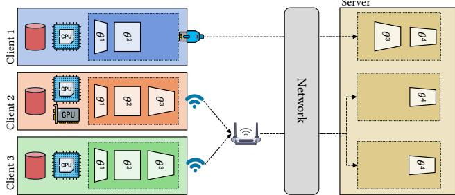
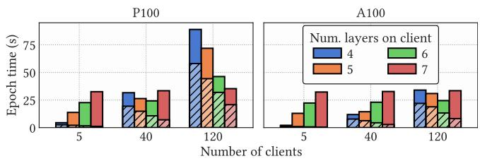
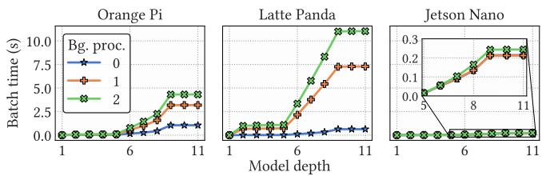
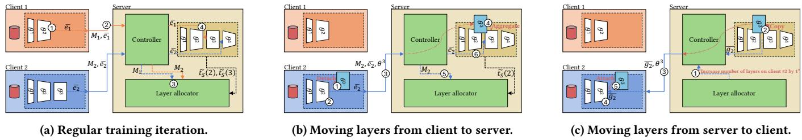
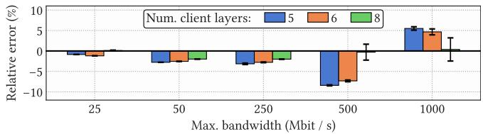
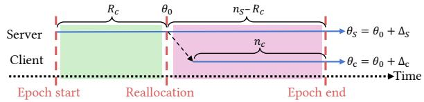
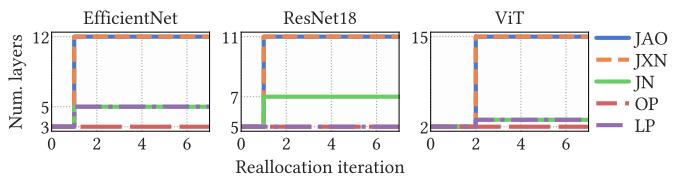
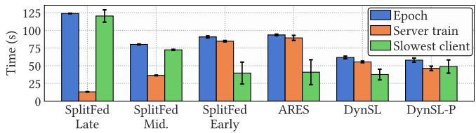
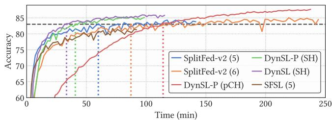

# DynSL: Resource-Adaptive Model Training across Heterogeneous Edge Devices

Boris Radovič1,2,†, Istemi Ekin Akkus3, Marco Canini1, Ruichuan Chen3, Alice Dethise3, Ivica Rimac3, Veljko Pejović2,4 1KAUST 2University of Ljubljana, Faculty of Computer and Information Science 3Nokia Bell Labs 4Jožef Stefan Institute, Department of Computer Systems

## Abstract

Training models over data distributed across edge devices presents a trade-of: centralizing data simplifies training but raises privacy and regulatory concerns, while full local training may exceed the devices’ compute and memory capacity. Split learning addresses this challenge by partitioning the model between clients and the server, allowing part of the computation to be ofloaded. However, existing approaches typically rely on static split configurations or simplified assumptions that fail to capture the heterogeneity and complex dynamics of real deployments. We present DynSL, a framework that dynamically allocates model layers between clients and the server by continuously monitoring system metrics and periodically solving an optimization problem that accounts for client and server computation and communication. When beneficial, the system reconfigures the split, enabling the ofloading strategy to adapt to changing device capabilities and system conditions. Extensive experiments on a testbed of 24 heterogeneous edge devices show that DynSL reduces training time by up to ∼ 30% over the strongest adaptive baseline and by more than 50% over a suboptimal uniform split, with no loss – and sometimes a gain – in accuracy.

## CCS Concepts

• Computing methodologies → Distributed computing methodologies; Machine learning; • Computer systems organization → Cloud computing; Heterogeneous (hybrid) systems.

## Keywords

Federated split learning; Split learning; Edge computing; Device heterogeneity; Adaptive model partitioning; Distributed training.

## ACM Reference Format:

Boris Radovič, Istemi Ekin Akkus, Marco Canini, Ruichuan Chen, Alice Dethise, Ivica Rimac, and Veljko Pejović. 2026. DynSL: Resource-Adaptive Model Training across Heterogeneous Edge Devices. In ACM Symposium on Cloud Computing V.2 (SoCC ’26), November 18–20, 2026, Singapore, Singapore. ACM, New York, NY, USA, 14 pages. https://doi.org/10.1145/3828161.3857850

## 1 Introduction

As the volume of data generated at the network edge — such as on smartphones, IoT sensors, and wearable devices — continues to grow, industry and academia seek eficient mechanisms to leverage such data for training machine learning models. Federated Learning (FL) [25, 42] has emerged as a prominent paradigm: by enabling collaborative training across a population of mobile/edge devices without requiring data centralization, it allows models to benefit from distributed data while preserving user privacy.

  
Figure 1: The optimal split depends on both compute and network. Client 2 trains more layers as it has a GPU; Client 3 (no GPU, slow WiFi) does too, but to exchange smaller embeddings; Client 1 (no GPU, fast link) trains fewer layers.

A key obstacle to deploying FL is the heterogeneity of edge devices [4], which difer in compute, memory, network, background workload, and other factors [5]. Since each client must train the full model locally, training times vary considerably, and the slowest clients – stragglers – delay the whole training process [32]. Clients whose resources cannot accommodate the model may even be ex cluded [48], biasing the model toward the data of more powerful devices and harming fairness and generalization [2, 40, 45]. To mitigate such issues, some approaches train only sub-parts of the global model on resource-limited clients [6, 10, 22, 76], while others train models tailored to client resources [20, 30, 34]. Although efective in certain settings, these techniques often lead to lower accuracy [56].

Federated Split Learning (FSL) advocates for a diferent approach: clients train the initial layers of a neural network, ofloading the remaining layers to the server. This directly alleviates client-side memory and compute consumption [55, 65] while preserving, and in some cases enhancing [65], accuracy. While FSL enables a broader range of devices to participate in the training of larger models [56], training the same number of layers on all clients does not necessarily yield an eficient or fair distribution of computation, because such uniform partitions ignore the underlying device heterogeneity.

To address this limitation, recent work [39, 58, 59] has explored adaptive FSL in which more powerful clients train deeper portions of the model, while weaker clients train fewer layers, as illustrated in Figure 1. While more eficient than uniform schemes [67], these approaches currently exhibit severe limitations. First, they adopt a client-centric perspective, implicitly assuming that the server always has suficient compute and network resources. In practice, however, overloading the server can shift the bottleneck from clients to the server itself, efectively making the server a straggler. Second, once a split is assigned, clients are required to complete training with the allocated layers, despite the fact that computing resources and network connectivity of mobile devices are inherently dynamic. For instance, an initially well-balanced allocation may become suboptimal due to client mobility. Third, many solu tions rely on explicit client-side profiling to estimate training time and network conditions, requiring preliminary procedures that consume resources without contributing to model convergence.

We argue that eficient andfair FSL requires a holistic, system-level perspective that accounts for both client- and server-side constraints in an online manner: rather than committing to a split decided from a stale, upfront snapshot, the system needs to react as conditions change during training. This approach reframes the split-point problem from a per-client, one-shot decision into a populationlevel, continuous control problem. To this end, we propose DynSL, a framework that dynamically distributes computation between clients and the server by minimizing the end-to-end training time. DynSL continuously tracks client compute and network capabilities and when necessary, it reconfigures the system to adapt to the changing system dynamics. Rather than targeting a specific configuration, we design DynSL as an extensible framework that exposes configurable design choices, such as whether client batches are concatenated and how many copies of the server-side model are trained.1 Overall, we make the following contributions:

(1) We formulate a novel optimization problem that minimizes end-to-end FSL training time by jointly modeling client- and server-side costs – the first split-allocation formulation to treat the server as a potential bottleneck – and prove that it is solvable in polynomial time.

(2) We introduce within-epoch reconfigurations, immediately moving layers in response to runtime dynamics. We further design a proportional aggregation scheme and prove it correctly accounts for each sample despite mid-epoch layer migration.

(3) We design a profiling-free online metric collection system that hooks into the training loop, eliminating wasted client compute and stale estimates of profiling-based methods.

(4) We evaluate DynSL on a 24-device real-world heterogeneous testbed and in simulation, cutting training time by up to 30% over the best baseline and > 50% over a suboptimal uniform split, with no loss – and sometimes a gain – in final accuracy.

Ultimately, DynSL fosters a more inclusive training process in which each participant – server and clients alike – contributes compute proportionally to its runtime capacity. Our implementation is available at https://github.com/BorisRado/dynsl.

## 2 Background and Preliminaries

## 2.1 Split Learning

To reduce the compute and memory requirements during training on resource-limited edge devices, Split Learning (SL) [17, 55, 68] proposes ofloading part of the computational graph to a server [26]. Consequently, clients train only the initial layers of the model, while the server trains the remaining layers. During training, every client first performs a forward pass for a batch of data through its portion of the model and produces intermediate embeddings. These embeddings and the corresponding labels are sent to the server, which completes the forward pass, computes the loss and then performs backpropagation through its part of the model. This enables the server to update its model parameters and to obtain the gradients with respect to the client embeddings. Such gradients are finally sent to the client to complete the backward pass [17, 68]. Since clients and server only exchange embeddings and gradients, SL provides some degree of privacy for client data [1, 9, 75]. However, such a basic SL process only involves one client training at a time, motivating the need for federated split learning [65].

## 2.2 Federated Split Learning

Federated Split Learning (FSL) generalizes SL by enabling multiple clients to train concurrently. Similar to FL, FSL algorithms improve a model through a sequence of epochs, which continue until a predefined stopping condition is met. Each epoch consists of the following stages [55]:

(1) Client initialization: A subset of clients is sampled from the population of available clients to participate in the current epoch. For each selected client, the server determines the split point, i.e., the number of layers the client will train. This may be fixed in advance [65] or determined based on available information, such as previously estimated client training speed. Clients may have the same or diferent split points.

(2) Server initialization: The server instantiates one or more classification heads, i.e., segments comprising the upper layers of the model that will be trained on the server in the epoch in conjunction with client-side ones.

(3) Model training: Each client in parallel trains its assigned layers while ofloading part of the computation to the server following the procedure presented in §2.1.

(4) Model aggregation: After all clients complete training and upload their updated model parameters, the server aggregates all the collected trained weights in a layer-wise fashion, thereby obtaining the model for the next epoch. That is, if a layer has been trained locally by some clients and on the server by others (e.g., �3 in Figure 1), all client layers and the corresponding server layer are aggregated, e.g., using weighted averaging [42].

## 3 Motivational Observations

A key design decision in FSL – and the aspect we focus on – is determining how many layers each client should train. This decision directly afects the computational load on both clients and the server, since the number and characteristics of the layers, such as their type and size, influence the training time as well as the volume of data exchanged over the network. While prior work recognizes the importance of this choice [59], existing approaches share a common structure: they treat the split as a one-shot, client-centric decision derived from an upfront snapshot of system conditions. Concretely, they assume (i) that the split can be chosen per client; (ii) that a single allocation sufices for an entire epoch; and (iii) that an upfront snapshot of system conditions captures what the decision needs. We examine each assumption in turn and show that all three break down under realistic conditions.

  
Figure 2: Epoch time (solid bars) and time during which the server GPU is actively training (bars with oblique hatches) when training ResNet18 with SplitFed-v1.

Is the split really a per-client decision? Deciding the split per client implicitly presupposes that the server can absorb whatever load clients ofload onto it. This assumption holds when few clients participate, but as the population grows, the server itselfcan become the dominant bottleneck that caps training throughput [67].

To support this claim, we consider training a ResNet18 model on a set of Orange Pi (OP) devices and a server with either an A100 or P100 GPU using the SplitFed-v1 algorithm [65]. For this experiment, we emulate the actual epoch time by having multiple virtual clients generate embeddings at a pace characteristic of OPs, while the server performs the same tasks as if the clients were distributed physical devices. We evaluate four split points, specifically by training 4, 5, 6, and 7 layers on the client, corresponding to splitting the model before the first, second, third, and fourth residual blocks, respectively. Since OPs lack hardware accelerators, a natural intuition, exploited by several prior approaches [33, 39, 59, 61, 69, 70], suggests training as few layers as possible on such clients. However, this intuition neglects the impact of ofloading a large fraction of the model to the server.

In Figure 2, we observe that, with 5 clients, training as few layers as possible on clients yields the shortest epoch time. With 40 or 120 clients, however, the optimal split point depends on the server GPU. For instance, with 40 clients, the best times are attained at 6 client layers on the P100 and 4 on the A100. Thus the same client, on the same hardware, should train a diferent number of layers depending on (i) how many peers it contends with for server resources and (ii) the type of the server GPU. Any per-client rule that ignores this coupling cannot track the optimal split as the client population or the server changes, and will therefore misallocate work.

Observation 1. In FSL, the optimal number oflayers assigned to clients cannot be determined solely on a per-client basis, but must account for the population ofconcurrently training clients and the available server resources.

Can a single split last a whole epoch? Establishing the right split for a given population is not enough, however, because edge devices’ conditions are inherently dynamic [4, 39, 59]: client compute may fluctuate due to hardware-level mechanisms such as dynamic frequency scaling or user-driven events $( \mathrm { e . g . }$ , the launch of back ground applications) [3], and network conditions may vary because of client mobility, contention with co-located devices, or changes in wireless channel quality [43, 44].

  
Figure 3: Training time under varying background loads.

To quantify the variations in compute speed, Figure 3 reports the per-batch training time of three edge devices when training ResNet18 with zero, one, or two compute-intensive background processes. While the Jetson Nano mitigates additional load thanks to its GPU, the Orange Pi and Latte Panda exhibit substantial slowdowns even with a single background process: when training the full model, the per-batch time increases by up to 3× on the Orange Pi and 10× on the Latte Panda. A shift of this magnitude is enough to turn a previously well-balanced client into a straggler mid-epoch, and because an epoch completes only when its slowest client finishes, a single straggler delays everyone.2 A method that commits to a fixed split for the duration of the epoch has no recourse.

Observation 2. Mid-epoch slowdowns become increasingly likely as the population grows; keeping the split fixed when they occur may turn a client into a straggler, degrading training eficiency.

Can upfront measurements keep pace with runtime dy- namics? A natural response to device dynamics involves measuring client capabilities more often, and indeed existing approaches rely on profiling phases performed periodically [58, 59] or upon first participation [39]: clients train on synthetic data to measure layerwise execution times and run additional procedures to estimate network throughput. However, this does not solve the problem. Profiling captures only a snapshot, which quickly becomes outdated in dynamic environments, and profiling more frequently still lags behind real-time fluctuations while consuming client computation, energy, and time. Crucially, none of this efort contributes to model convergence: it is spent purely to collect control signals.

Observation 3. Profiling-based decisions rely on potentially stale client measurements and incur non-negligible overhead.

## 4 System Model

System Setting. We consider a set of clients �, where each client $c \in C$ possesses a local dataset $\boldsymbol { D _ { c } } = \left\{ \left( \boldsymbol { x _ { c , k } } , y _ { c , k } \right) \right\} _ { k = 1 } ^ { | D _ { c } | }$ , which cannot be shared due to privacy constraints or regulatory reasons. An upstream entity provisions a compute server (e.g., on the cloud or on the edge) to assist clients during training by executing a portion of the model computation and coordinating the process.

Learning Objective. The goal of all participants is to collaboratively train a shared model � that minimizes the average loss:

$$
\theta ^ { * } = \arg \operatorname* { m i n } _ { \theta \in \mathbb { R } ^ { d } } \frac { 1 } { | C | } \sum _ { c \in C } \mathbb { E } _ { ( x , y ) \sim D _ { c } } \big [ \mathcal { L } ( y , f ( x , \theta ) ) \big ] ,\tag{1}
$$

where $f ( x , \theta )$ denotes the model output for input � under parameters �, and $\mathcal { L } ( \cdot )$ is a task-dependent loss function.

Model structure. The model $\theta = ( \theta ^ { 1 } , \theta ^ { 2 } , \dots , \theta ^ { L } )$ is any deep neural network composed of � sequential layers. Each layer � consumes exclusively the output of its predecessor $l - 1$ , allowing the model to be expressed as a composition

$$
f ( x , \theta ) = f { \big ( } x , \theta ^ { 1 } \circ \theta ^ { 2 } \circ \cdot \cdot \cdot \circ \theta ^ { L } { \big ) } .\tag{2}
$$

Note that such layers need not correspond to layers in a deep learning model. Rather, they are the smallest part of the computa tional graph that cannot be further partitioned due to architectural constraints. For example, in ResNet models, each residual block is a layer because skip connections prevent finer splitting, and in transformers a layer corresponds to an entire transformer block.

Split computation. We study how to partition the model across heterogeneous clients in order to minimize training time. To this end, we introduce a control variable, referred to as the split vector,

$$
\delta = \left[ \delta _ { c } \right] _ { c \in C _ { i } } ,\tag{3}
$$

where $C _ { i } \subseteq C$ denotes the set of clients participating in the training epoch �. For each client $c \in C _ { i } ,$ the value $\delta _ { c } \in \{ 0 , 1 , . . . , L \}$ – chosen by the server – specifies the number of layers trained locally by that client. Concretely, $\delta _ { c } = l$ indicates that client � trains layers 1 through �, while layers $l + 1$ through � are trained on the server. For instance, in Figure 1 we have $\delta = [ 2 , 3 , 3 ]$

## 5 DynSL Design

Building on observations from §3, we now present DynSL. After a high-level overview (§5.1), we describe how DynSL relaxes each of the assumptions underlying state-of-the-art methods. First, it formulates a novel optimization problem that jointly accounts for client and server resources (§5.2). Second, it hooks directly into the training loop to keep fresh estimates of client metrics (§5.3). Third, it introduces within-epoch reconfigurations to migrate layers between clients and the server (§5.4).

## 5.1 Framework Overview

DynSL adds a control loop atop standard FSL training. Two parties participate: (i) mobile/edge clients, which train their assigned layers and stream runtime metrics to the server, and (ii) a computepowerful server, which hosts both the ofloaded layers and DynSL’s control logic. This logic comprises a layer allocator and a controller. Figure 4 illustrates this loop; we detail each component next.

5.1.1 Clients. Each sampled client runs the standard FSL training loop of §2.1. To support dynamic reconfigurations, i.e., changing the split point during an epoch, training clients report their current runtime metrics (§5.3). When a reconfiguration happens, clients have to either increase or decrease the number of layers they train. In the former case, they receive the weights of the additional layers from the server and append them to their local model (Figure 4c), while in the latter case they remove the top layers from their model and send them to the server along with the next batch (Figure 4b).

5.1.2 Server. The server is a compute-powerful entity made up of one or more logically centralized nodes. It can be located in the cloud or at the network edge, where it assists nearby devices $( \mathrm { e . g . }$ for hierarchical FL [13, 36]). The server has three main components.

Classification Heads. As in traditional FSL, DynSL maintains one or more heads responsible for processing embeddings received from clients, completing the forward and backward passes, and returning gradients. To support reconfigurations, classification heads can provide the weights ofselected layers to be transferred to clients (Figure 4c) and, when clients send weights to the server (Figure 4b), integrate such weights into their own.

Layer Allocator. The layer allocator determines the split vector �. At the beginning of each epoch, it assigns clients a predetermined number of layers. During training, it continuously receives runtime metrics and, using such metrics, periodically solves the optimization problem described in §5.2 to identify the split vector that minimizes the epoch duration. If the resulting configuration difers from the current one, it instructs the controller to execute a reconfiguration.

Controller. The controller orchestrates communication between clients, classification heads, and the layer allocator. Upon receiving client data, it forwards (a) embeddings to the appropriate head along with an indication of how many layers the head needs to process – note, for instance in Figure 4a, that the more layers the client has, the fewer layers the server trains for that client – and (b) client runtime metrics to the allocator. Based on instructions from the allocator, it handles reconfigurations.

## 5.2 Optimization Problem Formulation

DynSL minimizes the overall wall-clock training time by controlling the split vector �. Specifically, we minimize the duration $T _ { i }$ of each epoch � as, given a fixed number of epochs, minimizing each epoch’s duration minimizes the total training time.3

As an epoch completes when the slowest client finishes its training stage, we seek to solve

$$
\arg \operatorname* { m i n } _ { \delta } \ T _ { i } ( \delta ) = \arg \operatorname* { m i n } _ { \delta } \ \operatorname* { m a x } _ { c \in C _ { i } } T _ { i , c } ( \delta _ { c } ) ,\tag{4}
$$

where $T _ { i , c }$ denotes the actual training time of client $c \in C$ in epoch �. We next derive expressions for estimating the epoch time. Throughout the following discussion, we assume the system currently runs a configuration $\delta ^ { \prime } ,$ , from which DynSL may transition to a new �.

5.2.1 Client Perspective. For a given number of layers $\delta _ { c } ,$ client � performs a forward and, upon receiving server gradients, a backward pass. The combined time at the client for the forward and backward passes depends on the split point and the client’s compute capability $\psi _ { c } ,$ , and is denoted $t _ { c } ( \delta _ { c } , \psi _ { c } )$ . The embeddings of size $| e _ { \delta _ { c } } |$ are uploaded to the server with bandwidth $\beta _ { c } ^ { \uparrow }$ , and the corresponding gradients of size $| g _ { \delta _ { c } } |$ are downloaded via bandwidth $\beta _ { c } ^ { \downarrow } . ^ { 4 }$ The server then completes the forward pass, computes the loss, and backpropagates it through its layers, which takes $t _ { S } ( \delta _ { c } )$

Beyond this per-batch cost, moving from $\delta _ { c } ^ { \prime }$ to $\delta _ { c }$ requires migrating the afected layers over client $c { \ ' } _ { s }$ link, which takes time $m _ { c } ( \delta _ { c } ^ { \prime } , \delta _ { c } )$ . This cost is asymmetric because every layer a client trains must in any case be uploaded to the server at the end of the epoch. When the split is reduced $( \delta _ { c } ^ { \prime } > \delta _ { c } )$ , the client sends to the server the layers it would have to upload regardless, i.e., migrating them mid-epoch only brings this unavoidable transfer forward. When the split is increased $( \delta _ { c } ^ { \prime } < \delta _ { c } )$ , instead, the additional layers must first be sent to the client and later returned, traversing the client link twice. Thus, if the size of the migrated layers is $P ,$ then:

  
Figure 4: DynSL overview. (4a): Clients ○1 run the forward pass and ○2 send embeddings (�¯ , �¯ ) and metrics (� , � ) to the server; the controller forwards ○3 the metrics to the layer allocator and ○4 embeddings to the model. (4b): When instructed to reduce its la ers the client ○1 detaches them $\textcircled{2}$ runs the forward ass throu h the reduced model and ○3 sends the removed wei hts with the next batch; the server $\textcircled{4}$ aggregates the client and server weights, ○5 integrates the metrics, and ○6 trains the model. (4c): To increase a client’s layers, the allocator ○1 instructs the controller to $\textcircled{2}$ extract the layer’s current weights from the server and $\textcircled{3}$ send them with the gradients (�¯ ); the client ○4 completes the backward pass, then ○5 attaches the received layer.

$$
\begin{array} { r } { m _ { c } ( \delta _ { c } ^ { \prime } , \delta _ { c } ) = \left\{ \begin{array} { l l } { 0 , } & { \delta _ { c } ^ { \prime } \geq \delta _ { c } , } \\ { \frac { P } { \beta _ { c } ^ { \downarrow } } + \frac { P } { \beta _ { c } ^ { \uparrow } } , } & { \delta _ { c } ^ { \prime } < \delta _ { c } . } \end{array} \right. } \end{array}\tag{5}
$$

As per-batch stages occur sequentially while reconfiguration occurs only once, the total time for client � to process its $B _ { c }$ batches is

$$
\hat { T } _ { i , c } ( \delta _ { c } ) = { \cal B } _ { c } \Big [ t _ { c } ( \delta _ { c } , \psi _ { c } ) + \frac { | e _ { \delta _ { c } } | } { \beta _ { c } ^ { \uparrow } } + \frac { | g _ { \delta _ { c } } | } { \beta _ { c } ^ { \downarrow } } + t _ { S } ( \delta _ { c } ) \Big ] + m _ { c } ( \delta _ { c } ^ { \prime } , \delta _ { c } ) .\tag{6}
$$

5.2.2 Server Perspective. The client-centric view above, presented with some modifications in several prior works such as [9, 33, 39, 41, 58, 59, 70, 77], implicitly assumes that the server can process each batch immediately upon arrival. This assumption does not hold with many participating clients as discussed in §3. We thus characterize the epoch duration from the server’s perspective.

Before an epoch completes, the server must process all batches from all participating clients. If it handles $b \geq 1$ batches in parallel (e.g., via concatenation or by training on multiple GPUs), the total server-side computation time is

$$
T _ { S , \mathrm { c o m p } } ( \delta ) = \sum _ { c \in C _ { i } } B _ { c } \frac { t _ { S } ( \delta _ { c } ) } { b } .\tag{7}
$$

In addition, the server exchanges embeddings and gradients for every batch. Assuming a symmetric link with bandwidth $\beta _ { S }$ , the total communication time is approximated $\mathsf { a s } ^ { 5 }$

$$
T _ { S , \mathrm { c o m m } } ( \delta ) = \sum _ { c \in C _ { i } } B _ { c } \frac { | e _ { \delta _ { c } } | + | g _ { \delta _ { c } } | } { \beta _ { S } } .\tag{8}
$$

Assuming the overlap between computation and communication, the server epoch duration is lower-bounded by

$$
\hat { T } _ { S } ( \delta ) \ = \ \operatorname * { m a x } \Bigl ( T _ { S , \mathrm { c o m p } } ( \delta ) , \ T _ { S , \mathrm { c o m m } } ( \delta ) \Bigr ) .\tag{9}
$$

5.2.3 Estimated Epoch Time. An epoch cannot complete until (i) all clients finish processing their local data, and (ii) the server finishes processing all client batches. We thus estimate epoch duration as

$$
T _ { i } ( \delta ) \ \geq \ F ( \delta ) \ = \ \operatorname* { m a x } \Big ( \hat { T } _ { S } ( \delta ) , \ \operatorname* { m a x } _ { c \in C _ { i } } \hat { T } _ { i , c } ( \delta _ { c } ) \Big ) .\tag{10}
$$

While $F ( \delta )$ is a lower bound, it is tight in its extremes: with a single client the server never queues, so epoch time equals the client term � recovers exactly; at scale, the server sets the throughput ceiling,

which dominates �. This also matches Observation 1: early splits shift the bottleneck to the server, while deep splits overload clients.

## 5.2.4 Problem Statement. The layer allocator minimizes:

$$
\begin{array} { r l } & { \boxed { \mathrm { m i n i m i z e } \quad F ( \delta ) } } \\ & { \boxed { \mathrm { s u b j e c t ~ t o } \quad \delta _ { \operatorname* { m i n } } ( c ) \leq \delta _ { c } \leq \delta _ { \operatorname* { m a x } } ( c ) , \quad \forall c \in C _ { i } , } } \end{array}\tag{11}
$$

where $\delta _ { \mathrm { m i n } } ( c )$ and $\delta _ { \mathrm { m a x } } ( c )$ denote client-specific bounds. The lower bound $\delta _ { \mathrm { m i n } } ( c )$ specifies the minimum number of layers a client trains locally to meet its privacy requirements – deeper client-side models produce embeddings that are harder to invert [1, 9, 52, 75]; a client may thus refuse to train very shallow parts. The upper bound $\delta _ { \mathrm { m a x } } ( c )$ caps the deepest split the client can sustain, capturing resource limitations such as available memory or providing an upper bound on energy usage. In short, $\delta _ { \mathrm { m i n } } ( c )$ encodes a privacy floor, while $\delta _ { \mathrm { m a x } } ( c )$ encodes a resource-consumption ceiling.

This formulation lets DynSL honor heterogeneous per-client preferences under a single system-level objective. Rather than letting each client optimize its own objective – which would yield |�� | selfish and one global throughput problem – DynSL adopts the �-constraint form: it minimizes a single global objective, the epoch time $F ( \delta )$ , and casts every other concern as a constraint on �.

5.2.5 Solving the Allocation Problem. While the number of possible split vectors is exponential, $O ( L ^ { | C _ { i } | } )$ , we show that under mild assumptions the problem is solvable in polynomial time.

## Assumption 1. All required metrics are available to the server.

## Assumption 2. Embedding sizes $| e _ { \delta _ { c } } |$ are non-increasing in $\delta _ { c } .$

Since gradients have the same dimensionality as the corresponding embeddings, |�� | is non-increasing as well; and since a deeper client split leaves fewer layers on the server, $t _ { S } ( \delta _ { c } )$ ) is non-increasing too. Writing $\delta \preceq \tilde { \delta }$ whenever $\delta _ { c } \ \leq \ \tilde { \delta } _ { c }$ for all $c \in C _ { i }$ , it follows that $\delta \preceq \tilde { \delta } \implies \hat { T } _ { S } ( \tilde { \delta } ) \leq \hat { T } _ { S } ( \delta )$ . Assumption 2 holds for several architectures such as VGG, ResNet, and Transformers. When an architecture violates it, DynSL restricts admissible splits to depths at which $| e _ { \delta _ { c } } |$ is a running minimum; this retains over 75% of splits for EficientNet and MobileNet we consider in §6.

Claim 1. Under Assumptions 1 and 2, problem (11) can be solved exactly in $O \big ( | C _ { i } | L \log ( | C _ { i } | L ) \big )$ time.

Algorithm 1 Solving problem (11)   
Require: per-client bounds $[ \delta _ { \mathrm { m i n } } ( c ) , \delta _ { \mathrm { m a x } } ( c ) ]$ , current split $\delta ^ { \prime }$   
1: $\bar { \delta } _ { c } \gets \mathrm { a r g }$ min $l { \in } [ \delta _ { \operatorname* { m i n } } ( c ) , \delta _ { \operatorname* { m a x } } ( c ) ] \ \hat { T } _ { i , c } ( l )$ ∀�   
2: $\alpha _ { \operatorname* { m i n } } \gets \operatorname* { m a x } _ { c } \hat { T } _ { i , c } ( \bar { \delta } _ { c } )$   
3: $T _ { S } ^ { \mathrm { c o m p } } \gets T _ { S , \mathrm { c o m p } } ( \bar { \delta } ) ; \ T _ { S } ^ { \mathrm { c o m m } } \gets T _ { S , \mathrm { c o m m } } ( \bar { \delta } )$   
4: $\bar { \delta ^ { \star } } \longleftarrow \bar { \delta } ; F ^ { \star } \longleftarrow \operatorname* { m a x } \bigl ( \operatorname* { m a x } ( T _ { S } ^ { \mathrm { c o m p } } , T _ { S } ^ { \mathrm { c o m m } } ) , \alpha _ { \mathrm { m i n } } \bigr )$   
5: $\mathcal { P }  \operatorname { s o n r } \bigl ( \{ ( c , l ) : \delta _ { \operatorname* { m i n } } ( c ) \overset {  } { \leq } l \leq \delta _ { \operatorname* { m a x } } ( c ) , \ c \in C _ { i } \} \ \mathrm { b y } \ \hat { T } _ { i , c } ( l ) \bigr )$   
6: for $( c , l ) \in \mathcal { P }$ do   
$7 { : }$ $\mathrm { i f } l > \bar { \delta } _ { c }$ then   
8: decrease $c { \mathit { \Pi } } _ { s }$ terms in $T _ { S } ^ { \mathrm { c o m p } } , T _ { S } ^ { \mathrm { c o m m } } ;$ $\bar { \delta } _ { c } \gets l$   
9: if $\hat { T } _ { i , c } ( l ) \geq \alpha _ { \mathrm { m i n } }$ then   
10: $\hat { F } \gets$ max max $( T _ { S } ^ { \mathrm { c o m p } } , T _ { S } ^ { \mathrm { c o m m } } ) , \hat { T } _ { i , c } ( l ) )$   
11: if $\hat { F } < F ^ { \star }$ then   
12: $F ^ { \star } \gets \hat { F } ; \delta ^ { \star } \gets \bar { \delta }$   
13: return $\delta ^ { \star }$

Proof sketch. Fix the current configuration $\delta ^ { \prime } ;$ then $\hat { T } _ { i , c } ( \cdot )$ is a fixed table of $O ( | C _ { i } | L )$ values, and by Assumption 2 the server time $\hat { T } _ { S } ( \cdot )$ is non-increasing in each coordinate. For a latency budget $\alpha ,$ let $\bar { \delta } ( \alpha )$ assign every client its deepest feasible layer with $\hat { T } _ { i , c } \leq \alpha .$ Among all admissible vectors whose client times are all $\leq \alpha , \bar { \delta } ( \alpha )$ is coordinatewise-largest and therefore, by monotonicity of $\hat { T } _ { S } ,$ minimizes ${ \hat { T } } _ { S } ;$ its own bottleneck client time $\mathrm { i } s \leq \alpha .$ Consequently, any optimum $\delta ^ { \star }$ can be replaced by $\bar { \delta } ( \alpha _ { 0 } )$ with $\alpha _ { 0 } = \operatorname* { m a x } _ { c } \hat { T } _ { i , c } ( \delta _ { c } ^ { \star } )$ without increasing $F ;$ no client time exceeds $\alpha _ { 0 }$ by construction, and $\hat { T } _ { S }$ does not increase since $\delta ^ { \star } \preceq \bar { \delta } ( \alpha _ { 0 } )$ . Hence an optimum lies in $\{ \bar { \delta } ( \alpha ) : \alpha \in \mathcal { A } \}$ with $\mathcal { A } = \{ \hat { T } _ { i , c } ( l ) \}$ and $| \mathcal { A } | \leq | C _ { i } | ( L { + } 1 )$ . We evaluate $F$ on these candidates by sweeping A in increasing order: consecutive budgets promote a single client to a deeper split, so $\bar { \delta }$ and the two server-time sums of Eqs. (7)–(8) update in $O ( 1 )$ per step. The sort dominates, giving $O ( | C _ { i } | L \log ( | C _ { i } | L ) )$ . □

The overall procedure, Algorithm 1, follows the proof: it sorts the candidate client times and sweeps them, evaluating � at each vector and keeping the minimizer $\delta ^ { \star }$ . As $F ( \delta )$ is itself an approximate model of the epoch time, DynSL does not act on arbitrarily small improvements: it triggers a reconfiguration only when $F ( \delta ^ { \prime } ) { - } F ( \delta ^ { \star } )$ exceeds a hysteresis threshold $\xi$ – an operator-configured margin (in seconds, e.g., 5-10 s) set when the training job is launched.

## 5.3 Online Metric Collection

Per Assumption 1, to compute $F ( \delta )$ , the server must have estimates of (i) client-side computation time, (ii) client-server network bandwidth, (iii) server-side computation time, and (iv) the number of pending batches to be processed by each client. We next describe how DynSL continuously tracks these metrics.

5.3.1 Client Training Time. Each client measures the wall-clock training time $\tilde { \tau } _ { c } ( l )$ of every local layer $l \leq \delta _ { c }$ and piggybacks these values onto the embeddings sent to the server – note that $t _ { c } ( \delta _ { c } ) =$ $\begin{array} { r } { \sum _ { l \le \delta _ { c } } \tilde { \tau } _ { c } ( l ) } \end{array}$ . As embeddings are orders of magnitude larger than the additional timing metrics, the overhead is negligible.

Upon receiving $\tilde { \tau } _ { c } ( l )$ , the server updates the per-layer estimates using an exponentially weighted moving average (EWMA):

$$
\tau _ { c } ( l ) \gets \gamma \tau _ { c } ( l ) + ( 1 - \gamma ) \tilde { \tau } _ { c } ( l ) , \quad \forall l \leq \delta _ { c } ,
$$

Table 1: Relative error (%) of the extrapolated per-split client compute time under leave-the-tail-out fitting.
<table><tr><td>Proxy  $\kappa _ { l }$ </td><td>JAO</td><td>JN</td><td>JON</td><td>JXN</td><td>LP</td><td>OP</td><td>Mean</td></tr><tr><td>CPU</td><td>11.7</td><td>8.3</td><td>6.9</td><td>14.8</td><td>11.1</td><td>8.2</td><td>10.2</td></tr><tr><td>A6000</td><td>6.3</td><td>8.3</td><td>7.4</td><td>21.5</td><td>7.0</td><td>10.2</td><td>10.1</td></tr><tr><td>V100</td><td>17.4</td><td>15.0</td><td>16.0</td><td>18.1</td><td>14.3</td><td>14.7</td><td>15.9</td></tr><tr><td>P100</td><td>9.2</td><td>7.8</td><td>8.6</td><td>19.3</td><td>7.0</td><td>7.9</td><td>10.0</td></tr><tr><td>FLOPs</td><td>5.3</td><td>8.3</td><td>8.1</td><td>21.8</td><td>6.6</td><td>9.9</td><td>10.0</td></tr><tr><td>Num. params.</td><td>428.6</td><td>420.4</td><td>377.5</td><td>259.3</td><td>459.8</td><td>422.8</td><td>394.7</td></tr></table>

where $\gamma \in \left[ 0 , 1 \right)$ . However, solving (11) requires estimates for all split points $\delta _ { \mathrm { m i n } } ( c ) < l \leq \delta _ { \mathrm { m a x } } ( c ) .$ including layers not currently trained by the client $( \delta _ { c } < l \leq \delta _ { \operatorname* { m a x } } ( c ) )$ . To extrapolate beyond the observed depth, the server associates each layer � with a complexity proxy �� and predicts missing values via linear (afine) fit based on the observed layers, i.e., the server fits a regression model using observations $\kappa _ { l } , \tau _ { c } ( l ) \forall l \leq \delta _ { c }$ and uses it to predict $\tau _ { c } ( l ) \ \forall l > \delta _ { c }$

To validate this methodology, we quantify how accurately the per-client model predicts the training time of layers it has not yet observed. Concretely, we adopt a leave-the-tail-out protocol that mirrors online use: for each device, we measure ofline (for this validation only) the per-layer execution time at every depth, fit an afine model on the shallowest observed layers, and predict the execution time of deeper candidate splits. In Table 1, we report the mean absolute percentage error (MAPE) of the resulting per-split estimate relative to the measured split cost for ResNet18; other models show consistent trends. Both FLOPs and every proxy based on measured execution time on a reference device (CPU or GPU) keep the error consistently below 22% across all devices, confirming that a few observed layers sufice to extrapolate the cost of the rest, whereas parameter counts extrapolate poorly. Such errors are tolerable for the allocator: extrapolated costs only cover layers a client has not yet trained and are replaced by measurements as soon as it does, while the threshold � prevents residual errors from triggering spurious reconfigurations.

We use the FLOPs proxy for the remainder of the paper: its precision is on par with the best execution-time proxies, yet unlike them it is computed directly from the model architecture and requires no reference-device measurement, making it the most practical choice. We stress, however, that DynSL is modular here: any of the well-performing proxies can be substituted without altering the allocator, and their comparable precision indicates that the method does not depend on selecting a specific one.

5.3.2 Client Network Bandwidth. Rather than running dedicated profiling procedures, DynSL observes that the continuous clientserver exchange of embeddings and gradients already provides the data necessary for throughput estimation. We thus reuse the estimation principle of network profiling tools such as iperf3 – throughput as message size divided by the interval from the first payload byte to reception completion – but apply it online during FSL training, at no additional networking cost. The client reports its downlink rate alongside the embeddings, while the server independently measures the client’s uplink; both are smoothed with an EWMA across training steps to suppress transient fluctuations.

  
Figure 5: Relative error of bandwidth estimated by DynSL relative to iperf3 under various network regimes.

We validate our protocol by estimating bandwidth while training ResNet18 on a single device under varying connection speeds. Figure 5 compares DynSL’s estimates against the iperf3 utility: they track closely at low throughput and degrade slightly beyond ∼500 Mbps, yet the relative error never exceeds 10%. Crucially, unlike iperf3, DynSL obtains these estimates without any dedicated profiling or added communication, and immediately reflects changing conditions as training proceeds.

5.3.3 Server-Side Metrics. The server tracks its computation time and the number of pending batches for every client by decreasing a client-counter every time a batch is received. Note that unlike clientside training times (§5.3.1), server-side times require no extrapolation: since each client � starts at $\delta _ { \mathrm { m i n } } ( c )$ , the server initially trains the longest sufix the allocator may ever assign to it. Moreover, $t _ { S }$ depends only on the split, not on the client, so these measurements are shared across clients.

Altogether, by using such lightweight metric collection mechanisms, DynSL maintains accurate, online estimates of all components required to evaluate $F ( \delta )$ . This design avoids explicit profiling, introduces negligible overhead, and enables rapid adaptation of the split configuration in response to dynamic system conditions.

## 5.4 DynSL Workflow

We finally describe the end-to-end workflow of DynSL.

Client Registration. Clients may join at any time. Upon registration, a client reports (i) the size of its dataset, from which the server derives $B _ { c } ,$ and (ii) the bounds $\delta _ { \mathrm { m i n } } ( c )$ and $\delta _ { \mathrm { m a x } } ( c )$

Initial Layer Allocation. Since DynSL performs no upfront profiling, the layer allocator assigns each client $\delta _ { \mathrm { m i n } } ( c )$ at the start of every epoch, even when prior measurements of the client exist, as these may be stale (Observation 3).

Model Training and Dynamic Reconfiguration. Training follows the standard FSL protocol: the server processes client batches in the order they are received, optionally concatenating batches that ofload the same number of layers into one. Throughout, it monitors system metrics and periodically runs Algorithm 1 on the current estimates; when the resulting $\delta$ improves the estimated epoch time over the current $\delta ^ { \prime }$ by more than $\xi ,$ the controller triggers a reconfiguration. During training, both clients and the server maintain, for each layer, the number of samples on which it has been trained $( n _ { s } ^ { l }$ and $n _ { c } ^ { l } , \forall l \in [ 1 , L ] , \forall c \in C _ { i } )$ , as these counters are needed to merge weights correctly upon reconfiguration and at the end of the epoch. Because each client streams its dataset once per epoch, a layer migrated to a client mid-epoch is trained only on the samples the client has not yet processed. Two cases arise:

$\delta _ { c } > \delta _ { c } ^ { \prime } \colon$ the controller extracts the afected layers from the server model and sends their weights to the client with the next gradient, recording the fork point $R _ { c } ^ { l } \gets n _ { s } ^ { l }$ . The client appends the layers, sets $n _ { c } ^ { l } = 0 ,$ , and trains them on its remaining batches.

$\delta _ { c } < \delta _ { c } ^ { \prime } \colon$ the controller notifies the client alongside the gradient. After completing the backward pass, the client detaches the specified layers and returns their weights, together with their sample counts $n _ { c } ^ { l } ;$ , to the server, which integrates them immediately.

Weight Aggregation. At the end of the epoch, layers are combined by weighted averaging. However, a naïve FedAvg-style weighting would miscount samples when layers migrate between the server and clients during the epoch, as the resulting layers at the end of the epoch are not trained on disjoint sets of data – the client’s copy and the server copy share a common ancestor.

  
Figure 6: Example of migrating a layer within an epoch.

Consider the example in Figure 6. A layer resides on the server, where it is trained on behalf of the whole population of clients. After $R _ { c }$ samples, client � “forks” it and trains it on its remaining $n _ { c }$ samples, producing $\theta _ { c } = \theta _ { 0 } + \Delta _ { c }$ . After the fork, the server copy keeps being trained by the remaining clients for $n _ { S } - R _ { c }$ additional samples, producing $\theta _ { S } = \theta _ { 0 } + \Delta _ { S }$ . The two versions of the layer at the end of the epoch $( \theta _ { S }$ and $\theta _ { c } )$ share the $R _ { c }$ -sample prefix baked into $\theta _ { 0 }$ and their updates $\Delta _ { S }$ and $\Delta _ { c }$ are computed on disjoint sets of samples. Since both copies agree on $\theta _ { 0 } ,$ , the aggregation should, as in FedAvg, combine only the two divergent updates. However, naïve FedAvg-style weighting scores each copy by the total number of samples it has seen – i.e., �� for $\theta _ { S }$ and $R _ { c } + n _ { c }$ for $\theta _ { c } - \mathrm { g i v i n g }$

$\theta _ { \mathrm { a v g } } = \frac { n _ { S } \theta _ { S } + \left( R _ { c } + n _ { c } \right) \theta _ { c } } { n _ { S } + R _ { c } + n _ { c } } = \theta _ { 0 } + \frac { n _ { S } } { n _ { S } + R _ { c } + n _ { c } } \Delta _ { S } + \frac { R _ { c } + n _ { c } } { n _ { S } + R _ { c } + n _ { c } } \Delta _ { c } .$ Both totals include the $R _ { c }$ shared-prefix samples, which distorts the two updates’ ratio. Specifically, the two disjoint updates are weighted $n _ { S } : \left( R _ { c } + n _ { c } \right)$ rather than by the samples that actually produced them, $( n _ { S } - R _ { c } ) : n _ { c }$ . The distortion is a bias toward whichever copy did less post-fork work.

Two extreme cases show how far it can $\mathbf { g o } .$ First, suppose the server copy is not updated after the fork $( n _ { S } = R _ { c } , s o \ \Delta _ { S } = 0 )$ the correct aggregate is simply $\theta _ { c } ,$ yet naïve weighting still places weight $R _ { c } / ( 2 R _ { c } + n _ { c } )$ on the stale $\theta _ { 0 } ,$ , shrinking the client’s genuine update $\Delta _ { c }$ even though $\theta _ { S }$ carries no information produced after divergence. Symmetrically, suppose the server keeps training on the whole population while the client contributes only a handful of post-fork samples: the $R _ { c }$ prefix inflates the client’s total to $R _ { c } + n _ { c }$ so its tiny tail is scored as if it rested on $R _ { c } + n _ { c }$ samples. With $R _ { c } = 1 0 0 0 , n _ { c } = 1$ and $n _ { S } = 2 0 0 0$ , thus $n _ { S } - R _ { c } = 1 0 0 0$ , the naïve weighting still assigns the client weight $\frac { 1 0 0 1 } { 3 0 0 1 } ~ \approx ~ 0 . 3 3$ , despite it having done 1000× less post-fork work than the server.

To be consistent with FedAvg-style aggregation, layers should thus be weighted by how much data they have been trained on since forking. Aggregation must also account for clients forking at diferent points: the copies form a tree in which the server holds samples $1 , \ldots , n _ { S } ,$ , and each client branches of at its own $R _ { c }$ and adds its $n _ { c }$ samples.

Algorithm 2 Weight aggregation for a single layer   
Require: server weights $\theta _ { S }$ trained on �� samples; client weights   
$\{ \theta _ { c } \}$ , sample counts $\{ n _ { c } \}$ , fork points $\{ R _ { c } \}$   
1: $\theta _ { \mathrm { a g g } }  \theta _ { S } , \quad p  n _ { S }$   
2: sort clients in decreasing order of $R _ { c }$   
3: for each client � in sorted order do   
4: �dif ← � − �� {samples in the aggregate since the fork of �}   
5: $\begin{array} { r } { \theta _ { \mathrm { a g g } }  \frac { \partial _ { \mathrm { d i f f } } } { n _ { \mathrm { d i f f } } + n _ { c } } \theta _ { \mathrm { a g g } } \overline { { + } } \frac { n _ { c } } { n _ { \mathrm { d i f f } } + n _ { c } } \theta _ { c } } \end{array}$   
6: $p \gets p + n _ { c }$   
7: return $\theta _ { \mathrm { a g g } }$

Based on these considerations, we propose Algorithm 2, which recombines the tree bottom-up, aggregating the client copies into the server copy one at a time in decreasing order offork time $R _ { c }$ and weighting each merge by the samples accumulated since that fork. Processing the latest fork first ensures that, when a client is considered, the aggregate holds only that client’s shared prefix plus samples disjoint from it, so the merge charges the ancestor for exactly the post-fork samples. Building on this, we characterize the model Algorithm 2 produces with Claim $2 . ^ { 6 }$

Claim 2. Algorithm 2 maintains the invariant that, when client � is merged, $n _ { \mathrm { d i f f } } = p - R _ { c }$ equals exactly the number ofsamples in $\theta _ { \mathrm { a g g } }$ trained after $R _ { c } { } _ { : }$ , and these are disjoint from �’s � samples. Hence each merge is a convex combination that weighs the two post-fork bodies in proportion to the samples that produced them, � $: n _ { c }$

Proof. The claim follows once we establish, by induction on the merge order, the auxiliary invariant that $\boldsymbol { p }$ always equals the number of distinct samples on which $\theta _ { \mathrm { a g g } }$ has been trained.

Base case. Before any client is folded in, $\theta _ { \mathrm { a g g } } = \theta _ { S }$ has been trained only on the server’s �� samples and $ p = n _ { S }$ , so � counts the distinct samples on which $\theta _ { \mathrm { a g g } }$ has been trained.

Inductive step. Suppose the invariant holds just before merging �. Because clients’ contributions are aggregated in decreasing order of $R _ { c }$ , every clien $c ^ { \prime }$ considered before � has $R _ { c ^ { \prime } } \geq R _ { c }$ , so its $n _ { c ^ { \prime } }$ samples, like the server samples processed after $R _ { c } ,$ were trained after $R _ { c }$ As client datasets are disjoint and each sample is processed exactly once per epoch, all of them are disjoint from $c ^ { \prime } s n _ { c }$ samples. Since no copy aggregated so far forked before $R _ { c } { : }$ , the samples in $\theta _ { \mathrm { a g g } }$ are the shared prefix of exactly $R _ { c }$ samples together with these post-$R _ { c }$ samples; by the invariant the two groups total ${ \boldsymbol { \mathit { p } } } ,$ so there are $p { - } R _ { c } = n _ { \mathrm { d i f f } } { \ge } 0$ post- $\cdot R _ { c }$ samples. The merge $\begin{array} { r } { \frac { n _ { \mathrm { d i f f } } } { n _ { \mathrm { d i f f } } + n _ { c } } \boldsymbol { \dot { \theta } } _ { \mathrm { a g g } } + \frac { n _ { c } } { n _ { \mathrm { d i f f } } + n _ { c } } \boldsymbol { \theta } _ { c } } \end{array}$ is therefore convex and weighs the two disjoint bodies of � and $n _ { c }$ samples by their sizes. Finally, $p  p + n _ { c }$ adds �’s $n _ { c }$ fresh samples, so $\boldsymbol { p }$ again counts the distinct samples in $\theta _ { \mathrm { a g g } } ,$ restoring the invariant. □

The final model $\theta _ { \mathrm { a g g } }$ is thus the hierarchical FedAvg of the fork tree: each update is weighted by its post-fork sample count relative to its point of divergence. As a special case, when all clients fork at a common $R _ { c } ,$ this reduces to FedAvg over post-fork samples. Note, however, that Claim 2 concerns sample accounting only: it does not make shared-head training equivalent to FedAvg, since server-side layers are updated more frequently than client-side ones and the dynamics further depend on the split and client batch arrival order.

## 6 Evaluation

Comparison algorithms. We compare two variants of DynSL against FSL baselines. For DynSL, we consider the full algorithm as well as a simplified variant, denoted DynSL-P, that performs profiling and uses the collected measurements to solve (11). Thus, in DynSL-P, the optimal split vector is determined at the beginning of each epoch and remains fixed, while DynSL initializes the clients with $\delta _ { \mathrm { m i n } } ( c )$ and dynamically adapts � during training. We group baselines by their efect on convergence. Convergence-preserving methods leave the computation unchanged, hence are FedAvgequivalent under separate heads: SplitFed-v1 [65] (varied clientside depth) and the resource-aware ARES [59] – we take ARES as a strong, representative server-blind adaptive baseline. Other adaptive methods (see §8) difer in how they select per-client splits, not in whether they model server load; by Observation 1 they therefore share the same structural failure mode, so DynSL’s advantage over ARES is representative of this family. Note that under separate heads, ARES, DynSL-P, and DynSL form an ablation ladder: ARES→DynSL-P isolates server awareness, as both profile clients and keep � fixed throughout the epoch, while DynSL-P→DynSL isolates the combined efect of online adaptation and the profilingfree start. Convergence-altering methods change what is computed: SFSL [18] and DTFL [39] train clients on a locally generated loss via auxiliary networks rather than on server gradients.

Datasets and models. We evaluate several model architectures: ResNet18 [21], EficientNet [64], MobileNet [23], DenseNet [24], and a small Vision Transformer model [11]. We train these models on the CIFAR10, CIFAR100, and CINIC10 datasets. Depending on the experiment, we partition the underlying training set of the considered datasets using either an IID or Dirichlet distribution and assign the so-obtained subsets to clients.

Implementation and testing environment. We evaluate DynSL on CoLExT [5], a state-of-the-art real-world testbed consisting of the 24 heterogeneous devices listed in Table 2; the server is equipped with an A6000 GPU and 48 cores. For details refer to [5].

Algorithm Hyperparameters. For DynSL we set $\gamma = 0 . 8 .$ . The allocator runs every $8 \ : s ,$ and reconfigurations are triggered when predicted gains exceed $\xi = 8 s ;$ the server processes one batch at a time $( b = 1 )$ . We use FLOPs as the complexity proxy �. We set these values and keep them fixed across all experiments, so that no result benefits from per-experiment tuning. For ARES, we set parameter � [59] to 1.0 so that ARES optimizes training time only.

Table 2: Composition of the employed testbed.
<table><tr><td></td><td>Acronym</td><td>Count</td><td>GPU</td><td>Memory</td><td>CPU (Core@GHz)</td></tr><tr><td>Jetson AGX Orin</td><td>JAO</td><td>2</td><td>√</td><td>64GB</td><td>12@2.2</td></tr><tr><td>Jetson Orin Nano</td><td>JON</td><td>3</td><td>√</td><td>8GB</td><td>6@1.5</td></tr><tr><td>Jetson Xavier NX</td><td>JXN</td><td>2</td><td>√</td><td>8GB</td><td>6@1.9</td></tr><tr><td>Jetson Nano</td><td>JN</td><td>6</td><td>√</td><td>4GB</td><td>4@1.5</td></tr><tr><td>Latte Panda</td><td>LP</td><td>3</td><td>x</td><td>8GB</td><td>4@2.9</td></tr><tr><td>Orange Pi</td><td>OP</td><td>8</td><td>x</td><td>16GB</td><td>8@2.3</td></tr></table>

Table 3: Epoch time in seconds with per-client heads under stable client conditions.
<table><tr><td>Method</td><td colspan="2">MobileNet EfficientNet</td><td colspan="2"></td><td colspan="2">ViT</td><td colspan="2">ResNet18</td><td colspan="2">DenseNet</td></tr><tr><td colspan="9">IID</td><td></td></tr><tr><td>DYNSL-P</td><td> $\boxed { 4 8 . 3 } \pm 0 . 1$ </td><td></td><td> $\boxed { 5 7 . 9 } \pm 3 . 0$ </td><td></td><td> $\overline { { 9 2 . 0 ~ } } \perp 3 . 7$ </td><td></td><td> $\widehat { | 1 0 9 . 6 | } \pm 1 . 1$ </td><td></td><td> $\boxed { 1 2 6 . 3 } \pm 1 . 4$ </td><td></td></tr><tr><td>DYNSL</td><td> $\overline { { \begin{array} { r l } & { { \small 4 6 . 7 } } \end{array} } } \pm 2 . 8$ </td><td></td><td> $\boxed { 6 1 . 7 } \pm 1 . 8$ </td><td></td><td> $\overline { { | 1 0 0 . 2 | } } \pm 0 . 5$ </td><td></td><td> $\overline { { | 1 1 4 . 0 | } } \pm 2 . 3$ </td><td></td><td> $\left| 1 2 5 . 5 \right| \pm 0 . 9$ </td><td></td></tr><tr><td>ARES</td><td> $6 4 . 8 \textrm { ~  ~ \pm 4 . 3 }$ </td><td></td><td> $9 3 . 6 \ \pm 1 . 1$ </td><td></td><td> $1 1 8 . 9 \ \pm 0 . 3$ </td><td></td><td> $\overline { { \left[ 1 3 8 . 0 \right] } } \pm 1 . 0$ </td><td></td><td> $\left| 1 2 6 . 2 \right| \pm 0 . 6$ </td><td></td></tr><tr><td>SplitFed-Early</td><td></td><td> $5 5 . 6 \textrm { ~ \pm 0 . 9 }$ </td><td> $9 0 . 8 \ \pm 1 . 5$ </td><td></td><td> $\boxed { 1 1 7 . 3 } \pm 0 . 6$ </td><td></td><td> $1 4 6 . 7 \ \pm 0 . 5$ </td><td></td><td> $2 1 8 . 4 \ \pm { 1 . 6 }$ </td><td></td></tr><tr><td>SplitFed-Mid.</td><td> $\boxed { 4 7 . 2 } \pm 0 . 8$ </td><td></td><td> $\left[ 8 0 . 1 \right] \pm 0 . 6$ </td><td></td><td> $1 3 7 . 5 ~ \pm 2 . 3$ </td><td></td><td> $1 4 5 . 5 ~ \pm 7 . 5$ </td><td></td><td> $1 4 6 . 2 \ \pm 0 . 7$ </td><td></td></tr><tr><td>SplitFed-Late</td><td> $5 5 . 9 \mathrm { ~  ~ { ~ \pm ~ 0 . 1 } ~ }$ </td><td></td><td> $1 2 3 . 9 ~ \pm 0 . 4$ </td><td></td><td> $2 1 1 . 4 \ \pm 0 . 7$ </td><td></td><td> $2 0 9 . 7 ~ \pm 1 6 . 2$ </td><td></td><td> $1 4 6 . 1 ~ \pm 0 . 4$ </td><td></td></tr><tr><td colspan="9">Dirichlet  $( \alpha = 0 . 2 )$ </td><td></td><td></td></tr><tr><td>DYNSL-P</td><td> $\boxed { 6 2 . 1 } \pm 0 . 1$ </td><td></td><td> $\boxed { 9 1 . 3 } \pm 2 . 0$ </td><td></td><td> $\boxed { 1 4 5 . 6 } \pm 1 . 6$ </td><td></td><td> $\boxed { 1 5 4 . 9 } \pm 2 . 3$ </td><td></td><td> $\left| 2 2 9 . 3 \right| \pm 0 . 2$ </td><td></td></tr><tr><td>DYNSL</td><td> $\underline { { 1 0 . 4 } } \ \perp . 0$ </td><td></td><td> $\boxed { 9 7 . 5 } \pm 0 . 3$ </td><td></td><td> $1 7 2 . 5 \ \pm 1 . 5$ </td><td></td><td> $\boxed { 1 5 8 . 4 } \pm 9 . 2$ </td><td></td><td> $\left[ 2 4 5 . 6 \right] \pm 0 . 3$ </td><td></td></tr><tr><td>ARES</td><td> $\boxed { 8 8 . 1 } \pm 5 . 0$ </td><td></td><td> $\boxed { 1 1 9 . 2 } \pm 0 . 9$ </td><td></td><td> $\left| 1 7 0 . 6 \right| \pm 2 . 2$ </td><td></td><td> $\boxed { 2 1 4 . 8 } \pm 4 . 0$ </td><td></td><td> $\boxed { 2 3 4 . 7 } \pm 1 . 3$ </td><td></td></tr><tr><td>SplitFed-Early</td><td> $8 8 . 2 \textrm { ~ \pm 2 . 2 }$ </td><td></td><td> $1 2 2 . 1 ~ \pm 0 . 4$ </td><td></td><td> $\boxed { 1 7 1 . 0 } \pm 1 . 0$ </td><td></td><td> $2 3 4 . 5 \ \pm 3 . 2$ </td><td></td><td> $3 5 0 . 1 \ \pm 5 . 3$ </td><td></td></tr><tr><td>SplitFed-Mid.</td><td> $9 2 . 2 \textrm { ~ } \pm 0 . 3$ </td><td></td><td> $1 7 0 . 9 \ \pm 0 . 5$ </td><td></td><td> $2 4 2 . 8 \ \pm 0 . 9$ </td><td></td><td> $2 6 3 . 5 ~ \pm 1 . 6$ </td><td></td><td> $2 9 7 . 8 \ \pm 1 . 1$ </td><td></td></tr><tr><td>SplitFed-Late</td><td> $1 1 8 . 4 \ \pm 0 . 1$ </td><td></td><td> $2 6 2 . 6 ~ \pm 0 . 5$ </td><td></td><td> $4 1 3 . 4 ~ \pm 1 . 0$ </td><td></td><td></td><td> $3 4 4 . 8 ~ \pm 1 2 . 3$ </td><td> $3 1 3 . 5 ~ \pm 1 . 9$ </td><td></td></tr></table>

## 6.1 Training Time with Separate Heads

We consider convergence-preserving algorithms (SplitFed-v1, ARES, DynSL, DynSL-P) and report the mean and standard deviation of the epoch time over eight epochs within a single run, excluding the profiling time of ARES and DynSL-P, which favors these baselines. Because each client is paired with a separate classification head, the split point only changes where a layer is trained, not what is computed, so convergence is equivalent to that of FedAvg [19, 55]. Reducing the epoch duration therefore directly reduces the total training time without afecting the final accuracy.

6.1.1 Stable Client Conditions. We report in Table 3 the epoch time in the ideal case, in which no client experiences compute or network slowdowns. Across all architectures and both data distributions, the lowest epoch time is attained by one of the DynSL variants (DynSL-P in 8 of 10 cells), reducing the duration by up to ∼30% relative to the best competitor (e.g., 80.1s → 57.9s for EficientNet on IID data) and by more than 50% compared to a uniform split with suboptimal depth – note that, as per Observation 1, there is no way of knowing a priori which split point is the best.

DynSL recovers almost all of DynSL-P’s benefit without any profiling. As Figure 7 shows, DynSL starts every client at its minimum split – shifting load to the server – and progressively migrates lay ers outward as runtime measurements arrive. This cold start costs a short initial phase in a suboptimal configuration: under IID data the resulting gap to DynSL-P stays within ∼9%, widening under skew (up to ∼19% for ViT) where it occasionally trails ARES on the largest models. We view this as a favorable trade: the profiling-free DynSL removes all client-side benchmarking overhead and stale estimates, yet still outperforms every uniform baseline in 9 of 10 cells and trails by <1% in the tenth.

To expose why, Figure 8 decomposes the EficientNet epoch into the server’s active training time (“Server train”) and the slowest client’s active time (“Slowest client”). Since the epoch length cannot be shorter than these two contributors (Eq. 10), a method is fast only when it balances them. Both DynSL variants sit at this sweet spot, whereas the baselines fall to one side or the other: SplitFed-“Late” is client-bound (slowest client ≈ epoch), while SplitFed-“Early” and ARES are server-bound (server train ≈ epoch). ARES’s behavior is a direct symptom of Observation 1: by omitting server contention from its formulation, it over-ofloads, leaves clients training only shallow layers, and turns the server into the bottleneck – in several cases yielding epoch times worse than a uniform split. DynSL instead accounts for both sides, keeping neither idle.

  
Figure 7: Allocated layers over an epoch with DynSL.

  
Figure 8: Breakdown of the epoch times when training Efi- cientNet with separate heads per client.

6.1.2 Impact ofCompute Slowdowns. We stress a single client midepoch, slowing it down five seconds after the epoch begins in one of two ways: launching a compute-intensive background process on a CPU-only LP, or lowering the clock frequency of a GPU-equipped JN (as under thermal throttling or energy saving).7 Both inflate the client’s per-batch time (Observation 2). A method can mitigate this either by reducing the afected client’s split mid-epoch as DynSL, or by assigning clients relatively little work upfront that the slowdown stays hidden, at the price of making the server the bottleneck.

Table 4 reports the resulting epoch times (IID data). DynSL is the fastest method in every case, cutting epoch time by 10–33% relative to the next-best method, and stays within 5% of its stablecondition time from Table 3 (EficientNet 61.7→62.4/64.5 s; ViT 100.2→98.7/96.9 s). DynSL-P, on the other hand, while being the fastest method under stable conditions, under a mid-epoch slowdown collapses to among the slowest (EficientNet 57.9→109.9 s; ViT 92.0→159.9 s), unable to cope with the medium-to-deep split it assigned the now-slow client. Among the static baselines, configurations that keep clients shallow (SplitFed-Early, ARES) barely move, since the slowdown is experienced by a client training only a shallow part of the model; they remain overall slow, however, as they push most of the computation onto the server. Configurations that load the clients (SplitFed-Mid./Late) inflate instead, worst for SplitFed-Late. DynSL avoids both failures: rather than committing to a split upfront, it revises each client’s depth from live measurements, so when a client slows down it immediately ofloads that client’s layers to the server – reducing its depth potentially down to the minimum feasible $\delta _ { \mathrm { m i n } }$ – removing it from the critical path.

6.1.3 Impact ofBandwidth Degradation. We isolate the communication axis by measuring how reduced network throughput afects epoch time. We thus train the ResNet18 model on CINIC10 and, five seconds after the start of each epoch, throttle both the ingress and egress bandwidth of a single OP client using the Linux tc traficcontrol utility, emulating the throughput drop a client experiences under weak coverage or network contention.8 We then measure the resulting epoch completion time as a function ofthe client-observed throughput for ARES, SplitFed, DynSL, and DynSL-P.

Table 4: Epoch time under a mid-epoch compute slowdown.
<table><tr><td></td><td colspan="3">Clock throttling (JN) ViT</td><td colspan="3">Bg. process (LP) ViT</td></tr><tr><td></td><td colspan="3">EfficientNet</td><td colspan="3">EfficientNet</td></tr><tr><td>DynSL-P</td><td> $1 0 9 . 9 \ \pm 0 . 3$ </td><td> $1 5 9 . 9 \ \pm 0 . 3$ </td><td></td><td> $\left[ 7 1 . 7 \right] \pm 2 . 3$ </td><td> $1 1 9 . 6 \ \pm 2 7 . 7$ </td><td></td></tr><tr><td>DynSL</td><td> $\left[ 6 2 . 4 \right] \pm 0 . 3$ </td><td> $\boxed { 9 8 . 7 } \pm 5 . 7$ </td><td></td><td> $\boxed { 6 4 . 5 } \pm 1 . 1$ </td><td> $\boxed { 9 6 . 9 } \pm 2 . 1$ </td><td></td></tr><tr><td>ARES</td><td> $\stackrel { \triangledown } { \left| \begin{array} { l } { 9 3 . 2 } \end{array} \right| } \pm 1 . 1$ </td><td> $\boxed { 1 1 2 . 9 } \pm 0 . 4$ </td><td></td><td> $9 0 . 5 \quad \pm 0 . 4 \hphantom { 0 0 0 }$ </td><td> $\overline { { | 1 1 2 . 1 | } } \pm 0 . 7$ </td><td></td></tr><tr><td>SplitFed-Early</td><td> $\left[ \begin{array} { c } { 9 2 . 9 } \end{array} \right] \pm 0 . 2$ </td><td> $\left\lfloor 1 1 2 . 6 \right\rfloor \pm 0 . 5$ </td><td></td><td> $\boxed { 9 0 . 4 } \pm 0 . 0$ </td><td> $\left[ 1 1 2 . 5 \right] \pm 0 . 3$ </td><td></td></tr><tr><td>SplitFed-Mid.</td><td> $1 0 8 . 7 \ \pm 0 . 3 $ </td><td> $1 7 4 . 3 \ \pm 3 5 . 6$ </td><td></td><td> $9 4 . 5 \quad \pm 9 . 4 \quad$ </td><td> $1 9 7 . 0 ~ \pm 3 7 . 6$ </td><td></td></tr><tr><td>SplitFed-Late</td><td> $1 8 6 . 3 ~ \pm 0 . 2$ </td><td> $2 0 2 . 5 ~ \pm 1 . 6$ </td><td></td><td> $1 3 2 . 9 ~ \pm 1 0 . 7 ~ $ </td><td> $2 0 1 . 6 \ \pm 2 . 7$ </td><td></td></tr></table>

Table 5: Epoch time under mid-epoch network slowdown.
<table><tr><td></td><td colspan="5">Reduced throughput (Mbps)</td></tr><tr><td></td><td>10</td><td>20</td><td>50</td><td></td><td>Unthrottled</td></tr><tr><td>DynSL-P</td><td> $9 8 1 . 3 ~ \pm 5 . 5$ </td><td> $5 2 5 . 4 \ \pm 2 . 8$ </td><td> $2 5 9 . 4 \ \pm 0 . 5$ </td><td></td><td> $\boxed { 1 1 2 . 4 } \pm 2 . 4$ </td></tr><tr><td>DynSL</td><td> $\left[ 3 2 2 . 4 \right] \pm 2 . 0$ </td><td> $\left[ 2 9 2 . 0 \right] \pm 2 . 6$ </td><td> $\widehat { | 2 1 1 . 2 | } \pm 1 . 4$ </td><td></td><td> $\left[ 1 1 9 . 9 \right] \pm 2 . 7$ </td></tr><tr><td>ARES</td><td> $9 8 4 . 2 \ \pm 3 . 8 $ </td><td> $5 3 0 . 2 \ \pm 4 . 3$ </td><td> $2 6 0 . 3 ~ \pm 1 . 2$ </td><td></td><td> $\boxed { 1 3 2 . 8 } \pm 2 . 3$ </td></tr><tr><td>SplitFed-Early</td><td> $9 7 9 . 1 ~ \pm 3 . 2$ </td><td> $5 2 5 . 9 ~ \pm 1 . 2$ </td><td> $2 5 5 . 7 ~ \pm 0 . 0$ </td><td></td><td> $1 4 8 . 5 \ \pm 2 . 9$ </td></tr><tr><td>SplitFed-Mid.</td><td> $\boxed { 5 6 6 . 2 } \pm 0 . 3$ </td><td> $\widehat { | 3 4 1 . 5 } \Bigr ] \pm 0 . 7$ </td><td> $\left| 2 0 5 . 6 \right| \pm 0 . 7$ </td><td></td><td> $1 5 1 . 6 ~ \pm 7 . 4$ </td></tr><tr><td>SplitFed-Late</td><td> $\left| 3 8 1 . 9 \right| \pm 1 . 7$ </td><td> $\overline { { \vert 2 6 1 . 2 \vert } } \pm 0 . 6$ </td><td> $\boxed { 2 1 3 . 6 } \pm 1 0 . 1$ </td><td></td><td> $2 1 7 . 4 \ \pm 1 2 . 8$ </td></tr></table>

Table 5 reports epoch time with respect to the throttled client’s throughput. Two facts stand out. First, the best static configuration changes with throughput. On an unthrottled link, aggressive offloading (DynSL-P, SplitFed-Early) is fastest, but this inverts below 50 Mbps: these configurations assign the throttled OP a shallow split, so the client must exchange large embeddings. Consequently, such configurations become the slowest as link quality degrades.

Second, DynSL is the only method that tracks this moving optimum. It is fastest at 10 Mbps (3× faster than DynSL-P) and stays within 12% of the per-regime best baseline elsewhere. Since DynSL P determines the split from an upfront snapshot and commits to it for the entire epoch, it cannot react to the degraded throughput, and its own epoch time inflates from 112 to 981s as throughput falls. Note that DynSL is not strictly best in every regime because, as discussed above, it starts in a suboptimal configuration and, when network quality changes, needs a few seconds to detect the change and reconfigure, during which it runs suboptimally.

6.1.4 Robustness to Population Size and Composition. The testbed experiments above use full participation: one fixed client set trains every epoch. This does not exercise DynSL’s central premise (Observation 1), i.e., that the optimal split depends on the concurrent population and the server contention it induces. We therefore vary the population’s size and composition via emulation, reusing the setup of §3: virtual clients produce embeddings at their devicecharacteristic rate while the server runs the actual ofloaded workload, so the server contention central to Observation 1 is measured, not modeled. Client training time is thus modeled from per-device measurements; we emulate the network by idling each virtual client for a time set by its message size and simulated throughput. To confirm fidelity, we reproduce the full-participation configurations of the previous sections; emulated epoch times stay within 10% of the CoLExT measurements presented above.

Table 6: Simulated epoch time (s) for EficientNet across varying numbers of OPs, LPs, and JNs. SF stands for SplitFed and value in parentheses indicates the number of client layers.
<table><tr><td>OP</td><td>LP</td><td>JN</td><td>SF (3)</td><td>SF (5)</td><td>SF (7)</td><td>ARES</td><td>DynSL</td><td>DynSL-P</td></tr><tr><td>=</td><td>-</td><td>10</td><td>68.8</td><td>55.4</td><td>93.3</td><td>51.6</td><td>53.6</td><td>55.1</td></tr><tr><td>=</td><td>10</td><td>10</td><td>104.1</td><td>83.1</td><td>121.3</td><td>83.0</td><td>99.7</td><td>88.2</td></tr><tr><td>10</td><td>=</td><td></td><td>97.0</td><td>106.5</td><td>192.8</td><td>99.6</td><td>100.5</td><td>100.9</td></tr><tr><td>10</td><td>10</td><td>50</td><td>337.5</td><td>228.6</td><td>199.5</td><td>229.2</td><td>107.2</td><td>113.9</td></tr><tr><td>10</td><td>10</td><td>10</td><td>155.0</td><td>126.4</td><td>193.5</td><td>136.4</td><td>110.2</td><td>108.9</td></tr><tr><td>10</td><td>10</td><td></td><td>108.8</td><td>111.7</td><td>192.8</td><td>100.2</td><td>110.8</td><td>107.2</td></tr><tr><td></td><td>50</td><td>10</td><td>298.6</td><td>217.6</td><td>125.1</td><td>251.2</td><td>126.9</td><td>132.2</td></tr><tr><td>10</td><td>50</td><td></td><td>287.6</td><td>216.5</td><td>196.8</td><td>256.1</td><td>130.3</td><td>139.9</td></tr><tr><td>50</td><td>10</td><td></td><td>285.6</td><td>218.7</td><td>195.6</td><td>267.0</td><td>197.7</td><td>157.3</td></tr><tr><td>50</td><td>50</td><td></td><td>505.8</td><td>350.6</td><td>207.9</td><td>448.8</td><td>198.3</td><td>166.0</td></tr></table>

Table 6 reports epoch times as we vary the OP, LP, and JN counts, and two trends confirm Observation 1. First, as the population grows, contention-blind methods inflate sharply: ARES over-ofloads because it ignores server load, and SplitFed with few client layers pushes most computation to the server. At 50/50/− clients, ARES and low-split SplitFed exceed 400s, whereas DynSL and DynSL-P stay near 198s and 166s – up to a ∼ 3× reduction. Second, such methods do not track the optimum: SplitFed(3) and ARES are competitive only at small device counts (cf. Figure 2) and degrade as contention rises, so the two DynSL variants are the only methods that remain at or near the best throughout. Without any client benchmarking, DynSL beats or stays within 4% of DynSL-P in seven of ten configurations, but trails it by 13–26% in the other three, where the cold start is most prominent.

## 6.2 Convergence with a Single Head

We now train a model until convergence, which we define as the lack of improvement in test accuracy for more than 12 consecutive evaluation rounds. Following common practice in the FSL literature [1, 7, 8, 16, 27, 31, 54, 66], we use the Adam optimizer with a constant learning rate of 0.001.

6.2.1 Convergence on CoLExT. We compare SplitFed-v2, DynSL, and DynSL-P with a single head (“SH”), DynSL-P with a per-client head (“pCH”), and SFSL, when training the ResNet18 model. The evolution of test accuracy over time is shown in Figure 9. Among algorithms that train a single head, DynSL (SH) and DynSL-P (SH) accelerate convergence in terms of wall-clock time, which is expected since DynSL reduces the per-epoch time as discussed before. For example, DynSL (SH) reaches 83% accuracy in ∼ 33 minutes and DynSL-P (SH) in ∼ 40 minutes, while the fastest competing approach (SplitFed-v2 with 5 client-side layers) requires 60 minutes.

Interestingly, the nearly 50% reduction in time-to-accuracy over SplitFed-v2 is not explained by shorter epochs alone. Measured per epoch, DynSL (SH) also reaches the 83% threshold sooner – in the presented run, at epoch 17 versus 24 for SplitFed-v2 (5). We conjecture that this relates to DynSL’s schedule, under which a larger fraction of the model is trained server-side early in each epoch before layers migrate to clients. We report this as a prelimi nary observation rather than a general convergence result, and a controlled study is needed to confirm the efect and its cause.

  
Figure 9: Evolution of accuracy through time when training ResNet18 on CIFAR10. Dashed vertical lines indicate the time-to-accuracy for accuracy 83%. For SplitFed-v2 and SFSL, we indicate in parentheses the number of client layers.

Table 7: Max. validation accuracy attained by the considered algorithms when training ResNet18 on IID data.
<table><tr><td rowspan=1 colspan=7>一   CIFAR10     CIFAR100     CINIC10</td></tr><tr><td rowspan=2 colspan=1>One wayDynSLBidirectional</td><td rowspan=2 colspan=1></td><td rowspan=1 colspan=1> $\boxed { 8 7 . 4</td><td rowspan=1 colspan=1>} \pm 0 . 1$       $</td><td rowspan=1 colspan=1>\overline { { \left| 5 8 . 3 \</td><td rowspan=1 colspan=1>right| } } \pm 0 . 3$ </td><td rowspan=1 colspan=1> $\boxed { 6 8 . 2 } \pm 6 . 0$ </td></tr><tr><td rowspan=1 colspan=1> $\boxed { 8 6 . 0</td><td rowspan=1 colspan=1>} \pm 0 . 2$      <eq</td><td rowspan=1 colspan=1>>\boxed { 5 6 . 0</td><td rowspan=1 colspan=1>} \pm 0 . 2</eq></td><td rowspan=1 colspan=1> $\boxed { 6 3 . 6 } \pm 8 . 1$ </td></tr><tr><td rowspan=1 colspan=1>DynSL-P</td><td rowspan=1 colspan=3> $\overline { { 7 8 . 4 \ \pm 4 . 3 } }$ </td><td rowspan=1 colspan=1> $\overline { { 5 2 . 5 \</td><td rowspan=1 colspan=1>: \ : \pm 0 . 4 } }$ </td><td rowspan=1 colspan=1> $\overline { { 6 3 . 1 \ \pm 7 . 6 } }$ </td></tr><tr><td rowspan=1 colspan=1>DTFL</td><td rowspan=1 colspan=3> $\overline { { 7 2 . 3 \ \pm 9 . 3 } }$ </td><td rowspan=1 colspan=1> $4 8 . 1 ~ \p</td><td rowspan=1 colspan=1>m 0 . 6$ </td><td rowspan=1 colspan=1> $5 6 . 3 ~ \pm 1 2 . 0$ </td></tr><tr><td rowspan=2 colspan=1>5 layersSFSL6 layers</td><td rowspan=2 colspan=3> $\overline { { 7 3 . 4 \ \pm 7 . 7 } }$  $7 7 . 5 \ \pm 5 . 5$ </td><td rowspan=1 colspan=1> $\overline { { 5 1 .</td><td rowspan=1 colspan=1>2 \ \pm 0 . 5 } }$ </td><td rowspan=1 colspan=1> $\overline { { 5 5 . 6 ~ \pm 1 0 . 3 } }$ </td></tr><tr><td rowspan=1 colspan=1> $5 1 . 2 \ \p</td><td rowspan=1 colspan=1>m 0 . 2$ </td><td rowspan=1 colspan=1> $6 1 . 2 \ \pm 1 0 . 4$ </td></tr><tr><td rowspan=3 colspan=1>5 layersSplitFed-v2         6 layers7 layers</td><td rowspan=1 colspan=3> $7 8 . 3 \pm 4 . 6$ </td><td rowspan=1 colspan=1> $\boxed { 5 6 . 0 \big</td><td rowspan=1 colspan=1>| \pm 0 . 1 }$ </td><td rowspan=1 colspan=1> $\overline { { 6 2 . 5 \ \pm 7 . 8 } }$ </td></tr><tr><td rowspan=1 colspan=3> $7 6 . 1 \ \pm 4 . 1$ </td><td rowspan=1 colspan=1> $5 0 . 9 ~ \p</td><td rowspan=1 colspan=1>m 0 . 1$ </td><td rowspan=1 colspan=1> $6 3 . 3 \ \pm 7 . 4$ </td></tr><tr><td rowspan=1 colspan=3> $7 4 . 7 \ \pm 6 . 3$ </td><td rowspan=1 colspan=1> $4 9 . 6 ~ \p</td><td rowspan=1 colspan=1>m 1 . 1$ </td><td rowspan=1 colspan=1> $6 1 . 1 \ \pm 8 . 8$ </td></tr><tr><td rowspan=1 colspan=1>FedAvg</td><td rowspan=1 colspan=2> $\overline { { \left| 8 7 . 7</td><td rowspan=1 colspan=1>\right| \pm 0 . 5 } }$ </td><td rowspan=1 colspan=1> $\overline { { \left| 5 9 . 0</td><td rowspan=1 colspan=1>\right| \pm 0 . 2 } }$ </td><td rowspan=1 colspan=1> $\overline { { \left[ 7 8 . 3 \right] \pm 0 . 2 } }$ </td></tr></table>

Using per-client heads results in slower convergence during the early stages of training but ultimately achieves the highest final accuracy (87.6±0.3%). The second best accuracy $\left( 8 5 . 6 \pm 0 . 6 \% \right)$ is attained by DynSL (SH), followed by DynSL-P (SH) (85.4±0.2%). SplitFed-v2 attains accuracy ranging between 84.1% and 84.9%, while SFSL attains 82.0±0.3% – we run the experiments three times and report the mean and standard deviation.

6.2.2 Accuracy on Diferent Datasets. We now simulate training a ResNet18 model across 40 clients, all of which participate in every epoch. Except for FedAvg, all methods train a single shared classification head on the server. We simulate a training-speed imbalance by having some clients produce embeddings faster than others; consequently, at the start of an epoch the updates from fast clients are more concentrated, while these clients finish sooner.

The goal of this experiment is to take a first, controlled look at how mid-epoch layer migration afects final accuracy, rather than the training time studied so far. Because real-world layer movement is stochastic, we here fix a deterministic migration schedule so that all runs are directly comparable. Concretely, for DynSL we consider two configurations. In DynSL “One way”, representative of the pattern we observe most frequently under normal conditions (see Figure 7), clients progressively receive more layers from the server as the epoch proceeds; this is the favorable regime in which the allocator never over-allocates and no client slows down. In DynSL “Bidirectional”, on the other hand, 20% ofthe clients decrease

Table 8: Max. validation accuracy attained by the considered algorithms when training ResNet18 on non-IID data.
<table><tr><td></td><td>I</td><td colspan="2">CIFAR10</td><td colspan="2">CIFAR100</td><td colspan="2">CINIC10</td></tr><tr><td rowspan="2">DynSL</td><td>One way</td><td> $\overline { { | 7 4 . 5 \ | } } \pm 0 . 5$ </td><td></td><td> $\boxed { 5 0 . 1 } \pm 0 . 5$ </td><td></td><td> $\boxed { 5 4 . 4 } \pm 1 . 7$ </td><td></td></tr><tr><td>Bidirectional</td><td> $\overline { { | 7 1 . 3 \ | } } \pm 0 . 6$ </td><td></td><td> $\boxed { 4 7 . 4 } \pm 0 . 7$ </td><td></td><td></td><td> $\boxed { 5 4 . 1 } \pm 0 . 6$ </td></tr><tr><td>DynSL-P</td><td></td><td></td><td> $\widetilde { \left| 6 9 . 5 \right| \pm 1 . 9 }$ </td><td></td><td> $\overline { { 4 5 . 6 \ \pm 1 . 1 } }$ </td><td></td><td> $\overline { { 5 1 . 1 ~ \pm 1 . 7 } }$ </td></tr><tr><td>DTFL</td><td></td><td></td><td> $\overline { { 6 3 . 6 ~ \pm 1 . 7 } }$ </td><td> $\overline { { 3 7 . 4 \ \pm 1 . 2 } }$ </td><td></td><td> $\overline { { 4 0 . 8 ~ \pm 3 . 6 } }$ </td><td></td></tr><tr><td rowspan="2">SFSL</td><td>5 layers</td><td></td><td> $\overline { { 5 8 . 4 \ \pm 2 . 8 } }$ </td><td> $3 8 . 1 \ \pm 1 . 4$ </td><td></td><td> $3 7 . 1 \ \pm 3 . 5$ </td><td></td></tr><tr><td>6 layers</td><td></td><td> $6 2 . 9 ~ \pm 1 . 0$ </td><td> $3 3 . 9 ~ \pm 2 . 0$ </td><td></td><td> $3 9 . 3 ~ \pm 3 . 3$ </td><td></td></tr><tr><td rowspan="3">SplitFed-v2</td><td>5 layers</td><td></td><td> $\overline { { 6 6 . 9 \ \pm 1 . 8 } }$ </td><td> $\overline { { 4 2 . 4 \ \pm 0 . 9 } }$ </td><td></td><td> $\overline { { 4 5 . 5 \ \pm 2 . 5 } }$ </td><td></td></tr><tr><td>6 layers</td><td></td><td> $6 5 . 7 \ \pm 2 . 9$ </td><td> $4 2 . 0 ~ \pm 2 . 4$ </td><td></td><td></td><td> $\boxed { 5 3 . 4 } \pm 0 . 4$ </td></tr><tr><td>7 layers</td><td> $6 5 . 1 \ \pm 1 . 3$ </td><td></td><td> $4 6 . 0 ~ \pm 1 . 0$ </td><td></td><td></td><td> $5 0 . 4 ~ \pm 0 . 9$ </td></tr><tr><td> $\overline { { \mathrm { F e d A v g } } }$ </td><td></td><td></td><td> $\overline { { 5 9 . 1 \ \pm 1 . 0 } }$ </td><td> $\overline { { \left[ 4 9 . 3 \right] \pm 0 . 2 } }$ </td><td></td><td> $4 5 . 1 \ \pm 1 . 1$ </td><td></td></tr></table>

We report results for IID data in Table 7 and for non-IID data (Dirichlet, �=0.2) in Table 8; all numbers are means over five seeds with standard deviations. We read the following trends as indicative rather than conclusive. Under IID data, training a separate head per client attains the highest accuracy (reported as FedAvg, and equivalent to the separate-head configuration of §6.1, which DynSL can accelerate without altering convergence). Among the single-head methods, DynSL “One way” is the strongest on all three datasets, essentially matching FedAvg on CIFAR10 (87.4 vs. 87.7) and CIFAR100 (58.3 vs. 59.0). Under non-IID data the advantage of separate heads no longer holds: FedAvg is not the top performer on any dataset, and on CIFAR10 and CINIC10 it falls among the weakest methods; on CIFAR100 it remains competitive (second best, narrowly behind DynSL). Across all three datasets, DynSL (“One way”) attains the best – or, within run-to-run variance, tied-best – accuracy. Taken together, these runs indicate that DynSL’s normal outward (“One way”) migration does not degrade final accuracy – never worse than, and sometimes better than, its static single-head counterparts – while the adversarial Bidirectional schedule costs at most ∼5pp. We stress that these observations are preliminary and that a fuller study is needed to understand why a shared head paired with heterogeneous per-client depths behaves this way.

the number of trained layers during every epoch. We additionally consider DynSL-P with a single server-side head.

## 7 Discussion and Future Work

Convergence with separate heads. With a separate head per client, changing the split only redistributes computation, so DynSL can accelerate virtually any FL algorithm – by up to 30% in our experiments (Tables 3, 4) – without altering convergence. The only overhead is transferring the optimizer state on migration to preserve convergence guarantees; empirically this is worthwhile and typically small compared to embedding sizes (e.g., for ResNet18 at batch size 16, embeddings after the second residual block hold ∼1M values, versus <700K parameters in the first two residual blocks).

Convergence with a shared head. With a single shared head, server-side layers update more frequently than client-side ones [28, 50], and the dynamics further depend on the split and clientupdate ordering, making closed-form analysis hard. Empirically (§6.2), heterogeneous per-client depths under a shared head do not harm convergence; a rigorous analysis remains future work.

Alternative cost models. Metric collection, within-epoch reconfiguration, and sample-aware aggregation are independent of how epoch time is estimated, so our cost model � can be replaced by a richer one if needed. In our setting, however, � proved suficient: its role is to identify good splits and, through the margin �, worthwhile reconfigurations, rather than to forecast epoch time exactly. Results throughout §6 show it does so: under stable conditions we found no split that consistently outperforms the one DynSL-P selects with � , and with the hyperparameters of §6 we never observed oscillatory reconfigurations.

Overhead. DynSL introduces three potential sources of overhead, none of which materially afects training time. First, the allocator runs asynchronously on the server, of the training critical path, i.e., without stalling forward or backward passes, so its cost is fully overlapped with training; even disregarding this overlap, solving (11) is cheap (Claim 1), completing in under 0.05s per invocation across our testbed runs. Second, metric collection pig gybacks a handful of scalar timing and bandwidth values onto the embedding/gradient exchange FSL performs anyway, adding no extra round trips and a payload negligible next to the embeddings; reading a wall-clock timer around each pass is orders of magnitude cheaper than the pass itself, and its efect on epoch time falls below the run-to-run variance our devices already exhibit, rendering it indistinguishable from the platform’s own noise. Third, reconfiguration may incur the optimizer-state transfer discussed above, which we have shown to be small relative to the data already exchanged.

Privacy. DynSL enforces a per-client minimum split as a hard constraint, so no client ever emits embeddings shallower than its privacy floor, even when a shallower split would be faster. This floor is orthogonal to, and can be composed with, stronger mechanisms such as diferential privacy or noise injection [1, 49, 53, 66].

Toward Asynchronous FSL. Asynchronous FL sufers from stale updates, as slow clients’ updates can hurt convergence [72, 73]. Staleness is governed by a client’s round-trip time – the very quantity DynSL models and controls. This makes the split point a direct lever on staleness: replacing our objective with a per-client deadline gives every client a shallow-enough split to report within a bounded staleness window. Mechanisms similar to DynSL can thus provide a method to bound stale updates. Adapting DynSL to this deadline-driven regime is the natural next step.

Suitability for Mobile Deployments. DynSL makes no assumption about client compute or network at epoch start, which suits settings where devices continuously join and leave and where only a small fraction of a large population is sampled per round [62]. In such regimes clients participate rarely, so on-device profiling wastes resources it cannot amortize, while allocating work without regard to actual device capacity risks creating stragglers. DynSL sidesteps both by starting each client at its minimum split and increasing its workload only as measurements arrive, avoiding the profiling cold start while still adapting to device capacity.

Limitations. In DynSL, energy is captured only indirectly via the per-client resource ceiling, and setting this budget at runtime is left to future work. A second direction is server synchronization in multi-cloud or hierarchical settings, where disjoint sub-networks of edge devices are each served by a diferent edge server and the resulting models must be aggregated across servers. We did not evaluate short-lived or oscillating perturbations, nor the sensitivity of DynSL to �, �, and the allocator period, which practitioners may need to tune to their deployment.

## 8 Related Work

Adaptive per-Client Split Selection. The work closest to DynSL selects a per-client split point from measured system conditions. One sub-group fixes the split once, before training: CPSL [71] and EPSL [37] choose a single global cut layer while jointly allocating wireless resources, and Sun et al. [63] select personalized cut layers via a genetic algorithm. A second sub-group re-decides the split each round: ARES [59] and DFL [58] solve per-round time/energy tradeofs using periodic on-device benchmarking; DTFL [39] re-assigns clients to tiers each round from profiled timing; FedAdapt [70] uses a reinforcement-learning agent to pick per-group ofloading points; HSFL [9] updates a latency model online; AdaptSFL [35] jointly optimizes the cut layer and the client-side aggregation interval; and P3SL [12] lets clients independently pick split points under energy and privacy constraints. In single-client settings, OPEN [33] applies Lyapunov optimization for layer allocation; OCLA [41] and Zhang et al. [77] select a cut layer from ofline profiles, and DSFL [69] predicts training time from device metadata. While related, all such methods sufer from the three limitations addressed by DynSL.

Modifying the Training Procedure. In FSL, some works alter the training objective. FedSplitX [61], SFSL [18] and DTFL [39] attach auxiliary networks so clients train on a local loss without server gradients; CFG [14] clusters clients that train the same number of layers. EPSL [37] averages a fraction of server gradients to shrink back-propagation, and SGLR [51] rescales the server learning rate and uses averaged gradients for client backpropagation. PipeSFL [15] changes the order in which embeddings are processed by prioritizing embeddings from lagging clients. DynSL is orthogonal to this line: it leaves the training procedure unchanged, and can in principle be composed with any of these techniques.

Alternative Collaborative-Training Topologies. Pipelineparallel techniques distribute workload across edge devices without involving any server. RingSFL [60] replaces the client–server split with a peer-to-peer ring. Related FL works [10, 22, 38] reduce model size rather than ofloading computation, assigning sub-models to weaker clients. These approaches are not directly comparable to DynSL, although they corroborate its premise that heterogeneity is best handled by adapting how much computation each device performs. Lastly, another orthogonal line of research aims to minimize training time by choosing which clients participate each round, favoring those with better data utility or system resources [29, 47].

## 9 Conclusion

We presented DynSL, a framework for dynamically distributing computation between clients and the server in collaborative distributed learning settings. By adapting the client–server split based on observed runtime metrics and reacting to changing system conditions, DynSL reduces the training time of FSL algorithms while preserving – and in some cases improving – the final accuracy.

## Acknowledgments

We thank the anonymous reviewers for their constructive feedback, Amândio R. Faustino for his assistance in running experiments on CoLExT, and Saverio Pasqualoni for his help in preparing the figures. This work was in part supported by the Slovenian Research and Innovation Agency through research projects P2-0098 and N2-0393.

## References

[1] Sharif Abuadbba, Kyuyeon Kim, Minki Kim, Chandra Thapa, Seyit Ahmet Çamtepe, Yansong Gao, Hyoungshick Kim, and Surya Nepal. 2020. Can We Use Split Learning on 1D CNN Models for Privacy Preserving Training?. In ASIACCS. doi:10.1145/3320269.3384740

[2] Mourad Benmalek and Abdessamed Seddiki. 2024. Bias in federated learning: Factors, efects, mitigations, and open issues. Revue des Sciences et Technologies de l’Information-Série ISI: Ingénierie des Systèmes d’Information (2024). doi:10.18280/ isi.290605

[3] Théo Benoit-Cattin, Delia Velasco-Montero, and Jorge Fernández-Berni. 2020. Impact of thermal throttling on long-term visual inference in a CPU-based edge device. Electronics (2020). doi:10.3390/electronics9122106

[4] Kallista A. Bonawitz, Hubert Eichner, Wolfgang Grieskamp, Dzmitry Huba, Alex Ingerman, Vladimir Ivanov, Chloé Kiddon, Jakub Konečný, Stefano Mazzocchi, Brendan McMahan, Timon Van Overveldt, David Petrou, Daniel Ramage, and Jason Roselander. 2019. Towards Federated Learning at Scale: System Design. In MLSys.

[5] Janez Božič, Amândio R. Faustino, Boris Radovič, Marco Canini, and Veljko Pejović. 2024. Where is the Testbed for My Federated Learning Research?. In SEC. doi:10.1109/SEC62691.2024.00027

[6] Sebastian Caldas, Jakub Konečny, H Brendan McMahan, and Ameet Talwalkar. 2018. Expanding the reach of federated learning by reducing client resource requirements. (2018). arXiv:1812.07210

[7] Ayush Chopra, Surya Kant Sahu, Abhishek Singh, Abhinav Java, Praneeth Vepakomma, Vivek Sharma, and Ramesh Raskar. 2021. AdaSplit: Adap tive Trade-ofs for Resource-constrained Distributed Deep Learning. (2021). arXiv:2112.01637

[8] Justin Dachille, Chao Huang, and Xin Liu. 2024. The Impact of Cut Layer Selection in Split Federated Learning. (2024). arXiv:2412.15536

[9] Ruijun Deng, Xin Du, Zhihui Lu, Qiang Duan, Shih-Chia Huang, and Jie Wu. 2023. HSFL: Eficient and Privacy-Preserving Ofloading for Split and Federated Learning in IoT Services. In ICWS. doi:10.1109/ICWS60048.2023.00084

[10] Enmao Diao, Jie Ding, and Vahid Tarokh. 2021. HeteroFL: Computation and Communication Eficient Federated Learning for Heterogeneous Clients. In ICLR.

[11] Alexey Dosovitskiy, Lucas Beyer, Alexander Kolesnikov, Dirk Weissenborn, Xi aohua Zhai, Thomas Unterthiner, Mostafa Dehghani, Matthias Minderer, Georg Heigold, Sylvain Gelly, Jakob Uszkoreit, and Neil Houlsby. 2021. An Image is Worth 16x16 Words: Transformers for Image Recognition at Scale. In ICLR.

[12] Wei Fan, JinYi Yoon, Xiaochang Li, Huajie Shao, and Bo Ji. 2026. P3SL: Personal ized Privacy-Preserving Split Learning on Heterogeneous Edge Devices. IEEE Trans. Netw. Sci. Eng. (2026). doi:10.1109/TNSE.2026.3695367

[13] Wenzhi Fang, Dong-Jun Han, and Christopher G. Brinton. 2024. Submodel Parti tioning in Hierarchical Federated Learning: Algorithm Design and Convergence Analysis. In ICC. doi:10.1109/ICC51166.2024.10622512

[14] Kai-Jung Fu, Chih-Yu Wang, and Hung-Yu Wei. 2024. Straggler Mitigation in Edge-Based Split Learning with Coalition Formation Game. In VTC. doi:10.1109/ VTC2024-SPRING62846.2024.10683519

[15] Yunqi Gao, Bing Hu, Mahdi Boloursaz Mashhadi, Wei Wang, and Mehdi Bennis. 2025. PipeSFL: A Fine-Grained Parallelization Framework for Split Federated Learning on Heterogeneous Clients. IEEE Trans. Mob. Comput. (2025). doi:10. 1109/TMC.2024.3489642

[16] Yansong Gao, Minki Kim, Chandra Thapa, Alsharif Abuadbba, Zhi Zhang, Seyit Camtepe, Hyoungshick Kim, and Surya Nepal. 2021. Evaluation and optimization of distributed machine learning techniques for internet of things. IEEE Trans. Comput. (2021). doi:10.1109/TC.2021.3135752

[17] Otkrist Gupta and Ramesh Raskar. 2018. Distributed learning of deep neural network over multiple agents. J. Netw. Comput. Appl. (2018). doi:10.1016/J.JNCA. 2018.05.003

[18] Dong-Jun Han, Hasnain Irshad Bhatti, Jungmoon Lee, and Jaekyun Moon. 2021. Accelerating federated learning with split learning on locally generated losses. In ICML Workshop on Federated Learning for User Privacy and Data Confidentiality.

[19] Pengchao Han, Chao Huang, Geng Tian, Ming Tang, and Xin Liu. 2024. Convergence analysis of split federated learning on heterogeneous data. NeurIPS.

[20] Chaoyang He, Murali Annavaram, and Salman Avestimehr. 2020. Group Knowl edge Transfer: Federated Learning of Large CNNs at the Edge. In NeurIPS.

[21] Kaiming He, Xiangyu Zhang, Shaoqing Ren, and Jian Sun. 2016. Deep Residua Learning for Image Recognition. In CVPR. doi:10.1109/CVPR.2016.90

[22] Samuel Horvath, Stefanos Laskaridis, Mario Almeida, Ilias Leontiadis, Stylianos Venieris, and Nicholas Lane. 2021. Fjord: Fair and accurate federated learning under heterogeneous targets with ordered dropout. NeurIPS.

[23] Andrew G. Howard, Menglong Zhu, Bo Chen, Dmitry Kalenichenko, Weijun Wang, Tobias Weyand, Marco Andreetto, and Hartwig Adam. 2017. MobileNets: Eficient Convolutional Neural Networks for Mobile Vision Applications. (2017). arXiv:1704.04861

[24] Gao Huang, Zhuang Liu, Laurens Van Der Maaten, and Kilian Q Weinberger. 2017. Densely connected convolutional networks. In CVPR. doi:10.1109/CVPR.2017.243

[25] Peter Kairouz, H. Brendan McMahan, et al. 2021. Advances and open problems in federated learning. Found. Trends Mach. Learn. (2021). doi:10.1561/2200000083

[26] Yiping Kang, Johann Hauswald, Cao Gao, Austin Rovinski, Trevor N. Mudge, Jason Mars, and Lingjia Tang. 2017. Neurosurgeon: Collaborative Intelligence Between the Cloud and Mobile Edge. In ASPLOS. doi:10.1145/3037697.3037698

[27] Minsu Kim, Alexander C. DeRieux, and Walid Saad. 2023. A Bargaining Game for Personalized, Energy Eficient Split Learning over Wireless Networks. In WCNC. doi:10.1109/WCNC55385.2023.1011860

[28] Mohammad Kohankhaki, Ahmad Ayad, Mahdi Barhoush, and Anke Schmeink. 2025. Parallel Split Learning with Global Sampling. In FLLM. doi:10.1109/ FLLM67465.2025.11391108

[29] Fan Lai, Xiangfeng Zhu, Harsha V Madhyastha, and Mosharaf Chowdhury. 2021. Oort: Eficient federated learning via guided participant selection. In OSDI.

[30] Daliang Li and Junpu Wang. 2019. FedMD: Heterogenous Federated Learning via Model Distillation. (2019). arXiv:1910.03581

[31] Oscar Li, Jiankai Sun, Xin Yang, Weihao Gao, Hongyi Zhang, Junyuan Xie, Virginia Smith, and Chong Wang. 2022. Label Leakage and Protection in Two-party Split Learning. In ICLR.

[32] Tian Li, Anit Kumar Sahu, Manzil Zaheer, Maziar Sanjabi, Ameet Talwalkar, and Virginia Smith. 2020. Federated optimization in heterogeneous networks. In MLSys.

[33] Zuguang Li, Wen Wu, Shaohua Wu, and Wei Wang. 2024. Adaptive Split Learning over Energy-Constrained Wireless Edge Networks. In INFOCOM Workshops. doi:10.1109/INFOCOMWKSHPS61880.2024.10620728

[34] Tao Lin, Lingjing Kong, Sebastian U. Stich, and Martin Jaggi. 2020. Ensemble Distillation for Robust Model Fusion in Federated Learning. In NeurIPS.

[35] Zheng Lin, Guanqiao Qu, Wei Wei, Xianhao Chen, and Kin K. Leung. 2025. AdaptSFL: Adaptive Split Federated Learning in Resource-Constrained Edge Networks. IEEE Trans. Netw. (2025). doi:10.1109/TON.2025.3577790

[36] Zheng Lin, Wei Wei, Zhe Chen, Chan-Tong Lam, Xianhao Chen, Yue Gao, and Jun Luo. 2025. Hierarchical Split Federated Learning: Convergence Analysis and System Optimization. IEEE Trans. Mob. Comput. (2025). doi:10.1109/TMC.2025. 3565509

[37] Zheng Lin, Guangyu Zhu, Yiqin Deng, Xianhao Chen, Yue Gao, Kaibin Huang, and Yuguang Fang. 2024. Eficient Parallel Split Learning Over Resource-Constrained Wireless Edge Networks. IEEE Trans. Mob. Comput. (2024). doi:10.1109/TMC. 2024.3359040

[38] Ruixuan Liu, Fangzhao Wu, Chuhan Wu, Yanlin Wang, Lingjuan Lyu, Hong Chen, and Xing Xie. 2022. No One Left Behind: Inclusive Federated Learning over Heterogeneous Devices. In KDD. doi:10.1145/3534678.3539086

[39] Seyed Mahmoud Sajjadi Mohammadabadi, Syed Zawad, Feng Yan, and Lei Yang. 2025. Speed Up Federated Learning in Heterogeneous Environments: A Dynamic Tiering Approach. IEEE Internet Things J. (2025). doi:10.1109/JIOT.2024.3487473

[40] Yingchi Mao, Lijuan Shen, Jun Wu, Ping Ping, and Jie Wu. 2024. Federated Dy namic Client Selection for Fairness Guarantee in Heterogeneous Edge Computing. J. Comput. Sci. Technol. (2024). doi:10.1007/S11390-023-2972-9

[41] Matea Marinova and Valentin Rakovic. 2024. Accelerating convergence in split learning for time-varying and resource-limited environments. In MELECON. doi:10.1109/MELECON56669.2024.10608579

[42] Brendan McMahan, Eider Moore, Daniel Ramage, Seth Hampson, and Blaise Aguera y Arcas. 2017. Communication-Eficient Learning of Deep Networks from Decentralized Data. In AISTATS.

[43] Lifan Mei, Jinrui Gou, Yujin Cai, Houwei Cao, and Yong Liu. 2022. Realtime mobile bandwidth and handof predictions in 4G/5G networks. Comput. Networks (2022). doi:10.1016/j.comnet.2021.108736

[44] Nitinder Mohan, Tanya Shreedhar, Aleksandr Zavodovski, Jussi Kangasharju, and Sanjit K Kaul. 2019. Is two greater than one?: Analyzing Multipath TCP over Dual-LTE in the Wild. (2019). arXiv:1909.02601

[45] Noorain Mukhtiar, Adnan Mahmood, and Quan Z Sheng. 2025. Fairness in Federated Learning: Trends, Challenges, and Opportunities. Adv. Intell. Syst. (2025). doi:10.1002/aisy.202400836

[46] Arvind Narayanan, Eman Ramadan, Jason Carpenter, Qingxu Liu, Yu Liu, Feng Qian, and Zhi-Li Zhang. 2020. A first look at commercial 5G performance on smartphones. In WWW. doi:10.1145/3366423.3380169

[47] Takayuki Nishio and Ryo Yonetani. 2019. Client selection for federated learning with heterogeneous resources in mobile edge. In ICC. doi:10.1109/icc.2019.8761315

[48] Yue Niu, Saurav Prakash, Souvik Kundu, Sunwoo Lee, and Salman Avestimehr. 2023. Overcoming Resource Constraints in Federated Learning: Large Models Can Be Trained with only Weak Clients. Trans. Mach. Learn. Res. (2023).

[49] Seungeun Oh, Sihun Baek, Jihong Park, Hyelin Nam, Praneeth Vepakomma, Ramesh Raskar, Mehdi Bennis, and Seong-Lyun Kim. 2024. Privacy-Preserving Split Learning with Vision Transformers using Patch-Wise Random and Noisy CutMix. Trans. Mach. Learn. Res. (2024).

[50] Seungeun Oh, Jihong Park, Praneeth Vepakomma, Sihun Baek, Ramesh Raskar, Mehdi Bennis, and Seong-Lyun Kim. 2022. LocFedMix-SL: Localize, Federate, and Mix for Improved Scalability, Convergence, and Latency in Split Learning. In WWW. doi:10.1145/3485447.3512153

[51] Shraman Pal, Mansi Uniyal, Jihong Park, Praneeth Vepakomma, Ramesh Raskar, Mehdi Bennis, Moongu Jeon, and Jinho Choi. 2021. Server-Side Local Gradient Averaging and Learning Rate Acceleration for Scalable Split Learning. (2021).

arXiv:2112.05929

[52] Dario Pasquini, Giuseppe Ateniese, and Massimo Bernaschi. 2021. Unleashing the tiger: Inference attacks on split learning. In CCS. doi:10.1145/3460120.3485259

[53] Ngoc Duy Pham, Khoa T Phan, and Naveen Chilamkurti. 2024. Enhancing accuracy-privacy trade-of in diferentially private split learning. IEEE Trans. Emerg. Top. Comput. Intell. (2024). doi:10.1109/tetci.2024.3485723

[54] Maarten G. Poirot, Praneeth Vepakomma, Ken Chang, Jayashree Kalpathy Cramer, Rajiv Gupta, and Ramesh Raskar. 2019. Split Learning for collaborative deep learning in healthcare. (2019). arXiv:1912.12115

[55] Boris Radovič, Marco Canini, Samuel Horváth, Veljko Pejović, and Praneeth Vepakomma. 2025. Towards a Unified Framework for Split Learning. In EuroML-Sys. doi:10.1145/3721146.3721936

[56] Boris Radovič, Marco Canini, and Veljko Pejović. 2025. Review and Comparative Evaluation of Resource-Adaptive Collaborative Training for Heterogeneous Edge Devices. ACM Trans. Model. Perform. Evaluation Comput. Syst. (2025). doi:10. 1145/3708983

[57] Muhammad Iqbal Rochman, Wei Ye, Zhi-Li Zhang, and Monisha Ghosh. 2025. A comprehensive real-world evaluation of 5G improvements over 4G in low-and mid-bands. IEEE Trans. Cogn. Commun. Netw. (2025). doi:10.1109/TCCN.2025. 3558062

[58] Eric Samikwa, Antonio Di Maio, and Torsten Braun. 2024. DFL: Dynamic Federated Split Learning in Heterogeneous IoT. IEEE Trans. Mach. Learn. Commun. Netw. (2024). doi:10.1109/TMLCN.2024.3409205

[59] Eric Samikwa, Antonio Di Maio, and Torsten Braun. 2022. ARES: Adaptive Resource-Aware Split Learning for Internet of Things. Comput. Networks (2022). doi:10.1016/J.COMNET.2022.109380

[60] Jinglong Shen, Nan Cheng, Xiucheng Wang, Feng Lyu, Wenchao Xu, Zhi Liu, Khalid Aldubaikhy, and Xuemin Shen. 2024. RingSFL: An Adaptive Split Federated Learning Towards Taming Client Heterogeneity. IEEE Trans. Mob. Comput. (2024). doi:10.1109/TMC.2023.3309633

[61] Jiyun Shin,Jinhyun Ahn, Honggu Kang, andJoonhyuk Kang. 2023. FedSplitX: Federated Split Learning for Computationally-Constrained Heterogeneous Clients. (2023). arXiv:2310.14579

[62] Karan Singhal, Hakim Sidahmed, Zachary Garrett, Shanshan Wu, John Rush, and Sushant Prakash. 2021. Federated Reconstruction: Partially Local Federated Learning. In NeurIPS.

[63] Yunrui Sun, Gang Hu, Yinglei Teng, and Dunbo Cai. 2025. Split Federated Learning Over Heterogeneous Edge Devices: Algorithm and Optimization. In WCNC. doi:10.1109/WCNC61545.2025.10978241

[64] Mingxing Tan and Quoc V. Le. 2019. Rethinking model scaling for convolutiona neural networks. In ICML.

[65] Chandra Thapa, Mahawaga Arachchige Pathum Chamikara, Seyit Camtepe, and Lichao Sun. 2022. SplitFed: When Federated Learning Meets Split Learning. In

AAAI. doi:10.1609/AAAI.V36I8.20825

[66] Tom Titcombe, Adam J. Hall, Pavlos Papadopoulos, and Daniele Romanini. 2021. Practical Defences Against Model Inversion Attacks for Split Neural Networks. (2021). arXiv:2104.05743

[67] Samuel Trepac and Yasaman Amannejad. 2025. Performance Observations from Split Federated Learning on Heterogeneous Devices & Networks. In NOMS. doi:10.1109/NOMS57970.2025.11073580

[68] Praneeth Vepakomma, Otkrist Gupta, Tristan Swedish, and Ramesh Raskar. 2018. Split learning for health: Distributed deep learning without sharing raw patient data. (2018). arXiv:1812.00564

[69] Mohamad Wazzeh, Ahmad Hammoud, Azzam Mourad, Hadi Otrok, Chamseddine Talhi, Zbigniew Dziong, Changdong Wang, and Mohsen Guizani. 2025. Dynamic Split Federated Learning for resource-constrained IoT systems. Comput. Commun. (2025). doi:10.1016/J.COMCOM.2025.108275

[70] Di Wu, Rehmat Ullah, Paul Harvey, Peter Kilpatrick, Ivor T. A. Spence, and Blesson Varghese. 2022. FedAdapt: Adaptive Ofloading for IoT Devices in Federated Learning. IEEE Internet Things J. (2022). doi:10.1109/JIOT.2022.3176469

[71] Wen Wu, Mushu Li, Kaige Qu, Conghao Zhou, Xuemin Shen, Weihua Zhuang, Xu Li, and Weisen Shi. 2023. Split learning over wireless networks: Parallel design and resource management. IEEE J. Sel. Areas Commun. (2023). doi:10.1109/JSAC. 2023.3242704

[72] Cong Xie, Sanmi Koyejo, and Indranil Gupta. 2020. Asynchronous federated optimization. In Workshop on Optimization for Machine Learning.

[73] Chenhao Xu, Youyang Qu, Yong Xiang, and Longxiang Gao. 2023. Asynchronous federated learning on heterogeneous devices: A survey. Comput. Sci. Rev. (2023). doi:10.1016/J.COSREV.2023.100595

[74] Dongzhu Xu, Anfu Zhou, Xinyu Zhang, Guixian Wang, Xi Liu, Congkai An, Yiming Shi, Liang Liu, and Huadong Ma. 2020. Understanding operational 5G: A first measurement study on its coverage, performance and energy consumption. In SIGCOMM. doi:10.1145/3387514.3405882

[75] Xiaoyang Xu, Mengda Yang, Wenzhe Yi, Ziang Li, Juan Wang, Hongxin Hu, Yong Zhuang, and Yaxin Liu. 2024. A stealthy wrongdoer: Feature-oriented reconstruction attack against split learning. In CVPR. doi:10.1109/cvpr52733.2024. 01153

[76] Binhang Yuan, Cameron R. Wolfe, Chen Dun, Yuxin Tang, Anastasios Kyrillidis, and Chris Jermaine. 2022. Distributed Learning of Fully Connected Neural Networks using Independent Subnet Training. VLDB (2022). doi:10.14778/ 3529337.3529343

[77] Kaifei Zhang, Yuxiang Ma, Yulei Wu, Tao Chen, and Huijie Ma. 2023. Adaptive Splitting Algorithm for Neural Network Modelling in AMP. In ISPA/BDCloud/SocialCom/SustainCom. doi:10.1109/ISPA-BDCLOUD-SOCIALCOM-SUSTAINCOM59178.2023.00059