# DynaSolver: A Neural Operator for Autoregressive 4D Flow Prediction with Dynamic Boundaries

Rui Qian1∗ Shibo Dai1∗ Mengjun Lin1∗ Yuk-Kit Hou2 Saining Zhang3† Bohan Li4 Junhao Chen1 Hao Zhao1 Chaojian Li5‡

1Tsinghua University 2Peking University 3Nanyang Technological University 4Shanghai Jiao Tong University 5The Hong Kong University of Science and Technology

Neural operators provide eficient surrogates for computational fluid dynamics (CFD), but most are designed for static geometries and are not equipped to model unsteady flows induced by continuously moving boundaries. We study dynamic-boundary 4D CFD prediction for articulated moving geometries and introduce RoboCFD-4D, a temporally resolved robotic CFD benchmark spanning diverse morphologies and flow conditions. To address the computational and autoregressive challenges of this setting, we propose DynaSolver, a neural operator that explicitly conditions on boundary evolution and causal flow history. DynaSolver employs an eficient physical-token formulation that amortizes point-to-token projection across the operator stack, substantially reducing repeated pointspace spatio-temporal computation while retaining accurate point-level reconstruction. We further introduce Replay-Augmented Parallel Training, which exposes the model to autoregressively generated histories while preserving parallel dense supervision, narrowing the gap between ground-truth-conditioned training and autoregressive rollout. Experiments on RoboCFD-4D show that DynaSolver achieves the best full-rollout accuracy among a broad range of learned CFD surrogates, with its advantage increasing as rollout proceeds, indicating substantially reduced autoregressive error accumulation.

Project Page: DynaSolver-ProjectPage

∗Equal contribution. †Project leader. ‡Corresponding author: chaojian@ust.hk.

## Contents

1 Introduction 2   
2 Related Work 4   
3 Method 5   
3.1 Problem Setup . 6   
3.2 Method Overview 6   
3.3 Eficient Token-Space Temporal Operator 7   
3.4 Replay-Augmented Parallel Training 7   
4 Experiments 9   
4.1 RoboCFD-4D Dataset 9   
4.2 Main Results . 10   
4.3 Ablation Studies . 11   
5 Conclusion 13   
A Experimental Setup 14   
B RoboCFD-4D 15   
C Additional Qualitative Results 22   
D Limitations and Future Work 23   
References 25

## 1 Introduction

Computational fluid dynamics (CFD) is a fundamental tool for analyzing complex flow phenomena, and recent learning-based surrogates, particularly neural operators, have substantially reduced the computational cost of high-fidelity flow prediction. Most existing progress (Li et al., 2021; Liu et al., 2026; Curvo et al., 2026; Hu et al., 2026b; Alkin et al., 2025; Wu et al., 2024), however, has focused on static aerodynamic configurations such as airfoils (Bonnet et al., 2022), vehicles (Elrefaie et al., 2025, 2024; Alkin et al., 2025), and fixed industrial components (Li et al., 2023b; Deng et al., 2024), where the geometry remains unchanged during prediction. Meanwhile, robotic systems are increasingly operating in high-speed, outdoor, and fluid-interactive environments (Paolino et al., 2025; Loquercio et al., 2021), where aerodynamic efects can directly influence locomotion stability and control (Jones et al., 2022; Lale et al., 2024). Eficient prediction of the surrounding flow field is therefore becoming increasingly relevant to robotic systems (Du et al., 2021; Hu et al., 2019). Unlike conventional aerodynamic objects, robots exhibit articulated geometry and motion, whose joint modeling has received increasing attention in 3D reconstruction (Shen et al., 2026; Gao et al., 2025; Zhang et al., 2024a). In CFD, such time-varying geometry acts as a continuously moving boundary, violating the static-boundary assumption underlying most existing CFD surrogates (Wu et al., 2024; Li et al., 2023b; Cao et al., 2023; de Avila Belbute-Peres et al., 2020).

Flow prediction around a moving robot cannot be reduced to independently applying a static CFD surrogate to each instantaneous geometry. Under prescribed motion, the evolving boundary continuously drives the surrounding fluid (Peskin, 2002; Sotiropoulos and Yang, 2014), while previously developed flow structures persist over time. More generally, finite or partially observed dynamical representations can exhibit memory efects (Parish and Duraisamy, 2017; Ayed et al., 2019), so similar robot configurations may correspond to diferent flow states depending on their preceding evolution. We therefore formulate dynamic-boundary 4D CFD prediction, where both the three-dimensional boundary and surrounding flow evolve over time.

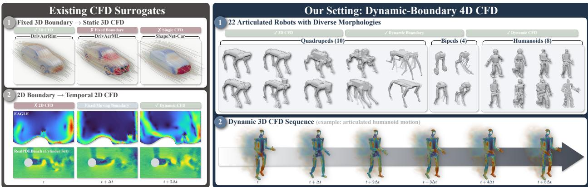  
Figure 1 | Existing CFD Settings versus Dynamic-Boundary 4D CFD. Existing CFD surrogates typically model either static three-dimensional geometries or temporally evolving two-dimensional flows. In contrast, RoboCFD-4D requires joint modeling of articulated three-dimensional boundary motion and the resulting time-evolving flow field across diverse robot morphologies.

Learning such dynamics introduces three challenges beyond conventional static-boundary CFD prediction. First, the model must represent both boundary evolution and causal flow context rather than treating each geometry independently. Second, extending neural operators to temporally resolved three-dimensional CFD substantially increases computational cost, since repeated pointspace processing compounds across spatial resolution, temporal context, and network depth. Third, autoregressive rollout recursively feeds predicted states back into the model, creating a mismatch with ground-truth-conditioned training and causing prediction errors to accumulate over time (List et al., 2025; Brandstetter et al., 2022; Kochkov et al., 2021). Dynamic-boundary CFD therefore requires a model that captures causal boundary-flow evolution, performs spatio-temporal reasoning eficiently, and remains robust under closed-loop rollout.

Table 1 | Comparison of representative CFD learning datasets across spatial dimensionality, temporal resolution, and boundary dynamics. “Dim.” denotes spatial and temporal dimensionality, where 3D+t indicates temporally resolved three-dimensional CFD.
<table><tr><td>Dataset</td><td>Domain</td><td>Dim.</td><td>Boundary Dynamics</td><td>Sequences</td><td>CFD States</td></tr><tr><td>AirfRANS (Bonnet et al., 2022)</td><td>Airfoil aerodynamics</td><td>2D</td><td>Static solid</td><td>N/A</td><td>1,000</td></tr><tr><td>CFDBench (Luo et al., 2023)</td><td>General fluid dynamics</td><td>2D+t</td><td>Static solid</td><td>739</td><td>301,671</td></tr><tr><td>MegaFlow2D (Xu et al., 2023)</td><td>External / internal flow</td><td>2D+t</td><td>Static solid</td><td>~3,000</td><td>&gt;2M</td></tr><tr><td>RealPDEBench (Hu et al., 2026a)</td><td>real scenarios</td><td>2D+t</td><td>Static/Moving solid</td><td>736</td><td>~2.6M</td></tr><tr><td>Eagle (Janny et al., 2023)</td><td>Drone</td><td>2D+t</td><td>Moving Source, Static solid</td><td>1184</td><td>~1M</td></tr><tr><td>FlowBench (Tali et al., 2025)</td><td>Complex-geometry flow</td><td>2D+t</td><td>Static solid</td><td>1,150</td><td>278,300</td></tr><tr><td>ShapeNet-Car (Umetani and Bickel, 2018)</td><td>Automotive aerodynamics</td><td>3D</td><td>Static solid</td><td>N/A</td><td>889</td></tr><tr><td>NASA CRM (Bekemeyer et al., 2025)</td><td>Aircraft aerodynamics</td><td>3D</td><td>Static solid</td><td>N/A</td><td>121</td></tr><tr><td>AhmedML (Ashton et al., 2024a)</td><td>Bluff-body aerodynamics</td><td>3D</td><td>Static solid</td><td>N/A</td><td>500</td></tr><tr><td>DrivAerML (Ashton et al., 2024b)</td><td>Automotive aerodynamics</td><td>3D</td><td>Static solid</td><td>N/A</td><td>500</td></tr><tr><td>DrivAerRim (Xia et al., 2026)</td><td>Automotive aerodynamics</td><td>3D</td><td>Static solid</td><td>N/A</td><td>904</td></tr><tr><td>DrivAerNet (Elrefaie et al., 2025)</td><td>Automotive aerodynamics</td><td>3D</td><td>Static solid</td><td>N/A</td><td>4,000</td></tr><tr><td>DrivAerNet+ + (Elrefaie et al., 2024)</td><td>Automotive aerodynamics</td><td>3D</td><td>Static solid</td><td>N/A</td><td>~8,000</td></tr><tr><td>RoboCFD-4D (Ours)</td><td>Robot aerodynamics</td><td>3D+t</td><td>Articulated moving solid</td><td>352</td><td>10560</td></tr></table>

To enable systematic study of this problem, we construct RoboCFD-4D, a temporally resolved three-dimensional CFD benchmark based on articulated robotic motion. As summarized in Table 1, existing CFD learning datasets predominantly consider static three-dimensional geometries (Elrefaie et al., 2025, 2024; Bonnet et al., 2022; Alkin et al., 2025) or temporally evolving two-dimensional flows (Janny et al., 2023; Hu et al., 2026a), whereas RoboCFD-4D contains 352 sequences and 10,560 CFD frames with articulated moving three-dimensional boundaries. Building on this benchmark, we propose DynaSolver based on a simple principle: dynamic-boundary CFD should be modeled as causal evolution between physical flow states under prescribed boundary motion, rather than as independent geometry-to-flow predictions. DynaSolver therefore combines explicit boundary evolution and causal flow history with an eficient physical-token temporal operator, enabling compact spatio-temporal reasoning without repeatedly returning to the full point representation. We further introduce Replay-Augmented Parallel Training, which augments clean training histories with autoregressively generated states while retaining parallel dense supervision, improving rollout robustness without the cost of sequential student optimization.

Our main contributions are summarized as follows:

• We formulate dynamic-boundary 4D CFD prediction for temporally evolving three-dimensional flow fields and introduce RoboCFD-4D, containing 352 sequences and 10,560 time-resolved CFD frames with articulated moving boundaries.

• We propose DynaSolver, a neural operator that jointly models explicit boundary evolution and causal flow dynamics. Its physical-token temporal operator eliminates layer-wise point–token alternation, performing repeated spatio-temporal reasoning in compact token space with only a single slice/deslice pair.

• We introduce Replay-Augmented Parallel Training, which combines autoregressively generated histories with parallel dense supervision, exposing the model to rollout states without the sequential student optimization required by dense autoregressive training.

## 2 Related Work

CFD datasets with evolving dynamics. Existing benchmarks such as PDEBench and The Well (Takamoto et al., 2022; Ohana et al., 2024) cover diverse spatiotemporal physical systems. For CFD, AirfRANS provides steady 2D airfoil flows, while DrivAerNet and DrivAerNet++ ofer static 3D vehicle aerodynamics (Bonnet et al., 2022; Elrefaie et al., 2025, 2024). FlowBench further covers steady and transient flows over complex 2D/3D geometries (Tali et al., 2025). Moving-boundary settings remain more limited: (Paolino et al., 2025) study articulated humanoid aerodynamics under a quasi-steady assumption, while EAGLE and RealPDEBench consider time-resolved 2D flows with moving sources or solids (Janny et al., 2023; Hu et al., 2026a), and pitching-airfoil simulations involve prescribed motion of simpler geometries (Baldan and Guardone, 2024). In contrast, RoboCFD-4D provides transient 3D CFD trajectories around complex articulated bodies with continuously evolving boundaries.

Learning-based CFD surrogates. Neural operators provide an eficient framework for learning mappings between physical fields. DeepONet (Lu et al., 2021) uses branch trunk factorization, while Fourier-based approaches such as FNO (Li et al., 2021) and its variants model global interactions through spectral representations (Lu et al., 2021; Li et al., 2021; Rahman et al., 2023; Wen et al., 2022; Hu et al., 2025; Tran et al., 2023; Wu et al., 2023). Geometry-aware operators, including GNO, Geo-FNO, and GINO, extend operator learning to irregular domains (Li et al., 2020, 2023a,b), while attention-based methods such as GNOT and Transolver provide direct global interactions on irregular discretizations (Hao et al., 2023; Wu et al., 2024). Mesh-based simulators such as GNS,

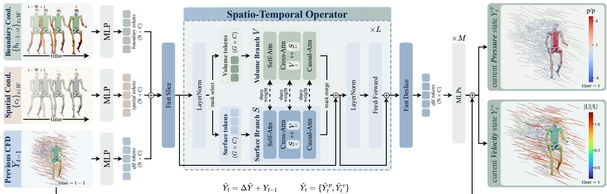  
Figure 2 | Overview of DynaSolver. Given the spatial condition, boundary evolution, and previous CFD states over a causal window, DynaSolver lifts and fuses the point-wise inputs before mapping them into separate surface and volume physical tokens. A single Fast Slice/Deslice pair encloses the spatio-temporal operator stack, where self-attention, cross-attention, and causal attention jointly model spatial and temporal flow interactions. The reconstructed point features are decoded into a residual flow field and added to the previous CFD state to predict the current velocity and pressure.

MeshGraphNet, and BSMS-GNN instead propagate local interactions through graph message passing (Sanchez-Gonzalez et al., 2020; Pfaf et al., 2021; Cao et al., 2023). Physics-informed approaches further incorporate physical constraints and governing equations into learning objectives (Cuomo et al., 2022; Li et al., 2024; Zhang et al., 2024b). Building on these advances, DynaSolver focuses on eficient spatio-temporal operator learning under continuously evolving articulated boundaries.

Autoregressive training for neural simulation. Autoregressive neural simulators are prone to error accumulation because model predictions are recursively reused as future inputs. Noise injection approximates this rollout corruption by perturbing ground-truth states during training (Sanchez-Gonzalez et al., 2020), while unrolled training exposes the model directly to its own predictions at the cost of sequential rollout and increased optimization expense. The pushforward strategy reduces gradient cost by detaching intermediate predictions while retaining autoregressive state generation (Brandstetter et al., 2022). Subsequent work and systematic benchmarks further examine autoregressive training strategies, rollout stability, and long-horizon prediction errors (List et al., 2025; Koehler et al., 2024). Our Replay-Augmented Parallel Training instead decouples autoregressive history generation from student optimization, combining model-generated replay states with parallel dense supervision.

## 3 Method

We study dynamic-boundary 4D CFD prediction for articulated robots under prescribed motion, predicting the evolution of the surrounding flow from the current state and known boundary motion. After formalizing the problem in Sec. 3.1 and introducing the pipeline in Sec. 3.2, we present the token-space temporal operator in Sec. 3.3 and Replay-Augmented Parallel Training in Sec. 3.4.

## 3.1 Problem Setup

We consider one-way coupled transient incompressible flow around an articulated robot undergoing prescribed motion, where the moving robot boundary drives the surrounding fluid dynamics while the robot motion itself is not afected by the predicted flow. The surrogate operates on a fixed Eulerian model grid ${ \boldsymbol { X } } = \{ \mathbf { x } _ { i } \} _ { i = 1 } ^ { N }$ . A set of tracked material points follows the robot surface and is projected onto X to define time-dependent surface-associated masks and geometric and kinematic features. Grid nodes occupied by the moving robot are excluded through a time-dependent validity mask $M _ { t } ^ { \mathrm { v } }$ . The CFD state is represented on the fixed grid as $Y _ { t } = [ u , \nu , w , p ] _ { t } \in \mathbb { R } ^ { N \times 4 }$ , where $( u , \upsilon , w )$ and $p$ denote velocity and kinematic pressure, respectively.

Under a prescribed moving boundary, advancing the flow from � − 1 to � requires not only the previous CFD state but also the time-dependent boundary configuration and kinematics (Peskin, 2002; Sotiropoulos and Yang, 2014). We therefore condition the prediction on a spatial condition $c _ { t } \in \mathbb { R } ^ { N \times 1 1 }$ describing the configuration at time $t ,$ and a boundary-evolution feature $b _ { t - 1  t } \in \mathbb { R } ^ { N \times 8 }$ describing the boundary motion over the transition, yielding the one-step mapping $( c _ { t } , b _ { t - 1  t } , Y _ { t - 1 } ) \mapsto Y _ { t }$

Although the complete CFD state under prescribed boundary evolution admits a local Markov transition, projection onto a finite or partially observed representation can introduce memory efects (Parish and Duraisamy, 2017; Ayed et al., 2019). Our surrogate operates precisely in such a setting, with time-varying boundary features and validity masks defined on a fixed Eulerian representation, and a single observed state is therefore not guaranteed to be Markov-suficient. We consequently augment the transition with a short causal history. Defining the transition-aligned input $q _ { i } = ( c _ { i } , b _ { i - 1  i } , Y _ { i - 1 } )$ we collect at most � consecutive transitions as

$$
Q _ { t } = \left\{ q _ { i } \right\} _ { i = \operatorname* { m a x } ( 1 , t - W + 1 ) } ^ { t } .\tag{1}
$$

We then learn a temporal operator $\mathcal { F } _ { \theta }$ over this causal context and predict the flow evolution in residual form,

$$
\widehat { Y } _ { t } = Y _ { t - 1 } + \mathcal { F } _ { \theta } ( Q _ { t } ) .\tag{2}
$$

Starting from the given initial state $Y _ { 0 } ,$ , the causal context grows until � transitions are available and then proceeds with a fixed-length sliding window.

## 3.2 Method Overview

Dynamic 4D CFD introduces two challenges beyond spatial flow prediction. First, temporal reasoning over multiple flow states substantially amplifies the cost of point-space computation. Second, eficient parallel training relies on ground-truth histories, whereas autoregressive inference recursively conditions on model predictions, creating a train–inference distribution gap. DynaSolver addresses these challenges with an eficient token-space temporal operator and Replay-Augmented Parallel Training, respectively.

Given the causal transition window $\boldsymbol { Q } _ { t }$ , the three input modalities of each transition are first lifted into a shared latent space,

$$
H _ { i } = \phi _ { c } ( c _ { i } ) + \phi _ { b } ( b _ { i - 1  i } ) + \phi _ { y } ( Y _ { i - 1 } ) ,\tag{3}
$$

where $\phi _ { c } , \phi _ { b }$ , and $\phi _ { y }$ are two-layer MLPs. As illustrated in Fig. 2, DynaSolver slices the fused point features once into separate surface and volume physical tokens, processes them with a stack of spatiotemporal operator blocks, and deslices them only before final point reconstruction. A lightweight

MLP decodes the reconstructed point features into the residual field $\Delta Y _ { t }$ , which is added to $Y _ { t - 1 }$ to obtain $\widehat { Y } _ { t }$ . During training, a frozen replay model generates autoregressive histories, while the current model retains parallel, densely supervised optimization through Replay-Augmented Parallel Training.

## 3.3 Eficient Token-Space Temporal Operator

The original Transolver (Wu et al., 2024) alternates between point and physical-token representations within each operator layer. Since the slicing weights are recomputed from the updated point features, the physical-token representation can evolve as the features are progressively refined. Carrying this layer-wise point–token alternation into temporal CFD, however, becomes costly because each transition contains thousands of surface and volume queries. We therefore amortize the physical tokenization across the operator stack: point-wise features are sliced once into a compact physicaltoken representation, all spatio-temporal reasoning is performed in this space, and the resulting features are desliced only at the output, as illustrated in Fig. 2.

Token-space operator. We use the fast slicing operation of Transolver3 (Zhou et al., 2026) to compress the lifted point features into separate surface and volume physical-token streams,

$$
Z _ { i } ^ { s } , Z _ { i } ^ { \mathrm { v } } = \mathbf { F a s t S l i c e } ( H _ { i } ) , \qquad Z _ { i } ^ { s } , Z _ { i } ^ { \mathrm { v } } \in \mathbb { R } ^ { G \times D } .\tag{4}
$$

The resulting tokens are processed by � spatio-temporal operator blocks. Each block applies intradomain self-attention, bidirectional cross-attention between the surface and volume branches, causal temporal attention, and a token-space feed-forward network. Causal temporal attention (Vaswani et al., 2017) uses a block-causal mask over transitions, allowing each transition to aggregate information only from the current and preceding transitions.

Lightweight point reconstruction. After the final operator block, the surface and volume streams are mapped back to their corresponding query points through a single fast deslicing operation,

$$
\widetilde { H } _ { i } = \mathrm { F a s t D e s l i c e } \left( Z _ { i } ^ { s } , Z _ { i } ^ { \mathrm { v } } \right) .\tag{5}
$$

Because this restructuring removes the repeated point-wise refinement of the original backbone, a linear prediction head is insuficient to recover the point-level flow field. We therefore use a lightweight MLP decoder $\phi _ { \mathrm { d e c } } ,$

$$
\Delta Y _ { i } = \phi _ { \mathrm { d e c } } ( \widetilde { H } _ { i } ) ,\tag{6}
$$

and add the residual to the previous flow state following Eq. 2. The lightweight decoder compensates for the reduced point-level expressiveness introduced by the token-space restructuring, allowing the computational benefits of compact token processing to be realized without sacrificing prediction accuracy. As shown in Sec. 4.3, it recovers the performance degradation of the token-only variant with only modest additional overhead.

## 3.4 Replay-Augmented Parallel Training

Autoregressive flow prediction requires balancing rollout robustness with training eficiency. As illustrated in Fig. 3, Dense Unrolled Training (List et al., 2025) exposes the model to its own predictions by sequentially unrolling the trajectory, but repeatedly evaluates highly overlapping temporal contexts and incurs substantial training cost. Dense Pushforward Training (Brandstetter et al., 2022) reduces the backward cost by detaching preceding rollout steps, yet still requires sequential rollout construction. In contrast, Parallel Training (Vaswani et al., 2017) exploits block-causal attention to predict and supervise all transitions in a clip with a single forward pass, but conditions only on ground-truth histories and therefore sufers from a train–inference distribution gap. To combine autoregressive exposure with eficient parallel optimization, we introduce Replay-Augmented Parallel Training: a frozen model first performs inference rollout to generate replay inputs (Fig. 3d.1), after which the current model is optimized in parallel using the replay-augmented clips (Fig. 3d.2).

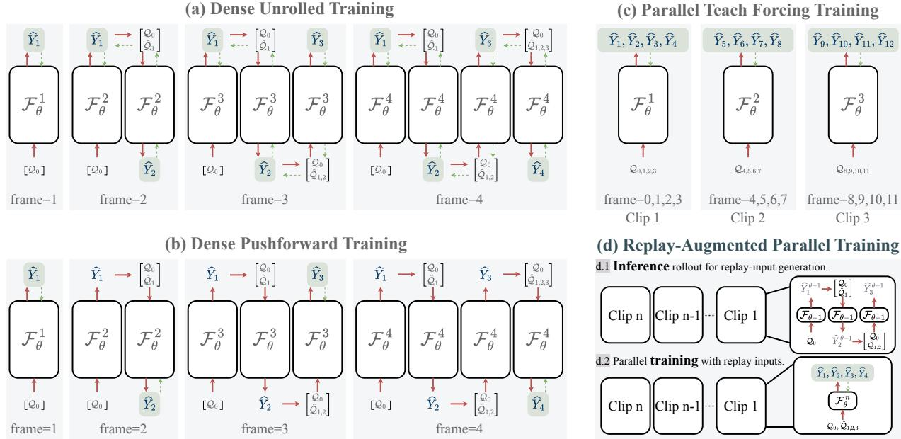  
Figure 3 | Comparison of training strategies for autoregressive flow prediction. Dense Unrolled Training (a) and Dense Pushforward Training (b) construct autoregressive histories sequentially, whereas Parallel Teacher-Forcing Training (c) predicts all transitions in a clip simultaneously from ground-truth histories. Our Replay-Augmented Parallel Training (d) decouples autoregressive history generation from student optimization: a frozen model first rolls out replay inputs (d.1), which are then used for parallel dense supervision of the current model (d.2). Red solid arrows → denote feedforward computation, while green dashed arrows d denote backpropagation.

Replay generation. We partition each trajectory into non-overlapping transition clips of length �. At epoch � > 1, the previous-epoch model is frozen as the replay model, $\bar { \theta } ^ { ( e ) } = \theta ^ { ( e - 1 ) }$ . For a fraction $\rho$ of the clips, the frozen model starts from the ground-truth initial state and rolls out autoregressively using the same causal-window mechanism as inference:

$$
\widetilde { Y } _ { i } = w i d e t i l d e { Y } _ { i - 1 } + \mathcal { F } _ { \bar { \theta } ^ { ( e ) } } \left( \widetilde { Q } _ { i } \right) ,\tag{7}
$$

where $\widetilde { Q } _ { i }$ follows the same growing-prefix and sliding-window construction as $Q _ { i }$ , with ground-truth flow histories replaced by recursively generated replay states. Replay generation is detached from gradient computation, and the replay model remains fixed within each epoch.

Parallel training and objective. Unlike dense autoregressive training, the generated rollout is used only to construct input histories. As highlighted in Fig. 3, replay clips and the remaining clean ground-truth clips are then processed identically by the current model: all transition positions are

Table 2 | Quantitative comparison across rollout horizons on RoboCFD-4D Base. We report the relative $L _ { 2 }$ errors (%) of velocity and pressure at selected rollout steps, together with their full-rollout averages and the overall error. The best results among learned methods are highlighted in bold , while the second-best are underlined . Persistence is excluded from ranking.
<table><tr><td rowspan="2">Method</td><td colspan="5">Per-frame Velocity ↓</td><td rowspan="2">1</td><td colspan="5">Per-frame Pressure ↓</td><td rowspan="2"></td><td rowspan="2">Avg. Vel. ↓ Avg. Pre. ↓ Overall ↓</td><td rowspan="2"></td></tr><tr><td>1</td><td>6</td><td>12</td><td>18</td><td>24</td><td>29</td><td>6</td><td>12</td><td>18</td><td>24</td></tr><tr><td>GNOT (Hao et al., 2023)</td><td>11.38</td><td>21.14</td><td>28.47</td><td>34.58</td><td>40.01</td><td>43.99</td><td>34.08 72.89</td><td>93.49</td><td>98.66</td><td>102.21</td><td>99.18</td><td>30.56</td><td>87.84</td><td>31.55</td></tr><tr><td>GAOT (Wen et al., 2025)</td><td>14.46</td><td>19.54</td><td>23.58</td><td>26.93</td><td>29.66</td><td>31.19</td><td>40.96 57.70</td><td>66.52</td><td>75.18</td><td>84.08</td><td>90.67</td><td>24.60</td><td>70.25</td><td>25.32</td></tr><tr><td>CNO (Raonic et al., 2023)</td><td>9.32</td><td>19.36</td><td>24.27</td><td>28.49</td><td>35.25</td><td>47.04</td><td>34.24 77.09</td><td>87.29</td><td>98.14</td><td>108.89</td><td>120.71</td><td>27.12</td><td>91.52</td><td>28.28</td></tr><tr><td>P3D (Holzschuh et al., 2026)</td><td>9.32</td><td>17.07</td><td>22.62</td><td>26.70</td><td>30.44</td><td>32.36</td><td>32.55 62.66</td><td>76.03</td><td>85.25</td><td>96.86</td><td>102.08</td><td>23.72</td><td>78.82</td><td>24.61</td></tr><tr><td>MGN (Pfaff et al., 2021)</td><td>9.49</td><td>19.70</td><td>23.69</td><td>25.88</td><td>27.66</td><td>28.55</td><td>29.32 65.02</td><td>79.25</td><td>86.55</td><td>96.78</td><td>99.86</td><td>23.48</td><td>79.44</td><td>24.51</td></tr><tr><td>DPOT (Hao et al., 2024)</td><td>13.66</td><td>22.65</td><td>26.70</td><td>32.77</td><td>39.39</td><td>44.98</td><td>42.45 78.12</td><td>103.77</td><td>133.25</td><td>166.67</td><td>187.97</td><td>30.30</td><td>121.10</td><td>32.08</td></tr><tr><td>AB-UPT (Alkin et al., 2025)</td><td>14.75</td><td>19.60</td><td>23.36</td><td>25.68</td><td>27.92</td><td>29.38</td><td>42.29 77.47</td><td>91.30</td><td>96.30</td><td>97.54</td><td>96.23</td><td>23.83</td><td>86.84</td><td>25.03</td></tr><tr><td>UNO (Rahman et al., 2023)</td><td>11.71</td><td>18.17</td><td>22.82</td><td>26.91</td><td>34.53</td><td>62.31</td><td>34.13 58.36</td><td>71.43</td><td>81.76</td><td>104.69</td><td>156.99</td><td>27.32</td><td>81.55</td><td>28.40</td></tr><tr><td>U-Net (Ronneberger et al., 2015)</td><td>7.48</td><td>16.73</td><td>20.99</td><td>23.30</td><td>25.05</td><td>26.08</td><td>27.90 61.64</td><td>78.41</td><td>85.41</td><td>96.04</td><td>95.75</td><td>20.81</td><td>77.99</td><td>21.86</td></tr><tr><td>MSPT (Curvo et al., 2026)</td><td>9.28</td><td>19.15</td><td>23.18</td><td>25.89</td><td>28.14</td><td>29.94</td><td>27.70 61.18</td><td>73.90</td><td>86.65</td><td>101.71</td><td>110.88</td><td>23.42</td><td>79.14</td><td>24.39</td></tr><tr><td>Transformergalerkin (Cao, 2021)</td><td>11.89</td><td>19.49</td><td>23.07</td><td>28.43</td><td>35.67</td><td>42.74</td><td>38.61 69.13</td><td>96.66</td><td>115.08</td><td>136.97</td><td>168.67</td><td>26.86</td><td>104.64</td><td>28.11</td></tr><tr><td>DilResNet (Stachenfeld et al., 2022)</td><td>8.55</td><td>17.99</td><td>22.08</td><td>23.90</td><td>25.04</td><td>25.30</td><td>29.00 61.87</td><td>78.00</td><td>83.80</td><td>86.84</td><td>84.99</td><td>21.44</td><td>74.56</td><td>22.30</td></tr><tr><td>PhysGTO (Liu et al., 2026)</td><td>9.41</td><td>18.51</td><td>21.85</td><td>23.68</td><td>25.69</td><td>26.97</td><td>30.52 60.97</td><td>70.12</td><td>78.40</td><td>89.10</td><td>92.79</td><td>21.81</td><td>72.96</td><td>22.99</td></tr><tr><td>GNS (Sanchez-Gonzalez et al., 2020)</td><td>9.67</td><td>19.74</td><td>24.31</td><td>27.72</td><td>30.70</td><td>32.74</td><td>29.69 61.92</td><td>78.24</td><td>89.28</td><td>99.89</td><td>106.83</td><td>24.97</td><td>80.91</td><td>26.09</td></tr><tr><td>DeepONet (Lu et al., 2021)</td><td>16.68</td><td>21.74</td><td>26.20</td><td>28.05</td><td>28.29</td><td>28.67</td><td>60.07 73.64</td><td>86.37</td><td>91.34</td><td>92.49</td><td>90.63</td><td>25.51</td><td>84.65</td><td>26.38</td></tr><tr><td>GraphViT (Janny et al., 2023)</td><td>8.33</td><td>17.05</td><td>20.41</td><td>22.18</td><td>23.61</td><td>24.44 28.28</td><td>57.98</td><td>69.36</td><td>71.16</td><td>75.61</td><td>76.20</td><td>20.15</td><td>66.05</td><td>21.00</td></tr><tr><td>BSMS (Cao et al., 2023)</td><td>8.44</td><td>17.30</td><td>21.20</td><td>24.12</td><td>26.66 28.85</td><td>27.01</td><td>54.20</td><td>61.57</td><td>68.21</td><td>77.84</td><td>81.24</td><td>21.78</td><td>63.92</td><td>22.51</td></tr><tr><td>FNO (Li et al., 2021)</td><td>10.70</td><td>18.04</td><td>22.07</td><td>26.54</td><td>33.95 42.81</td><td>31.13</td><td>52.02</td><td>60.85</td><td>66.83</td><td>71.30</td><td>76.06</td><td>25.49</td><td>61.69</td><td>26.08</td></tr><tr><td>LinearNO (Hu et al., 2026b)</td><td>10.26</td><td>16.81</td><td>19.74</td><td>21.66</td><td>22.92</td><td>23.84 29.14</td><td>52.05</td><td>60.81</td><td>65.82</td><td>72.07</td><td>72.55</td><td>19.82</td><td>61.00</td><td>20.58</td></tr><tr><td>MWT (Gupta et al., 2021)</td><td>9.55</td><td>16.50</td><td>18.67</td><td>20.26</td><td>22.03 23.35</td><td>32.05</td><td>57.19</td><td>70.58</td><td>83.28</td><td>97.58</td><td>106.52</td><td>18.97</td><td>76.64</td><td>20.11</td></tr><tr><td>Transolver (Wu et al., 2024)</td><td>10.19</td><td>16.24</td><td>19.10</td><td>20.73</td><td>22.38</td><td>23.45 29.77</td><td>54.27</td><td>61.51</td><td>66.99</td><td>74.53</td><td>75.64</td><td>19.23</td><td>62.76</td><td>19.99</td></tr><tr><td>Persistence</td><td>14.14</td><td>20.78</td><td>19.80</td><td>20.42</td><td>20.92</td><td>21.35</td><td>40.17 60.19</td><td>54.16</td><td>54.63</td><td>58.75</td><td>58.21</td><td>20.14</td><td>56.09</td><td>20.95</td></tr><tr><td>DynaSolver (Ours)</td><td>11.61</td><td>16.27</td><td>17.37</td><td>17.86</td><td>18.06</td><td>18.36</td><td>34.02 53.19</td><td>57.48</td><td>59.17</td><td>60.37</td><td>61.61</td><td>17.07</td><td>56.35</td><td>17.71</td></tr></table>

predicted and supervised simultaneously in a single block-causal forward pass, while the targets remain ground-truth CFD states. For the supervised transition set $\mathcal { T }$ , we optimize

$$
\mathcal { L } = \frac { 1 } { \left| \mathcal { T } \right| } \sum _ { i \in \mathcal { T } } \frac { \sum _ { n = 1 } ^ { N } m _ { i , n } \left\| \widehat { Y } _ { i , n } - Y _ { i , n } \right\| _ { 2 } ^ { 2 } } { \sum _ { n = 1 } ^ { N } m _ { i , n } } ,\tag{8}
$$

where $m _ { i , n }$ denotes the validity mask. Mixing replay and clean histories exposes the model to realistic model-induced errors while retaining a clean-state anchor, and the frozen previous-epoch model keeps the replay distribution fixed within each epoch.

## 4 Experiments

We evaluate DynaSolver on RoboCFD-4D in terms of prediction accuracy, rollout stability, and eficiency, followed by controlled ablations on the model design and training strategy. Detailed training configurations and evaluation protocols are provided in the appendix (Sec. A)

## 4.1 RoboCFD-4D Dataset

We introduce RoboCFD-4D, a dynamic-boundary 4D CFD benchmark for articulated robotic motion. Each trajectory contains 30 temporally ordered CFD states $( T _ { \mathrm { r o l l } } = 2 9 )$ , each represented on an $1 8 \times 1 8 \times 3 6$ model grid $( N = 1 1 , 6 6 4 )$ with aligned volumetric and surface-associated features, and spans freestream velocities in {2, 3, 4, 6, 7, 8} $\mathrm { m } / s$ under multiple yaw angles. RoboCFD-4D Base, used for the main experiments, contains 216 training trajectories from 18 robot morphologies and 136 development/evaluation trajectories covering unseen wind conditions and four unseen morphologies. RoboCFD-4D Mini is a strict subset used for controlled ablations, with 96 training trajectories from eight morphologies and 48 development/evaluation trajectories including one unseen morphology. Details of the simulation and dataset construction pipeline are provided in the appendix (Sec. B).

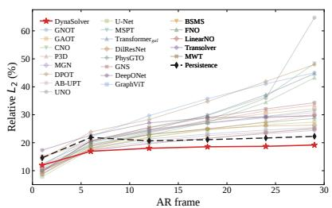  
(a) Overall rollout error.

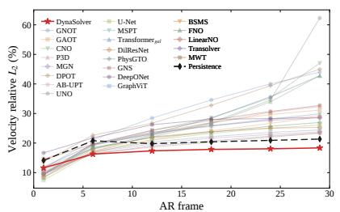  
(b) Velocity rollout error.

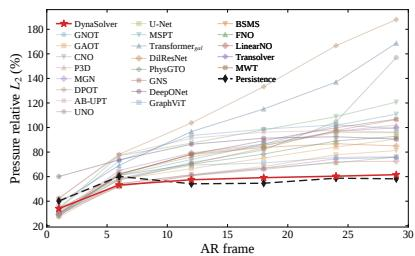  
(c) Pressure rollout error.  
Figure 4 | Rollout error evolution on RoboCFD-4D Base. Relative $L _ { 2 }$ errors are reported across the full autoregressive rollout for the overall flow field, velocity, and pressure.

## 4.2 Main Results

We compare DynaSolver with representative learning-based CFD surrogates on RoboCFD-4D Base. A non-learned persistence baseline is also included, which keeps the initial flow state unchanged throughout rollout, i.e., $\widehat { Y } _ { t } \ = Y _ { 0 }$ , providing a no-evolution reference against which the value of modeling dynamic boundary and flow evolution can be assessed.

As shown in Table 2, although DynaSolver does not attain the lowest one-step error, its advantage becomes more pronounced during autoregressive rollout. From step 12 onward, it consistently achieves the lowest velocity and pressure errors among the evaluated learned methods. At the final step $t = 2 9$ , DynaSolver reaches 18.36% velocity error and 61.61% pressure error, compared with the best competing learned-method results of 23.35% and 72.55%, respectively, corresponding to relative reductions of 21.4% and 15.1%. The rollout curves in Fig. 4 and qualitative comparisons in Fig. 5 further illustrate this advantage, particularly for velocity prediction at later rollout steps.

The advantage is also reflected in the full-rollout averages. DynaSolver achieves 17.07% velocity error, 56.35% pressure error, and 17.71% overall error, yielding an 11.4% relative

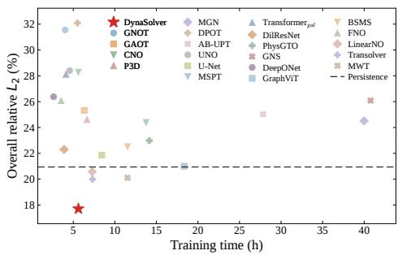  
Figure 6 | Training cost versus overall rollout error. Overall rollout relative $L _ { 2 }$ error is plotted against training time; DynaSolver achieves the lowest rollout error while maintaining low training cost.

reduction over the best competing learned method (19.99%). Compared with the non-learned Persistence baseline, DynaSolver achieves lower average velocity error (17.07% vs. 20.14%) and overall error (17.71% vs. 20.95%), while Persistence yields a slightly lower average pressure error (56.09% vs. 56.35%). This highlights that the improvements are not uniform across physical variables, despite DynaSolver’s stronger long-horizon pressure prediction relative to the evaluated learned methods. Importantly, DynaSolver maintains low training cost, achieving the lowest overall rollout error while remaining among the most training-eficient learned methods (Fig. 6). Together, these results demonstrate improved autoregressive rollout accuracy with eficient training.

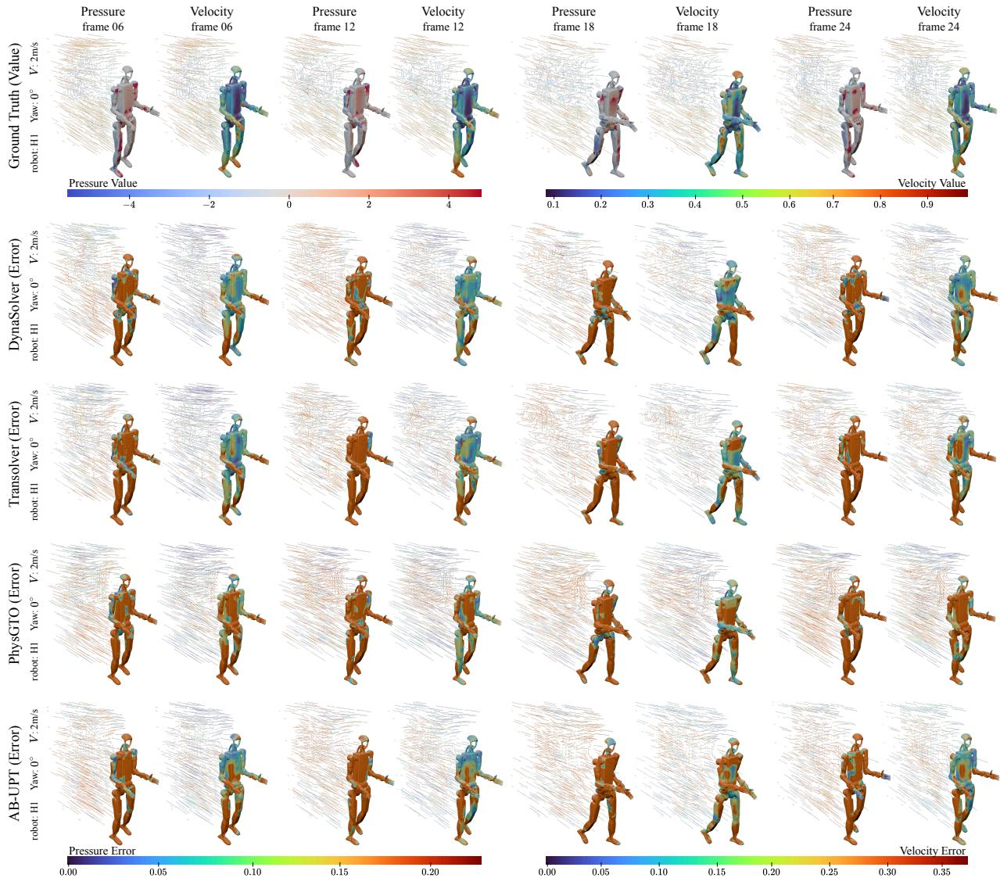  
Figure 5 | Qualitative comparison across autoregressive rollout. Ground-truth fields and corresponding error maps are shown at selected rollout steps for an unseen robot morphology. DynaSolver shows lower long-horizon errors than the baselines, particularly for velocity.

## 4.3 Ablation Studies

Progressive model design. Table 3 progressively builds DynaSolver from the spatial Transolver backbone. Boundary-evolution conditioning first improves sensitivity to moving-boundary dynamics, with the clearest gain in pressure prediction. Introducing causal temporal modeling then yields the largest improvement, reducing the overall rollout error from 20.69% to 17.98%, while the dual surface–volume branch further lowers it to 16.68%. We next move the repeated computation into the compact token space, which sharply reduces the training cost from 11.47 h to 3.09 h but sacrifices accuracy when used alone. The pointwise MLP decoder restores point-level expressiveness, reducing the overall error from 18.98% to 16.14% while preserving the computational eficiency of the token-space operator; the complete DynaSolver achieves the best overall error of 16.14% with only 2.31 h of training.

Table 3 | Progressive design ablation on RoboCFD-4D Mini. We report the full-rollout relative $L _ { 2 }$ errors (%) together with training cost, inference latency, and model size. The blue row is ours.
<table><tr><td>Variants</td><td>Average Velocity  $\cdot _ { L _ { 2 } \downarrow }$ </td><td>Average Pressure  $L _ { 2 } \downarrow$ </td><td>Overall  $L _ { 2 } \downarrow$ </td><td>Train Time (h) ↓</td><td>Inference Time (ms)↓</td><td>Params</td></tr><tr><td>Transolver</td><td>20.12</td><td>71.39</td><td>21.06</td><td>1.52</td><td>8.09</td><td>3.87M</td></tr><tr><td>+ Boundary Evolution</td><td>19.83</td><td>66.45</td><td>20.69</td><td>1.53</td><td>8.14</td><td>3.87M</td></tr><tr><td>+ Causal Temporal Attention</td><td>17.53</td><td>45.91</td><td>17.98</td><td>6.68</td><td>14.79</td><td>5.98M</td></tr><tr><td>+ Surface-Volume Dual Branch</td><td>16.24</td><td>42.97</td><td>16.68</td><td>11.47</td><td>27.34</td><td>8.09M</td></tr><tr><td>+ Amortized Token-Space Operator</td><td>18.39</td><td>53.13</td><td>18.98</td><td>3.09</td><td>9.99</td><td>8.09M</td></tr><tr><td>+ Pointwise MLP Decoder</td><td>15.65</td><td>44.30</td><td>16.14</td><td>2.31</td><td>10.85</td><td>8.62M</td></tr><tr><td>- Boundary Evolution</td><td>15.96</td><td>48.88</td><td>16.54</td><td>2.31</td><td>10.78</td><td>8.62M</td></tr></table>

Table 4 | Training-strategy ablation on RoboCFD-4D Mini. Left: full-rollout relative $L _ { 2 }$ errors (%) and train ing cost under the same DynaSolver architecture, TF represents Teacher Forcing. Right: training convergence over epochs. The blue row is ours.
<table><tr><td>Training Strategy</td><td>Avg. Vel.  $L _ { 2 } \downarrow$   $\mathbf { A v } \mathbf { g } .$  Pre.</td><td> $L _ { 2 } \downarrow$  Overall  $L _ { 2 } \downarrow$ </td><td>Training Time (h) ↓</td></tr><tr><td>Unroll</td><td>16.00 43.83</td><td>16.47</td><td>16.58</td></tr><tr><td>Pushforward</td><td>16.04 44.78</td><td>16.53</td><td>16.48</td></tr><tr><td>Parallel TF</td><td>17.15 65.08</td><td>18.18</td><td>1.79</td></tr><tr><td>Parallel TF + Noise</td><td>16.45 52.87</td><td>17.14</td><td>1.84</td></tr><tr><td>Pure Replay</td><td>16.17 48.21</td><td>16.72</td><td>2.82</td></tr><tr><td>Replay-Augmented Parallel</td><td>15.65 44.30</td><td>16.14</td><td>2.31</td></tr></table>

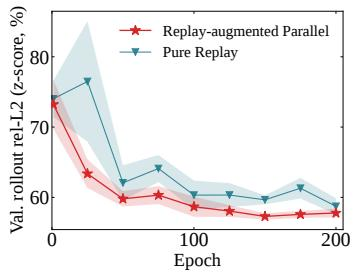

Table 5 | Sensitivity Analysis on RoboCFD-4D Mini. We vary the temporal window length � while fixing the slice count at � = 32 (left), and vary � while fixing $W = 4$ (right). The blue row is ours.
<table><tr><td> $W$   $\mathbf { A v } \mathbf { g } .$ </td><td colspan="3">Vel.  $L _ { 2 } \downarrow$   $\mathbf { A v } \mathbf { g } .$  Pre.  $L _ { 2 } \downarrow$  Overall  $L _ { 2 } \downarrow$ </td><td>Train (h) ↓</td></tr><tr><td>1</td><td>18.27</td><td>66.17</td><td>19.22</td><td>0.98</td></tr><tr><td>2</td><td>16.10</td><td>48.52</td><td>16.67</td><td>1.06</td></tr><tr><td>3</td><td>16.04</td><td>48.11</td><td>16.60</td><td>1.53</td></tr><tr><td>4</td><td>15.65</td><td>44.30</td><td>16.14</td><td>2.31</td></tr><tr><td>5</td><td>15.79</td><td>45.48</td><td>16.29</td><td>3.07</td></tr><tr><td>6</td><td>15.75</td><td>45.89</td><td>16.28</td><td>3.21</td></tr></table>

<table><tr><td>S  $\mathbf { A v g . }$ </td><td colspan="3">Vel.  $L _ { 2 } \downarrow$   $\mathbf { A v g . }$  Pre.  $L _ { 2 } \downarrow$  Overall  $L _ { 2 } \downarrow$  Train (h) ↓</td></tr><tr><td>4</td><td>15.68</td><td>45.93 16.20</td><td>1.29</td></tr><tr><td>8</td><td>15.67</td><td>47.60 16.23</td><td>1.61</td></tr><tr><td>16</td><td>15.81</td><td>42.54 16.24</td><td>1.95</td></tr><tr><td>32</td><td>15.65</td><td>44.30 16.14</td><td>2.31</td></tr><tr><td>64</td><td>16.10</td><td>45.15 16.58</td><td>2.96</td></tr><tr><td>128</td><td>16.05</td><td>44.53 16.53</td><td>3.65</td></tr></table>

Notably, removing boundary-evolution conditioning increases the overall error only to 16.54%, still outperforming Transolver, the strongest learned baseline, under matched input conditions. This demonstrates that DynaSolver’s improvements are not solely attributable to additional boundary information.

Training strategy ablation. Table 4 fixes the complete DynaSolver architecture and isolates the efect of training strategy. Dense autoregressive schemes such as Unroll and Pushforward achieve strong rollout accuracy, but require costly sequential rollout during training. Parallel TF instead exploits block-causal attention to optimize all transitions in a clip simultaneously and is substantially faster, yet its 18.18% overall error reflects the mismatch between ground-truth-conditioned training and autoregressive rollout. Injecting Gaussian noise (Pfaf et al., 2021) partially alleviates this mismatch, reducing the error to 17.14%, while Pure Replay further improves it to 16.72% by exposing the model to autoregressively generated states. Replay-Augmented Parallel Training combines replay histories with clean ground-truth histories while retaining parallel optimization. It achieves comparable, slightly better rollout accuracy than Unroll (16.47%) and Pushforward (16.53%), reaching 16.14% overall error with approximately 7.1× lower training time (2.31 h). The convergence curves further show lower validation rollout error than Pure Replay across most training epochs.

Sensitivity Analysis of Temporal Window and Slice Count. Table 5 examines the efects of temporal window length � and slice count � on rollout accuracy and training cost. Increasing � from 1 to 4 reduces the overall error from 19.22% to 16.14%, highlighting the benefit of incorporating temporal context. Further increasing � yields no additional accuracy gains while increasing training time. For slice count, � = 32 achieves the lowest overall error of 16.14%, while larger values increase training cost and degrade accuracy. We therefore adopt � = 4 and � = 32 as the default configuration.

## 5 Conclusion

We presented DynaSolver for 4D CFD prediction with continuously evolving robot boundaries. DynaSolver models causal spatio-temporal flow evolution under dynamic boundaries through an eficient physical-token temporal operator, while Replay-Augmented Parallel Training exposes the model to autoregressive histories while preserving eficient parallel optimization. Experiments on RoboCFD-4D show that DynaSolver achieves strong prediction accuracy and training eficiency, with its advantage becoming increasingly pronounced as rollout proceeds. These results demonstrate reduced autoregressive error accumulation and support causal spatio-temporal modeling as an efective approach to neural CFD prediction under dynamic geometry.

## Appendix A Experimental Setup

Input representation. For each transition from $t - 1$ to �, DynaSolver receives the spatial condition $c _ { t } \in \mathbb { R } ^ { N \times 1 1 }$ , the boundary-evolution feature $b _ { t - 1  t } \in \mathbb { R } ^ { N \times 8 }$ , and the previous CFD state $Y _ { t - 1 } \in \mathbb { R } ^ { N \times 4 }$ Table 6 summarizes the channel definitions. All features are defined pointwise on the model grid, with surface-associated attributes provided at the corresponding projected grid nodes. The signed-distance convention is $\phi > 0$ in the fluid domain and $\phi < 0$ inside the solid, and surface normals point outward from the robot. All baselines receive the spatial condition $c _ { t }$ and previous CFD state $Y _ { t - 1 }$ . DynaSolver additionally incorporates the proposed boundary-evolution representation $b _ { t - 1  t } ;$ its contribution is isolated in the progressive model ablation in Table 3.

Table 6 | Pointwise input features used by DynaSolver. S and V denote surface-associated and volume grid nodes, respectively.
<table><tr><td>Input</td><td>Feature</td><td></td><td></td><td>Dim. Samples Representation</td></tr><tr><td rowspan="6"> $c _ { t }$ </td><td>normalized position  $\widetilde { \mathbf { x } } _ { t }$ </td><td>3</td><td>S/V</td><td>dimensionless</td></tr><tr><td>signed distance  $\phi _ { t }$ </td><td>1</td><td>S/V</td><td>m</td></tr><tr><td>nearest outward normal  $\mathbf { n } _ { t }$ </td><td>3</td><td>S/V</td><td>unit vector</td></tr><tr><td>inflow direction  $\mathbf { d } _ { \infty }$ </td><td>3</td><td>S/V</td><td>unit vector</td></tr><tr><td>normalized inflow speed  $\widetilde { U } _ { \infty }$ </td><td>1</td><td>S/V</td><td>dimensionless</td></tr><tr><td>previous signed distance  $\phi _ { t - 1 }$ </td><td>1</td><td>S/V</td><td>m</td></tr><tr><td rowspan="4"> $b _ { t - 1  t }$ </td><td>signed-distance change  $\phi _ { t } - \phi _ { t - 1 }$ </td><td>1</td><td>S/V</td><td>m</td></tr><tr><td>wall velocity  $\mathbf { v } _ { t - 1  t } ^ { \mathbf { w } }$ </td><td>3</td><td>S/V</td><td> $\mathbf { m } / s$ </td></tr><tr><td>fluid indicators  $( \chi _ { t - 1 } , \chi _ { t } )$ </td><td>2</td><td>S/V</td><td>binary</td></tr><tr><td>normalized time interval  $\widetilde { \Delta { t } }$ </td><td>1</td><td>S/V</td><td>dimensionless</td></tr></table>

Model and training configuration. Our default DynaSolver uses a latent width of $D = 2 5 6 , L = 8$ operator blocks with eight attention heads, $G = 3 2$ physics tokens per surface/volume branch, and a causal window of $W = 4$ . We sample non-overlapping temporal clips with stride 4 and train all models from scratch for 200 epochs with batch size $^ { 4 , }$ learning rate $1 0 ^ { - 4 }$ , and weight decay $1 0 ^ { - 5 }$ For Replay-Augmented Parallel Training, the replay probability $\rho$ is gradually increased from $0$ to 0.5 over the first 20 epochs and kept fixed thereafter. All reported training and inference times are measured on a single NVIDIA A800 GPU. Base is used for the main comparison, while Mini is used for controlled ablations under the same model and optimization configuration.

Evaluation protocol and metrics. Following the formulation in Sec. 3.1, we evaluate all models under closed-loop autoregressive rollout over the full horizon $T _ { \mathrm { r o l l } }$ , starting from the given initial state $Y _ { 0 }$ and recursively feeding each prediction back into the subsequent causal context.

The CFD state is $Y _ { t } = [ u , \nu , w , p ] _ { t }$ , where $\mathbf { u } = ( u , \nu , w )$ denotes the velocity vector and $p$ denotes gaugereferenced kinematic pressure. For each trajectory, let $U _ { \infty }$ denote the magnitude of the prescribed freestream velocity. We first nondimensionalize the flow variables as

$$
{ \bf u } ^ { * } = \frac { { \bf u } } { U _ { \infty } } , \qquad p ^ { * } = \frac { p } { U _ { \infty } ^ { 2 } } ,\tag{9}
$$

where $( \cdot ) ^ { * }$ denotes the corresponding nondimensional quantity. Each channel is then standardized using its mean and standard deviation computed exclusively from the training split. Denoting this

standardization by $N ( \cdot )$ , the model is trained and autoregressively rolled out in the standardized space,

$$
Z _ { t } = N ( Y _ { t } ^ { * } ) .\tag{10}
$$

For evaluation, predicted states are first transformed back to the nondimensional space as $\widehat { Y } _ { t } ^ { * } =$ $N ^ { - 1 } ( \widehat { Z } _ { t } )$ . For a channel subset S, the masked relative $L _ { 2 }$ error is

$$
E _ { S } ( t ) = \sqrt { \frac { \sum _ { n = 1 } ^ { N } m _ { t , n } \sum _ { c \in S } \left( \widehat { Y } _ { t , n , c } ^ { * } - Y _ { t , n , c } ^ { * } \right) ^ { 2 } } { \sum _ { n = 1 } ^ { N } m _ { t , n } \sum _ { c \in S } \left( Y _ { t , n , c } ^ { * } \right) ^ { 2 } } } .\tag{11}
$$

where $m _ { t , n }$ excludes invalid samples from evaluation, including volume samples occupied by the moving solid according to $M _ { t } ^ { \mathrm { v } }$ . We report velocity over $S _ { \nu } = \{ u , \nu , w \}$ , pressure over $S _ { p } = \{ p \}$ , and the overall field over $S _ { \mathrm { a l l } } = \{ u , \nu , w , p \}$ , with all errors expressed as percentages. Computing the metric in nondimensional space removes dependence on training-set standardization and avoids scale bias across variables.

Horizon-wise results report $E _ { S } ( t )$ at selected rollout steps. The full-rollout score first averages the per-step errors over $T _ { \mathrm { r o l l } }$ within each trajectory and then across trajectories. RoboCFD-4D uses a train/test protocol without a separate validation split. No checkpoint selection is performed on the test set; all models are trained for the fixed 200-epoch schedule described above, and the finalepoch checkpoint is used for evaluation. The same training and evaluation protocol is applied to all compared methods.

## Appendix B RoboCFD-4D

We generate RoboCFD-4D by simulating flow around articulated robots undergoing prescribed motion. For each robot, a fixed 1 s motion sequence is evaluated under 16 prescribed wind conditions, with 200 raw CFD output frames stored for each completed condition. After removing the initial moving-boundary start-up transient, we construct temporally subsampled learning sequences from these outputs. Each retained frame contains both Eulerian flow fields and observations associated with a fixed set of points on the moving robot. Throughout simulation and export, versioned manifests and stable link indices preserve a consistent correspondence among geometry, motion, and flow observations throughout the dataset.

Public assets and link preparation. We obtain robot descriptions and meshes from public repositories, deduplicate overlapping descriptions, and convert URDF and MJCF assets to a common URDF-based articulation representation. This representation records the kinematic tree, joint axes and limits, and the geometry of each link in its local coordinate frame. After resolving mesh dependencies, we validate each link mesh independently. Meshes that fail geometry checks are repaired at the link level, with CGAL Alpha Wrap used where needed. Repairing geometry in the original link frame preserves its attachment to the kinematic tree and its correspondence with the subsequent link-local SDF representation. Before simulation, the resulting CFD inputs are checked for watertightness, winding consistency, and geometric validity.

Kinematic motion synthesis. We use two forms of prescribed kinematic motion. Most articulated joints are handled by a generic morphology-aware synthesis pipeline, whereas robot-specific profiles are used for mechanisms that require dedicated treatment, including continuous wheel rotations. For joints handled by the generic pipeline, motion follows the harmonic template

$$
q _ { j } ( t ) = \bar { q } _ { j } + a _ { j } \sin ( 2 \pi f t + \phi _ { j } ) + b _ { j } \cos ( 2 \pi f t + \phi _ { j } ) ,\tag{12}
$$

where $\bar { q } _ { j }$ denotes the neutral pose, $f$ is the motion frequency, and $a _ { j } , b _ { j } .$ , and $\phi _ { j }$ control the excursion and relative timing of joint $j .$ Generic-motion amplitudes are selected to satisfy joint position and velocity limits, followed by kinematic consistency checks. The root undergoes no net horizontal locomotion, although bounded lateral, vertical, and angular oscillations may be prescribed. The resulting trajectories provide smooth, kinematically valid articulated boundary motion rather than dynamically simulated locomotion.

Each source motion is sampled at 1 ms intervals over [0, 1] s, yielding 1001 source samples. Forward kinematics provides the transform $\mathbf { T } _ { \ell } ( t ) \in \mathrm { S E } ( 3 )$ of each link ℓ. Raw CFD outputs are stored every fifth source interval, at $t = 0 . 0 0 5 , 0 . 0 1 0 , \ldots , 1 . 0 0 0 s _ { \scriptscriptstyle { \cdot \cdot \cdot } }$ , yielding 200 frames per completed condition. Generic motion packages undergo joint-limit, temporal-closure, rotation, forward-kinematics, footclearance, and discrete bounding-box checks where applicable. Dedicated prescribed motion packages are audited separately for temporal and articulation compatibility with the CFD pipeline.

Dynamic geometry reconstruction. To provide the moving geometry to the flow solver, we construct a truncated signed distance field (SDF) $\phi _ { \ell }$ for each repaired link in its local coordinate system. The transformed link-local fields are combined into the composite implicit representation

$$
\phi ( \mathbf x , t ) = \operatorname* { m i n } _ { \ell } \phi _ { \ell } \left( \mathbf T _ { \ell } ^ { - 1 } ( t ) \mathbf x \right) ,\tag{13}
$$

where x is a world-space point, homogeneous coordinates are implicit, and negative values indicate solid interiors. The negative region of the composite field represents the union of the transformed link solids. The pointwise minimum is not required to remain an exact signed-distance function everywhere, particularly near link interfaces.

Small overlaps may occur between tightly fitted neighboring parts due to finite precision and discretization in the source meshes. Under the pointwise minimum, such overlaps are treated as part of a single solid union rather than as separate internal boundaries. They therefore reflect mesh precision at close-fitting interfaces rather than intended interpenetration between distinct robot components.

Each link-local SDF is precomputed once and reused throughout the sequence. At runtime, only the rigid link transforms are updated, and the composite field is evaluated from the transformed link-local fields using Eq. 13. This avoids reconstructing a volumetric geometry representation at every frame while preserving link-level geometry and articulation.

Each link-local SDF is validated using surface reconstruction error, inside–outside sign accuracy, and voxelized-volume agreement. Fields that fail these gates are rebuilt and revalidated before use. At representative poses, we additionally check link transforms and per-link mesh–SDF consistency. Separate domain-fit checks verify that the swept moving geometry remains inside the prescribed computational domain throughout the simulated motion.

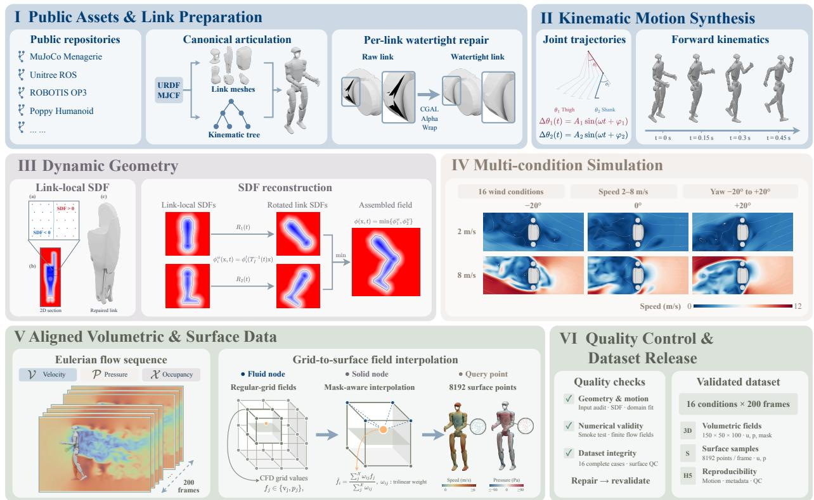  
Figure 7 | Overview of the RoboCFD-4D data generation pipeline. Public robot assets are standardized and repaired at the link level, followed by prescribed motion synthesis and reusable link-local SDF construction. The transformed link-local fields define the prescribed moving immersed boundary for multi-condition CFD simulations. Aligned volumetric fields and tracked near-surface observations are then extracted and subjected to geometric, numerical, and dataset-level validation before inclusion in the final published dataset.

Multi-condition flow simulation. We use WaterLily (Weymouth and Font, 2025) to solve the incompressible Navier–Stokes equations, with the articulated robot geometry defining a prescribed moving immersed boundary throughout the simulation:

$$
\nabla \cdot \mathbf { u } = 0 ,\tag{14}
$$

$$
\frac { \partial { \bf u } } { \partial t } + ( { \bf u } \cdot \nabla ) { \bf u } = - \nabla p + \nu \nabla ^ { 2 } { \bf u } ,\tag{15}
$$

where u is velocity, � is kinematic pressure, and � is kinematic viscosity. The composite articulated field and prescribed link motion determine the moving solid boundary throughout the simulation; no two-way fluid–structure coupling is used.

The 16 prescribed wind conditions are listed in Table 7.

All simulations use a 150×50×100 grid with isotropic physical cell spacing. Grid dimensions are fixed across robots, whereas the physical cell size Δ� is selected separately for each robot to accommodate its swept geometry over the prescribed motion and wind orientations. Thus, simulations share the same grid dimensions but not necessarily the same physical spatial resolution or domain size. Across the dataset, the swept vertical extent spans approximately 38–77 grid cells.

Table 7 | Wind conditions and repository identifiers used in RoboCFD-4D.
<table><tr><td>Speed  $\mathbf { ( m / s ) }$ </td><td>Yaw</td><td>Condition ID</td></tr><tr><td>2</td><td> $- 2 0 ^ { \circ }$ </td><td> ${ \mathsf { u } } 2 _ { - } { \mathsf { y a w } } _ { - } { \mathsf { m } } 2 0$ </td></tr><tr><td>2</td><td> $0 ^ { \circ }$ </td><td> ${ \updownarrow } 2 _ { - } { \ y } a { \ w } _ { - } { \ p } 0$ </td></tr><tr><td>2</td><td> $2 0 ^ { \circ }$ </td><td> ${ \mathsf { u } } 2 _ { - } { \mathsf { y a w } } _ { - } { \mathsf { p } } 2 0$ </td></tr><tr><td>3</td><td> $- 1 0 ^ { \circ }$ </td><td> ${ \mathsf { u } } 3 _ { - } { \mathsf { y a w } } _ { - } { \mathsf { m } } 1 0$ </td></tr><tr><td>3</td><td> $1 0 ^ { \circ }$ </td><td> ${ \mathsf { u } } 3 _ { - } { \mathsf { y a w } } _ { - } { \mathsf { p } } 1 0$ </td></tr><tr><td>4</td><td> $- 2 0 ^ { \circ }$ </td><td> $\mathsf { u 4 \mathrm { _ { - } y a w \mathrm { _ { - } m } 2 0 } }$ </td></tr><tr><td>4</td><td> $0 ^ { \circ }$ </td><td> $\mathsf { U 4 _ { - } y a w _ { - } p } \mathsf { 0 }$ </td></tr><tr><td>4</td><td> $2 0 ^ { \circ }$ </td><td> $\mathsf { u 4 _ { - } y a w \_ p 2 0 }$ </td></tr><tr><td>6</td><td> $- 2 0 ^ { \circ }$ </td><td> ${ \mathsf { u 6 } } _ { - } { \mathsf { y a w } } _ { - } { \mathsf { m } } 2 { \mathsf { 0 } }$ </td></tr><tr><td>6</td><td> $0 ^ { \circ }$ </td><td> ${ \mathsf { u 6 } } _ { - } { \mathsf { y a w } } _ { - } { \mathsf { p } } { \boldsymbol { \theta } }$ </td></tr><tr><td>6</td><td> $2 0 ^ { \circ }$ </td><td> ${ \mathsf { u 6 } } _ { - } { \mathsf { y a w } } _ { - } { \mathsf { p } } 2 { \mathsf { 0 } }$ </td></tr><tr><td>7</td><td> $- 1 0 ^ { \circ }$ </td><td> $\mathsf { u } 7 _ { - } \mathsf { y a w } _ { - } \mathsf { m } 1 0$ </td></tr><tr><td>7</td><td> $1 0 ^ { \circ }$ </td><td> $\mathsf { u } 7 _ { - } \mathsf { y a w } _ { - } \mathsf { p } 1 0$ </td></tr><tr><td>8</td><td> $- 2 0 ^ { \circ }$ </td><td> ${ \mathsf { u } } 8 _ { - } { \mathsf { y a w } } _ { - } { \mathsf { m } } 2 0$ </td></tr><tr><td>8</td><td> $0 ^ { \circ }$ </td><td> ${ \mathsf { u } } 8 _ { - } { \mathsf { y a w } } _ { - } { \mathsf { p } } 0$ </td></tr><tr><td>8</td><td> $2 0 ^ { \circ }$ </td><td> ${ \mathsf { u } } 8 _ { - } { \mathsf { y a w } } _ { - } { \mathsf { p } } 2 0$ </td></tr></table>

Before each full run, a short preliminary simulation checks geometry–solver integration and basic numerical consistency. During the dynamic segment, each wind condition uses a fixed time step selected from the grid spacing and motion-speed estimates. CFL ratios are monitored during execution, and normalized velocity divergence and flux imbalance are evaluated as part of the numerical qualitycontrol procedure described below.

Aligned volumetric and near-surface observations. Each completed simulation produces 200 raw CFD output frames indexed from 0 to 199. Raw frame � corresponds to $t = \left( k + 1 \right) \times 0 . 0 0 5 s ,$ so frame 0 is stored at $t = 0 . 0 0 5 s$ . The earliest outputs immediately follow the transition from the stationary-body flow initialization to the prescribed moving-body simulation and therefore contain a pronounced start-up transient.

To reduce the influence of this transition regime on the learning benchmark, we discard raw frames $_ { 0 - 1 9 }$ and uniformly subsample the remaining 180 frames with a stride of 6. The retained zero-based raw-frame indices are

$$
2 0 , 2 6 , 3 2 , \ldots , 1 9 4 ,
$$

corresponding to

$$
t = 0 . 1 0 5 , 0 . 1 3 5 , 0 . 1 6 5 , \ldots , 0 . 9 7 5 \mathrm { s } .
$$

This yields 30 temporally ordered frames per sequence, or $^ { 2 9 }$ one-step transitions for autoregressive learning. The same temporal indices are applied to all volumetric fields, link transforms, tracked surface points, and near-surface observations, thereby ensuring consistent temporal alignment across all exported data modalities throughout each learning sequence.

For each raw CFD output, we store the cell-centered velocity vector, speed magnitude, gaugenormalized kinematic pressure, and fluid mask on the Eulerian grid. We denote the fluid mask by $\chi ,$ with $\chi = 1$ in the fluid and $\chi = 0$ in the solid. Velocity and pressure values in solid cells are stored as NaN for downstream processing.

Pressure is reported under a fixed gauge convention. At each output frame, we subtract from the full pressure field the mean pressure over a predefined set of valid fluid probes near the outlet side of the wind-aligned simulation grid. This operation fixes only the additive pressure reference; it is not imposed as a physical outlet-pressure boundary condition.

The gauge-probe candidates lie on the last two �-planes of the wind-aligned simulation grid. Along the � and � directions, candidate grid points are selected starting from the first cell with a stride of four cells. For the $1 5 0 \times 5 0 \times 1 0 0$ grid, this yields at most

$$
2 \times 1 3 \times 2 5 = 6 5 0
$$

candidate probes per frame. Only candidates classified as fluid by the current-frame fluid mask are retained. Let $\mathcal { P } _ { t }$ denote this valid probe set. The reported gauge-normalized kinematic pressure is

$$
p _ { g } ( \mathbf { x } , t ) = p ( \mathbf { x } , t ) - \frac { 1 } { | \mathcal { P } _ { t } | } \sum _ { \mathbf { x } _ { j } \in \mathcal { P } _ { t } } p ( \mathbf { x } _ { j } , t ) .\tag{16}
$$

Export fails if $\mathcal { P } _ { t }$ is empty. The residual mean of $p _ { g }$ over $\mathcal { P } _ { t }$ is subsequently required to be no greater than $1 0 ^ { - 4 }$ in the stored kinematic-pressure units. Probe locations are fixed in the wind-aligned simulation-grid frame and therefore do not correspond to identical world-frame locations across diferent yaw conditions. We do not assume that the probe pressure equals ambient pressure or that the far-field pressure is zero. The stored volumetric pressure field $p _ { g }$ has units of $\mathbf { m } ^ { 2 } s ^ { - 2 }$

We additionally construct a deterministic bank of 8192 tracked surface points for each robot. Each link receives a minimum allocation, with the remaining points distributed according to link surface area. The local coordinates and link identities of these points are fixed once and reused across all frames and wind conditions. Surface point � therefore follows its associated link according to

$$
\begin{array} { r } { \mathbf { x } _ { i } ( t ) = \mathbf { T } _ { \ell ( i ) } ( t ) \mathbf { x } _ { i } ^ { \mathrm { { l o c a l } } } , } \end{array}\tag{17}
$$

where $\ell ( i )$ denotes the link associated with point �. Because both $\mathbf { x } _ { i } ^ { \mathrm { { l o c a l } } }$ and $\ell ( i )$ remain fixed, a point index identifies the same material location throughout the motion sequence and across wind conditions. This construction provides deterministic material-point correspondence while retaining a fixed surface-array layout. We also retain transformed surface normals and material-point velocities obtained from rigid-body kinematics under the corresponding link motion.

Flow observations are transferred from the regular grid to the tracked surface points using mask-aware trilinear interpolation. For each tracked surface point with outward normal ${ \bf n } _ { i } ( t )$ , the corresponding external flow field is queried at

$$
\mathbf { x } _ { i } ^ { \mathrm { q u e r y } } ( t ) = \mathbf { x } _ { i } ( t ) + 0 . 5 \Delta x \mathbf { n } _ { i } ( t ) ,\tag{18}
$$

where Δ� is the scalar spacing of the isotropic, cell-centered simulation grid. The half-cell displacement is a fixed, reproducible sampling convention that places the query on the exterior side of the moving surface. It is not an optimized ofset, and we did not perform a dedicated ofset ablation to establish 0.5 Δ� as optimal.

After mapping the query position to the cell-centered simulation grid, a scalar field or velocity component � is interpolated as

$$
\widehat { f } _ { i } ( t ) = \frac { \sum _ { j \in N _ { i } ( t ) } m _ { j } ( t ) w _ { i j } ( t ) f _ { j } ( t ) } { \sum _ { j \in N _ { i } ( t ) } m _ { j } ( t ) w _ { i j } ( t ) } ,\tag{19}
$$

where $N _ { i } ( t )$ contains the eight neighboring cell-centered grid samples, $w _ { i j } ( t )$ are the corresponding trilinear weights, and $m _ { j } ( t ) = 1$ for finite fluid samples and 0 otherwise. Solid or non-finite neighbors are excluded from both sums, and the remaining weights are renormalized. A query is marked invalid and stored as NaN if the denominator in Eq. 19 contains no positive valid-fluid weight. For quality control, we retain both an interpolation-validity mask and the number of valid fluid corners in the local stencil.

These quantities are near-surface external-flow observations rather than exact wall boundary values. Flow velocity is stored separately from material-point velocity, and near-surface flow vectors are expressed in world coordinates. Near-surface pressure is sampled from the gauge-normalized kinematic pressure $p _ { g }$ and is also provided in pascals using

$$
p _ { \mathrm { P a } } = \rho p _ { g } ,\tag{20}
$$

with $\rho = 1 . 2 2 5 \mathrm { k g } \mathrm { m } ^ { - 3 }$

Model-grid construction for learning. The raw Eulerian field contains $1 5 0 \times 5 0 \times 1 0 0 = 7 5 0 , 0 0 0$ cellcentered samples per frame. For model training and evaluation, we do not randomly or importancesample a subset of these cells. Instead, for each CFD condition we construct a deterministic, cellcentered $1 8 \times 1 8 \times 3 6$ grid over the physical bounds of the corresponding simulation domain and resample the Eulerian velocity, pressure, and fluid mask onto this grid using trilinear interpolation. This produces exactly

$$
N = 1 8 \times 1 8 \times 3 6 = 1 1 , 6 6 4
$$

model nodes per frame. The coarse spatial grid is fixed for all retained frames of a given sequence, while its physical coordinates are inherited from the corresponding CFD domain; consequently, diferent robots or wind conditions are not assumed to share identical world-space node coordinates. The same deterministic preprocessing is used for both training and evaluation, and the current benchmark configuration uses all 11,664 nodes rather than resampling a diferent point subset at each frame or evaluation pass.

The 8192 tracked near-surface samples described above are not appended to these 11,664 nodes as additional model points. Instead, valid tracked surface samples are projected onto cells of the same $1 8 \times 1 8 \times 3 6$ model grid, where they provide the surface mask, surface normals, material velocity, and the corresponding surface-associated loss weights. Multiple tracked samples may map to the same coarse-grid cell and therefore collapse onto a single model node. Thus, � = 11,664 denotes the complete structured model grid, not a concatenation of 8192 surface points with an independently sampled set of volume points.

Quality control and dataset release. Quality control is applied at three complementary levels. Geome try and motion checks cover mesh validity, link-local SDF consistency, articulation, and swept-domain fit throughout the prescribed motion. Numerical checks cover temporal completeness, finite values in fluid cells, consistency between stored velocity vectors and speed magnitude, the prescribed pressure gauge, CFL ratios, normalized velocity divergence, and flux imbalance. Normalized velocity divergence and flux imbalance are subject to enforced rejection thresholds during dataset validation. Pressure-reference validation further requires a nonempty $\mathcal { P } _ { t }$ for every output frame and a residual mean of the gauge-normalized pressure over $\mathcal { P } _ { t }$ no greater than $1 0 ^ { - 4 }$

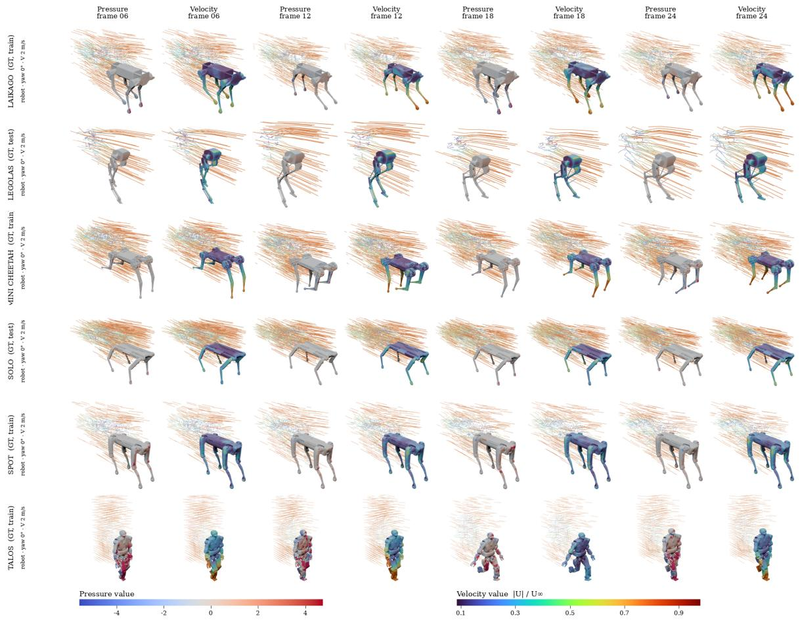  
Figure 8 | Ground-truth flow visualization from RoboCFD-4D. Six articulated robots are shown at rollout frames 6, 12, 18, and 24 under a 2 m/s inflow and 0◦ yaw. Each pair of columns shows pressure and normalized velocity magnitude $| \mathbf { U } | / U _ { \infty }$ around the moving robot. Row labels indicate the robot and whether its morphology is included in training or held out for evaluation.

Dataset-integrity checks verify surface-array dimensions, surface-normal lengths, pressure-unit consistency, and the finite-value policy. NaN values are permitted for Eulerian velocity and pressure inside solid cells and for near-surface samples whose interpolation stencils contain no positive validfluid weight; values expected to represent valid fluid observations must be finite. Publication requires an interpolation-valid fraction of at least 95% on average for each wind condition and at least 90% in every retained frame. Conditions that fail these gates are excluded until the underlying issue is corrected and the afected outputs are regenerated and revalidated.

A robot version is published only when all 16 configured wind conditions have successful execution records, complete 200-frame raw dense-field outputs, and the required 8192-point tracked nearsurface data with passing quality checks. Partial simulations and incompatible pipeline versions are excluded. Benchmark sequences are constructed only after raw-run validation using the fixed zero-based temporal selection described above.

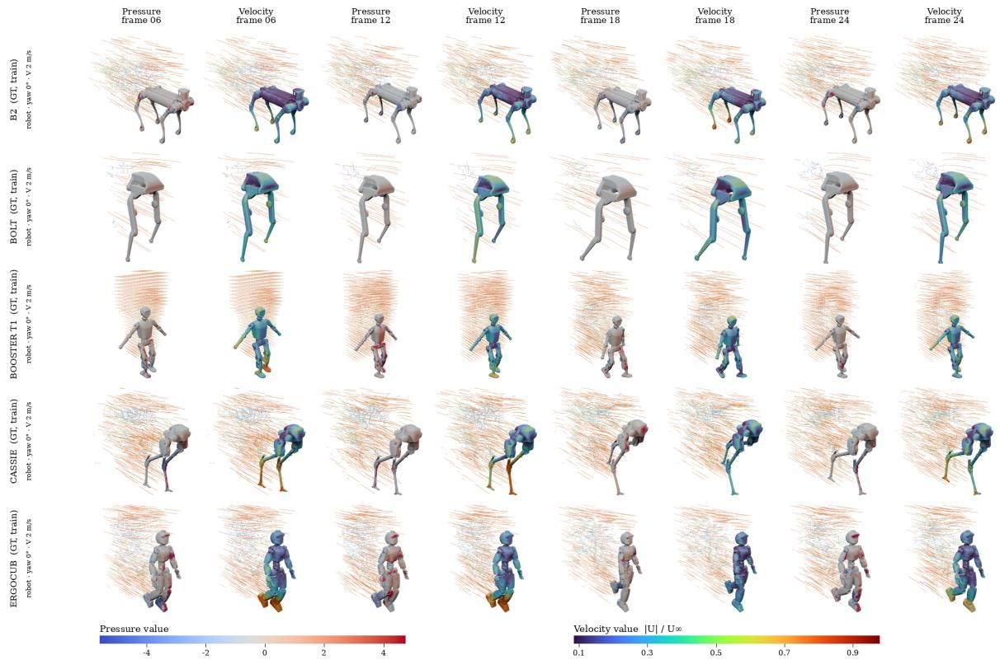  
Figure 9 | Ground-truth flow visualization from RoboCFD-4D. Five articulated robots are shown at rollout frames 6, 12, 18, and 24 under a 2 m/s inflow and 0◦ yaw. Each pair of columns shows pressure and normalized velocity magnitude $| \mathbf { U } | / U _ { \infty }$ around the moving robot. Row labels indicate the robot and whether its morphology is included in training or held out for evaluation.

Versioned simulation directories retain source references, mesh and motion assets, simulation configurations, audit records, and artifact hashes alongside the generated HDF5 outputs. The HDF5 files contain the aligned volumetric and near-surface fields together with motion transforms and metadata, while the accompanying audit and quality-control records document the corresponding validation results.

## Appendix C Additional Qualitative Results

We first visualize representative ground-truth trajectories from RoboCFD-4D in Fig. 8 and Fig. 9. These examples show how the articulated boundary and the surrounding velocity and pressure fields evolve over time across diferent robot morphologies. They provide a direct view of the prediction targets, independent of any learned model.

The qualitative figure in the main text reports a humanoid that is held out from training. This appendix adds two cases that isolate the two axes of generalization separately. Figure 10 keeps the morphology in distribution and changes the inflow: the quadruped belongs to a family that the model does see during training, but the case at 4 m/s and 0◦ yaw is held out, so a change in accuracy here is attributable to the flow regime rather than to an unfamiliar boundary. Figure 11 does the opposite: it holds out an entire humanoid body, which does not appear in training under any condition, and evaluates it within the range of inflow conditions seen during training, so a change in accuracy here is attributable to the geometry.

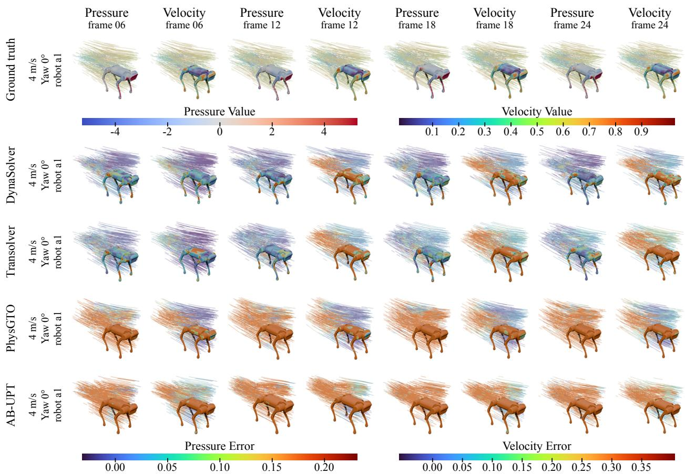  
Figure 10 | Seen morphology under an unseen inflow condition. Error maps of four models on a quadruped, evaluated at 4 m/s and 0◦ yaw. The morphology belongs to a family that the model sees during training, whereas this inflow condition is held out, so the figure isolates the efect of the flow regime with the boundary geometry in distribution. Columns alternate between the pressure and the velocity field at rollout steps 6, 12, 18 and 24, and all panels share one colour scale.

## Appendix D Limitations and Future Work

Benchmark Scope and Motion Realism. RoboCFD-4D is entirely simulation-derived, with articulated motions generated from prescribed kinematic trajectories rather than dynamically simulated locomotion. Although the benchmark covers multiple inflow speeds and yaw angles, it does not capture the full diversity of realistic robotic motion. Existing real-robot datasets, such as CEAR, provide synchronized sensor measurements and joint encoder data across diverse quadrupedal gaits Zhu et al. (2024). Building on such data, future work could incorporate measured or dynamically simulated locomotion trajectories to generate CFD sequences with more realistic boundary motion, enabling a more comprehensive evaluation of DynaSolver beyond the current prescribed-motion setting.

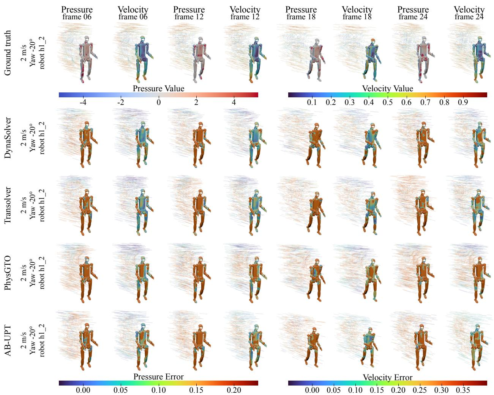  
Figure 11 | Held-out morphology under an in-range inflow condition. The same layout as Figure 10, for an additional humanoid body that is held out from training in all conditions, evaluated at 2 m/s and −20◦ yaw, which lies within the range of conditions the model was trained on. The inflow therefore remains in distribution and the figure isolates the efect of an unfamiliar morphology. Colour is shared by all panels of the figure.

Generalization to Unseen Geometries and Flow Regimes. DynaSolver remains sensitive to changes in geometry and flow conditions. As shown in Fig. 12, pressure errors increase markedly with inflow speed and spread throughout the wake at 6–8 m/s, highlighting the challenges of prediction under increasingly demanding flow conditions. Generalization to unseen robot geometries and the accumulation of errors over long autoregressive rollouts remain additional challenges. Related work on geometry-aware operator learning has also identified generalization to unseen shapes and error accumulation in long-horizon wake prediction as important challenges Rabeh et al. (2026). Future work could investigate improved geometry-conditioned representations and training strategies to enhance cross-morphology generalization and rollout stability under challenging flow conditions.

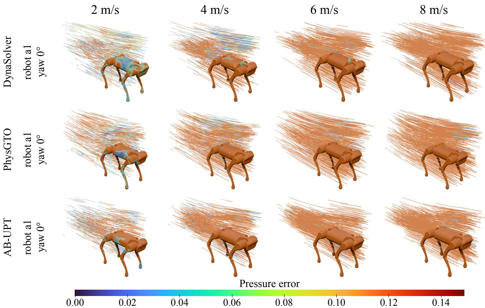  
Figure 12 | Failure under stronger inflow conditions. Absolute pressure errors $| p _ { \mathrm { p r e d } } - p _ { \mathrm { g t } } |$ at rollout step $t = 2 4$ for a quadruped at $0 ^ { \circ }$ yaw under inflow speeds of $2 , 4 , 6 ,$ and $8 \mathrm { m } / s .$ . A shared color scale is used across all methods and conditions. While errors are relatively localized at low inflow speeds, they increase sharply and spread throughout the wake at higher speeds, indicating that strongly unsteady flow conditions remain challenging for current neural CFD surrogates.

## References

Benedikt Alkin, Maurits Bleeker, Richard Kurle, Tobias Kronlachner, Reinhard Sonnleitner, Matthias Dorfer, and Johannes Brandstetter. AB-UPT: scaling neural CFD surrogates for high-fidelity automotive aerodynamics simulations via anchored-branched universal physics transformers. Trans. Mach. Learn. Res., 2025, 2025.

Neil Ashton, Danielle C. Maddix, Samuel Gundry, and Parisa M. Shabestari. Ahmedml: High-fidelity computational fluid dynamics dataset for incompressible, low-speed bluf body aerodynamics. arXiv preprint arXiv:2407.20801, 2024a.

Neil Ashton, Charles Mockett, Marian Fuchs, Louis Fliessbach, Hendrik Hetmann, Thilo Knacke, Norbert Schonwald, Vangelis Skaperdas, Grigoris Fotiadis, Astrid Walle, Burkhard Hupertz, and Danielle C. Maddix. Drivaerml: High-fidelity computational fluid dynamics dataset for road-car external aerodynamics. arXiv preprint arXiv:2408.11969, 2024b.

Ibrahim Ayed, Emmanuel de Bézenac, Arthur Pajot, Julien Brajard, and Patrick Gallinari. Learning dynamical systems from partial observations. arXiv preprint arXiv:1902.11136, 2019.

Giacomo Baldan and Alberto Guardone. A deep neural network reduced order model for unsteady aerodynamics of pitching airfoils. Aerospace Science and Technology, 152:109345, 2024.

Philipp Bekemeyer, Nathan S. Hariharan, Andrew M. Wissink, and Jason Cornelius. Introduction of applied aerodynamics surrogate modeling benchmark cases. AIAA SCITECH 2025 Forum, 2025.

Florent Bonnet, Jocelyn Ahmed Mazari, Paola Cinnella, and Patrick Gallinari. Airfrans: High fidelity computational fluid dynamics dataset for approximating reynolds-averaged navier-stokes solutions. In Advances in Neural Information Processing Systems (NeurIPS), 2022.

Johannes Brandstetter, Daniel Worrall, and Max Welling. Message passing neural PDE solvers. In International Conference on Learning Representations (ICLR), 2022.

Shuhao Cao. Choose a transformer: Fourier or galerkin. In Advances in Neural Information Processing Systems (NeurIPS), pages 24924–24940, 2021.

Yadi Cao, Menglei Chai, Minchen Li, and Chenfanfu Jiang. Eficient learning of mesh-based physical simulation with bi-stride multi-scale graph neural network. In International Conference on Machine Learning, ICML, volume 202, pages 3541–3558. PMLR, 2023.

Salvatore Cuomo, Vincenzo Schiano Di Cola, Fabio Giampaolo, Gianluigi Rozza, Maziar Raissi, and Francesco Piccialli. Scientific machine learning through physics-informed neural networks: Where we are and what’s next. J. Sci. Comput., 92(3):88, 2022.

Pedro M. P. Curvo, Jan-Willem van de Meent, and Maksim Zhdanov. MSPT: Eficient large-scale physical modeling via parallelized multi-scale attention. In Proceedings of the IEEE/CVF Conference on Computer Vision and Pattern Recognition (CVPR), pages 12924–12933, 2026.

Filipe de Avila Belbute-Peres, Thomas D. Economon, and J. Zico Kolter. Combining diferentiable PDE solvers and graph neural networks for fluid flow prediction. In International Conference on Machine Learning, ICML, volume 119, pages 2402–2411. PMLR, 2020.

Jingyang Deng, Xingjian Li, Haoyi Xiong, Xiaoguang Hu, and Jinwen Ma. Geometry-guided conditional adaptation for surrogate models of large-scale 3d PDEs on arbitrary geometries. In Proceedings of the International Joint Conference on Artificial Intelligence, IJCAI, pages 5790–5798, 2024.

Tao Du, Josie Hughes, Sebastien Wah, Wojciech Matusik, and Daniela Rus. Underwater soft robot modeling and control with diferentiable simulation. IEEE Robotics and Automation Letters, 6(3):4994–5001, 2021.

Mohamed Elrefaie, Florin Morar, Angela Dai, and Faez Ahmed. Drivaernet++: A large-scale multimodal car dataset with computational fluid dynamics simulations and deep learning benchmarks. In Advances in Neural Information Processing Systems (NeurIPS), 2024.

Mohamed Elrefaie, Angela Dai, and Faez Ahmed. Drivaernet: A parametric car dataset for data-driven aerodynamic design and prediction. Journal of Mechanical Design, 147(4), 2025.

Mingju Gao, Yike Pan, Huan-ang Gao, Zongzheng Zhang, Wenyi Li, Hao Dong, Hao Tang, Li Yi, and Hao Zhao. Partrm: Modeling part-level dynamics with large cross-state reconstruction model. In Proceedings of the IEEE/CVF Conference on Computer Vision and Pattern Recognition (CVPR), pages 7004–7014, 2025.

Gaurav Gupta, Xiongye Xiao, and Paul Bogdan. Multiwavelet-based operator learning for diferential equations. In Advances in Neural Information Processing Systems (NeurIPS), volume 34, pages 24048–24062, 2021.

Zhongkai Hao, Zhengyi Wang, Hang Su, Chengyang Ying, Yinpeng Dong, Songming Liu, Ze Cheng, Jian Song, and Jun Zhu. GNOT: A general neural operator transformer for operator learning. In International Conference on Machine Learning ICML, volume 202, pages 12556–12569. PMLR, 2023.

Zhongkai Hao, Chang Su, Songming Liu, Julius Berner, Chengyang Ying, Hang Su, Anima Anandkumar, Jian Song, and Jun Zhu. DPOT: auto-regressive denoising operator transformer for large-scale PDE pretraining. In International Conference on Machine Learning ICML, volume 235, pages 17616–17635. PMLR / OpenReview.net, 2024.

Benjamin Holzschuh, Georg Kohl, Florian Redinger, and Nils Thuerey. P3D: Highly scalable 3d neural surrogates for physics simulations with global context. In International Conference on Learning Representations (ICLR), 2026.

Peiyan Hu, Rui Wang, Xiang Zheng, Tao Zhang, Haodong Feng, Ruiqi Feng, Long Wei, Yue Wang, Zhi-Ming Ma, and Tailin Wu. Wavelet difusion neural operator. In International Conference on Learning Representations, ICLR. OpenReview.net, 2025.

Peiyan Hu, Haodong Feng, Hongyuan Liu, Tongtong Yan, Wenhao Deng, Tianrun Gao, Rong Zheng, Haoren Zheng, Chenglei Yu, Chuanrui Wang, Kaiwen Li, Zhi-Ming Ma, Dezhi Zhou, Xingcai Lu, Dixia Fan, and Tailin Wu. Realpdebench: A benchmark for complex physical systems with real-world data. In International Conference on Learning Representations (ICLR), 2026a.

Wenjie Hu, Sidun Liu, Peng Qiao, Zhenglun Sun, and Yong Dou. Transolver is a linear transformer: Revisiting physics-attention through the lens of linear attention. In Proceedings of the AAAI Conference on Artificial Intelligence AAAI, pages 408–416, 2026b.

Yuanming Hu, Jiancheng Liu, Andrew Spielberg, Joshua B. Tenenbaum, William T. Freeman, Jiajun Wu, Daniela Rus, and Wojciech Matusik. Chainqueen: A real-time diferentiable physical simulator for soft robotics. In IEEE International Conference on Robotics and Automation (ICRA), pages 6265–6271, 2019.

Steeven Janny, Aurélien Benetteau, Nicolas Thome, Madiha Nadri, Julie Digne, and Christian Wolf. Eagle: Large-scale learning of turbulent fluid dynamics with mesh transformers. In International Conference on Learning Representations (ICLR), 2023.

Anya R. Jones, Oksan Cetiner, and Marilyn J. Smith. Physics and modeling of large flow disturbances: Discrete gust encounters for modern air vehicles. Annual Review of Fluid Mechanics, 54:469–493, 2022.

Dmitrii Kochkov, Jamie A. Smith, Ayya Alieva, Qing Wang, Michael P. Brenner, and Stephan Hoyer. Machine learning–accelerated computational fluid dynamics. Proceedings of the National Academy of Sciences, 118 (21):e2101784118, 2021.

Felix Koehler, Simon Niedermayr, Rüdiger Westermann, and Nils Thuerey. APEBench: A benchmark for autoregressive neural emulators of pdes. In Advances in Neural Information Processing Systems, volume 37, pages 120252–120310, 2024.

Sahin Lale, Peter I. Renn, Kamyar Azizzadenesheli, Babak Hassibi, Morteza Gharib, and Anima Anandkumar. Falcon: Fourier adaptive learning and control for disturbance rejection under extreme turbulence. npj Robotics, 2, 2024.

Zongyi Li, Nikola B. Kovachki, Kamyar Azizzadenesheli, Burigede Liu, Kaushik Bhattacharya, Andrew M. Stuart, and Anima Anandkumar. Neural operator: Graph kernel network for partial diferential equations. arXiv preprint arXiv:2003.03485, 2020.

Zongyi Li, Nikola Borislavov Kovachki, Kamyar Azizzadenesheli, Burigede Liu, Kaushik Bhattacharya, Andrew M. Stuart, and Anima Anandkumar. Fourier neural operator for parametric partial diferential equations. In International Conference on Learning Representations, ICLR, 2021.

Zongyi Li, Daniel Zhengyu Huang, Burigede Liu, and Anima Anandkumar. Fourier neural operator with learned deformations for pdes on general geometries. J. Mach. Learn. Res., 24:388:1–388:26, 2023a.

Zongyi Li, Nikola B. Kovachki, Christopher B. Choy, Boyi Li, Jean Kossaifi, Shourya Prakash Otta, Mohammad Amin Nabian, Maximilian Stadler, Christian Hundt, Kamyar Azizzadenesheli, and Animashree Anand kumar. Geometry-informed neural operator for large-scale 3d pdes. In Advances in Neural Information Processing Systems (NeurIPS), 2023b.

Zongyi Li, Hongkai Zheng, Nikola Kovachki, David Jin, Haoxuan Chen, Burigede Liu, Kamyar Azizzadenesheli, and Anima Anandkumar. Physics-informed neural operator for learning partial diferential equations. ACM/IMS Journal of Data Science, 1(3):1–27, 2024.

Bjoern List, Li-Wei Chen, Kartik Bali, and Nils Thuerey. Diferentiability in unrolled training of neural physics simulators on transient dynamics. Computer Methods in Applied Mechanics and Engineering, 433:117441, 2025.

Pengwei Liu, Xingyu Ren, Pengkai Wang, Hangjie Yuan, Zhongkai Hao, Guanyu Chen, Chao Xu, Dong Ni, and Shengze Cai. An eficient graph-transformer operator for learning physical dynamics with manifolds embedding. Communications AI & Computing, 1:9, 2026.

Antonio Loquercio, Elia Kaufmann, René Ranftl, Matthias Müller, Vladlen Koltun, and Davide Scaramuzza. Learning high-speed flight in the wild. Science Robotics, 6(59):eabg5810, 2021.

Lu Lu, Pengzhan Jin, Guofei Pang, Zhongqiang Zhang, and George Em Karniadakis. Learning nonlinear operators via deeponet based on the universal approximation theorem of operators. Nature Machine Intelligence, 3(3):218–229, 2021.

Yining Luo, Yingfa Chen, and Zhen Zhang. Cfdbench: A large-scale benchmark for machine learning methods in fluid dynamics. arXiv preprint arXiv:2310.05963, 2023.

Ruben Ohana, Michael McCabe, Lucas Meyer, Rudy Morel, Fruzsina J. Agocs, Miguel Beneitez, Marsha Berger, Blakesley Burkhart, Stuart B. Dalziel, Drummond B. Fielding, Daniel Fortunato, Jared A. Goldberg, Keiya Hirashima, Yan-Fei Jiang, Rich R. Kerswell, Suryanarayana Maddu, Jonah Miller, Payel Mukhopadhyay, Stefan S. Nixon, Jef Shen, Romain Watteaux, Bruno Régaldo-Saint Blancard, François Rozet, Liam H. Parker, Miles Cranmer, and Shirley Ho. The well: A large-scale collection of diverse physics simulations for machine learning. In Advances in Neural Information Processing Systems, volume 37, 2024.

Antonello Paolino, Gabriele Nava, Fabio Di Natale, Fabio Bergonti, Punith Reddy Vanteddu, Donato Grassi, Luca Riccobene, Alex Zanotti, Renato Tognaccini, Gianluca Iaccarino, and Daniele Pucci. Learning aerodynamics for the control of flying humanoid robots. Communications Engineering, 4(1):111, 2025.

Eric J Parish and Karthik Duraisamy. Non-markovian closure models for large eddy simulations using the mori-zwanzig formalism. Physical Review Fluids, 2(1):014604, 2017.

Charles S Peskin. The immersed boundary method. Acta numerica, 11:479–517, 2002.

Tobias Pfaf, Meire Fortunato, Alvaro Sanchez-Gonzalez, and Peter Battaglia. Learning mesh-based simulation with graph networks. In International Conference on Learning Representations (ICLR), 2021.

Ali Rabeh, Suresh Murugaiyan, Adarsh Krishnamurthy, and Baskar Ganapathysubramanian. Predicting timedependent flow over complex geometries using operator networks. Computer Methods in Applied Mechanics and Engineering, 456:118931, 2026.

Md Ashiqur Rahman, Zachary E. Ross, and Kamyar Azizzadenesheli. U-NO: u-shaped neural operators. Trans. Mach. Learn. Res., 2023, 2023.

Bogdan Raonic, Roberto Molinaro, Tim De Ryck, Tobias Rohner, Francesca Bartolucci, Rima Alaifari, Siddhartha Mishra, and Emmanuel de Bézenac. Convolutional neural operators for robust and accurate learning of pdes. In Advances in Neural Information Processing Systems (NeurIPS), 2023.

Olaf Ronneberger, Philipp Fischer, and Thomas Brox. U-Net: Convolutional networks for biomedical image segmentation. In Medical Image Computing and Computer-Assisted Intervention (MICCAI) 2015, volume 9351, pages 234–241. Springer, 2015.

Alvaro Sanchez-Gonzalez, Jonathan Godwin, Tobias Pfaf, Rex Ying, Jure Leskovec, and Peter Battaglia. Learning to simulate complex physics with graph networks. In Proceedings of the International Conference on Machine Learning (ICML), volume 119, pages 8459–8468, 2020.

Licheng Shen, Saining Zhang, Honghan Li, Peilin Yang, Zihao Huang, Zongzheng Zhang, and Hao Zhao. Gaussianart: Unified modeling of geometry and motion for articulated objects. In International Conference on 3D Vision (3DV 2026), pages 384–395. IEEE, 2026.

Fotis Sotiropoulos and Xiaolei Yang. Immersed boundary methods for simulating fluid–structure interaction. Progress in Aerospace Sciences, 65:1–21, 2014.

Kimberly Stachenfeld, Drummond B. Fielding, Dmitrii Kochkov, Miles Cranmer, Tobias Pfaf, Jonathan Godwin, Can Cui, Shirley Ho, Peter Battaglia, and Alvaro Sanchez-Gonzalez. Learned coarse models for eficient turbulence simulation. In International Conference on Learning Representations (ICLR), 2022.

Makoto Takamoto, Timothy Praditia, Raphael Leiteritz, Daniel MacKinlay, Francesco Alesiani, Dirk Pflüger, and Mathias Niepert. PDEBench: An extensive benchmark for scientific machine learning. In Advances in Neural Information Processing Systems, volume 35, 2022.

Ronak Tali, Ali Rabeh, Cheng-Hau Yang, Mehdi Shadkhah, Samundra Karki, Abhisek Upadhyaya, Suriya Dhakshinamoorthy, Marjan Saadati, Soumik Sarkar, Adarsh Krishnamurthy, Chinmay Hegde, Aditya Balu, and Baskar Ganapathysubramanian. FlowBench: A large scale benchmark for flow simulation over complex geometries. Data-centric Machine Learning Research, 2:1–35, 2025.

Alasdair Tran, Alexander Patrick Mathews, Lexing Xie, and Cheng Soon Ong. Factorized fourier neural operators. In International Conference on Learning Representations, ICLR. OpenReview.net, 2023.

Nobuyuki Umetani and Bernd Bickel. Learning three-dimensional flow for interactive aerodynamic design. ACM Trans. Graph., 37(4):89, 2018.

Ashish Vaswani, Noam Shazeer, Niki Parmar, Jakob Uszkoreit, Llion Jones, Aidan N. Gomez, Lukasz Kaiser, and Illia Polosukhin. Attention is all you need. In Advances in Neural Information Processing Systems (NeurIPS), pages 5998–6008, 2017.

Gege Wen, Zongyi Li, Kamyar Azizzadenesheli, Anima Anandkumar, and Sally M. Benson. U-FNO—an enhanced fourier neural operator-based deep-learning model for multiphase flow. Advances in Water Resources, 163: 104180, 2022.

Shizheng Wen, Arsh Kumbhat, Levi Lingsch, Sepehr Mousavi, Yizhou Zhao, Praveen Chandrashekar, and Siddhartha Mishra. Geometry aware operator transformer as an eficient and accurate neural surrogate for pdes on arbitrary domains. In Advances in Neural Information Processing Systems (NeurIPS), volume 38, Main Conference, pages 155423–155501. Curran Associates, Inc., 2025.

Gabriel D. Weymouth and Bernat Font. Waterlily.jl: A diferentiable and backend-agnostic julia solver for incompressible viscous flow around dynamic bodies. Computer Physics Communications, 315:109748, 2025.

Haixu Wu, Tengge Hu, Huakun Luo, Jianmin Wang, and Mingsheng Long. Solving high-dimensional pdes with latent spectral models. In International Conference on Machine Learning ICML, volume 202, pages 37417–37438. PMLR, 2023.

Haixu Wu, Huakun Luo, Haowen Wang, Jianmin Wang, and Mingsheng Long. Transolver: A fast transformer solver for PDEs on general geometries. In Proceedings of the International Conference on Machine Learning (ICML), volume 235, pages 53681–53705. PMLR, 2024.

Chao Xia, Carl Lewerth, Xi Zeng, Alexey Vdovin, Simone Sebben, and Qing Jia. Drivaerrim: A computational fluid dynamics dataset for automotive rim aerodynamics, 2026.

Wenzhuo Xu, Noelia Grande Gutiérrez, and Christopher McComb. Megaflow2d: A parametric dataset for machine learning super-resolution in computational fluid dynamics simulations. In Proceedings of Cyber Physical Systems and Internet of Things (CPS-IoT) Week Workshops, pages 100–104. ACM, 2023.

Hao Zhang, Fang Li, Samyak Rawlekar, and Narendra Ahuja. S3O: A dual-phase approach for reconstructing dynamic shape and skeleton of articulated objects from single monocular video. In Proceedings of the 41st International Conference on Machine Learning (ICML), volume 235 of Proceedings of Machine Learning Research, pages 59191–59209. PMLR, 2024a.

Yifei Zhang, Huan-ang Gao, Zhou Jiang, and Hao Zhao. Dual-frame fluid motion estimation with test time optimization and zero-divergence loss. In Amir Globersons, Lester Mackey, Danielle Belgrave, Angela Fan, Ulrich Paquet, Jakub M. Tomczak, and Cheng Zhang, editors, Advances in Neural Information Processing Systems (NeurIPS), 2024b.

Hang Zhou, Haixu Wu, Haonan Shangguan, Yuezhou Ma, Huikun Weng, Jianmin Wang, and Mingsheng Long. Transolver-3: Scaling up transformer solvers to industrial-scale geometries. arXiv preprint arXiv:2602.04940, 2026.

Shifan Zhu, Zixun Xiong, and Donghyun Kim. CEAR: Comprehensive event camera dataset for rapid perception of agile quadruped robots. IEEE Robotics and Automation Letters, 9(10):8999–9006, 2024.