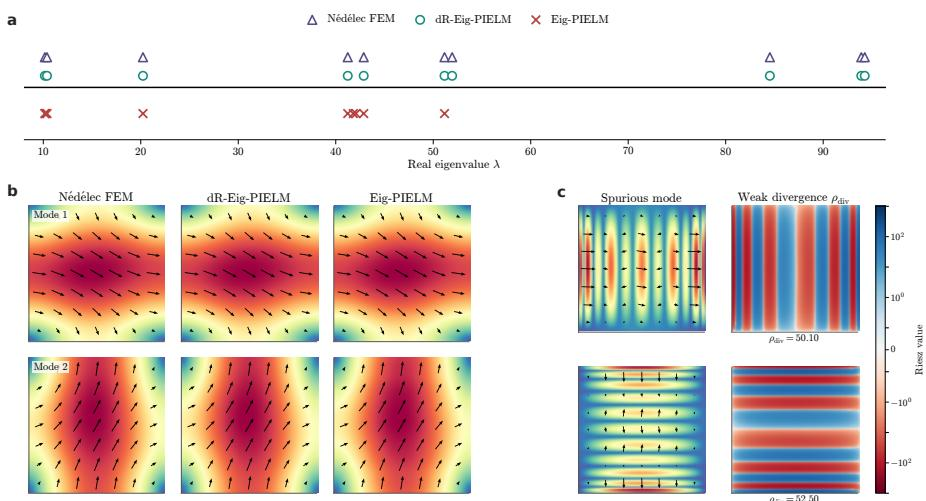
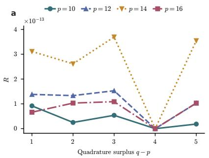
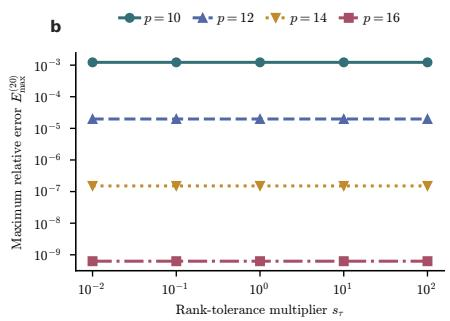
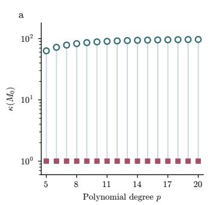
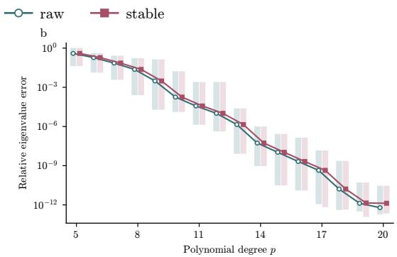
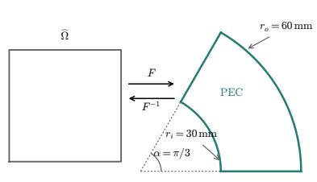
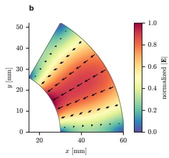

# EMBEDDING A DE RHAM COMPLEX STRUCTURE INTO EIG-PIELM FOR MAXWELL EIGENVALUE PROBLEMS

HAO KANG, LIANG LI† AND XING LI‡

Abstract. The perfect electric conductor (PEC) boundary condition alone does not eliminate the gradient nullspace of the Maxwell curl–curl operator. Consequently, a boundary-only Maxwell implementation of Eig-PIELM, an eigenvalue extension of the physics-informed extreme learning machine (PIELM), may retain represented gradient modes in its reduced trial space, producing nonphysical, gradient-contaminated modes. We develop dR-Eig-PIELM1, a finite-dimensional structure-preserving extension that retains the linear-coeficient, boundary-null-space, and one-shot multimode architecture of Eig-PIELM. It combines compatible tensor-product grad–curl trial spaces with a constrained null-space construction to restrict the sampled PEC space to the mass-orthogonal complement of the represented gradient image before the eigensolve. Symmetric weak-form Gram assembly yields a symmetric-definite reduced eigenproblem without an eigenvalue cutof under the stated sampling and material-positivity assumptions. For rectangles and cuboids, we establish fixeddegree exactness at the PEC vector-field space and derive rank and dimension identities. Numerical experiments show that dR-Eig-PIELM excludes the spurious eigenmodes with significant gradient components observed in the boundary-only baseline. The method exhibits rapid convergence with increasing polynomial degree and competitive work–precision performance in the tested configurations. A covariantly mapped waveguide example illustrates the potential of dR-Eig-PIELM for integration into design optimization workflows through a constrained local geometry update driven by computed cutof frequencies and their sensitivities. This work provides a mathematical and computational framework for separating represented gradient modes from physical Maxwell eigenmodes within Eig-PIELM and supports its use in waveguide spectral analysis and geometry design.

Key words. Maxwell eigenvalue problem, dR-Eig-PIELM, de Rham complex, discrete physical space, spectral pollution, N´ed´elec element

MSC codes. 65N25, 65N35, 78M10

1. Introduction. Maxwell eigenvalue problems determine cavity resonances, waveguide cutof spectra, and electromagnetic field patterns [4, 24]. Their main discretization dificulty is not the PEC boundary condition alone, but the gradient kernel of the curl–curl operator. Let $\Omega \subset \mathbb { R } ^ { d } , d \in \{ 2 , 3 \}$ , be a bounded domain occupied by a lossless isotropic medium with positive electric permittivity ϵ and inverse magnetic permeability ν. Under a PEC boundary condition, the electric formulation seeks $\lambda = \omega ^ { 2 } > 0$ and a nonzero field $E \in H _ { 0 } ( \mathrm { c u r l } ; \Omega )$ that formally satisfies [21, 34]

$$
\begin{array} { r l } { \nabla \times ( \nu \nabla \times \pmb { E } ) = \lambda \epsilon \pmb { E } } & { \mathrm { i n } \ \Omega , } \\ { \nabla \cdot ( \epsilon \pmb { E } ) = 0 \quad } & { \mathrm { i n } \ \Omega , } \\ { \pmb { n } \times \pmb { E } = \mathbf { 0 } \quad } & { \mathrm { o n } \ \partial \Omega . } \end{array}\tag{1.1}
$$

On the domains considered here, the curl–curl kernel is $\nabla H _ { 0 } ^ { 1 } ( \Omega )$ [21]. These gradient fields already satisfy the PEC tangential-trace condition. The boundary condition therefore does not separate them from the physical subspace [24]. If a discretization misrepresents this kernel, gradient-like directions can appear as spurious positive eigenmodes or cause spectral pollution [4, 7, 5, 21].

A Maxwell discretization must therefore represent the curl kernel as the image of a discrete gradient operator and separate that image from the physical eigenspace. Finite element exterior calculus (FEEC) formulates this requirement through discrete de Rham complexes and commuting projections [2]. N´ed´elec edge elements provide the classical H(curl)-conforming realization [21, 35]. Exactness controls the kernel identity at a fixed discretization level. Approximation and discrete compactness are additionally needed for asymptotic spectral correctness [1, 5, 6, 21, 28].

Existing methods enforce this requirement either through their trial spaces or through algebraic treatment of the kernel. Compatible spline and cubical complexes preserve the de Rham sequence, and Bernstein representations reduce the cost of highorder diferential-form calculations [8, 9, 29]. Null-space-free eigensolvers use discrete vector potentials to keep iterations outside the gradient kernel [24]. Discrete involutions and kernel-compensated mimetic finite diferences provide related treatments in other discretization settings [15, 16, 26]. Although their realizations difer, these methods all control the relation among the gradient image, the curl kernel, and the physical eigenspace.

The same structural questions arise in neural and random-feature discretizations of Maxwell eigenproblems.

Neural PDE solvers optimize residuals, energy functionals, or Rayleigh quotients [14, 27, 38, 39, 41]. Related collocation and tensor methods use adaptive basis enrichment or variational assembly [44, 45]. For Maxwell eigenproblems, FieldTNN uses a trainable tensor representation with a divergence penalty [25]. Other neural discretizations represent finite-element de Rham spaces or compatible diferential forms [3, 22, 32].

Random-feature and extreme-learning methods fix the feature map and determine only linear output coeficients [10, 13, 23, 36, 46]. Eig-PIELM combines this representation with a sampled boundary null space and one reduced multimode eigensolve, providing an eficient way to compute multiple eigenpairs [33].

However, a direct Maxwell specialization of Eig-PIELM does not automatically inherit the compatible structure described above. Choosing scalar features independently for each vector component need not produce a compatible grad–curl sequence. Moreover, the sampled boundary null space enforces the PEC condition but does not separate the represented gradient image from the physical eigenspace, because these gradient fields already satisfy the tangential boundary condition. Thus, boundary enforcement alone does not resolve the structural dificulty of the Maxwell eigenproblem.

The challenge is to incorporate this structure into the linear-coeficient architecture of Eig-PIELM. The scalar and vector trial spaces must be coordinated so that the represented gradient image lies in the PEC-admissible vector space and, for the spaces considered here, coincides with its curl kernel. This image must then be separated in the material-weighted mass inner product. The resulting constraints should define a reduced physical-space eigenproblem while retaining the one-shot multimode solution procedure of Eig-PIELM.

To address these issues, we introduce de Rham compatibility into the trial-space construction of Eig-PIELM while retaining its linear-coeficient, boundary-null-space, and one-shot multimode architecture. A compatible grad–curl sequence links the scalar and vector trial spaces. Within the vector space, we impose the sampled tangential PEC condition and construct a second null space to remove the represented gradient image in the mass inner product. The eigenproblem is thus posed directly on the discrete Maxwell physical space. Symmetric weak-form Gram assembly yields a symmetric-definite reduced eigenproblem under the stated sampling and material positivity assumptions.

The paper makes three main contributions.

• We formulate dR-Eig-PIELM as a finite-dimensional structure-preserving extension of Eig-PIELM for PEC Maxwell eigenproblems. The constrained null-space basis satisfies

$$
\mathrm { r a n g e } \mathbf { Z } _ { X } = \mathrm { k e r } \mathbf { B } _ { \mathrm { b c } } \cap \left( \mathrm { r a n g e } \mathbf { T } \right) ^ { \perp _ { \mathbf { M } } } .
$$

This basis realizes the discrete Maxwell physical space before the eigensolve and excludes the represented gradient image without an eigenvalue cutof. The construction retains the linear-coeficient and one-shot multimode archi tecture of Eig-PIELM.

• For tensor-product polynomial spaces on rectangles and cuboids, we establish PEC compatibility and fixed-degree exactness at the vector-field space,

$$
\ker \Big ( \nabla \times | _ { \mathbb { V } _ { p , d } ^ { 0 } } \Big ) = \nabla \mathbb { S } _ { p , d } ^ { 0 } .
$$

We derive the associated rank and dimension identities. Under the stated trace-unisolvence, evaluation-injectivity, and material-positivity assumptions, the restricted mass and curl matrices are positive definite and define a wellposed symmetric generalized eigenproblem.

• Numerical experiments compare dR-Eig-PIELM with the boundary-only Eig-PIELM baseline, analytic spectra, and independent N´ed´elec references. They verify the tested structural identities and show that the method excludes the spurious eigenmodes with significant gradient components observed in the boundary-only baseline. The tested configurations exhibit rapid convergence with increasing polynomial degree and competitive work–precision performance.

The remainder of the paper is organized as follows. Section 2 introduces the Maxwell setting, PIELM, and the Eig-PIELM baseline. Section 3 presents the construction and assembly of dR-Eig-PIELM and its numerical realization, while Section 4 establishes its structural analysis. Section 5 presents the numerical results. Section 6 concludes the paper, with implementation and reproducibility details deferred to the appendices.

2. Mathematical Foundations. We first define the continuous and discrete Maxwell physical spaces, then review the physics-informed extreme learning machine (PIELM) and the Eig-PIELM baseline.

## 2.1. Maxwell Eigenvalue Problem.

2.1.1. Continuous setting. Let $d \in \{ 2 , 3 \}$ , and let $\Omega \subset \mathbb { R } ^ { d }$ be a bounded Lipschitz domain. We consider the source-free Maxwell eigenproblem (1.1) with $\lambda =$ $\omega ^ { 2 }$ , under the coeficient assumptions stated in Section 1.

Let $\gamma _ { t }$ and $\gamma _ { 0 }$ denote the tangential and scalar trace operators, respectively, with $\gamma _ { t } ( \pmb { v } ) = \pmb { n } \times \pmb { v }$ and $\gamma _ { 0 } ( q ) = q | _ { \partial \Omega }$ for smooth fields [34, 21]. The associated homogeneous trace spaces are

$$
\begin{array} { r l } & { H _ { 0 } ( \mathrm { c u r l } ; \Omega ) : = \ker \gamma _ { t } = \{ \pmb { v } \in H ( \mathrm { c u r l } ; \Omega ) : \gamma _ { t } ( \pmb { v } ) = \pmb { 0 } \} , } \\ & { \qquad H _ { 0 } ^ { 1 } ( \Omega ) : = \ker \gamma _ { 0 } = \{ q \in H ^ { 1 } ( \Omega ) : \gamma _ { 0 } ( q ) = 0 \} . } \end{array}
$$

For u, $v \in H _ { 0 } ( \mathrm { c u r l } ; \Omega )$ , define

$$
\begin{array} { r l } { a _ { \nu } ( \pmb { u } , \pmb { v } ) = \displaystyle \int _ { \Omega } \nu \left( \nabla \times \pmb { u } \right) \cdot \left( \nabla \times \pmb { v } \right) \mathrm { d } \pmb { x } , \qquad m _ { \epsilon } ( \pmb { u } , \pmb { v } ) } & { = \displaystyle \int _ { \Omega } \epsilon \pmb { u } \cdot \pmb { v } \mathrm { d } \pmb { x } . } \end{array}
$$

The standard weak Maxwell eigenproblem is [34, 21]

$$
\begin{array} { r l } & { ~ a _ { \nu } ( \pmb { E } , \pmb { v } ) = \lambda m _ { \epsilon } ( \pmb { E } , \pmb { v } ) \quad \mathrm { f o r ~ a l l } ~ \pmb { v } \in H _ { 0 } ( \mathrm { c u r l } ; \Omega ) , } \\ & { m _ { \epsilon } ( \pmb { E } , \pmb { E } ) = 1 . } \end{array}\tag{2.1}
$$

For $q \in H _ { 0 } ^ { 1 } ( \Omega )$ , one has $\nabla q \ \in \ H _ { 0 } ( \mathrm { c u r l } ; \Omega )$ and $\nabla \times \nabla q = 0$ . These mapping properties are part of the relative de Rham structure [2, 21]. The relevant portions of the corresponding complexes are

(2.2a)

$$
H _ { 0 } ^ { 1 } ( \Omega ) \stackrel { \nabla } { \longrightarrow } H _ { 0 } ( \mathrm { c u r l } ; \Omega ) \stackrel { \nabla \times } { \longrightarrow } L _ { 0 } ^ { 2 } ( \Omega ) , ~ d = 2 ,\tag{2.2b}
$$

$$
H _ { 0 } ^ { 1 } ( \Omega ) \xrightarrow { \nabla } H _ { 0 } ( \mathrm { c u r l } ; \Omega ) \xrightarrow { \nabla \times } H _ { 0 } ( \mathrm { d i v } ; \Omega ) \xrightarrow { \nabla \cdot } L _ { 0 } ^ { 2 } ( \Omega ) , \quad d = 3 .
$$

Since consecutive diferential operators compose to zero, this gives

$$
\nabla H _ { 0 } ^ { 1 } ( \Omega ) \subset \ker \Bigl ( \nabla \times \vert _ { H _ { 0 } ( \operatorname { c u r l } ; \Omega ) } \Bigr ) .
$$

If, in addition, Ω is contractible and ∂Ω is connected, the corresponding relative de Rham sequence is exact at $H _ { 0 } ( \mathrm { c u r l } ; \Omega ) \ [ 2 1 , 2 ]$ , and the inclusion becomes

$$
\ker \Big ( \nabla \times \vert _ { H _ { 0 } ( \mathrm { c u r l } ; \Omega ) } \Big ) = \nabla H _ { 0 } ^ { 1 } ( \Omega ) .\tag{2.3}
$$

For every $q \in H _ { 0 } ^ { 1 } ( \Omega )$

$$
\nabla q \in H _ { 0 } ( \mathrm { c u r l } ; \Omega ) , \qquad \nabla \times \nabla q = 0 .
$$

Hence, $\nabla H _ { 0 } ^ { 1 } ( \Omega )$ is a subspace whose fields already satisfy the tangential PEC condition. The boundary condition alone therefore does not separate the gradient kernel.

For a positive eigenpair, testing (2.1) with $\pmb { v } = \nabla q$ gives

$$
0 = a _ { \nu } ( { \pmb E } , \nabla q ) = \lambda m _ { \epsilon } ( { \pmb E } , \nabla q ) , \qquad q \in H _ { 0 } ^ { 1 } ( \Omega ) .
$$

Thus every positive-eigenvalue eigenfunction belongs to

$$
\mathbb { X } _ { \epsilon } : = H _ { 0 } ( \mathrm { c u r l } ; \Omega ) \cap \bigl ( \nabla H _ { 0 } ^ { 1 } ( \Omega ) \bigr ) ^ { \perp _ { m _ { \epsilon } } } .\tag{2.4}
$$

This m -orthogonality imposes the source-free Gauss constraint $\nabla \cdot ( \epsilon E ) = 0 \ [ 3 4 , 1 2 ]$ Under (2.3), the restriction in (2.4) removes the entire curl-free PEC kernel.

2.1.2. Discrete setting. Following the discrete de Rham framework [2, 21], let S, V, and Q be finite-dimensional scalar-potential, vector-field, and curl-target spaces, respectively. Let G and C denote the discrete gradient and curl operators. The discrete counterpart of (2.2) starts with the grad–curl chain

$$
\mathbb { S } \stackrel { \mathcal { G } } { \longrightarrow } \mathbb { V } \stackrel { \mathcal { C } } { \longrightarrow } \mathbb { Q } , \qquad \mathcal { C } \mathcal { G } = 0 .\tag{2.5}
$$

We next introduce the homogeneous boundary constraints relevant to the PEC problem. Let $\mathbb { S } _ { 0 } \subset \mathbb { S }$ denote the homogeneous scalar-potential subspace corresponding to $H _ { 0 } ^ { 1 } ( \Omega )$ . Let B denote the discrete tangential-trace operator on $\mathbb { V } .$ and define the PEC-admissible vector subspace by

$$
\mathbb { V } _ { 0 } : = \ker B \subset \mathbb { V } .
$$

Compatibility with the PEC constraint requires

$$
{ \mathcal { G } } ( \mathbb { S } _ { 0 } ) \subset \mathbb { V } _ { 0 } , \qquad \iff \qquad B { \mathcal { G } } q = 0 \quad { \mathrm { f o r ~ e v e r y ~ } } q \in \mathbb { S } _ { 0 } .\tag{2.6}
$$

Combining (2.5) and (2.6) gives $\mathcal { G } ( \mathbb { S } _ { 0 } ) \subset \ker ( \mathcal { C } | _ { \mathbb { V } _ { 0 } } )$

The constrained grad–curl structure is exact at $\mathbb { V } _ { 0 }$ if

$$
\ker \bigl ( \mathcal { C } | _ { \mathbb { V } _ { 0 } } \bigr ) = \mathcal { G } ( \mathbb { S } _ { 0 } ) .\tag{2.7}
$$

This is the discrete counterpart of the continuous kernel identity (2.3).

Let m denote a symmetric discrete mass form on V whose restriction to $\mathbb { V } _ { 0 }$ is positive definite. The corresponding discrete physical space is

$$
\mathbb { X } : = \left\{ \pmb { v } \in \mathbb { V } _ { 0 } : m \big ( \pmb { v } , \mathcal { G } \boldsymbol { q } \big ) = 0 \quad \mathrm { f o r ~ a l l ~ } \boldsymbol { q } \in \mathbb { S } _ { 0 } \right\} = \mathbb { V } _ { 0 } \cap \big ( \mathcal { G } ( \mathbb { S } _ { 0 } ) \big ) ^ { \perp _ { m } } .\tag{2.8}
$$

It is the discrete analogue of (2.4). Since $\mathcal { G } ( \mathbb { S } _ { 0 } ) \subset \mathbb { V } _ { 0 }$ and m is positive definite on $\mathbb { V } _ { 0 } .$ , this definition gives the m-orthogonal direct sum

$$
\mathbb { V } _ { 0 } = \mathcal { G } ( \mathbb { S } _ { 0 } ) \oplus _ { m } \mathbb { X } .\tag{2.9}
$$

Under (2.7), the first summand is the entire discrete curl-free PEC kernel.

2.2. Physics-Informed Extreme Learning Machine. The extreme learning machine (ELM) uses a single-hidden-layer network whose hidden parameters are sampled once and then fixed. Only the output weights are determined from data, usually by a linear least-squares solve [23]. PIELM applies this fixed-feature construction to diferential equations [13]. For scalar notation, it writes the trial function as

$$
u _ { N } ( { \pmb x } ) = \sum _ { j = 1 } ^ { N _ { \phi } } \beta _ { j } \phi _ { j } ( { \pmb x } ) ,\tag{2.10}
$$

where the hidden features $\phi _ { j }$ are fixed and the coeficients $\beta _ { j }$ are unknown.

For a linear boundary-value problem $\mathcal { L } u = f$ in Ω and $B u = g$ on ∂Ω, PIELM evaluates the diferential and boundary operators at collocation points. The two sets of equations form the linear system

$$
\begin{array} { r } { \left[ \pmb { A } _ { \Omega } \right] \beta = \left[ \pmb { f } _ { \Omega } \right] , \qquad ( \pmb { A } _ { \Omega } ) _ { i j } = \mathcal { L } \phi _ { j } ( \pmb { x } _ { i } ) , \quad ( \pmb { A } _ { \partial \Omega } ) _ { i j } = \mathcal { B } \phi _ { j } ( \pmb { x } _ { i } ) . } \end{array}
$$

An overdetermined system is solved in the least-squares sense. With fixed features, PIELM reduces the PDE solve to linear algebra without backpropagation.

2.3. Eig-PIELM Framework. Eig-PIELM extends the random fixed-feature PIELM construction to the linear eigenproblem [33]

$$
\mathcal { L } u = \lambda u \quad \mathrm { i n ~ } \Omega , \quad \mathcal { B } u = 0 \quad \mathrm { o n ~ } \partial \Omega , \quad u \neq 0 .\tag{2.11}
$$

It uses the PIELM ansatz (2.10). Both $\beta$ and λ are unknown, so the forced-problem least-squares solve no longer applies directly.

Let $\{ \pmb { x } _ { i } \} _ { i = 1 } ^ { N _ { x } } \subset \Omega$ be interior collocation points. Evaluate the fixed features and their images under $\mathcal { L }$ at these points:

$$
\Phi _ { i j } = \phi _ { j } ( \pmb { x } _ { i } ) , \qquad \Psi _ { i j } = ( \mathcal { L } \phi _ { j } ) ( \pmb { x } _ { i } ) .
$$

By linearity of $\mathcal { L } .$ , substituting (2.10) into (2.11) gives the sampled residual

$$
\left[ ( \Psi - \lambda \Phi ) \beta \right] .
$$

Eig-PIELM then forms the coeficient-space products

$$
\mathbf { A } _ { \mathrm { E i g } } = \Phi ^ { \top } \Psi , \qquad \mathbf { M } _ { \mathrm { E i g } } = \Phi ^ { \top } \Phi .
$$

Eig-PIELM restricts the trial function by the homogeneous boundary condition before the eigensolve. For boundary points $\{ \mathbf { { } } x _ { \ell } ^ { b } \} _ { \ell = 1 } ^ { N _ { b } } \subset \mathcal { \bar { O } } \Omega$ , define the boundary sampling matrix by

$$
( \mathbf { B } _ { \mathrm { b c } } ) _ { \ell j } = ( B \phi _ { j } ) ( \pmb { x } _ { \ell } ^ { b } ) ,
$$

so the sampled boundary condition is $\mathbf { B } _ { \mathrm { b c } } \beta = 0 $ . An SVD of this matrix gives an orthonormal null-space basis $\mathbf { Z } _ { \mathrm { b c } } .$ Every coeficient vector satisfying the sampled boundary condition has the form $\beta = \mathbf { Z } _ { \mathrm { b c } } y$

We require the sampled interior residual to be orthogonal to $\mathrm { r a n g e } ( \Phi \mathbf { Z } _ { \mathrm { b c } } )$ , the sampled boundary-admissible trial space. This gives the reduced generalized eigenproblem:

$$
\begin{array} { r } { ( \pmb { \Phi } \mathbf { Z } _ { \mathrm { b c } } ) ^ { \top } \left( \pmb { \Psi } - \lambda \pmb { \Phi } \right) \mathbf { Z } _ { \mathrm { b c } } \pmb { y } = \left( \mathbf { Z } _ { \mathrm { b c } } ^ { \top } \mathbf { A } _ { \mathrm { E i g } } \mathbf { Z } _ { \mathrm { b c } } - \lambda \mathbf { Z } _ { \mathrm { b c } } ^ { \top } \mathbf { M } _ { \mathrm { E i g } } \mathbf { Z } _ { \mathrm { b c } } \right) \pmb { y } = 0 . } \end{array}
$$

Solving this reduced generalized eigenproblem gives $\mathbf { \pmb { y } } .$ . The eigenfunction is recovered from $\beta = \mathbf { Z } _ { \mathrm { b c } } y$

A direct componentwise application of Eig-PIELM to a two-dimensional Maxwell field assigns the same scalar basis independently to the two components:

$$
\begin{array} { r } { { \cal { E } } = \left( \begin{array} { l } { \displaystyle \sum _ { j = 1 } ^ { N _ { \phi } } c _ { j } ^ { ( 1 ) } \phi _ { j } } \\ { \displaystyle \sum _ { j = 1 } ^ { N _ { \phi } } c _ { j } ^ { ( 2 ) } \phi _ { j } } \end{array} \right) . } \end{array}\tag{2.12}
$$

Because the two component spaces are chosen independently, this trial space need not realize the discrete grad–curl chain (2.5). The boundary projection therefore identifies only ker $\mathbf { B } _ { \mathrm { b c } }$ ; it does not represent the gradient image $\mathcal { G } ( \mathbb { S } _ { 0 } )$ or enforce the physical-space restriction (2.8).

3. dR-Eig-PIELM Method. We now realize the grad–curl chain and massorthogonal physical space from Section 2 in Eig-PIELM. The construction proceeds through compatible trial spaces, PEC restriction, and mass-orthogonal removal of the represented gradient image. The resulting discrete physical space defines the reduced Maxwell eigenproblem.

3.1. Construction of compatible trial spaces. We construct compatible tensor-product trial spaces by matching their componentwise polynomial degrees to the degree-lowering action of diferentiation. Let $\mathbb { S } _ { r , s , t }$ denote the tensor product of univariate polynomial spaces of degrees at most r, s, and t in the coordinates x, y, and z. The three-dimensional scalar, vector, curl, and divergence spaces at level $p$ are

$$
\begin{array} { r l } & { \ S _ { p } ^ { ( 3 ) } = \mathbb { S } _ { p , p , p } , } \\ & { \bigvee _ { p } ^ { ( 3 ) } = \mathbb { S } _ { p - 1 , p , p } \times \mathbb { S } _ { p , p - 1 , p } \times \mathbb { S } _ { p , p , p - 1 } , } \\ & { \bigvee _ { p } ^ { ( 3 ) } = \mathbb { S } _ { p , p - 1 , p - 1 } \times \mathbb { S } _ { p - 1 , p , p - 1 } \times \mathbb { S } _ { p - 1 , p - 1 , p } , } \\ & { \big Q _ { p } ^ { ( 3 ) } = \mathbb { S } _ { p - 1 , p - 1 , p - 1 } . } \end{array}\tag{3.1}
$$

With the component order $( x , y , z )$ , they form the sequence

$$
\mathbb { S } _ { p } ^ { ( 3 ) } \xrightarrow { \nabla } \mathbb { V } _ { p } ^ { ( 3 ) } \xrightarrow { \nabla \times } \mathbb { W } _ { p } ^ { ( 3 ) } \xrightarrow { \nabla \cdot } \mathbb { Q } _ { p } ^ { ( 3 ) } .\tag{3.2}
$$

Diferentiation reduces the polynomial degree in one coordinate by one and leaves the other degrees unchanged. The componentwise degree shifts in (3.1) therefore place the gradient, curl, and divergence in the successive tensor-product spaces of (3.2). The grad–curl part realizes the scalar and electric-field positions of the abstract chain in Section 2 [2, 21].

Let $\mathbb { S } _ { r , s }$ be the tensor product in x and y. For fields independent of $z ,$ take a scalar $q ( x , y )$ and a planar vector $( v _ { x } ( x , y ) , v _ { y } ( x , y ) , 0 )$ . The z-component of its curl gives the two-dimensional sequence

$$
\mathbb { S } _ { p , p } \xrightarrow { \mathcal { G } _ { p } } \mathbb { S } _ { p - 1 , p } \times \mathbb { S } _ { p , p - 1 } \xrightarrow { \mathcal { C } _ { p } } \mathbb { S } _ { p - 1 , p - 1 } ,\tag{3.3}
$$

where $\mathcal { G } _ { p } q = ( \partial _ { x } q , \partial _ { y } q )$ and $\mathcal { C } _ { p } ( v _ { x } , v _ { y } ) = \partial _ { x } v _ { y } - \partial _ { y } v _ { x }$

All dR-Eig-PIELM numerical experiments use the same global tensor-polynomial basis, evaluated as normalized shifted-Legendre polynomials on the reference interval (0, 1):

$$
\widehat { \psi } _ { j } ( \xi ) = \sqrt { 2 j + 1 } P _ { j } ( 2 \xi - 1 ) , \quad 0 \leq j \leq p ,\tag{3.4}
$$

where $P _ { j }$ is the Legendre polynomial on $[ - 1 , 1 ]$ . On a physical interval $( 0 , L )$ , the implementation evaluates $\widehat { \psi } _ { j } ( t / L )$ and scales its derivatives by $L ^ { - 1 }$ . This basis spans the same tensor-polynomial spaces as Bernstein polynomials.

3.2. Discrete forms. Let $\Gamma _ { p }$ and $\mathbf { R } _ { p }$ denote the gradient and curl coeficient matrices specified in Appendix B. In the two-dimensional realization, let $\{ \varphi _ { j } \} _ { j = 1 } ^ { N _ { v } }$ be a basis of $\mathbb { S } _ { p - 1 , p } \times \mathbb { S } _ { p , p - 1 }$ and write

$$
E ( c ) = \sum _ { j = 1 } ^ { N _ { v } } c _ { j } \varphi _ { j } .
$$

Choose volume quadrature nodes $\{ \pmb { x } _ { \ell } \}$ . Evaluating the vector basis and its curls at these nodes gives

$$
\begin{array} { r l r } & { ( \Phi ) _ { ( \ell , \alpha ) , j } = [ \varphi _ { j } ( { \boldsymbol x } _ { \ell } ) ] _ { \alpha } , } & { \Phi \in \mathbb { R } ^ { N _ { f } \times N _ { v } } , } \\ & { } & { { \mathbf C } _ { ( \ell , \beta ) , j } = [ \mathcal { C } _ { p } ( \varphi _ { j } ) ( { \boldsymbol x } _ { \ell } ) ] _ { \beta } , } & { { \mathbf C } \in \mathbb { R } ^ { N _ { c } \times N _ { v } } . } \end{array}
$$

Here $\alpha$ and $\beta$ index the field and curl components. Because C samples the curl represented by $\mathbf { R } _ { p } ,$ the exact identity ${ \bf R } _ { p } { \bf r } _ { p } = 0$ also yields $\mathbf { C } \mathbf { \Gamma } _ { P } = 0$

Let Wϵ and $\mathbf { W } _ { \nu }$ contain the positive quadrature and material weights for permittivity and inverse permeability. The weighted samples are

$$
\widehat { \boldsymbol { \Phi } } = \mathbf { W } _ { \epsilon } ^ { 1 / 2 } \boldsymbol { \Phi } , \quad \widehat { \mathbf { C } } = \mathbf { W } _ { \nu } ^ { 1 / 2 } \mathbf { C } .
$$

Their Gram products define

$$
\mathbf { M } = \widehat { \boldsymbol { \Phi } } ^ { \top } \widehat { \boldsymbol { \Phi } } , \quad \mathbf { K } = \widehat { \mathbf { C } } ^ { \top } \widehat { \mathbf { C } } .
$$

If c $, \pmb { d } \in \mathbb { R } ^ { N _ { v } }$ represent two fields in this vector trial space, then the discrete mass and curl forms are

$$
\begin{array} { r } { m \big ( \boldsymbol { E } ( \boldsymbol { c } ) , \boldsymbol { E } ( \boldsymbol { d } ) \big ) = \boldsymbol { d } ^ { \top } \mathbf { M } \boldsymbol { c } , \quad \boldsymbol { a } \big ( \boldsymbol { E } ( \boldsymbol { c } ) , \boldsymbol { E } ( \boldsymbol { d } ) \big ) = \boldsymbol { d } ^ { \top } \mathbf { K } \boldsymbol { c } . } \end{array}
$$

The sampled weak residual is

$$
\begin{array} { r } { \pmb { d } ^ { \top } ( \mathbf K - \lambda \mathbf M ) \pmb { c } . } \end{array}
$$

For the tensor-product realization, the weighted evaluations are assembled by tensor Gauss quadrature. The weights include the physical area factor and the sampled material coeficients. Positive weights make M and K symmetric positive semidefinite; definiteness on a specified subspace also requires injective field or curl evaluation there. The fixed basis in (3.4) preserves the compatible spaces and their exact derivative image.

3.3. PEC Boundary Constraint. The PEC condition is imposed after the compatible sequence has been constructed. Define the homogeneous scalar subspace

$$
\begin{array} { r } { \mathbb { S } _ { p , p } ^ { 0 } = \mathbb { S } _ { p , p } \cap H _ { 0 } ^ { 1 } ( \Omega ) , \quad N _ { s } = \mathrm { d i m } \mathbb { S } _ { p , p } ^ { 0 } , } \end{array}\tag{3.5}
$$

and let $\mathbf { T } _ { 0 }$ inject its coeficient vectors into the coeficients of $\mathbb { S } _ { p , p }$ . The gradient matrix restricted to this subspace is

$$
\mathbf { \Gamma } \mathbf { \Gamma } = \mathbf { \Gamma } _ { p } \mathbf { T } _ { 0 } \in \mathbb { R } ^ { N _ { v } \times N _ { s } } .
$$

The corresponding PEC vector space is

$$
\begin{array} { r } { \big ( \mathbb { S } _ { p - 1 , p } \times \mathbb { S } _ { p , p - 1 } \big ) \cap H _ { 0 } ( \mathrm { c u r l } ; \Omega ) . } \end{array}
$$

Let $\mathbf { B } _ { \mathrm { b c } } \in \mathbb { R } ^ { N _ { b } \times N _ { \tau } }$ sample the tangential PEC trace of the vector basis. On the rectangle it evaluates the x-component on horizontal edges and the y-component on vertical edges. Because every function in $\mathbb { S } _ { p , p } ^ { 0 }$ has zero scalar trace, its gradient has zero tangential trace. Hence

$$
\mathbf { B } _ { \mathrm { b c } } \mathbf { T } = 0 .
$$

As in the generic Eig-PIELM boundary-null-space reduction described in Section 2.3, a full SVD of $\mathbf { B } _ { \mathrm { b c } }$ with rank threshold $\tau _ { b }$ supplies a Euclidean-orthonormal right-null-space basis $\mathbf { N } _ { 0 }$ . Then $\pmb { c } = \mathbf { N } _ { 0 } \pmb { y }$ parameterizes the sampled PEC-admissible fields. The sampled null space equals the tangential-trace-zero subspace of the vector trial space in (3.3) when boundary sampling is injective on its represented trace space.

Euclidean coeficient orthogonality does not imply orthogonality in the sampled mass inner product: $\mathbf { N } _ { 0 } ^ { \top } \mathbf { M N } _ { 0 }$ is the Gram matrix of $\widehat { \Phi } \mathbf { N } _ { 0 }$ and may be illconditioned. When this sample matrix has full column rank, optional post-PEC M-orthonormalization gives dR-Eig-PIELM-stable. We use the same symbol $\mathbf { N } _ { 0 }$ for the PEC basis with or without this step. In either case, range $\mathbf { N } _ { 0 } = \ker \mathbf { B } _ { \mathrm { b c } } ;$ after orthonormalization, $\mathbf { N } _ { 0 } ^ { \top } \mathbf { M } \mathbf { N } _ { 0 } = \mathbf { I }$ . Algorithm 3.1 specifies the implementation.

3.4. Construction of the discrete physical space. Assume that the gradient map is injective on $\mathbb { S } _ { p , p } ^ { 0 }$ and that M is positive definite on ker $\mathbf { B } _ { \mathrm { b c } }$ . The basis representation of (2.8) is

$$
\mathbb { X } = \ker \mathbf { B } _ { \mathrm { b c } } \cap \left( \mathrm { r a n g e } \mathbf { \Gamma } \Gamma \right) ^ { \perp _ { \mathbf { M } } } .
$$

Let $\{ \chi _ { k } ^ { 0 } \} _ { k = 1 } ^ { N _ { s } }$ be a basis of $\mathbb { S } _ { p , p } ^ { 0 } .$ . For $\boldsymbol { s } \in \mathbb { R } ^ { N _ { s } }$ , write $\begin{array} { r } { q ( \pmb { \mathscr { s } } ) = \sum _ { k } \mathscr { s } _ { k } \chi _ { k } ^ { 0 } } \end{array}$ . A PECadmissible field belongs to X if and only if

$$
m \big ( \boldsymbol { E } ( \boldsymbol { c } ) , \boldsymbol { \mathcal { G } } _ { p } ( \boldsymbol { q } ( \boldsymbol { s } ) ) \big ) = \boldsymbol { c } ^ { \top } \mathbf { M } \mathbf { T } \boldsymbol { s } = 0 \quad \mathrm { f o r ~ e v e r y ~ } \boldsymbol { s } \in \mathbb { R } ^ { N _ { s } } .
$$

For the PEC basis $\mathbf { N } _ { 0 }$ , define the mass coupling to the represented gradients by

$$
\mathbf { { \Gamma } } \mathbf { { \Gamma } } _ { 0 } = \mathbf { { N } } _ { 0 } ^ { \top } \mathbf { { M } } \mathbf { { \Gamma } } \mathbf { { \Gamma } } .\tag{3.6}
$$

Substituting $\pmb { c } = \mathbf { N } _ { 0 } \pmb { y }$ into the mass-orthogonality condition gives

$$
\begin{array} { r } { \pmb { c } ^ { \top } \mathbf { M } \mathbf { \Gamma } \pmb { \Gamma } s = \pmb { y } ^ { \top } \mathbf { \Gamma } _ { 0 } \pmb { s } \quad \mathrm { f o r } \mathrm { e v e r y } \ \pmb { s } \in \mathbb { R } ^ { N _ { s } } . } \end{array}
$$

Because s is arbitrary, the condition is equivalent to

$$
\Gamma _ { 0 } ^ { \top } { \pmb y } = 0 , \quad { \pmb y } \in \ker { \Gamma _ { 0 } ^ { \top } } .
$$

Same to the boundary constraint, a full SVD gives the basis $\mathbf { Q } _ { X }$ , so range $\mathbf { Q } _ { X } =$ ker $\Gamma _ { 0 } ^ { \top }$ [19]. When $\mathbf { N } _ { 0 }$ is M-orthonormal, $\mathbf { { \cal T } } _ { 0 }$ also gives the coordinates of Γ in that basis; otherwise it is a mass-coupling matrix with the same null-space condition. Set ${ \bf Z } _ { X } = { \bf N } _ { 0 } { \bf Q } _ { X }$ . Then

$$
\mathrm { r a n g e } { \mathbf Z } _ { X } = \left\{ { \mathbf N } _ { 0 } { \pmb y } : { \pmb y } \in \mathrm { k e r } { \mathbf \Gamma } _ { 0 } ^ { \top } \right\} .
$$

It follows that $\mathbf { B } _ { \mathrm { b c } } \mathbf { Z } _ { X } = 0$ and $\mathbf { Z } _ { X } ^ { \top } \mathbf { M } \mathbf { T } = 0$ . If mass-inner-product orthonormalization is applied, $\mathbf { Z } _ { X } ^ { \top } \mathbf { M } \mathbf { Z } _ { X } = \mathbf { I } ;$ otherwise the reduced mass matrix retains its general positive-definite form.

3.5. Reduced Maxwell eigenproblem and workflow. We discretize the weak Maxwell eigenproblem (2.1) on the physical space (2.8) using the forms defined above. Write $\mathbf { c } = \mathbf { Z } _ { X } \pmb { y }$ and test the sampled weak residual with $d = \mathbf { Z } _ { X } z$ Requiring it to vanish gives

$$
z ^ { \top } \mathbf { Z } _ { X } ^ { \top } ( \mathbf { K } - \lambda \mathbf { M } ) \mathbf { Z } _ { X } { \pmb y } = 0 \quad \mathrm { f o r ~ e v e r y } \ z .
$$

The resulting projected matrices have the Gram representations

$$
\begin{array} { r } { \begin{array} { r } { \mathbf { K } _ { X } = \mathbf { Z } _ { X } ^ { \top } \mathbf { K } \mathbf { Z } _ { X } = ( \widehat { \mathbf { C } } \mathbf { Z } _ { X } ) ^ { \top } ( \widehat { \mathbf { C } } \mathbf { Z } _ { X } ) , } \\ { \mathbf { M } _ { X } = \mathbf { Z } _ { X } ^ { \top } \mathbf { M } \mathbf { Z } _ { X } = ( \widehat { \Phi } \mathbf { Z } _ { X } ) ^ { \top } ( \widehat { \Phi } \mathbf { Z } _ { X } ) . } \end{array} } \end{array}
$$

dR-Eig-PIELM solves

$$
\mathbf { K } _ { X } \mathbf { Y } = \mathbf { M } _ { X } \mathbf { Y } \mathbf { A } , \quad \mathbf { Y } ^ { \top } \mathbf { M } _ { X } \mathbf { Y } = \mathbf { I } ,
$$

and recovers the vector-field coeficients as $\mathbf { Z } _ { X } \mathbf { Y }$ . Unlike the baseline mixed strongform product $\Phi ^ { \top } \Psi$ , both reduced matrices are symmetric Gram matrices.

Algorithm 3.1 Complete dR-Eig-PIELM workflow   
Input: $\widehat { \Phi } , \widehat { \mathbf { C } } , \mathbf { B } _ { \mathrm { b c } } , \mathbf { r } _ { p } , \mathbf { R } _ { p } , \mathbf { T } _ { 0 } ;$ thresholds $\tau _ { b } , \tau _ { g } ;$ mode count $k ;$ optional M  
orthonormalization and guard $\tau _ { q }$   
1: $\mathbf { \Gamma } \mathbf { \Gamma } \mathbf { \Gamma } \mathbf { \Gamma } \mathbf { \Gamma } \mathbf { \Gamma } \mathbf { \Gamma } \mathbf { \Gamma } \mathbf { \Gamma } \mathbf { \Gamma } \mathbf { \Gamma } \mathbf { \Gamma } \mathbf { \Gamma } \mathbf { \Gamma } \mathbf { \Gamma } \mathbf { \Gamma } \mathbf { \Gamma } \mathbf { \Gamma } \mathbf { \Gamma } \mathbf { \Gamma } \mathbf { \Gamma } \mathbf { \Gamma } \mathbf { \Gamma } \mathbf { \Gamma } \mathbf { \Gamma } \mathbf { \Gamma } \mathbf { \Gamma } \mathbf { \Gamma } \mathbf { \Gamma } \mathbf { \Gamma } \mathbf { \Gamma } \mathbf { \Gamma } \mathbf { \Gamma } \mathbf { \Gamma } \mathbf { \Gamma } \mathbf { \Gamma } \mathbf { \Gamma } \mathbf { \Gamma } \mathbf { \Gamma } \mathbf { \Gamma } \mathbf { \Gamma } \mathbf { \Gamma } \mathbf { \Gamma } \mathbf { \Gamma } \mathbf { \Gamma } \mathbf { \Gamma } \mathbf { \Gamma } \mathbf { \Gamma } \mathbf { \Gamma } \mathbf { \Gamma } \mathbf { \Gamma } \mathbf { \Gamma } \mathbf { \Gamma } \mathbf { \Gamma } \mathbf { \Gamma } \mathbf { \Gamma } \mathbf { \Gamma } \mathbf { \Gamma } \mathbf { \Gamma } \mathbf { \Gamma } \mathbf { \Gamma } \mathbf { \Gamma } \mathbf { \Gamma } \mathbf { \Gamma } \mathbf { \Gamma } \mathbf { \Gamma \Gamma } \mathbf \mathbf  \Gamma \Gamma \Gamma \Gamma \mathbf { } \Gamma \mathbf \Gamma \Gamma \Gamma \mathbf { } \mathbf \Gamma \Gamma \mathbf \Gamma \Gamma \Gamma \mathbf \Gamma \Gamma \Gamma \mathbf \Gamma \Gamma \mathbf \Gamma \Gamma \Gamma \mathbf \Gamma \Gamma \mathbf \Gamma \Gamma \mathbf \Gamma \Gamma \Gamma \mathbf \Gamma \Gamma \mathbf \Gamma \Gamma \Gamma \mathbf \Gamma \Gamma \mathbf \Gamma \mathbf \Gamma \Gamma \Gamma \mathbf \Gamma \mathbf \Gamma \Gamma \mathbf \Gamma \Gamma \mathbf \Gamma \Gamma \mathbf \Gamma \Gamma \mathbf \Gamma \Gamma \mathbf \Gamma \Gamma \mathbf \Gamma \Gamma \mathbf \Gamma \mathbf \Gamma \Gamma \Gamma \mathbf \Gamma \mathbf \Gamma \Gamma \mathbf \Gamma \Gamma \mathbf \Gamma \Gamma \Gamma \Gamma \mathbf \mathbf \Gamma \Gamma \Gamma \mathbf \Gamma \Gamma \mathbf \Gamma \mathbf \Gamma \Gamma \mathbf \Gamma \Gamma \Gamma \mathbf \Gamma \Gamma \Gamma \mathbf \Gamma \mathbf \Gamma \Gamma \Gamma \mathbf \Gamma \mathbf \Gamma \Gamma \Gamma \Gamma \mathbf \Gamma \Gamma \Gamma \mathbf \Gamma \Gamma \mathbf \Gamma \Gamma \Gamma \Gamma \mathbf \Gamma \Gamma \mathbf \Gamma \mathbf \Gamma \Gamma \Gamma \Gamma \mathbf \Gamma \mathbf \Gamma $   
2: require $\begin{array} { r } { { \bf R } _ { p } { \bf r } _ { p } = 0 , { \bf C } { \bf r } = 0 , } \end{array}$ and $\mathbf { B } _ { \mathrm { b c } } \mathbf { T } = 0 ;$ otherwise stop   
3: $\mathbf { B } _ { \mathrm { b c } } = \mathbf { U } _ { b } \boldsymbol { \Sigma } _ { b } \mathbf { V } _ { b } ^ { \top } , r _ { b } = \mathrm { r a n k } _ { \tau _ { b } } ( \mathbf { B } _ { \mathrm { b c } } ) , \mathbf { N } _ { 0 } = \mathbf { V } _ { b } ( : , r _ { b } + 1 : \mathrm { e n d } )$ PEC null space   
4: if M-orthonormalization is selected then   
5: $( \widehat { \boldsymbol { \Phi } } \mathbf { N } _ { 0 } ) \mathbf { P } _ { 0 } = \mathbf { Q } _ { 0 } \mathbf { R } _ { 0 }$ pivoted sample QR   
6: require the nontruncating rank guard $\tau _ { q }$ to pass; otherwise stop   
7: $\mathbf { N } _ { 0 } ^ { \mathrm { ~ - ~ } } \mathbf { N } _ { 0 } \mathbf { P } _ { 0 } \mathbf { R } _ { 0 } ^ { - 1 }$   
8: end if   
9: $\Gamma _ { 0 } \gets ( \widehat { \Phi } \mathbf { N } _ { 0 } ) ^ { \top } \widehat { \Phi } \mathbf { \Gamma }$   
10: $\Gamma _ { 0 } = \mathbf { U } _ { g } \pmb { \Sigma } _ { g } \mathbf { V } _ { g } ^ { \top }$   
11: $r _ { g } = \mathrm { r a n k } _ { \tau _ { g } } ( \bar { \Gamma _ { 0 } } ) , \mathbf { Q } _ { X } = \mathbf { U } _ { g } ( : , r _ { g } + 1 : \mathrm { e n d } )$ gradient null space   
12: require $r _ { g } = N _ { s } ;$ otherwise stop   
13: $\mathbf { Z } _ { X }  \mathbf { N } _ { \mathbb { Q } } \mathbf { Q } _ { X }$ physical-space basis   
14: $\begin{array} { r } { \dot { \overrightarrow { \mathbf { M } _ { X } } }  ( \hat { \pmb { \Phi } } \mathbf { \check { Z } } _ { X } ) ^ { \top } ( \hat { \pmb { \Phi } } \mathbf { \check { Z } } _ { X } ) , \quad \mathbf { K } _ { X }  ( \hat { \mathbf { C } } \mathbf { \check { Z } } _ { X } ) ^ { \top } ( \hat { \mathbf { C } } \mathbf { \check { Z } } _ { X } ) } \end{array}$   
15: $\mathbf { K } _ { X } \mathbf { Y } = \mathbf { M } _ { X } \mathbf { Y } \mathbf { A } , \quad \mathbf { Y } ^ { \top } \mathbf { M } _ { X } \mathbf { Y } = \mathbf { I }$   
16: retain the k smallest eigenpairs $\left( \lambda _ { i } , \mathbf { y } _ { i } \right)$   
Output: $\lambda _ { i } , E _ { i } = \sum ( \mathbf { Z } _ { X } \mathbf { y } _ { i } ) _ { j } \varphi _ { j } , \quad i = 1 , \ldots , k$   
j

## 4. Analysis of the compatible method.

4.1. Compatibility of the Construction. Section 3.1 constructs the threedimensional tensor-product sequence and its two-dimensional grad–curl form. We analyze their PEC-constrained polynomial spaces on rectangles and cuboids [1, 8]. For $d \in \{ 2 , 3 \}$ and $p \geq 2$ , let $\mathbb { P } _ { r } ( I )$ denote the univariate polynomials of degree at most r on an interval I, and set

$$
\Omega _ { d } = \prod _ { \alpha = 1 } ^ { d } ( 0 , L _ { \alpha } ) , \qquad \mathbb { Q } _ { r _ { 1 } , \dots , r _ { d } } ( \Omega _ { d } ) = \bigotimes _ { \alpha = 1 } ^ { d } \mathbb { P } _ { r _ { \alpha } } ( 0 , L _ { \alpha } ) ,
$$

and define

$$
\begin{array} { r c l } { \displaystyle \mathbb { S } _ { p , d } ^ { 0 } = \mathbb { Q } _ { p , \dots , p } ( \Omega _ { d } ) \cap H _ { 0 } ^ { 1 } ( \Omega _ { d } ) , } \\ { \displaystyle \mathbb { V } _ { p , d } = \prod _ { j = 1 } ^ { d } \mathbb { Q } _ { p - \delta _ { 1 j } , \dots , p - \delta _ { d j } } ( \Omega _ { d } ) , } \\ { \displaystyle \mathbb { V } _ { p , d } ^ { 0 } = \mathbb { V } _ { p , d } \cap H _ { 0 } ( \mathrm { c u r l } ; \Omega _ { d } ) , \qquad \mathbb { G } _ { p , d } = \nabla \mathbb { S } _ { p , d } ^ { 0 } . } \end{array}\tag{4.1}
$$

Here $\delta _ { i j }$ is the Kronecker delta. For $d = 2 ,$ , these definitions recover $\mathbb { S } _ { p , p } ^ { 0 }$ in (3.5) and the vector trial space in (3.3). For $d = 3 , \mathbb { V } _ { p , 3 }$ is the electric-field space in (3.1) restricted to $\Omega _ { 3 }$

Lemma 4.1 (Compatibility of the Tensor-Product Polynomial Construction).

For each $d \in \{ 2 , 3 \}$ and $p \geq 2 , \mathbb { G } _ { p , d } \subseteq \mathbb { V } _ { p , d } ^ { 0 }$ and $( \nabla \times ) \mathbb { G } _ { p , d } = \{ 0 \}$ . Let $\gamma _ { \tau }$ denote the tangential trace operator and define the tangential trace space $\mathcal { T } _ { p , d } : = \{ \gamma _ { \tau } \mathbf { v } : \mathbf { v } \in$ $\mathbb { V } _ { p , d } \}$ . Let $S _ { \partial } : T _ { p , d } \overset { \cdot } {  } \mathbb { R } ^ { N _ { b } }$ denote the boundary sampling operator. $I f S _ { \partial }$ is injective on $\mathcal { T } _ { p , d }$ , then $\{ \mathbf { v _ { c } } : \mathbf { c } \in \ker \mathbf { B _ { \mathrm { b c } } } \} = \mathbb { V } _ { p , d } ^ { 0 }$

Proof. Let $s \in \mathbb { S } _ { p , d } ^ { 0 }$ . Since $s \in \mathbb { Q } _ { p , . . . , p } ( \Omega _ { d } )$ , diferentiation with respect to $x _ { j }$ gives $\partial _ { x _ { j } } s \in \mathbb { Q } _ { p - \delta _ { 1 j } , \ldots , p - \delta _ { d j } } ( \Omega _ { d } )$ for $j = 1 , \ldots , d$ . Hence $\nabla s \in \mathbb { V } _ { p , d }$

Let F be any boundary face of $\Omega _ { d } .$ Since s is polynomial and $s | _ { F } \equiv 0$ , for every tangential direction $\tau$ on $F$ we have $\tau \cdot \nabla s = \partial _ { \tau } ( s | _ { F } ) = 0$ . Thus the tangential trace of $\nabla s$ vanishes on every boundary face, that is, $\gamma _ { \tau } ( \nabla s ) = 0$ on $\partial \Omega _ { d }$ . Therefore $\nabla s \in \mathbb { V } _ { p , d } ^ { 0 } ;$ and hence $\mathbb { G } _ { p , d } \subseteq \mathbb { V } _ { p , d } ^ { 0 }$

Moreover, since s is polynomial, its mixed derivatives commute, so $\nabla \times \nabla s = 0$ Since $\mathbb { G } _ { p , d } = \nabla \mathbb { S } _ { p , d } ^ { 0 } ,$ it follows that $( \nabla \times ) \mathbb { G } _ { p , d } = \{ 0 \}$

It remains to identify the coeficient null space of $\mathbf { B } _ { \mathrm { b c } }$ with $\mathbb { V } _ { p , d } ^ { 0 } .$ . Let $\mathbf { c \in }$ ker $\mathbf { B } _ { \mathrm { b c } }$ By the definition of the boundary constraint matrix, $\mathbf { B } _ { \mathrm { b c } } \mathbf { c } = S _ { \partial } ( \dot { \gamma } _ { \tau } \mathbf { v _ { c } } )$ . Thus $\mathbf { B } _ { \mathrm { b c } } \mathbf { c } =$ 0 implies $S _ { \partial } ( \gamma _ { \tau } { \bf v _ { c } } ) = 0$ . Since $\gamma _ { \tau } \mathbf { v _ { c } } \in \mathcal { T } _ { p , d }$ and $S _ { \partial }$ is injective on $\mathcal { T } _ { p , d }$ , we obtain $\gamma _ { \tau } \mathbf { v _ { c } } = 0$ on $\partial \Omega _ { d }$ . Because $\mathbf { v _ { c } } \in \mathbb { V } _ { p , d } .$ , this yields $\mathbf { v _ { c } } \in \mathbb { V } _ { p , d } ^ { 0 } .$

Conversely, if $\mathbf { v _ { c } } \in \mathbb { V } _ { p , d } ^ { 0 } .$ then $\gamma _ { \tau } \mathbf { v _ { c } } = 0$ on $\partial \Omega _ { d }$ . Applying the boundary sampling operator gives $\mathbf { B } _ { \mathrm { b c } } \mathbf { c } = S _ { \partial } ^ { \mathrm { ' } } ( \gamma _ { \tau } \mathbf { v } _ { \mathbf { c } } ) = 0$ , so $\mathbf { c } \in \ker \mathbf { B } _ { \mathrm { b c } }$ . Therefore $\left\{ \mathbf { v _ { c } } : \mathbf { c } \in \mathrm { k e r } \mathbf { B } _ { \mathrm { b c } } \right\} =$ $\mathbb { V } _ { p , d } ^ { 0 } .$ □

## 4.2. Exactness and Ranks of the Construction.

Theorem 4.2 (Exactness of the Discrete Grad–Curl Complex at $\mathbb { V } _ { p , d } ^ { 0 } )$ . For each $d \in \{ 2 , 3 \}$ and fixed $p \geq 2$ , the spaces in (4.1) satisfy

$$
\ker \Big ( \nabla \times | _ { \mathbb { V } _ { p , d } ^ { 0 } } \Big ) = \mathbb { G } _ { p , d } .\tag{4.2}
$$

Proof. Lemma 4.1 gives $\mathbb { G } _ { p , d } \subset \ker ( \nabla \times | _ { \mathbb { V } _ { p , d } ^ { 0 } } )$ . For the reverse inclusion, let $\mathbf { v } \in \mathbb { V } _ { p , d } ^ { 0 }$ satisfy $\nabla \times \mathbf { v } = 0$ , and fix $\mathbf { x } ^ { * } \in \Omega _ { d }$ . Since $\Omega _ { d }$ is convex, define

$$
s ( \mathbf { x } ) = \int _ { 0 } ^ { 1 } \mathbf { v } \big ( \mathbf { x } ^ { * } + t ( \mathbf { x } - \mathbf { x } ^ { * } ) \big ) \cdot ( \mathbf { x } - \mathbf { x } ^ { * } ) d t .
$$

Using $\partial _ { i } v _ { j } = \partial _ { j } v _ { i }$ , we obtain $\begin{array} { r } { \partial _ { i } s ( \mathbf { x } ) = \int _ { 0 } ^ { 1 } \frac { d } { d t } \big [ t v _ { i } ( \mathbf { x } ^ { * } + t ( \mathbf { x } - \mathbf { x } ^ { * } ) ) \big ] d t = v _ { i } ( \mathbf { x } ) } \end{array}$ . Hence $\nabla s = { \bf v }$

For the jth summand in the integrand, $v _ { j } \in \mathbb { Q } _ { p - \delta _ { 1 j } , \dots , p - \delta _ { d j } }$ . Multiplication by $x _ { j } \mathrm { ~ - ~ } x _ { j } ^ { * }$ raises the degree in $x _ { j }$ from at most $p - 1$ to at most $p ,$ while all other coordinate degrees remain at most $p .$ Integration in t does not alter these degree bounds, so $s \in \mathbb { Q } _ { p , . . . , p } ( \Omega _ { d } )$

On each boundary face F, the PEC condition gives $\mathbf { v } _ { \tau } ~ = ~ 0$ . Since $\nabla s \ : = \ : \mathbf { v } _ { ; }$ $\nabla _ { \tau } { s } = 0$ on $F _ { \mathrm { { ; } } }$ and hence $s | _ { F }$ is constant. Continuity of s and the intersections of adjacent faces imply that these constants coincide on the connected boundary $\partial \Omega _ { d } .$ Subtracting this common constant leaves ∇s unchanged and yields $s \in \mathbb { Q } _ { p , \ldots , p } ( \Omega _ { d } ) \cap$ $H _ { 0 } ^ { 1 } ( \Omega _ { d } ) = \mathbb { S } _ { p , d } ^ { 0 }$ . Thus $\mathbf { v } = \nabla s \in \mathbb { G } _ { p , d }$ , proving

$$
\ker \Bigl ( \nabla \times | _ { \mathbb { V } _ { p , d } ^ { 0 } } \Bigr ) = \mathbb { G } _ { p , d } .
$$

Corollary 4.3 (Ranks and dimensions of the tensor-polynomial reduction). For fixed $p \geq 2$ and $d \in \{ 2 , 3 \}$ , assume that the PEC trace samples are unisolvent on the trace space $o f \mathbb { V } _ { p , d } , \mathbf { B } _ { \mathrm { b c } } \mathbf { T } = 0$ , and M is positive definite on ker $\mathbf { B } _ { \mathrm { b c } }$ . In exact arithmetic,

$$
{ \mathrm { r a n k } } \mathbf { B } _ { \mathrm { b c } } = d p { \big ( } ( p + 1 ) ^ { d - 1 } - ( p - 1 ) ^ { d - 1 } { \big ) } ,\tag{4.3}
$$

$$
\operatorname { r a n k } \mathbf { \mathbf { \mathbf { r } } } = N _ { \nabla } = ( p - 1 ) ^ { d } ,
$$

$$
N _ { \mathrm { p h y s } } = ( p - 1 ) ^ { d - 1 } \bigl ( ( d - 1 ) p + 1 \bigr ) .
$$

For $d = 2$ , these three quantities are 4p, $( p - 1 ) ^ { 2 }$ , and $p ^ { 2 } - 1$ , respectively.

Proof. For $s \in \mathbb { S } _ { p , d } ^ { 0 }$ , the zero trace on $x _ { \alpha } = 0 , L _ { \alpha }$ implies that $x _ { \alpha } ( L _ { \alpha } - x _ { \alpha } )$ divides s for every α. Hence

$$
\mathbb { S } _ { p , d } ^ { 0 } = \left( \prod _ { \alpha = 1 } ^ { d } x _ { \alpha } ( L _ { \alpha } - x _ { \alpha } ) \right) \mathbb { Q } _ { p - 2 , \dots , p - 2 } ,
$$

and therefore dim $\mathbb { S } _ { p , d } ^ { 0 } = ( p - 1 ) ^ { d }$

For $\pmb { v } \in \mathbb { V } _ { p , d } ^ { 0 } ,$ the PEC condition implies that its jth component vanishes on the faces $x _ { \alpha } = 0 , \dot { L } _ { \alpha }$ for $\alpha \neq j$ . Thus $v _ { j }$ contains the factor $\begin{array} { r } { \prod _ { \alpha \neq j } x _ { \alpha } ( L _ { \alpha } - x _ { \alpha } ) } \end{array}$ , and hence dim $( \mathbb { V } _ { p , d } ^ { 0 } ) _ { j } \ : = p ( p - 1 ) ^ { d - 1 }$ . Consequently, the PEC and raw vector-space dimensions are

$$
\begin{array} { r } { N _ { \mathrm { P E C } } = \dim \mathbb { V } _ { p , d } ^ { 0 } = d p ( p - 1 ) ^ { d - 1 } , } \\ { N _ { v } = \dim \mathbb { V } _ { p , d } = d p ( p + 1 ) ^ { d - 1 } . } \end{array}
$$

The gradient is injective on $\mathbb { S } _ { p , d } ^ { 0 } .$ so

$$
r _ { g } : = \mathrm { r a n k } \mathbf { r } = \mathrm { d i m } \mathbb { G } _ { p , d } = ( p - 1 ) ^ { d } .
$$

Trace unisolvence gives ker $\mathbf { B } _ { \mathrm { b c } } \simeq \mathbb { V } _ { p , d } ^ { 0 }$ , and hence

$$
\operatorname { r a n k } \mathbf { B } _ { \mathrm { b c } } = N _ { v } - N _ { \mathrm { P E C } } .
$$

The physical space is the mass-orthogonal complement of the represented gradient space within the PEC space. Positive definiteness of the mass inner product therefore gives

$$
N _ { \mathrm { p h y s } } = N _ { \mathrm { P E C } } - r _ { g } .
$$

Substituting these counts yields (4.3). Setting d = 2 gives the stated two-dimensional formulas. □

The rank and dimension formulas in Corollary 4.3 hold in exact arithmetic. $\mathrm { N u - }$ merical ranks coincide with the stated ranks when the structural diagnostics detect no lost boundary or gradient directions.

## 4.3. Well-posedness of the reduced problem.

Corollary 4.4 (Well-posedness of the tensor-polynomial reduction). For each $d \in \{ 2 , 3 \}$ and fixed $p \geq 2$ , suppose that the PEC trace samples are unisolvent, field evaluation is injective on $\mathbb { V } _ { p , d } ,$ curl evaluation is injective on the represented curl space, and the quadrature and material weights are positive. Then $\mathbf { K } _ { X }$ is symmetric positive definite. Consequently, the reduced generalized eigenproblem is well posed and has a positive real spectrum.

Proof. Trace unisolvence identifies the trial-function image of ker $\mathbf { B } _ { \mathrm { b c } }$ with $\mathbb { V } _ { p , d } ^ { 0 } .$ Field injectivity and positivity of the quadrature and material weights give

$$
\mathbf { M } = \widehat { \pmb { \Phi } } ^ { \mathsf { T } } \widehat { \pmb { \Phi } } \succ 0 .
$$

By Lemma 4.1, the trial-function image of range Γ is $\mathbb { G } _ { p , d }$ , with

$$
\mathbb { G } _ { p , d } \subset \mathbb { V } _ { p , d } ^ { 0 } .
$$

The null-space construction in Section 3 then gives a full-rank basis $\mathbf { Z } _ { X }$ of $ \mathbb { X } .$ so

$$
\mathbf { M } _ { X } = \mathbf { Z } _ { X } ^ { \mathsf { T } } \mathbf { M } \mathbf { Z } _ { X } \succ 0 .
$$

Let y be a reduced coeficient vector and let $\boldsymbol { v } _ { y } \in \mathbb { X }$ be the trial field with full coeficient vector $\mathbf { Z } _ { X } \mathbf { \pmb { y } }$ . If $\mathbf { \boldsymbol { y } } ^ { \top } \mathbf { K } _ { X } \mathbf { \boldsymbol { y } } = 0$ , the Gram representation gives

$$
0 = \| \widehat { \mathbf { C } } \mathbf { Z } _ { X } \pmb { y } \| _ { 2 } ^ { 2 } .
$$

Positivity of the curl weights and injectivity of curl evaluation on the represented curl space imply

$$
{ \nabla } \times { \pmb v } _ { \pmb y } = 0 .
$$

Because $\pmb { v } _ { \pmb { y } } \in \mathbb { X } \subset \mathbb { V } _ { p , d } ^ { 0 } .$ , Theorem 4.2 gives $\boldsymbol { v } _ { y } \in \mathbb { G } _ { p , d }$ . But $\mathbb { X } \subset \mathbb { G } _ { p , d } ^ { \perp _ { m } }$ , and therefore

$$
\begin{array} { r } { { \pmb y } ^ { \top } { \bf M } _ { X } { \pmb y } = m ( { \pmb v } _ { \pmb y } , { \pmb v } _ { \pmb y } ) = 0 . } \end{array}
$$

Since $\mathbf { M } _ { X } \succ 0$ , this implies $\begin{array} { r } { { \bf { \nabla } } y = 0 } \end{array}$ , so $\mathbf { K } _ { X }$ is symmetric positive definite. The finitedimensional spectral theorem gives a positive real spectrum.

For a tensor Gauss grid with at least $p { + 1 }$ distinct nodes per coordinate, successive univariate polynomial unisolvence makes both field evaluation and curl evaluation injective on their stated represented spaces. For boundary sampling, use at least $p + 1$ distinct points on each edge in two dimensions. In three dimensions, use a complete Cartesian product grid on every face, with at least $p + 1$ distinct nodes in each tangential coordinate, and sample both tangential components. These boundary grids make trace sampling injective and, together with the volume grid, satisfy the hypotheses above. For a nonpolynomial material coeficient, positivity still establishes the algebraic result, but the quadrature need not integrate the continuous bilinear forms exactly.

5. Numerical experiments. The numerical experiments in this section test the structural identities of the compatible reduction developed in Sections 2–4, compare spectral accuracy and solver cost, and use mapped cutof sensitivities in a local waveguide design.

All computations were performed on a 64-bit Windows 11 machine (build 26200) with an AMD Ryzen 9 8945HX processor and 32 GB of memory, using Python 3.12.12, NumPy 2.4.2, SciPy 1.16.3, and NGSolve 6.2.2606 [20, 43, 42]. OpenMP, BLAS, and NGSolve were restricted to a single thread before importing the numerical libraries. Timings reported for the rectangular cavity and annular-sector waveguide are averages over ten runs following one untimed warm-up.

5.1. Smooth asymmetric-material PEC cavity. Let $\Omega = ( 0 , 1 ) ^ { 2 } , \epsilon = 1$ , and impose the PEC trace on the complete boundary. The inverse permeability is

$$
\nu ( x , y ) = 1 + 0 . 3 5 \exp \left[ - \left( \frac { x - 0 . 6 3 } { 0 . 3 0 } \right) ^ { 2 } - \left( \frac { y - 0 . 4 1 } { 0 . 2 4 } \right) ^ { 2 } \right] .
$$

Its of-center profile removes separability and the square symmetries, so no analytic spectrum is available.

dR-Eig-PIELM uses the compatible space in (3.3) at $p = 1 2$ , with assembly by a $1 6 \times 1 6$ tensor-Gauss rule. The Eig-PIELM baseline uses degree-12 tensor-product Bernstein polynomials for both field components. Its trial space is $\mathbb { S } _ { 1 2 , 1 2 } \times \mathbb { S } _ { 1 2 , 1 2 }$ . The baseline uses 2304 interior strong-form collocation points and 52 edgewise boundary samples (13 per edge), for 2356 samples in total. A second-order N´ed´elec method [35, 21] supplies the reference spectrum on the finest 30,720-element mesh of a fivelevel refinement sequence.

  
Fig. 1. Spectral distribution and mode shapes of the smooth asymmetric-material PEC cavity. (a) First ten returned values. (b) First two physical modes from N´ed´elec FEM, dR-Eig-PIELM, and Eig-PIELM. (c) Eig-PIELM fields at returned positions 2–3 and their weak-divergence Riesz representatives $r _ { \mathrm { d i v } }$ , with $\rho _ { \mathrm { d i v } } = \| r _ { \mathrm { d i v } } \| _ { L ^ { 2 } ( \Omega ) } / \| E \| _ { L ^ { 2 } ( \Omega ) }$

Figure 1 compares the three methods’ spectra and representative fields. The two spurious Eig-PIELM modes shown in Figure 1(c) have significant gradient components and weak-divergence ratios of 50.10 and 52.50, consistent with their exclusion from the discrete physical spectrum. dR-Eig-PIELM removes the represented gradient directions through the mass-orthogonal physical-space construction before the eigensolve. Table 1 lists the values underlying panel (a). dR-Eig-PIELM agrees with the first ten physical reference eigenvalues to amaximum relative diference of $6 . 7 1 3 \times 1 0 ^ { - 7 }$ . The baseline instead interleaves four spurious modes at positions 2, 3, 7, and 8.

Table 1  
First ten physical reference and dR-Eig-PIELM eigenvalues, alongside the first ten values returned by Eig-PIELM. The symbol † marks an Eig-PIELM mode classified as spurious because of its significant gradient component.
<table><tr><td>Returned position</td><td>FEM reference</td><td>dR-Eig-PIELM</td><td>Eig-PIELM</td></tr><tr><td>1</td><td>10.165144</td><td>10.165144</td><td>10.165155</td></tr><tr><td>2</td><td>10.381589</td><td>10.381589</td><td>10.191586†</td></tr><tr><td>3</td><td>20.227464</td><td>20.227464</td><td>10.272671†</td></tr><tr><td>4</td><td>41.233365</td><td>41.233367</td><td>10.381638</td></tr><tr><td>5</td><td>42.867510</td><td>42.867513</td><td>20.227461</td></tr><tr><td>6</td><td>51.157612</td><td>51.157612</td><td>41.233548</td></tr><tr><td>7</td><td>51.940485</td><td>51.940488</td><td>41.800731†</td></tr><tr><td>8</td><td>84.531219</td><td>84.531231</td><td>42.072129†</td></tr><tr><td>9</td><td>93.908454</td><td>93.908517</td><td>42.867820</td></tr><tr><td>10</td><td>94.261127</td><td>94.261187</td><td>51.157539</td></tr><tr><td colspan="2">Maximum relative DR/FEM difference</td><td> $6 . 7 1 3 \times 1 0 ^ { - 7 }$ </td><td></td></tr></table>

Table 2 compares the computed ranks and dimensions with Corollary 4.3 at $p = 1 2$ . The first row counts independent tangential boundary constraints. The second counts represented gradient directions that satisfy PEC, and the third gives the dimension passed to the physical eigensolve.

Table 2  
Ranks and dimensions of the compatible reduction for the smooth asymmetric-material PEC cavity at $p = 1 2$
<table><tr><td>Quantity</td><td>Theoretical formula</td><td>Computed value</td></tr><tr><td>PEC constraint rank</td><td> $\mathrm { r a n k } \mathbf { B } _ { \mathrm { b c } } = 4 p$ </td><td>48</td></tr><tr><td>Gradient-space dimension</td><td> $N _ { \nabla } = ( p - 1 ) ^ { 2 }$ </td><td>121</td></tr><tr><td>Physical-space dimension</td><td> $N _ { \mathrm { p h y s } } = p ^ { 2 } \textrm { - } 1$ </td><td>143</td></tr></table>

The PEC restriction reduces 312 vector coeficients to 264; removing 121 represented gradient directions leaves a 143-dimensional physical problem, as predicted by the corollary.

Table 3 reports algebraic residuals for the represented gradient image, the physical basis, and the reduced eigenproblem. Each of the four zero-product defects is measured by $\| \mathbf { A B } \| _ { F } / ( \| \mathbf { A } \| _ { F } \| \mathbf { B } \| _ { F } )$ . The last row reports $\| \mathbf { K } _ { X } \mathbf { Y } - \mathbf { M } _ { X } \mathbf { Y } \pmb { \Lambda } \| _ { F } / \| \mathbf { K } _ { X } \| _ { F }$

The first two rows check the sampled PEC trace and curl-free property of the represented gradients. The next two check that $\mathbf { Z } _ { X }$ satisfies the sampled PEC trace and is M-orthogonal to the gradient image. The reduced eigenpair residual is 1.342 × $1 0 ^ { - 1 5 }$ . These residuals confirm the tested finite-dimensional identities and algebraic solve at floating-point roundof level.

Table 3  
Algebraic residuals of the $d R – E i g – P I E L M$ reduction for the smooth asymmetric-material PEC cavity.
<table><tr><td>Identity</td><td>Property</td><td>Result</td></tr><tr><td> $\mathbf { B } _ { \mathrm { b c } } \mathbf { T } = 0$ </td><td>PEC containment of represented gradients</td><td> $2 . 7 4 6 \times 1 0 ^ { - 1 7 }$ </td></tr><tr><td> $\mathbf { C } \mathbf { T } = 0$ </td><td>Curl-free gradient image</td><td> $3 . 1 0 6 \times 1 0 ^ { - 1 7 }$ </td></tr><tr><td> $\mathbf { B } _ { \mathrm { b c } } \mathbf { Z } _ { X } = 0$ </td><td>PEC admissibility of the physical basis</td><td> $4 . 0 3 1 \times 1 0 ^ { - 1 7 }$ </td></tr><tr><td> $\mathbf { Z } _ { X } ^ { \top } \mathbf { M } \mathbf { T } = 0$ </td><td>Mass orthogonality to represented gradients</td><td> $6 . 5 4 0 \times 1 0 ^ { - 1 7 }$ </td></tr><tr><td> $\mathbf { K } _ { X } \mathbf { Y }$   $\mathbf { M } _ { X } \mathbf { Y } \pmb { \Lambda } = 0$ </td><td>Reduced eigenpair equation</td><td> $1 . 3 4 2 \times 1 0 ^ { - 1 5 }$ </td></tr></table>

To assess the efect of gradient removal, we also solve on the compatible PEC space with the represented gradient image retained. Both configurations use the same polynomial basis and PEC restriction. All $1 2 1 = ( p - 1 ) ^ { 2 }$ represented gradient directions then form the numerical zero cluster. Removing them reduces the solved dimension from 264 to 143. The first ten positive eigenvalues change by at most $1 . 0 1 3 \times$ $1 0 ^ { - 1 3 }$ relatively. The physical-space restriction removes the zero cluster before the eigensolve while preserving the positive spectrum to the reported precision. Although the mean eigensolve time decreases from 0.00536 to 0.00169 s, the end-to-end time increases from 0.01662 to 0.03168 s because, in this small-scale test, constructing the mass-orthogonal physical space costs more than is saved in matrix assembly and

eigensolution.

5.2. Rectangular PEC cavity. We consider the Maxwell eigenproblem (1.1) on the rectangular cavity $\Omega \ = \ ( 0 , 1 ) \times ( 0 , 1 . 3 )$ with $\epsilon = \nu = 1$ and PEC walls. Separation of variables gives the positive eigenvalues

$$
\lambda _ { m n } = \pi ^ { 2 } \left[ m ^ { 2 } + \left( \frac { n } { 1 . 3 } \right) ^ { 2 } \right] , \qquad m , n \geq 0 , \quad ( m , n ) \neq ( 0 , 0 ) ,
$$

where m and $n$ index the x and $y$ factors, respectively [11, 34]. Since $\lambda = \omega ^ { 2 }$ in (1.1), these are squared resonant angular frequencies.

The finite-element method uses second-order triangular N´ed´elec H(curl) elements on four independently generated meshes. The tested dR-Eig-PIELM degrees are $p =$ $5 , \ldots , 2 2$ . Let $\mathcal { T } _ { 2 0 }$ contain the twenty pairs $( m , n )$ with the smallest positive $\lambda _ { m n }$ . We compare each numerical eigenvalue in ascending order with the corresponding analytic label and measure

$$
E _ { \operatorname* { m a x } } ^ { ( 2 0 ) } = \operatorname* { m a x } _ { ( m , n ) \in \mathbb { Z } _ { 2 0 } } \frac { \lvert \lambda _ { m n } ^ { \mathrm { n u m } } - \lambda _ { m n } \rvert } { \lambda _ { m n } } .
$$

Here $\lambda _ { m n } ^ { \mathrm { n u m } }$ is paired with $\lambda _ { m n }$ by spectral order. DOF counts the coeficients passed to the eigensolver. For FEM these are the free coeficients in the PEC N´ed´elec space; for dR-Eig-PIELM they are the reduced physical-space coeficients. We write $T _ { \mathrm { e n d } }$ for the mean end-to-end solver time and set four targets $\tau \in \{ 1 0 ^ { - 2 } , 1 0 ^ { - 3 } , 1 0 ^ { - 4 } , 1 0 ^ { - 5 } \}$ and compare configurations with $E _ { \mathrm { m a x } } ^ { ( 2 0 ) } \leq \tau$ . For each target, the table gives a secondorder finite-element mesh and the lowest tested dR-Eig-PIELM degree that satisfy it. Each $T _ { \mathrm { e n d } }$ measures the listed configuration alone and includes its mesh or basis construction, assembly, constraints, and eigensolve. Appendix A gives the remaining settings.

Table 4  
Selected N´ed´elec FEM and $d R – E i g – P I E L M$ configurations at four accuracy targets in the rectangular PEC cavity. Times are mean end-to-end solver times in seconds; speedup is $T _ { \mathrm { F E M } } / T _ { \mathrm { d R } }$
<table><tr><td rowspan="2">Target τ</td><td colspan="5">Nédélec FEM  $( r _ { \mathrm { F E } } = 2 )$ </td><td colspan="4">dR-Eig-PIELM</td><td rowspan="2">Speedup</td></tr><tr><td>Triangles</td><td>DOF</td><td></td><td> $E _ { \mathrm { m a x } } ^ { ( 2 0 ) }$ </td><td>TFEM</td><td>DOF p</td><td></td><td> $E _ { \mathrm { m a x } } ^ { ( 2 0 ) }$ </td><td> $T _ { \mathrm { d R } }$ </td></tr><tr><td>10⁻2</td><td>128</td><td>912</td><td> $5 . 7 1 \times 1 0 ^ { - 3 }$ </td><td></td><td>0.208</td><td>10</td><td>99</td><td> $1 . 2 3 \times 1 0 ^ { - 3 }$ </td><td>0.0133</td><td>15.6×</td></tr><tr><td>10-3</td><td>472</td><td>3453</td><td> $4 . 8 9 \times 1 0 ^ { - 4 }$ </td><td></td><td>0.623</td><td>12</td><td>143</td><td> $1 . 9 8 \times 1 0 ^ { - 5 }$ </td><td>0.0322</td><td>19.4×</td></tr><tr><td> $1 0 ^ { - 4 }$ </td><td>1202</td><td>8877</td><td> $7 . 3 3 \times 1 0 ^ { - 5 }$ </td><td></td><td>2.332</td><td>12</td><td>143</td><td> $1 . 9 8 \times 1 0 ^ { - 5 }$ </td><td>0.0322</td><td>72.5×</td></tr><tr><td> $1 0 ^ { - 5 }$ </td><td>3856</td><td>28674</td><td> $7 . 3 2 \times 1 0 ^ { - 6 }$ </td><td></td><td>11.471</td><td>14</td><td>195</td><td> $1 . 5 1 \times 1 0 ^ { - 7 }$ </td><td>0.0505</td><td>227.4×</td></tr></table>

Table 4 compares the selected finite-element and dR-Eig-PIELM configurations at each target. For these configurations, the end-to-end speedup rises from 15.6× at $1 0 ^ { - 2 }$ to 227.4× at $1 0 ^ { - 5 }$ . The $p = 1 2$ dR-Eig-PIELM configuration satisfies both the $1 0 ^ { - 3 }$ and $1 0 ^ { - 4 }$ targets, so its measured result appears in both rows.

With the same global polynomial basis, we test quadrature order and numerical rank tolerances at $p = 1 0 , 1 2 , 1 4 , 1 6$ . First, we fix $\tau _ { b } = 1 0 ^ { - 1 2 }$ and $\tau _ { q } = 1 0 ^ { - 1 1 }$ and vary $q - p \in \{ 1 , 2 , 3 , 4 , 5 \}$ . Next, we fix $q = p + 4$ and vary $\tau _ { b } = s _ { \tau } 1 0 ^ { - 1 2 }$ and $\tau _ { g } = s _ { \tau } 1 0 ^ { - 1 1 }$ with $s _ { \tau } \in \{ 1 0 ^ { - 2 } , 1 0 ^ { - 1 } , 1 , 1 0 , 1 0 ^ { 2 } \}$

Figure 2 summarizes the quadrature and rank-tolerance sensitivity results. At each degree, $R = \operatorname* { m a x } _ { 1 \leq j \leq 2 0 } | \lambda _ { j } ^ { \mathrm { ( e s t } } - \lambda _ { j } ^ { \mathrm { b a s e } } | / \lambda _ { j } ^ { \mathrm { b a s e } }$ . The largest quadrature-scan drift is $3 . 6 9 \times 1 0 ^ { - 1 3 } ;$ ; the tolerance scan gives $R = 0$ at the reported precision. All 36 distinct settings pass the checks and retain $N _ { \mathrm { p h y s } } = 9 9 , 1 4 3 , 1 9 5 , 2 5 5$ for $p = 1 0 , 1 2 , 1 4 , 1 6$ respectively.

  
Fig. 2. Case $\mathcal { Q }$ parameter sensitivity for $d R – E i g – P I E L M$ at $p = 1 0 , 1 2 , 1 4 , 1 6 \colon ( a )$ quadrature order margin $q - p$ at fixed $s _ { \tau } = 1 ; ( b )$ rank-tolerance multiplier sτ at fixed $q = p { + } 4 .$ . Panel (a) shows the maximum spectral drift R of the first twenty positive eigenvalues relative to $( q - p , s _ { \tau } ) = ( 4 , 1 )$ Panel $( b )$ shows their maximum relative error $E _ { \mathrm { m a x } } ^ { ( 2 0 ) }$

We finally compare the numerical efect of post-PEC mass orthonormalization with a smoothly varying material coeficient. This test retains the Case 2 rectangle, the normalized shifted-Legendre basis, and the same PEC construction, but replaces the unit permittivity used above by $\epsilon ( x , y ) = 1 0 ^ { 2 ( x - 1 ) }$ with $\nu = 1$ , so that the permittivity ranges from $0 . 0 1$ to 1. Both arms use a $3 6 \times 3 6$ tensor-Gauss rule, $\tau _ { b } = 1 0 ^ { - 1 2 }$ and $\tau _ { g } = 1 0 ^ { - 1 1 }$ for $p = 5 , \ldots , 2 0$ . The raw arm retains the PEC null-space coordinates, whereas the stable arm mass-orthonormalizes those same coordinates after the PEC restriction.

  
Fig. 3. Post-PEC orthonormalization comparison in Case 2 with $\epsilon ( x , y ) = 1 0 ^ { 2 ( x - 1 ) } \in [ 0 . 0 1 , 1 ]$ and $\nu \ = \ 1$ Raw and stable difer only in whether the PEC null-space coordinates are massorthonormalized after PEC restriction. $( a )$ Condition number of the post-PEC weighted Gram matrix. (b) Relative errors of the first twenty positive eigenvalues. Boxes show the $\mathcal { Q } 5 t h - 7 5 t h$ percentiles, representing the central 50% of the twenty errors; lines connect the medians.

Figure $\mathrm { 3 ( a ) }$ shows the condition number of the post-PEC weighted Gram matrix. At $p = 2 0$ , its condition number is 96.85 for raw and approximately one for stable. Both realizations retain the expected gradient rank $( p - 1 ) ^ { 2 }$ throughout the scan. The first twenty positive eigenvalues are compared with an independent separated-variable reference evaluated at 85-digit precision. Figure 3(b) shows the central quartiles and medians of the twenty modewise relative errors, with comparable degree convergence for the two realizations. At $p = 2 0$ , both maximum relative errors are $3 . 3 3 \times 1 0 ^ { - 6 }$

Thus, post-PEC orthonormalization improves the mass-coordinate conditioning while preserving comparable spectral accuracy in this test.

5.3. Annular-sector PEC waveguide. We optimize the cross-sectional area of an air-filled PEC annular-sector channel, a local model of a 3.6 GHz sectoral-waveguide mode converter [31]. Related all-metal converters have been tested experimentally [30].

The initial cross-section is

$$
\begin{array} { r } { \Omega _ { s } = \{ ( r , \theta ) : r _ { i } < r < r _ { o } , ~ 0 < \theta < \alpha \} , \quad r _ { i } = 0 . 0 3 0 ~ \mathrm { m } , \quad r _ { o } = 0 . 0 6 0 ~ \mathrm { m } , \quad \alpha = \pi / 3 . } \end{array}
$$

With the free-space material constants factored out, the cross-sectional matrices use normalized coeficients $\epsilon = \nu = 1$ . Here $\lambda _ { j } = k _ { c , j } ^ { 2 }$ is the squared cutof wavenumber, and the cutof frequency is

$$
f _ { c , j } = { \frac { c _ { 0 } } { 2 \pi } } { \sqrt { \lambda _ { j } } } , \qquad c _ { 0 } = 2 9 9 7 9 2 4 5 8 \ \mathrm { m s ^ { - 1 } } .
$$

We label separated cutof modes as $\mathrm { T E } _ { m n } \colon m \geq 0$ is the angular index in cos $( m \pi \theta / \alpha )$ ， and $n \geq 1$ counts the positive radial Neumann–Bessel roots. At $f _ { \mathrm { o p } } = 3 . 6 ~ \mathrm { G H z }$ , its initial cutofs satisfy

$$
f _ { c , 1 } = f _ { c , 1 1 } = 3 . 1 4 7 3 ~ \mathrm { G H z } < 3 . 6 ~ \mathrm { G H z } < f _ { c , 2 } = f _ { c , 0 1 } = 5 . 0 8 4 0 ~ \mathrm { G H z } .
$$

The $\mathrm { T E } _ { 1 1 }$ mode propagates and $\mathrm { T E } _ { 0 1 }$ remains evanescent. We freeze this cutof pair before optimization and require every candidate to retain it. Figure 4 shows the initial geometry and its dominant transverse mode. With $r _ { o } = 6 0$ mm fixed, the compactness problem is

$$
\begin{array} { r l } { \underset { r _ { i } , \alpha } { \operatorname* { m i n } } } & { { \displaystyle { \cal A } ( r _ { i } , \alpha ) = \frac { \alpha } { 2 } \left( r _ { o } ^ { 2 } - r _ { i } ^ { 2 } \right) , } } \\ { \mathrm { s u b j e c t ~ t o } } & { { f _ { c , 1 } } ( r _ { i } , \alpha ) \le f _ { c , 1 } ^ { 0 } , \qquad f _ { c , 2 } ( r _ { i } , \alpha ) \ge f _ { c , 2 } ^ { 0 } , } \\ & { 0 . 9 5 \le r _ { i } / r _ { i } ^ { 0 } \le 1 . 0 5 , \qquad 0 . 9 5 \le \alpha / \alpha ^ { 0 } \le 1 . 0 5 , } \end{array}\tag{5.1}
$$

where 0 denotes the initial design. The cutof constraints preserve its spectral envelope as the cross-sectional area decreases.

  
Fig. 4. Nominal annular-sector PEC waveguide. (a) Mapping from the reference square $\widehat \Omega$ to the cross-section with $r _ { i } ~ = 3 0$ mm, $r _ { o } = 6 0$ mm, and $\alpha = \pi / 3$ . (b) Normalized magnitude and transverse direction of the $d R – E i g – P I E L M \mathrm { T E } _ { 1 1 }$ electric-field mode.

At each trial geometry, the reference square $\widehat { \Omega } = ( 0 , 1 ) ^ { 2 }$ is mapped to the annular sector by

$$
r = r _ { i } + ( r _ { o } - r _ { i } ) \xi , \qquad \theta = \alpha \eta , \qquad F ( \xi , \eta ) = ( r \cos \theta , r \sin \theta ) .
$$

With $\mathsf { J } = D \boldsymbol { F }$ , the vector field is transferred covariantly,

$$
\pmb { \cal E } \circ \pmb { \cal F } = \mathbf { J } ^ { - \top } \widehat { \pmb { \cal E } } , \qquad ( \nabla \times \pmb { \cal E } ) \circ \pmb { \cal F } = \frac { 1 } { \operatorname* { d e t } \int } \widehat { \nabla } \times \widehat { \pmb { E } } .\tag{5.2}
$$

This transfer preserves the PEC tangential trace and the represented grad–curl relation [40, 34].

At each design iterate, dR-Eig-PIELM assembles the mapped matrices and computes the two lowest positive cutofs. Sensitivities are evaluated in the geometryindependent reference PEC space, whose positive spectrum agrees with that of the physical-space reduction. For $\mu \in \{ r _ { i } , \alpha \}$ , let $\mathbf { \Delta } \mathbf { \em u } _ { j }$ denote the full coeficient vector of a simple positive eigenmode. Its sensitivity satisfies

$$
\frac { \partial \lambda _ { j } } { \partial \mu } = \pmb { u } _ { j } ^ { \top } \bigg ( \frac { \partial \mathbf { K } } { \partial \mu } - \lambda _ { j } \frac { \partial \mathbf { M } } { \partial \mu } \bigg ) \pmb { u } _ { j } , \qquad \pmb { u } _ { j } ^ { \top } \mathbf { M } \pmb { u } _ { j } = 1 .
$$

This is the standard first-order sensitivity formula for a simple symmetric generalized eigenpair [18]. The corresponding cutof derivative is

$$
\frac { \partial f _ { c , j } } { \partial \mu } = \frac { c _ { 0 } } { 4 \pi \sqrt { \lambda _ { j } } } \frac { \partial \lambda _ { j } } { \partial \mu } .
$$

The mapped quadrature weights and the area objective are diferentiated analytically. Modes are matched by mass-weighted overlap. A 21 × 21 grid of complete dR-Eig-PIELM solves identifies a feasible starting point. SLSQP, a sequential quadratic programming method [37], then minimizes the area under the two cutof constraints.

Against the analytic Bessel reference [11], the maximum relative errors over the first ten positive cutofs at the optimized geometry are $3 . 7 7 7 \times 1 0 ^ { - 9 }$ for dR-Eig-PIELM and $\phantom { + } 3 . 0 0 1 \times 1 0 ^ { - 1 0 }$ for the independent geometry-fitted N´ed´elec control. The full reduced solve and the reference PEC eigenproblem agree within $7 . 0 2 \times 1 0 ^ { - 1 4 }$ GHz for the first two cutofs. At the initial geometry, nonzero cutof directional derivatives agree with centered finite diferences to a maximum relative discrepancy of $1 . 2 4 \times 1 0 ^ { - 6 }$ Appendix A gives the discretization and verification parameters.

The optimized design, $r _ { i } ~ = ~ 3 1 . 5$ mm and $\alpha \ : = \ : 5 9 . 2 4 3 0 7 4 ^ { \circ }$ , reduces the area from 1413.717 to 1348.189 $\mathrm { m m ^ { 2 } } \ : \ : \ : ( 4 . 6 3 5 \% )$ The TE11 constraint is active at 3.147301881 GHz; the $\mathrm { T E } _ { 0 1 }$ cutof rises to 5.339524155 GHz. Table 5 summarizes the design and constraint checks.

Table 5  
Compactness optimization with $r _ { o } = 6 0$ mm. $C u t o f f s$ are verified by complete dR-Eig-PIELM re-solves; parentheses give changes from the initial design.
<table><tr><td>Quantity</td><td>Design requirement</td><td>Initial</td><td>Optimized</td></tr><tr><td>ri (mm)</td><td> $2 8 . 5 \leq r _ { i } \leq 3 1 . 5$ </td><td>30.000</td><td>31.500</td></tr><tr><td> $\alpha \ ( \mathrm { d e g } )$ </td><td> $5 7 \leq \alpha \leq 6 3$ </td><td>60.000</td><td>59.243</td></tr><tr><td> $A \ \mathrm { \dot { ( m m ^ { 2 } ) } }$ </td><td>minimize</td><td>1413.717</td><td>1348.189 (-65.527)</td></tr><tr><td> $f _ { c , 1 1 } \ \mathrm { ( T E _ { 1 1 } , G H z ) }$ </td><td> $\leq 3 . 1 4 7 3 0 2$ </td><td>3.147302</td><td>3.147302</td></tr><tr><td> $f _ { c , 0 1 } ~ \mathrm { ( T E _ { 0 1 } , G H z ) }$ </td><td> $\ge 5 . 0 8 3 9 9 3$ </td><td>5.083993</td><td>5.339524 (+0.255531)</td></tr><tr><td> $\mathrm { O p e r a t i n g ~ c o n d i t i o n }$ </td><td> $f _ { c , 1 1 } < 3 . 6 < f _ { c , 0 1 }$ </td><td>satisfied</td><td>satisfied</td></tr></table>

The inner radius reaches its prescribed upper bound, and the active first cutof constraint determines the final angle. This local cross-sectional design retains the frozen spectral specification while reducing area. dR-Eig-PIELM supplies both cutof values and their gradients within the constrained geometry-design loop.

6. Conclusion. dR-Eig-PIELM extends the linear-coeficient and one-shot architecture of Eig-PIELM to PEC Maxwell eigenproblems by combining compatible tensor-product grad–curl spaces with a mass-orthogonal physical-space restriction. This construction removes the represented gradient image from the sampled PEC null space before the eigensolve. For the tensor-polynomial spaces considered here, fixed-degree exactness identifies that image with the discrete curl kernel. Under the stated sampling and material-positivity assumptions, the reduced eigenproblem is symmetric-definite. In the numerical experiments, the method excludes the spurious eigenmodes with significant gradient components admitted by the boundary-only baseline. The smooth test problems show rapid degree convergence and favorable work–precision for the compared configurations. A covariantly mapped waveguide example retains spectral accuracy and uses validated cutof sensitivities in a local design update. Further work should develop a full spectral-convergence theory, including uniformly stable commuting projections and discrete-compactness estimates. Practical three-dimensional Maxwell problems also require replacing the present dense global constraint reductions with sparse, localized, or block-structured constructions.

Acknowledgments. The authors would like to express sincere gratitude for the valuable discussions and support from professor St´ephane Lanteri, Inria.)

Declaration of generative AI and AI-assisted technologies in the manuscript preparation process. During the preparation of this work, the authors used ChatGPT by OpenAI to support language editing, improve readability, and obtain feedback on manuscript structure and phrasing. The authors reviewed, edited, and verified the content as needed and take full responsibility for the content of the published article.

## Appendix A. Reproducibility parameters.

This appendix lists only the implementation settings not stated in Section 5. Unless varied in the untimed Case 2 audit, every two-dimensional dR-Eig-PIELM run uses relative SVD thresholds $\tau _ { b } = 1 0 ^ { - 1 2 }$ for the sampled PEC matrix and $\tau _ { g } = 1 0 ^ { - 1 1 }$ for the represented gradient coordinates. Case 1 uses the mass-coupling null-space construction without post-PEC mass orthonormalization, as do the Case 2 runs in Table 4. The Case 2 parameter study and all Case 3 runs apply post-PEC mass orthonormalization. In those runs, the pivoted sample QR is nontruncating, with rank guard $\epsilon _ { \mathrm { m a c h } } \operatorname* { m a x } ( N _ { \mathrm { r o w } } , N _ { \mathrm { c o l } } )$ for the sample-QR matrix $\hat { \Phi } \mathbf { N } _ { 0 }$ . Polynomial edge traces use $p + 1$ equispaced points per edge. A failed guard terminates the configuration rather than reducing the trial space. The variable-material orthonormalization comparison in Fig. 3 pairs the first twenty values with the independent reference in ascending spectral order.

Table 6  
Additional case-specific settings not stated in the numerical-experiment text. Here q is the onedimensional Gauss order, r is the N´ed´elec order, and $\tau _ { + }$ is the positive-eigenvalue threshold for solves retaining the gradient kernel.
<table><tr><td>Case</td><td>dR-Eig-PIELM / Eig-PIELM</td><td>Nédélec control</td></tr><tr><td>1</td><td>No post-PEC mass orthonormalization; Eig-PIELM uses  $\tau _ { + } = 1 0 ^ { - 7 }$  and PEC SVD threshold  $\tau _ { b } = 1 0 ^ { - 1 2 }$ </td><td>NGSolve maxh=0.28, bonus integration order 8, exact gradient projector, and fixed 80-step PINVIT</td></tr><tr><td>2</td><td>Table 4: no post-PEC mass orthonormalization;  $q = p + 4$ </td><td>NGSolve maxh=0.15, 0.08, 0.05, 0.028 for the four targets, respectively;  $r _ { \mathrm { F E } } = 2 ,$  meshes generated directly; bonus integration order 8; exact gradient projector; residual tolerance  $1 0 ^ { - 4 }$  checked every 5 steps, cap 600, seed 1729</td></tr><tr><td>3</td><td> $p = 6 , 8 , 1 0 , 1 2 , 1 4 , q = p + 4 ;$  fixed-PEC sensitivity solves use  $\tau _ { + } = 1 0 ^ { - 5 }$ </td><td>Curved NGSolve with  $r _ { \mathrm { F E } } = 1 , \ldots , 6$  at  $h = 8$  mm and  $r _ { \mathrm { F E } } = 4$  at  $h = 1 2 , 8 , 6 , 4$  mm; geometry order max  $( 3 , r _ { \mathrm { F E } } + 1 )$  ; bonus integration order  $r _ { \mathrm { F E } } + 4 ;$  exact gradient constraint; eigensolver tolerance  $\mathrm { \check { 1 } 0 ^ { - 1 0 } }$ </td></tr></table>

The Case 1 quotient ablation uses one unrecorded warm-up for each arm and 20 paired repetitions. The within-pair order alternates between repetitions, and the reported times are sample means. Timed regions exclude diagnostics, reference-error evaluation, file output, and plotting.

The untimed Case 2 scans use $p = 1 0 , 1 2 , 1 4 , 1 6$ . With $\tau _ { b } = 1 0 ^ { - 1 2 }$ and $\tau _ { g } = 1 0 ^ { - 1 1 }$ fixed, it varies $q - p$ over 1, 2, 3, 4, 5. At fixed $q = p + 4$ , the tolerance scan multiplies both thresholds by $s _ { \tau } = 1 0 ^ { - 2 } , 1 0 ^ { - 1 } , 1 , 1 0 , 1 0 ^ { 2 }$ . The shared baseline is evaluated once, giving nine distinct settings per degree.

The Case 3 design runs use $p = 1 4$ and $q = 1 8$ . The terminal design is checked by a complete dR-Eig-PIELM re-solve and a curved sixth-order N´ed´elec solve at $h = 8$ mm. The derivative checks use relative steps $1 0 ^ { - 2 } , \dotsc , 1 0 ^ { - 6 }$ in the two coordinate directions and three fixed random directions; modes are matched by mass-weighted overlap.

## Appendix B. Coeficient realization of compatible trial spaces.

Let $\mathbf { D } _ { p } ^ { ( \alpha ) }$ be the exact univariate derivative matrix from degree p to degree $p - 1$ in direction α. On an interval of length $L _ { \alpha }$ , the physical derivative matrix is $\widetilde { \mathbf { D } } _ { p } ^ { ( \alpha ) } =$ $L _ { \alpha } ^ { - 1 } \mathbf { D } _ { p } ^ { ( \alpha ) }$ when $\mathbf { D } _ { p } ^ { ( \alpha ) }$ is formed in the reference coordinate. Let $\mathbf { I } _ { r } ^ { ( \alpha ) }$ denote the identity on the degree-r coeficient space. For the Bernstein basis, diferentiation follows from $\partial _ { \xi } B _ { i } ^ { p } \ = \ p ( B _ { i - 1 } ^ { p - 1 } - B _ { i } ^ { p - 1 } )$ [17]; shifted-Legendre coordinates use exact polynomial derivative expansions.

B.1. Two-dimensional maps. On $\Omega _ { 2 } = ( 0 , L _ { x } ) \times ( 0 , L _ { y } )$ , the scalar space is $\mathbb { S } _ { r , s } = \mathbb { P } _ { r } ( 0 , L _ { x } ) \otimes \mathbb { P } _ { s } ( 0 , L _ { y } )$ . With componentwise ordering of the vector coeficients, the gradient and scalar-curl matrices for (3.3) are

$$
\begin{array} { r } { \mathbf { T } _ { p } = \left[ \widetilde { \mathbf { D } } _ { p } ^ { ( x ) } \otimes \mathbf { I } _ { p } ^ { ( y ) } \right] , \qquad \mathbf { R } _ { p } = \left[ - \mathbf { I } _ { p - 1 } ^ { ( x ) } \otimes \widetilde { \mathbf { D } } _ { p } ^ { ( y ) } \quad \widetilde { \mathbf { D } } _ { p } ^ { ( x ) } \otimes \mathbf { I } _ { p - 1 } ^ { ( y ) } \right] . } \end{array}
$$

The tensor factors give $\mathbf { R } _ { p } \mathbf { r } _ { p } = 0$ . If $\mathbf { N } _ { x } ^ { 0 }$ and $\mathbf { N } _ { y } ^ { 0 }$ span the endpoint-null univariate scalar spaces, the PEC scalar injection and restricted gradient are

$$
{ \bf T } _ { 0 } = { \bf N } _ { x } ^ { 0 } \otimes { \bf N } _ { y } ^ { 0 } , \qquad { \bf \Delta } { \bf \Gamma } ^ { \bf \Delta } { \bf \Gamma } = { \bf \Gamma } _ { p } { \bf T } _ { 0 } .
$$

B.2. Three-dimensional maps. On $\Omega _ { 3 } = ( 0 , L _ { x } ) \times ( 0 , L _ { y } ) \times ( 0 , L _ { z } )$ , the unrestricted gradient map of (3.2) is

$$
\begin{array} { r } {  { \boldsymbol \Gamma } _ { p , 3 } = \left[ \mathbf { \widetilde { D } } _ { p } ^ { ( x ) } \otimes \mathbf { I } _ { p } ^ { ( y ) } \otimes \mathbf { I } _ { p } ^ { ( z ) } \right] } \\ {  { \boldsymbol \Gamma } _ { p , 3 } = \left[ \mathbf { I } _ { p } ^ { ( x ) } \otimes  { \widetilde { \mathbf { D } } _ { p } ^ { ( y ) } } \otimes \mathbf { I } _ { p } ^ { ( z ) } \right] . } \end{array}
$$

The PEC scalar injection is $\mathbf { T } _ { 0 , 3 } = \mathbf { N } _ { x } ^ { 0 } \otimes \mathbf { N } _ { y } ^ { 0 } \otimes \mathbf { N } _ { z } ^ { 0 }$ , and $\Gamma _ { 3 } = \Gamma _ { p , 3 } \mathbf { T } _ { 0 , 3 }$ represents $\mathbb { G } _ { p , 3 } = \nabla \mathbb { S } _ { p , 3 } ^ { 0 }$ . The curl matrix applies the signed directional derivatives

$$
\begin{array} { r } { \mathbf { R } _ { p , 3 } [ \pmb { v } _ { x } ] = [ \mathbf { D } _ { y } \pmb { v } _ { z } - \mathbf { D } _ { z } \pmb { v } _ { y } ] } \\ { \mathbf { D } _ { z } \pmb { v } _ { x } - \mathbf { D } _ { x } \pmb { v } _ { z } } \\ { \pmb { v } _ { z } ] } \end{array} ,
$$

where each $\mathbf { D } _ { \alpha }$ acts on the corresponding tensor factor with the physical interval scaling. Consequently, ${ \bf R } _ { p , 3 } { \bf r } _ { p , 3 } = 0$ . The PEC matrix samples both tangential components on every face on a complete Cartesian product grid, with at least $p + 1$ distinct nodes in each tangential coordinate.

Let ${ \bf W } _ { 3 }$ be the tensor Gauss-weight matrix, let $\mathbf { I } _ { 3 }$ be the $3 \times 3$ identity on field components, and let $\mathbf { N } _ { \epsilon } , \mathbf { N } _ { \nu }$ contain material values at the quadrature nodes. Denote by $\Phi _ { 3 }$ and $\mathbf { C } _ { 3 }$ the field- and vector-curl evaluation matrices, with their components stacked consistently. Define

$$
\mathbf { W } _ { \epsilon , 3 } = \mathbf { I } _ { 3 } \otimes ( \mathbf { W } _ { 3 } \mathbf { N } _ { \epsilon } ) , \qquad \mathbf { W } _ { \nu , 3 } = \mathbf { I } _ { 3 } \otimes ( \mathbf { W } _ { 3 } \mathbf { N } _ { \nu } ) ,
$$

and

$$
\widehat { \pmb { \Phi } } _ { 3 } = \mathbf { W } _ { \epsilon , 3 } ^ { 1 / 2 } \pmb { \Phi } _ { 3 } , \qquad \widehat { \mathbf { C } } _ { 3 } = \mathbf { W } _ { \nu , 3 } ^ { 1 / 2 } \mathbf { C } _ { 3 } .
$$

Together with the three-dimensional $\mathbf { B } _ { \mathrm { b c } }$ and $\mathbf { { { T } _ { 3 } } }$ , these weighted evaluation matrices provide the field, curl, boundary, and gradient inputs to Algorithm 3.1.

## REFERENCES

[1] D. N. Arnold and G. Awanou, Finite element diferential forms on cubical meshes, Mathematics of Computation, 83 (2014), pp. 1551–1570, https://doi.org/10.1090/ S0025-5718-2013-02783-4.

[2] D. N. Arnold, R. S. Falk, and R. Winther, Finite element exterior calculus, homological techniques, and applications, Acta Numerica, 15 (2006), pp. 1–155, https://doi.org/10. 1017/S0962492906210018.

[3] S. Badia, W. Li, and A. F. Mart´ın, Compatible finite element interpolated neural networks, Computer Methods in Applied Mechanics and Engineering, 439 (2025), p. 117889, https: //doi.org/10.1016/j.cma.2025.117889.

[4] G. R. Barrenechea, L. Boulton, and N. Boussa¨ıd, Finite element eigenvalue enclosures for the Maxwell operator, SIAM Journal on Scientific Computing, 36 (2014), pp. A2887–A2906, https://doi.org/10.1137/140957810.

[5] D. Boffi, Finite element approximation of eigenvalue problems, Acta Numerica, 19 (2010), pp. 1–120, https://doi.org/10.1017/S0962492910000012.

[6] D. Boffi, M. Costabel, M. Dauge, L. Demkowicz, and R. Hiptmair, Discrete compactness for the p-version of discrete diferential forms, SIAM Journal on Numerical Analysis, 49 (2011), pp. 135–158, https://doi.org/10.1137/090772629.

[7] D. Boffi, P. Fernandes, L. Gastaldi, and I. Perugia, Computational models of electromagnetic resonators: Analysis of edge element approximation, SIAM Journal on Numerical Analysis, 36 (1999), pp. 1264–1290, https://doi.org/10.1137/S003614299731853X.

[8] A. Buffa, J. Rivas, G. Sangalli, and R. Vazquez ´ , Isogeometric discrete diferential forms in three dimensions, SIAM Journal on Numerical Analysis, 49 (2011), pp. 818–844, https: //doi.org/10.1137/100786708.

[9] A. Buffa, G. Sangalli, and R. Vazquez´ , Isogeometric analysis in electromagnetics: Bsplines approximation, Computer Methods in Applied Mechanics and Engineering, 199 (2010), pp. 1143–1152, https://doi.org/10.1016/j.cma.2009.12.002.

[10] J. Chen, X. Chi, W. E, and Z. Yang, Bridging traditional and machine learning-based algorithms for solving PDEs: The random feature method, Journal of Machine Learning, 1 (2022), pp. 268–298, https://doi.org/10.4208/jml.220726.

[11] R. E. Collin, Field Theory of Guided Waves, IEEE Press, New York, 2 ed., 1991.

[12] H. Duan, J. Ma, and J. Zou, Mixed finite element method with Gauss’s law enforced for the Maxwell eigenproblem, SIAM Journal on Scientific Computing, 43 (2021), pp. A3677– A3712, https://doi.org/10.1137/20M1350753.

[13] V. Dwivedi and B. Srinivasan, Physics informed extreme learning machine (PIELM)—a rapid method for the numerical solution of partial diferential equations, Neurocomputing, 391 (2020), pp. 96–118, https://doi.org/10.1016/j.neucom.2019.12.099.

[14] W. E and B. Yu, The deep ritz method: A deep learning-based numerical algorithm for solving variational problems, Communications in Mathematics and Statistics, 6 (2018), pp. 1–12, https://doi.org/10.1007/s40304-018-0127-z.

[15] A. Ern and J.-L. Guermond, The discontinuous Galerkin approximation of the grad-div and curl-curl operators in first-order form is involution-preserving and spectrally correct, SIAM Journal on Numerical Analysis, 61 (2023), pp. 2940–2966, https://doi.org/10.1137/ 23M1555235.

[16] A. Ern and J.-L. Guermond, Spectral correctness of the simplicial discontinuous Galerkin approximation of the first-order form of Maxwell’s equations with discontinuous coeficients, SIAM Journal on Numerical Analysis, 63 (2025), pp. 661–684, https://doi.org/10.1137/ 24M1638331.

[17] R. T. Farouki, The Bernstein polynomial basis: A centennial retrospective, Computer Aided Geometric Design, 29 (2012), pp. 379–419, https://doi.org/10.1016/j.cagd.2012.03.001.

[18] R. L. Fox and M. P. Kapoor, Rates of change of eigenvalues and eigenvectors, AIAA Journal, 6 (1968), pp. 2426–2429, https://doi.org/10.2514/3.5008.

[19] G. H. Golub and C. F. Van Loan, Matrix Computations, Johns Hopkins University Press, Baltimore, 4 ed., 2013.

[20] C. R. Harris et al., Array programming with NumPy, Nature, 585 (2020), pp. 357–362, https://doi.org/10.1038/s41586-020-2649-2.

[21] R. Hiptmair, Finite elements in computational electromagnetism, Acta Numerica, 11 (2002), pp. 237–339, https://doi.org/10.1017/S0962492902000041.

[22] K. Hu, J. Wang, and J. Xu, ReLUk neural de Rham complexes, 2026, https://doi.org/10. 48550/arXiv.2607.22478, https://arxiv.org/abs/2607.22478.

[23] G.-B. Huang, Q.-Y. Zhu, and C.-K. Siew, Extreme learning machine: Theory and applications, Neurocomputing, 70 (2006), pp. 489–501, https://doi.org/10.1016/j.neucom.2005. 12.126.

[24] Y.-L. Huang, T.-M. Huang, W.-W. Lin, and W.-C. Wang, A null space free Jacobi–Davidson iteration for Maxwell’s operator, SIAM Journal on Scientific Computing, 37 (2015), pp. A1– A29, https://doi.org/10.1137/140954714.

[25] J. Jiang, Y. Wang, Y. Wang, and H. Xie, FieldTNN-based machine learning method for Maxwell eigenvalue problems, Journal of Computational Physics, 549 (2026), p. 114605, https://doi.org/10.1016/j.jcp.2025.114605.

[26] C. Jin, Y. Xia, and Y. Xu, Kernel compensation method for Maxwell eigenproblem in photonic crystals with mimetic finite diference discretizations, Numerical Methods for Partia Diferential Equations, 41 (2025), p. e23171, https://doi.org/10.1002/num.23171.

[27] H. Jin, M. Mattheakis, and P. Protopapas, Physics-informed neural networks for quantum eigenvalue problems, in 2022 International Joint Conference on Neural Networks (IJCNN), 2022, pp. 1–8, https://doi.org/10.1109/IJCNN55064.2022.9891944.

[28] F. Kikuchi, On a discrete compactness property for the N´ed´elec finite elements, Journal of the Faculty of Science, the University of Tokyo, Section IA, Mathematics, 36 (1989), pp. 479– 490, https://doi.org/10.15083/00039406.

[29] R. C. Kirby, Low-complexity finite element algorithms for the de Rham complex on simplices, SIAM Journal on Scientific Computing, 36 (2014), pp. A846–A868, https://doi.org/10. 1137/130927693.

[30] V. Kumar, S. Dwivedi, and P. K. Jain, Experimental investigation and design of sectoral waveguide TM01 to TE11 mode converter, Journal of Microwave Power and Electromagnetic Energy, 53 (2019), pp. 276–295, https://doi.org/10.1080/08327823.2019.1677428.

[31] V. Kumar and P. K. Jain, Sectoral waveguide TEM to TE11 mode converter and its limitations, in National Symposium on Emerging Trends in Vacuum Electronic Devices and Applications, Roorkee, India, 2017.

[32] M. Longo, J. A. A. Opschoor, N. Disch, C. Schwab, and J. Zech, De Rham compatible deep neural network FEM, Neural Networks, 165 (2023), pp. 721–739, https://doi.org/10. 1016/j.neunet.2023.06.008.

[33] R. Mishra, Smriti, G. Krishnamurthi, B. Srinivasan, and S. Natarajan, Eig-PIELM: An eficient mesh-free method for eigenvalue problems using physics-informed extreme learning machines, Computer Methods in Applied Mechanics and Engineering, 451 (2026), p. 118674, https://doi.org/10.1016/j.cma.2025.118674.

[34] P. Monk, Finite Element Methods for Maxwell’s Equations, Oxford University Press, Oxford, 2003, https://doi.org/10.1093/acprof:oso/9780198508885.001.0001.

[35] J.-C. Ned´ elec ´ , Mixed finite elements in R3, Numerische Mathematik, 35 (1980), pp. 315–341, https://doi.org/10.1007/BF01396415.

[36] N. H. Nelsen and A. M. Stuart, The random feature model for input-output maps between Banach spaces, SIAM Journal on Scientific Computing, 43 (2021), pp. A3212–A3243, https: //doi.org/10.1137/20M133957X.

[37] J. Nocedal and S. J. Wright, Numerical Optimization, Springer, New York, 2 ed., 2006, https://doi.org/10.1007/978-0-387-40065-5.

[38] G. Pang, L. Lu, and G. E. Karniadakis, fPINNs: Fractional physics-informed neural networks, SIAM Journal on Scientific Computing, 41 (2019), pp. A2603–A2626, https: //doi.org/10.1137/18M1229845.

[39] M. Raissi, P. Perdikaris, and G. E. Karniadakis, Physics-informed neural networks: A deep learning framework for solving forward and inverse problems involving nonlinear partial diferential equations, Journal of Computational Physics, 378 (2019), pp. 686–707, https://doi.org/10.1016/j.jcp.2018.10.045.

[40] M. E. Rognes, R. C. Kirby, and A. Logg, Eficient assembly ofh(div) and h(curl) conforming finite elements, SIAM Journal on Scientific Computing, 31 (2009), pp. 4130–4151, https: //doi.org/10.1137/08073901X.

[41] C. Rowan, A. Doostan, K. Maute, and J. Evans, Solving engineering eigenvalue problems with neural networks using the Rayleigh quotient, International Journal for Numerica Methods in Engineering, 126 (2025), p. e70209, https://doi.org/10.1002/nme.70209.

[42] J. Sch”oberl, C++11 implementation of finite elements in NGSolve, Tech. Report ASC Report 30/2014, Institute for Analysis and Scientific Computing, Vienna University of Technology, 2014.

[43] P. Virtanen et al., SciPy 1.0: Fundamental algorithms for scientific computing in Python, Nature Methods, 17 (2020), pp. 261–272, https://doi.org/10.1038/s41592-019-0686-2.

[44] Y. Wang and H. Xie, Computing multi-eigenpairs of high-dimensional eigenvalue problems using tensor neural networks, Journal of Computational Physics, 506 (2024), p. 112928, https://doi.org/10.1016/j.jcp.2024.112928.

[45] M. Weng, Z. Mao, and J. Shen, Deep collocation method: A framework for solving PDEs using neural networks with error control, SIAM Journal on Scientific Computing, 48 (2026), pp. C77–C102, https://doi.org/10.1137/25M1739753.

[46] K. Xiong, Z. Zhang, J. Chen, and Y. Luo, The random feature method for elliptic eigenvalue

problems, Advances in Applied Mathematics and Mechanics, 17 (2025), pp. 1133–1170, https://doi.org/10.4208/aamm.OA-2023-0312.