# ENGINE: Endogenous Variational MultiScale Optimization for Zeroth-Order LLM Fine-Tuning

Zhuoli Ouyang1,2† Changxi Chi1,3 Siyuan Li1,3 Tailin Wu1‡ 1Department of Artificial Intelligence, School of Engineering, Westlake University 2Department of Electronic and Electrical Engineering, Southern University of Science and Technology 3Zhejiang University ouyangzl2023@mail.sustech.edu.cn wutailin@westlake.edu.cn

## Abstract

Zeroth-order (ZO) optimization enables memory-efficient large language model (LLM) fine-tuning, and recent methods incorporate curvature-aware strategies. However, in the high-dimensional parameter space of LLMs, these methods inherently suffer from exploding gradient variance and prohibitive costs. Conversely, confining updates to a low-dimensional subspace reduces variance but discards critical high-dimensional information, degrading performance. This creates a fundamental dilemma: full-space optimization is informative but has high variance, while subspace optimization has low variance but loses information. To break this trade-off, we propose ENGINE (Endogenous Variational MultiScale). Inspired by computational mechanics, we adapt static Variational MultiScale (VMS) theory to dynamic optimization, treating low- and high-dimensional spaces as resolved coarse and unresolved fine scales. Through a multigrid-style V-cycle, ENGINE alternates between spaces, dynamically probing fine-grained information in the high-dimensional space and injecting it to correct the efficient low-dimensional sampling process. Under appropriate assumptions, statistical analysis characterizes variance reduction and correction of curvature-induced bias, and convergence analysis establishes a stationarity bound for the corrected coarse updates. Evaluations on standard LLM benchmarks show that ENGINE achieves higher accuracy and faster convergence than existing ZO methods, achieving up to a 2.61× speed-up in forward passes with zero additional peak memory overhead. Code is available at https://github.com/AI4Science-WestlakeU/ENGINE.

## 1 Introduction

Large language model fine-tuning relies on firstorder (FO) optimizers [Loshchilov et al., 2017]. However, FO training requires storing activations, gradients, and optimizer states, making it memoryintensive. Zeroth-order (ZO) optimization [Malladi et al., 2023] is therefore an appealing alternative: it uses only forward passes and reduces memory to near inference level. Still, in the full LLM parameter space, ZO methods suffer from high variance and high query cost [Nesterov and Spokoiny, 2017].

Table 1: Trade-offs between full-space and subspace ZO optimization. ✓ denotes a relative strength, and × a weakness.
<table><tr><td>Space</td><td>Effic.</td><td>Var.</td><td>Perf.</td><td>Curv.</td></tr><tr><td>Full space</td><td>X</td><td>X</td><td>√</td><td>√</td></tr><tr><td>Subspace</td><td>V</td><td>V</td><td>X</td><td>X</td></tr><tr><td>ENGINE (Ours)</td><td>了</td><td></td><td>L</td><td>了</td></tr></table>

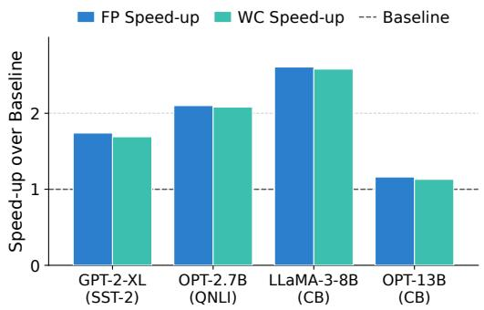

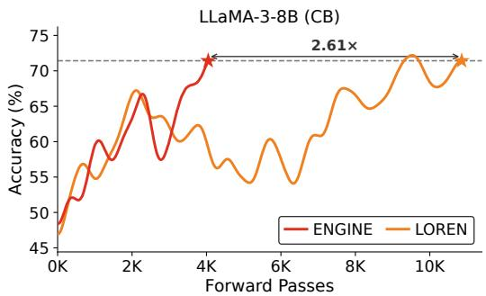  
Figure 1: Left: Forward-pass and wall-clock speed-up of ENGINE over LOREN to reach LOREN’s best accuracy, across four representative (model, task) settings. Right: Validation accuracy convergence on LLaMA-3-8B (CB).

LoRA [Hu et al., 2021] offers a lower-dimensional alternative by restricting updates to a low-rank subspace, improving efficiency and usually reducing variance. But this also discards fine-grained curvature information from the full space, which can slow convergence and degrade performance.

This leads to a central dilemma in zeroth-order optimization (Table 1): full-space optimization is informative but high-variance, while subspace optimization is low-variance but blind. Recent curvature-aware ZO methods, such as LOREN [Seung et al., 2026], reduce estimator variance through anisotropic perturbations [Kool et al., 2019]. Even so, existing methods usually stay in one space only: either the full parameter space or a low-rank subspace such as LoRA. They therefore gain only one side of the trade-off. Full-space methods retain richer information but are statistically costly, while subspace methods are more efficient but inevitably lose part of the curvature structure that is present in the full space. This motivates a simple question: can we keep the efficiency of low-dimensional sampling while still using curvature information from the full space? We approach this question through Variational MultiScale (VMS) theory [Hughes, 1995, Hughes et al., 1998] from computational mechanics. VMS separates a problem into a resolved coarse scale and an unresolved fine scale, then uses a correction term [Hughes et al., 2000] to account for the effect of the unresolved part. This viewpoint suggests a natural way to think about low-dimensional and high-dimensional spaces in zeroth-order optimization.

Based on this idea, we propose ENGINE (Endogenous Variational MultiScale). We treat the lowdimensional LoRA parameterization as the resolved coarse scale and incorporate unresolved fullspace curvature through a fine-scale correction. Unlike classical VMS, the optimization operator evolves with the optimization state, so the interaction between the two spaces must be updated dynamically. ENGINE addresses this with an endogenous V-cycle that alternates between the two spaces during training. Through a closed-form subgrid correction, it uses fine-scale information from the high-dimensional space to correct the efficient low-dimensional update.

Experiments on standard LLM optimization benchmarks show that ENGINE consistently improves over state-of-the-art zeroth-order baselines, including LOREN. It achieves better downstream accuracy, faster convergence, and up to a 2.61× speed-up in forward passes (Figure 1), while keeping peak memory usage unchanged.

Our contributions are summarised as follows.

• A cross-disciplinary perspective. We introduce the idea of Variational MultiScale (VMS) from computational mechanics into zeroth-order LLM fine-tuning. This perspective clarifies why unresolved fine-scale curvature matters and provides a systematic way to describe the interaction between low-dimensional and high-dimensional optimization spaces.

• The framework of ENGINE. We propose ENGINE, an endogenous Variational MultiScale framework for zeroth-order optimization that combines low-rank sampling with a closedform subgrid correction, thereby reintroducing unresolved full-space curvature into the coarse update. Under appropriate assumptions, we rigorously analyze the bias and variance of the corrected estimator. We also establish a stationarity bound for coarse updates.

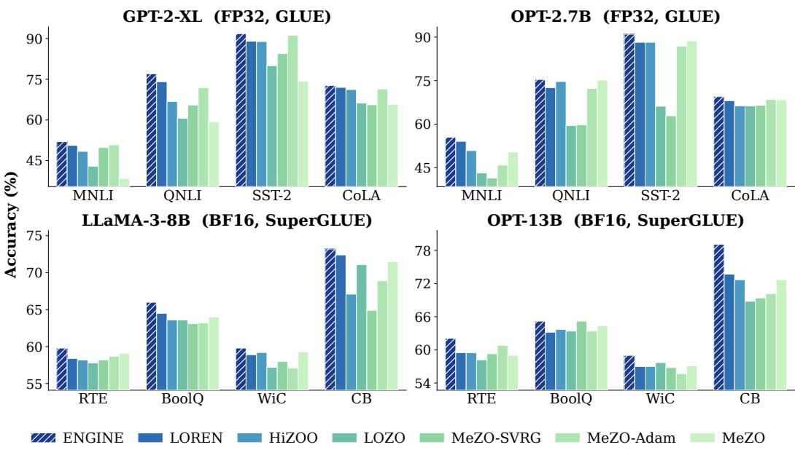  
Figure 2: Test accuracy on all 16 (model, task) combinations. Top row: GPT-2-XL (GLUE, FP32) and OPT-2.7B (GLUE, FP32). Bottom row: LLaMA-3-8B (SuperGLUE, BF16) and OPT-13B (SuperGLUE, BF16). ENGINE is shown in blue hatched. Full numerical values are in Appendix E.1.

• Consistent improvements. Extensive experiments across diverse LLM fine-tuning settings demonstrate that ENGINE improves both downstream performance and convergence speed over state-of-the-art zeroth-order baselines (Figure 2). These gains come with up to a 2.61× speed-up in forward passes and no additional peak memory overhead.

## 2 Preliminaries & Problem Setup

To address the single-scale limitation of ZO methods discussed in Sec. 1, ENGINE couples a lowdimensional LoRA scale with the high-dimensional full parameter space via Variational MultiScale (VMS). Sec. 2.1 first introduces the curvature-aware ZO framework adopted from LOREN, after which Sec. 2.2 recalls the Variational MultiScale (VMS) viewpoint underlying our method.

## 2.1 Zeroth-Order Setting & Notation Setup

Notation. We denote vectors by lowercase bold and matrices by uppercase bold, where $\otimes$ is the Kronecker product and $\| \cdot \|$ the Euclidean norm. For a weight matrix $\mathbf { X } \in \mathbb { R } ^ { m \times n }$ , let $\textbf { x } : =$ $\mathrm { v e c } ( \mathbf { X } ) \in \mathbb { R } ^ { d }$ with $d = m n$ (multi-layer models are handled block-wise). We minimize $f ( \mathbf { x } ) : =$ $\mathbb { E } _ { \xi \sim \mathcal { P } _ { \mathrm { d a t a } } } [ \ell ( \mathbf { x } , \xi ) ]$ using only function-value queries, where $\mathcal { P } _ { \mathrm { d a t a } }$ is the data distribution.

Rank-1 Kronecker curvature. Full Hessian storage costs $O ( m ^ { 2 } n ^ { 2 } )$ memory. K-FAC [Martens and Grosse, 2015] and Shampoo [Gupta et al., 2018] exploit matrix structure to reduce preconditioning costs. Following LOREN, we use the compact vector parameterization:

$$
{ \widetilde { \mathbf { H } } } \ = \ \mathbf { I } _ { m } \otimes \big ( \rho \mathbf { I } _ { n } + \mathbf { v } \mathbf { v } ^ { \top } \big ) , \qquad \mathbf { v } \in \mathbb { R } ^ { n } , \ \rho > 0 ,\tag{1}
$$

where $\mathbf { v } \mathbf { v } ^ { \top }$ captures anisotropy shared across blocks, and damping ensures positive definiteness. Storing v costs ${ \mathrm { \bar { \cal { O } } } } ( n )$ . The inverse and inverse square root admit closed forms with O(mn) application cost, avoiding dense matrices. Section 3 extends this approximation to multiple scales.

Curvature as covariance. For $\mathbf { u } \sim \mathcal { N } ( \mathbf { 0 } , \mathbf { I } _ { d } )$ and smoothing radius $\epsilon > 0 .$ , the symmetric finitedifference estimator [Spall, 1992] is $\begin{array} { r } { \widehat { \mathbf { g } } _ { \epsilon } ( \mathbf { x } , \mathbf { u } ) = \frac { f ( \mathbf { x } + \epsilon \mathbf { u } ) - f ( \mathbf { x } - \epsilon \mathbf { u } ) } { 2 \epsilon } \mathbf { u } } \end{array}$ . Its expectation is the gradient of the Gaussian-smoothed loss. Generalized Gaussian smoothing extends this to anisotropic perturbations $\mathbf { u } \sim \mathcal { N } ( \mathbf { 0 } , \pmb { \Sigma } )$ , and setting $\pmb { \Sigma } = \widetilde { \mathbf { H } } ^ { - 1 }$ yields the NES identity [Wierstra et al., 2014] $\widetilde { \mathbf { H } } ^ { - 1 } \nabla f ( \mathbf { x } ) = \mathbb { E } _ { \widetilde { \mathbf { u } } \sim \mathcal { N } ( \mathbf { 0 } , \widetilde { \mathbf { H } } ^ { - 1 } ) } \big [ \langle \nabla f ( \mathbf { x } ) , \tilde { \mathbf { u } } \rangle \tilde { \mathbf { u } } \big ]$ , so preconditioning by $\widetilde { \mathbf { H } } ^ { - 1 }$ corresponds to larger ZO perturbations along directions of lower estimated curvature.

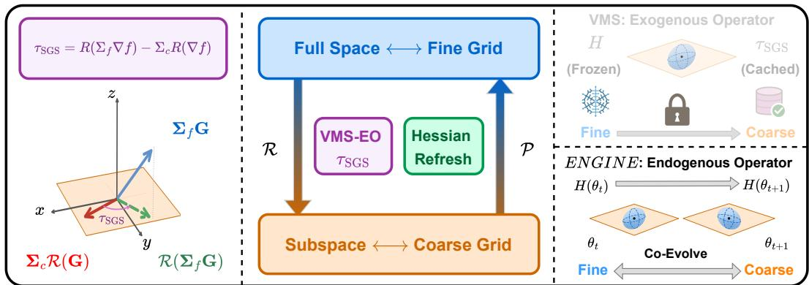  
Figure 3: ENGINE overview. Left: the gap between the restricted fine direction $\mathcal { R } ( \Sigma _ { f } \mathbf { G } )$ and the coarse direction $\Sigma _ { c } \mathcal { R } ( \mathbf { G } )$ defines the subgrid correction $\tau _ { \mathrm { s g s } } .$ Middle: V-cycle alternates Coarse (ϕ) and Fine (W) phases, with every S steps a fine probe refreshing $\mathbf { v } _ { f }  \mathbf { v } _ { f } - \nu g ( \mathbf { v } _ { f } )$ and λ (Hessian refresh), while VMS-EO $( \tau _ { \mathrm { s g s } } )$ injects the subgrid correction into each coarse step. Right: classical VMS uses a fixed operator L, while ENGINE uses the dynamic Hessian $\mathbf { H } ( \pmb \theta )$

## 2.2 Variational MultiScale Method

The Variational MultiScale (VMS) method decomposes problems into resolved (coarse) and unresolved (fine) scales. Let $\Omega \subset \mathbb { R } ^ { d }$ be a bounded domain, V a function space over Ω with dual $\nu ^ { * }$ and $\mathcal { L } : \mathcal { V } \to \mathcal { V } ^ { * }$ a linear operator, where the symmetric bilinear form $a ( w , u ) : = ( w , \mathcal { L } u )$ uses the $L ^ { 2 } ( \Omega )$ inner product $\begin{array} { r } { ( w , u ) : = \int _ { \Omega } w ( x ) u ( x ) \ d x } \end{array}$ dx. The weak problem seeks u $\in \mathcal { V }$ such that $a ( w , u ) = ( w , f )$ for all test functions $w \in \mathcal { V }$ . VMS decomposes $\mathcal { V } = \bar { \mathcal { V } } \oplus \mathcal { V } ^ { \prime }$ into coarse V¯ and fine $\mathcal { V } ^ { \prime }$ subspaces, so that $u = \bar { u } + u ^ { \prime }$ and $w = \bar { w } + w ^ { \prime }$ with $\bar { u } , \bar { w } \in \bar { \mathcal { V } }$ and $u ^ { \prime } , w ^ { \prime } \in \mathcal { V } ^ { \prime }$ . The fine scale is driven by the coarse residual $\mathcal { L } u ^ { \prime } = - ( \mathcal { L } \bar { u } - f )$ . Following the sign convention of Hughes [1995], the fine-scale solution operator $M : \mathcal { V } ^ { * } \to \mathcal { V } ^ { \prime }$ includes the negative sign, so $u ^ { \prime } = M ( \mathcal { L } \bar { u } - f )$ Substitution yields the closed coarse equation:

$$
a ( \bar { w } , \bar { u } ) + \left( { \mathcal L } ^ { * } \bar { w } , M ( { \mathcal L } \bar { u } - f ) \right) = ( \bar { w } , f ) ,\tag{2}
$$

where $\mathcal { L } ^ { * } : \mathcal { V } \to \mathcal { V } ^ { * }$ is the adjoint of L, and the second term in (2) is the subgrid correction encoding unresolved-scale feedback. In our setting, $\bar { u } , u ^ { \prime } .$ , and L correspond to the LoRA-space update, unresolved full-space curvature, and endogenous Hessian operator $\widetilde { \mathbf { H } } .$ , respectively. The subgrid correction corresponds to the VMS-EO fine-scale curvature injection developed in Sec. 3.

## 3 Method

Building on the rank-1 curvature primitive $( \widetilde { \mathbf { H } } , \mathbf { v } )$ from Eq. (1) and the VMS formulation coupling coarse and fine scales from Eq. (2), this section develops and analyzes ENGINE (Figure 3). §3.1 contrasts the rigid linear operator L of classical VMS with the dynamic Hessian H(θ) of optimization, motivating why classical VMS cannot be ported verbatim. §3.2 derives the central correction $\tau _ { \mathrm { s g s } }$ and its rank-1 LoRA-branch surrogate. §3.3 embeds VMS-EO into a V-cycle so that the endogenous state $\mathbf { v } _ { f }$ is refreshed across phases. §3.4 then quantifies how coarse sampling and exact subgrid correction affect variance and bias relative to a common target.

The multiscale state is carried by three rank-1 curvature vectors: the full-space $\mathbf { v } _ { f } \in \mathbb { R } ^ { n }$ and the two LoRA-branch curvatures $\mathbf { v _ { B } } \in \mathbb { R } ^ { r } , \mathbf { v _ { A } } \in \mathbb { R } ^ { n }$ . We instantiate the resolved coarse scale by a rank-r LoRA factorization $\Delta \mathbf { W } = \mathbf { B } \mathbf { A }$ with B $\in \mathbb { R } ^ { m \times r } , \mathbf { A } \in \mathbb { R } ^ { r \times n }$ and $r \ll \operatorname* { m i n } ( m , n )$ , so the coarse parameter $\boldsymbol { \phi } = \left( \mathbf { B } , \mathbf { A } \right)$ has dimension $d _ { c } = r ( m + n )$ , much smaller than $d _ { f } = m n$ Fine-scale information is obtained from the full parameter space and used to correct curvature effects not captured by the coarse model.

## 3.1 Endogenous Operator: Why Classical VMS Fails?

Classical VMS starts from a linear problem $\begin{array} { r } { \mathcal { L } u \ = \ f } \end{array}$ with operator L fixed by the underlying physics, which is what allows the unresolved component $u ^ { \prime }$ to be eliminated analytically in closed form (Figure 3 Right, top). In optimization the analogous linear equation is the Newton step $\mathbf { H } ( \pmb \theta ) \Delta \bar { \pmb \theta } = - \nabla f ( \bar { \pmb \theta } )$ , giving the correspondence $( { \cal L } , u , \bar { f } )  ( { \bf H } , \Delta \theta , - \nabla f )$ . Unlike ${ \mathcal { L } } ,$ however, $\mathbf { H } ( \pmb \theta )$ co-evolves with the iterate (Figure 3 Right, bottom), so the closure cannot be derived once and for all but must be refreshed periodically by the V-cycle of §3.3. We call this state-dependent operator an endogenous operator and the resulting subgrid correction VMS-EO.

Coarse increments are represented by changes in the LoRA factors. The prolongation operator $\mathcal { P } : ( \Delta \mathbf { B } , \Delta \mathbf { A } ) \longmapsto \mathbf { B } \Delta \bar { \mathbf { A } } + \Delta \mathbf { B } \mathbf { A } \bar { \in } \mathbb { R } ^ { m \times \overline { { n } } }$ lifts a coarse update to the full space (the differential of the LoRA product), and the restriction operator $\mathcal { R } = \left( \mathcal { R } _ { \mathbf { B } } , \mathcal { R } _ { \mathbf { A } } \right)$ with $\mathcal { R } _ { \mathbf { B } } ( \mathbf { X } ) = \mathbf { X } \mathbf { A } ^ { \top } \in \mathbb { R } ^ { m \times r }$ and $\mathcal { R } _ { \mathbf { A } } ( \mathbf { X } ) = \mathbf { B } ^ { \top } \mathbf { X } \in \mathbb { R } ^ { r \times n }$ maps a full-space matrix X to the two LoRA gradient blocks. The two operators are formal adjoints under the Frobenius inner product, $\mathcal { R } = \mathcal { P } ^ { * } , \mathrm { i . e . } , \langle \mathcal { P } ( \Delta \mathbf { B } , \Delta \mathbf { A } ) , \mathbf { X } \rangle _ { F } =$ $\langle \bar { ( \Delta \mathbf { B } , \Delta \mathbf { A } ) } , \mathcal { R } ( \mathbf { X } ) \rangle _ { F }$ for all $\mathbf { X } \in \mathbb { R } ^ { m \times n }$

At LLM scale, H $\in \mathbb { R } ^ { d _ { f } \times d _ { f } }$ cannot be formed, so ENGINE inherits LOREN’s rank-1 Kronecker $\widetilde { \mathbf { H } } = \mathbf { I } _ { m } \otimes ( \rho \mathbf { I } _ { n } + \mathbf { v } \mathbf { v } ^ { \top } )$ as the practical operator with preconditioner $\pmb { \Sigma } = \widetilde { \mathbf { H } } ^ { - 1 }$ . Given parameter x and curvature v, LOREN draws K anisotropic perturbations $z _ { k } = \mathbf { x } + \varepsilon \pmb { \Sigma } ^ { 1 / 2 } u _ { k }$ where $u _ { k } \sim \mathcal { N } ( \mathbf { 0 } , \mathbf { I } )$ to simultaneously form RLOO estimators for both parameter and curvature gradients:

$$
g ( { \bf x } ) = \frac { 1 } { \varepsilon ( K - 1 ) } \sum _ { k = 1 } ^ { K } ( f _ { k } - \bar { f } ) \Sigma ^ { 1 / 2 } u _ { k } , \qquad g ( { \bf v } ) = \frac { 1 } { K - 1 } \sum _ { k = 1 } ^ { K } ( f _ { k } - \bar { f } ) \nabla _ { \bf v } \log p _ { \theta } ( z _ { k } ) ,\tag{3}
$$

where $\begin{array} { r } { f _ { k } : = f ( z _ { k } ) , \bar { f } : = \frac { 1 } { K } \sum _ { j } f _ { j } } \end{array}$ , and the closed form of the score function $\nabla _ { \mathbf { v } } \log p _ { \pmb { \theta } } ( z )$ is given in LOREN Eq. (10). The two estimators share the same batch $\{ u _ { k } , f _ { k } \}$ , so each step costs only $K$ forward passes. ENGINE samples in LoRA coordinates with (3) to avoid $d _ { f }$ -scale variance, while injecting full-space curvature feedback as a subgrid correction back into the coarse phase.

## 3.2 VMS-EO Subgrid Correction

To construct the correction in Figure 3 (Left), we first identify where coarse and fine directions differ. Lemma 3.1 establishes exact restriction of first-order gradients. Proposition 3.2 then gives the curvature mismatch introduced by preconditioning. This residual supplies the corrected LoRA updates in Eqs. (7) and (8).

Closed-Form Curvature Correction. Let $\mathbf { G } \in \mathbb { R } ^ { m \times n }$ denote a full-space gradient-like matrix. Deterministically $\mathbf { G } = \nabla _ { \mathbf { W } } f$ , while in the ZO implementation it is replaced by the RLOO estimator. Lemma 3.1 (chain rule). LoRA restriction commutes withfirst-order differentiation: $\mathcal { R } ( \nabla _ { \mathbf { W } } f ) =$ $\nabla _ { ( \mathbf { B } , \mathbf { A } ) } f .$ . Proofin Appendix B.1.

Lemma 3.1 shows that restricting the exact fine-space gradient gives the coarse-space gradient. Curvature preconditioning introduces a mismatch between the two directions. Let $\begin{array} { r } { \dot { \Sigma _ { f } } , \pmb { \Sigma _ { \mathbf { B } } } , \pmb { \Sigma _ { \mathbf { A } } } } \end{array}$ be the rank-1 Kronecker covariances built from $\mathbf { v } _ { f } , \mathbf { v _ { B } } , \mathbf { v _ { A } }$ (Sherman-Morrison forms in Appendix B.2), and $\Sigma _ { c } : = \mathrm { d i a g } ( \Sigma _ { \mathbf { B } } , \Sigma _ { \mathbf { A } } )$ . In general $\mathcal { R } ( \Sigma _ { f } \bar { \mathbf { G } } ) \neq \Sigma _ { c } \mathcal { R } ( \mathbf { G } )$ , so the two preconditioned directions can differ in both magnitude and orientation. This gap defines the subgrid residual:

$$
\tau _ { \mathrm { s g s } } : = \mathscr { R } ( \Sigma _ { f } \mathbf { G } ) - \Sigma _ { c } \mathscr { R } ( \mathbf { G } ) ,\tag{4}
$$

with branch components $\pmb { \tau } _ { \mathrm { s g s } , \mathbf { B } } \in \mathbb { R } ^ { m \times r }$ and $\pmb { \tau } _ { \mathrm { s g s } , \mathbf { A } } \in \mathbb { R } ^ { r \times n }$ . The following result expresses each branch residual through the rank-1 curvature vectors.

Proposition 3.2 (closed-form subgrid residual). Under the rank-1 surrogates above with $\rho > 0 ;$ , the branch residuals are:

$$
{ \boldsymbol \tau } _ { \mathrm { s g s , \mathbf { B } } } = \frac { 1 } { \rho } \bigg [ \frac { \mathbf { G } \mathbf { A } ^ { \top } \mathbf { v _ { \mathbf { B } } } \mathbf { v _ { \mathbf { B } } ^ { \top } } } { \rho + \| \mathbf { v _ { B } } \| ^ { 2 } } - \frac { \mathbf { G } \mathbf { v } _ { f } ( \mathbf { A } \mathbf { v } _ { f } ) ^ { \top } } { \rho + \| \mathbf { v } _ { f } \| ^ { 2 } } \bigg ] ,\tag{5}
$$

$$
\tau _ { \mathrm { s g s , A } } ~ = ~ \frac { 1 } { \rho } \left[ \frac { \mathbf { B } ^ { \top } \mathbf { G } \mathbf { v _ { A } } \mathbf { v _ { A } ^ { \top } } } { \rho + \| \mathbf { v _ { A } } \| ^ { 2 } } - \frac { \mathbf { B } ^ { \top } \mathbf { G } \mathbf { v } _ { f } \mathbf { v } _ { f } ^ { \top } } { \rho + \| \mathbf { v } _ { f } \| ^ { 2 } } \right] .\tag{6}
$$

Proof in Appendix B.2.

Lemma 3.1 and Proposition 3.2 together identify $\pmb { \tau } _ { \mathrm { s g s } }$ as the second-order curvature gap that VMS-EO must inject. We now describe the corrected coarse update.

Rank-1 Surrogate for LoRA Branches. Let $\mathbf { s } _ { c } : = \pmb { \Sigma } _ { c } \mathcal { R } ( \mathbf { G } )$ be the pure coarse preconditioned direction, which equals the LoRA-space LOREN direction without any VMS-EO correction. VMS-EO simply adds a branch-weighted subgrid correction $\mathbf { s } _ { c } + \lambda \tau _ { \mathrm { s g s } }$ , where $\lambda = 0$ recovers LoRA-space LOREN and a larger λ injects more fine-grid curvature feedback. The two branches carry independent weights $\lambda _ { \mathbf { B } } , \lambda _ { \mathbf { A } } \in [ 0 , 1 ]$

VMS-EO corrected updates. Let $\widehat { \mathbf { g } } _ { c , \mathbf { B } } \in \mathbb { R } ^ { m \times r }$ and $\widehat { \mathbf { g } } _ { c , \mathbf { A } } \in \mathbb { R } ^ { r \times n }$ denote the preconditioned RLOO directions for the two LoRA branches from Eq. (3). With branch step sizes $\eta _ { \mathrm { B } } , \eta _ { \mathrm { A } } > 0$ , the corrected updates are:

$$
\Delta \mathbf { B } \ = \ - \eta _ { \mathbf { B } } \left( \widehat { \mathbf { g } } _ { c , \mathbf { B } } \ + \lambda _ { \mathbf { B } } \tau _ { \mathrm { s g s } , \mathbf { B } } \right) ,\tag{7}
$$

$$
\Delta \mathbf { A } \ = \ - \eta _ { \mathbf { A } } \left( \widehat { \mathbf { g } } _ { c , \mathbf { A } } + \lambda _ { \mathbf { A } } \tau _ { \mathrm { s g s } , \mathbf { A } } \right) .\tag{8}
$$

Implementation details are given in Appendix D.1.

Adaptive mixing weights. Proposition C.7 characterizes an oracle mixing weight that minimizes the estimation MSE. Since it depends on unknown correction and error statistics, we use normalized angular disagreement between coarse and fine curvature directions as a practical proxy for selecting $\lambda _ { \mathbf { B } } , \lambda _ { \mathbf { A } } \in [ 0 , 1 ]$ . For the B-branch we use the formula below, and the A-branch is analogous after replacing vB with $\mathbf { v _ { A } }$ and the projection $\mathbf { A } \mathbf { v } _ { f }$ with $\mathbf { v } _ { f } \colon$

$$
\delta _ { \mathbf { B } } : = \frac { 1 } { 2 } \left\| \frac { \mathbf { v _ { B } } } { \| \mathbf { v _ { B } } \| } - \frac { \mathbf { A v } _ { f } } { \| \mathbf { A v } _ { f } \| } \right\| , \qquad \lambda _ { \mathbf { B } } = \mathrm { c l i p } ( \delta _ { \mathbf { B } } , \lambda _ { \mathrm { m i n } } , \lambda _ { \mathrm { m a x } } ) .\tag{9}
$$

When $\delta$ approaches zero the two curvature directions become aligned, so λ falls to $\lambda _ { \mathrm { m i n } }$ and the correction receives its minimum mixing weight. When δ approaches one the directions diverge, so λ rises to $\lambda _ { \mathrm { m a x } }$ and injects more fine-grid feedback.

## 3.3 ENGINE: V-cycle Coupling

ENGINE alternates between M-epoch coarse $( \phi )$ and N-epoch fine (W) phases (Figure 3 Middle), updating the base $\mathbf { W } _ { 0 }$ in $\mathbf { W } = \mathbf { \dot { W } } _ { 0 } + \mathbf { B } \mathbf { A }$ only at phase boundaries. A cyclic schedule couples them, using $\mathcal { P }$ and R operators to transfer parameters, momentum, and curvature.

Two-phase schedule. Coarse phase. ENGINE updates $\phi = \left( \mathbf { B } , \mathbf { A } \right)$ via Eqs. (7) and (8) and uses (3) to take one curvature step per branch with learning rate $\nu > 0$ (Algorithm 1, line 6). Crucially, the K RLOO samples $\{ u _ { k } , f _ { k } \}$ are reused from those already drawn for $( \Delta \mathbf { B } , \Delta \mathbf { A } )$ , so this curvature step costs no additional forward passes. The operator $\widetilde { \mathbf { H } } = \widetilde { \mathbf { H } } ( \pmb \theta , \mathbf { v } _ { f } )$ is endogenous, however, so $\mathbf { v } _ { f }$ goes stale across coarse steps and causes $\tau _ { \mathrm { s g s } }$ to inject outdated information through its $\mathbf { v } _ { f }$ dependence. We therefore trigger a Hessian refresh every S coarse steps as illustrated in Algorithm 1, where K extra full-space perturbations update $\mathbf { v } _ { f }$ using (3) with learning rate ν together with the projection scalars in Proposition 3.2 while θ, B, and A remain unchanged. This refresh-and-reuse strategy parallels Lazy Hessian [Doikov et al., 2023], which also recomputes curvature every S steps and reuses it in between to cut arithmetic cost without sacrificing convergence.

Fine phase. ENGINE returns to the full parameter space and applies $\Sigma _ { j }$ -preconditioned LOREN steps from Eq. (3) to W, simultaneously refreshing $\mathbf { v } _ { f }$ for the next coarse phase.

Prolongation $\mathcal { P }$ from coarse to fine. The coarse update BA is absorbed into the base weight $\mathbf { W } _ { 0 }$ We save the current A as $\mathbf { A } _ { \mathrm { o l d } }$ before reinitialization. This cached matrix maps vectors from $\mathbb { R } ^ { n }$ to Rr during the next transition from fine to coarse. Branch momenta combine into mf via the LoRA product rule, and curvature is EMA-blended with weight $\beta .$ Algorithm 1 specifies the transfers.

Restriction R from fine to coarse. We set the base weight $\mathbf { W } _ { 0 }$ to $\mathbf { W } _ { \mathrm { f i n e \_ b e s t } }$ , rescale $\mathbf { B } ,$ , and reset A to zero so that $\mathbf { W } _ { 0 } + \mathbf { B } \mathbf { A } = \mathbf { W } _ { 0 }$ holds exactly at cycle start. Momentum is projected onto the two branches via R with default damping factor $\alpha = 0 . 5$ , and the two branch curvatures use the cached basis $\mathbf { A } _ { \mathrm { o l d } }$ . Algorithm 1 gives these transfer formulas.

Algorithm 1 ENGINE (see Appendix D for details).   
Require: frozen W, dataset D, rank r, cycles V , coarse/fine epochs M, N, queries K, smoothing ϵ,   
damping $\rho ,$ learning rates $\eta _ { \mathbf { B } } , \eta _ { \mathbf { A } } , \eta _ { f } , \nu ,$ mixing range $[ \lambda _ { \operatorname* { m i n } } , \lambda _ { \operatorname* { m a x } } ]$ , transfer weight $\beta ,$ fine-probe   
interval S (every S coarse steps, refresh $\mathbf { v } _ { f }$ and λ).   
1: Initialize B randomly, set $\mathbf { A }  \mathbf { 0 } .$ , and initialize $\mathbf { V } _ { \mathbf { B } } , \mathbf { V } _ { \mathbf { A } } , \mathbf { V } _ { f } .$   
2: for $v = 1 , \ldots , V$ do   
3: Coarse phase (M epochs in $\phi = ( \mathbf { B } , \mathbf { A } ) ) ;$ ▷ ■ Coarse space   
4: for $t = { \hat { 1 } } , \dots , M$ ·steps/epoch do   
5: Draw K LoRA perturbations and estimate $\widehat { \bf g } _ { c , { \bf B } } , \widehat { \bf g } _ { c , { \bf A } }$ via (3).   
6: $\mathrm { v _ { B } } \gets \mathrm { v _ { B } } - \nu g ( \mathrm { v _ { B } } ) , \mathrm { v _ { A } } \gets \mathrm { v _ { A } } - \nu g ( \mathrm { v _ { A } } )$ on the same K samples.   
7: if t mod $S = 0$ then   
8: $\mathbf { v } _ { f }  \mathbf { v } _ { f } - \nu g ( \mathbf { v } _ { f } )$ via (3). ▷ ■ Hessian refresh, K extra fwd   
9: Update $\lambda _ { \mathrm { B } } , \lambda _ { \mathrm { A } }$ via (9).   
10: end if   
11: Compute $\tau _ { \mathrm { s g s } }$ via Prop. 3.2 (Eqs. (5) and (6)). ▷ ■ VMS-EO   
12: Update $( \mathbf { B } , \mathbf { \check { A } } )$ via Eqs. (7) and (8).   
13: end for   
14: Prolongation ${ \mathcal { P } } ( \mathbf { C }  \mathbf { F } ) : \mathbf { W } _ { 0 }  \mathbf { W } _ { 0 } + \mathbf { B A } , \mathbf { A } _ { \mathrm { o l d } }  \mathbf { A } , \mathbf { m } _ { f } = \mathbf { m } _ { \mathrm { B } } \mathbf { A } + \mathbf { B m } _ { \mathrm { A } } , \mathbf { v } _ { f }  \mathbf { A } .$   
normalize $( ( 1 - \beta ) \mathbf { v } _ { f } + \beta$ normalize $\bf ( A ^ { \top } v _ { B } + v _ { A } ) )$   
15: Fine phase (N epochs in W): LOREN on W with lr $\eta _ { f } , K$ queries via (3), updating $\mathbf { v } _ { f } . ~ \mathsf { D }$   
■ Fine space   
16: Restriction $\mathcal { R } \left( \mathbf { F } \right. \mathbf { C } \right) : \mathbf { W } _ { 0 } \left. \mathbf { W } _ { \mathrm { f i n e \_ b e s t } }$ , rescale B, $\mathbf { A } \gets \mathbf { 0 } , \mathbf { m } _ { \mathbf { A } } = \alpha \mathbf { B } ^ { \top } \mathbf { m } _ { f } , \mathbf { m } _ { \mathbf { B } } =$   
αm $\mathbf { \Sigma } _ { f } \mathbf { A } _ { \mathrm { o l d } } ^ { \top } , \mathbf { v } _ { \mathbf { A } } \colon$ = normalize(vf), vB = normalize $\left( \mathbf { A } _ { \mathrm { o l d } } \mathbf { v } _ { f } \right)$   
17: end for   
18: return W.

ENGINE maintains only the LoRA factors (B, A) and the rank-1 curvature vectors $\left( \mathbf { v } _ { f } , \mathbf { v _ { B } } , \mathbf { v _ { A } } \right)$ never explicitly storing a full Hessian. Algorithm 1 summarizes the procedure, and implementation details are in Appendix D.

## 3.4 Statistical and Convergence Analysis

We provide a detailed analysis of the trade-off between bias and variance in ENGINE. Under appropriate assumptions, coarse sampling reduces the dimension-dependent variance bound and exact correction eliminates structural bias in the local-linear limit. We also establish convergence bounds for coarse updates.

Fix the current weights, LoRA factors, and covariances. Subscripts f and c denote fine and coarse spaces. In row-wise vector coordinates, let $\mathbf { g } _ { f } ^ { \operatorname { r a w } }$ be the full-space gradient and ${ \bf g } _ { c } ^ { \mathrm { r a w } } = \mathcal { R } ( { \bf g } _ { f } ^ { \mathrm { r a w } } )$ the gradient with respect to ϕ. The coarse direction is $\mathbf { s } _ { c } = \pmb { \Sigma } _ { c } \mathbf { g } _ { c } ^ { \mathrm { r a w } }$ , and the common comparison target is $\mathbf { g } _ { \star } = \mathcal { R } ( \Sigma _ { f } \mathbf { g } _ { f } ^ { \mathrm { r a w } } )$ . Thus Eq. (4) gives $\boldsymbol \tau _ { \mathrm { s g s } } = \mathbf { g } _ { \star } - \mathbf { s } _ { c }$

We use a Gaussian estimator with b independent directions and smoothing radius ϵ. Write $F ( \phi ) =$ $f ( \mathbf { W } _ { 0 } + \mathbf { B A } )$ and draw $\mathbf z _ { i } \sim \mathcal N ( \mathbf 0 , \pmb { \Sigma } _ { c } )$ independently. Define:

$$
\widehat { \mathbf { g } } _ { c , \epsilon , b } = \frac { 1 } { b } \sum _ { i = 1 } ^ { b } \frac { F ( \phi + \epsilon \mathbf { z } _ { i } ) - F ( \phi ) } { \epsilon } \mathbf { z } _ { i } .\tag{10}
$$

Here $\mathbf { z } _ { i } = [ \mathbf { z } _ { \mathbf { B } , i } ^ { \top } , \mathbf { z } _ { \mathbf { A } , i } ^ { \top } ] ^ { \top } \in \mathbb { R } ^ { d _ { c } }$ stacks B- and A-branch perturbations of dimensions mr and rn, with $d _ { c } = r ( m + n )$ . The covariance $\pmb { \Sigma } _ { c } = \mathrm { d i a g } ( \pmb { \Sigma } _ { \mathbf { B } } , \pmb { \Sigma } _ { \mathbf { A } } ) \in \mathbb { R } ^ { d _ { c } \times d _ { c } }$ has blocks of sizes $m r \times m r$ and $r n \times r n$ , respectively. Implementation uses RLOO from Eq. (3). The next result isolates the effect of exact correction in the local-linear limit, where the smoothing bias vanishes.

Proposition 3.3 (Common-target error with exact correction). Suppose F has a Lipschitz continuous gradient and Σc is fixed and positive definite. $A s \epsilon \to 0$ with b fixed, Eq. (10) converges in mean square to $\begin{array} { r } { \widehat { \mathbf g } _ { c , 0 , b } = \bar { b ^ { - 1 } } \sum _ { i } \mathbf z _ { i } \mathbf z _ { i } ^ { \top } \mathbf g _ { c } ^ { \mathrm { r a w } } } \end{array}$ . Its mean is ${ \bf s } _ { c }$ and its trace variance is:

$$
V _ { c , 0 } = \frac { \mathrm { t r } ( \pmb { \Sigma } _ { c } ) ( \mathbf { g } _ { c } ^ { \mathrm { r a w } } ) ^ { \top } \pmb { \Sigma } _ { c } \mathbf { g } _ { c } ^ { \mathrm { r a w } } + ( \mathbf { g } _ { c } ^ { \mathrm { r a w } } ) ^ { \top } \pmb { \Sigma } _ { c } ^ { 2 } \mathbf { g } _ { c } ^ { \mathrm { r a w } } } { b } .\tag{11}
$$

With exact deterministic correction and both branch weights equal to one, the common-target errors satisfy:

$$
\begin{array} { r } { \mathbb { E } \| \widehat { \mathbf { g } } _ { c , 0 , b } - { \mathbf { g } } _ { \star } \| ^ { 2 } = V _ { c , 0 } + \| \pmb { \tau } _ { \mathrm { s g s } } \| ^ { 2 } , } \end{array}\tag{12}
$$

$$
\mathbb { E } \| \widehat { \mathbf { g } } _ { c , 0 , b } + \pmb { \tau } _ { \mathrm { s g s } } - \mathbf { g } _ { \star } \| ^ { 2 } = V _ { c , 0 } .\tag{13}
$$

Theorem C.3 proves the stated mean-square limit ofthe Gaussian estimator $\widehat { \mathbf { g } } _ { c , \epsilon , b }$ . Lemma C.2 gives Eq. (11), and Proposition C.4 yields Eqs. (12) and (13) in the limit. Proofin Appendix C.3.3.

Variance reduction and bias correction. For isotropic sampling with $\Sigma _ { c } = I _ { d _ { c } }$ , Eq. (11) reduces to $\begin{array} { r } { V _ { c , 0 } = \frac { d _ { c } + 1 } { b } \| \mathbf { g } _ { c } ^ { \mathrm { r a w } } \| ^ { 2 } } \end{array}$ , compared with the fine-space factor $\frac { d _ { f } + 1 } { b }$ . For anisotropic sampling with fixed positive-definite $\Sigma _ { c }$ and $\| \Sigma _ { c } \| _ { \mathrm { o p } } \leq M _ { c }$ , the same equation gives the upper bound $V _ { c , 0 } \ \leq$ $\begin{array} { r l } {  { \frac { d _ { c } + 1 } { b } M _ { c } ^ { 2 } \| \mathbf { g } _ { c } ^ { \mathrm { r a w } } \| ^ { 2 } } } \end{array}$ . Under comparable gradient and spectral scales, $d _ { c } \ll d _ { f }$ reduces the dimensiondependent variance bound. In the local-linear limit, Proposition C.4 shows that exact correction eliminates the structural bias relative to $\mathbf { g } _ { \star }$ while preserving the coarse sampling variance, decreasing MSE by $\| \tau _ { \mathrm { s g s } } \| ^ { 2 }$ . Ideal ENGINE thus combines coarse-space variance reduction with structural-bias elimination. Appendix C.3 gives finite-radius bounds and a common-target comparison in Table 4.

For finite smoothing radius ϵ and $L _ { c }$ -smooth F, Theorem C.3 in Appendix C.2 gives $\| \mathbf { b } _ { c , \epsilon } \| =$ $\mathcal { O } ( \epsilon \sqrt { d _ { c } } )$ with $L _ { c }$ and $M _ { c }$ held fixed. Here $\mathbf { b } _ { c , \epsilon } = \mathbb { E } \widehat { \mathbf { g } } _ { c , \epsilon , b } - \mathbf { s } _ { c }$ is the residual smoothing bias. Proposition C.4 gives the MSE reduction $\| \tau _ { \mathrm { s g s } } \| ^ { 2 } - 2 \langle \mathbf { b } _ { c , \epsilon } , \tau _ { \mathrm { s g s } } \rangle$ , quantifying the effect of this remaining bias. For approximate corrections, Proposition C.5 accounts for their bias, variance, and dependence on the coarse estimate. Proposition C.6 in Appendix C.4 separates row compression error from scalar coefficient mismatch.

Convergence analysis. Consider the ideal Gaussian update $\phi _ { t + 1 } = \phi _ { t } - \eta ( \widehat { \mathbf { g } } _ { c , \epsilon , b , t } + \tau _ { \mathrm { s g s } , t } )$ on a fixed coarse objective $F .$ . Under the assumptions in Appendix C.6, Theorem C.9 gives the following bound for the prescribed $\eta = \Theta ( T ^ { - 1 / 2 } )$

$$
\frac { 1 } { T } \sum _ { t = 0 } ^ { T - 1 } \mathbb { E } \| \nabla F ( \phi _ { t } ) \| ^ { 2 } \leq O ( T ^ { - 1 / 2 } ) + O ( \epsilon ^ { 2 } ) .\tag{14}
$$

Here T counts iterations. The bound separates optimization decay from the smoothing residual, with coarse-dimensional sampling constants. Corollary C.10 extends the bound to approximate corrections, with correction bias affecting the residual and correction variance affecting the sampling constants.

## 4 Experiments

We evaluate ENGINE on 16 (model, task) combinations, assessing accuracy, efficiency, and the contributions of V-cycle and VMS-EO.

## 4.1 Experimental Setup and Main Results

Setup. We evaluate four autoregressive LLMs of size 1.5B to 13B, namely GPT-2-XL [Radford et al., 2019], OPT-2.7B and OPT-13B [Zhang et al., 2022], and LLaMA-3-8B [Grattafiori et al., 2024], on 16 prompt-free classification tasks drawn from GLUE [Wang et al., 2018] and SuperGLUE [Wang et al., 2019]. We compare ENGINE against LOREN together with five other ZO baselines, whose full list and background appear in Appendix A. All baselines are independently reproduced under LOREN’s setup. On top of this protocol, ENGINE introduces only two new hyperparameters. The C60F60 V-cycle alternates 60 coarse epochs with 60 fine epochs, and the curvature refresh interval S is set per (model, task) combination as listed in Table 8. The LoRA rank r scales with model size. We report mean accuracy (%) over five seeds for all tasks. See Appendices E and F for details.

Main results. Table 2 and Figure 2 show that ENGINE outperforms LOREN and other baseline methods on every (model, task) cell. Representative training curves appear in Figure 4.

Efficiency and memory. Figure 1 further shows that on every setting, ENGINE reaches LOREN’s best accuracy with substantially fewer forward passes and less wall-clock time, achieving up to a 2.61× forward-pass speed-up and a 2.58× wall-clock speed-up on LLaMA-3-8B (CB). Meanwhile,

Table 2: Main results using accuracy (%) for all tasks. Bold and cyan mark the best and second best per column. Highlighted rows give ENGINE and its absolute gain over LOREN. Full results in Appendix E.1.
<table><tr><td rowspan="2">GLUE (FP32) Method</td><td colspan="5">GPT-2-XL (1.5B)</td><td colspan="5">OPT-2.7B</td></tr><tr><td>MNLI</td><td>QNLI</td><td>SST-2</td><td>CoLA</td><td>Avg.</td><td>MNLI</td><td>QNLI</td><td>SST-2</td><td>CoLA</td><td>Avg.</td></tr><tr><td>MeZO</td><td>38.4</td><td>59.2</td><td>74.3</td><td>65.8</td><td>59.4</td><td>50.4</td><td>75.2</td><td>88.7</td><td>68.4</td><td>70.7</td></tr><tr><td>MeZO-Adam</td><td>50.8</td><td>71.9</td><td>91.2</td><td>71.4</td><td>71.3</td><td>45.9</td><td>72.3</td><td>86.9</td><td>68.5</td><td>68.4</td></tr><tr><td>MeZO-SVRG</td><td>49.8</td><td>65.5</td><td>84.5</td><td>65.6</td><td>66.4</td><td>41.5</td><td>59.8</td><td>62.9</td><td>66.5</td><td>57.7</td></tr><tr><td>LOZO</td><td>42.9</td><td>60.6</td><td>80.0</td><td>66.2</td><td>62.4</td><td>43.2</td><td>59.5</td><td>66.2</td><td>66.3</td><td>58.8</td></tr><tr><td>HiZOO</td><td>48.4</td><td>66.8</td><td>88.9</td><td>71.2</td><td>68.8</td><td>50.9</td><td>74.7</td><td>88.2</td><td>66.3</td><td>70.0</td></tr><tr><td>LOREN</td><td>50.6</td><td>74.1</td><td>89.0</td><td>72.0</td><td>71.4</td><td>54.1</td><td>72.6</td><td>88.2</td><td>68.1</td><td>70.8</td></tr><tr><td>ENGINE (Ours) ∆ vs LOREN</td><td>52.0 +1.4</td><td>77.0</td><td>91.8 +2.8</td><td>72.7 +0.7</td><td>73.4 +2.0</td><td>55.5 +1.4</td><td>75.4 +2.8</td><td>91.0 +2.8</td><td>69.5 +1.4</td><td>72.9 +2.1</td></tr></table>

<table><tr><td rowspan="2">SuperGLUE (BF16) Method</td><td colspan="5">LLaMA-3-8B</td><td colspan="5">OPT-13B</td></tr><tr><td>RTE</td><td>BoolQ</td><td>WiC</td><td>CB</td><td>Avg.</td><td>RTE</td><td>BoolQ</td><td>WiC</td><td>CB</td><td>Avg.</td></tr><tr><td>MeZO</td><td>59.1</td><td>64.0</td><td>59.3</td><td>71.5</td><td>63.5</td><td>59.0</td><td>64.4</td><td>57.1</td><td>72.7</td><td>63.3</td></tr><tr><td>MeZO-Adam</td><td>58.7</td><td>63.2</td><td>57.1</td><td>68.9</td><td>62.0</td><td>60.8</td><td>63.4</td><td>55.7</td><td>70.2</td><td>62.2</td></tr><tr><td>MeZO-SVRG</td><td>58.2</td><td>63.1</td><td>58.0</td><td>64.9</td><td>61.1</td><td>59.3</td><td>65.2</td><td>56.8</td><td>69.4</td><td>62.7</td></tr><tr><td>LOZO</td><td>57.8</td><td>63.6</td><td>57.2</td><td>71.1</td><td>62.4</td><td>58.2</td><td>63.4</td><td>57.7</td><td>68.8</td><td>62.0</td></tr><tr><td>HiZOO</td><td>58.2</td><td>63.6</td><td>59.2</td><td>67.1</td><td>62.0</td><td>59.5</td><td>63.7</td><td>57.0</td><td>72.7</td><td>63.2</td></tr><tr><td>LOREN</td><td>58.4</td><td>64.5</td><td>58.9</td><td>72.4</td><td>63.6</td><td>59.5</td><td>63.2</td><td>57.0</td><td>73.7</td><td>63.4</td></tr><tr><td>ENGINE (Ours)</td><td>59.8</td><td>66.0</td><td>59.8</td><td>73.2</td><td>64.7</td><td>62.1</td><td>65.2</td><td>59.0</td><td>79.1</td><td>66.4</td></tr><tr><td>∆ vs LOREN</td><td>+1.4</td><td>+1.5</td><td>+0.9</td><td>+0.8</td><td>+1.1</td><td>+2.6</td><td>+2.0</td><td>+2.0</td><td>+5.4</td><td>+3.0</td></tr></table>

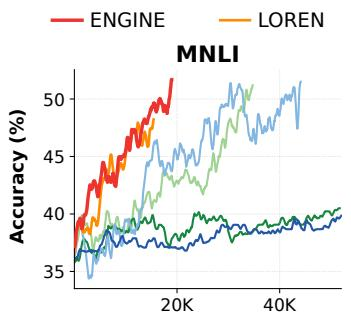

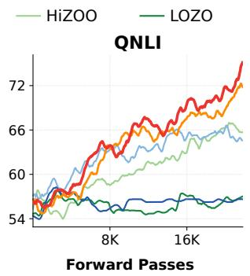

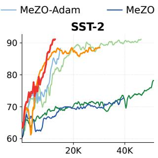  
Figure 4: Visualization of validation accuracy on GPT-2-XL across three GLUE tasks (MNLI, QNLI, SST-2). ENGINE reaches higher peak accuracy than all baselines on every task. See Appendix E.2 for training loss curves and all four models.

ENGINE’s peak GPU memory matches LOREN’s, because the fine phase is equivalent to vanilla LOREN and determines the peak, while the coarse phase only stores LoRA-scale optimizer and curvature states. Table 11 compares all methods at common target accuracies.

## 4.2 Ablation: Where does ENGINE’s gain originate from?

Setup and design. We compare LOREN, ENGINE w/o VMS-EO, and ENGINE on the same 16 settings, with other settings matched (Appendix F). The variant without VMS-EO retains the V-cycle and disables the correction. Its comparison with LOREN isolates the V-cycle’s contribution, while its comparison with full ENGINE isolates the correction’s contribution to performance.

Table 3: Ablation accuracy (%) on all 16 settings. Bold marks the best per column, and cyan marks the second best. The highlighted row is our method, with the green ∆ vs LOREN row showing the absolute gain. Full results in Appendix E.
<table><tr><td rowspan="2">GLUE (FP32) Method</td><td colspan="5">GPT-2-XL (1.5B)</td><td colspan="5">OPT-2.7B</td></tr><tr><td>MNLI</td><td>QNLI</td><td>SST-2</td><td>CoLA</td><td>Avg.</td><td>MNLI</td><td>QNLI</td><td>SST-2</td><td>CoLA</td><td>Avg.</td></tr><tr><td>LOREN</td><td>50.6</td><td>74.1</td><td>89.0</td><td>72.0</td><td>71.4</td><td>54.1</td><td>72.6</td><td>88.2</td><td>68.1</td><td>70.8</td></tr><tr><td>ENGINE w/o VMS-EO</td><td>48.8</td><td>72.7</td><td>90.2</td><td>71.5</td><td>70.8</td><td>54.7</td><td>73.8</td><td>89.5</td><td>69.1</td><td>71.8</td></tr><tr><td>ENGINE (Ours) ∆ vs LOREN</td><td>52.0 +1.4</td><td>77.0 +2.9</td><td>91.8 +2.8</td><td>72.7 +0.7</td><td>73.4 +2.0</td><td>55.5 +1.4</td><td>75.4 +2.8</td><td>91.0 +2.8</td><td>69.5 +1.4</td><td>72.9 +2.1</td></tr><tr><td>SuperGLUE (BF16)</td><td colspan="4">LLaMA-3-8B</td><td colspan="5"></td></tr><tr><td>Method</td><td>RTE</td><td>BoolQ</td><td>WiC</td><td>CB</td><td>Avg.</td><td>RTE</td><td>BoolQ</td><td>OPT-13B WiC</td><td></td><td></td></tr><tr><td>LOREN</td><td>58.4</td><td>64.5</td><td>58.9</td><td>72.4</td><td>63.6</td><td>59.5</td><td></td><td></td><td>CB</td><td>Avg.</td></tr><tr><td>ENGINE w/o VMS-EO</td><td>58.2</td><td>65.2</td><td>57.8</td><td>71.4</td><td>63.2</td><td>59.0</td><td>63.2 64.1</td><td>57.0 57.8</td><td>73.7 75.0</td><td>63.4 64.0</td></tr><tr><td></td><td></td><td></td><td>59.8</td><td>73.2</td><td>64.7</td><td>62.1</td><td></td><td></td><td></td><td></td></tr><tr><td>ENGINE (Ours) ∆ vs LOREN</td><td>59.8 +1.4</td><td>66.0 +1.5</td><td>+0.9</td><td>+0.8</td><td>+1.1</td><td>+2.6</td><td>65.2 +2.0</td><td>59.0 +2.0</td><td>79.1 +5.4</td><td>66.4 +3.0</td></tr></table>

## 4.3 Analysis: Attributing the Dual-Scale Benefits of ENGINE

Result. Table 3 yields two observations. First, ENGINE w/o VMS-EO has a mix of wins and losses against LOREN across the 16 settings. Second, ENGINE achieves higher accuracy than both LOREN and ENGINE w/o VMS-EO across all four models. Table 6 gives the full mean±std results, and Figure 9 shows the ablation convergence curves.

Analysis. The two observations identify distinct contributions.

• The V-cycle alone achieves mixed gains against LOREN. Coarse sampling in $d _ { c } \ll d _ { f }$ dimensions reduces the variance bound under comparable gradient and spectral scales (Proposition 3.3). The second-order restriction mismatch in Proposition 3.2 biases the uncorrected coarse direction and can offset this variance benefit. Alternating fine phases retain full-space curvature-aware optimization, while coarse phases reduce per-step cost.

• Incorporating VMS-EO yields consistent performance gains. By feeding full-space curvature information back into the subspace through Eqs. (7) and (8), VMS-EO corrects the structural bias. Proposition 3.3 shows that exact correction eliminates this bias without increasing coarse sampling variance in the local-linear limit. Combining coarse sampling with curvature correction thus helps explain ENGINE’s gains over LOREN and the uncorrected V-cycle.

## 5 Conclusions

In this paper, we propose ENGINE, a zeroth-order LLM fine-tuning framework inspired by Variational MultiScale (VMS) theory from computational mechanics. From the VMS perspective, we treat the LoRA parameter space as the coarse space and the full parameter space as the fine space. By reformulating VMS with an endogenous, state-dependent Hessian, we derive the VMS-EO subgrid correction to incorporate fine-space curvature information into coarse updates. ENGINE integrates this correction into an alternating V-cycle that couples the two spaces through mutual feedback. Our statistical analysis shows that, under the stated assumptions, coarse sampling reduces the dimension-dependent variance bound and exact subgrid correction eliminates curvature-mismatch bias in the local-linear limit. We further derive nonconvex stationarity bounds for corrected coarse updates. Across 16 model-task settings, ENGINE consistently outperforms state-of-the-art ZO baselines, achieving substantial forward-pass and wall-clock speed-ups with no additional peak memory overhead. More broadly, this work provides a multiscale perspective on optimization, showing how efficient low-dimensional updates can be guided by full-space curvature information. We hope this perspective inspires further connections between multiscale modeling and optimization. Appendix H discusses limitations and future work.

## Acknowledgments and Disclosure of Funding

We gratefully acknowledge the support of Westlake University Research Center for Industries of the Future and Westlake University Center for High-performance Computing.

The authors declare no competing interests.

## References

Yiming Chen, Yuan Zhang, Liyuan Cao, Kun Yuan, and Zaiwen Wen. Enhancing zeroth-order fine-tuning for language models with low-rank structures. arXiv preprint arXiv:2410.07698, 2024.

Nikita Doikov, Martin Jaggi, et al. Second-order optimization with lazy hessians. In International Conference on Machine Learning, pages 8138–8161. PMLR, 2023.

Tanmay Gautam, Youngsuk Park, Hao Zhou, Parameswaran Raman, and Wooseok Ha. Variance-reduced zeroth-order methods for fine-tuning language models. arXiv preprint arXiv:2404.08080, 2024.

Aaron Grattafiori, Abhimanyu Dubey, Abhinav Jauhri, Abhinav Pandey, Abhishek Kadian, Ahmad Al-Dahle, Aiesha Letman, Akhil Mathur, Alan Schelten, Alex Vaughan, et al. The llama 3 herd of models. arXiv preprint arXiv:2407.21783, 2024.

Vineet Gupta, Tomer Koren, and Yoram Singer. Shampoo: Preconditioned stochastic tensor optimization. In International Conference on Machine Learning, pages 1842–1850. PMLR, 2018.

Edward J Hu, Yelong Shen, Phillip Wallis, Zeyuan Allen-Zhu, Yuanzhi Li, Shean Wang, Lu Wang, and Weizhu Chen. Lora: Low-rank adaptation of large language models. arXiv preprint arXiv:2106.09685, 2021.

Thomas JR Hughes. Multiscale phenomena: Green’s functions, the dirichlet-to-neumann formulation, subgrid scale models, bubbles and the origins of stabilized methods. Computer methods in applied mechanics and engineering, 127(1-4):387–401, 1995.

Thomas JR Hughes, Gonzalo R Feijóo, Luca Mazzei, and Jean-Baptiste Quincy. The variational multiscale method—a paradigm for computational mechanics. Computer methods in applied mechanics and engineering, 166(1-2):3–24, 1998.

Thomas JR Hughes, Luca Mazzei, and Kenneth E Jansen. Large eddy simulation and the variational multiscale method. Computing and visualization in science, 3(1):47–59, 2000.

Wouter Kool, Herke van Hoof, and Max Welling. Buy 4 reinforce samples, get a baseline for free! 2019.

Vladislav Lialin, Sherin Muckatira, Namrata Shivagunde, and Anna Rumshisky. ReloRA: High-rank training through low-rank updates. In The Twelfth International Conference on Learning Representations, 2024. URL https://openreview.net/forum?id=DLJznSp6X3.

Ilya Loshchilov, Frank Hutter, et al. Fixing weight decay regularization in adam. arXiv preprint arXiv:1711.05101, 5(5):5, 2017.

Sadhika Malladi, Tianyu Gao, Eshaan Nichani, Alex Damian, Jason D Lee, Danqi Chen, and Sanjeev Arora. Fine-tuning language models with just forward passes. Advances in Neural Information Processing Systems, 36:53038–53075, 2023.

James Martens and Roger Grosse. Optimizing neural networks with kronecker-factored approximate curvature. In International conference on machine learning, pages 2408–2417. PMLR, 2015.

Yurii Nesterov and Vladimir Spokoiny. Random gradient-free minimization of convex functions. Foundations of Computational Mathematics, 17(2):527–566, 2017.

Alec Radford, Jeffrey Wu, Rewon Child, David Luan, Dario Amodei, Ilya Sutskever, et al. Language models are unsupervised multitask learners. OpenAI blog, 1(8):9, 2019.

Hyunseok Seung, Jaewoo Lee, and Hyunsuk Ko. Low-rank curvature for zeroth-order optimization in llm fine-tuning. In Proceedings ofthe AAAI Conference on Artificial Intelligence, volume 40, pages 25235–25242, 2026.

James C Spall. Multivariate stochastic approximation using a simultaneous perturbation gradient approximation. IEEE transactions on automatic control, 37(3):332–341, 1992.

Alex Wang, Amanpreet Singh, Julian Michael, Felix Hill, Omer Levy, and Samuel Bowman. Glue: A multi-task benchmark and analysis platform for natural language understanding. In Proceedings ofthe 2018 EMNLP workshop BlackboxNLP: Analyzing and interpreting neural networks for NLP, pages 353–355, 2018.

Alex Wang, Yada Pruksachatkun, Nikita Nangia, Amanpreet Singh, Julian Michael, Felix Hill, Omer Levy, and Samuel Bowman. Superglue: A stickier benchmark for general-purpose language understanding systems. Advances in neural information processing systems, 32, 2019.

Daan Wierstra, Tom Schaul, Tobias Glasmachers, Yi Sun, Jan Peters, and Jürgen Schmidhuber. Natural evolution strategies. The Journal ofMachine Learning Research, 15(1):949–980, 2014.

Susan Zhang, Stephen Roller, Naman Goyal, Mikel Artetxe, Moya Chen, Shuohui Chen, Christopher Dewan, Mona Diab, Xian Li, Xi Victoria Lin, Todor Mihaylov, Myle Ott, Sam Shleifer, Kurt Shuster, Daniel Simig, Punit Singh Koura, Anjali Sridhar, Tianlu Wang, and Luke Zettlemoyer. Opt: Open pre-trained transformer language models, 2022. URL https://arxiv.org/abs/2205.01068.

Yanjun Zhao, Sizhe Dang, Haishan Ye, Guang Dai, Yi Qian, and Ivor Tsang. Second-order fine-tuning without pain for llms: A hessian informed zeroth-order optimizer. In International Conference on Learning Representations, volume 2025, pages 43496–43520, 2025.

A Related Work 14   
B Structural Derivations and Proofs 14   
B.1 Proof of Lemma 3.1 (LoRA chain rule) 14   
B.2 Proof of Proposition 3.2 (subgrid residual) . 15   
C Theoretical Analysis 15   
C.1 Setup and assumptions . 15   
C.2 Bias and variance of Gaussian estimators . 16   
C.3 Common-target MSE and exact correction . 18   
C.4 Scalar approximation error 21   
C.5 Oracle-optimal mixing 21   
C.6 Convergence under positive alignment . 22   
D Implementation Details 25   
D.1 Scalar correction and update 25   
E Detailed Experiments and Results 26   
E.1 Full Results and Ablation . . 26   
E.2 Additional Convergence Curves 26   
F Experimental Setup and Hyperparameters 29   
F.1 Hyperparameter Sensitivity . 30   
G Efficiency Analysis 31   
H Limitations and Future Work 31

## A Related Work

ENGINE connects research on zeroth-order optimization, low-rank adaptation, and Variational MultiScale theory. These three lines of research motivate its sampling strategy, parameter spaces, and correction mechanism.

Zeroth-order LLM fine-tuning. Zeroth-order methods estimate gradients from function evaluations and reduce the memory required for LLM fine-tuning. MeZO uses in-place parameter perturbations to achieve memory usage comparable to inference. Its gradient estimates have high variance, which can slow optimization. MeZO-SVRG [Gautam et al., 2024] uses periodic reference gradients to reduce this variance, with additional memory for stored parameters and gradients. LOZO [Chen et al., 2024] exploits the low-rank structure of gradients to reduce the dimension of gradient estimation. Curvature information provides another way to improve the search direction. HiZOO [Zhao et al., 2025] estimates the diagonal Hessian and uses it to precondition the update. LOREN uses a low-rank Kronecker approximation to incorporate curvature into perturbation sampling. ENGINE builds on this curvature representation, combining LoRA sampling with full-parameter updates. Its subgrid correction injects full-space curvature information into coarse updates.

Low-rank adaptation. LoRA represents a weight update as the product of two small matrices and optimizes their entries while keeping the base weight fixed. This reduces the number of trainable parameters and provides the coarse coordinates used by ENGINE. ReLoRA [Lialin et al., 2024] periodically merges the low-rank update into the base weight and reinitializes the low-rank factors. Successive updates can therefore accumulate in the full weight matrix. ReLoRA uses this procedure within first-order training. ENGINE combines parameter merging with alternating LoRA and fullspace ZO updates, transferring momentum and curvature between the two spaces.

Variational MultiScale theory. Variational MultiScale (VMS) theory originates in computational mechanics. It separates a problem into resolved coarse scales and unresolved fine scales. The effect of the fine scales enters the coarse equation through a subgrid correction. In the classical linear formulation, the governing operator is fixed by the physical problem and determines this correction. ENGINE brings this perspective into zeroth-order optimization. The LoRA coordinates define the coarse space, and the correction accounts for curvature information lost when forming the coarse update. The curvature operator is estimated online and evolves during optimization. This state dependence motivates VMS with an Endogenous Operator.

## B Structural Derivations and Proofs

In this appendix, we prove the LoRA chain rule and derive the subgrid residual formulas.

## B.1 Proof of Lemma 3.1 (LoRA chain rule)

Proof. With $\mathbf { W } _ { 0 }$ fixed, differentiating $\mathbf { W } = \mathbf { W } _ { 0 } + \mathbf { B } \mathbf { A }$ gives:

$$
\mathrm { d } \mathbf { W } = \mathrm { d } \mathbf { B } \mathbf { A } + \mathbf { B } \mathrm { d } \mathbf { A } .
$$

The Frobenius inner product and cyclic trace identity give:

$$
\begin{array} { r l } & { \mathrm { d } f = \langle \nabla _ { \mathbf { W } } f , \mathrm { d } \mathbf { W } \rangle _ { F } } \\ & { \quad \quad = \langle ( \nabla _ { \mathbf { W } } f ) \mathbf { A } ^ { \top } , \mathrm { d } \mathbf { B } \rangle _ { F } + \langle \mathbf { B } ^ { \top } \nabla _ { \mathbf { W } } f , \mathrm { d } \mathbf { A } \rangle _ { F } . } \end{array}
$$

Matching the coefficients of the independent differentials gives the components of $\mathcal { R } ( \nabla _ { \mathbf { W } } f )$

$$
\begin{array} { r l } & { \displaystyle \frac { \partial f } { \partial \mathbf { B } } = ( \nabla \mathbf { w } f ) \mathbf { A } ^ { \top } , } \\ & { \displaystyle \frac { \partial f } { \partial \mathbf { A } } = \mathbf { B } ^ { \top } \nabla \mathbf { w } f . } \end{array}
$$

## B.2 Proof of Proposition 3.2 (subgrid residual)

Proof. For $\rho > 0$ and $\mathbf { v } \in \mathbb { R } ^ { d }$ , the Sherman-Morrison identity gives:

$$
( \rho \mathbb { I } _ { d } + \mathbf { v } \mathbf { v } ^ { \top } ) ^ { - 1 } = \frac { 1 } { \rho } \left( \mathbb { I } _ { d } - \frac { \mathbf { v } \mathbf { v } ^ { \top } } { \rho + \| \mathbf { v } \| ^ { 2 } } \right) .\tag{B.1}
$$

The Kronecker structure of $\Sigma _ { f }$ applies $( \rho \mathbb { I } _ { n } + \mathbf { v } _ { f } \mathbf { v } _ { f } ^ { \top } ) ^ { - 1 }$ independently to each row of G. Equation (B.1) therefore gives:

$$
\Sigma _ { f } \mathbf { G } = \frac { 1 } { \rho } \left( \mathbf { G } - \frac { \mathbf { G v } _ { f } \mathbf { v } _ { f } ^ { \top } } { \rho + \| \mathbf { v } _ { f } \| ^ { 2 } } \right) .
$$

Applying $\mathcal { R } _ { \mathbf { B } } ( \mathbf { X } ) = \mathbf { X } \mathbf { A } ^ { \top }$ yields:

$$
\mathcal { R } _ { \mathbf { B } } ( \Sigma _ { f } \mathbf { G } ) = \frac { 1 } { \rho } \left( \mathbf { G } \mathbf { A } ^ { \top } - \frac { \mathbf { G } \mathbf { v } _ { f } ( \mathbf { A } \mathbf { v } _ { f } ) ^ { \top } } { \rho + \| \mathbf { v } _ { f } \| ^ { 2 } } \right) .
$$

For the coarse direction, apply Eq. (B.1) with $d = r$ and $\mathbf { v } = \mathbf { v _ { B } }$ to each row of $\mathcal { R } _ { \mathbf { B } } ( \mathbf { G } )$ to obtain:

$$
\pmb { \Sigma } _ { \mathbf { B } } \mathcal { R } _ { \mathbf { B } } ( \mathbf { G } ) = \frac { 1 } { \rho } \left( \mathbf { G A } ^ { \top } - \frac { \mathbf { G A } ^ { \top } \mathbf { v } _ { \mathbf { B } } \mathbf { v } _ { \mathbf { B } } ^ { \top } } { \rho + \| \mathbf { v } _ { \mathbf { B } } \| ^ { 2 } } \right) .
$$

Subtracting the coarse direction from the restricted fine direction cancels the $\mathbf { G A } ^ { \top }$ terms and gives:

$$
{ \boldsymbol \tau } _ { \mathrm { s g s , B } } = \frac { 1 } { \rho } \left[ \frac { { \bf G } { \bf A } ^ { \top } { \bf v _ { B } } { \bf v _ { B } ^ { \top } } } { \rho + \| { \bf v _ { B } } \| ^ { 2 } } - \frac { { \bf G } { \bf v } _ { f } ( { \bf A } { \bf v } _ { f } ) ^ { \top } } { \rho + \| { \bf v } _ { f } \| ^ { 2 } } \right] ,
$$

which proves Eq. (5).

The same calculation with $\mathcal { R } _ { \mathbf { A } } ( \mathbf { X } ) = \mathbf { B } ^ { \top } \mathbf { X }$ and the A-branch covariance gives:

$$
\tau _ { \mathrm { s g s } , \mathbf { A } } = \frac { 1 } { \rho } \left[ \frac { \mathbf { B } ^ { \top } \mathbf { G } \mathbf { v } _ { \mathbf { A } } \mathbf { v } _ { \mathbf { A } } ^ { \top } } { \rho + \| \mathbf { v } _ { \mathbf { A } } \| ^ { 2 } } - \frac { \mathbf { B } ^ { \top } \mathbf { G } \mathbf { v } _ { f } \mathbf { v } _ { f } ^ { \top } } { \rho + \| \mathbf { v } _ { f } \| ^ { 2 } } \right] ,
$$

which proves Eq. (6).

## C Theoretical Analysis

This appendix presents the statistical and convergence analysis of ENGINE. Section C.1 defines the notation and estimation setting. Section C.2 derives Gaussian bias and variance bounds. Section C.3 compares estimation errors at a common target. Section C.4 bounds scalar projection errors. Section C.5 derives the optimal mixing weight. Section C.6 establishes convergence bounds for exact and approximate correction.

## C.1 Setup and assumptions

Fine and coarse spaces. Subscripts f and c denote fine and coarse spaces, corresponding to full parameters and LoRA factors, respectively. Write $W = W _ { 0 } + B \bar { A }$ , with fixed $W _ { 0 } , \bar { B } \in$ $\mathbb { R } ^ { m \times r }$ , and $A \in \mathbb { R } ^ { r \times n }$ . Using row-wise vectorization, define $w = \mathrm { v e c } ( W ) \in \mathbb { R } ^ { d _ { f } }$ and $\phi =$ $( \mathrm { v e c } ( B ) ^ { \top } , \mathrm { v e c } ( A ) ^ { \top } ) ^ { \top } \in \mathbb { R } ^ { d _ { c } }$ , where $d _ { f } = m n$ and $d _ { c } = r ( m + n )$ . The fine-space loss is $f ( w )$ and its LoRA parameterization is $F ( \phi ) \dot { = } f ( w ( \phi ) ;$ . We omit boldface on matrices and directions in this appendix.

Gradients and restriction. The superscript raw denotes exact gradients before preconditioning. We write $g _ { f } ^ { \mathrm { r a w } } = \nabla _ { w } f ( w ) \in \mathbb R ^ { d _ { f } }$ and $g _ { c } ^ { \mathrm { r a w } } = \nabla _ { \phi } F ( \phi ) \in \mathbb { R } ^ { d _ { c } }$ . Let $\begin{array} { r } { J = \frac { \partial w } { \partial \phi } } \end{array}$ and $\mathbf { \bar { \boldsymbol { R } } } = \mathbf { \boldsymbol { J } } ^ { \top } \in \mathbb { R } ^ { \bar { d } _ { c } \times d _ { f } }$ represent prolongation and restriction. The chain rule gives $g _ { c } ^ { \mathrm { r a w } } ~ = ~ R g _ { f } ^ { \mathrm { r a w } }$ . For $G \in \mathbb { R } ^ { m \times n }$ restriction acts as $R \operatorname { v e c } ( G ) = ( \operatorname { v e c } ( G A ^ { \top } ) ^ { \top } , \operatorname { v e c } ( B ^ { \top } G ) ^ { \top } ) ^ { \top }$ . For the gradient matrix $G = \nabla _ { W } f ,$ we have $g _ { f } ^ { \mathrm { r a w } } = \operatorname { v e c } ( G )$

Preconditioned directions and correction. Let $\Sigma _ { f } \in \mathbb { R } ^ { d _ { f } \times d _ { f } }$ and $\Sigma _ { c } = \mathrm { d i a g } ( \Sigma _ { B } , \Sigma _ { A } ) \in \mathbb { R } ^ { d _ { c } \times d _ { c } }$ be symmetric positive-definite preconditioners and perturbation covariances. The branch blocks have sizes mr × mr and $r n \times r n$ , respectively. Define the preconditioned directions $g _ { f } = \Sigma _ { f } g _ { f } ^ { \mathrm { r a w } }$ and $g _ { c } = \Sigma _ { c } g _ { c } ^ { \mathrm { r a w } }$ , the common target $g _ { \star } = R g _ { f }$ , and the exact subgrid residual $\tau = g _ { \star } - g _ { c }$ . The common target $g _ { \star } \in \mathbb { R } ^ { d _ { c } }$ applies fine-space preconditioning before restriction, while $g _ { c }$ applies coarse-space preconditioning after restriction. Here $g _ { c }$ and $\tau$ are vector forms of $\mathbf { s } _ { c }$ and $\tau _ { \mathrm { s g s } }$

Estimation setting and errors. Let $\widehat { g } _ { c }$ denote the preconditioned coarse estimate and $\widehat { d } = \widehat { g } _ { c } + \lambda \tau$ the corrected direction. The mean squared error and bias relative to $g _ { \star }$ are $\mathbb { E } \| \widehat { d } - g _ { \star } \| ^ { 2 }$ and $\mathbb { E } \widehat { d } - g _ { \star }$ respectively. For a random vector X, $\operatorname { V a r } ( X ) = \mathbb { E } \| X - \mathbb { E } X \| ^ { 2 }$ denotes trace variance. Vector norms are Euclidean. Expectations condition on current parameters and preconditioners and average over fresh perturbations. For simplicity, we analyze Gaussian estimators with perturbation radius ε and b independent directions, where b plays the role of K in the method. Exact correction uses conditionally deterministic τ and a fixed mixing weight $\lambda \in [ 0 , 1 ]$ shared by both branches. Section C.6 specifies the conditions for history-dependent weights.

## C.2 Bias and variance of Gaussian estimators

Consider an L-smooth objective $\varphi$ on $\mathbb { R } ^ { d } , g = \nabla \varphi ( x )$ , a fixed SPD covariance $\Sigma$ with $\| \Sigma \| _ { \mathrm { o p } } \leq M$ and independent $z _ { i } \sim \mathcal { N } ( 0 , \Sigma )$ . With deterministic function evaluations, define:

$$
\widehat { g } _ { \varepsilon , b } = \frac { 1 } { b } \sum _ { i = 1 } ^ { b } \frac { \varphi ( x + \varepsilon z _ { i } ) - \varphi ( x ) } { \varepsilon } z _ { i } , \qquad \varphi _ { \varepsilon , \Sigma } ( x ) = \mathbb { E } \varphi ( x + \varepsilon z ) .\tag{15}
$$

For fixed $x , \Sigma .$ , and $b ,$ define the actual trace variance by $V _ { \varepsilon } = \mathbb { E } \| \widehat { g } _ { \varepsilon , b } - \mathbb { E } \widehat { g } _ { \varepsilon , b } \| ^ { 2 }$ . This quantity is defined at every positive smoothing radius. The subscript 0 below refers to the estimator obtained in the limit $\varepsilon \to 0$ , with the number of random directions b held fixed. We first derive the mean and bound the smoothing bias separately from sampling variance.

Lemma C.1 (Gaussian smoothing identity). Under the setting above, the estimator has mean $\mathbb { E } \widehat { g } _ { \varepsilon , b } = \Sigma \nabla \varphi _ { \varepsilon , \Sigma } ( x )$ . Its bias $b _ { \varepsilon } = \mathbb { E } \widehat { g } _ { \varepsilon , b } - \Sigma g$ obeys $\Vert b _ { \varepsilon } \Vert \leq L \varepsilon \Vert \Sigma \Vert _ { \mathrm { o p } } \sqrt { \mathrm { t r } ( \Sigma ) } \leq L \varepsilon \sqrt { d M ^ { 3 } }$

Proof. Write $z = \Sigma ^ { \frac { 1 } { 2 } }$ u with $u \sim \mathcal { N } ( 0 , I _ { d } )$ . Since $\mathbb { E } z = 0$ , the constant baseline $\varphi ( x )$ contributes zero to the mean. Gaussian integration by parts, applied componentwise, gives:

$$
\begin{array} { r } { \mathbb { E } \left[ u \varphi ( x + \varepsilon \Sigma ^ { \frac { 1 } { 2 } } u ) \right] = \varepsilon \Sigma ^ { \frac { 1 } { 2 } } \mathbb { E } \nabla \varphi ( x + \varepsilon \Sigma ^ { \frac { 1 } { 2 } } u ) . } \end{array}
$$

Global L-smoothness bounds gradient growth linearly and function growth quadratically, justifying integration by parts and differentiation under the Gaussian expectation. Therefore, we have:

$$
\begin{array} { r l } & { \mathbb { E } \widehat { g } _ { \varepsilon , b } = \varepsilon ^ { - 1 } \Sigma ^ { \frac { 1 } { 2 } } \mathbb { E } \left[ u \varphi ( x + \varepsilon \Sigma ^ { \frac { 1 } { 2 } } u ) \right] } \\ & { \qquad = \Sigma \mathbb { E } \nabla \varphi ( x + \varepsilon z ) } \\ & { \qquad = \Sigma \nabla \varphi _ { \varepsilon , \Sigma } ( x ) . } \end{array}
$$

Averaging b samples preserves this mean. Subtracting Σg and using the Lipschitz continuity of the gradient yields:

$$
\begin{array} { r l } & { \| b _ { \varepsilon } \| = \| \Sigma \mathbb { E } [ \nabla \varphi ( x + \varepsilon z ) - \nabla \varphi ( x ) ] \| } \\ & { \qquad \leq \| \Sigma \| _ { \mathrm { o p } } \mathbb { E } \| \nabla \varphi ( x + \varepsilon z ) - \nabla \varphi ( x ) \| } \\ & { \qquad \leq L \varepsilon \| \Sigma \| _ { \mathrm { o p } } \mathbb { E } \| z \| } \\ & { \qquad \leq L \varepsilon \| \Sigma \| _ { \mathrm { o p } } \sqrt { \mathbb { E } \| z \| ^ { 2 } } . } \end{array}
$$

Using $\mathbb { E } \| z \| ^ { 2 } = \mathrm { t r } ( \Sigma ) \le d M$ and $\| \Sigma \| _ { \mathrm { o p } } \leq M$ completes the bias bound.

The next identity gives the moments of the linear term in the finite-difference estimator. These moments enter the finite-radius variance bound.

Lemma C.2 (Gaussian covariance identity). For $z \sim \mathcal { N } ( 0 , \Sigma )$ and fixed $^ { g , }$ let $\boldsymbol { Y } = ( g ^ { \intercal } \boldsymbol { z } ) \boldsymbol { z }$ . Then we have:

$$
\mathbb { E } Y = \Sigma g , \qquad \mathrm { C o v } ( Y ) = ( g ^ { \top } \Sigma g ) \Sigma + \Sigma g g ^ { \top } \Sigma .
$$

The covariance ofthe average ofb independent copies is $\frac { \operatorname { C o v } ( Y ) } { b }$

Proof. Since $\mathbb { E } [ z z ^ { \top } ] = \Sigma$ and $g$ is fixed, the mean is $\mathbb { E } Y = \Sigma g$ . For coordinates $i , j$ , expand the second moment and use the Gaussian fourth-moment identity to obtain:

$$
\begin{array} { r l } {  { \mathbb { E } [ Y _ { i } Y _ { j } ] = \sum _ { k , l } g _ { k } g _ { l } \mathbb { E } [ z _ { i } z _ { j } z _ { k } z _ { l } ] } } \\ & { = \sum _ { k , l } g _ { k } g _ { l } \big ( \Sigma _ { i j } \Sigma _ { k l } + \Sigma _ { i k } \Sigma _ { j l } + \Sigma _ { i l } \Sigma _ { j k } \big ) } \\ & { = \Sigma _ { i j } \big ( g ^ { \top } \Sigma g \big ) + 2 \big ( \Sigma g \big ) _ { i } \big ( \Sigma g \big ) _ { j } . } \end{array}
$$

Subtracting $( \Sigma g ) ( \Sigma g ) ^ { \top }$ gives the stated covariance. For independent copies $Y ^ { ( 1 ) } , \dots , Y ^ { ( b ) }$ , crosscovariances vanish, so $\begin{array} { r } { \mathrm { C o v } ( b ^ { - 1 } \sum _ { i } Y ^ { ( i ) } ) = \mathrm { C o v } ( Y ) / b } \end{array}$ . Taking its trace yields:

$$
\mathbb { E } \left\| \frac { 1 } { b } \sum _ { i = 1 } ^ { b } Y ^ { ( i ) } - \Sigma g \right\| ^ { 2 } = \frac { \mathrm { t r } ( \Sigma ) g ^ { \top } \Sigma g + g ^ { \top } \Sigma ^ { 2 } g } { b } .
$$

These identities and a Taylor remainder bound yield the finite-radius estimation error bound.

Theorem C.3 (Gaussian estimation error). The mean is $\Sigma \nabla \varphi _ { \varepsilon , \Sigma } ( x )$ and its bias relative to $\Sigma g$ satisfies $\| b _ { \varepsilon } \| \leq L \varepsilon \sqrt { d M ^ { 3 } }$ . For finite ε, the MSE satisfies:

$$
{ \mathbb E } \Vert \widehat { g } _ { \varepsilon , b } - \Sigma g \Vert ^ { 2 } \leq \frac { 2 ( d + 1 ) M ^ { 2 } } { b } \Vert g \Vert ^ { 2 } + L ^ { 2 } \varepsilon ^ { 2 } M ^ { 3 } \left[ \frac { d ( d + 2 ) ( d + 4 ) } { 2 b } + d \right] .\tag{16}
$$

For fixed x, Σ, and $b ,$ the estimator converges in mean square as $\begin{array} { r } { \varepsilon  0 t o \widehat { g } _ { 0 , b } = \frac { 1 } { b } \sum _ { i = 1 } ^ { b } ( g ^ { \top } z _ { i } ) z _ { i } } \end{array}$

Proof. The mean and bias bound follow from Lemma C.1. We use Lemma C.2 to control the linear term and bound the remaining finite-difference error below.

Step 1. Control the Taylor remainder. For one sample, let $\begin{array} { r } { Y = ( g ^ { \top } z ) , } \end{array}$ z and write:

$$
\begin{array} { l } { \displaystyle X _ { \varepsilon } = \frac { \varphi ( \boldsymbol { x } + \varepsilon \boldsymbol { z } ) - \varphi ( \boldsymbol { x } ) } { \varepsilon } \boldsymbol { z } } \\ { \displaystyle \quad = Y + U _ { \varepsilon } , } \\ { \displaystyle U _ { \varepsilon } = \left( \frac { \varphi ( \boldsymbol { x } + \varepsilon \boldsymbol { z } ) - \varphi ( \boldsymbol { x } ) } { \varepsilon } - g ^ { \top } \boldsymbol { z } \right) \boldsymbol { z } . } \end{array}
$$

The smoothness inequality gives $\begin{array} { r } { | \varphi ( x + \varepsilon z ) - \varphi ( x ) - \varepsilon g ^ { \top } z | \le \frac { L \varepsilon ^ { 2 } \| z \| ^ { 2 } } { 2 } } \end{array}$ , and consequently:

$$
\begin{array} { l } { \displaystyle \mathbb { E } \| U _ { \varepsilon } \| ^ { 2 } \leq \frac { L ^ { 2 } \varepsilon ^ { 2 } } { 4 } \mathbb { E } \| z \| ^ { 6 } } \\ { \leq \frac { L ^ { 2 } \varepsilon ^ { 2 } M ^ { 3 } } { 4 } d ( d + 2 ) ( d + 4 ) . } \end{array}
$$

Here we use $\| \Sigma ^ { \frac { 1 } { 2 } } u \| ^ { 2 } \leq M \| u \| ^ { 2 }$ and the Gaussian moment $\mathbb { E } \| u \| ^ { 6 } = d ( d + 2 ) ( d + 4 )$ . Using the same sampled directions, Jensen’s inequality gives:

$$
\begin{array} { r l r } { \left. { \mathbb { E } \| \widehat { g } _ { \varepsilon , b } - \widehat { g } _ { 0 , b } \| ^ { 2 } = \mathbb { E } \left\| \frac { 1 } { b } \sum _ { i = 1 } ^ { b } U _ { \varepsilon , i } \right\| ^ { 2 } } } \\ & { } & { \leq \frac { 1 } { b } \sum _ { i = 1 } ^ { b } \mathbb { E } \| U _ { \varepsilon , i } \| ^ { 2 } \longrightarrow 0 \quad \mathrm { a s } \varepsilon \right. 0 . } \end{array}
$$

For fixed b, this proves mean-square convergence to ${ \widehat { g } } _ { 0 , b }$ and $V _ { \varepsilon } \to V _ { 0 } { \mathrm { ~ a s ~ } } \varepsilon \to 0$

Step 2. Bound the centered variance. Applying $\| a + b \| ^ { 2 } \leq 2 \| a \| ^ { 2 } + 2 \| b \| ^ { 2 }$ to the centered Y and $U _ { \varepsilon }$ gives:

$$
\begin{array} { r l } & { \mathrm { V a r } ( X _ { \varepsilon } ) \leq 2 \mathrm { V a r } ( Y ) + 2 \mathrm { V a r } ( U _ { \varepsilon } ) } \\ & { \qquad \leq 2 [ \mathrm { t r } ( \Sigma ) g ^ { \top } \Sigma g + g ^ { \top } \Sigma ^ { 2 } g ] + 2 \mathbb { E } \| U _ { \varepsilon } \| ^ { 2 } } \\ & { \qquad \leq 2 ( d + 1 ) M ^ { 2 } \| g \| ^ { 2 } + \frac { L ^ { 2 } \varepsilon ^ { 2 } M ^ { 3 } } { 2 } d ( d + 2 ) ( d + 4 ) . } \end{array}
$$

Here $g ^ { \top } \Sigma g \leq M \| g \| ^ { 2 } , g ^ { \top } \Sigma ^ { 2 } g \leq M ^ { 2 } \| g \| ^ { 2 }$ , and $\operatorname { t r } ( \Sigma ) \leq d M$ . Averaging b independent $X _ { \varepsilon }$ samples divides this variance bound by b.

Step 3. Add the squared smoothing bias. Write $\widehat { g } _ { \varepsilon , b } - \Sigma g = ( \widehat { g } _ { \varepsilon , b } - \mathbb { E } \widehat { g } _ { \varepsilon , b } ) + b _ { \varepsilon }$ . The centered term has zero mean, so:

$$
\begin{array} { r l r } {  { \mathbb { E } \| \widehat { g } _ { \varepsilon , b } - \Sigma g \| ^ { 2 } = \operatorname { V a r } ( \widehat { g } _ { \varepsilon , b } ) + \| b _ { \varepsilon } \| ^ { 2 } } } \\ & { } & { \leq \frac { 2 ( d + 1 ) M ^ { 2 } } { b } \| g \| ^ { 2 } + \frac { L ^ { 2 } \varepsilon ^ { 2 } M ^ { 3 } } { 2 b } d ( d + 2 ) ( d + 4 ) + L ^ { 2 } \varepsilon ^ { 2 } d M ^ { 3 } . } \end{array}
$$

This is (16). The variance decreases with $b ,$ while the smoothing-bias term is controlled by $\varepsilon . \quad \boxed { }$

Local-linear limit. By Theorem ${ \mathrm C } . 3 , b _ { \varepsilon } \to 0$ and $\widehat { g } _ { \varepsilon , b }  \widehat { g } _ { 0 , b }$ in mean square as $\varepsilon \to 0$ with b fixed. Applying Lemma C.2 to this limiting estimator gives $\mathbb { E } \widehat { g } _ { 0 , b } = \Sigma g$ . Its covariance and trace variance are:

$$
\begin{array} { r } { \mathrm { C o v } ( \widehat { g } _ { 0 , b } ) = \frac { ( g ^ { \top } \Sigma g ) \Sigma + \Sigma g g ^ { \top } \Sigma } { b } , } \\ { V _ { 0 } = \frac { \mathrm { t r } ( \Sigma ) g ^ { \top } \Sigma g + g ^ { \top } \Sigma ^ { 2 } g } { b } . } \end{array}\tag{17}
$$

The limiting MSE relative to $\Sigma g$ is therefore $V _ { 0 } .$ . For $\Sigma = I _ { d } .$ , substitution gives $\begin{array} { r } { V _ { 0 } = \frac { ( d + 1 ) \| g \| ^ { 2 } } { b } } \end{array}$ . All constants here concern the Gaussian estimator in Eq. (15).

## C.3 Common-target MSE and exact correction

Section C.3.1 treats finite perturbations with exact correction, and Section C.3.2 includes correction error. Section C.3.3 then specializes these results to the local-linear limit.

Which estimators and which targets? We distinguish isotropic LoRA ZO from LoRA+LOREN. The former samples with covariance $I _ { d _ { c } }$ and targets $\bar { g } _ { c } ^ { \mathrm { r a w } }$ , whereas the latter samples with covariance $\Sigma _ { c }$ and targets $g _ { c } = \Sigma _ { c } g _ { c } ^ { \mathrm { r a w } }$ . Full-space LOREN samples with covariance $\Sigma _ { f }$ and targets $g _ { f } =$ $\Sigma _ { f } g _ { f } ^ { \mathrm { r a w } }$ . Ideal ENGINE uses the same coarse estimator as LoRA+LOREN, shifted by the exact residual τ. The comparison uses the Gaussian estimator models of (15), which isolate the effects of sampling covariance and subgrid correction. For $s \in \{ f , c \}$ , superscripts iso and ani denote sampling covariances $I _ { d _ { s } }$ and $\Sigma _ { s } .$ , respectively. We abbreviate the Gaussian coarse estimator as $\widehat g _ { c } = \widehat g _ { c } ^ { \mathrm { a n i } }$ suppressing ε and b. This is $\widehat { \mathbf { g } } _ { c , \epsilon , b }$ from Eq. (10).

## C.3.1 Finite-radius analysis

We first keep $\varepsilon > 0$ . Let f and F have smoothness constants $L _ { f } , L _ { c } ,$ and let $\| \Sigma _ { s } \| _ { \mathrm { o p } } \leq M _ { s }$ for $s \in \{ f , c \}$ . Theorem C.3 gives the variance and smoothing-bias bounds:

$$
\mathrm { V a r } ( \widehat { g } _ { s } ^ { \mathrm { a n i } } ) \leq \frac { 2 ( d _ { s } + 1 ) M _ { s } ^ { 2 } } { b } \| g _ { s } ^ { \mathrm { r a w } } \| ^ { 2 } + \frac { L _ { s } ^ { 2 } \varepsilon ^ { 2 } M _ { s } ^ { 3 } } { 2 b } d _ { s } ( d _ { s } + 2 ) ( d _ { s } + 4 ) ,\tag{18}
$$

$$
\| \mathbb { E } \widehat { g } _ { s } ^ { \mathrm { a n i } } - g _ { s } \| \leq L _ { s } \varepsilon \sqrt { d _ { s } M _ { s } ^ { 3 } } .\tag{19}
$$

For isotropic sampling, set $\Sigma _ { s } = I _ { d _ { s } }$ and $M _ { s } = 1$ , with target $g _ { s } ^ { \mathrm { r a w } }$ . All comparisons use the same direction count b and radius ε.

For any deterministic target $^ { a , }$ expanding the centered error gives:

$$
\operatorname { \mathbb { E } } \| X - a \| ^ { 2 } = \operatorname { V a r } ( X ) + \| \operatorname { \mathbb { E } } X - a \| ^ { 2 } ,\tag{20}
$$

since $\mathbb { E } ( X - \mathbb { E } X ) = 0$ makes the cross term vanish. For isotropic full-space and coarse estimators, use targets $g _ { f } ^ { \operatorname { r a w } }$ and $g _ { c } ^ { \mathrm { r a w } }$ , respectively. Full-space anisotropic sampling targets $g _ { f }$ . To compare coarse updates with and without correction, we use the common target $g _ { \star }$ below.

For fixed b and $\varepsilon > 0$ , the variance bound contains a term linear in $d _ { s }$ and a remainder of order $\varepsilon ^ { 2 } d _ { s } ^ { 3 }$ With comparable gradient, covariance, and smoothness scales bounded independently of dimension, coarse sampling reduces these dimension factors from $d _ { f } = m n$ to $d _ { c } = r ( m + n )$ when $d _ { c } \ll d _ { f }$

Exact correction at a common target. We next quantify how exact correction changes the bias and MSE while preserving the coarse sampling variance. Let $\widehat { \boldsymbol { g } } _ { c }$ denote the finite-radius coarse estimator, with smoothing bias $b _ { c , \varepsilon } = \mathbb { E } \widehat { g } _ { c } - g _ { c }$ and trace variance $V _ { c } = \mathrm { V a r } ( \widehat { g } _ { c } )$ . For fixed $\lambda \in [ 0 , 1 ]$ , the corrected direction is $\widehat { d } _ { \lambda } = \widehat { g } _ { c } + \lambda \tau$

Proposition C.4 (Exact-correction benefit). The ideal estimator satisfies:

$$
\mathrm { V a r } ( \widehat { d } _ { \lambda } ) = V _ { c } , \qquad \mathbb { E } \| \widehat { d } _ { \lambda } - g _ { \star } \| ^ { 2 } = V _ { c } + \| b _ { c , { \varepsilon } } - ( 1 - \lambda ) \tau \| ^ { 2 } .\tag{21}
$$

The MSE reduction relative to the uncorrected estimator is:

$$
\begin{array} { r } { \mathbb { E } \| \widehat { g } _ { c } - g _ { \star } \| ^ { 2 } - \mathbb { E } \| \widehat { d } _ { \lambda } - g _ { \star } \| ^ { 2 } = \lambda ( 2 - \lambda ) \| \tau \| ^ { 2 } - 2 \lambda \langle b _ { c , \varepsilon } , \tau \rangle . } \end{array}
$$

Proof. Conditional on the state, τ and λ are deterministic, so:

$$
\begin{array} { l } { \displaystyle \operatorname { V a r } ( \widehat { d } _ { \lambda } ) = \operatorname { V a r } ( \widehat { g } _ { c } ) , } \\ { \displaystyle \mathbb { E } \widehat { d } _ { \lambda } - g _ { \star } = b _ { c , \varepsilon } - ( 1 - \lambda ) \tau . } \end{array}
$$

Applying the bias-variance identity in Eq. (20) proves Eq. (21). Subtracting the result at λ from that at $\lambda = 0$ gives:

$$
\| b _ { c , { \varepsilon } } - \tau \| ^ { 2 } - \| b _ { c , { \varepsilon } } - ( 1 - \lambda ) \tau \| ^ { 2 } = \lambda ( 2 - \lambda ) \| \tau \| ^ { 2 } - 2 \lambda \langle b _ { c , { \varepsilon } } , \tau \rangle .
$$

For finite ε and full correction $\lambda = 1$ , the same identity gives:

$$
\begin{array} { r l } & { \mathrm { M S E } _ { \mathrm { L o R A + L O R E N } } - \mathrm { M S E } _ { \mathrm { i d e a l } } = \Vert \tau \Vert ^ { 2 } - 2 \langle b _ { c , \varepsilon } , \tau \rangle } \\ & { \qquad \geq \Vert \tau \Vert ( \Vert \tau \Vert - 2 L _ { c } \varepsilon \sqrt { d _ { c } M _ { c } ^ { 3 } } ) . } \end{array}
$$

The inequality follows from Cauchy-Schwarz and Eq. (19). Thus $\| \tau \| > 2 L _ { c } \varepsilon \sqrt { d _ { c } M _ { c } ^ { 3 } }$ is sufficient for strictly smaller squared bias and MSE, with unchanged coarse sampling variance.

## C.3.2 Approximate correction

At finite ε, an approximate correction can add bias and sampling noise. The following decomposition includes their dependence on the coarse estimate and provides the objective for choosing the mixing weight. Here $\widehat { g } _ { c }$ denotes the finite-radius coarse estimator, with trace variance $V _ { c } ,$ , smoothing bias $b _ { c , \varepsilon }$ , and centered fluctuation $\xi _ { c } = \widehat { g } _ { c } - \mathbb { E } \widehat { g } _ { c }$ .

For a general correction $\widehat { \tau } = \tau + b _ { \tau } + \xi _ { \tau }$ , define $b _ { \tau } = \mathbb { E } \widehat { \tau } - \tau$ and $\xi _ { \tau } = \widehat { \tau } - \mathbb { E } \widehat { \tau }$ , so $\mathbb { E } \xi _ { \tau } = 0$ . Let $V _ { \tau } = \breve { \mathbb { E } } \| \xi _ { \tau } \| ^ { 2 }$ and $C _ { c , \tau } = \mathbb { E } \langle \xi _ { c } , \xi _ { \tau } \rangle$

Proposition C.5 (MSE with an approximate correction). Forfixed $\lambda \in [ 0 , 1 ]$ and square-integrable estimates, the MSE is:

$$
\begin{array} { r l } & { \mathcal { E } ( \lambda ) : = \mathbb { E } \| \widehat { g } _ { c } + \lambda \widehat { \tau } - g _ { \star } \| ^ { 2 } } \\ & { \qquad = V _ { c } + \lambda ^ { 2 } V _ { \tau } + 2 \lambda C _ { c , \tau } + \| b _ { c , \varepsilon } - ( 1 - \lambda ) \tau + \lambda b _ { \tau } \| ^ { 2 } . } \end{array}\tag{22}
$$

Proof. The error splits into a centered fluctuation and a deterministic bias:

$$
\widehat { g } _ { c } + \lambda \widehat { \tau } - g _ { \star } = \xi _ { c } + \lambda \xi _ { \tau } + b _ { c , \varepsilon } - ( 1 - \lambda ) \tau + \lambda b _ { \tau } .
$$

The first two terms sum to a zero-mean vector. Their squared norm has expectation:

$$
\begin{array} { r l } & { \mathbb { E } \| \xi _ { c } + \lambda \xi _ { \tau } \| ^ { 2 } = \mathbb { E } \| \xi _ { c } \| ^ { 2 } + \lambda ^ { 2 } \mathbb { E } \| \xi _ { \tau } \| ^ { 2 } + 2 \lambda \mathbb { E } \langle \xi _ { c } , \xi _ { \tau } \rangle } \\ & { \qquad = V _ { c } + \lambda ^ { 2 } V _ { \tau } + 2 \lambda C _ { c , \tau } . } \end{array}
$$

The expected cross term vanishes, so adding the squared bias yields (22).

The covariance term $\boldsymbol { C } _ { c , \tau }$ accounts for dependence between the two estimates. For history-measurable weights, the formula applies conditional on that history. For weights computed from the same samples, the analysis applies directly to the joint quantity $\lambda { \widehat { \tau } } .$

## C.3.3 Local-linear limit and exact comparisons

All estimators and variances in this subsection refer to the limit $\varepsilon \to 0$ with b fixed.

Proof of Proposition 3.3. Apply Theorem C.3 with $\varphi = F$ and $\Sigma = \Sigma _ { c }$ to obtain mean-square convergence and $b _ { c , \varepsilon }  0$ . Lemma C.2 gives the limiting mean $g _ { c }$ and trace variance $V _ { c , 0 }$ in Eq. (11). Setting $b _ { c , \varepsilon } = 0$ in Proposition C.4 gives:

$$
\begin{array} { r } { \mathbb { E } \| \widehat { d } _ { \lambda } - g _ { \star } \| ^ { 2 } = V _ { c } + ( 1 - \lambda ) ^ { 2 } \| \tau \| ^ { 2 } . } \end{array}
$$

Here $V _ { c }$ denotes $V _ { c , 0 }$ in the main text. Setting $\lambda = 0$ gives Eq. (12), and λ = 1 gives Eq. (13).

More generally, the MSE reduction is $\lambda ( 2 - \lambda ) \lVert \boldsymbol { \tau } \rVert ^ { 2 }$ , which is positive for $0 < \lambda \leq 1$ and $\tau \neq 0 .$ . For approximate corrections with mean-square limits, substituting $b _ { c , \varepsilon } = 0$ and the limiting correction moments into Proposition C.5 gives the corresponding local result.

Dimension dependence of sampling variance. For fixed b and comparable gradient and covariance scales bounded independently of dimension, the local-linear variance bounds give $V _ { f } ^ { \mathrm { a n i } } = O ( d _ { f } )$ and $V _ { c } ^ { \mathrm { a n i } } = O ( d _ { c } )$ . Here $V _ { f } ^ { \mathrm { a n i } }$ is the variance measured in full parameter coordinates. The linear dimension factor explains the sampling advantage of $d _ { c } \ll d _ { f }$ . We next restrict the full-space output to compare all estimators in the same coarse coordinates.

Bias and variance at a common target. To compare full-space LOREN with coarse estimators, first restrict its output to the same coordinates using $R \widehat g _ { f } ^ { \mathrm { a n i } }$ . Define $\delta _ { \mathrm { i s o } } = g _ { \star } - g _ { c } ^ { \mathrm { r a w } }$ . Let $V _ { c } ^ { \mathrm { i s o } }$ and $V _ { c } ^ { \mathrm { a n i } }$ denote the trace variances of $\widehat { g } _ { c , 0 , b } ^ { \mathrm { i s o } }$ and ${ \widehat { g } } _ { c , 0 , b } ^ { \mathrm { a n i } } ,$ respectively, and let $V _ { \star } ^ { \mathrm { d i r e c t } }$ denote that of $R \widehat { g } _ { f , 0 , b } ^ { \mathrm { a n i } } .$ Substituting the coarse gradients and covariances into Eq. (17) gives the first two expressions below. For the third, apply the same identity with the fine-space quantities and use Cov $\mathbf { \bar { \rho } } ( R X ) = R \mathbf { C o v } ( X ) R ^ { \top }$ . Their exact expressions are:

$$
V _ { c } ^ { \mathrm { i s o } } = \frac { ( d _ { c } + 1 ) \| g _ { c } ^ { \mathrm { r a w } } \| ^ { 2 } } { b } ,\tag{23}
$$

$$
V _ { c } ^ { \mathrm { a n i } } = \frac { \mathrm { t r } ( \Sigma _ { c } ) ( g _ { c } ^ { \mathrm { r a w } } ) ^ { \top } \Sigma _ { c } g _ { c } ^ { \mathrm { r a w } } + ( g _ { c } ^ { \mathrm { r a w } } ) ^ { \top } \Sigma _ { c } ^ { 2 } g _ { c } ^ { \mathrm { r a w } } } { b } ,\tag{24}
$$

$$
V _ { \star } ^ { \mathrm { d i r e c t } } = \frac { \left( ( g _ { f } ^ { \mathrm { r a w } } ) ^ { \top } \Sigma _ { f } g _ { f } ^ { \mathrm { r a w } } \right) \mathrm { t r } ( R \Sigma _ { f } R ^ { \top } ) + \| g _ { \star } \| ^ { 2 } } { b } .\tag{25}
$$

Here $R \Sigma _ { f } g _ { f } ^ { \mathrm { r a w } } = g _ { \cdot }$ ⋆, and taking the trace of the restricted covariance gives $V _ { \star } ^ { \mathrm { d i r e c t } }$

Table 4: Exact comparison in the local-linear limit $\varepsilon  0 .$ , with b held fixed, against the same target $g _ { \star } ,$ conditional on the current state. Bias is mean minus target. All methods use b independent directions. ENGINE rows use exact, conditionally deterministic correction.
<table><tr><td>Estimator</td><td>Bias</td><td>Trace variance MSE</td><td></td></tr><tr><td>Isotropic LoRA RGE</td><td> $- \delta _ { \mathrm { i s o } }$ </td><td> $V _ { c } ^ { \mathrm { i s o } }$ </td><td> $V _ { c } ^ { \mathrm { i s o } } + \| \delta _ { \mathrm { i s o } } \| ^ { 2 }$ </td></tr><tr><td>LoRA+LOREN</td><td>-T</td><td> $V _ { c } ^ { \mathrm { a n i } }$ </td><td> $V _ { c } ^ { \mathrm { a n i } } + \| \tau \| ^ { 2 }$ </td></tr><tr><td>Restricted full-space LOREN0</td><td></td><td> $V _ { \mathrm { . } } ^ { \mathrm { d i r e c t } }$ </td><td> $V _ { \star } ^ { \mathrm { d i r e c t } }$ </td></tr><tr><td>Ideal ENGINE  $( \lambda \in [ 0 , 1 ] )$ </td><td> $- ( 1 - \lambda ) \tau$ </td><td> $V _ { c } ^ { \mathrm { a n i } }$ </td><td> $\hat { V _ { c } ^ { \mathrm { a n i } } } + ( 1 - \lambda ) ^ { 2 } \| \tau \| ^ { 2 }$ </td></tr><tr><td>Ideal ENGINE  $( \lambda = 1 )$ </td><td>0</td><td> $V _ { c } ^ { \mathrm { a n i } }$ </td><td> $V _ { c } ^ { \mathrm { a n i } }$ </td></tr></table>

Table 4 follows by inserting the respective means $g _ { c } ^ { \mathrm { r a w } } , g _ { c } , g _ { \star }$ , and $g _ { c } + \lambda \tau$ into (20). Ideal ENGINE with $\lambda = 1$ has smaller MSE than restricted full-space LOREN precisely when $V _ { c } ^ { \mathrm { a n i } } < V _ { \star } ^ { \mathrm { d i r e c t } }$ , and smaller MSE than isotropic LoRA precisely when $\mathbf { \bar { \psi } } _ { V _ { c } } ^ { \mathrm { a n i } } < V _ { c } ^ { \mathrm { i s o } } + \| \delta _ { \mathrm { i s o } } \| ^ { 2 }$ . These conditions account for gradients, covariances, and restriction in each comparison.

Combined benefit of ideal ENGINE. The two benefits act on separate terms of the MSE decomposition. Coarse sampling reduces the dimension-dependent variance under the stated scale assumptions. Exact correction recovers g⋆ and removes the structural bias, reducing $V _ { c } ^ { \mathrm { a n i } } + \| \tau \| ^ { 2 } \mathrm { t o } V _ { c } ^ { \mathrm { a n i } }$

## C.4 Scalar approximation error

The exact branch residual has the form $\tau _ { \ell } = \rho ^ { - 1 } ( \mathbf { c } _ { \ell } q _ { \ell } ^ { \top } - \mathbf { c } _ { f , \ell } s _ { \ell } ^ { \top } )$ , where $p _ { B } = m , p _ { A } = r _ { ; }$ $\mathbf { c } _ { \ell } , \mathbf { c } _ { f , \ell } \in \mathbb { R } ^ { p _ { \ell } }$ , and $\rho > 0$ is the same damping parameter as in the rank-1 preconditioner. Here $v _ { B }$ $v _ { A }$ , and $v _ { f }$ denote the method’s curvature vectors $\mathbf { v _ { B } } , \mathbf { v _ { A } }$ , and $\mathbf { v } _ { f }$ , respectively. The branch residual $\tau _ { \ell }$ is the matrix form of $\tau _ { \mathrm { s g s } , \ell }$ , for $\ell \in \{ B , A \}$ . Specifically:

$$
q _ { B } = v _ { B } , \quad s _ { B } = A v _ { f } , \quad q _ { A } = v _ { A } , \quad s _ { A } = v _ { f } ,
$$

$$
\begin{array} { r } { \mathbf { c } _ { B } = \displaystyle \frac { G A ^ { \top } v _ { B } } { \rho + \| v _ { B } \| ^ { 2 } } , \qquad \mathbf { c } _ { f , B } = \displaystyle \frac { G v _ { f } } { \rho + \| v _ { f } \| ^ { 2 } } , } \\ { \mathbf { c } _ { A } = \displaystyle \frac { B ^ { \top } G v _ { A } } { \rho + \| v _ { A } \| ^ { 2 } } , \qquad \mathbf { c } _ { f , A } = \displaystyle \frac { B ^ { \top } G v _ { f } } { \rho + \| v _ { f } \| ^ { 2 } } . } \end{array}
$$

These are the exact coefficients of Proposition 3.2. Their row averages define the scalar-broadcast approximation studied below. Let ${ \bf 1 } _ { p }$ be the all-ones vector, $\begin{array} { r } { \Pi _ { p } = \frac { \mathbf { 1 } _ { p } \mathbf { 1 } _ { p } ^ { \top } } { p } } \end{array}$ and $P _ { p } = I _ { p } - \Pi _ { p }$ . For $p = p _ { \ell } .$ , define the arithmetic coefficient means $\begin{array} { r } { \bar { c } _ { \ell } = \frac { \mathbf { 1 } _ { p } ^ { \top } \mathbf { c } _ { \ell } } { p } } \end{array}$ and $\begin{array} { r } { \bar { c } _ { f , \ell } = \frac { \mathbf { 1 } _ { p } ^ { \top } \mathbf { c } _ { f , \ell } } { p } } \end{array}$

The next proposition separates row compression error from scalar coefficient mismatch.

Proposition C.6 (Row compression and scalar approximation error). For $p = p _ { \ell } ,$ , the row mean $\tau _ { \ell } ^ { \mathrm { m e a n } } = \Pi _ { p } \tau _ { \ell }$ is the unique closest matrix to $\tau _ { \ell }$ among matrices with identical rows, in the Frobenius norm. Let $\begin{array} { r } { \dot { D } _ { \ell } = \| P _ { p } \tau _ { \ell } \| _ { F } . } \end{array}$ . For any matrix $Z$ with identical rows, orthogonality gives:

$$
\lVert \boldsymbol { \tau } _ { \ell } - \boldsymbol { Z } \rVert _ { F } ^ { 2 } = D _ { \ell } ^ { 2 } + \lVert \boldsymbol { \tau } _ { \ell } ^ { \mathrm { m e a n } } - \boldsymbol { Z } \rVert _ { F } ^ { 2 } .\tag{26}
$$

In particular, for scalar coefficients $\widetilde { c } _ { \ell } , \widetilde { c } _ { f , \ell } ,$ set $\begin{array} { r } { \widetilde { \tau } _ { \ell } = \frac { 1 } { \rho } \mathbf { 1 } _ { p } ( \widetilde { c } _ { \ell } q _ { \ell } ^ { \top } - \widetilde { c } _ { f , \ell } s _ { \ell } ^ { \top } ) } \end{array}$ . Then we have:

$$
\lVert \tau _ { \ell } - \widetilde { \tau } _ { \ell } \rVert _ { F } ^ { 2 } = D _ { \ell } ^ { 2 } + \frac { p } { \rho ^ { 2 } } \lVert ( \widetilde { c } _ { \ell } - \bar { c } _ { \ell } ) q _ { \ell } - ( \widetilde { c } _ { f , \ell } - \bar { c } _ { f , \ell } ) s _ { \ell } \rVert ^ { 2 } .\tag{27}
$$

Proof. Row averaging gives $\begin{array} { r } { \tau _ { \ell } ^ { \mathrm { m e a n } } = \frac { 1 } { o } \mathbf { 1 } _ { p } ( \bar { c } _ { \ell } q _ { \ell } ^ { \top } - \bar { c } _ { f , \ell } s _ { \ell } ^ { \top } ) } \end{array}$ . The rows of $P _ { p } \tau _ { \ell }$ sum to zero, so thi residual is orthogonal to every matrix with identical rows. Therefore, we have:

$$
\begin{array} { r l } & { \| \tau _ { \ell } - Z \| _ { F } ^ { 2 } = \| P _ { p } \tau _ { \ell } + ( \tau _ { \ell } ^ { \mathrm { m e a n } } - Z ) \| _ { F } ^ { 2 } } \\ & { \qquad = \| P _ { p } \tau _ { \ell } \| _ { F } ^ { 2 } + \| \tau _ { \ell } ^ { \mathrm { m e a n } } - Z \| _ { F } ^ { 2 } . } \end{array}
$$

The second term vanishes exactly at $Z = \tau _ { \ell } ^ { \mathrm { m e a n } }$ , proving optimality and uniqueness. For $Z = \widetilde { \tau } _ { \ell } ,$ its value is:

$$
\Vert \widetilde { \tau } _ { \ell } - \tau _ { \ell } ^ { \mathrm { m e a n } } \Vert _ { F } ^ { 2 } = \frac { p } { \rho ^ { 2 } } \Vert ( \widetilde { c } _ { \ell } - \bar { c } _ { \ell } ) q _ { \ell } - ( \widetilde { c } _ { f , \ell } - \bar { c } _ { f , \ell } ) s _ { \ell } \Vert ^ { 2 } ,
$$

since $\| \mathbf { 1 } _ { p } \| ^ { 2 } = p$ . Substitution proves Eq. (27).

The two branches have minimum total compression error $D _ { B } ^ { 2 } + D _ { A } ^ { 2 }$ . For general scalar coefficients, the total squared correction error is the sum of both right-hand sides of Eq. (27). Appendix D.1 specifies how the implementation’s normalization and scaling determine these coefficients.

## C.5 Oracle-optimal mixing

The MSE is quadratic in λ. Define $\bar { \tau } = \mathbb { E } \widehat { \tau } = \tau + b _ { \tau }$

Proposition C.7 (Oracle-optimal mixing weight). $I f \| \bar { \tau } \| ^ { 2 } + V _ { \tau } > 0 ,$ , minimizing (22) over fixed $\lambda \in \ [ 0 , 1 ]$ gives:

$$
\lambda ^ { \star } = \mathrm { c l i p } _ { [ 0 , 1 ] } \left( \frac { \langle \tau - b _ { c , \varepsilon } , \bar { \tau } \rangle - C _ { c , \tau } } { \| \bar { \tau } \| ^ { 2 } + V _ { \tau } } \right) .\tag{28}
$$

Ifthe denominator vanishes, $\widehat { \tau } = 0$ almost surely and every feasible weight is optimal.

Proof. Set $a _ { \tau } = \| \bar { \tau } \| ^ { 2 } + V _ { \tau }$ and $q _ { \tau } = \langle \tau - b _ { c , \varepsilon } , \bar { \tau } \rangle - C _ { c , \tau }$ . Expanding the squared bias in Eq. (22) gives:

$$
\mathcal { E } ( \lambda ) = \mathcal { E } ( 0 ) + a _ { \tau } \lambda ^ { 2 } - 2 q _ { \tau } \lambda .
$$

For $a _ { \tau } > 0 ,$ , this strictly convex quadratic is minimized at $q _ { \tau } / a ,$ τ on R, and clipping gives the minimum on $[ 0 , 1 ]$ . The same argument applies to any closed subinterval $[ \lambda _ { \operatorname* { m i n } } , \lambda _ { \operatorname* { m a x } } ] . \ \bar { \mathrm { I f } } \ a _ { \tau } = \mathbb { E } \Vert \hat { \tau } \Vert ^ { 2 } = 0$ then $\widehat { \tau } = 0$ almost surely and E is independent of λ. □

For unbiased estimators with uncorrelated noise, set $b _ { c , \varepsilon } = 0 , b _ { \tau } = 0$ , and $C _ { c , \tau } = 0$ . When $\| \tau \| ^ { 2 } + V _ { \tau } > 0$ , substituting these conditions into Proposition C.7 and Eq. (22) gives:

$$
\lambda ^ { \star } = \frac { \| \tau \| ^ { 2 } } { \| \tau \| ^ { 2 } + V _ { \tau } } , \qquad { \mathcal { E } } ( \lambda ^ { \star } ) = V _ { c } + \frac { \| \tau \| ^ { 2 } V _ { \tau } } { \| \tau \| ^ { 2 } + V _ { \tau } } .
$$

For fixed positive correction energy, this optimal weight decreases as the correction variance grows.

## C.6 Convergence under positive alignment

We analyze updates on the fixed coarse objective $F ( \phi ) = f ( w ( \phi ) )$ with $W _ { 0 }$ held fixed. Stationarity is measured by the gradient with respect to the stacked LoRA factors, $g _ { c , t } ^ { \mathrm { r a w } } = \nabla _ { \phi } F ( \phi _ { t } )$ . Let $\mathcal { F } _ { t }$ be the history before fresh step-t perturbations, and $\mathbb { E } _ { t } = \mathbb { E } [ \cdot \mid \mathcal { F } _ { t } ]$ . All current parameters, preconditioners, and exact targets are $\mathcal { F } _ { t } { \mathrm { - m e a s u r a b l e } }$

Assumptions for ENGINE convergence. The following assumptions hold uniformly over the coarse steps under analysis.

(A1) Smoothness and lower boundedness. The coarse objective $F$ is $L _ { c } { \mathrm { - s m o o t h } }$ with $L _ { c } > 0$ and $F ( \phi ) \geq F _ { \mathrm { i n f } }$

(A2) Bounded positive-definite preconditioning. The coarse preconditioner satisfies $m _ { c } I \preceq$ $\Sigma _ { c , t } \preceq M _ { c } \bar { I }$ for constants $0 < m _ { c } \le M _ { c }$

(A3) Target alignment and norm control. The restricted full-space target satisfies:

$$
\langle g _ { c , t } ^ { \mathrm { r a w } } , g _ { \star , t } \rangle \geq \kappa _ { \star } \| g _ { c , t } ^ { \mathrm { r a w } } \| ^ { 2 } , \qquad \| g _ { \star , t } \| \leq M _ { \star } \| g _ { c , t } ^ { \mathrm { r a w } } \| , \qquad \kappa _ { \star } > 0 .\tag{29}
$$

(A4) Predictable mixing. The weight $\lambda _ { t } \in [ 0 , 1 ]$ is $\mathcal { F } _ { t } \mathrm { - m e a s u r a b l e } . $ so it is fixed before the fresh step-t perturbations are sampled.

(A5) Controlled estimator bias and variance. For nonnegative constants $\beta _ { c } , \nu _ { c } , \omega _ { c } ,$ the coarse estimator satisfies:

$$
\| \mathbb { E } _ { t } \widehat { g } _ { c , t } - g _ { c , t } \| \leq \beta _ { c } , \qquad \mathrm { V a r } _ { t } ( \widehat { g } _ { c , t } ) \leq \nu _ { c } \| g _ { c , t } ^ { \mathrm { r a w } } \| ^ { 2 } + \omega _ { c } .
$$

Empirical alignment proxy. In our diagnostic runs, the cosine between the raw gradient estimate and the deployed pre-momentum direction after correction and clipping was positive at every measured coarse step. This measures alignment with the estimated gradient, while Assumption $_ { \textrm A 3 }$ concerns uniform alignment and norm control of the exact target.

The following descent lemma provides a common bound for exact and approximate correction.

Lemma C.8 (Conditional descent with a biased stochastic direction). Suppose F is $L _ { c }$ -smooth, $L _ { c } > 0 _ { : }$ , and $\phi _ { t + 1 } = \phi _ { t } - \eta { \widehat { d } } _ { t }$ . Let an $\mathcal { F } _ { t }$ -measurable reference direction $d _ { t }$ satisfy:

$$
\begin{array} { r l } { \langle g _ { c , t } ^ { \mathrm { r a w } } , d _ { t } \rangle \geq \kappa \| g _ { c , t } ^ { \mathrm { r a w } } \| ^ { 2 } , } & { { } } \\ { \| d _ { t } \| \leq M \| g _ { c , t } ^ { \mathrm { r a w } } \| , \qquad \kappa > 0 . } \end{array}
$$

Assume $\| \mathbb { E } _ { t } \widehat { d } _ { t } - d _ { t } \| \leq \beta$ and $\begin{array} { r } { \operatorname { V a r } _ { t } ( \widehat { d } _ { t } ) \leq \nu \| g _ { c , t } ^ { \operatorname { r a w } } \| ^ { 2 } + \omega , } \end{array}$ , where $\beta , \nu ,$ ω are nonnegative constants. Set $\mathcal { A } = 2 M ^ { 2 } + \nu > 0$ and $\begin{array} { r } { B = 2 \beta ^ { 2 } + \omega . } \end{array}$ . For $\begin{array} { r } { 0 < \eta \le \frac { \kappa } { 2 L _ { c } \mathcal { A } } } \end{array}$ , the one-step bound is:

$$
\mathbb { E } _ { t } F ( \phi _ { t + 1 } ) \leq F ( \phi _ { t } ) - \frac { \eta \kappa } { 4 } \| g _ { c , t } ^ { \mathrm { r a w } } \| ^ { 2 } + \frac { \eta \beta ^ { 2 } } { 2 \kappa } + \frac { L _ { c } \eta ^ { 2 } \mathcal { B } } { 2 } .\tag{30}
$$

Proof. Step 1. Lower-bound the mean descent term. Let $e _ { t } = \mathbb { E } _ { t } \widehat { d _ { t } } - d _ { t }$ . The Cauchy-Schwarz inequality and $\| e _ { t } \| \le \beta$ imply:

$$
\begin{array} { r l r } & { } & { \langle g _ { c , t } ^ { \mathrm { r a w } } , \mathbb { E } _ { t } \widehat { d } _ { t } \rangle = \langle g _ { c , t } ^ { \mathrm { r a w } } , d _ { t } \rangle + \langle g _ { c , t } ^ { \mathrm { r a w } } , e _ { t } \rangle } \\ & { } & { \geq \kappa \Vert g _ { c , t } ^ { \mathrm { r a w } } \Vert ^ { 2 } - \beta \Vert g _ { c , t } ^ { \mathrm { r a w } } \Vert . } \end{array}
$$

Young’s inequality in the form $\begin{array} { r } { \beta \| g _ { c , t } ^ { \mathrm { r a w } } \| \le \frac { \kappa \| g _ { c , t } ^ { \mathrm { r a w } } \| ^ { 2 } } { 2 } + \frac { \beta ^ { 2 } } { 2 \kappa } } \end{array}$ gives:

$$
\langle g _ { c , t } ^ { \mathrm { r a w } } , \mathbb { E } _ { t } \widehat { d } _ { t } \rangle \geq \frac { \kappa } { 2 } \| g _ { c , t } ^ { \mathrm { r a w } } \| ^ { 2 } - \frac { \beta ^ { 2 } } { 2 \kappa } .
$$

Step 2. Upper-bound the second moment. Separating conditional variance from the squared conditional mean yields:

$$
\begin{array} { r l } & { \mathbb { E } _ { t } \Vert \widehat { d } _ { t } \Vert ^ { 2 } = \Vert \mathbb { E } _ { t } \widehat { d } _ { t } \Vert ^ { 2 } + \mathrm { V a r } _ { t } ( \widehat { d } _ { t } ) } \\ & { \qquad = \Vert d _ { t } + e _ { t } \Vert ^ { 2 } + \mathrm { V a r } _ { t } ( \widehat { d } _ { t } ) } \\ & { \qquad \leq 2 \Vert d _ { t } \Vert ^ { 2 } + 2 \Vert e _ { t } \Vert ^ { 2 } + \nu \Vert g _ { c , t } ^ { \mathrm { r a w } } \Vert ^ { 2 } + \omega } \\ & { \qquad \leq ( 2 M ^ { 2 } + \nu ) \Vert g _ { c , t } ^ { \mathrm { r a w } } \Vert ^ { 2 } + 2 \beta ^ { 2 } + \omega } \\ & { \qquad = \mathcal { A } \Vert g _ { c , t } ^ { \mathrm { r a w } } \Vert ^ { 2 } + \mathcal { B } . } \end{array}
$$

Step 3. Apply smoothness and the step-size condition. The update and $L _ { c }$ -smoothness imply:

$$
\begin{array} { r l } & { \mathbb { E } _ { t } F ( \phi _ { t + 1 } ) \leq F ( \phi _ { t } ) - \eta \langle g _ { c , t } ^ { \mathrm { r a w } } , \mathbb { E } _ { t } \widehat { d } _ { t } \rangle + \displaystyle \frac { L _ { c } \eta ^ { 2 } } { 2 } \mathbb { E } _ { t } \| \widehat { d } _ { t } \| ^ { 2 } } \\ & { \qquad \leq F ( \phi _ { t } ) - \left( \displaystyle \frac { \eta \kappa } { 2 } - \displaystyle \frac { L _ { c } \eta ^ { 2 } \mathcal { A } } { 2 } \right) \| g _ { c , t } ^ { \mathrm { r a w } } \| ^ { 2 } + \displaystyle \frac { \eta \beta ^ { 2 } } { 2 \kappa } + \displaystyle \frac { L _ { c } \eta ^ { 2 } \mathcal { B } } { 2 } . } \end{array}
$$

Since $\begin{array} { r } { \frac { L _ { c } \eta ^ { 2 } \mathcal { A } } { 2 } \leq \frac { \eta \kappa } { 4 } } \end{array}$ , the coefficient of the squared gradient is at least $\frac { \eta \kappa } { 4 }$ . This proves (30). □

For ideal ENGINE, use the exact correction $\widehat { d } _ { t } = \widehat { g } _ { c , t } + \lambda _ { t } \tau _ { t }$ . Set $\kappa = \mathrm { m i n } \{ m _ { c } , \kappa _ { \star } \} , M =$ max $\{ M _ { c } , M _ { \star } \} , \mathcal { A } = 2 M ^ { 2 } + \nu _ { c }$ and $B = 2 \beta _ { c } ^ { 2 } + \omega _ { c }$

Let $T \geq 1$ be the number of optimization steps. The next theorem bounds the average squared coarse gradient after these steps and identifies the residual error due to estimator bias.

Theorem C.9 (Ideal ENGINE stationarity). Under Assumptions A1 to A5, for $\phi _ { t + 1 } = \phi _ { t } - \eta { \widehat { d _ { t } } }$ $\begin{array} { r } { \eta = \frac { \kappa } { 2 L _ { c } \mathcal { A } \sqrt { T } } } \end{array}$ and $T \geq 1$ , the iterates satisfy:

$$
\frac { 1 } { T } \sum _ { t = 0 } ^ { T - 1 } \mathbb { E } \| g _ { c , t } ^ { \mathrm { r a w } } \| ^ { 2 } \leq \frac { 8 L _ { c } A \Delta _ { F } } { \kappa ^ { 2 } \sqrt { T } } + \frac { \mathcal { B } } { A \sqrt { T } } + \frac { 2 \beta _ { c } ^ { 2 } } { \kappa ^ { 2 } } , \qquad \Delta _ { F } = F ( \phi _ { 0 } ) - F _ { \mathrm { i n f } } .\tag{31}
$$

Proof. Step 1. Verify alignment and the norm boundfor the mixed target. The mixed target satisfies:

$$
\begin{array} { r l } & { d _ { t } = g _ { c , t } + \lambda _ { t } \tau _ { t } } \\ & { \quad = ( 1 - \lambda _ { t } ) g _ { c , t } + \lambda _ { t } g _ { \star , t } . } \end{array}
$$

Since $g _ { c , t } = \Sigma _ { c , t } g _ { c , t } ^ { \mathrm { r a w } }$ , the spectral lower bound and (29) give:

$$
\begin{array} { r l } & { \langle g _ { c , t } ^ { \mathrm { r a w } } , d _ { t } \rangle = ( 1 - \lambda _ { t } ) ( g _ { c , t } ^ { \mathrm { r a w } } ) ^ { \top } \Sigma _ { c , t } g _ { c , t } ^ { \mathrm { r a w } } + \lambda _ { t } \langle g _ { c , t } ^ { \mathrm { r a w } } , g _ { \star , t } \rangle } \\ & { \qquad \geq [ ( 1 - \lambda _ { t } ) m _ { c } + \lambda _ { t } \kappa _ { \star } ] \| g _ { c , t } ^ { \mathrm { r a w } } \| ^ { 2 } } \\ & { \qquad \geq \kappa \| g _ { c , t } ^ { \mathrm { r a w } } \| ^ { 2 } . } \end{array}
$$

Similarly, the triangle inequality and the upper bounds yield:

$$
\begin{array} { r l } & { \| d _ { t } \| \leq ( 1 - \lambda _ { t } ) \| \Sigma _ { c , t } g _ { c , t } ^ { \mathrm { r a w } } \| + \lambda _ { t } \| g _ { \star , t } \| } \\ & { \qquad \leq [ ( 1 - \lambda _ { t } ) M _ { c } + \lambda _ { t } M _ { \star } ] \| g _ { c , t } ^ { \mathrm { r a w } } \| } \\ & { \qquad \leq M \| g _ { c , t } ^ { \mathrm { r a w } } \| . } \end{array}
$$

Both comparisons use $0 \leq \lambda _ { t } \leq 1$

Step 2. Apply the exact-correction result conditionally. Predictability makes $\lambda _ { t }$ fixed conditional on $\mathcal { F } _ { t }$ . The same holds for $\tau _ { t } .$ , so Proposition C.4 gives:

$$
\begin{array} { r l } & { \mathbb { E } _ { t } \widehat { d } _ { t } - d _ { t } = \mathbb { E } _ { t } \widehat { g } _ { c , t } - g _ { c , t } , } \\ & { \operatorname { V a r } _ { t } ( \widehat { d } _ { t } ) = \operatorname { V a r } _ { t } ( \widehat { g } _ { c , t } ) . } \end{array}
$$

Thus Lemma C.8 applies with $\beta = \beta _ { c } , \nu = \nu _ { c }$ , and $\omega = \omega _ { c }$ . The chosen step size is admissible since $T \geq 1$

Step 3. Sum the expected descent inequalities. Take unconditional expectations in (30), use the tower property, and rearrange to get:

$$
\frac { \eta \kappa } { 4 } \mathbb { E } \| g _ { c , t } ^ { \mathrm { r a w } } \| ^ { 2 } \leq \mathbb { E } F ( \phi _ { t } ) - \mathbb { E } F ( \phi _ { t + 1 } ) + \frac { \eta \beta _ { c } ^ { 2 } } { 2 \kappa } + \frac { L _ { c } \eta ^ { 2 } \mathcal { B } } { 2 } .
$$

Summing from $t = 0$ to $T - 1$ telescopes the objective terms. For a fixed initial state and $F \geq F _ { \mathrm { i n f } }$ this gives:

$$
\frac { \eta \kappa } { 4 } \sum _ { t = 0 } ^ { T - 1 } \mathbb { E } \| g _ { c , t } ^ { \mathrm { r a w } } \| ^ { 2 } \leq \Delta _ { F } + \frac { T \eta \beta _ { c } ^ { 2 } } { 2 \kappa } + \frac { T L _ { c } \eta ^ { 2 } \mathcal { B } } { 2 } .
$$

Dividing by $\frac { \eta \kappa T } { 4 }$ gives the general constant-step bound:

$$
\frac { 1 } { T } \sum _ { t = 0 } ^ { T - 1 } \mathbb { E } \| g _ { c , t } ^ { \mathrm { r a w } } \| ^ { 2 } \leq \frac { 4 \Delta _ { F } } { \eta \kappa T } + \frac { 2 \beta _ { c } ^ { 2 } } { \kappa ^ { 2 } } + \frac { 2 L _ { c } \eta \mathcal { B } } { \kappa } .\tag{32}
$$

Substituting $\begin{array} { r } { \eta = \frac { \kappa } { 2 L _ { c } \mathcal { A } \sqrt { T } } } \end{array}$ into Eq. (32) proves Eq. (31).

For Gaussian RGE with $b _ { c }$ independent coarse-space directions, Theorem C.3 permits:

$$
\beta _ { c } ^ { 2 } \leq L _ { c } ^ { 2 } \varepsilon ^ { 2 } d _ { c } M _ { c } ^ { 3 } , \quad \nu _ { c } = \frac { 2 ( d _ { c } + 1 ) M _ { c } ^ { 2 } } { b _ { c } } , \quad \omega _ { c } = \frac { L _ { c } ^ { 2 } \varepsilon ^ { 2 } M _ { c } ^ { 3 } } { 2 b _ { c } } d _ { c } ( d _ { c } + 2 ) ( d _ { c } + 4 ) .
$$

Hence the ideal model has $O ( T ^ { - \frac { 1 } { 2 } } ) { + } O ( \varepsilon ^ { 2 } )$ stationarity, with coarse-dimensional sampling constants.   
Here $T$ is the number of optimization steps, and S is the curvature refresh interval used in the method.

We now extend the same descent argument to approximate corrections. Their mean error changes the residual term, while their variance changes the sampling constants in the stationarity bound.

## Additional assumption for approximate correction.

(A6) Controlled correction error. The predictable weight satisfies $0 \leq \lambda _ { t } \leq \lambda _ { \operatorname* { m a x } } \leq 1$ , and the correction estimate obeys, uniformly in t:

$$
\| \mathbb { E } _ { t } \widehat { \tau } _ { t } - \tau _ { t } \| \leq \beta _ { \tau } , \qquad \mathrm { V a r } _ { t } ( \widehat { \tau } _ { t } ) \leq \nu _ { \tau } \| g _ { c , t } ^ { \mathrm { r a w } } \| ^ { 2 } + \omega _ { \tau }
$$

for nonnegative constants $\beta _ { \tau } , \nu _ { \tau } , \omega _ { \tau }$

Corollary C.10 (Convergence with an approximate correction). Under Assumptions A1 to A6, update with $\widehat { d } _ { t } = \widehat { g } _ { c , t } + \lambda _ { t } \widehat { \tau } _ { t }$ . Define:

$$
\begin{array} { r l } & { \beta _ { \mathrm { a p p } } = \beta _ { c } + \lambda _ { \mathrm { m a x } } \beta _ { \tau } , } \\ & { \nu _ { \mathrm { a p p } } = 2 \nu _ { c } + 2 \lambda _ { \mathrm { m a x } } ^ { 2 } \nu _ { \tau } , \qquad \omega _ { \mathrm { a p p } } = 2 \omega _ { c } + 2 \lambda _ { \mathrm { m a x } } ^ { 2 } \omega _ { \tau } , } \\ & { \mathcal { A } _ { \mathrm { a p p } } = 2 M ^ { 2 } + \nu _ { \mathrm { a p p } } , \qquad \mathcal { B } _ { \mathrm { a p p } } = 2 \beta _ { \mathrm { a p p } } ^ { 2 } + \omega _ { \mathrm { a p p } } . } \end{array}
$$

For $\begin{array} { r } { \eta = \frac { \kappa } { 2 L _ { c } \mathcal { A } _ { \mathrm { a p p } } \sqrt { T } } } \end{array}$ , the bound is:

$$
\frac { 1 } { T } \sum _ { t = 0 } ^ { T - 1 } \mathbb { E } \| g _ { c , t } ^ { \mathrm { r a w } } \| ^ { 2 } \leq \frac { 8 L _ { c } \mathcal { A } _ { \mathrm { a p p } } \Delta _ { F } } { \kappa ^ { 2 } \sqrt { T } } + \frac { \mathcal { B } _ { \mathrm { a p p } } } { \mathcal { A } _ { \mathrm { a p p } } \sqrt { T } } + \frac { 2 \beta _ { \mathrm { a p p } } ^ { 2 } } { \kappa ^ { 2 } } .\tag{33}
$$

Proof. The reference direction remains $d _ { t } = ( 1 - \lambda _ { t } ) g _ { c , t } + \lambda _ { t } g _ { \star , t } ,$ so its alignment and norm bound are unchanged. The conditional mean error is:

$$
\begin{array} { r } { \mathbb { E } _ { t } \widehat { d } _ { t } - d _ { t } = \big ( \mathbb { E } _ { t } \widehat { g } _ { c , t } - g _ { c , t } \big ) + \lambda _ { t } \big ( \mathbb { E } _ { t } \widehat { \tau } _ { t } - \tau _ { t } \big ) . } \end{array}
$$

Its norm is at most $\beta _ { c } + \lambda _ { \mathrm { m a x } } \beta _ { \tau } = \beta _ { \mathrm { a p p } }$ . Let $\xi _ { c , t }$ and $\xi _ { \tau , t }$ be the two centered estimates, and denote their trace variances by $V _ { c , t }$ and $V _ { \tau , t }$ . Then we have:

$$
\begin{array} { r l } & { \mathrm { V a r } _ { t } ( \widehat { d } _ { t } ) = V _ { c , t } + \lambda _ { t } ^ { 2 } V _ { \tau , t } + 2 \lambda _ { t } \mathbb { E } _ { t } \langle \xi _ { c , t } , \xi _ { \tau , t } \rangle } \\ & { \qquad \leq V _ { c , t } + \lambda _ { t } ^ { 2 } V _ { \tau , t } + 2 \lambda _ { t } \sqrt { V _ { c , t } V _ { \tau , t } } } \\ & { \qquad \leq 2 V _ { c , t } + 2 \lambda _ { t } ^ { 2 } V _ { \tau , t } } \\ & { \qquad \leq \nu _ { \mathrm { a p p } } \Vert g _ { c , t } ^ { \mathrm { r a w } } \Vert ^ { 2 } + \omega _ { \mathrm { a p p } } . } \end{array}
$$

The first inequality is conditional Cauchy-Schwarz, and the second uses $2 a b \leq a ^ { 2 } + b ^ { 2 }$ . Together they control the cross-covariance for jointly sampled estimators. Lemma C.8 now applies with the approximate constants. Summing its inequality and substituting the new step size exactly as in the preceding theorem gives (33). □

For a deterministic scalar-broadcast correction, the squared mean error is the sum over the two branches of $( 2 7 )$ and the conditional correction variance is zero. A uniform upper bound on that sum therefore supplies $\beta _ { \tau } ^ { 2 }$ in the corollary. For random scalar estimates, their mean error and variance must instead be bounded separately as in Proposition C.5. Thus the projection result supplies a correction-error bound, while the descent lemma explains how this error enters the stationarity bound.

## D Implementation Details

This appendix specifies the scalar correction used by ENGINE and its relation to the approximation error in Section C.4.

## D.1 Scalar correction and update

Branch notation. Boldface $\mathbf { c } _ { \ell } , \mathbf { c } _ { f , \ell } \in \mathbb { R } ^ { p _ { \ell } }$ denotes the exact per-row coefficients in Section C.4, while $c _ { \ell } , c _ { f , \ell }$ denote scalar surrogates. For $\ell \in \{ B , A \}$ , define $\mathbf { X } _ { B } = \mathbf { B }$ and $\mathbf { X } _ { A } = \mathbf { A }$ . For the B-branch, $p _ { B } = m , \mathbf G _ { B } = \mathbf G \mathbf A ^ { \top } , \mathbf h _ { B } = \mathbf G \mathbf v _ { f } , \mathbf q _ { B } = \mathbf v _ { \mathbf B }$ , and $\mathbf { s } _ { B } = \mathbf { A } \mathbf { v } _ { f }$ . For the A-branch, $p _ { A } = r , \mathbf { G } _ { A } = \mathbf { B } ^ { \top } \mathbf { G } , \mathbf { h } _ { A } = \mathbf { B } ^ { \top } \mathbf { G } \mathbf { v } _ { f } , \mathbf { q } _ { A } = \mathbf { v } _ { \mathbf { A } } $ , and $\mathbf { s } _ { A } = \mathbf { v } _ { f }$ . Here $\mathbf { G } = \nabla _ { \mathbf { W } } f$ defines the reference contractions. The matrices $\mathbf { 1 } _ { p _ { \ell } } \mathbf { q } _ { \ell } ^ { \top }$ and $\mathbf { 1 } _ { p _ { \ell } } \mathbf { s } _ { \ell } ^ { \top }$ have the same shape as $\mathbf { X } _ { \ell }$

Scalar coefficients. The denominator-adjusted reference scalars are:

$$
c _ { \ell } = \frac { \mathbf { 1 } _ { p _ { \ell } } ^ { \top } \mathbf { G } _ { \ell } \mathbf { q } _ { \ell } } { \rho + p _ { \ell } \| \mathbf { q } _ { \ell } \| ^ { 2 } } , \qquad c _ { f , \ell } = \frac { \mathbf { 1 } _ { p _ { \ell } } ^ { \top } \mathbf { h } _ { \ell } } { \rho + p _ { \ell } \| \mathbf { v } _ { f } \| ^ { 2 } } .\tag{D.1}
$$

These scalars differ from the arithmetic row means $\bar { c } _ { \ell }$ and $\bar { c } _ { f , \ell }$ in Section C.4. For the exact preconditioned direction $\begin{array} { r } { \mathbf { g } _ { c , \ell } = \pmb { \Sigma } _ { \ell } \mathbf { G } _ { \ell } . } \end{array}$ , Eq. (B.1) gives:

$$
\langle \mathbf { 1 } _ { p \ell } \mathbf { q } _ { \ell } ^ { \top } , \mathbf { g } _ { c , \ell } \rangle _ { F } = \frac { \mathbf { 1 } _ { p \ell } ^ { \top } \mathbf { G } _ { \ell } \mathbf { q } _ { \ell } } { \rho + \| \mathbf { q } _ { \ell } \| ^ { 2 } } .\tag{D.2}
$$

When $c _ { \ell } \neq 0$ , the ratio of this contraction to $c _ { \ell }$ is $( \rho + p \ell \| \mathbf { q } \ell \| ^ { 2 } ) / ( \rho + \| \mathbf { q } \ell \| ^ { 2 } )$ , which approaches $p _ { \ell }$ when $\| \mathbf { q } _ { \ell } \| ^ { 2 } \gg \rho$ . For the preconditioned RLOO estimate, we use:

$$
c _ { \ell } ^ { \mathrm { i m p l } } = \frac { \langle \mathbf { 1 } _ { p _ { \ell } } \mathbf { q } _ { \ell } ^ { \intercal } , \widehat { \mathbf { g } } _ { c , \ell } \rangle _ { F } } { \rho + p _ { \ell } \Vert \mathbf { q } _ { \ell } \Vert ^ { 2 } + 1 0 ^ { - 8 } } .\tag{D.3}
$$

For a fine probe, let $\mathbf { Z } _ { k } \in \mathbb { R } ^ { m \times n }$ be the perturbation matrix for this weight block, $f _ { k }$ the loss at the k-th perturbed model, and $\begin{array} { r } { \bar { f } = K ^ { - 1 } \sum _ { k = 1 } ^ { K } f _ { k } } \end{array}$ , with $K > 1$ . Let $\mathbf { v } _ { f , k }$ denote the curvature

vector when the k-th contribution is accumulated, before its next curvature update. The sampled fine coefficients used in the correction are:

$$
\begin{array} { r l } & { \mathrm { \Lambda } _ { c _ { f , B } } ^ { \mathrm { i m p l } } = \mathrm { E M A } _ { \mathrm { b c } } \Bigg [ \frac { 1 } { \varepsilon ( K - 1 ) } \sum _ { k = 1 } ^ { K } \frac { ( f _ { k } - \bar { f } ) \mathbf { 1 } _ { m } ^ { \top } \mathbf { Z } _ { k } \mathbf { v } _ { f , k } } { \rho + m \| \mathbf { v } _ { f , k } \| ^ { 2 } + 1 0 ^ { - 8 } } \Bigg ] , } \\ & { \mathrm { \Lambda } _ { c _ { f , A } } ^ { \mathrm { i m p l } } = \mathrm { E M A } _ { \mathrm { b c } } \Bigg [ \frac { 1 } { \varepsilon ( K - 1 ) } \sum _ { k = 1 } ^ { K } \frac { ( f _ { k } - \bar { f } ) \mathbf { 1 } _ { r } ^ { \top } \mathbf { B } ^ { \top } \mathbf { Z } _ { k } \mathbf { v } _ { f , k } } { \rho + r \| \mathbf { v } _ { f , k } \| ^ { 2 } + 1 0 ^ { - 8 } } \Bigg ] . } \end{array}\tag{D.4}
$$

Here $\mathrm { E M A _ { b c } }$ is an exponential moving average with decay 0.9, initialized at zero and divided by $1 - 0 . 9 ^ { j }$ after j fine probes in the current coarse phase. Its state is reset at each new coarse phase and retained between probes. The $1 0 ^ { - 8 }$ term stabilizes the sampled-coefficient denominators. The superscript impl identifies the coefficients used in the update, including their estimation, normalization, and smoothing errors.

Correction and update. The scalar-corrected step, before clipping and momentum processing, is:

$$
\begin{array} { r l } & { \widehat { \pmb { \tau } } _ { \ell } ^ { \mathrm { i m p l } } = \mathbf { 1 } _ { p \ell } \big ( c _ { \ell } ^ { \mathrm { i m p l } } \mathbf { q } _ { \ell } ^ { \top } - c _ { f , \ell } ^ { \mathrm { i m p l } } \mathbf { s } _ { \ell } ^ { \top } \big ) , } \\ & { \Delta \mathbf { X } _ { \ell } = - \eta \ell \big ( \widehat { \mathbf { g } } _ { c , \ell } + \lambda _ { \ell } \widehat { \pmb { \tau } } _ { \ell } ^ { \mathrm { i m p l } } \big ) . } \end{array}\tag{D.5}
$$

With the current-basis directions defined above, this correction has the form $\widetilde { \tau } _ { \ell }$ in Proposition C.6 with $\widetilde { c } _ { \ell } = \rho c _ { \ell } ^ { \mathrm { i m p l } }$ and $\widetilde { c } _ { f , \ell } = \rho c _ { f , \ell } ^ { \mathrm { i m p l } }$ . These factors account for the $1 / \rho$ in the exact residual. Substituting them into Eq. (27) includes both coefficient normalization and correction scaling in the error decomposition.

Initialization safeguards. When A is reset to zero, B-branch feedback uses $\mathbf { A } _ { \mathrm { o l d } } \mathbf { v } _ { f }$ if a cached basis is available and ma $\mathrm { x } _ { i , j } \vert A _ { i j } \vert < 1 0 ^ { - 1 0 }$ . Transferred curvature vectors are normalized only when their norms exceed $1 0 ^ { - 1 0 }$ . Otherwise, their initialized values are retained. The cached-basis fallback introduces a directional approximation in addition to the scalar coefficient error analyzed above.

## E Detailed Experiments and Results

This appendix reports complete results and learning curves. Experimental settings and hyperparameters are collected in Appendix F.

## E.1 Full Results and Ablation

Tables 5 and 6 expand the main results and ablation in Tables 2 and 3, reporting five-seed means and standard deviations. All results use accuracy (%). Baselines are independently reproduced under the LOREN protocol. The ablation compares ENGINE with the same V-cycle without VMS-EO correction. Bold and cyan bold mark the best and second-best results in each column. The highlighted rows report ENGINE and its absolute accuracy gain over LOREN.

## E.2 Additional Convergence Curves

Figures 5 to 8 extend Figure 4 to all 16 model-task settings, reporting validation accuracy and training loss. Figure 9 shows how the ablation results in Table 6 evolve with the forward-pass budget.

Table 5: Full results over five seeds, reported as mean accuracy (%) ± standard deviation. Avg. averages the four task means.
<table><tr><td rowspan="2">GLUE (FP32) Method</td><td colspan="5">GPT-2-XL (1.5B)</td><td colspan="5">OPT-2.7B</td></tr><tr><td>MNLI</td><td>QNLI</td><td>SST-2</td><td>CoLA</td><td>Avg.</td><td>MNLI</td><td>QNLI</td><td>SST-2</td><td>CoLA</td><td>Avg.</td></tr><tr><td>MeZO</td><td> $3 8 . 4 \pm { 1 . 0 }$ </td><td> $5 9 . 2 \pm 0 . 2$ </td><td> $7 4 . 3 \pm 1 . 0$ </td><td> $6 5 . 8 \pm 0 . 3$ </td><td>59.4</td><td> $5 0 . 4 \pm 3 . 3$ </td><td> $7 5 . 2 \pm 1 . 0$ </td><td> $8 8 . 7 \pm 0 . 2 $ </td><td> $6 8 . 4 \pm 2 . 3$ </td><td>70.7</td></tr><tr><td>MeZO-Adam</td><td> $5 0 . 8 \pm 1 . 4$ </td><td> $7 1 . 9 \pm 4 . 4$ </td><td> $9 1 . 2 \pm 0 . 5$ </td><td> $7 1 . 4 \pm 0 . 8$ </td><td>71.3</td><td> $4 5 . 9 \pm 1 . 2$ </td><td> $7 2 . 3 \pm 3 . 2$ </td><td> $8 6 . 9 \pm 2 . 8$ </td><td> $6 8 . 5 \pm 1 . 0$ </td><td>68.4</td></tr><tr><td>MeZO-SVRG</td><td> $4 9 . 8 \pm 1 . 1$ </td><td> $6 5 . 5 \pm 1 . 0$ </td><td> $8 4 . 5 \pm 1 . 5$ </td><td> $6 5 . 6 \pm 0 . 4$ </td><td>66.4</td><td> $4 1 . 5 \pm 0 . 2$ </td><td> $5 9 . 8 \pm 1 . 0$ </td><td> $6 2 . 9 \pm 1 . 9$ </td><td> $6 6 . 5 \pm 0 . 2$ </td><td>57.7</td></tr><tr><td>LOZO</td><td> $4 2 . 9 \pm 0 . 9$ </td><td> $6 0 . 6 \pm 1 . 1$ </td><td> $8 0 . 0 \pm 1 . 0$ </td><td> $6 6 . 2 \pm 0 . 5$ </td><td>62.4</td><td> $4 3 . 2 \pm 1 . 1$ </td><td> $5 9 . 5 \pm 0 . 8$ </td><td> $6 6 . 2 \pm 3 . 0$ </td><td> $6 6 . 3 \pm 0 . 3$ </td><td>58.8</td></tr><tr><td>HiZOO</td><td> $4 8 . 4 \pm 0 . 2$ </td><td> $6 6 . 8 \pm 3 . 4$ </td><td> $8 8 . 9 \pm 0 . 2 $ </td><td> $7 1 . 2 \pm 0 . 9$ </td><td>68.8</td><td> $5 0 . 9 \pm 1 . 0$ </td><td> $7 4 . 7 \pm 1 . 0$ </td><td> $8 8 . 2 \pm 0 . 6 $ </td><td> $6 6 . 3 \pm 0 . 2$ </td><td>70.0</td></tr><tr><td>LOREN</td><td> $5 0 . 6 \pm 0 . 5$ </td><td> $7 4 . 1 \pm 1 . 2$ </td><td> $8 9 . 0 \pm 0 . 9$ </td><td> $7 2 . 0 \pm 0 . 8$ </td><td>71.4</td><td> $5 4 . 1 \pm 0 . 7$ </td><td> $7 2 . 6 \pm 1 . 8$ </td><td> $8 8 . 2 \pm 0 . 8$ </td><td> $6 8 . 1 \pm 0 . 2$ </td><td>70.8</td></tr><tr><td>ENGINE (Ours) ∆ vs LOREN</td><td> ${ \pm } 2 . 0 \pm 0 . 5$  +1.4</td><td> ${ \bf 7 7 . 0 \pm 1 . 0 }$   $+ 2 . 9$ </td><td> ${ \bf 9 1 . 8 \pm 0 . 5 }$  +2.8</td><td> $7 2 . 7 \pm { \bf 0 . 6 }$   $+ 0 . 7$ </td><td>73.4 +2.0</td><td> ${ \bf 5 5 . 5 \pm 0 . 5 }$   $+ 1 . 4$ </td><td> $7 5 . 4 \pm 1 . 2$   $+ 2 . 8$ </td><td> ${ \bf 9 1 . 0 \pm 0 . 4 }$  +2.8</td><td> ${ \bf 6 9 . 5 \pm 0 . 2 }$   $+ 1 . 4$ </td><td>72.9 +2.1</td></tr></table>

<table><tr><td>SuperGLUE (BF16)</td><td colspan="5">LLaMA-3-8B</td><td colspan="5">OPT-13B</td></tr><tr><td>Method</td><td>RTE</td><td>BoolQ</td><td>WiC</td><td>CB</td><td>Avg.</td><td>RTE</td><td>BoolQ</td><td>WiC</td><td>CB</td><td>Avg.</td></tr><tr><td>MeZO</td><td> $5 9 . 1 \pm 1 . 5$ </td><td> $6 4 . 0 \pm 0 . 8$ </td><td> $5 9 . 3 \pm 1 . 9$ </td><td> $7 1 . 5 \pm 1 . 5$ </td><td>63.5</td><td> $5 9 . 0 \pm 0 . 5$ </td><td> $6 4 . 4 \pm 1 . 1$ </td><td> $5 7 . 1 \pm 0 . 6$ </td><td> $7 2 . 7 \pm 1 . 5$ </td><td>63.3</td></tr><tr><td>MeZO-Adam</td><td> $5 8 . 7 \pm 1 . 0$ </td><td> $6 3 . 2 \pm 0 . 2$ </td><td> $5 7 . 1 \pm 1 . 0$ </td><td> $6 8 . 9 \pm 0 . 8$ </td><td>62.0</td><td> $6 0 . 8 \pm 1 . 5$ </td><td> $6 3 . 4 \pm { 1 . 3 }$ </td><td> $5 5 . 7 \pm 1 . 0$ </td><td> $7 0 . 2 \pm 1 . 7$ </td><td>62.2</td></tr><tr><td>MeZO-SVRG</td><td> $5 8 . 2 \pm { 1 . 5 }$ </td><td> $6 3 . 1 \pm 0 . 2$ </td><td> $5 8 . 0 \pm 1 . 1$ </td><td> $6 4 . 9 \pm 3 . 1$ </td><td>61.1</td><td> $5 9 . 3 \pm 1 . 0$ </td><td> ${ \bf 6 5 . 2 \pm 0 . 8 }$ </td><td> $5 6 . 8 \pm 0 . 8$ </td><td> $6 9 . 4 \pm 3 . 0$ </td><td>62.7</td></tr><tr><td>LOZO</td><td> $5 7 . 8 \pm 1 . 2$ </td><td> $6 3 . 6 \pm 0 . 7$ </td><td> $5 7 . 2 \pm 2 . 0$ </td><td> $7 1 . 1 \pm 4 . 2$ </td><td>62.4</td><td> $5 8 . 2 \pm 0 . 7$ </td><td> $6 3 . 4 \pm { 0 . 2 }$ </td><td> $5 7 . 7 \pm 1 . 6$ </td><td> $6 8 . 8 \pm 3 . 0$ </td><td>62.0</td></tr><tr><td>HiZOO</td><td> $5 8 . 2 \pm 0 . 5$ </td><td> $6 3 . 6 \pm 0 . 2$ </td><td> $5 9 . 2 \pm 1 . 6$ </td><td> $6 7 . 1 \pm 3 . 9$ </td><td>62.0</td><td> $5 9 . 5 \pm 1 . 2$ </td><td> $6 3 . 7 \pm 0 . 4$ </td><td> $5 7 . 0 \pm 1 . 1$ </td><td> $7 2 . 7 \pm 1 . 8$ </td><td>63.2</td></tr><tr><td>LOREN</td><td> $5 8 . 4 \pm 1 . 2$ </td><td> $6 4 . 5 \pm 1 . 3$ </td><td> $5 8 . 9 \pm 1 . 3$ </td><td> $7 2 . 4 \pm 2 . 7$ </td><td>63.6</td><td> $5 9 . 5 \pm 0 . 7$ </td><td> $6 3 . 2 \pm 0 . 6$ </td><td> $5 7 . 0 \pm 0 . 9$ </td><td> $7 3 . 7 \pm 1 . 2$ </td><td>63.4</td></tr><tr><td>ENGINE (Ours)</td><td> ${ \bf 5 9 . 8 \pm 1 . 1 }$ </td><td> ${ \bf 6 6 . 0 \pm 1 . 0 }$ </td><td> ${ \bf 5 9 . 8 \pm 1 . 2 }$ </td><td> $7 3 . 2 \pm 2 . 3$ </td><td>64.7</td><td> ${ \bf 6 2 . 1 \pm 0 . 8 }$ </td><td> $6 5 . 2 \pm 0 . 6$ </td><td> ${ \bf 5 9 . 0 \pm 0 . 8 }$ </td><td> ${ \bf 7 9 . 1 \pm 1 . 2 }$ </td><td>66.4</td></tr><tr><td>∆ vs LOREN</td><td>+1.4</td><td> $+ 1 . 5$ </td><td>+0.9</td><td>+0.8</td><td>+1.1</td><td>+2.6</td><td>+2.0</td><td>+2.0</td><td>+5.4</td><td>+3.0</td></tr></table>

Table 6: VMS-EO ablation over five seeds, reported as mean accuracy (%) ± standard deviation.
<table><tr><td rowspan="2">GLUE (FP32) Method</td><td colspan="5">GPT-2-XL (1.5B)</td><td colspan="5">OPT-2.7B</td></tr><tr><td>MNLI</td><td>QNLI</td><td>SST-2</td><td>CoLA</td><td>Avg.</td><td>MNLI</td><td>QNLI</td><td>SST-2</td><td>CoLA</td><td>Avg.</td></tr><tr><td>LOREN</td><td> $5 0 . 6 \pm 0 . 5$ </td><td> $7 4 . 1 \pm 1 . 2$ </td><td> $8 9 . 0 \pm 0 . 9$ </td><td> $7 2 . 0 \pm 0 . 8$ </td><td>71.4</td><td> $5 4 . 1 \pm 0 . 7$ </td><td> $7 2 . 6 \pm 1 . 8$ </td><td> $8 8 . 2 \pm 0 . 8$ </td><td> $6 8 . 1 \pm 0 . 2$ </td><td>70.8</td></tr><tr><td>ENGINE w/o VMS-EO</td><td> $4 8 . 8 \pm 0 . 6$ </td><td> $7 2 . 7 \pm 1 . 1$ </td><td> $9 0 . 2 \pm 0 . 5$ </td><td> $7 1 . 5 \pm 0 . 7$ </td><td>70.8</td><td> $5 4 . 7 \pm 0 . 8$ </td><td> $7 3 . 8 \pm 1 . 3$ </td><td> $8 9 . 5 \pm 0 . 4 $ </td><td> $6 9 . 1 \pm 1 . 0$ </td><td>71.8</td></tr><tr><td>ENGINE (Ours)</td><td> ${ \pm } 2 . 0 \pm 0 . 5$ </td><td> ${ \bf 7 7 . 0 \pm 1 . 0 }$ </td><td> ${ \bf 9 1 . 8 \pm 0 . 5 }$ </td><td> $7 2 . 7 \pm { \bf 0 . 6 }$ </td><td>73.4</td><td> ${ \bf 5 5 . 5 \pm 0 . 5 }$ </td><td> $7 5 . 4 \pm 1 . 2$ </td><td> ${ \bf 9 1 . 0 \pm 0 . 4 }$ </td><td> ${ \bf 6 9 . 5 \pm 0 . 2 }$ </td><td>72.9</td></tr><tr><td>∆ vs LOREN</td><td>+1.4</td><td> $+ 2 . 9$ </td><td>+2.8</td><td>+0.7</td><td>+2.0</td><td>+1.4</td><td>+2.8</td><td>+2.8</td><td>+1.4</td><td>+2.1</td></tr></table>

<table><tr><td>SuperGLUE (BF16)</td><td colspan="5">LLaMA-3-8B</td><td colspan="5">OPT-13B</td></tr><tr><td>Method</td><td>RTE</td><td>BoolQ</td><td>WiC</td><td>CB</td><td>Avg.</td><td>RTE</td><td>BoolQ</td><td>WiC</td><td>CB</td><td>Avg.</td></tr><tr><td>LOREN</td><td> $5 8 . 4 \pm 1 . 2$ </td><td> $6 4 . 5 \pm 1 . 3$ </td><td> $5 8 . 9 \pm 1 . 3$ </td><td> $7 2 . 4 \pm 2 . 7$ </td><td>63.6</td><td> $5 9 . 5 \pm 0 . 7$ </td><td> $6 3 . 2 \pm 0 . 6$ </td><td> $5 7 . 0 \pm 0 . 9$ </td><td> $7 3 . 7 \pm 1 . 2$ </td><td>63.4</td></tr><tr><td>ENGINE w/o VMS-EO</td><td> $5 8 . 2 \pm 1 . 3$ </td><td> $6 5 . 2 \pm 1 . 0$ </td><td> $5 7 . 8 \pm 1 . 2$ </td><td> $7 1 . 4 \pm 2 . 5$ </td><td>63.2</td><td> $5 9 . 0 \pm 0 . 9$ </td><td> $6 4 . 1 \pm 0 . 7$ </td><td> $5 7 . 8 \pm 0 . 9$ </td><td> $7 5 . 0 \pm 1 . 5$ </td><td>64.0</td></tr><tr><td>ENGINE (Ours)</td><td> ${ \bf 5 9 . 8 \pm 1 . 1 }$ </td><td> ${ \bf 6 6 . 0 \pm 1 . 0 }$ </td><td> ${ \bf 5 9 . 8 \pm 1 . 2 }$ </td><td> $7 3 . 2 \pm 2 . 3$ </td><td>64.7</td><td> ${ \bf 6 2 . 1 \pm 0 . 8 }$ </td><td> ${ \bf 6 5 . 2 \pm 0 . 6 }$ </td><td> ${ \bf 5 9 . 0 \pm 0 . 8 }$ </td><td> ${ \bf 7 9 . 1 \pm 1 . 2 }$ </td><td>66.4</td></tr><tr><td>∆ vs LOREN</td><td>+1.4</td><td> $+ 1 . 5$ </td><td>+0.9</td><td>+0.8</td><td>+1.1</td><td> $+ 2 . 6$ </td><td> $+ 2 . 0$ </td><td>+2.0</td><td> $+ 5 . 4$ </td><td>+3.0</td></tr></table>

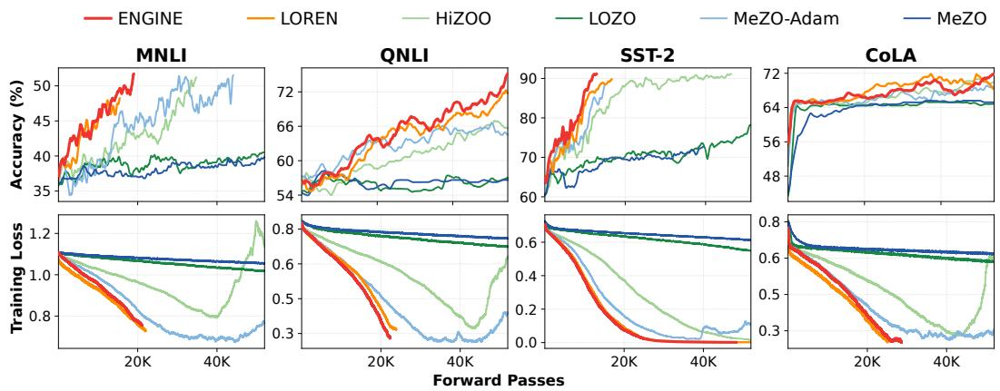  
Figure 5: GPT-2-XL (1.5B) training dynamics on four GLUE tasks (MNLI, QNLI, SST-2, CoLA). Top row: validation accuracy. Bottom row: training loss.

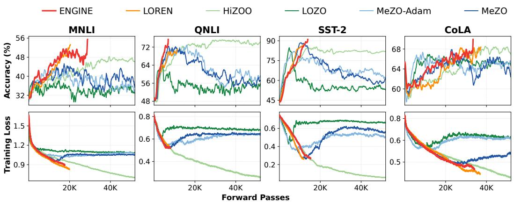  
Figure 6: OPT-2.7B training dynamics on four GLUE tasks (MNLI, QNLI, SST-2, CoLA). Top row: validation accuracy. Bottom row: training loss.

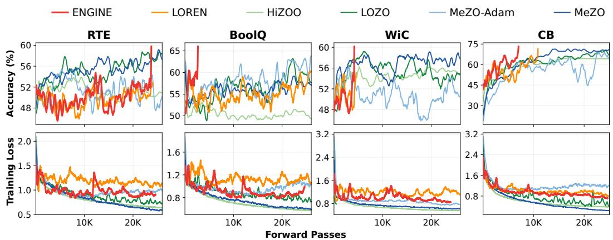  
Figure 7: LLaMA-3-8B training dynamics on four SuperGLUE tasks (RTE, BoolQ, WiC, CB). Top row: validation accuracy. Bottom row: training loss.

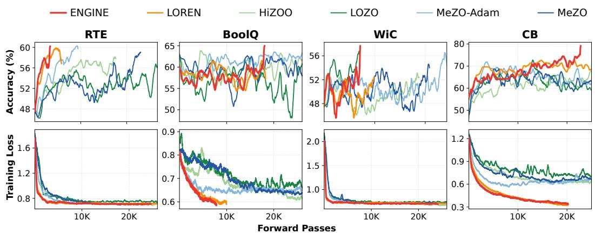  
Figure 8: OPT-13B training dynamics on four SuperGLUE tasks (RTE, BoolQ, WiC, CB). Top row: validation accuracy. Bottom row: training loss.

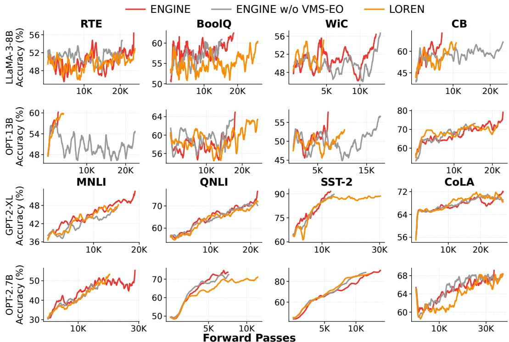  
Figure 9: VMS-EO ablation across four models and 16 tasks. Validation accuracy versus forward passes for ENGINE (red), ENGINE w/o VMS-EO (grey), and LOREN (orange). From top to bottom, the rows show LLaMA-3-8B, OPT-13B, GPT-2-XL, and OPT-2.7B. In the first two rows, columns show RTE, BoolQ, WiC, and CB. In the last two rows, columns show MNLI, QNLI, SST-2, and CoLA.

## F Experimental Setup and Hyperparameters

Tasks and metrics. We follow the LOREN protocol for datasets, splits, and training. GPT-2-XL and OPT-2.7B use FP32 on MNLI, QNLI, SST-2, and CoLA. LLaMA-3-8B and OPT-13B use BF16 on RTE, BoolQ, WiC, and CB. All tasks use accuracy (%) for the main results, ablation, learning curves, and sensitivity analyses. Avg. is the arithmetic mean of the four task accuracies for each model.

Training budget. Each run uses one NVIDIA A100 80GB GPU. All methods use batch size 64, perturbation radius $\epsilon = 1 0 ^ { - 3 }$ , and direction count K = 6. Training lasts 8,000 steps for GPT-2-XL and OPT-2.7B and 4,000 steps for LLaMA-3-8B and OPT-13B.

Method configurations. Across models, MeZO-Adam uses betas (0.9, 0.999). MeZO-SVRG uses full-batch update interval 2. LOZO searches ranks {2, 4, 8} and intervals {50, 100}. HiZOO uses Hessian smoothing $1 0 ^ { - 8 }$ . LOREN uses curvature learning rate $\nu = 1 0 ^ { - 3 }$ and damping $1 0 ^ { - 1 }$

Tables 7 and 8 give the baseline and ENGINE settings. Baseline settings follow LOREN, and bold entries mark selected values. The ablation uses the same ENGINE settings with λ = 0.

Table 7: Specific hyperparameters for the baselines. Learning rate search grids are listed by model, with selected values in bold. The two MeZO-SVRG rows give full-batch and mini-batch rates.
<table><tr><td>Method</td><td>GPT-2-XL</td><td>OPT-2.7B</td><td>LLaMA-3-8B,OPT-13B</td></tr><tr><td>MeZO</td><td>{1e-4,5e-5, 1e-5,5e-6, 1e-6}</td><td> $\{ 1 \mathrm { e } { - } 4 , 5 \mathrm { e } { - } 5 , 1 \mathrm { e } { - } 5 , 5 \mathrm { e } { - } 6 , 1 \mathrm { e } { - } 6 \}$ </td><td>{1e-5,5e-6,1e-6,5e-7, 1e-7}</td></tr><tr><td>MeZO-Adam</td><td></td><td></td><td>{1e-3, 5e-4, 1e-4, 5e-5, 1e-5} {1e-3, 5e-4, 1e-4, 5e-5, 1e-5} {1e-3, 5e-4, 1e-4, 5e-5, 1e-5}</td></tr><tr><td>MeZO-SVRG full</td><td></td><td></td><td>{1e-4, 5e-5, 1e-5, 5e-6, 1e-6} {1e-4, 5e-5, 1e-5, 5e-6, 1e-6} {1e-5, 5e-6, 1e-6, 5e-7, 1e-7}</td></tr><tr><td></td><td>MeZO-SVRG mini {1e-5, 5e-6, 1e-6, 5e-7, 1e-7} {1e-5, 5e-6, 1e-6, 5e-7, 1e-7} {1e-6, 5e-7, 1e-7, 5e-8, 1e-8}</td><td></td><td></td></tr><tr><td>LOZO</td><td></td><td></td><td>{1e-4, 5e-5, 1e-5, 5e-6, 1e-6} {1e-4, 5e-5, 1e-5, 5e-6, 1e-6} {1e-5, 5e-6, 1e-6, 5e-7, 1e-7}</td></tr><tr><td>HiZOO</td><td></td><td></td><td>{1e-3, 5e-4, 1e-4, 5e-5, 1e-5} {1e-4, 5e-5, 1e-5, 5e-6, 1e-6} {1e-5, 5e-6, 1e-6, 5e-7, 1e-7}</td></tr><tr><td>LOREN</td><td></td><td></td><td>{1e-5, 5e-6, 1e-6, 5e-7, 1e-7} {1e-5, 5e-6, 1e-6, 5e-7, 1e-7} {1e-5, 5e-6, 1e-6, 5e-7, 1e-7}</td></tr><tr><td>ENGINE</td><td>{1e-5,5e-6, 1e-6,5e-7, 1e-7}</td><td> $\{ 1 \mathrm { e } { - } 5 , 5 \mathrm { e } { - } 6 , 1 \mathrm { e } { - } 6 , 5 \mathrm { e } { - } 7 , 1 \mathrm { e } { - } 7 \}$ </td><td> $\{ 1 \mathrm { e } { - } 5 , 5 \mathrm { e } { - } 6 , 1 \mathrm { e } { - } 6 , 5 \mathrm { e } { - } 7 , 1 \mathrm { e } { - } 7 \}$ </td></tr></table>

Table 8: Specific hyperparameters for ENGINE. Each row gives a model’s learning rate, rank, and refresh intervals S in coarse steps. All four models use $\nu = 1 0 ^ { - 3 } , \rho = 1 0 ^ { - 3 }$ , C60F60, and mixing bounds [0.3, 0.8].
<table><tr><td colspan="3"></td><td colspan="3">Refresh interval S</td></tr><tr><td>Model</td><td>η</td><td>r</td><td>MNLI</td><td>QNLI</td><td>CoLA SST-2</td></tr><tr><td>GPT-2-XL</td><td>1e-5</td><td>16</td><td>5</td><td>20 20</td><td>20</td></tr><tr><td>OPT-2.7B</td><td>1e-5</td><td>32</td><td>20</td><td>20 20</td><td>5</td></tr><tr><td>Model</td><td>η</td><td>r</td><td>CB</td><td>RTE BoolQ</td><td>WiC</td></tr><tr><td>LLaMA-3-8B</td><td>5e-7</td><td>32</td><td>20</td><td>20 20</td><td>20</td></tr><tr><td>OPT-13B</td><td>5e-7</td><td>64</td><td>20</td><td>20 10</td><td>100</td></tr></table>

## F.1 Hyperparameter Sensitivity

Let $\mathcal { T } = \{ 5 , 1 0 , 2 0 , 1 0 0 , 1 0 0 0 \}$ be the candidate refresh intervals. The index j identifies one of the 16 model and task settings, and $a _ { j } ( S )$ denotes its raw validation accuracy at refresh interval S. For a positive accuracy range across the candidates, we define the normalized score:

$$
q _ { j } ( S ) = \frac { a _ { j } ( S ) - \operatorname* { m i n } _ { u \in \mathbb { Z } } a _ { j } ( u ) } { \operatorname* { m a x } _ { u \in \mathbb { Z } } a _ { j } ( u ) - \operatorname* { m i n } _ { u \in \mathbb { Z } } a _ { j } ( u ) } , \qquad S \in \mathbb { Z } .\tag{34}
$$

Table 9 reports these per-setting Min-Max scores. $\mathrm { { A t } } \ S = 2 0$ , they range from 0.91 to 1.00 across all 16 settings, supporting a common default of 20 coarse steps. The per-task intervals used for the main results are listed in Table 8.

We also vary the coarse and fine phase lengths M, $N \in \{ 1 0 , 3 0 , 6 0 \}$ epochs, following Algorithm 1. In this schedule, each epoch comprises eight minibatch updates, so C60F60 allocates 480 coarse and 480 fine updates per cycle. For each schedule, we average validation accuracy over the 16 model and task settings, then apply Min-Max normalization across the nine schedules. Table 10 shows that C60F60 achieves the highest average validation accuracy.

Table 9: Sensitivity to the refresh interval S in coarse steps. Entries are the normalized scores $q _ { j } ( S )$ in Eq. (34). Bold marks the highest score for each model and task.
<table><tr><td colspan="5">GPT-2-XL</td><td colspan="5">OPT-2.7B</td></tr><tr><td>S</td><td>MNLI</td><td>QNLI</td><td>CoLA</td><td>SST-2</td><td>S</td><td>MNLI</td><td>QNLI</td><td>CoLA</td><td>SST-2</td></tr><tr><td>5</td><td>1.00</td><td>1.00</td><td>0.94</td><td>1.00</td><td>5</td><td>1.00</td><td>1.00</td><td>1.00</td><td>1.00</td></tr><tr><td>10</td><td>0.95</td><td>1.00</td><td>1.00</td><td>0.94</td><td>10</td><td>1.00</td><td>0.92</td><td>0.94</td><td>0.91</td></tr><tr><td>20</td><td>0.92</td><td>1.00</td><td>1.00</td><td>1.00</td><td>20</td><td>1.00</td><td>1.00</td><td>1.00</td><td>0.91</td></tr><tr><td>100</td><td>0.34</td><td>0.27</td><td>0.35</td><td>0.38</td><td>100</td><td>0.31</td><td>0.36</td><td>0.45</td><td>0.22</td></tr><tr><td>1000</td><td>0.00</td><td>0.00</td><td>0.00</td><td>0.00</td><td>1000</td><td>0.00</td><td>0.00</td><td>0.00</td><td>0.00</td></tr><tr><td></td><td colspan="5">LLaMA-3-8B</td><td colspan="5">OPT-13B</td></tr><tr><td>S</td><td>RTE</td><td>BoolQ</td><td>WiC</td><td>CB</td><td>S</td><td>RTE</td><td>BoolQ</td><td>WiC</td><td>CB</td></tr><tr><td>5</td><td>1.00</td><td>1.00</td><td>0.96</td><td>1.00</td><td>5</td><td>1.00</td><td>1.00</td><td>1.00</td><td>1.00</td></tr><tr><td>10</td><td>0.96</td><td>1.00</td><td>0.93</td><td>0.91</td><td>10</td><td>0.92</td><td>1.00</td><td>1.00</td><td>1.00</td></tr><tr><td>20</td><td>1.00</td><td>1.00</td><td>1.00</td><td>1.00</td><td>20</td><td>1.00</td><td>0.92</td><td>0.93</td><td>1.00</td></tr><tr><td>100</td><td>0.41</td><td>0.53</td><td>0.61</td><td>0.57</td><td>100</td><td>0.61</td><td>0.67</td><td>1.00</td><td>0.77</td></tr><tr><td>1000</td><td>0.00</td><td>0.00</td><td>0.00</td><td>0.00</td><td>1000</td><td>0.00</td><td>0.00</td><td>0.00</td><td>0.00</td></tr></table>

Table 10: Sensitivity to the V-cycle schedule. Rows give coarse phase length M and columns give fine phase length N, both in epochs. Scores are Min-Max normalized averages over 16 model and task settings. Bold marks the best schedule.
<table><tr><td> $N = 6 0$ </td><td> $N = 3 0$   $N = 1 0$ </td></tr><tr><td>M = 60 1.00</td><td>0.65 0.44</td></tr><tr><td>M = 30</td><td>0.76</td></tr><tr><td>0.91 M = 10 0.82</td><td>0.34 0.71 0.00</td></tr></table>

## G Efficiency Analysis

In Table 11, ENGINE has the highest query efficiency in all four settings and the highest wall-clock efficiency on GPT-2-XL and OPT-2.7B.

Table 11: Query and wall-clock speed-ups at common target accuracies. Each entry divides the largest query count or time in its column by that method’s value, assigning the least efficient method 1.0×. Higher is better, and bold marks the best result.
<table><tr><td rowspan="3">Method</td><td colspan="2">GPT-2-XL SST-2 (70%)</td><td colspan="2">OPT-2.7B QNLI (70%)</td><td colspan="2">LLaMA-3-8B CB (65%)</td><td colspan="2">OPT-13B CB (65%)</td></tr><tr><td>Queries</td><td>Time</td><td>Queries</td><td>Time</td><td>Queries</td><td>Time</td><td>Queries</td><td>Time</td></tr><tr><td>MeZO</td><td>1.0</td><td>1.0</td><td>1.0</td><td>1.0</td><td>1.2</td><td>1.2</td><td>2.3</td><td>2.5</td></tr><tr><td>MeZO-Adam</td><td>10.3</td><td>9.8</td><td>9.7</td><td>9.2</td><td>1.0</td><td>1.0</td><td>1.0</td><td>1.0</td></tr><tr><td>MeZO-SVRG</td><td>3.9</td><td>2.1</td><td>4.1</td><td>4.5</td><td>2.1</td><td>1.8</td><td>3.2</td><td>2.9</td></tr><tr><td>LOZO</td><td>1.6</td><td>4.7</td><td>2.2</td><td>6.2</td><td>2.2</td><td>6.4</td><td>3.5</td><td>7.3</td></tr><tr><td>HiZOO</td><td>7.5</td><td>3.2</td><td>8.0</td><td>3.7</td><td>1.6</td><td>1.3</td><td>1.9</td><td>1.5</td></tr><tr><td>LOREN</td><td>12.7</td><td>9.5</td><td>11.7</td><td>8.3</td><td>4.6</td><td>2.0</td><td>5.0</td><td>3.4</td></tr><tr><td>ENGINE</td><td>16.5</td><td>11.4</td><td>22.2</td><td>16.7</td><td>10.0</td><td>4.1</td><td>5.3</td><td>4.0</td></tr></table>

## H Limitations and Future Work

Adaptive query allocation. The refresh interval S and coarse/fine phase lengths are fixed in advance. Curvature drift can make cached fine-space information stale, while the relative benefit of each phase can change during training. Adapting refreshes and phase lengths to curvature drift or validation-loss plateaus could improve query allocation.

Learning-rate selection. The branch learning rates $\eta _ { \mathbb { B } } , \eta _ { \mathbb { A } }$ , and $\eta _ { f }$ share one value to limit tuning, leaving separate rates to be explored.

Access requirements and task coverage. ENGINE requires access to model parameters to perturb weights and transfer states between spaces, limiting its use through prediction-only APIs. Our experiments cover classification fine-tuning across four models and 16 model-task settings. Evaluation on generation tasks would establish whether the observed benefits extend to other fine-tuning objectives.