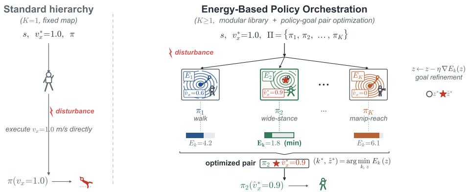
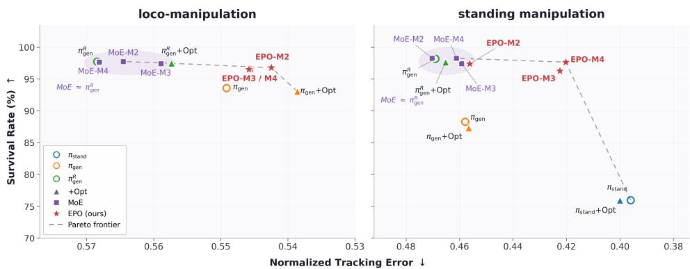
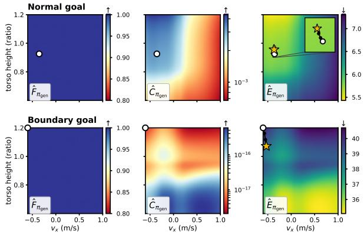
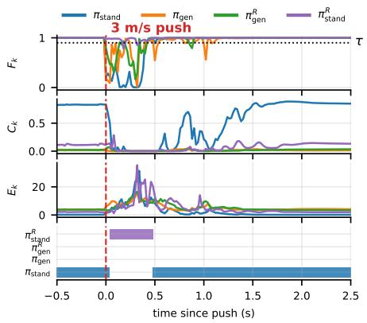
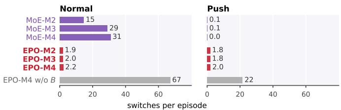
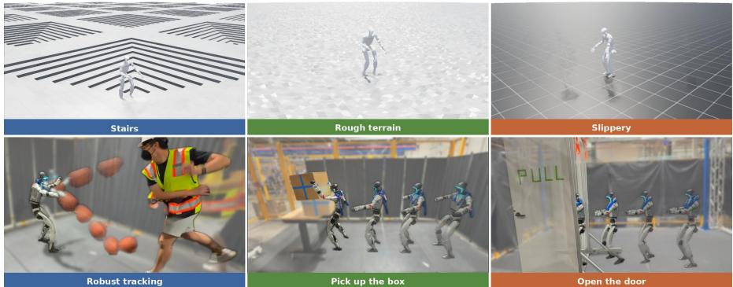

# Energy-Based Policy Orchestration

Weirui Ye1,∗ Yen-Jen Wang2,5,∗ Elvis Hsieh2,∗ Zhiyang Dou1 Shibo Zhao3,5

Pieter Abbeel2,5 Yilun Du4 Leslie Pack Kaelbling1 Tomás Lozano-Pérez1

1MIT CSAIL 2UC Berkeley 3Carnegie Mellon University

4Harvard University 5Amazon Frontier AI & Robotics

Abstract: Hierarchical control scales robot behavior by separating task-level planning from low-level control. In dynamic, high-dimensional tasks, however, a fixed planner-to-policy interface can fail when contacts, balance, or disturbances evolve faster than high-level policy updates. Execution therefore requires choosing not only which low-level policy to run, but also which policy-specific goal should be given to it. We formulate this problem as policy orchestration: runtime selection of a policy–goal pair that is likely to remain feasible while tracking the planner target. We develop EPO, an energy-based policy orchestrator for modular goal-conditioned policy families. For each policy, EPO learns a composite energy over low-level goals, where lower energy corresponds to higher feasibility and more accurate target realization. At runtime, EPO refines each policy’s goal and executes the lowest-energy policy–goal pair. Because energies are policy-specific, new policies can be incorporated by learning their own energy models, without retraining the existing policies or a centralized scheduler. In simulation, EPO improves the empirical precision–robustness trade-off by refining policy-specific goals before selectively switching among policies based on energy scores. We further demonstrate sim-to-real deployment of the same frozen policies and energy models on real humanoid loco-manipulation tasks. The project website is here.

Keywords: Humanoid Loco-Manipulation, Policy Orchestration, Energy Model

## 1 Introduction

Hierarchical control is a central abstraction for scaling robot behavior: a high-level policy specifies task-level targets, while low-level controllers execute them through fast feedback control [1, 2]. This separation appears in behavior-based robotics and hierarchical reinforcement learning [3, 4, 5, 6, 7, 8, 9]. In many hierarchical systems, the interface is a fixed map from task-level targets to the goals expected by a low-level goal-conditioned policy. In this work, we focus on this high-to-low interface when multiple low-level policies are available.

However, a fixed target-to-goal map becomes restrictive in dynamic, high-dimensional control. For example, when a humanoid carries an object, a slip, load shift, or unexpected contact can require the robot to slow down, widen its stance, or temporarily prioritize balance recovery before returning to precise tracking. The high-level target does not encode these fast physical changes, so a low-level command that matches the target kinematically may still be physically infeasible. This gap arises because high-level policies update at the timescale of task progress, while feasibility and tracking depend on higher-frequency details such as contact, posture, balance, and local tracking error.

We generalize the planner-to-policy interface from a fixed target-to-goal map to a runtime optimization over policy–goal pairs. We formulate this problem as policy orchestration (Fig. 1): selecting the policy–goal pair that is most likely to remain physically feasible while realizing the high-level target. This couples low-level goal refinement with policy choice in a single runtime optimization. The planner target remains fixed, but the low-level goal used to realize it is policy-dependent: the bes refined goal depends on the policy used to pursue the target, and the best policy depends on which refined goal keeps execution feasible and accurate. This setting is natural when policies occupy different operating regimes. Robust training and domain randomization can improve transfer and disturbance tolerance, often at the cost of nominal precision [10, 11, 12, 13, 14]. A policy family can therefore contain complementary behaviors, such as precision-oriented and recovery-oriented controllers. EPO does not replace the upstream planner or optimize action sequences directly; it only decides how a given task-level target should be instantiated through a frozen low-level policy and its command. The question is how to use the family without training a centralized scheduler.

  
Figure 1: Energy-based Policy Orchestration. EPO extends the standard planner-to-policy interface from a fixed map to runtime optimization over a frozen policy family. It refines policy goals by energy minimization and executes the lowest-energy policy–goal pair.

We answer this question with EPO, an energy-based policy orchestrator for frozen goal-conditioned policy families. For each policy in the family, EPO learns a policy-specific composite energy over that policy’s low-level goals. Low energy indicates that the policy–goal pair is likely to remain feasible while tracking the target. At runtime, EPO refines policy-specific goals by energy minimization and uses energy scores to guide policy selection while suppressing unnecessary switching. Unlike a learned gate that produces relative scores over a fixed policy set, EPO trains policy-specific energy models using common definitions of feasibility and target consistency, making the policy family extensible by construction.

We evaluate EPO quantitatively in simulated humanoid loco-manipulation and demonstrate sim to-real deployment on hardware. This setting is a natural testbed for policy orchestration because the robot must coordinate locomotion, balance recovery, end-effector tracking, and contact-rich interaction under changing physical conditions. Recent work on expressive humanoid whole-body control and human-to-humanoid teleoperation has made such systems increasingly capable, but also highlights the need for execution-time mechanisms that adapt how task-level commands are realized [15, 16, 17, 18]. We train a modular family of four goal-conditioned whole-body policies, comprising nominal and robustness-oriented controllers for both loco-manipulation and standing manipulation. On this policy family, EPO improves the empirical precision–robustness trade-off in simulation. It also demonstrates modular extension by incorporating a new specialist through its energy models, and demonstrates direct hardware deployment in teleoperated box pick-up, robusttracking, and door-opening settings without fine-tuning. Our contributions are threefold: (1) We generalize the planner-to-policy interface from a fixed target-to-goal map to policy orchestration, a runtime optimization over policy–goal pairs that realizes planner targets while maintaining physical feasibility; (2) We introduce EPO, an energy-based orchestration method that learns policy-specific composite energies and uses them for both continuous goal refinement and discrete policy arbitration across a frozen policy family; (3) We train a modular family of goal-conditioned whole-body control policies for humanoid loco-manipulation, quantitatively validate EPO in simulation, and demonstrate direct hardware deployment across locomotion, disturbance recovery, and contact-rich manipulation.

## 2 Related Work

Hierarchical control and skill composition EPO builds on hierarchical robot-control systems that separate task-level decisions from low-level feedback execution [3, 4, 5, 6, 7, 8, 9]. Related work also studies task-and-motion planning, which checks whether task choices can be realized by feasible motions [19, 20], and skill learning, which discovers reusable controllers or motor primitives [21, 22, 23]. Mixture-of-experts (MoE) methods learn gates that route inputs to experts [24, 25]. EPO differs from these routing approaches by keeping the low-level policies frozen and learning a policyspecific energy for each policy. The energy is used not only to select among policies, but also to refine each policy’s goal before arbitration. Adding a policy therefore requires training only its own energy models, leaving existing policies and energy models unchanged.

Runtime optimization for control Model-predictive and sampling-based control optimize future action sequences online [26, 27], while learned planners optimize actions, trajectories, or latent plans [28, 29]. EPO optimizes at the policy-interface level instead: the low-level policies remain fixed, and the optimization variable is the goal given to each policy before arbitration.

Energy-based models Energy-based models assign low energy to compatible outputs and perform inference by searching for low-energy candidates [30, 31, 32]. EPO adopts this inference pattern at the orchestration interface: each policy’s energy scores candidate low-level goals, and optimized energies are compared across policies to select the policy–goal pair.

Safety and feasibility filters Control barrier functions, reachability methods, and learned safety filters provide mechanisms for maintaining safety or avoiding failures [33, 34, 35, 36, 37]. These methods typically filter or modify actions. EPO is complementary: it uses learned feasibility and target consistency before low-level action selection, choosing among frozen policies and refining their goals rather than directly filtering the action.

## 3 EPO: Energy-Based Policy Orchestration

EPO is a runtime orchestration layer between a high-level policy and a family of low-level goalconditioned policies. The high-level policy produces task-level targets $z ^ { \star } \in { \mathcal { Z } }$ in a shared goal space. Each low-level policy $\pi _ { k }$ has its own goal space $\mathcal { Z } _ { k }$ , a coordinate subspace of ${ \mathcal { Z } } ,$ with projection $\rho _ { k } : \mathcal { Z } \to \mathcal { Z } _ { k }$ . At each decision point, EPO instantiates the current target $z ^ { \star }$ as a policy– goal pair $( k , z )$ , where k selects the low-level policy and $z \in \mathcal { Z } _ { k }$ is the goal given to that policy. EPO aims to choose the pair with the highest joint likelihood of remaining feasible over a short horizon and realizing the target within tolerance.

## 3.1 Modular Goal-Conditioned Policy Family

Let $\Pi = \{ \pi _ { k } \} _ { k = 1 } ^ { K }$ be a family of heterogeneous goal-conditioned policies. Each policy $\pi _ { k } : \mathcal { S } \times$ $\mathcal { Z } _ { k } \to \Delta ( \mathcal { A } )$ maps robot state $s \in { \mathcal { S } }$ and low-level goal $z \in \mathcal { Z } _ { k }$ to an action distribution. We treat each $\mathcal { Z } _ { k }$ as a bounded goal box in its corresponding coordinate subspace. Given state s and target $z ^ { \star }$ , EPO selects a policy–goal pair $( k , z )$ and executes $\pi _ { k } ( \cdot \mid s , z )$ . The standard single-policy interface is recovered as the special case $K = 1$ with a fixed target-to-goal map. In the general case, EPO treats both the policy index k and the low-level goal z as runtime decision variables. In our humanoid loco-manipulation system, the policy family is trained with reinforcement learning before orchestration and kept fixed during deployment. Policies share the same reward function but differ in command ranges, perturbation magnitudes, and wrist payloads, yielding behaviors ranging from robust locomotion and balance recovery to precise tracking and manipulation. EPO learns policy-specific energy models and uses them to refine goals and arbitrate among policies at runtime.

## 3.2 Runtime Orchestration Objective

In our humanoid experiments, the shared goal space $\mathcal { Z } \subseteq \mathbb { R } ^ { D }$ is a 16D command interface over base velocity, torso height, and end-effector pose. Each policy activates a subspace of this interface; for example, the standing policy masks the base-motion dimensions. Executing policy $\pi _ { k }$ from state s with goal z over horizon H induces a rollout distribution $\mathbb { P } _ { s , z } ^ { k }$ over rollout space $\Xi .$ We write $\xi = ( s _ { 0 } , \ldots , s _ { H } ) \sim \mathbb { P } _ { s , z } ^ { k }$ with $s _ { 0 } = s . \mathrm { ~ A ~ }$ readout function $g : \Xi  \mathcal { Z }$ maps the rollout back to shared target coordinates, using quantities such as average base velocity over the final third of the horizon and final torso height and end-effector pose. Let $Y = g ( \xi )$ denote the realized goal random variable. When only a subset of target coordinates is task-relevant, both $z ^ { \star }$ and $Y$ are restricted to those coordinates.

Let $S _ { \mathrm { f a i l } }$ denote episode-termination states, such as falls or invalid contacts. The feasibility prob ability is the probability that $\pi _ { k }$ avoids this failure set over horizon H when executed from s with goal $z \colon F _ { k } ( s , z ) = \mathbb { P } _ { s , z } ^ { k } [ s _ { t } \notin { \cal S } _ { \mathrm { f a i l } } \forall t = 1 , \ldots , H ]$ . Equivalently, $F _ { k } ( s , z ) = \mathbb { P } _ { s , z } ^ { k } [ \mathcal { F } _ { H } ]$ , where $\mathcal { F } _ { H }$ is the event that the rollout avoids failure over the horizon. We view rollouts as length-H sequences; if failure occurs before the horizon, the remaining states are padded with an absorbing failure state.

Target realization is measured by a consistency probability. Let $p _ { k } ( \cdot \ | \ s , z , \mathcal F _ { H } )$ be the predictive density of the realized goal conditioned on feasibility. Let $B _ { \epsilon } ( z ^ { \star } )$ be the task-specific tolerance box around the target, $\begin{array} { r } { B _ { \epsilon } ( z ^ { \star } ) = \prod _ { d \in \mathcal { T } } [ z _ { d } ^ { \star } - \epsilon _ { d } , z _ { d } ^ { \star } + \epsilon _ { d } ] . } \end{array}$ , where $\mathcal { T }$ denotes the task-relevant coordinates. We define $C _ { k } ( s , z ; z ^ { \star } ) = \mathbb { P } _ { Y \sim p _ { k } ( \cdot | s , z , \mathcal { F } _ { H } ) } [ Y \in \mathcal { B } _ { \epsilon } ( z ^ { \star } ) ]$ ]. Then the joint success likelihood is

$$
J _ { k } ( s , z ; z ^ { \star } ) = F _ { k } ( s , z ) C _ { k } ( s , z ; z ^ { \star } ) .\tag{1}
$$

Here $F _ { k }$ measures physical feasibility over the horizon, while $C _ { k }$ measures target realization within the specified tolerance among feasible rollouts. The runtime objective is $( k ^ { \star } , \hat { z } ) \in$ arg $\begin{array} { r } { \operatorname* { m a x } _ { k \in \{ 1 , \dots , K \} , z \in { \mathcal Z } _ { k } } J _ { k } \big ( s , z ; z ^ { \star } \big ) } \end{array}$ . Equivalently, with $E _ { k } ( s , z ; z ^ { \star } ) = - \log J _ { k } ( s , z ; z ^ { \star } )$ , maximizing joint success is equivalent to minimizing composite energy. In deployment, EPO uses the learned differentiable energy $\hat { E } _ { k }$ to refine goals and arbitrate among policies.

## 3.3 Composite Energy and Runtime Optimization

Composite energy Following energy-based inference, EPO scores candidate policy–goal pairs with scalar energies and performs runtime inference by minimizing them [30, 31]. For each policy–goal pair, define $E _ { k } ( s , z ; z ^ { \star } ) : = - \log J _ { k } ( s , z ; z ^ { \star } )$ . Using Eq. (1),

$$
E _ { k } ( s , z ; z ^ { \star } ) = - \log F _ { k } ( s , z ) - \log C _ { k } ( s , z ; z ^ { \star } ) = E _ { k } ^ { \mathrm { F } } ( s , z ) + E _ { k } ^ { \mathrm { C } } ( s , z ; z ^ { \star } ) .\tag{2}
$$

In the ideal objective, the two terms place physical feasibility and target realization on a common negative-log-likelihood scale, avoiding a hand-tuned linear trade-off weight between feasibility and consistency. In implementation, EPO learns $\hat { E } _ { k } ^ { \mathrm { F } }$ from a feasibility predictor and constructs $\hat { E } _ { k } ^ { \mathrm { C } }$ from a predictive density integrated over the target tolerance region (§3.4); at runtime it uses $\hat { E } _ { k } =$ $\hat { E } _ { k } ^ { \mathrm { F } } + \hat { E } _ { k } ^ { \mathrm { C } }$ , with the probabilities lower-bounded for numerical stability (Appendix B.1). Since $E _ { k }$ is the negative log of joint-success likelihood, minimizing the true composite energy is equivalent to maximum-likelihood inference over $( k , z )$ under $J _ { k }$ . Appendix A shows that uniform energy error ε and optimization error δ imply at most $2 \varepsilon + \delta$ log-likelihood regret.

Runtime energy optimization Algorithm 1 implements EPO’s mixed discrete–continuous inference step. Every T control ticks, EPO initializes $\hat { z } _ { k } = \rho _ { k } ( z _ { t } ^ { \star } )$ for each task-compatible policy. When $\hat { F } _ { k } ( s _ { t } , \hat { z } _ { k } ) \ge \tau$ , the test-time optimization (TTO) step $\mathrm { R e f i n e } _ { n , \eta }$ takes n projected gradient steps of size $\eta$ on $\hat { E } _ { k } \big ( s _ { t } , \cdot ; z _ { t } ^ { \star } \big )$ within policy $k ' \mathrm { s }$ valid goal bounds. Refinement uses norm-clipped gradients over base velocity and torso height; end-effector targets remain fixed. Refine returns the lowest-energy point among the initial goal and the n iterates. The refined goals are cached and reevaluated at each control tick; with $T _ { r } = 5$ at the 50 Hz control rate, refinement runs at 10 Hz and selection at 50 Hz.

The stateful operator $\mathrm { S e l e c t } _ { \tau , B , N _ { \epsilon } }$ combines feasibility filtering with accumulated energy advantages. When the current policy meets τ , it accumulates each eligible candidate’s energy advantage, with the running sum lower-bounded by zero, and switches when the largest accumulated advantage exceeds B. If the current policy remains below $\tau$ for $N _ { e }$ consecutive ticks, it selects the lowestenergy candidate meeting τ, or the candidate with the highest predicted feasibility if none qualifies. Accumulated advantages are cleared after switching.

Algorithm 1 Energy-based policy orchestration   
Require: state $s _ { t } ,$ target $z _ { t } ^ { \star }$ , task-compatible candidates $\textstyle { \mathcal { K } } _ { t }$   
Require: projections $\rho _ { k } .$ , models $\hat { F } _ { k } , \hat { E } _ { k }$ , settings $( n , \eta , T _ { r } , \tau , B , N _ { e } )$   
1: for $k \in \check { K } _ { t }$ in parallel do   
2: if t mod $\dot { T _ { r } } = 0$ then   
3: $\hat { z } _ { k } \gets \rho _ { k } ( z _ { t } ^ { \star } )$   
4: if $\hat { F } _ { k } ( s _ { t } , \hat { z } _ { k } ) \ge \tau$ then   
5: $\hat { z } _ { k } \gets \mathrm { R e f i n e } _ { n , \eta } \Big ( \hat { z } _ { k } ; \hat { E } _ { k } ( s _ { t } , \cdot ; z _ { t } ^ { \star } ) \Big )$   
6: end if   
7: end if   
8: $F _ { k } \gets \hat { F } _ { k } ( s _ { t } , \hat { z } _ { k } ) ; e _ { k } \gets \hat { E } _ { k } ( s _ { t } , \hat { z } _ { k } ; z _ { t } ^ { \star } )$   
9: end for   
10: $k _ { t } \gets \mathrm { S e l e c t } _ { \tau , B , N _ { e } } ( k _ { t - 1 } , \{ ( F _ { k } , e _ { k } ) \} _ { k \in \mathcal { K } _ { t } } )$   
11: return $\left( k _ { t } , \hat { z } _ { k _ { t } } \right)$

## 3.4 Learning the Energy Models

The shared sampling protocol trains all policy-specific energy models against the same joint-success objective, which supports cross-policy comparison and allows new policies to be added by training only their own energy models. For each policy, EPO trains $\hat { F } _ { k }$ and $\hat { p } _ { k }$ offline from rollouts of that policy. Goals are sampled in the shared space and projected through $\rho _ { k } ; \mathcal { D } _ { k } ^ { \mathrm { F } }$ contains both failed and successful rollouts, while $\mathcal { D } _ { k } ^ { \mathrm { C } }$ filters to feasible rollouts and uses their realized goals as labels. Details are in Appendix B.1.

Feasibility model We parameterize $\hat { E } _ { k } ^ { \mathrm { F } } ( s , z ) = - \log \hat { F } _ { k } ( s , z )$ , where $\hat { F } _ { k } ( s , z )$ estimates the probability of remaining feasible over horizon H. For rollout i, we set $y _ { i } ^ { \mathrm { F } } = \mathbf { 1 } \{ \xi _ { i } \in \mathcal { F } _ { H } \}$ , which is 1 if the rollout remains failure-free throughout the horizon and 0 otherwise. We train $\scriptstyle { \hat { F } } _ { k }$ with binary cross-entropy:

$$
\mathcal { L } _ { k } ^ { \mathrm { F } } = - \frac { 1 } { | \mathcal { D } _ { k } ^ { \mathrm { F } } | } \sum _ { i } \left[ y _ { i } ^ { \mathrm { F } } \log \hat { F } _ { k } ( s _ { i } , z _ { i } ) + ( 1 - y _ { i } ^ { \mathrm { F } } ) \log ( 1 - \hat { F } _ { k } ( s _ { i } , z _ { i } ) ) \right] .\tag{3}
$$

Consistency model The consistency model learns a predictive density over realized goals under feasible rollouts rather than directly learning an ϵ-success classifier. We use a heteroscedastic diagonal Gaussian over the shared target coordinates, $\begin{array} { r } { \hat { p } _ { k } ( Y \mid s , z , \mathcal { F } _ { H } ) = \prod _ { d } \mathcal { N } ( Y _ { d } ; \mu _ { k , d } ( s , z ) , \sigma _ { k , d } ^ { 2 } ( s , z ) ) } \end{array}$ where d indexes the realized target coordinates predicted by the model. For each feasible rollout, we extract the realized goal $y _ { i } = g ( \xi _ { i } )$ , using averages over the final third of the horizon for velocity coordinates and final-step values for end-effector and body-height coordinates. Let $\mu _ { i , d } = \mu _ { k , d } ( s _ { i } , z _ { i } )$ and $\sigma _ { i , d } ^ { 2 } = \sigma _ { k , d } ^ { 2 } ( s _ { i } , z _ { i } )$ . We train the density model with the energy score, a strictly proper scoring rule [38]:

$$
\begin{array} { r } { \mathcal { L } _ { k } ^ { \mathrm { C } } = \displaystyle \frac { 1 } { | \mathcal { D } _ { k } ^ { \mathrm { C } } | } \sum _ { i } \Big ( \mathbb { E } \left\| X _ { i } - y _ { i } \right\| - \frac { 1 } { 2 } \mathbb { E } \left\| X _ { i } - X _ { i } ^ { \prime } \right\| \Big ) , \qquad X _ { i } , X _ { i } ^ { \prime } \sim \mathcal { N } ( \mu _ { i } , \mathrm { d i a g } \sigma _ { i } ^ { 2 } ) , } \end{array}\tag{4}
$$

estimated with Monte Carlo samples on normalized coordinates. This is analogous to hindsight relabeling: the supervised target is the goal actually realized by the rollout, rather than the original low-level goal given to the policy [39].

At runtime, the predictive density is converted into a consistency probability around the high-level target. For compactness, write $\bar { \mu } _ { k , d }$ and $\bar { \sigma } _ { k , d }$ for the mean and standard deviation predicted at the current candidate $( s , z )$ . For each task-relevant coordinate $d \in \mathbb { Z }$ with tolerance $\epsilon _ { d } .$

$$
\hat { C } _ { k , d } ( s , z ; z ^ { \star } ) = \Phi \left( \frac { z _ { d } ^ { \star } + \epsilon _ { d } - \bar { \mu } _ { k , d } } { \bar { \sigma } _ { k , d } } \right) - \Phi \left( \frac { z _ { d } ^ { \star } - \epsilon _ { d } - \bar { \mu } _ { k , d } } { \bar { \sigma } _ { k , d } } \right) ,\tag{5}
$$

where $\Phi$ is the standard Gaussian CDF. In our experiments $\mathcal { T }$ contains all 16 command coordinates in both modes; for standing targets the base-velocity coordinates are commanded to zero. The full

consistency probability is the product over these coordinates, $\begin{array} { r } { \hat { C } _ { k } ( s , z ; z ^ { \star } ) = \prod _ { d \in \mathcal { T } } \hat { C } _ { k , d } ( s , z ; z ^ { \star } ) } \end{array}$ and the learned consistency energy is $\hat { E } _ { k } ^ { \mathrm { C } } ( s , z ; z ^ { \star } ) = - \log \hat { C } _ { k } ( s , z ; z ^ { \star } )$ . Thus tolerances enter at runtime, after the density model is trained; log $\hat { C } _ { k }$ is computed stably in implementation.

## 4 Experiments

We evaluate EPO on a Unitree G1 humanoid in Isaac Lab and demonstrate sim-to-real deployment on hardware. The experiments address four questions: (Q1) does EPO improve the precision– robustness trade-off over fixed policies, single-policy goal optimization, and learned MoE schedulers? (Q2) can a specialized policy be added modularly through its own energy models? (Q3) which components of EPO are responsible for the gains? (Q4) can the frozen policies and energy models be deployed on real humanoid loco-manipulation tasks without fine-tuning?

## 4.1 Experimental Setup

Policy family and energy models The main simulation evaluation uses the base family $\Pi _ { \mathrm { b a s e } } =$ $\{ \pi _ { \mathrm { g e n } } , \pi _ { \mathrm { g e n } } ^ { R } \}$ , where $\pi _ { \mathrm { g e n } }$ is a general whole-body policy and $\pi _ { \mathrm { g e n } } ^ { R }$ is a robustness-oriented variant trained with stronger perturbations and wrist payloads. Both policies share a 16D command interface over base velocity, torso height, and end-effector pose, and are frozen before EPO training. For each policy, EPO trains a feasibility model and a consistency density model from H = 50-step rollouts (one second at the 50 Hz control frequency). Goal refinement runs at 10 Hz with three projected gradient steps and step size 0.05; scoring and policy selection are scheduled at the 50 Hz control rate. The selector uses feasibility threshold $\tau = 0 . 9$ , accumulated-advantage threshold $B = 4 0$ , and confirmation count $N _ { e } = 3$ . Additional details are given in Appendix B.

Baselines and modular extension On $\Pi _ { \mathrm { b a s e } } ,$ we compare EPO-M2 with fixed-policy execution, single-policy goal optimization (+Opt), and learned MoE schedulers. These baselines isolate the two operations performed by EPO: +Opt refines the continuous command without policy switching, while MoE switches policies without command optimization. To test modular extension, we add a standing manipulation specialist $\pi _ { \mathrm { s t a n d } }$ and form $\Pi _ { \mathrm { e x t } } = \Pi _ { \mathrm { b a s e } } \cup \left\{ \pi _ { \mathrm { s t a n d } } \right\}$ . EPO-M3 uses the same orchestration rule on this extended family. Adding a robust standing specialist $\pi _ { \mathrm { s t a n d } } ^ { R }$ further gives EPO-M4. Each extension requires training only the added policy’s energy models; the original policies, energy models, and orchestration rule are unchanged. MoE-M3 and MoE-M4 use the corresponding policy families.

Evaluation protocol Episodes last 20 s on flat, rough, and stair terrains, with 128 matched seeds per terrain (384 episodes per setting). Normal resamples the command every 4 s; Extreme alternates every 2 s between opposite corners of the command range; Push applies one 3 m/s velocity impulse at a random time in [10, 15] s while the robot holds a fixed carry pose. Precision is the Normal tracking error against the operator command, normalized per dimension by the task tolerance (values below 1.0 are within tolerance). Robustness is the mean survival over the three conditions. Confidence intervals (95%) come from a paired bootstrap over seeds; switch counts are averaged over Normal and Push episodes (Appendix B.5).

## 4.2 Precision–Robustness Trade-offs and Modular Extension

EPO improves the precision–robustness trade-off Figure 2 shows the empirical precision– robustness trade-off achieved by EPO in both simulation settings. In loco-manipulation, the general policy $\pi _ { \mathrm { g e n } }$ achieves lower tracking error but is less robust, whereas the robustness-oriented policy $\pi _ { \mathrm { g e n } } ^ { R }$ improves survival at the cost of precision. EPO-M2 reduces error from 0.568 to 0.542 relative to $\pi _ { \mathrm { g e n } } ^ { R }$ , with weighted survival of 96.8% versus 97.7%. In standing manipulation, EPO-M4 reduces error from 0.461 to 0.420 relative to MoE-M4, with weighted survival of 97.7% versus 98.3%. EPO also switches less frequently: EPO-M4 makes 2.08 switches per episode compared with 15.46 for MoE-M4 (Fig. 4). Under pushes, EPO tracks more precisely than $\pi _ { \mathrm { g e n } } ^ { \bar { R } }$ and MoE (EPO-M2 walking: 0.305 vs. 0.317; EPO-M4 standing: 0.191 vs. 0.199), at the cost of about 2 points of push survival while walking. MoE collapses onto $\pi _ { \mathrm { g e n } } ^ { R }$ : MoE-M2 never leaves it in 56% of episodes. On pushes that topple π or $\pi _ { \mathrm { g e n } }$ , EPO-M4 survives 97% and 93% of the time (Appendix B.6).

  
Figure 2: Precision–robustness trade-offs in simulation. Each point is averaged over flat, rough, and stair terrains. The x-axis reports normalized tracking error, and the y-axis reports weighted survival (mean of Normal, Extreme, and Push survival). Left: loco-manipulation; $\pi _ { \mathrm { s t a n d } }$ and $\pi _ { \mathrm { s t a n d } } { + } \mathrm { O p t }$ lie outside the plotted range. Right: standing manipulation without velocity commands.

Combining goal refinement and policy arbitration We isolate the two operations performed by EPO. The goal-refinement baseline (+Opt) optimizes the continuous goal for one fixed policy, but cannot switch to a more suitable controller when the state becomes difficult. Conversely, MoE schedulers switch among policies but execute the projected goal without continuous goal refine ment. EPO combines both operations. Compared with $\pi _ { \mathrm { g e n } } ^ { R } { + } \mathrm { O p t }$ and MoE-M2, EPO-M2 has lower tracking error in both modes but slightly lower weighted survival.

EPO extends modularly to new specialists The standing-manipulation panel evaluates whether new specialists can be added without retraining the existing system. After adding $\pi _ { \mathrm { s t a n d } } ,$ EPO-M3 applies the same orchestration rule by training only the specialist’s energy models, while the original policies, energy models, and optimizer are unchanged. Standing tracking error falls from 0.456 to 0.422, while weighted survival changes from 97.4% to 96.3%. Adding $\pi _ { \mathrm { s t a n d } } ^ { \bar { R } }$ yields EPO-M4, with error 0.420 and weighted survival 97.7%. Relative to EPO-M2, the standing specialists reduce standing-manipulation error by 0.036 (95% CI: [0.029, 0.044]) at a cost of 0.003 in locomanipulation error (95% CI: [0.002, 0.005]); the loco-manipulation difference is zero on flat terrain and arises on rough and stair terrain. Adding a policy costs EPO about 30 GPU-minutes, whereas MoE must be retrained on every library change (40–60 GPU-minutes; Appendix B.4).

## 4.3 Ablation Study

Ablation setup Table 1 ablates EPO in the base two-policy setting, where the orchestrator selects between the general and robustness-oriented policies (EPO-M2). Since normal tracking survival is nearly saturated across variants, the informative differences appear under push disturbances, the alternating-goal stress test (Jump-alt), switching frequency, and runtime headroom.

Table 1: Component ablations. Ablations use EPO-M2 with 128 seeds on each of three terrains. Err. is normalized tracking error; Track and Push are survival rates (%). Jump-alt averages Extreme survival across the two modes. Switches are averaged over Normal and Push episodes. Max Hz is the inverse median latency of refining and scoring all policies for one robot (excluding policy inference and the selector update). Feasibility only and Consistency only change only the selection score; Consistency only also removes τ and the refinement gate.
<table><tr><td rowspan="2">Variant</td><td colspan="3">Loco-manipulation</td><td colspan="3">Standing manipulation</td><td rowspan="2">Jump-alt ↑</td><td rowspan="2">Switches/ep ↓</td><td rowspan="2">Max Hz ↑</td></tr><tr><td>Err. ↓</td><td>Track ↑</td><td>Push ↑</td><td>Err. ↓</td><td>Track ↑</td><td>Push ↑</td></tr><tr><td>Full EPO-M2</td><td>0.542</td><td>99.7</td><td>96.4</td><td>0.456</td><td>100.0</td><td>95.3</td><td>95.6</td><td>1.85</td><td>83</td></tr><tr><td>No goal refinement</td><td>0.554</td><td>99.7</td><td>96.9</td><td>0.459</td><td>100.0</td><td>96.9</td><td>96.0</td><td>1.81</td><td>615</td></tr><tr><td>Feasibility only</td><td>0.542</td><td>99.7</td><td>96.1</td><td>0.456</td><td>100.0</td><td>95.3</td><td>95.3</td><td>1.84</td><td>84</td></tr><tr><td>Consistency only</td><td>0.542</td><td>99.7</td><td>78.9</td><td>0.456</td><td>100.0</td><td>58.6</td><td>95.4</td><td>0.92</td><td>84</td></tr><tr><td>No feasibility threshold τ</td><td>0.542</td><td>99.7</td><td>82.8</td><td>0.456</td><td>100.0</td><td>65.6</td><td>96.2</td><td>0.99</td><td>83</td></tr><tr><td>No refinement gate</td><td>0.542</td><td>99.7</td><td>96.6</td><td>0.456</td><td>100.0</td><td>96.6</td><td>96.0</td><td>1.86</td><td>84</td></tr><tr><td>No switching threshold B</td><td>0.542</td><td>99.7</td><td>94.8</td><td>0.457</td><td>100.0</td><td>96.4</td><td>95.6</td><td>31.34</td><td>83</td></tr></table>

  
z \* (projected command) TTO steps (3) returned goal

  
(a) Goal refinement in the energy landscape.  
(b) Policy arbitration under pushes.  
Figure 3: Runtime visualization of EPO. (a) $\hat { F } , \hat { C } , \hat { E }$ of $\pi _ { \mathrm { g e n } }$ at two example states; TTO steps move $z ^ { \star }$ toward lower energy (star: returned goal). (b) EPO-M4 under a 3 m/s push while standing: $F$ of $\pi _ { \mathrm { s t a n d } }$ collapses, EPO switches to $\pi _ { \mathrm { s t a n d } } ^ { R }$ within 40 ms and returns to $\pi _ { \mathrm { s t a n d } }$ 0.48 s later once its accumulated energy advantage exceeds B.

Feasibility drives robustness The consistency-only variant has nearly unchanged nominal tracking error, but loses robustness: loco-manipulation push survival drops from 96.4% to 78.9%, and standing push survival drops from 95.3% to 58.6%. Switching decreases from 1.85 to 0.92 per episode. In contrast, feasibility-only remains close to Full EPO in both tracking error and survival. The feasibility signal therefore provides the main robustness benefit in this evaluation.

Goal refinement trades computation for precision Removing goal refinement raises the maximum orchestration frequency from 83 to 615 Hz, confirming that gradient-based refinement is the main runtime cost. It increases mean clean tracking error by 0.0076 (95% CI: [0.0062, 0.0091]), approximately 1.5%, without a statistically significant change in push survival. A post hoc breakdown shows that refinement reduces error by 5–6% on the base-velocity and torso-height components it adjusts under Normal commands, and by 25% on torso height after a push, while end-effector errors remain largely unchanged. Goal refinement therefore improves tracking precision within the available runtime budget.

Feasibility filtering and switching regularization Removing the feasibility threshold τ reduces push survival from 96.4% to 82.8% in loco-manipulation and from 95.3% to 65.6% in standing manipulation. Removing the switching threshold B increases switching from 1.85 to 31.34 times per episode, with little change in tracking error. Removing the refinement gate has little effect under the tested conditions. Full EPO thus combines feasibility filtering for robustness with accumulated energy advantages for infrequent switching. Refining and scoring all policies takes 12.1 ms for EPO-M2 and 24.3 ms for EPO-M4 on an NVIDIA RTX PRO 6000 Blackwell (83 and 41 Hz), above the 10 Hz goal-refinement rate.

## 4.4 Runtime Visualization and Analysis

Figure 3 visualizes the two runtime operations used by EPO. First, goal refinement performs gradient descent in the learned energy landscape, moving the projected target toward a lower-energy policyspecific goal before arbitration. Second, external pushes change the optimized energy scores of the candidate policies over time, causing EPO to switch policies when the robust controller becomes preferable. The switching threshold suppresses unnecessary oscillations when the policy scores are close, but still allows state-dependent switching under disturbance.

  
Figure 4: Switching frequency. Mean switches per episode (768 episodes per condition).

  
Figure 5: Humanoid loco-manipulation tasks. We evaluate whole-body control in simulation and demonstrate hardware deployment, including locomotion and loco-manipulation.

## 4.5 Sim-to-Real Demonstrations

We deploy the frozen policies and energy models on the Unitree G1 without fine-tuning. A human operator provides task-level commands through teleoperation, while EPO selects the low-level policy–goal pair online.

We demonstrate sim-to-real transfer in three hardware settings (Fig. 5). In the box pick-up task, the robot walks to a table, picks up a box, and carries it while maintaining whole-body balance. In the robust-tracking task, the robot is struck by a basketball during execution and recovers without falling. In the door-opening task, the robot walks to a door and pulls it open while maintaining balance. In a controlled standing-push test with gentle pushes, $\pi _ { \mathrm { s t a n d } }$ recovers in 4 of 5 trials, while $\pi _ { \mathrm { g e n } } ^ { R }$ and EPO-M2 recover in all 5 (preliminary). These demonstrations show that the simulationtrained orchestration layer can be deployed directly on real humanoid loco-manipulation hardware.

## 5 Discussion

EPO treats the planner-to-policy interface as execution-time inference over a frozen policy family. By jointly refining policy-specific goals and arbitrating among policies, it provides a modular way to use controllers with complementary operating regimes while leaving the underlying policies unchanged. The main limitation is that EPO depends on learned energy models for cross-policy comparison. Although the probabilistic objective and shared rollout protocol provide a common training target, the learned energies may be unreliable under distribution shift, poorly covered goals, or imperfect calibration for newly added policies. Runtime cost also grows with the number of candidate policies, with goal refinement accounting for most of the computation. EPO also operates at the policy–goal interface and does not replace action-level safety filters or formal constraints. Future work could improve calibration, adapt energy models online, combine EPO with action-level safety mechanisms, and pass energy or uncertainty estimates back to the high-level planner.

## Acknowledgments

We gratefully acknowledge support from NSF grant 2214177; from AFOSR grant FA9550-22-1- 0249; from ONR MURI grants N00014-22-1-2740 and N00014-24-1-2603; from the MIT Siegel Family Quest for Intelligence; and from the Robotics and AI Institute.

## References

[1] N. Matni, A. D. Ames, and J. C. Doyle. A quantitative framework for layered multirate control: Toward a theory of control architecture. IEEE Control Systems Magazine, 44(3):52–94, 2024. doi:10.1109/MCS.2024.3382388.

[2] D. Fridovich-Keil, S. L. Herbert, J. F. Fisac, S. Deglurkar, and C. J. Tomlin. Planning, fast and slow: A framework for adaptive real-time safe trajectory planning. In 2018 IEEE International Conference on Robotics and Automation (ICRA), pages 387–394, 2018. doi:10.1109/ICRA. 2018.8460863.

[3] R. Brooks. A robust layered control system for a mobile robot. IEEE journal on robotics and automation, 2(1):14–23, 1986.

[4] R. C. Arkin. Behavior-based robotics. MIT press, 1998.

[5] P. Dayan and G. E. Hinton. Feudal reinforcement learning. Advances in neural information processing systems, 5, 1992.

[6] R. S. Sutton, D. Precup, and S. Singh. Between mdps and semi-mdps: A framework for temporal abstraction in reinforcement learning. Artificial intelligence, 112(1-2):181–211, 1999.

[7] T. G. Dietterich. Hierarchical reinforcement learning with the maxq value function decomposition. Journal ofartificial intelligence research, 13:227–303, 2000.

[8] P.-L. Bacon, J. Harb, and D. Precup. The option-critic architecture. In Proceedings ofthe AAAI conference on artificial intelligence, volume 31, 2017.

[9] O. Nachum, S. S. Gu, H. Lee, and S. Levine. Data-efficient hierarchical reinforcement learning. Advances in neural information processing systems, 31, 2018.

[10] C. M. Bishop. Training with noise is equivalent to tikhonov regularization. Neural computation, 7(1):108–116, 1995.

[11] G. N. Iyengar. Robust dynamic programming. Mathematics of Operations Research, 30(2): 257–280, 2005.

[12] J. Tobin, R. Fong, A. Ray, J. Schneider, W. Zaremba, and P. Abbeel. Domain randomization for transferring deep neural networks from simulation to the real world. In 2017 IEEE/RSJ international conference on intelligent robots and systems (IROS), pages 23–30. IEEE, 2017.

[13] X. B. Peng, M. Andrychowicz, W. Zaremba, and P. Abbeel. Sim-to-real transfer of robotic control with dynamics randomization. In 2018 IEEE international conference on robotics and automation (ICRA), pages 3803–3810. IEEE, 2018.

[14] B. Mehta, M. Diaz, F. Golemo, C. J. Pal, and L. Paull. Active domain randomization. In Conference on Robot Learning, pages 1162–1176. PMLR, 2020.

[15] X. Cheng, Y. Ji, J. Chen, R. Yang, G. Yang, and X. Wang. Expressive whole-body control for humanoid robots. arXiv preprint arXiv:2402.16796, 2024.

[16] T. He, Z. Luo, W. Xiao, C. Zhang, K. Kitani, C. Liu, and G. Shi. Learning human-to-humanoid real-time whole-body teleoperation. In 2024 IEEE/RSJ International Conference on Intelligent Robots and Systems (IROS), pages 8944–8951. IEEE, 2024.

[17] T. He, Z. Luo, X. He, W. Xiao, C. Zhang, W. Zhang, K. Kitani, C. Liu, and G. Shi. Omnih2o: Universal and dexterous human-to-humanoid whole-body teleoperation and learning. arXiv preprint arXiv:2406.08858, 2024.

[18] Z. Fu, Q. Zhao, Q. Wu, G. Wetzstein, and C. Finn. Humanplus: Humanoid shadowing and imitation from humans. arXiv preprint arXiv:2406.10454, 2024.

[19] L. P. Kaelbling and T. Lozano-Pérez. Hierarchical task and motion planning in the now. In 2011 IEEE international conference on robotics and automation, pages 1470–1477. IEEE, 2011.

[20] C. R. Garrett, R. Chitnis, R. Holladay, B. Kim, T. Silver, L. P. Kaelbling, and T. Lozano-Pérez. Integrated task and motion planning. Annual review of control, robotics, and autonomous systems, 4(1):265–293, 2021.

[21] A. J. Ijspeert, J. Nakanishi, H. Hoffmann, P. Pastor, and S. Schaal. Dynamical movement primitives: learning attractor models for motor behaviors. Neural computation, 25(2):328– 373, 2013.

[22] B. Eysenbach, A. Gupta, J. Ibarz, and S. Levine. Diversity is all you need: Learning skills without a reward function. arXiv preprint arXiv:1802.06070, 2018.

[23] K. Pertsch, Y. Lee, and J. Lim. Accelerating reinforcement learning with learned skill priors. In Conference on robot learning, pages 188–204. PMLR, 2021.

[24] R. A. Jacobs, M. I. Jordan, S. J. Nowlan, and G. E. Hinton. Adaptive mixtures of local experts. Neural computation, 3(1):79–87, 1991.

[25] N. Shazeer, A. Mirhoseini, K. Maziarz, A. Davis, Q. Le, G. Hinton, and J. Dean. Outrageously large neural networks: The sparsely-gated mixture-of-experts layer. arXiv preprint arXiv:1701.06538, 2017.

[26] G. Williams, N. Wagener, B. Goldfain, P. Drews, J. M. Rehg, B. Boots, and E. A. Theodorou. Information theoretic mpc for model-based reinforcement learning. In 2017 IEEE international conference on robotics and automation (ICRA), pages 1714–1721. IEEE, 2017.

[27] K. Chua, R. Calandra, R. McAllister, and S. Levine. Deep reinforcement learning in a handful of trials using probabilistic dynamics models. Advances in neural information processing systems, 31, 2018.

[28] A. Srinivas, A. Jabri, P. Abbeel, S. Levine, and C. Finn. Universal planning networks: Learning generalizable representations for visuomotor control. In International conference on machine learning, pages 4732–4741. PMLR, 2018.

[29] K. Lowrey, A. Rajeswaran, S. Kakade, E. Todorov, and I. Mordatch. Plan online, learn offline: Efficient learning and exploration via model-based control. arXiv preprint arXiv:1811.01848, 2018.

[30] Y. LeCun, S. Chopra, R. Hadsell, M. Ranzato, F. Huang, et al. A tutorial on energy-based learning. Predicting structured data, 1(0), 2006.

[31] Y. Du and I. Mordatch. Implicit generation and modeling with energy based models. Advances in neural information processing systems, 32, 2019.

[32] A. Gladstone, G. Nanduru, M. M. Islam, P. Han, H. Ha, A. Chadha, Y. Du, H. Ji, J. Li, and T. Iqbal. Energy-based transformers are scalable learners and thinkers. arXiv preprint arXiv:2507.02092, 2025.

[33] A. D. Ames, X. Xu, J. W. Grizzle, and P. Tabuada. Control barrier function based quadratic programs for safety critical systems. IEEE Transactions on Automatic Control, 62(8):3861– 3876, 2017.

[34] S. Bansal, M. Chen, S. Herbert, and C. J. Tomlin. Hamilton-jacobi reachability: A brief overview and recent advances. In 2017 IEEE 56th annual conference on decision and control (CDC), pages 2242–2253. IEEE, 2017.

[35] J. F. Fisac, N. F. Lugovoy, V. Rubies-Royo, S. Ghosh, and C. J. Tomlin. Bridging hamiltonjacobi safety analysis and reinforcement learning. In 2019 International Conference on Robotics and Automation (ICRA), pages 8550–8556. IEEE, 2019.

[36] K. Nakamura, L. Peters, and A. Bajcsy. Generalizing safety beyond collision-avoidance via latent-space reachability analysis. In Robotics: Science and Systems (RSS), 2025.

[37] J. Seo, K. Nakamura, and A. Bajcsy. UNISafe: Uncertainty-aware latent safety filters for avoiding out-of-distribution failures. In Conference on Robot Learning (CoRL), 2025.

[38] T. Gneiting and A. E. Raftery. Strictly proper scoring rules, prediction, and estimation. Journal ofthe American Statistical Association, 102(477):359–378, 2007.

[39] M. Andrychowicz, F. Wolski, A. Ray, J. Schneider, R. Fong, P. Welinder, B. McGrew, J. Tobin, P. Abbeel, and W. Zaremba. Hindsight experience replay. Advances in neural information processing systems, 30, 2017.

## Appendix Contents

A Theorem Proofs 13   
A.1 Energy minimization and MAP inference 13   
A.2 Guarantee under energy estimation error 13   
A.3 Implication for fixed-policy baselines 14   
B Implementation details 15   
B.1 Energy models 15   
B.2 Runtime optimizer 16   
B.3 Policy family training 17   
B.4 Baselines and runtime variants 18   
B.5 Simulation evaluation protocol 19   
B.6 Recovery from base-policy failures 20   
B.7 Runtime and parameter sensitivity 21   
B.8 Horizon sensitivity 21

## A Theorem Proofs

This appendix gives the formal statements used in $\ S 3$ . We use the notation from the main text: $F _ { k } ( s , z )$ is the horizon-feasibility probability, $C _ { k } ( s , z ; z ^ { \star } )$ is the target-consistency probability, and $J _ { k } ( s , z ; z ^ { \star } ) = F _ { k } ( s , z ) C _ { k } ( s , z ; z ^ { \star } )$ is the joint success likelihood.

## A.1 Energy minimization and MAP inference

We first show that minimizing the true composite energy is equivalent to maximizing the joint success likelihood.

Proposition 1 (Energy minimization is joint likelihood maximization). Let $\begin{array} { r l } { E _ { k } ( s , z ; z ^ { \star } ) } & { { } = } \end{array}$ − log $J _ { k } ( s , z ; z ^ { \star } )$ . Then any minimizer

$$
( k ^ { \star } , \hat { z } ) \in \arg \operatorname* { m i n } _ { k \in \{ 1 , \ldots , K \} , z \in { \mathcal { Z } } _ { k } } E _ { k } ( s , z ; z ^ { \star } )
$$

is a maximizer of $J _ { k } ( s , z ; z ^ { \star } )$ . With a uniform prior over policy–goal pairs, this minimizer is also a MAP estimate.

Proof. The negative logarithm is strictly decreasing, so minimizing $E _ { k } { \left( s , z ; z ^ { \star } \right) }$ = $- \log { J _ { k } ( s , z ; z ^ { \star } ) }$ is equivalent to maximizing $J _ { k } ( s , z ; z ^ { \star } )$ If the prior over policy–goal pairs is uniform, maximizing likelihood and maximizing posterior probability coincide. □

## A.2 Guarantee under energy estimation error

The following bound relates approximate minimization of the learned energy $\hat { E } _ { k }$ to the oracle policy–goal pair, subject to the estimation and optimization assumptions below. Let

$$
J ^ { \star } ( s , z ^ { \star } ) : = \operatorname* { m a x } _ { k \in \{ 1 , \ldots , K \} , z \in { \mathcal Z } _ { k } } J _ { k } ( s , z ; z ^ { \star } )
$$

be the oracle joint success likelihood, and let $( \hat { k } , \hat { z } )$ be the policy–goal pair returned by EPO.

Assumption 1 (Uniform energy estimation error). There exists $\varepsilon \geq 0$ such that, for all $k , s , z \in \mathcal { Z } _ { k }$ and $z ^ { \star } \in \mathcal { Z }$

$$
\Bigl | \hat { E } _ { k } \bigl ( s , z ; z ^ { \star } \bigr ) - E _ { k } \bigl ( s , z ; z ^ { \star } \bigr ) \Bigr | \leq \varepsilon .
$$

The uniform bound is a simplifying assumption. Since $E _ { k } \ = \ - \log J _ { k } , \ \varepsilon$ is an error bound in energy, equivalently in log-likelihood. The bound is most informative on the arbitration-relevant region where $J _ { k } ( s , z ; z ^ { \star } )$ is bounded away from zero, i.e., where feasibility and consistency are not degenerate.

Assumption 2 (Optimization error). The runtime optimizer returns $( \hat { k } , \hat { z } )$ satisfying

$$
\hat { E } _ { \hat { k } } ( s , \hat { z } ; z ^ { \star } ) \leq \operatorname* { m i n } _ { k \in \{ 1 , \ldots , K \} , z \in { \mathcal { Z } } _ { k } } \hat { E } _ { k } ( s , z ; z ^ { \star } ) + \delta
$$

for some $\delta \geq 0$

Theorem 1 (Log-likelihood regret). Under Assumptions 1 and 2, EPO satisfies

$$
\log J ^ { \star } ( s , z ^ { \star } ) - \log J _ { \hat { k } } ( s , \hat { z } ; z ^ { \star } ) \leq 2 \varepsilon + \delta .
$$

Equivalently,

$$
J _ { \hat { k } } ( s , \hat { z } ; z ^ { \star } ) \geq e ^ { - ( 2 \varepsilon + \delta ) } J ^ { \star } ( s , z ^ { \star } ) .
$$

Proof. Let $\left( k _ { o } , z _ { o } \right)$ be an oracle maximizer of $J _ { k } ( s , z ; z ^ { \star } )$ , or equivalently a minimizer of $E _ { k } \big ( s , z ; z ^ { \star } \big )$ . By the estimation-error bound,

$$
E _ { \hat { k } } ( s , \hat { z } ; z ^ { \star } ) \leq \hat { E } _ { \hat { k } } ( s , \hat { z } ; z ^ { \star } ) + \varepsilon .
$$

By the optimization-error assumption,

$$
\hat { E } _ { \hat { k } } ( s , \hat { z } ; z ^ { \star } ) \leq \hat { E } _ { k _ { o } } ( s , z _ { o } ; z ^ { \star } ) + \delta .
$$

Applying the estimation-error bound again gives

$$
\hat { E } _ { k _ { o } } ( s , z _ { o } ; z ^ { \star } ) \leq E _ { k _ { o } } ( s , z _ { o } ; z ^ { \star } ) + \varepsilon .
$$

Combining the three inequalities,

$$
E _ { \hat { k } } ( s , \hat { z } ; z ^ { \star } ) \leq E _ { k _ { o } } ( s , z _ { o } ; z ^ { \star } ) + 2 \varepsilon + \delta .
$$

Since $E _ { k } = - \log J _ { k }$ and $J _ { k _ { o } } ( s , z _ { o } ; z ^ { \star } ) = J ^ { \star } ( s , z ^ { \star } )$ , this is equivalent to

$$
- \log J _ { \hat { k } } ( s , \hat { z } ; z ^ { \star } ) \leq - \log J ^ { \star } ( s , z ^ { \star } ) + 2 \varepsilon + \delta ,
$$

which rearranges to the log-regret bound. Exponentiating both sides gives the multiplicative likelihood bound. □

The theorem separates two sources of suboptimality: approximation error in the learned energy and optimization error in the runtime inference loop. Because the error is measured in energy, the corresponding guarantee is multiplicative on the original likelihood scale. In the ideal case $\varepsilon = \delta = 0 , \mathtt { E P O }$ recovers an oracle maximizer of the joint success likelihood.

## A.3 Implication for fixed-policy baselines

The regret bound also gives a sufficient condition under which EPO outperforms a fixed-policy interface at a deployment point. For a fixed policy $k _ { 0 }$ , define its best achievable joint success likelihood as

$$
J _ { k _ { 0 } } ^ { \mathrm { b e s t } } ( s , z ^ { \star } ) : = \operatorname* { m a x } _ { z \in \mathcal { Z } _ { k _ { 0 } } } J _ { k _ { 0 } } ( s , z ; z ^ { \star } ) .
$$

If

$$
\log J ^ { \star } ( s , z ^ { \star } ) - \log J _ { k _ { 0 } } ^ { \mathrm { b e s t } } ( s , z ^ { \star } ) > 2 \varepsilon + \delta ,
$$

then the policy–goal pair returned by EPO has strictly larger joint success likelihood than the best goal achievable by fixed policy $k _ { \mathrm { 0 } } \mathrm { : }$

$$
J _ { \hat { k } } ( s , \hat { z } ; z ^ { \star } ) > J _ { k _ { 0 } } ^ { \mathrm { b e s t } } ( s , z ^ { \star } ) .
$$

This is a sufficient condition, not a claim that EPO improves over every fixed policy at every point.

## B Implementation details

This appendix collects implementation details for EPO, deferred from the main text. We describe the learned energy models (§B.1) and the runtime optimizer (§B.2), the training of the frozen policy family (§B.3), the baselines and runtime variants used in the comparison (§B.4), the simulation evaluation protocol (§B.5), runtime and selector parameter sensitivity (§B.7), and the horizon sensitivity study (§B.8). Throughout, we use the notation and definitions of §3: $F _ { k }$ is the horizon-feasibility probability, $C _ { k }$ the target-consistency probability, and $J _ { k } = F _ { k } C _ { k }$ the joint success likelihood, with composite energy $E _ { k } = - \log J _ { k }$

## B.1 Energy models

For each frozen policy $\pi _ { k }$ , EPO trains two policy-specific surrogate models: a feasibility model $\hat { F } _ { k } ( s , z )$ and a consistency density model $\hat { p } _ { k } ( Y \mid s , z , \mathcal { F } _ { H } )$ . The feasibility model estimates whether $\pi _ { k }$ can avoid failure over a short horizon when executing candidate command z from state s. The consistency model predicts the distribution of the realized command-space outcome $Y$ over the same horizon, conditioned on the rollout remaining feasible.

## State and command encoding

The energy models use a compact proprioceptive state representation. In contrast to the policy actor, the surrogate models do not use the terrain height scan or the previous action. The state input is

$$
s _ { \mathrm { p r o p } } = [ \omega _ { \mathrm { b a s e } } , ~ g _ { \mathrm { b a s e } } , ~ q - q _ { 0 } , ~ \dot { q } - \dot { q } _ { 0 } ] ,
$$

where $\omega _ { \mathrm { b a s e } } \in \mathbb { R } ^ { 3 }$ is the root angular velocity in the body frame, $g _ { \mathrm { b a s e } } \in \mathbb { R } ^ { 3 }$ is gravity projected into the body frame, $q - q _ { 0 } \in \mathbb { R } ^ { 2 9 }$ is the joint-position offset from the nominal pose, and $\dot { q } - \dot { q } _ { 0 } \in \mathbb { R } ^ { 2 9 }$ is the joint-velocity offset. This gives a 64-dimensional input. We apply the same observation scales used by the policy, but no additional empirical normalization.

Commands are represented in the shared 16D command space. For a policy whose active goal space is a subspace of the shared command, we pad the command to 16 dimensions and provide an activecoordinate mask, so both $\hat { F } _ { k }$ and $\hat { p } _ { k }$ receive a fixed-size interface while the mask specifies which coordinates are active for policy $k .$

## Network architecture

The feasibility and consistency models are two independent MLPs, each with hidden widths [512, 512, 256], LayerNorm, and dropout 0.1. The feasibility model outputs a scalar logit followed by a sigmoid, $\hat { F } _ { k } ( s , z ) \in ( 0 , 1 )$ . The consistency model outputs the parameters of a heteroscedastic diagonal Gaussian over the 16D command space, $\mu _ { k } ( s , z ) \in \mathbb { R } ^ { 1 6 }$ and a log-variance in $\mathbb { R } ^ { 1 6 }$ , with $\sigma _ { k } ^ { 2 } = \mathrm { e x p } ( \mathrm { l o g - v a r i a n c e } )$ lower-bounded by $1 0 ^ { - 4 }$

## Data collection

Each training rollout has horizon H = 50, i.e. one second at the 50 Hz control rate. For every policy, data are collected from rollouts of that same policy under a mixture of three probe settings: 80% in-distribution, 10% with external pushes, and 10% with external pushes and wrist payloads. The push setting adds 2 m/s external disturbances; the push-and-payload setting additionally attaches wrist payloads sampled from 0 to 2 kg. This exposes each surrogate to both the policy’s nominal operating region and nearby failure modes. At each iteration we run 4096 parallel environments for 300 steps; new transitions enter a FIFO replay buffer of capacity 2 million, and training runs for 200 iterations.

## Feasibility model

The feasibility energy is $\hat { E } _ { k } ^ { \mathrm { F } } ( s , z ) = - \log \hat { F } _ { k } ( s , z )$ . For rollout $i ,$ we set the binary label $y _ { i } ^ { \mathrm { F } } =$ $\mathbf { 1 } \{ \xi _ { i } \in \mathcal { F } _ { H } \}$ : it is 1 if the rollout avoids failure (falls or invalid contacts that trigger the safety logic)

throughout horizon H, and 0 otherwise. This label measures short-horizon physical feasibility only, without tracking error. We train $\hat { F } _ { k }$ with binary cross-entropy:

$$
\mathcal { L } _ { k } ^ { \mathrm { F } } = - \frac { 1 } { | \mathcal { D } _ { k } ^ { \mathrm { F } } | } \sum _ { i } \Big [ y _ { i } ^ { \mathrm { F } } \log \hat { F } _ { k } ( s _ { i } , z _ { i } ) + ( 1 - y _ { i } ^ { \mathrm { F } } ) \log ( 1 - \hat { F } _ { k } ( s _ { i } , z _ { i } ) ) \Big ] .
$$

Failed rollouts are used for feasibility training but not for the consistency density.

## Consistency density model

The consistency model predicts a density over the realized command-space outcome after executing $\pi _ { k }$ from s with command z, using a heteroscedastic diagonal Gaussian

$$
\hat { p } _ { k } \bigl ( Y \mid s , z , \mathcal { F } _ { H } \bigr ) = \prod _ { d = 1 } ^ { 1 6 } \mathcal { N } \bigl ( Y _ { d } ; \mu _ { k , d } ( s , z ) , \sigma _ { k , d } ^ { 2 } ( s , z ) \bigr ) .
$$

The model predicts all 16 coordinates; for dimensions a policy cannot directly control, the density captures the realized outcome and its uncertainty rather than assuming perfect controllability. The dataset $\mathcal { D } _ { k } ^ { \mathrm { C } }$ contains only rollouts that remain feasible for the full horizon. For each such rollout we form a hindsight label $y _ { i } = g ( \xi _ { i } )$ , taking the average achieved velocity over the final third of the horizon for velocity coordinates and final-step values for end-effector pose and torso height. The density is trained with the energy score (Eq. (4)), estimated with Monte Carlo samples $X , X ^ { \prime }$ drawn from the predicted Gaussian, with distances computed on per-dimension normalized coordinates. As in hindsight relabeling, the supervised label is the outcome actually realized by the rollout, not the original command [39].

## Training hyperparameters

Both models use Adam $( \beta _ { 1 } = 0 . 9 , \beta _ { 2 } = 0 . 9 9 9 , \epsilon = 1 0 ^ { - 8 } )$ , learning rate $3 \times 1 0 ^ { - 4 }$ , and batch size 2048. Each run performs 200 iterations with 100 gradient steps each (20,000 updates total). We use no weight decay; regularization comes from LayerNorm and dropout. The final checkpoint at iteration 200 is used for evaluation and deployment.

## From density to consistency energy

At runtime, EPO converts the predictive density into the probability that the realized outcome lies inside the task tolerance box around the planner target. For task-relevant coordinates I with tolerances $\epsilon _ { d } ,$ the coordinate-wise probability is

$$
\hat { C } _ { k , d } ( s , z ; z ^ { \star } ) = \Phi \left( \frac { z _ { d } ^ { \star } + \epsilon _ { d } - \mu _ { k , d } ( s , z ) } { \sigma _ { k , d } ( s , z ) } \right) - \Phi \left( \frac { z _ { d } ^ { \star } - \epsilon _ { d } - \mu _ { k , d } ( s , z ) } { \sigma _ { k , d } ( s , z ) } \right) ,
$$

with $\Phi$ the standard Gaussian CDF and $( \mu _ { k , d } - z _ { d } ^ { \star } )$ wrapped to $( - \pi , \pi ]$ for orientation coordinates. In our experiments I contains all 16 coordinates in both modes. The consistency probability is the product over these coordinates, $\begin{array} { r } { \hat { C } _ { k } ( s , z ; z ^ { \star } ) = \prod _ { d \in \mathcal { T } } \hat { C } _ { k , d } ( s , z ; z ^ { \star } ) } \end{array}$ . For numerical stability, we lower-bound each coordinate probability as $\tilde { C } _ { k , d } = \operatorname* { m a x } \{ \hat { C } _ { k , d } , 1 0 ^ { - 8 } \}$ and the feasibility probability as $\tilde { F } _ { k } = \operatorname* { m a x } \{ \hat { F } _ { k } , 1 0 ^ { - 3 } \}$ . The runtime energies are $\begin{array} { r } { \hat { E } _ { k } ^ { \mathrm { C } } = - \sum _ { d \in \mathcal { T } } \log \tilde { C } _ { k , d } } \end{array}$ and $\hat { E } _ { k } ^ { \mathrm { F } } = - \log \tilde { F } _ { k }$ giving the full learned energy

$$
\hat { E } _ { k } ( s , z ; z ^ { \star } ) = \hat { E } _ { k } ^ { \mathrm { F } } ( s , z ) + \hat { E } _ { k } ^ { \mathrm { C } } ( s , z ; z ^ { \star } ) .
$$

Both terms are probability-derived negative-log energies, so we do not introduce an additional handtuned weight between feasibility and consistency.

## B.2 Runtime optimizer

EPO refines goals at 10 Hz and re-scores candidates and selects policies at the 50 Hz control rate. At each refinement update (every $T _ { r } ~ = ~ 5$ control ticks), the planner target $z ^ { \star }$ is projected into

each task-compatible policy’s goal subspace, $z _ { k } ^ { ( 0 ) } = \rho _ { k } ( z ^ { \star } )$ . Refinement is applied only when $\hat { F } _ { k } \big ( s , z _ { k } ^ { ( 0 ) } \big ) \ \geq \ \tau$ , with $\tau = 0 . 9$ . The operator Refinen,η in Algorithm 1 takes $n = 3$ projected gradient steps on $\hat { E } _ { k } ( s , z ; z ^ { \star } )$ with step size $\eta = 0 . 0 5$ :

$$
z _ { k } ^ { ( i + 1 ) } = \mathrm { c l i p } _ { \mathcal { Z } _ { k } } \left[ z _ { k } ^ { ( i ) } - \eta \frac { g _ { k } ^ { ( i ) } } { \operatorname* { m a x } \{ 1 , \| g _ { k } ^ { ( i ) } \| _ { 2 } \} } \right] , \qquad g _ { k } ^ { ( i ) } = M _ { k } \nabla _ { z } \hat { E } _ { k } ( s , z _ { k } ^ { ( i ) } ; z ^ { \star } ) .
$$

Here $M _ { k }$ retains the active base-velocity and torso-height coordinates; end-effector targets remain fixed. The gradient norm is clipped at 1, and the clipping operator projects the command back into the valid goal box $\mathcal { Z } _ { k }$ . We use no additional trust-region projection beyond the policy-specific command bounds. Refinement returns the lowest-energy point among $z _ { k } ^ { ( 0 ) } , \ldots , z _ { k } ^ { ( n ) }$ , which need not be the last iterate. The resulting goals are cached until the next refinement update. A standing policy is task-compatible only when the commanded base velocity lies within tolerance of zero $( | v _ { x } | , | v _ { y } | \leq 0 . 2 0$ m/s, $| \omega _ { z } | \leq 0 . 5 0$ rad/s); its velocity command is then fixed to zero. Removing this rule changes the EPO-M4 results only marginally (loco-manipulation error 0.546 in both cases, push survival 95.8% versus 95.3%; standing manipulation unchanged at 0.420 and 97.7%; 2.21 versus 2.08 switches per episode).

At every control tick, EPO re-evaluates the cached goals using the latest state and applies the stateful operator $\mathrm { S e l e c t } _ { \tau , B , N _ { e } }$ in Algorithm 1. Write $F _ { k } \ = \ \hat { F } _ { k } ( s _ { t } , \hat { z } _ { k , t } ) , e _ { k } \ = \ \hat { E } _ { k } ( s _ { t } , \hat { z } _ { k , t } ; \boldsymbol { z } _ { t } ^ { \star } )$ , and let $i = k _ { t - 1 }$ be the current policy. While $F _ { i } \ \geq \ \tau$ , each task-compatible challenger with $F _ { j } \ \geq \ \tau$ accumulates its energy advantage:

$$
A _ { j }  \operatorname* { m a x } \{ 0 , A _ { j } + e _ { i } - e _ { j } \} .
$$

Challengers below τ have $A _ { j } ~ = ~ 0$ . EPO switches to arg maxj $A _ { j }$ when maxj $A _ { j } ~ > ~ B _ { }$ , with $B = 4 0$ . If instead the current policy remains below τ for $N _ { e } = 3$ consecutive ticks, EPO selects the lowest-energy candidate meeting τ, or the candidate with the highest predicted feasibility if none qualifies. Accumulated advantages are cleared after switching. The selected command is sent to the corresponding policy. Since the selector runs at 50 Hz, B is accumulated over 50 Hz samples and $N _ { e } = 3$ corresponds to 60 ms. Evaluation is synchronous: refinement, scoring, and selection finish within the control tick before the command is applied.

## B.3 Policy family training

We train four goal-conditioned whole-body controllers $\Pi = \{ \pi _ { \mathrm { g e n } } , \pi _ { \mathrm { g e n } } ^ { R } , \pi _ { \mathrm { s t a n d } } , \pi _ { \mathrm { s t a n d } } ^ { R } \}$ in IsaacLab with PPO on rsl-rl. All four share the same network architecture, observation interface, action space, terrain distribution, reward design, and PPO optimizer; they differ only in (i) command ranges, (ii) the magnitude of external disturbances, and (iii) wrist payloads. Each policy is trained from scratch in simulation, with no fine-tuning, distillation, or real-world adaptation.

Robot and control. We simulate the 29-DoF Unitree G1. Joint targets are tracked by IsaacLab’s implicit PD actuator, with stiffness, damping, and armature from the official Unitree URDF (representative gains $k _ { p } = 2 0 0$ on hip-pitch and knee, 20 on ankles, 100 on shoulders, 40 on wrists; damping proportional to stiffness). Physics is integrated at 200 Hz with control decimation 4, yielding a 50 Hz policy rate.

Architecture. Actor and critic are recurrent: a single-layer LSTM (hidden size 256) followed by a three-layer MLP of widths [256, 256, 128] with ELU. The actor parameterizes a diagonal Gaussian with a learned scalar log-standard-deviation $( \sigma _ { 0 } = 1 . 0 ) $ . The critic consumes privileged observations (body-frame linear velocity, binary foot-contact indicators, and gait-clock phase) and uses rsl-rl em pirical normalization; the deployed actor uses raw observations both in simulation and on hardware. Gait-clock phase is provided only to the critic.

Observation and action spaces. At each step the actor concatenates a proprioceptive block (root angular velocity, projected gravity, joint position and velocity relative to the nominal pose, and previous action), the 16D goal command $g = [ v _ { x } , v _ { y } , \omega _ { z } , p _ { e e } ^ { \ell } , p _ { e e } ^ { r } , \theta _ { e e } ^ { \ell } , \theta _ { e e } ^ { r } , h ]$ , and a terrain height scan (187 ray casts on a $1 7 \times 1 1$ grid, 0.1 m spacing). Inactive goal dimensions are zeroed throughout training and deployment, so all specialists share one interface. The actor outputs a 29-dim action scaled by 0.25 to joint-position targets and clipped to 90% of each joint limit. Observation noise is injected during training; the deployed actor receives the same interface from on-board estimators.

PPO. PPO collects 24 steps from each of $N _ { \mathrm { e n v } } = 8 1 9 2$ environments per iteration, with 5 epochs over 4 minibatches (clip 0.2, value coefficient 1.0, entropy coefficient $0 . 0 0 5 , \gamma = 0 . 9 9 , \lambda = 0 . 9 5$ gradient-norm cap 1.0). The learning rate uses rsl-rl’s adaptive schedule (target KL 0.01, initialized at $1 \times 1 0 ^ { - 3 } )$ . Each policy is trained for $2 \times 1 0 ^ { 4 }$ iterations on a single NVIDIA RTX 5090, with random seed 42 unless noted.

Rewards. The per-step reward is a weighted sum of task-tracking, gait, and regularization terms and is identical for all four policies. All policies track bilateral end-effector pose, torso height, planar base velocity, and yaw rate through an exponential kernel $\rho ( e ; \sigma ) = \exp ( - \| e \| ^ { 2 } / \sigma ^ { 2 } )$ ; the standing specialists use zero base-velocity commands. End-effector tracking is additionally rewarded in joint space using inverse kinematics. Gait is shaped by a phase clock with a 0.64 s cycle and phase locking to measured contacts: rewards track a reference joint trajectory, 6 cm swing-foot clearance, and the clock’s contact schedule, with additional foot-contact-force and low-speed terms. Regularization penalizes torso tilt, joint-configuration deviation, action rate, joint acceleration, arm joint velocity and acceleration, vertical and angular base velocity, mechanical power, undesired or lost contacts, foot sliding, and joint-limit violations. Contact parameters, inertia, and the initial state are randomized per episode $( \mu _ { s } \sim U ( 0 . 6 , 1 . 0 ) , \mu _ { d } \sim U ( 0 . 4 , 0 . 8 ) , \Delta m _ { \mathrm { t o r s o } } \sim U ( - 5 , 5 )$ kg; root pose, velocities, and joint configuration perturbed at reset).

Per-policy differences. $\pi _ { \mathrm { g e n } }$ and $\pi _ { \mathrm { g e n } } ^ { R }$ activate all 16 goal dimensions, with $v _ { x } \in [ - 0 . 6 , 1 . 0 ]$ m/s, $v _ { y } ~ \in ~ [ - 0 . 5 , 0 . 5 ]$ m/s, and $\omega _ { z } \in [ - 1 . 5 7 , 1 . 5 7 ]$ rad/s resampled every 10 s; 20% of environments receive standing commands. The two standing specialists train under zero base velocity: the velocity dimensions are masked and the active goal subspace reduces to $\{ p _ { e e } ^ { \ell / r } , \theta _ { e e } ^ { \ell / r } , h \}$ . For all policies, end-effector positions are sampled in the body frame with $x \in [ 0 . 0 8 , 0 . 3 7 ] \mathrm { ~ m } , | y | \in [ 0 . 1 5 , 0 . 3 7 ] \mathrm { ~ m }$ and $z \in [ - 0 . 0 4 , 0 . 4 0 ]$ m, and torso height lies in $[ 0 . 6 h _ { 0 } , 1 . 2 h _ { 0 } ]$ ], where $h _ { 0 }$ is the nominal height. End-effector and torso-height targets resample every $_ { 5 - 1 0 \ 8 ; }$ the standing specialists use instantaneous end-effector resampling. $\pi _ { \mathrm { g e n } }$ and $\pi _ { \mathrm { s t a n d } }$ receive base-velocity perturbations up $\mathrm { t o } \pm 1$ m/s every 10–15 s. The two robust variants, $\pi _ { \mathrm { g e n } } ^ { R }$ and $\pi _ { \mathrm { s t a n d } } ^ { R } .$ , use perturbations up to ±2 m/s with perwrist payloads $\sim U ( 0 , 2 )$ kg added at reset. The four specialists thus form a compact family with complementary strengths in locomotion and standing manipulation under nominal and disturbed conditions.

## B.4 Baselines and runtime variants

Within each policy family, all methods share the frozen low-level policies, the planner target $z ^ { \star }$ the same physics, observations, and hardware safety limits. Energy-based variants use the models of §B.1. The only differences are which policy executes at each step and whether the executed command is the projected target $z ^ { \star }$ or the refined command from the inner-loop optimizer.

Fixed-policy baselines. Each baseline executes one specialist $( \pi _ { \mathrm { g e n } } , \pi _ { \mathrm { g e n } } ^ { R } , \mathrm { o r } ,$ , in standing mode, $\pi _ { \mathrm { s t a n d } } )$ and runs the projected target $z ^ { \star }$ at every step, without selection or refinement.

Single-policy goal optimization (+Opt). For a fixed policy, +Opt applies the same inner-loop gradient refinement that EPO uses $( n = 3$ steps, $\eta \ : = \ : 0 . 0 5 )$ , but does not switch policies. This isolates the value of command refinement with the cross-policy selector disabled.

Learned MoE scheduler. This baseline replaces EPO’s energy-based selector with a learned categorical actor that picks one specialist every 5 control ticks (10 Hz). Actor and critic are MLPs with hidden widths (256, 128), LayerNorm, and ELU; the input is the 67-D proprioceptive state, the 187- D height scan, and the 16-D operator command. It is trained with PPO on top of the frozen policy library (256 environments, 200 iterations of 96 decisions, 5 epochs × 4 minibatches, learning rate $3 \times 1 0 ^ { - 4 }$ , clip $0 . 2 , \gamma = 0 . 9 9 , \lambda = 0 . 9 5$ , entropy coefficient 0.01, value coefficient 0.5) on mixed terrain with random pushes of up to 3 m/s per axis every 10–15 s and 35% standing environments.

The reward per decision is $- \operatorname* { m i n } ( e , 1 0 0 ) + 0 . 5 { \bf 1 } [ \mathrm { u p r i g h t } ] - 1 0 0 { \bf 1 } [ \mathrm { f a l l } ]$ , where e is the mean normalized squared tracking error over the 16 command dimensions; it contains no energy term. We use the final checkpoint and take the highest-scoring policy at test time. We report variants on the two-, three-, and four-policy libraries (MoE-M2, MoE-M3, and MoE-M4). The scheduler switches among policies but does not refine the continuous command, providing a comparison to learned discrete selection without command optimization.

Training cost and memory. EPO trains the energy models once per policy, which takes about 30 GPU-minutes and adds 3.55 MB per policy. The MoE scheduler takes about 40 and 60 GPUminutes for $K = 2$ and $K = 3$ and must be retrained whenever the policy library changes, whereas adding a policy to EPO leaves the existing energy models unchanged. Masking a trained gate is not a substitute for retraining: on identical observations, a $K = 3$ gate masked to two experts disagrees with a gate trained on those two experts on $4 . 6 \mathrm { - } 1 6 . 7 \%$ of decisions (range over the three pairs). Covering every subset of K policies would require up to $2 ^ { K } - 1$ gate variants, whereas $\mathrm { E P O ^ { \circ } s }$ per-policy energy models apply to any subset.

EPO variants and ablations. EPO-M2 uses the base family, EPO-M3 adds $\pi _ { \mathrm { s t a n d } }$ , and EPO-M4 further adds $\pi _ { \mathrm { s t a n d } } ^ { R } ;$ all three share policy and energy-model checkpoints, runtime parameters, and command sequences. Each ablation modifies Full EPO as follows. No goal refinement sets $n = 0$ No refinement gate refines regardless of ${ \hat { F } } .$ . No feasibility threshold sets $\tau = 0$ in the selector while keeping the refinement gate. No switching threshold sets $B = 0$ . Feasibility only and Consistency only change only the selection score to $\log ( \hat { F } ^ { \alpha } \hat { C } )$ with $\alpha = 1 0 0$ and $\alpha = 1 0 ^ { - 6 }$ , respectively; the refinement objective is unchanged, and Consistency only additionally removes τ and the refinemen gate.

## B.5 Simulation evaluation protocol

Modes and terrains. We evaluate in two modes: loco-manipulation (base velocity, yaw rate, torso height, end-effector pose) and standing manipulation (velocity inactive; torso height and endeffector pose). Each mode is evaluated on three terrains {flat, rough, stair}, and all reported results are averaged over terrains. Each setting uses 128 matched seeds per terrain, giving 384 episodes.

Stress conditions. Each episode lasts 20 s (1000 control ticks). Normal resamples the full command from the training range every $4 \mathrm { ~ s ~ } ( v _ { x } \in [ - 0 . 6 , - 0 . 1 ] \cup [ 0 . 1 , 1 . 0 ]$ m/s, $v _ { y } \in [ - 0 . 5 , 0 . 5 ]$ m/s, $\omega _ { z } \in [ - 1 . 5 7 , 1 . 5 7 ]$ rad/s; zero velocity in standing manipulation) without disturbance and is used to measure tracking precision. Extreme alternates every 2 s between two opposite corners of the command range, testing stability at the boundary of the family’s operating region. Push holds a fixed carry target (hands at $( 0 . 2 7 , \pm 0 . 2 0 , 0 . 1 0 )$ m in the base frame, height ratio 0.74, walking at $v _ { x } ~ = ~ 0 . 5$ m/s in loco-manipulation) and applies one horizontal 3 m/s velocity impulse in a uniformly random direction at a uniformly random time between 10 and 15 s. Environment pushes, reset noise, and observation noise are disabled. All methods are evaluated under identical command streams, terrain instances, and disturbance schedules, so differences reflect the selection and refinement mechanisms rather than the evaluation distribution.

Metrics. Survival is the percentage of episodes without a failure, defined as torso contact, base tilt beyond about $6 0 ^ { \circ }$ , or base height below 0.3 m. Tracking error is the normalized absolute error $| y _ { t , d } - z _ { t , d } ^ { \star } | / \epsilon _ { d }$ against the operator command, pooled over the ticks before failure and over the command dimensions A of the mode (16 in loco-manipulation, 13 in standing manipulation): the total error in a cell is divided by the total number of dimension–ticks. Tolerances are $\epsilon = 0 . 2 0$ m/s for $v _ { x } , v _ { y } , 0 . 5 0$ rad/s for $\omega _ { z } , 0 . 0 5$ m for end-effector position, 0.10 rad for each component of endeffector orientation (a base-frame rotation vector; differences are taken per component and wrapped to $( - \pi , \pi ] )$ , and 0.10 for torso height expressed as a ratio to the height at reset. Values below 1.0 indicate average tracking within tolerance. In Push episodes the 4 s after the push are excluded from the error. The precision axis of the main-text Pareto plot is the Normal-condition error averaged over terrains; the robustness axis is a weighted survival score that combines the Normal, Extreme, and Push conditions (each averaged over terrains) under equal weights $w _ { c } ~ = ~ 1 / 3$ fixed before evaluation. Because Normal-condition survival is near-saturated across methods, the weighted score is in practice dominated by the Extreme and Push conditions. Switch counts are averaged over Normal and Push episodes. Paired comparisons match episodes by terrain, seed, and condition and resample whole seeds (10,000 resamples, 95% percentile intervals).

Table 2: Aggregate precision–robustness results. Error is the Normal-condition tracking error averaged over (flat, rough, stair); Survival is the weighted survival score over the Normal, Extreme, and Push conditions, each averaged over the same terrains. Lower error and higher survival are better. These are the aggregate quantities plotted in Fig. 2. Best EPO entries in bold.
<table><tr><td rowspan="2">Method</td><td colspan="2">Loco-manip</td><td colspan="2">Stand</td></tr><tr><td>Error ↓</td><td>Surv (%) ↑</td><td>Error ↓</td><td>Surv (%) ↑</td></tr><tr><td>πstand</td><td>0.656</td><td>77.0</td><td>0.396</td><td>76.0</td></tr><tr><td> $\pi _ { \mathrm { g e n } }$ </td><td>0.549</td><td>93.6</td><td>0.458</td><td>88.3</td></tr><tr><td> $\pi _ { \mathrm { g e n } } ^ { R }$ </td><td>0.568</td><td>97.7</td><td>0.469</td><td>98.2</td></tr><tr><td> $\pi _ { \mathrm { s t a n d } } { + } \mathrm { O p t }$ </td><td>0.668</td><td>76.6</td><td>0.400</td><td>76.0</td></tr><tr><td> $\pi _ { \mathrm { g e n } } { + } \mathrm { O p t }$ </td><td>0.539</td><td>93.1</td><td>0.457</td><td>87.3</td></tr><tr><td> $\pi _ { \mathrm { g e n } } ^ { R } { + } \mathrm { O p t }$ </td><td>0.557</td><td>97.5</td><td>0.465</td><td>97.7</td></tr><tr><td>MoE-M2</td><td>0.565</td><td>97.7</td><td>0.470</td><td>98.3</td></tr><tr><td>MoE-M3</td><td>0.559</td><td>97.4</td><td>0.459</td><td>97.4</td></tr><tr><td>MoE-M4</td><td>0.568</td><td>97.7</td><td>0.461</td><td>98.3</td></tr><tr><td>EPO-M2</td><td>0.542</td><td>96.8</td><td>0.456</td><td>97.4</td></tr><tr><td>EPO-M3</td><td>0.546</td><td>96.5</td><td>0.422</td><td>96.3</td></tr><tr><td>EPO-M4</td><td>0.546</td><td>96.5</td><td>0.420</td><td>97.7</td></tr></table>

Aggregate results. Table 2 reports the aggregate precision–robustness quantities behind the maintext Pareto analysis, per evaluation mode and method. Error is the Normal-condition tracking error and Survival is the weighted survival score described above. EPO reaches low error at high survival in both modes. Relative to MoE-M4, EPO-M4 reduces tracking error in both modes, with a larger improvement in standing manipulation. Adding the standing specialists lowers standing error from 0.456 (EPO-M2) to 0.422 (EPO-M3) and 0.420 (EPO-M4). EPO-M2, M3, and M4 make 1.85, 1.91, and 2.08 switches per episode, respectively, compared with 7.35, 14.56, and 15.46 for the matching MoE variants.

In the paired Normal and Push evaluation, the EPO-M4 minus MoE-M4 difference in mean clean tracking error is −0.0306 (95% CI: [−0.0348, −0.0266]). Across the 768 Push episodes, the corresponding difference in fall rate is +1.82 percentage points (95% CI: [0.39, 3.39]).

## B.6 Recovery from base-policy failures

Table 3 restricts the Push evaluation to the episodes in which a fixed policy falls and reports how often EPO survives the same push (identical seeds, terrains, and push times; loco and standing pooled).

Table 3: Survival of EPO on episodes where a fixed policy falls (Push condition). n is the number of such episodes.
<table><tr><td>Fixed policy that falls</td><td>n</td><td>EPO-M2 survives (%)</td><td>EPO-M4 survives (%)</td></tr><tr><td>πstand</td><td>503</td><td>94.6</td><td>96.8</td></tr><tr><td> $\pi _ { \mathrm { g e n } }$ </td><td>197</td><td>92.4</td><td>93.4</td></tr><tr><td>R  $\pi _ { \mathrm { g e n } } ^ { \pi }$ </td><td>14</td><td>57.1</td><td>78.6</td></tr></table>

Table 4: Runtime scaling. Latency of refining and scoring all policies for one robot, with three refinement steps and without refinement.
<table><tr><td rowspan="2">Family</td><td colspan="3">Three refinement steps</td><td colspan="3">No refinement</td></tr><tr><td>Median (ms)</td><td>p95 (ms)</td><td>Max Hz</td><td>Median (ms)</td><td>p95 (ms)</td><td>Max Hz</td></tr><tr><td>EPO-M2</td><td>12.06</td><td>12.48</td><td>83</td><td>1.67</td><td>1.80</td><td>601</td></tr><tr><td>EPO-M3</td><td>20.46</td><td>20.81</td><td>49</td><td>2.40</td><td>2.55</td><td>416</td></tr><tr><td>EPO-M4</td><td>24.34</td><td>27.48</td><td>41</td><td>3.18</td><td>3.34</td><td>314</td></tr></table>

Table 5: Energy-model horizon. EPO-M4 with energy models trained at different horizons. Err. is Normal tracking error; Surv. is survival under a 3 m/s push; Push fall pools both modes. †: push fall rate differs from the retrained H = 50 (paired whole-seed bootstrap, 95% CI excludes 0).
<table><tr><td>H (control ticks)</td><td></td><td></td><td>Loco Err ↓ Stand Err ↓ Loco Surv. ↑ S</td><td>Stand Surv. ↑</td><td>Push fall (%) ↓</td><td>Switches/ep</td></tr><tr><td>10 (0.2 s)</td><td>0.547</td><td>0.433</td><td>97.9</td><td>80.5</td><td>10.8†</td><td>1.49</td></tr><tr><td>50 (1.0 s)</td><td>0.550</td><td>0.428</td><td>95.6</td><td>98.4</td><td>3.0</td><td>1.60</td></tr><tr><td>100 (2.0 s)</td><td>0.554</td><td>0.429</td><td>97.4</td><td>96.9</td><td>2.9</td><td>1.40</td></tr><tr><td>50, main-table models</td><td>0.546</td><td>0.420</td><td>95.3</td><td>97.7</td><td>3.5</td><td>2.08</td></tr></table>

## B.7 Runtime and parameter sensitivity

Table 4 reports per-robot orchestration latency on a single NVIDIA RTX PRO 6000 Blackwell. The timed region covers refining and scoring every policy in the library for one robot, with GPU synchronization before and after; it excludes policy inference, observation processing, the selector update, and the 50 Hz re-scoring between refinements. Each configuration uses 150 measurements after discarding 50 warm-up samples; Max Hz is the inverse median latency. The ablation table in the main text uses a separate measurement per variant (e.g. 615 Hz instead of 601 Hz for EPO-M2 without refinement). The full refinement cycle remains faster than the deployed 10 Hz refinement rate for all three policy families.

For EPO-M4, we vary one selector parameter at a time from the default $( \tau , B , N _ { e } ) = ( 0 . 9 , 4 0 , 3 )$ testing $\tau \in \{ 0 . 8 0 , 0 . 9 5 \}$ $B \in \{ 2 0 , 8 0 \}$ , and $N _ { e } = 5$ , with 128 matched seeds per terrain. Across these settings, the absolute change in mean clean tracking error is at most 0.0007, and the paired 95% confidence intervals for changes in push fall rate all include zero $( N _ { e } = 5 \colon + 1 . 5 6 \mathrm { p p } , [ 0 . 0 0 , 3 . 2 6 ] )$ Raising τ to 0.95 increases switching to 2.41 times per episode. Lowering B to 20 increases switching to 2.91 times per episode; raising it to 80 reduces switching to 1.57, compared with 2.08 at the default.

## B.8 Horizon sensitivity

Table 5 varies the rollout horizon H used to train the energy models of EPO-M4. The three retrained rows use an identical training recipe and differ only in $H ;$ the selector and refinement parameters are those tuned for $H = 5 0$ . Each row uses 128 seeds on each of three terrains. The models used in the main experiments, from a separate training run at $H = 5 0$ , are shown for reference.

A short horizon loses robustness: with H = 10 the push fall rate rises from 3.0% to 10.8% (+7.8 pp, 95% CI [4.8, 11.1]), entirely in standing manipulation, while Normal tracking error does not change significantly $( + 0 . 0 0 0 7 , [ - 0 . 0 0 2 7 , 0 . 0 0 4 2 ] )$ . A longer horizon brings no benefit: $H = 1 0 0$ leaves the fall rate unchanged $( - 0 . 1 3 ~ \mathrm { p p } , ~ [ - 1 . 6 9 , 1 . 5 6 ] )$ ) and slightly increases Normal error (+0.0032, [0.0006, 0.0058]). We therefore use $H = 5 0$ , one second at the 50 Hz control rate.