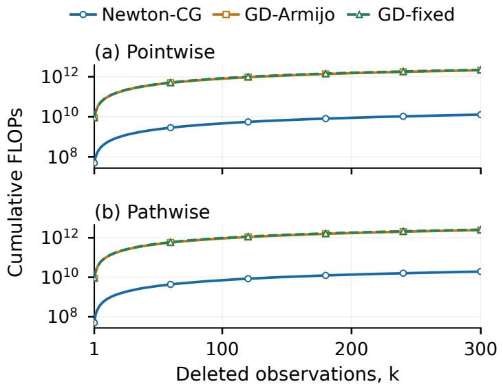
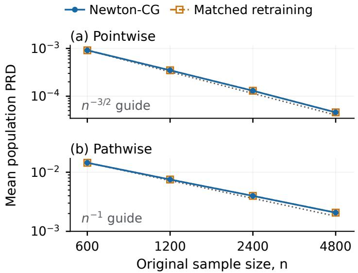
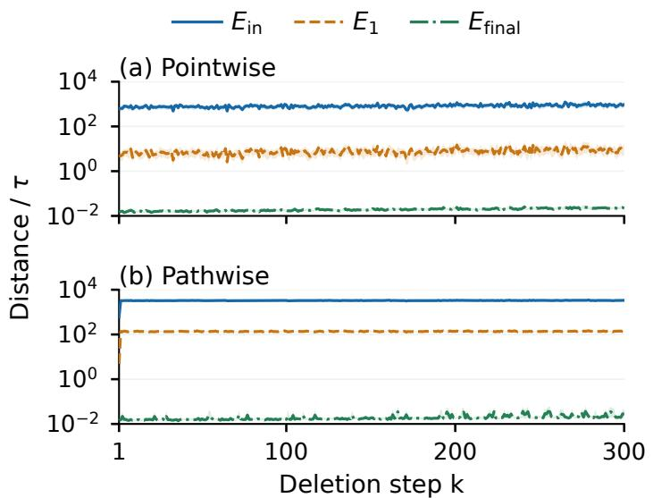

# Error Accumulation in Second-Order Sequential Machine Unlearning

Chen Shang<sup>1</sup> Haolin Zou<sup>1</sup> Binghe Zhu<sup>1</sup> Arian Maleki<sup>1,2</sup>

<sup>1</sup>Department of Statistics, Columbia University <sup>2</sup>Department of Electronic Engineering, Columbia University

## Abstract

Machine unlearning seeks to remove the influence of deleted training data without full retraining. In the sequential setting, deletion requests arrive over time, and repeated updates can accumulate approximation errors. In this paper, we study error accumulation in high dimensions, where parameter count p is proportional to sample size n, for second-order unlearning methods under two privacy settings: (i) partial unlearning, which allows unpublished internal states to be retained while certified versions of the model are released; and (ii) perfect unlearning, which retains only published models and no hidden states. We also distinguish pointwise and pathwise certification, depending on whether the certification guarantee applies to each released model or the whole released sequence. We analyze conjugate gradient (CG) as an eficient solver for the inverse Hessian-vector product (IHVP) in Newton iterations. Our theory shows that a maximum of 1/2/2/3 Newton–CG updates sufice for successful certification and vanishing population-risk degradation of the published model, for pointwise partial, pathwise partial, pointwise perfect and pathwise perfect certification, respectively. Numerical experiments demonstrate accurate sequential tracking and substantial computational gains of Newton-based methods combined with conjugate gradient, over gradient-based updates, especially for ill-conditioned problems.

Keywords: machine unlearning, second-order methods, certified removal, sequential unlearning.

## 1 Introduction

Machine unlearning aims to remove the influence of deleted training observations without retraining a model from scratch (Cao and Yang, 2015; Ginart et al., 2019). This capability is increasingly important in light of emerging legal requirements, such as the European Union’s General Data Protection Regulation (GDPR) and the California Consumer Privacy Act (CCPA). In many applications, deletion requests arrive sequentially: after each deletion, the updated model becomes the starting point for the next update. Approximate unlearning errors can therefore propagate across deletion requests, making guarantees for a single deletion insuficient for understanding a long unlearning trajectory.

Existing certified unlearning methods provide distributional indistinguishability to retraining while maintaining a certain accuracy level, often through first or second-order approximations combined with randomization (Guo et al., 2019; Neel et al., 2021; Sekhari et al., 2021). Moreover, sequentially updating and releasing the model raises a second problem: certifying each released model separately does not directly certify the joint sequence of releases, which is known as the privacy composition in diferential privacy (Kairouz et al., 2013). Moreover, publication noise may itself enter subsequent updates when unpublished model states cannot be kept (Neel et al., 2021).

We study sequential second-order unlearning in the proportional high-dimensional regime $( p \asymp n )$ , allowing linear $( T \leq c n )$ deletion requests for any fixed proportion c < 1. The central question is: in order to sequentially delete a certain proportion of the training data, how many

Newton iterations per deletion are needed to maintain certification and accuracy? Our contribution is an analysis of sequential error accumulation and its algorithmic consequences under a specified high-dimensional generalized linear model. The analysis connects approximation accuracy, publication-noise feedback, and numerical stopping criteria over a linear deletion horizon.

• Partial unlearning: uniform error tracking. We analyze how deletion shifts, inherited error from the previous deletion, and an inexact CG solution afect error accumulation over a linear deletion horizon. For partial unlearning initiated at a hidden model state, one Newton step per deletion sufices for pointwise certification and vanishing population-risk degradation. An additional Newton step achieves pathwise certification.

• Perfect unlearning: publication-noise feedback. In perfect unlearning where only the published model may be retained and used for the next deletion, publication noise is also fed back into the error of subsequent deletions. We control its efect on the Newton updates even when the Euclidean norm of noises does not vanish. With the noise levels and error tolerances specified, two Newton steps sufice in the pointwise setting and three in the pathwise setting, with high probability. Our sharpness analysis also shows that the $1 / 2 / 2 / 3$ Newton steps for the four cases cannot be reduced for the prescribed Newton update rule and parameter choices.

• Sequential guarantees for Newton–CG updates. To avoid explicit Hessian inversion, we use matrix-free conjugate gradient (CG) for eficient inverse-hessian-vector-product (IHVP) computation, and theoretically quantify how much error from the extra CG approximation can preserve the sequential guarantees using exact hessian inverses. Experiments on highdimensional logistic regression show that Newton-CG can substantially reduce computation relative to gradient-based updates, even for problems with ill-conditioned covariate covariances.

Our work builds most directly on certified removal via Newton approximations (Guo et al., 2019), sequential certified unlearning (Neel et al., 2021; Gupta et al., 2021; Suriyakumar and Wilson, 2022), and deletion-capacity analyses (Sekhari et al., 2021). Notably, Neel et al. (2021) distinguished settings according to whether unpublished internal state can be maintained using gradient-based methods, but their general bounds do not directly establish the accuracy guarantees sought here in the high-dimensional regime. Zou et al. (2025); Pandey et al. (2025) study Newton-based certified unlearning in the proportional high-dimensional regime. Both works consider a single removal batch of deletions, starting from the original fitted model, whereas our sequential problem starts each deletion from the previous approximate center or even noisy published model. In our work, we study the sequential problem and control error accumulation uniformly over a linear number of deletions. Our computational results are also related to recent eforts to make second-order unlearning scalable, such as Qiao et al. (2025). Work on neural-network and LLM unlearning (Koloskova et al., 2025; Bui et al., 2026) and on unlearning-friendly training architectures (Bourtoule et al., 2021) is complementary to our focus on rigorous sequential guarantees for regularized ERM.

## 2 Framework and Preliminaries

## 2.1 Sequential Unlearning Framework

Suppose we observe a dataset $\mathcal { D } = \{ z _ { i } \} _ { i = 1 } ^ { n }$ , with each observation $z _ { i } \in \mathcal { Z }$ for some data domain Z. For simplicity, we assume the datapoints $z _ { 1 } , z _ { 2 } , . . .$ . are deleted in ascending order, and write $\mathcal { D } _ { \backslash k } = ( z _ { k + 1 } , \ldots , z _ { n } )$ for the dataset retained after the first k deletions, with $\mathcal { D } _ { \backslash 0 } = \mathcal { D }$

We adopt the unlearning framework in Neel et al. (2021) with a slight modification. A learning algorithm is a mapping $\mathscr { A } : ( \bigcup _ { m = 1 } ^ { n } \mathcal { Z } ^ { m } )  \Theta$ that maps the dataset $\mathcal { D } \in \mathcal { Z } ^ { n }$ or its subsets to a

learned model $\beta ^ { \ast } \in \Theta$ . In this paper, we consider the regularized empirical risk minimization (R-ERM) as the learning algorithm:

$$
\begin{array} { r l } & { \beta ^ { * } : = \mathcal { A } ( \mathcal { D } ) : = \underset { \beta \in \mathbb { R } ^ { p } } { \mathrm { a r g m i n } } \displaystyle \sum _ { i = 1 } ^ { n } \ell ( y _ { i } , x _ { i } ^ { \top } \beta ) + \lambda r ( \beta ) , } \\ & { \beta _ { \backslash k } ^ { * } : = \mathcal { A } ( \mathcal { D } _ { \backslash k } ) : = \underset { \beta \in \mathbb { R } ^ { p } } { \mathrm { a r g m i n } } \displaystyle \sum _ { i = k + 1 } ^ { n } \ell ( y _ { i } , x _ { i } ^ { \top } \beta ) + \lambda r ( \beta ) . } \end{array}\tag{1}
$$

Note that the regularization strength $\lambda > 0$ is fixed for all n and all deletion steps $k \leq T$

An unlearning algorithm is a mapping $\mathcal { U } : ( \bigcup _ { m = 1 } ^ { n } \mathcal { Z } ^ { m } ) \times \mathcal { Z } \times \Theta \longrightarrow \Theta$ which takes three components as inputs: the dataset $\mathcal { D } \in \mathcal { Z } ^ { n }$ or its subset before deletion, a data point $z _ { k } \in \mathcal { D }$ to be deleted, and the model $\beta \in \Theta$ before deletion, and outputs an updated model $\tilde { \beta }$ that is supposed to remove all influence from the deleted data point $z _ { k }$ . To protect private information of the deleted point $z _ { k }$ , the output of the learning algorithm $\mathcal A ( \mathcal D )$ and unlearning algorithm $\mathcal { U } ( \mathcal { D } , z , \beta )$ should go through a publishing function $f _ { \mathrm { p u b } } : \Theta \to \Theta$ before being released to the public. Throughout this paper, the output of the publishing function $f _ { \mathrm { p u b } }$ is considered as a randomized version of its input, e.g. perturbing the input model with a suitable noise.

One objective of machine unlearning is called certification (Guo et al. (2019); Neel et al. (2021)) which guarantees statistical indistinguishability between the published versions of the unlearned model and the exactly retrained model.

Definition 2.1 $( ( \epsilon , \delta )$ -indistinguishability). Two random vectors x, y defined on some domain S are said to be $( \epsilon , \delta )$ -indistinguishable, written as x $\stackrel { \epsilon , \delta } { \approx } y , i f f \forall$ measurable set $S \subset S$ ，

$$
\begin{array} { r l } & { \mathbb { P } ( \pmb { x } \in S ) \le \mathrm { e } ^ { \epsilon } \mathbb { P } ( \pmb { y } \in S ) + \delta , } \\ & { \mathbb { P } ( \pmb { y } \in S ) \le \mathrm { e } ^ { \epsilon } \mathbb { P } ( \pmb { x } \in S ) + \delta . } \end{array}
$$

Definition 2.2 ((ϵ, δ)-pointwise certification). Let A and U be two learning and unlearning algorithms. Let $\tilde { \beta } _ { \backslash k } = \mathcal { U } ( \mathcal { D } _ { \backslash k - 1 } , z _ { k } , \tilde { \beta } _ { \backslash k - 1 } )$ be defined recursively with $\tilde { \beta } _ { \backslash 0 } = \mathcal { A } ( \mathcal { D } )$ . We say the pair $( \mathcal { U } , f _ { \mathrm { p u b } } )$ satisfies $( \epsilon , \delta )$ -pointwise partial certification if ∀D, $\forall 1 \leq k \leq T$

$$
f _ { \mathrm { p u b } } ( \mathcal { U } ( \mathcal { D } _ { \backslash k - 1 } , z _ { k } , \tilde { \beta } _ { \backslash k - 1 } ) ) \overset { \epsilon , \delta } { \approx } f _ { \mathrm { p u b } } ( \mathcal { A } ( \mathcal { D } _ { \backslash k } ) ) .
$$

Moreover, $i f$ we define

$$
\tilde { \beta } _ { \backslash k } ^ { \mathrm { p u b } } : = f _ { \mathrm { p u b } } ( \mathcal { U } ( \mathcal { D } _ { \backslash k - 1 } , z _ { k } , \tilde { \beta } _ { \backslash k - 1 } ^ { \mathrm { p u b } } ) )
$$

recursively with $\tilde { \beta } _ { \setminus } ^ { \mathrm { p u b } } = \mathcal { A } ( \mathcal { D } )$ , then $( \mathcal { U } , f _ { \mathrm { p u b } } )$ is said to satisfy $( \epsilon , \delta )$ -pointwise perfect certification $i f f \forall \mathcal { D } , \forall 1 \leq \ddot { k } \leq T$

$$
\tilde { \beta } _ { \backslash k } ^ { \mathrm { p u b } } \overset { \epsilon , \delta } { \approx } f _ { \mathrm { p u b } } ( \boldsymbol { \mathcal { A } } ( \boldsymbol { \mathcal { D } } _ { \backslash k } ) ) .
$$

Definition 2.3 $( ( \epsilon , \delta )$ -pathwise certified unlearning). Using the same notations as Definition 2.2, we say $( \mathcal { U } , f _ { \mathrm { p u b } } )$ satisfies $( \epsilon , \delta )$ -pathwise partial certification $i f \forall \mathcal { D }$

$$
\big ( f _ { \mathrm { p u b } } ( \mathcal { U } ( \mathcal { D } , z _ { 1 } , \tilde { \beta } _ { \backslash 0 } ) ) , \dots , f _ { \mathrm { p u b } } ( \mathcal { U } ( \mathcal { D } _ { \backslash ( T - 1 ) } , z _ { T } , \tilde { \beta } _ { \backslash T - 1 } ) ) \big )
$$

$$
\overset { \epsilon , \delta } { \approx } ( f _ { \mathrm { p u b } } ( \boldsymbol { A } ( \mathcal { D } _ { \setminus 1 } ) ) , \dots , f _ { \mathrm { p u b } } ( \boldsymbol { A } ( \mathcal { D } _ { \setminus T } ) ) ) .
$$

Moreover, $( \mathcal { U } , f _ { \mathrm { p u b } } )$ is said to satisfy (ϵ, δ)-pathwise perfect certification $i f \forall \mathcal { D }$

$$
( \tilde { \beta } _ { \backslash 1 } ^ { \mathrm { p u b } } , \ldots , \tilde { \beta } _ { \backslash T } ^ { \mathrm { p u b } } ) \stackrel { \epsilon , \delta } { \approx } ( f _ { \mathrm { p u b } } ( \boldsymbol { A } ( \mathcal { D } _ { \backslash 1 } ) ) , \ldots , f _ { \mathrm { p u b } } ( \boldsymbol { A } ( \mathcal { D } _ { \backslash T } ) ) ) .
$$

Intuitively, a partially certified unlearning algorithm starts its iteration from the unpublished (thus uncertified) model state of the last deletion, $\tilde { \beta } _ { \backslash k }$ . The perfect certification does not allow the owner of the model to keep the unpublished sequence $\tilde { \beta } _ { \backslash k }$ , so they must directly use the published models $\tilde { \beta } _ { \backslash k - 1 } ^ { \mathrm { p u b } } = f _ { \mathrm { p u b } } ( \tilde { \beta } _ { \backslash k - 1 } )$ . Since the published version usually contains more noise than the unpublished version, perfect unlearning is more stringent and may require additional computation resources.

Pointwise certification controls the privacy leakage of each released model separately, but does not by itself control the whole release sequence. Pathwise certification mitigates the issue by guaranteeing indistinguishability over the whole published model sequence.

Certification on a data class. Theoretical guarantees may not cover all possible $\mathcal { D } \in \mathcal { Z } ^ { n }$ due to the existence of extreme or pathological realizations of $\mathcal { D }$ , but with reasonable assumptions the theory should apply to a large enough data class $\mathcal { G } _ { n } \subseteq \mathcal { Z } ^ { n }$ such that $\mathcal { D } \in \mathcal { G } _ { n }$ with high probability. Consequently, we say that $( U , f _ { \mathrm { p u b } } )$ satisfies any of the certification notions in Definitions 2.2-2.3 on ${ \mathcal { G } } _ { n }$ if the corresponding distributional comparisons hold for every fixed $\mathcal { D } \in \mathcal { G } _ { n }$ , with the same parameters $( \epsilon , \delta )$ . Taking $\mathcal { G } _ { n } = \mathcal { Z } ^ { n }$ recovers the unrestricted definitions. Appendix B.1 constructs a data-only measurable class ${ \mathcal { G } } _ { n }$ under mild assumptions on the data distribution, such that ${ \mathcal { G } } _ { n }$ almost covers ${ \mathcal { Z } } _ { n }$ with near zero failing probability:

$$
\mathbb { P } _ { D } ( D \notin \mathcal { G } _ { n } ) \le p _ { n } : = n q _ { y } ( n ) + n ^ { - d } = o ( 1 ) .\tag{2}
$$

The certification results in Section 3 hold on ${ \mathcal { G } } _ { n }$ in the data-class sense specified after Definition 2.3. Essentially any unlearning method can be certified by a large enough perturbation in the publication function $f _ { \mathrm { p u b } }$ , but such a large noise might harm the performance of the model in subsequent tasks. Therefore we need an accuracy measure for the published model $\tilde { \beta } _ { \backslash k } ^ { \mathrm { p u b } }$

Definition 2.4 (Population-risk degradation). Let $R ( \beta ) = \mathbb { E } _ { ( x , y ) } [ \ell ( y , x ^ { \top } \beta ) ]$ , where $( x , y )$ is an independent observation from the training population. Define

$$
\begin{array} { r l } & { \mathrm { P R D } _ { k } : = \big [ R ( \widetilde \beta _ { \backslash k } ^ { \mathrm { p u b } } ) - R ( \beta _ { \backslash k } ^ { \ast } ) \big ] _ { + } , } \\ & { \mathrm { P R D } _ { 1 : T } : = \underset { 1 \leq k \leq T } { \operatorname* { m a x } } \mathrm { P R D } _ { k } , } \end{array}
$$

where $[ a ] _ { + } = \operatorname* { m a x } \{ a , 0 \}$

Various accuracy measures have been used in the literature, including the excess risk in Sekhari et al. (2021) that compares the population risk between $\tilde { \beta } _ { \backslash k } ^ { \mathrm { p u b } }$ and a "true parameter". Our populationrisk degradation (PRD) instead compares the population risk against the exactly retrained model $\beta _ { \backslash k } ^ { \ast } ,$ , without including the statistical error against population optimum already incurred by training or retraining.

## 2.2 Newton–CG unlearning

Suppose the objective $F _ { \backslash k }$ is µ-strongly convex. At each deletion $k ,$ the goal is to approximately find $\beta _ { \setminus k } ^ { * } = \mathcal { A } ( \mathcal { D } _ { \setminus k } ) = \mathrm { a }$ rgmin $F _ { \backslash k }$ and certify it through a proper publication function.

Define $g _ { \backslash k } = \nabla F _ { \backslash k } \in \mathbb { R } ^ { p }$ and $H _ { \backslash k } = \nabla ^ { 2 } F _ { \backslash k } \in \mathbb { R } ^ { p \times p }$ . The exact Newton mapping is defined as

$$
\mathcal { N } _ { k } ( u ) = u - H _ { \setminus k } ( u ) ^ { - 1 } g _ { \setminus k } ( u ) .\tag{3}
$$

The Newton-Raphson method recursively applies (3), until a solution $\tilde { \beta } _ { \backslash k } \approx \beta _ { \backslash k } ^ { \ast }$ is found. Compared to first-order methods such as stochastic gradient descent (SGD), Newton’s method uses the inverse Hessian instead of a scalar step size, so it saves the efort of tuning it. It is known to have rapid convergence under mild conditions, at the sacrifice of computation cost. In this section we will present our Newton unlearning algorithms, under partial or perfect unlearning, that satisfy pointwise or pathwise certification. We will also use the conjugate gradient (CG) descent to address the computation issue.

Newton partial unlearning We start with partial unlearning, where the system is allowed to retain a hidden model state for the next deletion.

For the initialization, for partial unlearning we can retain the unpublished model from the last deletion, $\tilde { \beta } _ { \backslash ( k - 1 ) }$ , as initialization for the current deletion. For the stopping rule, suppose we want to solve $\beta _ { \backslash k } ^ { \ast }$ up to some precision $\tau _ { n } > 0$ , that is, finding $\tilde { \beta } _ { \backslash k }$ such that $\| u - \beta _ { \setminus k } ^ { * } \| _ { 2 } \leq \tau _ { n }$ . By strong convexity,

$$
\| g _ { \backslash k } ( u ) \| _ { 2 } \leq \mu \tau _ { n } \Rightarrow \| u - \beta _ { \backslash k } ^ { \ast } \| _ { 2 } \leq \tau _ { n } ,\tag{4}
$$

where $\mu = \lambda \nu$ is the strong convexity constant of $F _ { \backslash k }$ . So it is suficient to control the gradient residual $\Vert \boldsymbol { g } _ { \ u { k } } ( \boldsymbol { u } ) \Vert _ { 2 } \leq \mu \tau _ { n }$ . In Section 3.2 we will show that, in most cases, one or two Newton iterations (3) sufice for pointwise and pathwise certification respectively.

Certification via Gaussian noise After a satisfactory $\tilde { \beta } _ { \backslash k }$ is found, we will publish the model by adding a Gaussian noise

$$
\tilde { \beta } _ { \backslash k } ^ { \mathrm { p u b } } = f _ { \mathrm { p u b } } ( \tilde { \beta } _ { \backslash k } ) = \tilde { \beta } _ { \backslash k } + N ( 0 , \sigma _ { n } ^ { 2 } \mathbb { I } _ { p } ) ,
$$

independently drawn for each deletion. For a fixed dataset and deletion order, suppose that $\| \widetilde { \beta } _ { \backslash k } - \beta _ { \backslash k } ^ { \star } \| _ { 2 } \leq \tau _ { n }$ for every $k \leq T$ . By Theorem C.1, for $0 < \epsilon \leq 1$ and $0 < \delta < 1 / 2$ , it sufices to set $\sigma _ { n } \gtrsim \frac { \tau _ { n } \sqrt { \log ( 1 / \delta ) } } { \epsilon }$ for pointwise certification, and $\sigma _ { n } \gtrsim \frac { \tau _ { n } \sqrt { T \log ( 1 / \delta ) } } { \epsilon }$ for pathwise certification. Details of the noise level will be discussed in Section 3.

Newton perfect unlearning Unlike partial unlearning, the perfect unlearning does not allow us to retain the unpublished models $\tilde { \beta } _ { \backslash ( k - 1 ) }$ . Instead, we initialize the Newton iteration at the previous published model $\tilde { \beta } _ { \backslash ( k - 1 ) } ^ { \mathrm { p u b } }$ . Intuitively, since $\tilde { \beta } _ { \backslash ( k - 1 ) } ^ { \mathrm { p u b } }$ is a noisy version of $\tilde { \beta } _ { \backslash ( k - 1 ) }$ , it is in general a worse initialization and more Newton steps are required. When publication noise enters the initialization of the next deletion, we jointly choose the center tolerance and the noise scale to control sequential error propagation. In particular, for pointwise perfect unlearning, we use a tighter center tolerance to permit a smaller publication-noise variance. Under the noise levels and center tolerances specified in Section 3.3, two Newton-CG steps sufice in the pointwise setting and three in the pathwise setting, with high probability along the deletion sequence.

Conjugate gradient method The Newton update computes $H _ { \backslash k } ( u ) ^ { - 1 } g _ { \backslash k } ( u )$ , which is also called an inverse-hessian-vector-product (IHVP) operation. A direct dense factorization to compute the IHVP in general costs $O ( p ^ { 3 } )$ , which is prohibitive for large models. The conjugate gradient (CG) method (Hestenes et al., 1952) is a popular choice for estimating the IHVP eficiently. We use a zero-start conjugate gradient (ConjugateGrad, Algorithm 2) to solve the linear system $H _ { \backslash k } ( u ) d = g _ { \backslash k } ( u )$ up to a small tolerance $\eta > 0$ such that $\| g _ { \backslash k } ( u ) - H _ { \backslash k } ( u ) d \| _ { 2 } \leq \eta$ (ConjugateGrad, Algorithm 2) for each Newton step. The choice of η balances both computation cost (number of CG iterations) and accuracy in solving the Newton direction. Detailed discussion is postponed to Section 3. In subsequent discussions, define $\mathcal { N } _ { k } ^ { \mathrm { C G } } ( u )$ to be the Newton–CG update, where d is an approximate solution for $H _ { \backslash k } ( u ) ^ { - 1 } g _ { \backslash k } ( u )$ using ConjugateGrad. Specifically, Algorithm 2 returns the first iterate d satisfying

$$
\| g _ { \backslash k } ( u ) - H _ { \backslash k } ( u ) d \| _ { 2 } \leq \frac { \mu \tau _ { n } } { 8 }
$$

If $g _ { \backslash k } ( u ) = 0$ , we set $d = 0$ without running CG. Define $\mathcal { N } _ { k } ^ { \mathrm { C G } } ( u ) = u - d .$ . Strong convexity gives

$$
\| \mathcal { N } _ { k } ^ { \mathrm { C G } } ( u ) - \mathcal { N } _ { k } ( u ) \| _ { 2 } \leq \frac { \tau _ { n } } { 8 } .
$$

Let $J _ { * }$ denote the prescribed suficient number of Newton–CG updates for the selected unlearning setting. All four settings use this residual rule with their prescribed center tolerance $\tau _ { n }$ . Section 3 specifies the center tolerances and publication-noise scales; Appendix E analyzes the residual rule and CG arithmetic work.

Fallback procedure We check the gradient gate after every Newton–CG update and stop as soon as it is satisfied. If it still fails after $J _ { * }$ updates, we apply a fallback procedure dubbed Recover to continue optimization on the retained data until $\| g _ { \backslash k } ( v ) \| _ { 2 } \leq \mu \tau _ { n }$ . Recover<sub>k</sub> uses gradient descent with Armijo backtracking to select step size from objective evaluations without a known global smoothness constant. Appendix G.1 specifies the procedure in detail and proves finite termination at this positive tolerance under our assumptions in exact arithmetic. All failed Newton attempts and recovery work are included in the computational cost.

Algorithm 1 summarizes the unlearning procedure described in this section.

Algorithm 1: Precision-stopped sequential unlearning with recovery   
Input: Dataset D; exact full-data fit $\beta ^ { \star } ;$ deletion sequence $z _ { 1 : T } ;$ maximum Newton steps   
$J _ { * } \in \{ 1 , 2 , 3 \}$ ; precision $\tau _ { n } > 0 ;$ noise level $\sigma _ { n } > 0 ;$ Boolean flag is\_perfect.   
if $\dot { \iota } s _ { - } p$ erfect is false then   
Set $\widetilde { \beta } _ { \backslash 0 } \gets \beta ^ { \star }$   
else   
Set $\mathcal { \widetilde { B } } _ { \backslash 0 } ^ { \mathrm { p u b } }  \beta ^ { \star }$   
for $k = 1 , \dots , T$ do   
Remove $z _ { k }$ and form $F _ { \backslash k }$ on $D _ { \backslash k }$   
if is\_perfect is $f a$ lse then   
Set $u  \widetilde { \beta } _ { \backslash ( k - 1 ) }$   
else   
Set $u \gets \widetilde { \beta } _ { \backslash ( k - 1 ) } ^ { \mathrm { p u b } }$   
Set $j  1$ and passed←false   
while passed is $f a$ lse do   
if $j \leq J _ { * }$ then   
$u \gets \mathcal { N } _ { k } ^ { \mathrm { C G } } ( u ) ; j \gets j + 1$   
else   
u ← Recover $\mathbf { \Omega } _ { k } ( u )$   
passed← $[ \| g _ { \backslash k } ( u ) \| _ { 2 } \leq \mu \tau _ { n } ]$   
Draw fresh $Z _ { k } \sim { \mathcal { N } } ( 0 , \sigma _ { n } ^ { 2 } I _ { p } )$ , independently   
Set $\widetilde { \beta } _ { \backslash k } ^ { \mathrm { p u b } } \gets u + Z _ { k }$ and publish $\widetilde { \beta } _ { \backslash k } ^ { \mathrm { p u b } }$   
if is\_perfect is false then   
Set $\widetilde { \beta } _ { \backslash k } \gets u$ and retain it as the model state for the next deletion   
else   
Retain $\widetilde { \beta } _ { \backslash k } ^ { \mathrm { p u b } }$ as the sole carried model state; keep the retained dataset $D _ { \backslash k }$ and discard $u , Z _ { k } ,$   
and all other model and solver states

## 3 Main theoretical contributions

Table 1: Certification and accuracy guarantees in Theorems 3.1–3.4, for fixed $( \epsilon , \delta )$ . On the “good data class” ${ \mathcal { G } } _ { n } ,$ each deletion achieves the desired accuracy $\tau _ { n }$ within $J _ { \star }$ Newton steps.
<table><tr><td>Hidden state</td><td>Certification</td><td>Center Tolerance  $\tau _ { n }$ </td><td>Max Newton-CG steps  $J _ { * }$ </td><td>Noise std per coordinate</td><td>Max risk along deletion path  $\mathrm { P R D } _ { 1 : T }$ </td></tr><tr><td>Allowed</td><td>Pointwise</td><td> $\widetilde { \cal O } ( n ^ { - 1 / 2 } )$ </td><td></td><td> $\widetilde { \cal O } ( n ^ { - 1 / 2 } )$ </td><td> $\widetilde { O } _ { p } ( n ^ { - 1 } )$ </td></tr><tr><td>(partial unlearning)</td><td>Pathwise</td><td> $\widetilde { O } ( n ^ { - 1 } )$ </td><td>1</td><td> $\widetilde { \cal O } ( \sqrt { T } / n )$ </td><td> $\widetilde { O } _ { p } ( \sqrt { T } / n ^ { 3 / 2 } )$ </td></tr><tr><td></td><td></td><td></td><td>2</td><td></td><td></td></tr><tr><td>Forbidden</td><td></td><td></td><td></td><td></td><td> $\widetilde { O } _ { p } ( n ^ { - 3 / 2 } )$ </td></tr><tr><td>(perfect unlearning)</td><td>Pointwise</td><td> $\widetilde { O } ( n ^ { - 1 } )$ </td><td>2</td><td> $\widetilde { O } ( n ^ { - 1 } )$ </td><td></td></tr><tr><td></td><td>Pathwise</td><td> $\frac { 1 } { n }$ </td><td>3</td><td> ${ \tilde { O } } ( { \sqrt { T } } / n )$ </td><td> $\widetilde { O } _ { p } ( \sqrt { T } / n ^ { 3 / 2 } )$ </td></tr></table>

Before delving into the assumptions and theorems, Table 1 summarizes our main theoretical results. The four rows correspond to the four unlearning requirements in Definitions 2.2 and 2.3. With high probability, our theory shows that the four cases require only $1 / 2 / 2 / 3$ Newton–CG iterations to achieve a proper accuracy level (before publication) $\| \tilde { \beta } _ { \backslash k } - \beta _ { \backslash k } ^ { * } \| \leq \tau _ { n }$ , for some theoryguided tolerance $\tau _ { n }$ . Independent Gaussian noises are added to $\tilde { \beta } _ { \backslash k }$ to guarantee certification, and the noise level $\sigma _ { n }$ is chosen according to $\tau _ { n } .$ . The required Newton–CG steps $J _ { * }$ guarantee $\tau _ { n }$ and $\sigma _ { n }$ are small enough in each case, so that the published (noisy) models $\tilde { \beta } _ { \backslash k } ^ { \mathrm { { \bar { p u b } } } }$ still have vanishing risk, measured by population-risk degradation (PRD, Definition 2.4).

Table 1 summarizes the resulting tradeofs among maximum Newton steps, publication noise, and population-risk degradation under the respective calibrations of Theorems 3.1–3.4.

## 3.1 Assumptions

We use the summed objective in (1), with fixed $\lambda > 0 , p / n \to \gamma \in ( 0 , 1 )$ , and any prespecified deletion horizon $1 \leq T \leq K : = \lfloor c ^ { \prime } n \rfloor$ , where $0 < c ^ { \prime } < 1$ is fixed. The retained sample size is at least $( 1 - c ^ { \prime } ) n$ We postpone the exact definitions of our assumptions to Appendix A (Assumptions A.1–A.4). Briefly speaking, the assumptions are:

• A1 (Design). Observation pairs $( y _ { i } , x _ { i } )$ are independent draws from a common population, where $x _ { i } \sim N ( 0 , \Sigma / p )$ and Σ has $\Theta ( 1 )$ eigenvalues.

• A2 (Responses). The response variables $y _ { i }$ are stochastically bounded, up to polylog(n) factors.

• A3 (Loss). The loss $\ell ( y , z )$ is non-negative, convex and $\mathcal { C } ^ { 3 }$ . Its derivatives exhibit polynomial growth in both y and z.

• A4 (Penalty). The penalty $r ( \beta )$ is $\mathcal { C } ^ { 2 }$ , separable and ν-strongly convex with $r ( 0 ) = 0$ and $\nabla r ( 0 ) = 0$ . Its hessian $\nabla ^ { 2 } r$ is polylog(n)-Lipschitz in Frobenius norm and $\| \nabla ^ { 2 } r \| _ { \mathrm { o p } } = \mathrm { p o l y l o g } ( n )$

We write $\mu = \lambda \nu$ to be the strong convexity constant for $F _ { \backslash k } , \forall k \leq T$ , and $\tilde { O }$ suppresses deterministic fixed powers of $\log ( n )$

The assumptions above are mild and include many classic models such as ridge and logistic regression. Assumptions A1 and A2 are conventional in high dimensional statistics. Suppose the population level "true parameter" $\beta ^ { * , \mathrm { t r u e } }$ has $O ( 1 )$ coordinates on average, then Assumptions A1 and A2 essentially guarantee $\| \boldsymbol { x } _ { i } \| _ { 2 } , \boldsymbol { x } _ { i } ^ { \top } \beta ^ { \mathrm { t r u e } }$ and $y _ { i }$ are ${ \tilde { O } } _ { p } ( 1 )$ . Assumptions A3 and A4 are regularity conditions on the loss ℓ and penalty r that are conventional in the literature, such as smoothness, strong convexity and Hessian-lipschitzness. The additional polynomial bound on ℓ and its derivatives prevents steep variations when the parameter changes, which is important in deciding the perturbation level.

Throughout this section, we use the center tolerances $\tau _ { n } ^ { ( 1 ) }$ and $\tau _ { n } ^ { ( 2 ) }$ specified in Appendix B.4, Equation (27). They satisfy

$$
\tau _ { n } ^ { ( 1 ) } = \widetilde { \cal O } ( n ^ { - 1 / 2 } ) , \quad \tau _ { n } ^ { ( 2 ) } = \widetilde { \cal O } ( n ^ { - 1 } ) .
$$

## 3.2 Partial unlearning

We start with partial unlearning with pointwise certification.

Theorem 3.1 (Pointwise partial certification). Suppose Assumptions $A . 1 \mathrm { - } A . 4$ hold. Use Algorithm 1 with is\_perfect = false, $J _ { \star } = 1 , \tau _ { n } = \tau _ { n } ^ { ( 1 ) }$ , and

$$
\sigma _ { n } = 2 \tau _ { n } ^ { ( 1 ) } \sqrt { 2 \log ( 1 / \delta ) } / \epsilon
$$

with $\begin{array} { r } { 0 < \epsilon \le 1 , \delta \in ( 0 , \frac { 1 } { 2 } ] } \end{array}$ fixed. For all suficiently large n, the following hold for all $D \in { \mathcal { G } } _ { n }$ which has probability at least $1 - o ( 1 )$

1. $\operatorname* { m a x } _ { k \le T } \lVert \widetilde { \beta } _ { \backslash k } - \beta _ { \backslash k } ^ { \ast } \rVert _ { 2 } \leq \tau _ { n } ^ { ( 1 ) }$ within $J _ { * } = 1 \ N e w t o n – C G \ s t e p$

2. The published sequence $\{ \tilde { \beta } _ { \backslash k } ^ { \mathrm { p u b } } \} _ { k = 1 } ^ { T }$ satisfies (ϵ, δ)-pointwise partial certification.

3. For an arbitrary constant $d > 1 , \mathbb { P } ( \operatorname { P R D } _ { 1 : T } > n ^ { - 1 } \operatorname { p o l y l o g } ( n ) | \mathcal { D } ) \leq n ^ { - d }$

Remark 3.1.1. In fact, our proof for Theorem 3.1 shows that, in the case of pointwise partial unlearning, for all suficiently large n and every $D \in { \mathcal { G } } _ { n } , J _ { * } = 1$ always sufices, which means the fallback procedure Recover<sub>k</sub> is never triggered in this case.

Theorem 3.2 (Pathwise partial certification). Suppose Assumptions $A . 1 \mathrm { - } A . 4$ hold. Run Algorithm 1 with is\_perfect = false, $J _ { \star } = 2$ , and $\tau _ { n } = \tau _ { n } ^ { ( 2 ) }$ and

$$
\sigma _ { n } = 2 \tau _ { n } ^ { ( 2 ) } \sqrt { 2 T \log ( 1 / \delta ) } / \epsilon ,
$$

with $\begin{array} { r } { 0 < \epsilon \le 1 , \delta \in ( 0 , \frac { 1 } { 2 } ] } \end{array}$ remain fixed. For all suficiently large $n ,$ the following hold for every fixed $D \in \mathcal { G } _ { n }$ which has probability at least $1 - o ( 1 )$

1. $\operatorname* { m a x } _ { k \le T } \lVert \widetilde { \beta } _ { \backslash k } - \beta _ { \backslash k } ^ { \ast } \rVert _ { 2 } \leq \tau _ { n } ^ { ( 2 ) }$ within $J _ { * } = 2$ Newton–CG steps.

2. The published sequence $\{ \tilde { \beta } _ { \backslash k } ^ { \mathrm { p u b } } \} _ { k = 1 } ^ { T }$ satisfies (ϵ, δ)-pathwise partial certification.

3. For an arbitrary constant $d > 0$ ，

$$
\mathbb { P } ( \mathrm { P R D } _ { 1 : T } \leq \sqrt { T } n ^ { - 3 / 2 } \mathrm { p o l y l o g } ( n ) | \mathcal { D } ) \geq 1 - n ^ { - d } .\tag{5}
$$

The complete proofs of Theorems 3.1–3.4 are collected in Appendix C.1.

## 3.3 Perfect unlearning

Theorem 3.3 (Pointwise perfect certification). Suppose Assumptions $A . 1 \mathrm { - } A . 4$ hold. Run Algorithm 1 with is\_perfect $= \mathrm { t r u e } , J _ { \star } = 2 , \tau _ { n } = \tau _ { n } ^ { ( 2 ) }$ , and

$$
\sigma _ { n } = 2 \tau _ { n } ^ { ( 2 ) } \sqrt { 2 \log ( 2 / \delta ) } / \epsilon .
$$

with $\begin{array} { r } { 0 < \epsilon \le 1 , \delta \in ( 0 , \frac { 1 } { 2 } ] } \end{array}$ remain fixed. For all $D \in \mathcal { G } _ { n }$ that has $1 - o ( 1 )$ probability, with suficiently large n, the following hold with conditional probability at least $1 - n ^ { - d }$ for an arbitrary constant $d > 0$ (over the randomness of Gaussian noises):

1. m $\begin{array} { r } { \imath \mathrm { x } _ { k \leq T } \| \widetilde { \beta } _ { \setminus k } - \beta _ { \setminus k } ^ { * } \| _ { 2 } \leq \tau _ { n } ^ { ( 2 ) } } \end{array}$ within $J _ { * } = 2$ updates for all deletions,

2. $\{ \tilde { \beta } _ { \backslash k } ^ { \mathrm { p u b } } \} _ { k = 1 } ^ { T }$ satisfies $( \epsilon , \delta )$ -pointwise perfect certification,

3. $\mathrm { P R D } _ { 1 : T } = \widetilde { O } ( n ^ { - 3 / 2 } )$

Theorem 3.4 (Pathwise perfect certification). Suppose Assumptions A. $\cdot 1 { - } A . 4$ hold. Run Algorithm 1 with is\_perfect = true, $J _ { \star } = 3$ , and

$$
\tau _ { n } = \frac { 1 } { n } , \qquad \sigma _ { n } = \frac { 2 \sqrt { 2 T \log ( 1 / \delta ) } } { \epsilon n }\tag{6}
$$

with $\begin{array} { r } { 0 < \epsilon \le 1 , \delta \in ( 0 , \frac { 1 } { 2 } ] } \end{array}$ fixed. For all $D \in { \mathcal { G } } _ { n }$ that has $1 - o ( 1 )$ probability, with suficiently large n, the following hold with conditional probability at least $1 - n ^ { - d }$ for an arbitrary constant $d > 0$ (over the randomness of Gaussian noises):

1. ma $\bar { \iota } _ { k \leq T } \| \widetilde { \beta } _ { \setminus k } - \beta _ { \setminus k } ^ { \ast } \| _ { 2 } \leq 1 / n$ within $J _ { * } = 3$ updates for all deletions,

2. $\{ \tilde { \beta } _ { \backslash k } ^ { \mathrm { p u b } } \} _ { k = 1 } ^ { T }$ satisfies (ϵ, δ)-pathwise perfect certification,

3. $\begin{array} { r } { \mathrm { P R D } _ { 1 : T } = \widetilde { O } \left( n ^ { - 3 / 2 } + \frac { \sqrt { T } } { n ^ { 3 / 2 } } + \frac { T } { n ^ { 2 } } \right) } \end{array}$

Comparing Theorem 3.3 with Theorem 3.1 (and Theorem 3.4 with 3.2), we see that, under the prescribed noise levels and center tolerances, perfect unlearning requires one additional Newton–CG iteration compared to partial unlearning. This is because, under perfect unlearning, the $k + 1 ^ { \mathrm { t h } }$ deletion is initialized at the noisy published model $\tilde { \beta } _ { \backslash k } ^ { \mathrm { p u b } }$ , which brings the publication noise $\sigma _ { n }$ into error accumulation. We might choose a tighter center tolerance to permit a smaller publicationnoise variance and thereby control this feedback. Our analysis shows that one extra Newton–CG iteration sufices to attain the corresponding center tolerance with high probability along the deletion sequence.

CG iteration complexity. For all four settings in Theorems 3.1-3.4, CG attains the residual tolerance $\frac { \mu \tau _ { n } } { 8 }$ within polylog n iterations per Newton update with high probability. The explicit iteration bound is given in Appendix $\mathrm { E } ,$ Proposition E.1.

## 3.4 Sharpness of the maximum Newton steps

Theorems 3.1–3.4 guarantee that, with high probability (when ${ \mathcal { D } } \in { \mathcal { G } } _ { n } )$ , within a maximum of $J _ { * } = 1 / 2 / 2 / 3$ Newton iterations respectively, the desired accuracy $\tau _ { n }$ is achieved and the optimization terminates $( \| g _ { \backslash k } ( u ) \| _ { 2 } \leq \mu \tau _ { n } )$ without invoking the fallback procedure Recover . Theorem 3.5 below further shows the aforementioned Newton steps $J _ { * }$ cannot be reduced in the worst case. Note that Theorem 3.5 does not include Theorem 3.1 which requires a single Newton step $( J _ { * } = 1 )$ and it is obviously irreducible: without any Newton updates the model stays at the state of $\beta ^ { * }$ and it loses track for $\beta _ { \backslash k } ^ { \ast }$ when deletion progresses.

Theorem 3.5 (Sharpness of the maximal Newton Steps). Under the conditions of Theorems 3.2–3.4, additionally fix constants $0 < t _ { - } < c ^ { \prime } < 1$ , independently of n, and let the prespecified integer deletion horizon $T = T _ { n }$ satisfy

$$
\lceil t - n \rceil \leq T \leq \lfloor c ^ { \prime } n \rfloor
$$

for all suficiently large n. Let $J _ { \star } = 2 , 2 , 3$ for pathwise partial, pointwise perfect, and pathwise perfect unlearning, respectively. Let $N _ { k }$ be the minimum number of Newton iterations such that the gradient gate is met $( \lVert g _ { \backslash k } ( u ) \rVert \leq \mu \tau _ { n } )$ . For each of the three settings, there exists an admissible model family and events $E _ { n } \subseteq { \mathcal { G } } _ { n } \ w i t h \ \mathbb { P } _ { D } ( E _ { n } ) \to 1$ such that, for every fixed $d > 0$ and all suficiently large n, and every $D \in E _ { n }$

$$
\mathbb { P } \bigg ( \operatorname* { m a x } _ { 1 \le k \le T } N _ { k } \ge J _ { \star } \bigg | D \bigg ) \ge 1 - O ( n ^ { - d } ) .
$$

## 4 Numerical Experiments

We examine computational cost, population-risk degradation, and parameter-error trajectories for perfect sequential unlearning with ridge-logistic regression. All Newton–CG results are obtained using Algorithm 1 in the perfect-unlearning setting. All three experiments use the summed loss with penalty $( \lambda / 2 ) \lVert \beta \rVert _ { 2 } ^ { 2 } , \lambda = 0 . 1$ , and $( \epsilon , \delta ) = ( 1 , 1 0 ^ { - 6 } )$ . Appendix H gives the experimental setup.

## 4.1 Comparison with GD

We compare Newton–CG, GD–Armijo, and GD–fixed on spiked Gaussian data $( n = 1 2 0 0 , p = T =$ 300, $\rho = 1 0 0 0 )$ . Ten independent clusters pair data, deletion order, and publication innovations across methods. Each method uses its own preceding release and the gate $\| \nabla F _ { \backslash k } \| _ { 2 } \leq \lambda \tau$ , with $\tau = 1 / 1 2 0 0$ . Algorithm 1 uses at most two and three Newton updates under pointwise and pathwise calibration, respectively, followed by recovery if needed.

Figure 1 shows lower counted costs for Newton–CG. Pathwise paired geometric GD–Armijo/NCG and GD–fixed/NCG FLOP ratios are 125.25 and 132.06. All 3000 deletions completed, including 14 requiring recovery after the third update; all recovery costs are included.

  
Figure 1: Cumulative FLOPs under pointwise (top) and pathwise (bottom) settings.

## 4.2 Population-Risk Degradation

A separate isotropic study uses $n \in \{ 6 0 0 , 1 2 0 0 , 2 4 0 0 , 4 8 0 0 \}$ , $p = T = n / 4 , \tau _ { n } = 1 / n$ , and 20 independent clusters per n. Within each calibration, Newton–CG and noisy retraining share publication noise. Relative to numerical noiseless retraining $b _ { \mathrm { r e f } , k }$ , we measure

$$
M _ { n } = \operatorname* { m a x } _ { 1 \leq k \leq T } \big [ R ( \tilde { \beta } _ { \backslash k } ^ { \mathrm { p u b } } ) - R ( b _ { \mathrm { r e f } , k } ) \big ] _ { + } ,
$$

and its matched-retraining analogue, where R is population logistic risk. Each full-path maximum precedes averaging across clusters.

All 80 clusters completed. Mean degradation decreases with n and closely tracks noisy retraining (Figure 2). The four-point log–log slopes of the NCG means are −1.437 and −0.933 for pointwise and pathwise calibration. These descriptive trends do not establish asymptotic rates or separate causal error contributions.

  
Figure 2: Mean full-path population-risk degradation under pointwise (top) and pathwise (bottom) settings with 20 clusters per n.

## 4.3 Error Propagation

An independent isotropic batch $( n = 1 2 0 0 , p = T = 3 0 0 , \rho = 1 )$ tracks error over 20 paired data/order/noise clusters. At each deletion, we measure distance to numerical retraining, divided by $\tau = 1 / 1 2 0 0$ , for the entering model, the first complete Newton–CG outer update, and the final accepted center before fresh publication noise.

All 40 paths completed 300 deletions (Figure 3). At k = 300, pathwise entering and first-update means are 3346.86 and 139.10; final means are 0.022 pointwise and 0.028 pathwise. Small final errors are partly gate-enforced; natural trajectories do not establish per-round contraction or a causal decomposition.

  
Figure 3: Mean distances divided by $\tau { : }$ entering model $\left( E _ { \mathrm { i n } } \right)$ , first complete update $\left( E _ { 1 } \right)$ , and final center $\left( E _ { \mathrm { f i n a l } } \right)$ . Pointwise (top) and pathwise (bottom) panels share a log scale.

## 5 Concluding Remark

This paper studies error accumulation in sequential machine unlearning when the parameter dimension p is proportional to the training sample size n. Under the stated assumptions, Newtonbased updates track exact retraining uniformly over a deletion horizon $T$ proportional to n. With the prescribed noise levels $\sigma _ { n }$ and stopping tolerances $\tau _ { n }$ , one and two Newton–CG updates per deletion sufice for pointwise and pathwise partial certifiability, respectively, while perfect certifiability requires two and three. These update bounds hold with high probability, and all four settings achieve vanishing population-risk degradation. We further show that the required $1 / 2 / 2 / 3$ Newton–CG steps cannot generally be reduced in the worst case.

Conjugate gradient (CG) reduces the cost of computing Newton updates without explicitly inverting the Hessian. Our analysis controls the additional CG approximation error, and experiments demonstrate substantial computational savings over the tested gradient descent methods in ridgelogistic regression. Together, these results show how inherited approximation error, publication noise, and computation accuracy determine the requirements for sequential unlearning in high dimensions. Extending the analysis to adaptive deletion requests that depend on previously released models and models beyond the convex setting considered here remains an important direction for future work.

## Acknowledgement

Arian Maleki would like to thank the National Science Foundation for support under Grants DMS-2515716 and DMS-2210506.

## References

Bourtoule, L., Chandrasekaran, V., Choquette-Choo, C. A., Jia, H., Travers, A., Zhang, B., Lie, D., and Papernot, N. (2021). Machine unlearning. In 2021 IEEE Symposium on Security and Privacy (SP), pages 141–159. IEEE.

Bui, N., Lu, X., Sim, R. H. L., Ng, S.-K., and Low, B. K. H. (2026). How to cure newton for unlearning neural networks? an empirical study from the hessian perspective. In The Fourteenth International Conference on Learning Representations.

Bun, M. and Steinke, T. (2016). Concentrated diferential privacy: Simplifications, extensions, and lower bounds. In Theory of Cryptography – TCC 2016-B, volume 9985 of Lecture Notes in Computer Science, pages 635–658. Springer.

Cao, Y. and Yang, J. (2015). Towards making systems forget with machine unlearning. In 2015 IEEE symposium on security and privacy, pages 463–480. IEEE.

Ginart, A., Guan, M., Valiant, G., and Zou, J. Y. (2019). Making ai forget you: Data deletion in machine learning. Advances in neural information processing systems, 32.

Guo, C., Goldstein, T., Hannun, A., and Van Der Maaten, L. (2019). Certified data removal from machine learning models. arXiv preprint arXiv:1911.03030.

Gupta, V., Jung, C., Neel, S., Roth, A., Sharifi-Malvajerdi, S., and Waites, C. (2021). Adaptive machine unlearning. Advances in Neural Information Processing Systems, 34:16319–16330.

Hestenes, M. R., Stiefel, E., et al. (1952). Methods of conjugate gradients for solving linear systems. Journal of research of the National Bureau of Standards, 49(6):409–436.

Kairouz, P., Oh, S., and Viswanath, P. (2013). The composition theorem for diferential privacy. IEEE Transactions on Information Theory, 63:4037–4049.

Koloskova, A., Allouah, Y., Jha, A., Guerraoui, R., and Koyejo, S. (2025). Certified unlearning for neural networks. In Forty-second International Conference on Machine Learning.

Neel, S., Roth, A., and Sharifi-Malvajerdi, S. (2021). Descent-to-delete: Gradient-based methods for machine unlearning. In Algorithmic Learning Theory, pages 931–962. PMLR.

Pandey, A., Auddy, A., Zou, H., Maleki, A., and Kulkarni, S. (2025). Gaussian certified unlearning in high dimensions: A hypothesis testing approach. arXiv preprint arXiv:2510.13094.

Qiao, X., Zhang, M., Tang, M., and Wei, E. (2025). Hessian-free online certified unlearning. In International Conference on Learning Representations, volume 2025, pages 32675–32711.

Sekhari, A., Acharya, J., Kamath, G., and Suresh, A. T. (2021). Remember what you want to forget: Algorithms for machine unlearning. Advances in Neural Information Processing Systems, 34:18075–18086.

Suriyakumar, V. and Wilson, A. C. (2022). Algorithms that approximate data removal: New results and limitations. Advances in Neural Information Processing Systems, 35:18892–18903.

Zou, H., Auddy, A., Kwon, Y., Rad, K. R., and Maleki, A. (2025). Certified data removal under high-dimensional settings. arXiv preprint arXiv:2505.07640.

## Supplementary Materials

## A Assumptions

Assumption A.1 (Gaussian elliptical design). The training pairs $( x _ { i } , y _ { i } )$ are independent draws from a common population. Their covariates have the representation

$$
x _ { i } = \frac { 1 } { \sqrt { p } } \Sigma ^ { 1 / 2 } \xi _ { i } , \qquad \xi _ { i } \overset { \mathrm { i i d } } { \sim } N ( 0 , I _ { p } ) ,
$$

where the spectrum of Σ is uniformly bounded:

$$
0 < c _ { \Sigma } \leq \lambda _ { \operatorname* { m i n } } ( \Sigma ) \leq \lambda _ { \operatorname* { m a x } } ( \Sigma ) \leq C _ { \Sigma } < \infty .
$$

The constants $c _ { \Sigma } , C _ { \Sigma }$ are independent $o f n , p$ . The components $x _ { i }$ and $y _ { i }$ within a pair need not be independent.

Assumption A.2 (Response tails). There exists $C _ { y } ( n ) = O ( ( \log n ) ^ { C _ { y } ^ { 0 } } )$ and a tail probability $q _ { y } ( n )$ such that

$$
\mathbb { P } ( | y _ { i } | > C _ { y } ( n ) ) \le q _ { y } ( n ) , \qquad n q _ { y } ( n ) = o ( 1 ) , \qquad \mathbb { E } | y _ { i } | ^ { 2 s } \le C _ { y , s } < \infty .
$$

Assumption A.3 (Loss). For every y, the loss $\ell ( y , \cdot )$ is nonnegative, proper convex and $C ^ { 3 }$ . For fixed constants $C , s > 0$ , and all $( y , t )$ 2

$$
\operatorname* { m a x } \{ \ell ( y , t ) , | \partial _ { t } \ell ( y , t ) | , | \partial _ { t } ^ { 3 } \ell ( y , t ) | \} \leq C ( 1 + | y | ^ { s } + | t | ^ { s } ) .
$$

Assumption A.4 (Penalty). The regularizer $r : \mathbb { R } ^ { p } \to \mathbb { R } _ { + }$ is $C ^ { 2 }$ , proper convex, and ν-strongly convex for fixed $\nu > 0$ . It is separable, $\begin{array} { r } { r ( \beta ) = \sum _ { j = 1 } ^ { p } r _ { j } ( \beta _ { j } ) } \end{array}$ , and is normalized by

$$
r ( 0 ) = 0 , \qquad \nabla r ( 0 ) = 0 .
$$

Consequently,

$$
r ( { \boldsymbol { \beta } } ) \geq \frac { \nu } { 2 } \| { \boldsymbol { \beta } } \| _ { 2 } ^ { 2 } , \qquad { \boldsymbol { \beta } } \in \mathbb { R } ^ { p } .
$$

This normalization gives the a priori radius bound for the regularized empirical minimizer; the origin is the reference minimizer of r. The Hessian has the global bounds

$$
\begin{array} { c } { \displaystyle \operatorname* { s u p } _ { \beta \in \mathbb { R } ^ { p } } \| \nabla ^ { 2 } r ( \beta ) \| _ { \mathrm { o p } } \leq B _ { r } ( n ) , } \\ { \displaystyle \| \nabla ^ { 2 } r ( \beta ) - \nabla ^ { 2 } r ( \beta ^ { \prime } ) \| _ { \mathrm { F } } \leq C _ { r r } ( n ) \| \beta - \beta ^ { \prime } \| _ { 2 } , } \end{array}
$$

where the second inequality holds for all $\beta , \beta ^ { \prime } \in \mathbb { R } ^ { p } , C _ { r r } ( n ) = O ( ( \log n ) ^ { C _ { r r } ^ { 0 } } )$ is deterministic with fixed $C _ { r r } ^ { 0 } \geq 0$ , and $B _ { r } ( n )$ is a deterministic polylogarithmic bound.

Gaussianity is used for conditional leave-one-out linear forms, the design operator bound, and the test-population moment calculation. An extension beyond Gaussian covariates would require corresponding conditional concentration and test-moment bounds to be proved. No such extension is asserted here.

## B Shared tools for tracking exact retraining

Notation for the proofs. For fixed data and a specified algorithmic configuration, let $C _ { k } ^ { H }$ be the center in Algorithm 1 with is\_perfect = false and $C _ { k } ^ { P } ( h )$ the center when is\_perfect = true at the numerical past history h. Thus $C _ { k } ^ { H } = \widetilde { \beta } _ { \backslash k }$ for the hidden algorithm, while $C _ { k } ^ { P } ( Y _ { < k } ^ { P } ) = \tilde { \beta } _ { \backslash k }$ along the actual public path. The actual releases are $Y _ { k } ^ { H } = C _ { k } ^ { H } + Z _ { k }$ and $Y _ { k } ^ { P } = C _ { k } ^ { P } ( Y _ { < k } ^ { P } ) + \zeta _ { k }$ The chronological retraining reference is $V _ { k } = \beta _ { \backslash k } ^ { * } + Z _ { k } ^ { \prime }$ , where the $Z _ { k } ^ { \prime }$ are mutually independent $N ( 0 , \sigma _ { n } ^ { 2 } I _ { p } )$ draws, also independent of mechanism noise. Each theorem uses its displayed noise variance.

For the guarded algorithms, write $B _ { \mathrm { N } } = J _ { \star }$ for the maximum Newton–CG budget in Algorithm 1: $J _ { \star } = 1 , 2 , 2 , 3$ for pointwise partial, pathwise partial, pointwise perfect, and pathwise perfect unlearning, respectively. The gradient gate is checked after every update, including the last allowed update. Recovery is invoked only if that last gate fails. The tracking claims below establish gate acceptance within this budget without recovery; they do not merely bound the number of attempted Newton updates.

All norms without subscripts are Euclidean. Write $b _ { k } = \beta _ { \backslash k } ^ { * } , X _ { k } = X _ { \backslash k } , H _ { k } = H _ { \backslash k }$ and $g _ { k } = g _ { \backslash k }$ in this appendix; $b _ { k }$ is an exact fit, whereas $z _ { k }$ in Section 2.1 denotes the observation deleted at round k. The order is fixed independently of the complete observation pairs. All constants below are deterministic. Fix $d > 0$ once, put $b = n ^ { - d }$ , and compute envelopes for $K = \lfloor c ^ { \prime } n \rfloor$ . Take n large enough that $K \geq 1$ and $0 < \gamma _ { - } \leq p / n \leq \gamma _ { + } < \infty$ for fixed constants. Later accuracy exponents may difer from d.

This appendix collects the shared tracking tools: the data-only event in Appendix B.1, deletiondirection and local Hessian estimates, the Newton–CG recursions and direct gradient bound in Appendix B.3, and the common tolerances and original Gaussian innovations below. The complete proofs of Theorems 3.1–3.4 are in Appendix C.1, one proof per theorem with tracking, certification, and population-risk degradation together. The hidden-state arguments in Appendices C.1.1 and C.1.2 use no publication noise; the public arguments in Appendices C.1.3 and C.1.4 use the original innovation event before tracking is considered. Appendices C, D, E, and G provide the shared certification, risk, CG, and recovery tools. The stopping-count theorem has its proof in Appendix F.9, after its supporting constructions.

Lemma B.1 (Existence and uniform strong convexity). Every retained or additional leave-one-out objective has a unique minimizer. For every dataset, every $k ,$ and every parameter u, $H _ { k } ( u ) \succeq \mu I _ { p }$ and $\Vert u - b _ { k } \Vert \leq \Vert g _ { k } ( u ) \Vert / \mu$

Proof. The objective is continuous and at least $\mu \| u \| ^ { 2 } / 2$ , hence coercive. Its loss Hessian is positive semidefinite and the penalty contributes at least $\lambda \nu I _ { p }$ . Strong convexity gives uniqueness. Integrating the Hessian from $b _ { k }$ to u gives $\mu \| u - b _ { k } \| ^ { 2 } \leq \langle g _ { k } ( u ) , u - b _ { k } \rangle \leq \| g _ { k } ( u ) \| \| u - b _ { k } \|$ □

## B.1 A measurable common data event

Define the following thresholds from the primitive model constants:

$$
B ^ { 2 } = 2 C n ( 1 + C _ { y } ( n ) ^ { s } ) / \mu , m _ { 1 } = n ( K + 1 ) , m _ { 2 } = K ( n + p ) ,
$$

$$
M ^ { 2 } = \frac { 8 C _ { \Sigma } } { p } \{ ( n + p ) \log 9 + \log ( 8 / b ) \} , \qquad B _ { X } = \operatorname* { m a x } \{ 1 , M \} ,\tag{7}
$$

$$
t = B \sqrt { \frac { 2 C _ { \Sigma } } { p } \log \frac { 8 m _ { 1 } } { b } } ,
$$

$$
h = \frac { B _ { X } } { \mu } \sqrt { \frac { 2 C _ { \Sigma } } { p } \log \frac { 8 m _ { 2 } } { b } } .\tag{8}
$$

Here $M = O ( 1 ) , B / \sqrt { p }$ and t are polylogarithmic, and $h = O ( \sqrt { \log ( e n ) / p } )$ . Let $b _ { k } ^ { ( - i ) }$ be the exact fit after also removing observation i if it is retained, and $b _ { k }$ otherwise. Define ${ \mathcal { G } } _ { n }$ by the simultaneous data properties

$$
\operatorname* { m a x } _ { i } | y _ { i } | \leq C _ { y } ( n ) , \qquad \| X \| _ { \mathrm { o p } } \leq M ,
$$

$$
\operatorname* { m a x } _ { 0 \leq k \leq K , 1 \leq i \leq n } | x _ { i } ^ { \top } b _ { k } ^ { ( - i ) } | \leq t ,\tag{9}
$$

$$
\operatorname* { m a x } _ { 1 \leq k \leq K } \operatorname* { m a x } \{ \| H _ { k } ( b _ { k } ) ^ { - 1 } x _ { k } \| _ { \infty } , \| X _ { k } H _ { k } ( b _ { k } ) ^ { - 1 } x _ { k } \| _ { \infty } \} \leq h .\tag{10}
$$

This event contains only data functions, not an approximate iterate or a success predicate. As implicit in the statistical model, losses and derivatives are observation-measurable. The exact fit is measurable: enumerate rational vectors and select the first whose objective is within $1 / m$ of its rational infimum. Continuity identifies that infimum with the minimum, and strong convexity forces these selections to converge to the unique minimizer. Hessian entries and their inverses are then measurable. Eficient recognition of this event is not required and is not a screening step of the algorithm.

Lemma B.2 (Full-prefix data probability and score envelopes). The event in (9)–(10) satisfies

$$
\begin{array} { r } { \mathbb { P } _ { D } ( \mathcal { G } _ { n } ^ { c } ) \leq n q _ { y } ( n ) + 3 b / 4 \leq p _ { n } = o ( 1 ) . } \end{array}\tag{11}
$$

Define, in the displayed order,

$$
\begin{array} { c c } { { S _ { 0 } = C ( 1 + C _ { y } ^ { s } + t ^ { s } ) , \quad } } & { { P _ { 0 } = t + M ^ { 2 } S _ { 0 } / \mu , } } \\ { { S = C ( 1 + C _ { y } ^ { s } + P _ { 0 } ^ { s } ) , \quad } } & { { D _ { 0 } = M S / \mu . } } \end{array}\tag{12}
$$

On ${ \mathcal { G } } _ { n } ,$ every $0 \leq k \leq K$ and $1 \leq i \leq n$ obey

$$
\begin{array} { r l } { \| b _ { k } \| \le B , \quad } & { | x _ { i } ^ { \top } b _ { k } | \le P _ { 0 } , } \\ { | \dot { \ell } ( y _ { i } , x _ { i } ^ { \top } b _ { k } ) | , | \ddot { \ell } ^ { * } ( y _ { i } , x _ { i } ^ { \top } b _ { k } ) | \le S , \quad } & { \| \nabla \ell _ { i } ( b _ { k } ) \| \le M S . } \end{array}\tag{13}
$$

In particular $\| b _ { k } - b _ { k - 1 } \| \le D _ { 0 } ~ f o r ~ 1 \le k \le K$ . The same event and envelopes serve every $T \leq K$ Proof. The response event fails with probability at most $n q _ { y } ( n )$ . For the design, take 1/4-nets of the unit spheres in $\mathbb { R } ^ { n }$ and $\mathbb { R } ^ { p }$ , of cardinalities at most $9 ^ { n }$ and $9 ^ { p }$ . Such nets follow from a maximal separated set and disjoint radius-1/8 balls inside a radius-9/8 ball. Approximating the two maximizing unit vectors one at a time shows that the operator norm is at most twice the largest absolute bilinear form over these nets. Each fixed form has Gaussian variance at most $C _ { \Sigma } / p$ . Its two-sided tail and a union bound give

$$
\begin{array} { r } { { \mathbb P } ( \| X \| _ { \mathrm { o p } } > M ) \le 2 9 ^ { n + p } \exp \{ - p M ^ { 2 } / ( 8 C _ { \Sigma } ) \} = b / 4 . } \end{array}
$$

All row and retained-submatrix norms are then at most M.

Objective comparison at zero, nonnegative loss and $r ( u ) \geq \nu \| u \| ^ { 2 } / 2$ give, on the response event,

$$
\lVert b _ { k } \rVert ^ { 2 } , \ \lVert b _ { k } ^ { ( - i ) } \rVert ^ { 2 } \leq \frac { 2 } { \mu } \sum _ { j = 1 } ^ { n } \ell ( y _ { j } , 0 ) \leq B ^ { 2 } .\tag{14}
$$

For fixed $k , i ,$ condition on all pairs except $( x _ { i } , y _ { i } )$ . The fit $b _ { k } ^ { ( - i ) }$ is fixed and independent of $x _ { i }$ including when i is already removed. On its radius restriction the predictor has conditional variance at most $C _ { \Sigma } B ^ { 2 } / p$ . Consequently, after integrating that conditional estimate,

$$
\begin{array} { r } { \mathbb { P } \{ | x _ { i } ^ { \top } b _ { k } ^ { ( - i ) } | > t , \ \lVert b _ { k } ^ { ( - i ) } \rVert \le B \} \le 2 \exp \{ - p t ^ { 2 } / ( 2 C _ { \Sigma } B ^ { 2 } ) \} = b / ( 4 m _ { 1 } ) . } \end{array}
$$

The union over $m _ { 1 }$ fits costs at most $b / 4$ on the response event. This calculation does not condition a held-out covariate on its own response or on the full response event.

For the last property, condition at deletion k on the retained pairs. The retained $H _ { k } ( b _ { k } )$ and $X _ { k }$ are independent of $x _ { k }$ . The parameter-coordinate variances are at most $C _ { \Sigma } / ( p \mu ^ { 2 } )$ ; the retainedpredictor variances are at most $C _ { \Sigma } M ^ { 2 } / ( p \mu ^ { 2 } )$ on $\| X _ { k } \| _ { \mathrm { o p } } \leq M$ . Each scalar failure at threshold h is thus at most $b / ( 4 m _ { 2 } )$ . There are at most $m _ { 2 } = K ( n + p )$ coordinates across the whole path. Integrating the conditional estimate and only then intersecting the design event gives an additional $b / 4 .$ . Adding these three allocations and the response failure proves (11).

If i is retained, its addition to the leave-one-out objective gives $\| g _ { k } ( b _ { k } ^ { ( - i ) } ) \| \le M S _ { 0 }$ . Strong convexity therefore implies $\| b _ { k } - b _ { k } ^ { ( - i ) } \| \leq M S _ { 0 } / \mu$ and $\vert x _ { i } ^ { \top } b _ { k } \vert \leq t + M ^ { 2 } S _ { 0 } / \mu = P _ { 0 }$ . For removed i the two fits coincide. Loss growth proves the remaining envelopes. Finally $\begin{array} { r } { g _ { k } ( b _ { k - 1 } ) = - \dot { \ell } ( y _ { k } , x _ { k } ^ { \top } b _ { k - 1 } ) x _ { k } . } \end{array}$ so the same strong-convexity inequality gives the shift bound. □

Only $n q _ { y } ( n ) = o ( 1 )$ is assumed; a polynomial rate for all of $p _ { n }$ does not follow. One may put $\mathcal { G } _ { n , T } = \mathcal { G } _ { n }$ for every T. For an independently randomized order, first condition on that order and use the same bound; the event then depends on data and order. Nothing asserts simultaneous coverage of every permutation or adaptive deletion rule.

## B.2 Deletion error and local Hessian bounds

Define

$$
\begin{array} { l } { { A _ { 0 } = M ^ { 2 } S + \lambda C _ { r r } , \qquad c _ { n } = 2 S A _ { 0 } D _ { 0 } h / \mu , } } \\ { { \qquad \rho _ { n } = S h ( 1 + B _ { X } A _ { 0 } D _ { 0 } / \mu ) , \qquad R _ { n } = D _ { 0 } + 2 + \log ( e n ) . } } \end{array}\tag{15}
$$

The radius is chosen before the local derivative constants and tolerances. It leaves logarithmic slack for public-noise norms at fixed privacy parameters. Set

$$
\begin{array} { r l } & { V = C \{ 1 + C _ { y } ^ { s } + ( P _ { 0 } + M R _ { n } ) ^ { s } \} , } \\ & { U = 3 C \{ 1 + C _ { y } ^ { s } + ( P _ { 0 } + M R _ { n } + 1 ) ^ { s } \} , } \\ & { L = M ^ { 2 } U + \lambda B _ { r } , \qquad L _ { H } = M ^ { 3 } V + \lambda C _ { r r } , \qquad A = M ^ { 2 } V + \lambda C _ { r r } , } \\ & { a _ { n } = A \rho _ { n } / \mu , \qquad b _ { n } = L _ { H } / ( 2 \mu ) . } \end{array}\tag{16}
$$

(17)

All envelopes have fixed polylogarithmic growth; specifically $c _ { n } , \rho _ { n } , a _ { n } = \widetilde { O } ( n ^ { - 1 / 2 } )$

Lemma B.3 (A deletion correction and its direction). On $\mathcal { G } _ { n } , f o r v = b _ { k - 1 }$ <sub>1</sub> and $z = b _ { k }$

$$
\| v - z \| \leq D _ { 0 } , \qquad \| \mathcal { N } _ { k } ( v ) - z \| \leq c _ { n } ,\tag{18}
$$

$$
\operatorname* { m a x } \{ \| H _ { k } ( v ) ^ { - 1 } g _ { k } ( v ) \| _ { \infty } , \| X _ { k } H _ { k } ( v ) ^ { - 1 } g _ { k } ( v ) \| _ { \infty } \} \leq \rho _ { n } .\tag{19}
$$

Proof. Write $H = H _ { k } , g = g _ { k }$ and $s _ { k } = \dot { \ell } ( y _ { k } , x _ { k } ^ { \top } v )$ , so $g ( v ) = - s _ { k } x _ { k }$ and $| s _ { k } | \le S$ . Predictors on $[ v , z ]$ are bounded by $P _ { 0 }$ . For $a , b$ on this segment, a loss Hessian diference is $X _ { k } ^ { \top } D _ { \ell } X _ { k }$ with diagonal $D _ { \ell }$ satisfying $\| D _ { \ell } \| _ { \mathrm { F } } \leq S M \| a - b \|$ . The penalty diference is diagonal with Frobenius norm at most $\lambda C _ { r r } \lVert a - b \rVert$ . For $w = H ( z ) ^ { - 1 } x _ { k }$ , (10) and $\| D w \| \leq \| D \| _ { \mathrm { F } } \| w \| _ { \infty }$ for diagonal D give

$$
\| [ H ( a ) - H ( b ) ] w \| \leq A _ { 0 } \| a - b \| h .
$$

Let $\begin{array} { r } { \bar { H } = \int _ { 0 } ^ { 1 } H ( v + t ( z - v ) ) d t } \end{array}$ . Optimality implies $z - v = \bar { H } ^ { - 1 } s _ { k } x _ { k }$ and $\mathcal { N } _ { k } ( v ) - z = [ H ( v ) ^ { - 1 } -$ $\bar { H } ^ { - 1 } ] s _ { k } x _ { k }$ . The ordered identity

$$
\begin{array} { l } { { H ( v ) ^ { - 1 } - \bar { H } ^ { - 1 } = H ( v ) ^ { - 1 } [ H ( z ) - H ( v ) ] H ( z ) ^ { - 1 } } } \\ { { \qquad + \bar { H } ^ { - 1 } [ \bar { H } - H ( z ) ] H ( z ) ^ { - 1 } } } \end{array}
$$

requires no commutation. Each inverse has norm at most $\mu ^ { - 1 }$ , and each action costs at most $A _ { 0 } D _ { 0 } h$ This proves the $c _ { n }$ bound. The further identity

$$
H ( v ) ^ { - 1 } x _ { k } = H ( z ) ^ { - 1 } x _ { k } + H ( v ) ^ { - 1 } [ H ( z ) - H ( v ) ] H ( z ) ^ { - 1 } x _ { k }
$$

proves (19), including the $B _ { X }$ factor for multiplication by $X _ { k }$ . Separability, not a quadratic penalty or diagonal covariance, supplies the diagonal regularizer action. □

Lemma B.4 (Local Hessian control). On ${ \mathcal { G } } _ { n } ,$ every a, $b \in B ( b _ { k } , R _ { n } )$ satisfy

$$
\mu I _ { p } \preceq H _ { k } ( a ) \preceq L I _ { p } ,\tag{20}
$$

$$
\| H _ { k } ( a ) - H _ { k } ( b ) \| _ { \mathrm { o p } } \leq L _ { H } \| a - b \| ,\tag{21}
$$

$$
\begin{array} { r } { \| { H } _ { k } ( { a } ) - { H } _ { k } ( { b } ) \| _ { \mathrm { { o p } } } \leq A \operatorname* { m a x } \{ \| { X } _ { k } ( { a } - { b } ) \| _ { \infty } , \| { a } - { b } \| _ { \infty } \} . } \end{array}\tag{22}
$$

Proof. Every predictor in the ball is bounded by $P _ { 0 } + M R _ { n }$ . The identity

$$
\ddot { \ell } ( y , t ) = \dot { \ell } ( y , t + 1 ) - \dot { \ell } ( y , t ) - \int _ { 0 } ^ { 1 } ( 1 - u ) \ddot { \ell } ( y , t + u ) d u
$$

bounds its second derivative by $U !$ : the common bracket costs at most $2 C + C / 2 \le 3 C$ . Convexity makes that derivative nonnegative. The design and penalty upper bounds give L. The loss contribution to a Hessian diference is bounded by $M ^ { 2 } V \| X _ { k } ( a - b ) \| _ { \infty } \leq M ^ { 3 } V \| a - b \|$ . For the penalty, apply the global Frobenius Lipschitz condition to vectors difering only in coordinate $j$ to get $| r _ { j } ^ { \prime \prime } ( a _ { j } ) - r _ { j } ^ { \prime \prime } ( b _ { j } ) | \le C _ { r r } | a _ { j } - b _ { j } |$ . Its maximum and its Euclidean bound prove the other two assertions. These inequalities hold for every input in the ball, including data-dependent and noise-dependent inputs. □

## B.3 Newton–CG recursions and the actual gradient gate

Lemma B.5 (Refined and quadratic error bounds). On ${ \mathcal { G } } _ { n }$ , let $v = b _ { k - 1 } , z = b _ { k } , u \in B ( z , R _ { n } )$ and $\Delta = u - v$ . Define $m _ { k } ( \Delta ) = \operatorname* { m a x } \{ \| X _ { k } \Delta \| _ { \infty } , \| \Delta \| _ { \infty } \}$ . Then

$$
\begin{array} { r } { \| \mathcal { N } _ { k } ( u ) - z \| \leq c _ { n } + a _ { n } \| \Delta \| + b _ { n } \| \Delta \| ^ { 2 } , } \end{array}\tag{23}
$$

$$
\begin{array} { r } { \| \mathcal { N } _ { k } ( u ) - z \| \leq c _ { n } + ( A / \mu ) m _ { k } ( \Delta ) ( \| \Delta \| / 2 + D _ { 0 } ) , } \end{array}\tag{24}
$$

$$
\lVert \mathcal { N } _ { k } ( u ) - z \rVert \leq b _ { n } \lVert u - z \rVert ^ { 2 } .\tag{25}
$$

For a CG direction with true residual $r = g _ { k } ( u ) - H _ { k } ( u ) d ;$ each bound gains at most $\| r \| / \mu \leq \tau _ { n } / 8$ If also $u - d$ belongs to the ball, the actual post-update gradient satisfies

$$
\lVert g _ { k } ( u - d ) \rVert \leq \lVert r \rVert + ( L _ { H } / 2 ) \lVert d \rVert ^ { 2 } .\tag{26}
$$

Proof. Abbreviate $H = H _ { k } , g = g _ { k }$ . Both v and u belong to the convex ball. Direct subtraction gives

$$
\begin{array} { r } { \mathcal { N } _ { k } ( u ) - \mathcal { N } _ { k } ( v ) = H ( u ) ^ { - 1 } \int _ { 0 } ^ { 1 } [ H ( u ) - H ( v + t \Delta ) ] \Delta d t } \\ { + H ( u ) ^ { - 1 } [ H ( u ) - H ( v ) ] H ( v ) ^ { - 1 } g ( v ) . } \end{array}
$$

The first term is at most $b _ { n } \| \Delta \| ^ { 2 }$ . In the second, the diagonal loss/penalty decomposition used above and (19) give $A \rho _ { n } \| \Delta \| / \mu$ . This proves (23). Alternatively (22) bounds the first term by $( A / ( 2 \mu ) ) m _ { k } ( \Delta ) \| \Delta \|$ , and the second by $( A / \mu ) m _ { k } ( \Delta ) D _ { 0 }$ , since $\| H ( v ) ^ { - 1 } g ( v ) \| \le M S / \mu = D _ { 0 }$

This proves (24). Taylor integration along [z, u] gives (25). The exact residual identity $u - d =$ $\mathcal { N } _ { k } ( u ) + H ( u ) ^ { - 1 } r$ proves the CG versions. Finally, when its segment is in the ball,

$$
g ( u - d ) = r + \int _ { 0 } ^ { 1 } [ H ( u ) - H ( u - t d ) ] d d t .
$$

Integrating the Lipschitz bound proves (26). We first place the output in the ball using its distance estimate and only then apply this gradient identity. □

## B.4 Deterministic center tolerances

Write $\kappa _ { n } = L / \mu \geq 1$ . Define

$$
\begin{array} { c } { { \tau _ { n } ^ { ( 1 ) } = 4 \kappa _ { n } c _ { n } + n ^ { - 1 / 2 } , ~ w _ { n } = c _ { n } + n ^ { - 1 / 2 } , } } \\ { { \tau _ { n } ^ { ( 2 ) } = ( 1 + 1 6 L _ { H } / \mu ) w _ { n } ^ { 2 } . } } \end{array}\tag{27}
$$

$\tau _ { n } ^ { ( 1 ) }$ and $\tau _ { n } ^ { ( 2 ) }$ are the same quantities used in Theorems 3.1, 3.2 and 3.3.

## B.5 Original Gaussian innovations

For fixed $D \in \mathcal { G } _ { n }$ , any $\rho \in ( 0 , 1 )$ and the original independent $Z _ { 1 } , \dots , Z _ { T } \sim N ( 0 , \sigma _ { n } ^ { 2 } I _ { p } )$ , let

$$
U _ { N } = \sigma _ { n } \{ \sqrt { p } + \sqrt { 2 \log ( 2 T / \rho ) } \} ,\tag{28}
$$

$$
U _ { D } = B _ { X } \sigma _ { n } \sqrt { 2 \log ( 4 T ( n + p ) / \rho ) } .\tag{29}
$$

With conditional probability at least $1 - \rho ,$ simultaneously

$$
\operatorname* { m a x } _ { j \leq T } \| Z _ { j } \| \leq U _ { N } , \qquad \operatorname* { m a x } _ { j \leq T } \operatorname* { m a x } \{ \| Z _ { j } \| _ { \infty } , \| X Z _ { j } \| _ { \infty } \} \leq U _ { D } .\tag{30}
$$

To verify the norm tail directly, for a standard Gaussian vector G and $W = \| G \| ^ { 2 }$ , log $\mathbb { E } e ^ { s ( W - p ) } \leq$ $p s ^ { 2 } / ( 1 - 2 s )$ for $0 < s < 1 / 2$ . Chernof at $s = \sqrt t / ( \sqrt p + 2 \sqrt t )$ gives $\mathbb { P } ( W \geq p + 2 { \sqrt { p t } } + 2 t ) \leq e ^ { - t }$ . The larger threshold $( \sqrt { p } + \sqrt { 2 t } ) ^ { 2 }$ gives the stated norm bound with a union cost $\rho / 2$ . The scalar Gaussian tail and row norm bound M give cost $\rho / 2$ for the at most $T ( n + p )$ two-sided coordinate/predictor tests. No Gaussian law has been conditioned on future success. Write $Z _ { 0 } = 0$ only as deterministic notation; no initial noise is drawn or released.

All suficiently-large-n thresholds in the tracking arguments in Appendix C.1 are uniform over a prespecified $T \leq K$ . The data event covers all prefixes simultaneously; separately rerunning every horizon-dependent noise calibration does not receive a shared $\rho$ budget from this statement.

## C Certification tools and proofs of the main theorems

All probabilities in this section are conditional on a fixed dataset and order. We use the release processes and independent chronological retraining reference defined at the start of Appendix B. Pointwise results compare each actual marginal with $\mathcal { L } ( V _ { k } )$ ; pathwise results compare the joint transcript with $\mathcal { L } ( V _ { 1 : T } )$ . The public marginal is generally a Gaussian mixture. We compare public kernels at the same numerical past history, rather than conditioning on the full random center sequence.

Theorem C.1 (Gaussian conditional-kernel comparison). Let a comparison process use measurable centers $m _ { k } ( h )$ satisfying $\| m _ { k } ( h ) - b _ { k } \| \leq \tau$ at every history $h ,$ followed by fresh $N ( 0 , \sigma ^ { 2 } I _ { p } )$ noise. Let Q be the joint law of independently noised exact fits $b _ { 1 } , \dots , b _ { T }$ . For $\delta _ { G } \in ( 0 , 1 )$ the two joint laws obey both $( \epsilon , \delta _ { G } )$ inequalities whenever

$$
\begin{array} { r } { v / 2 + \sqrt { 2 v \log ( 1 / \delta _ { G } ) } \leq \epsilon , \qquad v = T \tau ^ { 2 } / \sigma ^ { 2 } . } \end{array}\tag{31}
$$

For a single release, the same conclusion holds with $T = 1$ , including a mixture $o f$ bounded centers whose fresh noise is independent of them.

Proof. At each common history write the two Gaussian conditional densities as $p _ { k } ( \cdot \mid h )$ and $q _ { k } ( \cdot \mid h )$ Completing the square gives, for every $\alpha > 1$ ，

$$
\begin{array} { r l r } {  { \int p _ { k } ( x \mid h ) ^ { \alpha } q _ { k } ( x \mid h ) ^ { 1 - \alpha } d x = \exp \{ \frac { \alpha ( \alpha - 1 ) \| m _ { k } ( h ) - b _ { k } \| ^ { 2 } } { 2 \sigma ^ { 2 } } \} } } \\ & { } & { \leq \exp \{ \alpha ( \alpha - 1 ) \tau ^ { 2 } / ( 2 \sigma ^ { 2 } ) \} . } \end{array}
$$

The same identity holds with $p _ { k } , q _ { k }$ interchanged. Factoring joint densities chronologically and integrating the last coordinate first, then repeating, gives both directional moment bounds E exp $\{ t \mathcal { L } \} \leq$ exp $\{ t ( t + 1 ) v / 2 \} , t > 0$ . Here $\mathcal { L }$ is the appropriate log likelihood ratio and each expectation is under its numerator law. Equivalently $\mathbb { E } e ^ { t ( \mathcal { L } - \hat { v _ { / 2 } } ) } \leq e ^ { t ^ { 2 } v / 2 }$ . If $v = 0$ , the laws coincide. Otherwise Chernof at $t = \sqrt { 2 \log ( 1 / \delta _ { G } ) / v }$ bounds by $\delta _ { G }$ the numerator probability that $\mathcal { L } > v / 2 + \sqrt { 2 v \log ( 1 / \delta _ { G } ) }$ . For any measurable event, split the integral into this set and its complement. On the complement the numerator density is at most $e ^ { \epsilon }$ times the denominator density. This proves one distributional inequality, and the reverse moment proves the other. This is a conditional-kernel calculation, also consistent with the Gaussian divergence framework of Bun and Steinke (2016); it does not compose marginal guarantees.

For a single random center $C$ supported on $\| C - b _ { k } \| \leq \tau$ , apply the $T = 1$ result at every fixed center and integrate both inequalities against its law. In the reverse direction $Q _ { k } ( A )$ is constant under that integral. This proves the mixture statement and applies to a public marginal regardless of its preceding history law. □

Lemma C.2 (Transfer for a capped reference process). Within this lemma, $C _ { k } ^ { P }$ denotes the center of a public capped reference process. Suppose it has

$$
\mathbb { P } _ { D } \{ \exists k \leq T : \| C _ { k } ^ { P } ( Y _ { < k } ^ { P } ) - b _ { k } \| > \tau \} \leq \rho .
$$

There is a comparison law $P _ { D }$ with all-history center bound $\tau$ and $\mathrm { T V } ( P _ { D } , P _ { D } ) \leq \rho$ . If $P _ { D }$ and the appropriate retraining reference $Q _ { D }$ are bilaterally $( \epsilon , \delta _ { G } )$ -indistinguishable, then every measurable event satisfies

$$
{ \cal P } _ { \cal D } ( A ) \leq e ^ { \epsilon } { \cal Q } _ { \cal D } ( A ) + \delta _ { G } + \rho ,\tag{32}
$$

$$
Q _ { D } ( A ) \leq e ^ { \epsilon } P _ { D } ( A ) + \delta _ { G } + e ^ { \epsilon } \rho .\tag{33}
$$

The same transfer holds for each projected marginal.

Proof. At common history $h ,$ let $f _ { k } ( h ) = C _ { k } ^ { P } ( h )$ be the output of the actual capped computation, with its actual residual and early-stop rules. Define solely for this proof

$$
m _ { k } ( h ) = { \left\{ \begin{array} { l l } { f _ { k } ( h ) , } & { \| f _ { k } ( h ) - b _ { k } \| \leq \tau , } \\ { b _ { k } , } & { { \mathrm { o t h e r w i s e } } . } \end{array} \right. }
$$

Its Gaussian release kernels define $\bar { P } _ { D }$ . The capped map is measurable: its arithmetic operations and comparison branches are measurable, CG terminates in at most $p$ exact-arithmetic steps on an SPD matrix, and there are at most J outer updates, with the stated zero-gradient convention. Measurability of $b _ { k }$ was shown in Appendix B.1.

Couple the actual and comparison processes with identical original independent Gaussian innovations. They agree until the first actual unsafe center: before that time their histories and candidate centers coincide. Hence the probability of unequal transcripts is at most $\rho$ under the actual law, which bounds total variation. No second tracking estimate under the reference law is needed. Projection can only decrease this total variation. Finally, $P _ { D } ( A ) \leq \bar { P } _ { D } ( A ) + \rho$ gives (32), whereas substituting $\bar { P } _ { D } ( A ) \leq P _ { D } ( A ) + \rho$ into the reverse comparison gives (33). The construction defines an analytical probability law only: this reference process neither computes $b _ { k }$ here nor performs the replacement. The lemma is not needed to certify the precision-stopped Algorithm 1. whose recovery directly enforces the center bound. □

## C.1 Proofs of the four certification theorems

Each proof below establishes all three conclusions of its theorem in one place. The tracking and risk arguments fix $D \in \mathcal { G } _ { n }$ and use the common notation and fixed-order setup of Appendix B, the tolerances in Appendix B.4, and, for public states, the original innovations in Appendix B.5. The shared risk proposition and finite-recovery lemma are in Appendices D and G.1. Certification uses the actual laws: its all-history recovery argument extends to every finite dataset for which the global objective assumptions hold. Data confidence and fast-stopping probabilities are separate claims. No unsafe-center conditioning, rejection of noise, or exact-fit replacement is executed. Only the model releases are certified; observable iteration counts, recovery flags, timing or aborts would require an additional analysis.

## C.1.1 Pointwise partial certification

Proof of Theorem 3.1. Tracking and stopping. Fix $D \in { \mathcal { G } } _ { n }$ . All estimates below hold uniformly over $1 \leq k \leq K$ . The deterministic envelopes satisfy $\tau _ { n } ^ { ( 1 ) } = \widetilde { O } ( n ^ { - 1 / 2 } )$ and $a _ { n } = \widetilde { O } ( n ^ { - 1 / 2 } )$ , while $b _ { n }$ and $\kappa _ { n } = L / \mu \geq 1$ have fixed polylogarithmic growth. Consequently, for all suficiently large $n ,$

$$
\tau _ { n } ^ { ( 1 ) } \leq 1 , \qquad a _ { n } + b _ { n } \tau _ { n } ^ { ( 1 ) } \leq \frac { 1 } { 8 \kappa _ { n } } , \qquad c _ { n } \leq \frac { \tau _ { n } ^ { ( 1 ) } } { 4 \kappa _ { n } } .
$$

The last inequality follows directly from (27). The suficiently-large-n thresholds use only the fixed deterministic envelopes and are uniform over $D \in { \mathcal { G } } _ { n }$ and $k \leq K$

Suppose the preceding accepted hidden center, which is the next input $u ,$ satisfies $\| u - b _ { k - 1 } \| \leq$ $\tau _ { n } ^ { ( 1 ) }$ . The deletion-shift bound (18) gives

$$
\begin{array} { r } { \| u - b _ { k } \| \leq D _ { 0 } + \tau _ { n } ^ { ( 1 ) } < R _ { n } , \qquad \| b _ { k - 1 } - b _ { k } \| \leq D _ { 0 } < R _ { n } . } \end{array}
$$

Thus both inputs lie in the local ball required by Lemma B.5. Set $u _ { N } = \mathcal { N } _ { k } ( u )$ . The Newton-map diference estimate established in the proof of Lemma B.5 gives

$$
\begin{array} { r l r } {  { \| u _ { N } - \mathcal { N } _ { k } ( b _ { k - 1 } ) \| \le a _ { n } \| u - b _ { k - 1 } \| + b _ { n } \| u - b _ { k - 1 } \| ^ { 2 } } } \\ & { } & \\ & { } & { \le \frac { \tau _ { n } ^ { ( 1 ) } } { 8 \kappa _ { n } } . } \end{array}
$$

Combining this with the deletion remainder in (18) yields

$$
\| u _ { N } - b _ { k } \| \leq c _ { n } + \frac { \tau _ { n } ^ { ( 1 ) } } { 8 \kappa _ { n } } \leq \frac { 3 \tau _ { n } ^ { ( 1 ) } } { 8 \kappa _ { n } } .
$$

For the actual CG direction $d ,$ let $r = g _ { k } ( u ) - H _ { k } ( u ) d$ and $e = H _ { k } ( u ) ^ { - 1 } r$ . The true-residual rule (45) gives

$$
\| r \| \leq \frac { \mu \tau _ { n } ^ { ( 1 ) } } { 8 } , \qquad \| e \| \leq \frac { \tau _ { n } ^ { ( 1 ) } } { 8 } , \qquad u - d = u _ { N } + e .
$$

When $g _ { k } ( u ) = 0$ , the prescribed zero direction has $r = e = 0$ and obeys the same bounds. Before using any Hessian expansion, note that, for every $s \in [ 0 , 1 ]$ 2

$$
\| u _ { N } + s e - b _ { k } \| \leq \frac { 3 \tau _ { n } ^ { ( 1 ) } } { 8 \kappa _ { n } } + \frac { \tau _ { n } ^ { ( 1 ) } } { 8 } \leq \frac { \tau _ { n } ^ { ( 1 ) } } { 2 } < R _ { n } .
$$

Hence the exact Newton output, the actual CG output, and the entire segment between them belong to the local ball. The segment from $b _ { k }$ to $u N$ also lies in that ball, so (20) implies

$$
\| g _ { k } ( u _ { N } ) \| \leq L \| u _ { N } - b _ { k } \| \leq \frac { 3 \mu \tau _ { n } ^ { ( 1 ) } } { 8 } .
$$

It remains to bound how the CG residual changes this gradient. Using the existing quantity $m _ { k } ( w ) = \operatorname* { m a x } \{ \| X _ { k } w \| _ { \infty } , \| w \| _ { \infty } \}$ , we have $m _ { k } ( w ) \leq B _ { X } \| w \|$ for every w. Equation (19) bounds $m _ { k } ( \mathcal { N } _ { k } ( b _ { k - 1 } ) - b _ { k - 1 } ) \mathrm { ~ b y ~ } \rho _ { n }$ . The decomposition

$$
\begin{array} { c } { { u _ { N } + s e - u = \mathcal { N } _ { k } ( b _ { k - 1 } ) - b _ { k - 1 } + \left( u _ { N } - \mathcal { N } _ { k } ( b _ { k - 1 } ) \right) } } \\ { { - \left( u - b _ { k - 1 } \right) + s e } } \end{array}
$$

therefore gives, uniformly over $s \in [ 0 , 1 ]$

$$
m _ { k } ( u _ { N } + s e - u ) \leq \rho _ { n } + B _ { X } \left( \frac { \tau _ { n } ^ { ( 1 ) } } { 8 \kappa _ { n } } + \tau _ { n } ^ { ( 1 ) } + \frac { \tau _ { n } ^ { ( 1 ) } } { 8 } \right) .
$$

Both arguments are in the local ball, so (22) and $\| H _ { k } ( u ) ^ { - 1 } \| _ { \mathrm { o p } } \leq \mu ^ { - 1 }$ imply

$$
\begin{array} { l } { \displaystyle \operatorname* { s u p } _ { s \in [ 0 , 1 ] } \Big \| [ H _ { k } ( u _ { N } + s e ) - H _ { k } ( u ) ] H _ { k } ( u ) ^ { - 1 } \Big \| _ { \mathrm { o p } } } \\ { \displaystyle \qquad \leq \frac { A } { \mu } \left\{ \rho _ { n } + B _ { X } \left( \frac { \tau _ { n } ^ { ( 1 ) } } { 8 \kappa _ { n } } + \tau _ { n } ^ { ( 1 ) } + \frac { \tau _ { n } ^ { ( 1 ) } } { 8 } \right) \right\} = \widetilde { O } ( n ^ { - 1 / 2 } ) \leq 1 } \end{array}
$$

for all suficiently large $n .$ This bound is uniform over the admissible inputs, since $A , B _ { X } , \rho _ { n }$ , and $\tau _ { n } ^ { ( 1 ) }$ are deterministic envelopes. Taylor integration, with the matrix factors in their displayed order, now gives the exact identity

$$
g _ { k } ( u _ { N } + e ) - g _ { k } ( u _ { N } ) = \left[ I _ { p } + \int _ { 0 } ^ { 1 } [ H _ { k } ( u _ { N } + s e ) - H _ { k } ( u ) ] H _ { k } ( u ) ^ { - 1 } d s \right] r .
$$

Consequently the actual post-update gradient satisfies

$$
\| g _ { k } ( u - d ) \| \leq \frac { 3 \mu \tau _ { n } ^ { ( 1 ) } } { 8 } + 2 \| r \| \leq \frac { 5 \mu \tau _ { n } ^ { ( 1 ) } } { 8 } < \mu \tau _ { n } ^ { ( 1 ) } .
$$

The first Newton–CG correction therefore passes the gradient gate, and its center satisfies $\lVert u -$ $d - b _ { k } \| \leq \tau _ { n } ^ { ( 1 ) } / 2$ by the earlier distance bound. Exact initialization starts the induction at $b _ { 0 }$ , and this estimate maintains the required preceding-center bound through all $k \leq K$ . Thus $N _ { k } = 1$ at every deletion, recovery is never invoked on ${ \mathcal { G } } _ { n }$ , and the same conclusion holds for every prespecified $T \leq K$ . Publication noise does not enter this hidden-state induction.

Certification. Lemma G.1 gives a finite measurable center with $\| C _ { k } - b _ { k } \| \leq \tau _ { n } ^ { ( 1 ) }$ for every finite history, including histories on which recovery is used. This uses global objective regularity and the positive tolerance, without conditioning on tracking success. The current Gaussian draw is independent of the center and the past. Apply the single-release conclusion of Theorem C.1 to each actual marginal. With $\sigma _ { n } = 2 \tau _ { n } ^ { ( 1 ) } \sqrt { 2 \log ( 1 / \delta ) } / \epsilon , v = ( \tau _ { n } ^ { ( 1 ) } ) ^ { 2 } / \sigma _ { n } ^ { 2 } = \epsilon ^ { 2 } / ( 8 \log ( 1 / \delta ) )$ . The Gaussian threshold with $\delta _ { G } = \delta$ is

$$
\epsilon / 2 + \epsilon ^ { 2 } / ( 1 6 \log ( 1 / \delta ) ) \leq \epsilon ,\tag{34}
$$

for the stated privacy parameters. Thus every actual released marginal obeys both $( \epsilon , \delta )$ inequalities, proving pointwise partial certification for the full actual laws.

Population-risk degradation. Fix the constant $d > 1$ in the theorem and apply Proposition D.2 with $\tau = \tau _ { n } ^ { ( 1 ) } , \sigma = \sigma _ { n } , \rho _ { \mathrm { t r a c k } } = 0$ , and $\rho _ { R } = n ^ { - d }$ . The deterministic hidden tracking argument supplies its center-error hypothesis. On $\mathcal { G } _ { n } , \ B _ { * } / \sqrt { p } \ \leq \ B / \sqrt { p }$ is polylogarithmic. With $q \ =$ $\sqrt { 2 \log ( 2 T / \rho _ { R } ) }$ and $W = \tau + \sigma ( \sqrt { p } + q )$ , the prefactor in (41) is also polylogarithmic for fixed privacy parameters. Since $\tau , \sigma = \widetilde { \cal O } ( n ^ { - 1 / 2 } )$ and $p \asymp n$ , the three terms ${ \tau } / { \sqrt { p } } , { \sigma q } / { \sqrt { p } } ,$ , and $W ^ { 2 } / p$ are each $\widetilde { O } ( n ^ { - 1 } )$ . The proposition therefore gives $\mathrm { P R D } _ { 1 : T } = \tilde { O } ( n ^ { - 1 } )$ with conditional failure probability at most $n ^ { - d }$ , as claimed. Publication randomness remains in this realized risk; only the independent test pair is averaged in R. □

## C.1.2 Pathwise partial certification

Proof of Theorem 3.2. Tracking and stopping. The explicit choice (27) satisfies, eventually,

$$
\tau _ { n } ^ { ( 2 ) } \leq w _ { n } , \qquad 2 w _ { n } \leq 1 , \qquad a _ { n } \tau _ { n } ^ { ( 2 ) } + b _ { n } ( \tau _ { n } ^ { ( 2 ) } ) ^ { 2 } + \tau _ { n } ^ { ( 2 ) } / 8 \leq w _ { n } .\tag{35}
$$

Indeed $w _ { n } \geq n ^ { - 1 / 2 }$ and each numerator is a fixed polylogarithm of the displayed order. If the prior error is at most $\tau _ { n } ^ { ( 2 ) }$ , the first update has error $e _ { 1 } \leq c _ { n } + w _ { n } \leq 2 w _ { n }$ . If its gate accepts, strong convexity finishes the step. Otherwise, (25) and the residual rule imply

$$
e _ { 2 } \leq b _ { n } ( 2 w _ { n } ) ^ { 2 } + \tau _ { n } ^ { ( 2 ) } / 8 = 2 ( L _ { H } / \mu ) w _ { n } ^ { 2 } + \tau _ { n } ^ { ( 2 ) } / 8 \leq \tau _ { n } ^ { ( 2 ) } / 4 .
$$

This puts the second output in the ball before any gradient expansion. The actual direction obeys $\| d _ { 2 } \| \leq e _ { 1 } + e _ { 2 } \leq 2 w _ { n } + \tau _ { n } ^ { ( 2 ) } / 4 \leq 9 w _ { n } / 4$ . Both endpoints and their segment are in the ball, so

$$
\| g _ { k } ( u _ { 2 } ) \| \leq \mu \tau _ { n } ^ { ( 2 ) } / 8 + ( 8 1 / 3 2 ) L _ { H } w _ { n } ^ { 2 } \leq ( 1 / 8 + 8 1 / 5 1 2 ) \mu \tau _ { n } ^ { ( 2 ) } < \mu \tau _ { n } ^ { ( 2 ) } .\tag{36}
$$

This includes $L _ { H } = 0$ . Thus the actual gate passes within two updates. Exact initialization and induction give the full hidden path result. Here $B _ { \mathrm { N } } = J _ { \star } = 2$ , and the second post-update gate is checked before recovery can be invoked. Thus no recovery is reached on ${ \mathcal { G } } _ { n }$

Certification. Lemma G.1 ensures a finite measurable center within $\tau _ { n } ^ { ( 2 ) }$ of $b _ { k }$ at every finite history, whether or not the fast tracking event holds. The current Gaussian noise is fresh and independent of that center and the past. Apply Theorem C.1 directly to the actual joint release

kernels. With $\sigma _ { n } = 2 \tau _ { n } ^ { ( 2 ) } \sqrt { 2 T \log ( 1 / \delta ) } / \epsilon$ , the joint quantity is $v = T ( \tau _ { n } ^ { ( 2 ) } ) ^ { 2 } / \sigma _ { n } ^ { 2 } = \epsilon ^ { 2 } / ( 8 \log ( 1 / \delta ) )$ so, with $\delta _ { G } = \delta$

$$
v / 2 + \sqrt { 2 v \log ( 1 / \delta ) } = \epsilon / 2 + \epsilon ^ { 2 } / ( 1 6 \log ( 1 / \delta ) ) \leq \epsilon .
$$

This proves both $( \epsilon , \delta )$ inequalities for the complete actual transcript, hence pathwise partial certification, without conditioning its law on tracking success.

Population-risk degradation. For any fixed $d > 0 ,$ , use Proposition D.2 with $\tau = \tau _ { n } ^ { ( 2 ) } , \sigma = \sigma _ { n } .$ $\rho _ { \mathrm { t r a c k } } = 0$ and $\rho _ { R } = n ^ { - d }$ . The hidden center bound holds deterministically on each fixed $D \in { \mathcal { G } } _ { n }$ Set $q = \sqrt { 2 \log ( 2 T / \rho _ { R } ) }$ and $W = \tau + \sigma ( { \sqrt { p } } + q )$ . The good-data bound $B _ { * } / \sqrt { p } \leq B / \sqrt { p }$ makes the prefactor in (41) polylogarithmic. Substituting $\tau = \widetilde { O } ( n ^ { - 1 } )$ and $\sigma = \widetilde { O } ( \sqrt { T } / n )$ , its terms $\tau / { \sqrt { p } } .$ $\sigma q / { \sqrt { p } } .$ , and $W ^ { 2 } / p$ give

$$
\mathrm { P R D } _ { 1 : T } \leq \tilde { O } ( n ^ { - 3 / 2 } + \sqrt { T } / n ^ { 3 / 2 } + T / n ^ { 2 } ) = \tilde { O } ( \sqrt { T } n ^ { - 3 / 2 } )
$$

with conditional probability at least $1 - n ^ { - d }$ . The remaining square terms are no larger, and the last comparison uses the prescribed $1 \leq T \leq K < n$ . This is (5), including $T = 1$ and linear $T .$ The expectation in R averages the test pair only; the bound is for realized risk under publication noise. □

## C.1.3 Pointwise perfect certification

Proof of Theorem 3.3. Tracking and stopping. At its scale $\sigma _ { n } = 2 \tau _ { n } ^ { ( 2 ) } \sqrt { 2 \log ( 2 / \delta ) } / \epsilon$ , set $E _ { n } =$ $\tau _ { n } ^ { ( 2 ) } + U _ { N }$ . For fixed $\rho ,$ or $\rho = n ^ { - d } / 2$ with fixed $d > 0$ , uniformly over $T \leq K$

$$
E _ { n } = \widetilde O ( n ^ { - 1 / 2 } ) = o ( 1 ) , \qquad a _ { n } E _ { n } + b _ { n } E _ { n } ^ { 2 } + \tau _ { n } ^ { ( 2 ) } / 8 = o ( n ^ { - 1 / 2 } ) \le w _ { n } .
$$

On (30), assume the preceding actual centers passed their gates. The next start difers from $b _ { k - 1 }$ by at most $E _ { n }$ and lies within $D _ { 0 } + E _ { n } < R _ { n }$ of $b _ { k }$ . The first output error is at most $c _ { n } + w _ { n } \le 2 w _ { n }$ The same second-output bound and direct gradient calculation (36) apply. Explicitly, the eventual smallness conditions (35) and the same true-residual rule give, if the first gate has not accepted,

$$
e _ { 2 } \leq b _ { n } ( 2 w _ { n } ) ^ { 2 } + \tau _ { n } ^ { ( 2 ) } / 8 = 2 ( L _ { H } / \mu ) w _ { n } ^ { 2 } + \tau _ { n } ^ { ( 2 ) } / 8 \leq \tau _ { n } ^ { ( 2 ) } / 4 , \qquad \| d _ { 2 } \| \leq e _ { 1 } + e _ { 2 } \leq 9 w _ { n } / 4 .
$$

The second output, both endpoints and their segment are in the local ball before applying the gradient bound. Hence

$$
\| g _ { k } ( u _ { 2 } ) \| \leq \mu \tau _ { n } ^ { ( 2 ) } / 8 + ( 8 1 / 3 2 ) L _ { H } w _ { n } ^ { 2 } \leq ( 1 / 8 + 8 1 / 5 1 2 ) \mu \tau _ { n } ^ { ( 2 ) } < \mu \tau _ { n } ^ { ( 2 ) } .
$$

This calculation also includes $L _ { H } = 0$ . Earlier acceptance also implies error at most $\tau _ { n } ^ { ( 2 ) }$ . The base case has exact center and $Z _ { 0 } = 0$ , so induction covers the actual process through T. Since $B _ { \mathrm { N } } = J _ { \star } = 2$ and the second post-update gate passes whenever it is reached, recovery is not invoked on (30). Its fast-tracking failure probability is at most $\rho$ on every fixed good dataset; recovery still bounds final center error of this event.

Certification. For every finite history, Lemma G.1 supplies a finite measurable center satisfying $\| C _ { k } - b _ { k } \| \leq \tau _ { n } ^ { ( 2 ) }$ . The fresh current Gaussian draw is independent of this center and the past. Thus the single-release bounded-center mixture conclusion of Theorem C.1 applies to each actual public marginal, including histories outside the fast-tracking event. Use $\sigma _ { n } = 2 \tau _ { n } ^ { ( 2 ) } \sqrt { 2 \log ( 2 / \delta ) } / \epsilon$ and put $L _ { 2 } = \log ( 2 / \delta )$ . With $v = ( \tau _ { n } ^ { ( 2 ) } ) ^ { 2 } / \sigma _ { n } ^ { 2 } = \epsilon ^ { 2 } / ( 8 L _ { 2 } )$ and $\delta _ { G } = \delta$ , the threshold is

$$
\frac { \epsilon ^ { 2 } } { 1 6 L _ { 2 } } + \frac { \epsilon } { 2 } \sqrt { \frac { \log ( 1 / \delta ) } { L _ { 2 } } } \leq \frac { \epsilon ^ { 2 } } { 1 6 \log ( 1 / \delta ) } + \frac { \epsilon } { 2 } \leq \epsilon .
$$

This proves bilateral pointwise perfect certification for the full actual marginal laws, without conditioning away tracking failures.

Population-risk degradation. Fix $d > 0$ and take $\rho = \rho _ { \mathrm { t r a c k } } = n ^ { - d } / 2$ in the tracking argument above. Apply Proposition D.2 with $\tau = \tau _ { n } ^ { ( 2 ) } , \sigma = \sigma _ { n }$ , and $\rho _ { R } = n ^ { - d } / 2$ . For $q = \sqrt { 2 \log ( 2 T / \rho _ { R } ) }$ and $W = \tau + \sigma ( { \sqrt { p } } + q )$ , the bound $B _ { * } / \sqrt { p } \leq B / \sqrt { p }$ on ${ \mathcal { G } } _ { n }$ and the fixed privacy parameters make the prefactor in (41) polylogarithmic. Here $\tau , \sigma = \widetilde { \cal O } ( n ^ { - 1 } )$ . Consequently $\tau / { \sqrt { p } }$ and $\sigma q / \sqrt { p }$ are $\widetilde { \cal O } ( n ^ { - 3 / 2 } )$ , while $W ^ { 2 } / p = \widetilde { O } ( n ^ { - 2 } )$ . Thus $\mathrm { P R D } _ { 1 : T } = \widetilde { O } ( n ^ { - 3 / 2 } )$ on the intersection of the tracking and risk events. Their conditional failure probabilities sum to at most $n ^ { - d } ;$ no independence of these events is needed. This gives the claimed joint fast-tracking and realized-risk guarantee, with certification already established for the actual laws. The expectation in R removes test-pair randomness only, not publication randomness. □

## C.1.4 Pathwise perfect certification

Proof of Theorem 3.4. Tracking and stopping. Use exactly (6). For the same confidence choices, uniformly over $T \le K , U _ { N } = { \cal { O } } ( 1 )$ and $U _ { D } = O ( \sqrt { \log ( e n ) / n } )$ . The predetermined slack $R _ { n } - D _ { 0 } -$ $2 = \log ( e n )$ contains $U _ { N }$ eventually. On (30), assume preceding actual gates passed. For the next input u and $\Delta = u - b _ { k - 1 } , \| \Delta \| \leq n ^ { - 1 } + U _ { N }$ and $m _ { k } ( \Delta ) \leq B _ { X } / n + U _ { D }$ . Define

$$
\begin{array} { r l } & { E _ { 1 } = c _ { n } + ( A / \mu ) ( B _ { X } / n + U _ { D } ) \{ ( n ^ { - 1 } + U _ { N } ) / 2 + D _ { 0 } \} + 1 / ( 8 n ) , } \\ & { E _ { 2 } = b _ { n } E _ { 1 } ^ { 2 } + 1 / ( 8 n ) , \qquad E _ { 3 } = b _ { n } E _ { 2 } ^ { 2 } + 1 / ( 8 n ) . } \end{array}\tag{37}
$$

The directional first bound and successive quadratic bounds give errors at most $E _ { 1 } , E _ { 2 } , E _ { 3 }$ , unless an earlier gate already accepts. Their orders are $\widetilde { { \cal O } } ( n ^ { - 1 / 2 } ) ,  \widetilde { \widetilde { { \cal O } } } ( n ^ { - 1 } )$ , and $1 / ( 8 n ) + { \tilde { O } } ( n ^ { - 2 } )$ . Each output is within distance one for large $n ,$ and the initial point is within $D _ { 0 } + n ^ { - 1 } + U _ { N } < R _ { n }$ . Thus every used iterate and the required segments stay in the ball. If a third update is taken, its direction has norm at most $E _ { 2 } + E _ { 3 }$ . Consequently

$$
\| g _ { k } ( u _ { 3 } ) \| \le \mu / ( 8 n ) + ( L _ { H } / 2 ) ( E _ { 2 } + E _ { 3 } ) ^ { 2 } \le \mu / n\tag{38}
$$

eventually. This closes the induction from exact initialization and proves fast-tracking failure at most $\rho .$ Here $B _ { \mathrm { N } } = J _ { \star } = 3 ; ( 3 8 )$ ensures that the last allowed update passes the gate whenever it is reached, so no recovery is executed on this event. The of-event accuracy guarantee is supplied separately by Lemma G.1.

Certification. The positive tolerance $\tau _ { n } = 1 / n$ and Lemma G.1 give a finite measurable center with $\| C _ { k } - b _ { k } \| \leq 1 / n$ at every finite history. Fresh current Gaussian noise is independent of the center and past. Therefore Theorem C.1 applies directly to the actual joint release kernels, including histories requiring recovery. Under the exact calibration (6), $v = T \tau _ { n } ^ { 2 } / \sigma _ { n } ^ { 2 } = \epsilon ^ { 2 } / ( 8 \log ( 1 / \delta ) )$ , and

$$
v / 2 + \sqrt { 2 v \log ( 1 / \delta ) } = \epsilon / 2 + \epsilon ^ { 2 } / ( 1 6 \log ( 1 / \delta ) ) \leq \epsilon .
$$

The choice $\delta _ { G } = \delta$ consequently gives both inequalities for the full actual transcript, proving pathwise perfect certification without conditioning on fast tracking.

Population-risk degradation. For any fixed $d > 0 .$ , choose $\rho = \rho _ { \mathrm { t r a c k } } = n ^ { - d } / 2$ in the originalinnovation tracking argument and $\rho _ { R } = n ^ { - d } / 2$ in Proposition D.2. Use the exact $\tau = 1 / n$ and $\sigma = 2 \sqrt { 2 T \log ( 1 / \delta ) } / ( \epsilon n )$ . Put $q = \sqrt { 2 \log ( 2 T / \rho _ { R } ) }$ and $W = \tau + \sigma ( { \sqrt { p } } + q )$ . On $\mathcal { G } _ { n } , B _ { * } / \sqrt { p } \le B / \sqrt { p }$

is polylogarithmic, and so is the prefactor in (41) for fixed privacy parameters. The three principal contributions $\tau / { \sqrt { p } } , \sigma q / { \sqrt { p } } .$ , and $W ^ { 2 } / p ,$ with the remaining square terms no larger, yield

$$
\mathrm { P R D } _ { 1 : T } = \widetilde { O } \left( n ^ { - 3 / 2 } + \frac { \sqrt { T } } { n ^ { 3 / 2 } } + \frac { T } { n ^ { 2 } } \right) .
$$

The tracking and risk events intersect with conditional probability at least $1 - \rho _ { \mathrm { t r a c k } } - \rho _ { R } = 1 - n ^ { - d }$ without any independence requirement. This gives the stated three-term risk and fast-stopping guarantees through the prespecified horizon, including $T = 1$ and linear T. Publication randomness remains in the realized risk; only the independent test pair is averaged in R. □

## D Realized population-risk degradation

The expectation defining R averages only an independent test pair; publication randomness remains in $\mathrm { P R D } _ { 1 : T }$

Lemma D.1 (Population derivatives). Under the stated test-population assumptions, R is $C ^ { 2 }$ and, for a constant $C _ { R }$ depending only on fixed growth, covariance and response moment constants,

$$
\| \nabla R ( \beta ) \| \leq \frac { C _ { R } } { \sqrt { p } } \{ 1 + ( \| \beta \| / \sqrt { p } ) ^ { s } \} ,\tag{39}
$$

$$
0 \preceq \nabla ^ { 2 } R ( \beta ) \preceq \frac { C _ { R } } { p } \{ 1 + ( \| \beta \| / \sqrt { p } ) ^ { s } \} I _ { p } .\tag{40}
$$

No independence within the test pair is assumed.

Proof. The second-derivative identity in the proof of Lemma B.4 implies globally $0 \le \ddot { \ell } ( y , t ) \le$ $C _ { 2 } ( 1 + | y | ^ { s } + | t | ^ { s } )$ . For any unit v, Gaussian scalar moments give

$$
\begin{array} { r } { { \mathbb E } | x _ { 0 } ^ { \top } \beta | ^ { 2 s } \leq C \| \beta \| ^ { 2 s } / p ^ { s } , \quad { \mathbb E } | x _ { 0 } ^ { \top } v | ^ { 2 } \leq C / p , \quad { \mathbb E } | x _ { 0 } ^ { \top } v | ^ { 4 } \leq C / p ^ { 2 } . } \end{array}
$$

The response moment bounds the squared first and second loss derivatives in expectation by $C \{ 1 + ( \| \beta \| / \sqrt { p } ) ^ { 2 s } \}$ . On a compact parameter ball the first and second diferentiation envelopes are constant multiples of $( 1 + | y _ { 0 } | ^ { s } + \| x _ { 0 } \| ^ { s } ) \| x _ { 0 } \|$ and $( 1 + | y _ { 0 } | ^ { s } + \| x _ { 0 } \| ^ { s } ) \| x _ { 0 } \| ^ { 2 }$ . Cauchy–Schwarz and Gaussian moments make both integrable, so dominated convergence justifies diferentiation and continuity. Then Cauchy–Schwarz applied to

$$
\begin{array} { r } { \boldsymbol { v } ^ { \top } \nabla R ( { \boldsymbol { \beta } } ) = \mathbb { E } [ \dot { \ell } ( y _ { 0 } , x _ { 0 } ^ { \top } { \boldsymbol { \beta } } ) x _ { 0 } ^ { \top } \boldsymbol { v } ] , \quad \boldsymbol { v } ^ { \top } \nabla ^ { 2 } R ( { \boldsymbol { \beta } } ) \boldsymbol { v } = \mathbb { E } [ \ddot { \ell } ( y _ { 0 } , x _ { 0 } ^ { \top } { \boldsymbol { \beta } } ) ( x _ { 0 } ^ { \top } \boldsymbol { v } ) ^ { 2 } ] } \end{array}
$$

gives the factors $p ^ { - 1 / 2 }$ and $p ^ { - 1 }$ respectively. Convexity gives positivity, and taking the supremum over unit v proves both bounds. □

Proposition D.2 (Full-path realized risk). Fix data and let $B _ { * } = \operatorname* { m a x } _ { k \leq T } \| b _ { k } \|$ . Suppose the actual center path has error at most τ except on an event of conditional probability at most ρ . For $\rho _ { R } \in ( 0 , 1 )$ put $q = \sqrt { 2 \log ( 2 T / \rho _ { R } ) }$ and $W = \tau + \sigma ( { \sqrt { p } } + q )$ . With conditional probability at least $1 - \rho _ { \mathrm { t r a c k } } - \rho _ { R }$ ,

$$
\mathrm { P R D } _ { 1 : T } \leq C _ { R } \{ 1 + ( B _ { * } / \sqrt { p } ) ^ { s } + ( W / \sqrt { p } ) ^ { s } \} \left\{ \frac { \tau } { \sqrt { p } } + \frac { \sigma q } { \sqrt { p } } + \frac { W ^ { 2 } } { p } \right\} ,\tag{41}
$$

after increasing $C _ { R }$ only by a factor depending on s. Hidden tracking permits $\rho _ { \mathrm { t r a c k } } = 0$

Proof. Conditional on data, each $\nabla R ( b _ { k } )$ is deterministic. Under the original Gaussian innovation law, the norm tail and one-sided scalar tail, each unioned over T rounds, give probability at least $1 - \rho _ { R }$ to

$$
\| Z _ { k } \| \leq \sigma ( { \sqrt { p } } + q ) ,\tag{42}
$$

$$
\begin{array} { r } { \langle \nabla R ( b _ { k } ) , Z _ { k } \rangle \leq \sigma \| \nabla R ( b _ { k } ) \| q \quad \mathrm { f o r ~ a l l ~ } k \leq T . } \end{array}\tag{43}
$$

The second bound is automatic for zero gradient. These events are established before intersecting tracking, and independence between the two events is not required. On their intersection write the actual release perturbation as $e _ { k } + Z _ { k }$ , with $\| e _ { k } \| \le \tau$ . Taylor’s formula bounds its linear term by $( \tau + \sigma q ) \| \nabla R ( b _ { k } ) \|$ . Every point on the Taylor segment has norm at most $B _ { * } + W$ . Lemma D.1 therefore bounds the quadratic remainder by the right-side prefactor times $W ^ { 2 } / p$ . This nonnegative bound applies to the positive part and to the maximum over k. Intersecting events costs at most $\rho _ { \mathrm { t r a c k } } + \rho _ { R }$ , proving the proposition. □

On $\mathcal { G } _ { n } , B _ { * } / \sqrt { p } \le B / \sqrt { p }$ is polylogarithmic. For hidden mechanisms choose $\rho _ { R } = n ^ { - d } ;$ for public mechanisms choose $\rho _ { \mathrm { t r a c k } } = \rho _ { R } = n ^ { - d } / 2$ in the actual tracking and risk proofs. The first factor in (41) is then polylogarithmic for fixed privacy parameters. The substitutions in the complete proofs in Appendix C.1 are summarized below:

<table><tr><td>Setting</td><td> $( \tau , \sigma )$  , up to logarithms</td><td> $\mathrm { P R D } _ { 1 : T }$ </td></tr><tr><td>Hidden pointwise</td><td> $\overline { { ( n ^ { - 1 / 2 } , n ^ { - 1 / 2 } ) } }$ </td><td> $\widetilde { O ( n ^ { - 1 } ) }$ </td></tr><tr><td>Hidden pathwise</td><td> $( n ^ { - 1 } , \sqrt { T } / n )$ </td><td>(5)</td></tr><tr><td>Public pointwise</td><td> $( n ^ { - 1 } , n ^ { - 1 } )$ </td><td> $\widetilde { \cal O } ( n ^ { - 3 / 2 } )$ </td></tr><tr><td>Public pathwise</td><td> $( n ^ { - 1 } , \sqrt { T } / n )$ </td><td>(5)</td></tr></table>

For example the three principal pathwise terms are $\tau / { \sqrt { p } } , \sigma q / { \sqrt { p } }$ and $\sigma ^ { 2 }$ , giving $\widetilde { O } ( n ^ { - 3 / 2 } + \sqrt { T } / n ^ { 3 / 2 } +$ $T / n ^ { 2 } )$ ; the remaining square terms are no larger. These are the PRD substitutions used in the four complete proofs, including $T = 1$ and linear T. Data-and-noise success is at least $1 - p _ { n } - \rho _ { \mathrm { t r a c k } } - \rho _ { R }$ These are accuracy events, whereas δ is the slack in a distributional comparison. In particular a public parameter noise vector can have nonvanishing Euclidean norm while this realized population-risk bound tends to zero.

## E Conjugate-gradient residuals and arithmetic work

Recall we use ConjugateGrad (Algorithm 2) to approximately solve the Newton direction $d = H ^ { - 1 } g$ . For each Newton–CG update, set $\eta = \mu \tau _ { n } / 8$ , as in Section 2.2, and return the first iterate satisfying $\| g - H d \| _ { 2 } \leq \eta$ . The initial iterate $d _ { 0 } = 0$ is included in this test. Thus, if $\| g \| _ { 2 } \leq \eta$ the solver returns $d = 0$ without a CG iteration, and the subsequent outer gradient gate passes immediately. This is an inner-solver stopping convention; the outer update and its gate are still counted as prescribed by Algorithm 1.

We use an exact real-arithmetic oracle model. Arithmetic operations and comparisons, scalar evaluations of the loss and each penalty term and their first two derivatives, and draws of a standard Gaussian scalar each have unit cost, uniformly over finite inputs. Initial training is excluded. These bounds concern arithmetic work, not bit complexity or measured runtime.

Proposition E.1 (True residual and actual work). For an SPD Newton Hessian of condition number $\kappa > 1$ , zero-start CG in exact arithmetic obeys

$$
\| r _ { m } \| \leq 2 \sqrt { \kappa } \left( \frac { \sqrt { \kappa } - 1 } { \sqrt { \kappa } + 1 } \right) ^ { m } \| g \| .\tag{44}
$$

```perl
Algorithm 2: ConjugateGrad: solving $H d = g$
Input: Symmetric positive-definite matrix $H \in \mathbb { R } ^ { p \times p } ;$ vector $g \in \mathbb { R } ^ { p } ;$ tolerance $\eta > 0$
Output: Direction d satisfying $\| g - H d \| _ { 2 } \leq \eta$
Set $d _ { 0 } = 0 , r _ { 0 } = g , q _ { 0 } = r _ { 0 } ,$ and $m = 0 ;$
while $\| g - H d _ { m } \| _ { 2 } > \eta$ do
Compute $v _ { m } = H q _ { m }$ and $\alpha _ { m } = ( r _ { m } ^ { \top } r _ { m } ) / ( q _ { m } ^ { \top } v _ { m } ) ;$
Set $d _ { m + 1 } = d _ { m } + \alpha _ { m } q _ { m }$ and $\boldsymbol { r } _ { m + 1 } = \boldsymbol { r } _ { m } - \alpha _ { m } \boldsymbol { v } _ { m } ;$
Set $q _ { m + 1 } = r _ { m + 1 } + \frac { r _ { m + 1 } ^ { \top } r _ { m + 1 } } { r _ { m } ^ { \top } r _ { m } } q _ { m } ;$
Set $m = m + 1 ;$
return $d _ { m } ;$
```

Let $m _ { \mathrm { s t o p } }$ be the first iteration index $m \geq 0$ satisfying the absolute true-residual test

$$
\| g _ { \backslash k } ( u ) - H _ { \backslash k } ( u ) d _ { m } \| _ { 2 } \leq \mu \tau _ { n } / 8 .\tag{45}
$$

In particular, $m _ { \mathrm { s t o p } } = 0$ whenever $\| g \| _ { 2 } \leq \mu \tau _ { n } / 8$ , including $g = 0$ . For $\kappa > 1$ , we have

$$
m _ { \mathrm { s t o p } } \leq \operatorname* { m i n } \left\{ p , \left\lceil \frac { \sqrt { \kappa } } { 2 } \log \left( 2 \sqrt { \kappa } \operatorname* { m a x } \{ 1 , 8 \| g \| / ( \mu \tau _ { n } ) \} \right) \right\rceil \right\} .\tag{46}
$$

For $\kappa = 1$ , one iteration sufices whenever the initial residual fails the test; otherwise $m _ { \mathrm { s t o p } } = 0$ . On the four tracking events, all actual solves require $O ( 1 + \sqrt { \kappa } \log n ) = \mathrm { p o l y l o g } ( n )$ iterations. Dense post-training work is ${ \widetilde { O } } ( n p )$ per deletion and ${ \cal \tilde { O } } ( T n p )$ overall, with $O ( n p )$ data storage and $O ( n + p )$ additional workspace.

Proof. Let $d ^ { * } = H ^ { - 1 } g$ and $\| \boldsymbol { v } \| _ { H } ^ { 2 } = \boldsymbol { v } ^ { \top } H \boldsymbol { v }$ . Exact CG’s H-conjugate directions and orthogonal residuals make it minimize the quadratic over its Krylov space. Its error energy is therefore no greater than that obtained by any degree-m polynomial $P ( H ) d ^ { * }$ with $P ( 0 ) = 1$ . Let $\lambda _ { - }$ and $\lambda _ { + }$ be the extreme eigenvalues. For $\kappa > 1$ use the Chebyshev polynomial

$$
P ( x ) = \frac { T _ { m } ( ( \lambda _ { + } + \lambda _ { - } - 2 x ) / ( \lambda _ { + } - \lambda _ { - } ) ) } { T _ { m } ( ( \lambda _ { + } + \lambda _ { - } ) / ( \lambda _ { + } - \lambda _ { - } ) ) } .
$$

The numerator has absolute value at most one on the spectral interval. For $u > 1 , T _ { m } ( u ) = \{ ( u +$ $\sqrt { u ^ { 2 } - 1 } ) ^ { m } + ( u - \sqrt { u ^ { 2 } - 1 } ) ^ { m } \} / 2$ . At the denominator argument, $u + \sqrt { u ^ { 2 } - 1 } = ( \sqrt { \kappa } + 1 ) / ( \sqrt { \kappa } - 1 )$ Thus the error energy norm is at most twice the ratio in (44) to the power $m ,$ times $\| d ^ { * } \| _ { H }$ . Using $\| r _ { m } \| \leq \sqrt { \lambda _ { + } } \| d _ { m } - d ^ { * } \| _ { H }$ and $\| d ^ { * } \| _ { H } \leq \| g \| / \sqrt { \lambda _ { - } }$ proves the residual bound. If $\| g \| \leq \mu \tau _ { n } / 8$ , the initial iterate already passes the absolute residual test, so $m _ { \mathrm { s t o p } } = 0$ and (46) holds. Otherwise the initial-to-target ratio is $8 \| g \| / ( \mu \tau _ { n } ) > 1$ . Since $\log ( ( \sqrt { \kappa } + 1 ) / ( \sqrt { \kappa } - 1 ) ) \geq 2 / \sqrt { \kappa }$ , the ceiling in (46) makes the residual bound at most $\mu \tau _ { n } / 8$ . The maximum with 1 merely gives a single nonnegative upper bound covering the zero-iteration case; it imposes no relative-residual requirement. Exact CG also terminates in at most $p$ iterations. For a scalar multiple of the identity $( \kappa = 1 )$ , one iteration gives the exact solution if the initial test failed.

The tracking proofs place every called Hessian at a parameter in $B ( b _ { k } , R _ { n } )$ . Hence $\kappa \leq L / \mu =$ $ { \operatorname { p o l y l o g } } ( n )$ and, by integrating the Hessian toward $b _ { k } , \| g \| \leq L R _ { n } = \mathrm { p o l y l o g } ( n )$ . Every selected $\tau _ { n }$ is at least $1 / n .$ and $\mu > 0$ is fixed, so the initial-to-target ratio is polynomially bounded in $n .$ The local-ball condition applies to the parameter where the Hessian is frozen, not to the Krylov vectors.

For dense data and constant-cost scalar derivatives,

$$
H _ { k } ( u ) v = X _ { k } ^ { \top } \mathrm { d i a g } ( \ddot { \ell } ( y _ { i } , x _ { i } ^ { \top } u ) ) X _ { k } v + \lambda \mathrm { d i a g } ( r _ { j } ^ { \prime \prime } ( u _ { j } ) ) v
$$

costs $O ( ( n - k ) p + p )$ operations; a gradient has the same cost. True-residual recomputation uses at most one further Hessian product per iteration. At most $J _ { \star } \leq 3$ corrections on the tracking event, gradient gates and $O ( p )$ noise generation give the claimed total orders. Retained-data storage uses at most $O ( n p )$ space; deleted rows are removed and are unavailable to later updates. Predictors, weights and a constant number of Krylov vectors use $O ( n + p )$ workspace. Initial training costs are additional. □

For hidden updates these work bounds are deterministic on ${ \mathcal { G } } _ { n }$ . For public updates they hold on the original-noise tracking event, with any stated fixed polynomial conditional failure budget for suficiently large n. Without that event, SPD exact CG still takes at most p iterations per solve. The finite Newton prefix therefore costs $O ( B _ { \mathrm { N } } T n p ^ { 2 } )$ , where $B _ { \mathrm { N } } = J _ { \star } \le 3$ , before any recovery work. The full cost, including recovery, is treated in Proposition G.3. Neither arithmetic bound is a finite-precision or measured-runtime claim.

## F Capped references and stopping-count sharpness

This appendix analyzes capped reference versions of Algorithm 1. They use the same state rules and CG residual rule (45), but perform at most J Newton steps per deletion, stopping earlier if a post-update gradient test passes. They publish the final capped center with the prescribed Gaussian noise even if the last test fails, and perform no recovery. Their centers and laws are local reference notation, distinct from the guarded algorithm’s post-recovery centers. The final subsection transfers the relevant first failed prefixes to the precision-stopped algorithms.

Theorem F.1 (Obstructions for capped reference processes). Fix $0 ~ < ~ \epsilon \leq 1 , ~ 0 < \delta < 1 / 2$ $p / n \to \gamma \in ( 0 , 1 )$ , and fixed positive t<sub>−</sub>, c<sup>′</sup> with $c ^ { \prime } < 1$ . Let the prespecified horizon satisfy t<sub>−</sub> $. n \leq$ $T \leq \lfloor c ^ { \prime } n \rfloor$ eventually, with exact, noiseless initialization and a deletion order independent of the data and mechanism randomness. For each item below, there exist a fixed model family satisfying Assumptions $A . 1 \mathrm { - } A . 4$ and data-measurable events $E _ { n } \subseteq { \mathcal { G } } _ { n }$ , with $\mathbb { P } _ { D } ( E _ { n } ) \to 1$ , such that for all suficiently large n and every fixed $D \in E _ { n }$ , the indicated actual output law fails the bilateral $( \epsilon , \delta )$ comparison with its independent chronological retraining reference. Models may difer between items; all model parameters are fixed before observing data or mechanism noise. Thresholds may depend on the fixed model, privacy parameters, dimension and horizon bounds, data-confidence parameter, and fixed deterministic envelope choices.

(i) Pathwise partial certification. Use the hidden capped reference with $j = 1$ and the calibration of Theorem 3.2, retaining the complete $\tau _ { n } ^ { ( 2 ) }$ in (27) and that theorem’s Gaussian noise scale. The actual hidden-state release transcript fails pathwise partial certification.

(ii) Pointwise perfect certification. Use the public capped reference with $j = 1$ and the calibration of Theorem 3.3, retaining its $\tau _ { n } ^ { ( 2 ) }$ and Gaussian noise scale. The first actual release marginal already fails pointwise perfect certification.

(iii) Pathwise perfect certification. For the public capped reference, retain (6) from Theorem $\ 3 . 4 \cdot$ The actual public transcript fails pathwise perfect certification for each of the caps $j = 2$ and $j = 1$

In every item, the true-residual CG rule, post-update early stopping, and release of the final capped center are unchanged; only its cap changes. No recovery is performed in these reference processes.

Write $b _ { k } = \beta _ { \backslash k } ^ { \ast } , F _ { k } = F _ { \backslash k } , g _ { k } = \nabla F _ { k } , H _ { k } = \nabla ^ { 2 } F _ { k }$ , and $\mathcal { N } _ { k } ( u ) = u - H _ { k } ( u ) ^ { - 1 } g _ { k } ( u )$ . Vector norms without subscripts are Euclidean and matrix norms are operator norms. The notation $u ^ { \circ 2 }$ denotes coordinatewise squaring, 1 the all-ones vector, and sech $\mathbf { \rho } _ { 1 } ( t ) = 1 / \cosh ( t )$ . Fix $0 < \gamma _ { - } < \gamma < \gamma _ { + } < 1$ so that $\gamma _ { - } \leq p / n \leq \gamma _ { + }$ eventually. In particular $p \leq n$ eventually. Fix the prescribed deletion order and relabel it as $1 , \ldots , T$ by exchangeability. For an independently randomized order, first condition on its realization, as in Appendix B.1; no simultaneous statement over all permutations is required.

For the two models below the response-tail probabilities can be zero, so the existing class ${ \mathcal { G } } _ { n }$ obeys $\mathbb { P } _ { D } ( \mathcal { G } _ { n } ^ { c } ) \leq n ^ { - d }$ for fixed $d > 0$ . We intersect our data events with this class after proving their probability bounds. Data failure probabilities remain separate from the fixed-data certification slack δ. For parts (i) and (ii), the complete prescribed tolerance and variances are

$$
\begin{array} { r l r } & { \tau _ { n } ^ { ( 2 ) } = ( 1 + 1 6 L _ { H } / \mu ) ( c _ { n } + n ^ { - 1 / 2 } ) ^ { 2 } , } & { n ^ { - 1 } \leq \tau _ { n } ^ { ( 2 ) } \leq C _ { \tau } \log ( e n ) ^ { K _ { \tau } } / n , } \\ & { \sigma _ { H } ^ { 2 } = 8 T ( \tau _ { n } ^ { ( 2 ) } ) ^ { 2 } \log ( 1 / \delta ) / \epsilon ^ { 2 } , } & { \sigma _ { P } ^ { 2 } = 8 ( \tau _ { n } ^ { ( 2 ) } ) ^ { 2 } \log ( 2 / \delta ) / \epsilon ^ { 2 } . } \end{array}\tag{47}
$$

Here $C _ { \tau } , K _ { \tau }$ are finite constants for the fixed deterministic envelopes in (27); they are not fitted to a realized path. Part (iii) uses exactly

$$
\tau = 1 / n , \qquad \sigma ^ { 2 } = \kappa _ { \sigma } T / n ^ { 2 } , \qquad \kappa _ { \sigma } = 8 \log ( 1 / \delta ) / \epsilon ^ { 2 } .\tag{48}
$$

All suficiently-large-n thresholds below are taken after fixing the model, privacy parameters, dimension and horizon bounds, $d ,$ and the deterministic envelopes.

## F.1 Actual updates and distributional comparison tools

For an actual CG direction $d ,$ set $r = g _ { k } ( u ) - H _ { k } ( u ) d$ . The true-residual rule (45) and strong convexity give

$$
C = u - d = \mathcal { N } _ { k } ( u ) + H _ { k } ( u ) ^ { - 1 } r , \qquad \| C - \mathcal { N } _ { k } ( u ) \| \le \tau _ { n } / 8 .\tag{49}
$$

This bound applies to the actual returned residual, regardless of its direction. Exact-arithmetic CG terminates in at most $p$ iterations by Proposition E.1; an initial residual satisfying $\| g _ { k } ( u ) \| \le \mu \tau _ { n } / 8$ returns $d = 0$ without a CG iteration. The bound (49) also covers this return, since then $r = g _ { k } ( u )$ Its finite operations and measurable comparison branches, followed by a finite outer cap, make the actual centers finite measurable functions of the preceding releases. Also, Lemma B.1 gives

$$
\begin{array} { r } { \| g _ { k } ( u ) \| \geq \mu \| u - b _ { k } \| . } \end{array}\tag{50}
$$

Thus a center error exceeding $\tau _ { n }$ forces the actual gate to fail. Distributional failure will be established separately below.

For two laws define $\mathrm { D } _ { \epsilon } ( P , Q ) = \operatorname* { s u p } _ { A } \{ P ( A ) - e ^ { \epsilon } Q ( A ) \}$ . If the laws have positive densities and $L = \log ( d P / d Q )$ , pointwise maximization of the signed density gives

$$
\begin{array} { r } { \mathrm { D } _ { \epsilon } ( P , Q ) = \mathbb { E } _ { P } [ ( 1 - e ^ { \epsilon - L } ) _ { + } ] , } \end{array}\tag{51}
$$

with maximizing event $\{ L > \epsilon \}$

Lemma F.2 (Deterministic Gaussian shifts). For $P = N ( m , \sigma ^ { 2 } I )$ and $Q = N ( b , \sigma ^ { 2 } I )$ , put $s =$ $\| m - b \| / \sigma$ . Both directed divergences equal

$$
\Delta _ { \epsilon } ( s ) = \Phi ( s / 2 - \epsilon / s ) - e ^ { \epsilon } \Phi ( - s / 2 - \epsilon / s ) \quad ( s > 0 ) , \qquad \Delta _ { \epsilon } ( 0 ) = 0 .\tag{52}
$$

The function is continuous, strictly increasing, and tends to one $a s \ s \to \infty$

Proof. Completing the square gives

$$
L ( y ) = { \frac { ( m - b ) ^ { \top } ( y - ( m + b ) / 2 ) } { \sigma ^ { 2 } } } .
$$

Under P and Q this is respectively $N ( s ^ { 2 } / 2 , s ^ { 2 } )$ and $N ( - s ^ { 2 } / 2 , s ^ { 2 } )$ . Integrating the positive signed density over $\{ L > \epsilon \}$ proves (52); exchanging the centers gives the same reverse divergence. If $\varphi$ is the standard normal density, $e ^ { \epsilon } \varphi ( - s / 2 - \epsilon / s ) = \varphi ( s / 2 - \epsilon / s )$ , and direct diferentiation gives $\Delta _ { \epsilon } ^ { \prime } ( s ) = \varphi ( s / 2 - \epsilon / s ) > 0$ . The limits at zero and infinity follow from the Gaussian tails. □

Given data, hidden centers are deterministic and may be concatenated into a $p T \cdot$ dimensional Gaussian shift. The first public center is also deterministic because initialization is exact and noiseless. Later public centers depend on history and require the next lemma.

Lemma F.3 (An adapted transcript test). Let P be the actual law of $Y _ { k } = f _ { k } ( Y _ { < k } ) + Z _ { k }$ , where $f _ { k }$ are finite measurable functions and $Z _ { k }$ are independent $N ( 0 , \sigma ^ { 2 } I )$ innovations. For fixed finite $b _ { k }$ let $Q = \otimes _ { k = 1 } ^ { T } N ( b _ { k } , \sigma ^ { 2 } I )$ . Under P, define

$$
a _ { k } = f _ { k } ( Y _ { < k } ) - b _ { k } , \qquad M _ { t } = \sum _ { k \leq t } { \frac { a _ { k } ^ { \top } Z _ { k } } { \sigma ^ { 2 } } } , \qquad V _ { t } = \sum _ { k \leq t } { \frac { \| a _ { k } \| ^ { 2 } } { \sigma ^ { 2 } } } .
$$

Then $L _ { T } = \log ( d P / d Q ) ( Y _ { 1 : T } ) = M _ { T } + V _ { T } / 2$ , and for every $v > 0$

$$
\begin{array} { r } { \mathrm { D } _ { \epsilon } ( P , Q ) \geq ( 1 - e ^ { \epsilon - v / 4 } ) _ { + } \big [ P ( V _ { T } \geq v ) - e ^ { - v / 3 2 } \big ] _ { + } . } \end{array}\tag{53}
$$

In particular, $V _ { T } \to \infty$ in P-probability implies $\mathrm { D } _ { \epsilon } ( P , Q )  1$

Proof. Compare the positive conditional densities at the same numerical history. Chronological factorization and square completion yield $L _ { T } = M _ { T } + V _ { T } / 2$ exactly. With $\mathcal { F } _ { k - 1 } = \sigma ( Y _ { 1 } , \ldots , Y _ { k - 1 } )$ the coeficient $a _ { k }$ is measurable before the fresh $Z _ { k }$ is drawn. The single-step factor

$$
R _ { k } = \exp \left\{ - \frac { a _ { k } ^ { \top } Z _ { k } } { 4 \sigma ^ { 2 } } - \frac { \| a _ { k } \| ^ { 2 } } { 3 2 \sigma ^ { 2 } } \right\}
$$

satisfies $\mathbb { E } _ { P } [ R _ { k } \ | \ \mathcal { F } _ { k - 1 } ] = 1$ by conditional Gaussian integration. Consequently the cumulative process $\mathcal { M } _ { k } = \exp ( - M _ { k } / 4 - V _ { k } / 3 2 ) = \mathcal { M } _ { k - 1 } R _ { k }$ satisfies

$$
\mathbb { E } _ { P } [ \mathcal { M } _ { k } \ \vert \ \mathcal { F } _ { k - 1 } ] = \mathcal { M } _ { k - 1 } , \qquad \mathcal { M } _ { 0 } = 1 , \qquad \mathbb { E } _ { P } \mathcal { M } _ { k } = 1 .\tag{54}
$$

The conditional expectation of the single-step factor is one; that of the cumulative process is its previous value. Nonnegativity and finite-step conditional integration require no unconditional moment bound on the center maps. On $\lbrace M _ { T } \leq - V _ { T } / 4 , V _ { T } \geq v \rbrace$ , one has $\mathcal { M } _ { T } \geq e ^ { v / 3 2 }$ , so Markov’s inequality bounds this event’s probability $\mathrm { b y } \ e ^ { - v / 3 2 }$ . On the remainder of $\{ V _ { T } \ge v \} , L _ { T } \ge v / 4$ Restricting (51) to that event proves (53). For the last assertion, first hold v fixed and take a limit inferior, then let $v  \infty$ . The argument never conditions on the whole future coeficient sequence to assert that $M _ { T }$ is Gaussian. □

## F.2 A deletion-driven model and its data geometry

For parts (i) and (ii), take independent observation pairs with $x _ { i } \sim N ( 0 , I _ { p } / p )$ and independent fair Rademacher responses $y _ { i }$ . Use $\lambda = 1$ , squared loss, and the separable penalty

$$
F _ { k } ( \beta ) = \frac { 1 } { 2 } \sum _ { i > k } ( y _ { i } - x _ { i } ^ { \top } \beta ) ^ { 2 } + \sum _ { j = 1 } ^ { p } q ( \beta _ { j } ) , \qquad q ^ { \prime } ( t ) = 2 t + \log \cosh t , \quad q ( 0 ) = 0 .\tag{55}
$$

Here $q ^ { \prime } ( 0 ) = 0 , 1 \leq q ^ { \prime \prime } ( t ) = 2 + \operatorname { t a n h } t \leq 3$ , and $q ^ { \prime \prime \prime } ( t ) = \mathrm { s e c h } ^ { 2 } t \in ( 0 , 1 ]$ . Thus $q ( t ) \geq t ^ { 2 } / 2 \geq 0$ $\nu = \mu = 1$ , the penalty Hessian has global operator bound three, and

$$
\Vert \nabla ^ { 2 } r ( u ) - \nabla ^ { 2 } r ( v ) \Vert _ { \mathrm { F } } ^ { 2 } \leq \sum _ { j } | u _ { j } - v _ { j } | ^ { 2 } .
$$

Squared loss is nonnegative, convex and $C ^ { 3 }$ , has the required quadratic growth, and has zero third derivative. Bounded responses satisfy every required moment and tail condition; the independent test pair has the same distribution. The design covariance is $I _ { p }$ . These observations verify Assumptions A.1–A.4 for this fixed model. Comparing the objective at zero gives $\| b _ { k } \| ^ { 2 } \leq n - k \leq n$

Define the deterministic quantities

$$
\begin{array} { r l r } & { } & { M ^ { 2 } = 1 6 \big [ ( 1 + 1 / \gamma _ { - } ) \log 9 + 1 \big ] , \qquad H = M ^ { 2 } + 3 , \qquad B _ { \mathrm { f i t } } = \sqrt { 2 / \gamma _ { - } } , } \\ & { } & { h _ { n } = \sqrt { 2 ( d + 6 ) \log ( e n ) / p } , \qquad u _ { n } = \sqrt { 2 ( d + 6 ) \log ( e n ) / \gamma _ { - } } , \qquad S _ { n } = 1 + u _ { n } . } \end{array}\tag{56}
$$

Put $S _ { k } = \{ j : | b _ { k , j } | \le B _ { \mathrm { f i t } } \}$ and $w _ { k } = H _ { k } ( b _ { k } ) ^ { - 1 } x _ { k }$ . The fit bound implies $| S _ { k } | \ge p / 2$ . Let $E _ { n }$ be the intersection of ${ \mathcal { G } } _ { n }$ with

$$
\begin{array} { c } { \| X \| \leq M , \qquad \| w _ { k } \| _ { \infty } \leq h _ { n } , \qquad | x _ { k } ^ { \top } b _ { k } | \leq u _ { n } , } \\ { \| ( w _ { k } ) _ { S _ { k } } \| \geq ( 2 H ) ^ { - 1 } \qquad ( 1 \leq k \leq T ) . } \end{array}\tag{57}
$$

Lemma F.4 (Data geometry for the deletion model). The event $E _ { n }$ is data-measurable and satisfies, eventually,

$$
\mathbb { P } _ { D } ( E _ { n } ^ { c } ) \leq n ^ { - d } + 2 e ^ { - 2 p } + 4 n ^ { - ( d + 4 ) } + n e ^ { - p / 3 2 } = o ( 1 ) .\tag{58}
$$

Proof. A maximal 1/4-separated subset of a unit sphere has at most $9 ^ { r }$ points in dimension $^ { r , }$ by comparing disjoint radius- $1 / 8$ balls with a radius- $\cdot 9 / 8$ ball, and is a $1 / 4 \mathrm { - n e t }$ . Approximating the two maximizing unit vectors gives $\left\| X \right\| \leq 2 \operatorname* { m a x } _ { \mathrm { n e t s } } \left| v ^ { \top } X u \right|$ . Every fixed bilinear form is Gaussian with variance $1 / p ,$ , so

$$
\begin{array} { r } { \mathbb { P } _ { D } \big ( \| X \| > M \big ) \le 2 \exp \{ ( n + p ) \log 9 - p M ^ { 2 } / 8 \} \le 2 e ^ { - 2 p } . } \end{array}
$$

For each $k ,$ condition only on the retained pairs with indices greater than $k$ . Then $b _ { k } , H _ { k } ( b _ { k } ) , S _ { k }$ are fixed and $x _ { k }$ is fresh Gaussian. Since $H _ { k } ( b _ { k } ) \succeq I$ , each coordinate of $w _ { k }$ has variance at most $1 / p ,$ while $x _ { k } ^ { \top } b _ { k }$ has variance at most $n / p \leq 1 / \gamma _ { - }$ . Scalar Gaussian tails and a union over at most $n p + n$ tests give total failure at most 4n<sup>−(d+4)</sup>.

Within this retained-data conditioning, restrict to the retained-measurable event $\| X _ { k } \| \leq M$ Then $I \preceq H _ { k } ( b _ { k } ) \preceq H I$ and the covariance of $( w _ { k } ) _ { S _ { k } }$ is at least $I / ( p H ^ { 2 } )$ . Diagonalization and the same standard normal coordinates show that its squared norm dominates $\chi _ { | S _ { k } | } ^ { 2 } / ( p H ^ { 2 } )$ . Since

$$
\begin{array} { r } { \mathbb { P } ( \chi _ { r } ^ { 2 } < r / 2 ) \le e ^ { r / 4 } 2 ^ { - r / 2 } \le e ^ { - r / 1 6 } , } \end{array}
$$

the restricted norm fails with probability at most $e ^ { - p / 3 2 }$ . Integrate on retained spectral success, take a union over $k ,$ and only then intersect with full spectral success, which implies all retained spectral events. Finally intersect with ${ \mathcal { G } } _ { n }$ at cost at most $n ^ { - d }$ . This proves (58) without conditioning a deleted row on full-design spectral success. The events use only measurable exact fits and data, not approximate iterates or noise. □

## F.3 Deletion error and the actual hidden centers

Lemma F.5 (Residual-dependent error and inherited perturbations). There are a fixed $c _ { * } > 0$ and deterministic $A _ { n } = O ( \log ( e n ) ^ { 2 } / \sqrt { n } ) , \rho _ { n } = O ( \log ( e n ) ^ { 3 / 2 } / \sqrt { n } )$ such that, for each fixed $D \in E _ { n }$ and every $k \leq T$ , writing $e _ { k } = y _ { k } - x _ { k } ^ { \mid } b _ { k }$ 2

$$
\frac { c _ { * } e _ { k } ^ { 2 } } { \sqrt { n } } \leq \| \mathcal { N } _ { k } ( b _ { k - 1 } ) - b _ { k } \| \leq A _ { n } .\tag{59}
$$

For every vector $^ { a , }$

$$
\begin{array} { r } { \| \mathcal { N } _ { k } ( b _ { k - 1 } + a ) - \mathcal { N } _ { k } ( b _ { k - 1 } ) \| \leq \rho _ { n } \| a \| + \frac { 1 } { 2 } \| a \| ^ { 2 } . } \end{array}\tag{60}
$$

Proof. Fix k and abbreviate $z = b _ { k } , v = b _ { k - 1 } , \Delta = v - z , e = y _ { k } - x _ { k } ^ { \top } z , s = y _ { k } - x _ { k } ^ { \top } v , H _ { 0 } = H _ { k } ( z )$ $w = H _ { 0 } ^ { - 1 } x _ { k }$ , and $\begin{array} { r } { \bar { H } = \int _ { 0 } ^ { 1 } H _ { k } ( z + t \Delta ) } \end{array}$ dt. The optimality conditions give

$$
g _ { k } ( v ) = s x _ { k } , \bar { H } \Delta = s x _ { k } , e = s ( 1 + x _ { k } ^ { \top } \bar { H } ^ { - 1 } x _ { k } ) .\tag{61}
$$

Hence $| e | / ( 1 + M ^ { 2 } ) \leq | s | \leq | e | \leq S _ { n }$ and $\| \Delta \| \leq M | s |$ . The Hessian varies only through its diagonal penalty, and $| ( H _ { 0 } - \bar { H } ) _ { j j } | \leq | \Delta _ { j } | / 2$ . The ordered resolvent identity therefore yields

$$
\Delta - s w = s \bar { H } ^ { - 1 } ( H _ { 0 } - \bar { H } ) w , \qquad \| \Delta - s w \| \le ( M / 2 ) h _ { n } s ^ { 2 } .\tag{62}
$$

In particular the residual-dependent factor $s ^ { 2 }$ is retained. Since $h _ { n } S _ { n }  0$ , uniformly over all such residuals and indices,

$$
\| \Delta _ { S _ { k } } \| \ge \frac { | s | } { 4 H } , \qquad \| \Delta \| _ { \infty } \le D _ { n } : = S _ { n } h _ { n } + ( M / 2 ) S _ { n } ^ { 2 } h _ { n } = o ( 1 )\tag{63}
$$

for all suficiently large n.

Taylor integration gives the exact remainder

$$
\begin{array} { r } { \mathcal { N } _ { k } ( v ) - z = H _ { k } ( v ) ^ { - 1 } a ^ { \mathrm { r e m } } , \quad \quad a _ { j } ^ { \mathrm { r e m } } = \Delta _ { j } ^ { 2 } \displaystyle \int _ { 0 } ^ { 1 } t q ^ { \prime \prime \prime } ( z _ { j } + t \Delta _ { j } ) d t . } \end{array}\tag{64}
$$

Every coordinate of $a ^ { \mathrm { r e m } }$ is nonnegative, for either sign of $\Delta _ { j }$ . Put $m _ { 3 } = \mathrm { s e c h } ^ { 2 } ( B _ { \mathrm { f i t } } + 1 ) > 0$ . On $S _ { k }$ , once $D _ { n } \leq 1$ , the integrand has $q ^ { \prime \prime \prime } \geq m _ { 3 }$ and $a _ { j } ^ { \mathrm { r e m } } \geq m _ { 3 } \bar { \Delta } _ { j } ^ { 2 } / 2$ . Thus

$$
\| \mathcal { N } _ { k } ( v ) - z \| \geq \frac { \| a ^ { \mathrm { r e m } } \| } { H } \geq \frac { m _ { 3 } \| \Delta _ { S _ { k } } \| ^ { 2 } } { 2 H \sqrt { p } } \geq \frac { c _ { * } e ^ { 2 } } { \sqrt { n } } , \qquad c _ { * } = \frac { m _ { 3 } } { 3 2 H ^ { 3 } ( 1 + M ^ { 2 } ) ^ { 2 } } .
$$

This uses $p \leq n$ and the Hessian norm bound, without a sign-preserving inverse assumption. Conversely, $q ^ { \prime \prime \prime } \leq 1$ and $\| \Delta ^ { \circ 2 } \| \le \| \Delta \| _ { \infty } \| \Delta \|$ give the upper bound with $A _ { n } = ( M / 2 ) S _ { n } D _ { n } =$ $O ( \log ( e n ) ^ { 2 } / \sqrt { n } )$

Let $d _ { v } = H _ { k } ( v ) ^ { - 1 } g _ { k } ( v )$ . The identity

$$
H _ { k } ( v ) ^ { - 1 } x _ { k } = w + H _ { k } ( v ) ^ { - 1 } [ H _ { 0 } - H _ { k } ( v ) ] w
$$

and the diagonal bound $| ( H _ { 0 } - H _ { k } ( v ) ) _ { j j } | \leq | \Delta _ { j } |$ imply

$$
\| d _ { v } \| _ { \infty } \leq \rho _ { n } : = S _ { n } h _ { n } ( 1 + M S _ { n } ) = O ( \log ( e n ) ^ { 3 / 2 } / \sqrt { n } ) .\tag{65}
$$

For $u = v + a$ , direct subtraction of the Newton maps gives

$$
\begin{array} { l l l } { \displaystyle { \mathcal { N } _ { k } ( u ) - \mathcal { N } _ { k } ( v ) = H _ { k } ( u ) ^ { - 1 } \int _ { 0 } ^ { 1 } [ H _ { k } ( u ) - H _ { k } ( v + t a ) ] a d t } } \\ { \displaystyle { \phantom { \frac { 1 } { 1 } } + H _ { k } ( u ) ^ { - 1 } [ H _ { k } ( u ) - H _ { k } ( v ) ] d _ { v } . } } \end{array}\tag{66}
$$

The first term has norm at most $\| a ^ { \circ 2 } \| / 2 \leq \| a \| ^ { 2 } / 2 $ ; the second at most $\| d _ { v } \| _ { \infty } \| a \|$ because each diagonal entry changes by at most $| a _ { j } |$ . This proves (60) globally in a. □

Lemma F.6 (The actual cap-one hidden recursion). Use the hidden capped reference with $J = 1$ and the unchanged $\tau _ { n } ^ { ( 2 ) }$ . On $E _ { n }$ , put $E _ { H } = 4 A _ { n } + \tau _ { n } ^ { ( 2 ) }$ . For all suficiently large n,

$$
\operatorname* { m a x } _ { k \leq T } \| C _ { k } ^ { H } - b _ { k } \| \leq E _ { H } , \qquad | e _ { k } | \geq 1 \implies \quad \| C _ { k } ^ { H } - b _ { k } \| \geq c _ { * } / ( 2 \sqrt { n } ) .\tag{67}
$$

Proof. The prescribed $\tau _ { n } ^ { ( 2 ) } = o ( n ^ { - 1 / 2 } )$ , so eventually $\rho _ { n } + E _ { H } / 2 \le 1 / 2$ . If the preceding actual center has error at most $E _ { H }$ , then (49), (59) and (60) give

$$
\begin{array} { r } { \| C _ { k } ^ { H } - b _ { k } \| \le A _ { n } + \rho _ { n } E _ { H } + E _ { H } ^ { 2 } / 2 + \tau _ { n } ^ { ( 2 ) } / 8 \le 3 A _ { n } + 5 \tau _ { n } ^ { ( 2 ) } / 8 \le E _ { H } . } \end{array}
$$

Exact initialization starts this induction at zero error. It includes centers retained after a failed gate because the capped algorithm retains the last center. If $| e _ { k } | \ge 1$ , reverse triangle inequalities give

$$
\begin{array} { r } { \| \boldsymbol C _ { k } ^ { H } - \boldsymbol b _ { k } \| \ge c _ { * } / \sqrt { n } - \rho _ { n } E _ { H } - E _ { H } ^ { 2 } / 2 - \tau _ { n } ^ { ( 2 ) } / 8 \ge c _ { * } / ( 2 \sqrt { n } ) , } \end{array}
$$

since the subtracted terms are $\widetilde { O } ( n ^ { - 1 } )$ . This is a bound for the actual inherited state and actual CG output. □

## F.4 Hidden path and first public marginal separation

Proposition F.7 (Parts (i) and (ii)). For the model (55), there are $E _ { n } ^ { H } , E _ { n } ^ { P } \subseteq \mathcal { G } _ { n }$ with data probabilities tending to one on which the actual comparisons in parts (i) and $( i i )$ , respectively, fail for all suficiently large n.

Proof. For the hidden path, let $I _ { k } = \mathbf { 1 } \{ | y _ { k } - x _ { k } ^ { \top } b _ { k } | \ge 1 \}$ and let $\mathcal { F } _ { k + 1 }$ contain the pairs with indices greater than k. Given this field and $x _ { k } .$ at least one of the two fair response signs makes the residual magnitude at least one. Therefore, for $t > 0$

$$
\mathbb { E } [ e ^ { - t I _ { k } } \mid { \mathcal { F } } _ { k + 1 } ] \leq ( 1 + e ^ { - t } ) / 2 .
$$

All $I _ { j }$ with $j > k$ are $\mathcal { F } _ { k + 1 }$ -measurable. Successively conditioning starting at $k = 1$ gives

$$
\mathbb { E } \exp \left( - t \sum _ { k \leq T } I _ { k } \right) \leq [ ( 1 + e ^ { - t } ) / 2 ] ^ { T } .
$$

At $t = \log 3$ , Markov’s inequality yields

$$
\mathbb { P } _ { D } \left( \sum _ { k \le T } I _ { k } < T / 4 \right) \le e ^ { - c _ { \mathrm { c o u n t } } T } , \qquad c _ { \mathrm { c o u n t } } = \log ( 3 / 2 ) - ( \log 3 ) / 4 > 0 .\tag{68}
$$

This reverse conditioning does not require independent indicators. Set $\begin{array} { r } { E _ { n } ^ { H } = E _ { n } \cap \left\{ \sum _ { k < T } I _ { k } \geq T / 4 \right\} } \end{array}$ By (58) and (68), its data probability tends to one. For fixed $D \in E _ { n } ^ { H }$ , the actual hidden path and independent chronological retraining path are Gaussians with covariance $\sigma _ { H } ^ { 2 } I _ { p T }$ . Lemma F.6 gives

$$
s _ { H } ^ { 2 } : = \frac { \sum _ { k \le T } \| C _ { k } ^ { H } - b _ { k } \| ^ { 2 } } { \sigma _ { H } ^ { 2 } } \ge \frac { c _ { * } ^ { 2 } \epsilon ^ { 2 } } { 1 2 8 n ( \tau _ { n } ^ { ( 2 ) } ) ^ { 2 } \log ( 1 / \delta ) } \longrightarrow \infty .\tag{69}
$$

Indeed $n ( \tau _ { n } ^ { ( 2 ) } ) ^ { 2 } \leq C _ { \tau } ^ { 2 } \log ( e n ) ^ { 2 K _ { \tau } } / n \to 0$ . Lemma F.2 now makes both directed divergences tend uniformly to one, proving part (i). The $T / 4$ center errors also exceed $\tau _ { n } ^ { ( 2 ) }$ and force failed gates by (50); the certification conclusion follows from the law comparison, not from these gates.

For the first public release, a shrinking residual threshold is needed. Conditional on the retained pairs, $x _ { 1 } ^ { \top } b _ { 1 }$ is $N ( 0 , v )$ for some $v \geq 0$ , independent of the response sign. If $v = 0$ , the residual magnitude is one. For $v > 0$ and $u \ne 0$

$$
\operatorname* { s u p } _ { v > 0 } \frac { e ^ { - u ^ { 2 } / ( 2 v ) } } { \sqrt { 2 \pi v } } = \frac { 1 } { \sqrt { 2 \pi e } | u | } .
$$

For $0 < t \leq 1 / 2$ , each radius-t interval about +1 or −1 has length 2t and lies in $| u | \geq 1 / 2$ . Its probability is at most $4 t / \sqrt { 2 \pi e } < 2 t$ . Averaging the two signs shows

$$
\mathbb { P } _ { D } ( | y _ { 1 } - x _ { 1 } ^ { \top } b _ { 1 } | < t \mid { \mathcal F } _ { 2 } ) \le 2 t .\tag{70}
$$

Put $t _ { n } = n ^ { - 1 / 8 }$ and $E _ { n } ^ { P } = E _ { n } \cap \{ | e _ { 1 } | \geq t _ { n } \}$ . Its failure probability is at most $\mathbb { P } _ { D } ( E _ { n } ^ { c } ) + 2 n ^ { - 1 / 8 } \to 0$ The first actual public input is exactly $b _ { 0 }$ , and (59) and (49) give

$$
\| C _ { 1 } ^ { P } - b _ { 1 } \| \ge c _ { * } n ^ { - 3 / 4 } - \tau _ { n } ^ { ( 2 ) } / 8 \ge ( c _ { * } / 2 ) n ^ { - 3 / 4 }\tag{71}
$$

eventually. Thus its true first marginal is $N ( C _ { 1 } ^ { P } , \sigma _ { P } ^ { 2 } I )$ , with deterministic center given data, and

$$
s _ { P } ^ { 2 } : = \frac { \| C _ { 1 } ^ { P } - b _ { 1 } \| ^ { 2 } } { \sigma _ { P } ^ { 2 } } \geq \frac { c _ { * } ^ { 2 } \epsilon ^ { 2 } } { 3 2 \log ( 2 / \delta ) } \frac { n ^ { 1 / 2 } } { ( n \tau _ { n } ^ { ( 2 ) } ) ^ { 2 } } \longrightarrow \infty .\tag{72}
$$

Lemma F.2 proves part (ii). There is no preceding publication-noise feedback at this first release.   
The shrinking threshold changes only the proof’s data event, not the model or the deletion index.

## F.5 A public-feedback model and its data geometry

For part (iii), fix $\theta \in ( 0 , 1 )$ , for example $1 / 2 ,$ and $a = 1$ . For $p \geq 2$ , let

$$
\begin{array} { r l } & { v _ { p } = ( 0 , 1 , \ldots , 1 ) ^ { \top } / \sqrt { p - 1 } , \qquad \Sigma _ { p } = I + \theta ( e _ { 1 } v _ { p } ^ { \top } + v _ { p } e _ { 1 } ^ { \top } ) , } \\ & { x _ { i } \overset { \mathrm { i i d } } { \sim } N ( 0 , \Sigma _ { p } / p ) , \qquad y _ { i } = 0 . } \end{array}\tag{73}
$$

Use squared loss, $\lambda = 1$ , and

$$
r ( \beta ) = \sum _ { j } q ( \beta _ { j } ) , \qquad q ^ { \prime \prime } ( t ) = d + a \operatorname { t a n h } ( b t ) , \qquad q ^ { \prime } ( t ) = d t + ( a / b ) \log \cosh ( b t ) , \qquad q ( 0 ) = 0 .\tag{74}
$$

We select $d > a$ after a fixed spectral envelope and then select a finite $b > 0$ , before observing any data or mechanism noise. The covariance eigenvalues are $1 - \theta , 1 + \theta , 1 , \ldots , 1$ . The penalty satisfies $q ^ { \prime } ( 0 ) = 0 , d - a \leq q ^ { \prime \prime } \leq d + a , q ( t ) \geq ( d - a ) t ^ { 2 } / 2$ , and

$$
\begin{array} { r } { \Vert \nabla ^ { 2 } r ( u ) - \nabla ^ { 2 } r ( v ) \Vert _ { \mathrm { F } } ^ { 2 } \leq a ^ { 2 } b ^ { 2 } \Vert u - v \Vert ^ { 2 } . } \end{array}
$$

Thus $\mu = d - a > 0$ , the global Hessian bound is d + a $d + a$ , and its Frobenius Lipschitz constant is the fixed number ab. Squared loss has the required smoothness and quadratic growth; zero responses satisfy all tail and moment requirements. With an independent test pair from this same population, all of Assumptions $\mathrm { A . 1 \mathrm { - } A }$ .4 hold. Every exact fit, including $b _ { 0 }$ , is zero, by normalization and strong convexity.

Write $A _ { k } = X _ { k } ^ { \top } X _ { k }$ and $H _ { 0 k } = A _ { k } + d I$ . Cancellation of the empirical quadratic part in $H _ { k } ( u ) u - g _ { k } ( u )$ gives

$$
H _ { k } ( u ) = A _ { k } + \mathrm { d i a g } ( d + a \operatorname { t a n h } ( b u _ { j } ) ) , \qquad \mathcal { N } _ { k } ( u ) = H _ { k } ( u ) ^ { - 1 } w ( u ) ,\tag{75}
$$

where w acts coordinatewise and

$$
w ( t ) = a \{ t \operatorname { t a n h } ( b t ) - b ^ { - 1 } \log \cosh ( b t ) \} = \int _ { 0 } ^ { t } a b s \operatorname { s e c h } ^ { 2 } ( b s ) d s .
$$

The function is even and nonnegative. Direct integration gives

$$
\begin{array} { c c } { 0 \leq w ( t ) \leq a b t ^ { 2 } / 2 } & { ( t \in \mathbb { R } ) , } \\ { w ( t ) \geq \frac { 1 } { 2 } a b \operatorname { s e c h } ^ { 2 } ( 1 ) t ^ { 2 } } & { ( | b t | \leq 1 ) , } \\ { | w ( t ) - ( a b / 2 ) t ^ { 2 } | \leq a b ^ { 3 } | t | ^ { 4 } / 4 } & { ( t \in \mathbb { R } ) . } \end{array}\tag{76}
$$

The last inequality follows by integrating ta $\mathrm { n h } ^ { 2 } ( b s ) \leq b ^ { 2 } s ^ { 2 }$ , including negative t by evenness.

Lemma F.8 (Data geometry for the feedback model). There is a fixed $M _ { A } < \infty$ such that, with $r _ { 0 } = \theta ( 1 - c ^ { \prime } ) / ( 4 \gamma _ { + } ) > 0$ , the data event

$$
\mathcal H _ { n } = \{ \| A _ { k } \| \leq M _ { A } , \quad e _ { 1 } ^ { \top } A _ { k } \mathbf 1 \geq r _ { 0 } \sqrt { p } \quad ( 1 \leq k \leq T ) \}\tag{77}
$$

has probability $1 - O ( n ^ { - m } )$ for each fixed $m > 0$ . The event and model constants can be chosen independently of m. After choosing

$$
d > a , \qquad d \ge 4 M _ { A } ^ { 2 } / r _ { 0 } , \qquad c _ { H } = r _ { 0 } / ( 2 d ^ { 2 } ) , \qquad H _ { \mathrm { m a x } } = M _ { A } + d + a ,\tag{78}
$$

one has, on ${ \mathcal { H } } _ { n }$ and eventually for all $k \leq T$

$$
e _ { 1 } ^ { \top } H _ { 0 k } ^ { - 1 } \mathbf { 1 } \leq - c _ { H } \sqrt { p } .\tag{79}
$$

All actual Hessians have spectrum in $[ \mu , H _ { \mathrm { m a x } } ]$ , globally in u.

Proof. Use the two sphere nets constructed in the proof of Lemma F.4. Here a fixed design bilinear form has Gaussian variance at most $( 1 + \theta ) / p$ , so

$$
\mathbb { P } _ { D } ( \| X \| > B ) \le 2 \exp \{ ( n + p ) \log 9 - p B ^ { 2 } / [ 8 ( 1 + \theta ) ] \} .
$$

A suficiently large fixed B, using $p / n \geq \gamma _ { - }$ , makes this at most $2 e ^ { - c n }$ for a fixed $c > 0$ . Set $M _ { A } = B ^ { 2 }$ ; every retained covariance obeys $\| A _ { k } \| \leq \| X \| ^ { 2 }$ . For the row sum, direct covariance calculation gives, uniformly in $k ,$

$$
\mathbb { E } _ { D } [ e _ { 1 } ^ { \top } A _ { k } { \bf 1 } ] = \frac { ( n - k ) ( 1 + \theta \sqrt { p - 1 } ) } { p } \ge 2 r _ { 0 } \sqrt { p }
$$

eventually. Let $W _ { i } = ( \sqrt { p } x _ { i 1 } ) ( x _ { i } ^ { \top } { \bf 1 } )$ . The two Gaussian factors have variances 1 and $1 + 2 \theta \sqrt { p - 1 } / p$ respectively. Their variances and all fixed absolute moments of $W _ { i }$ are uniformly bounded, by Gaussian moments and Cauchy–Schwarz. In the $2 q \cdot$ -th centered moment of a sum of the independent $W _ { i }$ , every term with a singleton index vanishes. All remaining terms have at most $q$ distinct indices, so expansion and the moment bounds give

$$
\mathbb { E } _ { D } \left. \sum _ { i > k } ( W _ { i } - \mathbb { E } _ { D } W _ { i } ) \right. ^ { 2 q } \leq C _ { q } n ^ { q } .
$$

A row-sum deviation of $r _ { 0 } \sqrt { p }$ corresponds to a W-sum deviation of r<sub>0</sub>p. Markov’s inequality therefore gives a failure of $O ( n ^ { - q } )$ for one prefix and $O ( n ^ { 1 - q } )$ after the union over T prefixes. For a prescribed m, take $q > m + 1$ . This changes proof constants, not the data event or the model.

On $\mathcal { H } _ { n }$ , the exact identity

$$
( d I + A _ { k } ) ^ { - 1 } = d ^ { - 1 } I - d ^ { - 2 } A _ { k } + d ^ { - 2 } A _ { k } ^ { 2 } ( d I + A _ { k } ) ^ { - 1 }
$$

implies

$$
e _ { 1 } ^ { \top } H _ { 0 k } ^ { - 1 } { \bf 1 } \le d ^ { - 1 } - r _ { 0 } d ^ { - 2 } \sqrt { p } + M _ { A } ^ { 2 } d ^ { - 3 } \sqrt { p } \le - c _ { H } \sqrt { p } .
$$

The remainder costs at most one quarter of the negative term by (78); eventually the fixed $d ^ { - 1 }$ costs another quarter. The global spectrum bound follows from $A _ { k } \succeq 0 , \| A _ { k } \| \leq M _ { A }$ and $d - a \leq q ^ { \prime \prime } \leq d + a$ This argument uses a scalar row-sum estimate and a spectral upper bound; it does not approximate the sample covariance by its mean in operator norm. □

## F.6 Original innovations and the first actual correction

Fix $D \in \mathcal { H } _ { n }$ and retain (48). All probabilities in this subsection are conditional mechanism probabilities for this fixed dataset. Define

$$
\begin{array} { r l r } & { } & { m _ { Z } = \sqrt { \kappa _ { \sigma } t _ { - } \gamma _ { - } / 2 } , ~ M _ { Z } = \sqrt { 2 \kappa _ { \sigma } c ^ { \prime } \gamma _ { + } } , ~ } \\ & { } & { D _ { Z } = 2 \kappa _ { \sigma } c ^ { \prime } \sqrt { \gamma _ { + } } , ~ r _ { n } = C _ { m } \sqrt { \log ( e n ) / n } . } \end{array}\tag{80}
$$

Lemma F.9 (A common event of the original Gaussian innovations). For each fixed $m > 0 , C _ { m }$ can be chosen so that an event ${ \mathcal { E } } _ { n }$ of the original innovations has probability $1 - O ( n ^ { - m } )$ , uniformly over $D \in \mathcal { H } _ { n }$ , and satisfies

$$
m _ { Z } \le \| Z _ { j } \| \le M _ { Z } , \qquad \| Z _ { j } \| _ { \infty } \le r _ { n } , \qquad \| Z _ { j } ^ { \circ 2 } \| \le D _ { Z } / \sqrt { n } \quad ( 1 \le j \le T ) .\tag{81}
$$

For $h _ { k } ^ { \top } = e _ { 1 } ^ { \top } H _ { 0 k } ^ { - 1 }$ , the same event also satisfies

$$
| h _ { k } ^ { \top } ( Z _ { k - 1 } ^ { \circ 2 } - \sigma ^ { 2 } { \bf 1 } ) | \le ( c _ { H } / 2 ) \sigma ^ { 2 } \sqrt { p } \qquad ( 2 \le k \le T ) .\tag{82}
$$

Proof. The mean $p \sigma ^ { 2 }$ lies between $\kappa _ { \sigma } t _ { - } \gamma .$ and $\kappa _ { \sigma } c ^ { \prime } \gamma _ { + }$ . The identity $\mathbb { E } e ^ { t \chi _ { p } ^ { 2 } } = ( 1 - 2 t ) ^ { - p / 2 }$ for $t < 1 / 2$ and Chernof’s inequality give $\chi _ { p } ^ { 2 } \in [ p / 2 , 2 p ]$ with failure at most 2e<sup>−cp</sup> for an absolute $c > 0$ Applying this to $\| Z _ { j } \| ^ { 2 } / \sigma ^ { 2 }$ and taking a union over $j$ gives the norm bounds. Scalar Gaussian tails and a union over at most $T p$ coordinates give the maximum-coordinate bound for suficiently large $C _ { m }$

For a standard Gaussian vector G, apply the centered-moment expansion from Lemma F.8 to the independent variables $G _ { i } ^ { 4 } - 3$ . Their fixed moments are finite, hence

$$
\mathbb { E } \left| \sum _ { i = 1 } ^ { p } ( G _ { i } ^ { 4 } - 3 ) \right| ^ { 2 q } \leq C _ { q } p ^ { q } .
$$

Markov bounds $\mathbb { P } ( \sum _ { i } G _ { i } ^ { 4 } > 4 p )$ by $C _ { q } p ^ { - q }$ . Choosing $q > m + 1$ and taking a union over $T$ yields the required polynomial confidence. Since $Z = \sigma G$ , this gives

$$
\| Z ^ { \circ 2 } \| \le 2 \sigma ^ { 2 } \sqrt { p } \le D _ { Z } / \sqrt { n } .
$$

The rows $h _ { k }$ are deterministic given data and satisfy $\| h _ { k } \| _ { 2 } , \| h _ { k } \| _ { \infty } \leq 1 / d$ . For any signed weights h and independent standard Gaussian coordinates, direct one-dimensional integration gives

$$
\begin{array} { r l r } {  { \mathbb { E } \exp ( t \sum _ { j } h _ { j } ( G _ { j } ^ { 2 } - 1 ) ) = \prod _ { j } e ^ { - t h _ { j } } ( 1 - 2 t h _ { j } ) ^ { - 1 / 2 } } } \\ & { } & { \leq \exp ( 2 t ^ { 2 } \| h \| _ { 2 } ^ { 2 } ) , \qquad | t | \leq ( 4 \| h \| _ { \infty } ) ^ { - 1 } . } \end{array}\tag{83}
$$

Indeed, for $| x | \le 1 / 4$ , the logarithmic series gives

$$
- x - { \textstyle \frac { 1 } { 2 } } \log ( 1 - 2 x ) \le \sum _ { r \ge 2 } { \frac { 2 ^ { r - 1 } | x | ^ { r } } { r } } \le { \frac { x ^ { 2 } } { 1 - 2 | x | } } \le 2 x ^ { 2 } .
$$

This covers both signs of t and every weight. For a deviation $u > 0 .$ , take the smaller of $u / ( 4 \| h \| _ { 2 } ^ { 2 } )$ and $1 / ( 4 \| h \| _ { \infty } )$ as the positive Chernof parameter and use its negative for the other tail. This gives

$$
\mathbb { P } \left( \left| \sum _ { j } h _ { j } ( G _ { j } ^ { 2 } - 1 ) \right| > u \right) \leq 2 \exp \left[ - c \operatorname* { m i n } \left\{ \frac { u ^ { 2 } } { \| h \| _ { 2 } ^ { 2 } } , \frac { u } { \| h \| _ { \infty } } \right\} \right]
$$

for an absolute $c > 0$ . Take $u = c _ { H } \sqrt { p } / 2$ and union over $k$ to obtain a total failure $O ( n e ^ { - c _ { 0 } { \sqrt { p } } } )$ for a fixed positive constant $c _ { 0 }$ in this tail bound. Combining the events proves the lemma. Only events of the original innovations have been used; the actual output law is not replaced by a law conditioned on their success. □

Lemma F.10 (Uniform first correction). Fix a finite K. On ${ \mathcal { H } } _ { n }$ and ${ \mathcal { E } } _ { n }$ , suppose the preceding actual center c satisfies $\| c \| \leq K / n$ and the input at deletion $k \geq 2$ is $u = c + Z _ { k - 1 }$ . Let $u _ { 1 }$ be its first actual Newton–CG correction. With

$$
s _ { * } = \kappa _ { \sigma } t _ { - } \sqrt { \gamma _ { - } } , \qquad \ell _ { b } = a b c _ { H } s _ { * } / 8 ,\tag{84}
$$

one has eventually $( u _ { 1 } ) _ { 1 } \leq - \ell _ { b } / \sqrt { n }$ , uniformly over the entire preceding-center ball and all $k \geq 2$ Proof. Abbreviate $Z = Z _ { k - 1 }$ and set

$$
s = r _ { n } + K / n , \qquad F = 2 r _ { n } K / n + K ^ { 2 } / n ^ { 2 } , \qquad Q = D _ { Z } / \sqrt { n } + F .
$$

Coordinatewise algebra gives $\| u ^ { \circ 2 } - Z ^ { \circ 2 } \| \le F , \| u \| _ { \infty } \le s$ , and $\| u ^ { \circ 2 } \| \leq Q$ . Add and subtract $H _ { 0 k } ^ { - 1 } w ( u )$ and $( a b / 2 ) H _ { 0 k } ^ { - 1 } \bar { u } ^ { \circ 2 }$ in the exact Newton map. The inverse perturbation has norm at most $a b s / ( d \mu )$ , since $\| H _ { k } ( u ) - H _ { 0 k } \| \leq a b s$ . Combining this with (76) and the actual CG bound yields

$$
\begin{array} { l } { \left\| u _ { 1 } - \frac { a b } { 2 } H _ { 0 k } ^ { - 1 } Z ^ { \circ 2 } \right\| \le \frac { a b } { 2 d } F + \frac { a b ^ { 3 } } { 4 d } s ^ { 2 } Q + \frac { a ^ { 2 } b ^ { 2 } } { 2 d \mu } s Q + \frac { 1 } { 8 n } } \\ { = o ( n ^ { - 1 / 2 } ) . \qquad } \end{array}\tag{85}
$$

The four terms respectively control the coordinate-square diference, the fourth-order remainder, the inverse perturbation times $\lVert \boldsymbol { w } ( \boldsymbol { u } ) \rVert \le a b Q / 2$ , and the actual CG displacement. All bounds hold uniformly on the ball, so they do not require c to be independent of $Z .$ The limit is taken after fixing b and K.

By (79) and (82),

$$
\begin{array} { r } { h _ { k } ^ { \top } Z ^ { \circ 2 } \le - ( c _ { H } / 2 ) \sigma ^ { 2 } \sqrt { p } . } \end{array}
$$

As $\sigma ^ { 2 } { \sqrt { p } } \geq s _ { * } / { \sqrt { n } }$ , the first coordinate of $( a b / 2 ) H _ { 0 k } ^ { - 1 } Z ^ { \circ 2 }$ is at most $- a b c _ { H } s _ { * } / ( 4 \sqrt { n } ) = - 2 \ell _ { b } / \sqrt { n }$ Absorbing (85) proves the claim. □

## F.7 Two actual public updates

Define

$$
A _ { b } = a b D _ { Z } / \mu + 1 , \quad \quad K _ { b } = 1 + \frac { a b } { 2 \mu } A _ { b } ^ { 2 } ,
$$

$$
L _ { b } = \frac { a b \mathrm { s e c h } ^ { 2 } ( 1 ) } { 2 H _ { \mathrm { m a x } } } \ell _ { b } ^ { 2 } - \frac { 1 } { 8 } = C _ { * } b ^ { 3 } - \frac { 1 } { 8 } ,\tag{86}
$$

$$
C _ { * } = \frac { a ^ { 3 } \mathrm { s e c h } ^ { 2 } ( 1 ) c _ { H } ^ { 2 } s _ { * } ^ { 2 } } { 1 2 8 H _ { \operatorname* { m a x } } } > 0 .
$$

The constant $C _ { * }$ is independent of b. Choose once and for all

$$
b > \left[ \frac { 1 / 8 + \operatorname* { m a x } \{ 2 , \sqrt { 1 2 8 \kappa _ { \sigma } } \} } { C _ { * } } \right] ^ { 1 / 3 } .\tag{87}
$$

Then $L _ { b } > 1$ and $L _ { b } ^ { 2 } / ( 2 \kappa _ { \sigma } ) \geq 6 4 $ . The choice order is $\theta , a , M _ { A } , r _ { 0 } , d ,$ then $b ,$ then $A _ { b } , K _ { b } ,$ and finally suficiently large n. In particular, large but fixed b is allowed by the original regularity assumptions, and $H _ { \mathrm { m a x } }$ is independent of $b .$

Proposition F.11 (Public cap two under the prescribed calibration). For the fixed model (73)–(74) with the preceding choices, let $P _ { D } ^ { ( 2 ) }$ denote the actual public transcript law with $J = 2$ and let $Q _ { D } = \otimes _ { k = 1 } ^ { T } N ( 0 , \sigma ^ { 2 } I _ { p } )$ be its independent retraining reference. Then

$$
\operatorname* { l i m i n f } _ { n \to \infty } \operatorname* { i n f } _ { D \in \mathcal { H } _ { n } } \mathrm { D } _ { \epsilon } ( P _ { D } ^ { ( 2 ) } , Q _ { D } ) \geq ( 1 - e ^ { - 1 5 } ) ( 1 - e ^ { - 2 } ) > 0 . 8 6 > \delta .\tag{88}
$$

Proof. Work on the original innovation event ${ \mathcal { E } } _ { n }$ . We induct on the actual final centers with invariant $\| C _ { k } \| \le K _ { b } / n$ . The first input is the exact fit zero, so the zero-gradient convention leaves it zero and the first gate passes: $C _ { 1 } = 0$ . For $k \geq 2$ , assume the invariant for $C _ { k - 1 }$ . Then

$$
\| { ( C _ { k - 1 } + Z _ { k - 1 } ) } ^ { \circ 2 } \| \le D _ { Z } / \sqrt { n } + 2 r _ { n } K _ { b } / n + K _ { b } ^ { 2 } / n ^ { 2 } \le 2 D _ { Z } / \sqrt { n }
$$

eventually. Equations (76) and (49) give $\lVert u _ { 1 } \rVert \leq A _ { b } / \sqrt { n }$ for the first actual correction. Lemma F.10, with $K = K _ { b }$ , gives $\| u _ { 1 } \| \geq \ell _ { b } / { \sqrt { n } }$ . Therefore the first actual gate fails:

$$
\| g _ { k } ( u _ { 1 } ) \| \ge \mu \ell _ { b } / \sqrt { n } > \mu / n .
$$

The algorithm consequently does execute its second correction. For its actual final center,

$$
\| C _ { k } \| \le \frac { a b } { 2 \mu } \| u _ { 1 } ^ { \circ 2 } \| + \frac { 1 } { 8 n } \le \frac { a b A _ { b } ^ { 2 } } { 2 \mu n } + \frac { 1 } { 8 n } \le K _ { b } / n .
$$

This closes the invariant without assuming that the final gate passes.

Once $b A _ { b } / \sqrt { n } \leq 1$ , the lower bound in (76) applies to every coordinate of $u _ { 1 }$ . Its first coordinate and the global Hessian bound imply

$$
\Vert \mathcal { N } _ { k } ( u _ { 1 } ) \Vert \geq \frac { \Vert w ( u _ { 1 } ) \Vert } { H _ { \operatorname* { m a x } } } \geq \frac { a b \operatorname { s e c h } ^ { 2 } ( 1 ) \ell _ { b } ^ { 2 } } { 2 H _ { \operatorname* { m a x } } n } .
$$

Subtracting the actual, same-order CG error $1 / ( 8 n )$ gives $\| C _ { k } \| \ge L _ { b } / n$ . Since $L _ { b } > 1$ , the second gate also fails by (50). The cap is exhausted and the actual algorithm still publishes $C _ { k } + Z _ { k }$ . Thus both lower bounds concern the actual capped recursion.

All exact fits are zero. On $\mathcal { E } _ { n } .$ , the actual predictable energy from Lemma F.3 satisfies

$$
V _ { T } \ge \frac { ( T - 1 ) L _ { b } ^ { 2 } } { n ^ { 2 } \sigma ^ { 2 } } = \frac { T - 1 } { T } \frac { L _ { b } ^ { 2 } } { \kappa _ { \sigma } } \ge 6 4\tag{89}
$$

eventually. This event has probability tending uniformly to one over fixed $D \in \mathcal { H } _ { n }$ by Lemma F.9. Taking $v = 6 4$ in (53) yields

$$
\operatorname* { l i m i n f } _ { n \to \infty } \operatorname* { i n f } _ { D \in \mathcal { H } _ { n } } \mathrm { D } _ { \epsilon } ( P _ { D } ^ { ( 2 ) } , Q _ { D } ) \geq ( 1 - e ^ { \epsilon - 1 6 } ) ( 1 - e ^ { - 2 } ) \geq ( 1 - e ^ { - 1 5 } ) ( 1 - e ^ { - 2 } ) ,
$$

which proves (88). This is a fixed strict separation margin. A forward divergence exceeding δ sufices to rule out bilateral certification. □

## F.8 One actual public update and completion

Proposition F.12 (Public cap one under the same calibration). Keep the same fixed model, data class, and calibration, but run the public capped reference with $J = 1$ . Its transcript law $P _ { D } ^ { ( 1 ) }$ satisfies

$$
\operatorname* { i n f } _ { D \in \mathcal { H } _ { n } } \mathrm { D } _ { \epsilon } ( P _ { D } ^ { ( 1 ) } , Q _ { D } ) \longrightarrow 1 .
$$

Proof. Choose a fixed $A _ { b } ^ { \prime } > a b D _ { Z } / ( 2 \mu ) + 1$ . On ${ \mathcal { E } } _ { n } ,$ the invariant is now $\lVert C _ { k } \rVert \leq A _ { b } ^ { \prime } / \sqrt { n }$ . It starts at $C _ { 1 } = 0$ . If the preceding center c satisfies the invariant, then

$$
\| ( Z + c ) ^ { \circ 2 } \| \leq D _ { Z } / \sqrt { n } + 2 r _ { n } A _ { b } ^ { \prime } / \sqrt { n } + ( A _ { b } ^ { \prime } ) ^ { 2 } / n = D _ { Z } / \sqrt { n } + o ( n ^ { - 1 / 2 } ) .
$$

Using (75), (76) and (49), the next actual center therefore has norm at most $A _ { b } ^ { \prime } / \sqrt { n }$ eventually, closing this separate cap-one induction.

For every $k \geq 2$ , the input $u = C _ { k - 1 } + Z _ { k - 1 }$ also satisfies $\| u \| \ge m _ { Z } / 2$ and $\| u \| _ { \infty } \leq r _ { n } + A _ { b } ^ { \prime } / \sqrt { n } \to$ 0. Since b is fixed, the coordinatewise lower bound in (76) applies eventually. Cauchy–Schwarz gives $\| u ^ { \circ 2 } \| \geq \| u \| ^ { 2 } / { \sqrt { p } } .$ , and hence

$$
\begin{array} { c l l } { \displaystyle | | \mathcal { N } _ { k } ( u ) | | \geq \frac { a b \operatorname { s e c h } ^ { 2 } ( 1 ) } { 2 H _ { \operatorname* { m a x } } \sqrt { p } } | | u | | ^ { 2 } \geq c _ { b } / \sqrt { n } , } \\ { \displaystyle c _ { b } = \frac { a b \operatorname { s e c h } ^ { 2 } ( 1 ) m _ { Z } ^ { 2 } } { 8 H _ { \operatorname* { m a x } } \sqrt { \gamma _ { + } } } > 0 . } \end{array}\tag{90}
$$

Subtracting $1 / ( 8 n )$ for actual CG gives $\lVert C _ { k } \rVert \geq c _ { b } ^ { \prime } / \sqrt { n }$ eventually, with $c _ { b } ^ { \prime } = c _ { b } / 2$ . The gate fails but the last center is still published. The energy of this actual cap-one process thus obeys

$$
V _ { T } \geq \frac { ( T - 1 ) ( c _ { b } ^ { \prime } ) ^ { 2 } } { n \sigma ^ { 2 } } = \frac { T - 1 } { T } \frac { ( c _ { b } ^ { \prime } ) ^ { 2 } n } { \kappa _ { \sigma } } \longrightarrow \infty\tag{91}
$$

on the original innovation event, whose conditional probability tends uniformly to one. Apply (53) first at each fixed v, take a limit inferior uniformly in D, and then let $v  \infty$ . This proves the stated forward divergence limit for the separate cap-one recursion. □

Proof of Theorem F.1. Proposition F.7 proves (i) and (ii) on $E _ { n } ^ { H }$ and $E _ { n } ^ { P }$ , respectively. For (iii), take $E _ { n } ^ { P P } = \mathcal { H } _ { n } \cap \mathcal { G } _ { n }$ . Lemma F.8 and the existing data-class bound give $\mathbb { P } _ { D } ( E _ { n } ^ { P P } )  1$ . Propositions F.11 and F.12 prove eventual fixed-data failure on this same event for each cap. The former gives a forward divergence with a limit inferior strictly above $\delta ;$ the latter gives a forward divergence tending to one. Each sufices to violate a bilateral comparison. Both comparisons use the complete actual output law, including histories outside ${ \mathcal { E } } _ { n }$

All bounds are uniform over their respective data events. Taking the maximum of the finitely many suficiently-large-n thresholds gives the claimed quantifiers. The two model families and their constants are fixed before data and mechanism noise; the second family’s b may depend on the fixed privacy and dimension/horizon bounds. The full deterministic envelope in (47) is retained, and the threshold may depend on its fixed constants and logarithmic power. This proves the stated capped-reference obstructions. The next subsection establishes stopping-count lower bounds for the guarded algorithms. □

## F.9 Stopping-count lower bounds for the guarded algorithms

Proof of Theorem 3.5. Use the corresponding model families, tolerances, noise scales and highprobability data events constructed above. Couple capped and guarded processes using the same original Gaussian innovations.

For pathwise partial unlearning, Lemma F.6 and (68) imply that the cap-one hidden path has a failed gate on $E _ { n } ^ { H }$ : at a residual-index round its center error is at least $c _ { * } / ( 2 \sqrt { n } ) > \tau _ { n } ^ { ( 2 ) }$ . Before the first failed one-update gate, both processes retained the same centers. Thus at that first round the guarded process also fails its first gate and requires $N _ { k } > 1$ . Since $B _ { \mathrm { N } } = J _ { \star } = 2$ , this failed first gate is followed by a second Newton correction before recovery is possible. This transfers existence of a failed round, not the number of later failures along the now-diferent paths.

For pointwise perfect unlearning, both first-round inputs are exactly $b _ { 0 }$ . On $E _ { n } ^ { P }$ , (71) gives error at least $( c _ { * } / 2 ) n ^ { - 3 / 4 } > \tau _ { n } ^ { ( 2 ) }$ after the first actual CG correction. Hence $N _ { 1 } > 1$ , independently of subsequent publication noise. The budget $B _ { \mathrm { N } } = J _ { \star } = 2$ permits the second correction before any recovery.

For pathwise perfect unlearning, all exact fits in the feedback model are zero. The first correction leaves zero and passes its gate in both processes, so the second deletion starts at the same $Z _ { 1 }$ On $\mathcal { H } _ { n } \cap \mathcal { G } _ { n }$ and the original innovation event ${ \mathcal { E } } _ { n }$ , Lemma F.10 with preceding center zero gives first-correction norm at least $\ell _ { b } / \sqrt { n } > 1 / n$ . The second-correction lower bound in the proof of Proposition F.11 gives norm at least $L _ { b } / n > 1 / n$ . Strong convexity forces both gates to fail. With $B _ { \mathrm { N } } = J _ { \star } = 3 .$ , these failures force the third Newton correction before recovery can be invoked, hence $N _ { 2 } > 2$ . Lemma F.9 gives conditional probability $1 - O ( n ^ { - d } )$ for every fixed $d > 0$ , uniformly on the stated data class. Its data probability tends to one separately. These are existential-model lower bounds with fixed calibrations, not claims that all models or all rounds require the displayed counts. □

## G Finite recovery and work of the guarded algorithms

This appendix specifies the recovery procedure in Algorithm 1, proves its finite termination at the prescribed center tolerance, and establishes the resulting certification and work guarantees. All optimization claims use exact arithmetic. Work is measured in the scalar-oracle cost model of Appendix E, excluding initial training. Objective and derivative evaluations are assumed jointly measurable in the data and iterate, as required for the release kernels.

## G.1 Recovery procedure and finite termination

Recovery is invoked only after $B _ { \mathrm { N } } = J _ { \star }$ Newton–CG updates have been attempted at the current deletion and the gradient gate checked after the last update remains unsatisfied. If an earlier gate passes, the Newton prefix ends immediately. Recovery continues optimization on the retained data until the same gradient gate passes. This fallback covers datasets outside ${ \mathcal { G } } _ { n }$ and, in the perfect setting, noise realizations for which the prefix tracking guarantee does not apply even when $D \in { \mathcal { G } } _ { n }$ The algorithm checks the gradient gate rather than membership in these probabilistic events.

We use gradient descent with Armijo backtracking. The line search selects a descent step using objective evaluations, without requiring a known global smoothness constant. The initialization below places recovery in a sublevel set controlled by the retained data, independently of the preceding release history. Together with strong convexity and local smoothness, these properties yield finite termination at every positive tolerance.

Fix a retained objective $\boldsymbol { F } = \boldsymbol { F } _ { \backslash k }$ , its minimizer b, and $\tau = \tau _ { n } > 0$ . Write $g \ : = \ : \nabla F$ and $\mu = \lambda \nu > 0$ . By Lemma B.1, for every finite dataset, $F ( u ) \geq \mu \Vert u \Vert ^ { 2 } / 2$ and $\| u - b \| \leq \| g ( u ) \| / \mu$ Given a finite iterate w returned by the Newton prefix, recovery starts at

$$
s = \left\{ { \begin{array} { l l } { w , } & { F ( w ) \leq F ( 0 ) , } \\ { 0 , } & { F ( w ) > F ( 0 ) . } \end{array} } \right.
$$

Thus $F ( s ) \leq F ( 0 )$ , while retaining the current iterate whenever its objective value is no larger than the value at zero. It returns immediately if $\| g ( s ) \| \leq \mu \tau$ . Otherwise, at each current iterate $u ,$ it first tries $a = a _ { 0 } > 0$ . Whenever the following condition fails, it replaces a by $\beta _ { A } a$ and tests again until the condition holds:

$$
F ( u - a g ( u ) ) \leq F ( u ) - c _ { A } a \| g ( u ) \| ^ { 2 } .\tag{92}
$$

It then sets $u  u - a g ( u )$ and retests the gradient gate. For Algorithm 1, we take $a _ { 0 } = 1$ and $c _ { A } = \beta _ { A } = 1 / 2$ . The analysis also permits any fixed $a _ { 0 } > 0$ and $c _ { A } , \beta _ { A } \in ( 0 , 1 )$ . The procedure continues until the gradient gate passes, without an additional iteration or backtracking budget.

Lemma G.1 (Finite measurable recovery). Under Assumptions A.3 and $A . 4 ,$ the preceding recovery terminates at a finite measurable center c for every finite retained dataset, every finite $w _ { ; }$ , and every $\tau > 0$ , and

$$
\| g ( c ) \| \leq \mu \tau , \qquad \| c - b \| \leq \tau .
$$

A fixed finite number of the prescribed Newton–CG updates, followed when needed by this recovery, therefore defines a finite measurable center at every finite release history.

Proof. Let $F _ { 0 } = F ( 0 )$ . If $F _ { 0 } = 0$ , nonnegativity and strong convexity force $s = b = 0$ , so the initial gate passes. Otherwise put $B _ { 0 } = ( 2 F _ { 0 } / \mu ) ^ { 1 / 2 }$ . The accepted recovery iterates remain in $\{ F \leq F _ { 0 } \}$ and hence in the ball of radius $B _ { 0 }$ . This follows inductively from (92), once a trial is accepted.

For this fixed finite dataset choose any finite nondecreasing Hessian envelope ${ \mathcal { L } } ( R ) \geq \mu$ on the ball of radius $R ;$ one exists because $F$ is $C ^ { 2 }$ . Define

$$
G _ { 0 } = \left\| g ( 0 ) \right\| + \mathcal { L } ( B _ { 0 } ) B _ { 0 } , \qquad R _ { 0 } = B _ { 0 } + a _ { 0 } G _ { 0 } , \qquad L _ { + } = \mathcal { L } ( R _ { 0 } ) .
$$

For an accepted iterate u, integration from zero gives $\| g ( u ) \| \leq G _ { 0 }$ . Thus every trial segment $\{ u - t g ( u ) : 0 \leq t \leq a _ { 0 } \}$ lies in the radius- $R _ { 0 }$ ball, including trials subsequently rejected. Taylor integration yields

$$
\begin{array} { r } { F ( u - a g ( u ) ) \leq F ( u ) - a \| g ( u ) \| ^ { 2 } + \frac { 1 } { 2 } L _ { + } a ^ { 2 } \| g ( u ) \| ^ { 2 } . } \end{array}
$$

Consequently every $a \leq a _ { * } : = 2 ( 1 - c _ { A } ) / L _ { + }$ is accepted. Each line search has at most $j _ { * } + 1$ trial evaluations, where

$$
j _ { * } = \operatorname* { m a x } \left\{ 0 , \left\lceil \frac { \log ( a _ { 0 } / a _ { * } ) } { \log ( 1 / \beta _ { A } ) } \right\rceil \right\} ,
$$

and its accepted step is at least $\underline { { a } } = \operatorname* { m i n } \{ a _ { 0 } , \beta _ { A } a _ { * } \} > 0$ . This proves the inductive sublevel assertion and makes the same constants valid throughout recovery.

Each update taken while the gate fails decreases F by more than $c _ { A } a \mu ^ { 2 } \tau ^ { 2 }$ . Since $F \geq 0$ , the number of such updates is at most the conservative bound

$$
N _ { * } = 1 + \left\lfloor \frac { F _ { 0 } } { c _ { A } \underline { { { a } } } \mu ^ { 2 } \tau ^ { 2 } } \right\rfloor .\tag{93}
$$

In particular the gate is reached after finitely many evaluations. Strong convexity then gives the asserted center-distance bound. Neither these envelope constants nor the unknown minimizer is needed by the backtracking implementation.

For the Newton prefix, every Hessian is positive definite and exact CG terminates within p iterations, allowing a zero-iteration return of the zero direction when the initial residual meets the absolute tolerance. Thus a fixed finite prefix returns a finite point. All finite arithmetic, oracle evaluations, and comparison branches are measurable. For recovery, the sets specifying any finite list of backtracking counts and a terminal iteration are measurable. The returned point is the corresponding finite composition on each such set. Their countable union covers the domain by finite termination, so the returned map is measurable. This argument requires no good-data or good-noise event. □

## G.2 Certification after recovery

The termination result holds for every finite dataset and finite release history. It therefore supplies the center accuracy needed for certification even when the fast prefix guarantee is unavailable.

Corollary G.2 (Certification after guarded recovery). Suppose Algorithm 1 preserves its respective state rules, uses a finite Newton budget (in particular $B _ { \mathrm { N } } = J _ { \star } ) _ { \star }$ , and invokes the preceding recovery before publishing whenever the budget is exhausted and the gradient gate has not passed. Its actual centers satisfy $\| c _ { k } ( h ) - b _ { k } \| \le \tau _ { n }$ at every finite history h. With fresh independent Gaussian publication noise, Theorem C.1 applies directly to the actual mechanism. In particular its Gaussian inequality gives pathwise certification with $v = T \tau _ { n } ^ { 2 } / \sigma _ { n } ^ { 2 }$ , and pointwise certification with $v = \tau _ { n } ^ { 2 } / \sigma _ { n } ^ { 2 }$

Proof. A center returned by either the Newton gate or recovery obeys the same gradient certificate. Lemma G.1 supplies a finite measurable center also on histories where the Newton prefix fails. The Gaussian conditional kernels therefore satisfy every hypothesis of Theorem $\mathrm { C . 1 } ;$ its bounded-center mixture statement applies to the public-state pointwise marginals. Only model releases are included in this comparison: iteration counts, recovery indicators, and runtimes are not additional certified outputs. □

For $0 < \epsilon \leq 1$ and $0 < \delta < 1 / 2$ , the pathwise calibration $\sigma _ { n } = 2 \tau _ { n } \sqrt { 2 T \log ( 1 / \delta ) } / \epsilon$ gives

$$
v / 2 + \sqrt { 2 v \log ( 1 / \delta ) } = \frac { \epsilon ^ { 2 } } { 1 6 \log ( 1 / \delta ) } + \frac { \epsilon } { 2 } < \epsilon .
$$

The same calculation with $T = 1$ covers the pointwise calibration; replacing $\log ( 1 / \delta )$ by $\log ( 2 / \delta )$ is conservative. This argument uses the prescribed center tolerance, including $\tau _ { n } ^ { ( 1 ) }$ in the one-update hidden-state configuration. Once Newton iteration or recovery has returned a center that passes the gradient gate, the Gaussian comparison applies with that same tolerance.

## G.3 Arithmetic work on good datasets

We now fix $D \in { \mathcal { G } } _ { n }$ and take expectations over the publication noise. The comparison with $F ( 0 )$ gives a polynomial bound on each recovery, uniformly over preceding release histories. Combining this bound with the prefix tracking event controls the expected work of the guarded algorithm.

Proposition G.3 (Guarded arithmetic work). Fix the model and data-confidence constants, $a _ { 0 } , c _ { A } , \beta _ { A }$ , and $\mu > 0$ . Let $p \asymp n , T \leq \lfloor c ^ { \prime } n \rfloor , \tau _ { n } \geq n ^ { - 1 }$ , and let the maximum Newton budget be $B _ { \mathrm { N } } = J _ { \star }$ , where $J _ { \star } \in \{ 1 , 2 , 3 \}$ is fixed. The gradient gate is checked after every update, including update $B _ { \mathrm { N } }$ , before recovery is considered. On ${ \mathcal { G } } _ { n }$ , there is a deterministic per-recovery work bound

$$
R _ { \mathrm { w o r k } , n } \leq C _ { R } n ^ { A _ { R } } \log ( e n ) ^ { b _ { R } }
$$

for finite constants independent of the release history and of the chosen mechanism-noise confidence exponent. For a fixed $D \in \mathcal { G } _ { n }$ , suppose the corresponding prefix tracking theorem supplies an event E such that $\mathbb { P } _ { D } ( E ^ { c } ) \le q _ { n }$ and, on $E$ , every deletion passes its gate within $J _ { \star }$ corrections and all called Hessians satisfy the stated fast CG work bounds. Then the guarded algorithm has no recovery on $E$ , the probability of any recovery is at most $q _ { n }$ , and

$$
\mathbb { E } _ { D } W \le W _ { \mathrm { f a s t } , n } + q _ { n } \{ C _ { B } B _ { \mathrm { N } } T n p ^ { 2 } + T R _ { \mathrm { w o r k } , n } \} ,\tag{94}
$$

where $W _ { \mathrm { f a s t } , n } = \widetilde { O } ( T n p )$ bounds its work on E. In particular, if for every fixed $d > 0$ the tracking theorem supplies such an event $E = E _ { d }$ with $q _ { n } \leq n ^ { - d }$ for all suficiently large n (allowing the fast-work constant to depend on $d )$ , then $\mathbb { E } _ { D } W = { \tilde { O } } ( T n p )$ uniformly over fixed $D \in { \mathcal { G } } _ { n }$ . If E is deterministic on ${ \mathcal { G } } _ { n }$ , no recovery cost is incurred there.

Proof. We first bound recovery without restricting the preceding history. On ${ \mathcal { G } } _ { n } ,$ , all prefixes satisfy $\| X _ { k } \| _ { \mathrm { o p } } \leq M = O ( 1 )$ and ma $\mathrm { x } _ { i } | y _ { i } | \leq C _ { y } ( n ) = \mathrm { p o l y l o g } ( n )$ . The warm/zero comparison gives

$$
F _ { 0 } \leq C n ( 1 + C _ { y } ( n ) ^ { s } ) , \qquad B _ { 0 } = O ( { \sqrt { n } } \operatorname { p o l y l o g } ( n ) ) , \qquad \| g ( 0 ) \| \leq C M { \sqrt { n } } ( 1 + C _ { y } ( n ) ^ { s } ) .
$$

Here $r ( 0 ) = 0$ and $\nabla r ( 0 ) = 0$ are used. To control the Hessian on the enlarged trial ball, the primitive loss bounds imply, for every $r \geq 0$

$$
\operatorname* { s u p } _ { | t | \leq r } \ddot { \ell } ( y , t ) \leq C _ { s } ( 1 + | y | ^ { s } ) ( 1 + r ^ { s + 1 } ) .\tag{95}
$$

Indeed Taylor integration between zero and one bounds $\ddot { \ell } ( y , 0 )$ by $4 C ( 1 + | y | ^ { s } )$ ; integrating the third-derivative bound from zero to t then proves (95), increasing $C _ { s }$ only as a function of the fixed growth exponent and constant. Convexity makes the second derivative nonnegative. Thus we may choose

$$
\mathcal { L } ( R ) = \operatorname* { m a x } \{ \mu , \lambda B _ { r } ( n ) + C _ { s } M ^ { 2 } ( 1 + C _ { y } ( n ) ^ { s } ) ( 1 + ( M R ) ^ { s + 1 } ) \} .
$$

It is polynomial in n whenever R is polynomial. In particular $\mathcal { L } ( B _ { 0 } ) , G _ { 0 } , R _ { 0 }$ , and $L _ { + }$ are uniformly polynomial on ${ \mathcal { G } } _ { n }$ . Hence $\underline { { a } } ^ { - 1 }$ is polynomial, $j _ { * } = { \cal O } ( \log ( e n ) )$ , and (93) is polynomial because $\tau _ { n } ^ { - 1 } \leq n$ . Every function or gradient evaluation costs $O ( n p + p )$ in the dense arithmetic model. Charging all rejected trials, gradient checks, and the two starting-objective evaluations proves the asserted $R _ { \mathrm { w o r k } , n }$ bound. Its constants do not use a noise event.

Couple the guarded process and the process used in the prefix tracking proof with identica original Gaussian innovations. They have the same initial state and exactly the same operations until the first possible recovery. On $E ,$ at each deletion the first successful gate occurs within $J _ { \star } = B _ { \mathrm { N } }$ corrections. The gate after the last allowed correction is checked before the recovery branch, so equality with the budget also gives acceptance without recovery. Induction therefore gives identical centers and releases throughout E. Equivalently, a first recovery would require failure of all $B _ { \mathrm { N } } = J _ { \star }$ post-update gates at that deletion, contradicting E. This proves its probability bound without asserting agreement after a recovery.

On E the tracking and CG estimates give $W \leq W _ { \mathrm { f a s t } , n }$ . On every other finite history, at most $B _ { \mathrm { N } }$ Newton steps per deletion and at most $p$ exact CG iterations per correction give $C _ { B } B _ { \mathrm { N } } T n p ^ { 2 }$ prefix work, including the gradient and residual checks. At most $T$ recoveries cost $T R _ { \mathrm { w o r k } , n } ,$ regardless of how later histories change. Splitting expectation over $E$ and $E ^ { c }$ proves (94). Choose a fixed d larger than the fixed polynomial degree of its bracket to make that term lower order; the required suficiently-large-n threshold may then increase. This choice changes a proof confidence level, not the algorithm’s tolerance, safeguard or data-dependent behavior. □

The event in Proposition G.3 must control both actual gradient-gate acceptance and the CG work of all attempted Newton steps. For the one-update hidden-state configuration, Appendix C.1.1 establishes gate acceptance using $\tau _ { n } ^ { ( 1 ) }$ and the common CG residual rule (45); Proposition E.1 supplies the associated work bound. A center-distance invariant alone does not establish the one-update stopping claim. These work statements are conditional on fixed good data. They do not establish an expectation over datasets outside ${ \mathcal { G } } _ { n }$ , a bit-complexity bound, or a floating-point runtime or termination guarantee.

## H Experimental Setup

## H.1 Data and algorithm settings

All Newton–CG results use Algorithm 1 with is\_perfect=true. We use summed ridge-logistic loss with penalty $( \lambda / 2 ) \lVert \beta \rVert _ { 2 } ^ { 2 } , \lambda = 0 . 1 , ( \epsilon , \delta ) = ( 1 , 1 0 ^ { - 6 } )$ , and tolerance $\tau _ { n } = 1 / n$ . Starting from a numerical noiseless full-data fit, each deletion uses the preceding published model as its only carried model state. The maximum Newton counts are $J _ { * } = 2$ and 3 for pointwise and pathwise calibration, respectively. CG uses the true-residual threshold $\lambda \tau _ { n } / 8 .$ , and the gradient gate $\| \nabla F _ { \setminus } \| _ { 2 } \leq \lambda \tau _ { n }$ is checked after each update. If the gate fails after $J _ { * }$ updates, Algorithm 1 invokes recovery before publication.

We generate independent covariates $x _ { i } \sim { \cal N } ( 0 , \Sigma / p )$ and responses $y _ { i } \mid x _ { i } \sim$ Bernoulli $( ( 1 +$ $e ^ { - x _ { i } ^ { \top } \beta _ { * } } ) ^ { - 1 } )$ , where

$$
\Sigma = a [ I + ( \rho - 1 ) v v ^ { \top } ] , \qquad a = \frac { p } { p - 1 + \rho } , \qquad v = \frac { 1 } { \sqrt { p } } , \qquad \beta _ { * } = \sqrt { p / 2 } \left( \frac { v } { \sqrt { a \rho } } + \frac { w } { \sqrt { a } } \right) ,
$$

with $w = ( 1 , - 1 , \ldots , 1 , - 1 ) ^ { \top } / \sqrt { p }$ . This gives $\operatorname { t r } ( \Sigma ) = p$ and unit logit variance; $\rho = 1$ gives the isotropic design. Each independent replicate consists of a dataset, a uniform deletion permutation, and publication-noise streams. The noise scales, fixed throughout each path, are

$$
\sigma _ { \mathrm { P } } = \frac { 2 \tau _ { n } \sqrt { 2 \log ( 2 / \delta ) } } { \epsilon } , \qquad \sigma _ { \mathrm { H } } = \frac { 2 \tau _ { n } \sqrt { 2 T \log ( 1 / \delta ) } } { \epsilon } .
$$

## H.2 Computational cost

We set $n = 1 2 0 0 , p = T = 3 0 0 .$ , and $\rho = 1 0 0 0$ , with ten independent replicates. Within each calibration, Newton–CG, GD–Armijo, and GD–fixed share data, deletion order, initialization, and standardized publication noise. The GD baselines use their own preceding releases and the same gradient gate and publication rule. For retained design $X _ { k }$ , let $B _ { k } = \lambda + \| X _ { k } \| _ { F } ^ { 2 } / 4$ . GD–fixed uses step $2 / ( B _ { k } + \lambda )$ . GD–Armijo starts each deletion at $1 / B _ { k }$ , doubles the preceding accepted step up to $1 / \lambda$ , and halves rejected trials with Armijo constant 10<sup>−4</sup>.

We measure cumulative dense linear-algebra FLOPs and online CPU time, including rejected trials and all recovery work; initialization and ofline evaluation are excluded. Curves average the ten replicates, with pointwise 95% t intervals. Paired cost ratios are geometric means of within-replicate ratios.

## H.3 Population-risk degradation

We use $\rho = 1 , n \in \{ 6 0 0 , 1 2 0 0 , 2 4 0 0 , 4 8 0 0 \} , p = T = n / 4$ , and twenty independent replicates per n. The calibrations share data, deletion order, and initialization but use distinct noise streams. Within each calibration, noisy retraining and Newton–CG share the same publication noise. Numerical noiseless retraining references have gradient residual at most $1 0 ^ { - 1 0 }$ and are used only for ofline evaluation. Population logistic risk is evaluated by Gaussian quadrature with refinement and an independent adaptive-integration check at absolute tolerance $1 0 ^ { - 1 0 }$

For each replicate, we maximize the positive risk diference over all deletions before averaging across replicates, as in Section 4. Individual 95% percentile intervals use 10,000 paired whole-replicate bootstrap draws within each n.

## H.4 Error propagation

We set $\rho \ : = \ : 1 , \ : n \ : = \ : 1 2 0 0$ , and $p \ = \ T \ = \ 3 0 0$ , with twenty independent replicates. The two calibrations share data, deletion order, initialization, and numerical retraining references, with distinct publication-noise streams. At each deletion, we record distances to the current retraining reference for the entering model, the first complete Newton–CG update, and the final accepted center before publication. Distances are divided by $\tau _ { n }$ and averaged across replicates. Reference fits satisfy the same 10<sup>−10</sup> gradient-residual tolerance and remain outside the online solver. Pointwise 95% intervals use 10,000 whole-replicate bootstrap draws preserving both calibrations and all deletion rounds.