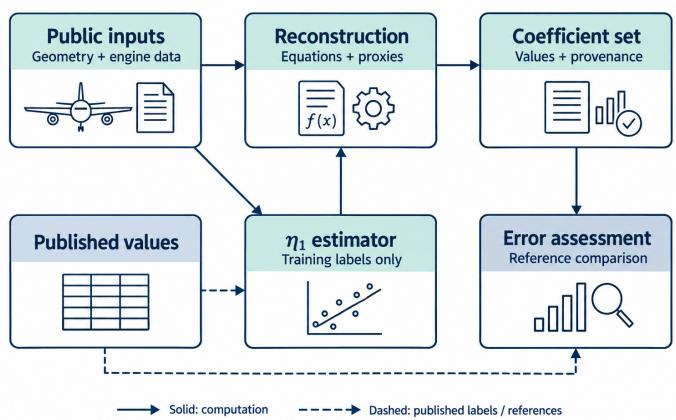

# Extending Aircraft Coverage of the Poll–Schumann Model Using Public Data

Gabriel Jarry , Ramon Dalmau , Philippe Very

Aviation Sustainability Unit, EUROCONTROL Innovation Hub

Brétigny-sur-Orge, France

gabriel.jarry@eurocontrol.int

Abstract—The Poll–Schumann model requires airframe–engine parameters, but published tables cover only part of the fleet. Applications must obtain missing parameters, substitute another aircraft type or exclude unrepresented types. We reconstruct parameters using geometry from certification documents and manufacturer manuals, together with ICAO engine records. Published equations supply the physical parameters; regression estimates the propulsion-efficiency scale. The inventory covers 90 type designators, including 22 absent from the direct pycontrails table and 18 without a listed substitute. Across 68 types, mean absolute percentage error (MAPE) against pycontrails was 7.38% for drag and 3.14% for design Mach. Across 66 types in 21 families, efficiency regression achieved 3.91% MAPE with the evaluated family excluded from input selection and fitting. On 100 recorded A320-214 flights, a type already represented in the published tables, cruise fuel flow MAPE for reconstructed and published parameter sets was 4.50% versus 4.68%, while mean absolute percentage error in integrated fuel over covered airborne intervals was 7.19% versus 6.82%. Public technical records can therefore extend Poll–Schumann parameter coverage, with quantified agreement against published coefficients and comparable fuel prediction errors on the evaluated A320-214 flights.

Index Terms—aircraft performance, Poll–Schumann, public data, parameter estimation, fuel consumption

## I. INTRODUCTION

Aircraft performance models support trajectory prediction and fuel and emissions estimates for air traffic management (ATM). Applying these models requires parameters that describe the aircraft and its engines. The Poll–Schumann model provides physical equations and published parameter tables [1], [2], but those tables cover only part of the fleet. For an unrepresented type, applications must obtain the missing parameters or reuse those of another aircraft type. Such substitutions, also called synonyms, are used in pycontrails, an open-source library for aircraft performance and contrail modelling [3].

Public technical documents offer much of the information needed to reconstruct these parameters. They describe aircraft geometry, masses, operating limits and engine characteristics. However, the required values are rarely available together for the exact airframe and engine variant. Some inputs must be approximated. Overall propulsion efficiency, the fraction of fuel power converted into propulsive power, requires an additional fitted parameter. The practical question is therefore how far these sources can extend model coverage, and what accuracy the resulting parameters provide.

We assemble public aircraft and engine records into a reconstruction of Poll–Schumann parameters. We evaluate agreement with published coefficients on known types and examine the reliability of the fitted efficiency component. We then compare the complete published and reconstructed parameter sets against measured fuel consumption on recorded A320-214 flights. The contribution is an expanded parameter inventory with quantified approximation errors and a first flightbased assessment of their consequences.

## II. RELATED WORK

Aircraft performance models provide different ways to estimate thrust, drag and fuel consumption. The Base of Aircraft Data (BADA) supports ATM applications through licensed aircraft models [4]. OpenAP combines public aircraft information and surveillance data in an open-source model [5]. Poll and Schumann describe aircraft performance through dimensionless relations and characteristic parameters [1], [2]. Subsequent developments address optimum flight conditions, engine performance and complete flight profiles [6], [7], [8]. Implementations include pycontrails [3] and OpenLeaf [9].

Missing model information can be estimated from technical records or observed flights. Part 2 of Poll and Schumann’s fuelburn estimation method already derives characteristic aircraft parameters using open-literature correlations [2]. Sun et al. estimate drag polars from open surveillance observations using a stochastic total-energy model [10]. Alligier et al. infer mass and thrust settings from past trajectory observations to improve climb prediction [11]. These approaches address different unknowns: aircraft characteristics in the first two cases, and quantities that vary from flight to flight in the latter.

Other methods estimate fuel consumption from observed flights. Chatterji combines flight-track reconstruction with aerodynamic calculations and the BADA fuel flow model, validating the estimates against Flight Data Recorder measurements from an FAA test flight [12]. Seymour et al. estimate commercial aviation fuel consumption using an opendata approach [13]. Chati and Balakrishnan use Gaussianprocess regression to predict fuel flow and its uncertainty from operational recordings [14]. Jarry et al. train supervised fuel flow regression models on Quick Access Recorder (QAR) data for application to Automatic Dependent Surveillance– Broadcast (ADS-B) trajectories [15]. Their models combine flight variables with aircraft characteristics to support prediction across types. Subsequent work examines whether learned fuel flow models transfer to aircraft absent from training [16]. Physics-guided learning provides another approach, using physical relationships to constrain fuel predictions [17]. These methods estimate the output of interest, whereas parameter reconstruction supplies quantities that can be reused within a physical performance model.

TABLE I  
MAIN DIMENSIONLESS PARAMETERS AND THEIR PHYSICAL ROLES [6], [7]. PARAMETERS ARE CALCULATED FROM PUBLIC INPUTS USING THE MODEL EQUATIONS, EXCEPT $\eta _ { 1 }$ , WHICH IS FITTED, AND ψ1, WHICH ALSO DEPENDS ON THAT FIT. DO DENOTES THE DESIGN OPTIMUM.
<table><tr><td>Symbol</td><td>Physical role</td></tr><tr><td> $\psi _ { 0 }$ </td><td>Zero-lift drag scale</td></tr><tr><td> $\psi _ { 1 }$ </td><td>Range scale, including propulsion efficiency</td></tr><tr><td> $\psi _ { 2 } , \psi _ { 3 }$ </td><td>Lift and lift-to-drag scales, respectively</td></tr><tr><td> $\psi _ { 4 } = M _ { \mathrm { D O } }$ </td><td>Design-optimum Mach number</td></tr><tr><td> $\psi _ { 5 } , \psi _ { 6 }$ </td><td>Reynolds-number and lift scales, respectively</td></tr><tr><td> $\psi _ { 7 }$ </td><td>Optimum-mass scale at the tropopause</td></tr><tr><td> $\tau$ </td><td>Sensitivity of span efficiency to skin friction</td></tr><tr><td> $\eta _ { 1 } , ~ \eta _ { 2 }$ </td><td>Propulsion-efficiency scale and Mach exponent</td></tr><tr><td> $J _ { 1 } , \ J _ { 2 }$ </td><td>Wave-drag parameters</td></tr><tr><td> $C _ { L , \mathrm { D O } }$ </td><td>Lift coefficient at the design optimum</td></tr><tr><td> $M _ { \mathrm { E C } }$ </td><td>Engine characteristic Mach number</td></tr><tr><td> $T _ { \mathrm { R E C } }$ </td><td>Turbine-entry to freestream total-temperature ratio at maximum overall efficiency</td></tr></table>

Our work extends the application of the published Poll– Schumann equations by assembling parameter sets from independently sourced aircraft and engine records. We assess both parameter agreement and the fuel predictions obtained from those sets. The fuel comparison uses the same OpenLeaf implementation [9] and recorded flight states for both runs. Each run uses its complete set of aerodynamic and engine parameters.

## III. RECONSTRUCTING PARAMETERS FROM PUBLIC DATA

We reconstructed aircraft-specific Poll–Schumann parameters from public information on airframe geometry and engine characteristics. Most parameters were calculated using the published model equations, while the efficiency scale $\eta _ { 1 }$ was estimated by regression against published values. Overall efficiency determines fuel flow for a given thrust and speed; it also affects the temperature threshold for contrail formation [18]. Table I summarises the parameters and their roles. Figure 1 distinguishes the physical calculations from the fitted component.

## A. Public aircraft and engine information

Airframe data came from type-certificate data sheets and manufacturer airport-planning manuals. They described dimensions, wing geometry, certified masses and operating limits. Engine characteristics came from version 32 of the ICAO Aircraft Engine Emissions Databank [19], including pressure ratio, bypass ratio, rated thrust and take-off fuel flow. We retained the source of each value. Missing quantities were estimated from dimensioned aircraft drawings in manufacturer manuals, related variants or analytical approximations, with the approximation recorded alongside the value.

  
Fig. 1. Inputs to the reconstruction. Solid arrows show the calculations and their inputs or outputs. Dashed arrows carry published values used for fitting or comparison. The regression estimates the efficiency parameter η1 from public predictors, using published efficiency values as training labels.

We identified airframe variants and their documented engine installations from public technical sources. For example, the A320-214 and A320-232 share the A320 designator but use different engines. Each engine model was linked to the applicable records in the ICAO Engine Emissions Databank. Multiple databank records may describe the same engine model; their number therefore does not represent the number of distinct aircraft variants. Some source documents describe different revisions, so a reconstructed record remains an approximate description of the installation.

## B. Calculating the physical parameters

We used the parameter equations in Part 2 of Poll and Schumann’s fuel-burn estimation method [2], with their subsequent aerodynamic and engine developments [6], [7]. The connection to fuel consumption follows the overall-efficiency definition [6]:

$$
\dot { m } _ { f } = \frac { F _ { n } V } { \eta _ { o } L _ { \mathrm { C V } } } ,\tag{1}
$$

where $\dot { m } _ { f }$ is total fuel flow, $F _ { n }$ total net thrust, V true airspeed, $\eta _ { o }$ overall efficiency and $L _ { \mathrm { C V } }$ fuel lower calorific value. Reconstructing drag and efficiency therefore supplies the quantities needed to predict fuel flow at a given flight state.

The calculation starts from aircraft geometry and an estimate of cruise Mach. It determines drag and the design-optimum flight condition used to define the characteristic parameters. These parameters describe the aircraft; the fuel calculation combines them with the measured mass, speed and atmospheric conditions of each flight.

The first step estimated the wetted area, meaning the external surface exposed to the airflow, for the fuselage, wings, tails and nacelles. These areas supplied the zero-lift drag parameter $\psi _ { 0 } ,$ , with shape and interference corrections from transport-aircraft design methods [20], [21], [22]. We retained the empirical corrections in the Poll–Schumann formulation, including its technology correction where applicable. Thus, independently sourced geometry enters equations that already contain empirical calibration.

The next step estimated the design-optimum Mach number, $\psi _ { 4 } = M _ { \mathrm { D O } }$ . When an independent source explicitly reported a long-range cruise Mach number, $M _ { \mathrm { L R C } }$ , we used

$$
M _ { \mathrm { D O } } \approx \frac { M _ { \mathrm { L R C } } } { 1 . 0 3 5 } .\tag{2}
$$

This proxy follows the approximate 3.5% separation between long-range cruise and minimum-fuel Mach discussed by Poll and Schumann [6, Sec. 6]. It also approximates the operating optimum by the design optimum; a generic quoted cruise speed was insufficient for this purpose. When no suitable long-range cruise value was available, we used an analytical estimate combining the optimum-condition equations with a crest-Mach approximation [6], [8].

At that Mach number, we followed the design-optimum iteration of Poll and Schumann [6, pp. 1088–1089]. An initial drag estimate determined whether to use the tropospheric or stratospheric equations; this choice remained fixed during the iteration. Each updated lift coefficient determined pressure and Reynolds number, then skin friction and drag. For aircraft with winglets, the span-efficiency correction was also included consistently in the drag derivatives. Errors in geometry or design Mach can therefore influence several output parameters.

The coefficients in Table I summarise this physical description. Definitions of $\psi _ { 0 } - \psi _ { 7 }$ and τ follow Poll and Schumann [6, Eqs. (16), (54), (56), (58)–(60), (62), (66)–(67)]; engine terms follow their turbofan model [7].

## C. Estimating the efficiency parameter

Overall efficiency also depends on the constant η , for which we used a regression fitted to published values. Its inputs were overall pressure ratio, rated sea-level static thrust, take-off fuel flow and wing reference area. The regression used four terms: take-off fuel flow, the logarithm of pressure ratio, fuel flow divided by rated thrust, and the logarithm of wing area. Thrust, fuel flow and area were expressed in kN, kg/s and $\mathrm { m ^ { 2 } }$ respectively.

We fitted a ridge regression, which limits large regression coefficients through a penalty, with penalty strength $\alpha = 1$ and an unpenalised intercept. Inputs were standardised within each fit. Weighting gave each aircraft family equal importance, then each type within a family and each distinct input combination within a type. Duplicate installation records therefore did not receive extra weight. The weights summed to the number of training observations. The fitted $\eta _ { 1 }$ then supplied designpoint overall efficiency, $\eta _ { o , \mathrm { D O } }$ , and the range parameter $\psi _ { 1 }$ (DO denotes the design optimum) through the Poll–Schumann equations.

The same regression supplied the inventory and the reconstructed parameter set in the recorded-flight comparison. We evaluated its ability to estimate efficiency across aircraft families and examined how selecting its inputs affects the estimated error (Section IV-B).

TABLE II  
PARAMETER AVAILABILITY AND COMPARISON WITH THE PINNED PYCONTRAILS PS TABLES. AVAILABLE VARIANTS DISTINGUISH AIRFRAME VERSIONS; COMPLETE RECORDS LINK VARIANTS TO ENGINE ENTRIES.
<table><tr><td>Inventory or baseline comparison</td><td>Count</td></tr><tr><td colspan="2">ICAO types Product families Available airframe variants</td></tr><tr><td colspan="2">Complete parameter records</td></tr><tr><td>Unresolved parameter records</td><td>928</td></tr><tr><td></td><td>2</td></tr><tr><td colspan="2">Status of the 90 reconstructed types in pycontrails</td></tr><tr><td>68 Direct entry</td><td>18 Substitute only No entry or substitute</td></tr></table>

## D. The resulting parameter inventory

The reconstruction supplied 928 complete installation records for 90 ICAO type designators. Two A340-213 records could not be resolved by the design-Mach iteration and were excluded; other A342 variants remained available. Table II distinguishes types, product families, airframe variants and complete parameter records. Here, product families are manufacturerdesignation groups; the broader families used for statistical evaluation are defined in Section IV. Each complete parameter record combines an airframe variant with an applicable engine databank entry and contains all required parameters, including documented approximations.

Table III lists the reconstructed parameters for every type, summarising its airframe–engine records by the median of each parameter. These medians are descriptive: they need not form the parameter set of a single installation.

We compared type identifiers with the pycontrails PS parameter and substitution tables dated 28 March 2025, at commit 0d4912374c06 [23]. All 68 types in its direct table occur in our inventory. The reconstruction adds 22 type-specific descriptions, of which four already have substitutes: A19N, B74D, C919 and CRJ7. The remaining 18 have neither a direct entry nor a listed substitute. These counts include developmental or discontinued programmes and describe parameter availability rather than traffic coverage or prediction accuracy.

## IV. EVALUATION

The evaluation connects parameter reconstruction to fuel prediction through three comparisons: agreement with published coefficients, efficiency prediction for an excluded aircraft family, and fuel prediction on recorded flights. The first two use published coefficients as references, while the third compares both complete parameter sets against measured fuel flow.

## A. Agreement with published parameters

We compared reconstructed parameters with two references (Table IV). The primary comparison covered all 68 types in the pinned pycontrails table [23], using its drag, design Mach, optimum lift, wave-drag and engine parameters. For the additional $\psi$ coefficients and τ , we used the 53 types in the published aerodynamic table [6]. These quantities are not directly tabulated for all 68 pycontrails types, so we compared only the available reference values, without reconstructing missing targets.

CHARACTERISTIC PARAMETERS FOR ALL 90 TYPES: COMPONENTWISE MEDIANS OVER AVAILABLE INSTALLATION RECORDS, WHICH NEED NOT DESCRIBE A SINGLE INSTALLATION. DEFINITIONS: SECTIONS III-B–III-C. ALL VALUES ARE DIMENSIONLESS; ψ IS DIVIDED BY 107. TYPES ABSENT FROM THE DIRECT PYCONTRAILS TABLE: † HAS A SUBSTITUTE: † HAS NONE.
<table><tr><td rowspan=1 colspan=36>ICAO       Product family           ψ0       ψ2       ψ3        ψ4        ψ5        ψ6       ψ7         T        η1        η2</td></tr><tr><td rowspan=1 colspan=36>A19N†      A319neo              7.70                0.530      0.712      5.98     0.758      0.881      0.179      0.361      0.404A20NA3207.810.5220.7150.7790.8600.1810.3610.389A321neo                                   0.484      0.725                 0.914      0.752      0.190      0.368</td></tr><tr><td rowspan=2 colspan=36>28838291362829                           35828888A306A30BA300B2-B40.4830.783     0.641      0.881      0.139      0.353A310A310-2000.4210.7870.6580.9570.1760.345      0.536A313A310-3000.4380.7710.7790.8390.1750.3500.534A318A3180.5150.7450.5861.0920.1690.3310.516A319A3190.4850.7480.6910.9640.1760.3350.518A320A3200.5110.7450.7000.8790.1630.3360.12A321A3218.230.4320.7560.8240.8620.1900.341A332A330-2000.5300.78111.220.6790.8850.1630.3730.53595855973A333A330-300    0.507      0.782      11.23      0.678      0.903      0.169      0.373      0.534A338A330-80031198266.890.6010.75010.930.7430.8440.1650.4060.444A339A330-9000.5820.75110.940.7400.8570.1690.4060.444A342A340-200750.5130.77211.090.7460.8200.1670.3690.495A343A340-3000.4820.77611.150.7390.8470.1760.3690.498A345A340-5000.5680.7831280.8740.6780.1460.3640.457A346A340-6000.5710.7800.8810.6710.1450.3660.457A359A3506.660.6120.7860.6380.9010.1430.4040.445A35KA3506.590.6170.79712.980.6750.8290.1350.4040.467A388A380-8006.460.6300.82118.03</td></tr><tr><td rowspan=1 colspan=15>0.6250.8090.105 0.3890.458</td></tr><tr><td rowspan=1 colspan=8>AJ27       C909B37M       B737-MAX-7</td><td rowspan=1 colspan=28>8.04      0.490      0.752                 0.576      1.132      0.176      0.314      0.5230.536      0.730                 0.734      0.889      0.173      0.370      0.460</td></tr><tr><td rowspan=3 colspan=8>B38M       B737-MAX-8B39M       B737-MAX-9B3XM      B737-MAX-10B712        B717-200B722        B727-200B732        B737-200</td><td rowspan=3 colspan=13>03382    0.509      0.730212 0.4670.7600.4810.7707.910.4170.787</td><td rowspan=1 colspan=7>0.5120.7306.22</td><td rowspan=1 colspan=8>0.755      0.881      0.179      0.372      0.4630.805     0.834      0.181      0.372      0.463</td></tr><tr><td></td><td></td><td></td><td></td><td></td><td></td><td></td><td></td><td></td><td></td><td></td><td></td><td></td><td></td><td rowspan=1 colspan=1>0.462</td></tr><tr><td rowspan=1 colspan=15>0.633      0.975      0.165      0.332      0.5450.627      0.864      0.132      0.283     0.6260.638      1.011      0.180      0.266      0.627</td></tr><tr><td rowspan=1 colspan=8>B733        B737-300B734        B737-400B735        B737-500</td><td rowspan=3 colspan=28>8.96     8.000     0.433      0.764                 0.637      1.011      0.175      0.316     0.5345 0.4210.7680.6780.9130.1640.3190.5348.050.4550.7600.6271.0070.1680.3160.5347.970.4910.7530.5781.1150.1800.3290.323220.4750.7562新186    7.0     0.455      0.754</td></tr><tr><td rowspan=2 colspan=8>B736       B737-600B737       B737-700B738        B737-800</td><td rowspan=2 colspan=15>0.6101.0710.184 0.3320.529</td></tr><tr><td rowspan=1 colspan=6>0.3340.534</td></tr><tr><td rowspan=3 colspan=8>B739        B737-900ERB742       B747-200B743        B747-300B744       B747-400B748       B747-8</td><td rowspan=3 colspan=10>8.09      0.476      0.7548432    293     0.465     0.8120.4830.8888.150.5180.8990.5540.846</td><td rowspan=1 colspan=3>6.3613.86</td><td rowspan=1 colspan=6>0.744      0.8820.695      0.757</td><td rowspan=1 colspan=1></td><td rowspan=1 colspan=2>0.1810.131</td><td rowspan=1 colspan=6>0.334      0.5340.343      0.548</td></tr><tr><td rowspan=2 colspan=2></td><td rowspan=2 colspan=1>1511815.1615.04</td><td rowspan=2 colspan=6>0.699      0.803</td><td rowspan=1 colspan=2>0.971</td><td rowspan=1 colspan=1></td><td rowspan=1 colspan=6>0.127      0.3460.137      0.350</td><td rowspan=1 colspan=2></td><td></td><td rowspan=1 colspan=1>0.5480.544</td></tr><tr><td rowspan=1 colspan=1></td><td rowspan=1 colspan=1>0.140</td><td rowspan=1 colspan=6>0.381</td><td rowspan=1 colspan=1>0.468</td></tr><tr><td rowspan=1 colspan=1>B74D{†</td><td rowspan=1 colspan=7>B747-400</td><td rowspan=1 colspan=1>7.39</td><td rowspan=1 colspan=3>7.77</td><td rowspan=1 colspan=3></td><td rowspan=1 colspan=3>0.504      0.882</td><td rowspan=1 colspan=2></td><td rowspan=1 colspan=1>15.06</td><td rowspan=1 colspan=6>0.431      1.170</td><td rowspan=1 colspan=1></td><td rowspan=1 colspan=1>0.125</td><td rowspan=1 colspan=6>0.354</td><td rowspan=1 colspan=1>0.534</td></tr><tr><td rowspan=1 colspan=1>B74F‡B752</td><td rowspan=1 colspan=3>B747-400B757-200</td><td rowspan=1 colspan=4></td><td rowspan=1 colspan=1>7.39</td><td rowspan=1 colspan=3>8.123</td><td rowspan=1 colspan=3></td><td rowspan=1 colspan=3>0.527      0.8990.508      0.773</td><td rowspan=1 colspan=2></td><td rowspan=1 colspan=1>15.79</td><td rowspan=1 colspan=6>0.562      0.9650.648     0.926</td><td rowspan=1 colspan=1></td><td rowspan=1 colspan=1>0.1340.150</td><td rowspan=1 colspan=6>0.3500.338</td><td rowspan=1 colspan=1>0.5450.557</td></tr><tr><td rowspan=4 colspan=1>B753B762B763</td><td rowspan=4 colspan=3>B757-300B767-200B767-300</td><td rowspan=4 colspan=4></td><td rowspan=3 colspan=1>7.33</td><td rowspan=4 colspan=3>7.01</td><td rowspan=4 colspan=3></td><td rowspan=4 colspan=3>0.481      0.7560.494      0.7730.477      0.811</td><td rowspan=4 colspan=2></td><td rowspan=3 colspan=1>9.73</td><td rowspan=4 colspan=6>0.725      0.8460.655      0.8590.621      0.990</td><td rowspan=4 colspan=1></td><td></td><td></td><td></td><td></td><td></td><td></td><td></td><td></td></tr><tr><td rowspan=3 colspan=1>0.1430.149</td><td></td><td></td><td></td><td></td><td></td><td></td><td></td></tr><tr><td rowspan=2 colspan=2></td><td rowspan=2 colspan=4>0.3390.3610.362</td><td rowspan=2 colspan=1>0.5570.5360.537</td></tr><tr><td rowspan=1 colspan=1></td><td rowspan=1 colspan=1>8.10</td><td rowspan=1 colspan=1>10.31</td></tr><tr><td rowspan=1 colspan=1>B764B772B773</td><td rowspan=1 colspan=7>B767-400ERB777-200B777-300</td><td rowspan=1 colspan=4>7.38.11</td><td rowspan=1 colspan=3></td><td rowspan=1 colspan=3>0.512      0.7730.547      0.7830.536      0.783</td><td rowspan=1 colspan=2>11</td><td rowspan=1 colspan=1>9.22.23</td><td rowspan=1 colspan=6>0.727      0.8550.703      0.7920.707      0.791</td><td rowspan=1 colspan=1></td><td rowspan=1 colspan=1>0.1620.1390.141</td><td rowspan=1 colspan=2></td><td rowspan=1 colspan=4>0.3630.3830.376</td><td rowspan=1 colspan=1>0.5340.5117</td></tr><tr><td rowspan=2 colspan=1>B77LB77WB788</td><td rowspan=2 colspan=2></td><td rowspan=2 colspan=1>B777-300ERB787-8</td><td rowspan=2 colspan=4></td><td rowspan=2 colspan=4>6.32</td><td rowspan=2 colspan=3></td><td rowspan=2 colspan=3>0.562      0.8120.555      0.8120.624      0.821</td><td rowspan=2 colspan=2></td><td rowspan=1 colspan=1>12.6812.68</td><td rowspan=1 colspan=6>0.764      0.7980.772      0.792</td><td rowspan=1 colspan=1></td><td rowspan=1 colspan=1>0.1560.158</td><td rowspan=1 colspan=2></td><td rowspan=1 colspan=4>0.3740.372</td><td rowspan=1 colspan=1>0.4890.492</td></tr><tr><td></td><td></td><td></td><td></td><td></td><td></td><td></td><td></td><td></td><td></td><td></td><td rowspan=1 colspan=2>0.405</td><td rowspan=1 colspan=3></td><td></td></tr><tr><td rowspan=5 colspan=1>B789B78X</td><td rowspan=5 colspan=1></td><td rowspan=5 colspan=1></td><td rowspan=5 colspan=1>B787-9B787-10</td><td rowspan=5 colspan=4></td><td rowspan=9 colspan=4>0.33.    083791</td><td rowspan=5 colspan=3></td><td rowspan=1 colspan=1></td><td rowspan=5 colspan=3>0.630      0.8210.623      0.821</td><td rowspan=5 colspan=2></td><td rowspan=5 colspan=1>12.04</td><td rowspan=5 colspan=1></td><td rowspan=5 colspan=4>0.620      0.9260.634      0.911</td><td rowspan=5 colspan=1></td><td rowspan=5 colspan=1>0.1410.142</td><td rowspan=5 colspan=2></td><td></td><td></td><td></td><td></td><td></td></tr><tr><td></td><td rowspan=4 colspan=3>0.403</td><td></td><td></td></tr><tr><td></td><td rowspan=1 colspan=3></td><td rowspan=3 colspan=1></td><td></td></tr><tr><td rowspan=6 colspan=2></td><td></td><td></td></tr><tr><td></td><td rowspan=1 colspan=1>0.4460.4530.391</td></tr><tr><td rowspan=4 colspan=1>BCS1BCS3</td><td rowspan=4 colspan=5>A220-100A220-300</td><td rowspan=4 colspan=1>7.96</td><td rowspan=4 colspan=3></td><td rowspan=4 colspan=3>0.486     0.7290.559      0.719</td><td rowspan=4 colspan=2></td><td rowspan=4 colspan=1>5.74</td><td rowspan=4 colspan=1></td><td rowspan=4 colspan=5>0.661      1.0500.756      0.879</td><td></td><td></td><td></td><td></td><td></td><td></td><td></td><td></td><td></td></tr><tr><td rowspan=3 colspan=1></td><td rowspan=3 colspan=1>0.180</td><td rowspan=3 colspan=2></td><td></td><td></td><td></td><td></td><td></td></tr><tr><td rowspan=2 colspan=4>0.3640.366</td><td></td></tr><tr><td rowspan=1 colspan=1>0.395</td></tr><tr><td rowspan=1 colspan=1>C919†</td><td rowspan=1 colspan=2></td><td rowspan=1 colspan=5>C919</td><td rowspan=1 colspan=1>7.80</td><td rowspan=1 colspan=2></td><td rowspan=1 colspan=1>8.22</td><td rowspan=1 colspan=2></td><td rowspan=1 colspan=1></td><td rowspan=1 colspan=1></td><td rowspan=1 colspan=3>0.521      0.722</td><td rowspan=1 colspan=2></td><td rowspan=1 colspan=1>6.19</td><td rowspan=1 colspan=1></td><td rowspan=1 colspan=1>0.709</td><td rowspan=1 colspan=3>0.925</td><td rowspan=1 colspan=1></td><td rowspan=1 colspan=1>0.174</td><td rowspan=1 colspan=2></td><td rowspan=1 colspan=4>0.367</td><td rowspan=1 colspan=1>0.411</td></tr><tr><td rowspan=1 colspan=1>CL30</td><td rowspan=1 colspan=2></td><td rowspan=1 colspan=5>Challenger-300-350</td><td rowspan=1 colspan=1>7.29</td><td rowspan=1 colspan=2></td><td rowspan=1 colspan=1>7.75</td><td rowspan=1 colspan=2></td><td rowspan=1 colspan=1></td><td rowspan=1 colspan=1>0.511</td><td rowspan=1 colspan=2>0.779</td><td rowspan=1 colspan=2></td><td rowspan=1 colspan=1>4.10</td><td rowspan=1 colspan=1></td><td rowspan=1 colspan=2>0.370</td><td rowspan=1 colspan=3>1.599</td><td rowspan=1 colspan=1></td><td rowspan=1 colspan=1>0.153</td><td rowspan=1 colspan=2></td><td rowspan=1 colspan=4>0.285</td><td rowspan=1 colspan=1>0.554</td></tr><tr><td rowspan=1 colspan=1>CL35</td><td rowspan=1 colspan=2></td><td rowspan=1 colspan=5>Challenger-300-350</td><td rowspan=1 colspan=1>6.99</td><td rowspan=1 colspan=1></td><td rowspan=1 colspan=1></td><td rowspan=1 colspan=1>7.73</td><td rowspan=1 colspan=2></td><td rowspan=1 colspan=1></td><td rowspan=1 colspan=1>0.535</td><td rowspan=1 colspan=2>0.771</td><td rowspan=1 colspan=2></td><td rowspan=1 colspan=1>4.06</td><td rowspan=1 colspan=1></td><td rowspan=1 colspan=2>0.395</td><td rowspan=1 colspan=3>1.568</td><td rowspan=1 colspan=1></td><td rowspan=1 colspan=1>0.168</td><td rowspan=1 colspan=6>0.288</td><td rowspan=1 colspan=1>0.554</td></tr><tr><td rowspan=1 colspan=1>CRJ1‡</td><td rowspan=1 colspan=2></td><td rowspan=1 colspan=5>CRJ-100-200</td><td rowspan=1 colspan=1>8.91</td><td rowspan=1 colspan=1></td><td rowspan=1 colspan=2>7.75</td><td rowspan=1 colspan=2></td><td rowspan=1 colspan=1></td><td rowspan=1 colspan=1>0.421</td><td rowspan=1 colspan=2>0.765</td><td rowspan=1 colspan=2></td><td rowspan=1 colspan=1>4.01</td><td rowspan=1 colspan=2></td><td rowspan=1 colspan=1>0.507</td><td rowspan=1 colspan=3>1.361</td><td rowspan=1 colspan=1></td><td rowspan=1 colspan=1>0.203</td><td rowspan=1 colspan=6>0.281</td><td rowspan=1 colspan=1>0.508</td></tr><tr><td rowspan=1 colspan=1>CRJ2</td><td rowspan=1 colspan=2></td><td rowspan=1 colspan=5>CRJ-100-200</td><td rowspan=1 colspan=1>8.91</td><td rowspan=1 colspan=1></td><td rowspan=1 colspan=2>7.75</td><td rowspan=1 colspan=2></td><td rowspan=1 colspan=1></td><td rowspan=1 colspan=1>0.421</td><td rowspan=1 colspan=2>0.765</td><td rowspan=1 colspan=2></td><td rowspan=1 colspan=1>4.01</td><td rowspan=1 colspan=1></td><td rowspan=1 colspan=1></td><td rowspan=1 colspan=3>0.507      1.361</td><td></td><td rowspan=1 colspan=1></td><td rowspan=1 colspan=1>0.203</td><td rowspan=1 colspan=6>0.281</td><td rowspan=1 colspan=1>0.508</td></tr><tr><td rowspan=1 colspan=1>CRJ7†CRJ9</td><td rowspan=1 colspan=2>CRJ</td><td rowspan=1 colspan=5>CRJ-700-900</td><td rowspan=1 colspan=1>8.31</td><td rowspan=1 colspan=3>7.978.00</td><td rowspan=1 colspan=2></td><td rowspan=1 colspan=1></td><td rowspan=1 colspan=3>0.474      0.7770.465      0.768</td><td rowspan=1 colspan=2></td><td rowspan=1 colspan=1>4.864.89</td><td rowspan=1 colspan=1></td><td rowspan=1 colspan=1></td><td rowspan=1 colspan=3>0.509      1.2100.566      1.145</td><td></td><td rowspan=1 colspan=2>0.1590.175</td><td rowspan=1 colspan=7>0.301     0.5300.304</td></tr><tr><td rowspan=1 colspan=1>CRJX‡DC93</td><td rowspan=1 colspan=2></td><td rowspan=1 colspan=5>CRJ-1000DC-9-30</td><td rowspan=1 colspan=4>3.05     8.00</td><td rowspan=1 colspan=4>0.4850.409</td><td rowspan=1 colspan=2>0.7710.790</td><td rowspan=1 colspan=2></td><td rowspan=1 colspan=1>4.75</td><td rowspan=1 colspan=1></td><td rowspan=1 colspan=5>0.560      1.1420.533      1.212</td><td rowspan=1 colspan=2>0.1720.184</td><td rowspan=1 colspan=7>0.308      0.5400.268      0.626</td></tr><tr><td rowspan=2 colspan=5>E 1355       ERJ-145E170       E170</td><td rowspan=1 colspan=6>ERL-135</td><td rowspan=1 colspan=5>7.797.68</td><td rowspan=1 colspan=2>0.4750.446</td><td rowspan=1 colspan=3>0.7500.754</td><td rowspan=1 colspan=2></td><td rowspan=1 colspan=1>4.05</td><td rowspan=1 colspan=1></td><td rowspan=1 colspan=4>0.430      1.378</td><td rowspan=1 colspan=2></td><td rowspan=1 colspan=1>0.156</td><td rowspan=1 colspan=4>0.273</td></tr><tr><td rowspan=1 colspan=3></td><td rowspan=1 colspan=4>8.918.00</td><td rowspan=1 colspan=4>0.433</td><td rowspan=1 colspan=2>0.756</td><td rowspan=1 colspan=2></td><td rowspan=1 colspan=1>4.87</td><td rowspan=1 colspan=1></td><td rowspan=1 colspan=2>0.576</td><td rowspan=1 colspan=3>1.189</td><td rowspan=1 colspan=1></td><td rowspan=1 colspan=1>0.193</td><td rowspan=1 colspan=5>0.307</td><td rowspan=1 colspan=3></td><td rowspan=1 colspan=1></td><td rowspan=1 colspan=1>0.543</td></tr><tr><td></td><td></td><td></td><td></td><td></td><td rowspan=2 colspan=3></td><td rowspan=2 colspan=4>.59</td><td rowspan=2 colspan=4>0.4660.455</td><td rowspan=2 colspan=2>0.7600.759</td><td rowspan=2 colspan=2></td><td rowspan=2 colspan=1>3.52</td><td rowspan=2 colspan=1></td><td rowspan=2 colspan=2>0.5830.589</td><td rowspan=2 colspan=3>1.1201.119</td><td></td><td></td><td></td><td></td><td></td><td></td><td></td><td></td><td></td></tr><tr><td rowspan=2 colspan=1>E195E290</td><td rowspan=2 colspan=4>E195E190-E2</td><td rowspan=1 colspan=1></td><td rowspan=1 colspan=3></td><td></td><td></td><td></td><td></td><td></td><td></td><td></td><td></td><td></td></tr><tr><td></td><td></td><td></td><td></td><td></td><td></td><td></td><td></td><td></td><td></td><td></td><td></td><td></td><td></td><td></td><td></td><td></td><td></td><td></td><td></td><td></td><td></td><td rowspan=1 colspan=1></td><td rowspan=1 colspan=1>0.188</td><td rowspan=1 colspan=5>0.360</td><td></td><td></td></tr><tr><td rowspan=2 colspan=1>E295</td><td rowspan=2 colspan=4>E195-E2</td><td rowspan=2 colspan=3></td><td rowspan=2 colspan=4>7.73</td><td rowspan=2 colspan=3></td><td rowspan=2 colspan=3>0.509      0.724</td><td rowspan=2 colspan=2></td><td rowspan=2 colspan=1>5.55</td><td rowspan=2 colspan=3>0.717</td><td rowspan=2 colspan=3>0.986</td><td rowspan=2 colspan=1></td><td rowspan=2 colspan=1>0.209</td><td></td><td></td><td></td><td></td><td></td><td></td><td></td></tr><tr><td rowspan=1 colspan=6>0.363</td><td rowspan=1 colspan=1>0.3910.396</td></tr><tr><td rowspan=1 colspan=1>E550</td><td rowspan=1 colspan=4>EMB550</td><td rowspan=1 colspan=3></td><td rowspan=1 colspan=4>0.13</td><td rowspan=2 colspan=6>0.500      0.7860.409      0.7580.423      0.763</td><td rowspan=1 colspan=2></td><td rowspan=1 colspan=1>3.98</td><td rowspan=2 colspan=8>0.411      1.582      0.1880.598      1.241      0.2330.590      1.168      0.197</td><td rowspan=2 colspan=7>0.285     030.3070.307</td></tr><tr><td rowspan=1 colspan=1>E75LE75S</td><td rowspan=1 colspan=4>EB1755</td><td rowspan=1 colspan=3></td><td rowspan=1 colspan=4>9.087.97</td><td rowspan=1 colspan=2></td><td rowspan=1 colspan=1>4.92</td></tr><tr><td rowspan=1 colspan=1>F100</td><td rowspan=1 colspan=4>F100-620</td><td rowspan=1 colspan=3></td><td rowspan=1 colspan=4>7.84      8.06</td><td rowspan=1 colspan=3></td><td rowspan=1 colspan=3>0.496      0.721</td><td rowspan=1 colspan=2></td><td rowspan=1 colspan=1>5.26</td><td rowspan=1 colspan=8>0.584      1.034      0.151</td><td rowspan=1 colspan=7>0.285      0.582</td></tr><tr><td rowspan=1 colspan=1>F2TH</td><td rowspan=1 colspan=2>Falcon</td><td rowspan=1 colspan=2>-2000</td><td rowspan=1 colspan=3></td><td rowspan=1 colspan=4>7.53      7.75</td><td rowspan=1 colspan=3></td><td rowspan=1 colspan=1>0.497</td><td rowspan=1 colspan=2>0.769</td><td rowspan=1 colspan=2></td><td rowspan=1 colspan=1>4.07</td><td rowspan=1 colspan=7>0.415      1.555</td><td rowspan=1 colspan=1>0.181</td><td rowspan=1 colspan=7>0.281      0.557</td></tr><tr><td rowspan=1 colspan=1>F900</td><td rowspan=1 colspan=2></td><td rowspan=1 colspan=2>Falcon-900</td><td rowspan=1 colspan=3></td><td rowspan=1 colspan=4>8.25      7.65</td><td rowspan=1 colspan=3></td><td rowspan=1 colspan=1>0.444</td><td rowspan=1 colspan=2>0.779</td><td rowspan=1 colspan=2></td><td rowspan=1 colspan=1>4.12</td><td rowspan=1 colspan=7>0.463      1.387</td><td rowspan=1 colspan=1>0.166</td><td rowspan=1 colspan=7>0.285      0.552</td></tr><tr><td rowspan=1 colspan=1>FA6X</td><td rowspan=1 colspan=2></td><td rowspan=1 colspan=2>Falcon-6X</td><td rowspan=1 colspan=3></td><td rowspan=1 colspan=4>7.00      7.83</td><td rowspan=1 colspan=3></td><td rowspan=1 colspan=1>0.542</td><td rowspan=1 colspan=2>0.788</td><td rowspan=1 colspan=2></td><td rowspan=1 colspan=1>5.06</td><td rowspan=1 colspan=7>0.484      1.272</td><td rowspan=1 colspan=1>0.166</td><td rowspan=1 colspan=7>0.332      0.547</td></tr><tr><td rowspan=1 colspan=1>FA7X</td><td rowspan=1 colspan=2>F</td><td rowspan=1 colspan=2>alcon-7X</td><td rowspan=1 colspan=3></td><td rowspan=1 colspan=4>7.28      7.63</td><td rowspan=1 colspan=3></td><td rowspan=1 colspan=1>0.505</td><td rowspan=1 colspan=2>0.820</td><td rowspan=1 colspan=2></td><td rowspan=1 colspan=1>5.21</td><td rowspan=1 colspan=1></td><td rowspan=1 colspan=3>0.413</td><td rowspan=1 colspan=3>1.536</td><td rowspan=1 colspan=1>0.185</td><td rowspan=1 colspan=7>0.295      0.554</td></tr><tr><td rowspan=1 colspan=1>FA8X</td><td rowspan=1 colspan=2></td><td rowspan=1 colspan=2>Falcon-7X</td><td rowspan=1 colspan=3></td><td rowspan=1 colspan=1>7.05</td><td rowspan=1 colspan=3>7.70</td><td rowspan=1 colspan=3></td><td rowspan=1 colspan=1>0.529</td><td rowspan=1 colspan=2>0.806</td><td rowspan=1 colspan=2></td><td rowspan=1 colspan=1>5.12</td><td rowspan=1 colspan=1></td><td rowspan=1 colspan=3>0.446</td><td rowspan=1 colspan=3>1.411</td><td rowspan=1 colspan=1>0.179</td><td rowspan=1 colspan=7>0.297      0.554</td></tr><tr><td rowspan=1 colspan=1>G280</td><td rowspan=1 colspan=2></td><td rowspan=1 colspan=2>G280</td><td rowspan=1 colspan=3></td><td rowspan=1 colspan=1>7.47</td><td rowspan=1 colspan=3>7.75</td><td rowspan=1 colspan=2></td><td rowspan=1 colspan=1></td><td rowspan=1 colspan=3>0.499      0.773</td><td rowspan=1 colspan=2></td><td rowspan=1 colspan=1>3.92</td><td rowspan=1 colspan=1></td><td rowspan=1 colspan=3>0.414</td><td rowspan=1 colspan=3>1.479</td><td rowspan=1 colspan=1>0.162</td><td rowspan=1 colspan=7>0.283      0.554</td></tr><tr><td rowspan=1 colspan=1>GL7TGLF5</td><td rowspan=2 colspan=11>Global-7500           668487    7702GVMD-827.91MD-837.95</td><td rowspan=2 colspan=3></td><td rowspan=2 colspan=3>0.598      0.8340.574      0.7730.449      0.7700.450      0.769</td><td rowspan=2 colspan=2></td><td rowspan=2 colspan=1>6.806.006.166.16</td><td rowspan=2 colspan=8>0.398      1.403      0.1450.403      1.391      0.1330.631      1.028      0.1830.676      0.960      0.182</td><td rowspan=2 colspan=7>0.370      0.5190.325     0.550.2930.293      0.611</td></tr><tr><td rowspan=1 colspan=1>MD82MD83</td></tr><tr><td rowspan=1 colspan=18>MRJ9‡      MRJ90               3.25     8.10     0.560      0.726RJ1HAvro-RJ1000.4240.710</td><td rowspan=1 colspan=2></td><td rowspan=1 colspan=1>1.11</td><td rowspan=1 colspan=8>0.537      1.165      0.1620.731      0.910      0.179</td><td rowspan=1 colspan=7>0.345      0.4600.266      0.534</td></tr><tr><td rowspan=1 colspan=21>SU95       SSJ100               8.05      7.79      0.468      0.766      5.30</td><td rowspan=1 colspan=8>0.578      1.086      0.175</td><td rowspan=1 colspan=7>0.305     0.550</td></tr></table>

For each type, we averaged coefficients over its available aircraft–engine configurations, counting identical physical inputs once, then compared the average with the published value. Each type received equal weight in the reported errors; the inventory table instead uses medians to summarise available installations. The two unresolved A340-213 records were excluded, while other A342 variants remained in the comparison. Differences in engine, mass and wing configuration therefore contribute to these catalogue comparisons. We report fitted quantities, $\eta _ { 1 }$ and $\psi _ { 1 } .$ , separately as descriptive agreement because their errors do not independently test the efficiency regression. The family-excluded evaluation below assesses that fitting procedure.

We measured relative error using mean absolute percentage error (MAPE):

$$
\mathrm { M A P E } = \frac { 1 0 0 } { n } \sum _ { i = 1 } ^ { n } \left| \frac { \hat { y } _ { i } - y _ { i } } { y _ { i } } \right| ,\tag{3}
$$

where $\hat { y } _ { i }$ is the reconstructed value, $y _ { i }$ the published reference and n the number of comparisons. All references were nonzero. Signed percentage bias used the same average without the absolute value, showing whether predictions were systematically high or low. We also reported the largest absolute percentage error across the evaluated types, to show how far individual cases could depart from the average.

## B. Estimating efficiency for an excluded aircraft family

We tested whether public aircraft and engine characteristics could predict $\eta _ { 1 }$ for a family excluded from fitting, using 66 types in 21 families. The A318, A319, A320 and A321, for example, belonged to one family. The data contained 352 distinct input combinations, each paired with its type’s published $\eta _ { 1 }$ value; A345 was excluded because its wing-area provenance could not be verified.

In each of 21 rounds, we fitted the regression on 20 families and predicted the remaining family. The fixed-formula procedure used the four terms in Section III-C. Global selection chose terms using all 21 families before evaluating the regression. Nested selection chose terms using only the 20 training families [24]. All three excluded the evaluated family from fitting the regression coefficients; only nested selection also excluded it from choosing the terms.

Both selection procedures considered the same 255 combinations of one to four terms, drawn from the four raw inputs, their logarithms and fuel flow divided by thrust. Selection minimised family-averaged mean absolute error (MAE); nested selection used an additional family-excluded evaluation within the 20 training families. Ridge settings were identical, with ties resolved by fewer terms and then a fixed order. The comparison measures the effect of selecting inputs within this candidate set.

We reported MAE in $\eta _ { 1 }$ units, MAPE and signed percentage bias. Errors were averaged over input combinations within each type, then over types within each family, then equally across families. A predictor using the training families’ mean efficiency provided a baseline. We repeated the analysis with one median input vector per type to test sensitivity to the representation of installations. This also changes the effective regularisation through the number of training observations. The inventory and QAR comparison use the original fitted regression; only this evaluation refits models after excluding each family.

## C. Fuel prediction on recorded flights

The fuel comparison used 100 QAR flights from eight individual A320-214 aircraft, recorded between December 2016 and November 2018. We excluded sharklet variants and required measured mass, airspeed, altitude, vertical speed, temperature, elapsed time and both engine fuel flows. We selected 100 distinct flights with at least 600 valid cruise observations before computing fuel predictions.

For each flight, we ran OpenLeaf [9] with two complete parameter sets: the published A320/CFM56-5B4/P set from pycontrails and our reconstructed A320-214/CFM56-5B4 set. Each supplied its own aerodynamic and engine parameters, with recorded flight states and processing settings held identical between runs. The comparison therefore evaluated the available configurations as a whole. A320 references contributed to fitting the reconstructed efficiency model, but QAR fuel measurements were not used for fitting.

Measured total fuel flow was the sum of the two engine channels. Pressure was calculated from recorded pressure altitude using the International Standard Atmosphere; density also used recorded temperature. At each valid observation, OpenLeaf used these conditions, recorded mass and speed to calculate drag and required thrust. Required thrust included the effects of climb or descent and longitudinal acceleration, with a lower bound of zero.

Acceleration was estimated from true airspeed using a quadratic Savitzky–Golay derivative filter with a 241-sample window at 1 Hz. Each continuous valid segment was processed separately; shorter segments used the largest available odd window, with at least three samples. Polynomial interpolation handled segment ends. Recorded airspeed itself was retained in the aerodynamic calculation. Missing observations and time gaps were excluded rather than interpolated. We applied the same limit equations and deterioration correction to both parameter sets: the wave-drag parameter was $J _ { 3 } = 4 0$ , and $\eta _ { 1 }$ was reduced by 2.5% to account for deterioration.

We reported errors separately for climb, cruise and descent, using the phase labels supplied with the recordings. Climb included initial climb and descent included approach. Cruise MAPE was the primary metric because this phase best matches the clean aerodynamic configuration used in the calculation. Results outside cruise provide an additional assessment under that approximation, without explicitly modelling changes in flap, landing-gear or speed-brake configuration.

For each flight and phase, we calculated MAPE, signed percentage bias and mean absolute fuel flow error in kg/s. We then averaged the flight-level errors with equal weights. The primary comparison was the change in cruise MAPE, reconstructed minus published, in percentage points. Both runs used identical valid observations, and flights could not be replaced on the basis of prediction errors or failures.

We also integrated measured and predicted fuel flow over the same consecutive valid one-second intervals using the trapezoidal rule. For each flight, fuel error was 100| ${ \hat { F } } - F | / F ,$ where $\hat { F }$ and $F$ are predicted and measured fuel mass over those intervals. Reported fuel errors are averages of these per-flight percentages. The combined airborne result excludes takeoff, landing and uncovered intervals; it is not complete trip fuel.

## V. RESULTS

We first report agreement with published coefficients, then evaluate efficiency prediction for excluded aircraft families. The final comparison assesses the fuel predictions of the complete parameter sets on recorded A320-214 flights.

## A. Agreement with published parameters

Published parameter sets provide benchmarks, but include empirical approximations and calibration [2], [6]; the compared aircraft–engine configurations also differ. Agreement therefore does not establish which parameterisation is more accurate. Fuel-prediction performance is assessed against recorded measurements in Section V-C.

Agreement varied across parameters in both references (Table IV). Across the 68 pycontrails types, MAPE was 7.38% for the drag parameter $\psi _ { 0 } ,$ 3.14% for design Mach and 5.56% for the design-optimum lift coefficient. Wave-drag coefficient $J _ { 2 }$ and the engine Mach exponent $\eta _ { 2 }$ differed by less than one percent on average. Both $\psi _ { 0 }$ and the design-optimum lift coefficient had positive bias; their largest absolute percentage errors occurred for B763 and E75L, respectively.

In the 53-type comparison, $\tau$ had the largest MAPE, at 8.98%, with a maximum error of 34.43% for CRJ9. Its positive bias indicates that the reconstructed sensitivity of span efficiency to skin friction was generally higher than the published reference. The $\psi _ { 0 }$ and $\psi _ { 7 }$ biases were also positive, whereas $\psi _ { 3 }$ was lower than the published reference on average. Conversely, $\psi _ { 6 }$ had MAPE 6.15% but bias close to zero, despite its largest absolute percentage error occurring for B722: errors of opposite signs cancelled in the average. A low bias therefore did not imply close agreement for individual types.

## B. Efficiency estimation and the effect of input selection

The regressions predicted efficiency more accurately than the training families’ mean when evaluated on an excluded family (Table V). MAPE was 3.91% when the evaluated family was excluded from both input selection and fitting, compared with 11.62% for the mean predictor. The fixed formula, refitted on each training set, gave 3.40%. Public aircraft and engine characteristics therefore retained predictive value across these families.

TABLE IV  
AGREEMENT OF TYPE-AVERAGE RECONSTRUCTED PARAMETERS WITH DIRECT REFERENCES. ERRORS ARE PERCENTAGES, WITH EQUAL WEIGHT PER AIRCRAFT TYPE. CONFIGURATION DIFFERENCES REMAIN. MAX. DENOTES THE LARGEST ABSOLUTE PERCENTAGE ERROR. FITTED QUANTITIES ARE SHOWN SEPARATELY AS DESCRIPTIVE AGREEMENT.
<table><tr><td>Parameter</td><td>MAPE</td><td>Bias</td><td>Max.</td></tr><tr><td>pycontrails, 68 types</td><td></td><td></td><td></td></tr><tr><td> $C _ { L , \mathrm { D O } }$ </td><td>5.56</td><td>+4.74</td><td>24.68</td></tr><tr><td> $\eta _ { 2 }$ </td><td>0.62</td><td>+0.09</td><td>4.75</td></tr><tr><td> $J _ { 1 }$ </td><td>2.62</td><td>-2.39</td><td>8.47</td></tr><tr><td> $J _ { 2 }$ </td><td>0.23</td><td>-0.19</td><td>0.97</td></tr><tr><td> $M _ { \mathrm { E C } }$ </td><td>0.37</td><td>-0.10</td><td>2.22</td></tr><tr><td> $\psi _ { 0 }$ </td><td>7.38</td><td>+5.59</td><td>28.44</td></tr><tr><td> $\psi _ { 4 }$ </td><td>3.14</td><td>+0.73</td><td>12.46</td></tr><tr><td> $T _ { \mathrm { R E C } }$ </td><td>1.20</td><td>-0.52</td><td>4.89</td></tr><tr><td colspan="4">Published aerodynamic table, 53 types</td></tr><tr><td> $\eta _ { 2 }$ </td><td>0.63</td><td>-0.02</td><td>4.67</td></tr><tr><td> $\psi _ { 0 }$ </td><td>7.87</td><td>+5.93</td><td>28.43</td></tr><tr><td> $\psi _ { 2 }$ </td><td>1.76</td><td>+1.63</td><td>5.34</td></tr><tr><td> $\psi _ { 3 }$ </td><td>6.17</td><td>-3.73</td><td>20.23</td></tr><tr><td> $\psi _ { 4 }$ </td><td>2.75</td><td>+1.11</td><td>14.93</td></tr><tr><td> $\psi _ { 5 }$ </td><td>2.90</td><td>+0.98</td><td>10.17</td></tr><tr><td> $\psi _ { 6 }$ </td><td>6.15</td><td>-0.23</td><td>24.76</td></tr><tr><td> $\psi _ { 7 }$ </td><td>7.83</td><td>+5.76</td><td>24.84</td></tr><tr><td> $\tau$ </td><td>8.98</td><td>+7.33</td><td>34.43</td></tr><tr><td></td><td></td><td></td><td></td></tr><tr><td colspan="4">Fitted agreement: pycontrails, 68 types</td></tr><tr><td> $\eta _ { 1 }$ </td><td>2.98</td><td>-0.70</td><td>11.47</td></tr><tr><td>Fitted agreement: published table, 53 types</td><td></td><td></td><td></td></tr><tr><td> $\eta _ { 1 }$ </td><td>3.85</td><td>-2.62</td><td>13.59</td></tr><tr><td> $\psi _ { 1 }$ </td><td>7.67</td><td>-5.70</td><td>18.65</td></tr></table>

Allowing all families to influence input selection gave the same formula and predictions as the fixed-formula procedure. Excluding the evaluated family from selection changed the chosen inputs in only one of the 21 rounds. When the A380 family was excluded, wing area replaced take-off fuel flow. This round accounted for the difference between the 3.40% and 3.91% MAPE values.

With one median input vector per type, all three procedures selected or used the fixed terms and gave MAPE 3.44%. The selection effect was therefore concentrated in one family and depended on how installations were represented. These results assess the regression procedures; they do not replace the fitted model used in the inventory.

## C. Fuel prediction on the A320-214 flights

The complete reconstructed parameter set gave fuel prediction errors of the same order as the published set on the 100 A320-214 flights (Table VI). Cruise fuel flow MAPE decreased from 4.68% to 4.50%, and bias moved from −2.72% to −2.10%. The change in average cruise accuracy was therefore small.

Results across phases were mixed. Climb errors increased slightly, while descent fuel flow MAPE decreased despite a larger integrated-fuel error. Over the covered airborne intervals,

TABLE V

RETROSPECTIVE EFFICIENCY ERRORS ON 66 TYPES IN 21 AIRCRAFT FAMILIES. ERRORS ARE AVERAGED WITHIN TYPES, WITHIN FAMILIES,

THEN EQUALLY ACROSS FAMILIES. ALL METHODS EXCLUDE THE EVALUATED FAMILY FROM FITTING; NESTED SELECTION ALSO EXCLUDES IT FROM CHOOSING INPUTS. MAE IS IN η1 UNITS; MAPE AND SIGNED RELATIVE BIAS ARE PERCENTAGES.
<table><tr><td>Method</td><td>MAE</td><td>MAPE (%)</td><td>Bias (%)</td></tr><tr><td>Distinct input combinations (primary)</td><td></td><td></td><td></td></tr><tr><td>Nested selection</td><td>0.01373</td><td>3.91</td><td>-0.21</td></tr><tr><td>Global selection</td><td>0.01170</td><td>3.40</td><td>+0.30</td></tr><tr><td>Fixed formula</td><td>0.01170</td><td>3.40</td><td>+0.30</td></tr><tr><td>Training-only mean</td><td>0.03839</td><td>11.62</td><td>+1.75</td></tr><tr><td colspan="4">Median inputs per type (sensitivity)</td></tr><tr><td>Nested selection</td><td>0.01173</td><td>3.44</td><td>+0.26</td></tr><tr><td>Global selection</td><td>0.01173</td><td>3.44</td><td>+0.26</td></tr><tr><td>Fixed formula</td><td>0.01173</td><td>3.44</td><td>+0.26</td></tr><tr><td>Training-only mean</td><td>0.03839</td><td>11.62</td><td>+1.75</td></tr></table>

TABLE VI

FUEL FLOW AND INTEGRATED-FUEL ERRORS ON 100 A320-214 FLIGHTS, WITH EQUAL FLIGHT WEIGHTS. P: PUBLISHED 5B4/P; R: RECONSTRUCTED

BASE 5B4. BIAS IS SIGNED RELATIVE FUEL FLOW ERROR. CLIMB INCLUDES INITIAL CLIMB; DESCENT INCLUDES APPROACH. FUEL APE IS ABSOLUTE PERCENTAGE ERROR IN INTEGRATED FUEL OVER COMMON COVERED INTERVALS. NONCRUISE RESULTS USE THE  
CLEAN-CONFIGURATION MODEL; TAKEOFF AND LANDING ARE EXCLUDED.
<table><tr><td>Phase</td><td>Set MAPE</td><td>(%)</td><td>Bias (%)</td><td>MAE (kg/s)</td><td>Fuel APE (%)</td></tr><tr><td rowspan="2">Climb</td><td>P</td><td>9.67</td><td>-8.34</td><td>0.139</td><td>9.40</td></tr><tr><td>R</td><td>9.88</td><td>-8.51</td><td>0.143</td><td>9.70</td></tr><tr><td rowspan="2">Cruise</td><td>P</td><td>4.68</td><td>-2.72</td><td>0.032</td><td>3.14</td></tr><tr><td>R</td><td>4.50</td><td>-2.10</td><td>0.030</td><td>2.58</td></tr><tr><td rowspan="2">Descent</td><td>P</td><td>26.83</td><td>-3.98</td><td>0.092</td><td>14.97</td></tr><tr><td>R</td><td>26.59</td><td>-11.09</td><td>0.097</td><td>20.52</td></tr><tr><td rowspan="2">All airborne</td><td>P</td><td>10.97</td><td>-4.26</td><td>0.069</td><td>6.82</td></tr><tr><td>R</td><td>10.88</td><td>-5.63</td><td>0.070</td><td>7.19</td></tr></table>

integrated-fuel error increased from 6.82% to 7.19%. The reconstructed parameters thus preserved broadly comparable accuracy on these flights, with a small cruise improvement and a small increase in combined fuel error.

## VI. DISCUSSION AND FUTURE WORK

The reconstruction supplies 22 type-specific descriptions absent from the pinned pycontrails parameter table, including 18 without a listed substitute. This is useful for trajectory studies that would otherwise require substituting a different aircraft type or leaving the type unrepresented. The measured agreement on known types provides a basis for judging the approximations, but accuracy on the added types remains unmeasured. Applications should therefore distinguish the availability of a parameter set from evidence about its accuracy.

The differences in parameter agreement follow distinct calculation paths. The drag scale $\psi _ { 0 }$ depends on estimated wetted areas and empirical shape corrections, whereas $\tau$ depends on the response of span efficiency to skin friction. Both feed the design-optimum calculation, linking their uncertainties to the lift-to-drag scale $\psi _ { 3 }$ and optimum-mass scale $\psi _ { 7 }$ . This coupling provides a plausible route for the larger discrepancies in these terms, but does not by itself explain their observed signs or magnitudes. The smaller differences in $J _ { 2 }$ and $\eta _ { 2 }$ show closer agreement for those relations, without establishing comparable accuracy for the full aerodynamic model.

Parameter agreement and fuel-prediction accuracy are distinct criteria. Required thrust and propulsion efficiency jointly determine fuel flow (Eq. 1), so coefficient differences may have compensating effects. Similar aggregate fuel errors establish neither individual coefficient accuracy nor pointwise prediction agreement. Over a restricted operating range, fuel observations may constrain parameter combinations more strongly than individual coefficients: a potential practical identifiability limitation, not demonstrated here. Independent aerodynamic or engine measurements would help assess individual components.

The efficiency analysis supports using public aircraft and engine characteristics to estimate $\eta _ { 1 }$ . It also shows why input selection belongs inside an evaluation intended to assess the full fitting procedure. The nested control retains an advantage over a mean-efficiency predictor, with a selection-related difference concentrated in the A380 fold for the primary representation. These cross-validation results concern the available reference families and the specified candidate inputs. Additional reference families are needed to assess transfer beyond this population.

The QAR comparison provides evidence against measured fuel flow for one aircraft type: the A320-214. These flights do not validate the 90-type inventory or test the added types, and the clean-configuration approximation further limits interpretation outside cruise. Measurements on additional types with different airframes and engines are needed to assess how well the reconstruction transfers.

Future work will address three needs. First, additional aircraft-family references and more direct geometric measurements will test the reconstruction beyond the present evaluation population. Second, flight comparisons on several types with identified engine configurations will assess fuel accuracy across operating phases. Third, we will use the reconstructed coefficients to parameterise the physical component of hybrid neural ordinary differential equation (Neural ODE) models [25], [26], and examine how their uncertainty affects trajectory prediction.

## VII. CONCLUSIONS

Public airframe and engine information can supply the parameters needed to apply the Poll–Schumann model to a wider range of aircraft descriptions. The reconstruction combines geometry-based physical calculations with an efficiency regression and produces an inventory for 90 ICAO type designators. Of the 22 types absent from the direct pycontrails baseline, four already have substitutes. The added descriptions provide explicit inputs for studying those types, whose fuel accuracy remains to be assessed.

The evaluations identify where those inputs remain approximate. Agreement with published physical coefficients varies across quantities, with the largest discrepancies in coupled aerodynamic terms. Public characteristics help estimate efficiency across the evaluated families, although selecting the regression inputs influences the reported accuracy. On the A320- 214 flights, the complete reconstructed parameter set gives fuel errors of the same order as the published set. Cruise accuracy improves slightly, while integrated-fuel error over the covered airborne intervals increases slightly.

The inventory broadens parameter availability; fuel accuracy across additional types and operating conditions remains to be assessed.

## REFERENCES

[1] D. I. A. Poll and U. Schumann, “An estimation method for the fuel burn and other performance characteristics of civil transport aircraft in the cruise. part 1: Fundamental quantities and governing relations for a general atmosphere,” The Aeronautical Journal, 2020. [Online]. Available: https://doi.org/10.1017/aer.2020.62

[2] ——, “An estimation method for the fuel burn and other performance characteristics of civil transport aircraft during cruise: Part 2, determining the aircraft’s characteristic parameters,” The Aeronautical Journal, 2020. [Online]. Available: https://doi.org/10.1017/aer.2020.124

[3] M. Shapiro, Z. Engberg, R. Teoh, M. Stettler, T. Dean, and T. Abbott, “pycontrails: Python library for modeling aviation climate impacts,” Zenodo, May 2026, version v0.63.0. [Online]. Available: https://doi.org/10.5281/zenodo.19932206

[4] A. Nuic, D. Poles, and V. Mouillet, “BADA: An advanced aircraft performance model for present and future ATM systems,” International Journal of Adaptive Control and Signal Processing, vol. 24, no. 10, pp. 850–866, 2010. [Online]. Available: https://doi.org/10.1002/acs.1176

[5] J. Sun, J. M. Hoekstra, and J. Ellerbroek, “Openap: An opensource aircraft performance model for air transportation studies and simulations,” Aerospace, vol. 7, no. 8, p. 104, 2020. [Online]. Available: https://doi.org/10.3390/aerospace7080104

[6] D. I. A. Poll and U. Schumann, “On the conditions for absolute minimum fuel burn for turbofan powered, civil transport aircraft and a simple model for wave drag,” The Aeronautical Journal, vol. 128, pp. 1071–1103, 2024. [Online]. Available: https://doi.org/10.1017/aer.2024.10

[7] ——, “A simple model for the estimation of turbofan engine performance in all airborne phases of flight,” The Aeronautical Journal, vol. 128, no. 1330, pp. 2725–2753, 2024. [Online]. Available: https://doi.org/10.1017/aer.2024.92

[8] ——, “An estimation method for the fuel burn and other performance characteristics of civil transport aircraft; part 3—full flight profile when the trajectory is specified,” The Aeronautical Journal, 2025. [Online]. Available: https://doi.org/10.1017/aer.2024.141

[9] EUROCONTROL Aviation Sustainability Unit, “OpenLeaf: Open-source aviation sustainability suite,” https://github.com/eurocontrol-asu/openleaf, 2026, accessed September 2026.

[10] J. Sun, J. M. Hoekstra, and J. Ellerbroek, “Estimating aircraft drag polar using open flight surveillance data and a stochastic total energy model,” Transportation Research Part C: Emerging Technologies, vol. 114, pp. 391–404, 2020. [Online]. Available: https://doi.org/10.1016/j.trc.2020.01.026

[11] R. Alligier, D. Gianazza, and N. Durand, “Learning the aircraft mass and thrust to improve the ground-based trajectory prediction of climbing flights,” Transportation Research Part C: Emerging Technologies, vol. 36, pp. 45–60, 2013. [Online]. Available: https: //doi.org/10.1016/j.trc.2013.08.006

[12] G. B. Chatterji, “Fuel burn estimation using real track data,” in 11th AIAA Aviation Technology, Integration, and Operations (ATIO) Conference, 2011. [Online]. Available: https://ntrs.nasa.gov/citations/20120002710

[13] K. Seymour, M. Held, G. Georges, and K. Boulouchos, “Fuel estimation in air transportation: Modeling global fuel consumption for commercial aviation,” Transportation Research Part D: Transport and Environment, vol. 88, p. 102528, 2020. [Online]. Available: https://doi.org/10.1016/j.trd.2020.102528

[14] Y. S. Chati and H. Balakrishnan, “A Gaussian process regression approach to model aircraft engine fuel flow rate,” in Proceedings of the 8th International Conference on Cyber-Physical Systems, 2017, pp. 131–140. [Online]. Available: https://doi.org/10.1145/3055004.3055025

[15] G. Jarry, D. Delahaye, and C. Hurter, “Towards aircraft generic Quick Access Recorder fuel flow regression models for ADS-B data,” in International Conference on Research in Air Transportation (ICRAT), Singapore, 2024. [Online]. Available: https://www.icrat.org/ previous-conferences/11th-international-conference/papers/

[16] G. Jarry, R. Dalmau, P. Very, and J. Sun, “On the generalization properties of deep learning for aircraft fuel flow estimation models,” Transportation Research Part C: Emerging Technologies, vol. 176, p. 105143, 2025, preprint: arXiv:2410.07717. [Online]. Available: https://doi.org/10.1016/j.trc.2025.105143

[17] M. Uzun, M. U. Demirezen, and G. Inalhan, “Physics guided deep learning for data-driven aircraft fuel consumption modeling,” Aerospace, vol. 8, no. 2, p. 44, 2021. [Online]. Available: https://doi.org/10.3390/aerospace8020044

[18] U. Schumann, “Influence of propulsion efficiency on contrail formation,” Aerospace Science and Technology, vol. 4, 2000. [Online]. Available: https://elib.dlr.de/9247/

[19] International Civil Aviation Organization, “Icao aircraft engine emissions databank, version 32,” Electronic database, 2026, engine identification, rated thrust, bypass ratio, pressure ratio and landing–take-off fuelflow fields. [Online]. Available: https://www.easa.europa.eu/en/domains/ environment/icao-aircraft-engine-emissions-databank

[20] E. Obert, Aerodynamic Design of Transport Aircraft. IOS Press, 2009. [Online]. Available: https://research.tudelft.nl/en/publications/ aerodynamic-design-of-transport-aircraft/

[21] D. P. Raymer, Aircraft Design: A Conceptual Approach, 6th ed. Reston, VA: American Institute of Aeronautics and Astronautics, 2018. [Online]. Available: https://doi.org/10.2514/4.104909

[22] E. Torenbeek, Synthesis of Subsonic Airplane Design. Delft, The Netherlands: Delft University Press, 1982. [Online]. Available: https://doi.org/10.1007/978-94-017-3202-4

[23] Contrail Cirrus, “pycontrails: Poll–Schumann aircraft parameters and substitutions,” 2026, tables dated 28 March 2025; commit 0d4912374c06; accessed 16 September 2026. [Online]. Available: https://github.com/contrailcirrus/pycontrails/ tree/0d4912374c062aeddc443b24a266fe529f4041c3/pycontrails/models/ ps\_model/static

[24] G. C. Cawley and N. L. C. Talbot, “On over-fitting in model selection and subsequent selection bias in performance evaluation,” Journal of Machine Learning Research, vol. 11, no. 70, pp. 2079–2107, 2010. [Online]. Available: https://www.jmlr.org/papers/v11/cawley10a.html

[25] G. Jarry, R. Dalmau, X. Olive, and P. Very, “A neural ODE approach to aircraft flight dynamics modelling,” 2025. [Online]. Available: https://doi.org/10.48550/arXiv.2509.23307

[26] G. Jarry and X. Olive, “Generation of vertical profiles with neural ordinary differential equations trained on open trajectory data,” Journal of Open Aviation Science, vol. 4, no. 2, Mar. 2026. [Online]. Available: https://doi.org/10.59490/joas.2026.8457