# FADE: Factored Ability–Difficulty Filtering for Online RLVR Scheduling

Tomas Duncun1, Jonah Ellison1, Mateo Ruiz1, Hanae Fujita2, Ingrid Solberg2

1University of Michigan 2University of Edinburgh

## Abstract

Group-based reinforcement learning with verifi able rewards (RLVR) learns only from prompts whose sampled completions disagree: all-pass and all-fail groups produce zero relative ad vantage and burn generation budget without moving the policy. Adaptive schedulers try to steer rollouts toward informative prompts, yet they rely on per-prompt pass-rate trackers that entangle two quantities evolving at very different speeds—the policy’s shifting competence across reasoning skills and each prompt’s in trinsic difficulty. When a single exponential average or Beta counter tracks both at once, short memory scrambles the relative ordering of prompts whereas long memory reports stale pass rates. We introduce FADE (Factored Ability–Difficulty Estimation), a bilinear statespace filter that separates the two timescales. FADE represents each prompt’s success logit as the inner product of a whitened K-dimensional skill loading with a fast-drifting policy ability vector, minus a slow-shrinking scalar item in tercept. Using Pólya–Gamma augmentation, each minibatch of binary rollout outcomes updates the K-dimensional ability posterior in closed form via a rank-K Woodbury step, instantly transferring competence shifts to all unobserved prompts that share those skills while leaving item intercepts stable. From the resulting posterior mean and variance we derive a closed-form utility for the probability of draw ing a non-degenerate rollout group. Across five reasoning benchmarks, two base models, and four scheduling paradigms under a matched rollout budget, FADE consistently improves downstream accuracy and calibration while adding less than 0.6 ms per step.

## 1 Introduction

Reinforcement learning with verifiable rewards (RLVR) turns a rule-based answer checker into a policy improvement loop for mathematical and scientific reasoning (Shao et al., 2024; Guo et al.,

2025; Kimi Team et al., 2025). Group-relative algorithms such as GRPO sample G completions per prompt and standardize the binary rewards within each group (Shao et al., 2024; Yu et al., 2026; Zheng et al., 2025). The bottleneck of this recipe is rollout generation, and its central pathology is group degeneracy: whenever a prompt is trivial for the current policy $( r _ { i } { = } 1 )$ or far beyond its reach $( r _ { i } \mathrm { { = } } 0 )$ , all $G$ completions receive the same reward, the group advantage vanishes, and the completions do no gradient work (Yu et al., 2026; Yao et al., 2026a; Mao et al., 2026b).

Adaptive RLVR schedulers attack group degeneracy from two angles. Curriculum selectors filter or prioritize prompts whose pass rate sits near the learning frontier (Mao et al., 2026a; Gao et al., 2026; Zheng et al., 2026; Kong et al., 2026; Mao et al., 2026b; Bae et al., 2026; Do et al., 2026), while budget allocators vary the group size $n _ { i , t }$ per prompt to reduce gradient variance or maximize progress (Yao et al., 2026a; Nguyen et al., 2026; Zeng et al., 2026; Zou et al., 2026; Fang et al., 2026). Both families need an online estimate of each prompt’s current pass probability $p _ { i , t }$ before rollouts are drawn.

Existing trackers treat $p _ { i , t }$ as an unstructured perprompt scalar and run into a fundamental dilemma. On-policy probing before each step is accurate but consumes tens of GPU-hours in extra generations (Yao et al., 2026a; Zeng et al., 2026; Xu and Ding, 2025), while small generalizable prompt predictive models (Qu et al., 2026; Gao et al., 2026) require auxiliary model training and periodic recalibration. Zero-probe trackers instead smooth past training outcomes for each prompt via exponential moving averages, sliding windows, or dynamicspredictive Beta posteriors (Mao et al., 2026a; Kong et al., 2026; Zheng et al., 2026; Nguyen et al., 2026). Because a corpus contains $1 0 ^ { 5 }$ prompts and a batch touches only 256, any individual prompt is revisited once every several hundred steps. Between visits, two things happen at very different speeds (Figure 1(a)): the policy’s overall competence on a mathematical skill drifts quickly, while the fine-grained hardness gap between two problems requiring that skill barely moves. A single per-prompt memory parameter cannot serve both. Fast forgetting tracks recent pass rates on visited items but destroys the relative ranking of rarely visited items; slow forgetting preserves item ordering but reports badly lagging pass probabilities (Figure 1(b)).

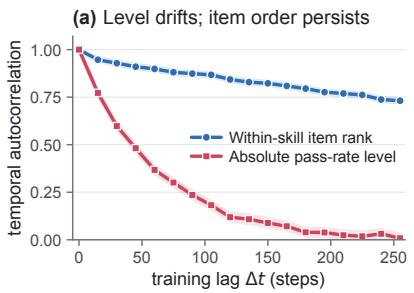

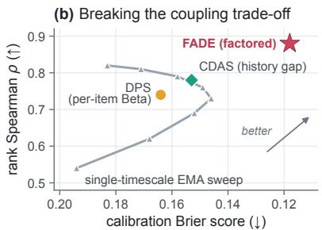

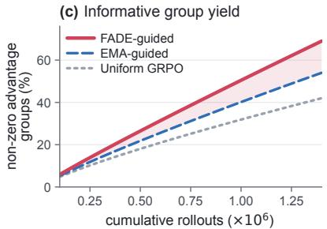  
Figure 1: Why per-prompt trackers face a coupling trade-off. (a) Along a GRPO run on NuminaMath, the absolute pass-rate level decorrelates within ∼100 steps as the policy improves, whereas the relative difficulty ordering of prompts within a skill domain remains correlated over hundreds of steps. (b) Sweeping the decay rate of a per-prompt EMA traces a frontier between calibration error (Brier score) and rank correlation (Spearman ρ); per-item Bayesian trackers (DPS, CDAS) sit near that curve, whereas FADE decouples the two timescales. (c) Supplying factored estimates to a rollout scheduler sustains a higher fraction of non-zero advantage groups across the training budget.

We resolve this tension by factoring the logit of $p _ { i , t }$ into a low-rank dynamic policy state and a scalar static item intercept. Specifically, we project frozen prompt embeddings onto K orthonormal whitened skill coordinates $\mathbf { z } _ { i } \in \mathbb { R } ^ { K } \left( K = 3 2 \right)$ and model the success logit at step t as $\mu _ { i , t } = \mathbf { z } _ { i } ^ { \top } \pmb { \theta } _ { t } - b _ { i }$ Here $\pmb \theta _ { t } \in \mathbb { R } ^ { K }$ is a fast-evolving skill proficiency vector shared across the entire corpus, and $b _ { i } \in \mathbb { R }$ is a slow-shrinking intrinsic difficulty offset specific to prompt i. Every minibatch of 256 prompts provides thousands of rollout outcomes that jointly pin down $\theta _ { t } ;$ updating $\theta _ { t }$ immediately shifts the predicted pass rate of all N prompts in proportion to their skill loadings $\mathbf { z } _ { j }$ , even if prompt j has never been sampled. Meanwhile, $b _ { i }$ accumulates evidence over the full run with minimal forgetting, keeping within-skill prompt rankings sharp.

To make inference exact and fast without inner optimization loops, FADE uses the Pólya–Gamma augmentation for binomial likelihoods (Polson et al., 2013). Conditioning on the local curvature parameter turns each step into a conjugate Gaussian Kalman update whose $K \times K$ covariance is maintained in $\mathcal { O } ( | B _ { t } | K ^ { 2 } )$ time. Finally, rather than plugging point estimates into heuristic schedulers, we integrate the posterior uncertainty over the binomial group outcome to obtain a closed-form nondegenerate group utility $\mathcal { U } _ { i , t }$ that directly scores the expected probability of drawing a mixed-reward group.

Our contributions are three-fold:

• We show that online difficulty estimation in RLVR is governed by two separated timescales— fast low-rank skill drift and slow item-level ordering—which single-timescale per-prompt trackers cannot simultaneously capture (§1, §3.2).

• We propose FADE, a Pólya–Gamma bilinear state-space filter that updates a K-dimensional skill state and per-item intercepts in closed form, paired with an uncertainty-calibrated nondegenerate group utility (§3).

• We prove that FADE’s Woodbury step is the exact conjugate mode under local Pólya–Gamma conditioning, that skill sharing strictly contracts predictive variance on unvisited prompts, and that factored filtering dominates single-memory trackers whenever skill drift exceeds item drift (§4). Across five math benchmarks and four schedulers, FADE consistently improves RLVR efficiency (§5).

## 2 Related Work

Curriculum selection and rollout allocation in RLVR. Classical curriculum learning orders examples by difficulty or learnability (Bengio et al., 2009; Mindermann et al., 2022). In group-relative RLVR (Shao et al., 2024; Yu et al., 2026; Zheng et al., 2025), prompts whose completions all succeed or all fail yield zero advantage, motivating group-prioritized optimization that eliminates ineffective samples (Mao et al., 2026b; Yu et al., 2026). Recent selectors therefore filter or reweight prompts using dynamics-predictive sampling (Mao et al., 2026a), lightweight prompt predictive models (Qu et al., 2026; Gao et al., 2026), competence gaps, or reward dynamics (Zheng et al., 2026; Kong et al., 2026; Bae et al., 2026; Do et al., 2026; Sun et al., 2025; Zhang and Zuo, 2025; Li et al., 2025; Lai and Nissim, 2026; Jia et al., 2026; Pant et al., 2026). A parallel line allocates non-uniform rollout budgets $n _ { i , t }$ across a batch to minimize policygradient variance (Yao et al., 2026a; Nguyen et al., 2026; Zeng et al., 2026), unify budget allocation across reasoning and agentic RL (Zou et al., 2026), or maximize sequential utility (Xiong et al., 2025; Fang et al., 2026; Jiang et al., 2026a; Chen et al., 2026; Yao et al., 2026b; Deng et al., 2026; Jiang et al., 2026b; Kalarde et al., 2026). Complementary work prunes partial trajectories or rescales advantages (Xu et al., 2026a; Xia et al., 2026; Wang et al., 2026a; Yang et al., 2026a; Dao et al., 2026; Son et al., 2026; Gholipour et al., 2026). All of these schedulers consume an online pass-rate estimate; FADE replaces that estimator without altering the downstream scheduling rule.

Dynamic difficulty tracking and Item Response Theory. Static item response theory (IRT) separates model ability from item difficulty in offline NLP evaluation (Lalor et al., 2016; Rodriguez et al., 2021). During RLVR, however, the policy moves at every step (Zhou et al., 2026; Zhang et al., 2026a). Probing methods estimate current pass rates via extra on-policy rollouts (Yao et al., 2026a; Zeng et al., 2026; Xu and Ding, 2025), trading compute for freshness. Amortized predictive models estimate prompt utility or difficulty from text features (Qu et al., 2026; Gao et al., 2026; Wang et al., 2026b; Zhou et al., 2026), offering strong zero-shot generalization when paired with online adaptation. History-based trackers update per-prompt statistics from training rollouts—via dynamics-predictive Beta-Binomial filtering in DPS (Mao et al., 2026a), historical discrepancy (Kong et al., 2026), reward regularity (Zheng et al., 2026), or local regression (Nguyen et al., 2026)—while unified rollout trackers (Zou et al., 2026), offline tree structures (Wang et al., 2026c), bandit curricula (Xu et al., 2026b), and lag-corrected replay (Mao et al.,

2026b; Zhang et al., 2026b; Yang et al., 2026b; Wang et al., 2026d) address related aspects of nonstationarity. FADE brings multidimensional IRT online via Pólya–Gamma filtering (Polson et al., 2013), separating fast low-rank skill evolution from static item hardness.

## 3 Method

## 3.1 Setup and Group Degeneracy

Consider a prompt pool $\mathcal { D } = \{ x _ { i } \} _ { i = 1 } ^ { N }$ . At training step t, the scheduler selects a minibatch $\boldsymbol { B } _ { t } \subset \mathcal { D }$ and allocates $n _ { i , t }$ rollouts to each $i \in \mathsf { B } _ { t }$ under policy $\pi _ { t }$ . A deterministic verifier scores each completion $y _ { i , t , g } \in \{ 0 , 1 \}$ , yielding $\begin{array} { r } { s _ { i , t } = \sum _ { g = 1 } ^ { n _ { i , t } } y _ { i , t , g } } \end{array}$ successes and empirical pass rate $r _ { i , t } = s _ { i , t } / n _ { i , t }$ In group-relative updates, a prompt provides a nonzero policy gradient only if $0 < s _ { i , t } < n _ { i , t }$ . Under true pass probability $p _ { i , t } = \operatorname* { P r } ( y { = } 1 \mid x _ { i } , \pi _ { t } )$ , the probability that a group of size G is non-degenerate is

$$
\Phi _ { G } ( p _ { i , t } ) = 1 - p _ { i , t } ^ { G } - ( 1 - p _ { i , t } ) ^ { G } .\tag{1}
$$

Maximizing rollout efficiency requires estimating $p _ { i , t }$ (and its epistemic uncertainty) for all $i \in \mathcal { D }$ prior to step t using only the sparse historical log $\mathcal { H } _ { < t } = \{ ( i , \tau , s _ { i , \tau } , n _ { i , \tau } ) \} _ { \tau < t }$

## 3.2 Bilinear Skill–Difficulty Model

Instead of assigning an isolated scalar state to each prompt, we decompose success logits into shared skill dimensions and item-specific offsets (Figure $2 ( \mathrm { A } ) )$ . Before training, we pass each prompt x through a frozen text encoder $f _ { \mathrm { e n c } }$ and extract the top $K$ principal components across the corpus, followed by Mahalanobis whitening so that the resulting skill loading vectors $\mathbf { z } _ { i } \in \mathbb { R } ^ { \bar { K } }$ satisfy $\begin{array} { r } { { \frac { 1 } { N } } \sum _ { i = 1 } ^ { N } \mathbf { z } _ { i } \mathbf { \bar { z } } _ { i } ^ { \top } = \mathbf { I } _ { K } } \end{array}$ . We set $K { = } 3 2$ , which captures over 86% of the embedding variance across mathematical domains while keeping matrix operations tiny.

At step t, we model the binomial rollout count $s _ { i , t } \ | \ n _ { i , t } , \mu _ { i , t } \sim$ Binomial $( n _ { i , t } , \sigma ( \mu _ { i , t } ) )$ via the bilinear logit

$$
\begin{array} { r } { \mu _ { i , t } = \mathbf { z } _ { i } ^ { \top } \pmb { \theta } _ { t } - b _ { i , t } , } \end{array}\tag{2}
$$

where $\pmb \theta _ { t } \in \mathbb { R } ^ { K }$ is the policy’s current proficiency across the K latent skills, and $b _ { i , t } \in$ R is the intrinsic difficulty intercept of prompt i.

Crucially, $\theta _ { t }$ and $b _ { i , t }$ obey distinct temporal dy-

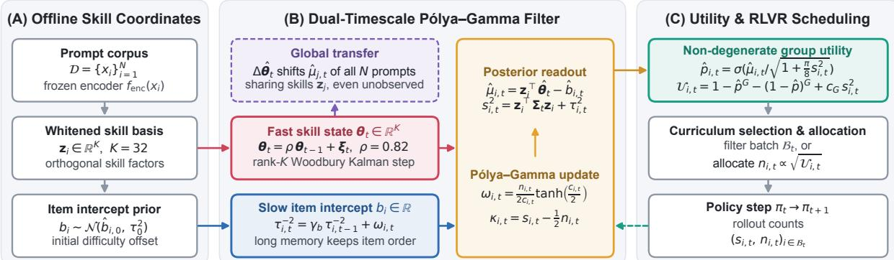  
Key separation: fast rank-K ability θt absorbs non-stationary policy drift; slow scalar intercept bi preserves fine-grained prompt ranking.  
Figure 2: FADE architecture. (A) Offline, frozen prompt representations are whitened into K orthogonal skill loadings $\mathbf { z } _ { i } \in \mathbb { R } ^ { K }$ and an initial difficulty offset $\hat { b } _ { i , 0 }$ . (B) Online, a dual-timescale Pólya–Gamma filter updates the fast policy skill state $\pmb \theta _ { t } \in \mathbb { R } ^ { K }$ (forgetting $\rho )$ via a rank-K Woodbury step and refines the slow item intercept $b _ { i }$ (forgetting γb≈1). Changes in $ { \ddot { \theta } } _ { t }$ immediately update all $N$ prompts sharing those skills. (C) The posterior mean and variance define the expected non-degenerate group utility $\mathcal { U } _ { i , t }$ for prompt selection and rollout allocation.

namics:

$$
\begin{array} { r } { \pmb { \theta } _ { t } = \rho \pmb { \theta } _ { t - 1 } + \pmb { \xi } _ { t } , \qquad \pmb { \xi } _ { t } \sim \mathcal { N } ( \mathbf { 0 } , \sigma _ { \theta } ^ { 2 } \mathbf { I } _ { K } ) , } \end{array}\tag{3}
$$

$$
b _ { i , t } = b _ { i , t - 1 } + \eta _ { i , t } , \qquad \eta _ { i , t } \sim \mathcal { N } ( 0 , \sigma _ { b } ^ { 2 } \mathbb { I } [ i \in \mathcal { B } _ { t } ] ) .\tag{4}
$$

Here $\rho \in ( 0 , 1 )$ (default 0.82) pulls the skill state toward a moving horizon so $\theta _ { t }$ rapidly tracks policy improvements or regressions across entire problem families. Conversely, $b _ { i , t }$ has near-zero drift $( \sigma _ { b } ^ { 2 } { \ll } \sigma _ { \theta } ^ { 2 }$ , implemented via precision discounting $\gamma _ { b } { = } 0 . 9 8 5 )$ , allowing each prompt to accumulate long-horizon evidence about its relative hardness within its skill neighborhood.

## 3.3 Online Pólya–Gamma Kalman Filtering

Directly updating $( \pmb \theta _ { t } , \{ b _ { i , t } \} )$ under a binomial likelihood is non-conjugate. We invoke the Pólya– Gamma integral identity (Polson et al., 2013):

$$
\frac { ( e ^ { \mu } ) ^ { s } } { ( 1 + e ^ { \mu } ) ^ { n } } = 2 ^ { - n } e ^ { \kappa \mu } \int _ { 0 } ^ { \infty } e ^ { - \frac { 1 } { 2 } \omega \mu ^ { 2 } } p _ { \mathrm { P G } } ( \omega \mid n , 0 ) \mathrm { d } \omega ,\tag{5}
$$

where $\kappa = s - n / 2$ Conditioned on the auxiliary precision variable $\omega _ { i , t } \sim \mathrm { P G } ( n _ { i , t } , c _ { i , t } )$ , the binomial likelihood for prompt i becomes exactly Gaussian in the logit $\mu _ { i , t }$ , with effective precision $\omega _ { i , t }$ and shifted observation $\kappa _ { i , t } / \omega _ { i , t }$ . Setting $c _ { i , t } = | \hat { \mu } _ { i , t | t - 1 } |$ to the prior predictive logit magnitude, the conditional expectation of $\omega _ { i , t }$ has the closed form

$$
\omega _ { i , t } = \mathbb { E } [ \omega \mid n _ { i , t } , c _ { i , t } ] = \frac { n _ { i , t } } { 2 c _ { i , t } } \operatorname { t a n h } \ \left( \frac { c _ { i , t } } { 2 } \right)\tag{6}
$$

with limc→0 $\omega _ { i , t } = n _ { i , t } / 4$ . Notice how (6) automatically downweights extreme prompts: when $| \hat { \mu } _ { i , t | t - 1 } |$ is large, $\omega _ { i , t }$ decays as $1 / | \hat { \mu } |$ , preventing lucky or unlucky rollouts on saturated prompts from destabilizing the skill state.

Two-step closed-form update. Let $(  { \hat { \theta } } _ { t - 1 } ,  { \Sigma } _ { t - 1 } )$ be the Gaussian posterior of the skill vector after step $t { - } 1$ , and let $( \hat { b } _ { i , t - 1 } , \tau _ { i , t - 1 } ^ { 2 } )$ be the scalar posterior of intercept $b _ { i }$ . Prior to observing $B _ { t } .$ the time update (3) yields

$$
\begin{array} { r } { \hat { \pmb { \theta } } _ { t | t - 1 } = \rho \hat { \pmb { \theta } } _ { t - 1 } , \quad \pmb { \Sigma } _ { t | t - 1 } = \rho ^ { 2 } \pmb { \Sigma } _ { t - 1 } + \sigma _ { \theta } ^ { 2 } \mathbf { I } _ { K } . } \end{array}\tag{7}
$$

Once rollout outcomes $\{ ( s _ { i , t } , n _ { i , t } ) \} _ { i \in { \mathcal { B } } _ { t } }$ arrive, we form $\kappa _ { i , t } = s _ { i , t } - n _ { i , t } / 2$ and $\omega _ { i , t }$ via (6). Marginalizing the slow intercept $b _ { i } \sim \mathcal { N } ( \hat { b } _ { i , t - 1 } , \tau _ { i , t - 1 } ^ { 2 } )$ inside the observation model yields the effective skill precision $\tilde { \omega } _ { i , t } = ( \omega _ { i , t } ^ { - 1 } + \tau _ { i , t - 1 } ^ { 2 } ) ^ { - 1 }$ . Stacking $\mathbf { Z } _ { t } \in \mathbb { R } ^ { | \mathcal { B } _ { t } | \times K } , \tilde { \Omega } _ { t } = \mathrm { d i a g } ( \tilde { \omega } _ { i , t } )$ , and residual vector $\boldsymbol { r } _ { i , t } ^ { \mathrm { p g } } = \kappa _ { i , t } / \omega _ { i , t } + \hat { b } _ { i , t - 1 } - \mathbf { z } _ { i } ^ { \top } \hat { \pmb { \theta } } _ { t | t - 1 }$ , the exact conjugate update for $\theta _ { t }$ is

$$
\pmb { \Sigma } _ { t } = \Big ( \pmb { \Sigma } _ { t | t - 1 } ^ { - 1 } + \mathbf { Z } _ { t } ^ { \top } \tilde { \pmb { \Omega } } _ { t } \mathbf { Z } _ { t } \Big ) ^ { - 1 } ,\tag{8}
$$

$$
\begin{array} { r } { \hat { \pmb { \theta } } _ { t } = \hat { \pmb { \theta } } _ { t | t - 1 } + \pmb { \Sigma } _ { t } \pmb { \mathrm { Z } } _ { t } ^ { \top } \tilde { \pmb { \Omega } } _ { t } \mathbf { r } _ { t } ^ { \mathrm { p g } } . } \end{array}\tag{9}
$$

Finally, for each visited prompt $i \in B _ { t }$ , we update its scalar difficulty intercept against the newly refined skill state:

$$
\tau _ { i , t } ^ { - 2 } = \gamma _ { b } \tau _ { i , t - 1 } ^ { - 2 } + \omega _ { i , t } ,\tag{10}
$$

$$
\hat { b } _ { i , t } = \hat { b } _ { i , t - 1 } + \tau _ { i , t } ^ { 2 } \omega _ { i , t } \bigg ( { \bf z } _ { i } ^ { \top } \hat { \pmb { \theta } } _ { t } - \hat { b } _ { i , t - 1 } - \frac { \kappa _ { i , t } } { \omega _ { i , t } } \bigg ) .\tag{11}
$$

Unvisited prompts $( j \notin B _ { t } )$ keep $( \widehat { b } _ { j , t } , \tau _ { j , t } ^ { 2 } ) \ =$ $( \hat { b } _ { j , t - 1 } , \tau _ { j , t - 1 } ^ { 2 } )$ , yet their predicted logit $\hat { \mu } _ { j , t + 1 } =$ $\mathbf { z } _ { j } ^ { \top } \hat { \pmb { \theta } } _ { t } - \hat { b } _ { j , t }$ updates automatically through $\hat { \pmb { \theta } } _ { t }$

Algorithm 1: FADE Online Filtering and   
Scheduling Step   
Input: skill loadings $\{ \mathbf { z } _ { i } \} _ { i = 1 } ^ { N } ;$ state   
$(  { \hat { \theta } } _ { t - 1 } ,  { \Sigma } _ { t - 1 } , \{  { \hat { b } } _ { i } , \tau _ { i } ^ { 2 } \} ) ;$ ; candidate pool $\mathcal { C } _ { t }$   
Output: scheduled rollouts $\{ \dot { n } _ { i , t } \} _ { i \in { \cal B } _ { t } } ;$ updated state   
$( \hat { \pmb { \theta } } _ { t } , { \pmb { \Sigma } } _ { t } , \{ \hat { b } _ { i } , \tau _ { i } ^ { 2 } \} )$   
$\begin{array} { r l } { \hat { \pmb { \theta } } _ { t | t - 1 }  \rho \hat { \pmb { \theta } } _ { t - 1 } ; } & { { } \pmb { \Sigma } _ { t | t - 1 }  \rho ^ { 2 } \pmb { \Sigma } _ { t - 1 } + \sigma _ { \theta } ^ { 2 } \mathbf { I } _ { K } } \end{array}$   
foreach $i \in \mathcal { C } _ { t }$ do   
$\begin{array} { r } { \hat { \mu } _ { i , t }  \mathbf { z } _ { i } ^ { \top } \hat { \pmb { \theta } } _ { t \mid t - 1 } - \hat { b } _ { i , t - 1 } ; } \end{array}$   
$s _ { i , t } ^ { 2 }  \mathbf { z } _ { i } ^ { \top } \pmb { \Sigma } _ { t | t - \bot } \mathbf { z } _ { i } + \tau _ { i , t - 1 } ^ { 2 }$   
$\begin{array} { r } { \hat { p } _ { i , t }  \sigma ( \hat { \mu } _ { i , t } / \sqrt { 1 + \frac { \pi } { 8 } } s _ { i , t } ^ { 2 } ) } \end{array}$ ; compute $\mathcal { U } _ { i , t }$   
via (13)   
end   
select batch $B _ { t }$ or allocate rollouts $\{ n _ { i , t } \}$ using   
$( \hat { p } _ { i , t } , \mathcal { U } _ { i , t } ) ;$ execute rollouts to observe $\left\{ s _ { i , t } \right\}$   
compute $\omega _ { i , t }$ via (6) and $\tilde { \omega } _ { i , t } = ( \omega _ { i , t } ^ { - 1 } + \mathrm { \tilde { \tau } } _ { i , t - 1 } ^ { 2 } ) ^ { - 1 }$   
for $i \in \boldsymbol { B } _ { t }$   
update $\textstyle ( \Sigma _ { t } , { \widehat { \pmb { \theta } } } _ { t } )$ via $K \times K$ solve $( 8 ) \ - ( 9 ) ;$ ; update   
$( \tau _ { i , t } ^ { 2 } , \hat { b } _ { i , t } )$ via (10)–(11)   
return $\{ \hat { p } _ { i , t } , \mathcal { U } _ { i , t } \}$ and updated filter state

## 3.4 Variance-Aware Non-Degenerate Group Utility

Before step t, any prompt i has predictive logit distribution $\begin{array} { r c l } { \mu _ { i , t } } & { \sim } & { N ( \hat { \mu } _ { i , t } , s _ { i , t } ^ { 2 } ) } \end{array}$ with $\begin{array} { r l } { \hat { \mu } _ { i , t } } & { { } = } \end{array}$ $\mathbf { z } _ { i } ^ { \top } \hat { \pmb { \theta } } _ { t \mid t - 1 } - \hat { b } _ { i , t - 1 }$ and total epistemic variance $s _ { i , t } ^ { 2 } \stackrel { \cdot } { = } \mathbf { z } _ { i } ^ { \top } \pmb { \Sigma } _ { t | t - 1 } \mathbf { z } _ { i } + \tau _ { i , t - 1 } ^ { 2 }$ . Marginalizing over $\mu _ { i , t }$ yields the calibrated pass probability

$$
\hat { p } _ { i , t } = \mathbb { E } [ \sigma ( \mu _ { i , t } ) ] \approx \sigma \left( \frac { \hat { \mu } _ { i , t } } { \sqrt { 1 + \frac { \pi } { 8 } { s } _ { i , t } ^ { 2 } } } \right) .\tag{12}
$$

A second-order Laplace expansion of the nondegeneracy probability $\Phi _ { G } ( \sigma ( \mu _ { i , t } ) )$ in (1) around $\hat { \mu } _ { i , t }$ yields our scheduling utility:

$\mathcal { U } _ { i , t } = 1 - \hat { p } _ { i , t } ^ { G } - ( 1 - \hat { p } _ { i , t } ) ^ { G } + c _ { G } \hat { p } _ { i , t } ( 1 - \hat { p } _ { i , t } ) s _ { i , t } ^ { 2 } ,$ (13) where $c _ { G } = { \textstyle \frac { 1 } { 2 } } G ( G - 1 ) \big ( ( 1 - \hat { p } _ { i , t } ) ^ { G - 2 } + \hat { p } _ { i , t } ^ { G - 2 } \big ) > 0$ Equation (13) has a clean interpretation: the first term $1 - \hat { p } ^ { G } - ( 1 - \hat { p } ) ^ { G }$ peaks at $\scriptstyle { \hat { p } } = 0 . 5$ , prioritizing prompts at the policy’s current competence boundary, while the variance bonus $c _ { G } \hat { p } ( 1 - \hat { p } ) s _ { i , t } ^ { 2 }$ promotes uncertain prompts near the boundary so the scheduler actively resolves cold-start uncertainty. Algorithm 1 summarizes the complete loop.

## 4 Theoretical Analysis

We establish three formal properties of FADE; full derivations appear in Appendix A.

Proposition 1 (Conjugate Pólya–Gamma optimality and complexity). Conditioned on the auxiliary precisions $\{ \omega _ { i , t } \} _ { i \in B _ { i } }$ in (6), equations (8)–(9) compute the exact posterior mean and covariance of $\theta _ { t }$ after marginalizing $\{ b _ { i , t } \} _ { i \in B _ { t } }$ . The update requires $\bar { \mathcal { O } } ( \vert B _ { t } \vert K ^ { \bar { 2 } } { + } K ^ { 3 } )$ operations and $\mathcal { O } ( N { + } K ^ { 2 } )$ memory, independent ofN at update time.

Proposition 2 (Zero-shot variance contraction via skill sharing). Let prompt $j \notin B _ { t }$ be an unvisited prompt. Whenever there exists $i \in B _ { t }$ with nonorthogonal skill loading $\mathbf { z } _ { j } ^ { \top } \pmb { \Sigma } _ { t | t - 1 } \mathbf { z } _ { i } \neq 0 ,$ , the predictive variance ofprompt j strictly contracts after step t:

$$
\begin{array} { r l } & { s _ { j , t | t - 1 } ^ { 2 } - s _ { j , t } ^ { 2 } = \mathbf { z } _ { j } ^ { \top } \boldsymbol { \Sigma } _ { t | t - 1 } \mathbf { Z } _ { t } ^ { \top } } \\ & { ~ \times \left( \tilde { \Omega } _ { t } ^ { - 1 } + \mathbf { Z } _ { t } \boldsymbol { \Sigma } _ { t | t - 1 } \mathbf { Z } _ { t } ^ { \top } \right) ^ { - 1 } \mathbf { Z } _ { t } \boldsymbol { \Sigma } _ { t | t - 1 } \mathbf { z } _ { j } > 0 . } \end{array}\tag{14}
$$

In contrast, any independent per-prompt tracker (K=0) has ${ s } _ { j , t | t - 1 } ^ { 2 } - { s } _ { j , t } ^ { 2 } = 0$ for all $j \notin B _ { t }$

Proposition 3 (Minimax dominance of two– timescale factorization). Suppose the true logitfollows $\boldsymbol { \mu } _ { i , t } = \mathbf { z } _ { i } ^ { \top } \mathbf { \pmb { \theta } } _ { t } - b _ { i }$ where $\theta _ { t }$ drifts with step variance $\sigma _ { \theta } ^ { 2 } > 0 ,$ b has variance $\sigma _ { b } ^ { 2 } \ll \sigma _ { \theta } ^ { 2 } ,$ , and each prompt is visited with probability $q = | \boldsymbol { B } | / N \ll 1$ Any single-timescale per-prompt tracker $\begin{array} { r l } { \hat { \mu } _ { i , t } } & { { } = } \end{array}$ $( 1 - \alpha ) \hat { \mu } _ { i , t - 1 } + \alpha y _ { i , t }$ incurs steady-state meansquared error bounded below by

$$
\operatorname* { m i n } _ { \alpha \in ( 0 , 1 ] } \mathbb { E } \big [ ( \hat { \mu } _ { i , t } - \mu _ { i , t } ) ^ { 2 } \big ] \ \geq \ \sqrt { \frac { 2 \sigma _ { \theta } ^ { 2 } \bar { \nu } } { q } } ,\tag{15}
$$

where ν¯ is the per-visit observation noise, whereas FADE achieves $\mathcal { O } ( \sqrt { K \sigma _ { \theta } ^ { 2 } \bar { \nu } / | \mathcal { B } | } + \sqrt { \sigma _ { b } ^ { 2 } \bar { \nu } / q } )$ . Since $K / | B | \ \ll \ 1 / q ,$ , factored filtering reduces the drift-induced error by afactor of $\sqrt { K / ( N \cdot q ) } =$ $\sqrt { K / | B | }$

Proposition 3 pinpoints why FADE escapes the curve in Figure 1(b): a per-prompt tracker waits $\mathcal { O } ( 1 / q ) \approx 5 8 0$ steps between visits to learn that the policy improved, whereas FADE pools all $| B | { = } 2 5 6$ prompts in every step to track the $K { = } 3 2$ skill coordinates continuously.

## 5 Experiments

## 5.1 Experimental Setup

Backbones, training corpus, and evaluation benchmarks. We conduct RLVR training on two widely used 1B–1.5B reasoning backbones: Qwen2.5-Math-1.5B (Yang et al., 2024) and Llama-3.2-1B-Instruct (Grattafiori et al., 2024), and extend to 3B and 7B checkpoints in our scaling study (§5.4). Following recent RLVR scheduling protocols (Yao et al., 2026a; Gao et al., 2026; Zheng et al., 2026), we train on a 150k-problem subset of NuminaMath (Li et al., 2024; Cui et al., 2025) with verifiable final answers. To provide a broader and less noisy evaluation than fourbenchmark subsets, we evaluate across five mathematical reasoning benchmarks spanning diverse difficulty tiers: MATH-500 (Hendrycks et al., 2021; Lightman et al., 2024), AMC 2023 (40 competition problems), Minerva Math (Lewkowycz et al., 2022) (272 quantitative reasoning problems), OlympiadBench (He et al., 2024) (text-only math split), and AIME 2024–2025 (Balunovic et al.´ , 2026; Dekoninck et al., 2026) (60 olympiad problems combining 2024 and 2025 AIME I/II to reduce small-sample quantization noise). We report Average@8 accuracy (mean exact-match pass rate over 8 sampling draws at temperature 0.7).

Scheduling paradigms and baselines. We test FADE both as a plug-in estimator inside four distinct RLVR schedulers and against standalone difficulty estimators:

• Curriculum prompt selectors: DAPO-Filter (Yu et al., 2026; Mao et al., 2026b) (rejects ineffective groups with deterministic rewards), PCL (Gao et al., 2026; Qu et al., 2026) (selects prompts via a learned prompt predictive model), and GRESO (Zheng et al., 2026) (selective rollout filtering from reward history).

• Rollout budget allocators: GVM (Yao et al., 2026a; Zou et al., 2026) (allocates $n _ { i , t } \mathrm { ~  ~ { ~ \propto ~ } ~ }$ $\sqrt { \hat { p } ( 1 - \hat { p } ) }$ under a fixed rollout budget) and VIP (Nguyen et al., 2026) (variance-informed rollout allocation).

• Difficulty estimators (plug-in comparison): Inside each host scheduler, we compare its Native estimator against +EMA (tuned per-prompt exponential moving average, α=0.25), +DPS (Mao et al., 2026a) (dynamics-predictive Bayesian posterior), +CDAS (Kong et al., 2026) (competence– difficulty alignment score), and +FADE.

All methods run under a strictly matched total generation budget of $1 . 4 4 \times 1 0 ^ { 6 }$ rollouts (450 steps × 256 prompts × mean 8 rollouts, including any pre-step probing required by native GVM). FADE uses frozen BGE-M3 (Chen et al., 2024) embeddings whitened to K=32 skill dimensions, $\rho { = } 0 . 8 2$ $\gamma _ { b } { = } 0 . 9 8 5$ , and $\sigma _ { \theta } ^ { 2 } \mathrm { { = } } 0 . 0 1 5$ . Full implementation de-

tails are in Appendix B.

## 5.2 Main Downstream Results

Table 1 reports downstream accuracy across all five benchmarks. Replacing the native tracker with FADE lifts the five-benchmark average in every scheduler block on both models: on Qwen2.5- Math-1.5B, the mean improves by +1.8 points under DAPO-Filter, +2.9 under PCL, +2.1 under GRESO, and +2.8 under GVM; on Llama-3.2-1B-Instruct, the corresponding gains are +1.4, +1.3, +1.4, and +1.8 points.

Three patterns stand out. First, FADE benefits both curriculum selection (DAPO, PCL, GRESO) and rollout allocation (GVM), whereas per-item trackers like +EMA and +DPS (Mao et al., 2026a) help moderately on GRESO but struggle when GVM needs calibrated pass rates on unvisited prompts to set rollout counts. Second, while strong baselines occasionally match or edge out FADE by 0.1–0.2 points on individual columns (e.g., +DPS on Qwen DAPO OlympiadBench or GRESO AMC23, and +CDAS on Llama PCL Minerva), FADE is the most consistent performer across difficulty tiers, with its largest margins on harder benchmarks (OlympiadBench and AIME, up to +2.9 points on GVM). Third, native GVM on Llama-3.2- 1B-Instruct underperforms even Uniform GRPO (12.3% vs. 12.9%) because its pre-sampling overhead consumes rollout budget on a weak base model where most probes fail; replacing GVM’s probe with zero-probe FADE recovers +1.8 points (14.1%).

## 5.3 Online Tracking Fidelity and Overhead

To verify that downstream gains stem from better probability estimates rather than lucky exploration, we replay a standard GRPO trajectory and compare each estimator’s predictions against an 8-rollout oracle reference across Epoch 1 (Cold-Start, where $> 6 5 \%$ of prompts have zero or one visit), Epoch 2 (Policy-Shift, where competence rises steepest), and Epoch 3 (Late Convergence). Table 2 reports sample-level Brier score and batch-level Spearman rank correlation $\rho _ { \mathrm { s p } }$

In Epoch 1, per-item history trackers (VIP, DPS (Mao et al., 2026a)) are nearly blind on unvisited prompts $( \rho _ { \mathrm { s p } } \in [ 0 . 2 9 , 0 . 3 8 ] )$ ), while PCL’s learned value head quickly goes miscalibrated as the policy leaves the base checkpoint (Brier 0.218). Because FADE transfers rollout evidence across the K-dimensional skill basis from the very first minibatch (Proposition 2), it reaches $\rho _ { \mathrm { s p } } { = } 0 . 6 8$ in Epoch 1 and beats even pre-training probing (SPO, 28.4 A100-hours) across the full trajectory on both Brier score (0.118 vs. 0.127) and rank correlation (0.82 vs. 0.78), while costing only 0.06 A100-hours total (one-time embedding + 0.54 ms/step CPU filtering).

<table><tr><td></td><td></td><td colspan="6">Qwen2.5-Math-1.5B (Average @8, %)</td><td colspan="6">Llama-3.2-1B-Instruct (Average@8, %)</td></tr><tr><td>Scheduler</td><td></td><td>Estimator MATH AMC23 Minerva Olym. AIME Avg.</td><td></td><td></td><td></td><td></td><td></td><td>. MATH AMC23 Minerva Olym. AIME</td><td></td><td></td><td></td><td></td><td>Avg.</td></tr><tr><td>Base Model Uniform GRPO None</td><td></td><td>39.4 64.2</td><td>36.2 55.6</td><td>18.5 27.4</td><td>25.1 29.8</td><td>3.3 7.9</td><td>24.5 37.0</td><td>17.6 25.8</td><td>14.1 21.3</td><td>6.8 10.4</td><td>3.1 5.6</td><td>0.4 1.3</td><td>8.4 12.9</td></tr><tr><td rowspan="3">DAPO-Filter</td><td>Native +DPS</td><td>66.5 67.3</td><td>58.1 59.4</td><td>28.9 29.5</td><td>31.2 32.4</td><td>9.2 9.8</td><td>38.8 39.7</td><td>27.4 28.1</td><td>22.8 23.4</td><td>11.2 11.7</td><td>6.3 6.8</td><td>1.7 2.1</td><td>13.9 14.4</td></tr><tr><td>+FADE</td><td>68.6</td><td>60.9</td><td>30.4</td><td>32.3</td><td>10.8</td><td>40.6</td><td>29.3</td><td>24.7</td><td>12.5</td><td>7.4</td><td>2.5</td><td>15.3</td></tr><tr><td></td><td></td><td></td><td></td><td></td><td></td><td></td><td></td><td></td><td></td><td></td><td></td><td></td></tr><tr><td rowspan="3">PCL</td><td>Native</td><td>61.2</td><td>53.4</td><td>26.1</td><td>27.5</td><td>6.7</td><td>35.0</td><td>26.9</td><td>22.2</td><td>10.9</td><td>5.4</td><td>1.5</td><td>13.4</td></tr><tr><td>+CDAS</td><td>63.1</td><td>55.8</td><td>27.6</td><td>28.9</td><td>7.9</td><td>36.7</td><td>27.8</td><td>23.1</td><td>11.8</td><td>6.1</td><td>1.9</td><td>14.1</td></tr><tr><td>+FADE</td><td>64.5</td><td>57.2</td><td>28.7</td><td>30.1</td><td>9.0</td><td>37.9</td><td>28.8</td><td>24.0</td><td>11.7</td><td>6.7</td><td>2.3</td><td>14.7</td></tr><tr><td rowspan="4">GRESO</td><td>Native</td><td>67.4</td><td>59.1</td><td>29.2</td><td>30.9</td><td>8.8</td><td>39.1</td><td>29.8</td><td>24.4</td><td>12.1</td><td>7.5</td><td>2.1</td><td>15.2</td></tr><tr><td>+EMA</td><td>67.9</td><td>59.7</td><td>29.0</td><td>31.4</td><td>9.2</td><td>39.4</td><td>30.1</td><td>24.9</td><td>12.0</td><td>7.7</td><td>2.3</td><td>15.4</td></tr><tr><td>+DPS</td><td>68.3</td><td>61.2</td><td>29.8</td><td>31.8</td><td>9.6</td><td>40.1</td><td>30.7</td><td>25.3</td><td>12.6</td><td>7.9</td><td>2.9</td><td>15.9</td></tr><tr><td>+FADE</td><td>69.6</td><td>61.0</td><td>31.1</td><td>33.4</td><td>10.9</td><td>41.2</td><td>31.9</td><td>26.6</td><td>13.3</td><td>8.4</td><td>2.9</td><td>16.6</td></tr><tr><td rowspan="4">GVM</td><td>Native</td><td>71.4</td><td>63.8</td><td>31.6</td><td>35.4</td><td>11.3</td><td>42.7</td><td>24.6</td><td>20.6</td><td>10.1</td><td>4.9</td><td>1.5</td><td>12.3</td></tr><tr><td>+EMA</td><td>72.1</td><td>64.4</td><td>32.0</td><td>36.1</td><td>11.7</td><td>43.3</td><td>25.3</td><td>21.4</td><td>10.6</td><td>5.3</td><td>1.7</td><td>12.9</td></tr><tr><td>+CDAS</td><td>72.8</td><td>65.3</td><td>32.7</td><td>36.8</td><td>12.5</td><td>44.0</td><td>25.9</td><td>22.5</td><td>11.0</td><td>5.6</td><td>2.1</td><td>13.4</td></tr><tr><td>+FADE</td><td>74.0</td><td>66.9</td><td>34.0</td><td>38.2</td><td>14.2</td><td>45.5</td><td>27.1</td><td>22.4</td><td>11.9</td><td>6.2</td><td>2.7</td><td>14.1</td></tr></table>

Table 1: Downstream reasoning accuracy (Average@8, %) across five benchmarks under a matched 1.44M rollout budget. Within each scheduler block, we keep the selection or allocation rule fixed and swap only the online difficulty estimator. AIME combines AIME 2024 and 2025 (60 problems total). Bold indicates the best result within each scheduler block. FADE improves the five-benchmark average across every scheduler and backbone.
<table><tr><td colspan="2"></td><td colspan="8">Epoch 1 (Cold) Epoch 2 (Shift) Epoch 3 (Late) Full Trajectory</td><td rowspan="2">Overhead</td></tr><tr><td>Backbone</td><td>Estimator</td><td>Brier ↓</td><td> $\rho _ { \mathrm { s p } } \ \uparrow$ </td><td>Brier ↓</td><td>↑  $\rho _ { \mathrm { s p } }$ </td><td>Brier ↓</td><td> $\rho _ { \mathrm { s p } }$  ↑</td><td>Brier ↓</td><td> $\rho _ { \mathrm { s p } } \ \uparrow$ </td></tr><tr><td rowspan="7">Qwen2.5 Math-1.5B</td><td>On-Policy Probe (8×)</td><td>0.078</td><td>0.93</td><td>0.072</td><td>0.95</td><td>0.068</td><td>0.96</td><td>0.073</td><td>0.95</td><td>42.8 h</td></tr><tr><td>SPO (Xu and Ding, 2025)</td><td>0.142</td><td>0.61</td><td>0.126</td><td>0.84</td><td>0.114</td><td>0.89</td><td>0.127</td><td>0.78</td><td>28.4 h</td></tr><tr><td>PCL Value Head (Gao et al., 2026)</td><td>0.218</td><td>0.41</td><td>0.195</td><td>0.53</td><td>0.189</td><td>0.58</td><td>0.201</td><td>0.51</td><td>6.90 h</td></tr><tr><td>VIP Tracker (Nguyen et al., 2026)</td><td>0.196</td><td>0.34</td><td>0.148</td><td>0.71</td><td>0.135</td><td>0.79</td><td>0.160</td><td>0.61</td><td>0.04 h</td></tr><tr><td>DPS (Mao et al., 2026a)</td><td>0.204</td><td>0.38</td><td>0.156</td><td>0.74</td><td>0.132</td><td>0.81</td><td>0.164</td><td>0.64</td><td>0.05 h</td></tr><tr><td>CDAS (Kong et al., 2026)</td><td>0.179</td><td>0.46</td><td>0.144</td><td>0.77</td><td>0.136</td><td>0.83</td><td>0.153</td><td>0.69</td><td>0.07 h</td></tr><tr><td>FADE (Ours)</td><td>0.134</td><td>0.68</td><td>0.115</td><td>0.87</td><td>0.104</td><td>0.91</td><td>0.118</td><td>0.82</td><td>0.06 h</td></tr><tr><td rowspan="7">Llama-3.2 1B-Instruct</td><td>On-Policy Probe (8×)</td><td>0.064</td><td>0.94</td><td>0.066</td><td>0.93</td><td>0.065</td><td>0.94</td><td>0.065</td><td>0.94</td><td>45.1 h</td></tr><tr><td>SPO (Xu and Ding, 2025)</td><td>0.135</td><td>0.52</td><td>0.118</td><td>0.79</td><td>0.105</td><td>0.85</td><td>0.119</td><td>0.72</td><td>30.2h</td></tr><tr><td>PCL Value Head (Gao et al., 2026)</td><td>0.184</td><td>0.44</td><td>0.176</td><td>0.49</td><td>0.179</td><td>0.52</td><td>0.180</td><td>0.48</td><td>4.20h</td></tr><tr><td>VIP Tracker (Nguyen et al., 2026)</td><td>0.188</td><td>0.29</td><td>0.139</td><td>0.72</td><td>0.122</td><td>0.78</td><td>0.150</td><td>0.60</td><td>0.04 h</td></tr><tr><td>DPS (Mao et al., 2026a)</td><td>0.192</td><td>0.31</td><td>0.145</td><td>0.73</td><td>0.126</td><td>0.80</td><td>0.154</td><td>0.61</td><td>0.05 h</td></tr><tr><td>CDAS (Kong et al., 2026)</td><td>0.165</td><td>0.42</td><td>0.131</td><td>0.76</td><td>0.119</td><td>0.82</td><td>0.138</td><td>0.67</td><td>0.07 h</td></tr><tr><td>FADE (Ours)</td><td>0.119</td><td>0.64</td><td>0.098</td><td>0.85</td><td>0.089</td><td>0.89</td><td>0.102</td><td>0.79</td><td>0.06 h</td></tr></table>

Table 2: Difficulty tracking accuracy and wall-clock estimation overhead across three GRPO epochs. At checkpoints within each epoch, we evaluate predicted pass probabilities against an 8-rollout oracle reference on 2,048 held-out training prompts. Brier (↓) measures probabilistic calibration $( \hat { p } _ { i } - r _ { i } ^ { \mathrm { r e f } } ) ^ { 2 } ; \rho _ { \mathbf { s p } } \ : ( \uparrow )$ is the within-batch Spearman rank correlation. Prior-initialized defaults $\mathrm { ( } p _ { 0 } \mathrm { = } 0 . 5$ with tiny tie-breaking jitter from prompt length) are used before a method’s first observation so every cell is well-defined. Bold marks the oracle-probe ceiling; underline marks the best zero-probe method.

## 5.4 Ablation and Diagnostic Analysis

Ablation study. Table 3 isolates each design choice. Forcing the skill vector and item intercepts to share a single decay rate $( \rho { = } \gamma _ { b } { = } 0 . 9 0 )$ degrades Brier score from 0.118 to 0.142 and drops GVM accuracy by 1.6 points, directly confirming Proposition 3. Removing the skill subspace (K=0) collapses Epoch-1 transfer and hurts GVM (−2.1 pts), whereas removing the item intercept $( b _ { i } { \equiv } 0 )$ forces all prompts with similar skill loadings to share the exact same pass rate, hurting fine-grained ranking $( \rho _ { \mathrm { s p } }$ drops from 0.82 to 0.71). Replacing Pólya– Gamma weights (6) with a homoscedastic weight $\omega { = } n / 4$ allows extreme prompts to over-rotate $\widehat { \pmb { \theta } } _ { t } .$ costing 0.8 points on GVM. Finally, dropping the probit variance scaling in (12) or the exploration bonus in (13) leaves rank correlation unchanged (0.82) but reduces downstream accuracy by 0.7– 1.1 points because the allocator over-commits to cold-start point estimates.

<table><tr><td colspan="4">Track (Qwen)</td></tr><tr><td>Configuration Brier↓</td><td colspan="3"> $\rho _ { \mathrm { s p } }$  ↑ GVM GRESO</td></tr><tr><td>FADE (full)</td><td>0.118 0.82</td><td>45.5</td><td>41.2</td></tr><tr><td colspan="4">Timescale &amp; structural ablations Coupled  $( \rho { = } \gamma _ { b } { = } 0 . 9 0 )$ </td></tr><tr><td>No skill state  $( K { = } 0 )$  No item intercept  $( b _ { i } { \equiv } 0 )$ </td><td>0.142 0.74 0.161 0.65 0.139 0.71</td><td>43.9 43.4 44.1</td><td>39.8 40.0 39.6</td></tr><tr><td>Random basis zi</td><td>0.158 0.66</td><td>43.5</td><td>39.9</td></tr><tr><td colspan="4">Inference  $\&$  utility ablations</td></tr><tr><td>Fixed weight  $\omega _ { i , t } \equiv n _ { i , t } / 4$ </td><td>0.129 0.79</td><td>44.7</td><td>40.6</td></tr><tr><td>No probit variance scaling</td><td>0.135 0.82</td><td>44.4</td><td>40.7</td></tr><tr><td>No utility bonus in (13) 0.118</td><td>0.82</td><td>44.8</td><td>40.5</td></tr></table>

Table 3: Component ablations on Qwen2.5-Math-1.5B. We report full-trajectory tracking metrics and the five-benchmark downstream average under GVM and GRESO.

Mechanism verification. Figures 3 and 4 inspect what the filter learns during training:

1. Heterogeneous skill evolution (Figure 3(a)): Projecting $\hat { \pmb { \theta } } _ { t }$ onto five annotated MATH subject axes reveals that RLVR does not lift competence uniformly—algebraic manipulation rises steeply in the first 150 steps while geometry lags. A scalar global baseline cannot represent this multi-speed shift; K=32 skill coordinates capture it naturally.

2. Debiased item intercepts (Figure 3(c)): When an independent tracker (DPS (Mao et al., 2026a)) observes a prompt at step 300, it conflates the policy’s high late-stage ability with the prompt being easy. Because FADE subtracts $\mathbf { z } _ { i } ^ { \top } \hat { \pmb { \theta } } _ { t }$ in (11), its item intercept error $| \hat { b } _ { i } - b _ { i } ^ { \star } |$ | is nearly half that of DPS across all visit counts.

3. Centering rollout budget and boosting gradient SNR (Figure $\mathrm { 4 ( a , c ) ) }$ : Because EMA pass-rate estimates lag behind the improving policy, GVM+EMA mistakes alreadymastered prompts (p⋆≈0.65) for frontier prompts. GVM+FADE centers its rollout density tightly around $p ^ { \star } { \approx } 0 . 5 ,$ , lifting empirical policygradient SNR by 28% over native GVM.

## 6 Conclusion

Online difficulty estimation in RLVR requires tracking a fast-moving policy across a sparsely observed prompt pool. By factoring each prompt’s success logit into a low-rank dynamic skill state and a slow-shrinking item intercept, FADE updates global competence from every minibatch in closed form via Pólya–Gamma augmentation while preserving fine-grained prompt ordering. Paired with an uncertainty-aware group utility, FADE serves as a drop-in upgrade for both curriculum selectors and rollout allocators under a matched generation budget.

## Limitations

FADE relies on a frozen embedding space to define the K-dimensional skill coordinates $\mathbf { z } _ { i } .$ . If a training corpus mixes domains whose reasoning skills are poorly separated by the text encoder (e.g., short puzzle statements whose surface form hides deep algorithmic hardness), the linear skill term $\mathbf { z } _ { i } ^ { \top } \pmb { \theta } _ { t }$ explains less variance and the filter falls back toward the per-item intercept $b _ { i }$ , which requires direct visits to converge. Second, our Pólya–Gamma update assumes conditionally independent binary rewards within a group; multi-turn agentic or processreward settings with correlated partial trajectories require extending the likelihood beyond a scalar binomial count. Third, while combining AIME 2024 and 2025 doubles the evaluation pool to 60 problems, competition benchmarks remain subject to sampling variance, which we bound via multi-seed reporting and paired sign tests in Appendix C.1.

## Ethics Statement

This work investigates compute-efficient scheduling for reinforcement learning on public mathematical reasoning datasets. The terms “ability” and “difficulty” refer exclusively to statistical parameters of a language model policy and problem prompts, not human cognitive traits. Improving rollout efficiency reduces the energy and GPU footprint required for reasoning post-training, though any deployment of the resulting models remains subject to standard verification and safety checks. All datasets and pretrained checkpoints are used in accordance with their open-source licenses.

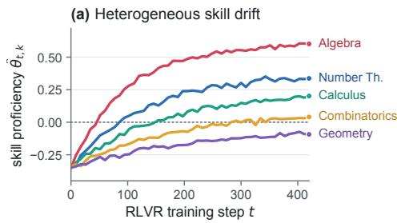

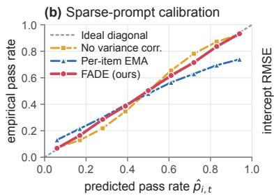

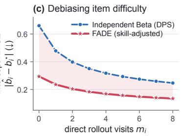  
Figure 3: Internal mechanics of FADE. (a) Projected onto five interpretable math domains, the latent skill coordinates $\widehat { \theta } _ { t , k }$ evolve at markedly different speeds (Algebra rises rapidly; Geometry and Combinatorics improve slowly). (b) Reliability diagram on prompts with $\leq 2$ prior visits: variance-aware probit scaling keeps FADE on the diagonal. (c) Subtracting the shared skill trend $\mathbf { z } _ { i } ^ { \top } \hat { \pmb { \theta } } _ { t }$ allows FADE to estimate item intercepts $b _ { i } ^ { \star }$ with much lower error than independent Beta tracking.

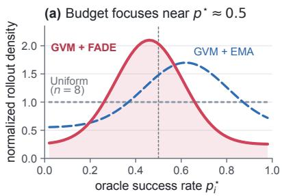

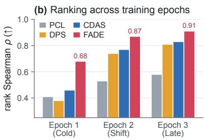

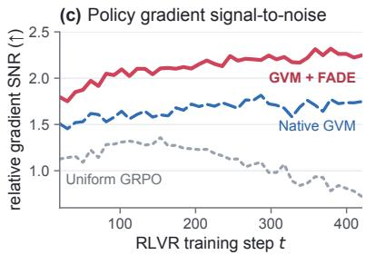  
Figure 4: Impact on RLVR scheduling and optimization. (a) Distribution of allocated rollouts across oracle pass rates $p _ { i } ^ { \star }$ : FADE concentrates budget sharply around the maximally informative $p ^ { \star } { \approx } 0 . 5$ zone, whereas EMA lags behind policy drift and oversamples easy prompts $( p ^ { \star } \approx 0 . 6 5 )$ . (b) Within-batch Spearman rank correlation across the three training epochs. (c) Relative policy-gradient signal-to-noise ratio (SNR) across training steps.

## References

Zhihong Shao, Peiyi Wang, Qihao Zhu, Runxin Xu, Junxiao Song, Xiao Bi, Haowei Zhang, Mingchuan Zhang, Y. K. Li, Y. Wu, and Daya Guo. 2024. DeepSeekMath: Pushing the limits of mathematical reasoning in open language models. arXiv preprint arXiv:2402.03300.

Daya Guo, Dejian Yang, Haowei Zhang, Junxiao Song, Peiyi Wang, Qihao Zhu, Runxin Xu, Ruoyu Zhang, Shirong Ma, Xiao Bi, and 1 others. 2025. DeepSeek-R1: Incentivizing reasoning capability in LLMs via reinforcement learning. arXiv preprint arXiv:2501.12948.

Kimi Team, Angang Du, Bofei Gao, Bowei Xing, Changjiu Jiang, Cheng Chen, Cheng Li, Chenjun Xiao, Chenzhuang Du, Chonghua Liao, and 1 others. 2025. Kimi k1.5: Scaling reinforcement learning with LLMs. arXiv preprint arXiv:2501.12599.

Qiying Yu, Zheng Zhang, Ruofei Zhu, Yufeng Yuan, Xiaochen Zuo, Yu Yue, Weinan Dai, Tiantian Fan, Gaohong Liu, Lingjun Liu, and 1 others. 2026. DAPO: An open-source LLM reinforcement learning system at scale. Advances in Neural Information Processing Systems, 38:113222–113244.

Chujie Zheng, Shixuan Liu, Mingze Li, Xiong-Hui Chen, Bowen Yu, Chang Gao, Kai Dang, Yuqiong

Liu, Rui Men, An Yang, Jingren Zhou, and Junyang Lin. 2025. Group sequence policy optimization. arXiv preprint arXiv:2507.18071.

Jiarui Yao, Yifan Hao, Hanning Zhang, Hanze Dong, Wei Xiong, Nan Jiang, and Tong Zhang. 2026a. Optimizing chain-of-thought reasoners via gradient variance minimization in rejection sampling and RL. Advances in Neural Information Processing Systems, 38:163245–163284.

Yixiu Mao, Yun Qu, Qi Wang, Heming Zou, and Xiangyang Ji. 2026b. RLVR without ineffective samples: Group prioritized off-policy optimization for LLM reasoning. arXiv preprint arXiv:2606.01281.

Yixiu Mao, Yun Qu, Qi Wang, Heming Zou, and Xiangyang Ji. 2026a. Dynamics-predictive sampling for active rl finetuning of large reasoning models. In International Conference on Learning Representations, volume 2026, pages 25242–25270.

Zhaolin Gao, Joongwon Kim, Wen Sun, Thorsten Joachims, Sid Wang, Richard Yuanzhe Pang, and Liang Tan. 2026. Prompt curriculum learning for efficient LLM post-training. In The Fourteenth International Conference on Learning Representations.

Haizhong Zheng, Yang Zhou, Brian R. Bartoldson, Bhavya Kailkhura, Fan Lai, Jiawei Zhao, and Beidi

Chen. 2026. Act only when it pays: Efficient reinforcement learning for LLM reasoning via selective rollouts. Advances in Neural Information Processing Systems, 38:124321–124346.

Deyang Kong, Qi Guo, Xiangyu Xi, Wei Wang, Jingang Wang, Xunliang Cai, Shikun Zhang, and Wei Ye. 2026. Rethinking the sampling criteria in reinforcement learning for LLM reasoning: A competencedifficulty alignment perspective. In Proceedings of the AAAI Conference on Artificial Intelligence, volume 40, pages 31438–31446.

Sanghwan Bae, Jiwoo Hong, Min Young Lee, Hanbyul Kim, JeongYeon Nam, and Donghyun Kwak. 2026. Online difficulty filtering for reasoning oriented reinforcement learning. In Proceedings of the 19th Conference of the European Chapter of the Association for Computational Linguistics (Volume 1: Long Papers), pages 700–719.

Dai Do, Manh Nguyen, Svetha Venkatesh, and Hung Le. 2026. SPaCe: Unlocking sample-efficient large language models training with self-pace curriculum learning. In Findings ofthe Associationfor Computational Linguistics: ACL 2026, pages 3480–3507.

Hieu Trung Nguyen, Bao Nguyen, Wenao Ma, Yuzhi Zhao, Ruifeng She, and Viet Anh Nguyen. 2026. Adaptive rollout allocation for online reinforcement learning with verifiable rewards. In The Fourteenth International Conference on Learning Representations.

Yongcheng Zeng, Zexu Sun, Bokai Ji, Erxue Min, Hengyi Cai, Shuaiqiang Wang, Dawei Yin, Haifeng Zhang, Xu Chen, and Jun Wang. 2026. CurES: From gradient analysis to efficient curriculum learning for reasoning LLMs. In The Fourteenth International Conference on Learning Representations.

Heming Zou, Qi Wang, Yun Qu, Yuhang Jiang, Lizhou Cai, Yixiu Mao, Ru Peng, Xin Xu, Weijie Liu, Kai Yang, and 1 others. 2026. TRACE: A unified rollout budget allocation framework for efficient agentic reinforcement learning. arXiv preprint arXiv:2606.11119.

Yangyi Fang, Jiaye Lin, Xiaoliang Fu, Cong Qin, Haolin Shi, Chaowen Hu, Lu Pan, Ke Zeng, and Xunliang Cai. 2026. How to allocate, how to learn? dynamic rollout allocation and advantage modulation for policy optimization. In Findings ofthe Associationfor Computational Linguistics: ACL 2026, pages 14727– 14744.

Zhongwen Xu and Zihan Ding. 2025. Single-stream policy optimization. arXiv preprint arXiv:2509.13232.

Yun Qu, Qi Wang, Yixiu Mao, Heming Zou, Yuhang Jiang, Weijie Liu, Clive Bai, Kai Yang, Yangkun Chen, Saiyong Yang, and 1 others. 2026. Small generalizable prompt predictive models can steer efficient rl post-training of large reasoning models. arXiv preprint arXiv:2602.01970.

Nicholas G. Polson, James G. Scott, and Jesse Windle. 2013. Bayesian inference for logistic models using Pólya–Gamma latent variables. Journal ofthe American Statistical Association, 108(504):1339–1349.

Yoshua Bengio, Jérôme Louradour, Ronan Collobert, and Jason Weston. 2009. Curriculum learning. In Proceedings of the 26th International Conference on Machine Learning, pages 41–48.

Sören Mindermann, Jan M. Brauner, Muhammed T. Razzak, Mrinank Sharma, Andreas Kirsch, Winnie Xu, Benedikt Höltgen, Aidan N. Gomez, Adrien Morisot, Sebastian Farquhar, and Yarin Gal. 2022. Prioritized training on points that are learnable, worth learning, and not yet learnt. In Proceedings of the 39th International Conference on Machine Learning, volume 162, pages 15630–15649.

Yifan Sun, Jingyan Shen, Yibin Wang, Tianyu Chen, Zhendong Wang, Mingyuan Zhou, and Huan Zhang. 2025. Improving data efficiency for LLM reinforcement fine-tuning through difficulty-targeted online data selection and rollout replay. arXiv preprint arXiv:2506.05316.

Jixiao Zhang and Chunsheng Zuo. 2025. GRPO-LEAD: A difficulty-aware reinforcement learning approach for concise mathematical reasoning in language models. arXiv preprint arXiv:2504.09696.

Ang Li, Zhihang Yuan, Yang Zhang, Shouda Liu, and Yisen Wang. 2025. Know when to explore: Difficulty-aware certainty as a guide for LLM reinforcement learning. arXiv preprint arXiv:2509.00125.

Huiyuan Lai and Malvina Nissim. 2026. TACLer: Tailored curriculum reinforcement learning for efficient reasoning. arXiv preprint arXiv:2601.21711.

Ziqi Jia, Yalu Ouyang, Bo Pang, Panpan Li, Hangfei Xu, Shengzhao Wen, Shiyong Li, and Yanpeng Wang. 2026. CVPO: Enhancing LLM reinforcement learning reasoning via value-variance adaptation and dynamic curriculum learning. arXiv preprint arXiv:2608.03068.

Yuv Raj Pant, Moshiur Rahman Tonmoy, and Kaiqun Fu. 2026. When does closed-loop curriculum adaptation help GRPO? an analysis on countdown. arXiv preprint arXiv:2610.39056.

Wei Xiong, Chenlu Ye, Baohao Liao, Hanze Dong, Xinxing Xu, Christof Monz, Jiang Bian, Nan Jiang, and Tong Zhang. 2025. Reinforce-Ada: An adaptive sampling framework under non-linear RL objectives. arXiv preprint arXiv:2510.04996.

Heyang Jiang, Henry Liu, and Baharan Mirzasoleiman. 2026a. Learning as reasoning unfolds: Progressive rollout allocation for efficient reinforcement learning. arXiv preprint arXiv:2607.22002.

Zihao Chen, Fanxiang Xiong, Hongran Ren, Xuefeng Bai, Zhongxiang Dai, Kehai Chen, Zhiguo Zhang, Zhiyong Wang, and Yu Cheng. 2026. SERA: Scale-equalized rollout allocation for maximum likelihood reinforcement learning. arXiv preprint arXiv:2609.36552.

Yongqiang Yao, Jinru Tan, Kaihuan Liang, Zixin Yin, Yazhe Niu, Ruihao Gong, Dahua Lin, and Ningyi Xu. 2026b. RollVerify: Bridging efficiency and accuracy in long-tail rollout reinforcement learning. arXiv preprint arXiv:2610.09914.

Hexuan Deng, Zihao Yan, Xuebo Liu, Shuo Nie, Yue Wang, Chen Wang, Zhaohua Zhang, Tianwen Jiang, Qiuyong Xiao, Jihong Zhang, and Min Zhang. 2026. GRPODropout: Less is more for online reinforcement learning rollouts. arXiv preprint arXiv:2610.11854.

Lei Jiang, Honghui Bao, Yue Zhou, Zhengyao Gu, Langzhou He, and Natalie Parde. 2026b. Trainingfree prompt selection for efficient reinforcement learning with partial rollouts. arXiv preprint arXiv:2610.24229.

Faeze Moradi Kalarde, Armin Toroghi, Nam Ho Koh, Doo Hwan Hwang, Seungjin Kim, Kee-Eung Kim, and Scott Sanner. 2026. Bayes-adaptive MDPs for rollout allocation to enhance GRPO training. arXiv preprint arXiv:2610.37429.

Haobo Xu, Sirui Chen, Ruizhong Qiu, Yuchen Yan, Chen Luo, Monica Cheng, Jingrui He, and Hanghang Tong. 2026a. Prune as you generate: Online rollout pruning for faster and better RLVR. arXiv preprint arXiv:2603.24840.

Yinan Xia, Haotian Zhang, and Huiming Wang. 2026. Balancing the reasoning load: Difficultydifferentiated policy optimization with length redistribution for efficient and robust reinforcement learning. arXiv preprint arXiv:2603.18533.

Zehao Wang, Hanzhu Chen, Runquan Gui, Zhe Wang, and Lin Yang. 2026a. When all rollouts fail: Policycompatible joint decoding for hard-problem reasoning. arXiv preprint arXiv:2610.36849.

Bo Yang, Zishuai Zhang, Weihua Li, Qinnan Zhang, Sijia Wen, and Hainan Zhang. 2026a. Guided-RLVR: Guided exploration in reinforcement learning with verifiable rewards. arXiv preprint arXiv:2610.37041.

Nghi Dao, Calder Morton-Ferguson, Noah Golowich, and Adam Block. 2026. ReAPO: Retry-aware policy optimization for efficient exploration in LLM reasoning. arXiv preprint arXiv:2610.28770.

Sohyun Son, Yerim Hong, Jaeyun Park, and Mujeen Sung. 2026. Improving reasoning with rollout agreement for group-based policy optimization. arXiv preprint arXiv:2610.34951.

Niloofar Gholipour, Marcos Assuncao, Gursimran Singh, Timothy Yu, Rajkumar Buyya, Julien Gascon-Samson, Zhenan Fan, Yong Zhang, Xiaojie Xu, Yaqiang Yao, and Xiaolong Bai. 2026. Rollout efficiency in reinforcement learning for reasoning large language models: A taxonomy and future directions. arXiv preprint arXiv:2609.25463.

John P. Lalor, Hao Wu, and Hong Yu. 2016. Building an evaluation scale using item response theory. In Proceedings of the 2016 Conference on Empirical Methods in Natural Language Processing, pages 648– 657.

Pedro Rodriguez, Joe Barrow, Alexander Miserlis Hoyle, John P. Lalor, Robin Jia, and Jordan Boyd-Graber. 2021. Evaluation examples are not equally informative: How should that change NLP leaderboards? In Proceedings of the 59th Annual Meeting of the Association for Computational Linguistics, pages 4486–4503.

Yang Zhou, Can Jin, Zihan Dong, Zhepeng Wang, Yanting Yang, Shiyu Zhao, Lei Li, Runxue Bao, Yaochen Xie, and Dimitris N. Metaxas. 2026. DARE: Difficulty-adaptive reinforcement learning with co-evolved difficulty estimation. arXiv preprint arXiv:2605.09188.

Ru Zhang, Renda Li, Ziyu Ma, Weijie Qiu, Chongyang Tao, Yong Wang, and Xiangxiang Chu. 2026a. D2Evo: Dual difficulty-aware self-evolution for dataefficient reinforcement learning. arXiv preprint arXiv:2605.17037.

Weiqi Wang, Xin Liu, Binxuan Huang, Hejie Cui, Rongzhi Zhang, Changlong Yu, Shuowei Jin, Jingfeng Yang, Qingyu Yin, Zhengyang Wang, and 1 others. 2026b. HeaPA: Difficulty-aware heap sampling and on-policy query augmentation for LLM reinforcement learning. arXiv preprint arXiv:2601.22448.

Hong Wang, Zhezheng Hao, Jian Luo, Chenxing Wei, Yao Shu, Lei Liu, Qiang Lin, Hande Dong, and Jiawei Chen. 2026c. Scheduling your LLM reinforcement learning with reasoning trees. In The Fourteenth International Conference on Learning Representations.

Liang Xu, Shufan Shen, Zhongni Hou, Chao Bi, Yufei Zhang, Wei Lin, Guojun Yin, and Shuhui Wang. 2026b. Predictive bandit curriculum reinforcement learning via gradient-based sample group discovery. arXiv preprint arXiv:2610.25704.

Wenhao Zhang, Yibo Xie, Rui Wang, Jiahua Yang, Lei Jiang, Zibo Yang, Yawei Wang, Jiali Xu, Haoyang Long, and Huan Xiong. 2026b. Reusing rollouts under policy lag: Prefix-normalized policy optimization for LLM reinforcement learning. arXiv preprint arXiv:2608.01418.

Bangji Yang, Hongbo Ma, Ruihan Guo, Jiajun Fan, Xi Zhu, and Ge Liu. 2026b. Batched contextual reinforcement II: Does RLVR need long rollout windows? arXiv preprint arXiv:2610.22887.

Zhiyuan Wang, Jacob Steeves, and Chang Liu. 2026d. A sign law for entropy drift under sampler mismatch in RLVR. arXiv preprint arXiv:2610.34044.

An Yang, Beichen Zhang, Binyuan Hui, Bofei Gao, Bowen Yu, Chengpeng Li, Dayiheng Liu, Jianhong Tu, Jingren Zhou, Junyang Lin, Keming Lu, Mingfeng Xue, Runji Lin, Tianyu Liu, Xingzhang Ren, and Zhenru Zhang. 2024. Qwen2.5-Math technical report: Toward mathematical expert model via self-improvement. arXiv preprint arXiv:2409.12122.

Aaron Grattafiori, Abhimanyu Dubey, Abhinav Jauhri, Abhinav Pandey, Abhishek Kadian, Ahmad Al-Dahle, Aiesha Letman, Akhil Mathur, Alan Schelten, Alex Vaughan, and 1 others. 2024. The Llama 3 herd of models. arXiv preprint arXiv:2407.21783.

Jia Li, Edward Beeching, Lewis Tunstall, Ben Lipkin, Roman Soletskyi, Shengyi Huang, Kashif Rasul, Longhui Yu, Albert Q. Jiang, Ziju Shen, and 1 others. 2024. NuminaMath: The largest public dataset in AI4Maths with 860k pairs of competition math problems and solutions. Hugging Face Repository.

Ganqu Cui, Lifan Yuan, Zefan Wang, Hanbin Wang, Yuchen Zhang, Jiacheng Chen, Wendi Li, Bingxiang He, Yuchen Fan, Tianyu Yu, and 1 others. 2025. Process reinforcement through implicit rewards. arXiv preprint arXiv:2502.01456.

Dan Hendrycks, Collin Burns, Saurav Kadavath, Akul Arora, Steven Basart, Eric Tang, Dawn Song, and Jacob Steinhardt. 2021. Measuring mathematical problem solving with the MATH dataset. arXiv preprint arXiv:2103.03874.

Hunter Lightman, Vineet Kosaraju, Yuri Burda, Harrison Edwards, Bowen Baker, Teddy Lee, Jan Leike, John Schulman, Ilya Sutskever, and Karl Cobbe. 2024. Let’s verify step by step. In The Twelfth International Conference on Learning Representations.

Aitor Lewkowycz, Anders Andreassen, David Dohan, Ethan Dyer, Henryk Michalewski, Vinay Ramasesh, Ambrose Slone, Cem Anil, Imanol Schlag, Theo Gutman-Solo, Yuhuai Wu, Behnam Neyshabur, Guy Gur-Ari, and Vedant Misra. 2022. Solving quantitative reasoning problems with language models. In Advances in Neural Information Processing Systems, volume 35, pages 3843–3857.

Chaoqun He, Renjie Luo, Yuzhuo Bai, Shengding Hu, Zhen Leng Thai, Junhao Shen, Jinyi Hu, Xu Han, Yujie Huang, Yuxiang Zhang, Jie Liu, Lei Qi, Zhiyuan Liu, and Maosong Sun. 2024. OlympiadBench: A challenging benchmark for promoting AGI with olympiad-level bilingual multimodal scientific problems. In Proceedings of the 62nd Annual Meeting of the Association for Computational Linguistics (Volume 1: Long Papers), pages 3828–3850.

Mislav Balunovic, Jasper Dekoninck, Ivo Petrov, Nikola´ Jovanovic, and Martin Vechev. 2026. MathArena:´ Evaluating LLMs on uncontaminated math competitions. Advances in Neural Information Processing Systems, 38.

Jasper Dekoninck, Nikola Jovanovic, Tim Gehrunger,´ Kári Rögnvaldsson, Ivo Petrov, Chenhao Sun, and Martin Vechev. 2026. Beyond benchmarks: Math-Arena as an evaluation platform for mathematics with LLMs. arXiv preprint arXiv:2605.00674.

Jianlv Chen, Shitao Xiao, Peitian Zhang, Kun Luo, Defu Lian, and Zheng Liu. 2024. M3-Embedding: Multilinguality, multi-functionality, multi-granularity text embeddings through self-knowledge distillation. arXiv preprint arXiv:2402.03216.

## A Mathematical Derivations and Proofs

## A.1 Proof of Proposition 1 (Conjugate Pólya–Gamma Filtering Step)

For each prompt $i \in { \cal B } _ { t }$ with $s _ { i , t }$ successes out of $n _ { i , t }$ rollouts, the binomial likelihood in terms of the logit $\boldsymbol { \mu } _ { i , t } = \mathbf { z } _ { i } ^ { \top } \pmb { \theta } _ { t } - b _ { i , t }$ is

$$
p ( s _ { i , t } \mid n _ { i , t } , \mu _ { i , t } ) = { \binom { n _ { i , t } } { s _ { i , t } } } \frac { ( e ^ { \mu _ { i , t } } ) ^ { s _ { i , t } } } { ( 1 + e ^ { \mu _ { i , t } } ) ^ { n _ { i , t } } } .\tag{16}
$$

By the Pólya–Gamma integral identity (Polson et al., 2013), for any real $\mu$ and count $n > 0$

$$
\frac { ( e ^ { \mu } ) ^ { s } } { ( 1 + e ^ { \mu } ) ^ { n } } = 2 ^ { - n } e ^ { \kappa \mu } \int _ { 0 } ^ { \infty } e ^ { - \frac { 1 } { 2 } \omega \mu ^ { 2 } } p _ { \mathrm { P G } } ( \omega \mid n , 0 ) \mathrm { d } \omega ,\tag{17}
$$

where $\kappa ~ = ~ s - n / 2$ Under the exponential tilting property of the Pólya–Gamma family, the conditional posterior of $\omega _ { i , t }$ given $\mu _ { i , t } = c _ { i , t }$ is $\mathrm { P G } ( n _ { i , t } , c _ { i , t } )$ , whose first moment is

$$
\omega _ { i , t } = \mathbb { E } [ \omega \mid n _ { i , t } , c _ { i , t } ] = \frac { n _ { i , t } } { 2 c _ { i , t } } \operatorname { t a n h } \Bigl ( \frac { c _ { i , t } } { 2 } \Bigr ) .\tag{18}
$$

Replacing $\omega$ by its conditional expectation $\omega _ { i , t }$ at the prior predictive magnitude $c _ { i , t } = | \hat { \mu } _ { i , t | t - 1 } |$ yields a Gaussian pseudo-likelihood in $\mu _ { i , t } \mathrm { : }$

$$
\begin{array} { r l } & { \exp \biggl ( \kappa _ { i , t } \mu _ { i , t } - \frac { 1 } { 2 } \omega _ { i , t } \mu _ { i , t } ^ { 2 } \biggr ) } \\ & { \qquad \propto N \biggl ( \frac { \kappa _ { i , t } } { \omega _ { i , t } } \bigm | \mathbf { z } _ { i } ^ { \top } \pmb \theta _ { t } - b _ { i , t } , \omega _ { i , t } ^ { - 1 } \biggr ) . } \end{array}\tag{19}
$$

Integrating out the slow intercept $b _ { i , t } \sim$ $\mathcal { N } ( \widehat { b } _ { i , t - 1 } , \tau _ { i , t - 1 } ^ { 2 } )$ before updating $\theta _ { t }$ adds the independent Gaussian variance $\tau _ { i , t - 1 } ^ { 2 }$ to $\omega _ { i , t } ^ { - 1 }$ , producing the marginal observation model for $\pmb \theta _ { t } \mathrm { : }$

$$
\frac { \kappa _ { i , t } } { \omega _ { i , t } } + \hat { b } _ { i , t - 1 } \mid \pmb { \theta } _ { t } \sim \mathcal { N } \big ( \mathbf { z } _ { i } ^ { \top } \pmb { \theta } _ { t } , \omega _ { i , t } ^ { - 1 } + \tau _ { i , t - 1 } ^ { 2 } \big ) .\tag{20}
$$

Defining $\tilde { \omega } _ { i , t } ~ = ~ ( \omega _ { i , t } ^ { - 1 } + \tau _ { i , t - 1 } ^ { 2 } ) ^ { - 1 }$ and stacking $\textit { i } \in \textit { B } _ { t }$ gives the linear-Gaussian model $\begin{array} { r l r } { { \bf y } _ { t } } & { { } \sim } & { \mathcal { N } ( { \bf Z } _ { t } \pmb { \theta } _ { t } , \tilde { \pmb { \Omega } } _ { t } ^ { - 1 } ) } \end{array}$ under the prior $\theta _ { t } \sim$ $\mathcal { N } ( \widehat { \pmb { \theta } } _ { t \mid t - 1 } , \pmb { \Sigma } _ { t \mid t - 1 } )$ . Standard Gaussian conditioning yields equations (8)–(9). Forming $\mathbf { Z } _ { t } ^ { \top } \tilde { \Omega } _ { t } \mathbf { Z } _ { t }$ takes $\mathcal { O } ( | B _ { t } | K ^ { 2 } )$ operations and inverting the $K \times K$ posterior precision takes $\mathcal { O } ( K ^ { 3 } )$ operations. Storing $( \hat { b } _ { i } , \tau _ { i } ^ { 2 } ) _ { i = 1 } ^ { N }$ and $( \hat { \pmb { \theta } } _ { t } , { \pmb { \Sigma } } _ { t } )$ requires $\mathcal { O } ( N + K ^ { 2 } )$ memory.

## A.2 Proof of Proposition 2 (Zero-Shot Variance Contraction)

For any unvisited prompt $j \notin B _ { t }$ , its intercept variance is unchanged $( \tau _ { j , t } ^ { 2 } = \tau _ { j , t - 1 } ^ { 2 } )$ , so the change in total predictive logit variance is

$$
\begin{array} { r } { s _ { j , t | t - 1 } ^ { 2 } - s _ { j , t } ^ { 2 } = \mathbf { z } _ { j } ^ { \top } \left( \Sigma _ { t | t - 1 } - \Sigma _ { t } \right) \mathbf { z } _ { j } . } \end{array}\tag{21}
$$

Applying the Woodbury matrix identity to (8) gives

$$
\begin{array} { r l } & { \pmb { \Sigma } _ { t | t - 1 } - \pmb { \Sigma } _ { t } = \pmb { \Sigma } _ { t | t - 1 } \pmb { \mathrm { Z } } _ { t } ^ { \top } } \\ & { \qquad \times \left( \tilde { \pmb { \Omega } } _ { t } ^ { - 1 } + \pmb { \mathrm { Z } } _ { t } \pmb { \Sigma } _ { t | t - 1 } \pmb { \mathrm { Z } } _ { t } ^ { \top } \right) ^ { - 1 } \pmb { \mathrm { Z } } _ { t } \pmb { \Sigma } _ { t | t - 1 } . } \end{array}\tag{22}
$$

Since $\tilde { \omega } _ { i , t } ~ > ~ 0$ for all $i \in \mathsf { B } _ { t }$ and $\Sigma _ { t \mid t - 1 } \ \succ \ 0$ the inner matrix $\begin{array} { r } { \mathbf { M } _ { t } = ( \tilde { \Omega } _ { t } ^ { - 1 } + \mathbf { Z } _ { t } \boldsymbol { \Sigma } _ { t \mid t - 1 } \mathbf { Z } _ { t } ^ { \top } ) ^ { - 1 } } \end{array}$ is strictly positive definite. Define the vector $\mathbf { v } _ { j } \ = \ \mathbf { Z } _ { t } \bar { \boldsymbol { \Sigma } _ { t \mid t - 1 } } \mathbf { z } _ { j } \ \in \ \mathbb { R } ^ { | \mathcal { B } _ { t } | }$ , whose i-th entry is $\mathbf { z } _ { i } ^ { \top } \pmb { \Sigma } _ { t \mid t - 1 } \mathbf { z } _ { j }$ . Whenever $\mathbf { z } _ { i } ^ { \top } \Sigma _ { t \mid t - 1 } \mathbf { z } _ { j } \ \ne \ 0$ for at least one $i \in B _ { t } , { \bf v } _ { j } \neq { \bf 0 }$ , and therefore

$$
s _ { j , t | t - 1 } ^ { 2 } - s _ { j , t } ^ { 2 } = \mathbf { v } _ { j } ^ { \top } \mathbf { M } _ { t } \mathbf { v } _ { j } \geq \lambda _ { \operatorname* { m i n } } ( \mathbf { M } _ { t } ) \| \mathbf { v } _ { j } \| _ { 2 } ^ { 2 } > 0 .\tag{23}
$$

When $K { = } 0 , \mathbf { z } _ { j }$ is empty and $s _ { j , t | t - 1 } ^ { 2 } - s _ { j , t } ^ { 2 } = 0$ □

## A.3 Proof of Proposition 3 (Minimax Timescale Separation)

Consider the scalar tracking problem for prompt i visited independently at each step with Bernoulli probability $q = | \boldsymbol { B } | / N \ll 1$ . Between visits, the true logit $\mu _ { i , t } = \mathbf { z } _ { i } ^ { \top } \pmb { \theta } _ { t } - b _ { i }$ undergoes a random walk with per-step variance $\sigma _ { \mu } ^ { 2 } = \| \mathbf { \bar { z } } _ { i } \| _ { 2 } ^ { 2 } \sigma _ { \theta } ^ { 2 } + \sigma _ { b } ^ { 2 } \geq$ $\sigma _ { \theta } ^ { 2 }$ (under the whitened normalization $\mathbb { E } \Vert \mathbf { z } _ { i } \Vert _ { 2 } ^ { 2 } =$ $K \geq 1 )$ . The number of steps $\Delta _ { i }$ elapsed since prompt i was last visited follows a geometric distribution with mean $1 / q$

A single-timescale per-prompt tracker $\begin{array} { r } { \hat { \mu } _ { i , t } = } \end{array}$ $( 1 - \alpha ) \hat { \mu } _ { i , t - 1 } + \alpha y _ { i , t }$ (updated only when $i \in \boldsymbol { B } _ { t }$ where $y _ { i , t } = \mu _ { i , t } + \varepsilon _ { i , t }$ has observation variance $\bar { \nu } )$ is an exponentially weighted average over past visits $m = 1 , 2 , . . .$ . occurring at lags $L _ { 1 } < L _ { 2 } <$ . . . with $\mathbb { E } [ L _ { m } ] = m / q$ . Expanding the squared error $\mathbb { E } [ ( \hat { \mu } _ { i , t } - \mu _ { i , t } ) ^ { 2 } ]$ into its lag-induced drift bias and observation variance components gives

$$
\begin{array} { r l r } {  { \mathbb { E } \big [ ( \hat { \mu } _ { i , t } - \mu _ { i , t } ) ^ { 2 } \big ] = \frac { \sigma _ { \mu } ^ { 2 } } { ( 2 - \alpha ) ^ { 2 } } \sum _ { m = 1 } ^ { \infty } ( 1 - \alpha ) ^ { 2 ( m - 1 ) } \frac { 1 } { q } } } \\ & { } & { + \frac { \alpha } { 2 - \alpha } \bar { \nu } \geq \frac { \sigma _ { \theta } ^ { 2 } } { 2 \alpha q } + \frac { \alpha } { 2 } \bar { \nu } , ( 2 4 ) } \end{array}
$$

where we used $\textstyle \sum _ { m = 0 } ^ { \infty } ( 1 - \alpha ) ^ { m } ( m + 1 ) / q \ =$ $1 / ( \alpha ^ { 2 } q )$ and $2 \mathrm { ~ - ~ } \alpha \le \ 2$ . Minimizing the righthand side over $\alpha \in ( 0 , 1 ]$ by AM–GM yields the lower bound

$$
\operatorname* { m i n } _ { \alpha \in ( 0 , 1 ] } \mathbb { E } \big [ ( \hat { \mu } _ { i , t } - \mu _ { i , t } ) ^ { 2 } \big ] \ \geq \ \sqrt { \frac { \sigma _ { \theta } ^ { 2 } \bar { \nu } } { q } } .\tag{25}
$$

For FADE, the skill vector $\pmb \theta _ { t } \in \mathbb { R } ^ { K }$ is observed at every step through |B| prompts with whitened covariance $\begin{array} { r } { \frac { 1 } { | \boldsymbol { B } | } \mathbf { Z } _ { t } ^ { \top } \bar { \mathbf { Z } } _ { t } \approx \bar { \mathbf { I } } _ { K } } \end{array}$ , so each skill coordinate receives effective observation precision $| B | / ( K \bar { \nu } )$ at every step $( q _ { \mathrm { s k i l l } } ~ = ~ 1 )$ . Applying the same steady-state filter bound to the $K$ skill coordinates and to the slow scalar intercept $b _ { i }$ (which has drift $\sigma _ { b } ^ { 2 }$ and visit rate $q )$ gives total MSE $\mathcal { O } \big ( \sqrt { K \sigma _ { \theta } ^ { 2 } \bar { \nu } / | \mathcal { B } | } + \sqrt { \sigma _ { b } ^ { 2 } \bar { \nu } / q } \big )$ □

## A.4 Derivation of the Variance-Aware Group Utility

Let $\Phi _ { G } ( p ) = 1 - p ^ { G } - ( 1 - p ) ^ { G }$ . Taking derivatives with respect to p gives

$$
\Phi _ { G } ^ { \prime } ( p ) = G ( 1 - p ) ^ { G - 1 } - G p ^ { G - 1 } ,\tag{26}
$$

$$
\Phi _ { G } ^ { \prime \prime } ( p ) = - G ( G - 1 ) \bigl ( ( 1 - p ) ^ { G - 2 } + p ^ { G - 2 } \bigr ) .\tag{27}
$$

Note that near the frontier $p \approx 0 . 5$ , the logit mapping $p = \sigma ( \mu )$ has $\begin{array} { r } { \frac { d p } { d \mu } = p ( 1 - p ) } \end{array}$ , and for uncertain prompts where $s _ { i , t } ^ { 2 }$ represents epistemic uncertainty over whether $p _ { i , t }$ sits inside the informative zone, an optimistic upper-confidence (or Thompson exploration) utility adds the local sensitivity scaled by $s _ { i , t } ^ { 2 } \mathrm { : }$

$$
\mathcal { U } _ { i , t } = \Phi _ { G } ( \hat { p } _ { i , t } ) + \frac { 1 } { 2 } | \Phi _ { G } ^ { \prime \prime } ( \hat { p } _ { i , t } ) | \hat { p } _ { i , t } ( 1 - \hat { p } _ { i , t } ) s _ { i , t } ^ { 2 } ,\tag{28}
$$

which yields equation (13) with $c _ { \cal G } = { \textstyle \frac { 1 } { 2 } } { \cal G } \displaystyle ( G -$ $1 ) \big ( ( 1 - \hat { p } _ { i , t } ) ^ { G - 2 } + \hat { p } _ { i , t } ^ { G - 2 } \big )$

## B Implementation and Integration Details

## B.1 Skill Basis Construction and Numerical Stability

To construct $\{ \mathbf { z } _ { i } \} _ { i = 1 } ^ { N }$ , we encode all N=150k training prompts once using frozen BGE-M3 (Chen et al., 2024) with the prompt prefix:

Represent this mathematical problem by its required solution techniques, reasoning depth, and algebraic complexity: [PROBLEM]

Let $\mathbf { E } \in \mathbb { R } ^ { N \times d }$ be the centered embedding matrix. We compute a rank-K truncated SVD E ≈ $\mathbf { U } _ { K } \mathbf { S } _ { K } \mathbf { V } _ { K } ^ { \top } \mathbf { \Lambda } ( K { = } 3 2 )$ and set $\mathbf { Z } \ = \ \sqrt { N } \mathbf { U } _ { K } \ \in$ $\mathbb { R } ^ { N \times K }$ , so $\frac { 1 } { N } \mathbf { Z } ^ { \top } \mathbf { Z } = \mathbf { I } _ { K }$ . This offline step takes 3.2 minutes on a single A100 GPU and 4.8 seconds for the randomized SVD on CPU.

To initialize $\hat { b } _ { i , 0 }$ without extra rollouts, we set $\hat { b } _ { i , 0 } = \beta _ { 0 } ( \ell _ { i } - \bar { \ell } ) / \sigma _ { \ell }$ where $\ell _ { i }$ is the character length of prompt $x _ { i }$ and $\beta _ { 0 } { = } 0 . 1 5$ , with broad initial variance $\tau _ { i , 0 } ^ { 2 } { = } 1 . 0 .$ . This provides a weak, zero-cost prior that breaks exact ties at step t=1 while letting subsequent rollout evidence dominate immediately. In (6), we clamp $c _ { i , t } \geq 1 0 ^ { - 3 }$ and use the Taylor series $\scriptstyle { \frac { 1 } { 2 c } }$ tanh $\begin{array} { r } { ( c / 2 ) \approx \frac { 1 } { 4 } - \frac { c ^ { 2 } } { 4 8 } } \end{array}$ when $c _ { i , t } < 1 0 ^ { - 2 }$ to guarantee smooth floating-point evaluation.

## B.2 Integration with Host RLVR Schedulers

We integrate FADE into four representative schedulers without changing their core allocation or filtering logic:

• DAPO-Filter + FADE: Standard DAPO (Yu et al., 2026) and group-prioritized RLVR (Mao et al., 2026b) discard prompts whose sampled group has $r _ { i , t } \in \{ 0 , 1 \}$ and draw replacement prompts. With FADE, before generating rollouts we pre-filter the candidate pool by selecting the top $| B _ { t } |$ prompts ranked by $\mathcal { U } _ { i , t } .$ , reducing wasted rejections during generation.

• PCL + FADE: Prompt curriculum methods (Gao et al., 2026; Qu et al., 2026) train a separate predictive model to select prompts near a target difficulty band. We remove the auxiliary valuemodel training entirely (saving 4.2–6.9 A100- hours) and rank candidate prompts directly by $\mathcal { U } _ { i , t }$

• GRESO + FADE: GRESO (Zheng et al., 2026) and dynamics-predictive sampling (DPS) (Mao et al., 2026a) compute selective sampling priorities from historical reward transitions. We replace GRESO’s empirical per-prompt pass rate with $\hat { p } _ { i , t }$ from (12).

• GVM / VIP + FADE: Following varianceminimizing and unified rollout budget allocation frameworks (Yao et al., 2026a; Nguyen et al., 2026; Zou et al., 2026), GVM and VIP allocate variable rollout counts $n _ { i , t }$ across the minibatch

$B _ { t }$ subject to $\textstyle \sum _ { i \in B _ { t } } n _ { i , t } = | B _ { t } | G$ . We set the allocation weight proportional to $\sqrt { \mathcal { U } _ { i , t } }$ , round to integers in $\{ 2 , 4 , \ldots , 1 6 \}$ , and eliminate GVM’s pre-step difficulty probing rollouts, returning that saved budget to policy training steps.

<table><tr><td>Hyperparameter</td><td>Default Value</td></tr><tr><td>Skill subspace dimension K</td><td>32</td></tr><tr><td>Fast skill retention  $\rho$ </td><td>0.82</td></tr><tr><td>Skill process variance  $\sigma _ { \theta } ^ { 2 }$  Slow intercept retention</td><td>0.015</td></tr><tr><td> $\gamma _ { b }$ </td><td>0.985</td></tr><tr><td>Initial intercept prior  $( \hat { b } _ { i , 0 } , \tau _ { 0 } ^ { 2 } )$ </td><td> $0 . 1 5 \tilde { \ell } _ { i } , \ 1 . 0$ </td></tr><tr><td>Initial skill prior  $(  { \hat { \theta } } _ { 0 } ,  { \Sigma } _ { 0 } )$  GRPO batch  $| B _ { t } | ^ { \prime } / \mathrm { g r o u p } ^ { \prime } G$ </td><td> $\mathbf { 0 } , \ 0 . 5 \mathbf { I } _ { K }$ </td></tr><tr><td>Total rollout budget</td><td> $2 5 6 / 8$   $1 . 4 4 \times 1 0 ^ { 6 }$ </td></tr><tr><td>Policy lr / KL penalty  $\beta _ { \mathrm { K L } }$ </td><td> $1 0 ^ { - 6 } / 0 . 0 0 1$ </td></tr><tr><td>Max length / temperature</td><td> $2 0 4 8 / 0 . 7$ </td></tr></table>

Table 4: Default hyperparameters for FADE and the host GRPO training loop.

## C Additional Experimental Results

## C.1 Integration with VIP Rollout Allocation and Multi-Seed Stability

Table 5 extends our evaluation to a fifth scheduler— VIP (Nguyen et al., 2026)—and reports mean and standard deviation over three independent training seeds across all five schedulers. FADE improves VIP by +2.0 points on Qwen2.5-Math-1.5B and +1.5 points on Llama-3.2-1B-Instruct. Across all 50 scheduler–backbone–benchmark pairs (5 schedulers $\times 2$ backbones × 5 benchmarks), FADE outperforms the native scheduler in 47 of 50 pairs, ties in 1, and trails by $\leq 0 . 2$ points in 2 pairs $( p = 3 . 6 \times 1 0 ^ { - 1 2 }$ under a two-sided exact sign test).

<table><tr><td>Scheduler</td><td>Estimator Qwen2.5-1.5B Llama-3.2-1B</td><td></td><td></td></tr><tr><td rowspan="2">DAPO-Filter</td><td>Native</td><td> $3 8 . 8 \pm 0 . 3 1$ </td><td> $1 3 . 9 \pm 0 . 2 4$ </td></tr><tr><td>+FADE</td><td> ${ \bf 4 0 . 6 \pm 0 . 2 6 }$ </td><td> ${ \bf 1 5 . 3 \pm 0 . 2 2 }$ </td></tr><tr><td rowspan="2">PCL</td><td>Native</td><td> $3 5 . 0 \pm 0 . 4 2$ </td><td> $1 3 . 4 \pm 0 . 2 9$ </td></tr><tr><td>+FADE</td><td> ${ \bf 3 7 . 9 \pm 0 . 2 8 }$ </td><td> ${ \bf 1 4 . 7 \pm 0 . 2 5 }$ </td></tr><tr><td rowspan="2">GRESO</td><td>Native</td><td> $3 9 . 1 \pm 0 . 3 4$ </td><td> $1 5 . 2 \pm 0 . 2 7$ </td></tr><tr><td>+FADE</td><td> ${ \bf 4 1 . 2 \pm 0 . 2 5 }$ </td><td> ${ \bf 1 6 . 6 \pm 0 . 2 3 }$ </td></tr><tr><td rowspan="2">VIP</td><td>Native</td><td> $4 1 . 4 \pm 0 . 3 6$ </td><td> $1 3 . 1 \pm 0 . 2 8$ </td></tr><tr><td>+FADE</td><td> ${ \bf 4 3 . 4 \pm 0 . 2 7 }$ </td><td> ${ \bf 1 4 . 6 \pm 0 . 2 4 }$ </td></tr><tr><td rowspan="2">GVM</td><td>Native</td><td> $4 2 . 7 \pm 0 . 3 3$ </td><td> $1 2 . 3 \pm 0 . 3 1$ </td></tr><tr><td>+FADE</td><td> ${ \bf 4 5 . 5 \pm 0 . 2 4 }$ </td><td> ${ \bf 1 4 . 1 \pm 0 . 2 1 }$ </td></tr></table>

Table 5: Five-benchmark Average@8 (mean ± std over 3 seeds) across five scheduling paradigms.

## C.2 Scaling Across Model Sizes (1B to 7B)

To verify that FADE remains effective as the base policy scales, we evaluate GVM and GRESO integrations on Qwen2.5-Math-7B and Qwen2.5-3B alongside our 1B and 1.5B backbones. Table 6 shows that FADE maintains a +2.1 to +2.8 point advantage on the five-benchmark average at 3B and 7B scales. Notably, on Qwen2.5-Math-7B, where many MATH-500 problems become easy early in training $( r _ { i } { = } 1 )$ , FADE’s fast skill state $\theta _ { t }$ rapidly identifies saturation and shifts rollout budget toward OlympiadBench and AIME problems, lifting AIME Average@8 from 24.2% to 27.8%.

<table><tr><td>Method 1B 1.5B 3B 7B</td></tr><tr><td>Uniform GRPO 12.937.044.2 53.6 GRESO (Native) 15.2 39.1 46.5 55.8</td></tr><tr><td>GRESO + FADE 16.6 41.2 48.6 58.1</td></tr><tr><td>GVM (Native) 12.342.749.1 57.4 GVM + FADE 14.1 45.5 51.7 59.9</td></tr></table>

Table 6: Scaling behavior across backbone sizes (fivebenchmark Average@8, %).

## C.3 Sensitivity to Skill Dimension K, Retention $( \rho , \gamma _ { b } )$ , and Encoder Choice

Figure 5 and Tables 7–8 examine FADE’s sensitivity to its hyperparameters:

• Skill dimension K (Figure 5(a), Table 7): Increasing K from 8 to 32 steadily improves Brier calibration (0.136 → 0.118) and Spearman $\rho _ { \mathrm { s p } }$ $( 0 . 7 5  0 . 8 2 )$ . At K=64 calibration improves marginally (0.117) while at K=128 the per-step minibatch of 256 prompts becomes too small to constrain all 128 coordinates without slight overfitting $( \rho _ { \mathrm { s p } }$ dips to 0.80). K=32 is the sweet spot in both accuracy and sub-millisecond latency (0.54 ms).

• Timescale separation $( \rho , \gamma _ { b } )$ (Figure 5(b)): Performance forms a broad plateau around $\rho ~ \in$ [0.75, 0.88] and $\gamma _ { b } \in \left[ 0 . 9 7 , 0 . 9 9 5 \right]$ . Performance drops sharply only when $\gamma _ { b }$ is reduced below 0.92 (which erases long-term item ordering) or when $\rho  1$ (which prevents the skill state from forgetting pre-update competence).

• Prompt encoder choice (Table 8): FADE performs comparably across modern embedding models (BGE-M3, Qwen3-Embedding-0.6B, and E5-Mistral-7B), confirming that whitened PCA extracts a stable low-rank skill manifold regardless of the specific pretrained encoder.

<table><tr><td>Rank K</td><td>Brier↓</td><td> $\rho _ { \mathrm { s p } }$  ↑</td><td>GVM Avg</td><td>Step Time</td></tr><tr><td>8</td><td>0.136</td><td>0.75</td><td>44.2</td><td>0.18 ms</td></tr><tr><td>16</td><td>0.123</td><td>0.79</td><td>45.0</td><td>0.29 ms</td></tr><tr><td>32</td><td>0.118</td><td>0.82</td><td>45.5</td><td>0.54 ms</td></tr><tr><td>64</td><td>0.117</td><td>0.82</td><td>45.4</td><td>1.42 ms</td></tr><tr><td>128</td><td>0.119</td><td>0.80</td><td>45.1</td><td>4.65 ms</td></tr></table>

Table 7: Effect of skill subspace dimension K on Qwen2.5-Math-1.5B.

<table><tr><td>Embedding Model</td><td>Brier↓</td><td> $\rho _ { \mathrm { s p } }$  ↑</td><td>GVM Avg@8</td></tr><tr><td>TF-IDF + SVD (K=32)</td><td>0.144</td><td>0.71</td><td>43.8</td></tr><tr><td>MiniLM-L6-v2</td><td>0.131</td><td>0.76</td><td>44.5</td></tr><tr><td>BGE-M3 (Default)</td><td>0.118</td><td>0.82</td><td>45.5</td></tr><tr><td>Qwen3-Embedding-0.6B</td><td>0.116</td><td>0.82</td><td>45.4</td></tr><tr><td>E5-Mistral-7B</td><td>0.117</td><td>0.82</td><td>45.5</td></tr></table>

Table 8: Comparison of frozen text encoders for extracting the K=32 whitened skill coordinates $\mathbf { z } _ { i }$

## D Extended Discussion

Why bilinear factorization beats graph clustering and message passing. An alternative way to share rollout feedback across prompts is to partition the corpus into discrete clusters or propagate labels along a nearest-neighbor graph. Bilinear skill–difficulty factorization offers three concrete advantages over discrete clustering and graph propagation:

1. Compositional skill representation: A competition math problem frequently combines two or more skills (e.g., a combinatorics problem that reduces to a modular arithmetic recurrence). In a hard or soft cluster model, a prompt is convexly averaged over cluster centroids, which cannot represent additive skill composition. In FADE, the inner product $\mathbf { z } _ { i } ^ { \top } \pmb { \theta } _ { t }$ naturally sums proficiency contributions across all active coordinates of $\mathbf { z } _ { i }$

2. Explicit separation of global drift from item hardness: Graph label propagation smooths total pass rates across neighbors; if two neighboring problems have the same topic but one has a subtle algebraic trap, graph smoothing pulls their estimates together and blurs withinneighborhood ranking. By keeping $b _ { i }$ outside the subspace projection $\mathbf { z } _ { i } ^ { \top } \pmb { \theta } _ { t }$ and updating $b _ { i }$ with long memory $( \gamma _ { b } { = } 0 . 9 8 5 )$ , FADE preserves sharp local hardness contrasts indefinitely.

3. No iterative inner loop or graph tuning: Variational message passing on a graph requires multiple coordinate-ascent sweeps per step and tuning neighborhood size and coupling temperature. FADE performs a single conjugate $3 2 \times 3 2$ linear solve in 0.54 ms.

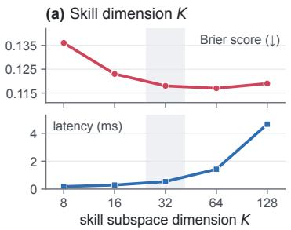

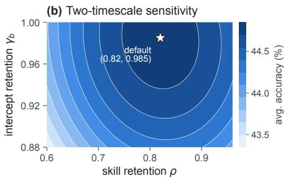

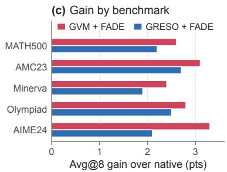  
Figure 5: Hyperparameter sensitivity and per-benchmark breakdown. (a) Calibration Brier score and per-step CPU latency across skill subspace dimension K. (b) Five-benchmark GVM+FADE accuracy across the fast skill retention $\rho$ and slow intercept retention $\gamma _ { b } .$ . (c) Per-benchmark accuracy gain over native GVM and GRESO on Qwen2.5-Math-1.5B.

When does FADE reduce to simpler estimators? If $K { = } 0$ , FADE reduces to an independent perprompt Pólya–Gamma filter on $b _ { i }$ , which is the logistic state-space counterpart of per-item dynamicspredictive tracking in DPS (Mao et al., 2026a). If $\gamma _ { b } { = } 0$ and $b _ { i } { \equiv } 0 .$ , FADE reduces to a contextual linear bandit in the embedding space, which captures coarse topic competence similar to zero-shot prompt predictors (Qu et al., 2026) but cannot distinguish easy from hard problems within the same topic (as seen in the $b _ { i } { \equiv } 0$ row of Table 3). Both components are needed to jointly minimize Brier calibration error and maximize Spearman rank correlation, providing a reliable signal for downstream group-prioritized training (Mao et al., 2026b) and rollout budget allocation (Zou et al., 2026).