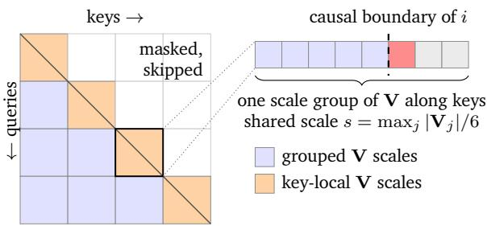
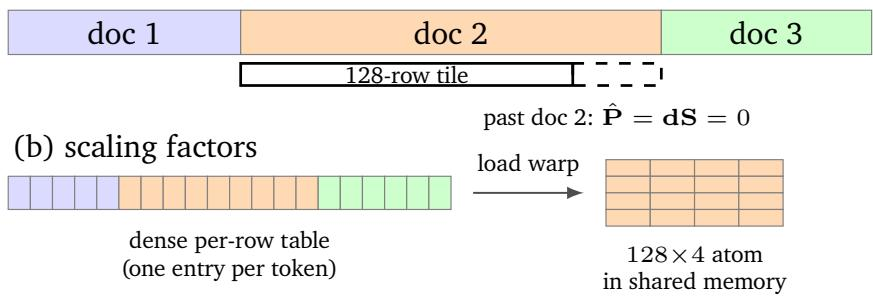

# FLAMIA: FLAsh MIcroscaling Attention for Fast and Causally Safe Training on Blackwell

Fedor Velikonivtsev, Mikhail Koltakov, Denis Kuznedelev

Yandex Research

## Abstract

Attention remains a substantial computational cost in Transformer training, particularly at long context lengths. NVIDIA Blackwell GPUs provide high-throughput low-precision matrix multiplication, but exploiting it in attention requires addressing quantization overhead, causal information leakage through shared scales, and numerical inconsistencies between the forward and backward passes. We present FLAMIA, a family of attention kernels for Blackwell with MXFP8 and mixed NVFP4/FP8 training paths. Our design combines token-block scaling that reuses quantized operands across matrix orientations, targeted safeguards against scale-induced leakage, and consistent forward and backward computations. Fused quantization and architecture-specific kernel optimizations reduce overhead, while document-local scaling and workload-aware scheduling support variable-length documents directly in packed layouts without repacking. Across various causal packed-document workloads, the MXFP8 path accelerates the combined forward and backward attention call, including quantization, by factors of 1.10–1.40× on B200 and 1.06–1.42× on B300 relative to the fastest evaluated baseline for each workload. We validate training stability and quality preservation on pretraining Llama-style models. These results show how jointly designing quantization, training numerics, and document scheduling translates low-bit hardware throughput into practical attention acceleration.

## 1. Introduction

Softmax attention [1] remains a substantial cost in Transformer training and inference, particularly at long context lengths. FlashAttention [2] reduces memory trafic through tiled computation and online softmax. FlashAttention-4 [3] further optimizes attention for NVIDIA Blackwell GPUs, but its BF16 implementation leaves higher low-precision throughput unexploited: Blackwell tensor cores support FP8 and FP4 matrix multiplication at twice and four times the BF16 rate, respectively [4]. Realizing these gains requires addressing quantization overhead and training numerics, while supporting the variable-length documents packed together during pretraining.

Recent 4-bit extensions of FlashAttention-4 [5, 6] motivate examining these requirements beyond single-step accuracy. Three constraints are central. First, hardware block scaling follows the contraction axis, whereas attention training uses operands along diferent contraction axes, potentially requiring separately quantized representations. Second, scales shared across positions can let future tokens afect earlier outputs despite a causal mask. Third, the backward pass must consistently reconstruct the forward’s quantized intermediates: mismatches in quantization, tiling, or exponential evaluation can destabilize training despite high single-step cosine similarity. Packed inputs additionally require document-local scaling and load balancing. Among the evaluated implementations, some provide only a forward path for packed inputs [7], use tensor-wide FP8 scaling [8], or lack causal-mask support [9].

We present FLAMIA (FLAsh MIcroscaling Attention), low-precision attention kernels for Blackwell with MXFP8 and mixed NVFP4/FP8 training paths. The mixed path uses NVFP4 for $\mathbf { Q } \mathbf { K } ^ { \top }$ and its recomputation, and 8-bit operands for the remaining matrix multiplications. Token-block scaling enables reuse of 8-bit representations across orientations. FLAMIA combines targeted leakage mitigations with consistent forward and backward computations and processes packed documents without repacking. Default scaling retains within-block dependencies and a sequence-wide backward accumulator dependency. Exact options remove them in supported batched causal calls. Our contributions are:

• Two training paths using token-block scaling to reduce quantized representation duplication across matrix orientations.

• An analysis of scale-induced leakage and forward–backward inconsistencies, with targeted mitigations and training experiments showing that single-step accuracy proves neither causal correctness nor training stability.

• Kernels combining fused quantization, coordinated softmax and matrix-multiplication scheduling, a low-precision two-CTA backward pass, and GPU-based scheduling for packed documents, plus two bit-level exponential approximations for inference.

• An evaluation against FlashAttention-4, cuDNN, FlashInfer, Low Precision FA4 [9], and the Hardware-Aware FP4 FlashAttention-4 (HW-FP4 FA4) of Hu [5]. Across all evaluated causal packed-document workloads, MXFP8 achieves the lowest combined forward and backward attention latency, including quantization: 1.10–1.40× speedups on B200 and 1.06–1.42× on B300 over the fastest evaluated baseline per workload. In 1B-model pretraining on 100B tokens, MXFP8 and mixed NVFP4/FP8 lead only to marginal increase of training loss and change of downstream metrics.

The code is available at https://github.com/yandex-research/flamia-blackwell-atten tion.

## 2. Background and Related Work

FlashAttention Let $\mathbf { Q } , \mathbf { K } , \mathbf { V } \in \mathbb { R } ^ { L \times d }$ be the query, key, and value tensors corresponding to a single head, with sequence length L and head dimension d. The attention output is computed as follows:

$$
\begin{array} { r l } & { \mathbf { S } = \mathbf { Q } \mathbf { K } ^ { \top } / \sqrt { d } \in \mathbb { R } ^ { L \times L } , } \\ & { \mathbf { P } = \mathrm { s o f t m a x } ( \mathbf { S } ) \in \mathbb { R } ^ { L \times L } , } \\ & { \mathbf { O } = \mathbf { P } \mathbf { V } \in \mathbb { R } ^ { L \times d } . } \end{array}
$$

The backward pass recomputes P and forms

$$
\begin{array} { r l } & { \mathbf { d } \mathbf { V } = \mathbf { P } ^ { \top } \mathbf { d } \mathbf { O } , \mathbf { d } \mathbf { P } = \mathbf { d } \mathbf { O } \mathbf { V } ^ { \top } , \mathbf { d } \mathbf { S } = \mathbf { P } \circ ( \mathbf { d } \mathbf { P } - D ) , } \\ & { \mathbf { d } \mathbf { Q } = \mathbf { d } \mathbf { S } \mathbf { K } , \mathbf { d } \mathbf { K } = \mathbf { d } \mathbf { S } ^ { \top } \mathbf { Q } , } \end{array}
$$

with the row sums $\begin{array} { r } { D _ { i } = \sum _ { j } P _ { i j } d P _ { i j } } \end{array}$ , so every operand takes part in two products, contracted along diferent axes. A naive implementation materializes P and S in global device memory, resulting in a large memory footprint and substantial I/O trafic. FlashAttention [2] combines tiled computation with online softmax to keep intermediate tiles in fast on-chip memory. FlashAttention-2 [10] reduces non-matmul operations and improves work partitioning, while

FlashAttention-3 [11] and FlashAttention-4 [3] introduce optimizations tailored to NVIDIA Hopper and Blackwell GPUs, respectively. In our work, we focus on further improving attention performance on Blackwell, using BF16 FlashAttention-4 as a starting point.

Microscaling floating-point formats Microscaling formats [12] employ fine-grained quantization in which the elements of a block share a common scaling factor: each element is stored as a low-bit code, and its value is the code times the block’s scaling factor. We call a scaling factor a scale for short. NVIDIA Blackwell provides native hardware support for these formats [4]. MXFP formats (MXFP4, MXFP6, and MXFP8) use blocks of 32 elements with UE8M0 scaling factors, whereas NVFP4 uses blocks of 16 elements with E4M3 scaling factors and an additional FP32 tensor-level scaling factor [13]. Blackwell’s block-scaled matrix multiply (MMA) takes such operands directly and applies their scales as it accumulates. Throughout the paper, we write Xˆ for the quantized form of a tensor X: its low-bit codes, 8-bit E4M3 or 4-bit E2M1, together with one scaling factor per block of codes. These formats have been applied to post-training quantization in FP-Quant [14] and to low-precision training [13, 15–18]. These training methods primarily target GEMMs in linear layers. Full-Stack FP4 [19] also explores mixed-precision attention.

Low-precision attention The SageAttention series [20–23] accelerates self-attention by quantizing matmul operands and mitigating quantization error to preserve model quality. SageAttention3 [23] targets microscaling FP4 for inference and separately explores 8-bit forward and backward passes for training. More recent work includes trainable INT8 attention in SageBwd [24], a mixed FP4/FP8 training path in HW-FP4 FA4 [5], and MXFP8 forward and backward kernels in Low Precision FA4 [9]. Attn-QAT [25] emphasizes matching backward score recomputation to the quantized forward pass and correcting precision assumptions in the gradient calculation. Complementarily, Qiu and Yao [26] analyze train ing instability caused by biased rounding errors and low-rank attention representations. In our work, we develop an optimized implementation of low-precision attention aimed at improving hardware utilization while addressing the numerical consistency and causal correctness issues discussed in the following section.

## 3. Hardware-Aware Design Around Low-Bit Attention Constraints

Blackwell tensor cores provide higher peak throughput for FP8 and FP4 than for BF16. Exploiting this throughput in attention requires coordinating three aspects of the design: scaling layouts compatible with the hardware, control of scale-induced dependencies across token positions, and numerical consistency between the forward and backward passes. We first describe these constraints and the resulting MXFP8 and mixed NVFP4/FP8 training paths, then present the kernel optimizations, packed-document support, and inference-only approximation

## 3.1 Token-Block Scaling

Block-scaled matrix multiply–accumulate (MMA) instructions require scaling groups along each operand’s contraction axis. The 4-bit instructions used here also require K-major layouts. Attention training complicates this requirement because each of its six logical operands participates in two products with diferent contraction axes. Q and K are contracted along the head dimension in S, but along queries and keys in dK and dQ, respectively. V and dO are contracted along the head dimension in dP, but along keys and queries in PV and dV. Likewise, P is contracted along keys in PV and queries in dV, while dS is contracted along keys in dQ and queries in dK. Conventional one-dimensional block scaling therefore generally requires two quantized representations per operand, one per contraction axis. Each representation requires writing its codes and scales, and each separate quantization pass rereads the source tensor. Representations of Q, K, and V needed for backward computation must remain in memory after the forward pass. Because quantization is memory-bound, this duplication across six operands can consume a substantial fraction of attention training time.

We reduce this overhead through selective NVFP4 computation and reusable E4M3 representations. In the mixed NVFP4/FP8 path, Q and K use NVFP4 with one scale per 16 consecutive head-dimension elements of each token. The same representations serve forward score computation and backward score recomputation, which share a contraction axis. The remaining products use E4M3 operands, including separate representations of $\mathbf { Q }$ and K for gradient computation. Our token-block scaling shares one power-of-two exponent across 32 consecutive tokens and the full head dimension. dS instead shares one exponent per $3 2 \times 3 2$ block, as Section 3.3 discusses. Repeating these exponents across hardware scaling groups yields MXFP8-compatible representations. The common exponent within each $3 2 \times d$ token block preserves the validity of its codes and scales under transposition. Square dS blocks give the same property for contractions along queries and along keys. Since 8-bit MMA supports both K-major and transposed (MN-major) layouts, each E4M3 payload serves both orientations without a separately quantized transposed copy.

## 3.2 Causally Safe Scales

Causal masking alone does not prevent information leakage through data-dependent quantization scales. If a future token increases the maximum of a shared scale group, the resulting scale change can alter the reconstructed values of earlier tokens. An earlier output can then depend on a masked future input through the quantizer.

Figure 1 shows where this happens. FlashAttention computes S in tiles of $B _ { r }$ queries by $B _ { c }$ keys, with $B _ { r } = B _ { c } = 1 2 8$ in our kernels. Under a causal mask, the boundary between visible and masked keys runs through the diagonal tiles (left panel). In PV the contraction runs over keys, so a scale group of V spans several keys. Inside a diagonal tile, such a group can hold keys on both sides of a query’s boundary (right panel). With a 4-bit V, a larger group scale changes the codes of the visible keys.

With an 8-bit V, the same rescale is usually harmless. When the group scale doubles, each code keeps its mantissa and only its exponent drops by one, so the value it represents stays the same. This fails in two cases: an element that drops below the normal range of E4M3 loses mantissa bits, and an element that was clamped at the largest code is no longer clamped. The second case occurs in the reference microscaling conversion of Darvish Rouhani et al. [12]. It sets the shared exponent to $\left\lfloor \log _ { 2 } \operatorname* { m a x } _ { i } \left. v _ { i } \right. \right\rfloor - e _ { \mathrm { m a x } } ,$ so the scaled group maximum can exceed 448, the largest E4M3 value, and is clamped. A later key that raises the maximum doubles the scale, the earlier element is no longer clamped, and its code changes. Whole-tensor statistics, such as a per-tensor maximum, are the extreme case: through them, a later token can change every earlier output.

Our scaling removes these leaks or confines them to one block. No operand scale covers more than 32 consecutive positions: token blocks share one exponent across 32 tokens, and $\mathbf { Q }$ and K use per-token NVFP4 scales, which cannot leak at all. A later token can therefore change earlier results only inside its own block of 32, through elements near the bottom of the normal range. We also round each scale’s exponent up, so the scaled maximum never exceeds the largest code and no element is clamped.

  
Figure 1 | Left: under a causal mask, the boundary between visible and masked keys runs through the diagonal tiles. Right: the keys that query i reads in the marked tile. A scale group of V spans keys on both sides of the boundary, so the future key (red) can raise the group maximum, grow the shared scale s and re-round the codes of the past keys. On diagonal tiles we give each key its own scale and keep the cheaper grouped scales elsewhere.

When V is 4-bit, we give it a per-key power-of-two scale and fold this scale into Pˆ . A per-key scale depends on a single key and cannot leak. Only diagonal tiles contain a group that straddles the causal boundary, so we use per-key scales on diagonal tiles and keep the cheaper grouped scales elsewhere. The backward has two more leaks on the key side: V in dP, and K in $\mathbf { d Q } = \mathbf { d S K }$ . We close both the same way, by folding a per-key power-of-two scale into the other operand. We call the version for K the K fold. Appendix A describes the small residue that remains inside a block and the exact options that, together with the causal dQ scale below, remove it.

The backward has one more leak, through the FP16 dQ accumulator. As Section 3.5.3 explains, we reduce the dQ partials in FP16, whose five exponent bits leave little range, so we multiply the partials by a power of two that keeps them in range. By default this factor is sized from maxima over the whole sequence, so a later token can change how every earlier row of dQ rounds. We therefore also provide a causal dQ scale, which sizes the factor of each query row only from the keys that the row can see.

Validation loss measured through the training kernel alone is insuficient to detect leakage. In our controlled experiments, a model trained with a leaking kernel obtains lower loss when evaluated through that kernel but performs worse under exact causal attention. We therefore compare both evaluation modes in the leakage experiments of Section 4.5.

## 3.3 Forward–Backward Numerical Consistency

FlashAttention recomputes attention probabilities during the backward pass from Q, K, and saved row statistics rather than storing the full probability matrix. It also computes $D _ { i } = \mathbf { d O } _ { i } \cdot \mathbf { O } _ { i }$ from the saved output. In exact arithmetic, this equals $\textstyle \sum _ { j } P _ { i j } d P _ { i j }$ when O = PV and $\mathbf { d P } = \mathbf { d O V } ^ { \top }$ . Since the rows of P sum to one, each row of the softmax gradient $\mathbf { d S } = \mathbf { P } \circ ( \mathbf { d P } - D )$ then sums to zero. Quantization can introduce additional inconsistency if these computations use diferent reconstructed operands. Matching those operands removes one discrepancy but does not by itself restore the exact identities: quantized probabilities need not sum to one, and output rounding and accumulation introduce further error.

We therefore align the representations and numerical conventions used by the two passes. Score recomputation uses the same quantized Q and K representations as the forward pass for the selected precision path. The backward pass also reproduces the relevant tiling and diagonal decisions, exponential evaluation, and scaling relative to the row maximum. We compute D using the same quantized dO used in dP, with an output formed from the corresponding E4M3 value representation. These choices reduce representation-induced discrepancies without eliminating ordinary rounding or normalization error.

Our experiments show that mismatched tiling or exponential evaluation can destabilize training even when single-step gradient similarity remains high. Such mismatches can introduce structured errors whose efects accumulate across training steps, as Barron et al. [27] also find when the forward and backward passes evaluate a softmax diferently. A singlestep comparison therefore cannot establish training stability. Building on the quantization consistency emphasized by Attn-QAT [25], we also examine these sources of mismatch in Section 4.5.

Before computing dQ and dK, we quantize dS to E4M3. Its entries span a wide dynamic range, with many substantially smaller than nearby maxima. An excessively large scale increases the fraction of small entries rounded to zero, even when their contribution to the norm error is small. In our ablations, this fraction tracks training degradation more closely than the reported norm error, and the scale choice has the largest efect on loss among the numerical choices examined. We therefore derive a scale from the maximum absolute value in each 32 × 32 block, using the tile already held by the kernel. The square scaling regions permit reuse of one quantized payload in both dQ, which contracts over keys, and dK, which contracts over queries. Appendix A describes the FP16 dQ accumulator and rounding choices.

## 3.4 MXFP8 and Mixed NVFP4/FP8 Paths

Although our library supports an all-4-bit training path, it is not the default: in our evaluation, it is slower than paths retaining most operands in 8 bits and reaches a slightly higher loss. The 4-bit MMA instructions used here have no MN-major form, and each orientation needs its own copy. The six quantized copies make quantization the largest part of this path’s backward time. A 4-bit V adds two costs. Its key-axis scale groups require per-key scaling on diagonal tiles (Section 3.2), increasing work in the forward pass. Moreover, PV and dP contract V along diferent axes, requiring separate 4-bit representations, while the computation of D must remain consistent with the representation used in dP. One E4M3 token-block representation can serve both products. Finally, the evaluated backward products are not tensor-core-bound, limiting the benefit of narrower operands. Section 4.3 quantifies these costs.

Our default paths use MXFP8 or NVFP4 for score computation and recomputation. The mixed NVFP4/FP8 path quantizes Q and K with one NVFP4 scale per 16 head-dimension elements of each token. The MXFP8 path uses E4M3 with token-block scales. Both paths use E4M3 token-block representations of V, dO, and the Q and K operands of the gradient products, E4M3 dS with one scale per 32 × 32 block, and E4M3 probability operands. Returned outputs and gradients are BF16, while dQ partials are accumulated in FP16. We describe the scaling of Pˆ and the kernels below.

Where enabled, a normalized Hadamard transform, as in the incoherence processing of QuIP [28] and QuIP# [29], mixes the head channels of both Q and K before quantization. The shared orthogonal transform preserves their dot product in exact arithmetic while spreading channel outliers. Rounding and quantization can still change the resulting scores. It is enabled by default at head dimension 128 on the two default paths. Appendix A reports its efects and remaining format choices.

For fixed-scale E4M3 probability quantization, a multiplier 2c reduces underflow. Conditional rescaling retains the online-softmax row maximum until the new maximum exceeds it by τ. In the base-2 representation, the unnormalized weights relative to the retained maximum can reach 2τ, or $2 ^ { c + \tau }$ after scaling. Since the largest finite E4M3 value is 448, we enforce $c + \tau \leq \log _ { 2 }$ 448. Violating this bound can saturate the weights and corrupt the output without a NaN or runtime error. Appendix B gives the parameters and probabilityquantization details.

## 3.5 Kernel Design

Our kernels extend the warp-specialized FlashAttention-4 design of Zadouri et al. [3]. A load warp, an MMA warp, two softmax warpgroups, correction warps, and an epilogue warp exchange $\mathbf { S } , { \hat { \mathbf { P } } } ,$ , and O through tensor memory (TMEM). Section 4.3 evaluates these modifications.

## 3.5.1 Quantization and Token-Block Scales

Each attention invocation quantizes its current operands. For each input tensor, we fuse the required Hadamard rotation, block statistics, and generation of codes and scales for all required representations into one launch. The dO launch additionally computes D and initializes the dQ accumulator. Fusion avoids input rereads during quantization preprocessing. Outputs and returned gradients remain in BF16 and require no output quantization scales, while dS scales are computed within the attention kernel. The required scales are therefore derived from current tensors without a separate output-calibration pass.

Token-block scales are constant along the head dimension and factor algebraically out of the score dot product. Writing $q Q , q K$ for stored codes and $e _ { Q } , e _ { K }$ for their shared exponents, the reconstructed score is $\begin{array} { r } { \widetilde { S } _ { i j } = 2 ^ { e _ { Q } ( i ) + e _ { K } ( j ) } \sum _ { k } q _ { Q , i k } q _ { K , j k } / \sqrt { d } . } \end{array}$ The MXFP8 path therefore uses an unscaled E4M3 MMA, folds the row factor into the softmax scale, and applies the column factors separately. This preserves the scaling algebraically. Bitwise equality also depends on range and accumulation order.

## 3.5.2 Softmax Throughput and MMA Scheduling

Exponential evaluation is a major throughput bottleneck in the evaluated forward kernels. $\mathrm { ~ A ~ } 1 2 8 \times 1 2 8$ tile requires 16384 exponentials, corresponding to 1024 cycles at B200’s MUFU throughput, so faster low-bit MMAs alone do not remove this bottleneck. We address it in three ways. First, as in FA4, FlashInfer, and Low Precision FA4, we evaluate a fraction of the exponentials using a clamped polynomial on the FMA pipeline, selecting the fraction per path and GPU. B300 doubles the exponential throughput of B200. There, polynomial emulation becomes overhead in the pure-E4M3 configuration, and we disable it. Second, the NVFP4 path quantizes probability operands in the log domain. Since max $_ j \ 2 ^ { x _ { j } } = 2 ^ { \operatorname* { m a x } _ { j } x _ { j } }$ we compute each 32-key group’s maximum before exponentiation and subtract its scaling exponent from the exponential argument. This eliminates a per-entry division and a subsequent scaling pass, producing the largest individual NVFP4 forward improvement in Section 4.3. Third, on B300, tcgen05.ld.red combines the row-maximum reduction with the TMEM score load. We use it on tiles known to be fully unmasked, including of-diagonal tiles in causal calls.

We overlap the remaining work with matrix multiplication. The MMA warp splits the next tile’s $\mathbf { Q } \mathbf { K } ^ { \top }$ into two 64-key operations, issued before and after the current tile’s $\hat { \mathbf { P } } \mathbf { V } ,$ respectively. This keeps the tensor cores active while the softmax warps process the current tile. In the backward pass, a checkerboard assignment distributes emulated exponentials so that warps sharing an SM sub-partition use diferent execution pipelines.

## 3.5.3 Low-Bit 2-CTA Backward

FlashAttention-4’s two-CTA backward mode uses a cluster of two cooperative thread arrays (CTAs) to share MMA operands and cover 256 keys over a query range. The evaluated FA4 implementation provides this mode in BF16. In its accumulator configuration, all 512 TMEM columns are occupied when dP is issued, leaving no capacity for additional block-scale operands. Token-block scaling permits the compute warps to apply these factors outside the MMA, enabling a low-precision implementation without TMEM scale storage for dP.

Our implementation supports MHA and GQA on batched and packed inputs. On packed inputs, paired key tiles may belong to diferent documents, and each CTA masks positions outside its document. As in Shankar et al. [9], FP16 dQ partials are written through bulk reduce-add, halving reduction trafic relative to FP32. FP16’s five exponent bits limit its range: in our tests, the fixed scaling factor used by Low Precision FA4 overflowed for outlier K channels. We instead use a data-dependent power-of-two prescale, with the dependency qualifications in Section 3.2. An empirical rule per shape and format selects the two-CTA mode.

## 3.6 Packed-Document Attention

## 3.6.1 Packed Layout

Pretraining packs documents contiguously into rows of T tokens. Low-precision attention on these rows faces two challenges. First, shared scales can couple otherwise independent documents: a document with large activations can coarsen the representation of others sharing its scale. Second, document starts need not align with the fixed 128 × 4 scale-factor atoms consumed by the block-scaled MMA. The evaluated cuDNN FP8 path uses tensorwide scales, while its MXFP8 path requires a scale layout padded per document. Padding documents to aligned starts resolves alignment but copies Q, K, V, and gradients in each layer.

Our quantizers process Q, K, V, and dO directly in the packed layout, keeping operand token blocks and their statistics within document boundaries. They write dense scale metadata with one entry per token. This operand-local construction does not remove the default accumulator-scale dependency discussed in Section 3.2. Tile boundaries depend on document lengths and ofsets (Figure 2a), so the load warp assembles each tile’s 128 × 4 scale-factor atom in shared memory from the per-token tables (panel b). On the all-4-bit path, two keys share a byte. For odd document ofsets we keep a second copy of V⊤ shifted by one key, which Appendix B describes.

Keys outside the active document are masked, and invalid query rows receive an infinite log-sum-exp sentinel so that their probability and gradient contributions vanish. Epilogues write outputs and gradients directly to the packed bufers. The layout preserves the intended per-document computation. Bitwise equality of gradients also depends on accumulation order, because the default dQ reduction uses atomics. Bufer capacities depend on T, allowing diferent document-length distributions to reuse storage and the same captured CUDA graph.

## 3.6.2 Load-Balanced Scheduling

Variable document lengths produce substantial diferences in tile cost. In the evaluated FA4 schedule, tiles are ordered longest-first within each sequence, but sequences are visited in input order. A long document near the end can therefore delay completion. The evaluated

(a) one packed row of $T$ tokens  
  
Figure 2 | Documents packed contiguously. (a) A 128-row tile may start inside a document. (b) The load warp assembles the tile’s scale-factor atom in shared memory from dense per-token tables.

FlashInfer path instead constructs a load-balancing plan on the CPU and transfers it to the GPU for each new workload.

We construct the schedule on the GPU once per microbatch without host synchronization. Each work item contains 256 consecutive queries from one document, corresponding to a CTA’s two 128-query tiles. Its estimated cost is the number of key blocks attended to, determined by document length and, for causal attention, query position. Items across the row are sorted by decreasing cost. A persistent grid assigns them to CTAs in alternating directions, distributing long and short items across the grid. Highly skewed workloads can leave CTAs idle under static assignment. Causal calls and non-causal calls whose longest document is at least four times the mean therefore use Cluster Launch Control (CLC) to acquire items dynamically, as FA4 does for causal calls. Requests follow the current item’s final K and V loads, avoiding premature work reservation.

In the backward pass, each CTA processes a key tile across query tiles. We similarly order key tiles by decreasing estimated work and group heads into sections for L2 locality, as FA4’s batched schedule does. Appendix B describes list construction and the backward launch layout.

## 3.7 Bit-Level Exponentials for Inference

Since the exponential limits the forward, we also ofer two cheaper approximations of it for inference. Both build $2 ^ { x }$ directly in the bits of a float. The bit pattern of a positive float, read as an integer, grows almost linearly with $\log _ { 2 }$ of its value. Writing x in fixed point into the exponent field therefore gives the piecewise-linear approximation of Mitchell [30], $2 ^ { x } \approx 2 ^ { \lfloor x \rfloor } ( 1 + \{ x \} )$

A 4-bit $\hat { \mathbf { P } }$ tolerates an inexact exponential. E2M1 has only eight magnitudes, at least 33 % apart, while Mitchell’s approximation is of by a few percent, so the approximate $2 ^ { x }$ almost always falls into the same rounding interval as the exact value and gives the same code. Our Mitchell-P quantizer therefore computes $2 ^ { x }$ with ordinary arithmetic instructions instead of the hardware exponential unit (MUFU) that limits the forward. A fused multiply-add writes x in fixed point into the bits of a float, an integer shift moves these bits into the exponent and mantissa, and a hardware convert rounds the resulting approximation of $2 ^ { x }$ to E2M1. A constant ofset of $x$ centres the approximation error, and an integer clamp keeps the result valid for any score range. Like the Direct-P quantizer of HW-FP4 FA4 [5], it maps scores to codes without an exact exponential, but where Direct-P fits an afine classifier, Mitchell-P reproduces almost every code of exact rounding. The EFQ-Softmax of Han et al. [31] also produces codes without computing an exponential.

An 8-bit $\hat { \mathbf { P } }$ needs a more accurate value. Neighbouring E4M3 values lie only 7–12.5 % apart, close to the error of the approximation, so the error would change many codes and shift Pˆ instead of vanishing in the rounding. For this format we use the variant of Schraudolph [32], which computes the same $2 ^ { \lfloor x \rfloor } ( 1 + \{ x \} )$ in BF16 and ofsets x so that the error averages zero. A fused multiply-add adds to $2 ^ { 7 } { : }$ x a constant that fixes the FP32 exponent and adds the BF16 exponent bias. The low 16 bits then hold the BF16 pattern of the approximation, with the integer part of x in its exponent and 7 fraction bits in its mantissa, and a 16-bit shift turns them into an FP32 value. We use it for five of every eight exponential pairs and keep the rest exact on MUFU.

We use neither approximation in training. As Section 3.3 explains, the backward must rebuild the forward’s $\hat { \mathbf { P } }$ exactly, and a backward with the same approximation lost more time than the forward gained. Section 4.4 measures both approximations, and Appendix C derives them.

## 4. Experiments

We evaluate latency, accuracy, optimizations, inference approximations, and training behavior, benchmarking kernels on B200 and B300. Baselines include BF16 and FP8 FlashAttention-4 [3]; cuDNN BF16, FP8, and MXFP8 attention [8]; FlashInfer [7]; Low Precision FA4 [9]; HW-FP4 FA4 [5], with its Direct-P forward and its causal path; and PyTorch SDPA on nested tensors. FlashInfer configurations include FP8 CUTLASS and CuTe-DSL backends and NVFP4 KV-cache prefill. Baselines use their supported ragged APIs. Low Precision FA4 lacks causal masking, and neither it nor the evaluated nested-tensor SDPA path supports GQA. cuDNN MXFP8, FA4 FP8, FlashInfer, and HW-FP4 FA4 lack a supported packed-document backward path in this evaluation and appear only in forward comparisons. cuDNN MXFP8 and Low Precision FA4 use 1 × 32 scaling blocks; Low Precision FA4 retains both orientations. Appendix D specifies hardware, software, and timing.

Table 1 | Training call on packed documents (forward and backward, quantization included), causal, 16 heads, d = 128: time in ms (fastest in bold), TFLOP/s in small type; Speedup: the fastest baseline’s time over ours.
<table><tr><td rowspan=1 colspan=8>Ours              cuDNN FA4    cuDNNSDPAGPU Documents       MXFP8  NVFP4  FP8     BF16  BF16   BF16  Speedup</td></tr><tr><td rowspan=1 colspan=8>B2004×4096           0.8910790.9210491.06912 1.088891.28 7516.301531.18×</td></tr><tr><td rowspan=1 colspan=6>16×4096         3.5310903.6410583.90986 4.249074.88790 1</td><td rowspan=1 colspan=2>3.4288 1.10×</td></tr><tr><td rowspan=1 colspan=6>16×1024         0.44542 0.49 492 0.53 456 0.504780.5544</td><td rowspan=1 colspan=2>05.94411.14×</td></tr><tr><td rowspan=1 colspan=3>64×1024         1.66579 1.82 530</td><td rowspan=1 colspan=2>1.85 521 2.00 482</td><td rowspan=1 colspan=1>2.25 427</td><td rowspan=1 colspan=2>5.79166 1.11×</td></tr><tr><td rowspan=2 colspan=2>8192+32×256   0.9110958192+224×256  1.80650</td><td rowspan=1 colspan=1>0.941059</td><td rowspan=1 colspan=2>1.25 793 1.10 898</td><td rowspan=1 colspan=1>1.55 639</td><td rowspan=1 colspan=1>5.36 185</td><td rowspan=1 colspan=1>1.22×</td></tr><tr><td rowspan=1 colspan=1>1.99 589</td><td rowspan=1 colspan=1>3.03387</td><td rowspan=1 colspan=1>2.52 466</td><td rowspan=1 colspan=1>6.71 175</td><td rowspan=1 colspan=1>7.62154</td><td rowspan=1 colspan=1>1.40×</td></tr><tr><td rowspan=1 colspan=2>log-unif. 16k      0.71885</td><td rowspan=1 colspan=1>0.75 838</td><td rowspan=1 colspan=1>0.89706</td><td rowspan=1 colspan=1>0.85 738</td><td rowspan=1 colspan=1>1.00 631</td><td rowspan=1 colspan=1>6.31 10</td><td rowspan=1 colspan=1>01.20×</td></tr><tr><td rowspan=1 colspan=2>log-unif. 16k, GQA0.71881</td><td rowspan=1 colspan=1>0.73 860</td><td rowspan=1 colspan=1>0.99637</td><td rowspan=1 colspan=1>0.85 740 1</td><td rowspan=1 colspan=1>.02 618 n</td><td rowspan=1 colspan=1>o GQA</td><td rowspan=1 colspan=1>1.19×</td></tr><tr><td rowspan=1 colspan=2>log-unif. 64k      3.611061</td><td rowspan=1 colspan=1>3.701034</td><td rowspan=1 colspan=2>4.15 922 4.32886</td><td rowspan=1 colspan=1>5.12748</td><td rowspan=1 colspan=1>13.8277</td><td rowspan=1 colspan=1>1.15×</td></tr><tr><td rowspan=1 colspan=2>B3004×4096           0.791220</td><td rowspan=1 colspan=1>0.841141</td><td rowspan=1 colspan=2>0.9010650.99968</td><td rowspan=1 colspan=1>1.15840</td><td rowspan=1 colspan=1>8.8799</td><td rowspan=1 colspan=1>1.14×</td></tr><tr><td rowspan=1 colspan=2>16×4096         3.171212</td><td rowspan=1 colspan=1>3.281175</td><td rowspan=1 colspan=1>3.351147</td><td rowspan=1 colspan=1>3.999654.45</td><td rowspan=1 colspan=1>8651</td><td rowspan=1 colspan=1>3.4289</td><td rowspan=1 colspan=1>1.06×</td></tr><tr><td rowspan=1 colspan=2>16×1024         0.41 588</td><td rowspan=1 colspan=1>0.45 532</td><td rowspan=1 colspan=1>0.48 507</td><td rowspan=1 colspan=1>0.47 518</td><td rowspan=1 colspan=1>0.51 469</td><td rowspan=1 colspan=1>9.41 26</td><td rowspan=1 colspan=1>1.14×</td></tr><tr><td rowspan=1 colspan=2>64×1024         1.52635</td><td rowspan=1 colspan=1>1.68 573</td><td rowspan=1 colspan=1>1.67578</td><td rowspan=1 colspan=1>1.83 527</td><td rowspan=1 colspan=1>2.08 462</td><td rowspan=1 colspan=1>8.62112</td><td rowspan=1 colspan=1>1.10×</td></tr><tr><td rowspan=1 colspan=2>8192+32×256   0.821210</td><td rowspan=1 colspan=1>0.871146</td><td rowspan=1 colspan=1>1.07926</td><td rowspan=1 colspan=1>1.04954</td><td rowspan=1 colspan=1>1.41703</td><td rowspan=1 colspan=1>8.04114</td><td rowspan=1 colspan=1>1.27×</td></tr><tr><td rowspan=1 colspan=1>8192+224×256</td><td rowspan=1 colspan=1>1.67705</td><td rowspan=1 colspan=1>1.84636</td><td rowspan=1 colspan=1>2.81 418</td><td rowspan=1 colspan=1>2.37495</td><td rowspan=1 colspan=1>6.47181</td><td rowspan=1 colspan=1>9.45124</td><td rowspan=1 colspan=1>1.42×</td></tr><tr><td rowspan=1 colspan=1>log-unif. 16k</td><td rowspan=1 colspan=1>0.64985</td><td rowspan=1 colspan=1>0.69911</td><td rowspan=1 colspan=1>0.77 814</td><td rowspan=1 colspan=1>0.78</td><td rowspan=1 colspan=1>8100.91</td><td rowspan=1 colspan=1>6968.6273</td><td rowspan=1 colspan=1>1.21×</td></tr><tr><td rowspan=1 colspan=1>log-unif. 16k, GQA</td><td rowspan=1 colspan=1>0.67943</td><td rowspan=1 colspan=1>0.68 925</td><td rowspan=1 colspan=1>0.87728</td><td rowspan=1 colspan=1>0.78 810 0</td><td rowspan=1 colspan=1>.93 680 n</td><td rowspan=1 colspan=1>o GQA</td><td rowspan=1 colspan=1>1.16×</td></tr><tr><td rowspan=1 colspan=2>log-unif. 64k      3.2311863</td><td rowspan=1 colspan=1>.3511443</td><td rowspan=1 colspan=1>.601063</td><td rowspan=1 colspan=1>4.11 932</td><td rowspan=1 colspan=1>4.70816</td><td rowspan=1 colspan=1>14.2264</td><td rowspan=1 colspan=1>1.11×</td></tr></table>

Table 2 | Forward kernel on packed documents, causal, 16 heads, d = 128: time in ms (fastest in bold), TFLOP/s in small type; Speedup: the fastest baseline’s time over ours on B200 GPU. cuDNN MX: cuDNN MXFP8; FlashInfer: its fastest backend.
<table><tr><td></td><td></td><td colspan="2">Ours</td><td colspan="3">8-bit</td><td>4-bit BF16</td><td></td><td></td><td></td><td></td><td></td><td></td></tr><tr><td>GPU</td><td>Documents</td><td>MXFP8 NVFP4</td><td></td><td>cuDNN FP8</td><td>cuDNN MX</td><td>FA4 FP8</td><td>Flash Flash Infer</td><td>Infer</td><td>FA4</td><td>cuDNN</td><td>Flash Infer</td><td></td><td>SDPA Speedup</td></tr><tr><td></td><td></td><td>0.17</td><td>0.21</td><td>0.24</td><td>0.40</td><td>0.27</td><td>0.25</td><td>0.24</td><td>0.24</td><td>0.42</td><td>0.28</td><td>1.99</td><td></td></tr><tr><td>B2004×4096</td><td></td><td>1616</td><td>1293</td><td>1137</td><td>682</td><td>1018</td><td>1104</td><td>1138</td><td>1153</td><td>658</td><td>993</td><td>138</td><td>1.40×</td></tr><tr><td></td><td>16×4096</td><td>0.70</td><td>0.82</td><td>0.75</td><td>1.50</td><td>1.06</td><td>0.91</td><td>0.85</td><td>0.98</td><td>1.50</td><td>1.15</td><td>3.96</td><td></td></tr><tr><td></td><td></td><td>1569 0.07</td><td>1340 0.07</td><td>1468</td><td>733</td><td>1038</td><td>1211</td><td>1300</td><td>1121</td><td>733</td><td>956</td><td>278</td><td>1.07×</td></tr><tr><td>16×1024</td><td></td><td>1011</td><td>916</td><td>0.11</td><td>0.26</td><td>0.12 593</td><td>0.15 455</td><td>0.10</td><td>0.10</td><td>0.22 308</td><td>0.16</td><td>1.92</td><td></td></tr><tr><td></td><td></td><td>0.24</td><td>0.27</td><td>621 0.34</td><td>264 1.15</td><td>0.45</td><td>0.53</td><td>715 0.34</td><td>652</td><td>0.411.05</td><td>433 0.61</td><td>36 2.06</td><td>1.41×</td></tr><tr><td>64×1024</td><td></td><td>1158</td><td>1035</td><td>804</td><td>240</td><td>612</td><td>515</td><td>811</td><td>665</td><td>262</td><td>448</td><td>134</td><td>1.42×</td></tr><tr><td></td><td></td><td>0.18</td><td>0.22</td><td>0.30</td><td>0.42</td><td>0.28</td><td>0.37</td><td>0.29</td><td>0.24</td><td>0.44</td><td>0.42</td><td>1.92</td><td></td></tr><tr><td></td><td>8192+32×256</td><td>1598</td><td>1279</td><td>957</td><td>667</td><td>1023</td><td>772</td><td>978</td><td>1172</td><td>644</td><td>681</td><td>147</td><td>1.37×</td></tr><tr><td></td><td></td><td>0.28</td><td>0.32</td><td>0.48</td><td>3.70</td><td>0.59</td><td>0.67</td><td>0.84</td><td>0.55</td><td>3.61</td><td>0.77</td><td>2.51</td><td></td></tr><tr><td></td><td>8192+224×256</td><td>1204</td><td>1045</td><td>698</td><td>91</td><td>564</td><td>500</td><td>397</td><td>613</td><td>93</td><td>438</td><td>134</td><td>1.72×</td></tr><tr><td></td><td></td><td>0.13</td><td>0.16</td><td>0.20</td><td>0.35</td><td>0.22</td><td>0.23</td><td>0.19</td><td>0.18</td><td>0.34</td><td>0.24</td><td>2.02</td><td></td></tr><tr><td>log-unif. 16k</td><td></td><td>1360</td><td>1112</td><td>890</td><td>509</td><td>831</td><td>799</td><td>969</td><td>977</td><td>537</td><td>736</td><td>89</td><td>1.39×</td></tr><tr><td></td><td></td><td>0.13</td><td>0.16</td><td>0.20</td><td>0.34</td><td>0.16</td><td>0.32</td><td>0.18</td><td>0.16</td><td>0.33</td><td>0.38</td><td></td><td></td></tr><tr><td></td><td>log-unif. 16k, GQA</td><td></td><td></td><td></td><td></td><td></td><td></td><td>976</td><td></td><td>546</td><td>469</td><td>no GQA</td><td>1.18×</td></tr><tr><td></td><td></td><td>1357</td><td>1111</td><td>886</td><td>526</td><td>1147</td><td>570</td><td></td><td>1095</td><td></td><td></td><td></td><td></td></tr><tr><td></td><td></td><td>0.73</td><td>0.86</td><td>0.82</td><td>1.68</td><td>1.10</td><td>1.01</td><td>0.91</td><td>1.03</td><td>1.65</td><td>1.22</td><td>4.15</td><td></td></tr><tr><td>log-unif. 64k</td><td></td><td>1505</td><td>1269</td><td>1341</td><td>650</td><td>995</td><td>1087</td><td>1204</td><td>1063</td><td>665</td><td>894</td><td>263</td><td>1.12×</td></tr></table>

Table 3 | B200. Backward kernels on packed documents, causal, 16 heads, d = 128: time in ms (fastest in bold), TFLOP/s in small type; Speedup: the fastest baseline’s time over ours.
<table><tr><td></td><td></td><td colspan="2">Ours</td><td>FP8</td><td colspan="3">BF16</td><td></td></tr><tr><td></td><td>GPU Documents</td><td>MXFP8</td><td>NVFP4</td><td>cuDNN</td><td>FA4</td><td>cuDNN</td><td>SDPA</td><td>Speedup</td></tr><tr><td></td><td>B200 4×4096</td><td>0.5213120.5113540.699930.739440.798672.562691.36×</td><td></td><td></td><td></td><td></td><td></td><td></td></tr><tr><td></td><td>16×4096</td><td>2.1412862.0813242.6510393.098903.318319.202991.27×</td><td></td><td></td><td></td><td></td><td></td><td></td></tr><tr><td></td><td>16×1024</td><td>0.23748 0.23755 0.30572 0.374670.325432.5667 1.32×</td><td></td><td></td><td></td><td></td><td></td><td></td></tr><tr><td></td><td>64×1024</td><td>0.887790.88785 1.07642 1.474681.245533.042261.22×</td><td></td><td></td><td></td><td></td><td></td><td></td></tr><tr><td></td><td>8192+32×256</td><td>0.5313330.5213770.83 851 0.759441.096512.88 2461.46×</td><td></td><td></td><td></td><td></td><td></td><td></td></tr><tr><td></td><td>8192+224×256</td><td></td><td></td><td></td><td></td><td></td><td>0.98852 0.97860 2.12395 1.964273.11 2694.921702.01×</td><td></td></tr><tr><td></td><td>log-unif. 16k</td><td></td><td></td><td></td><td></td><td></td><td>0.4110960.4011320.577900.577880.607492.481821.43×</td><td></td></tr><tr><td></td><td>log-unif. 16k, GQA 0.47 968 0.46 986 0.70 640 0.60 749 0.64708 no GQA</td><td></td><td></td><td></td><td></td><td></td><td></td><td>1.32×</td></tr><tr><td></td><td>log-unif. 64k</td><td></td><td></td><td></td><td></td><td></td><td>2.2112412.1312812.79980 3.14872 3.398089.482891.31×</td><td></td></tr></table>

## 4.1 Performance on Packed Documents

Each workload packs documents into one token row with 16 query heads and head dimension $d = 1 2 8$ . MHA uses 16 key/value heads; GQA 16/4 uses four. Equal-length workloads contain 4 × 4096, $1 6 \times 4 0 9 6$ , 16 × 1024, or 64 × 1024 tokens. Skewed workloads combine one 8192-token document with 32 or 224 documents of 256 tokens. Log-uniform workloads draw document lengths between 128 and 8192: 11 documents in 16k tokens, with and without GQA, and 29 documents in 64k tokens. We evaluate causal and non-causal attention; non-causal results appear in Appendix H.

Attention training-call timing includes forward, backward, and quantization on packed inputs. Kernel-only measurements exclude quantization and use 128-aligned document starts for FLAMIA. Their layout diference prevents isolating quantization overhead by subtraction. For cuDNN FP8, input-scale computation is timed, whereas output scales are calibrated beforehand on the same data. Speedup denotes the fastest supported baseline’s latency divided by FLAMIA’s latency for the same workload.

MXFP8 achieves the lowest measured attention training-call latency on all nine causal workloads on both GPUs (Table 1), with speedups of 1.10–1.40× on B200 and 1.06–1.42× on B300. On non-causal workloads, MXFP8 leads on all nine B200 cases (1.04–1.30×). B300 has five clear wins, two ties at displayed precision, and two small losses. Our non-causal backward leads on every workload, with speedups of 1.17–1.49× and 1.01–1.43× on B200 and B300, respectively; our forward leads on six and five of nine.

Kernel-only results show complementary strengths (Tables 2 and 3 and Appendix I). NVFP4 achieves the lowest causal backward latency on every workload, with speedups of 1.22–2.01× on B200 and 1.17–2.00× on B300. MXFP8 leads the forward comparisons on all nine B200 workloads and eight of nine B300 workloads, with ranges of 1.07–1.72× and 0.98–1.69×. The NVFP4 forward is slower than MXFP8, consistent with its additional softmax work outweighing savings in $\mathbf { Q } \mathbf { K } ^ { \top }$

B300/B200 training-call latency ratios are 0.85–0.93 for cuDNN FP8, 0.92–0.95 for FA4 BF16, and 0.89–0.94 for MXFP8. Relative advantages vary by workload rather than narrowing uniformly. The largest gains occur on 8192 + 224 × 256: B300 training-call and backward speedups reach 1.42× and 2.00×. On this workload, cuDNN FP8 takes approximately 1.68× our MXFP8 training-call latency on both GPUs, FA4 BF16 takes 1.40–1.42×, and cuDNN BF16 takes 3.7–3.9×. Equal-length workloads yield 1.06–1.18× speedups. Skew (maximum/mean document length) is not isolated from other shape diferences.

Multiplying one document’s activations by $1 0 ^ { 4 }$ gives a dK cosine of 0.99805 for the remaining documents with local scales, versus 0.99151 with tensor-wide scaling. At $T = 1 3 1 0 7 2$ measured peak memory per attention call is 2.7 GB for packed inputs versus 16.8 GB with bufers sized for aligned, padded documents. In full-model training of the 1B model on one B200, packed inputs achieve 84.6k and 96.8k tokens/s at packed row lengths of 16k and 64k, versus 68.8k and 84.3k for padding. The padded configuration exceeds available memory at 128k tokens.

## 4.2 Numerical Accuracy

Table 4 | Cosine to an FP32 reference on the same inputs, O / dQ, 4 × 4096 tokens, 16 heads, d = 128 (B200). no bwd: the system has no backward; no causal mask: the system supports only non-causal attention.
<table><tr><td>System</td><td>causal</td><td>non-causal</td></tr><tr><td>Ours, MXFP8 (token-block)</td><td>0.9988 / 0.9979</td><td>0.9985 / 0.9978</td></tr><tr><td>Ours, NVFP4</td><td>0.9920 / 0.9906</td><td>0.9899 / 0.9890</td></tr><tr><td>Ours, all-4-bit</td><td>0.9810 / 0.9456</td><td>0.9800 / 0.9509</td></tr><tr><td>cuDNN FP8</td><td>0.9985 / 0.9975</td><td>0.9982 / 0.9974</td></tr><tr><td>cuDNN MXFP8 (1×32)</td><td>0.9988 / 0.9978</td><td>0.9985 / 0.9978</td></tr><tr><td>LP-FA4(1×32)</td><td>no causal mask</td><td>0.9986 / 0.9978</td></tr><tr><td>FlashInfer NVFP4 KV cache</td><td>0.9909 / no bwd</td><td>0.9895 / no bwd</td></tr><tr><td>HW-FP4 FA4, Direct-P</td><td>no causal mask</td><td>0.9435 / no bwd</td></tr></table>

Table 4 compares output and gradient cosine similarity with an FP32 reference on the same BF16 inputs. The evaluated 8-bit configurations achieve output cosines of approximately 0.998–0.999 across tensor-wide, per-32-element, and token-block scaling. On non-causal inputs, mixed NVFP4/FP8 achieves 0.9899, compared with 0.9895 for FlashInfer’s NVFP4 KV-cache path and 0.9435 for the Direct-P forward of HW-FP4 FA4, which uses an MXFP4 PV. Diferent operands and scaling schemes confound bit-width comparisons. Within FLAMIA, all-4-bit O/dQ cosines are 0.9810/0.9456 for causal attention and 0.9800/0.9509 for non-causal attention, versus 0.9920/0.9906 and 0.9899/0.9890 for mixed NVFP4/FP8. These metrics do not show training stability.

## 4.3 Ablation Study

Ablations disable individual optimizations on B200 unless stated otherwise. Gains are not additive.

Fused quantization reduces preprocessing from 789 to 261 µs for MXFP8 and from 0.64 to 0.11 ms for NVFP4 at 4×4096 tokens. The reported kernel launch counts decrease from 17 to one and from 11 to one, respectively. FLAMIA requires no separate output-scale calibration pass because outputs and returned gradients remain BF16. cuDNN FP8 calibration costs depend on which scales are computed online; Appendix J compares three policies, including an additional forward/backward pass to obtain all scales.

A diagnostic forward with exponential evaluation removed reaches 2608 TFLOP/s. The associated 45 % estimate is diagnostic: removal changes overlap and invalidates attention, precluding direct runtime attribution. Log-domain probability quantization yields reported NVFP4 forward gains of 14–19 %; splitting $\mathbf { Q } \mathbf { K } ^ { \top }$ yields 4.7 %, and folding score scales yields 4 % for MXFP8. Without the polynomial clamp, output cosine on a trained-model activation capture falls to −0.012. On B300, disabling exponential emulation in the pure-E4M3 configuration yields 17–33 % gains; fused ld.red on fully unmasked tiles yields 18–20 % for the causal NVFP4 forward.

The mixed NVFP4/FP8 backward reaches a geometric-mean throughput of 1329 TFLOP/s, compared with 571 for all-4-bit and 1015 for BF16. Quantizing six copies accounts for 45– 52 % of the all-4-bit backward time; its validation loss is 0.012 above BF16 in the reported training experiment. FP16 dQ partials with data-dependent scaling yield a reported 23.8 % backward gain. Without them, bulk reduce-add bandwidth near 6 TB/s would limit the one-CTA backward to approximately 1990 TFLOP/s. Checkerboard exponential assignment yields 6–10 % gains, and two-CTA execution yields 2.3–6.4 % at 32k keys or more. The optional causal dQ scale removes the sequence-wide accumulator dependency, not the remaining within-block dependencies. Its reported overhead is 8–11 % for backward and 6–9 % for the attention training call at 32768 tokens, largely from loading row scales during reduction.

Removing longest-first ordering incurs a reported 10–65 % causal-forward penalty. Mergesort work-list construction takes 0.26 ms for 131072 one-token documents, compared with 50.5 ms for the reference construction. Just-in-time CLC acquisition improves performance by 1.7–5.7 % over static assignment in 13 of 16 evaluated causal configurations; premature acquisition incurs 6–14.5 % overhead. On non-causal workloads, CLC yields 4.1–9.7 % gains on the two skewed cases but loses on equal-length cases, motivating its activation when maximum document length is at least four times the mean. Removing document-aware backward ordering incurs up to 9.7 % overhead; removing head grouping for L2 locality incurs up to 22.5 %.

## 4.4 Bit-Level Exponentials at Inference

We evaluate inference calls including quantization on B200 with 128-aligned document starts (Appendix C). Schraudolph’s approximation gives MXFP8 speedups of approximately 1.03–1.17×, changing output cosine by less than 10−4. Mitchell-P matches exact-rounding codes on 98.7 % of evaluated inputs, versus 63.3 % for the afine classifier of Direct-P [5]. The complete Mitchell-P configuration achieves 1.05–1.23× speedups over NVFP4 on noncausal workloads. On causal workloads, latency is approximately 1.25–1.77× that of NVFP4, equivalent to 20–43 % lower throughput; diagonal per-key V scaling contributes to this overhead. Output cosine decreases from 0.990–0.993 to 0.980–0.982. Because Mitchell-P also changes probability precision, this comparison does not isolate the approximation.

Table 5 | Largest relative change of earlier outputs when a future token raises the maximum of its scale group, on activations of a trained model, 8-bit / 4-bit route. The change spreads only within the group that shares the scale: the whole tensor, a 32-token block, or a group of 16 or 32 keys. below noise: smaller than the run-to-run variation of the 4-bit backward, which accumulates dQ with atomics and rounds stochastically.
<table><tr><td>Scaling</td><td>0</td><td>dQ</td></tr><tr><td>Per-tensor</td><td>9.8e-2 / 7.9e-2</td><td>2.8e-1/1.1e−1</td></tr><tr><td>4-bit V by keys</td><td>2.2e-1</td><td>below noise</td></tr><tr><td>cuDNN MXFP8, default</td><td>6.9e-6</td><td>1.1e-5</td></tr><tr><td>cuDNN MXFP8, floor exp.</td><td>1.1e-1</td><td>1.1e-1</td></tr><tr><td>LP-FA4, default</td><td>6.8e-6</td><td>8.5e-4</td></tr><tr><td>LP-FA4, floor exp.</td><td>1.0e-1</td><td>8.3e-2</td></tr><tr><td>HW-FP4 FA4 (causal)</td><td>1.7e-1</td><td>no bwd</td></tr><tr><td>FlashInfer NVFP4 KV</td><td>2.6e-1</td><td>no bwd</td></tr><tr><td>Ours</td><td>0/0</td><td>0/0</td></tr></table>

The largest observed within-row score range is 39.6 nats on Gaussian inputs, within the approximation window, versus 386–1653 nats on trained-model captures, motivating the clamp. A Mitchell-P backward that consistently reconstructs the forward probabilities gives an attention training-call latency of 1.60–1.64 ms at 4 × 4096 tokens, versus 1.00 ms for the default NVFP4 path. In this configuration, backward overhead outweighs the forward benefit.

## 4.5 Causality and Training Stability

We probe scale-induced dependencies by perturbing a future key-position input to increase its scale-group maximum and measuring changes at earlier positions, on activations captured from a trained model. Table 5 reports maximum relative changes in the evaluated probes. Leaks occur with per-tensor scales, with 4-bit V grouped along keys, in the causal path of HW-FP4 FA4, and with floor-rounded microscaling exponents. Upward rounding in cuDNN MXFP8 and Low Precision FA4 avoids the saturation mechanism, but both still change earlier outputs slightly. We measure the quantizers of Low Precision FA4 around exact attention, since its backward refuses causal masks.

Of all rows in Table 5, only our exact options with the causal dQ scale leave earlier outputs unchanged. The causal scale has a reported 8–11 % backward overhead. Applying per-key V scales only on diagonal tiles gives forward latency factors of 1.17× and 1.04× at 4096 and 32768 tokens, compared with 2.33× and 2.83× when applied to every tile. The K fold costs 2.7–4.0 % of the attention training call.

We train byte-level GPT models with six layers and width 1024 on enwik8 [33], using 1024-byte contexts for 6000 steps. Models trained with the leaking 4-bit configuration achieve validation losses of 0.811–0.827 through their own kernels, compared with 0.852 for BF16. Evaluating the same weights with exact attention increases loss to 0.888–0.940, compared with 0.862 for a model trained without the leak.

Forward–backward mismatches destabilize the evaluated configurations. Using diferent dO representations for D and dP causes divergence within 500 steps. Using 4-bit probabilities in forward and 8-bit probabilities in backward produces highly concentrated attention. Diagonal handling over 256 queries in forward versus 128 in backward increases gradient norm from 0.5 to 2 · 105, despite a single-step dQ cosine of 0.945. Approximating exponentials only in forward causes divergence by step 500. These failures motivate consistent numerical conventions.

In the dS scaling ablation, the fraction of entries rounded to zero rises from 0.4 % to 29 %, while the validation-loss gap to BF16 rises from 0.0008 to 0.049 despite similar reported norm error. This association supports preserving small gradient entries but does not isolate underflow as the sole cause. Deriving scales from each 32 × 32 block’s maximum absolute value has a reported 9–12 % attention training-call overhead. Appendix A reports scale-range, rounding, and Hadamard-rotation efects.

## 4.6 Training validation

We pretrain 1B-parameter Llama-3-style Transformers [1, 34] on 100B FineWeb-Edu tokens [35] with next-token prediction and 2k-token contexts. Our TorchTitan integration [36] runs on eight B300 GPUs, and Appendix G lists the hyperparameters. We compare BF16 FlashAttention-4 [3] with our MXFP8 and mixed NVFP4/FP8 paths. Table 6 reports mean loss over the final 1,000 steps and final-checkpoint scores on five tasks using lm-eval-harness [37].

Table 6 | Training loss averaged over the final 1,000 steps and downstream evaluation of the final checkpoints.
<table><tr><td rowspan="2">Task</td><td rowspan="2">BF16 Baseline</td><td rowspan="2">MXFP8</td><td rowspan="2">NVFP4 Ours</td></tr><tr><td>Ours</td></tr><tr><td>Training loss ↓</td><td>2.392</td><td>2.397</td><td>2.406</td></tr><tr><td>ARC Challenge ↑</td><td>0.3925</td><td>0.3618</td><td>0.3677</td></tr><tr><td>ARC Easy ↑</td><td>0.6481</td><td>0.6460</td><td>0.6557</td></tr><tr><td>HellaSwag ↑</td><td>0.5711</td><td>0.5650</td><td>0.5610</td></tr><tr><td>PIQA ↑</td><td>0.7280</td><td>0.7323</td><td>0.7258</td></tr><tr><td>WinoGrande ↑</td><td>0.5762</td><td>0.5635</td><td>0.5967</td></tr><tr><td>Mean</td><td>0.5832</td><td>0.5737</td><td>0.5814</td></tr></table>

MXFP8 and NVFP4 quantization leads to marginal loss increase. Downstream scores for the low-bit attention are close to the baseline.

## 5. Discussion and Conclusion

We presented FLAMIA, a family of MXFP8 and mixed NVFP4/FP8 attention kernels for NVIDIA Blackwell. FLAMIA combines token-block scaling, forward–backward numerical consistency, and workload-aware scheduling to process packed documents without repacking. Its MXFP8 path achieves the lowest measured combined forward and backward attention latency, including quantization, across the evaluated causal packed-document workloads.

Our experiments identify scale-induced dependencies, numerical inconsistencies, and saturation that single-step similarity metrics alone do not adequately characterize. Default scaling retains residual dependencies; options that eliminate the identified dependencies currently cover supported batched causal configurations. These findings highlight the importance of jointly designing quantization and kernel execution, and of evaluating low-precision attention through latency, causal-dependency tests, and training outcomes.

## References

[1] Ashish Vaswani, Noam Shazeer, Niki Parmar, Jakob Uszkoreit, Llion Jones, Aidan N Gomez, Łukasz Kaiser, and Illia Polosukhin. Attention is All you Need. In I. Guyon, U. Von Luxburg, S. Bengio, H. Wallach, R. Fergus, S. Vishwanathan, and R. Garnett, editors, Advances in Neural Information Processing Systems, volume 30. Curran Associates, Inc., 2017. URL https://proceedings.neurips.cc/paper\_files/paper/201 7/file/3f5ee243547dee91fbd053c1c4a845aa-Paper.pdf.

[2] Tri Dao, Dan Fu, Stefano Ermon, Atri Rudra, and Christopher Ré. FlashAttention: Fast and Memory-Eficient Exact Attention with IO-Awareness. In S. Koyejo, S. Mohamed, A. Agarwal, D. Belgrave, K. Cho, and A. Oh, editors, Advances in Neural Information Processing Systems, volume 35, pages 16344–16359. Curran Associates, Inc., 2022. ISBN 9781713871088. doi: 10.52202/068431-1189. URL https://proceedings.ne urips.cc/paper\_files/paper/2022/file/67d57c32e20fd0a7a302cb81d36e40d5-P aper-Conference.pdf.

[3] Ted Zadouri, Markus Hoehnerbach, Jay Shah, Vijay Thakkar, and Tri Dao. FlashAttention-4: Algorithm and Kernel Pipelining Co-Design for Asymmetric Hardware Scaling. In A. Chowdhery and Z. Jia, editors, Proceedings ofMachine Learning and Systems, volume 8, pages 912–926. MLSys, 2026. doi: 10.48550/arXiv.2603.05451. URL https://arxiv.org/abs/2603.05451.

[4] NVIDIA. NVIDIA Blackwell Tuning Guide, October 2026. URL https://docs.nvidia. com/cuda/blackwell-tuning-guide/index.html. Accessed 2026-10-21.

[5] Robert Hu. Hardware-Aware FP4 FlashAttention-4. arXiv e-prints, art. arXiv:2609.04105, September 2026. doi: 10.48550/arXiv.2609.04105. URL https://arxiv.org/abs/2609.04105.

[6] Oleksandr Stashuk, Hongtao Yu, and Jay Shah. Eficient FlashAttention on Blackwell via Fixed-Shift Softmax and Persistent Scheduling. arXiv e-prints, art. arXiv:2610.02229, September 2026. doi: 10.48550/arXiv.2610.02229. URL https://arxiv.org/abs/2610.02229.

[7] Zihao Ye, Lequn Chen, Ruihang Lai, Wuwei Lin, Yineng Zhang, Stephanie Wang, Tianqi Chen, Baris Kasikci, Vinod Grover, Arvind Krishnamurthy, and Luis Ceze. FlashInfer: Eficient and Customizable Attention Engine for LLM Inference Serving. In M. Zaharia, G. Joshi, and Y. Lin, editors, Proceedings of Machine Learning and Systems, volume 7. MLSys, 2025. URL https://proceedings.mlsys.org/paper\_files/paper/2025/fil e/dbf02b21d77409a2db30e56866a8ab3a-Paper-Conference.pdf.

[8] NVIDIA. NVIDIA cuDNN (fused attention / SDPA, FP8), October 2026. URL https: //docs.nvidia.com/deeplearning/cudnn/. Accessed 2026-10-21.

[9] Devashish Shankar, Darren Liu, Chunzhi Yang, Jiaqi Xu, Markus Hoehnerbach, Jason Xie, Santosh Mohan, Han Xu, Rich Zhu, Josh Fromm, Hongtao Yu, Max Leung, John Bocharov, and Alan Purvis. Low Precision Flash Attention 4: End-to-End Block-Scaled Attention for Blackwell, October 2026. URL https://pytorch.org/blog/low-preci sion-flash-attention-4-end-to-end-block-scaled-attention-for-blackwell/. Accessed 2026-10-21.

[10] Tri Dao. FlashAttention-2: Faster Attention with Better Parallelism and Work Partitioning. In B. Kim, Y. Yue, S. Chaudhuri, K. Fragkiadaki, M. Khan, and Y. Sun, editors, International Conference on Learning Representations, volume 2024, pages 35549–35562, 2024. doi: 10.48550/arXiv.2307.08691. URL https://proceedings. iclr.cc/paper\_files/paper/2024/file/98ed250b203d1ac6b24bbcf263e3d4a7-Pap er-Conference.pdf.

[11] Jay Shah, Ganesh Bikshandi, Ying Zhang, Vijay Thakkar, Pradeep Ramani, and Tri Dao. FlashAttention-3: Fast and Accurate Attention with Asynchrony and Low-precision. In A. Globerson, L. Mackey, D. Belgrave, A. Fan, U. Paquet, J. Tomczak, and C. Zhang, editors, Advances in Neural Information Processing Systems, volume 37, pages 68658– 68685. Curran Associates, Inc., 2024. doi: 10.52202/079017-2193. URL https:

//proceedings.neurips.cc/paper\_files/paper/2024/file/7ede97c3e082c6df10a 8d6103a2eebd2-Paper-Conference.pdf.

[12] Bita Darvish Rouhani, Ritchie Zhao, Ankit More, Mathew Hall, Alireza Khodamoradi, Summer Deng, Dhruv Choudhary, Marius Cornea, Eric Dellinger, Kristof Denolf, Stosic Dusan, Venmugil Elango, Maximilian Golub, Alexander Heinecke, Phil James-Roxby, Dharmesh Jani, Gaurav Kolhe, Martin Langhammer, Ada Li, Levi Melnick, Maral Mesmakhosroshahi, Andres Rodriguez, Michael Schulte, Rasoul Shafipour, Lei Shao, Michael Siu, Pradeep Dubey, Paulius Micikevicius, Maxim Naumov, Colin Verrilli, Ralph Wittig, Doug Burger, and Eric Chung. Microscaling Data Formats for Deep Learning. arXiv e-prints, art. arXiv:2310.10537, October 2023. doi: 10.48550/arXiv .2310.10537. URL https://arxiv.org/abs/2310.10537.

[13] NVIDIA, Felix Abecassis, Anjulie Agrusa, Dong Ahn, Jonah Alben, Stefania Alborghetti, Michael Andersch, Sivakumar Arayandi, Alexis Bjorlin, Aaron Blakeman, Evan Briones, Ian Buck, Bryan Catanzaro, Muya Chang, Jinhang Choi, Mike Chrzanowski, Eric Chung, Victor Cui, Steve Dai, Bita Darvish Rouhani, Carlo del Mundo, Deena Donia, Burc Eryilmaz, Henry Estela, Abhinav Goel, Oleg Goncharov, Yugi Guvvala, Robert Hesse, Russell Hewett, Herbert Hum, Ujval Kapasi, Brucek Khailany, Mikail Khona, Nick Knight, Alex Kondratenko, Ronny Krashinsky, Ben Lanir, Simon Layton, Michael Lightstone, Daniel Lo, Paulius Micikevicius, Asit Mishra, Tim Moon, Deepak Narayanan, Chao Ni, Abhijit Paithankar, Satish Pasumarthi, Ankit Patel, Mostofa Patwary, Ashwin Poojary, Gargi Prasad, Sweta Priyadarshi, Yigong Qin, Xiaowei Ren, Oleg Rybakov, Charbel Sakr, Sanjeev Satheesh, Stas Sergienko, Pasha Shamis, Kirthi Shankar, Nishant Sharma, Mohammad Shoeybi, Michael Siu, Misha Smelyanskiy, Darko Stosic, Dusan Stosic, Bor-Yiing Su, Frank Sun, Nima Tajbakhsh, Shelby Thomas, Przemek Tredak, Evgeny Tsykunov, Gandhi Vaithilingam, Aditya Vavre, Rangharajan Venkatesan, Roger Walefe, Qiyu Wan, Hexin Wang, Mengdi Wang, Lizzie Wei, Hao Wu, Evan Wu, Keith Wyss, Ning Xu, Jinze Xue, Charlene Yang, Yujia Zhai, Ruoxi Zhang, Jingyang Zhu, and Zhongbo Zhu. Pretraining Large Language Models with NVFP4, September 2025. URL https://arxiv.org/abs/2509.25149.

[14] Vage Egiazarian, Roberto Castro, Denis Kuznedelev, Andrei Panferov, Eldar Kurtic, Shubhra Pandit, Alexandre Marques, Mark Kurtz, Saleh Ashkboos, Torsten Hoefler, and Dan Alistarh. Bridging the Gap Between Promise and Performance for Microscaling FP4 Quantization. In C. Vondrick, B. Hariharan, C. Rafel, L. Pinto, D. Yang, and A. Faust, editors, International Conference on Learning Representations, volume 2026, pages 113529–113563, 2026. doi: 10.48550/arXiv.2509.23202. URL https: //proceedings.iclr.cc/paper\_files/paper/2026/file/b87bb4f6346d727b265088 235e5bc389-Paper-Conference.pdf.

[15] Albert Tseng, Tao Yu, and Youngsuk Park. Training LLMs with MXFP4. In Yingzhen Li, Stephan Mandt, Shipra Agrawal, and Emtiyaz Khan, editors, Proceedings of The 28th International Conference on Artificial Intelligence and Statistics, volume 258 of Proceedings of Machine Learning Research, pages 1630–1638. PMLR, May 2025. URL https://proceedings.mlr.press/v258/tseng25a.html.

[16] Roberto Castro, Andrei Panferov, Rush Tabesh, Oliver Sieberling, Jiale Chen, Mahdi Nikdan, Saleh Ashkboos, and Dan Alistarh. Quartet: Native FP4 Training Can Be Optimal for Large Language Models. In D. Belgrave, C. Zhang, H. Lin, R. Pascanu, P. Koniusz, M. Ghassemi, and N. Chen, editors, Advances in Neural Information Processing Systems, volume 38, Main Conference, pages 43552–43572. Curran Associates, Inc., 2025. doi: 10.52202/085713-1449. URL https://proceedings.neurips.cc/paper\_files/pap er/2025/file/3e11872d3bc9bfba34e1752fef87639c-Paper-Conference.pdf.

[17] Andrei Panferov, Erik Schultheis, Soroush Tabesh, and Dan Alistarh. Quartet II: Accurate LLM Pre-Training in NVFP4 by Improved Unbiased Gradient Estimation. In Tong Zhang, Miroslav Dudik, Martin Jaggi, Alekh Agarwal, Sharon Li, Dale Schuurmans, Jerry Zhu, Felix Berkenkamp, Hanze Dong, and Alberto Bietti, editors, Proceedings of the 43rd International Conference on Machine Learning, volume 306 of Proceedings of Machine Learning Research, pages 96275–96290. PMLR, July 2026. URL https://proceedings.mlr.press/v306/panferov26a.html.

[18] Brian Chmiel, Maxim Fishman, Ron Banner, and Daniel Soudry. FP4 All the Way: Fully Quantized Training of Large Language Models. In D. Belgrave, C. Zhang, H. Lin, R. Pascanu, P. Koniusz, M. Ghassemi, and N. Chen, editors, Advances in Neural Information Processing Systems, volume 38, Main Conference, pages 91130– 91151. Curran Associates, Inc., 2025. doi: 10.52202/085713-3049. URL https: //proceedings.neurips.cc/paper\_files/paper/2025/file/8340b085045cf13f1f0 b6c2c4cc0a89c-Paper-Conference.pdf.

[19] Siyu Ding, Mingchuan Ma, Jiabo Tong, Xingrun Xing, Ziming Wang, and Guoqi Li. Full-Stack FP4: Stable LLM Pretraining with Quantized Projections, Optimizers, and Attention. arXiv preprint, 2026. doi: 10.48550/arXiv.2607.04422. URL https://arxiv.org/abs/2607.04422.

[20] Jintao Zhang, Jia wei, Pengle Zhang, Jun Zhu, and Jianfei Chen. SageAttention: Accurate 8-Bit Attention for Plug-and-play Inference Acceleration. In Y. Yue, A. Garg, N. Peng, F. Sha, and R. Yu, editors, International Conference on Learning Representations, volume 2025, pages 71566–71585, 2025. URL https://proceedings.iclr.cc/pape r\_files/paper/2025/file/b286c344d38e10d2466c0514b78e2f36-Paper-Conferenc e.pdf.

[21] Jintao Zhang, Haofeng Huang, Pengle Zhang, Jia Wei, Jun Zhu, and Jianfei Chen. SageAttention2: Eficient Attention with Thorough Outlier Smoothing and Per-thread INT4 Quantization. In Aarti Singh, Maryam Fazel, Daniel Hsu, Simon Lacoste-Julien, Felix Berkenkamp, Tegan Maharaj, Kiri Wagstaf, and Jerry Zhu, editors, Proceedings of the 42nd International Conference on Machine Learning, volume 267 of Proceedings of Machine Learning Research, pages 75097–75119. PMLR, July 2025. URL https: //proceedings.mlr.press/v267/zhang25ae.html.

[22] Jintao Zhang, Xiaoming Xu, Jia Wei, Haofeng Huang, Pengle Zhang, Chendong Xiang, Jun Zhu, and Jianfei Chen. SageAttention2++: A More Eficient Implementation of SageAttention2. arXiv e-prints, art. arXiv:2505.21136, May 2025. doi: 10.48550/arX iv.2505.21136. URL https://arxiv.org/abs/2505.21136.

[23] Jintao Zhang, Jia wei, Haoxu Wang, Pengle Zhang, Xiaoming Xu, Haofeng Huang, Kai Jiang, Jianfei Chen, and Jun Zhu. SageAttention3: Microscaling FP4 Attention for Inference and An Exploration of 8-Bit Training. In D. Belgrave, C. Zhang, H. Lin, R. Pascanu, P. Koniusz, M. Ghassemi, and N. Chen, editors, Advances in Neural Information Processing Systems, volume 38, Main Conference, pages 53901– 53931. Curran Associates, Inc., 2025. doi: 10.52202/085713- 1799. URL https://proceedings.neurips.cc/paper\_files/paper/2025/file/4db397e0f 760cc573c681e81a01a3dba-Paper-Conference.pdf.

[24] Jintao Zhang, Marco Chen, Haoxu Wang, Kai Jiang, Ion Stoica, Joseph E. Gonzalez, Jianfei Chen, and Jun Zhu. SageBwd: A Trainable Low-bit Attention. arXiv e-prints, art. arXiv:2603.02170, March 2026. doi: 10.48550/arXiv.2603.02170. URL https://arxiv.org/abs/2603.02170.

[25] Peiyuan Zhang, Matthew Noto, Wenxuan Tan, Chengquan Jiang, Will Lin, Wei Zhou, and Hao Zhang. Attn-QAT: 4-Bit Attention With Quantization-Aware Training. In Tong Zhang, Miroslav Dudik, Martin Jaggi, Alekh Agarwal, Sharon Li, Dale Schuurmans, Jerry Zhu, Felix Berkenkamp, Hanze Dong, and Alberto Bietti, editors, Proceedings of the 43rd International Conference on Machine Learning, volume 306 of Proceedings of Machine Learning Research, pages 157947–157965. PMLR, July 2026. URL https: //proceedings.mlr.press/v306/zhang26eq.html.

[26] Haiquan Qiu and Quanming Yao. Why Low-Precision Transformer Training Fails: An Analysis on Flash Attention. In C. Vondrick, B. Hariharan, C. Rafel, L. Pinto, D. Yang, and A. Faust, editors, International Conference on Learning Representations, volume 2026, pages 70649–70672, 2026. URL https://proceedings.iclr.cc/paper\_file s/paper/2026/file/733209a1f12071a7ec979e8ffaeb1d99-Paper-Conference.pdf.

[27] Jonathan T. Barron, Dan Gnanapragasam, and Michael Tschannen. A Fix for Softmax and Cross-Entropy. arXiv:2610.31642, 2026. doi: 10.48550/arXiv.2610.31642. URL https://arxiv.org/abs/2610.31642.

[28] Jerry Chee, Yaohui Cai, Volodymyr Kuleshov, and Christopher De Sa. QuIP: 2-Bit Quantization of Large Language Models With Guarantees. In A. Oh, T. Naumann, A. Globerson, K. Saenko, M. Hardt, and S. Levine, editors, Advances in Neural Information Processing Systems, volume 36, pages 4396–4429. Curran Associates, Inc., 2023. doi: 10.52202/075280-0196. URL https://proceedings.neurips.cc/paper\_files /paper/2023/file/0df38cd13520747e1e64e5b123a78ef8-Paper-Conference.pdf.

[29] Albert Tseng, Jerry Chee, Qingyao Sun, Volodymyr Kuleshov, and Christopher De Sa. QuIP#: Even Better LLM Quantization with Hadamard Incoherence and Lattice Codebooks. In Ruslan Salakhutdinov, Zico Kolter, Katherine Heller, Adrian Weller, Nuria Oliver, Jonathan Scarlett, and Felix Berkenkamp, editors, Proceedings of the 41st International Conference on Machine Learning, volume 235 of Proceedings of Machine Learning Research, pages 48630–48656. PMLR, July 2024. URL https: //proceedings.mlr.press/v235/tseng24a.html.

[30] John N. Mitchell. Computer Multiplication and Division Using Binary Logarithms. IRE Transactions on Electronic Computers, EC-11(4):512–517, August 1962. ISSN 0367-9950. doi: 10.1109/TEC.1962.5219391. URL https://doi.org/10.1109/TEC. 1962.5219391.

[31] Haohui Han, Yuming Wan, Hongni Wang, Pengcheng Xie, Xiaodong Yan, Runqi You, and Wencong Zhang. EFQ-Softmax: Exp-Free Quantization for Softmax. arXiv e-prints, art. arXiv:2609.09721, September 2026. doi: 10.48550/arXiv.2609.09721. URL https://arxiv.org/abs/2609.09721.

[32] Nicol N. Schraudolph. A Fast, Compact Approximation of the Exponential Function. Neural Computation, 11(4):853–862, May 1999. ISSN 0899-7667. doi: 10.1162/08 9976699300016467. URL https://doi.org/10.1162/089976699300016467.

[33] Matt Mahoney. Large Text Compression Benchmark, 2011. URL https://mattmaho ney.net/dc/text.html. The enwik8 file is the first 108 bytes of an English Wikipedia dump.

[34] Aaron Grattafiori, Abhimanyu Dubey, Abhinav Jauhri, Abhinav Pandey, Abhishek Kadian, Ahmad Al-Dahle, Aiesha Letman, Akhil Mathur, Alan Schelten, Alex Vaughan, Amy Yang, Angela Fan, Anirudh Goyal, Anthony Hartshorn, Aobo Yang, Archi Mitra,

Archie Sravankumar, Artem Korenev, Arthur Hinsvark, Arun Rao, Aston Zhang, Aure lien Rodriguez, Austen Gregerson, Ava Spataru, Baptiste Roziere, Bethany Biron, Binh Tang, Bobbie Chern, Charlotte Caucheteux, Chaya Nayak, Chloe Bi, Chris Marra, Chris McConnell, Christian Keller, Christophe Touret, Chunyang Wu, Corinne Wong, Cristian Canton Ferrer, Cyrus Nikolaidis, Damien Allonsius, Daniel Song, Danielle Pintz, Danny Livshits, Danny Wyatt, David Esiobu, Dhruv Choudhary, Dhruv Mahajan, Diego Garcia-Olano, Diego Perino, Dieuwke Hupkes, Egor Lakomkin, Ehab AlBadawy, Elina Lobanova, Emily Dinan, Eric Michael Smith, Filip Radenovic, Francisco Guzmán, Frank Zhang, Gabriel Synnaeve, Gabrielle Lee, Georgia Lewis Anderson, Govind Thattai, Graeme Nail, Gregoire Mialon, Guan Pang, Guillem Cucurell, Hailey Nguyen, Hannah Korevaar, Hu Xu, Hugo Touvron, Iliyan Zarov, Imanol Arrieta Ibarra, Isabel Kloumann, Ishan Misra, Ivan Evtimov, Jack Zhang, Jade Copet, Jaewon Lee, Jan Gefert, Jana Vranes, Jason Park, Jay Mahadeokar, Jeet Shah, Jelmer van der Linde, Jennifer Billock, Jenny Hong, Jenya Lee, Jeremy Fu, Jianfeng Chi, Jianyu Huang, Jiawen Liu, Jie Wang, Jiecao Yu, Joanna Bitton, Joe Spisak, Jongsoo Park, Joseph Rocca, Joshua Johnstun, Joshua Saxe, Junteng Jia, Kalyan Vasuden Alwala, Karthik Prasad, Kartikeya Upasani, Kate Plawiak, Ke Li, Kenneth Heafield, Kevin Stone, Khalid El-Arini, Krithika Iyer, Kshitiz Malik, Kuenley Chiu, Kunal Bhalla, Kushal Lakhotia, Lauren Rantala-Yeary, Laurens van der Maaten, Lawrence Chen, Liang Tan, Liz Jenkins, Louis Martin, Lovish Madaan, Lubo Malo, Lukas Blecher, Lukas Landzaat, Luke de Oliveira, Madeline Muzzi, Mahesh Pasupuleti, Mannat Singh, Manohar Paluri, Marcin Kardas, Maria Tsimpoukelli, Mathew Oldham, Mathieu Rita, Maya Pavlova, Melanie Kambadur, Mike Lewis, Min Si, Mitesh Kumar Singh, Mona Hassan, Naman Goyal, Narjes Torabi, Niko lay Bashlykov, Nikolay Bogoychev, Niladri Chatterji, Ning Zhang, Olivier Duchenne, Onur Çelebi, Patrick Alrassy, Pengchuan Zhang, Pengwei Li, Petar Vasic, Peter Weng, Prajjwal Bhargava, Pratik Dubal, Praveen Krishnan, Punit Singh Koura, Puxin Xu, Qing He, Qingxiao Dong, Ragavan Srinivasan, Raj Ganapathy, Ramon Calderer, Ricardo Silveira Cabral, Robert Stojnic, Roberta Raileanu, Rohan Maheswari, Rohit Girdhar, Rohit Patel, Romain Sauvestre, Ronnie Polidoro, Roshan Sumbaly, Ross Taylor, Ruan Silva, Rui Hou, Rui Wang, Saghar Hosseini, Sahana Chennabasappa, Sanjay Singh, Sean Bell, Seohyun Sonia Kim, Sergey Edunov, Shaoliang Nie, Sharan Narang, Sharath Raparthy, Sheng Shen, Shengye Wan, Shruti Bhosale, Shun Zhang, Simon Vandenhende, Soumya Batra, Spencer Whitman, Sten Sootla, Stephane Collot, Suchin Gururangan, Sydney Borodinsky, Tamar Herman, Tara Fowler, Tarek Sheasha, Thomas Georgiou, Thomas Scialom, and Tobias Speckbacher. The Llama 3 Herd of Models. arXiv e-prints, art. arXiv:2407.21783, July 2024. doi: 10.48550/arXiv.2407.21783. URL https://arxiv.org/abs/2407.21783.

[35] Guilherme Penedo, Hynek Kydlíček, Loubna Ben allal, Anton Lozhkov, Margaret Mitchell, Colin Rafel, Leandro Von Werra, and Thomas Wolf. The FineWeb Datasets: Decanting the Web for the Finest Text Data at Scale. In A. Globerson, L. Mackey, D. Belgrave, A. Fan, U. Paquet, J. Tomczak, and C. Zhang, editors, Advances in Neural Information Processing Systems, volume 37, pages 30811–30849. Curran Associates, Inc., 2024. doi: 10.52202/079017-0970. URL https://proceedings.neurips.cc/p aper\_files/paper/2024/file/370df50ccfdf8bde18f8f9c2d9151bda-Paper-Datas ets\_and\_Benchmarks\_Track.pdf.

[36] Wanchao Liang, Tianyu Liu, Less Wright, Will Constable, Andrew Gu, Chien-Chin Huang, Iris Zhang, Wei Feng, Howard Huang, Junjie Wang, Sanket Jayant Purandare, Gokul Nadathur, and Stratos Idreos. TorchTitan: One-stop PyTorch native solution for production ready LLM pretraining. In Y. Yue, A. Garg, N. Peng, F. Sha, and R. Yu, editors, International Conference on Learning Representations, volume 2025, pages 92161–92181, 2025. doi: 10.48550/arXiv.2410.06511. URL https://proceedings.

mlsys.org/paper\_files/paper/2026/file/ae8b0b5838ba510daff1198474e7b984-P aper-Conference.pdf.

[37] Lintang Sutawika, Hailey Schoelkopf, Leo Gao, Baber Abbasi, Stella Biderman, Jonathan Tow, ben fattori, Charles Lovering, farzanehnakhaee70, Jason Phang, Anish Thite, Fazz, Aflah, Niklas Muennighof, Thomas Wang, sdtblck, nopperl, gakada, tttyuntian, researcher2, Julen Etxaniz, Chris, Hanwool Albert Lee, Zdeněk Kasner, Khalid, LSinev, Jefrey Hsu, Anjor Kanekar, KonradSzafer, and AndyZwei. EleutherAI/lmevaluation-harness: v0.4.3, July 2024. URL https://doi.org/10.5281/zenodo.126 08602.

## AI Usage Disclosure

We used the following generative AI tools in this work: Claude (Anthropic) through the Claude Code assistant, Codex (OpenAI), and the AI assistant built into Overleaf, where the manuscript was prepared for submission. These tools assisted us in writing attention kernels and polishing the text of the paper. The authors designed the methods, specified and reviewed every code change, and validated the code through tests and the measurements reported here. All research ideas, the design of the methods and experiments, and the conclusions are the authors’ own. The authors take full responsibility for the content of this paper, including every part produced with AI assistance.

## A. Design Details

## A.1 Scale Ranges

Attention’s intermediates fall of the bottom of the scale formats. A per-16 UE4M3 scale for P, the group maximum over 6, is zero once the group maximum drops below the smallest UE4M3 subnormal, which 63–89 % of the groups of a trained model do. Gradients have the same problem: an unscaled NVFP4 dO flushes every code at real gradient magnitudes, and Hu [5] report that an unscaled E4M3 dO rounds 97 % of values to zero. We therefore keep Pˆ in 8 bits and give dO token-block scales.

## A.2 Hadamard Rotation

One outlier channel sets the scale of every block it touches. A Hadamard rotation, the incoherence processing of QuIP [28] and QuIP# [29], of Q and K along the head dimension leaves S unchanged and spreads the outlier’s energy over all channels. That helps a coarse shared scale and hurts a fine one: NVFP4’s per-16 scale already isolates the outlier, and rotation spreads it into every group. The rotation adds no causal channel, since it mixes channels and never positions. With outlier channels in K, it lowers the NVFP4 output cosine from 0.937 to 0.857 and raises the MXFP4 one from 0.749 to 0.816. In training, its efect stays within run-to-run noise on both routes. We fuse it into the quantizer, which reads each tensor once, and the forward and the backward read the same rotated codes. It is on by default wherever the head dimension is 128 and of on the all-4-bit route. Because training does not distinguish the two settings, we keep a single default rather than one per format.

## A.3 The In-Block Residue

Token blocks and $3 2 \times 3 2$ dS blocks leave a small leak inside each block: a later token in the same block that raises its maximum re-rounds earlier subnormal codes, within at most 31 positions. We provide per-token operand scales and a per-query-row dS exponent, which close it exactly, as options rather than defaults: they cost backward time and did not change training. Together with the causal dQ scale described next, these options form the exact options of Section 4.5.

## A.4 The dQ Accumulator

We reduce the dQ partials in FP16, as the kernel of Shankar et al. [9] does, which halves the reduction trafic but leaves only five exponent bits. A fixed boost overflows on outlier K channels, so we pre-scale the partials by a power of two sized from the maxima of $\| \mathbf { d O } \|$ $\| \mathbf V \|$ and $| \mathbf { K } |$ . By default these maxima are taken over the whole sequence. A later key that raises one of them then changes the FP16 rounding of every earlier row of dQ, by up to $5 \times 1 0 ^ { - 4 }$ of its largest entry. The causal dQ scale removes this leak. It sizes the scale of query row i from $\| \mathbf { d O } _ { i } \|$ and from the running maxima of $\| \mathbf { V } _ { j } \|$ and $| \mathbf { K } _ { j } |$ over the keys $j \leq i ,$ and every backward kernel reads the scale of its own row. It needs no host synchronization and keeps the call capturable in a CUDA graph. It makes the backward 8–11 % slower at 32768 tokens, so we provide it as an option. It currently covers batched causal calls. Packed documents, windows and the all-4-bit backward use the default scale.

## A.5 Rounding

We round every element to nearest, with one exception. Stochastic rounding is unbiased, but it adds noise that the exponential amplifies on the softmax input, and it pays of only where nearest rounding flushes a gradient tail. Because block-scaled dS keeps that tail, we do not use it on the default routes. On the all-4-bit route we apply it to the dK operand with the hardware’s stochastic convert, which lowers that route’s validation loss from 0.943 to 0.921.

## B. Kernel Details

## B.1 Quantizing $\hat { \mathbf { P } }$

Most probabilities are small, so we multiply P by a fixed factor $2 ^ { c }$ before rounding to E4M3, which keeps small entries above the smallest E4M3 code, and divide the factor out after the MMA. FlashAttention-4 also uses conditional rescaling: it updates the running row maximum m only when $m _ { j } - m _ { j - 1 } > \tau$ , with $\tau = 8$ by default, so until the next update the exponentials can exceed 1 by up to $2 ^ { \tau }$ . In BF16 this is harmless. In E4M3, whose largest value is 448, $c + \tau$ must stay within $\log _ { 2 }$ 448. Otherwise the largest entries of $\hat { \mathbf { P } }$ saturate without any error, and O is wrong without a NaN. On the MXFP8 route we use $c = 4$ and $\tau = 4$ , as cuDNN does, and assert the bound. This $\hat { \mathbf { P } }$ needs no other scale. A violation is easy to miss: with $c = 8$ and $\tau = 2$ , entries of $\hat { \mathbf { P } }$ reach 1024, saturate at 448, and give a wrong O without a NaN. The bound costs no accuracy in training: with $( c , \tau ) = ( 4 , 4 )$ , a 6000-step run reaches a validation loss of 0.8493, and over four seeds an exact running maximum, $( c , \tau ) = ( 8 , 0 )$ , reaches 0.8567 against 0.8504 for BF16. In the backward, both routes multiply the Pˆ of dV by $2 ^ { 8 }$ and store no scale.

## B.2 4-Bit $\mathbf { V } ^ { \top }$ on Packed Rows

On the all-4-bit route, $\mathbf { V } ^ { \top }$ stores two keys per byte. A document that starts at an odd key therefore starts in the middle of a byte, and so do its tiles. TMA and the MMA address memory in bytes, so such a tile cannot be loaded as is. Shifting every byte by half a byte in registers would combine two input bytes into each output byte on every tile. Instead, the quantizer writes $\mathbf { V } ^ { \top }$ twice, once with key pairs $( 2 m , 2 m { + } 1 )$ and once with pairs (2m−1, 2m). A document that starts at an odd key reads the second copy, where its tiles start on a byte boundary. Each tile is then loaded from the 16-byte boundary below it, as TMA requires, and moved into place in registers by whole bytes. The cost is one extra write of $\mathbf { V } ^ { \top }$ per step instead of a half-byte shufle on every tile.

## B.3 Choosing the 2-CTA Backward

We choose between the 1-CTA and 2-CTA backward with a rule fitted to measurements, and we refit it for each operand format, because a rule tuned for one format did not fit the next. From 32k keys on, the rule selects the 2-CTA kernel for every call it supports. Below 32k keys, it selects the 2-CTA kernel only for MHA with equal query and key lengths, where it measured faster. Deterministic calls keep the 1-CTA kernel.

## B.4 Inherited Mask

Our FP8 forward had inherited the causal mask in its unmasked loop. Removing it speeds up causal forwards by 11–14 %.

## B.5 Determinism

Our forward is deterministic: the same inputs give bitwise-identical O and LSE. By default, we accumulate dQ with atomics, as every backward we measured does, including BF16. A deterministic order costs 5–12 % for MHA and 20–34 % for GQA.

## B.6 Work Lists and Launch Layout

We sort the forward’s work list on the GPU with a fixed number of ordinary merge-sort launches, so it needs no host synchronization and no cooperative launch. In the backward we launch one CTA per position on a capped grid, sized from the row length, and a persistent overflow launch takes any later positions. In our tests, a single persistent kernel kept descriptors live across its loop and spilled registers.

## C. Inference-Only Exponentials

## C.1 Mitchell-P

One FFMA computes $t = \left( x - \delta \right) 2 ^ { 1 6 } + M$ with the magic constant $M = 2 ^ { 2 3 } + L \cdot 2 ^ { 1 6 }$ . Adding M fixes the exponent of t at $2 ^ { 2 3 }$ , so the FFMA’s rounding writes $x - \delta$ as a fixed-point number with 16 fractional bits into the low mantissa bits of t. The term $L \cdot 2 ^ { 1 6 }$ ofsets it so that negative scores stay in range. One integer shift-add, bits $( \widetilde { 2 ^ { x } } ) = ( \mathrm { b i t s } ( t ) \ll 7 ) + c$ with $c = ( 1 2 7 \ll 2 3 ) - ( \mathrm { b i t s } ( M ) \ll 7 )$ , moves the integer part of x from bit 16 into the exponent field and its fraction into the mantissa, which yields the piecewise-linear approximation

$2 ^ { \lfloor x \rfloor } ( 1 + \{ x \} )$ . This approximation never falls below $2 ^ { x } { } _ { i }$ , and the ofset $\delta = \log _ { 2 } { 1 . 2 5 } - 0 . 2 5$ shifts it down to centre its error. The FFMA is exact while $x - \delta \in [ - L , 1 2 8 - L )$ . With $L = 1 2 4$ , scores down to about 86 nats below their group maximum are exact. Below this window the shifted pattern would wrap, so one integer maximum clamps bits(t) at bits $\left( 2 ^ { 2 3 } \right)$ which makes the result exact for any range. Within the window the value difers from $2 ^ { x }$ by at most 4.7 %, and we accumulate the row sum from the same values, so the backward of the all-4-bit route can rebuild them exactly.

## C.2 Schraudolph’s Exponential

The FFMA computes $t = 2 ^ { 7 } x + 1 . 5 \cdot 2 ^ { 2 3 } + 2 ^ { 7 } ( 1 2 7 - \sigma )$ with $\sigma = 0 . 0 5 7 3$ , and its low 16 bits are shifted left by 16 bits into a float and clamped at zero. The magic constant $1 . 5 \cdot 2 ^ { 2 3 }$ rounds $2 ^ { 7 } x$ to an integer in the low mantissa bits of $t ,$ and the low 16 bits of t read as BF16 give $2 ^ { \lfloor x \rfloor } ( 1 + \{ x \} )$ shifted by $\sigma .$ Its ratio to $2 ^ { x }$ stays between −3.9 % and +2.0 % and averages one, and the row sum and the log-sum-exp therefore carry no mean bias. The 16-bit field wraps below $x = - 3 8 3$ , far outside any score range we observed.

Table 7 | Inference call on packed documents with the bit-level exponentials (B200, 16 heads, $d = 1 2 8 )$ : time in ms. Schraudolph: our MXFP8 route with Schraudolph’s exponential, change against MXFP8 in small type; Mitchell-P: the 4-bit Pˆ route with Mitchell-P, change against our NVFP4 route. Output cosine: 0.9985–0.9990 for MXFP8 with or without Schraudolph’s exponential, 0.980–0.982 for Direct-P against 0.990–0.993 for NVFP4.
<table><tr><td></td><td colspan="4">Causal</td><td colspan="4">Non-causal</td></tr><tr><td>Documents</td><td>MXFP8</td><td>Schraudolph</td><td>NVFP4</td><td>Mitchell-P</td><td>MXFP8</td><td>Schraudolph</td><td>NVFP4</td><td>Mitchell-P</td></tr><tr><td>16×1024</td><td>0.159</td><td>0.154 +3%</td><td>0.182</td><td>0.312-42%</td><td>0.183</td><td>0.169 +8%</td><td>0.221</td><td>0.210 +5%</td></tr><tr><td>64×1024</td><td>0.527</td><td>0.514+3%</td><td>0.627</td><td>1.109-43%</td><td>0.640</td><td>0.591+8%</td><td>0.793</td><td>0.737 +8%</td></tr><tr><td>4×4096</td><td>0.261</td><td>0.244+7%</td><td>0.318</td><td>0.419-24%</td><td>0.399</td><td>0.345 +16%</td><td>0.507</td><td>0.419 +21%</td></tr><tr><td>16×4096</td><td>1.033</td><td>0.943 +10%</td><td>1.178</td><td>1.542-24%</td><td>1.632</td><td>1.429 +14%</td><td>1.935</td><td>1.574+23%</td></tr><tr><td> $8 1 9 2 + 3 2 { \times } 2 5 6$ </td><td>0.269</td><td>0.248+8%</td><td>0.329</td><td>0.429-23%</td><td>0.448</td><td>0.383 +17%</td><td>0.570</td><td>0.467+22%</td></tr><tr><td>8192+224×256</td><td>0.567</td><td>0.549 +3%</td><td>0.676</td><td>1.142-41%</td><td>0.745</td><td>0.682 +9%</td><td>0.919</td><td>0.843 +9%</td></tr><tr><td>log-unif. 16k</td><td>0.226</td><td>0.214+6%</td><td>0.272</td><td>0.401-32%</td><td>0.318</td><td>0.283+12%</td><td>0.398</td><td>0.342+16%</td></tr><tr><td>log-unif. 16k, GQA</td><td>0.193</td><td>0.181 +7%</td><td>0.232</td><td>0.289-20%</td><td>0.285</td><td>0.250+14%</td><td>0.358</td><td>0.297 +21 %</td></tr><tr><td>log-unif. 64k</td><td>1.063</td><td>0.993 +7%</td><td>1.224</td><td>1.626-25%</td><td>1.692</td><td>1.516+12%</td><td>1.983</td><td>1.629 +22%</td></tr></table>

## D. Hardware and Software

The kernels, the TorchTitan integration and the scripts that reproduce the benchmark tables are available at https://github.com/yandex-research/flamia-blackwell-attention. Our 4-bit forward kernel starts from the FP4 FlashAttention-4 forward released with Attn-QAT [25] at https://github.com/hao-ai-lab/flash-attention-fp4, which provides its base structure. The optimizations on top of this base are our own: log-domain probability quantization, the split of the next tile’s $\mathbf { Q } \mathbf { K } ^ { \top }$ around $\hat { \mathbf { P V } }$ (Section 3.5) and the bit-level exponentials. So are the 8-bit route, the backward kernels, the packed-document support and the causal-safety mechanisms.

The kernel benchmarks run on NVIDIA B200 (sm\_100a) and B300 SXM6 (sm\_103a) GPUs, both with 148 SMs, at free-running clocks, with CUDA 13.0, PyTorch 2.14 and CuTe DSL 4.8. The two parts difer in the units our kernels lean on: B300 issues MUFU exponentials at 32 per clock per SM against 16 on B200. Both have 512 TMEM columns per SM and 232 KB of shared memory per SM.

## D.1 Timing

Each time is the median of three paired rounds after a discarded warm-up round. Within a round, the jobs of a row run back to back on the same GPU, in reversed order on every other round, and each call is captured in a CUDA graph. cuDNN FP8 takes all of its scales from the caller. In the training call we compute its Q, K, V and dO scales inside the timed call, as we do for our kernels and as a training step on new tensors must. Its output scales must exist before the call, and we calibrate them beforehand on the same data.

## E. Benchmarking Pitfalls

Several efects silently invalidate low-precision attention benchmarks, and each one afected our own measurements before we controlled for it. The benchmark harness of Low Precision FA4 applies no causal discount to FLOPs, so causal throughput in its convention is twice the true value. In its convention, our causal rows read 2617–4885 TFLOP/s, above the GPU’s peak.

cuDNN’s BF16 ragged backward returns wrong gradients when the softmax statistics are padded to the batch shape instead of ragged (dQ cosine 0.62 causal, 0.93 non-causal).

cuDNN’s MXFP8 graph has one V input, but the forward needs V’s blocks along keys and the backward along the head dimension. Feeding the forward’s layout to the backward gives dQ and dK cosines of 0.947–0.962 while dV stays at 0.9997.

The same kernel source ran 18.6–20.6 % faster or slower under another CuTe DSL version with bitwise-identical output, so every timing is tied to its toolchain.

Replacing a plain TMEM load with SM103’s fused-maximum load changes the instruction stream, and ptxas then contracts other operations diferently. Outputs can then change in the last digits even where the loaded values are equal. We therefore gate every speed change bitwise per route, not per kernel family.

## F. System Integration

Both entry points run as torch.library custom operators, so selective activation checkpointing can save the attention outputs instead of re-running the forward and its quantizers in the backward, and torch.compile traces them through a fake implementation. No entry point synchronizes with the host: scales, work lists and stochastic-rounding seeds live on the GPU, so every call can be captured in a CUDA graph, and graph replay is bitwise equal to eager execution.

## G. Training Details

We provide additional details of the training setup used in Section 4.6. All runs use the hyperparameters listed in Table 8. The training experiments use PyTorch 2.15.0dev20260928 with the CUDA 13.1 runtime.

## H. Non-Causal Packed Documents

Tables 9 to 11 repeat the measurements of Section 4.1 on the non-causal version of every workload, where Low Precision FA4 also runs.

Table 8 | Training hyperparameters shared by all attention variants.
<table><tr><td>Hyperparameter</td><td>Value</td></tr><tr><td>Global batch size</td><td> $2 ^ { 2 0 }$  tokens</td></tr><tr><td>Training steps</td><td>100,000</td></tr><tr><td>Optimizer</td><td>AdamW</td></tr><tr><td>Weight decay</td><td>0.1</td></tr><tr><td>Peak learning rate</td><td> $3 \times 1 0 ^ { - 4 }$ </td></tr><tr><td>Warmup steps</td><td>300</td></tr><tr><td>Learning-rate decay</td><td>Linear to zero</td></tr></table>

Table 9 | Training call on packed documents, non-causal, 16 heads, d = 128: time in ms (fastest in bold), TFLOP/s in small type; Speedup: the fastest baseline’s time over ours.
<table><tr><td colspan="2"></td><td colspan="2">Ours</td><td colspan="2">FP8</td><td colspan="3">BF16</td><td rowspan="2">Speedup</td></tr><tr><td>GPU</td><td>Documents</td><td>MXFP8</td><td>NVFP4</td><td>cuDNN</td><td>LP-FA4</td><td>FA4</td><td>cuDNN</td><td>SDPA</td></tr><tr><td rowspan="9">B200</td><td>04×4096</td><td>1.4613151.48 12991.571221</td><td></td><td></td><td></td><td>5.97322 1.7610961.98 970</td><td></td><td>7.362611.08×</td><td></td></tr><tr><td>16×4096</td><td></td><td>5.8013265.8613126.171248</td><td></td><td></td><td>23.3 3316.96 11057.77 991</td><td></td><td>23.53281.06×</td><td></td></tr><tr><td>16×1024</td><td>0.56 864 0.58 832 0.59 809</td><td></td><td></td><td></td><td>6.82 71 0.64 753 0.65 741</td><td></td><td>6.0080 1.07×</td><td></td></tr><tr><td>64×1024</td><td>2.15 895 2.20 874 2.24 858</td><td></td><td></td><td>26.872</td><td></td><td>2.59 744 2.69 715</td><td>7.71 2501.04×</td><td></td></tr><tr><td> $8 1 9 2 + 3 2 { \times } 2 5 6$ </td><td></td><td>1.5412881.5612721.721152</td><td></td><td>210.51891.8010992.18912</td><td></td><td></td><td>7.33271 1.12×</td><td></td></tr><tr><td>8192+224×256</td><td></td><td>2.47949 2.51 933 3.49 671</td><td></td><td></td><td>50.8 46 3.22 728 7.08 331</td><td></td><td>10.22311.30×</td><td></td></tr><tr><td>log-unif. 16k</td><td>1.1111361.1211241.191063</td><td></td><td></td><td></td><td>6.891831.33 949</td><td>1.47859</td><td>6.172041.07×</td><td></td></tr><tr><td>log-unif. 16k, GQA1.0711751.10 11441.27 989</td><td></td><td></td><td></td><td>no GQA</td><td>1.33 945</td><td>1.50841</td><td>no GQA</td><td>1.19×</td></tr><tr><td>log-unif. 64k</td><td>5.9712836.0312706.381200</td><td></td><td></td><td></td><td>26.2 292 7.17 1068</td><td>8.17937</td><td>24.1317 1.07×</td><td></td></tr><tr><td rowspan="9"></td><td>B3004×4096</td><td></td><td></td><td></td><td>1.3114681.3314421.3414385.61 3441.7111281.881022</td><td></td><td></td><td>8.382381.02×</td><td></td></tr><tr><td>16×4096</td><td>5.0915125.1914835.09151121.93526.5111827.19107223.73271.00×</td><td></td><td></td><td></td><td></td><td></td><td></td><td></td></tr><tr><td>16×1024</td><td>0.51 941 0.54893 0.52925</td><td></td><td></td><td></td><td></td><td>6.42 75 0.60 797 0.60 804</td><td>9.0453 1.02×</td><td></td></tr><tr><td>64×1024</td><td></td><td>1.95 989 2.02954 1.94991</td><td></td><td></td><td></td><td>25.576 2.42861 2.48776 9.192091.00×</td><td></td><td></td></tr><tr><td>8192+32×256</td><td></td><td></td><td></td><td></td><td></td><td>1.3614611.4014161.4413739.642061.6911722.03983 9.432171.06×</td><td></td><td></td></tr><tr><td>8192+224×256</td><td></td><td>2.25 10432.3410043.13 748</td><td></td><td></td><td></td><td>3 47.749 2.99784 6.82344 10.6220 1.33×</td><td></td><td></td></tr><tr><td>log-unif. 16k</td><td></td><td></td><td></td><td></td><td>1.0112531.0212341.01 12486.501941.27989 1.39905</td><td></td><td>8.751441.00×</td><td></td></tr><tr><td>log-unif. 16k, GQA 0.9613081.02 12391.08 1170no GQA</td><td></td><td></td><td></td><td></td><td></td><td>1.2210351.37922</td><td>2no GQA</td><td>1.12×</td></tr><tr><td>log-unif. 64k</td><td></td><td></td><td></td><td></td><td></td><td></td><td>5.2514585.3514315.24146124.93076.7411377.59100924.33221.00×</td><td></td></tr></table>

## I. Kernels on B300

Tables 12 and 13 repeat the kernel measurements of Section 4.1 on B300.

## J. Batched Attention

Table 14 gives the training call on batched sequences with the baselines of Section 4. cuDNN FP8 needs its scales before the call. Over 30 packed and batched shapes, our training call is faster than cuDNN FP8 by a median of 7.4 % when every cuDNN scale is calibrated beforehand, 10.3 % when its input scales are computed in the call, and 112 % when all of its scales are, because computing every scale requires a second forward and backward pass. In the inference call on batched sequences, Schraudolph’s exponential makes our MXFP8 route 7–26 % faster and ahead of cuDNN FP8 on every shape, and at 1×32768 non-causal, Mitchell-P takes 4.64 ms against 6.17 ms for our NVFP4 route and 4.68 ms for the fastest 8-bit baseline.

Tables 15 and 16 give the forward and backward kernels alone on the same shapes, with operands quantized outside the timed region. Our backward is the fastest on all twelve B200 rows and on six of twelve B300 rows, where cuDNN FP8 leads the other six by 3–8 %. Our forward leads on three B200 rows and on no B300 row. cuDNN FP8 is faster on most rows, and without a causal mask the 4-bit Direct-P forward of HW-FP4 FA4 is the fastest on every MHA row with $d = 1 2 8$

Table 10 | Forward kernel on packed documents, non-causal, 16 heads, d = 128: time in ms (fastest in bold), TFLOP/s in small type; Speedup: the fastest baseline’s time over ours. cuDNN MX: cuDNN MXFP8; LP-FA4: Low Precision FA4; FlashInfer: its fastest backend;
<table><tr><td rowspan="2">GPU Documents</td><td colspan="2">Ours</td><td colspan="5">8-bit</td><td rowspan="2">4-bit</td><td colspan="3">BF16</td><td rowspan="2"></td></tr><tr><td></td><td>MXFP8 NVFP4</td><td>cuDNN cuDNN FP8</td><td>MX</td><td>FA4 FP8 FlashInfer LP-FA4 FlashInfer FA4 cuDNN FlashInfer SDPA Speedup</td><td></td><td></td><td></td><td></td><td></td></tr><tr><td>B200 4×4096</td><td>0.31 1795</td><td>0.40 1373</td><td>0.31 1757</td><td>0.57 966</td><td>0.47 1167</td><td>0.29 1898</td><td>0.32 1719</td><td>0.36 1521</td><td>0.40 0.58 1384 953</td><td>0.40 1373</td><td>2.37 232</td><td>0.95×</td></tr><tr><td>16×4096</td><td>1.32 1666</td><td>1.58 1392</td><td>1.31 1681</td><td>2.24 981</td><td>1.87 1176</td><td>1.21 1811</td><td>1.42 1553</td><td>1.46 1510</td><td>1.78 2.22 1238 989</td><td>1.74 1261</td><td>6.51 338</td><td>0.92×</td></tr><tr><td>16×1024</td><td>0.10 1452</td><td>0.12 1191</td><td>0.11 1244</td><td>0.25 548</td><td>0.15 911</td><td>0.11 1302</td><td>0.11 1275</td><td>0.12 1176</td><td>0.13 0.19 1044 721</td><td>0.13 1044</td><td>1.89 73</td><td>1.12×</td></tr><tr><td>64×1024</td><td>0.35 1573</td><td>0.44 1247</td><td>0.37 1496</td><td>1.11 494</td><td>0.60 918</td><td>0.42 1321</td><td>0.37 1488</td><td>0.44 1244</td><td>0.53 0.91</td><td>0.52</td><td>2.40 229</td><td>1.05×</td></tr><tr><td>8192+32×256</td><td>0.34 1665</td><td>0.45 1274</td><td>0.37 1516</td><td>0.60 947</td><td>0.51 1110</td><td>0.47 1220</td><td>0.41 1393</td><td>0.43 1324</td><td>1037 605 0.42 0.53</td><td>1052 0.52</td><td>2.48 229</td><td>1.10×</td></tr><tr><td>8192+ 224×256</td><td>0.42 1588</td><td>0.52 1296</td><td>0.57 1173</td><td>3.51 191</td><td>0.79 852</td><td>0.73 922</td><td>0.48 1384</td><td>0.93 719</td><td>1347 1072 0.69 3.48</td><td>1086 0.82</td><td>3.12 215</td><td>1.15×</td></tr><tr><td>log-unif. 16k</td><td>0.22 1606</td><td>0.29 1244</td><td>0.25 1462</td><td>0.46</td><td>0.36</td><td>0.25</td><td>0.28</td><td>0.30</td><td>970 192 0.30 0.42</td><td>820 0.32</td><td>2.01</td><td>1.10×</td></tr><tr><td>log-unif. 16k, GQA 1604</td><td>0.22</td><td>0.29 1244</td><td>0.25 1464</td><td>786 0.46</td><td>999 0.28</td><td>1427 0.35</td><td>1285</td><td>1203 0.30</td><td>1201 846 0.29 0.44</td><td>1141 0.38</td><td>179</td><td></td></tr><tr><td>log-unif. 64k</td><td>1.36 1611</td><td>1.62 1349</td><td>1.35 1625</td><td>788 2.43 899</td><td>1288 1.93 1137</td><td>1034 1.44 1518</td><td>no GQA 1.44 1520</td><td>1205 1.55 1414</td><td>1250 813 1.82 2.40</td><td>941 1.93</td><td>6.65 329</td><td>no GQA 1.10× 0.99×</td></tr><tr><td></td><td>0.24</td><td>0.32</td><td>0.23</td><td>0.23</td><td>0.31</td><td>0.23</td><td>0.30</td><td>0.32</td><td>1203 912 0.36 0.54</td><td>1134 0.36</td><td>3.13</td><td></td></tr><tr><td>B300 4×4096</td><td>2317 0.92</td><td>1733 1.25</td><td>2376 0.84</td><td>2371 0.95</td><td>1769 1.23</td><td>2398 0.95</td><td>1832 1.17</td><td>1711 1.27</td><td>1513 1010 1.56 2.05</td><td>1514 1.57</td><td>228 6.96</td><td>0.97×</td></tr><tr><td>16×4096</td><td>2358 0.08</td><td>1762 0.10</td><td>2429 0.09</td><td>2326 0.08</td><td>1795 0.11</td><td>2320 0.09</td><td>1904 0.09</td><td>1734 0.10</td><td>1408 1071 0.12 0.18</td><td>1398 0.12</td><td>318 2.56</td><td>0.97×</td></tr><tr><td>16×1024</td><td>1785 0.29</td><td>1448 0.36</td><td>1533 0.28</td><td>1715 0.28</td><td>1244 0.44</td><td>1585 0.33</td><td>1496 0.34</td><td>1330 0.39</td><td>1101 742 0.49 0.84</td><td>1128 0.47</td><td>46 2.92</td><td>1.04×</td></tr><tr><td>64×1024</td><td>1918 0.27</td><td>1520 0.36</td><td>1944 0.27</td><td>1978 0.41</td><td>1256 0.33</td><td>1660 0.39</td><td>1643 0.33</td><td>1396 0.38</td><td>1113 651 0.39 0.53</td><td>1182 0.44</td><td>192 2.87</td><td>0.97×</td></tr><tr><td>8192+ 32×256</td><td>2112 0.36</td><td>1568 0.46</td><td>2096 0.47</td><td>1385 1.53</td><td>1736 0.58</td><td>1445 0.62</td><td>1705 0.44</td><td>1490 0.82</td><td>1463 1076 0.64 3.37</td><td>1297</td><td>156 3.37</td><td>1.01×</td></tr><tr><td>8192+224×256</td><td>1860 0.18</td><td>1475 0.23</td><td>1440 0.18</td><td>439 0.21</td><td>1150 0.24</td><td>1075 0.20</td><td>1506 0.26</td><td>821 0.27</td><td>1046 199 0.28 0.43</td><td>0.68 981 0.29</td><td>199 2.84</td><td>1.24×</td></tr><tr><td>log-unif. 16k</td><td>2020 0.17</td><td>1560 0.23</td><td>1949 0.18</td><td>1754 0.20</td><td>1498 0.24</td><td>1769 0.30</td><td>1394</td><td>1347 0.27</td><td>1290 843 0.25 0.41</td><td>1223</td><td>126</td><td>1.04×</td></tr><tr><td>log-unif. 16k, GQA</td><td>2064</td><td>1564</td><td>1992</td><td>1763</td><td>1493</td><td>1185</td><td>no GQA</td><td>1355</td><td>1450 880</td><td>0.33 1102</td><td>no GQA 1.04×</td><td></td></tr><tr><td>log-unif. 64k</td><td>0.95 2300</td><td>1.27 1716</td><td>0.93 2361</td><td>1.04 2094</td><td>1.27 1723</td><td>1.06 2037</td><td>1.25 1754</td><td>1.36 1609</td><td>1.64 2.37 1334 923</td><td>1.74 1283</td><td>7.12 315</td><td>0.97×</td></tr></table>

Table 11 | Backward kernels on packed documents, non-causal, 16 heads, d = 128: time in ms (fastest in bold), TFLOP/s in small type; Speedup: the fastest baseline’s time over ours.
<table><tr><td rowspan=1 colspan=8>Ours             FP8              BF16GPUDocuments       MXFP8 NVFP4  cuDNN LP-FA4 FA4    cuDNN SDPA  Speedup</td></tr><tr><td rowspan=1 colspan=8>B2004×4096          0.9214990.8616001.0912631.1212281.2511031.3410284.273221.27×</td></tr><tr><td rowspan=1 colspan=2>16×4096         3.8714203.691488</td><td rowspan=1 colspan=6>4.4412384.7111675.0710855.50999 16.83281.20×</td></tr><tr><td rowspan=1 colspan=2>16×1024         0.3111140.301127</td><td rowspan=1 colspan=6>0.37937 0.47732 0.46756 0.40853 2.441411.20×</td></tr><tr><td rowspan=1 colspan=8>64×1024         1.21 1138 1.181167 1.381000 1.86737 1.91 721 1.74791 4.72291 1.17×</td></tr><tr><td rowspan=1 colspan=6>8192+32×256   0.9315240.9115641.2111751.1911881.3010891.53927</td><td rowspan=1 colspan=2>4.623071.32×</td></tr><tr><td rowspan=1 colspan=2>8192+224×256 1.3712211.341246</td><td rowspan=1 colspan=1>2.48 675</td><td rowspan=1 colspan=1>2.00 836</td><td rowspan=1 colspan=1>2.44688 3</td><td rowspan=1 colspan=1>.60 4656.</td><td rowspan=1 colspan=1>862441</td><td rowspan=1 colspan=1>.49×</td></tr><tr><td rowspan=1 colspan=1>log-unif. 16k      0.671347</td><td rowspan=1 colspan=1>0.651394</td><td rowspan=1 colspan=1>0.78116</td><td rowspan=1 colspan=1>20.94960</td><td rowspan=1 colspan=1>0.87103</td><td rowspan=1 colspan=1>70.93964</td><td rowspan=1 colspan=1>3.08292</td><td rowspan=1 colspan=1>1.20×</td></tr><tr><td rowspan=1 colspan=1>log-unif. 16k, GQA 0.72 1241</td><td rowspan=1 colspan=1>0.711264</td><td rowspan=1 colspan=1>0.91 993 n</td><td rowspan=1 colspan=1>o GQA</td><td rowspan=1 colspan=1>0.93 973 1</td><td rowspan=1 colspan=1>.00 901no</td><td rowspan=1 colspan=1>GQA</td><td rowspan=1 colspan=1>1.27×</td></tr><tr><td rowspan=1 colspan=2>log-unif. 64k      3.9513853.7814474</td><td rowspan=1 colspan=1>.601189</td><td rowspan=1 colspan=1>5.151062</td><td rowspan=1 colspan=1>5.201052</td><td rowspan=1 colspan=1>5.70959</td><td rowspan=1 colspan=2>17.23181.22×</td></tr><tr><td rowspan=1 colspan=2>B3004×4096          0.8815700.841626</td><td rowspan=1 colspan=1>0.851613</td><td rowspan=1 colspan=1>1.051304</td><td rowspan=1 colspan=1>1.131139</td><td rowspan=1 colspan=1>1.32108</td><td rowspan=1 colspan=2>84.263221.01×</td></tr><tr><td rowspan=1 colspan=1>16×4096         3.551533</td><td rowspan=1 colspan=1>3.431588</td><td rowspan=1 colspan=1>3.631516</td><td rowspan=1 colspan=1>4.151326</td><td rowspan=1 colspan=1>4.801136</td><td rowspan=1 colspan=1>5.25108</td><td rowspan=1 colspan=1>816.2340</td><td rowspan=1 colspan=1>1.06×</td></tr><tr><td rowspan=1 colspan=1>16×1024         0.301159</td><td rowspan=1 colspan=1>0.291183</td><td rowspan=1 colspan=1>0.32107</td><td rowspan=1 colspan=1>90.45771</td><td rowspan=1 colspan=1>0.44776</td><td rowspan=1 colspan=1>0.38901</td><td rowspan=1 colspan=1>3.2488</td><td rowspan=1 colspan=1>1.09×</td></tr><tr><td rowspan=1 colspan=1>64×1024         1.141207</td><td rowspan=1 colspan=1>1.121224</td><td rowspan=1 colspan=1>1.19115</td><td rowspan=1 colspan=1>21.75785</td><td rowspan=1 colspan=1>1.78798</td><td rowspan=1 colspan=1>1.68852</td><td rowspan=1 colspan=1>4.57295</td><td rowspan=1 colspan=1>1.06×</td></tr><tr><td rowspan=2 colspan=1>8192+32×256   0.9115558192+224×256 1.331269</td><td rowspan=1 colspan=1>0.881613</td><td rowspan=1 colspan=1>0.991438</td><td rowspan=1 colspan=1>1.081308</td><td rowspan=1 colspan=1>1.17123</td><td rowspan=1 colspan=1>5 1.43996</td><td rowspan=1 colspan=1>4.47316</td><td rowspan=1 colspan=1>1.12×</td></tr><tr><td rowspan=1 colspan=1>1.301295</td><td rowspan=1 colspan=1>2.25746</td><td rowspan=1 colspan=1>1.85 905</td><td rowspan=1 colspan=1>2.27734</td><td rowspan=1 colspan=1>3.45 486</td><td rowspan=1 colspan=1>6.50258</td><td rowspan=1 colspan=1>1.43×</td></tr><tr><td rowspan=1 colspan=1>log-unif. 16k      0.651376</td><td rowspan=1 colspan=1>0.631425</td><td rowspan=1 colspan=1>0.651376</td><td rowspan=1 colspan=1>0.891015</td><td rowspan=1 colspan=1>0.881021</td><td rowspan=1 colspan=1>0.88101</td><td rowspan=1 colspan=1>23.83212</td><td rowspan=1 colspan=1>1.03×</td></tr><tr><td rowspan=1 colspan=1>log-unif. 16k, GQA 0.68 13350</td><td rowspan=1 colspan=1>.67 13380</td><td rowspan=1 colspan=1>.79 1133 n</td><td rowspan=1 colspan=1>o GQA</td><td rowspan=1 colspan=1>0.841073</td><td rowspan=1 colspan=1>0.90 104</td><td rowspan=1 colspan=1>3 no GQA</td><td rowspan=1 colspan=1>1.17×</td></tr><tr><td rowspan=1 colspan=1>log-unif. 64k      3.661506</td><td rowspan=1 colspan=1>3.531548</td><td rowspan=1 colspan=1>3.771448</td><td rowspan=1 colspan=1>4.701166</td><td rowspan=1 colspan=1>4.991097</td><td rowspan=1 colspan=1>5.42104</td><td rowspan=1 colspan=1>216.6330</td><td rowspan=1 colspan=1>1.07×</td></tr></table>

Table 12 | B300. Forward kernel on packed documents, causal, 16 heads, $d = 1 2 8 \colon$ time in ms (fastest in bold), TFLOP/s in small type; Speedup: the fastest baseline’s time over ours. cuDNN MX: cuDNN MXFP8; FlashInfer: its fastest backend;
<table><tr><td></td><td colspan="2">Ours</td><td colspan="4">8-bit</td><td>4-bit</td><td colspan="3">BF16</td><td></td></tr><tr><td>GPU Documents</td><td colspan="2">MXFP8 NVFP4</td><td colspan="2">cuDNN cuDNN</td><td colspan="2">FA4 FP8 FlashInfer FlashInfer FA4 cuDNN FlashInfer SDPA Speedup</td><td colspan="2"></td><td colspan="2"></td><td></td></tr><tr><td></td><td></td><td></td><td>FP8</td><td>MX</td><td></td><td></td><td></td><td></td><td></td><td></td><td></td></tr><tr><td rowspan="2">B300 4×4096</td><td>0.14</td><td>0.18</td><td>0.18</td><td>0.15</td><td>0.22</td><td>0.20</td><td>0.21</td><td>0.22 0.38</td><td>0.24</td><td>2.98</td><td></td></tr><tr><td>1950</td><td>1563</td><td>1512</td><td>1778</td><td>1232</td><td>1382</td><td>1284</td><td>1262 723</td><td>1140</td><td>92</td><td>1.10×</td></tr><tr><td rowspan="2">16×4096</td><td>0.56</td><td>0.67</td><td>0.55</td><td>0.57</td><td>0.87</td><td>0.71</td><td>0.75</td><td>0.91 1.38</td><td>0.96</td><td>4.34</td><td></td></tr><tr><td>1956</td><td>1640</td><td>1992</td><td>1921</td><td>1270</td><td>1541</td><td>1466</td><td>1154 795</td><td>1170</td><td>257</td><td>0.98×</td></tr><tr><td rowspan="2"> $1 6 \times 1 0 2 4$ </td><td>0.06</td><td>0.07</td><td>0.09</td><td>0.08</td><td>0.10</td><td>0.13</td><td>0.09</td><td>0.11 0.21</td><td>0.14</td><td>2.97</td><td></td></tr><tr><td>1170</td><td>1042</td><td>761</td><td>900</td><td>689</td><td>518</td><td>798</td><td>651 322</td><td>487</td><td>23</td><td>1.30×</td></tr><tr><td rowspan="2"> $6 4 \times 1 0 2 4$ </td><td>0.21</td><td>0.23</td><td>0.28</td><td>0.26</td><td>0.39</td><td>0.52</td><td>0.30</td><td>0.41 1.01</td><td>0.55</td><td>2.74</td><td></td></tr><tr><td>1303</td><td>1195</td><td>999</td><td>1070</td><td>708</td><td>529</td><td>911</td><td>665 271</td><td>503</td><td>91</td><td>1.22×</td></tr><tr><td rowspan="2"> $8 1 9 2 + 3 2 { \times } 2 5 6$ </td><td>0.14</td><td>0.18</td><td>0.22</td><td>0.43</td><td>0.23</td><td>0.33</td><td>0.26</td><td>0.22 0.40</td><td>0.37</td><td>2.56</td><td></td></tr><tr><td>1956</td><td>1563</td><td>1299</td><td>660</td><td>1238</td><td>858</td><td>1106</td><td>1294 716</td><td>769</td><td>111</td><td>1.51×</td></tr><tr><td rowspan="2"> $8 1 9 2 + 2 2 4 \times 2 5 6$ </td><td>0.24</td><td>0.28</td><td>0.40</td><td>2.19</td><td>0.52</td><td>0.60</td><td>0.75</td><td>0.53 3.47</td><td>0.69</td><td>2.99</td><td></td></tr><tr><td>1419</td><td>1203</td><td>840</td><td>153</td><td>646</td><td>558</td><td>444</td><td>635 97</td><td>483</td><td>110</td><td>1.69×</td></tr><tr><td rowspan="2">log-unif. 16k</td><td>0.11</td><td>0.14</td><td>0.15</td><td>0.16</td><td>0.18</td><td>0.18</td><td>0.17</td><td>0.18 0.33</td><td>0.21</td><td>3.02</td><td></td></tr><tr><td>1634</td><td>1331</td><td>1176</td><td>1102</td><td>1002</td><td>973</td><td>1082</td><td>1019 564</td><td>847</td><td>57</td><td>1.39×</td></tr><tr><td rowspan="2">log-unif. 16k, GQA 1649</td><td>0.11</td><td>0.13</td><td>0.15</td><td>0.16</td><td>0.15</td><td>0.30</td><td>0.16</td><td>0.15 0.31</td><td>0.35</td><td></td><td></td></tr><tr><td></td><td>1344</td><td>1161</td><td>1116 0.78</td><td>1174 0.90</td><td>595 0.81</td><td>1092</td><td>1225 587</td><td>517</td><td></td><td>no GQA 1.35×</td></tr><tr><td rowspan="2">log-unif. 64k</td><td>0.58</td><td>0.70</td><td>0.60</td><td>1401</td><td>1218</td><td>1359</td><td>0.81 1351</td><td>0.991.56</td><td>1.06</td><td>4.55 240</td><td></td></tr><tr><td>1919</td><td>1556</td><td>1827</td><td></td><td></td><td></td><td></td><td>1262 702</td><td>1032</td><td></td><td>1.05×</td></tr></table>

Table 13 | B300. Backward kernels on packed documents, causal, 16 heads, d = 128: time in ms (fastest in bold), TFLOP/s in small type; Speedup: the fastest baseline’s time over ours.
<table><tr><td colspan="2"></td><td colspan="2">Ours</td><td>FP8</td><td colspan="3">BF16</td><td rowspan="2"></td></tr><tr><td></td><td>GPU Documents</td><td>MXFP8</td><td>NVFP4</td><td>cuDNN</td><td>FA4</td><td>cuDNN</td><td>SDPA Speedup</td></tr><tr><td></td><td>B300 4×4096</td><td></td><td></td><td></td><td></td><td></td><td>0.5113510.4914040.6111210.6610480.719633.961641.25×</td><td></td></tr><tr><td rowspan="7"></td><td>16×4096</td><td></td><td></td><td></td><td></td><td>2.0413471.9614132.3011962.90948 3.108968.903081.18×</td><td></td><td></td></tr><tr><td>16×1024</td><td></td><td></td><td></td><td></td><td>0.22783 0.22799 0.27630 0.35494 0.30 5733.8544 1.26×</td><td></td><td></td></tr><tr><td>64×1024</td><td></td><td></td><td></td><td></td><td>0.84820 0.83829 0.96713 1.38499 1.12620 3.681751.17×</td><td></td><td></td></tr><tr><td>8192+32×256</td><td></td><td></td><td></td><td></td><td>0.5213630.5014190.749540.6710550.997153.711641.34×</td><td></td><td></td></tr><tr><td>8192+224×256</td><td></td><td></td><td></td><td></td><td>0.93900 0.92913 1.99422 1.83 457 3.00 279 4.69180 2.00×</td><td></td><td></td></tr><tr><td>log-unif. 16k</td><td></td><td></td><td></td><td></td><td>0.4011280.3911660.518810.538470.558163.391331.33×</td><td></td><td></td></tr><tr><td>log-unif. 16k, GQA 0.45 992 0.4410160.64 705 0.56 802 0.58 770 no GQA</td><td></td><td></td><td></td><td></td><td></td><td></td><td>1.27×</td></tr><tr><td></td><td>log-unif. 64k</td><td>2.0913122.0113662.4911022.98924 3.218639.162981.24×</td><td></td><td></td><td></td><td></td><td></td><td></td></tr></table>

Table 14 | Training call on batched sequences (forward and backward, quantization included): time in ms (fastest in bold), TFLOP/s in small type. cuDNN FP8 with every scale calibrated beforehand, with its input scales computed in the call, and with every scale computed in the call. Speedup: the fastest baseline’s time, with cuDNN FP8 computing its input scales, over ours.
<table><tr><td></td><td colspan="2">Ours</td><td colspan="4">cuDNN</td><td rowspan="2">LP-FA4</td><td rowspan="2">FA4 BF16</td><td rowspan="2">cuDNN BF16</td><td rowspan="2">Speedup</td></tr><tr><td>GPU Shape</td><td></td><td>MXFP8 NVFP4</td><td>FP8 cal.</td><td>FP8 fresh in. FP8 all fresh MXFP8</td><td></td><td>MXFP8</td></tr><tr><td>B200 4×4096, 16 h, d=128, causal</td><td></td><td>0.87 0.87 1108 1105 1.41 1.41</td><td>0.88 1096 1.41</td><td>0.91 1059 1.44</td><td>1.74 553 2.79</td><td>1.25 767 1.85</td><td>no causal 6.12</td><td>1.05 918 1.68</td><td>1.05 916 1.74</td><td>1.05×</td></tr><tr><td>4×4096, 16 h, d=128, non-causal</td><td>1363</td><td>1364 9.88 9.99</td><td>1364 10.6</td><td>1337 10.7</td><td>689 21.1</td><td>1037 12.6</td><td>315</td><td>1148 12.6</td><td>1106 13.4</td><td>1.02×</td></tr><tr><td>1×32768, 16 h, d=128, causal</td><td></td><td>1558 1541 19.1</td><td>1447 19.0 20.0</td><td>1440 20.0</td><td>730 39.6</td><td>1223 23.9</td><td>no causal 28.6</td><td>1224 23.8</td><td>1145 25.5</td><td>1.08×</td></tr><tr><td></td><td>1×32768, 16 h, d=128, non-causal 1615 1.45</td><td>1617 1.45</td><td>1540 1.53</td><td>1540 1.56</td><td>778 3.03</td><td>1288 2.03</td><td>1077</td><td>1294 1.79</td><td>1208 1.85</td><td>1.05×</td></tr><tr><td>2×8192, 16 h, d=128, causal</td><td></td><td>1326 1327 2.59 2.56</td><td>1259 2.63</td><td>1231 2.67</td><td>636 5.22</td><td>948 3.32</td><td>no causal 6.99</td><td>1073 3.13</td><td>1040 3.31</td><td>1.08×</td></tr><tr><td></td><td>2×8192, 16 h, d=128, non-causal 1484 2.64</td><td>1503 2.61</td><td>1463 2.81</td><td>1444 2.85</td><td>738 5.58</td><td>1160 3.54</td><td>551</td><td>1231 3.34</td><td>1164 3.55</td><td>1.04×</td></tr><tr><td>1× 16384, 16 h, d=128, causal</td><td>1456</td><td>1473 4.94 4.87</td><td>1370 5.06</td><td>1351 5.09</td><td>690 10.0</td><td>1088 6.20</td><td>no causal 9.29</td><td>1154 6.16</td><td>1083 6.57</td><td>1.09×</td></tr><tr><td>1× 16384, 16 h, d=128, non-causal</td><td>1558 0.80</td><td>1581 0.82</td><td>1520 0.96</td><td>1513 0.98</td><td>766 1.90</td><td>1242 1.24</td><td>828</td><td>1249 1.08</td><td>1172 1.04</td><td>1.05×</td></tr><tr><td>4×4096, 16/4 h, d=128, causal</td><td>1200 1.44</td><td>1178 1.43</td><td>1005 1.50</td><td>985 1.52</td><td>506 2.98</td><td>776 1.86</td><td>no causal</td><td>892 1.76</td><td>924 1.78</td><td>1.22×</td></tr><tr><td>4×4096, 16/4 h, d=128, non-causal</td><td>1336 0.65</td><td>1342 0.70</td><td>1285 0.72</td><td>1268 0.74</td><td>646 1.47</td><td>1035</td><td>no GQA</td><td>1093 0.72</td><td>1083 0.76</td><td>1.06×</td></tr><tr><td>4×4096, 16 h, d=64, causal</td><td>740 1.08</td><td>692 1.15</td><td>664 1.19</td><td>647 1.21</td><td>329 2.40</td><td>no d=64</td><td>no causal</td><td>670 1.20</td><td>633 1.28</td><td>1.10×</td></tr><tr><td>4×4096, 16 h, d=64, non-causal</td><td>887 0.79</td><td>836 0.80</td><td>806 0.73</td><td>793 0.75</td><td>400 1.42</td><td>no d=64 1.13</td><td>no d=64</td><td>799 0.95</td><td>752 0.97</td><td>1.11×</td></tr><tr><td>B300 4×4096, 16 h, d=128, causal</td><td>1220 1.20</td><td>1208 1.25</td><td>1316 1.04</td><td>1279 1.07</td><td>676 2.05</td><td>853 1.49</td><td>no causal 5.75</td><td>1012 1.38</td><td>996 1.38</td><td>0.95×</td></tr><tr><td>4×4096, 16 h, d=128, non-causal</td><td>1558 8.68</td><td>1540 8.89</td><td>1686 8.49</td><td>1805 8.57</td><td>860 16.7</td><td>1293 10.8</td><td>335</td><td>1454 11.7</td><td>1394 12.5</td><td>0.89×</td></tr><tr><td>1×32768, 16 h, d=128, causal</td><td>1774 15.8</td><td>1731 16.4</td><td>1813 16.5</td><td>1810 15.0</td><td>920 34.0</td><td>1420 19.3</td><td>no causal 25.4</td><td>1316 22.6</td><td>1232 23.0</td><td>0.99×</td></tr><tr><td>1×32768, 16 h, d=128, non-causal</td><td>1879 1.27</td><td>1850 1.31</td><td>1792 1.11</td><td>2096 1.14</td><td>935 2.20</td><td>1742 1.73</td><td>1212</td><td>1361 1.41</td><td>1180 1.48</td><td>0.95×</td></tr><tr><td>2×8192, 16 h, d=128, causal</td><td>1520 2.17</td><td>1467 2.24</td><td>1733 1.86</td><td>1690 1.89</td><td>875 3.68</td><td>1111 2.54</td><td>no causal 6.59</td><td>1363 2.43</td><td>1303 2.61</td><td>0.90×</td></tr><tr><td>2×8192, 16 h, d=128, non-causal</td><td>1777 2.37</td><td>1720 2.37</td><td>2066 2.26</td><td>1788 2.28</td><td>1044 4.44</td><td>1413 3.08</td><td>592</td><td>1586 3.07</td><td>1473 3.30</td><td>0.87×</td></tr><tr><td>1× 16384, 16 h, d=128, causal</td><td>1626 4.33</td><td>1623 4.31</td><td>1702 4.16</td><td>1691 4.18</td><td>867 8.17</td><td>1252 5.13</td><td>no causal 8.58</td><td>1255 5.71</td><td>1167 6.09</td><td>0.96×</td></tr><tr><td>1× 16384, 16 h, d=128, non-causal</td><td>1775 0.72</td><td>1787 0.74</td><td>1851 0.80</td><td>1840 0.81</td><td>941 1.58</td><td>1500 1.12</td><td>896</td><td>1348 0.97</td><td>1264 0.96</td><td>0.97×</td></tr><tr><td>4×4096, 16/4 h, d=128, causal</td><td>1338 1.26</td><td>1308 1.29</td><td>1210 1.25</td><td>1184 1.26</td><td>608 2.46</td><td>857 1.57</td><td>no causal</td><td>990 1.61</td><td>1001 1.65</td><td>1.13×</td></tr><tr><td>4×4096, 16/4 h, d=128, non-causal</td><td>1530 0.58</td><td>1486 0.65</td><td>1546 0.58</td><td>1525</td><td>781</td><td>1222</td><td>no GQA</td><td>1192 0.61</td><td>1165 0.67</td><td>1.00×</td></tr><tr><td>4×4096, 16 h, d=64, causal</td><td>830 0.94</td><td>744 1.00</td><td>827 0.92</td><td>0.59 809</td><td>1.16 416</td><td>no d=64</td><td>no causal</td><td>774 1.01</td><td>710 1.11</td><td>1.02×</td></tr><tr><td>4×4096, 16 h, d=64, non-causal</td><td>1020</td><td>964</td><td>1047</td><td>0.93 1032</td><td>1.83 526</td><td>no d=64</td><td>no d=64</td><td>951</td><td>831</td><td>0.99×</td></tr></table>

Table 15 | Forward kernel on batched sequences, kernels alone with operands quantized outside the timed region: time in ms (fastest in bold), TFLOP/s in small type. FlashInfer: its fastest backend, FlashInfer 4-bit: NVFP4 KV cache. Speedup: the fastest baseline’s time over ours.
<table><tr><td rowspan="2">GPU Shape</td><td colspan="2">Ours</td><td colspan="2">4-bit</td><td colspan="2">8-bit</td><td colspan="2"></td><td colspan="2">BF16</td><td colspan="2"></td><td rowspan="2"></td><td rowspan="2">LP-FA4 Speedup</td></tr><tr><td></td><td>MXFP8 NVFP4 Direct-P FlashInfer FP8</td><td></td><td></td><td></td><td>MX</td><td>cuDNN cuDNN FA4 FP8</td><td></td><td>FlashInfer LP-FA4 FA4</td><td></td><td>cuDNN FlashInfer SDPA</td><td></td></tr><tr><td rowspan="7">0.17 1662 0.30</td><td>B200 4×4096, 16 h, d=128, causal</td><td>0.21 1283 0.40</td><td>no causal 0.20</td><td>0.24 1142</td><td></td><td>0.18 1551 0.29 0.39</td><td>0.32 1341</td><td>0.20 0.23 1211 0.35 0.29</td><td>no causal 0.32</td><td>0.23 0.28 1210 976 0.37 0.39</td><td>0.25 1087 0.40</td><td>0.22 1268 0.37</td><td>0.23 1209 1.07× 0.50</td></tr><tr><td>4×4096, 16 h, d=128, 1813</td><td>1392</td><td>2677</td><td>0.36 1517</td><td>1878</td><td>1426</td><td>1547</td><td></td><td>1716 1490</td><td>1397</td><td>1502</td><td>1102</td><td>0.68×</td></tr><tr><td>non-causal 1×32768, 16 h, d=128,</td><td>2.54 3.04 1729 1449</td><td>no causal</td><td>2.88</td><td>2.49 1765</td><td>3.06 1435</td><td>2.57 2.55 1714</td><td>1728</td><td>no causal 1349</td><td>3.26 3.71 1184</td><td>3.23 1360</td><td>3.26 3.27 1350 1346</td><td>0.98×</td></tr><tr><td>causal</td><td>5.15 6.00</td><td>3.11</td><td>1530 5.36</td><td>4.85</td><td>5.61</td><td>5.28 4.60</td><td></td><td>5.20</td><td>6.34 6.81</td><td>5.91</td><td>6.218.47</td><td></td></tr><tr><td>1×32768, 16 h, d=128, non-causal</td><td>1708 1466</td><td>2832</td><td>1642</td><td></td><td>1814 1569</td><td>1668</td><td>1914</td><td>1692</td><td>1387 1292</td><td>1490</td><td>1415</td><td>1038 0.60×</td></tr><tr><td>2×8192, 16 h, d=128, causal</td><td>0.31 0.41 1785 1358</td><td>no causal</td><td>0.43 1274</td><td></td><td>0.31 0.54 1778 1018</td><td>0.35 0.37 1580</td><td>1481</td><td>no causal</td><td>0.400.50 1391 1097</td><td>0.43 1275</td><td>0.390.40 1426</td><td>1390 1.00× 1.01</td></tr><tr><td>2×8192, 16 h, d=128, non-causal</td><td>0.60 0.77 1833 1425</td><td>0.40 2767</td><td>0.69 1605</td><td>0.56 1955</td><td>0.73 1502</td><td>0.69 1595</td><td>0.54 2039</td><td>0.67 1631</td><td>0.73 0.80 1505 1381</td><td>0.78 1410</td><td>0.72 1525 1088</td><td>0.66×</td></tr><tr><td>1×16384, 16 h, d=128,</td><td>0.59 1867</td><td>0.79 1401</td><td>causal</td><td>0.81 1365</td><td>0.58 1896</td><td>0.98 1125</td><td>0.64 0.65 1732 1688</td><td>causal</td><td>no 1409</td><td>0.78 1.01 1091</td><td>1471</td><td>0.75 0.76 1456</td><td>0.98×</td></tr><tr><td>causal 1×16384, 16 h, d=128,</td><td></td><td>1.25 1.52 1448</td><td>0.79 2802</td><td>1.34</td><td>1.22</td><td>1.43 1543</td><td>1636</td><td>1.34 1.08 2030</td><td>1.32 1663</td><td>1.591.71 1387 1284</td><td>1.59 1378</td><td>1.56 2.14 1406 1029</td><td>0.63×</td></tr><tr><td>non-causal 4×4096, 16/4 h, d=128,</td><td>0.16</td><td>0.21 1284</td><td>no</td><td>1636 0.24</td><td>1806 0.18</td><td>0.28</td><td>0.19 0.23</td><td></td><td>no</td><td>0.21 0.25</td><td>0.25</td><td>0.21 0.21</td><td>1.08×</td></tr><tr><td>causal 4×4096, 16/4 h, d=128,</td><td>1676 0.30</td><td>0.40</td><td>causal no</td><td>1145 0.36</td><td>1556 0.29</td><td>970 0.39</td><td>1431 0.35 0.29</td><td>1222</td><td>causal no</td><td>1301 1112 0.36 0.40</td><td>1114 0.38</td><td>1305 1309 0.37 0.49</td><td></td></tr><tr><td>non-causal 4×4096, 16 h, d=64, causal</td><td>1814 0.19</td><td>1393 0.22</td><td>GQA no</td><td>1526 0.21</td><td>1881 0.17</td><td>1427 no</td><td>1558 0.18 0.26</td><td>1900</td><td>GQA no</td><td>1525 1391 0.19 0.28</td><td>1464 0.29</td><td>1498 1123 0.17 0.19</td><td>0.95×</td></tr><tr><td>4×4096, 16 h, d=64,</td><td>737 0.31 882</td><td>638 0.37 736</td><td>causal no d=64</td><td>652 0.32 848</td><td>809 0.29 959</td><td>d=64 no d=64</td><td>743 0.31 895</td><td>532 0.36 753</td><td>causal no d=64</td><td>719 496 0.29 0.37 944 735</td><td>473 0.41 673</td><td>807 710 0.29 0.30 960 912</td><td>0.91× 0.92×</td></tr><tr><td>non-causal</td><td>0.13</td><td></td><td></td><td></td><td></td><td></td><td></td><td></td><td></td><td></td><td></td><td></td><td></td></tr><tr><td>B300 4×4096, 16 h, d=128, causal</td><td>2048 0.23</td><td>0.17 1603 0.31</td><td>no causal</td><td>0.21 1277</td><td>0.13 2061</td><td>0.28 980</td><td>1459</td><td>0.19 0.17 1626</td><td>no causal</td><td>0.200.24 1401 1129</td><td>0.21 1290</td><td>0.18 0.20 1515 1388</td><td>0.99×</td></tr><tr><td>4×4096, 16 h, d=128, non-causal</td><td>2420</td><td>1789</td><td>0.20 2763</td><td>0.32 1706</td><td>0.21 2581</td><td>0.27 2031</td><td>0.28 1976</td><td>0.23 2397</td><td>0.30 1836</td><td>0.30 0.33 1849 1664</td><td>0.35 1576</td><td>0.30 0.30 1846 1822</td><td>0.88×</td></tr><tr><td></td><td>1.90</td><td>2.40</td><td></td><td></td><td></td><td></td><td></td><td></td><td></td><td></td><td></td><td></td><td></td></tr><tr><td>1×32768, 16 h, d=128, causal</td><td>2339</td><td>1832</td><td>no causal</td><td>2.48 1774</td><td>1.80 2444</td><td>2.52 1744</td><td>2.21 1.94 1990</td><td>2265</td><td>no causal</td><td>2.88 3.11 1527 1415</td><td>3.02 1455</td><td>2.82 2.91 1562 1510</td><td>0.95×</td></tr><tr><td></td><td>3.50</td><td>4.66</td><td>3.01</td><td>4.37</td><td>3.06</td><td>3.73</td><td>3.91 3.11</td><td></td><td>3.81</td><td>4.46 4.97</td><td>4.87</td><td>4.66 4.50</td><td></td></tr><tr><td>non-causal</td><td>1×32768, 16 h, d=128,</td><td>2515 1887</td><td>2927</td><td>2011</td><td></td><td>2872 2355</td><td>2248</td><td>2315</td><td>2297</td><td>1999 1768</td><td>1793</td><td>1911 1954</td><td>0.86×</td></tr><tr><td></td><td>2×8192, 16 h, d=128, causal</td><td>0.24 0.32 2256 1712 0.60</td><td>no causal</td><td>0.38 1447</td><td></td><td>0.23 0.46 2431 1208</td><td>1712</td><td>0.32 0.29 1914</td><td>no causal</td><td>0.34 0.42 1612 1301 0.57 0.64</td><td>0.38 1436</td><td>0.32 0.34 1703 1594 0.57 0.58</td><td>0.93×</td></tr><tr><td>non-causal</td><td>2×8192, 16 h, d=128,</td><td>0.45 2426 1841</td><td>0.38 2859</td><td>0.60 1825</td><td></td><td>0.40 0.50 2763 2210</td><td>2052</td><td>0.54 0.41 2651</td><td>0.55 1986</td><td>1917 1731</td><td>0.66 1663</td><td>1921 1909</td><td>0.85×</td></tr><tr><td>1×16384, 16 h, d=128,</td><td></td><td>0.46 0.62 2378 1777</td><td>no causal</td><td>0.70 1569</td><td></td><td>0.41 0.81 2661 1367</td><td>1882</td><td>0.58 0.50 2208</td><td>no causal</td><td>0.64 0.81 1718 1358</td><td>0.73 1473</td><td>0.61 0.65 1798 1695</td><td>0.89×</td></tr><tr><td>causal 1×16384, 16 h, d=128,</td><td></td><td>0.88 1.17</td><td>0.76</td><td>1.17</td><td></td><td>0.80 0.96</td><td></td><td>1.04 0.84</td><td>1.03</td><td>1.32 1.46 1722 1507</td><td>1.45 1542</td><td>1.341.36 1643 1749</td><td>0.86×</td></tr><tr><td>non-causal</td><td></td><td>2494 1873 0.13 0.17</td><td>2900 no</td><td>1873 0.21</td><td></td><td>2837 2293 0.13 0.25</td><td>2142</td><td>2625 0.18 0.17</td><td>2136 no</td><td>0.18 0.22</td><td>0.23</td><td>0.17 0.18</td><td></td></tr><tr><td>causal</td><td>4×4096, 16/4 h, d=128,</td><td>2081 1609</td><td>causal</td><td>1284</td><td></td><td>2077 1082</td><td>1550</td><td>1655</td><td>causal</td><td>1532 1272</td><td>1341</td><td>1576 1514</td><td>0.99×</td></tr><tr><td>4×4096, 16/4 h, d=128,</td><td>0.23 2422</td><td>0.31 1786</td><td>no GQA</td><td>0.32 1715</td><td></td><td>0.21 0.27 2626 2041</td><td>1975</td><td>0.28 0.23 2411</td><td>no GQA</td><td>0.29 0.33 1878 1661</td><td>0.34 1642</td><td>0.300.30 1859 1827</td><td>0.93×</td></tr><tr><td>non-causal</td><td>0.14</td><td>0.20</td><td>no</td><td>0.16</td><td></td><td>0.12 no</td><td></td><td>0.18 0.23</td><td>no</td><td>0.14 0.23</td><td>0.25</td><td>0.14 0.15</td><td></td></tr><tr></table>

Table 16 | Backward kernels on batched sequences, kernels alone with operands quantized outside the timed region: time in ms (fastest in bold), TFLOP/s in small type. Speedup: the fastest baseline’s time over ours.
<table><tr><td rowspan="3"></td><td colspan="2">Ours</td><td colspan="2">8-bit</td><td colspan="2">BF16</td><td colspan="2"></td><td></td></tr><tr><td></td><td></td><td>cuDNN cuDNN</td><td></td><td></td><td></td><td></td><td></td><td></td></tr><tr><td></td><td>MXFP8NVFP4</td><td></td><td>FP8</td><td>MX</td><td></td><td>LP-FA4 MXFP8 FA4 cuDNN SDPALP-FA4Speedup</td><td></td><td></td></tr><tr><td rowspan="4">B200 4×4096, 16 h, d=128, causal 1299</td><td>0.53</td><td>0.51 1356</td><td>0.57 1213</td><td>0.64 1078</td><td>no causal</td><td>0.710.64 971 1076</td><td>0.75 0.70 922</td><td>985</td><td>1.12×</td></tr><tr><td></td><td></td><td></td><td></td><td></td><td></td><td></td><td>1.29</td><td></td></tr><tr><td>0.87 1575</td><td>0.83</td><td>0.94</td><td>1.12</td><td>1.14</td><td>1.191.24</td><td></td><td>1.51 909</td><td></td></tr><tr><td>4×4096, 16 h, d=128,</td><td>1659</td><td>1469</td><td>1224</td><td>1210</td><td></td><td>1153 1111</td><td>1063</td><td>1.13×</td></tr><tr><td>non-causal 1×32768, 16 h, d=128,</td><td>7.03 1565</td><td>6.65 1654</td><td>7.95 1384</td><td>9.00 1221</td><td>no causal</td><td>9.289.61 1185 1144</td><td>1141</td><td>9.63 9.15 1202</td><td>1.20×</td></tr><tr><td>causal 1×32768, 16 h, d=128,</td><td>13.6 1621</td><td>13.0 1687</td><td>14.6 1510</td><td>17.6 1247</td><td>15.9 1379</td><td>17.318.6 12701183</td><td>1178</td><td>18.7 22.7 967</td><td>1.12×</td></tr><tr><td>non-causal</td><td>0.90</td><td>0.86</td><td>1.03</td><td>1.21</td><td></td><td>1.281.20</td><td></td><td>1.31 1.20</td><td></td></tr><tr><td rowspan="2">2×8192, 16 h, d=128, causal 1523 2×8192, 16 h, d=128,</td><td></td><td>1590 1.63</td><td>1338 1.86</td><td>1136 2.25</td><td>no causal 2.11</td><td>1076 1150 2.252.40</td><td>2.45</td><td>1052 1142 2.91</td><td>1.19×</td></tr><tr><td>1.73 1587</td><td>1682</td><td>1474</td><td>1219</td><td>1305</td><td>12191145</td><td></td><td>1124 944</td><td>1.14×</td></tr><tr><td>non-causal</td><td>1.79</td><td>1.67</td><td>2.04</td><td>2.32</td><td></td><td>2.432.43</td><td></td><td>2.502.38</td><td></td></tr><tr><td>1×16384, 16 h, d=128, causal</td><td>1538</td><td>1648</td><td>1350</td><td>1185</td><td>no causal</td><td>1131 1130</td><td>1101</td><td>1153</td><td>1.22×</td></tr><tr><td>1×16384, 16 h, d=128,</td><td>3.40 1617</td><td>3.19 1725</td><td>3.66 1501</td><td>4.41 1246</td><td>4.09 1345</td><td>4.434.70 12401171</td><td></td><td>4.82 5.75 1140 956</td><td>1.15×</td></tr><tr><td>non-causal 4×4096, 16/4 h, d=128,</td><td>0.50</td><td>0.47</td><td>0.69</td><td>0.75</td><td></td><td>0.760.66</td><td>0.77</td><td></td><td>1.39×</td></tr><tr><td>causal 4×4096, 16/4 h, d=128,</td><td>1384 0.96</td><td>1452 0.92</td><td>1000 1.06</td><td>918 1.27</td><td>no causal</td><td>903 1042 1.261.26</td><td>891 1.34</td><td>n.m.</td><td></td></tr><tr><td>non-causal</td><td>1426 0.42</td><td>1492</td><td>1292 0.50</td><td>1085</td><td>no GQA</td><td>1093 1092</td><td></td><td>1024 n.m.</td><td>1.16×</td></tr><tr><td>4×4096, 16 h, d=64, causal</td><td>821 0.73</td><td>0.41 839 0.71</td><td>684 0.86</td><td></td><td>no d=64 no causal</td><td>0.500.43 691 793 0.820.80</td><td>697 0.89</td><td>0.490.61 562 1.03</td><td>1.06×</td></tr><tr><td>4×4096, 16 h, d=64, non-causal</td><td>943</td><td>970</td><td>801</td><td></td><td>no d=64 no d=64</td><td>840 858</td><td>775</td><td>667</td><td>1.13×</td></tr><tr><td></td><td>0.52</td><td>0.50</td><td>0.46</td><td></td><td></td><td></td><td></td><td></td><td></td></tr><tr><td>B300 4×4096, 16 h, d=128, causal 1313</td><td></td><td>1386</td><td>1496</td><td>0.57 1199</td><td>no causal</td><td>0.640.59 10801169</td><td>1167</td><td>0.590.77 891</td><td>0.93×</td></tr><tr><td>4×4096, 16 h, d=128,</td><td>0.84 1626</td><td>0.80 1716</td><td>0.73 1869</td><td>0.94</td><td>1.05</td><td>1.021.03</td><td></td><td>1.041.35</td><td>0.92×</td></tr><tr><td>non-causal</td><td></td><td></td><td></td><td>1467</td><td>1309</td><td>1347 1326</td><td>1324</td><td>1024</td><td></td></tr><tr><td>1×32768, 16 h, d=128,</td><td>6.43</td><td>6.20</td><td>6.48</td><td>7.97</td><td></td><td>8.699.21</td><td>9.27</td><td>10.2</td><td></td></tr><tr><td>causal</td><td>1709</td><td>1773</td><td>1743</td><td>1380</td><td>no causal</td><td>1266 1193</td><td>1185</td><td>1083</td><td>1.05×</td></tr><tr><td>1×32768, 16 h, d=128,</td><td>11.8</td><td>11.4</td><td>10.7</td><td>13.5</td><td>12.9</td><td>13.914.9</td><td></td><td>15.019.6</td><td></td></tr><tr><td>non-causal</td><td>1863</td><td>1936</td><td>2067</td><td>1646</td><td>1707</td><td>1586 1471</td><td></td><td>1467 1068</td><td>0.94×</td></tr><tr><td>2×8192, 16 h, d=128, causal 1524</td><td>0.90</td><td>0.85</td><td>0.79</td><td>1.00</td><td></td><td>1.051.03</td><td></td><td>1.03 1.31</td><td>0.92×</td></tr><tr><td>2×8192, 16 h, d=128,</td><td>1.59</td><td>1614 1.50</td><td>1734 1.37</td><td>1380 1.76</td><td>no causal 1.85</td><td>1305 1332 1.861.96</td><td></td><td>1328 1053 1.96 2.52</td><td></td></tr><tr><td>non-causal</td><td>1733</td><td>1837</td><td>2001</td><td>1563</td><td>1488</td><td>1483 1409</td><td></td><td>1405 1093</td><td>0.92×</td></tr><tr><td>1× 16384, 16 h, d=128,</td><td>1.70</td><td>1.59</td><td>1.67</td><td>2.02</td><td></td><td>2.212.32</td><td></td><td>2.32 2.58</td><td></td></tr><tr><td>causal</td><td>1616</td><td>1737</td><td>1644</td><td>1361</td><td>no causal</td><td>12481187</td><td></td><td>1191 1069</td><td>1.05×</td></tr><tr><td></td><td>3.16</td><td>2.96</td><td></td><td></td><td></td><td></td><td></td><td></td><td></td></tr><tr><td>1×16384, 16 h, d=128,</td><td>1740</td><td>1855</td><td>3.06 1795</td><td>3.76 1461</td><td>3.67 1499</td><td>4.184.43 1314 1239</td><td></td><td>4.44 5.30 1239 1042</td><td>1.03×</td></tr><tr><td>non-causal</td><td></td><td></td><td></td><td></td><td></td><td></td><td></td><td></td><td></td></tr><tr><td>4×4096, 16/4 h, d=128,</td><td>0.48</td><td>0.47</td><td>0.57</td><td>0.69</td><td></td><td>0.680.62</td><td></td><td>0.61 0.82</td><td></td></tr><tr><td>causal</td><td>1428</td><td>1467</td><td>1204</td><td>1004</td><td>no causal</td><td></td><td>1006 1123</td><td>1118 838</td><td>1.22×</td></tr><tr><td></td><td></td><td></td><td></td><td></td><td></td><td></td><td></td><td></td><td></td></tr><tr><td></td><td>0.91</td><td>0.89</td><td>0.87</td><td>1.06</td><td></td><td></td><td>1.171.19 12661178</td><td>1.16 1.41 977 1187</td><td>0.97×</td></tr><tr><td>4×4096, 16/4 h, d=128, non-causal</td><td>1508</td><td>1541</td><td></td><td>1582</td><td>1273 no GQA</td></table>