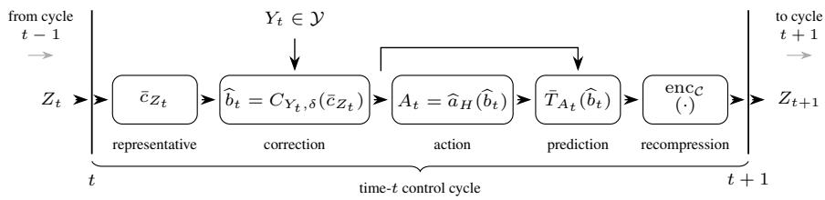

# Finite-Memory Control of POMDPs: Fundamental Limits and Efficient Design

Emrecan Kutay, Atilla Eryilmaz, Ness Shroff

Department of Electrical and Computer Engineering

The Ohio State University

kutay.5@osu.edu, eryilmaz.2@osu.edu, shroff.11@osu.edu

## Abstract

Optimal control of partially observable Markov decision processes (POMDPs), in general, requires a complete history. The belief state, a distribution over hidden states, summarizes this history and provides the classical sufficient statistic to control POMDPs. However, the continuous nature of the belief space generally prevents a finite-memory controller from maintaining it exactly. This raises the question we address in this work: what must the available finite memory preserve to achieve near-optimal control performance? We study this question through an information-theoretic converse that gives a fundamental lower bound on the loss of any finite-memory controller. The analysis introduces the concept of a decision witness that characterizes belief states whose confusion would lead to unavoidable loss. Motivated by this bound, we propose RECAP, a constructive quantization method for designing representative memory states. We prove an upper bound on the optimality gap of any RECAP codebook and use the components of this bound together with the converse analysis to define the codebook objective. Experiments on 11 POMDP benchmarks demonstrate that RECAP improves over finite-memory representation baselines under the same memory budget.

## 1 Introduction

In a partially observable Markov decision process (POMDP), the agent receives only a partial signal about the true state. The full history becomes the sufficient statistic for future returns, because the Markov property no longer holds for observations. The belief state restores the Markov property by maintaining a distribution over states, but it lives on a continuous, high-dimensional simplex [1]. The full history may avoid this continuity, but it grows without bound over time, even in finite models [2]. Given these hard-to-maintain statistics, finite-state controllers (FSCs) seek the best way to operate under a hard memory budget, inherently discarding part of what the history encodes [3].

In POMDPs, memory is a limited resource, and this paper studies its value: how much performance loss must a B-bit FSC incur solely because of its limited memory? We study this question from both directions: converse and construction. We first establish an information-theoretic converse that quantifies the unavoidable value loss of any B-bit FSC. We then introduce RECAP, a quantization design that constructs a finite memory guided by the belief distinctions that the converse analysis identifies as control-critical.

Related Work. The closest converse-adjacent work applies Fano’s inequality to upper-bound the achievable reward from sensing information [4]. It asks how informative the observations can be rather than how many bits of memory suffice. Recent work in [5] constructs a canonical lossless quotient of the history space by merging histories that no controller in a fixed test family can distinguish. Its target is the environment’s structure, not the value cost of a lossy, budget-constrained memory.

Learning-theoretic work on revealing POMDPs [6] establishes regret and sample-complexity bounds for online learning in an unknown environment, not the cost of a fixed finite-memory controller in a known model. None of these works establishes a converse for the memory bottleneck we study: the unavoidable value loss resulting from a hard B-bit constraint on any FSC.

On the constructive side, FSC synthesis methods search over controller structures, action mappings, and memory-update rules subject to value, budget, or specification constraints [3, 7, 8, 9, 10, 11]. They aim for constructive and provable policies, but their controller nodes encode what the search found useful, without any required relation to the belief, the history dynamics, or the future.

Approximate information-state and recurrent-summary methods study recursively updated summaries of the observation history [12, 13, 14, 15, 16]. The central condition across this literature is predictive sufficiency: the summary should preserve enough information about transition kernels, observation distributions, and reward that planning on it approximates planning on the full history.

Belief and value-directed compression methods focus on compressing the belief MDP in a valueaware manner [17, 18, 19, 20, 21, 22, 23]. Finite-model and finite-memory results characterize conditions under which discretized beliefs, aggregated features, or bounded histories preserve nearoptimal value. The compressed object is assessed by the value loss it induces, not by any structural or predictive fidelity to the original representation. RECAP builds on all three lines, yet is not reducible to any of them. It neither searches over controller structure like FSC methods, nor certifies an existing summary as sufficient like information-state methods do, nor compresses the posterior along value-function directions as belief compression methods do. Instead, it proposes quantization design under a resource constraint, with updates following a predict-then-recompress recursion.

Contributions. We study the fundamental limits of finite-memory control in discounted POMDPs. The constructive side of the problem has received substantial attention; what the converse side requires has not. Motivated by this, we investigate both directions and make the following contributions:

1. Information-theoretic converse for POMDPs. We prove in Theorem 1 an information-theoretic lower bound on the value loss of any B-bit FSC in a discounted POMDP. The argument introduces a “decision witness”, an action-separating partition of belief space, which reduces finite-memory control to recovering a control-critical label from stored memory and the current observation. When $B$ bits are insufficient to resolve this label, Fano’s inequality converts the resulting ambiguity into a concrete lower bound on value loss. We show that a witness-based bound is sharp in an example in Proposition 1 and adapt the witness design to a different domain in Appendix D. Together, these examples demonstrate that decision witnesses provide useful bounds and are not tied to a specific model.

2. RECAP: a converse-motivated quantization design. We introduce RECAP, a recursive actionaware predictive quantization method for budgeted FSC synthesis. Rather than compressing the posterior, RECAP maintains the predictive prior between observations. We prove in Theorem 2 an upper bound on the optimality gap of the RECAP controller induced by any codebook and use the components of this bound together with the converse analysis to define the codebook objective that balances predictive coverage, recursive closure, and action regret.

3. Empirical validation. We evaluate RECAP across 11 finite POMDP benchmarks. Simulations demonstrate that RECAP improves over baseline finite-memory representation methods under matched resource constraints (Table 1). This establishes the practical benefit of converse-driven recursive, action-aware predictive compression.

Notation. Unless stated otherwise, uppercase letters denote random variables and lowercase letters their values, except belief-valued random elements, which are written in lowercase. We use calligraphic letters for sets and alphabets; P, E for probability and expectation; $H ( \cdot ) , I ( \cdot ; \cdot )$ for entropy and mutual information; $\bar { \Delta } ( \mathcal { X } )$ for the simplex over $\dot { \boldsymbol { x } } ;$ and · ⊥ · for independence. For $X ^ { n } = ( X _ { 1 } , \ldots , X _ { n } )$ , let $X _ { 1 : t - 1 } , X _ { t + 1 : n }$ , and $X _ { \backslash t }$ denote the past, future, and all but coordinate $t ,$ respectively. We write [m : $\mathbf { \partial } : n ] = \{ m , \dots , n \}$ and $[ 2 ^ { n R } ] = \{ 1 , \dots , 2 ^ { n R } \}$ . |v|1 is the $\ell _ { 1 }$ norm, $\delta _ { a }$ is a point mass, and $( \cdot ) _ { + } \triangleq \operatorname* { m a x } \{ 0 , \cdot \}$ . Throughout, Bayes maps are completed by a fixed full-support fallback on zero-denominator observations.

## 2 Control of POMDPs under Finite-Memory Constraints

We consider a discrete-time, time-homogeneous, finite-state POMDP with state space $s ,$ , action space ${ \mathcal { A } } ,$ and observation space Y, defined by

$$
e \triangleq ( P _ { e } , O _ { e } , r _ { e } , \xi _ { e } , \gamma ) ,
$$

where $P _ { e } ( \cdot \mid s , a ) \in \Delta ( S )$ denotes the transition kernel, $O _ { e } ( \cdot \mid s ) \in \Delta ( \mathcal { V } )$ the observation kernel, $r _ { e } : \mathcal { S } \times \dot { \mathcal { A } }  [ \dot { 0 } , R _ { \mathrm { m a x } } ]$ the one-step reward function, $\xi _ { e } \in \Delta ( S )$ the initial law, and $\gamma \in ( 0 , 1 )$ the discount. We write the history at time t as $\mathsf { H } _ { t } \triangleq ( Y _ { 0 } , A _ { 0 } , \ldots , Y _ { t - 1 } , A _ { t - 1 } , Y _ { t } )$ . For a full-history controller π, which selects the action $A _ { t }$ based on ${ \sf H } _ { t } .$ , we denote its discounted value by

$$
V _ { e } ^ { \pi } \triangleq \mathbb { E } _ { e } ^ { \pi } \left[ \sum _ { t = 0 } ^ { \infty } \gamma ^ { t } r _ { e } ( S _ { t } , A _ { t } ) \right] , \qquad V _ { e } ^ { * } \triangleq \operatorname* { s u p } _ { \pi } V _ { e } ^ { \pi } .
$$

For a given history $\mathsf { H } _ { t } = h _ { t } , b _ { t }$ denotes the recursively updated belief,

$$
b _ { t } ( s ) \triangleq \mathbb { P } _ { e } ( S _ { t } = s \mid \mathsf { H } _ { t } = h _ { t } ) = { \frac { \sum _ { s ^ { \prime } \in S } b _ { t - 1 } ( s ^ { \prime } ) P _ { e } ( s \mid s ^ { \prime } , a _ { t - 1 } ) O _ { e } ( y _ { t } \mid s ) } { \sum _ { s ^ { \prime } , s ^ { \prime \prime } \in S } b _ { t - 1 } ( s ^ { \prime } ) P _ { e } ( s ^ { \prime \prime } \mid s ^ { \prime } , a _ { t - 1 } ) O _ { e } ( y _ { t } \mid s ^ { \prime \prime } ) } } , \qquad s \in S .
$$

The associated belief MDP has state space $\Delta ( \boldsymbol { S } )$ , action space ${ \mathcal { A } } ,$ reward $\begin{array} { r l } { r _ { e } ( b , a ) } & { { } = } \end{array}$ $\textstyle \sum _ { s \in { \mathcal { S } } } b ( s ) r _ { e } ( s , a )$ , and transition kernel $\begin{array} { r } { \vec { P _ { e } } ( \cdot \mid b , a ) ^ { ' } = \sum _ { y \in \mathcal { Y } } \hat { P } _ { e } ( y \mid b , a ) \delta _ { \tau _ { e } ( b , a , y ) } ( \cdot ) } \end{array}$ , where $\tau _ { e } ( b , a , y )$ denotes the Bayes update. We write $V _ { e } ^ { * } ( b )$ and $Q _ { e } ^ { * } ( b , a )$ for the optimal value and actionvalue functions, respectively.

The belief ranges over the continuum $\Delta ( \boldsymbol { S } )$ , which makes classical methods such as linear programming difficult to scale and their policies hard to realize with practical controllers. This motivates finite-memory summaries of history, whose design must preserve control-relevant information. One natural choice is a sliding window over the history, which is simple and model-free but allocates memory to the most recent symbols rather than the most decision-relevant ones. In contrast, a recursive statistic can preserve control-relevant cues across long periods of irrelevant observations. Appendix A gives an example in which such a recursive statistic is optimal, whereas the sliding window under the same resource budget is not. We therefore work with the following general class of finite-state controllers, which contains both designs.

Definition 1 (Finite-state controllers). A B-bit finite-state controller is a policy with internal memory $Z _ { t } \in \mathcal { Z } , | \mathcal { Z } | \overset { \cdot } { \leq } 2 ^ { B }$ . Let $\Pi _ { B }$ denote the set of tuples

$$
\kappa = ( \mathcal { Z } , \nu _ { 0 } , \{ \pi _ { t } \} _ { t \geq 0 } , \{ \varphi _ { t } \} _ { t \geq 0 } )
$$

that induce

$$
Z _ { 0 } \sim \nu _ { 0 } ( \cdot \mid Y _ { 0 } ) , \qquad A _ { t } \sim \pi _ { t } ( \cdot \mid Z _ { t } , Y _ { t } ) , \qquad Z _ { t + 1 } \sim \varphi _ { t } ( \cdot \mid Z _ { t } , Y _ { t } , A _ { t } ) .
$$

For $\kappa \in \Pi _ { B }$ , define the budgeted value and memory-performance gap by

$$
V _ { e } ^ { \kappa } \triangleq \mathbb { E } _ { e } ^ { \kappa } \left[ \sum _ { t = 0 } ^ { \infty } \gamma ^ { t } r _ { e } ( S _ { t } , A _ { t } ) \right] , \qquad V _ { e } ^ { * } ( B ) \triangleq \operatorname* { s u p } _ { \kappa \in \Pi _ { B } } V _ { e } ^ { \kappa } , \qquad D _ { e } ( B ) \triangleq V _ { e } ^ { * } - V _ { e } ^ { * } ( B ) .
$$

The quantity $D _ { e } ( B )$ is the smallest optimality gap under a B-bit memory constraint. Thus, $D _ { e } ( B ) = 0$ means that $2 ^ { B }$ memory states suffice for optimal control, whereas $\dot { D } _ { e } ( B ) > 0$ measures the unavoidable cost of finite memory. From an information-theoretic perspective, $Z _ { t }$ is a lossy compression of the history ${ \sf H } _ { t } ,$ , so $D _ { e } ( \bar { B } )$ describes a memory–performance tradeoff.

In this work, we aim to develop controllers that employ efficient representations of belief states under their memory constraints. To this end, in the next two sections, we first lower bound $D _ { e } ( B )$ and then propose a nonuniform quantization scheme with an upper bound on its optimality gap.

## 3 Memory-Performance Lower Bounds via Decision Witnesses

In this section, we establish a lower bound on the memory-performance gap of a finite-memory controller for POMDPs. The idea behind our approach is the recognition that some regions of the belief space are more sensitive to finite-state representation than others, as measured by the suboptimality gap relative to the optimal actions associated with those beliefs. Accordingly, each partition of the belief space corresponds to a different lower bound that is based on: (i) how much uncertainty about the optimal action remains given the current observation and the memory, and (ii) how often the process enters these control-critical regions. Next, we formalize this idea by first introducing the concept of a decision witness, and then establishing a fundamental lower bound on $D _ { e } ( B )$

Definition 2 (Decision witness at time $t ) .$ . Fix a time step $t \geq 0$ and a number of labels $N \geq 2$ Let $\psi : \Delta ( \mathcal { S } )  \{ 0 \} \cup [ N ]$ be a measurable labeling map, which partitions the belief space by assigning a label in $[ \bar { N } ]$ or the null label 0. For an observation subset $\mathcal { V } _ { 0 } \subseteq \mathcal { V }$ , an action selector $a ^ { * } : [ N ] \times \mathcal { V } _ { 0 } \to \mathcal { A }$ , and a margin $\eta > 0$ , define the witness label $\Theta _ { t } \triangleq \psi ( b _ { t } )$ and the witness event $E _ { t } \triangleq \{ \Theta _ { t } \in [ N ] , Y _ { t } \in \mathcal { V } _ { 0 } \}$ . The tuple $( \psi , \mathcal { V } _ { 0 } , a ^ { * } , \eta )$ is a decision witness at time t if the following condition holds on $E _ { t }$ at every value of $( b _ { t } , Y _ { t } )$ that occurs with positive probability under some controller:

$$
\eta \mathbb { 1 } \{ a \neq a ^ { * } ( \Theta _ { t } , Y _ { t } ) \} \leq V _ { e } ^ { * } ( b _ { t } ) - Q _ { e } ^ { * } ( b _ { t } , a ) , \qquad \forall a \in \mathcal { A } ,
$$

and, for every $y \in \mathcal { V } _ { 0 }$ , the map $i \mapsto a ^ { * } ( i , y )$ is injective.

The region indexed by the null label, $\Theta _ { t } = 0$ , lies outside the “witness event” $E _ { t }$ . It contains beliefs for which either an alternative action may incur value loss below $\eta ,$ or the optimal action may be ambiguous. On the event $E _ { t } ,$ , however, the witness label is “control-critical”, in that, for each observation, distinct labels in $[ N ]$ ] require distinct optimal actions, and choosing any other action loses at least $\eta .$ . Avoiding this loss therefore requires identifying $\Theta _ { t }$ from the memory $Z _ { t }$ and the current observation $Y _ { t } .$ . This allows us to interpret the control problem as a classification problem over the $N$ distinct labels, where the information-theoretic approach uses Fano’s inequality and yield the following lower bound on the optimality gap of every B-bit FSC.

Theorem 1 (Decision witness lower bound). Fix $t \geq 0$ , and let $( \psi , \mathcal { V } _ { 0 } , a ^ { * } , \eta )$ be a decision witness with N labels at time t. Then every B-bitfinite-state controller $\kappa \in \Pi _ { B }$ satisfies

$$
\gamma ^ { t } \eta \mathbb { P } _ { e } ^ { \kappa } ( E _ { t } ) \operatorname* { i n f } _ { \substack { P _ { \tilde { Z } _ { t } } | \mathrm { u } _ { t } ; } \atop | \operatorname { s u p p } ( \tilde { Z } _ { t } ) | \leq 2 ^ { B } } \left( \frac { H _ { e } ^ { \kappa } ( \Theta _ { t } | Y _ { t } , E _ { t } ) - I _ { e } ^ { \kappa } ( \Theta _ { t } ; \tilde { Z } _ { t } | Y _ { t } , E _ { t } ) - 1 } { \log _ { 2 } N } \right) _ { + } \leq V _ { e } ^ { * } - V _ { e } ^ { \kappa } .\tag{1}
$$

The left-hand side is zero when $\mathbb { P } _ { e } ^ { \kappa } ( E _ { t } ) = 0 .$ . The infimum ranges over all conditional laws of history summaries $\tilde { Z } _ { t }$ with alphabet size at most $2 ^ { B }$ . Consequently, $D _ { e } ( B )$ is lower-bounded by the infimum over $\kappa \in \Pi _ { B }$ ofthe left-hand side of (1).

Proof. See Appendix B.

Interpretation of Theorem 1. Theorem 1 has three components.

• Action gap. The factor η is the decision witness margin. On the witness event, every suboptimal action incurs a Bellman-value loss of at least η.

• Witness frequency. The factor $\mathbb { P } _ { e } ^ { \kappa } ( E _ { t } )$ is the probability, under controller κ, that the process enters a control-critical region at time t.

• Residual ambiguity underfinite memory. The inner term measures how much uncertainty about the active witness label remains after the current observation $Y _ { t }$ and a $2 ^ { B }$ -state memory are available. The entropy term $H _ { e } ^ { \kappa } ( \Theta _ { t } \mid Y _ { t } , E _ { t } )$ is the uncertainty about the active witness label after observing $Y _ { t }$ on the witness event. The mutual information term $I _ { e } ^ { \kappa } ( \Theta _ { t } ; \tilde { Z } _ { t } \mid Y _ { t } , E _ { t } )$ is the amount of that uncertainty resolved by the memory $\tilde { Z } _ { t }$ . The normalization by log N expresses the remaining ambiguity as a fraction of the information needed to distinguish the $\dot { N }$ witness labels.

• Role of the current observation. The current observation is not part of the memory budget and is available at decision time. If $Y _ { t }$ alone identifies the active witness label, then $H _ { e } ^ { \kappa } ( \Theta _ { t } \mid Y _ { t } , E _ { t } ) = 0$ , and no memory is needed. On the other extreme, if $Y _ { t }$ gives no information about $\Theta _ { t }$ on $E _ { t }$ , then the residual ambiguity depends entirely on the information provided by the memory $\tilde { Z } _ { t }$

Consequently, finite memory incurs unavoidable value loss when the witness event has non-zero probability, the action gap is positive, and no $2 ^ { B }$ -state memory reliably identifies the active witness label after observing $Y _ { t } .$ . Summing witnesses across time extends the one-step argument over a horizon. We state this extension as Corollary 1 in Appendix B. The lower bound above quantifies the value loss for any fixed witness. Optimizing over decision witnesses yields the strongest bound within this framework. The example below instantiates the witness design and shows that the resulting lower bound can be tight with a matching FSC.

A tight decision witness lower bound. We construct a decision witness for a finite tracking POMDP, derive its lower bound, and provide a matching finite-state controller, showing tightness. The hidden position X starts uniformly on the cycle $\mathbb { Z } _ { K }$ and evolves as

$$
X _ { 0 } \sim \operatorname { U n i f } ( \mathbb { Z } _ { K } ) , \qquad X _ { t + 1 } = X _ { t } + D _ { t + 1 } { \pmod { K } } , \qquad D _ { t + 1 } \sim \operatorname { U n i f } \{ - m , \dots , m \} ,
$$

where $m \geq 1$ and $K \ge 2 m + 1$ . At each time, the observation $Y _ { t }$ is either a beacon (b) or an odometry (o) reading. A beacon reports the position $X _ { t } ,$ , and an odometry reading reports only the increment $D _ { t }$ , which locates $X _ { t }$ relative to $X _ { t - 1 }$ . For $t \geq 1$ , the sensor returns a beacon with probability q and an odometry reading with probability $1 - q$ . In either case, the reading is erased with probability p and is reliable otherwise. Thus,

$$
Y _ { t } \in \left( \{ \mathbf { b } \} \times \left( \mathbb { Z } _ { K } \cup \{ \perp \} \right) \right) \cup \left( \{ \mathbf { o } \} \times \left( \{ - m , \ldots , m \} \cup \{ \perp \} \right) \right) ,
$$

where $Y _ { t } = ( \mathrm { b } , X _ { t } )$ for a reliable beacon, $Y _ { t } = ( \mathrm { o } , D _ { t } )$ for a reliable odometry reading, and ⊥ denotes erasure. The first observation is a reliable beacon, $Y _ { 0 } = ( \mathrm { b } , X _ { 0 } )$ . The action is an estimate $a _ { t } \in \mathbb { Z } _ { K }$ , and the reward is exact tracking $r ( S _ { t } , a _ { t } ) = \mathbb { 1 } \{ a _ { t } = \dot { X } _ { t } \}$ . Because the transition and observation kernels are action-independent, every controller induces the same law over the hidden trajectory and observations. Thus, memory affects performance only through the retained beacon and odometry information to estimate $X _ { t }$ . We provide a detailed description of the setting in Appendix C.

Proposition 1 (Decision witness example lower bound). For the noisy beacon–odometry tracking model above, let $e = e ( K , m , p , q )$ denote the corresponding environment. For each $t \geq 1 ,$ , consider the decision witness with margin $\eta = 1$ whose labels are the K positions. Its witness event $E _ { t }$ occurs when $Y _ { t }$ and every reading since the last reliable beacon are reliable odometry readings, so that $b _ { t }$ determines $X _ { t }$ exactly. Summing these witnesses across time gives

$$
\sum _ { t \ge 1 } \gamma ^ { t } \alpha _ { t } \left( 1 - \frac { 2 ^ { B } } { K } \right) _ { + } \le D _ { e } ( B ) , \qquad \alpha _ { t } \triangleq \rho ^ { t } + q ( 1 - p ) \sum _ { t ^ { \prime } = 1 } ^ { t - 1 } \rho ^ { t ^ { \prime } } , \qquad \rho \triangleq ( 1 - q ) ( 1 - p ) .\tag{2}
$$

Moreover, $i f p = 0$ and $2 ^ { B } \mid K ,$ , this lower bound is tight: there exists a B-bitfinite-state controller $\kappa _ { B } ^ { \mathrm { q p } } \in \Pi _ { B }$ such that

$$
V _ { e } ^ { * } - V _ { e } ^ { \kappa _ { B } ^ { \mathrm { q p } } } = D _ { e } ( B ) = \frac { \gamma ( 1 - q ) } { 1 - \gamma } \left( 1 - \frac { 2 ^ { B } } { K } \right) .\tag{3}
$$

Proof. See Appendix C.

Proposition 1 shows how a decision witness yields a memory-performance lower bound, and the matching controller shows that this bound can be tight. The proof in Appendix C follows the steps of Theorem 1, but bounds the classification error by a counting argument. This indicates that, while Theorem 1 uses Fano’s inequality for its general applicability, the decision-witness framework admits sharper classification inequalities, which may depend on the setting, regime, or dynamics and yield tighter memory-performance lower bounds.

We provide another example in Appendix D, where a controller aims to identify the active hidden source from noisy observations; there, we design a decision witness for this setting and derive the corresponding lower bound. Together, these examples show that decision witnesses form a general framework that is not tied to a specific model. Instead, they provide an abstract way to expose belief distinctions that finite memory cannot safely erase. In the next section, we use this insight for a finite-memory design based on decision-aware predictive compression.

  
Figure 1: The control cycle at time t of the RECAP controller in Definition 3.

## 4 RECAP: A Design for RECursive Action-aware Predictive Quantization

The converse results suggest that a good use of finite memory should preserve belief distinctions only when they matter for control. We follow this principle and introduce RECAP, a nonuniform quantizer for finite-state control. Given a memory budget B and simulation rollouts, RECAP selects $\dot { K } \le 2 ^ { B }$ representative predictive priors, i.e., beliefs before the next observation arrives, from a pilot cloud of such priors generated by rollouts. These representatives form the codebook $\mathcal { C } = ( \bar { \bar { c } } _ { 1 } , \dots , \bar { c } _ { K } )$ and serve as the internal states of a finite-state controller in Definition 1. Figure 1 illustrates one RECAP control cycle, which builds on the prediction–correction decomposition of Bayesian filtering. Between control cycles, the controller stores one memory state $Z _ { t }$ . When a new observation $\bar { Y _ { t } }$ arrives, it corrects the stored representative $\bar { c } _ { Z _ { t } }$ using the observation, takes an action $A _ { t }$ from the corrected belief $\widehat { b } _ { t }$ , propagates the result through the model dynamics $\bar { T } _ { A _ { t } }$ , and recompresses to the next memory state $Z _ { t + 1 }$ . We can express these components mathematically by first defining the predictive prior as:

$$
\bar { b } _ { t } ( s ) = \mathbb { P } _ { e } ( S _ { t } = s \mid \mathsf { H } _ { t - 1 } , A _ { t - 1 } ) = \sum _ { s ^ { \prime } \in S } P _ { e } ( s \mid s ^ { \prime } , A _ { t - 1 } ) b _ { t - 1 } ( s ^ { \prime } ) , \qquad s \in S .
$$

Then, we write the prediction step through the model dynamics as

$$
\bar { T } _ { a } ( b ) ( s ^ { \prime } ) \triangleq \sum _ { s \in \mathcal { S } } P _ { e } ( s ^ { \prime } \mid s , a ) b ( s ) , \qquad \bar { b } _ { t } = \bar { T } _ { A _ { t - 1 } } ( b _ { t - 1 } ) , \qquad t \geq 1 ,
$$

with $\bar { b } _ { 0 } \triangleq \xi _ { e }$ . After observing $Y _ { t } = y _ { t }$ , the correction map is

$$
C _ { y _ { t } } ( \bar { b } _ { t } ) ( s ) \triangleq \frac { O _ { e } ( y _ { t } \mid s ) \bar { b } _ { t } ( s ) } { \sum _ { u \in \cal { S } } O _ { e } ( y _ { t } \mid u ) \bar { b } _ { t } ( u ) } , \qquad s \in \mathcal { S } .
$$

Finally, the exact filtering recursion decomposes as follows.

$$
b _ { t } = C _ { Y _ { t } } ( \bar { b } _ { t } ) , \qquad \bar { b } _ { t + 1 } = \bar { T } _ { A _ { t } } ( b _ { t } ) .
$$

## 4.1 RECAP Architecture

Following the architecture in Figure 1, we define the RECAP controller induced by a predictive codebook C as follows.

Definition 3 (RECAP architecture with parameter $\delta ) .$ . Fix a finite POMDP model e, a memory budget B as in Definition 1, a parameter $\delta \in [ \bar { 0 } , 1 ]$ , and an H-step planner action rule $\widehat { a } _ { H } : \Delta ( { \cal S } ) \widehat {  } { \mathcal { A } } .$ A RECAP controller with $K \le 2 ^ { B }$ memory states is composed of the following components.

(i) Predictive codebook. A codebook of representative predictive priors

$$
{ \mathcal { C } } = ( { \bar { c } } _ { 1 } , \ldots , { \bar { c } } _ { K } ) , \qquad { \bar { c } } _ { j } \in \Delta ( { \mathcal { S } } ) .
$$

The memory state $z \in \{ 1 , \ldots , K \}$ means that the controller is carrying the predictive representative $\bar { c } _ { z }$

(ii) Regularized correction. Fix a full-support anchor $\nu \in \Delta ( S )$ . For observation y, define

$$
C _ { y , \delta } ( \bar { b } ) ( s ) \triangleq \frac { O _ { e } ( y \mid s ) \big ( ( 1 - \delta ) \bar { b } ( s ) + \delta \nu ( s ) \big ) } { \sum _ { u \in \cal S } O _ { e } ( y \mid u ) \big ( ( 1 - \delta ) \bar { b } ( u ) + \delta \nu ( u ) \big ) } , \qquad s \in \mathcal { S } .
$$

RECAP corrects the stored predictive representative after first mixing it with a full-support anchor ν. The parameter δ controls the amount of regularization and prevents degenerate Bayes denominators on feasible observations.

(iii) Quantizer. The codebook induces a nearest-neighbor quantizer

$$
\mathrm { e n c } _ { \mathcal { C } } ( \bar { b } ) \in \mathop { \mathrm { a r g m i n } } _ { j } \left\| \bar { b } - \bar { c } _ { j } \right\| _ { \mathrm { T V } } ,\tag{4}
$$

with deterministic tie-breaking. Let $\begin{array} { r } { p _ { e } ( y \mid \bar { b } ) \stackrel { \Delta } { = } \sum _ { s \in { \mathcal { S } } } O _ { e } ( y \mid s ) \bar { b } ( s ) } \end{array}$ . The nearest-neighbor assignment is restricted to representatives $\bar { c } _ { j }$ that preserve the feasible observations of ${ \bar { b } } ,$ that is, $p _ { e } ( y \mid \bar { c } _ { j } ) > 0$ whenever $p _ { e } ( y \mid \bar { b } ) > 0$ , with a global nearest-neighbor fallback if no such representative exists.

(iv) RECAP recursion. Given memory $Z _ { t }$ , RECAP applies the correction–action–prediction– compression cycle shown in Figure 1. The initial memory is $Z _ { 0 } = \operatorname { e n c } c ( \xi _ { e } )$ , and the induced finite-state controller is

$$
A _ { t } = \widehat { a } _ { H } \big ( C _ { Y _ { t } , \delta } \big ( \bar { c } _ { Z _ { t } } \big ) \big ) , \qquad Z _ { t + 1 } = \mathrm { e n c } _ { \mathcal { C } } \big ( \bar { T } _ { A _ { t } } \big ( C _ { Y _ { t } , \delta } \big ( \bar { c } _ { Z _ { t } } \big ) \big ) \big ) .
$$

Remark 1 (Predictive rather than posterior memory). RECAP addresses an architectural question: under a hard FSC memory budget, what memory state should the controller carry between observations, refine when a new observation arrives, and update recursively after acting? RECAP answers by compressing predictive priors rather than posterior beliefs, departing from standard belief compression. This choice matches the timing in Definition 1: for $t \geq \bar { 1 } , Z _ { t }$ is formed before $Y _ { t }$ arrives, so it can carry information about $S _ { t }$ only through the predictive prior $b _ { t }$ , which $Y _ { t }$ then corrects at decision time. This is the same split between memory and current observation that underlies Theorem 1. We expect this predictive viewpoint to be natural when control and observation operate on different time scales, as in robotic or autonomous-driving systems, where a compact internal prediction must persist between slower sensor-fusion updates.

We now bound the optimality gap of the RECAP controller $\kappa { c , \delta }$ induced by a codebook C and a regularization level $\delta \in \mathsf { \Gamma } ( \bar { 0 } , \bar { 1 } ]$ . The performance bound accounts for three sources of error: finite-horizon planning, regularized correction, and quantization. The prediction step introduces no additional error because $\bar { T } _ { a } ^ { - }$ is nonexpansive in TV distance under a common action.

The finite-horizon planner uses the optimal H-step truncated action-value function $\widehat { Q } _ { H }$ , which ignores rewards after the first H steps. Under nonnegative rewards bounded by $R _ { \mathrm { m a x } } .$ , the truncation error satisfies $0 \leq Q _ { e } ^ { * } - \widehat { Q } _ { H } \leq \varepsilon _ { H } \triangleq \gamma ^ { H } R _ { \mathrm { { m a x } } } / ( 1 - \gamma )$

At the correction step, regularization introduces bias relative to exact Bayesian correction, while Bayesian correction can amplify predictive-prior errors when observation likelihoods are small. Specifically, $C _ { y , \delta }$ deviates from exact Bayes correction $C _ { y , 0 }$ by at most $\beta _ { \delta }$ and, because mixing with the full-support anchor ν keeps its denominator at least $\delta \bar { p } _ { e } ( y \mid \nu )$ for feasible observations, has TV sensitivity bounded by $\Lambda _ { \delta }$ , where

$$
\beta _ { \delta } \triangleq \operatorname* { s u p } _ { y , \bar { b } : p _ { e } ( y | \bar { b } ) > 0 } \left\| C _ { y , 0 } ( \bar { b } ) - C _ { y , \delta } ( \bar { b } ) \right\| _ { \mathrm { T V } } , \qquad \Lambda _ { \delta } \triangleq \operatorname* { m a x } _ { y : p _ { e } ( y | \nu ) > 0 } \frac { 2 ( 1 - \delta ) } { \delta p _ { e } ( y | \nu ) } .\tag{5}
$$

At initialization and recompression, the quantizer in (4) incurs an error on the initial prior $\xi _ { e }$ and on each predictive prior $\bar { b } _ { z , y } ^ { + } \triangleq \bar { T } _ { \widehat { a } _ { H } \left( C _ { y , \delta } \left( \bar { c } _ { z } \right) \right) } ( C _ { y , \delta } ( \bar { c } _ { z } ) )$ computed from $Z _ { t } = z$ and $Y _ { t } = y \colon$

$$
\bar { e } _ { 0 , \mathcal { C } } \triangleq \left\| \xi _ { e } - \bar { c } _ { \mathrm { e n c } _ { \mathcal { C } } ( \xi _ { e } ) } \right\| _ { \mathrm { T V } } , \qquad \bar { \eta } _ { \mathcal { C } , \delta } \triangleq \operatorname* { s u p } _ { z \in [ K ] } \operatorname* { s u p } _ { y \in \mathcal { Y } } \left\| \bar { b } _ { z , y } ^ { + } - \bar { c } _ { \mathrm { e n c } _ { \mathcal { C } } ( \bar { b } _ { z } ^ { + } , y ) } \right\| _ { \mathrm { T V } } .\tag{6}
$$

We combine these per-step errors to bound the performance gap of any RECAP codebook candidate as follows.

Theorem 2 (RECAP performance bound). Fix a RECAP codebook C with $K \le 2 ^ { B }$ and a regularization level $\delta \in ( 0 , 1 ]$ such that $\gamma \Lambda _ { \delta } < 1$ , and let $\widehat { a } _ { H }$ be greedy with respect to $\widehat { Q } _ { H }$ . Then the RECAP controller $\kappa { c , \delta }$ satisfies

$$
V _ { e } ^ { * } - V _ { e } ^ { \kappa _ { c , \delta } } \leq \frac { 2 \varepsilon _ { H } } { 1 - \gamma } + \frac { 4 R _ { \operatorname* { m a x } } } { 1 - \gamma } \left[ \frac { \beta _ { \delta } } { 1 - \gamma } + \Lambda _ { \delta } \left( \frac { \bar { e } _ { 0 , c } } { 1 - \gamma \Lambda _ { \delta } } + \frac { \gamma ( \beta _ { \delta } + \bar { \eta } _ { c , \delta } ) } { ( 1 - \gamma ) ( 1 - \gamma \Lambda _ { \delta } ) } \right) \right] .\tag{7}
$$

Since $\kappa c , \delta \in \Pi _ { B }$ , the right-hand side of (7) also upper bounds $D _ { e } ( B )$ . We derive an analogous boundfor exact correction, $\delta = 0$ , under a local tube condition described in Appendix E.

Interpretation of Theorem 2. Theorem 2 has five explicit ingredients:

• Planner error. The term $2 \varepsilon _ { H } / ( 1 - \gamma )$ is the loss from using the finite-horizon planner instead of the optimal action-value function.

• Regularization bias. The terms involving $\beta _ { \delta }$ are the cost of using the regularized correction $C _ { y , \delta }$ instead of exact Bayes correction $\bar { C } _ { y , 0 }$

• Correction sensitivity. The constant $\Lambda _ { \delta }$ measures how much regularized correction can amplify predictive-prior error after an observation. The condition $\gamma \Lambda _ { \delta } < 1$ is a stability condition for the scalar error recursion.

• Initial predictive compression. The term $\bar { e } _ { 0 , \mathcal { C } }$ measures how well the initial predictive prior $\xi _ { e }$ is represented by the codebook.

• Recursive reprojection. The term $\bar { \eta } _ { \mathcal { C } , \delta }$ measures how well the codebook represents the next predictive states produced by ${ \mathrm { R E C A P } } { \mathrm { { s } } }$ recursion.

## 4.2 RECAP Algorithm

The previous subsection defines the RECAP controller for a fixed predictive codebook C. We now describe how RECAP constructs C from a given finite pilot cloud. Let

$$
\mathcal { D } _ { N _ { \mathrm { p i l o t } } } \triangleq ( \bar { b } _ { 1 } , \dots , \bar { b } _ { N _ { \mathrm { p i l o t } } } ) , \quad \bar { b } _ { i } \in \Delta ( \mathcal { S } )
$$

be a given pilot predictive cloud obtained from simulation rollouts. For each ${ \bar { b } } _ { i }$ , let $\mathcal { \mathrm { V } } _ { i }$ be the set of feasible observations with observation probability $p _ { i } ( y ) \triangleq p _ { e } ( y \mid \bar { b } _ { i } ) > 0 .$ . For $y \in \mathcal { V } _ { i }$ , define

$$
b _ { i , y } \triangleq C _ { y , 0 } ( \bar { b } _ { i } ) .
$$

RECAP Objective. Consider a candidate codebook $\mathcal { C } = \left( \bar { c } _ { 1 } , \ldots , \bar { c } _ { K } \right)$ with $K \le 2 ^ { B }$ , whose representatives are selected from the pilot cloud. Each pilot prior $b _ { i }$ is assigned to its representative,

$$
j _ { i } \triangleq \operatorname { e n c } _ { \mathcal { C } } ( \overline { { b } } _ { i } ) , \quad \widehat { b } _ { i , y } \triangleq C _ { y , \delta } ( \overline { { c } } _ { j _ { i } } ) , \quad \widehat { a } _ { i , y } \triangleq \widehat { a } _ { H } ( \widehat { b } _ { i , y } ) .
$$

The RECAP objective reflects both sides of the theory through three terms: predictive coverage and recursive closure, corresponding to the upper bound in Theorem $2 ,$ and action regret, which makes the codebook decision-aware as suggested by Theorem 1. We begin with predictive coverage.

$$
J _ { \mathrm { p r e d } } ( \mathcal { C } ) \triangleq \frac { 1 } { N _ { \mathrm { p i l o t } } } \sum _ { i = 1 } ^ { N _ { \mathrm { p i l o t } } } \left. \bar { b } _ { i } - \bar { c } _ { j _ { i } } \right. _ { \mathrm { T V } } .
$$

We next introduce recursive closure, which enforces stability under RECAP’s recursive updates.

$$
J _ { \mathrm { r e c } } ( \mathcal { C } ) \triangleq \frac { 1 } { N _ { \mathrm { p i l o t } } } \sum _ { i = 1 } ^ { N _ { \mathrm { p i l o t } } } \sum _ { y \in \mathcal { V } _ { i } } p _ { i } ( y ) \left\| \bar { T } _ { \widehat { a } _ { i , y } } ( b _ { i , y } ) - \bar { c } _ { \mathrm { e n c } _ { \mathcal { C } } \left( \bar { T } _ { \widehat { a } _ { i , y } } ( \widehat { b } _ { i , y } ) \right) } \right\| _ { \mathrm { T V } } .
$$

The two TV-based terms above are natural for quantizing predictive distributions. Motivated by the converse results, we introduce the decision-aware action regret loss:

$$
J _ { \mathrm { a c t } } ( \mathcal { C } ) \triangleq \frac { 1 } { N _ { \mathrm { p i l o t } } } \sum _ { i = 1 } ^ { N _ { \mathrm { p i l o t } } } \sum _ { y \in \mathcal { V } _ { i } } p _ { i } ( y ) \left[ \operatorname* { m a x } _ { a \in A } \widehat { Q } _ { H } ( b _ { i , y } , a ) - \widehat { Q } _ { H } \big ( b _ { i , y } , \widehat { a } _ { i , y } \big ) \right] .
$$

This term incorporates the optimality gap incurred by using the representative-induced action instead of the original optimal action. If $b _ { i , y }$ lies in a control-critical region, every suboptimal action loses at least the witness margin η of Theorem 1, and $J _ { \mathrm { { a c t } } }$ , a surrogate for this loss, penalizes codebooks that merge beliefs requiring different actions, reflecting the decision-witness condition in Definition 2.

We add a penalty to prevent observation-incompatible assignments. Let $I _ { \mathrm { i n c } } ( \mathcal { C } )$ be the number of pilot priors ${ \bar { b } } _ { i }$ whose assignment $j _ { i }$ uses the fallback of the quantizer in (4). We set a penalty constant $\omega _ { \mathrm { i n c } } \gg 1$ and define

$$
P _ { \mathrm { i n c } } ( \mathcal { C } ) \triangleq \omega _ { \mathrm { i n c } } \frac { I _ { \mathrm { i n c } } ( \mathcal { C } ) } { N _ { \mathrm { p i l o t } } } .
$$

Algorithm 1 RECAP codebook construction   
1: Input: pilot cloud $\mathcal { D } _ { N _ { \mathrm { p i l o t } } } \mathrm { i }$ ; budget B; parameter δ; planner $\widehat { Q } _ { H } ;$ objective J ; pass limit $I _ { \mathrm { m a x } } ;$ candidate cap   
mcap; patience pstop.   
2: Set K ← min $\{ \bar { 2 } ^ { B } , \dot { N } _ { \mathrm { p i l o t } } \}$ , initialize C by farthest-first TV k-center, and set $n _ { \mathrm { s t a l e } }  0 .$   
3: for $r = 1 , \ldots , I _ { \mathrm { m a x } }$ do   
4: nswap $ 0 .$   
5: for $j = 1 , \ldots , K$ do   
6: Sample at most $m _ { \mathrm { { C a p } } }$ eligible pilot priors ${ \bar { b } } _ { i }$ as replacements for $\bar { c } _ { j }$   
7: Let $\bar { b } _ { i ^ { \star } }$ be the replacement with the smallest $J _ { \mathrm { R E C A P } } ( \mathcal { C } ^ { j  i } )$   
8: $\mathbf { i f } \ J _ { \mathrm { R E C A P } } ( { \mathcal { C } } ^ { j  i ^ { \star } } ) < J _ { \mathrm { R E C A P } } ( { \mathcal { C } } )$ then   
9: Replace $\bar { c } _ { j } \gets \bar { b } _ { i ^ { \star } }$ and set nswap ← nswap + 1.   
10: end if   
11: end for   
12: $\mathrm { S e t } n _ { \mathrm { s t a l e } }  n _ { \mathrm { s t a l e } } + 1 \mathrm { i f } n _ { \mathrm { s w a p } } = 0 ,$ and 0 otherwise.   
13: $\mathbf { i f } n _ { \mathrm { s t a l e } } \geq p _ { \mathrm { s t o p } }$ then   
14: break   
15: end if   
16: end for   
17: return codebook C and the induced RECAP controller from Definition 3.

Since $J _ { \mathrm { p r e d } }$ and $J _ { \mathrm { r e c } }$ are total-variation losses while $J _ { \mathrm { { a c t } } }$ has value units, we fix an action-loss scale $\zeta _ { \mathrm { a c t } } > 0$ and define the practical RECAP score with weights $\lambda _ { \mathrm { p r e d } } , \lambda _ { \mathrm { r e c } } , \lambda _ { \mathrm { a c t } } > 0$ as

$$
J _ { \mathrm { R E C A P } } ( { \mathcal C } ) = \lambda _ { \mathrm { p r e d } } J _ { \mathrm { p r e d } } ( { \mathcal C } ) + \lambda _ { \mathrm { r e c } } J _ { \mathrm { r e c } } ( { \mathcal C } ) + \lambda _ { \mathrm { a c t } } \frac { J _ { \mathrm { a c t } } ( { \mathcal C } ) } { \zeta _ { \mathrm { a c t } } } + P _ { \mathrm { i n c } } ( { \mathcal C } ) .\tag{8}
$$

RECAP searches for a codebook with small $J _ { \mathrm { R E C A P } }$ by bounded medoid-style local search [24]. It initializes C with farthest-first k-center in total variation, then performs coordinate-wise refinement. In each pass, the solver visits representatives sequentially. For representative $j ,$ it samples at most $m _ { \mathrm { c a p } }$ eligible pilot priors, evaluates replacements of $\bar { c } _ { j } { : }$ , and immediately accepts the best strict improvement, so later representatives use the updated codebook. With K representatives and pass limit $I _ { \mathrm { m a x } } .$ , this gives $\hat { O ( I _ { \mathrm { m a x } } K m _ { \mathrm { c a p } } ) }$ objective evaluations, unless refinement stops earlier after $p _ { \mathrm { s t o p } }$ consecutive full passes with no accepted replacement. Algorithm 1 summarizes the procedure. For a fixed pilot cloud, planner, and candidate-sampling seed, each accepted replacement strictly decreases $J _ { \mathrm { R E C A P } }$ , and the algorithm terminates after finitely many candidate evaluations.

## 5 Experiments

We evaluate RECAP on 11 finite POMDP benchmarks from [25]. All controllers operate under a hard B-bit memory budget. Due to space constraints, further experimental details appear in Appendix F whenever necessary. All experiments run on a single CPU machine (Intel Core i9-13950HX, 32 GB RAM) with no GPU acceleration. The complete simulation of 11 benchmarks across three design seeds requires approximately 25 CPU-hours in total, with per-benchmark runtimes ranging from 0.2 to 13 CPU-hours. The code is provided in the supplementary material and is also available at https://github.com/RECAP-research/RECAP.

## 5.1 Experimental Setup

We use the RECAP objective in (8) with the same hyperparameter values across all benchmarks rather than instance-specific tuning: $\omega _ { \mathrm { i n c } } = 1 0 ^ { 6 } , \lambda _ { \mathrm { p r e d } } = 0 . 2 , \lambda _ { \mathrm { r e c } } = 0 . 3 ,$ , and $\lambda _ { \mathrm { a c t } } = 0 . 5$ . We set the action-loss scale $\zeta _ { \mathrm { { a c t } } }$ from the empirical Q-value spans over the pilot cloud. We initialize the codebook by farthest-first k-center in total variation distance, then run Algorithm 1 for up to $I _ { \mathrm { m a x } } = 1 6$ passes with at most $m _ { \mathrm { c a p } } = 6 4$ swap candidates per representative, stopping early after $p _ { \mathrm { s t o p } } = 3$ consecutive passes without improvement. We fix the regularization level $\bar { \delta } = \mathrm { { 0 . 0 2 } }$ with a uniform anchor $\nu ,$ and memory budgets B are as in Table 1. We use 3 design seeds per benchmark and evaluate each over 1000 Monte Carlo episodes of length at most 128. Benchmark descriptions, planner details, and pilot cloud sampling appear in Appendix F.

Table 1: Mean ± std discounted return under a B-bit memory, pooled across episodes and design seeds. Bold underline marks the best among budget-matched methods per row, with ties shared.
<table><tr><td>Benchmark</td><td>B</td><td>RECAP</td><td>Pred-kc</td><td>Pred-km</td><td>Val-km</td><td>Rec-km</td><td>Dirichlet</td><td>Fin-win</td><td>Full bel.</td></tr><tr><td>paint</td><td>2</td><td>3.30 ± 1.81</td><td>−1.04 ± 2.15</td><td>3.30 ± 1.81</td><td>0.13 ± 3.20</td><td>3.30 ± 1.81</td><td>−0.65 ± 2.61</td><td>0.41 ± 1.69</td><td>3.30 ± 1.81</td></tr><tr><td>marking</td><td>2</td><td>2.73 ± 0.55</td><td>2.56 ± 0.59</td><td>2.56 ± 0.60</td><td>2.52 ± 0.60</td><td>2.33 ± 0.60</td><td>2.58 ± 0.59</td><td>2.56 ± 0.59</td><td>2.75 ± 0.55</td></tr><tr><td>saci_s12</td><td>2</td><td>14.65 ± 7.81</td><td>14.65 ± 7.81</td><td>14.65 ± 7.81</td><td>14.65 ± 7.81</td><td>14.65 ± 7.81</td><td>14.65 ± 7.81</td><td>−4.22 ± 9.67</td><td>14.65 ± 7.81</td></tr><tr><td>line4_2goals</td><td>2</td><td>0.47 ± 0.57</td><td>0.45 ± 0.56</td><td>0.47 ± 0.58</td><td>0.44 ± 0.56</td><td>0.47 ± 0.58</td><td>0.47 ± 0.58</td><td>0.46 ± 0.57</td><td>0.47 ± 0.58</td></tr><tr><td>shuttle</td><td>3</td><td> $\pm \mathbf { 4 . 9 4 \pm 4 . 8 1 }$ </td><td>24.16 ± 6.48</td><td>24.83 ± 6.87</td><td>28.23 ± 6.42</td><td>27.74 ± 7.11</td><td> $2 6 . 5 7 \pm 3 . 1 1$ </td><td>0.00 ± 0.00</td><td>32.94 ± 4.81</td></tr><tr><td>network</td><td>3</td><td>272.62 ± 181.09</td><td>265.77± 178.11</td><td>275.60 ± 180.91</td><td>263.62± 190.64</td><td>255.02 ± 182.79</td><td>193.20 ± 185.39</td><td>−108.57 ± 224.48</td><td>290.10 ± 178.11</td></tr><tr><td>1d_noisy</td><td>3</td><td>1.11 ± 0.43</td><td> $1 . 1 0 \pm 0 . 4 4$ </td><td>1.08 ± 0.39</td><td>1.24 ± 0.31</td><td> $1 . 0 2 \pm 0 . 4 8$ </td><td>1.02 ± 0.48</td><td>1.02 ± 0.48</td><td>1.24 ± 0.31</td></tr><tr><td>query_s2</td><td>3</td><td>355.80 ± 36.12</td><td>346.60 ± 35.56</td><td>353.92 ± 37.12</td><td>349.66 ± 36.51</td><td>353.32 ± 36.63</td><td>355.43 ± 35.98</td><td>247.24 ± 35.81</td><td>356.43 ± 36.60</td></tr><tr><td>mini_hall2</td><td>4</td><td>2.72 ± 0.57</td><td>0.43 ± 0.68</td><td>1.94 ± 0.92</td><td>0.40 ± 0.67</td><td>2.72 ± 0.57</td><td>1.70 ± 1.15</td><td>0.19 ± 0.48</td><td>2.72 ± 0.57</td></tr><tr><td>4x4</td><td>4</td><td>3.71 ± 0.48</td><td>0.67 ± 1.05</td><td>0.54 ± 0.83</td><td>1.37 ± 1.69</td><td>1.48 ± 1.57</td><td>0.22 ± 0.48</td><td>0.61 ± 0.79</td><td>3.73 ± 0.49</td></tr><tr><td>4x5x2</td><td>4</td><td>0.60 ± 0.79</td><td>0.04 ± 0.20</td><td>0.09 ± 0.31</td><td>0.08 ± 0.28</td><td>0.07 ± 0.27</td><td>0.10 ± 0.32</td><td>0.04 ± 0.20</td><td>2.08 ± 0.36</td></tr></table>

Pred-kc: predictive k-center; Pred-km: predictive k-medoids; Val-km: value-feature k-medoids; Rec-km: recursive-feature k-medoids; Fin-win: finite window; Full bel.: unconstrained full-belief planner reference (not budget-constrained).

## 5.2 Baselines

All baselines use the same memory budget and planner as RECAP, so performance differences solely reflect the memory representation. We compare against three classes: (i) Geometric predictive compression. Predictive k-center places representatives by farthest-first coverage in total variation distance over the pilot cloud; predictive k-medoids minimizes empirical distortion over the same cloud. (ii) Feature-based compression. Value-feature k-medoids clusters predictive priors by plannerinduced action-value similarity; recursive-feature k-medoids clusters by one-step recursive branch features. (iii) Pilot-independent and history-based methods. The Dirichlet simplex codebook draws representatives from the probability simplex; the finite observation-window baseline stores a bounded raw-observation suffix chosen to fit within K states. We provide further details in Appendix F.

## 5.3 Empirical Results

Table 1 reports the mean ± pooled standard deviation of discounted returns across evaluation episodes and design seeds. Under the same memory budget, RECAP is the only method consistently competitive across all eleven benchmarks, leading or tying the best comparator on nine and ranking second on the remaining two. Its largest margins over the strongest comparator occur on 4x4, 4x5x2, and shuttle, whose observations carry little or aliased location information (Appendix Table 2), so, as in Theorem 1, memory must resolve what the current observation cannot. There, predictive k-center, RECAP’s unrefined initialization, stays far below RECAP, and predictive k-medoids, which refines for predictive coverage alone, recovers little of the gap. The finite window, which keeps recent rather than decision-relevant observations, falls far below all other methods on saci\_s12, shuttle, network, and query\_s2, consistent with the counterexample in Appendix A. Since the codebook baselines share RECAP’s predictive architecture and differ only in which belief distinctions their codebooks keep, the gap suggests the practical advantage of the converse-guided RECAP objective and codebook design.

We observe that the pooled deviations mainly reflect episode-level return variability rather than seed instability. For most method–benchmark pairs, seed-level variation in the mean return is below 20% of the pooled deviation. We also observe that refinement typically stops by the no-improvement criterion in Algorithm 1 before reaching $I _ { \mathrm { m a x } } .$ , suggesting a modest search effort.

## 6 Conclusion

In this paper, we have studied finite-memory control in POMDPs through an information-theoretic lens. We have introduced decision witnesses as a converse tool: any B-bit controller that cannot resolve an action-separating partition of belief space must incur value loss (Theorem 1), and a witness-based lower bound on $D _ { e } ( B )$ can be tight (Proposition 1). We have proposed RECAP as the constructive counterpart, a quantization design whose memory states carry explicit predictive semantics aligned with the converse and whose optimality gap is bounded by the three error sources of its control cycle (Theorem 2). Our experiments support the main principle that control-relevant distinctions in belief space must survive any lossy compression of the history unless the current observation resolves them. A natural next step is tracing the full rate-distortion curve for a given POMDP: as B grows, how does achievable value loss shrink, and how closely do practical constructions track the converse bound?

## Acknowledgments and Disclosure of Funding

We thank the anonymous reviewers and the area chair for their thoughtful comments and helpful suggestions that improved the paper. This work has been supported in part by the Army Research Laboratory under Cooperative Agreement Number W911NF-23-2-0225, by the ARO Grant W911NF-24-1-0103, by the U.S. National Science Foundation under the grants: NSF AI Institute (AI-EDGE) 2112471, CNS-2312836, CNS-2225561, and CNS-2239677, and by the Office of Naval Research under grant N00014-24-1-2729. The views and conclusions contained in this document are those of the authors and should not be interpreted as representing the official policies, either expressed or implied, of the Army Research Laboratory or the U.S. Government. The U.S. Government is authorized to reproduce and distribute reprints for Government purposes notwithstanding any copyright notation herein.

## References

[1] Richard D. Smallwood and Edward J. Sondik. The optimal control of partially observable markov processes over a finite horizon. Operations Research, 21(5):1071–1088, 1973.

[2] Leslie Pack Kaelbling, Michael L. Littman, and Anthony R. Cassandra. Planning and acting in partially observable stochastic domains. Artificial Intelligence, 101(1):99–134, 1998.

[3] Pascal Poupart and Craig Boutilier. Bounded finite state controllers. In Advances in Neural Information Processing Systems, volume 16. MIT Press, 2003.

[4] Anirudha Majumdar, Zhiting Mei, and Vincent Pacelli. Fundamental limits for sensor-based robot control. The International Journal ofRobotics Research, 42(12):1051–1069, 2023.

[5] Anthony T. Nixon. The myhill-nerode theorem for bounded interaction: Canonical abstractions via agent-bounded indistinguishability. arXiv preprint arXiv:2603.21399, 2026.

[6] Fan Chen, Huan Wang, Caiming Xiong, Song Mei, and Yu Bai. Lower bounds for learning in revealing POMDPs. In Proceedings ofthe 40th International Conference on Machine Learning, volume 202 of Proceedings ofMachine Learning Research, pages 5104–5161. PMLR, 23–29 Jul 2023.

[7] Kyle Hollins Wray and Shlomo Zilberstein. Generalized controllers in pomdp decision-making. In 2019 International Conference on Robotics and Automation (ICRA), pages 7166–7172, 2019.

[8] Roman Andriushchenko, Milan Ceška, Sebastian Junges, and Joost-Pieter Katoen. Inductiveˇ synthesis of finite-state controllers for pomdps. In Proceedings ofthe Thirty-Eighth Conference on Uncertainty in Artificial Intelligence, volume 180 of Proceedings of Machine Learning Research, pages 85–95. PMLR, 01–05 Aug 2022.

[9] Jip Spel, Svenja Stein, and Joost-Pieter Katoen. Pomdp controllers with optimal budget. In Quantitative Evaluation ofSystems: 19th International Conference, QEST 2022, Warsaw, Poland, September 12–16, 2022, Proceedings, page 107–130, Berlin, Heidelberg, 2022. Springer-Verlag.

[10] Leonore Winterer, Ralf Wimmer, Bernd Becker, and Nils Jansen. Strong simple policies for pomdps. International Journal on Software Toolsfor Technology Transfer, 26(3):269–299, Jun 2024.

[11] Roman Andriushchenko, Alexander Bork, Milan Ceška, Sebastian Junges, Joost-Pieter Katoen,ˇ and Filip Macák. Search and explore: symbiotic policy synthesis in pomdps. Formal Methods in System Design, 68(1):4, Feb 2026.

[12] Jayakumar Subramanian, Amit Sinha, Raihan Seraj, and Aditya Mahajan. Approximate information state for approximate planning and reinforcement learning in partially observed systems. Journal ofMachine Learning Research, 23(12):1–83, 2022.

[13] Lujie Yang, Kaiqing Zhang, Alexandre Amice, Yunzhu Li, and Russ Tedrake. Discrete approximate information states in partially observable environments. In 2022 American Control Conference (ACC), pages 1406–1413, 2022.

[14] Amit Sinha and Aditya Mahajan. Agent-state based policies in pomdps: Beyond belief-state mdps. In 2024 IEEE 63rd Conference on Decision and Control (CDC), pages 6722–6735, 2024.

[15] Thiago D. Simão, Marnix Suilen, and Nils Jansen. Safe policy improvement for pomdps via finite-state controllers. Proceedings of the AAAI Conference on Artificial Intelligence, 37(12):15109–15117, Jun. 2023.

[16] Gaspard Lambrechts, Adrien Bolland, and Damien Ernst. Informed POMDP: Leveraging additional information in model-based RL. In ICML Workshop on New Frontiers in Learning, Control, and Dynamical Systems, 2023.

[17] Pascal Poupart and Craig Boutilier. Value-directed belief state approximation for pomdps. In Proceedings of the Sixteenth Conference on Uncertainty in Artificial Intelligence, UAI’00, page 497–506, San Francisco, CA, USA, 2000. Morgan Kaufmann Publishers Inc.

[18] Pascal Poupart and Craig Boutilier. Value-directed compression of pomdps. In Proceedings of the 16th International Conference on Neural Information Processing Systems, NIPS’02, Cambridge, MA, USA, 2002. MIT Press.

[19] Nicholas Roy, Geoffrey Gordon, and Sebastian Thrun. Finding approximate pomdp solutions through belief compression. J. Artif. Int. Res., 23(1):1–40, January 2005.

[20] Yuchao Li, Kim Hammar, and Dimitri Bertsekas. Feature-based belief aggregation for partially observable markov decision problems, 2025.

[21] Naci Saldi, Serdar Yüksel, and Tamás Linder. Asymptotic optimality of finite model approximations for partially observed markov decision processes with discounted cost. IEEE Transactions on Automatic Control, 65(1):130–142, 2020.

[22] Ali Kara and Serdar Yuksel. Near optimality of finite memory feedback policies in partially observed markov decision processes. Journal ofMachine Learning Research, 23(11):1–46, 2022.

[23] Semih Cayci, Niao He, and R. Srikant. Finite-time analysis of natural actor-critic for pomdps. SIAM Journal on Mathematics ofData Science, 6(4):869–896, 2024.

[24] Leonard Kaufman and Peter Rousseeuw. Clustering by means of medoids. Data Analysis based on the L1-Norm and Related Methods, pages 405–416, 01 1987.

[25] Anthony R. Cassandra. pomdp-solve: Pomdp solver software. https://www.pomdp.org/ code/, 2024. Accessed 2026-05-02; licensed under CC BY-NC 4.0.

## A Motivating Counterexample

This section provides a motivating counterexample that shows memory design matters under a hard resource constraint. The example is a finite POMDP in which a recursively updated statistic is globally optimal, whereas two natural recent-window controllers under the same resource budget remain strictly suboptimal.

[Model.] Fix an integer $B \geq 3$ and parameters

$$
\begin{array} { r } { \varepsilon \in ( 0 , \frac { 1 } { 2 } ) , \qquad \lambda \in ( 0 , 1 ) , \qquad q \in ( \varepsilon , \frac { 1 } { 2 } ) . } \end{array}
$$

Set

$$
L \triangleq 2 ^ { B } - 1 .
$$

Define alphabets

$$
S _ { \mathrm { p k t } } \triangleq [ L ] \times \{ 0 , 1 \} , \qquad \mathcal { V } _ { \mathrm { p k t } } \triangleq [ L ] \times \{ 0 , 1 \} , \qquad \mathcal { A } _ { \mathrm { p k t } } \triangleq \{ 0 , 1 \} .
$$

The hidden state is

$$
S _ { t } = ( G _ { t } , \Theta _ { t } ) \in \mathcal { S } _ { \mathrm { p k t } } ,
$$

where $G _ { t } \in [ L ]$ is the current packet age and $\Theta _ { t } \in \{ 0 , 1 \}$ is the current packet label. Initialize at time $t = 0$ with

$$
G _ { 0 } = 1 , \qquad \Theta _ { 0 } \sim \mathrm { B e r n o u l l i } ( q ) .
$$

For every $t \geq 0 ,$ , the next state is drawn as follows.

$$
( G _ { t + 1 } , \Theta _ { t + 1 } ) = \left\{ \begin{array} { l l } { ( 1 , \Theta _ { t + 1 } ^ { \prime } ) , \quad \Theta _ { t + 1 } ^ { \prime } \sim \mathrm { B e r n o u l l i } ( q ) , } & { G _ { t } < L \mathrm { ~ a n d ~ r e f r e s h ~ w i t h ~ p r o b . ~ } \lambda , } \\ { ( G _ { t } + 1 , \Theta _ { t } ) , } & { G _ { t } < L \mathrm { ~ a n d ~ n o ~ r e f r e s h ~ w i t h ~ p r o b . ~ } 1 - \lambda , } \\ { ( 1 , \Theta _ { t + 1 } ^ { \prime } ) , \quad \Theta _ { t + 1 } ^ { \prime } \sim \mathrm { B e r n o u l l i } ( q ) , } & { G _ { t } = L . } \end{array} \right.
$$

Thus, if $G _ { t } < L$ , the packet label is redrawn and the age resets with probability λ. If $G _ { t } = L ,$ , a forced reset occurs. The state transition kernel is action-independent. At time $t ,$ the controller observes

$$
Y _ { t } = ( G _ { t } , R _ { t } ) \in \mathcal { Y } _ { \mathrm { p k t } } ,
$$

where $R _ { t } \in \{ 0 , 1 \}$ is a noisy status bit satisfying

$$
\mathbb { P } ( R _ { t } = 1 \mid \boldsymbol { \Theta } _ { t } = 1 ) = 1 - \varepsilon , \qquad \mathbb { P } ( R _ { t } = 1 \mid \boldsymbol { \Theta } _ { t } = 0 ) = \varepsilon .
$$

The controller chooses an action

$$
A _ { t } \in \mathcal { A } _ { \mathrm { p k t } }
$$

and receives the reward

$$
\boldsymbol { r } ( S _ { t } , A _ { t } ) = \mathbb { 1 } \{ A _ { t } = \Theta _ { t } \} .
$$

Because both the state transition and the observation kernels are action-independent, every policy induces the same marginal law of $( S _ { 0 : t } , Y _ { 0 : t } )$ . For a policy $\pi ,$ define

$$
V _ { e } ^ { \pi } = \mathbb { E } ^ { \pi } \left[ \sum _ { t = 0 } ^ { \infty } \gamma ^ { t } r ( S _ { t } , A _ { t } ) \right] , \qquad \gamma \in ( 0 , 1 ) .
$$

Let

$$
C _ { t } = \sum _ { j = t - G _ { t } + 1 } ^ { t } R _ { j }
$$

be the number of observed ${ 1 3 }$ accumulated since the last redraw. Then $0 \leq C _ { t } \leq G _ { t } \leq L$ . The memory $Z _ { t }$ of the recursive-count controller stores the previous count of observed ${ 1 \mathrm { { \dot { s } , } } }$ with $Z _ { 0 } = 0$ At decision time, the controller recovers the current count from $( Z _ { t } , Y _ { t } )$ by

$$
C _ { t } = \left\{ \begin{array} { l l } { \mathbb { 1 } \{ R _ { t } = 1 \} , } & { G _ { t } = 1 , } \\ { Z _ { t } + \mathbb { 1 } \{ R _ { t } = 1 \} , } & { G _ { t } > 1 . } \end{array} \right.
$$

After acting, the controller updates its memory by

$$
Z _ { t + 1 } = C _ { t } .
$$

Hence, the recursive-count controller uses $| \mathcal { Z } | = L + 1 = 2 ^ { B }$ memory states. Let $\pi ^ { \mathrm { c n t } } \in \Pi _ { B }$ denote the controller that, at time $t ,$ chooses the maximum a posteriori action for $\Theta _ { t }$ from $\left( G _ { t } , C _ { t } \right)$

$$
A _ { t } ^ { \mathrm { c n t } } = \arg \operatorname* { m a x } _ { u \in \{ 0 , 1 \} } \mathbb { P } ( \Theta _ { t } = u \mid G _ { t } , C _ { t } ) .
$$

Recent status-bit window. Let $\mathcal { W } _ { B } ^ { \mathrm { o b s } }$ be the class of possibly randomized policies whose time-t action kernel is measurable with respect to

$$
\left( { { G _ { t } } , { R _ { t } } , { R _ { t - B : t - 1 } } } \right)
$$

together with exogenous controller randomization independent of the environment.

Recent observation–action window baseline (uses $2 \lfloor B / 2 \rfloor$ retained bits). Let

$$
n _ { B } \triangleq \left\lfloor { \frac { B } { 2 } } \right\rfloor ,
$$

and let $\mathcal { W } _ { B } ^ { \mathrm { o a } }$ be the class of possibly randomized policies whose time-t action kernel is measurable with respect to

$$
( G _ { t } , R _ { t } , R _ { t - n _ { B } : t - 1 } , A _ { t - n _ { B } : t - 1 } )
$$

together with exogenous controller randomization independent of the environment. Because the state transition and observation kernels are action-independent, past actions reveal no hidden-state information beyond the observation history. Thus, although the observation–action class $\mathcal { W } _ { B } ^ { \mathrm { o a } }$ is the convenient recent-window baseline in the literature, we also include the status-bit window class $\mathcal { W } _ { B } ^ { \mathrm { o b s } }$ which allocates the entire retained-memory budget to past observations. For this counterexample, $\mathcal { W } _ { B } ^ { \mathrm { o b s } }$ serves as a complementary observation-only recent-window baseline.

Proposition 2 (Strict separation between memory designs). Consider the packet-age model above with $\begin{array} { r } { B \ge 3 , L = 2 ^ { B } - 1 , \varepsilon \in ( 0 , \frac { 1 } { 2 } ) , \lambda \in ( 0 , 1 ) } \end{array}$ , and ${ \bar { \boldsymbol { q } } } \in ( \varepsilon , { \textstyle \frac { 1 } { 2 } } )$ . The recursive-count controller $\pi ^ { \mathrm { c n t } } \in \Pi _ { B }$ uses exactly the B-bit memory budget and is globally optimal. It strictly outperforms both B-bit recent-window baselines:

$$
V _ { e } ^ { \pi ^ { \mathrm { c n t } } } > \operatorname* { s u p } _ { \pi \in \mathcal { W } _ { B } ^ { \mathrm { o b s } } } V _ { e } ^ { \pi } , \qquad V _ { e } ^ { \pi ^ { \mathrm { c n t } } } > \operatorname* { s u p } _ { \pi \in \mathcal { W } _ { B } ^ { \mathrm { o a } } } V _ { e } ^ { \pi } , \qquad \forall \gamma \in ( 0 , 1 ) .\tag{9}
$$

Proof. We first identify the maximum a posteriori rule induced by $( G _ { t } , C _ { t } )$ and use it to prove global optimality of $\pi ^ { \mathrm { { c n t } } }$ . We then construct, for each recent-window class, two feasible histories with different optimal actions that no globally optimal policy in the class can distinguish, and use an attainment argument to conclude strict suboptimality.

Because the packet process is exogenous, actions do not affect either the hidden evolution or the observation law. Let

$$
\mathcal { V } _ { t } \triangleq \sigma ( Y _ { 0 : t } )
$$

denote the observation history up to time t. Because the packet dynamics and observations are action-independent, past actions reveal no information about $\Theta _ { t }$ beyond the observation history that generates them. Thus, for any possibly randomized policy $\pi ,$

$$
\mathbb { P } ^ { \pi } \big ( A _ { t } = \Theta _ { t } \mid \mathsf { H } _ { t } \big ) = \sum _ { u \in \{ 0 , 1 \} } \pi _ { t } ( u \mid \mathsf { H } _ { t } ) \mathbb { P } ( \Theta _ { t } = u \mid Y _ { 0 : t } ) \leq \operatorname* { m a x } _ { u \in \{ 0 , 1 \} } \mathbb { P } ( \Theta _ { t } = u \mid Y _ { 0 : t } ) .
$$

Taking expectations and summing over t yields

$$
V _ { e } ^ { \pi } \leq \sum _ { t \geq 0 } \gamma ^ { t } \mathbb { E } \left[ \operatorname* { m a x } _ { \boldsymbol { u } \in \{ 0 , 1 \} } \mathbb { P } ( \Theta _ { t } = \boldsymbol { u } \mid Y _ { 0 : t } ) \right] .\tag{10}
$$

Conditioned on the event $G _ { t } = a$ there are a status bits since redraw

$$
R _ { t - a + 1 } , \dots , R _ { t } .
$$

Under $\Theta _ { t } = 0$ , these bits are i.i.d. Bernoulli(ε). Under $\Theta _ { t } = 1$ , they are i.i.d. Bernoulli(1 − ε). Hence, the posterior depends on the current packet’s observation record only through

$$
C _ { t } = \sum _ { j = t - a + 1 } ^ { t } R _ { j } .
$$

For age $a \in \{ 1 , \ldots , L \}$ and count $c \in \{ 0 , \ldots , a \}$ , Bayes’ rule gives

$$
\frac { \mathbb { P } ( \Theta _ { t } = 1 \mid G _ { t } = a , C _ { t } = c ) } { \mathbb { P } ( \Theta _ { t } = 0 \mid G _ { t } = a , C _ { t } = c ) } = \frac { q } { 1 - q } \left( \frac { 1 - \varepsilon } { \varepsilon } \right) ^ { 2 c - a } .
$$

Define

$$
\Lambda \triangleq \log \frac { 1 - \varepsilon } { \varepsilon } > 0 , \qquad \alpha \triangleq \frac { 1 } { 2 \Lambda } \log \frac { 1 - q } { q } .
$$

Since $q \in ( \varepsilon , \textstyle { \frac { 1 } { 2 } } )$ , we have $0 < \alpha < 0 . 5$ . Hence, the MAP action is

$$
A _ { t } ^ { \mathrm { c n t } } = \left\{ \begin{array} { l l } { 1 , } & { C _ { t } > \displaystyle \frac { G _ { t } } { 2 } + \alpha , } \\ { 0 , } & { C _ { t } < \displaystyle \frac { G _ { t } } { 2 } + \alpha . } \end{array} \right.
$$

Since $C _ { t }$ is an integer and $G _ { t } / 2 + \alpha$ is not, ties never occur. Thus $\pi ^ { \mathrm { c n t } }$ chooses the unique maximum a posteriori action at every feasible history. Hence, it attains (10) and is globally optimal. Since ties never occur in this model, every globally optimal policy must choose the unique maximum a posteriori action almost surely at every feasible history. We next construct two feasible age-L histories that agree on the recent window information but have different current unique MAP actions. Fix

$$
n \in \mathbb { N } _ { 0 } \qquad \mathrm { s u c h ~ t h a t } \qquad n + 1 < { \frac { L } { 2 } } + \alpha .
$$

Define two age-L paths

$$
r _ { n } ^ { - } \triangleq ( 0 ^ { L - n - 1 } , 1 ^ { n + 1 } ) , \qquad r _ { n } ^ { + } \triangleq ( 0 ^ { ( L - 1 ) / 2 } , 1 ^ { ( L + 1 ) / 2 } ) .
$$

They share the same last $n + 1$ status bits, namely $1 ^ { n + 1 }$ , but have different total counts:

$$
C ( r _ { n } ^ { - } ) = n + 1 , \qquad C ( r _ { n } ^ { + } ) = \frac { L + 1 } { 2 } .
$$

Since $0 < \alpha < 0 . 5 .$

$$
n + 1 < \frac { L } { 2 } + \alpha < \frac { L + 1 } { 2 } .
$$

Thus, the current unique MAP action is 0 on $r _ { n } ^ { - }$ and 1 on $r _ { n } ^ { + }$ . Now examine the previous n times, whose ages are $L - \bar { n , } L - n + 1 , . . . , L - 1$ . For $r _ { n } ^ { - }$ the running counts are

$$
1 , 2 , \ldots , n ,
$$

all strictly below the corresponding thresholds $a / 2 + \alpha$ . For $r _ { n } ^ { + }$ the running counts are

$$
\frac { L + 1 } { 2 } - n , \frac { L + 1 } { 2 } - n + 1 , . . . , \frac { L - 1 } { 2 } ,
$$

and at age $L - n + j$ the gap to the threshold is

$$
\left( \frac { L - n + j } { 2 } + \alpha \right) - \left( \frac { L + 1 } { 2 } - n + j \right) = \frac { n - j - 1 } { 2 } + \alpha > 0 ,
$$

so these counts also lie strictly below the threshold. Hence, both histories have a unique MAP action 0 at each of the previous n times. The two histories therefore share the same recent suffix of length $n + 1$ and the same previous n MAP actions, but have different current unique MAP actions. We now rule out global optimality in each recent-window class. First, consider $\bar { \mathcal { W } } _ { B } ^ { \mathrm { o a } }$ , for which

$$
n = n _ { B } = \left\lfloor { \frac { B } { 2 } } \right\rfloor .
$$

Since $B \geq 3$ and $L = 2 ^ { B } - 1$

$$
n _ { B } + 1 < \frac { L } { 2 } + \alpha ,
$$

so the construction above applies. Along both histories $r _ { n _ { B } } ^ { - }$ and $r _ { n _ { B } } ^ { + }$ , the previous $n _ { B }$ unique MAP actions are $0 ^ { n _ { B } }$ . Hence, the current information variable

$$
( G _ { t } , R _ { t } , R _ { t - n _ { B } : t - 1 } , A _ { t - n _ { B } : t - 1 } )
$$

is identical on the two histories. Any globally optimal policy in $\mathcal { W } _ { B } ^ { \mathrm { o a } }$ therefore induces the same current action distribution on both histories. However, every globally optimal policy must choose the unique MAP action almost surely at every feasible history, and these unique MAP actions differ here. Thus, no policy in $\mathcal { W } _ { B } ^ { \mathrm { o a } }$ is globally optimal. Now consider $\mathcal { W } _ { B } ^ { \mathrm { o b s } }$ . If $B \bar { \geq } 4$ , take $n = B$ . Then

$$
B + 1 < \frac { L } { 2 } + \alpha ,
$$

so the same construction applies. If $B = 3 ,$ , use the explicit age-7 histories

$$
r ^ { - } \triangleq ( 0 , 0 , 0 , 0 , 0 , 1 ) , \qquad r ^ { + } \triangleq ( 1 , 1 , 1 , 0 , 0 , 0 , 1 ) ,
$$

which have the same last 4 status bits but different unique MAP actions because their total counts are 1 and 4. In either case, there are two feasible positive-probability histories with the same information variable

$$
\left( { { G _ { t } } , { R _ { t } } , { R _ { t - B : t - 1 } } } \right)
$$

but different current unique MAP actions. Therefore, no policy in $\mathcal { W } _ { B } ^ { \mathrm { o b s } }$ is globally optimal. It remains to prove the strict inequality. For $\mathcal { W } _ { B } ^ { \mathrm { o b s } }$ , define the finite information variable

$$
X _ { t } ^ { \mathrm { o b s } } \triangleq \left( G _ { t } , R _ { t } , R _ { t - B : t - 1 } \right)
$$

taking values in

$$
\mathcal { X } _ { B } ^ { \mathrm { o b s } } \triangleq \{ 1 , \ldots , L \} \times \{ 0 , 1 \} \times \{ 0 , 1 , \perp _ { R } \} ^ { B } ,
$$

and let

$$
\mathcal { P } _ { B } ^ { \mathrm { o b s } } \triangleq \prod _ { t \geq 0 } \Delta ( \{ 0 , 1 \} ) ^ { \mathcal { X } _ { B } ^ { \mathrm { o b s } } } .
$$

For $\mathcal { W } _ { B } ^ { \mathrm { o a } }$ , define

$$
X _ { t } ^ { \mathrm { o a } } \triangleq ( G _ { t } , R _ { t } , R _ { t - n _ { B } : t - 1 } , A _ { t - n _ { B } : t - 1 } )
$$

and let $\mathcal { P } _ { B } ^ { \mathrm { o a } }$ denote the analogous product of simplices. By Tychonoff’s theorem, both policy spaces are compact. For each class $\mathcal { W } \in \{ \mathcal { W } _ { B } ^ { \mathrm { o b s } } , \mathcal { W } _ { B } ^ { \mathrm { o a } } \}$ , with compact policy space $\mathcal { P } _ { B } ^ { \mathcal { W } }$ , define the finitehorizon truncated value

$$
V _ { e } ^ { \mu } ( T ) = \mathbb { E } ^ { \mu } \left[ \sum _ { { t = 0 } } ^ { T } \gamma ^ { t } r ( S _ { t } , A _ { t } ) \right] .
$$

The law of $( S _ { 0 : T } , Y _ { 0 : T } , A _ { 0 : T } )$ under $\mu$ depends only on the finitely many policy coordinates $( \mu _ { 0 } , \ldots , \mu _ { T } )$ . Because all hidden and observed alphabets are finite, this truncated trajectory law is multilinear, hence continuous, in those finitely many simplex coordinates. Therefore $V _ { e } ^ { \mu } ( T )$ is continuous on $\mathcal { P } _ { B } ^ { \mathcal { W } }$ . Moreover, since rewards lie in [0, 1],

$$
0 \leq V _ { e } ^ { \mu } - V _ { e } ^ { \mu } ( T ) \leq \sum _ { t = T + 1 } ^ { \infty } \gamma ^ { t } = \frac { \gamma ^ { T + 1 } } { 1 - \gamma }
$$

uniformly in $\mu .$ Hence, $V _ { e } ^ { \mu } ( T ) \to V _ { e } ^ { \mu }$ uniformly, so $V _ { e } ^ { \mu }$ is continuous on $\mathcal { P } _ { B } ^ { \mathcal { W } }$ and therefore attains its maximum on each of the two classes. If, for either class $\mathcal { W } _ { B } ^ { \mathrm { o b s } }$ or $\mathcal { W } _ { B } ^ { \mathrm { o a } }$ , the attained maximum equaled $V _ { e } ^ { \pi ^ { \mathrm { c n t } } }$ , then a maximizing policy in that class would also be globally optimal, contradicting the exclusion just proved. Therefore

$$
V _ { e } ^ { \pi ^ { \mathrm { c n t } } } > \operatorname* { s u p } _ { \pi \in \mathcal { W } _ { B } ^ { \mathrm { o b s } } } V _ { e } ^ { \pi } , \quad \quad V _ { e } ^ { \pi ^ { \mathrm { c n t } } } > \operatorname* { s u p } _ { \pi \in \mathcal { W } _ { B } ^ { \mathrm { o a } } } V _ { e } ^ { \pi } .
$$

□

## B Proof of Theorem 1

This section proves Theorem 1 and provides its extension over a horizon in Corollary 1.

Proof of Theorem 1. Fix $\kappa \in \Pi _ { B }$ . For each $0 \leq t ,$ let

$$
{ \mathcal { F } } _ { t } \triangleq \sigma ( Z _ { t } , Y _ { t } ) .
$$

Define the Bellman-gap at t by

$$
\mathcal { G } _ { e , t } ^ { \kappa } ( B ) \triangleq \mathbb { E } _ { e } ^ { \kappa } \biggl [ V _ { e } ^ { * } ( b _ { t } ) - \operatorname* { m a x } _ { a \in \mathcal { A } } \mathbb { E } _ { e } ^ { \kappa } [ Q _ { e } ^ { * } ( b _ { t } , a ) \mid \mathcal { F } _ { t } ] \biggr ] .
$$

The controller observes $Y _ { 0 }$ before the first action, so

$$
b _ { 0 } ( \cdot ) = \mathbb { P } _ { e } ( S _ { 0 } \in \cdot \mid Y _ { 0 } ) , \qquad V _ { e } ^ { * } = \mathbb { E } _ { e } [ V _ { e } ^ { * } ( b _ { 0 } ) ] .
$$

The process induced by κ is an admissible nonanticipative control process for the belief MDP and has the same discounted value as the original POMDP controller. For the belief MDP, write

$$
V _ { e } ^ { * } - V _ { e } ^ { \kappa } = \mathbb { E } _ { e } ^ { \kappa } \left[ \sum _ { t = 0 } ^ { \infty } \gamma ^ { t } \big ( V _ { e } ^ { * } ( b _ { t } ) - Q _ { e } ^ { * } ( b _ { t } , A _ { t } ) \big ) \right] .\tag{11}
$$

For each $0 \leq t ,$ conditional on $\mathcal { F } _ { t }$ , the controller samples the action $A _ { t }$ from the time-t action kernel using a fresh exogenous seed. Hence

$$
A _ { t } \perp b _ { t } \mid { \mathcal { F } } _ { t } .
$$

Therefore,

$$
\begin{array} { r l } & { \mathbb { E } _ { e } ^ { \kappa } [ Q _ { e } ^ { * } ( b _ { t } , A _ { t } ) \mid { \mathcal F } _ { t } ] = \displaystyle \sum _ { a \in { \mathcal A } } \pi _ { t } ( a \mid Z _ { t } , Y _ { t } ) \mathbb { E } _ { e } ^ { \kappa } [ Q _ { e } ^ { * } ( b _ { t } , a ) \mid { \mathcal F } _ { t } ] } \\ & { \qquad \leq \displaystyle \operatorname* { m a x } _ { a \in { \mathcal A } } \mathbb { E } _ { e } ^ { \kappa } [ Q _ { e } ^ { * } ( b _ { t } , a ) \mid { \mathcal F } _ { t } ] . } \end{array}
$$

Subtracting from $\mathbb { E } _ { e } ^ { \kappa } [ V _ { e } ^ { * } ( b _ { t } ) ]$ yields

$$
\mathcal { G } _ { e , t } ^ { \kappa } ( B ) \leq \mathbb { E } _ { e } ^ { \kappa } [ V _ { e } ^ { * } ( b _ { t } ) - Q _ { e } ^ { * } ( b _ { t } , A _ { t } ) ] .\tag{12}
$$

Since $V _ { e } ^ { * } ( b _ { t } ) = \operatorname* { m a x } _ { a \in \mathcal { A } } Q _ { e } ^ { * } ( b _ { t } , a )$ , the summands in (11) are nonnegative. Tonelli’s theorem and (12) give

$$
\gamma ^ { t } \mathcal { G } _ { e , t } ^ { \kappa } ( B ) \leq \sum _ { t ^ { \prime } = 0 } ^ { \infty } \gamma ^ { t ^ { \prime } } \mathcal { G } _ { e , t ^ { \prime } } ^ { \kappa } ( B ) \leq V _ { e } ^ { * } - V _ { e } ^ { \kappa } .\tag{13}
$$

If $\mathbb { P } _ { e } ^ { \kappa } ( E _ { t } ) = 0 .$ , then the left-hand side of (1) is 0. Thus, the desired bound is immediate from (13). Assume that $\mathbb { P } _ { e } ^ { \kappa } ( E _ { t } ) > 0$ . Now fix the decision witness at time t. For each realization of $( Z _ { t } , Y _ { t } )$ choose a measurable selector

$$
A _ { t } ^ { \dagger } \in \arg \operatorname* { m a x } _ { a \in \mathcal { A } } \mathbb { E } _ { e } ^ { \kappa } [ Q _ { e } ^ { * } ( b _ { t } , a ) \mid \mathcal { F } _ { t } ] .
$$

Then

$$
\mathcal { G } _ { e , t } ^ { \kappa } ( B ) = \mathbb { E } _ { e } ^ { \kappa } \Big [ V _ { e } ^ { * } ( b _ { t } ) - Q _ { e } ^ { * } ( b _ { t } , A _ { t } ^ { \dagger } ) \Big ] .
$$

Restricting to $E _ { t }$ and using the suboptimality gap in Definition 2 gives

$$
\eta \mathbb { P } _ { e } ^ { \kappa } ( E _ { t } ) \mathbb { P } _ { e } ^ { \kappa } \big ( A _ { t } ^ { \dagger } \neq a ^ { * } ( \Theta _ { t } , Y _ { t } ) \mid E _ { t } \big ) \leq \mathcal { G } _ { e , t } ^ { \kappa } ( B ) .\tag{14}
$$

For each fixed $y \in \mathcal { V } _ { 0 }$ , the map $i \mapsto a ^ { * } ( i , y )$ is injective. Thus, to choose the correct action on $E _ { t }$ the label $\Theta _ { t }$ should be correctly identified from $( \check { Z } _ { t } , Y _ { t } )$ . Therefore

$$
\operatorname* { i n f } _ { \widehat { \Theta } } \mathbb { P } _ { e } ^ { \kappa } \big ( \widehat { \Theta } ( Z _ { t } , Y _ { t } ) \neq \Theta _ { t } \mid E _ { t } \big ) \leq \mathbb { P } _ { e } ^ { \kappa } \big ( A _ { t } ^ { \dagger } \neq a ^ { * } ( \Theta _ { t } , Y _ { t } ) \mid E _ { t } \big ) ,
$$

where the infimum is over measurable decoders $\widehat { \Theta } : \operatorname { s u p p } ( Z _ { t } ) \times \mathcal { Y } \to [ N ]$ . Substituting into (14) gives

$$
\eta \mathbb { P } _ { e } ^ { \kappa } ( E _ { t } ) \operatorname* { i n f } _ { \widehat { \Theta } } \mathbb { P } _ { e } ^ { \kappa } \big ( \widehat { \Theta } ( Z _ { t } , Y _ { t } ) \neq \Theta _ { t } \mid E _ { t } \big ) \leq \mathcal { G } _ { e , t } ^ { \kappa } ( B ) .\tag{15}
$$

It remains to lower-bound the conditional decoding error by Fano’s inequality. Set

$$
p _ { \mathrm { e r r } } \triangleq \mathbb { P } _ { e } ^ { \kappa } ( \widehat { \Theta } \neq \Theta _ { t } \mid E _ { t } ) .
$$

Applying Fano’s inequality under the conditional law given $E _ { t }$ gives

$$
H _ { e } ^ { \kappa } ( \Theta _ { t } \mid Z _ { t } , Y _ { t } , E _ { t } ) \le 1 + p _ { \mathrm { e r r } } \log _ { 2 } ( N - 1 ) \le 1 + p _ { \mathrm { e r r } } \log _ { 2 } N .\tag{16}
$$

Write

$$
H _ { e } ^ { \kappa } ( \Theta _ { t } \mid Z _ { t } , Y _ { t } , E _ { t } ) = H _ { e } ^ { \kappa } ( \Theta _ { t } \mid Y _ { t } , E _ { t } ) - I _ { e } ^ { \kappa } ( \Theta _ { t } ; Z _ { t } \mid Y _ { t } , E _ { t } ) .\tag{17}
$$

Combining (16) and (17) and rearranging yields

$$
\left( \frac { H _ { e } ^ { \kappa } ( \Theta _ { t } \mid Y _ { t } , E _ { t } ) - I _ { e } ^ { \kappa } ( \Theta _ { t } ; Z _ { t } \mid Y _ { t } , E _ { t } ) - 1 } { \log _ { 2 } N } \right) _ { + } \leq \mathbb { P } _ { e } ^ { \kappa } ( \widehat { \Theta } \neq \Theta _ { t } \mid E _ { t } ) .\tag{18}
$$

Since $Z _ { t }$ is itself an admissible $2 ^ { B }$ -ary summary of ${ \sf H } _ { t } ,$ taking the infimum over all admissible summaries $P _ { \tilde { Z } _ { t } | \mathsf { H } _ { t } }$ , substituting (18) into (15), and then combining with (13), gives (1). Taking the infimum over $\kappa \in \Pi _ { B }$ then gives the claim for the lower bound on $D _ { e } ( B )$ □

Corollary 1 (Summed decision witness lower bound). Suppose thatfor each $t \geq 0$ , there exists a decision witness such that, for every $\kappa \in \Pi _ { B }$ , the decision witness argument yields

$$
c _ { t } ^ { \kappa } \leq \mathbb { E } _ { e } ^ { \kappa } \Big [ V _ { e } ^ { * } ( b _ { t } ) - \operatorname* { m a x } _ { a \in \mathcal { A } } \mathbb { E } _ { e } ^ { \kappa } [ Q _ { e } ^ { * } ( b _ { t } , a ) \mid Z _ { t } , Y _ { t } ] \Big ] \qquad f o r ~ s o m e ~ 0 \leq c _ { t } ^ { \kappa } .\tag{19}
$$

Then

$$
\sum _ { t = 0 } ^ { \infty } \gamma ^ { t } c _ { t } ^ { \kappa } \leq V _ { e } ^ { * } - V _ { e } ^ { \kappa } , \qquad \operatorname* { i n f } _ { \kappa \in \Pi _ { B } } \sum _ { t = 0 } ^ { \infty } \gamma ^ { t } c _ { t } ^ { \kappa } \leq D _ { e } ( B ) .\tag{20}
$$

In particular, if the lower bound is uniform over $t , i . e . , c \leq c _ { t } ^ { \kappa }$ for all $0 \leq t$ and all $\kappa \in \Pi _ { B }$ , then

$$
\frac { c } { 1 - \gamma } \leq D _ { e } ( B ) .\tag{21}
$$

Proof. From the stagewise decomposition established in the proof of Theorem 1,

$$
\sum _ { t = 0 } ^ { \infty } \gamma ^ { t } \mathbb { E } _ { e } ^ { \kappa } \bigg [ V _ { e } ^ { * } ( b _ { t } ) - \operatorname* { m a x } _ { a \in \mathcal { A } } \mathbb { E } _ { e } ^ { \kappa } [ Q _ { e } ^ { * } ( b _ { t } , a ) \mid Z _ { t } , Y _ { t } ] \bigg ] \leq V _ { e } ^ { * } - V _ { e } ^ { \kappa } .
$$

Substituting the assumed lower bound and then taking the infimum over $\kappa \in \Pi _ { B }$ gives the claim.

## C Proof of Proposition 1

This section gives the full description of the noisy tracking problem and proves Proposition 1. In particular, we first derive the decision witness-based lower bound in Proposition 3. We then construct a finite-state controller in Definition 4 and prove its gap upper bound in Proposition 4. Finally, Corollaries 2 and 3 show that the lower and upper bounds match in the stated regimes.

[Model.] Fix integers $m \geq 1$ and $K \ge 2 m + 1$ , and write

$$
\mathbb { Z } _ { K } \triangleq \mathbb { Z } / K \mathbb { Z } .
$$

Let

$$
{ \mathcal { D } } \triangleq \{ - m , - m + 1 , \ldots , m \} \subset { \mathbb { Z } } _ { K } , \qquad L \triangleq | { \mathcal { D } } | = 2 m + 1 ,
$$

where $K \ge 2 m + 1$ makes the embedding of $\{ - m , \ldots , m \}$ into $\mathbb { Z } _ { K }$ injective. Fix parameters

$$
q \in ( 0 , 1 ) , \qquad p \in [ 0 , 1 ) ,
$$

and let $\perp \notin \mathbb { Z } _ { K } \cup \mathcal { D }$ be an erasure symbol. Define the alphabets

$$
\mathcal { S } \triangleq \{ \mathrm { b } , \mathrm { o } \} \times \{ 0 , 1 \} \times \mathbb { Z } _ { K } \times \mathcal { D } , \quad \mathcal { Y } \triangleq \big ( \{ \mathrm { b } \} \times ( \mathbb { Z } _ { K } \cup \{ \perp \} ) \big ) \cup \big ( \{ \mathrm { o } \} \times ( \mathcal { D } \cup \{ \perp \} ) \big ) , \quad \mathcal { A } \triangleq \mathbb { Z } _ { K } .
$$

The hidden state is

$$
S _ { t } = ( C _ { t } , R _ { t } , X _ { t } , D _ { t } ) \in \mathcal { S } ,
$$

where $X _ { t }$ is the current position, $D _ { t }$ is the current increment, $C _ { t }$ indicates whether the current observation is a beacon (b) or odometry (o), and $R _ { t }$ indicates whether the current reading is reliable. Initialize with

$$
X _ { 0 } \sim \mathrm { U n i f } ( \mathbb { Z } _ { K } ) , \qquad D _ { 0 } = 0 , \qquad C _ { 0 } = \mathrm { b } , \qquad R _ { 0 } = 1 .
$$

For every $0 \leq t ,$ , conditional on the current state and action $^ { a , }$ draw independently

$$
D _ { t + 1 } \sim \operatorname { U n i f } ( \mathcal { D } ) ,
$$

$$
C _ { t + 1 } = \left\{ \begin{array} { l l } { \mathrm { b } , } & { \mathrm { w i t h \ p r o b a b i l i t y \ } q , } \\ { \mathrm { o } , } & { \mathrm { w i t h \ p r o b a b i l i t y \ } 1 - q , } \end{array} \right. \quad \quad R _ { t + 1 } = \left\{ \begin{array} { l l } { 1 , } & { \mathrm { w i t h \ p r o b a b i l i t y \ } 1 - p , } \\ { 0 , } & { \mathrm { w i t h \ p r o b a b i l i t y \ } p , } \end{array} \right.
$$

and set

$$
X _ { t + 1 } = X _ { t } + D _ { t + 1 } { \pmod { K } } .
$$

Thus, the state transition kernel is independent of the control action. At time $t ,$ the controller observes $Y _ { t } \in \mathcal { V }$ with deterministic observation kernel

$$
Y _ { t } = \left\{ \begin{array} { l l } { ( \mathrm { b } , X _ { t } ) , } & { C _ { t } = \mathrm { b } , R _ { t } = 1 , } \\ { ( \mathrm { b } , \perp ) , } & { C _ { t } = \mathrm { b } , R _ { t } = 0 , } \\ { ( \mathrm { o } , D _ { t } ) , } & { C _ { t } = \mathrm { o } , R _ { t } = 1 , } \\ { ( \mathrm { o } , \perp ) , } & { C _ { t } = \mathrm { o } , R _ { t } = 0 . } \end{array} \right.
$$

Hence, the controller receives either a clean beacon, a clean odometry reading, or an erasure with probability $p$ in both modes. The one-step reward is exact localization:

$$
r ( S _ { t } , a ) = \mathbb { 1 } \{ a = X _ { t } \} .
$$

Proposition 3 (Tracking example lower bound). Consider the noisy tracking model above and let $e = e ( K , m , p , q )$ denote the corresponding environment. Then

$$
\sum _ { t \ge 1 } \gamma ^ { t } \alpha _ { t } \left( 1 - \frac { 2 ^ { B } } { K } \right) _ { + } \le D _ { e } ( B ) , \quad w h e r e \ \alpha _ { t } \triangleq \rho ^ { t } + q ( 1 - p ) \sum _ { t ^ { \prime } = 1 } ^ { t - 1 } \rho ^ { t ^ { \prime } } , \quad \rho \triangleq ( 1 - q ) ( 1 - p ) .\tag{22}
$$

Proof. Fix $\kappa \in \Pi _ { B }$ and $1 \leq t$ . We instantiate the decision witness from Definition 2 as follows. Let $\iota : \mathbb { Z } _ { K } \to [ K ]$ be a fixed bijection. Define

$$
\psi ( b ) \triangleq { \left\{ \begin{array} { l l } { \iota ( x ) , } & { b { \big ( } \{ s \in { \mathcal { S } } : x ( s ) = x \} { \big ) } = 1 { \mathrm { ~ f o r ~ s o m e ~ } } x \in \mathbb { Z } _ { K } , } \\ { 0 , } & { { \mathrm { o t h e r w i s e . } } } \end{array} \right. }
$$

Set

$$
\Theta _ { t } \triangleq \psi ( b _ { t } ) , \qquad \mathcal { Y } _ { \mathrm { o d o } } \triangleq \{ ( \mathrm { o } , d ) : d \in \mathcal { D } \} , \qquad \mathcal { Y } _ { \mathrm { b e a } } \triangleq \{ ( \mathrm { b } , x ) : x \in \mathbb { Z } _ { K } \} .
$$

Define the witness event

$$
E _ { t } \triangleq \{ \Theta _ { t } \in [ K ] , Y _ { t } \in \mathcal { Y } _ { \mathrm { o d o } } \} ,
$$

and action map

$$
a ^ { * } : [ K ] \times \mathcal { Y } _ { \mathrm { o d o } } \to \mathcal { A } , \qquad a ^ { * } ( i , ( \mathrm { o } , d ) ) \triangleq \iota ^ { - 1 } ( i ) .
$$

For each fixed $y \in \mathcal { V } _ { \mathrm { o d o } }$ , the map $i \mapsto a ^ { * } ( i , y )$ is injective. On $E _ { t }$ , the exact belief $b _ { t }$ pins the position to a unique $x = X _ { t } ,$ so $Q _ { e } ^ { * } ( b _ { t } , a ) = \mathbb { 1 } \{ a = X _ { t } \} + \gamma \mathbb { E } _ { e } [ V _ { e } ^ { * } ( b _ { t + 1 } ) \mid b _ { t } ]$ for every $a \in { \mathcal { A } }$ , giving

$$
V _ { e } ^ { * } ( b _ { t } ) - Q _ { e } ^ { * } ( b _ { t } , a ) = \mathbb { 1 } \{ a \neq a ^ { * } ( \Theta _ { t } , Y _ { t } ) \} \qquad \forall a \in \mathcal { A } , \quad \mathrm { o n ~ } E _ { t } .\tag{23}
$$

This verifies the witness gap condition with $\eta = 1$ . We decompose the witness event $E _ { t }$ into sub-events. First, for each $\bar { d } \in \mathcal { D }$ , let

$$
F _ { 0 , t } ^ { d } \triangleq \left\{ \begin{array} { l l } { \{ Y _ { 1 } = ( \mathrm { o } , d ) \} , } & { t = 1 , } \\ { \{ Y _ { 1 } \in \mathcal { Y } _ { \mathrm { o d o } } , \dots , Y _ { t - 1 } \in \mathcal { Y } _ { \mathrm { o d o } } , \ Y _ { t } = ( \mathrm { o } , d ) \} , } & { t \geq 2 . } \end{array} \right.
$$

Then, for $t ^ { \prime } \in \{ 1 , \ldots , t - 1 \}$ },

$$
F _ { t ^ { \prime } , t } ^ { d } \triangleq \{ Y _ { t ^ { \prime } } \in \mathcal { Y } _ { \mathrm { b e a } } , \ Y _ { t ^ { \prime } + 1 } \in \mathcal { Y } _ { \mathrm { o d o } } , \dots , Y _ { t - 1 } \in \mathcal { Y } _ { \mathrm { o d o } } , \ Y _ { t } = ( \mathrm { o } , d ) \} .
$$

We have

$$
E _ { t } = \bigcup _ { d \in \mathcal { D } } E _ { t } ^ { d } , \qquad E _ { t } ^ { d } \triangleq \bigcup _ { t ^ { \prime } = 0 } ^ { t - 1 } F _ { t ^ { \prime } , t } ^ { d } .
$$

We use two immediate consequences of this decomposition. First, on $F _ { 0 , t } ^ { d }$ , the initial beacon $Y _ { 0 } = ( \mathrm { b } , X _ { 0 } )$ reveals $X _ { 0 }$ exactly, and $Y _ { 1 } , \dots , Y _ { t }$ are all clean odometry observations, so

$$
X _ { t ^ { \prime \prime } } = X _ { t ^ { \prime \prime } - 1 } + D _ { t ^ { \prime \prime } } { \pmod { K } } , \qquad t ^ { \prime \prime } = 1 , \ldots , t ,
$$

determine $X _ { t }$ exactly from $Y _ { 0 : t }$ . Similarly, on $F _ { t ^ { \prime } , t } ^ { d }$ with $t ^ { \prime } \in \{ 1 , \ldots , t - 1 \}$ , the clean beacon $Y _ { t ^ { \prime } } = ( \mathrm { b } , X _ { t ^ { \prime } } )$ reveals $X _ { t ^ { \prime } }$ exactly, and the subsequent clean odometry observations determine $X _ { t }$ through

$$
X _ { t ^ { \prime \prime } } = X _ { t ^ { \prime \prime } - 1 } + D _ { t ^ { \prime \prime } } { \pmod { K } } , \qquad t ^ { \prime \prime } = t ^ { \prime } + 1 , \ldots , t .
$$

Hence, on $E _ { t } ^ { d }$ the exact belief $b _ { t }$ determines the current position exactly. There exists a unique $x = X _ { t }$ such that

$$
b _ { t } { \big ( } \{ s \in S : x ( s ) = x \} { \big ) } = 1 .\tag{24}
$$

Second, because the events $F _ { t ^ { \prime } , t } ^ { d }$ are disjoint and depend only on the mode/reliability process and the current odometry symbol, we have

$$
\mathbb { P } _ { e } ^ { \kappa } ( F _ { 0 , t } ^ { d } ) = \frac { \rho ^ { t } } { L } , \qquad \mathbb { P } _ { e } ^ { \kappa } ( F _ { t ^ { \prime } , t } ^ { d } ) = \frac { q ( 1 - p ) \rho ^ { t - t ^ { \prime } } } { L } , \quad t ^ { \prime } = 1 , \dots , t - 1 .
$$

Summing over $t ^ { \prime }$ and $d \in \mathcal { D }$ yields

$$
\mathbb { P } _ { e } ^ { \kappa } ( E _ { t } ) = \alpha _ { t } .
$$

These probabilities are independent of $\kappa .$ We now show that

$$
X _ { t } \mid E _ { t } ^ { d } \sim \operatorname { U n i f } ( \mathbb { Z } _ { K } ) .\tag{25}
$$

Fix $c \in \mathbb { Z } _ { K }$ . Let $T _ { c }$ add c modulo K only to the position coordinates of state trajectories, and let $\Gamma _ { c }$ add c modulo K only to beacon observations, leaving odometry observations unchanged. Since $X _ { 0 }$ is uniform on $\mathbb { Z } _ { K }$ , the state recursion is additive, and the mode, reliability, and increment processes are independent of the absolute position, the joint law of $( S _ { 0 : t } , Y _ { 0 : t } )$ is equivariant under $( \dot { T } _ { c } , \Gamma _ { c } )$ . Each event $F _ { t ^ { \prime } , t } ^ { d }$ is invariant under $\Gamma _ { c }$ because it constrains only the beacon/odometry type, reliability, and current odometry symbol $d ,$ not the absolute position. Hence, $E _ { t } ^ { d }$ is invariant. For any $x , x ^ { \prime } \in \mathbb { Z } _ { K }$ choose $c = x ^ { \prime } - x$ . Then $( T _ { c } , \Gamma _ { c } )$ maps $\{ \bar { X _ { t } } = x \} \cap E _ { t } ^ { d }$ bijectively onto $\{ X _ { t } = x ^ { \prime } \} \cap E _ { t } ^ { d }$ and preserves probability. Therefore

$$
\mathbb { P } _ { e } ^ { \kappa } ( X _ { t } = x , E _ { t } ^ { d } ) = \mathbb { P } _ { e } ^ { \kappa } ( X _ { t } = x ^ { \prime } , E _ { t } ^ { d } ) \qquad \forall x , x ^ { \prime } \in \mathbb { Z } _ { K } .
$$

Since the K masses sum to $\mathbb { P } _ { e } ^ { \kappa } ( E _ { t } ^ { d } )$ , each equals $\mathbb { P } _ { e } ^ { \kappa } ( E _ { t } ^ { d } ) / K$ , proving (25). Choose a deterministic measurable selector

$$
A _ { t } ^ { \dagger } \in \arg \operatorname* { m a x } _ { a \in \mathcal { A } } \mathbb { E } _ { e } ^ { \kappa } [ Q _ { e } ^ { * } ( b _ { t } , a ) \mid Z _ { t } , Y _ { t } ] .
$$

Define

$$
\mathcal { G } _ { e , t } ^ { \kappa } ( B ) \triangleq \mathbb { E } _ { e } ^ { \kappa } [ V _ { e } ^ { * } ( b _ { t } ) - Q _ { e } ^ { * } ( b _ { t } , A _ { t } ^ { \dagger } ) ] .
$$

On $E _ { t } ^ { d } .$ , the observation $Y _ { t } = ( \mathrm { o } , d )$ is fixed, so $A _ { t } ^ { \dagger }$ is a deterministic function of $Z _ { t }$ alone. Since $Z _ { t }$ has at most $2 ^ { B }$ possible values, any decoder based only on $Z _ { t }$ can correctly identify at most $2 ^ { B }$ of the K equally likely positions. Therefore,

$$
\mathbb { P } _ { e } ^ { \kappa } ( A _ { t } ^ { \dagger } = X _ { t } \mid E _ { t } ^ { d } ) \leq \frac { 2 ^ { B } } { K } .\tag{26}
$$

Substituting (26) into (23) yields

$$
\biggl ( 1 - \frac { 2 ^ { B } } { K } \biggr ) _ { + } \leq \mathbb { P } _ { e } ^ { \kappa } ( A _ { t } ^ { \dagger } \neq X _ { t } \mid E _ { t } ^ { d } ) = \mathbb { E } _ { e } ^ { \kappa } \Bigl [ V _ { e } ^ { * } ( b _ { t } ) - Q _ { e } ^ { * } ( b _ { t } , A _ { t } ^ { \dagger } ) \mid E _ { t } ^ { d } \Bigr ] .
$$

Multiplying by $\mathbb { P } _ { e } ^ { \kappa } ( E _ { t } ^ { d } ) = \alpha _ { t } / L$ and summing over $d \in \mathcal { D }$ yields

$$
\alpha _ { t } \left( 1 - \frac { 2 ^ { B } } { K } \right) _ { + } = \sum _ { d \in \mathcal { D } } \mathbb { P } _ { e } ^ { \kappa } ( E _ { t } ^ { d } ) \left( 1 - \frac { 2 ^ { B } } { K } \right) _ { + } \leq \mathcal { G } _ { e , t } ^ { \kappa } ( B ) .
$$

Since this holds for every $\kappa \in \Pi _ { B }$ and every $t \geq 1$

$$
\sum _ { t \geq 1 } \gamma ^ { t } \alpha _ { t } \left( 1 - \frac { 2 ^ { B } } { K } \right) _ { + } \leq \sum _ { t \geq 0 } \gamma ^ { t } \mathcal { G } _ { e , t } ^ { \kappa } ( B ) \leq V _ { e } ^ { * } - V _ { e } ^ { \kappa } .
$$

Taking the infimum over κ yields (22).

Definition 4 (Quotient-propagation FSC). Assume from now on that

$$
2 ^ { B } \mid K .\tag{27}
$$

Let $G \leq \mathbb { Z } _ { K }$ be the subgroup of size $K / 2 ^ { B }$ , and let

$$
q _ { G } : \mathbb { Z } _ { K } \to \mathbb { Z } _ { K } / G
$$

be the quotient map. The controller stores only the coset of the position X. Since every coset has size $K \dot { / } 2 ^ { B }$ , the quotient $\mathbb { Z } _ { K } / G$ has exactly $2 ^ { B }$ elements and therefore fits the B-bit memory budget. We define the quotient addition by

$$
( x + G ) + ( d + G ) \triangleq ( x + d ) + G ,
$$

so the quotient map respects motion updates:

$$
q _ { G } ( x + d ) = q _ { G } ( x ) + q _ { G } ( d ) , \qquad x \in \mathbb { Z } _ { K } , d \in \mathcal { D } .\tag{28}
$$

Fix a representative selector

$$
\mathrm { r e p } _ { G } : \mathbb { Z } _ { K } / G \to \mathbb { Z } _ { K } , \qquad \mathrm { r e p } _ { G } ( z ) \in z \quad \forall z \in \mathbb { Z } _ { K } / G ,
$$

and define the deterministic quotient-update map

$$
T _ { G } ( z , y ) \triangleq \left\{ \begin{array} { l l } { q _ { G } ( x ) , } & { y = ( \mathrm { b } , x ) , } \\ { z + q _ { G } ( d ) , } & { y = ( \mathrm { o } , d ) , } \\ { z , } & { y \in \{ ( \mathrm { b } , \perp ) , ( \mathrm { o } , \perp ) \} . } \end{array} \right.
$$

The quotient-propagation FSC $\kappa _ { B , p } ^ { \mathrm { q p } } \in \Pi _ { B }$ is an FSC with memory alphabet

$$
{ \mathcal { Z } } \triangleq \mathbb { Z } _ { K } / G ,
$$

initialization kernel given by any fixed point mass on ${ \mathcal { Z } } ,$ action rule

$$
A _ { t } = \left\{ \begin{array} { l l } { x , } & { Y _ { t } = ( \mathrm { b } , x ) , } \\ { \mathrm { r e p } _ { G } \big ( Z _ { t } + q _ { G } ( d ) \big ) , } & { Y _ { t } = ( \mathrm { o } , d ) , } \\ { \mathrm { r e p } _ { G } ( Z _ { t } ) , } & { Y _ { t } \in \{ ( \mathrm { b } , \perp ) , ( \mathrm { o } , \perp ) \} , } \end{array} \right.\tag{29}
$$

and deterministic transition kernel

$$
\varphi _ { t } ( z ^ { \prime } \mid z , y , a ) = \mathbb { 1 } \{ z ^ { \prime } = T _ { G } ( z , y ) \} .\tag{30}
$$

Equivalently, the controller stores a quotient-valued position summary: a clean beacon resets it to the observed quotient, clean odometry propagates it by $q _ { G } ( d )$ , and an erasure leaves it unchanged.

Proposition 4 (Quotient-propagation FSC upper bound). Assume (27). The quotient-propagation $F S \bar { C } \kappa _ { B , p } ^ { \mathrm { q p } }$ provides a construction satisfying

$$
D _ { e } ( B ) \leq \sum _ { t \geq 1 } \gamma ^ { t } \left[ 1 - q ( 1 - p ) - \alpha _ { t } \frac { 2 ^ { B } } { K } \right] .\tag{31}
$$

Proof. At time 0, the clean initial beacon $Y _ { 0 } = ( \mathrm { b } , X _ { 0 } )$ makes the controller choose $A _ { 0 } = X _ { 0 }$ and receive reward 1. Fix $t \geq 1$ . Define $y _ { \mathrm { o d o } } \triangleq \{ ( \mathrm { o } , d ) : d \in \mathcal { D } \}$ and $\mathcal { V } _ { \mathrm { b e a } } \triangleq \left\{ ( \mathrm { b } , x ) : x \in \mathbb { Z } _ { K } \right\}$ . For each $d \in \mathcal { D }$ , define

$$
F _ { 0 , t } ^ { d } \triangleq \left\{ \begin{array} { l l } { \{ Y _ { 1 } = ( \mathrm { o } , d ) \} , } & { t = 1 , } \\ { \{ Y _ { 1 } \in \mathcal { Y } _ { \mathrm { o d o } } , \dots , Y _ { t - 1 } \in \mathcal { Y } _ { \mathrm { o d o } } , \ Y _ { t } = ( \mathrm { o } , d ) \} , } & { t \geq 2 , } \end{array} \right.
$$

and, for $t ^ { \prime } \in \{ 1 , \ldots , t - 1 \}$ ,

$$
F _ { t ^ { \prime } , t } ^ { d } \triangleq \{ Y _ { t ^ { \prime } } \in \mathcal { Y } _ { \mathrm { b e a } } , \ Y _ { t ^ { \prime } + 1 } \in \mathcal { Y } _ { \mathrm { o d o } } , \dots , Y _ { t - 1 } \in \mathcal { Y } _ { \mathrm { o d o } } , \ Y _ { t } = ( \mathrm { o } , d ) \} .
$$

Set

$$
E _ { t } ^ { d } \triangleq \bigcup _ { t ^ { \prime } = 0 } ^ { t - 1 } F _ { t ^ { \prime } , t } ^ { d } , \qquad E _ { t } \triangleq \bigcup _ { d \in \mathcal { D } } E _ { t } ^ { d } .
$$

Here, these match the decision witness slices used in the lower-bound proof. Fix $d \in \mathcal { D }$ and a sample path in $E _ { t } ^ { d }$ . By definition of $E _ { t } ^ { d }$ , there exists a unique $t ^ { \prime } \in \{ 0 , 1 , \ldots , \bar { t } - 1 \}$ such that either $t ^ { \prime } = 0$ and $Y _ { 1 } , \ldots , Y _ { t }$ are all clean odometry observations, or $t ^ { \prime } \geq 1 , \mathrm { \bar { Y } } _ { t ^ { \prime } }$ is a clean beacon, and $Y _ { t ^ { \prime } + 1 } , \ldots , Y _ { t }$ are clean odometry observations. $\dot { \boldsymbol { \mathrm { H } } } \boldsymbol { t } ^ { \prime } = 0$ , then the time-0 beacon is clean, so the update at time 0 yields

$$
Z _ { 1 } = T _ { G } ( Z _ { 0 } , Y _ { 0 } ) = q _ { G } ( X _ { 0 } ) .
$$

We now prove by induction that

$$
Z _ { t ^ { \prime \prime } } = q _ { G } ( X _ { t ^ { \prime \prime } - 1 } ) , \qquad t ^ { \prime \prime } = 1 , 2 , \ldots , t .
$$

The base case $t ^ { \prime \prime } = 1$ appears above. For the induction step, suppose $1 \leq t ^ { \prime \prime } < t$ and $Z _ { t ^ { \prime \prime } } =$ $q _ { G } ( X _ { t ^ { \prime \prime } - 1 } )$ . On $E _ { t } ^ { d }$ , the observation $Y _ { t ^ { \prime \prime } }$ is a clean odometry symbol $\left( \mathrm { o } , d _ { t ^ { \prime \prime } } \right)$ for some $d _ { t ^ { \prime \prime } } \in \mathcal { D }$ . By (28), the FSC update gives

$$
Z _ { t ^ { \prime \prime } + 1 } = T _ { G } ( Z _ { t ^ { \prime \prime } } , Y _ { t ^ { \prime \prime } } ) = T _ { G } ( q _ { G } ( X _ { t ^ { \prime \prime } - 1 } ) , ( \mathrm { o } , d _ { t ^ { \prime \prime } } ) ) = q _ { G } ( X _ { t ^ { \prime \prime } - 1 } + d _ { t ^ { \prime \prime } } ) = q _ { G } ( X _ { t ^ { \prime \prime } } ) .
$$

Thus, the claim holds for all $t ^ { \prime \prime } \leq t ,$ and in particular $Z _ { t } = q _ { G } ( X _ { t - 1 } )$ . If $t ^ { \prime } \geq 1$ , then the clean beacon at time $t ^ { \prime }$ identifies $X _ { t ^ { \prime } }$ exactly, and after processing that beacon the update yields

$$
Z _ { t ^ { \prime } + 1 } = T _ { G } ( Z _ { t ^ { \prime } } , Y _ { t ^ { \prime } } ) = q _ { G } ( X _ { t ^ { \prime } } ) .
$$

Starting from this base case, the same induction as above shows that $Z _ { t ^ { \prime \prime } } = q _ { G } ( X _ { t ^ { \prime \prime } - 1 } )$ for every $t ^ { \prime \prime } = t ^ { \prime } + 1 , \ldots , t .$ . Thus, again $Z _ { t } = q _ { G } ( X _ { t - 1 } )$ . On $E _ { t } ^ { d }$ , the identity $Z _ { t } = q _ { G } ( X _ { t - 1 } )$ and the clean odometry observation $Y _ { t } = ( \mathrm { o } , d )$ imply

$$
A _ { t } = \mathrm { r e p } _ { G } \big ( Z _ { t } + q _ { G } ( d ) \big ) = \mathrm { r e p } _ { G } \big ( q _ { G } ( X _ { t - 1 } ) + q _ { G } ( d ) \big ) = \mathrm { r e p } _ { G } \big ( q _ { G } ( X _ { t } ) \big ) .
$$

To verify the conditional uniformity, fix $d \in \mathcal { D }$ and $c \in \mathbb { Z } _ { K }$ . Let $T _ { c }$ shift only the position coordinate of the state trajectory by c modulo $\dot { K }$ , and let $\Gamma _ { c }$ shift only beacon observations by $c ,$ leaving odometry observations unchanged. Because the state recursion is additive and the mode, reliability, and increment processes are independent of the absolute position, the joint law of $( S _ { 0 : t } , Y _ { 0 : t } )$ is equivariant under $( T _ { c } , \Gamma _ { c } )$ . The event $E _ { t } ^ { d }$ is invariant under $\Gamma _ { c }$ because it constrains only the beacon/odometry pattern and the current clean odometry symbol $d ,$ not the absolute position. Therefore $( T _ { c } , \Gamma _ { c } )$ maps $\{ X _ { t } = x \} \cap E _ { t } ^ { d }$ bijectively onto $\{ X _ { t } = x + c \} \cap E _ { t } ^ { d }$ while preserving probability, so the masses $\mathbb { P } ( X _ { t } = x , E _ { t } ^ { d } )$ are all equal in x. Since they sum to $\mathbb { P } ( E _ { t } ^ { d } )$ , we obtain

$$
X _ { t } \mid E _ { t } ^ { d } \sim \operatorname { U n i f } ( \mathbb { Z } _ { K } ) .
$$

Since every coset of G has the same cardinality $| G | = K / 2 ^ { B }$ , conditioning on the event $\{ q _ { G } ( X _ { t } ) =$ $z \}$ makes $\dot { \boldsymbol X } _ { t }$ uniform on that coset. Therefore, the probability that the fixed representative equals the true position is

$$
\mathbb { P } \Big ( A _ { t } = X _ { t } \mid E _ { t } ^ { d } , q _ { G } ( X _ { t } ) = z , \kappa _ { B , p } ^ { \mathrm { q p } } \Big ) = \frac { 1 } { | G | } = \frac { 2 ^ { B } } { K } \qquad \forall z \in \mathbb { Z } _ { K } / G ,
$$

and averaging over the coset label gives

$$
\mathbb { P } \Big ( A _ { t } = X _ { t } \ | \ E _ { t } ^ { d } , \ \kappa _ { B , p } ^ { \mathrm { q p } } \Big ) = \frac { 2 ^ { B } } { K } .
$$

On the clean-beacon event $Y _ { t } \in \mathcal { V } _ { \mathrm { b e a } }$ , the first case of the action rule (29) gives

$$
\mathbb { P } \Big ( A _ { t } = X _ { t } \ | \ Y _ { t } \in \ y _ { \mathrm { b e a } } , \ \kappa _ { B , p } ^ { \mathrm { q p } } \Big ) = 1 .
$$

The events $\{ Y _ { t } \in \mathcal { V } _ { \mathrm { b e a } } \}$ and $E _ { t }$ are disjoint, because the former requires the current observation to be a clean beacon while the latter requires it to be a clean odometry symbol. Moreover, the slice events $E _ { t } ^ { d }$ are pairwise disjoint because the current clean odometry symbol d is fixed on each slice. On the clean beacon event $Y _ { t } \in \mathcal { V } _ { \mathrm { b e a } } ,$ the controller is exact; this event has probability $q ( 1 - p )$ . On the odometry witness $\begin{array} { r } { E _ { t } = \bigcup _ { d \in \mathcal { D } } E _ { t } ^ { d } } \end{array}$ , the slice-wise success probability is the same for every $d \in { \mathcal { D } } .$ , so

$$
\begin{array} { l } { \mathbb { P } \Big ( A _ { t } = X _ { t } \mid E _ { t } , \kappa _ { B , p } ^ { \mathrm { q p } } \Big ) = \displaystyle \sum _ { d \in \mathcal { D } } \mathbb { P } ( E _ { t } ^ { d } \mid E _ { t } ) \mathbb { P } \Big ( A _ { t } = X _ { t } \mid E _ { t } ^ { d } , \kappa _ { B , p } ^ { \mathrm { q p } } \Big ) } \\ { = \displaystyle \sum _ { d \in \mathcal { D } } \mathbb { P } ( E _ { t } ^ { d } \mid E _ { t } ) \frac { 2 ^ { B } } { K } = \frac { 2 ^ { B } } { K } . } \end{array}
$$

By the same event-probability calculation as in the converse,

$$
\mathbb { P } ( E _ { t } ) = \alpha _ { t } .
$$

Since the reward is nonnegative on the complement of these two events, the expected stage-t reward is at least

$$
q ( 1 - p ) + \alpha _ { t } \frac { 2 ^ { B } } { K } .
$$

Summing over $t \geq 1$ together with the exact stage-0 reward gives

$$
1 + \sum _ { t \ge 1 } \gamma ^ { t } \left[ q ( 1 - p ) + \alpha _ { t } \frac { 2 ^ { B } } { K } \right] \le V _ { e } ^ { \kappa _ { B , p } ^ { \mathtt { q p } } } .
$$

Finally,

$$
V _ { e } ^ { * } \leq 1 + \sum _ { t \geq 1 } \gamma ^ { t } ,
$$

because each stage reward is at most 1. Subtracting the lower bound on $V _ { e } ^ { \mathrm { K } _ { B , p } ^ { \mathrm { q p } } }$ from this trivial upper bound on $V _ { e } ^ { * }$ yields (31). □

Corollary 2 (Sharpness as $p  0 )$ . Assume (27). Then, for every fixed budget B, the converse in Proposition 3 and the quotient-propagation upper bound in Proposition 4 converge to the same $p = 0$ frontier:

$$
\operatorname* { l i m } _ { p \to 0 } \sum _ { t \ge 1 } \gamma ^ { t } \alpha _ { t } \left( 1 - \frac { 2 ^ { B } } { K } \right) = \operatorname* { l i m } _ { p \to 0 } \sum _ { t \ge 1 } \gamma ^ { t } \left[ 1 - q ( 1 - p ) - \alpha _ { t } \frac { 2 ^ { B } } { K } \right] = \frac { \gamma ( 1 - q ) } { 1 - \gamma } \left( 1 - \frac { 2 ^ { B } } { K } \right) .\tag{32}
$$

Proof. Let $\rho = ( 1 - q ) ( 1 - p )$ . Then $\rho \to 1 - q$ and $q ( 1 - p ) \to q$ as $p  0$ . From the definition

$$
\alpha _ { t } = \rho ^ { t } + q ( 1 - p ) \sum _ { t ^ { \prime } = 1 } ^ { t - 1 } \rho ^ { t ^ { \prime } }
$$

in Proposition 3, for each fixed $t ,$

$$
\alpha _ { t } \longrightarrow ( 1 - q ) ^ { t } + q \sum _ { t ^ { \prime } = 1 } ^ { t - 1 } ( 1 - q ) ^ { t ^ { \prime } } = 1 - q .
$$

Since $0 \leq \alpha _ { t } \leq 1$ for all t and $p ,$

$$
\sum _ { t \geq 1 } \gamma ^ { t } \alpha _ { t } \longrightarrow ( 1 - q ) \sum _ { t \geq 1 } \gamma ^ { t } = \frac { \gamma ( 1 - q ) } { 1 - \gamma } .
$$

Applying the same argument to the upper-bound summand $1 - q ( 1 - p ) - \alpha _ { t } 2 ^ { B } / K$ gives (32).

Corollary 3 (Tightness at $p = 0 )$ . Assume $p = 0$ and (27). Then

$$
D _ { e } ( B ) = \frac { \gamma ( 1 - q ) } { 1 - \gamma } \left( 1 - \frac { 2 ^ { B } } { K } \right) ,\tag{33}
$$

which is equivalent to

$$
V _ { e } ^ { * } ( B ) = 1 + \sum _ { t \geq 1 } \gamma ^ { t } \left[ q + ( 1 - q ) \frac { 2 ^ { B } } { K } \right] .\tag{34}
$$

Proof. Setting $p = 0$ in Proposition 3 gives the lower bound

$$
D _ { e } ( B ) \geq { \frac { \gamma ( 1 - q ) } { 1 - \gamma } } \left( 1 - { \frac { 2 ^ { B } } { K } } \right) ,
$$

because then $\alpha _ { t } = 1 - q$ for every $t \geq 1$ . Setting $p = 0$ in Proposition 4 gives the matching upper bound

$$
D _ { e } ( B ) \leq \frac { \gamma ( 1 - q ) } { 1 - \gamma } \left( 1 - \frac { 2 ^ { B } } { K } \right) .
$$

Hence

$$
D _ { e } ( B ) = \frac { \gamma ( 1 - q ) } { 1 - \gamma } \left( 1 - \frac { 2 ^ { B } } { K } \right) ,
$$

which is (33). For (34), use

$$
V _ { e } ^ { \ast } ( B ) = V _ { e } ^ { \ast } - D _ { e } ( B ) .
$$

When $p = 0 ,$ , the stage-0 reward is exactly 1, and from stage $t \geq 1$ onward the fully informed controller is correct with probability $q + ( 1 - q ) = 1$ . Thus

$$
V _ { e } ^ { * } = 1 + \sum _ { t \geq 1 } \gamma ^ { t } .
$$

Substituting the expression for $D _ { e } ( B )$ gives

$$
\begin{array} { l } { { { \cal V } _ { e } ^ { * } ( B ) = 1 + \displaystyle \sum _ { t \ge 1 } \gamma ^ { t } - \frac { \gamma ( 1 - q ) } { 1 - \gamma } \left( 1 - \frac { 2 ^ { B } } K \right) } } \\ { { \displaystyle \qquad = 1 + \displaystyle \sum _ { t \ge 1 } \gamma ^ { t } - \sum _ { t \ge 1 } \gamma ^ { t } ( 1 - q ) \left( 1 - \frac { 2 ^ { B } } K \right) } } \\ { { \displaystyle \qquad = 1 + \sum _ { t \ge 1 } \gamma ^ { t } \left[ 1 - ( 1 - q ) \left( 1 - \frac { 2 ^ { B } } K \right) \right] } } \\ { { \displaystyle \qquad = 1 + \sum _ { t \ge 1 } \gamma ^ { t } \left[ q + ( 1 - q ) \frac { 2 ^ { B } } K \right] . } } \end{array}
$$

This is exactly (34).

Therefore, the exact-localization decision witnesses prove the lower bound (2). When $p = 0$ and $2 ^ { B } \mid K$ , the quotient-propagation FSC $\kappa _ { B } ^ { \mathrm { q p } } \triangleq \kappa _ { B , 0 } ^ { \mathrm { q p } }$ attains the same gap, making the lower bound tight. This proves Proposition 1.

## D Decision Witness Example: Hidden Source

This section gives another example of a decision witness construction. This time, it is for a finite-state POMDP with a hidden source.

[Model.] Fix integers $K \geq 2$ and $n \geq 2 ,$ , a jump probability $\alpha \in ( 0 , 1 )$ , and parameters

$$
0 < p _ { 1 } < \cdot \cdot \cdot < p _ { K } < 1 .
$$

Define the alphabets

$$
S _ { \mathrm { a o i } } \triangleq [ K ] \times [ n ] , \qquad \mathcal { V } _ { \mathrm { a o i } } \triangleq [ n ] \times \{ 0 , 1 \} , \qquad \mathcal { A } _ { \mathrm { a o i } } \triangleq [ K ] .
$$

The hidden state is

$$
S _ { t } \triangleq ( J _ { t } , \tau _ { t } ) \in S _ { \mathrm { a o i } } ,
$$

where $J _ { t } \in [ K ]$ is the active hidden source label and $\tau _ { t } \in [ n ]$ is the observed age of the current source episode with a forced refresh after age $n .$ Initialize at time $t = 0$ with

$$
J _ { 0 } \sim \operatorname { U n i f } ( [ K ] ) , \qquad \tau _ { 0 } = 1 .
$$

For every $t \geq 0 ,$ , conditional on the current state and action $^ { a , }$ the next state is drawn as follows:

$$
( J _ { t + 1 } , \tau _ { t + 1 } ) = \left\{ \begin{array} { l l } { ( J _ { t } , \tau _ { t } + 1 ) , } & { \tau _ { t } < n \mathrm { ~ a n d ~ n o ~ j u m p ~ w i t h ~ p r o b . ~ } 1 - \alpha , } \\ { ( \tilde { J } _ { t + 1 } , 1 ) , } & { \tilde { J } _ { t + 1 } \sim \mathrm { U n i f } ( [ K ] \setminus \{ J _ { t } \} ) , } & { \tau _ { t } < n \mathrm { ~ a n d ~ a j u m p ~ w i t h ~ p r o b . ~ } \alpha , } \\ { ( \tilde { J } _ { t + 1 } , 1 ) , } & { \tilde { J } _ { t + 1 } \sim \mathrm { U n i f } ( [ K ] \setminus \{ J _ { t } \} ) , } & { \tau _ { t } = n , } \end{array} \right.
$$

independent of the control action. Thus, the active source label evolves independently of the action until the age reaches $n ,$ after which a refresh is forced on the next transition; $\tau _ { t }$ records the age of the current source episode. At time t, the controller observes

$$
Y _ { t } \triangleq ( \tau _ { t } , O _ { t } ) \in \mathcal { Y } _ { \mathrm { a o i } } ,
$$

where $O _ { t } \in \{ 0 , 1 \}$ is a noisy source bit satisfying

$$
\mathbb { P } ( O _ { t } = 1 \mid J _ { t } = i ) = p _ { i } , \qquad i \in [ K ] .
$$

The controller chooses an action

$$
A _ { t } \in \mathcal { A } _ { \mathrm { a o i } }
$$

and receives the one-step reward

$$
r ( S _ { t } , A _ { t } ) \triangleq v ( \tau _ { t } ) \mathbb { 1 } \{ A _ { t } = J _ { t } \} ,
$$

where $v : [ n ] \to ( 0 , 1 ]$ is any positive function. Because both the state transition and the observation kernels are action-independent, the marginal law of $( S _ { 0 : t } , Y _ { 0 : t } )$ is the same under every controller $\kappa \in \Pi _ { B }$ . In particular, the exact belief process $\left( b _ { t } \right)$ is a deterministic measurable function of the observation history.

Proposition 5 (Decision witness lower bound for hidden-source). Consider the hidden-source model above. Let $e = e ( K , n , \alpha , p _ { 1 } , \dots , p _ { K } , v )$ denote the corresponding environment. Let $\delta > 0$ satisfy

$$
4 \delta < \operatorname* { m i n } _ { i \neq j } | p _ { i } - p _ { j } | , \qquad [ p _ { i } - \delta , p _ { i } + \delta ] \subset ( 0 , 1 ) \ \forall i \in [ K ] ,\tag{35}
$$

and

$$
r \log _ { 2 } p _ { i } + ( 1 - r ) \log _ { 2 } ( 1 - p _ { i } ) > r \log _ { 2 } p _ { j } + ( 1 - r ) \log _ { 2 } ( 1 - p _ { j } ) \quad \forall r \in [ p _ { i } - \delta , p _ { i } + \delta ] , \forall i \neq j .\tag{36}
$$

Set

$$
\xi \stackrel { \triangle } { = } \operatorname* { m i n } _ { i \neq j } \operatorname* { i n f } _ { r \in [ p _ { i } - \delta , p _ { i } + \delta ] } \biggl ( r \log _ { 2 } p _ { i } + ( 1 - r ) \log _ { 2 } ( 1 - p _ { i } ) - r \log _ { 2 } p _ { j } - ( 1 - r ) \log _ { 2 } ( 1 - p _ { j } ) \biggr ) .\tag{37}
$$

and define $a _ { n } \triangleq ( K - 1 ) 2 ^ { - n \xi }$ . Assume throughout that $a _ { n } < 1$ . Then

$$
\gamma ^ { n - 1 } ( 1 - \alpha ) ^ { n - 1 } v ( n ) \frac { 1 - a _ { n } } { 1 + a _ { n } } \left( 1 - 2 e ^ { - 2 n \delta ^ { 2 } } - \frac { B + 2 } { \log _ { 2 } K } \right) _ { + } \leq D _ { e } ( B ) .\tag{38}
$$

Proof. Define

$$
f _ { p } ( r ) \triangleq r \log _ { 2 } p + ( 1 - r ) \log _ { 2 } ( 1 - p ) , \qquad g _ { i j } ( r ) \triangleq f _ { p _ { i } } ( r ) - f _ { p _ { j } } ( r ) , \qquad r \in [ 0 , 1 ] , \ p \in ( 0 , 1 ) .
$$

By continuity of each $g _ { i j }$ and the fact that

$$
g _ { i j } ( p _ { i } ) = D _ { 2 } ( \mathrm { B e r n } ( p _ { i } ) | | \mathrm { B e r n } ( p _ { j } ) ) > 0 ,
$$

for every $i \neq j$ , where $\begin{array} { r } { D _ { 2 } ( \mu \| \nu ) \stackrel { \Delta } { = } \sum _ { x } \mu ( x ) \log _ { 2 } ( \mu ( x ) / \nu ( x ) ) } \end{array}$ denotes relative entropy on the binary alphabet $\{ 0 , 1 \}$ , the choice of δ in $( 3 5 )$ is feasible. Moreover, the intervals $[ p _ { i } - \delta , p _ { i } + \delta ]$ are pairwise disjoint, and ξ in (37) is strictly positive because each continuous $g _ { i j }$ attains a positive minimum on the compact interva $[ p _ { i } - \delta , p _ { i } + \delta ]$ . Fix any controller $\kappa \in \Pi _ { B }$ and choose a deterministic measurable selector

$$
u _ { n - 1 } ^ { \dagger } ( z , y ) \in \arg \operatorname* { m a x } _ { u \in [ K ] } \mathbb { E } _ { e } ^ { \kappa } [ Q _ { e } ^ { * } ( b _ { n - 1 } , u ) \mid Z _ { n - 1 } = z , Y _ { n - 1 } = y ] \quad \forall ( z , y ) \in \mathrm { s u p p } ( Z _ { n - 1 } , Y _ { n - 1 } ) ,
$$

which is possible because both $Z _ { n - 1 }$ and $Y _ { n - 1 }$ take values in finite sets. Define

$$
A _ { n - 1 } ^ { \dagger } \triangleq u _ { n - 1 } ^ { \dagger } ( Z _ { n - 1 } , Y _ { n - 1 } ) .
$$

The $\mathrm { g a p }$ definition at time $n - 1$ gives

$$
\mathcal { G } _ { e , n - 1 } ^ { \kappa } ( B ) = \mathbb { E } _ { e } ^ { \kappa } \Big [ V _ { e } ^ { * } ( b _ { n - 1 } ) - Q _ { e } ^ { * } ( b _ { n - 1 } , A _ { n - 1 } ^ { \dagger } ) \Big ] .\tag{39}
$$

Define

$$
\vartheta _ { n } \triangleq \frac { 1 } { 1 + a _ { n } } .
$$

Since $a _ { n } ~ < ~ 1$ , we have $0 . 5 ~ < ~ \vartheta _ { n }$ . To construct the decision witness, define the measurable confidence-label map

$$
\psi _ { \mathrm { a o i } } : \Delta ( S _ { \mathrm { a o i } } )  \{ 0 \} \cup [ K ]
$$

by

$$
\psi _ { \mathrm { a o i } } ( b ) \triangleq { \left\{ \begin{array} { l l } { i , } & { b ( ( i , n ) ) \geq \vartheta _ { n } { \mathrm { f o r } } { \mathrm { s o m e } } i \in [ K ] , } \\ { 0 , } & { { \mathrm { o t h e r w i s e } } , } \end{array} \right. }
$$

which is well defined because $0 . 5 < \vartheta _ { n }$ . Write

$$
\Theta _ { n - 1 } \triangleq \psi _ { \mathrm { a o i } } ( b _ { n - 1 } ) , \qquad y _ { n - 1 } \triangleq \{ ( n , 0 ) , ( n , 1 ) \} , \qquad E _ { n - 1 } \triangleq \{ \Theta _ { n - 1 } \in [ K ] , Y _ { n - 1 } \in \mathcal { V } _ { n - 1 } \} ,
$$

and define the action map

$$
a _ { \mathrm { a o i } } ^ { * } ( i , y ) \triangleq i , \qquad i \in [ K ] , y \in \mathcal { V } _ { n - 1 } .
$$

For later use, note that if b is supported on $\{ ( i , n ) : i \in [ K ] \}$ , then for every action $u \in [ K ]$

$$
Q _ { e } ^ { \ast } ( b , u ) = v ( n ) b ( ( u , n ) ) + \gamma \mathbb { E } _ { e } [ V _ { e } ^ { \ast } ( b _ { n } ) \mid b _ { n - 1 } = b ] ,\tag{40}
$$

because the immediate reward at age n is $v ( n ) \mathbb { 1 } \{ u = J _ { n - 1 } \}$ and, since the transition and observation kernels are action-independent, the continuation term does not depend on u given b. On $E _ { n - 1 }$ , the belief $b _ { n - 1 }$ is supported on $\{ ( i , n ) : i \in [ K ] \}$ , so (40) applies. We now verify the decision witness gap condition. If $\Theta _ { n - 1 } = i ,$ then $b _ { n - 1 } ( ( i , n ) ) \geq \vartheta _ { n }$ by definition of $\psi _ { \mathrm { a o i } }$ , while every competing label $u \neq i$ satisfies

$$
b _ { n - 1 } ( ( u , n ) ) \leq 1 - \vartheta _ { n } = \frac { a _ { n } } { 1 + a _ { n } } .
$$

Using (40), for every $u \neq i ,$

$$
\begin{array} { l } { { V _ { e } ^ { * } ( b _ { n - 1 } ) - Q _ { e } ^ { * } ( b _ { n - 1 } , u ) = Q _ { e } ^ { * } ( b _ { n - 1 } , i ) - Q _ { e } ^ { * } ( b _ { n - 1 } , u ) \ ~ } } \\ { { \displaystyle ~ = v ( n ) \big ( b _ { n - 1 } ( ( i , n ) ) - b _ { n - 1 } ( ( u , n ) ) \big ) \ ~ } } \\ { { \displaystyle ~ \geq v ( n ) \left( \vartheta _ { n } - \displaystyle \frac { a _ { n } } { 1 + a _ { n } } \right) = v ( n ) \displaystyle \frac { 1 - a _ { n } } { 1 + a _ { n } } . } } \end{array}\tag{41}
$$

This verifies the witness gap condition with $\begin{array} { r } { \eta = v ( n ) \frac { 1 - a _ { n } } { 1 + a _ { n } } } \end{array}$ . We next identify a high-confidence decision witness event. Set

$$
F _ { n - 1 } \triangleq \{ \tau _ { n - 1 } = n \} ,
$$

so $F _ { n - 1 }$ is the observable event that no hidden-label jump occurred during the first $n - 1$ transitions. The forced refresh acts only after a slot has already reached age n, so it does not affect the joint law of $( J _ { 0 } , \ldots , J _ { n - 1 } , \tau _ { 0 } , \ldots , \tau _ { n - 1 } , Y _ { 0 } , \ldots , Y _ { n - 1 } )$ on $F _ { n - 1 }$ . Since $\tau _ { 0 } = 1$ and the label persists with probability $1 - \alpha$ at each transition,

$$
\mathbb { P } ( F _ { n - 1 } ) = ( 1 - \alpha ) ^ { n - 1 } .
$$

On $F _ { n - 1 }$ one has $J _ { n - 1 } = J _ { 0 }$ , so because $J _ { 0 } \sim \operatorname { U n i f } ( [ K ] )$ ),

$$
J _ { n - 1 } \mid F _ { n - 1 } \sim \operatorname { U n i f } ( [ K ] ) .\tag{42}
$$

For each $i \in [ K ]$ , define the event

$$
T _ { i } ^ { ( n ) } \triangleq \{ | \bar { O } _ { n } - p _ { i } | \leq \delta \} , \qquad \bar { O } _ { n } \triangleq \frac { 1 } { n } \sum _ { s = 0 } ^ { n - 1 } O _ { s } .
$$

Set

$$
G _ { n - 1 } \triangleq F _ { n - 1 } \cap \bigcup _ { i = 1 } ^ { K } \big ( \{ J _ { n - 1 } = i \} \cap T _ { i } ^ { ( n ) } \big ) .
$$

Fix $i \in [ K ]$ and a realization $o _ { 0 : n - 1 } \in T _ { i } ^ { ( n ) }$ , and write $r \triangleq \bar { o } _ { n } \in [ p _ { i } - \delta , p _ { i } + \delta ]$ . Conditional on $F _ { n - 1 } \cap \bar { \{ J _ { n - 1 } = i \} }$ , the hidden label is constant and equal to i over the first n slots, so $O _ { 0 } , \ldots , O _ { n - 1 }$ are i.i.d. Bernoulli(pi). Likewise, conditional on $F _ { n - 1 } \cap \{ J _ { n - 1 } = j \}$ , they are i.i.d. Bernoulli $( p _ { j } )$ Therefore, for every $j \neq i ,$

$$
\begin{array} { r l r } {  { \frac { \mathbb { P } ( o _ { 0 : n - 1 } ~ | ~ J _ { n - 1 } = i , F _ { n - 1 } ) } { \mathbb { P } ( o _ { 0 : n - 1 } ~ | ~ J _ { n - 1 } = j , F _ { n - 1 } ) } = ( \frac { p _ { i } } { p _ { j } } ) ^ { \sum _ { s = 0 } ^ { n - 1 } o _ { s } } ( \frac { 1 - p _ { i } } { 1 - p _ { j } } ) ^ { n - \sum _ { s = 0 } ^ { n - 1 } o _ { s } } } } \\ & { } & \\ & { } & { = 2 ^ { n ( f _ { p _ { i } } ( r ) - f _ { p _ { j } } ( r ) ) } \ge 2 ^ { n \xi } . } \end{array}
$$

Using (42) and Bayes’ rule,

$$
\mathbb { P } ( J _ { n - 1 } = i \mid O _ { 0 : n - 1 } = o _ { 0 : n - 1 } , F _ { n - 1 } ) \geq \frac { 1 } { 1 + ( K - 1 ) 2 ^ { - n \xi } } = \vartheta _ { n } .
$$

On $F _ { n - 1 }$ , the age path is deterministically $( 1 , 2 , \ldots , n )$ along times $0 , 1 , \ldots , n - 1$ , so conditioning on the full observation history $Y _ { 0 : n - 1 }$ is equivalent to conditioning on $\left( O _ { 0 : n - 1 } , F _ { n - 1 } \right)$ . Hence, on $F _ { n - 1 } \cap \{ J _ { n - 1 } = i \} \cap T _ { i } ^ { ( n ) }$

$$
\begin{array} { r } { b _ { n - 1 } ( ( i , n ) ) = { \mathbb P } ( J _ { n - 1 } = i , \tau _ { n - 1 } = n \mid Y _ { 0 : n - 1 } ) = { \mathbb P } ( J _ { n - 1 } = i \mid O _ { 0 : n - 1 } , F _ { n - 1 } ) \ge \vartheta _ { n } . } \end{array}
$$

Therefore $\Theta _ { n - 1 } = i$ on that event. Since also $Y _ { n - 1 } = ( n , O _ { n - 1 } ) \in \mathcal { V } _ { n - 1 }$ on $F _ { n - 1 }$ , we obtain

$$
G _ { n - 1 } \subseteq E _ { n - 1 } , \qquad \Theta _ { n - 1 } = J _ { n - 1 } \mathrm { o n } G _ { n - 1 } .\tag{43}
$$

Next, on $E _ { n - 1 }$ the belief $b _ { n - 1 }$ is supported on $\{ ( i , n ) : i \in [ K ] \}$ . Since $a _ { n } < 1$ , the Bayes-optimal action on $E _ { n - 1 }$ is unique and equals $\Theta _ { n - 1 }$ . Combining (41) with (43) yields the pointwise bound

$$
V _ { e } ^ { * } ( b _ { n - 1 } ) - Q _ { e } ^ { * } ( b _ { n - 1 } , A _ { n - 1 } ^ { \dagger } ) \geq v ( n ) \frac { 1 - a _ { n } } { 1 + a _ { n } } \mathbb { 1 } \{ A _ { n - 1 } ^ { \dagger } \neq J _ { n - 1 } \} \mathbb { 1 } ( G _ { n - 1 } ) .
$$

Taking expectations and using (39) gives

$$
\mathcal { G } _ { e , n - 1 } ^ { \kappa } ( B ) \geq v ( n ) \frac { 1 - a _ { n } } { 1 + a _ { n } } \mathbb { P } _ { e } ^ { \kappa } ( A _ { n - 1 } ^ { \dagger } \neq J _ { n - 1 } , G _ { n - 1 } ) .\tag{44}
$$

We next lower-bound the error term. Since $G _ { n - 1 } \subseteq F _ { n - 1 }$

$$
\begin{array} { r l } & { \mathbb { P } _ { e } ^ { \kappa } ( A _ { n - 1 } ^ { \dagger } \neq J _ { n - 1 } , G _ { n - 1 } ) \geq \mathbb { P } _ { e } ^ { \kappa } ( A _ { n - 1 } ^ { \dagger } \neq J _ { n - 1 } , F _ { n - 1 } ) - \mathbb { P } _ { e } ^ { \kappa } ( G _ { n - 1 } ^ { c } , F _ { n - 1 } ) } \\ & { \qquad = \mathbb { P } ( F _ { n - 1 } ) \mathbb { P } _ { e } ^ { \kappa } ( A _ { n - 1 } ^ { \dagger } \neq J _ { n - 1 } \mid F _ { n - 1 } ) - \mathbb { P } ( F _ { n - 1 } ) \mathbb { P } ( G _ { n - 1 } ^ { c } \mid F _ { n - 1 } ) . } \end{array}
$$

By Hoeffding’s inequality, under $F _ { n - 1 } \cap \left\{ J _ { n - 1 } \ = \ i \right\}$ the variables $O _ { 0 } , \ldots , O _ { n - 1 }$ are i.i.d. Bernoull $\mathfrak { i } ( p _ { i } )$ , so

$$
\mathbb { P } ( T _ { i } ^ { ( n ) c } \mid F _ { n - 1 } , J _ { n - 1 } = i ) \le 2 e ^ { - 2 n \delta ^ { 2 } } \qquad \forall i \in [ K ] .
$$

Averaging over the uniform conditional law of $J _ { n - 1 }$ given $F _ { n - 1 }$ gives

$$
\mathbb { P } ( G _ { n - 1 } ^ { c } | F _ { n - 1 } ) \le 2 e ^ { - 2 n \delta ^ { 2 } } .
$$

Therefore,

$$
\mathbb { P } _ { e } ^ { \kappa } ( A _ { n - 1 } ^ { \dagger } \neq J _ { n - 1 } , G _ { n - 1 } ) \geq ( 1 - \alpha ) ^ { n - 1 } \Big ( p _ { \mathrm { e r r } } - 2 e ^ { - 2 n \delta ^ { 2 } } \Big ) , \qquad p _ { \mathrm { e r r } } \triangleq \mathbb { P } _ { e } ^ { \kappa } ( A _ { n - 1 } ^ { \dagger } \neq J _ { n - 1 } \mid F _ { n - 1 } ) .\tag{45}
$$

It remains to lower-bound $p _ { \mathrm { e r r } }$ . Write $h _ { 2 } ( u ) \triangleq - u \log _ { 2 } u - ( 1 - u ) \log _ { 2 } ( 1 - u )$ for the binary entropy function. Under $F _ { n - 1 }$ , the hidden label $J _ { n - 1 }$ is uniform on $[ K ]$ , so

$$
H ( J _ { n - 1 } \mid F _ { n - 1 } ) = \log _ { 2 } K .
$$

Also, on $F _ { n - 1 }$ , the current observation is $Y _ { n - 1 } = \left( n , O _ { n - 1 } \right)$ . Hence, it carries at most one bit:

$$
H ( Y _ { n - 1 } \mid F _ { n - 1 } ) = H ( O _ { n - 1 } \mid F _ { n - 1 } ) \leq 1 .
$$

Therefore,

$$
\begin{array} { r l } & { H ( J _ { n - 1 } \mid Y _ { n - 1 } , F _ { n - 1 } ) = H ( J _ { n - 1 } \mid F _ { n - 1 } ) - I ( J _ { n - 1 } ; Y _ { n - 1 } \mid F _ { n - 1 } ) } \\ & { \phantom { H m m m m m m m } \geq H ( J _ { n - 1 } \mid F _ { n - 1 } ) - H ( Y _ { n - 1 } \mid F _ { n - 1 } ) } \\ & { \phantom { H m m m m m m } \geq \log _ { 2 } K - 1 . } \end{array}
$$

Because $A _ { n - 1 } ^ { \dag }$ is a deterministic function of $\left( Z _ { n - 1 } , Y _ { n - 1 } \right)$

$$
\begin{array} { r } { I ( J _ { n - 1 } ; A _ { n - 1 } ^ { \dagger } \mid Y _ { n - 1 } , F _ { n - 1 } ) \le I ( J _ { n - 1 } ; Z _ { n - 1 } \mid Y _ { n - 1 } , F _ { n - 1 } ) \le B . } \end{array}
$$

Thus

$$
\begin{array} { r l } & { H ( J _ { n - 1 } \mid A _ { n - 1 } ^ { \dagger } , Y _ { n - 1 } , F _ { n - 1 } ) = H ( J _ { n - 1 } \mid Y _ { n - 1 } , F _ { n - 1 } ) - I ( J _ { n - 1 } ; A _ { n - 1 } ^ { \dagger } \mid Y _ { n - 1 } , F _ { n - 1 } ) } \\ & { \qquad \geq \log _ { 2 } K - 1 - B . } \end{array}\tag{46}
$$

Applying Fano’s inequality conditionally on $F _ { n - 1 }$ gives

$$
H ( J _ { n - 1 } \mid A _ { n - 1 } ^ { \dagger } , Y _ { n - 1 } , F _ { n - 1 } ) \leq h _ { 2 } ( p _ { \mathrm { e r r } } ) + p _ { \mathrm { e r r } } \log _ { 2 } ( K - 1 ) \leq 1 + p _ { \mathrm { e r r } } \log _ { 2 } K .
$$

Combining this with (46) yields

$$
p _ { \mathrm { e r r } } \geq \left( 1 - \frac { B + 2 } { \log _ { 2 } K } \right) _ { + } .\tag{47}
$$

Substituting (47) into (45), using nonnegativity, and then combining with (44), we obtain

$$
\begin{array} { l } { \displaystyle \mathcal { G } _ { e , n - 1 } ^ { \kappa } ( B ) \geq ( 1 - \alpha ) ^ { n - 1 } v ( n ) \frac { 1 - a _ { n } } { 1 + a _ { n } } \Big ( p _ { \mathrm { e r r } } - 2 e ^ { - 2 n \delta ^ { 2 } } \Big ) _ { + } } \\ { \displaystyle \geq ( 1 - \alpha ) ^ { n - 1 } v ( n ) \frac { 1 - a _ { n } } { 1 + a _ { n } } \left( 1 - 2 e ^ { - 2 n \delta ^ { 2 } } - \frac { B + 2 } { \log _ { 2 } K } \right) _ { + } . } \end{array}
$$

Taking the infimum over $\kappa \in \Pi _ { B }$ and applying the stagewise converse

$$
D _ { e } ( B ) \geq \gamma ^ { n - 1 } \operatorname* { i n f } _ { \kappa \in \Pi _ { B } } \mathcal { G } _ { e , n - 1 } ^ { \kappa } ( B )
$$

gives (38).

## E RECAP Performance Bounds

This appendix provides the definitions and proof for Theorem 2. In particular, Section E.1 provides the necessary preliminaries used in the proof. Section E.2 then proves the regularized RECAP performance bound and states the corresponding exact-correction bound under a local tube condition.

## E.1 Preliminaries

For $\bar { b } , \bar { b } ^ { \prime } \in \Delta ( \mathcal { S } )$ , define

$$
d _ { \mathrm { p r e d } } ^ { e } ( \bar { b } , \bar { b } ^ { \prime } ) \triangleq \operatorname* { s u p } _ { y \in \mathcal { Y } } \operatorname* { s u p } _ { a \in \mathcal { A } } \left. \bar { T } _ { a } ( C _ { y } ( \bar { b } ) ) - \bar { T } _ { a } ( C _ { y } ( \bar { b } ^ { \prime } ) ) \right. _ { \mathrm { T V } } .\tag{48}
$$

Thus, $d _ { \mathrm { p r e d } } ^ { e }$ measures the largest one-step future predictive discrepancy that the two predictive priors can induce after current-observation correction and one controlled transition.

Proposition 6 (Prediction contraction). For every action $a \in { \mathcal { A } }$ and all beliefs $b , \hat { b } \in \Delta ( \mathcal { S } )$

$$
\begin{array} { r } { \left\| \bar { T } _ { a } ( b ) - \bar { T } _ { a } ( \hat { b } ) \right\| _ { \mathrm { T V } } \leq \left\| b - \hat { b } \right\| _ { \mathrm { T V } } . } \end{array}
$$

Consequently,

$$
d _ { \mathrm { p r e d } } ^ { e } ( \bar { b } , \bar { b } ^ { \prime } ) \leq \operatorname* { s u p } _ { y \in \mathcal { V } } \left. C _ { y } ( \bar { b } ) - C _ { y } ( \bar { b } ^ { \prime } ) \right. _ { \mathrm { T V } } .\tag{49}
$$

Proof. The map $b \mapsto \bar { T } _ { a } ( b )$ is the pushforward of b through the one-step state-transition kernel under action a. Total variation is contractive under stochastic kernels, so

$$
\begin{array} { r } { \left\| \bar { T } _ { a } ( b ) - \bar { T } _ { a } ( \hat { b } ) \right\| _ { \mathrm { T V } } \leq \left\| b - \hat { b } \right\| _ { \mathrm { T V } } . } \end{array}
$$

Applying this pointwise inside (48) gives (49).

Proposition 7 (Action-value perturbation bounds under total variation). For every finite POMDP, all beliefs $b , \hat { b } \in \Delta ( S )$ , and every action $a \in { \mathcal { A } } ,$

$$
\left| Q _ { e } ^ { * } ( b , a ) - Q _ { e } ^ { * } ( \hat { b } , a ) \right| \leq \frac { 2 R _ { \operatorname* { m a x } } \left\| b - \hat { b } \right\| _ { \operatorname* { T V } } } { 1 - \gamma } .
$$

Consequently, for every tie-broken greedy action $a ^ { * } ( { \hat { b } } )$ at $\hat { b } ,$

$$
V _ { e } ^ { * } ( b ) - Q _ { e } ^ { * } ( b , a ^ { * } ( \hat { b } ) ) \leq \frac { 4 R _ { \operatorname* { m a x } } \left\| b - \hat { b } \right\| _ { \operatorname* { T V } } } { 1 - \gamma } .\tag{50}
$$

Proof. Fix an action $a \in { \mathcal { A } }$ . Let $\Pi _ { \mathrm { h i s t } } ( a )$ denote the class of admissible history-based continuation policies used from time 1 onward after taking action a at time 0. For any $\pi \in \Pi _ { \mathrm { h i s t } } ( a )$ , define

$$
q _ { e } ^ { \pi } ( s , a ) = \mathbb { E } _ { e } ^ { \pi } \left[ \sum _ { t = 0 } ^ { \infty } \gamma ^ { t } r _ { e } ( S _ { t } , A _ { t } ) \Bigg | S _ { 0 } = s , A _ { 0 } = a \right] ,
$$

so that $| q _ { e } ^ { \pi } ( s , a ) | \leq R _ { \operatorname* { m a x } } / ( 1 - \gamma )$ for every state s. Since the continuation policy and the first action are fixed, the initial hidden state enters linearly, and therefore

$$
Q _ { e } ^ { \pi } ( b , a ) = \sum _ { s \in \cal S } b ( s ) q _ { e } ^ { \pi } ( s , a ) \qquad \forall b \in \Delta ( { \cal S } ) .
$$

Optimizing over continuation policies from time 1 onward yields

$$
Q _ { e } ^ { * } ( b , a ) = \operatorname* { s u p } _ { \pi \in \Pi _ { \mathrm { h i s t } } ( a ) } Q _ { e } ^ { \pi } ( b , a ) .
$$

Hence

$$
\begin{array} { r l } & { \displaystyle Q _ { e } ^ { * } ( b , a ) - Q _ { e } ^ { * } ( \widehat { b } , a ) \leq \operatorname* { s u p } _ { \pi \in \Pi _ { \mathrm { h i s t } } ( a ) } \left( Q _ { e } ^ { \pi } ( b , a ) - Q _ { e } ^ { \pi } ( \widehat { b } , a ) \right) } \\ & { \quad \quad \quad = \operatorname* { s u p } _ { \pi \in \Pi _ { \mathrm { h i s t } } ( a ) } \sum _ { s \in S } ( b ( s ) - \widehat { b } ( s ) ) q _ { e } ^ { \pi } ( s , a ) } \\ & { \quad \quad \quad \leq \operatorname* { s u p } _ { \pi \in \Pi _ { \mathrm { h i s t } } ( a ) } \| q _ { e } ^ { \pi } ( \cdot , a ) \| _ { \infty } \| b - \widehat { b } \| _ { 1 } } \\ & { \quad \quad \quad \leq \frac { 2 R _ { \operatorname* { m a x } } } { 1 - \gamma } \left\| b - \widehat { b } \right\| _ { \mathrm { T V } } . } \end{array}
$$

Interchanging b and $\hat { b }$ gives the fixed-action perturbation bound. For (50), add and subtract the greedy action at ˆb:

$$
\begin{array} { r l } & { V _ { e } ^ { * } ( b ) - Q _ { e } ^ { * } ( b , { a } ^ { * } ( \hat { b } ) ) = Q _ { e } ^ { * } ( b , { a } ^ { * } ( b ) ) - Q _ { e } ^ { * } ( b , { a } ^ { * } ( \hat { b } ) ) } \\ & { \qquad \leq \big ( Q _ { e } ^ { * } ( b , { a } ^ { * } ( b ) ) - Q _ { e } ^ { * } ( \hat { b } , { a } ^ { * } ( b ) ) \big ) + \big ( Q _ { e } ^ { * } ( \hat { b } , { a } ^ { * } ( \hat { b } ) ) - Q _ { e } ^ { * } ( b , { a } ^ { * } ( \hat { b } ) ) \big ) , } \end{array}
$$

where the inequality uses the optimality of $a ^ { * } ( \hat { b } )$ at ${ \hat { b } } .$ Applying the fixed-action bound to both differences gives the factor $4 R _ { \operatorname* { m a x } } / ( 1 - \gamma )$ □

Proposition 8 (Correction stability under a likelihood margin). Fix an observation $y \in \mathcal { V } .$ . Suppose $\bar { b } , \bar { b } ^ { \prime } \in \Delta ( \mathcal { S } )$ satisfy

$$
p _ { e } ( y \mid \bar { b } ) \ge p _ { \mathrm { m i n } } , \qquad p _ { e } ( y \mid \bar { b } ^ { \prime } ) \ge p _ { \mathrm { m i n } }
$$

for some $p _ { \operatorname* { m i n } } > 0 .$ . Then

$$
\left\| C _ { y } ( \bar { b } ) - C _ { y } ( \bar { b } ^ { \prime } ) \right\| _ { \mathrm { T V } } \leq \frac { 2 } { p _ { \operatorname* { m i n } } } \left\| \bar { b } - \bar { b } ^ { \prime } \right\| _ { \mathrm { T V } } .
$$

Proof. Let

$$
u ( s ) \triangleq u _ { y } ( \bar { b } ) ( s ) = O _ { e } ( y \mid s ) \bar { b } ( s ) \mathrm { , ~ } \quad \quad v ( s ) \triangleq u _ { y } ( \bar { b } ^ { \prime } ) ( s ) = O _ { e } ( y \mid s ) \bar { b } ^ { \prime } ( s ) \mathrm { . ~ }
$$

Then

$$
C _ { y } ( \bar { b } ) = \frac { u } { \| u \| _ { 1 } } , \qquad C _ { y } ( \bar { b } ^ { \prime } ) = \frac { v } { \| v \| _ { 1 } } ,
$$

and

$$
\| u \| _ { 1 } = p _ { e } ( y \mid \bar { b } ) \ge p _ { \mathrm { m i n } } , \qquad \| v \| _ { 1 } = p _ { e } ( y \mid \bar { b } ^ { \prime } ) \ge p _ { \mathrm { m i n } } .
$$

First, since $0 \leq O _ { e } ( y \mid s ) \leq 1$ for every $s \in S ,$

$$
\| u - v \| _ { 1 } = \sum _ { s \in S } O _ { e } ( y \mid s ) | \bar { b } ( s ) - \bar { b } ^ { \prime } ( s ) | \leq \sum _ { s \in S } | \bar { b } ( s ) - \bar { b } ^ { \prime } ( s ) | = \| \bar { b } - \bar { b } ^ { \prime } \| _ { 1 } .\tag{51}
$$

Next, write

$$
{ \frac { u } { \| u \| _ { 1 } } } - { \frac { v } { \| v \| _ { 1 } } } = { \frac { u - v } { \| u \| _ { 1 } } } + v \left( { \frac { 1 } { \| u \| _ { 1 } } } - { \frac { 1 } { \| v \| _ { 1 } } } \right) .
$$

Taking $\ell _ { 1 }$ norms and using the triangle inequality gives

$$
\left\| \frac { u } { \| u \| _ { 1 } } - \frac { v } { \| v \| _ { 1 } } \right\| _ { 1 } \leq \frac { \| u - v \| _ { 1 } } { \| u \| _ { 1 } } + \| v \| _ { 1 } \left| \frac { 1 } { \| u \| _ { 1 } } - \frac { 1 } { \| v \| _ { 1 } } \right| .
$$

For the second term,

$$
\| v \| _ { 1 } \left| { \frac { 1 } { \| u \| _ { 1 } } } - { \frac { 1 } { \| v \| _ { 1 } } } \right| = { \frac { | \| u \| _ { 1 } - \| v \| _ { 1 } | } { \| u \| _ { 1 } } } \leq { \frac { \| u - v \| _ { 1 } } { \| u \| _ { 1 } } } ,
$$

where we used

$$
\| u \| _ { 1 } - \| v \| _ { 1 } \big | \leq \| u - v \| _ { 1 } .
$$

Therefore

$$
\left\| \frac { u } { \| u \| _ { 1 } } - \frac { v } { \| v \| _ { 1 } } \right\| _ { 1 } \leq \frac { 2 } { \| u \| _ { 1 } } \| u - v \| _ { 1 } \leq \frac { 2 } { p _ { \operatorname* { m i n } } } \| u - v \| _ { 1 } .
$$

Combining with (51) yields

$$
\left\| \frac { u } { \| u \| _ { 1 } } - \frac { v } { \| v \| _ { 1 } } \right\| _ { 1 } \leq \frac { 2 } { p _ { \operatorname* { m i n } } } \| \bar { b } - \bar { b } ^ { \prime } \| _ { 1 } .
$$

Finally, dividing by 2 and using $\begin{array} { r } { \| \mu - \nu \| _ { \mathrm { T V } } = \frac { 1 } { 2 } \| \mu - \nu \| _ { 1 } } \end{array}$ gives

$$
\left\| C _ { y } ( \bar { b } ) - C _ { y } ( \bar { b } ^ { \prime } ) \right\| _ { \mathrm { T V } } \leq \frac { 2 } { p _ { \operatorname* { m i n } } } \left\| \bar { b } - \bar { b } ^ { \prime } \right\| _ { \mathrm { T V } } .
$$

For the regularized correction, fix the full-support anchor $\nu \in \Delta ( S )$ from Definition 3. We use the shorthand

$$
S _ { \delta } ( { \bar { b } } ) \triangleq ( 1 - \delta ) { \bar { b } } + \delta \nu , \qquad m _ { \nu } ( y ) \triangleq \sum _ { s \in { \mathcal { S } } } \nu ( s ) O _ { e } ( y \mid s ) ,
$$

and

$$
u _ { y } ( \bar { b } ) ( s ) \triangleq O _ { e } ( y \mid s ) \bar { b } ( s ) .
$$

Then the regularized correction in Definition 3 can be written as $C _ { y , \delta } ( \bar { b } ) = C _ { y } ( S _ { \delta } ( \bar { b } ) )$ for $\delta > 0$

Proposition 9 (Properties of the regularized members $\{ C _ { y , \delta } \} _ { \delta > 0 } )$ . Fix ν and $\delta \in \mathsf { \Gamma } ( 0 , 1 ]$ as in Definition 3. Then:

(i) for every $y \in \mathcal { V }$ and all $\bar { b } , \bar { b } ^ { \prime } \in \Delta ( \mathcal { S } )$

$$
\left\| C _ { y , \delta } ( \bar { b } ) - C _ { y , \delta } ( \bar { b } ^ { \prime } ) \right\| _ { \mathrm { T V } } \leq \Lambda _ { y , \delta } \left\| \bar { b } - \bar { b } ^ { \prime } \right\| _ { \mathrm { T V } } ,
$$

where

$$
\Lambda _ { y , \delta } \triangleq \left\{ \begin{array} { l l } { \displaystyle 2 ( 1 - \delta ) } \\ { \displaystyle \delta m _ { \nu } ( y ) } \end{array} , \begin{array} { l l } { \displaystyle i f m _ { \nu } ( y ) > 0 , } \\ { \displaystyle i f m _ { \nu } ( y ) = 0 , } \end{array} \right. \qquad \Lambda _ { \delta } \triangleq \operatorname* { m a x } _ { y \in \mathcal { V } } \Lambda _ { y , \delta } < \infty ;
$$

(ii) defining, for each $y \in \mathcal { V }$

$$
\beta _ { y , \delta } \triangleq \left. \begin{array} { l l } { \displaystyle \operatorname* { s u p } _ { \bar { b } \in \Delta ( S ) : } \left\| C _ { y , 0 } ( \bar { b } ) - C _ { y , \delta } ( \bar { b } ) \right\| _ { \mathrm { T V } } , } & { \exists \bar { b } \in \Delta ( \mathcal { S } ) \ : w i t h \ : p _ { e } ( y \mid \bar { b } ) > 0 , } \\ { \displaystyle p _ { e } ( y | \bar { b } ) > 0 } & \\ { 0 , } & { o t h e r w i s e , } \end{array} \right.
$$

and

$$
\beta _ { \delta } \triangleq \operatorname* { m a x } _ { y \in \mathcal { y } } \beta _ { y , \delta } ,
$$

one has $0 \leq \beta _ { \delta } \leq 1 ,$ ; moreover, for every fixed $y \in \mathcal { V }$ and every fixed $\bar { b } \in \Delta ( \mathcal { S } )$ with $p _ { e } ( y \mid \bar { b } ) > 0 ,$

$$
\begin{array} { r } { \left\| C _ { y , 0 } ( \bar { b } ) - C _ { y , \delta } ( \bar { b } ) \right\| _ { \mathrm { T V } } \to 0 \qquad a s \delta \to 0 ; } \end{array}
$$

(iii) for every $\delta \in ( 0 , 1 ] , \Lambda _ { \delta } < \infty ,$ , and in particular $\Lambda _ { 1 } = 0 .$

Proof. For item (i), fix $y \in \mathcal { V }$ . If $m _ { \nu } ( y ) = 0$ , then $C _ { y , \delta } ( \cdot ) \equiv \nu$ is constant and the claim is trivial. If $m _ { \nu } ( y ) > 0$ , then for every $\bar { b } \in \Delta ( S )$

$$
p _ { e } \bigl ( y \mid S _ { \delta } ( \bar { b } ) \bigr ) = ( 1 - \delta ) p _ { e } ( y \mid \bar { b } ) + \delta m _ { \nu } ( y ) \geq \delta m _ { \nu } ( y ) > 0 .
$$

Applying Proposition $^ 8$ to the two priors $S _ { \delta } ( \bar { b } )$ and $S _ { \delta } ( \bar { b } ^ { \prime } )$ therefore gives

$$
\left. C _ { y , \delta } ( \bar { b } ) - C _ { y , \delta } ( \bar { b } ^ { \prime } ) \right. _ { \mathrm { T V } } \leq \frac { 2 } { \delta m _ { \nu } ( y ) } \left. S _ { \delta } ( \bar { b } ) - S _ { \delta } ( \bar { b } ^ { \prime } ) \right. _ { \mathrm { T V } } = \frac { 2 ( 1 - \delta ) } { \delta m _ { \nu } ( y ) } \left. \bar { b } - \bar { b } ^ { \prime } \right. _ { \mathrm { T V } } .
$$

This proves item (i). For item (ii), each quantity inside the defining supremum for $\beta _ { y , \delta }$ is a totalvariation distance between two probability measures on $s ,$ and therefore lies in $[ 0 , 1 ]$ . The fallback value on globally impossible observations is also 0. Hence, $0 \leq \beta _ { \delta } \leq 1$ . Fix $y \in \mathcal { V }$ and $\bar { b } \in \Delta ( \mathcal { S } )$ with $p _ { e } ( \bar { y } \mid \bar { b } ) \dot { > } 0$ . Then $m _ { \nu } ( y ) > 0$ as well because ν has full support, so Definition 3 gives $C _ { y , \delta } ( \bar { b } ) \stackrel { \cdot \cdot } { = } \dot { C _ { y } } ( S _ { \delta } ( \bar { b } ) )$ ). Now ${ \dot { S _ { \delta } } } ( { \bar { b } } ) \to { \bar { b } }$ coordinatewise, the numerator $u _ { y } ( S _ { \delta } ( \bar { b } ) ) ( s ) = \bar { \cal O _ { e } } ( y$ $s ) S _ { \delta } ( \bar { b } ) ( s )$ converges coordinatewise to $u _ { y } ( \bar { b } ) ( s )$ , and the denominator $p _ { e } ( y \mid S _ { \delta } ( \bar { b } ) ) = ( 1 - \delta ) p _ { e } ( y \mid$ $\bar { b } ) + \delta m _ { \nu } ( y )$ converges to the positive value $p _ { e } ( y \mid \bar { b } )$ . Hence, $C _ { y , \delta } ( \bar { b } ) \to C _ { y } ( \bar { b } ) = C _ { y , 0 } ( \bar { b } )$ in total variation. Item (iii) follows directly from the definition of $\Lambda _ { \delta }$ , since Y is finite and $\Lambda _ { 1 } = 0 . \qquad \bigsqcup$

Why this regularizer is used. For $\delta > 0$ , the map $C _ { y , \delta }$ applies exact Bayes after prior smoothing $S _ { \delta } ( \bar { b } ) = ( 1 - \delta ) \bar { b } + \delta \nu$ . It preserves the observation dependence of the update and converges pointwise to exact Bayes on every fixed positive-likelihood observation as $\delta  0$ . The constants $\Lambda _ { \delta }$ and $\beta _ { \delta }$ quantify, respectively, the correction sensitivity and the smoothing bias. The closed-form bound below requires the induced scalar error recursion to be discount-stable. The exact-correction bound for $\delta = 0$ instead uses the constant Λ of the following local tube condition.

Definition 5 (Tube Condition for $\delta \quad = \quad 0 )$ . Fix a budget-feasible RECAP architecture $( \mathcal { Z } , \mathcal { C } , \mathrm { e n c } , \pi _ { 0 } , \phi _ { 0 } )$ obtained from Definition 3 at $\delta = 0$ by using the decision rule $\widehat { a } _ { H }$ . The subscript 0 on π0 and ϕ0 denotes the controller induced by the exact correction map $C _ { y , 0 }$ , not the time index. Write

$$
z _ { 0 } \triangleq \mathrm { e n c } ( \xi _ { e } ) , \qquad \bar { e } _ { 0 , 0 } \triangleq \| \xi _ { e } - \bar { c } _ { z _ { 0 } } \| _ { \mathrm { T V } } ,
$$

and

$$
\eta _ { 0 } ( z , y ) \triangleq \left\| \bar { T } _ { \pi _ { 0 } ( z , y ) } ( C _ { y , 0 } ( \bar { c } _ { z } ) ) - \bar { c } _ { \phi _ { 0 } ( z , y , \pi _ { 0 } ( z , y ) ) } \right\| _ { \mathrm { T V } } .
$$

We call a pair $( \rho , \Lambda )$ , where $\rho : \mathcal { Z } \to [ 0 , 1 ]$ and $\Lambda \in [ 0 , \infty )$ , a feasible tube if

(i) $\rho ( z _ { 0 } ) \geq \bar { e } _ { 0 , 0 } ;$

(ii) for every $z \in { \mathcal { Z } }$ and every $y \in \mathcal { V }$ , let

$$
z _ { z , y } ^ { \prime } \triangleq \phi _ { 0 } ( z , y , \pi _ { 0 } ( z , y ) ) .
$$

If

$$
p _ { e } ( y \mid \bar { c } _ { z } ) + \rho ( z ) = 0 ,
$$

then no further constraint is imposed, whereas otherwise one requires

$$
p _ { e } ( y \mid \bar { c } _ { z } ) - \rho ( z ) > 0 , \qquad \Lambda \geq \frac { 2 } { p _ { e } ( y \mid \bar { c } _ { z } ) - \rho ( z ) } ,
$$

and

$$
\rho \big ( z _ { z , y } ^ { \prime } \big ) \geq \Lambda \rho ( z ) + \eta _ { 0 } ( z , y ) .
$$

Proposition 10 (Tube stability bound). Fix a budget-feasible exact RECAP architecture $( \mathcal { Z } , \bar { \mathcal { C } } , \mathrm { e n c } , \pi _ { 0 } , \phi _ { 0 } )$ and let $( \rho , \Lambda )$ be a feasible tube in the sense of Definition 5. Then along the closed-loop process induced by the corresponding candidate controller,

$$
\begin{array} { r } { \left\| \boldsymbol { C } _ { Y _ { t } , 0 } ( \bar { b } _ { t } ) - \boldsymbol { C } _ { Y _ { t } , 0 } ( \bar { c } _ { Z _ { t } } ) \right\| _ { \mathrm { T V } } \leq \Lambda \left\| \bar { b } _ { t } - \bar { c } _ { Z _ { t } } \right\| _ { \mathrm { T V } } \qquad a . s . \ \forall t \geq 0 . } \end{array}
$$

Moreover,

$$
\begin{array} { r } { \left\| \bar { b } _ { t } - \bar { c } _ { Z _ { t } } \right\| _ { \mathrm { T V } } \leq \rho ( Z _ { t } ) \qquad a . s . \ \forall t \geq 0 , } \end{array}
$$

and therefore

$$
\begin{array} { r } { \left. C _ { Y _ { t } , 0 } ( \bar { b } _ { t } ) - C _ { Y _ { t } , 0 } ( \bar { c } _ { Z _ { t } } ) \right. _ { \mathrm { T V } } \leq \Lambda \rho ( Z _ { t } ) . } \end{array}
$$

Proof. Let $( Z _ { t } ) _ { t \geq 0 }$ denote the closed-loop memory process generated by the candidate:

$$
Z _ { 0 } \triangleq \operatorname { e n c } ( \xi _ { e } ) , \qquad A _ { t } \triangleq \pi _ { 0 } ( Z _ { t } , Y _ { t } ) , \qquad Z _ { t + 1 } \triangleq \phi _ { 0 } ( Z _ { t } , Y _ { t } , A _ { t } ) .
$$

By item (i) of Definition 5,

$$
\left\| \bar { b } _ { 0 } - \bar { c } _ { Z _ { 0 } } \right\| _ { \mathrm { T V } } = \left\| \xi _ { e } - \bar { c } _ { \mathrm { e n c } ( \xi _ { e } ) } \right\| _ { \mathrm { T V } } \leq \rho ( Z _ { 0 } ) .
$$

Assume inductively that $\left\| \bar { b } _ { t } - \bar { c } _ { Z _ { t } } \right\| _ { \mathrm { T V } } \leq \rho ( Z _ { t } )$ . Fix $Z _ { t } ~ = ~ z$ and $Y _ { t } = y$ . Since total variation controls event probabilities,

$$
\left| p _ { e } ( y \mid \bar { b } _ { t } ) - p _ { e } ( y \mid \bar { c } _ { z } ) \right| \leq \left\| \bar { b } _ { t } - \bar { c } _ { z } \right\| _ { \mathrm { T V } } \leq \rho ( z ) .
$$

If $p _ { e } ( y \mid \bar { c } _ { z } ) + \rho ( z ) = 0$ , then $p _ { e } ( y \mid \bar { b } _ { t } ) = 0$ , so that observation cannot occur under the induction hypothesis. Therefore every realized observation satisfies the second case in Definition $5 ( \mathrm { i i } )$ , and hence

$$
p _ { e } ( y \mid \bar { b } _ { t } ) \ge p _ { e } ( y \mid \bar { c } _ { z } ) - \rho ( z ) > 0 .
$$

Proposition 8 then gives

$$
\left. C _ { y , 0 } ( \bar { b } _ { t } ) - C _ { y , 0 } ( \bar { c } _ { z } ) \right. _ { \mathrm { T V } } \leq \frac { 2 } { p _ { e } ( y \mid \bar { c } _ { z } ) - \rho ( z ) } \left. \bar { b } _ { t } - \bar { c } _ { z } \right. _ { \mathrm { T V } } \leq \Lambda \left. \bar { b } _ { t } - \bar { c } _ { z } \right. _ { \mathrm { T V } } .
$$

Applying Proposition 6 and then Definition 5(ii) again,

$$
\begin{array} { r l } & { \left. \bar { b } _ { t + 1 } - \bar { c } _ { Z _ { t + 1 } } \right. _ { \mathrm { T V } } = \left. \bar { T } _ { \pi _ { 0 } ( z , y ) } ( C _ { y , 0 } ( \bar { b } _ { t } ) ) - \bar { c } _ { \phi _ { 0 } ( z , y , \pi _ { 0 } ( z , y ) ) } \right. _ { \mathrm { T V } } } \\ & { \qquad \leq \left. C _ { y , 0 } ( \bar { b } _ { t } ) - C _ { y , 0 } ( \bar { c } _ { z } ) \right. _ { \mathrm { T V } } + \eta _ { 0 } ( z , y ) } \\ & { \qquad \leq \Lambda \rho ( z ) + \eta _ { 0 } ( z , y ) } \\ & { \qquad \leq \rho \big ( \phi _ { 0 } ( z , y , \pi _ { 0 } ( z , y ) ) \big ) . } \end{array}
$$

This closes the induction and proves the claim.

The truncated planner. For $h = 0 , 1 , \ldots , H$ , define recursively

$$
{ \widehat { V } } _ { 0 } ( b ) \triangleq 0 ,
$$

and for $h \geq 1$

$$
\widehat { Q } _ { h } ( b , a ) \overset { \Delta } { = } \sum _ { s \in \mathcal { S } } b ( s ) r _ { e } ( s , a ) + \gamma \sum _ { y \in \mathcal { Y } } p _ { e } ( y \mid \bar { T } _ { a } ( b ) ) \widehat { V } _ { h - 1 } ( C _ { y } ( \bar { T } _ { a } ( b ) ) ) ,
$$

$$
\widehat V _ { h } ( b ) \triangleq \operatorname* { m a x } _ { a \in \mathcal { A } } \widehat Q _ { h } ( b , a ) .
$$

We use the exact H-step truncated action-value function $\widehat { Q } _ { H }$ . Define the planner-greedy action and planner-induced gap on all beliefs by

$$
\widehat { a } _ { H } ( b ) \in \mathop { \mathrm { a r g m a x } } _ { a \in \mathcal { A } } \widehat { Q } _ { H } ( b , a ) ,
$$

where the global deterministic tie-breaking convention resolves ties, and define

$$
\widehat g _ { H } ( b ) \triangleq \operatorname* { m a x } _ { a \in \mathcal { A } } \widehat Q _ { H } ( b , a ) - \operatorname* { m a x } _ { a \neq \widehat a _ { H } ( b ) } \widehat Q _ { H } ( b , a ) .
$$

Because $0 \leq \widehat { Q } _ { H } ( b , a ) \leq R _ { \operatorname* { m a x } } / ( 1 - \gamma )$ for every $( b , a )$ , one has

$$
0 \leq \widehat { g } _ { H } ( b ) \leq \frac { R _ { \operatorname* { m a x } } } { 1 - \gamma } \leq \frac { 2 R _ { \operatorname* { m a x } } } { 1 - \gamma } .
$$

In Theorem 2 and the exact-correction bound, the δ-indexed RECAP construction of Definition 3 uses the strict truncated-planner rule $\widehat { a } _ { H }$

Proposition 11 (Uniform truncation error of the strict planner). For every $b \in \Delta ( S )$ and $a \in { \mathcal { A } } ,$

$$
0 \leq Q _ { e } ^ { * } ( b , a ) - \widehat { Q } _ { H } ( b , a ) \leq \varepsilon _ { H } , \qquad \varepsilon _ { H } \triangleq \frac { \gamma ^ { H } R _ { \operatorname* { m a x } } } { 1 - \gamma } .
$$

Consequently,

$$
\operatorname* { s u p } _ { b \in \Delta ( S ) } \operatorname* { s u p } _ { a \in A } \bigl | Q _ { e } ^ { * } ( b , a ) - \widehat { Q } _ { H } ( b , a ) \bigr | \leq \varepsilon _ { H } .
$$

Proof. A standard finite-horizon dynamic-programming induction shows that $\widehat { Q } _ { H }$ is the exact optimal H-stage truncated action-value function. Because rewards are nonnegative, truncation can only decrease value, so $\widehat { Q } _ { H } ( b , a ) \leq Q _ { e } ^ { * } ( b , a )$ . The omitted tail after stage $H - 1$ is uniformly bounded by

$$
\sum _ { t = H } ^ { \infty } \gamma ^ { t } R _ { \mathrm { m a x } } = \frac { \gamma ^ { H } R _ { \mathrm { m a x } } } { 1 - \gamma } .
$$

## E.2 Performance Bounds

Regularized-correction bound. For $\delta \in ( 0 , 1 ]$ , suppose $\gamma \Lambda _ { \delta } < 1$ . Define

$$
\bar { e } _ { 0 , c } \triangleq \left\| \xi _ { e } - \bar { c } _ { \mathrm { e n c } _ { C } ( \xi _ { e } ) } \right\| _ { \mathrm { T V } }
$$

and

$$
\bar { \eta } _ { C , \delta } \triangleq \operatorname* { s u p } _ { z \in \{ 1 , \dots , K \} } \operatorname* { s u p } _ { y \in \mathcal { Y } } \left. \bar { T } _ { \hat { a } _ { H } ( C _ { y , \delta } ( \bar { c } _ { z } ) ) } ( C _ { y , \delta } ( \bar { c } _ { z } ) ) - \bar { c } _ { \mathrm { e n c } _ { C } } \left( \bar { T } _ { \hat { a } _ { H } ( C _ { y , \delta } ( \bar { c } _ { z } ) ) } ( C _ { y , \delta } ( \bar { c } _ { z } ) ) \right) \right. _ { \mathrm { T V } } .
$$

Then the RECAP controller $\kappa { c , \delta }$ satisfies

$$
V _ { e } ^ { * } - V _ { e } ^ { \kappa _ { c , \delta } } \leq \frac { 2 \varepsilon _ { H } } { 1 - \gamma } + \frac { 4 R _ { \operatorname* { m a x } } } { 1 - \gamma } \left[ \frac { \beta _ { \delta } } { 1 - \gamma } + \Lambda _ { \delta } \left( \frac { \bar { e } _ { 0 , c } } { 1 - \gamma \Lambda _ { \delta } } + \frac { \gamma ( \beta _ { \delta } + \bar { \eta } _ { c , \delta } ) } { ( 1 - \gamma ) ( 1 - \gamma \Lambda _ { \delta } ) } \right) \right] .
$$

Proof of Theorem 2. Let $( Z _ { t } ) _ { t \geq 0 }$ denote the actual FSC memory process generated by $\kappa c , \delta , \mathrm { i } . \mathrm { e } .$

$$
Z _ { 0 } \triangleq \operatorname { e n c } _ { \mathcal { C } } ( \xi _ { e } ) , \qquad A _ { t } \triangleq \widehat { a } _ { H } ( C _ { Y _ { t } , \delta } ( \bar { c } _ { Z _ { t } } ) ) , \qquad Z _ { t + 1 } \triangleq \operatorname { e n c } _ { \mathcal { C } } \left( \bar { T } _ { A _ { t } } ( C _ { Y _ { t } , \delta } ( \bar { c } _ { Z _ { t } } ) ) \right) .
$$

Write

$$
\widehat { b } _ { t , \delta } \triangleq C _ { Y _ { t } , \delta } ( \bar { c } _ { Z _ { t } } ) .
$$

Define

$$
\begin{array} { r l r } & { } & { \bar { e } _ { t , \delta } \triangleq \left\| \bar { b } _ { t } - \bar { c } _ { Z _ { t } } \right\| _ { \mathrm { T V } } , \qquad d _ { t , \delta } \triangleq \left\| \boldsymbol { b } _ { t } - \widehat { \boldsymbol { b } } _ { t , \delta } \right\| _ { \mathrm { T V } } . } \end{array}
$$

By the discounted performance-difference identity together with belief-MDP equivalence,

$$
V _ { e } ^ { * } - V _ { e } ^ { \kappa _ { C , \delta } } = \mathbb { E } _ { e } ^ { \kappa _ { C , \delta } } \left[ \sum _ { { t = 0 } } ^ { \infty } \gamma ^ { { t } } \big ( V _ { e } ^ { * } ( b _ { t } ) - Q _ { e } ^ { * } ( b _ { t } , A _ { t } ) \big ) \right] .
$$

Because $A _ { t } = \widehat { a } _ { H } ( \widehat { b } _ { t , \delta } )$ , Proposition 11 gives

$$
V _ { e } ^ { * } ( \widehat { b } _ { t , \delta } ) - Q _ { e } ^ { * } ( \widehat { b } _ { t , \delta } , A _ { t } ) \leq 2 \varepsilon _ { H } .
$$

Also, since $V _ { e } ^ { * } ( b ) = \operatorname* { m a x } _ { a } Q _ { e } ^ { * } ( b , a )$ , one has

$$
| V _ { e } ^ { * } ( b _ { t } ) - V _ { e } ^ { * } ( \widehat { b } _ { t , \delta } ) | \leq \operatorname* { s u p } _ { a \in \mathcal { A } } | Q _ { e } ^ { * } ( b _ { t } , a ) - Q _ { e } ^ { * } ( \widehat { b } _ { t , \delta } , a ) | .
$$

Applying Proposition 7 yields

$$
| V _ { e } ^ { * } ( b _ { t } ) - V _ { e } ^ { * } ( \widehat { b } _ { t , \delta } ) | \leq \frac { 2 R _ { \operatorname* { m a x } } } { 1 - \gamma } d _ { t , \delta } , \qquad | Q _ { e } ^ { * } ( b _ { t } , A _ { t } ) - Q _ { e } ^ { * } ( \widehat { b } _ { t , \delta } , A _ { t } ) | \leq \frac { 2 R _ { \operatorname* { m a x } } } { 1 - \gamma } d _ { t , \delta } .
$$

Hence

$$
V _ { e } ^ { * } ( b _ { t } ) - Q _ { e } ^ { * } ( b _ { t } , A _ { t } ) \leq 2 \varepsilon _ { H } + \frac { 4 R _ { \operatorname* { m a x } } } { 1 - \gamma } d _ { t , \delta } .
$$

On every realization, $p _ { e } ( Y _ { t } \mid \bar { b } _ { t } ) > 0$ and the exact Bayes posterior $b _ { t } = C _ { Y _ { t } , 0 } ( \bar { b } _ { t } )$ is well defined. Proposition 9 yields

$$
\begin{array} { r l } & { d _ { t , \delta } = \left. C _ { Y _ { t } , 0 } ( \bar { b } _ { t } ) - C _ { Y _ { t } , \delta } ( \bar { c } _ { Z _ { t } } ) \right. _ { \mathrm { T V } } } \\ & { \qquad \leq \left. C _ { Y _ { t } , 0 } ( \bar { b } _ { t } ) - C _ { Y _ { t } , \delta } ( \bar { b } _ { t } ) \right. _ { \mathrm { T V } } + \left. C _ { Y _ { t } , \delta } ( \bar { b } _ { t } ) - C _ { Y _ { t } , \delta } ( \bar { c } _ { Z _ { t } } ) \right. _ { \mathrm { T V } } } \\ & { \qquad \leq \beta _ { \delta } + \Lambda _ { \delta } \bar { e } _ { t , \delta } . } \end{array}
$$

Using Proposition 6 together with the actual FSC update, we obtain

$$
\begin{array} { r l } & { \bar { e } _ { t + 1 , \delta } = \left\| \bar { T } _ { A _ { t } } \big ( b _ { t } \big ) - \bar { c } _ { Z _ { t + 1 } } \right\| _ { \mathrm { T V } } } \\ & { \qquad \leq \left\| \bar { T } _ { A _ { t } } \big ( b _ { t } \big ) - \bar { T } _ { A _ { t } } \widehat { ( b _ { t , \delta } ) } \right\| _ { \mathrm { T V } } + \left\| \bar { T } _ { A _ { t } } ( \widehat { b } _ { t , \delta } ) - \bar { c } _ { Z _ { t + 1 } } \right\| _ { \mathrm { T V } } } \\ & { \qquad \leq d _ { t , \delta } + \bar { \eta } _ { \mathcal { C } , \delta } } \\ & { \qquad \leq \beta _ { \delta } + \Lambda _ { \delta } \bar { e } _ { t , \delta } + \bar { \eta } _ { \mathcal { C } , \delta } . } \end{array}
$$

Since $\bar { e } _ { 0 , \delta } = \bar { e } _ { 0 , c }$ and $\gamma \Lambda _ { \delta } < 1$ , multiplying the recursion by $\gamma ^ { t }$ and summing the resulting geometric series gives

$$
\sum _ { t = 0 } ^ { \infty } \gamma ^ { t } \bar { e } _ { t , \delta } \leq \frac { \bar { e } _ { 0 , \mathcal { C } } } { 1 - \gamma \Lambda _ { \delta } } + \frac { \gamma \left( \beta _ { \delta } + \bar { \eta } { c } , \delta \right) } { ( 1 - \gamma ) \left( 1 - \gamma \Lambda _ { \delta } \right) } .
$$

Combining this with

$$
\sum _ { t = 0 } ^ { \infty } \gamma ^ { t } d _ { t , \delta } \leq \frac { \beta _ { \delta } } { 1 - \gamma } + \Lambda _ { \delta } \sum _ { t = 0 } ^ { \infty } \gamma ^ { t } \bar { e } _ { t , \delta }
$$

proves the displayed bound. The bound on $D _ { e } ( B )$ follows because $\kappa { c , \delta }$ has $K \le 2 ^ { B }$ memory states and therefore belongs to $\Pi _ { B }$ □

Exact-correction bound. For $\delta = 0 .$ , suppose the local tube condition holds with feasible tube $( \rho , \Lambda )$ and $\gamma \Lambda < 1$ . Define

$$
\bar { e } _ { 0 , \mathcal { C } } \triangleq \left\| \xi _ { e } - \bar { c } _ { \mathrm { e n c } _ { \mathcal { C } } ( \xi _ { e } ) } \right\| _ { \mathrm { T V } }
$$

and

$$
\bar { \eta } _ { C , 0 } \triangleq \operatorname* { s u p } _ { z \in \{ 1 , \dots , K \} } \operatorname* { s u p } _ { y \in \mathcal { Y } } \left. \bar { T } _ { \hat { a } _ { H } ( C _ { y , 0 } ( \bar { c } _ { z } ) ) } ( C _ { y , 0 } ( \bar { c } _ { z } ) ) - \bar { c } _ { \mathrm { e n c } _ { C } } \left( \bar { T } _ { \hat { a } _ { H } ( C _ { y , 0 } ( \bar { c } _ { z } ) ) } ( C _ { y , 0 } ( \bar { c } _ { z } ) ) \right) \right. _ { \mathrm { T V } } .
$$

Then

$$
V _ { e } ^ { * } - V _ { e } ^ { \kappa _ { c , 0 } } \leq \frac { 2 \varepsilon _ { H } } { 1 - \gamma } + \frac { 4 R _ { \operatorname* { m a x } } \Lambda } { 1 - \gamma } \left( \frac { \bar { e } _ { 0 , c } } { 1 - \gamma \Lambda } + \frac { \gamma \bar { \eta } _ { \mathcal { C } , 0 } } { ( 1 - \gamma ) ( 1 - \gamma \Lambda ) } \right) .
$$

Proo $f _ { f o r } \delta = 0 .$ . Let $( Z _ { t } ) _ { t \geq 0 }$ denote the actual FSC memory process generated by $\kappa _ { \mathcal { C } , 0 } , \mathrm { i . e }$

$$
Z _ { 0 } \triangleq \operatorname { e n c } _ { \mathcal { C } } ( \xi _ { e } ) , \qquad A _ { t } \triangleq \widehat { a } _ { H } ( C _ { Y _ { t } , 0 } ( \bar { c } _ { Z _ { t } } ) ) , \qquad Z _ { t + 1 } \triangleq \operatorname { e n c } _ { \mathcal { C } } \left( \bar { T } _ { A _ { t } } ( C _ { Y _ { t } , 0 } ( \bar { c } _ { Z _ { t } } ) ) \right) .
$$

Define also

$$
\widehat { b } _ { t , 0 } \triangleq C _ { Y _ { t } , 0 } ( \bar { c } _ { Z _ { t } } ) ,
$$

and

$$
\begin{array} { r l r } { \bar { e } _ { t , 0 } \triangleq \left\| \bar { b } _ { t } - \bar { c } _ { Z _ { t } } \right\| _ { \mathrm { T V } } , } & { { } } & { d _ { t , 0 } \triangleq \left\| \bar { b } _ { t } - \widehat { b } _ { t , 0 } \right\| _ { \mathrm { T V } } . } \end{array}
$$

By the discounted performance-difference identity together with belief-MDP equivalence,

$$
V _ { e } ^ { * } - V _ { e } ^ { \kappa _ { C , 0 } } = \mathbb { E } _ { e } ^ { \kappa _ { C , 0 } } \left[ \sum _ { { t = 0 } } ^ { \infty } \gamma ^ { { t } } \big ( V _ { e } ^ { * } ( b _ { t } ) - Q _ { e } ^ { * } ( b _ { t } , A _ { t } ) \big ) \right] .
$$

Because $A _ { t } = \widehat { a } _ { H } ( \widehat { b } _ { t , 0 } )$ , Proposition 11 implies

$$
V _ { e } ^ { * } ( \widehat { b } _ { t , 0 } ) - Q _ { e } ^ { * } ( \widehat { b } _ { t , 0 } , A _ { t } ) \leq 2 \varepsilon _ { H } .
$$

Proposition 7, together with $V _ { e } ^ { * } ( b ) = \operatorname* { m a x } _ { a \in \mathcal { A } } Q _ { e } ^ { * } ( b , a )$ , gives

$$
| V _ { e } ^ { * } ( b _ { t } ) - V _ { e } ^ { * } ( \widehat { b } _ { t , 0 } ) | \leq \frac { 2 R _ { \operatorname* { m a x } } } { 1 - \gamma } d _ { t , 0 } , \qquad | Q _ { e } ^ { * } ( b _ { t } , A _ { t } ) - Q _ { e } ^ { * } ( \widehat { b } _ { t , 0 } , A _ { t } ) | \leq \frac { 2 R _ { \operatorname* { m a x } } } { 1 - \gamma } d _ { t , 0 } .
$$

Therefore

$$
V _ { e } ^ { \ast } ( b _ { t } ) - Q _ { e } ^ { \ast } ( b _ { t } , A _ { t } ) \leq 2 \varepsilon _ { H } + \frac { 4 R _ { \mathrm { m a x } } } { 1 - \gamma } d _ { t , 0 } .
$$

Taking discounted expectations yields

$$
V _ { e } ^ { * } - V _ { e } ^ { \kappa c , 0 } \leq \frac { 2 \varepsilon _ { H } } { 1 - \gamma } + \frac { 4 R _ { \operatorname* { m a x } } } { 1 - \gamma } \sum _ { t = 0 } ^ { \infty } \gamma ^ { t } \mathbb { E } [ d _ { t , 0 } ] .
$$

By Proposition 10,

$$
d _ { t , 0 } \leq \Lambda \bar { e } _ { t , 0 } \qquad \mathrm { a l m o s t s u r e l y f o r e v e r y } t \geq 0 .
$$

Moreover,

$$
\bar { b } _ { t + 1 } = \bar { T } _ { A _ { t } } ( b _ { t } ) , \qquad Z _ { t + 1 } = \mathrm { e n c } _ { \mathscr { C } } \left( \bar { T } _ { A _ { t } } ( C _ { Y _ { t } , 0 } ( \bar { c } _ { Z _ { t } } ) ) \right) ,
$$

so prediction contraction and the one-step reprojection definition give

$$
\begin{array} { r l } & { \bar { e } _ { t + 1 , 0 } \leq \left\| \bar { T } _ { A _ { t } } ( b _ { t } ) - \bar { T } _ { A _ { t } } ( \widehat { b } _ { t , 0 } ) \right\| _ { \mathrm { T V } } + \left\| \bar { T } _ { A _ { t } } ( \widehat { b } _ { t , 0 } ) - \bar { c } _ { Z _ { t + 1 } } \right\| _ { \mathrm { T V } } } \\ & { \qquad \leq d _ { t , 0 } + \bar { \eta } _ { \mathcal { C , 0 } } } \\ & { \qquad \leq \Lambda \bar { e } _ { t , 0 } + \bar { \eta } _ { \mathcal { C , 0 } } . } \end{array}
$$

Multiplying the recursion by $\gamma ^ { t }$ and summing the resulting geometric series gives

$$
\sum _ { t = 0 } ^ { \infty } \gamma ^ { t } \mathbb { E } [ \bar { e } _ { t , 0 } ] \leq \frac { \bar { e } _ { 0 , \mathcal { C } } } { 1 - \gamma \Lambda } + \frac { \gamma \bar { \eta } _ { \mathcal { C } , 0 } } { ( 1 - \gamma ) ( 1 - \gamma \Lambda ) } .
$$

Hence

$$
\sum _ { t = 0 } ^ { \infty } \gamma ^ { t } \mathbb { E } [ d _ { t , 0 } ] \leq \Lambda \left( \frac { \bar { e } _ { 0 , \mathcal { C } } } { 1 - \gamma \Lambda } + \frac { \gamma \bar { \eta } c _ { , 0 } } { ( 1 - \gamma ) ( 1 - \gamma \Lambda ) } \right) ,
$$

which proves the $\delta = 0$ bound.

## F Additional Experimental Details

Planner oracle. The truncated planner in Theorem 2 scales exponentially with horizon and observation branching, so we use a PBVI-terminal lookahead oracle instead. In our experiments, PBVI runs for 50 iterations, and actions are chosen by exact depth $H = 3$ lookahead using the PBVI value function as the terminal estimate. Every comparator uses the same oracle.

Pilot cloud. The pilot cloud provides the candidate set for representatives and must cover the belief space adequately. To this end, we use a mixed sampling strategy. In particular, we sample $N _ { \mathrm { p i l o t } } ~ = ~ 2 5 6$ predictive priors via three strategies: deterministic branch expansion to depth 2, retaining the top 3 positive-probability observations and discarding branches below $1 0 ^ { - 8 }$ (fraction 0.3); planner-guided ϵ-greedy rollouts with $\epsilon = 0 . 1 5$ and horizon 32 (fraction 0.3); and random action rollouts (fraction 0.4). Branch expansion provides near-horizon coverage, guided rollouts concentrate mass on policy-relevant beliefs, and random rollouts fill in regions the greedy policy rarely visits.

Baseline implementations. All baselines use the same budget $K = 2 ^ { B }$ and the same PBVIterminal oracle. At runtime, all quantization methods use the same observation-compatible correction and greedy action selection as RECAP. We provide the details for baselines below.

1. Predictive k-center selects K representatives from the pilot cloud by farthest-first greedy in total variation distance. It is the initialization of RECAP without medoid refinement, i.e., $I _ { \mathrm { m a x } } = 0$

2. Predictive k-medoids selects K pilot-cloud points minimizing weighted total variation distortion, initialized by k-center and refined by coordinate-sampled swaps. Its objective matches RECAP with $\lambda _ { \mathrm { r e c } } = \lambda _ { \mathrm { a c t } } = 0 .$ , though the optimizer differs.

3. Recursive-feature k-medoids maps each pilot point to a one-step branch-prediction feature vector and runs k-medoids in that space, testing whether recursive predictive structure alone captures the main gain without action-relevance or TV-based coverage.

4. Value-feature k-medoids maps each pilot point to a normalized vector of branchwise planner Q-values, then runs k-medoids in that feature space, testing whether action-value proximity alone suffices without TV-based coverage or recursive closure.

5. Dirichlet simplex codebook constructs K representatives from the probability simplex via farthest-first k-center on 256 Dirichlet samples, independent of the pilot cloud.

6. Finite observation window computes the longest observation suffix that fits within K states, builds a lookup table from suffixes to empirical average beliefs, and acts greedily from the looked-up belief.

Benchmarks. Table 2 lists the 11 benchmarks with their sizes and budget assignments. All are drawn from [25].

Table 2: Benchmark summary. $| S | , | A | , | { \mathcal { V } } | ;$ states, actions, observations. B: memory budget in bits.
<table><tr><td>Benchmark</td><td>|S|</td><td>|A|</td><td>|D|</td><td></td><td>B Brief description</td></tr><tr><td>paint</td><td>4</td><td>4</td><td>2</td><td></td><td>Quality-control: Paint, inspect, ship, or reject a part under noisy blemish signal.</td></tr><tr><td>marking</td><td>9</td><td>4</td><td></td><td>3</td><td>Robot uses a movable token to mark its environment and reach a goal under partial observation.</td></tr><tr><td>saci_s12</td><td>12</td><td>6</td><td></td><td>5</td><td>Aircraft identification: classify friend/enemy from noisy sensor passes.</td></tr><tr><td>line4_2goals</td><td>4</td><td>2</td><td></td><td>1</td><td>1D two-goal navigation with no informative observations, agent acts from memory alone.</td></tr><tr><td>shuttle</td><td>8</td><td>3</td><td></td><td>5</td><td>Chrisman docking: shuttle navigation with aliased station/docking observations.</td></tr><tr><td>network</td><td>7</td><td>4</td><td></td><td>2</td><td>Littman network: regulate server load against crash risk with noisy up-down observations.</td></tr><tr><td>1d_noisy</td><td>4</td><td>2</td><td></td><td>2</td><td>Noisy 1D maze: goal observation only; steep discount penalizes slow arrival.</td></tr><tr><td>query_s2</td><td>9</td><td>2</td><td></td><td>3</td><td>Route queries to the available resource under noisy response observations.</td></tr><tr><td>mini_hall2</td><td>13</td><td>3</td><td></td><td>9</td><td>4 Small hallway navigation with deterministic but ambiguous local observations. 4</td></tr><tr><td>4x4</td><td>16</td><td>4</td><td></td><td>2</td><td>4x4 grid navigation: deterministic moves with only a goal signal, agent acts from memory alone.</td></tr><tr><td>4x5x2</td><td>39</td><td>4</td><td></td><td>4</td><td>4 Two-level grid: ambiguous landmark observations require multi-step localization.</td></tr></table>

## NeurIPS Paper Checklist

## 1. Claims

Question: Do the main claims made in the abstract and introduction accurately reflect the paper’s contributions and scope?

Answer: [Yes]

Justification: The abstract and introduction accurately reflect the three contributions delivered in the paper by: (i) pointing to main theorems and results; (ii) clearly positioning them against the related literature with explicit distinctions; (iii) stating the tools and theoretical concepts used; (iv) conveying the key insight that control-relevant belief distinctions must survive any lossy memory compression.

Guidelines:

• The answer [N/A] means that the abstract and introduction do not include the claims made in the paper.

• The abstract and/or introduction should clearly state the claims made, including the contributions made in the paper and important assumptions and limitations. A [No] or [N/A] answer to this question will not be perceived well by the reviewers.

• The claims made should match theoretical and experimental results, and reflect how much the results can be expected to generalize to other settings.

• It is fine to include aspirational goals as motivation as long as it is clear that these goals are not attained by the paper.

## 2. Limitations

Question: Does the paper discuss the limitations of the work performed by the authors?

Answer: [Yes]

Justification: The paper acknowledges that the converse bound depends on the decision witness design. It discusses the point that one should optimize over witnesses to obtain the strongest bound. The paper also discusses RECAP’s dependence on pilot cloud quality in the appendix.

Guidelines:

• The answer [N/A] means that the paper has no limitation while the answer [No] means that the paper has limitations, but those are not discussed in the paper.

• The authors are encouraged to create a separate “Limitations” section in their paper.

• The paper should point out any strong assumptions and how robust the results are to violations of these assumptions (e.g., independence assumptions, noiseless settings, model well-specification, asymptotic approximations only holding locally). The authors should reflect on how these assumptions might be violated in practice and what the implications would be.

• The authors should reflect on the scope of the claims made, e.g., if the approach was only tested on a few datasets or with a few runs. In general, empirical results often depend on implicit assumptions, which should be articulated.

• The authors should reflect on the factors that influence the performance of the approach. For example, a facial recognition algorithm may perform poorly when image resolution is low or images are taken in low lighting. Or a speech-to-text system might not be used reliably to provide closed captions for online lectures because it fails to handle technical jargon.

• The authors should discuss the computational efficiency of the proposed algorithms and how they scale with dataset size.

• If applicable, the authors should discuss possible limitations of their approach to address problems of privacy and fairness.

• While the authors might fear that complete honesty about limitations might be used by reviewers as grounds for rejection, a worse outcome might be that reviewers discover limitations that aren’t acknowledged in the paper. The authors should use their best judgment and recognize that individual actions in favor of transparency play an important role in developing norms that preserve the integrity of the community. Reviewers will be specifically instructed to not penalize honesty concerning limitations.

## 3. Theory assumptions and proofs

Question: For each theoretical result, does the paper provide the full set of assumptions and a complete (and correct) proof?

Answer: [Yes]

Justification: Full proofs with all assumptions, intermediate steps, and supporting propositions appear in the appendix due to space restrictions. Each main-text theorem includes a pointer to its proof. We provide detailed intuitions for each theorem in the main text. All theorems, definitions, and propositions are numbered and cross-referenced. For clarity, displayed equations are numbered only when referenced elsewhere or when they appear as the conclusion of a formal result.

Guidelines:

• The answer [N/A] means that the paper does not include theoretical results.

• All the theorems, formulas, and proofs in the paper should be numbered and crossreferenced.

• All assumptions should be clearly stated or referenced in the statement of any theorems.

• The proofs can either appear in the main paper or the supplemental material, but if they appear in the supplemental material, the authors are encouraged to provide a short proof sketch to provide intuition.

• Inversely, any informal proof provided in the core of the paper should be complemented by formal proofs provided in appendix or supplemental material.

• Theorems and Lemmas that the proof relies upon should be properly referenced.

## 4. Experimental result reproducibility

Question: Does the paper fully disclose all the information needed to reproduce the main experimental results of the paper to the extent that it affects the main claims and/or conclusions of the paper (regardless of whether the code and data are provided or not)?

Answer: [Yes]

Justification: The main algorithm, all hyperparameters, evaluation method, baseline implementations, and benchmark configurations are clearly reported in Section 5.1 and Appendix F. The anonymized code repository is available at the link provided in the paper and includes instructions for reproducing all reported results.

Guidelines:

• The answer [N/A] means that the paper does not include experiments.

• If the paper includes experiments, a [No] answer to this question will not be perceived well by the reviewers: Making the paper reproducible is important, regardless of whether the code and data are provided or not.

• If the contribution is a dataset and/or model, the authors should describe the steps taken to make their results reproducible or verifiable.

• Depending on the contribution, reproducibility can be accomplished in various ways. For example, if the contribution is a novel architecture, describing the architecture fully might suffice, or if the contribution is a specific model and empirical evaluation, it may be necessary to either make it possible for others to replicate the model with the same dataset, or provide access to the model. In general. releasing code and data is often one good way to accomplish this, but reproducibility can also be provided via detailed instructions for how to replicate the results, access to a hosted model (e.g., in the case of a large language model), releasing of a model checkpoint, or other means that are appropriate to the research performed.

• While NeurIPS does not require releasing code, the conference does require all submissions to provide some reasonable avenue for reproducibility, which may depend on the nature of the contribution. For example

(a) If the contribution is primarily a new algorithm, the paper should make it clear how to reproduce that algorithm.

(b) If the contribution is primarily a new model architecture, the paper should describe the architecture clearly and fully.

(c) If the contribution is a new model (e.g., a large language model), then there should either be a way to access this model for reproducing the results or a way to reproduce the model (e.g., with an open-source dataset or instructions for how to construct the dataset).

(d) We recognize that reproducibility may be tricky in some cases, in which case authors are welcome to describe the particular way they provide for reproducibility. In the case of closed-source models, it may be that access to the model is limited in some way (e.g., to registered users), but it should be possible for other researchers to have some path to reproducing or verifying the results.

## 5. Open access to data and code

Question: Does the paper provide open access to the data and code, with sufficient instructions to faithfully reproduce the main experimental results, as described in supplemental material?

Answer: [Yes]

Justification: The code is publicly available via the anonymized repository linked in the paper. The readme provides exact instructions to reproduce all reported results. The benchmarks used in the paper are publicly available at [25].

Guidelines:

• The answer [N/A] means that paper does not include experiments requiring code.

• Please see the NeurIPS code and data submission guidelines (https://neurips.cc/ public/guides/CodeSubmissionPolicy) for more details.

• While we encourage the release of code and data, we understand that this might not be possible, so [No] is an acceptable answer. Papers cannot be rejected simply for not including code, unless this is central to the contribution (e.g., for a new open-source benchmark).

• The instructions should contain the exact command and environment needed to run to reproduce the results. See the NeurIPS code and data submission guidelines (https: //neurips.cc/public/guides/CodeSubmissionPolicy) for more details.

• The authors should provide instructions on data access and preparation, including how to access the raw data, preprocessed data, intermediate data, and generated data, etc.

• The authors should provide scripts to reproduce all experimental results for the new proposed method and baselines. If only a subset of experiments are reproducible, they should state which ones are omitted from the script and why.

• At submission time, to preserve anonymity, the authors should release anonymized versions (if applicable).

• Providing as much information as possible in supplemental material (appended to the paper) is recommended, but including URLs to data and code is permitted.

## 6. Experimental setting/details

Question: Does the paper specify all the training and test details (e.g., data splits, hyperparameters, how they were chosen, type of optimizer) necessary to understand the results?

Answer: [Yes]

Justification: All hyperparameters, evaluation method, memory budgets, number of seeds, episode length, and baseline implementations are specified in Section 5.1 and Appendix F. Guidelines:

• The answer [N/A] means that the paper does not include experiments.

• The experimental setting should be presented in the core of the paper to a level of detail that is necessary to appreciate the results and make sense of them.

• The full details can be provided either with the code, in appendix, or as supplemental material.

## 7. Experiment statistical significance

Question: Does the paper report error bars suitably and correctly defined or other appropriate information about the statistical significance of the experiments?

## Answer: [Yes]

Justification: We report mean discounted return and standard deviation computed over 3000 evaluation episodes per method per benchmark, obtained from 3 independent design seeds of 1000 Monte Carlo episodes each. Results are reported across 11 benchmarks spanning diverse POMDP domains and against six budget-matched baselines, ensuring all methods face identical transition and observation randomness, so that performance differences are attributable to the memory design alone.

## Guidelines:

• The answer [N/A] means that the paper does not include experiments.

• The authors should answer [Yes] if the results are accompanied by error bars, confidence intervals, or statistical significance tests, at least for the experiments that support the main claims of the paper.

• The factors of variability that the error bars are capturing should be clearly stated (for example, train/test split, initialization, random drawing of some parameter, or overall run with given experimental conditions).

• The method for calculating the error bars should be explained (closed form formula, call to a library function, bootstrap, etc.)

• The assumptions made should be given (e.g., Normally distributed errors).

• It should be clear whether the error bar is the standard deviation or the standard error of the mean.

• It is OK to report 1-sigma error bars, but one should state it. The authors should preferably report a 2-sigma error bar than state that they have a 96% CI, if the hypothesis of Normality of errors is not verified.

• For asymmetric distributions, the authors should be careful not to show in tables or figures symmetric error bars that would yield results that are out of range (e.g., negative error rates).

• If error bars are reported in tables or plots, the authors should explain in the text how they were calculated and reference the corresponding figures or tables in the text.

## 8. Experiments compute resources

Question: For each experiment, does the paper provide sufficient information on the computer resources (type of compute workers, memory, time of execution) needed to reproduce the experiments?

Answer: [Yes]

Justification: The paper provides the details of the computer used for simulations. It states the range of runtime for each benchmark setting and also the runtime required to generate the complete results in Section 5.

Guidelines:

• The answer [N/A] means that the paper does not include experiments.

• The paper should indicate the type of compute workers CPU or GPU, internal cluster, or cloud provider, including relevant memory and storage.

• The paper should provide the amount of compute required for each of the individual experimental runs as well as estimate the total compute.

• The paper should disclose whether the full research project required more compute than the experiments reported in the paper (e.g., preliminary or failed experiments that didn’t make it into the paper).

## 9. Code of ethics

Question: Does the research conducted in the paper conform, in every respect, with the NeurIPS Code of Ethics https://neurips.cc/public/EthicsGuidelines?

Answer: [Yes]

Justification: This paper presents foundational theoretical and algorithmic work on POMDP control with no human subjects, no sensitive data, and no foreseeable direct path to harmful applications. The benchmarks are drawn from [25], which is licensed under Creative Commons Attribution-NonCommercial 4.0 International (CC BY-NC 4.0).

Guidelines:

• The answer [N/A] means that the authors have not reviewed the NeurIPS Code of Ethics.

• If the authors answer [No], they should explain the special circumstances that require a deviation from the Code of Ethics.

• The authors should make sure to preserve anonymity (e.g., if there is a special consideration due to laws or regulations in their jurisdiction).

## 10. Broader impacts

Question: Does the paper discuss both potential positive societal impacts and negative societal impacts of the work performed?

Answer: [N/A]

Justification: This is foundational theoretical and algorithmic research on POMDP control with no direct path to harmful applications or deployment.

Guidelines:

• The answer [N/A] means that there is no societal impact of the work performed.

• If the authors answer [N/A] or [No], they should explain why their work has no societal impact or why the paper does not address societal impact.

• Examples of negative societal impacts include potential malicious or unintended uses (e.g., disinformation, generating fake profiles, surveillance), fairness considerations (e.g., deployment of technologies that could make decisions that unfairly impact specific groups), privacy considerations, and security considerations.

• The conference expects that many papers will be foundational research and not tied to particular applications, let alone deployments. However, if there is a direct path to any negative applications, the authors should point it out. For example, it is legitimate to point out that an improvement in the quality of generative models could be used to generate Deepfakes for disinformation. On the other hand, it is not needed to point out that a generic algorithm for optimizing neural networks could enable people to train models that generate Deepfakes faster.

• The authors should consider possible harms that could arise when the technology is being used as intended and functioning correctly, harms that could arise when the technology is being used as intended but gives incorrect results, and harms following from (intentional or unintentional) misuse of the technology.

• If there are negative societal impacts, the authors could also discuss possible mitigation strategies (e.g., gated release of models, providing defenses in addition to attacks, mechanisms for monitoring misuse, mechanisms to monitor how a system learns from feedback over time, improving the efficiency and accessibility of ML).

## 11. Safeguards

Question: Does the paper describe safeguards that have been put in place for responsible release of data or models that have a high risk for misuse (e.g., pre-trained language models, image generators, or scraped datasets)?

Answer: [N/A]

Justification: The paper releases only a POMDP control algorithm and benchmark evaluation code, which pose no risk of misuse.

Guidelines:

• The answer [N/A] means that the paper poses no such risks.

• Released models that have a high risk for misuse or dual-use should be released with necessary safeguards to allow for controlled use of the model, for example by requiring that users adhere to usage guidelines or restrictions to access the model or implementing safety filters.

• Datasets that have been scraped from the Internet could pose safety risks. The authors should describe how they avoided releasing unsafe images.

• We recognize that providing effective safeguards is challenging, and many papers do not require this, but we encourage authors to take this into account and make a best faith effort.

## 12. Licenses for existing assets

Question: Are the creators or original owners of assets (e.g., code, data, models), used in the paper, properly credited and are the license and terms of use explicitly mentioned and properly respected?

Answer: [Yes]

Justification: The only external asset is the POMDP benchmark library [25], which is properly credited and used under its Creative Commons Attribution-NonCommercial 4.0 International (CC BY-NC 4.0) license.

Guidelines:

• The answer [N/A] means that the paper does not use existing assets.

• The authors should cite the original paper that produced the code package or dataset.

• The authors should state which version of the asset is used and, if possible, include a URL.

• The name of the license (e.g., CC-BY 4.0) should be included for each asset.

• For scraped data from a particular source (e.g., website), the copyright and terms of service of that source should be provided.

• If assets are released, the license, copyright information, and terms of use in the package should be provided. For popular datasets, paperswithcode.com/datasets has curated licenses for some datasets. Their licensing guide can help determine the license of a dataset.

• For existing datasets that are re-packaged, both the original license and the license of the derived asset (if it has changed) should be provided.

• If this information is not available online, the authors are encouraged to reach out to the asset’s creators.

## 13. New assets

Question: Are new assets introduced in the paper well documented and is the documentation provided alongside the assets?

Answer: [Yes]

Justification: The RECAP codebase is introduced as a new asset. The anonymized GitHub repo is given in the paper, and documented through the algorithm description in Section 4.2 and the experimental details in Appendix F.

Guidelines:

• The answer [N/A] means that the paper does not release new assets.

• Researchers should communicate the details of the dataset/code/model as part of their submissions via structured templates. This includes details about training, license, limitations, etc.

• The paper should discuss whether and how consent was obtained from people whose asset is used.

• At submission time, remember to anonymize your assets (if applicable). You can either create an anonymized URL or include an anonymized zip file.

## 14. Crowdsourcing and research with human subjects

Question: For crowdsourcing experiments and research with human subjects, does the paper include the full text of instructions given to participants and screenshots, if applicable, as well as details about compensation (if any)?

Answer: [N/A]

Justification: The paper does not involve human subjects or crowdsourcing.

Guidelines:

• The answer [N/A] means that the paper does not involve crowdsourcing nor research with human subjects.

• Including this information in the supplemental material is fine, but if the main contribution of the paper involves human subjects, then as much detail as possible should be included in the main paper.

• According to the NeurIPS Code of Ethics, workers involved in data collection, curation, or other labor should be paid at least the minimum wage in the country of the data collector.

## 15. Institutional review board (IRB) approvals or equivalent for research with human subjects

Question: Does the paper describe potential risks incurred by study participants, whether such risks were disclosed to the subjects, and whether Institutional Review Board (IRB) approvals (or an equivalent approval/review based on the requirements of your country or institution) were obtained?

Answer: [N/A]

Justification: The paper does not involve human subjects or crowdsourcing.

Guidelines:

• The answer [N/A] means that the paper does not involve crowdsourcing nor research with human subjects.

• Depending on the country in which research is conducted, IRB approval (or equivalent) may be required for any human subjects research. If you obtained IRB approval, you should clearly state this in the paper.

• We recognize that the procedures for this may vary significantly between institutions and locations, and we expect authors to adhere to the NeurIPS Code of Ethics and the guidelines for their institution.

• For initial submissions, do not include any information that would break anonymity (if applicable), such as the institution conducting the review.

## 16. Declaration of LLM usage

Question: Does the paper describe the usage of LLMs if it is an important, original, or non-standard component of the core methods in this research? Note that if the LLM is used only for writing, editing, or formatting purposes and does not impact the core methodology, scientific rigor, or originality of the research, declaration is not required.

Answer: [N/A]

Justification: LLMs were used solely for writing assistance, such as improving conciseness and clarity of exposition.

Guidelines:

• The answer [N/A] means that the core method development in this research does not involve LLMs as any important, original, or non-standard components.

• Please refer to our LLM policy in the NeurIPS handbook for what should or should not be described.