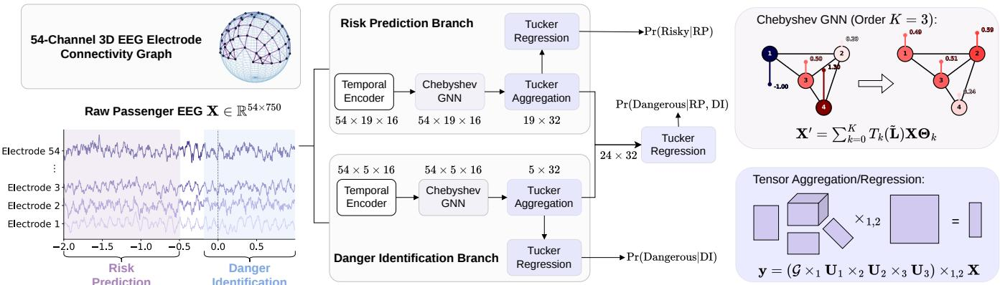

# GRATED: GRAPH–TENSOR EEG DECODING FOR PASSENGER HAZARD PERCEPTION IN AUTONOMOUS VEHICLES

Yuxuan Gu1∗, Yingkai Yang1∗†, Qiyu Rao1, Tania Stathaki1, Danilo Mandic1

1 Department of Electrical and Electronic Engineering, Imperial College London, United Kingdom

## ABSTRACT

Passenger electroencephalography (EEG) can reveal road risk through anticipatory responses before hazardous events and neural reactions around their onset. However, existing EEG decoding methods often map physiologically meaningful arrangement of electrodes onto artificial 2D grids and thus flatten the higher-order time–feature representations into matrices, obscuring meaningful structure in the data. To preserve and exploit the spatial and time–feature structure of EEG recordings, we propose the Graph-Tensor EEG Decoding Model (GraTED) for passenger risk prediction (RP) and danger identification (DI) in autonomous-vehicle scenarios. GraTED models the electrode arrangement as an undirected graph based on their scalp locations, using graph convolution to capture spatial dependencies and low-rank tensor classification to preserve the multidimensional time–feature structure, while controlling model complexity. Evaluated on the PassengerEEG dataset, comprising 11 participants and 45 hours of recordings, GraTED achieves the highest balanced accuracy, compared to the state-of-the-art, across all three evaluation settings, while requiring the fewest learnable parameters among seven baseline methods.

Index Terms— Autonomous Vehicles, EEG, Graph Neural Networks, Tensor Classification, Brain-Computer Interface

## 1. INTRODUCTION

Autonomous vehicles (AVs) have the potential to reduce the burden of vehicle control while improving mobility and reducing accidents associated with human error. However, their safe deployment remains challenging because vehicle behavior may become less reliable in rare or complex situations, particularly when such situations are insufficiently represented in training data [1,2]. Moreover, objective vehicle performance does not necessarily reflect passengers’ perceived risk, and mismatches between the two may undermine trust in autonomous driving. This motivates the use of complementary human-centered information. In this work, we leverage brain-computer interfaces (BCIs) to capture passengers’ risk perception from electroencephalography (EEG) signals, providing an additional source of information for safer and more human-aligned AV behavior.

EEG is well-suited for capturing such responses due to its portability and high temporal resolution [3]. Prior work reveals that passenger EEG encodes anticipatory activity before hazards and stimulusrelated responses near their onset [1, 4–6], motivating two complementary tasks in the passenger-centered evaluation framework [1, 5]: Risk Prediction (RP), which uses pre-event EEG to assess potential risk, and Danger Identification (DI), which detects actual danger around event onset. Risk-aware Sequential Labeling (RSL) further enables RP-acquired knowledge to inform DI.

Existing approaches, particularly the prior 3D-CRNN [1], demonstrate the value of joint spatiotemporal EEG modeling. However, the 3D-CRNN has two structural limitations. First, it maps the 54 electrodes onto a 6 × 9 grid for convolution. While computationally convenient, this representation distorts the irregular 10–20 scalp geometry [7] and imposes an artificial regular neighborhood structure. Second, its GRU-based fusion treats the structured time–feature representation as a sequence, without explicitly modeling higher-order interactions between the time and feature modes. These limitations motivate the following research question:

• Can passenger EEG be modeled in a parameter-efficient manner, while preserving domain-specific electrode geometry and thus capturing higher-order interactions between time and feature modesfor accurate hazard-perception decoding?

To this end, we propose Graph-Tensor EEG Decoding Model (GraTED), a parameter-efficient framework for passenger risk prediction and danger identification in AV scenarios. Instead of imposing an artificial rectangular electrode layout, GraTED represents EEG electrodes as nodes of a graph constructed from their scalp coordinates. Chebyshev graph convolutions propagate information among neighboring electrodes without requiring explicit eigendecomposition. The resulting time-feature representation is then processed directly by low-rank tensor classification (without flattening modes), thus preserving its multidimensional structure while natively modeling interactions across temporal, feature, and class axes. Such structured parameterization provides a useful inductive bias for learning cross-mode dependencies in high-dimensional EEG data with limited sample sizes.

In summary, our main contributions are threefold:

• We introduce an undirected electrode graph based on scalp coordinates, preserving realistic irregular spatial relationships among electrodes instead of imposing an artificial regular grid.

• We develop GraTED, a graph-tensor decoding architecture that combines Chebyshev graph filtering with tensor classification, preserving both spatial topology and the structure across time and feature modes of the learned representation.

• We evaluate our model against seven state-of-the-art baselines on PassengerEEG dataset, demonstrating that GraTED achieves the highest balanced accuracy in all settings, while using significantly fewer trainable parameters.

## 2. RELATED WORK

## 2.1. EEG decoding

Existing EEG decoding approaches encompass CNN-based models (ShallowConvNet, DeepConvNet, and EEGNet) [8, 9], transformerbased CTNet [10], spatiotemporal DSC-ConvLSTM [11] and 3D-CRNN [1], and non-neural XGB-DIM [12], yet none fully respects electrode topology or higher-order spatiotemporal dependencies, re stricting their performance in EEG decoding tasks.

  
Fig. 1. The GraTED architecture, consisting of risk prediction (RP) and danger identification (DI) branches.

## 2.2. Graphs and Tensors

Graph neural networks (GNNs) [13, 14] naturally model irregular data by representing entities as nodes and their relationships as edges, making them well suited to EEG electrode layouts. Tensor methods [15, 16] preserves multi-dimensional structure and uses low-rank decompositions [17] to control model complexity. GraTED combines both, using graph convolution to capture electrode relationships and tensor classification to model time–feature interactions.

## 3. METHODOLOGY

## 3.1. Preliminaries

## 3.1.1. Chebyshev Graph Convolution

Let $\mathscr { G } = ( \gamma , \mathscr { E } , \mathbf { A } )$ denote a weighted graph with N nodes and adjacency matrix, $\mathbf { A } \in \mathbb { R } ^ { N \times N }$ . After adding self-loops, we define the symmetrically normalized adjacency matrix, A, and the corresponding graph Laplacian, L, as

$$
\widehat { \mathbf { A } } = \mathbf { D } ^ { - 1 / 2 } ( \mathbf { A } + \mathbf { I } ) \mathbf { D } ^ { - 1 / 2 } , \qquad \mathbf { L } = \mathbf { I } - \widehat { \mathbf { A } } ,\tag{1}
$$

where the degree $\begin{array} { r } { D _ { i i } = \sum _ { i } ( A _ { i j } + I _ { i j } ) } \end{array}$ . The Laplacian is next rescaled as

$$
\widetilde { \mathbf L } = \frac { 2 } { \lambda _ { \mathrm { m a x } } } \mathbf L - \mathbf I ,\tag{2}
$$

where $\lambda _ { \mathrm { m a x } }$ is the largest eigenvalue of L. This maps the eigenvalues of $\mathbf { L } \operatorname { t o } \left[ - 1 , 1 \right]$ , with Chebyshev polynomials as well behaved and providing a stable approximation of spectral graph filters.

Chebyshev graph convolution [13] approximates a spectral graph filter using Chebyshev polynomials of Le. These polynomials are defined recursively by

$$
T _ { 0 } ( \widetilde { \mathbf { L } } ) = \mathbf { I } , \quad T _ { 1 } ( \widetilde { \mathbf { L } } ) = \widetilde { \mathbf { L } } , \quad T _ { q } ( \widetilde { \mathbf { L } } ) = 2 \widetilde { \mathbf { L } } T _ { q - 1 } ( \widetilde { \mathbf { L } } ) - T _ { q - 2 } ( \widetilde { \mathbf { L } } ) .\tag{3}
$$

Given node features $\mathbf { X } \in \mathbb { R } ^ { N \times F _ { \mathrm { i n } } }$ , a Chebyshev convolution of order $Q - 1$ is defined as,

$$
\mathbf { Y } = \sum _ { q = 0 } ^ { Q - 1 } T _ { q } ( \widetilde { \mathbf { L } } ) \mathbf { X } \pmb { \Theta } _ { q } , \qquad \pmb { \Theta } _ { q } \in \mathbb { R } ^ { F _ { \mathrm { i n } } \times F _ { \mathrm { o u t } } } ,\tag{4}
$$

where $\Theta _ { q }$ denotes the learnable parameters for the q-th polynomial order. The resulting filter aggregates information from local graph neighborhoods without requiring an explicit eigendecomposition. We refer the reader to [13] for further details.

## 3.1.2. Tensor Operations and Tucker Decomposition

A tensor $\mathcal { A } \in \mathbb { R } ^ { I _ { 1 } \times \cdots \times I _ { D } }$ is a D-way array [18, 19]. We use a, a, A, and A to denote scalars, vectors, matrices, and tensors, respectively. The mode-n product of A with $\mathbf { U } \in \mathbb { R } ^ { J \times I _ { n } }$ is denoted by $\boldsymbol { B } =$ $\mathcal { A } \times _ { n } \mathbf { U }$ . Its element-wise definition is

$$
B _ { i _ { 1 } . . . i _ { n - 1 } j i _ { n + 1 } . . . i _ { D } } = \sum _ { i _ { n } = 1 } ^ { I _ { n } } A _ { i _ { 1 } . . . i _ { n } . . . i _ { D } } U _ { j i _ { n } } .\tag{5}
$$

We additionally use $\times _ { p , q }$ to denote simultaneous contraction over two tensor modes. For $\overset { \cdot } { \mathcal { A } } \in \mathbb { R } ^ { I _ { 1 } \times \cdots \times I _ { D } }$ and B $\in \mathbb { R } ^ { I _ { p } \times I _ { q } }$ , with $p < q ,$ the contraction ${ \mathcal { C } } = { \mathcal { A } } \times _ { p , q } \mathbf { B }$ is defined as

$$
C _ { i _ { 1 } . . . i _ { p - 1 } i _ { p + 1 } . . . i _ { q - 1 } i _ { q + 1 } . . . i _ { D } } = \sum _ { i _ { p } = 1 } ^ { I _ { p } } \sum _ { i _ { q } = 1 } ^ { I _ { q } } A _ { i _ { 1 } . . . i _ { D } } B _ { i _ { p } i _ { q } } .\tag{6}
$$

Thus, modes p and q are contracted, while the remaining modes of A are retained. Moreover, the Tucker decomposition [19] represents a D-way tensor $\mathcal { W } \in \mathbb { R } ^ { \bar { I _ { 1 } } \times \dots \times I _ { D } }$ as

$$
\boldsymbol { \mathcal { W } } = \boldsymbol { \mathcal { G } } \times _ { 1 } \mathbf { U } ^ { ( 1 ) } \times _ { 2 } \mathbf { U } ^ { ( 2 ) } \times _ { 3 } \cdot \cdot \cdot \times _ { D } \mathbf { U } ^ { ( D ) } ,\tag{7}
$$

where $\mathcal { G } \in \mathbb { R } ^ { R _ { 1 } \times \cdots \times R _ { D } }$ is the core tensor and $\mathbf { U } ^ { ( d ) } \in \mathbb { R } ^ { I _ { d } \times R _ { d } }$ is the factor matrix associated with mode d. The tuple $( R _ { 1 } , \ldots , R _ { D } )$ defines the Tucker rank. When W is used as a classification coefficient tensor, this low-rank parameterization captures interactions among its mode-specific dimensions, while reducing the number of trainable parameters and helping mitigate the risk of overfitting.

## 3.2. Problem Formulation and Overview

Passenger EEG is recorded from N = 54 scalp electrodes at 250 Hz during simulated autonomous-driving scenarios and aligned to the onset of each traffic event. Each trial is represented as $\bar { \mathbf { X } } \in \mathbb { R } ^ { N \times S }$ with S = 750 samples over [−2, 1] s relative to event onset. Risk Prediction (RP) uses the pre-event window, $\mathbf { X } _ { \mathrm { R P } } \in \mathbb { R } ^ { 5 4 \times 3 7 5 }$ , from $[ - 2 , - 0 . 5 ] \ \mathrm { s } ,$ whereas Danger Identification (DI) uses the eventcentered window $\mathbf { X } _ { \mathrm { { D I } } } \in \mathbb { R } ^ { \breve { 5 } 4 \times 3 0 0 } { \mathrm { ~ f r o m ~ } } [ - 0 . 2 , 1 ] \mathbf { \bar { s } }$ . GraTED processes both windows using temporal encoding and graph-based spatial modeling, followed by a low-rank tensor classifier. For DI with RSL, the RP and DI representations are further combined so that pre-event risk information can inform danger identification.

## 3.3. Electrode Graph Construction

Each EEG electrode is represented as a graph node with normalized 3D scalp coordinate $\mathbf { \hat { p } } _ { i } \in \mathbb { R } ^ { 3 }$ from the standard 10–20 montage. The geodesic distance between electrodes i and j is $d _ { i j } =$ arccos $\left( \mathbf { p } _ { i } ^ { \mathsf { T } } \mathbf { p } _ { j } \right)$ . In our design, each node is connected to its $k = 4$ nearest neighbors according to the geodesic distance, and the resulting k-nearest-neighbor graph is symmetrized by including an undirected edge $( i , j )$ if either i selects j or j selects i as a nearest neighbor. The edge weights are defined based on an exponential kernel, as

$$
A _ { i j } = \left\{ \begin{array} { l l } { \exp \left( - d _ { i j } ^ { 2 } / 2 \sigma ^ { 2 } \right) , } & { j \in \mathcal { N } _ { k } ( i ) \mathrm { o r } i \in \mathcal { N } _ { k } ( j ) , } \\ { 0 , } & { \mathrm { o t h e r w i s e } , } \end{array} \right.\tag{8}
$$

where σ is the median pairwise electrode distance. The resulting adja cency matrix is normalized with self-loops according to Eq. (1). This graph reflects physical proximity between scalp electrodes, without imposing an artificial rectangular layout.

## 3.4. Temporal and Graph Feature Encoding

Temporal features are first extracted independently from each electrode, without sharing information across nodes. Let $\mathbf { x } _ { \mathrm { R P } , i } \ =$ $\mathbf { X } _ { \mathrm { { R P } } } [ i , : ] \ \in \ \mathbb { R } ^ { 3 7 5 }$ and $\mathbf { x } _ { \mathrm { D I } , i } ~ = ~ \mathbf { X } _ { \mathrm { D I } } [ i , : ] ~ \in ~ \mathbb { R } ^ { 3 0 0 }$ denote the $\mathrm { R P }$ and DI signals of electrode i, respectively. We define the temporal encoder as

$$
\phi ( \mathbf { x } _ { i } ) = \log \left( \operatorname { A v g P o o l } \left[ \operatorname { B N } \left( \operatorname { C o n v _ { 1 D } } ( \mathbf { x } _ { i } ) \right) ^ { \odot 2 } \right] \right) ,\tag{9}
$$

where $( \cdot ) ^ { \odot 2 }$ denotes element-wise squaring. The encoder maps each RP electrode signal to $\mathbb { R } ^ { 1 9 \times 1 6 }$ and each DI electrode signal to $\mathbb { R } ^ { 5 \times 1 6 }$ where the first dimension indexes temporal positions and the second indexes learned features. Stacking the representations across all electrodes gives $\mathcal { H } _ { \mathrm { R P } } ^ { ( 0 ) } \in \mathbb { R } ^ { N \times 1 9 \times 1 6 }$ and $\mathcal { H } _ { \mathrm { D I } } ^ { ( 0 ) } \in \mathbb { R } ^ { N \times 5 \times 1 6 }$

The encoded node features are then propagated over the electrode graph to model spatial dependencies. Using the rescaled Laplacian in Eq. (2), we set $\lambda _ { \operatorname* { m a x } } = 2$ . Since $\mathbf { L } = \mathbf { I } - \widehat { \mathbf { A } } , \mathrm { E q . } \left( 2 \right)$ reduces to $\widetilde { \mathbf { L } } = - \widehat { \mathbf { A } } . \mathbf { A } 1$ t graph layer ℓ, the node–feature representation at time index t is H $\dot { \mathbf { \rho } } _ { \cdot t } ^ { ( \ell ) } = \mathcal { H } ^ { ( \ell ) } [ : , t , : ] \in \mathbb { R } ^ { N \times 1 6 }$ . The Chebyshev convolution in Eq. (4) is incorporated into a residual normalization block as

$$
\mathbf { H } _ { t } ^ { ( \ell + 1 ) } = \mathrm { L N } \left( \mathbf { H } _ { t } ^ { ( \ell ) } + \sum _ { q = 0 } ^ { Q - 1 } T _ { q } ( \widetilde { \mathbf { L } } ) \mathbf { H } _ { t } ^ { ( \ell ) } \pmb { \Theta } _ { q } ^ { ( \ell ) } \right) ,\tag{10}
$$

where $\Theta _ { q } ^ { ( \ell ) } \in \mathbb { R } ^ { 1 6 \times 1 6 }$ denotes the learnable graph-filter parameters and LN(·) denotes layer normalization. We set $Q = 3$ and use two graph layers to capture local multi-hop interactions between electrodes. After graph propagation, each $\mathbf { \bar { H } } _ { t } ^ { ( L ) } \in \mathbb { R } ^ { N \times 1 6 }$ is mapped to a 32-D graph-level representation using Tucker-parameterized aggregation. Following Eq. (7), we define the coefficient tensor $\mathcal { W } ^ { ( \mathrm { a g g } ) } \in \mathbb { R } ^ { 3 2 \times N \times 1 6 }$ , whose modes correspond to output feature, electrode, and graph features, respectively. The associated factor matrices are $\mathbf { U } ^ { ( o ) } \in \mathbb { R } ^ { 3 2 \times R _ { o } } , \mathbf { \bar { U } } ^ { ( n ) } \in \mathbb { R } ^ { N \times R _ { n } }$ , and ${ \bf U } ^ { ( h ) } \in \mathbb { R } ^ { 1 6 \times R _ { h } }$ We use Tucker ranks $( R _ { o } , R _ { n } , R _ { h } ) = ( 8 , 2 4 , 8 )$ . At each time index, the graph-level representation $\mathbf { z } _ { t } \in \mathbb { R } ^ { 3 2 }$ is obtained by contracting the electrode and graph-feature modes of ${ \mathcal { W } } ^ { ( \mathrm { a g g } ) }$ with $\mathbf { \widetilde { H } } _ { t } ^ { ( L ) }$ , as

$$
\mathbf { z } _ { t } = \sigma \left( \mathcal { W } ^ { ( \mathrm { a g g } ) } \times _ { 2 , 3 } \mathbf { H } _ { t } ^ { ( L ) } + \mathbf { b } ^ { ( r ) } \right) ,\tag{11}
$$

where $\mathbf { b } ^ { ( r ) } \in \mathbb { R } ^ { 3 2 }$ and $\sigma ( \cdot )$ denotes the ELU activation function [20]. Collecting these representations over time gives ${ \textbf { Z } } =$ $[ \mathbf { z } _ { 1 } , \mathbf { \bar { \Phi } } . . . , \mathbf { \bar { z } } _ { T } ] ^ { T } \ \in \ \mathbb { R } ^ { \breve { T } \times 3 2 }$ . Specifically, $\mathbf { Z } _ { \mathrm { R P } } ~ \in ~ \mathbb { R } ^ { 1 9 \times 3 2 }$ for RP branch and $\mathbf { \dot { Z } } _ { \mathrm { D I } } \in \mathbb { R } ^ { 5 \times 3 2 }$ for DI branch.

## 3.5. Tucker-Parameterized Tensor Classification

GraTED uses separate tensor classifiers for three tasks: RP, DI without RSL, and DI with RSL. The first two classifiers operate directly on $\mathbf { Z } _ { \mathrm { R P } } \in \mathbb { R } ^ { 1 9 \times 3 2 }$ and $\mathbf { Z } _ { \mathrm { D I } } \in \mathbb { R } ^ { 5 \times 3 2 }$ , respectively. For DI with RSL, the two representations are first concatenated along the temporal dimension as $\mathbf { Z } _ { \mathrm { R S L } } = [ \mathbf { Z } _ { \mathrm { R P } } \Vert \mathbf { Z } _ { \mathrm { D I } } ] \in \mathbb { R } ^ { 2 4 \times 3 2 }$ . For each classifier, the coefficient tensor is $\mathcal { W } ^ { ( \mathrm { c l s } ) } \in \mathbb { R } ^ { \bar { T } \times 3 2 \times C }$ , where $C = 2$ and $T = 1 9$ $^ { 5 , }$ and 24 for RP, DI without RSL, and DI with RSL, respectively. Each coefficient tensor is parameterized using the Tucker decomposition in Eq. (7) over the time, learned-feature, and prediction class modes. Given the corresponding representation $\boldsymbol { \mathbf { \check { Z } } } \in \mathbb { R } ^ { T \times 3 2 }$ , the logits and class probabilities are

$$
\begin{array} { r } { \mathbf s = \mathcal { W } ^ { ( \mathrm { c l s } ) } \times _ { 1 , 2 } \mathbf Z + \mathbf b , \qquad \widehat { \mathbf y } = \mathrm { s o f t m a x } ( \mathbf s ) , } \end{array}\tag{12}
$$

where s, $\widehat { \mathbf { y } } , \mathbf { b } \in \mathbb { R } ^ { C }$ . The RP classifier predicts non-risky versus risky, while both DI classifiers predict non-dangerous versus dangerous. The predicted class is $\widehat { c } = \arg \operatorname* { m a x } _ { c } \widehat { y } _ { c }$

Remark 1 An additional benefit ofthe Tuckerparameterization is parameter efficiency, which naturally arisesfrom its low-rank structure. $F o r \mathcal { W } ^ { ( \mathrm { c l s } ) } \in \bar { \mathbb { R } } ^ { \bar { T } \times F \times C }$ , a dense parameterization would require $T F C + C$ trainable parameters, whereas a Tucker parameterization with ranks $( R _ { t } , R _ { f } , R _ { c } )$ only requires $R _ { t } R _ { f } R _ { c } + T R _ { t } + F R _ { f } +$ $C R _ { c } + C ,$ , with Tucker ranks chosen much smaller than corresponding mode dimensions. The resulting low-rank structure provides an inductive bias towards compact, structured interactions across the temporal, feature, and output modes, while simultaneously reducing the number of trainable parameters. This compact parameterization also acts as an implicit regularizer, helping reduce the risk of overfitting in limited-data EEG settings.

## 4. EXPERIMENTS

## 4.1. Experimental Setup

We conducted experiments on PassengerEEG [21], a preprocessed passenger EEG dataset comprising trials from 11 participants across 15 traffic scenarios, and follow the experimental setup in [1]. Each trial belongs to one of three source categories: safe, low-risk, or highrisk. For RP, safe trials are labeled non-risky, whereas low-risk and high-risk trials are labeled risky. For DI, safe and low-risk trials are labeled non-dangerous, whereas high-risk trials are labeled dangerous. The same labeling scheme is used for DI with and without RSL.

For each participant, 60% of data was used for training and 40% for testing, with 30% of the training data reserved for validation. All models were trained using AdamW optimizer [22] with a batch size of 1024 for at most 60 epochs in each task, with early stopping based on validation balanced accuracy (BA). Results were averaged across participants. Precision, recall, and F1-score were computed for the positive class (risky for RP and dangerous for DI), whereas

Table 1. Performance and model-size comparison (mean ± standard deviation across 11 participants). Params. denotes the trainable parameters for each setting. The best results in each metric are bold.
<table><tr><td>Setting</td><td>Model</td><td>Params. ↓</td><td>Precision ↑</td><td>Recall ↑</td><td> $\mathrm { F 1 - S c o r e \uparrow }$ </td><td>Balanced Accuracy ↑</td></tr><tr><td rowspan="7">RP</td><td>EEGNet</td><td>6,762</td><td> $0 . 9 1 6 \pm 0 . 0 6 8$ </td><td> $0 . 9 0 9 \pm 0 . 0 4 7$ </td><td> $0 . 9 1 1 \pm 0 . 0 5 1$ </td><td> $0 . 9 1 7 \pm 0 . 0 4 9$ </td></tr><tr><td>ShallowConvNet</td><td>89,002</td><td> $0 . 9 6 3 \pm 0 . 0 3 6$ </td><td> $\mathbf { 0 . 9 1 8 \pm 0 . 0 4 5 }$ </td><td> $0 . 9 3 9 \pm 0 . 0 3 6$ </td><td> $0 . 9 4 3 \pm 0 . 0 3 3$ </td></tr><tr><td>DeepConvNet</td><td>298,852</td><td> $0 . 9 5 1 \pm 0 . 0 4 0$ </td><td> $0 . 9 1 8 \pm 0 . 0 4 2$ </td><td> $0 . 9 3 4 \pm 0 . 0 3 7$ </td><td> $0 . 9 3 8 \pm 0 . 0 3 5$ </td></tr><tr><td>XGB-DIM</td><td>17,850</td><td> $0 . 6 3 5 \pm 0 . 1 2 5$ </td><td> $0 . 4 2 7 \pm 0 . 2 0 7$ </td><td> $0 . 4 7 4 \pm 0 . 1 7 0$ </td><td> $0 . 5 9 6 \pm 0 . 0 6 8$ </td></tr><tr><td>CTNet</td><td>21,890</td><td> $0 . 9 2 3 \pm 0 . 0 7 4$ </td><td> $0 . 8 5 7 \pm 0 . 1 7 2$ </td><td> $0 . 8 8 1 \pm 0 . 1 3 8$ </td><td> $0 . 9 0 1 \pm 0 . 0 9 6$ </td></tr><tr><td>DSC-ConvLSTM</td><td>7,232</td><td> $0 . 9 3 5 \pm 0 . 0 7 9$ </td><td> $0 . 8 8 7 \pm 0 . 0 7 0$ </td><td> $0 . 9 0 9 \pm 0 . 0 6 7$ </td><td> $0 . 9 1 5 \pm 0 . 0 6 2$ </td></tr><tr><td>3D-CRNN</td><td>33,410</td><td> $0 . 9 5 9 \pm 0 . 0 3 8$ </td><td> $0 . 9 0 3 \pm 0 . 0 6 0$ </td><td> $0 . 9 2 9 \pm 0 . 0 4 5$ </td><td> $0 . 9 3 4 \pm 0 . 0 4 1$ </td></tr><tr><td></td><td>GraTED (Ours)</td><td>6,388</td><td> $\mathbf { 0 . 9 7 7 \pm 0 . 0 3 4 }$ </td><td> $0 . 9 1 3 \pm 0 . 0 4 4$ </td><td> ${ \bf 0 . 9 4 3 \pm 0 . 0 2 8 }$ </td><td> ${ \bf 0 . 9 4 6 \pm 0 . 0 2 6 }$ </td></tr><tr><td rowspan="8">DI w/o RSL</td><td>EEGNet</td><td>6,602</td><td> $0 . 6 2 2 \pm 0 . 0 6 8$ </td><td> $0 . 6 7 2 \pm 0 . 1 3 8$ </td><td> $0 . 6 4 2 \pm 0 . 0 9 4$ </td><td> $0 . 7 4 9 \pm 0 . 0 6 8$ </td></tr><tr><td>ShallowConvNet</td><td>88,602</td><td> $0 . 6 3 8 \pm 0 . 0 4 7$ </td><td> $0 . 8 1 2 \pm 0 . 0 8 1$ </td><td> $0 . 7 1 1 \pm 0 . 0 3 7$ </td><td> $0 . 8 0 6 \pm 0 . 0 3 6$ </td></tr><tr><td>DeepConvNet</td><td>298,452</td><td> $0 . 5 9 7 \pm 0 . 0 8 2$ </td><td> $0 . 7 0 9 \pm 0 . 1 3 2$ </td><td> $0 . 6 4 5 \pm 0 . 0 9 3$ </td><td> $0 . 7 5 1 \pm 0 . 0 7 3$ </td></tr><tr><td>XGB-DIM</td><td>17,850</td><td> $0 . 3 5 0 \pm 0 . 0 4 4$ </td><td> $0 . 7 9 5 \pm 0 . 1 0 9$ </td><td> $0 . 4 8 2 \pm 0 . 0 4 3$ </td><td> $0 . 5 7 3 \pm 0 . 0 4 4$ </td></tr><tr><td>CTNet</td><td>21,842</td><td> $0 . 5 5 1 \pm 0 . 2 0 4$ </td><td> $0 . 6 4 0 \pm 0 . 2 8 1$ </td><td> $0 . 5 8 0 \pm 0 . 2 3 1$ </td><td> $0 . 7 2 7 \pm 0 . 1 2 3$ </td></tr><tr><td>DSC-ConvLSTM</td><td>7,232</td><td> $\mathbf { 0 . 6 5 4 \pm 0 . 0 6 8 }$ </td><td> $0 . 6 6 8 \pm 0 . 2 0 5$ </td><td> $0 . 6 3 4 \pm 0 . 1 1 1$ </td><td> $0 . 7 4 9 \pm 0 . 0 6 9$ </td></tr><tr><td>3D-CRNN</td><td>42,754</td><td> $0 . 6 3 6 \pm 0 . 0 5 1$ </td><td> $0 . 8 0 5 \pm 0 . 0 7 6$ </td><td> $0 . 7 0 9 \pm 0 . 0 5 4$ </td><td> $0 . 8 0 3 \pm 0 . 0 4 8$ </td></tr><tr><td>GraTED (Ours)</td><td>5,451</td><td> $0 . 6 5 3 \pm 0 . 0 2 7$ </td><td> $\mathbf { 0 . 8 4 8 \pm 0 . 0 5 3 }$ </td><td> $\mathbf { 0 . 7 3 7 \pm 0 . 0 2 3 }$ </td><td> $\mathbf { 0 . 8 2 7 \pm 0 . 0 2 6 }$ </td></tr><tr><td></td><td>EEGNet</td><td>16,790</td><td> $0 . 6 5 9 \pm 0 . 0 5 2$ </td><td> $0 . 8 2 6 \pm 0 . 0 9 3$ </td><td> $0 . 7 3 0 \pm 0 . 0 5 5$ </td><td> $0 . 8 2 0 \pm 0 . 0 4 8$ </td></tr><tr><td rowspan="7">DI w/ RSL</td><td>ShallowConvNet</td><td>181,446</td><td> ${ \bf 0 . 6 8 2 \pm 0 . 0 4 8 }$ </td><td> $0 . 8 4 6 \pm 0 . 0 6 4$ </td><td> $0 . 7 5 3 \pm 0 . 0 3 4$ </td><td> $0 . 8 3 7 \pm 0 . 0 3 1$ </td></tr><tr><td>DeepConvNet</td><td>607,994</td><td> $0 . 6 7 9 \pm 0 . 0 6 7$ </td><td> $0 . 8 4 6 \pm 0 . 0 7 3$ </td><td> $0 . 7 5 0 \pm 0 . 0 4 6$ </td><td> $0 . 8 3 5 \pm 0 . 0 3 8$ </td></tr><tr><td>XGB-DIM</td><td>35,703</td><td> $0 . 4 1 5 \pm 0 . 1 4 4$ </td><td> $0 . 2 8 8 \pm 0 . 2 0 7$ </td><td> $0 . 3 1 3 \pm 0 . 1 8 4$ </td><td></td></tr><tr><td>CTNet</td><td>45,654</td><td> $0 . 6 4 8 \pm 0 . 0 5 0$ </td><td> $0 . 8 0 6 \pm 0 . 1 7 5$ </td><td> $0 . 7 0 7 \pm 0 . 1 1 2$ </td><td> $0 . 5 7 1 \pm 0 . 0 6 3$ </td></tr><tr><td>DSC-ConvLSTM</td><td>17,186</td><td> $0 . 6 3 7 \pm 0 . 0 3 3$ </td><td> $0 . 8 2 2 \pm 0 . 1 6 6$ </td><td> $0 . 7 0 9 \pm 0 . 0 8 0$ </td><td> $0 . 8 0 9 \pm 0 . 0 7 3$ </td></tr><tr><td>3D-CRNN</td><td>79,334</td><td> $0 . 6 6 8 \pm 0 . 0 3 2$ </td><td> $0 . 8 6 1 \pm 0 . 0 8 2$ </td><td> $0 . 7 5 0 \pm 0 . 0 3 5$ </td><td> $0 . 8 0 9 \pm 0 . 0 6 9$ </td></tr><tr><td>GraTED (Ours)</td><td>12,805</td><td> $0 . 6 6 0 \pm 0 . 0 1 5$ </td><td> ${ \bf 0 . 8 9 4 \pm 0 . 0 3 1 }$ </td><td> $\mathbf { 0 . 7 5 9 \pm 0 . 0 1 0 }$ </td><td> $0 . 8 3 8 \pm 0 . 0 3 5$   ${ \bf 0 . 8 4 8 \pm 0 . 0 1 2 }$ </td></tr></table>

BA averages recall across both classes and is therefore used as the primary metric. We compared GraTED against the seven baselines introduced in Section 2, using the same data splits and training setup for all models.

## 4.3. Parameter Efficiency

## 4.2. Numerical Results

Table 1 shows that GraTED consistently achieves the highest balanced accuracy across all three evaluation settings. For RP, the BA of GraTED (0.946) slightly exceeds that of ShallowConvNet (0.943), and GraTED also exhibits comparatively low variability across participants, indicating stable RP performance.

The advantage of GraTED is more pronounced for DI without RSL, where its BA reaches 0.827, improving on ShallowConvNet and 3D-CRNN by 2.1 and 2.4%, respectively. Relative to these two baselines, improvements are also observed in precision, recall, and F1-score, indicating consistent improvements across multiple classification metrics. These results demonstrate the effectiveness of GraTED for extracting danger-related information from the eventcentered EEG window.

Incorporating the RP representation through RSL further improves DI performance, increasing GraTED’s BA from 0.827 to 0.848 and its F1-score from 0.737 to 0.759. GraTED therefore outperforms the strongest baseline under this setting, 3D-CRNN, by 1.2%. This improvement indicates that pre-event risk information provides complementary context to the event-centered EEG response, supporting the joint use of RP and DI representations for danger identification.

GraTED remains parameter-efficient across all evaluation settings, using 6,388 parameters for RP, 5,451 for DI without RSL, and 12,805 for DI with RSL. Compared with 3D-CRNN, these correspond to reductions of 80.9%, 87.3%, and 83.9%, respectively, while GraTED achieves higher BA in all three settings. The Tucker-parameterized classifiers contain only 1,028 parameters for RP, 283 for standalone DI, and 966 for DI with RSL. For DI with RSL, the Tucker classification module therefore uses 69.5% fewer parameters than the 3,170- parameter GRU fusion module employed by 3D-CRNN. These results demonstrate that the low-rank tensor formulation yields substantial parameter savings without compromising decoding performance.

## 5. CONCLUSION

We have proposed GraTED, a graph–tensor framework for passenger EEG decoding that combines electrode-graph modeling with tensor classification, thus preserving both scalp geometry and the time–feature structure of the learned representation. Among seven baselines considered, GraTED has achieved the highest BA across three task settings, while reducing the active parameter count by 80.9%–87.3% relative to 3D-CRNN, the strongest baseline method. These results have highlighted the promise of graph–tensor modeling as an effective and parameter-efficient approach to passenger hazard perception. Future work will examine subject-independent generalization and real-world online evaluation.

## 6. COMPLIANCE WITH ETHICAL STANDARDS

This is a numerical simulation study for which no ethical approval was required.

## 7. REFERENCES

[1] Yingkai Yang, Ashton Yu Xuan Tan, Bowen Li, Xiaorong Gao, Sifa Zheng, Jianqiang Wang, Xinyu Gu, Yang Zhao, Yuxin Zhang, Sharon X. Huang, Tania Stathaki, Jun Li, and Hong Wang, “EEG-Driven Decoding Framework for Passenger Hazard Perception in Highly Automated Vehicles,” Automotive Innovation, 2026, Accepted.

[2] Wenhao Yu, Chengxiang Zhao, Hong Wang, Jiaxin Liu, Xiaohan Ma, Yingkai Yang, Jun Li, Weida Wang, Xiaosong Hu, and Ding Zhao, “Online Legal Driving Behavior Monitoring for Self-driving Vehicles,” Nature Communications, vol. 15, no. 1, pp. 408, 2024.

[3] Gianluca Di Flumeri, Gianluca Borghini, Pietro Arico, Nicolina\` Sciaraffa, Paola Lanzi, Simone Pozzi, Valeria Vignali, Claudio Lantieri, Arianna Bichicchi, Andrea Simone, and Fabio Babiloni, “Chapter 20 – EEG-Based Mental Workload Assessment During Real Driving: A Taxonomic Tool for Neuroergonomics in Highly Automated Environments,” in Neuroergonomics, Hasan Ayaz and Fred´ eric Dehais, Eds., pp. 121–126. Academic´ Press, 2019.

[4] Morgan A Belcher, InChan Hwang, Sylvia Bhattacharya, W David Hairston, and Jason S Metcalfe, “EEG-based Prediction of Driving Events from Passenger Cognitive State using Morlet Wavelet and Evoked Responses,” Transportation Engineering, vol. 8, pp. 100107, 2022.

[5] Xiaofei Zhang, Xin Xiao, Yingkai Yang, Zhenmao Hao, Jun Li, and Hong Wang, “EEG Signal Analysis for Early Detection of Critical Road Events and Emergency Response in Autonomous Driving,” in 2023 IEEE 26th International Conference on Intelligent Transportation Systems (ITSC), 2023, pp. 1706–1712.

[6] Trung-Hau Nguyen and Wan-Young Chung, “Detection of Driver Braking Intention using EEG Signals During Simulated Driving,” Sensors, vol. 19, no. 13, pp. 2863, 2019.

[7] George H. Klem, Hans O. Luders, Herbert H. Jasper, and Chris-¨ tian Erich Elger, “The Ten-Twenty Electrode System of the International Federation. The International Federation of Clinical Neurophysiology.,” Electroencephalography and Clinical Neurophysiology. Supplement, vol. 52, pp. 3–6, 1999.

[8] Robin Tibor Schirrmeister, Jost Tobias Springenberg, Lukas Dominique Josef Fiederer, Martin Glasstetter, Katharina Eggensperger, Michael Tangermann, Frank Hutter, Wolfram Burgard, and Tonio Ball, “Deep Learning with Convolutional Neural Networks for EEG Decoding and Visualization,” Human Brain Mapping, vol. 38, no. 11, pp. 5391–5420, 2017.

[9] Vernon J Lawhern, Amelia J Solon, Nicholas R Waytowich, Stephen M Gordon, Chou P Hung, and Brent J Lance, “EEG-Net: A Compact Convolutional Neural Network for EEG-based Brain–Computer Interfaces,” Journal of Neural Engineering, vol. 15, no. 5, pp. 056013, 2018.

[10] Wei Zhao, Xiaolu Jiang, Baocan Zhang, Shixiao Xiao, and Sujun Weng, “CTNet: a Convolutional Transformer Network for EEG-based Motor Imagery Classification,” Scientific Reports, vol. 14, no. 1, pp. 20237, 2024.

[11] Li Li and Nan Sun, “Attention-Based DSC-ConvLSTM for Multiclass Motor Imagery Classification,” Computational Intelligence and Neuroscience, vol. 2022, no. 1, pp. 8187009, 2022.

[12] Bowen Li, Shangen Zhang, Yijun Hu, Yanfei Lin, and Xiaorong Gao, “Assembling Global and Local Spatial-Temporal Filters to Extract Discriminant Information of EEG in RSVP Task,” Journal of Neural Engineering, vol. 20, no. 1, pp. 016052, 2023.

[13] Michael Defferrard, Xavier Bresson, and Pierre Vandergheynst,¨ “Convolutional Neural Networks on Graphs with Fast Localized Spectral Filtering,” Advances in Neural Information Processing Systems, vol. 29, 2016.

[14] Thomas N. Kipf and Max Welling, “Semi-Supervised Classification with Graph Convolutional Networks,” in International Conference on Learning Representations, 2017.

[15] Yuxuan Gu, Wuyang Zhou, Giorgos Iacovides, and Danilo Mandic, “TeRA: Vector-based Random Tensor Network for High-rank Adaptation of Large Language Models,” in Proceedings of the 64th Annual Meeting of the Association for Computational Linguistics (Volume 1: Long Papers), 2026, pp. 2314–2329.

[16] Yuxuan Gu, Wuyang Zhou, Huijun Xing, and Danilo Mandic, “TEMPER: Tensorized Efficient Manifold-constrained Parameterization for Expressive Residual Routing,” arXiv preprint arXiv:2608.07851, 2026.

[17] Yuxuan Gu, Wuyang Zhou, Giorgos Iacovides, and Danilo Mandic, “TensorLLM: Tensorising Multi-head Attention for Enhanced Reasoning and Compression in LLMs,” in 2025 International Joint Conference on Neural Networks (IJCNN). IEEE, 2025, pp. 1–8.

[18] Andrzej Cichocki, Danilo Mandic, Lieven De Lathauwer, Guoxu Zhou, Qibin Zhao, Cesar Caiafa, and Huy Anh Phan, “Tensor Decompositions for Signal Processing Applications: From Two-way to Multiway Component Analysis,” IEEE Signal Processing Magazine, vol. 32, no. 2, pp. 145–163, 2015.

[19] Tamara G Kolda and Brett W Bader, “Tensor Decompositions and Applications,” SIAM review, vol. 51, no. 3, pp. 455–500, 2009.

[20] Djork-Arne Clevert, Thomas Unterthiner, and Sepp Hochreiter,´ “Fast and Accurate Deep Network Learning by Exponential Linear Units (ELUs),” arXiv preprint arXiv:1511.07289, 2015.

[21] Yingkai Yang, Ashton Yu Xuan Tan, Zhenmao Hao, Junwen Fu, Xin Xiao, Jun Li, and Hong Wang, “PassengerEEG: An EEG Dataset for Passenger Hazard Perception in AVs,” 2025.

[22] Ilya Loshchilov and Frank Hutter, “Decoupled Weight Decay Regularization,” arXiv preprint arXiv:1711.05101, 2017.