# Gibbs Variational Last Layers for Long-Horizon Dynamics Learning

Paul Brunzema Henrik Hose Sebastian Trimpe

RWTH Aachen University

Aachen, Germany

{firstname.lastname}@dsme.rwth-aachen.de

## Abstract

Accurate long-horizon probabilistic predictions of dynamical systems are a prerequisite for model-based decision-making. Variational Bayesian last layers (VBLLs) are an attractive model class for this setting, offering tractable uncertainty at neardeterministic cost, yet they are trained exclusively with single-step likelihood objectives that may be insufficient for reliable multi-step rollouts. We revisit VBLLs through the lens of Gibbs variational inference, which decouples posterior inference from the choice of training loss. Building on this perspective, we introduce a family of multi-step training losses that progressively incorporate longhorizon structure, robustness via continuous ranked probability scores (CRPS), and training on full autoregressive rollouts. Our approach retains the simplicity of VBLLs while directly optimizing for multi-step predictive quality. Across illustrative synthetic environments, a diverse suite of chaotic dynamical systems, and real-world data, we show that multi-step, CRPS-based objectives substantially improve long-horizon accuracy and distributional fit, consistently outperforming single-step likelihood training.

## 1 Introduction

Learned probabilistic dynamics models underpin a growing range of decision-making systems, from sampling-based control [44, 10] to uncertainty-aware policy search [13, 37, 35, 19]. In all of these settings, the model is rolled out autoregressively over extended horizons, so predictive accuracy and well-calibrated uncertainty are not just desirable but prerequisite: small local errors compound step by step and can render predictions unreliable [41]. Improving the quality of these longhorizon predictions is therefore a foundational challenge, independent of the downstream application. Variational Bayesian last layers (VBLLs) [31], a specific instance of Bayesian last-layer models [56, 52, 61, 18], offer a compelling architecture for this purpose, combining tractable predictive inference with the efficiency of deterministic feature extractors. By restricting uncertainty over parameters to a Gaussian posterior over the final layer, they yield good predictive distributions at computational cost close to that of standard neural networks, and have been successfully deployed [45, 6, 44, 11, 7]. Rather than arguing that VBLLs are the best probabilistic dynamics model in general, we ask how this increasingly used model class should be trained when deployed autoregressively.

In practice, VBLLs are trained using single-step likelihood objectives, scoring predictions on isolated transitions under a Gaussian log-likelihood. While this objective is convenient, it implicitly fixes two design choices that are in fact independent of the variational last-layer construction itself. First, the model is evaluated only on isolated transitions, so the learned features are shaped by single-step mini-batches rather than trajectory structure, and the model is never exposed to the compounding errors that arise in autoregressive rollouts at deployment. Second, the data-fit term is restricted to a Gaussian log-likelihood, whose quadratic tails can be sensitive to outliers [55]. Crucially, these are limitations of the training objective, not the model: the Gaussian posterior over the last layer and the scoring mechanism are mathematically independent, and the VBLL architecture is compatible with a much broader class of training losses.

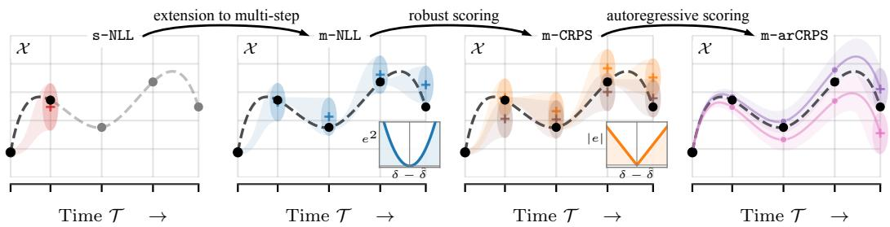  
Figure 1: Overview of the developed loss functions for VBLLs under the Gibbs VI framework. We extend existing single-step (s-NLL) to a multi-step (m-NLL), robust (m-CRPS), autoregressive loss (m-arCRPS).

We develop this perspective by revisiting VBLLs through the lens of Gibbs variational inference (Gibbs VI) [2, 5, 36], which generalizes standard variational Bayes by replacing the log-likelihood with an arbitrary loss. Applied to last-layer models, this yields what we call Gibbs variational last layers: a framework in which the training objective becomes a design choice that can encode multi-step structure, robust scoring rules, and exposure to autoregressive errors (Fig. 1)—all without modifying the model architecture, the posterior family, or the tractability of predictive inference. Within this framework, we develop a family of multi-step training objectives that improve autoregressive performance across diverse metrics, including mean rollout approximation, distributional match, and coverage of true rollouts. Across a wide range of systems, we find that task-aligned training consistently improves long-horizon accuracy and uncertainty estimation, while retaining the simplicity and predictive tractability of VBLLs.

Contributions In summary, our core contributions are as follows:

C1 We introduce and formalize Gibbs variational last layers, showing that Gibbs VI strictly generalizes the standard VBLL objective and provides a principled framework for incorporating task-aligned losses into (variational) Bayesian last-layer models.

C2 We derive a hierarchy of multi-step training objectives within Gibbs VI that progressively introduces multi-step structure, robustness to outliers, and exposure to autoregressive errors.

C3 We confirm the superior performance across 18 dynamical systems and demonstrate on data from a real-world unstable robotic system that a task-aligned objective is essential when idealized assumptions break. Further, in an illustrative example, we isolate a sampling-bias failure mode of single-step likelihood training that multi-step objectives mitigate.

## 2 Problem Setting

Consider a system with state $\pmb { x } _ { t } ~ \in ~ \mathbb { R } ^ { d _ { x } }$ evolving according to the unknown stochastic transition $\begin{array} { r } { \pmb { x } _ { t + 1 } = f ( \pmb { x } _ { t } ) + \pmb { \nu } _ { t } , \pmb { \nu } _ { t } \sim p _ { \nu } } \end{array}$ . We denote a trajectory segment of horizon H by $\pmb { \tau } ^ { ( n ) } = ( \pmb { x } _ { 0 } ^ { ( n ) } , \pmb { x } _ { 1 } ^ { ( n ) } , \dots , \pmb { x } _ { H } ^ { ( n ) } )$ and assume access to a dataset $\mathcal { D } = \{ \tau ^ { ( n ) } \} _ { n = 1 } ^ { N }$ of N such segments. We approximate the general nonlinear system with a residual model

$$
\begin{array} { r } { { \pmb x } _ { t + 1 } = { \pmb x } _ { t } + { \pmb W } ^ { \top } \phi _ { \pmb \theta } ( { \pmb x } _ { t } ) + { \pmb \nu } _ { t } , \qquad { \pmb \nu } _ { t } \sim { \mathcal { N } } ( \mathbf { 0 } , { \pmb \Sigma } _ { \nu } ) , } \end{array}\tag{1}
$$

where $\phi _ { \pmb { \theta } } \colon \mathbb { R } ^ { d _ { x } }  \mathbb { R } ^ { p }$ is a learned (deep) feature extractor parameterized by θ, $W \in \mathbb { R } ^ { p \times d _ { x } }$ is the last-layer weight matrix, and $\Sigma _ { \nu } = \operatorname { d i a g } ( \sigma _ { 1 } ^ { 2 } , \dots , \sigma _ { d _ { r } } ^ { 2 } )$ is a diagonal process-noise covariance. The residual structure, also used, e.g. in [13], ensures that the model defaults to the identity map, aiding optimization and reflecting the prior belief that consecutive states are similar for sufficiently small ∆t. The framework extends naturally to controlled systems by augmenting $\mathbf { \Delta } _ { \mathbf { \mathcal { X } } _ { t } }$ with a control input $\mathbf { \pmb { u } } _ { t }$

Variational Bayesian Last Layer We place an isotropic Gaussian prior on the columns $\boldsymbol { w } _ { j } \in \mathbb { R } ^ { p }$ of W and approximate the posterior with a mean-field Gaussian factorized across columns as in the original VBLL paper [31] as well as in application papers of VBLLs [6, 7]:

$$
\begin{array} { r } { \underline { { p ( W ) = \prod _ { j = 1 } ^ { d _ { x } } \mathcal { N } ( w _ { j } ; \mathbf { 0 } , \alpha I _ { p } ) } } , \qquad \mathrm { a n d } \qquad \underline { { q ( W \mid \eta ) = \prod _ { j = 1 } ^ { d _ { x } } \mathcal { N } ( w _ { j } ; \mu _ { j } , L _ { j } L _ { j } ^ { \top } ) } } , } \end{array}\tag{2}
$$

where $\pmb { \eta } = \{ ( \pmb { \mu } _ { j } , \pmb { L } _ { j } ) \} _ { j = 1 } ^ { d _ { x } }$ collects the variational parameters and each $\mathbf { } L _ { j } ~ \in ~ \mathbb { R } ^ { p \times p }$ is a lowertriangular Cholesky factor (see Appendix B for the concrete VBLL parameterization). Restricting

uncertainty to the last layer keeps predictive inference tractable and has demonstrated strong performance in various decision making under uncertainty settings [30, 45, 44, 12, 11, 6, 7, 52].

## 3 Gibbs Variational Last Layers

The variational last-layer construction of VBLLs, i.e. a Gaussian posterior over W, regularized toward a Gaussian prior via a KL penalty, is agnostic to how predictive quality is measured. The standard VBLL objective [31] fills this slot with a single-step Gaussian log-likelihood, but this is a choice, not a requirement. This modularity is precisely the premise of Gibbs VI [2, 36, 5], which replaces the log-likelihood in the ELBO with an arbitrary loss function while retaining the KL divergence as a complexity penalty, yielding a variational approximation to the Gibbs posterior [5, 9]. Applying this idea to VBLLs yields what we call Gibbs variational last layers: the loss becomes a design lever that can be tailored to the deployment setting without touching the model.

## 3.1 General Framework

Given this decoupling, the natural question is: What loss should one use? The Gibbs variational objective [5, 2] provides the formal framework. We seek a variational posterior within the family Q over the last-layer weights that minimizes expected loss on the training data while remaining close to the prior:

$$
\begin{array} { r l } { q ^ { * } ( W ) \in \arg \operatorname* { m i n } _ { q \in Q } \Big \{ } & { \mathbb { E } _ { q ( W ) } \left[ \sum _ { n = 1 } ^ { N } \ell \big ( W , \tau ^ { ( n ) } \big ) \right] \quad + \lambda \quad D _ { \mathsf { K L } } ( q \mid | \boldsymbol { p } ) \quad \Big \} } \\ & { \quad D a t a f t t e r m \quad \quad \quad \quad \quad \quad \quad \quad \quad \quad \quad \quad \quad \quad } \end{array}\tag{3}
$$

where $\lambda > 0$ controls regularization strength. The unconstrained minimizer of (3) is the Gibbs posterior [5, 9] and (3) defines its variational approximation in Q.

The key observation is that ℓ is afree parameter: when it is the negative log-likelihood, (3) recovers the standard VBLL objective [31]. For other choices, the optimum retains a PAC-Bayesian interpretation as a trade-off between empirical risk and prior deviation [9, 36]. This flexibility comes at the cost of a likelihood-based Bayesian interpretation as the resulting posterior is no longer an approximation to the conventional Bayesian posterior, and λ becomes a tunable regularization parameter, as in tempered posterior approaches. Nevertheless, the standard ELBO represents only one choice within a broader space of objectives and, as we will show, is not always the most effective.

In practice, we do not fix the feature extractor ϕθ but optimize it jointly with the variational parameters η. We therefore seek to solve the following optimization problem:

$$
( \eta ^ { * } , \theta ^ { * } , \Sigma _ { \nu } ^ { * } ) \in \underset { \eta , \theta , \Sigma _ { \nu } } { \mathrm { a r g } \mathrm { m i n } } \left\{ \mathbb { E } _ { q ( W | \eta ) } \left[ \frac { 1 } { N } \sum _ { n = 1 } ^ { N } \ell \big ( W , \tau ^ { ( n ) } \big ) \right] + \lambda D _ { \mathrm { K L } } \big ( q ( W \mid \eta ) \| p ( W ) \big ) \right\} .\tag{4}
$$

Joint optimization is essential: while (3) determines $q ^ { * }$ for a given feature map, optimizing θ simultaneously allows the representation to co-adapt to the choice of loss. We will show that even for objectives that are equivalent for fixed features (cf . Corollary 1), joint optimization can lead to qualitatively different representations.

Since both $q$ and $p$ are Gaussian, the KL term admits a closed-form expression. In the following discussions as well as the experiments, we will always use the same model parameterization with the exact same initialization to isolate the influence of the loss function on the performance. Note that also for all loss functions, the one-step predictive distribution will remain Gaussian (Appendix E.1).

We now instantiate (4) with concrete losses that span two design axes: the scoring rule (Gaussian loglikelihood or CRPS) and the evaluation mode (teacher-forced or autoregressive). Fig. 1 summarizes the resulting design space that we explore in this paper.

## 3.2 Scoring Rule Axis: From Log-Likelihood to CRPS

Recovering the standard ELBO (s-NLL). The simplest instantiation of (4) uses the Gaussian negative log-likelihood on one-step transitions as the loss ℓ. With H = 1 and $\lambda = 1 / N$ , this directly recovers the standard ELBO for VBLLs [31] (cf. Appendix E.1), to which we refer as s-NLL. This baseline anchors the design space: every other objective we develop can be understood as relaxing one or both of the choices that s-NLL imposes.

Extending to multi-step scoring (m-NLL). The standard s-NLL trains on isolated transitions, but at deployment the model is rolled out over many steps. This creates a mismatch: the posterior over W is shaped by features at individual training states, yet never exposed to the features it will encounter along extended trajectories. A natural extension is to change the training horizon from a single step to H steps, scoring the model’s predictions along entire trajectory segments.

We evaluate the model in a teacher-forced fashion: at each step $h ,$ the prediction is conditioned on the true state $\pmb { x } _ { h } ^ { ( n ) }$ . With this, the one-step conditional distribution is

$$
p \big ( \pmb { x } _ { h + 1 } ^ { ( n ) } \mid \pmb { x } _ { h } ^ { ( n ) } , \pmb { W } \big ) = \mathcal { N } \big ( \pmb { x } _ { h + 1 } ^ { ( n ) } ; \pmb { x } _ { h } ^ { ( n ) } + \pmb { W } ^ { \top } \phi _ { \pmb { \theta } } ( \pmb { x } _ { h } ^ { ( n ) } ) , \pmb { \Sigma } _ { \nu } \big ) .\tag{5}
$$

Because the conditioning state is always the ground-truth observation, successive transitions are conditionally independent given W. The teacher-forced trajectory log-likelihood factorizes as

$$
\begin{array} { r } { p \big ( { \pmb x } _ { 1 : H } ^ { ( n ) } \mid { \pmb x } _ { 0 } ^ { ( n ) } , { \pmb W } \big ) = \prod _ { h = 0 } ^ { H - 1 } p \big ( { \pmb x } _ { h + 1 } ^ { ( n ) } \mid { \pmb x } _ { h } ^ { ( n ) } , { \pmb W } \big ) = \prod _ { h = 0 } ^ { H - 1 } \mathcal { N } \big ( \delta _ { h } ^ { ( n ) } ; { \pmb W } ^ { \top } \phi _ { \pmb \theta } ( { \pmb x } _ { h } ^ { ( n ) } ) , \pmb \Sigma _ { \nu } \big ) , } \end{array}\tag{6}
$$

where $\delta _ { h } ^ { ( n ) } : = \boldsymbol { x } _ { h + 1 } ^ { ( n ) } - \boldsymbol { x } _ { h } ^ { ( n ) }$ . The m-NLL loss directly follows as

$$
\begin{array} { r } { \ell _ { \mathtt { m } \mathrm { - } \mathtt { N L L } } ( W , \tau ^ { ( n ) } ) = - \sum _ { h = 0 } ^ { H - 1 } \log \mathcal { N } \big ( \delta _ { h } ^ { ( n ) } ; W ^ { \top } \phi _ { \theta } ( x _ { h } ^ { ( n ) } ) , \Sigma _ { \nu } \big ) . } \end{array}\tag{7}
$$

Closed-form expected loss. Since each summand in (7) is quadratic in $W .$ , the closed-form formulation of the expected log-likelihood of standard VBLLs extends as a sum over the H steps. Stacking variational means into $\pmb { \mu } _ { W } = [ \pmb { \mu } _ { w _ { 1 } } , \dots , \pmb { \mu } _ { w _ { d _ { x } } } ] \in \mathbb { R } ^ { p \times d _ { x } }$ , the expectation is tractable as

$$
\mathbb { E } _ { q ( W | \eta ) } \big [ \ell _ { \mathrm { m - n L } } ( W , \tau ^ { ( n ) } ) \big ] = \sum _ { h = 0 } ^ { H - 1 } \left( - \log \mathcal { N } \big ( \delta _ { h } ^ { ( n ) } ; \mu _ { W } ^ { \top } \phi _ { h } ^ { ( n ) } , \Sigma _ { \nu } \big ) + \frac { 1 } { 2 } \sum _ { j = 1 } ^ { d _ { x } } \frac { \phi _ { h } ^ { ( n ) \top } \Sigma _ { w _ { j } } \phi _ { h } ^ { ( n ) } } { \sigma _ { j } ^ { 2 } } \right)\tag{8}
$$

where $\phi _ { h } ^ { ( n ) } = \phi _ { \pmb { \theta } } ( \pmb { x } _ { h } ^ { ( n ) } )$ . Therefore, as with s-NLL, the m-NLL objective can be optimized without Monte Carlo estimation of the expected loss.

Multi-step training reshapes features but not the objective. Because the teacher-forced multi-step loss (7) is simply a sum of H single-step losses, the following equivalence is immediate.

Corollary 1 (Equivalence of s-NLL and m-NLL for fixed features). For fixed ϕθ, $i f \lambda _ { \mathrm { M } } = H$ λS then $\mathcal { L } _ { m - N L L } ( \pmb { \eta } ) = \bar { H ^ { \prime } } \cdot \mathcal { L } _ { s - N L L } ( \pmb { \eta } )$ and the two objectives share the same set ofminimizers.

When $\phi _ { \pmb { \theta } }$ is learned jointly, m-NLL propagates gradients through features evaluated at multiple states along each trajectory segment, whereas s-NLL extracts signal from mini-batches of onestep transitions. Although the teacher-forced likelihood still factorizes into single-step terms, this different organization of the training data can lead to different learned features (cf. Appendix I.2). Moreover, as demonstrated by Lambert et al. [40], multi-step training can increase the effective amount of supervision. Here, we leverage this by reusing overlapping trajectory segments with stride s, analogous to efficiency gains obtained from overlapping windows in spectral estimation [63, 57].

Still, the corollary also hints that the gains from moving to the multi-step log-likelihood over the single-step version are inherently limited. The Gibbs VI framework offers a second, orthogonal lever: the scoring rule itself. Once the loss is no longer tied to likelihood, the question becomes what properties a desirable scoring rule should have. For long-horizon dynamics from real-world systems, a suitable scoring rule should evaluate full predictive distributions, remain robust to occasional large deviations, and admit tractable computation under Gaussian predictives.

The continuous ranked probability score. The CRPS [49, 26] satisfies these requirements. It is a strictly proper scoring rule that rewards both calibration and sharpness, but penalizes large deviations linearly. Because it is not a log-likelihood, it falls outside classical Bayesian inference; the Gibbs VI framework (3) is precisely what allows us to use it as a principled data-fit term.

For a univariate random variable $X \sim P$ and observation $y \in \mathbb R$ , the CRPS admits the energy form

$$
\begin{array} { r } { \mathrm { C R P S } ( P , y ) = \mathbb { E } _ { X \sim P } \left[ \left| X - y \right| \right] - \frac { 1 } { 2 } \mathbb { E } _ { X , X ^ { \prime } \sim P } \left[ \left| X - X ^ { \prime } \right| \right] . } \end{array}\tag{9}
$$

Intuitively, the first term rewards accurate predictions, with a linear tail that limits the influence of large errors compared to the log score, while the second term rewards spread between samples and thus counteracts collapse while excessive spread is in turn penalized by the first term. Specifically, two properties make the CRPS attractive for dynamics models: it penalizes errors approximately linearly rather than quadratically in the tails, conferring robustness to outliers; and it admits a closed form for Gaussian predictives [27, 29, 26] (derived in Appendix H):

$$
\mathrm { C R P S } \left( \mathcal { N } ( \mu , \sigma ^ { 2 } ) , y \right) = \sigma \left[ z \big ( 2 \Phi ( z ) - 1 \big ) + 2 \varphi ( z ) - \frac { 1 } { \sqrt { \pi } } \right] , \qquad z = \frac { y - \mu } { \sigma } ,\tag{10}
$$

where $\varphi$ and Φ denote the standard normal density and CDF. From these properties, we obtain an additional useful feature: the CRPS has gradients with respect to the location and scale parameters that are uniformly bounded as functions of the standardized residual z. Applying the chain rule with $\varphi ^ { \prime } ( z ) = - z \varphi ( z ) $ , we obtain

$$
\frac { \partial \ell _ { \mathrm { N L L } } } { \partial \mu } = - \frac { z } { \sigma } \qquad \frac { | z | \to \infty } { \longrightarrow } \pm \infty , \qquad \frac { \partial \mathrm { C R P S } } { \partial \mu } = 1 - 2 \Phi ( z ) \in ( - 1 , 1 ) ,\tag{11}
$$

$$
\frac { \partial \ell _ { \mathrm { N L L } } } { \partial \sigma } = - \frac { z ^ { 2 } } { \sigma } + \frac { 1 } { \sigma } \xrightarrow [ ] { | z |  \infty } - \infty , \qquad \frac { \partial \mathrm { C R P S } } { \partial \sigma } = 2 \varphi ( z ) - \frac { 1 } { \sqrt { \pi } } \in \Bigl [ - \frac { 1 } { \sqrt { \pi } } , \frac { \sqrt { 2 } - 1 } { \sqrt { \pi } } \Bigr ] .\tag{12}
$$

Under the NLL, a single large residual can dominate a gradient step and, via the $- z ^ { 2 } / \sigma$ term, inflate noise estimates to accommodate outliers. Under the CRPS, the same residual produces a bounded gradient on both $\mu$ and $\sigma .$ These bounds hold at the score level and do not bound gradients through the backbone and under autoregressive evaluation, backpropagation through time additionally multiplies rollout Jacobians. Empirically, we show that CRPS attenuates gradient growth, enough to keep autoregressive training finite across all tested systems and horizons, whereas training with the log score can result in gradient norms that are orders of magnitude larger (cf., Sec. I.7).

## 3.3 Evaluation Mode Axis: From Teacher Forcing to Autoregressive Rollouts

Having introduced the scoring-rule axis, we now turn to where predictions are evaluated during training. The log-likelihood losses above use teacher forcing, conditioning on ground-truth states. We first combine this evaluation mode with the CRPS, and then move to autoregressive evaluation, where predictions are scored along the model’s own rollout.

## 3.3.1 Teacher-Forced CRPS (m-CRPS)

Under teacher forcing, the predictive distribution at each step remains Gaussian given the factorization from (6). For trajectory n, step $h ,$ and output $j ,$ we define $P _ { h , j } ^ { ( n ) } ( \boldsymbol { W } ) = \mathcal { N } \big ( \hat { \delta } _ { h , j } ( \boldsymbol { W } ) , \ \sigma _ { j } ^ { 2 } \big )$ . Applying the Gaussian CRPS (10) to each marginal yields the teacher-forced CRPS loss

$$
\begin{array} { r } { \ell _ { \mathtt { m } - \mathtt { C R P S } } ( W , \tau ^ { ( n ) } ) = \sum _ { h = 0 } ^ { H - 1 } \sum _ { j = 1 } ^ { d _ { x } } \mathrm { C R P S } \left( P _ { h , j } ^ { ( n ) } ( W ) , \delta _ { h , j } ^ { ( n ) } \right) . } \end{array}\tag{13}
$$

Thus, m-CRPS preserves the teacher-forced structure of m-NLL but replaces the tail-sensitive log-score with the CRPS, making the objective less dominated by occasional large residuals while still scoring calibrated and sharp predictive distributions.

Unlike the m-NLL, the expected loss $\mathbb { E } _ { q } \big [ \ell _ { \mathtt { m - C R P S } } \big ]$ does not admit a closed-form expression under the Gaussian posterior. We therefore estimate it via Monte Carlo using reparameterized sampling of W with S samples. Note that even though the training scheme is still teacher-forced, one draw of W is shared across and scored against the whole trajectory, providing informative multi-step gradients to both the feature extractor and the variational posterior.

Summary of teacher-forced losses. The two teacher-forced losses share the same structure, differing only in the scoring rule applied at each step. Following Gneiting and Raftery [26], we write $\mathrm { L o g S } ( \breve { P } , y ) \stackrel { \cdot } { = } - \log p ( y )$ for the logarithmic score of a distribution P with density p and have

$$
\ell _ { \mathtt { N }  \mathtt { N L } } ^ { ( W , \tau ^ { ( n ) } ) } = \sum _ { h = 0 } ^ { H - 1 } \sum _ { j = 1 } ^ { d _ { x } } \mathrm { L o g S } \big ( P _ { h , j } ^ { ( n ) } ( W ) , \delta _ { h , j } ^ { ( n ) } \big ) \quad \ell _ { \mathtt { m }  \mathtt { N P S } } ^ { ( W , \tau ^ { ( n ) } ) } = \sum _ { h = 0 } ^ { H - 1 } \sum _ { j = 1 } ^ { d _ { x } } \mathrm { C R P S } \big ( P _ { h , j } ^ { ( n ) } ( W ) , \delta _ { h , j } ^ { ( n ) } \big ) ,\tag{14}
$$

## 3.3.2 Autoregressive Evaluation

Teacher-forced objectives, regardless of scoring rule, evaluate predictions at ground-truth states and therefore do not expose the model to the distribution shift induced by its own errors [41]. At deployment, however, predictions are generated autoregressively. To close this gap, we construct losses that evaluate the model under its own rollout dynamics. For a fixed W, the generative dynamics remain stochastic due to process noise at every step. Directly evaluating the resulting multi-step predictive distribution is generally intractable for nonlinear feature maps, as the distribution becomes non-Gaussian. We therefore adopt a tractable approximation yielding a simple and effective objective that captures compounding prediction errors while retaining a closed-form scoring rule.

Deterministic rollout. For a fixed draw $W \sim q ( W )$ and initial condition $\hat { \pmb { x } } _ { 0 } ( \pmb { W } ) = \pmb { x } _ { 0 } ^ { ( n ) }$ , define the deterministic rollout

$$
\hat { \pmb x } _ { h + 1 } ( { \pmb W } ) = \hat { \pmb x } _ { h } ( { \pmb W } ) + { \pmb W } ^ { \top } \phi _ { \theta } \big ( \hat { \pmb x } _ { h } ( { \pmb W } ) \big ) , \qquad h = 0 , \dots , H - 1 .\tag{15}
$$

This recursion defines the autoregressive mean trajectory induced by the model. Because $\hat { \pmb x } _ { h } ( { \pmb W } )$ depends on previous predictions, it captures the compounding errors that teacher forcing ignores.

Gaussian predictive approximation. The exact predictive distribution $P _ { { \bf W } , h } = p ( { \pmb x } _ { h } \mid { \pmb W } , { \pmb x } _ { 0 } )$ at horizon h is generally non-Gaussian for nonlinear feature maps, due to the repeated transformation of noise. We seek a tractable Gaussian surrogate that is exact in the linear case and well-controlled near identity. We approximate the predictive by decoupling mean propagation from noise accumulation:

$$
{ \cal P } _ { W , h } \approx \tilde { \cal P } _ { W , h } : = { \cal N } ( \hat { x } _ { h } ( W ) , h \Sigma _ { \nu } ) .\tag{16}
$$

The mean is given by the deterministic rollout (15), while the covariance grows linearly with $h ,$ reflecting cumulative process noise and neglecting its distortion by the dynamics. A similar linearly expanding Gaussian uncertainty model has been used by Ivanovic et al. [34] for multi-step trajectory prediction under heteroskedastic noise. The following proposition justifies this choice.

Proposition 1. Suppose $\phi _ { \pmb { \theta } } ( \pmb { x } ) = \Phi \pmb { x } + b$ and define $\pmb { A } : = \pmb { I } + \pmb { W } ^ { \top } \pmb { \Phi }$ . Then for all $h \geq 1$ the predictive distribution is Gaussian as $p ( \pmb { x } _ { h } | \pmb { W } , \pmb { x } _ { 0 } ) = \mathcal { N } \big ( \hat { \pmb { x } } _ { h } ( \pmb { W } ) , \pmb { C } _ { h } \big )$ , with $\begin{array} { r } { C _ { h } : = \sum _ { k = 0 } ^ { h - 1 } A ^ { k } \Sigma _ { \nu } ( A ^ { k } ) ^ { \top } } \end{array}$ We have $C _ { h } = h \Sigma _ { \nu }$ whenever $A \Sigma _ { \nu } A ^ { \top } = \Sigma _ { \nu } ( { \mathrm e . g . } A$ orthogonal and $\Sigma _ { \nu } = \sigma ^ { 2 } I )$ . Writing $\pmb { A } = \pmb { I } + \pmb { E } , f o r h \| \pmb { E } \|$ small, $\| \pmb { C } _ { h } - h \pmb { \Sigma } _ { \nu } \| = \mathcal { O } \big ( h ^ { 2 } \| \mathbf { \bar { E } } \| \| \pmb { \Sigma } _ { \nu } \| \big )$ (Proofin Appendix G)

In our residual formulation $\pmb { x } _ { h + 1 } = \pmb { x } _ { h } + \pmb { W } ^ { \top } \phi _ { \pmb { \theta } } ( \pmb { x } _ { h } ) + \pmb { \nu } _ { h }$ , the transition matrix takes the form $\pmb { A } = \pmb { I } + \pmb { \mathcal { O } } ( \Delta t )$ . Hence, for sufficiently small time steps, the approximation operates in a nearidentity regime where covariance distortion is limited. The surrogate becomes inaccurate when the transition Jacobian strongly amplifies or contracts uncertainty, when state dimensions become strongly correlated, or when the rollout distribution becomes skewed or multimodal. Importantly, the surrogate is only used to construct the training objective and all subsequent predictions still use the full stochastic nonlinear rollouts as in (1). In our results, we will further show that, also with a nonlinear feature extractor, the loss remains effective; particularly on real-world data, where key assumptions such as Gaussian noise and the Markov property are likely violated.

Autoregressive losses. Since we model outputs independently, we can write (16) as marginals $\tilde { P } _ { W , h } ^ { ( j ) } = \mathcal { N } \big ( \hat { x } _ { h , j } ( W ) , h \sigma _ { j } ^ { 2 } \big )$ . Applying the log score and the CRPS to these marginals defines:

$$
\underbrace { \ell _ { \mathbf { n - a r n l L } } ^ { ( \mathbf { W } , \tau ^ { ( n ) } ) } } _ { \mathrm { A u t o r e g r s s i v e N L } } = \underbrace { \sum _ { h = 1 } ^ { H } \sum _ { j = 1 } ^ { d _ { x } } \mathrm { L o g S } \left( \tilde { P } _ { \mathbf { W } , h } ^ { ( j ) } , \ x _ { h , j } ^ { ( n ) } \right) } _ { \mathrm { A u t o r e g r s s i v e N L } } \quad \underbrace { \ell _ { \mathbf { n - a r n l } } ^ { ( \mathbf { W } , \tau ^ { ( n ) } ) } } _ { \mathrm { A u t o r e g r e s s i v e C R P S } } = \sum _ { h = 1 } ^ { H } \sum _ { j = 1 } ^ { d _ { x } } \mathrm { C R P S } \left( \tilde { P } _ { \mathbf { W } , h } ^ { ( j ) } , \ x _ { h , j } ^ { ( n ) } \right)\tag{17}
$$

Both losses share the same rollout and covariance surrogate. Under backpropagation through time, the unbounded gradients of the log score compound, which in our following experiments destabilizes m-arNLL on all chaotic systems, while m-arCRPS trains stably (cf. Appendix I.7).

Computational considerations. For a fixed W, the loss is deterministic, so stochasticity only arises from sampling $W \sim q ( W )$ . With S samples and horizon H, the forward cost is $\check { \mathcal { O } ( S H ) }$ , as in teacher forcing. However, unlike teacher-forced objectives, the rollout is sequential and requires backpropagation through time, making it less parallelizable and more memory-intensive in practice.

GT rollouts Model rollouts

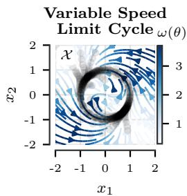

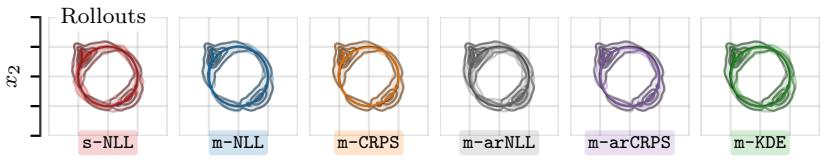

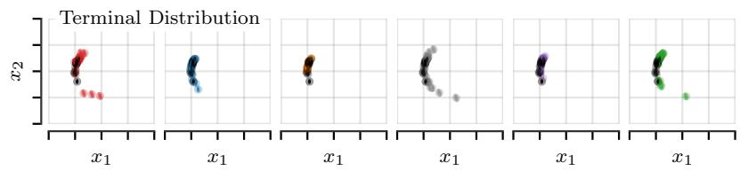

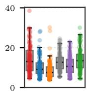  
cum. L2 ( )  
DTW (↓)

MMD2 ( )  
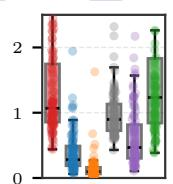  
ED (↓)

term. MMD2  
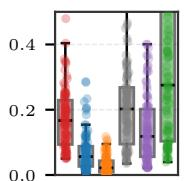  
term. ED (↓)  
Figure 2: Results on the VSLC. Top: Rollouts of all baselines against rollouts (color) from the true dynamics (black). Bottom row: Performance across various metrics computed from rollouts from multiple initial conditions.

## 4 Experimental Results

We organize the evaluation into three parts. First, we use a controlled synthetic setup to isolate a failure mode of single-step training and show how multi-step objectives can address it. Second, we test all methods on a diverse benchmark of chaotic dynamical systems to validate results broadly. Third, we demonstrate real-world performance on an unstable robotic system, where long-horizon prediction is particularly challenging. We compare standard ELBO s-NLL [31] and autoregressive m-KDE [34] baselines (see Sec. 5) against teacher-forced multi-step objectives m-NLL and m-CRPS , and autoregressive m-arNLL and m-arCRPS . A longer discussion on differences between m-KDE, m-arNLL, and m-arCRPS in Appendix E.2. Across experiments, we vary only the loss while keeping the model fixed to control for capacity. For rollouts, we sample $W \sim q ( W )$ and simulate trajectories from an initial state using (1) with learned noise. We set $\lambda \bar { = } 1 / | \mathcal { D } |$ and for s-NLL, we use batch size $B \times H$ to ensure the same number of transitions per gradient step as multi-step methods. Full details are provided in Appendix C and all metrics used in the evaluations are listed in Appendix D.

## 4.1 Variable-Speed Limit Cycle (VSLC)

The VSLC is a 2D system on a globally attracting limit cycle with state-dependent angular velocity $\omega ( \theta ) = \omega _ { 0 } ( 1 + \varepsilon \sin ( n _ { \mathrm { m o d e s } } \theta ) )$ ), where $\theta = \operatorname { a t a n 2 } ( x _ { 2 } , x _ { 1 } )$ . We set $\omega _ { 0 } = 2 . 0 , \varepsilon = 0 . 8 5 , n _ { \mathrm { m o d e s } } = 2$

Training data sampled at fixed ∆t concentrate in slow zones $\left( \omega ( \theta ) < \omega _ { 0 } \right)$ , which contain ∼82% of samples $( F _ { \mathrm { s l o w } } \approx 0 . 8 2 3 ;$ see Section C.1). Single-step training thus focuses gradient signal on slow-zone states, and the larger residuals in the underrepresented fast regions inflate the noise estimate (Fig. 3). This is a property of the log score rather than of the single-step horizon alone as the log-score-optimal variance matches the mean squared residual, so m-NLL and in particular m-arNLL, whose autoregressive residuals grow along the rollout, inflate the noise as well. The CRPS objectives m-CRPS and m-arCRPS, whose

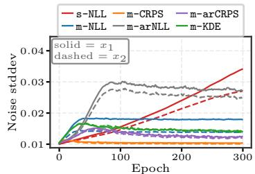  
Figure 3: Learned noise for the VSLC. GT noise is $\sigma _ { 1 } , \sigma _ { 2 } = 0 . 0 1$

penalty grows only linearly in large residuals, recover noise estimates close to the ground truth and sample distributions matching the true distribution (Fig. 2). m-KDE occasionally produces divergent samples near sample boundaries (likely due to the LSE loss; cf. Appendix E.2), reflected in its larger energy distance. Overall, m-CRPS shows the strongest performance.

## 4.2 Benchmark on Chaotic Dynamical Systems

After evaluating the loss functions on an environment specifically designed to highlight the potential upsides of multi-step loss function also for Markov environments, we next evaluate all methods on a broad set of benchmark of 18 dynamical systems of varying complexity, including limit cycles, an environment to test multimodal rollouts (swimmer, cf . Appendix C.2), and 13 chaotic attractors from the dysts library [25]. All of these are autonomous systems and satisfy the Markov property. We generate data using rollouts under Gaussian process noise to match the setting in Sec. 2. Figure 4 summarizes the aggregate rank across all systems and

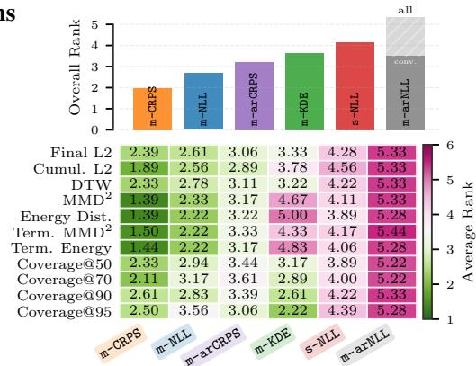  
Figure 4: Rank summary (↓) across benchmark systems. Full results in Tab. 3 in Appendix I.

metrics. Full per-system results are provided in Section I and Tables 3–6.

We can observe that over this large set of experiments, all stably trained multi-step loss functions outperform the single-step loss. Similar to the VSLC, the CRPS losses outperform their likelihoodbased counter parts. m-CRPS demonstrates strong performance across the different metrics. We can further observe that while m-KDE shows strong results in terms of coverage, it struggles to match the distributions of the rollout, specifically in terms of energy distance where occasional diverging samples are strongly penalized. This is consistent with the impressions from the VSLC results. The matched m-arNLL, which differs from m-arCRPS only in the scoring rule, develops non-finite gradients on all chaotic systems. Hence, autoregressive exposure alone is not sufficient: the robustness of the CRPS is what keeps autoregressive training finite (cf . Appendix I.7).

## 4.3 Evaluation on Data From a Real-World Unstable Robotic System

We test on a dataset [33] recorded on the Mini Wheelbot, a balancing unicycle robot [32]. Here, key assumptions (e.g., Gaussian noise, fully Markovian) likely break and the fast, nonlinear dynamics make modeling difficult (Appendix C.3). Table 1 reveals a clear gap: strong one-step accuracy does not imply stable multi-step rollouts. Teacher-forced losses perform best on one-step metrics (best is m-CRPS), yet degrade or diverge over long horizons. Figure 5 confirms this trend, i.e. autoregressive losses are more robust. In particular, m-arCRPS yields stable, accurate trajectories up to 700 steps (trained with H = 40), while m-KDE shows more chaotic, diverging behavior of some realizations. Model-size ablations (Appendix I.3) show m-arCRPS consistently outperforming m-KDE. Notably, a small m-arCRPS model matches an m-KDE model with 70× more parameters. Fig. 11 further shows m-arNLL and m-KDE diverging beyond H = 40 and H = 60, respectively, while m-arCRPS remains stable up to the maximum horizon tested of H = 100.

## 5 Related Work

Probabilistic dynamics models. Probabilistic dynamics models are central to model-based control [13, 10, 35], and the choice of model class trades off uncertainty quality, computational cost, and ease of training. Gaussian processes provide a principled function-space posterior and strong uncertainty estimates in the low-data regime [13], but generally require approximations as dataset size and dimensionality grow. Probabilistic ensembles [38] remain widely used in model-based RL [10, 35, 19], but they require training and evaluating multiple networks. Fully Bayesian neural networks, e.g. via MC-dropout [22, 23], represent uncertainty throughout the network, but they require approximate inference over a high-dimensional parameter space. This makes them considerably more expensive, especially when training on autoregressive rollouts. BLL models [56, 52, 61, 18, 31] offer a practical middle ground. They share a single deterministic feature extractor and place uncertainty only over the final linear weights, which yields inexpensive epistemic uncertainty and closed-form one-step predictive moments. Moreover, holding a weight sample fixed over a rollout corresponds to one consistent dynamics hypothesis along the trajectory. These properties have made BLLs increasingly popular for uncertainty-aware learning and control, including online adaptation via Kalman filtering or recursive least squares [30, 34, 44, 11], safe and uncertainty-aware predictive control [45, 12], Bayesian optimization [6], and autonomous racing [7]. In this paper, we do not claim that BLLs dominate alternative probabilistic models in all settings, nor that they are preferable when only a mean prediction is needed; multi-step training of deterministic models is already well studied (see below). Rather, we ask how this increasingly used model class should be trained when it is deployed autoregressively. To this end, we build on VBLLs [31] but reinterpret them through Gibbs variational inference [2, 5, 36], which decouples the posterior from the training loss and enables task-aligned, multi-step objectives.

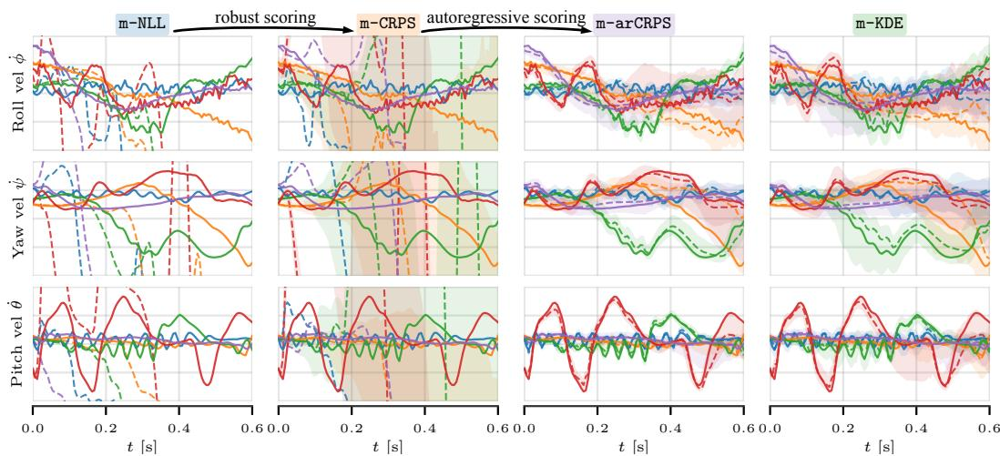  
(a) Autoregressive rollouts (100 steps) for the Mini Wheelbot on different trajectory segments. The solid line denotes the ground truth, the dashed line the mean rollout, and the shaded region the 5th–95th percentile range of the samples. Only a subset of states is shown; the full set is provided in Fig. 17 in the Appendix.

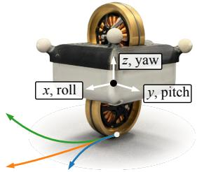  
(b) The Mini Wheelbot

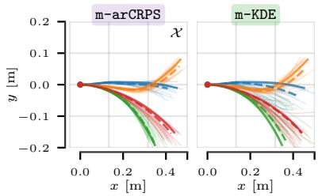  
(c) Rollouts in xy-plane (100 steps).

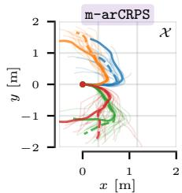

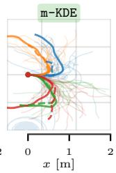  
(d) Rollouts in xy-plane (700 steps).  
Figure 5: Qualitative results on data from the Mini Wheelbot.

Table 1: Quantitative results on Wheelbot data. Multi-step metrics are reported at 100 steps. Each cell reports $\mathrm { m e d i a n } _ { \mathrm { q 2 5 } } ^ { \mathrm { q 7 5 } }$ . Bold, shaded values are significantly best (paired Wilcoxon signed-rank test, $\alpha = 0 . 0 5 )$
<table><tr><td rowspan="2">Method</td><td colspan="3">One-step metrics</td><td colspan="4">Multi-step metrics</td><td>Training1</td></tr><tr><td>MSE↓</td><td>NLL ↓</td><td>CRPS↓</td><td>Final L2 ↓</td><td> $\mathrm { C u m u l . } \ \mathrm { L 2 \downarrow }$ </td><td> $\mathrm { D T W } \downarrow$ </td><td>Energy dist. ↓</td><td>Time [min]</td></tr><tr><td>s-NLL [31, 7]</td><td> $0 . 0 0 5 _ { 0 . 0 0 2 } ^ { 0 . 0 1 9 }$ </td><td> $- 8 . 2 7 3 _ { - 8 . 9 3 2 } ^ { - 6 . 0 8 4 }$ </td><td> $0 . 3 2 8 _ { 0 . 2 7 3 } ^ { 0 . 5 0 9 }$ </td><td> $0 . 3 7 1 _ { 0 . 2 2 3 } ^ { 0 . 7 5 9 }$ </td><td> $1 2 . 6 9 0 _ { 8 . 2 8 5 } ^ { 2 0 . 9 5 4 }$ </td><td> $2 . 1 9 4 _ { 1 . 1 6 1 } ^ { 3 . 9 1 9 }$ </td><td> $1 . 9 0 9 _ { 1 . 5 6 1 } ^ { 2 . 3 1 4 }$ </td><td>1.366</td></tr><tr><td>m-NLL</td><td> $0 . 0 0 5 _ { 0 . 0 0 2 } ^ { 0 . 0 1 9 }$ </td><td> $- 8 . 3 0 4 _ { - 8 . 9 8 2 } ^ { - 6 . 0 7 1 }$ </td><td> $0 . 3 4 0 _ { 0 . 2 8 6 } ^ { 0 . 5 1 5 }$ </td><td> $0 . 4 0 3 _ { 0 . 2 1 7 } ^ { 0 . 7 2 2 }$ </td><td> $1 3 . 3 5 0 _ { 7 . 9 8 2 } ^ { 2 2 . 8 0 1 }$ </td><td> $2 . 2 2 8 _ { 1 . 0 8 9 } ^ { 3 . 8 4 8 }$ </td><td> $5 . 1 8 1 _ { 2 . 8 7 9 } ^ { 8 . 1 3 9 }$ </td><td>1.861</td></tr><tr><td>m-CRPS</td><td>_  $\mathbf { 0 . 0 0 5 _ { 0 . 0 0 1 } ^ { 0 . 0 1 7 } }$  </td><td> $\mathbf { - 1 0 . 6 7 6 _ { - 1 2 . 2 6 0 } ^ { - 5 . 4 8 9 } }$  一</td><td> $\mathbf { 0 . 2 4 8 _ { 0 . 1 6 9 } ^ { 0 . 4 7 9 } }$  1</td><td> $0 . 2 0 0 _ { 0 . 1 3 1 } ^ { 0 . 2 5 9 }$ </td><td> $7 . 7 9 2 _ { 5 . 5 4 0 } ^ { 1 1 . 8 3 8 }$ </td><td> $1 . 1 1 7 _ { 0 . 7 6 7 } ^ { 1 . 5 8 2 }$ </td><td> $1 . 4 5 6 _ { 1 . 1 4 8 } ^ { 1 . 9 3 1 }$ </td><td>2.048</td></tr><tr><td>m-KDE [34]</td><td> $0 . 0 0 9 _ { 0 . 0 0 3 } ^ { 0 . 0 3 4 }$ </td><td> $- 8 . 2 4 9 _ { - 1 1 . 9 5 6 } ^ { 1 . 1 0 4 }$ </td><td> $0 . 3 5 2 _ { 0 . 1 9 7 } ^ { 0 . 7 0 7 }$ </td><td> $0 . 0 2 6 _ { 0 \mathrm { ~ n ~ } 7 } ^ { 0 . 0 4 4 }$ </td><td> $1 . 0 7 6 _ { 0 . 6 7 8 } ^ { 1 . 7 7 6 }$ </td><td> $0 . 0 8 7 _ { 0 . 0 4 3 } ^ { 0 . 1 2 3 }$ </td><td> $0 . 2 3 6 _ { 0 . 1 9 0 } ^ { 0 . 2 8 5 }$ </td><td>3.725</td></tr><tr><td>m-arNLL</td><td> $0 . 0 1 0 _ { 0 . 0 0 2 } ^ { 0 . 0 3 9 }$ </td><td> $- 8 . 0 1 1 _ { - 1 1 ~ 6 7 7 } ^ { 5 . 6 2 6 }$ </td><td> $0 . 3 6 3 _ { 0 } ^ { \mathrm { ~ \normalfont ~ \AA ~ } } \bar { 7 } 8 \dot { 7 }$ </td><td> $0 . 0 3 1 _ { 0 . 0 9 0 } ^ { 0 . 0 4 5 }$ </td><td> $1 . 1 1 1 1 . 7 2 8$ </td><td> $0 . 0 8 9 _ { 0 . 0 5 2 } ^ { 0 . 1 4 1 }$ </td><td> $0 . 2 2 3 _ { 0 } ^ { 0 . 2 8 5 }$ </td><td>3.933</td></tr><tr><td>m-arCRPS</td><td> $0 . 0 1 0 _ { 0 . 0 0 3 } ^ { \mathrm { { \ddot { 0 } . 0 4 0 } } }$ </td><td> $- 0 . 6 6 3 _ { - 1 2 . 0 8 9 } ^ { 4 3 . { \widehat { 6 9 3 } } }$ </td><td> $0 . 4 1 1 _ { 0 . 1 9 4 } ^ { 0 . 8 7 5 }$ </td><td>_  $\mathbf { 0 . 0 2 1 } _ { 0 . 0 1 5 } ^ { 0 . 0 3 1 }$ </td><td>1  $\mathbf { 0 . 8 6 2 _ { 0 . 5 7 3 } ^ { 1 . 4 0 3 } }$  </td><td> $\mathbf { 0 . 0 6 5 } _ { 0 . 0 3 7 } ^ { 0 . 0 9 9 }$ </td><td>1  $\mathbf { 0 . 1 5 9 } _ { 0 . 1 2 6 } ^ { 0 . 2 2 4 }$  1</td><td>3.921</td></tr></table>

Multi-step losses. Training dynamics models with multi-step losses aims to reduce compounding errors at deployment [41], and has been shown to improve long-horizon accuracy and sample efficiency in model-based RL [40]. Doerr et al. [14] argue that multi-step objectives become necessary when the Markov property is violated or when process and observation noise are significant. We further show that one-step losses can fail even in controlled Markovian environments. For Gaussian processes, moment matching and linearization-based uncertainty propagation can enable multi-step training [13, 14]. For overparameterized neural networks, an informative multi-step training signal is all the more important for learning reliable features. For deterministic neural network models, extending the horizon yields mixed results: short horizons can help, but longer ones may degrade downstream performance [48, 8], which motivates careful per-step weighting [3]. For probabilistic ensembles, Levy et al. [43] use mean propagation over short horizons as consistent rollouts are non-trivial given the ensemble structure [20]. For VBLLs, by contrast, a consistent rollout is simply a draw of W. Closest to our setting, Ivanovic et al. [34] propose a kernel-density multi-step objective for BLLs, which we adopt as our m-KDE baseline. It scores a marginal mixture over sampled rollouts, whereas our objectives score each weight sample inside the Gibbs VI expectation. Our losses build on the CRPS, a strictly proper scoring rule [49, 26] whose linear tail behavior makes it robust to outliers [55]. The CRPS is widely used in weather forecasting [26, 51, 42], but usually to score marginal predictive distributions directly. In this standard form it does not fit the Gibbs VI framework, since draws of W are not scored independently. While these individual ingredients are established, to the best of our knowledge we are the first to combine them into multi-step CRPS-based objectives for VBLLs, grounded in Gibbs VI to facilitate stable training of autoregressive dynamics models.

Objective mismatch and decision-aware model learning. Minimizing prediction error does not necessarily lead to optimal downstream task performance [39], motivating decision-aware model learning approaches [62]. Value-aware approaches incorporate the value function into the model loss [17, 16, 59], policy-aware approaches align it with the policy gradient [1, 15], and goal-aware prediction conditions the model on the goal [50]. These methods typically operate in a deterministic setting and couple the model loss directly to policy optimization. We share the motivation but remain in the probabilistic prediction setting, using Gibbs VI to replace the likelihood with losses aligned with how the model is deployed. Since Gibbs VI accepts any pointwise loss, decision-aware reweightings, e.g. scaling per-step CRPS terms by value-gradient magnitudes, can be incorporated directly, a promising direction for future work. A more extensive discussion is provided in Appendix F.

## 6 Discussion on Limitations and Future Work

While our experiments demonstrate the clear benefits of objectives within the Gibbs VI framework, several limitations remain that also show promising directions for future work.

Calibration. Although the CRPS-based losses consistently improve long-horizon accuracy and distributional match, the empirical coverage of m-arCRPS tends to lag behind that of m-KDE on several benchmark systems (cf. Table 3–6). A key advantage of the Gibbs VI perspective is that the loss is a free design choice and calibration techniques from standard VI or tuning the regularization strength can be combined with our multi-step objectives without modifying the model or posterior family. In particular, increasing the KL weight can improve coverage (see Appendix I.6), and we recommend selecting it on a held-out calibration set when coverage matters. Going one step further, Generalized VI [36] also generalizes the divergence enabling, e.g. robust divergences [46, 21]. Since meaningful calibration gains can already be obtained by tuning the existing regularization, we view the KL weight as the first lever, while alternative divergences remain an interesting future direction.

Empirical evaluation on downstream tasks. We deliberately isolated the effect of the training objective by holding the model architecture, posterior family, and optimizer fixed, attributing all observed gains unambiguously to the loss. Consequently, we do not provide a direct comparison against other model classes such as probabilistic ensembles or GPs. We expect downstream tasks that rely on autoregressive rollouts under learned models to benefit the most, e.g. sampling-based MPC [64] or uncertainty-aware reinforcement learning [13, 35, 19]. We therefore view systematic evaluation in closed-loop decision-making as an important direction for future work.

## 7 Conclusion

By reinterpreting VBLLs through Gibbs variational inference, we showed that the training loss is a modular design choice—independent of the model architecture and posterior family—that can be tailored to the deployment regime. Our hierarchy of multi-step objectives reveals two complementary axes of improvement: CRPS-based scoring confers robustness to outliers and yields superior distributional fit, while autoregressive evaluation closes the train–test mismatch that causes teacher-forced models to degrade or diverge on real-world systems. Together, these results establish that how a VBLL is trained matters as much as what it models, opening a direct path toward integrating task-aligned losses with downstream decision-making in control and reinforcement learning.

## Acknowledgments and Disclosure of Funding

The authors thank James Harrison, Mikkel Jordahn, John Willes, and Jasper Snoek for various insightful discussions on VBLLs over the last years. Paul Brunzema and Henrik Hose are partially funded by the Deutsche Forschungsgemeinschaft (DFG, German Research Foundation)–RTG 2236/2 (Un-RAVeL). This work was additionally supported in part by the DFG under project number 556142469 (ParDyBO). Simulations were performed in part with computing resources granted by RWTH Aachen University under projects rwth2066 and p0027430.

## References

[1] Romina Abachi. Policy-aware model learning for policy gradient methods. University of Toronto, 2020.

[2] Pierre Alquier, James Ridgway, and Nicolas Chopin. On the properties of variational approximations of Gibbs posteriors. Journal ofMachine Learning Research, 17(236):1–41, 2016.

[3] Abdelhakim Benechehab, Albert Thomas, Giuseppe Paolo, Maurizio Filippone, and Balázs Kégl. A multi-step loss function for robust learning of the dynamics in model-based reinforcement learning. arXiv preprint arXiv:2402.03146, 2024.

[4] Jonathan Berrisch and Florian Ziel. Crps learning. Journal ofEconometrics, 237(2):105221, 2023.

[5] Pier Giovanni Bissiri, Chris C Holmes, and Stephen G Walker. A general framework for updating belief distributions. Journal of the Royal Statistical Society Series B: Statistical Methodology, 78(5):1103–1130, 2016.

[6] Paul Brunzema, Mikkel Jordahn, John Willes, Sebastian Trimpe, Jasper Snoek, and James Harrison. Bayesian optimization via continual variational last layer training. In International Conference on Learning Representations (ICLR), 2025.

[7] Paul Brunzema, Thomas Lew, Ray Zhang, Takeru Shirasawa, John Subosits, and Marcus Greiff. Vision-conditioned variational bayesian last layer dynamics models. arXiv preprint arXiv:2601.09178, 2026.

[8] Arunkumar Byravan, Leonard Hasenclever, Piotr Trochim, Mehdi Mirza, Alessandro Davide Ialongo, Yuval Tassa, Jost Tobias Springenberg, Abbas Abdolmaleki, Nicolas Heess, Josh Merel, et al. Evaluating model-based planning and planner amortization for continuous control. arXiv preprint arXiv:2110.03363, 2021.

[9] Olivier Catoni. PAC-Bayesian supervised classification: the thermodynamics of statistical learning. arXiv preprint arXiv:0712.0248, 2007.

[10] Kurtland Chua, Roberto Calandra, Rowan McAllister, and Sergey Levine. Deep reinforcement learning in a handful of trials using probabilistic dynamics models. In Advances in Neural Information Processing Systems (NeurIPS), 2018.

[11] Alexander Davydov, Franck Djeumou, Marcus Greiff, Makoto Suminaka, Michael Thompson, John Subosits, and Thomas Lew. First, learn what you don’t know: Active information gathering for driving at the limits of handling. IEEE Robotics and Automation Letters, 2025.

[12] Laura Boca de Giuli, Alessio La Bella, Manish Prajapat, Johannes Köhler, Anna Scampicchio, Riccardo Scattolini, and Melanie Zeilinger. Goal-oriented safe active learning for predictive control using Bayesian recurrent neural networks. arXiv preprint arXiv:2604.12542, 2026.

[13] Marc Peter Deisenroth and Carl E Rasmussen. PILCO: A model-based and data-efficient approach to policy search. In International Conference on Machine Learning (ICML), pages 465–472, 2011.

[14] Andreas Doerr, Christian Daniel, Duy Nguyen-Tuong, Alonso Marco, Stefan Schaal, Toussaint Marc, and Sebastian Trimpe. Optimizing long-term predictions for model-based policy search. In Conference on Robot Learning. PMLR, 2017.

[15] Pierluca D’Oro, Alberto Maria Metelli, Andrea Tirinzoni, Matteo Papini, and Marcello Restelli. Gradient-aware model-based policy search. In Proceedings of the AAAI Conference on Artificial Intelligence, volume 34, pages 3801–3808, 2020.

[16] Amir-massoud Farahmand. Iterative value-aware model learning. Advances in Neural Information Processing Systems (NeurIPS), 2018.

[17] Amir-massoud Farahmand, Andre Barreto, and Daniel Nikovski. Value-aware loss function for model-based reinforcement learning. In International Conference on Artificial Intelligence and Statistics (AISTATS), pages 1486–1494. PMLR, 2017.

[18] Felix Fiedler and Sergio Lucia. Improved uncertainty quantification for neural networks with Bayesian last layer. IEEE Access, 2023.

[19] Bernd Frauenknecht, Artur Eisele, Devdutt Subhasish, Friedrich Solowjow, and Sebastian Trimpe. Trust the model where it trusts itself – model-based actor-critic with uncertaintyaware rollout adaption. In International Conference on Machine Learning (ICML), pages 13973–14005. PMLR, 2024.

[20] Bernd Frauenknecht, Devdutt Subhasish, Friedrich Solowjow, and Sebastian Trimpe. On rollouts in model-based reinforcement learning. In International Conference on Learning Representations (ICLR), 2025.

[21] Futoshi Futami, Issei Sato, and Masashi Sugiyama. Variational inference based on robust divergences. In International Conference on Artificial Intelligence and Statistics (AISTATS). PMLR, 2018.

[22] Yarin Gal and Zoubin Ghahramani. Dropout as a Bayesian approximation: Representing model uncertainty in deep learning. In International Conference on Machine Learning (ICML), pages 1050–1059. PMLR, 2016.

[23] Yarin Gal, Rowan McAllister, and Carl Edward Rasmussen. Improving PILCO with Bayesian neural network dynamics models. In Data-efficient machine learning workshop, ICML, volume 4, page 25, 2016.

[24] A René Geist, Jonathan Fiene, Naomi Tashiro, Zheng Jia, and Sebastian Trimpe. The wheelbot: A jumping reaction wheel unicycle. IEEE Robotics and Automation Letters, 7(4):9683–9690, 2022.

[25] William Gilpin. Chaos as an interpretable benchmark for forecasting and data-driven modelling. In Thirty-fifth Conference on Neural Information Processing Systems Datasets and Benchmarks Track, 2023.

[26] Tilmann Gneiting and Adrian E Raftery. Strictly proper scoring rules, prediction, and estimation. Journal ofthe American statistical Association, 102(477):359–378, 2007.

[27] Tilmann Gneiting, Adrian E Raftery, Anton H Westveld III, and Tom Goldman. Calibrated probabilistic forecasting using ensemble model output statistics and minimum CRPS estimation. Monthly weather review, 133(5):1098–1118, 2005.

[28] Arthur Gretton, Karsten M Borgwardt, Malte J Rasch, Bernhard Schölkopf, and Alexander Smola. A kernel two-sample test. Journal of Machine Learning Research, 13(1):723–773, 2012.

[29] Eric P Grimit, Tilmann Gneiting, Veronica J Berrocal, and Nicholas A Johnson. The continuous ranked probability score for circular variables and its application to mesoscale forecast ensemble verification. Quarterly Journal ofthe Royal Meteorological Society, 132(621C):2925–2942, 2006.

[30] James Harrison, Apoorva Sharma, and Marco Pavone. Meta-learning priors for efficient online Bayesian regression. In International Workshop on the Algorithmic Foundations ofRobotics. Springer, 2018.

[31] James Harrison, John Willes, and Jasper Snoek. Variational bayesian last layers. In International Conference on Learning Representations (ICLR), 2024.

[32] Henrik Hose, Jan Weisgerber, and Sebastian Trimpe. The mini wheelbot: A testbed for learningbased balancing, flips, and articulated driving. In IEEE International Conference on Robotics and Automation (ICRA), pages 1339–1346. IEEE, 2025.

[33] Henrik Hose, Paul Brunzema, Devdutt Subhasish, and Sebastian Trimpe. The Mini Wheelbot dataset: High-fidelity data for robot learning. arXiv preprint arXiv:2601.11394, 2026.

[34] Boris Ivanovic, James Harrison, and Marco Pavone. Expanding the deployment envelope of behavior prediction via adaptive meta-learning. In IEEE International Conference on Robotics and Automation (ICRA), 2023.

[35] Michael Janner, Justin Fu, Marvin Zhang, and Sergey Levine. When to trust your model: Model-based policy optimization. In Advances in Neural Information Processing Systems (NeurIPS), 2019.

[36] Jeremias Knoblauch, Jack Jewson, and Theodoros Damoulas. An optimization-centric view on Bayes’ rule: Reviewing and generalizing variational inference. Journal of Machine Learning Research, 23(132):1–109, 2022.

[37] Thanard Kurutach, Ignasi Clavera, Yan Duan, Aviv Tamar, and Pieter Abbeel. Model-ensemble trust-region policy optimization. In International Conference on Learning Representations (ICLR), 2018.

[38] Balaji Lakshminarayanan, Alexander Pritzel, and Charles Blundell. Simple and scalable predictive uncertainty estimation using deep ensembles. 2017.

[39] Nathan Lambert, Brandon Amos, Omry Yadan, and Roberto Calandra. Objective mismatch in model-based reinforcement learning. In Learningfor Dynamics and Control. PMLR, 2020.

[40] Nathan Lambert, Albert Wilcox, Howard Zhang, Kristofer SJ Pister, and Roberto Calandra. Learning accurate long-term dynamics for model-based reinforcement learning. In 2021 60th IEEE Conference on decision and control (CDC). IEEE, 2021.

[41] Nathan Lambert, Kristofer Pister, and Roberto Calandra. Investigating compounding prediction errors in learned dynamics models. arXiv preprint arXiv:2203.09637, 2022.

[42] Simon Lang, Mihai Alexe, Mariana CA Clare, Christopher Roberts, Rilwan Adewoyin, Zied Ben Bouallègue, Matthew Chantry, Jesper Dramsch, Peter D Dueben, Sara Hahner, et al. Aifscrps: ensemble forecasting using a model trained with a loss function based on the continuous ranked probability score. npj Artificial Intelligence, 2(1):18, 2026.

[43] Jacob Levy, Tyler Westenbroek, and David Fridovich-Keil. Learning to walk from three minutes of real-world data with semi-structured dynamics models. In Conference on Robot Learning, 2024.

[44] Jacob Levy, Jason Gibson, Bogdan Vlahov, Erica Tevere, Evangelos Theodorou, David Fridovich-Keil, and Patrick Spieler. Meta-learning online dynamics model adaptation in off-road autonomous driving. Robotics: Science and Systems, 2025.

[45] Thomas Lew, Apoorva Sharma, James Harrison, Andrew Bylard, and Marco Pavone. Safe active dynamics learning and control: A sequential exploration–exploitation framework. IEEE Transactions on Robotics, 38(5):2888–2907, 2022.

[46] Yingzhen Li and Richard E Turner. Rényi divergence variational inference. In Advances in Neural Information Processing Systems (NeurIPS), 2016.

[47] Ilya Loshchilov and Frank Hutter. Decoupled weight decay regularization. arXiv preprint arXiv:1711.05101, 2017.

[48] Michael Lutter, Leonard Hasenclever, Arunkumar Byravan, Gabriel Dulac-Arnold, Piotr Trochim, Nicolas Heess, Josh Merel, and Yuval Tassa. Learning dynamics models for model predictive agents. arXiv preprint arXiv:2109.14311, 2021.

[49] James E Matheson and Robert L Winkler. Scoring rules for continuous probability distributions. Management science, 22(10):1087–1096, 1976.

[50] Suraj Nair, Silvio Savarese, and Chelsea Finn. Goal-aware prediction: Learning to model what matters. In International Conference on Machine Learning, pages 7207–7219. PMLR, 2020.

[51] Lorenzo Pacchiardi, Sherman Khoo, and Ritabrata Dutta. Generalized bayesian likelihood-free inference. Electronic Journal ofStatistics, 18(2):3628–3686, 2024.

[52] Carlos Riquelme, George Tucker, and Jasper Snoek. Deep Bayesian bandits showdown: An empirical comparison of Bayesian deep networks for thompson sampling. In International Conference on Learning Representations (ICLR), 2018.

[53] Yusie Rizal, Trihastuti Agustinah, Rudy Dikairono, and Haiping Du. Design, modeling, and control of unicycle robots: A systematic literature review. IEEE Access, 14:20570–20588, 2026.

[54] Hiroaki Sakoe and Seibi Chiba. Dynamic programming algorithm optimization for spoken word recognition. IEEE Transactions on Acoustics, Speech, and Signal Processing, 26(1):43–49, 1978.

[55] Reinhard Selten. Axiomatic characterization of the quadratic scoring rule. Experimental Economics, 1(1):43–61, 1998.

[56] Jasper Snoek, Oren Rippel, Kevin Swersky, Ryan Kiros, Nadathur Satish, Narayanan Sundaram, Mostofa Patwary, Mr Prabhat, and Ryan Adams. Scalable Bayesian optimization using deep neural networks. In International Conference on Machine Learning (ICML), 2015.

[57] Petre Stoica and Randolph L. Moses. Spectral Analysis ofSignals. Prentice Hall, Upper Saddle River, NJ, 2005.

[58] Gábor J Székely and Maria L Rizzo. Energy statistics: A class of statistics based on distances. Journal ofStatistical Planning and Inference, 143(8):1249–1272, 2013.

[59] Claas A Voelcker, Victor Liao, Animesh Garg, and Amir-massoud Farahmand. Value gradient weighted model-based reinforcement learning. In International Conference on Learning Representations, 2022.

[60] wannesm, khendrickx, Aras Yurtman, Pieter Robberechts, Dany Vohl, Eric Ma, Gust Verbruggen, Marco Rossi, Mazhar Shaikh, Muhammad Yasirroni, Todd, Wojciech Zielinski, Toon Van´ Craenendonck, and Sai Wu. wannesm/dtaidistance: v2.3.5, January 2022. URL https: //doi.org/10.5281/zenodo.5901139.

[61] Joe Watson, Jihao Andreas Lin, Pascal Klink, Joni Pajarinen, and Jan Peters. Latent derivative Bayesian last layer networks. In International Conference on Artificial Intelligence and Statistics (AISTATS), 2021.

[62] Ran Wei, Nathan Lambert, Anthony McDonald, Alfredo Garcia, and Roberto Calandra. A unified view on solving objective mismatch in model-based reinforcement learning. arXiv preprint arXiv:2310.06253, 2023.

[63] Peter D. Welch. The use of fast Fourier transform for the estimation of power spectra: A method based on time averaging over short, modified periodograms. IEEE Transactions on Audio and Electroacoustics, 15(2):70–73, 1967.

[64] Grady Williams, Nolan Wagener, Brian Goldfain, Paul Drews, James M Rehg, Byron Boots, and Evangelos A Theodorou. Information theoretic MPC for model-based reinforcement learning. In IEEE International Conference on Robotics and Automation (ICRA). IEEE, 2017.

## A Broader Impact

This work develops general-purpose training objectives for probabilistic dynamics models. Improved long-horizon predictions and better-calibrated uncertainty estimates are directly relevant to safetycritical applications such as autonomous driving or robotic manipulation. In such settings, wrong long-term prediction by models can lead to unsafe control actions, and our multi-step, CRPSbased objectives help mitigate this risk by improving distributional fit and reducing the train–test mismatch inherent in single-step training. However, no training objective alone can guarantee safe deployment; careful system-level validation, domain-specific safety constraints, and rigorous uncertainty monitoring remain essential when integrating learned dynamics models into closed-loop control. We do not foresee direct negative societal consequences of this work beyond those generally associated with improved automation capabilities.

## B On the Parameterization and Implementation of VBLLs

We follow closely the original VBLL codebase of Harrison et al. [31] and re-implement it in JAX using Flax NNX and Optax2. This appendix details the concrete parameterization of the variational posterior covariance matrices and the process-noise covariance, both of which require some care to ensure that the resulting matrices remain positive definite throughout optimization.

Cholesky parameterization of the posterior covariance. As stated in (2), the variational posterior over each column ${ \pmb w } _ { j }$ of $W \mathrm { i s } \mathcal { N } ( \hat { \mu _ { j } } , \Sigma _ { j } )$ with $\pmb { \Sigma } _ { j } = \pmb { L } _ { j } \pmb { L } _ { i } ^ { \top }$ , where $\ b { L } _ { j } \in \mathbb { R } ^ { p \times p }$ is lower triangular with positive diagonal. To enforce this structure during unconstrained gradient-based optimization, we store two sets of free parameters per output dimension $j \colon$ a vector $\mathbf { } d _ { j } \in \mathbb { R } ^ { p }$ of unconstrained log-diagonal entries and a matrix $O _ { j } \in \mathbb { R } ^ { p \times \bar { p } }$ of unconstrained off-diagonal entries. The Cholesky factor is then assembled as

$$
\begin{array} { r } { L _ { j } = \operatorname { t r i l } ( { \cal O } _ { j } , - 1 ) + \operatorname { d i a g } \big ( \exp ( d _ { j } ) \big ) , } \end{array}\tag{18}
$$

where tri $\displaystyle { \lvert \left( \cdot , - 1 \right) }$ extracts the strictly lower-triangular part. The exponential map on the diagonal guarantees $( L _ { j } ) _ { k k } > 0$ for all k, which in turn ensures that $\pmb { \Sigma } _ { j } = \pmb { L } _ { j } \pmb { L } _ { j } ^ { \top }$ is positive definite for any value of the free parameters. We initialize $d _ { j } { \mathrm { ~ n e a r - } } { \frac { 1 } { 2 } } \log p$ and both $O _ { j }$ and $\pmb { \mu } _ { j }$ with small random values, so that the posterior starts concentrated near zero with low uncertainty. For all losses, we always use the same initialization.

Process-noise parameterization. The diagonal process-noise covariance $\Sigma _ { \nu } = \mathrm { d i a g } ( \sigma _ { 1 } ^ { 2 } , \dots , \sigma _ { d _ { r } } ^ { 2 } )$ is parameterized through unconstrained log-standard-deviations $\lambda _ { j } \in \mathbb { R }$ , so that $\sigma _ { j } = \exp ( \lambda _ { j } )$ This again ensures positivity without constrained optimization. The parameters $\lambda _ { j }$ are initialized at $\log ( \sigma _ { \mathrm { i n i t } } )$ for a user-specified $\sigma _ { \mathrm { i n i t } } > 0$ (we use $\sigma _ { \mathrm { i n i t } } = 0 . 0 1$ by default), reflecting the prior belief that process noise is initially small.

## C Experimental Details

In the following, we will list the experimental details for the empirical studies and introduce the system dynamics where necessary. We first list general settings, i.e. the model architecture and the optimizer. All code is publicly available under the MIT license at https://github.com/ brunzema $/ \mathtt { g i b b s \mathrm { - } v b l 1 }$

Model architecture As a backbone we use a standard feed forward neural network with three layers and an additional layer that maps to the features. In Tab. 7 and Tab. 10 we list the parameters for the specific set of experiments.

Optimizer and training For all experiments, we employ the AdamW optimizer [47] with a learning rate of $\mathbf { \Omega } \times 1 0 ^ { - 3 } \ ( 5 \times \mathrm { \overline { { 1 } } 0 ^ { - 4 } }$ for the Mini Wheelbot experiments in Sec. 4.3). We apply a weight decay of $1 \times 1 0 ^ { - 4 }$ exclusively to the backbone, following standard practice for VBLLs, as the final layer is regularized through the KL term in the loss [31]. In addition, we use gradient clipping with a maximum norm of one in all experiments. We train for 300 epochs with a batch size of 64 on the

VSLC dataset and the chaotic systems benchmark. For the Mini Wheelbot experiments, we train for 400 epochs with a batch size of 256. We choose these training durations to ensure sufficient convergence of each loss function and select the best model state based on a validation set, evaluating performance every 5 epochs. More details in Tab. 9 and Tab. 11.

## C.1 Variable-Speed Limit Cycle

The VSLC state $\pmb { x } = ( x _ { 1 } , x _ { 2 } ) ^ { \top } \in \mathbb { R } ^ { 2 }$ evolves according to

$$
\begin{array} { r } { \dot { x } _ { 1 } = \mu ( R - r ) \frac { x _ { 1 } } { r } - \omega ( \theta ) x _ { 2 } , \qquad \dot { x } _ { 2 } = \mu ( R - r ) \frac { x _ { 2 } } { r } + \omega ( \theta ) x _ { 1 } , } \end{array}\tag{19}
$$

with $r = \| { \pmb x } \| _ { 2 }$ and $\theta = \operatorname { a t a n 2 } ( x _ { 2 } , x _ { 1 } )$ . The parameter $\mu > 0$ governs radial attraction toward the limit cycle of radius $R ,$ , while $\omega ( \theta )$ controls angular motion. Under the parameterization in Sec. 4.1, the angular velocity ranges over $\omega ( \theta ) \in [ \omega _ { 0 } ( 1 - \varepsilon ) , \omega _ { 0 } ( 1 + \varepsilon ) ]$ ], which evaluates to [0.30, 3.70] rad/s for the chosen parameters. Training data collected at a fixed time step $\Delta t$ induce a distribution over angles that is proportional to the time spent at each state. Since angular speed is $\omega ( \theta )$ , this yields a density proportional to $\omega ( \theta ) ^ { - 1 }$

Defining the slow zone by $\omega ( \theta ) < \omega _ { 0 }$ , the fraction of samples originating from that region is

$$
\begin{array} { r } { F _ { \mathrm { s l o w } } = \frac { \displaystyle \int _ { \{ \theta : \omega ( \theta ) < \omega _ { 0 } \} } \omega ( \theta ) ^ { - 1 } d \theta } { \displaystyle \int _ { 0 } ^ { 2 \pi } \omega ( \theta ) ^ { - 1 } d \theta } . } \end{array}\tag{20}
$$

Using $\omega ( \theta ) = \omega _ { 0 } \big ( 1 + \varepsilon \sin ( n _ { \mathrm { m o d e s } } \theta ) \big )$ and the substitution $\phi = n _ { \mathrm { m o d e s } } \theta .$ , we obtain

$$
F _ { \mathrm { s l o w } } = \frac { \displaystyle \int _ { \{ \phi : \sin \phi < 0 \} } \frac { d \phi } { 1 + \varepsilon \sin \phi } } { \displaystyle \int _ { 0 } ^ { 2 \pi } \frac { d \phi } { 1 + \varepsilon \sin \phi } } .\tag{21}
$$

This expression is independent of $n _ { \mathrm { m o d e s } }$ (for integer $n _ { \mathrm { m o d e s } } )$ . Evaluating the integrals yields the closed-form result

$$
F _ { \mathrm { s l o w } } = \frac { 1 } { 2 } + \frac { \arcsin ( \varepsilon ) } { \pi } .\tag{22}
$$

For our parameter setting of $\varepsilon = 0 . 8 5$ , this gives $F _ { \mathrm { s l o w } } \approx 0 . 8 2 3$ . Thus, approximately 82.3% of all training samples lie in the slow zone.

Parameters and data generation. We use the parameter values $\omega _ { 0 } = 2 . 0 , \varepsilon = 0 . 8 5 , n _ { \mathrm { m o d e s } } = 2$ Trajectory data are generated by numerically integrating the system with sampling time $\Delta t = 0 . 1$ s and induce process noise on all the states with $\sigma _ { 1 } = \sigma _ { 2 } = 0 . 0 1$ We generate a total of 300 trajectories with each having a length of 90 time steps from pseudo-random initial conditions within $x , y \in [ - 2 , 2 ]$ using a Sobol sequence. 20 % of trajectories are used as validation data for all the methods to determine the best performing model state which is then used for testing on newly random generated trajectories. For the multi-step losses, we use a horizon of $H = 4 0$ and a stride of one to effectively increase the supervision signal.

## C.2 Swimmer

The Swimmer environment is a two-dimensional continuous-time dynamical system that combines a spatially varying tidal-drag field with a localized vortex flow. The state is $\pmb { x } = \mathbf { \bar { \phi } } ( x , y ) ^ { \top } \in \mathbb { R } ^ { 2 }$ , and its dynamics are given by

$$
\dot { \pmb { x } } = \pmb { v } _ { \mathrm { t i d a l } } ( \pmb { x } ) + \pmb { v } _ { \mathrm { v o r t e x } } ( \pmb { x } ) .\tag{23}
$$

Tidal-drag component. The tidal field is defined through an oscillatory base flow

$$
\begin{array} { r } { \pmb { c } _ { 0 } ( \pmb { x } ) = \binom { U _ { 0 } \sin ( \kappa y ) } { V _ { 0 } \sin ( \kappa x ) } , } \end{array}\tag{24}
$$

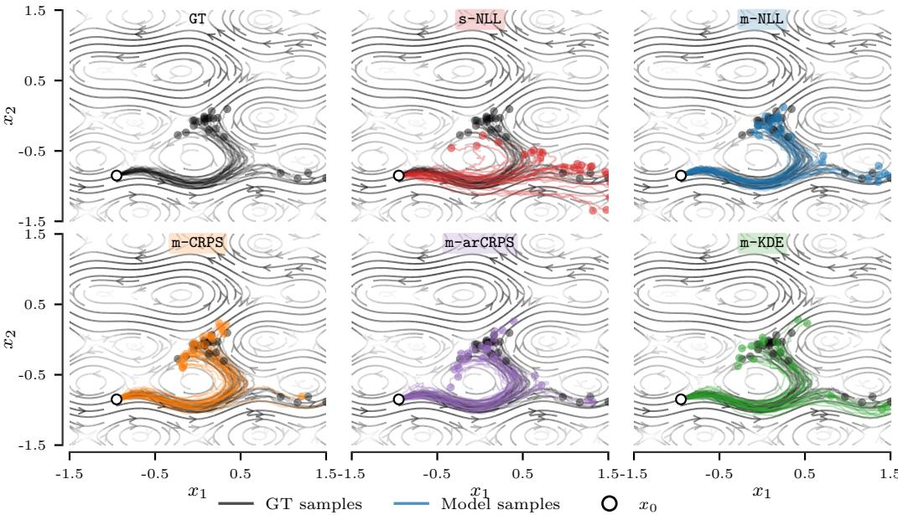  
Figure 6: Model rollouts on Swimmer (flowfield in gray). We test whether the different losses allow the model to capture complex nonlinear dynamics resulting in multi-modal rollouts. We can see that all losses allow the model demonstrate such complex behavior. Still, multi-step losses allow for a better approximation of the distribution.

with fixed amplitudes $U _ { 0 } = 0 . 4$ and $V _ { 0 } = 0 . 2$ . To attenuate the flow in regions of high instantaneous magnitude, this base field is scaled by a damping factor

$$
{ \pmb v } _ { \mathrm { t i d a l } } ( { \pmb x } ) = \frac { { \pmb c } _ { 0 } ( { \pmb x } ) } { 1 + \eta \| { \pmb c } _ { 0 } ( { \pmb x } ) \| _ { 2 } ^ { 2 } } ,\tag{25}
$$

where $\eta > 0$ controls the strength of the damping.

Vortex component. The vortex is centered at $\pmb { c } = ( - 0 . 5 , 0 . 5 ) ^ { \top }$ with fixed radius parameter $R _ { \mathrm { v } } = 0 . 5$ . Writing $\pmb { d } = \pmb { x } - \pmb { c } = ( d _ { x } , d _ { y } ) ^ { \top }$ , the vortex-induced velocity is

$$
{ \pmb v } _ { \mathrm { v o r t e x } } ( { \pmb x } ) = \frac { \alpha R _ { \mathrm { v } } ^ { 2 } } { \lVert { \pmb d } \rVert _ { 2 } ^ { 2 } + R _ { \mathrm { v } } ^ { 2 } } \left( \begin{array} { c } { - d _ { y } } \\ { d _ { x } } \end{array} \right) ,\tag{26}
$$

where $\alpha > 0$ sets the vortex strength. This term induces rotational motion around the vortex center, with magnitude that decays smoothly away from the core.

Full dynamics. Combining (25) and (26), the Cartesian dynamics are

$$
\dot { x } = \frac { U _ { 0 } \sin ( \kappa y ) } { 1 + \eta \| c _ { 0 } ( \pmb { x } ) \| _ { 2 } ^ { 2 } } - \frac { \alpha R _ { \mathrm { v } } ^ { 2 } } { \| \pmb { x } - \pmb { c } \| _ { 2 } ^ { 2 } + R _ { \mathrm { v } } ^ { 2 } } ( y - c _ { y } ) ,\tag{27}
$$

$$
\dot { y } = \frac { V _ { 0 } \sin ( \kappa x ) } { 1 + \eta \| c _ { 0 } ( x ) \| _ { 2 } ^ { 2 } } + \frac { \alpha R _ { \mathrm { v } } ^ { 2 } } { \| x - c \| _ { 2 } ^ { 2 } + R _ { \mathrm { v } } ^ { 2 } } ( x - c _ { x } ) ,\tag{28}
$$

where $\pmb { c } = ( c _ { x } , c _ { y } ) ^ { \top } = ( - 0 . 5 , 0 . 5 ) ^ { \top }$ which are clearly highly non-linear.

Parameters and data generation. We use the parameter values $\alpha = 0 . 7 , \eta = 1 . 0 ,$ , and $\kappa = 1 . 5 \pi$ Trajectory data are generated by numerically integrating the system with sampling time $\Delta t = 0 . 1$ s and induce process noise on all the states with $\sigma _ { 1 } = \sigma _ { 2 } = 0 . 0 1$ We generate a total of 300 trajectories with each having a length of 90 time steps from pseudo-random initial conditions within $x , y \in [ - 1 . 5 , 1 . 5 ]$ using a Sobol sequence. 20 % of trajectories are used as validation data for all the methods to determine the best performing model state which is then used for testing on newly random generated trajectories. For the multi-step losses, we use a horizon of $H = 4 0$ and a stride of one to effectively increase the supervision signal.

## C.3 The Mini Wheelbot

Reaction wheel balancing robots are challenging control benchmarks that have attracted research attention for multiple decades due to fast, unstable dynamics and strong nonlinearities (see [53] for a recent survey). The Mini Wheelbot is such an opensource robot [32] that is based on an earlier prototype [24]. The Mini Wheelbot uses its two wheels for balancing: the driving wheel in the pitch direction like a segway and the reaction wheel in the roll direction like a reaction wheel pendulum. The robot has no third “turntable” actuator for controlling the yaw orientation. Instead, it relies on geometric turning of a single wheel at an angle and the

  
Figure 7: The Mini Wheelbot [32]. Banana for scale.

nonlinear gyroscopic effects of the multibody dynamics for reorienting.

Data and training setup To train the models, we use data from the Mini Wheelbot dataset $[ 3 3 ] ^ { 3 }$ This data is collected at $\Delta t = 0 . 0 0 6 \mathrm { { s } }$ s and we use the same train, validation, and test split for all loss functions. For all the trajectories, we cut the first 2 s and the last 2 s. For training and evaluation, we replay the ground-truth actions over the trajectory segment.

Mapping state rollouts onto the xy-plane To visualize rollouts in the plane, we map the predicted dynamics to a planar trajectory on the xy-plane via unicycle-like wheel odometry. Let $r _ { w }$ denote the drive-wheel radius, $\Delta t$ the sampling period, $q _ { \mathrm { D R } }$ the drive-wheel angle, and ψ the yaw angle. We first align the yaw to the world frame,

$$
\psi _ { t } ^ { \mathrm { w } } ~ = ~ \mathrm { u n w r a p } ( \psi _ { t } ) ~ - ~ \psi _ { 0 } ~ + ~ \psi _ { \mathrm { i n i t } } ^ { \mathrm { w } } ,\tag{29}
$$

where unwrap(·) removes 2π discontinuities and $\psi _ { \mathrm { i n i t } } ^ { \mathrm { w } }$ is a chosen initial heading (in Fig. 5, we choose $\psi _ { \mathrm { i n i t } } ^ { \mathrm { w } } = 0$ for all segments). The arc length traveled by the drive wheel between two consecutive samples is

$$
\Delta s _ { t } = r _ { w } \big ( q _ { \mathrm { D R } , t } - q _ { \mathrm { D R } , t - 1 } \big ) ,\tag{30}
$$

and, assuming no wheel slip and motion along the current heading, the planar position is accumulated by projecting each increment onto the heading direction, starting from $( x _ { 0 } , y _ { 0 } ) = ( 0 , 0 )$ :

$$
x _ { t } \ = \ \sum _ { k = 1 } ^ { t } \cos ( \psi _ { k } ^ { \mathrm { w } } ) \Delta s _ { k } , y _ { t } \ = \ \sum _ { k = 1 } ^ { t } \sin ( \psi _ { k } ^ { \mathrm { w } } ) \Delta s _ { k } .\tag{31}
$$

For model rollouts, the learned dynamics output the yaw rate $\dot { \psi }$ and drive-wheel speed q˙DR rather than ψ and qDR directly, as the MW is invariant to these absolute values. We reconstruct the latter by forward-Euler integration from the measured initial values ψ0, qDR,0,

$$
\psi _ { t + 1 } = \psi _ { t } + { \dot { \psi } } _ { t } \Delta t , q _ { \mathrm { D R } , t + 1 } = q _ { \mathrm { D R } , t } + { \dot { q } } _ { \mathrm { D R } , t } \Delta t ,\tag{32}
$$

and then apply the odometry mapping above to obtain $( x _ { t } , y _ { t } )$

## D Metrics

Throughout, let $\hat { \pmb { x } } _ { 0 : H } = ( \hat { \pmb { x } } _ { 0 } , \ldots , \hat { \pmb { x } } _ { H } )$ denote the model’s mean predicted trajectory, $\pmb { x } _ { 0 : H } ^ { * }$ the noiseless ground-truth trajectory, $\{ \tilde { \pmb { x } } _ { 0 : H } ^ { ( s ) } \} _ { s = 1 } ^ { S }$ the noisy ground-truth rollouts, and $\{ \hat { \pmb { x } } _ { 0 : H } ^ { ( s ) } \} _ { s = 1 } ^ { S }$ the stochastic model rollout samples, all initialized from the same state $\pmb { x } _ { 0 } \in \mathbb { R } ^ { d }$ . With this we can define the following metrics of interest.

Final Displacement Error. The Final Displacement Error (FDE) measures the Euclidean distance between the mean predicted state and the noiseless ground truth at the terminal timestep H:

$$
\mathrm { F D E } = \| \hat { \pmb { x } } _ { H } - \pmb { x } _ { H } ^ { * } \| _ { 2 } .\tag{33}
$$

Cumulative L2 Error. The Cumulative L2 Error sums the per-step Euclidean distances between the mean predicted trajectory and the noiseless ground truth over all timesteps:

$$
\mathrm { C L 2 } = \sum _ { h = 1 } ^ { H } \| \hat { \pmb x } _ { h } - { \pmb x } _ { h } ^ { * } \| _ { 2 } .\tag{34}
$$

This measures the total accumulated trajectory deviation rather than only the terminal error.

Dynamic Time Warping Distance. Dynamic Time Warping (DTW) [54] is a similarity measure between temporal sequences that is robust to local timing differences. For multi-dimensional trajectories we compute the DTW distance per state dimension and sum:

$$
\mathrm { D T W } = \sum _ { j = 1 } ^ { d } \mathrm { D T W } _ { j } \left( \left\{ \hat { x } _ { h , j } \right\} _ { h = 0 } ^ { H } , \left\{ x _ { h , j } ^ { * } \right\} _ { h = 0 } ^ { H } \right) ,\tag{35}
$$

where $\mathrm { D T W } _ { j }$ denotes the scalar DTW distance along dimension $j .$ Unlike CL2, DTW allows for non-linear temporal alignment, making it less sensitive to phase shifts in oscillatory dynamics. To evaluate this metric, we use the Python package dtaidistance4 [60] for time-series distances.

Maximum Mean Discrepancy. To compare the full predictive distribution against the groundtruth distribution over trajectories, we use the unbiased estimator of the squared Maximum Mean Discrepancy (MMD2) [28] with an RBF kernel. Each trajectory is flattened into a vector z = vec $( \pmb { x } _ { 0 : H } ) \overset { \cdot } { \in } \mathbb { R } ^ { d ( H + 1 ) }$ , giving sample sets $\{ \hat { z } ^ { ( s ) } \} _ { s = 1 } ^ { S }$ and $\{ \tilde { z ( } s ) \} _ { s = 1 } ^ { S }$ for the model and noisy ground truth respectively. The kernel is

$$
k ( z , z ^ { \prime } ) = \exp \left( - \frac { \| z - z ^ { \prime } \| _ { 2 } ^ { 2 } } { 2 \sigma ^ { 2 } } \right) ,\tag{36}
$$

where $\sigma$ is set via the median heuristic [28, Section 8] applied to the ground-truth samples and held fixed across all models. The unbiased MMD2 estimator is

$$
\widehat { \mathrm { M M D } } ^ { 2 } = \frac { 1 } { S ( S - 1 ) } \sum _ { s \neq s ^ { \prime } } k ( \hat { z } ^ { ( s ) } , \hat { z } ^ { ( s ^ { \prime } ) } ) + \frac { 1 } { S ( S - 1 ) } \sum _ { s \neq s ^ { \prime } } k ( \tilde { z } ^ { ( s ) } , \tilde { z } ^ { ( s ^ { \prime } ) } ) - \frac { 2 } { S ^ { 2 } } \sum _ { s , s ^ { \prime } } k ( \hat { z } ^ { ( s ) } , \tilde { z } ^ { ( s ^ { \prime } ) } ) .\tag{37}
$$

A value of $\widehat { \mathrm { M M D } } ^ { 2 } \ = \ 0$ indicates that the model and ground-truth trajectory distributions are indistinguishable under the kernel.

Energy Distance. The Energy Distance [58] is a strictly proper divergence between distributions that does not require a kernel bandwidth. Using the same flattened trajectory representations as above, the empirical Energy Distance is

$$
\widehat { D } _ { E } = 2 \mathbb { E } [ \| \hat { \boldsymbol { z } } - \tilde { \boldsymbol { z } } \| _ { 2 } ] - \mathbb { E } [ \| \hat { \boldsymbol { z } } - \hat { \boldsymbol { z } } ^ { \prime } \| _ { 2 } ] - \mathbb { E } [ \| \tilde { \boldsymbol { z } } - \tilde { \boldsymbol { z } } ^ { \prime } \| _ { 2 } ] ,\tag{38}
$$

where expectations are estimated by averaging over all pairs of samples. The Energy Distance is equivalent to MMD2 with the negative-definite kernel $k ( z , \dot { z } ^ { \prime } ) = - \| \dot { z } - \dot { z } ^ { \prime } \| _ { 2 }$ , and therefore operates directly in the original Euclidean trajectory space rather than in a kernel-induced feature space.

As a consequence, $\widehat { D } _ { E }$ penalizes distributional discrepancies proportionally to Euclidean distances between trajectories: two distributions are close in Energy Distance if and only if their samples are close on average in $\ell _ { 2 }$ . This makes it interpretable and scale-equivariant, but unlike the RBF kernel used in $\mathrm { { \bf M M D } ^ { \perp } }$ , it does not discount large deviations exponentially and thus is sensitive to outlying trajectories. Like $\mathbf { M M D ^ { 2 } }$ $\widehat { D } _ { E } = 0$ if and only if the two distributions are equal.

Empirical Marginal Coverage. Let $\{ \hat { \pmb { x } } _ { 0 : H } ^ { ( s ) } \} _ { s = 1 } ^ { S }$ denote S stochastic rollout samples from the model and $\{ \tilde { \pmb { x } } _ { 0 : H } ^ { ( s ) } \} _ { s = 1 } ^ { S }$ denote S noisy ground-truth rollouts. For a nominal level $1 - \alpha \in ( 0 , 1 )$ , define the per-dimension marginal quantile bounds at each timestep h and dimension j as

$$
\hat { q } _ { h , j } ^ { - } = Q _ { \alpha / 2 } \Big ( \{ \hat { x } _ { h , j } ^ { ( s ) } \} _ { s = 1 } ^ { S } \Big ) , \qquad \hat { q } _ { h , j } ^ { + } = Q _ { 1 - \alpha / 2 } \Big ( \{ \hat { x } _ { h , j } ^ { ( s ) } \} _ { s = 1 } ^ { S } \Big ) ,\tag{39}
$$

where $Q _ { \beta } ( \cdot )$ denotes the $\beta .$ -quantile of a set of scalars. The empirical marginal coverage at timestep h is

$$
\widehat { \mathrm { C o v } } ( h ) = \frac { 1 } { d } \sum _ { j = 1 } ^ { d } \frac { 1 } { S } \sum _ { s = 1 } ^ { S } \mathbf { 1 } \left[ \widehat { q } _ { h , j } ^ { - } \leq \widetilde { x } _ { h , j } ^ { ( s ) } \leq \widehat { q } _ { h , j } ^ { + } \right] .\tag{40}
$$

A perfectly calibrated model satisfies $\widehat { \mathrm { C o v } } ( h ) \approx 1 - \alpha$ for all h. We report the time-averaged marginal coverage, excluding the trivial $h = 0$ step at which all samples coincide with the known initial condition:

$$
\overline { { \mathrm { C o v } } } = \frac { 1 } { N } \sum _ { i = 1 } ^ { N } \frac { 1 } { H } \sum _ { h = 1 } ^ { H } \widehat { \mathrm { C o v } } _ { i } ( h ) .\tag{41}
$$

Remark 1. We compute coverage per dimension and then average, rather than checking whether all dimensions are simultaneously inside their respective intervals (joint coverage). To see why this matters, suppose each per-dimension marginal interval is correctly calibrated at nominal level $1 - \alpha$ The probability that all d dimensions are simultaneously inside their intervals is bounded by

$$
\operatorname* { m a x } ( 0 , 1 - d \alpha ) \leq P \left( \bigcap _ { j = 1 } ^ { d } \hat { x } ^ { ( j ) } \in [ \hat { q } _ { j } ^ { - } , \hat { q } _ { j } ^ { + } ] \right) \leq 1 - \alpha ,\tag{42}
$$

and equals $( 1 - \alpha ) ^ { d }$ under independence across dimensions. For a $d = 2$ system with independent dimensions this gives ajoint coverage of $( 0 . 9 0 ) ^ { 2 } = 0 . 8 1$ at the 90% nominal level and $( 0 . 9 5 ) ^ { 2 } = 0 . 9 0$ at 95%, even for a perfectly calibrated model. Reporting joint coverage against a nominal level of 1 − α would therefore understate calibration for any d > 1 unless the dimensions are perfectly dependent, with the gap growing exponentially in d under independence. Averaging marginal coverage across dimensions as in (40) removes this dependence on d and yields a quantity that is directly comparable to the nominal level regardless ofstate dimension.

## E Details on Baselines

We first show that the one-step predictive distribution is independent of the training loss, then state the baselines not derived in the main text.

Loss-independent one-step predictive distribution. For a test point $\scriptstyle { \mathbf { { \mathit { x } } } } _ { h }$ , the one-step predictive is obtained by marginalizing over the posterior:

$$
p ( { \pmb x } _ { h + 1 } \mid { \pmb x } _ { h } ) = \int p ( { \pmb x } _ { h + 1 } \mid { \pmb x } _ { h } , { \pmb W } ) q ( { \pmb W } \mid { \pmb \eta } ) d { \pmb W } .\tag{43}
$$

The likelihood $p ( { \pmb x } _ { h + 1 } \ \vert \ { \pmb x } _ { h } , { \pmb W } ) = \mathcal { N } ( { \pmb x } _ { h + 1 } ; \ { \pmb x } _ { h } + { \pmb W } ^ { \top } \phi _ { \pmb \theta } ( { \pmb x } _ { h } ) , \Sigma _ { \nu } )$ is linear in W for fixed features $\phi _ { h } = \phi _ { \pmb { \theta } } ( \pmb { x } _ { h } )$ , and $q ( W \mid \eta )$ is Gaussian by construction of the variational family Q. Since a Gaussian integrated against a linear-Gaussian observation model yields a Gaussian, the predictive is available in closed form. Concretely, because the outputs are modeled independently with $q ( \pmb { w } _ { j } ) = \mathcal { N } ( \pmb { \mu } _ { j } , \pmb { L } _ { j } \pmb { L } _ { j } ^ { \top } )$ ), the predicted residual for dimension j satisfies

$$
\mathbb { E } _ { q } [ \pmb { w } _ { j } ^ { \top } \phi _ { h } ] = \pmb { \mu } _ { j } ^ { \top } \phi _ { h } , \qquad \mathrm { V a r } _ { q } [ \pmb { w } _ { j } ^ { \top } \phi _ { h } ] = \phi _ { h } ^ { \top } \pmb { L } _ { j } \pmb { L } _ { j } ^ { \top } \phi _ { h } .\tag{44}
$$

Adding the aleatoric noise $\sigma _ { j } ^ { 2 }$ , the marginal predictive for each output dimension is

$$
p ( \delta _ { h , j } \mid \boldsymbol { x } _ { h } ) = \mathcal { N } \big ( \mu _ { j } ^ { \top } \phi _ { h } , \sigma _ { j } ^ { 2 } + \phi _ { h } ^ { \top } L _ { j } L _ { j } ^ { \top } \phi _ { h } \big ) .\tag{45}
$$

The predictive contains variational parameters η, the noise $\sigma _ { j } ^ { 2 }$ , and the features $\phi _ { h }$ . The choice of scoring rule and evaluation mode affects the values of the optimized parameters $( \eta ^ { \ast } , \theta ^ { \ast } , \Sigma _ { \nu } ^ { \ast } )$ ), but the functionalform of the predictive remains an axis-aligned Gaussian.

## E.1 Single-Step ELBO (s-NLL)

For completeness we state the single-step special case of the m-NLL objective (Section 3.2) explicitly. Setting $H = 1$ (and therefore inducing a dataset of one-step transitions, $i . e . \mathcal { D } = \{ ( \pmb { x } _ { 0 } ^ { ( n ) } , \pmb { x } _ { 1 } ^ { ( n ) } ) \} _ { n = 1 } ^ { N } )$ the loss reduces to the Gaussian negative log-likelihood of a single transition:

$$
\underbrace { \boldsymbol { \ell } _ { \mathrm { s - M L L } } ( \boldsymbol { W } , \boldsymbol { \tau } ^ { ( n ) } ) \ = \ - \log \mathcal { N } \big ( \delta _ { 0 } ^ { ( n ) } ; \ \boldsymbol { W } ^ { \top } \phi _ { \pmb { \theta } } ( \pmb { x } _ { 0 } ^ { ( n ) } ) , \ \Sigma _ { \nu } \big ) , } _ { \mathrm { S i n g l e - s t e p ~ N L L ~ ( \mathtt { s } - N L L ) } }\tag{46}
$$

where $\delta _ { 0 } ^ { ( n ) } : = \boldsymbol { x } _ { 1 } ^ { ( n ) } - \boldsymbol { x } _ { 0 } ^ { ( n ) }$ . Writing $\phi _ { n } = \phi _ { \pmb { \theta } } ( \pmb { x } _ { 0 } ^ { ( n ) } )$ and stacking variational means into $\mu _ { W } =$ $[ \pmb { \mu } _ { w _ { 1 } } , \dots , \pmb { \mu } _ { w _ { d _ { x } } } ] \in \mathbb { R } ^ { p \times d _ { x } }$ , the closed-form expected loss under the Gaussian posterior is

$$
\mathbb { E } _ { q ( { \pmb W } | { \pmb \eta } ) } \big [ \ell _ { \mathrm { s - M L } } ( { \pmb W } , { \pmb \tau } ^ { ( n ) } ) \big ] ~ = ~ - \log \mathcal { N } \big ( \delta _ { 0 } ^ { ( n ) } ; ~ \mu _ { W } ^ { \top } \phi _ { n } , ~ \Sigma _ { \nu } \big ) ~ + ~ \frac { 1 } { 2 } \sum _ { j = 1 } ^ { d _ { x } } \frac { \phi _ { n } ^ { \top } \Sigma _ { w _ { j } } \phi _ { n } } { \sigma _ { j } ^ { 2 } } ,\tag{47}
$$

With $\lambda = 1 / N$ in (3), this recovers the standard VBLL of Harrison et al. [31].

## E.2 Kernel Density Estimation of the Marginal Likelihood (m-KDE)

m-KDE retains a log-likelihood formulation, which is desirable when the planner benefits from an explicit density over future states. Rather than scoring each member independently, it constructs a Gaussian-mixture predictive density [34] that pools all S samples:

$$
\hat { p } _ { h } ( \mathbf { x } _ { h } ^ { ( n ) } ) = \frac { 1 } { S } \sum _ { s = 1 } ^ { S } \mathcal { N } \left( \pmb { x } _ { h } ^ { ( n ) } ; ~ \hat { \pmb { x } } _ { h } ^ { ( s ) } , ~ h \pmb { \Sigma } _ { \nu } \right) .\tag{48}
$$

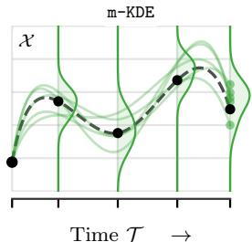

Each mixture component captures the deterministic prediction error (through its mean $\hat { \pmb { x } } _ { h } ^ { ( s ) } )$ and the accumulated aleatoric uncertainty

Figure 8: Viz. ofm-KDE.

(through the bandwidth $h \Sigma _ { \nu } )$ , while the mixture itself represents the epistemic uncertainty over $W .$ The loss is the negative marginal log-likelihood of the observed trajectory under the KDE density:

$$
\ell _ { \mathrm { K D E } } \big ( \{ W ^ { ( s ) } \} _ { s = 1 } ^ { S } , \pmb { \tau } ^ { ( n ) } \big ) = - \sum _ { h = 1 } ^ { H } \log \hat { p } _ { h } ( \pmb { x } _ { h } ^ { ( n ) } ) .\tag{49}
$$

Differentiating through (49), the log-sum-exp structure assigns each weight sample $W ^ { ( s ) }$ a gradient contribution proportional to its responsibility—the fraction of the mixture density it explains at the observed state. Samples whose rollouts pass close to $\pmb { x } _ { h } ^ { ( n ) }$ receive large gradients; those that diverge are down-weighted. This softmax-like reweighting provides an implicit form of trajectory selection that encourages the posterior to concentrate on weight matrices producing accurate multi-step predictions, while the mixture formulation preserves the ability to represent multi-modal predictive distributions that a single Gaussian rollout would collapse.

The log-sum-exp structure of (49) evaluates $- \log \mathbb { E } _ { q ( \boldsymbol { W } ) } [ p ( \pmb { x } _ { h } ^ { * } \mathrm { ~  ~ \omega ~ } | \mathrm { ~  ~ \pmb { W } ) } ]$ rather than $\mathbb { E } _ { q ( W ) } [ - \log p ( \pmb { x } _ { h } ^ { * } \mid W ) ]$ : the logarithm sits outside the expectation, coupling all S weight samples into a single joint evaluation. No pointwise loss ℓ(W) exists whose expectation reproduces this quantity, so m-KDE is not an instantiation of the Gibbs VI objective (4). The correct interpretation is that it applies the log scoring rule directly to the marginal predictive distribution

$$
\bar { p } ( \pmb { x } _ { h } \mid \pmb { x } _ { 0 } ) = \int p ( \pmb { x } _ { h } \mid \pmb { W } , \pmb { x } _ { 0 } ) q ( \pmb { W } ) d \pmb { W } ,\tag{50}
$$

estimated via the KDE mixture (48). By Jensen’s inequality, the predictive data-fit is always less pessimistic than a corresponding ELBO term: log $\mathbb { E } _ { q } [ \bar { p } ] \geq \bar { \mathbb { E } } _ { q } [ \log p ]$ ; the mixture receives credit for ensemble diversity in a way that individual-sample scoring cannot but comes with its own computational downsides. In our experiment, we show that this scoring of the marginal yields the best coverage across tasks but can also lead to diverging samples from the tails which we did not observe with losses that optimized the computationally “easier" Gibbs VI objective.

## Relationship between m-KDE and m-arCRPS.

The m-arCRPS shares its autoregressive rollout and linearly growing noise envelope with the KDE objective of Ivanovic et al. [34]; the two differ in how the resulting ensemble is aggregated and scored. The m-arCRPS evaluates each weight draw independently: $\ell _ { \mathtt { m - a r C R P S } } ( W , \tau ^ { ( n ) } )$ is a pointwise function of a single W, and takes the expectation under $\bar { q } ( \boldsymbol { W } )$ outside the scoring rule. This pointwise structure is what makes the m-arCRPS an instantiation of the Gibbs VI objective (4), inheriting the associated PAC-Bayesian interpretation. The KDE objective instead pools all S weight samples into the Gaussian-mixture predictive $\begin{array} { r } { \hat { p } _ { h } = \frac { 1 } { S } \sum _ { s } \mathcal { N } ( \hat { \pmb x } _ { h } ^ { ( s ) } , h { \pmb \Sigma } _ { \nu } ) } \end{array}$ and applies the log scoring rule to this marginal density. Because the logarithm sits outside the average over ensemble members, the loss couples all draws into a single joint evaluation that falls outside the GVI framework. The matched m-arNLL disentangles these two differences as it shares the pointwise Gibbs VI structure, rollout, and noise envelope of m-arCRPS, but applies the log score, so comparing m-arNLL with m-arCRPS isolates the scoring rule, while comparing m-arNLL with m-KDE isolates the aggregation structure. This structural difference propagates into the gradient: under the m-arCRPS, every weight sample receives an $\mathcal { O } ( 1 )$ gradient signal thanks to the CRPS linear tail behavior, whereas the KDE’s log-sumexp assigns each sample a gradient proportional to its responsibility in the mixture, exponentially down-weighting draws whose rollouts diverge from the observation. While the CRPS losses under Gibbs VI demonstrated the strongest performance, our results also show very good coverage of m-KDE which indicates that a potential extension of m-KDE with CRPS might be interesting.

## F Related Work (extended version)

Bayesian neural networks in dynamics learning. Probabilistic dynamics models have long been central to model-based control, with Gaussian processes providing strong uncertainty estimates in the low-data regime [13]. For neural network dynamics models, probabilistic ensembles (PE) [38] remain popular in model-based reinforcement learning, combining bootstrap ensembles with Gaussian output heads to capture epistemic and aleatoric uncertainty, and underpin a large body of planning and policy optimization work [10, 35, 19]. Fully Bayesian alternatives such as MC-dropout [22] have also been applied to dynamics learning [23], but typically at a higher computational cost for predictive inference and with weaker calibration in practice. More recently, Bayesian last-layer models [56, 52, 18, 61, 31] have emerged as an attractive middle ground: restricting the Bayesian treatment to the final layer preserves tractable inference while still providing useful predictive uncertainty for downstream tasks [30, 45, 11, 12]. Variational Bayesian last layers [31] instantiate this idea by directly learning a variational posterior of the last layer and have since been applied to Bayesian optimization [6] and autonomous racing [7]. Our work builds directly on VBLLs but reinterprets them through the lens of Gibbs variational inference [2, 5, 36], decoupling the posterior from the training loss and enabling task-aligned objectives. Through this, we extend VBLLs to multi-step losses. BLLs have also been popular in a meta-learning setting–especially for dynamics learning. Here, the goal is usually to learn the prior distribution p(W) and then recursively update it via Kalman filtering [34, 44] or recursive least squares [30, 11]. By design, these already are trained via multi-steps at the cost of back-propagating through the conditioning. In this work, we do not consider such online adaptation, though it is noteworthy that recursive updates on the learned posteriors are still possible but following the Gibbs VI framework these would have to be gradient-based as there exist in general no closed-form update for an arbitrary loss ℓ.

Multi-step loss functions. The importance of training dynamics models for long-horizon accuracy is well established and some works explicitly demonstrate the downsides of one-step training losses for compounding errors [41]. Doerr et al. [14] argue that multi-step objectives become necessary when the Markov property is violated or when process and observation noise are significant, and we further demonstrate that a one-step loss can also exhibit failure modes in very controlled Markov environments. Lambert et al. [40] show that multi-step training improves long-horizon accuracy and sample efficiency in model-based RL. Closest to our setting, Ivanovic et al. [34] propose a kernel-density multi-step objective with linearly growing noise for trajectory prediction under heteroskedasticity, which we adopt as our m-KDE baseline and which inspired the m-arCRPS construction. In contrast to these log-likelihood-based formulations, our CRPS-based losses leverage a strictly proper scoring rule [49, 27, 26, 29] that is robust to outliers [55], and are justified within the Gibbs VI framework rather than through a likelihood interpretation. Such CRPS-based scoring is very popular [4], especially in weather forecasting [26, 42, 51] but often used to directly score marginal distributions [42]. To the best of our knowledge, we are the first to adopt it to the variational setting through Gibbs VI. Note that standard CRPS (or in general losses based on standard formulation of the energy distance or MMD) do not fit into the Gibbs VI framework as draws of W are not scored independently.

In the context of probabilistic ensembles, Levy et al. [43] propose mean propagation for multi-step training over a small horizon (H = 4) and show improved performance for a structured dynamics model. Extending multi-step training to probabilistic ensembles in a principled manner would be a natural direction for future work, though the ensemble structure poses additional challenges compared to the Bayesian last-layer setting, as the independence structure across ensemble members differs from the weight posterior in VBLLs making consistent rollouts (for VBLLs by design just a draw of W) non-trivial. Here, using approaches as proposed by Frauenknecht et al. [20] also for model learning can be interesting.

For deterministic dynamics models, various works have extended the standard one-step MSE loss to a multi-step setting with mixed results. Lutter et al. [48] demonstrate that while a short multi-step horizon can be beneficial, too long a horizon actually results in worse downstream performance, leading Byravan et al. [8] to directly build on these short-horizon multi-step models. To achieve better performance for training with longer horizons, Benechehab et al. [3] introduce a weighted sum over time-steps to stabilize gradients and down-weight future predictions; however, also with mixed results. We find that for (Gibbs) VBLLs, we did not need to specify additional weighting which would result from tempered likelihoods, as the VBLL setup seems to provide sufficient flexibility, especially in combination with the CRPS losses, accommodate and then also optimize for horizons of up to 100 time steps (see Appendix I). For Gaussian processes, moment matching and uncertainty propagation via linearization have been used to train with multi-step objectives [13, 14]. In that setting, the set of learnable parameters is significantly smaller; in the regime of overparameterized neural networks, it is even more important to provide informative multi-step training signal to learn good and reliable features.

Objective mismatch and decision-aware model learning. A fundamental tension in modelbased control is that minimizing prediction error does not necessarily maximize downstream task performance. Lambert et al. [39] coin the term objective mismatch and demonstrate empirically that model accuracy and control performance can be poorly correlated, arguing that the model learning objective should be informed by the decision-making pipeline it serves. This observation has motivated a growing line of work on decision-aware model learning, recently surveyed by Wei et al. [62]. Farahmand et al. [17] introduce value-aware model learning, which replaces the standard maximum-likelihood objective with a loss that incorporates the structure of the value function space, ensuring that the model is accurate where it matters for policy evaluation. This idea was further developed in Farahmand [16], which proposes an iterative scheme that alternates between value estimation and model refinement. D’Oro et al. [15] take a complementary perspective: their gradientaware model-based policy search algorithm re-weights the model-learning objective according to policy-gradient norms, focusing model accuracy on state-action regions where the policy gradient is large. Similarly, Abachi [1] derives policy-aware model learning, which aligns the model-learning loss with the structure of the policy gradient estimator. More recently, Voelcker et al. [59] propose value-gradient weighted model learning (VaGraM), which rescales the prediction loss with gradient information from the current value function estimate and provides a thorough empirical comparison of decision-aware approaches. In the vision-based setting, Nair et al. [50] propose goal-aware prediction learning, which conditions the dynamics model on the goal state, directing model capacity toward task-relevant aspects of the observation.

These approaches mostly operate in the deterministic setting with point-estimate models and focus on coupling model learning directly with policy optimization. Our work shares the underlying motivation—the training loss should reflect how the model is used—but takes a different and complementary route. Rather than incorporating a value function or policy gradient into the modellearning objective, we remain in the probabilistic prediction setting and use the Gibbs VI framework to replace the likelihood with losses that are structurally aligned with the deployment regime of the model (multi-step rollouts, robust scoring). Notably, the two perspectives are not mutually exclusive: because the Gibbs VI objective (3) accepts any pointwise loss $\ell ( W , \tau ^ { ( n ) } )$ , decision-aware reweightings such as VaGraM can be incorporated by simply scaling each per-step CRPS term by the local value-gradient magnitude, yielding a value-aware multi-step scoring rule that retains a PAC-Bayesian interpretation. Exploring such combinations in a closed-loop control setting is a promising direction for future work.

## G Proof of Proposition 1

For convenience, we restate the proposition in a slightly expanded form that makes the leading correction term explicit; the bound in the main text follows as an immediate corollary.

Proposition. Suppose $\phi _ { \pmb { \theta } } ( \pmb { x } ) = \Phi \pmb { x } + \pmb { b }$ and define $\pmb { A } : = \pmb { I } + \pmb { W } ^ { \top } \pmb { \Phi }$ . Then for all $h \geq 1$ the predictive distribution is exactly Gaussian,

$$
p ( \pmb { x } _ { h } \mid \pmb { W } , \pmb { x } _ { 0 } ) = \mathcal { N } \big ( \hat { \pmb { x } } _ { h } ( \pmb { W } ) , \pmb { C } _ { h } \big ) , \qquad \pmb { C } _ { h } : = \sum _ { k = 0 } ^ { h - 1 } \pmb { A } ^ { k } \pmb { \Sigma } _ { \nu } ( \pmb { A } ^ { k } ) ^ { \top } .\tag{51}
$$

The covariance collapses to $C _ { h } \ = \ h \Sigma _ { \nu }$ whenever $A \Sigma _ { \nu } A ^ { \top } = \Sigma _ { \nu }$ (e.g. A orthogonal and $\Sigma _ { \nu } = \sigma ^ { 2 } I )$ . More generally, writing $\pmb { A } = \pmb { I } + \pmb { E }$ with $\pmb { { \cal E } } = \pmb { { \cal W } } ^ { \top } \pmb { \Phi }$

$$
C _ { h } = h \Sigma _ { \nu } + \frac { h ( h - 1 ) } { 2 } \big ( { \pmb { E } } \Sigma _ { \nu } + { \pmb { \Sigma } } _ { \nu } { \pmb { E } } ^ { \top } \big ) + { \cal O } \big ( h ^ { 3 } \| { \pmb { E } } \| ^ { 2 } \| { \pmb { \Sigma } } _ { \nu } \| \big ) ,\tag{52}
$$

valid whenever $h \parallel E \parallel$ is small.

Proof. Under affine features, the stochastic dynamics reduce to $\pmb { x } _ { h + 1 } = \pmb { A } \pmb { x } _ { h } + \pmb { W } ^ { \top } \pmb { b } + \pmb { \nu } _ { h }$ , which is a linear time-invariant system driven by i.i.d. Gaussian noise $\pmb { \nu } _ { h } \sim \mathcal { N } ( \mathbf { 0 } , \pmb { \Sigma } _ { \nu } )$ . Unrolling from $\scriptstyle { \mathbf { { \mathit { x } } } } _ { 0 }$

$$
\pmb { x } _ { h } = \pmb { A } ^ { h } \pmb { x } _ { 0 } + \sum _ { k = 0 } ^ { h - 1 } \pmb { A } ^ { k } \pmb { W } ^ { \top } \pmb { b } + \sum _ { k = 0 } ^ { h - 1 } \pmb { A } ^ { h - 1 - k } \pmb { \nu } _ { k } .\tag{53}
$$

Part $( i ) .$ The deterministic rollout satisfies $\begin{array} { r } { \hat { \pmb x } _ { h } ( \pmb { W } ) = \pmb { A } ^ { h } \pmb { x } _ { 0 } + \sum _ { k = 0 } ^ { h - 1 } \pmb { A } ^ { k } \pmb { W } ^ { \top } \pmb { b } . } \end{array}$ Since $\mathbb { E } [ \nu _ { k } ] = \mathbf { 0 }$   
taking expectations in (53) yields $\mathbb { E } [ { \pmb x } _ { h } \mid { \pmb W } , { \pmb x } _ { 0 } ] = \hat { \pmb x } _ { h } ( { \pmb W } )$   
Part (ii). Subtracting the mean from (53) gives

$$
\pmb { x } _ { h } - \mathbb { E } [ \pmb { x } _ { h } \ | \ \pmb { W } , \pmb { x } _ { 0 } ] = \sum _ { k = 0 } ^ { h - 1 } \pmb { A } ^ { h - 1 - k } \pmb { \nu } _ { k } .\tag{54}
$$

Since the $\nu _ { k }$ are independent with covariance $\Sigma _ { \nu }$ , the conditional covariance is

$$
C _ { h } = \sum _ { k = 0 } ^ { h - 1 } A ^ { h - 1 - k } \Sigma _ { \nu } ( A ^ { h - 1 - k } ) ^ { \top } = \sum _ { k = 0 } ^ { h - 1 } A ^ { k } \Sigma _ { \nu } ( A ^ { k } ) ^ { \top } ,\tag{55}
$$

where the second equality follows by reindexing $k \mapsto h - 1 - k$

Exactness. If $\boldsymbol { A } \boldsymbol { \Sigma } _ { \nu } \boldsymbol { A } ^ { \intercal } = \boldsymbol { \Sigma } _ { \nu }$ , then by induction $A ^ { k } \Sigma _ { \nu } ( A ^ { k } ) ^ { \top } = \Sigma _ { \iota }$ ν for all $k \geq 0 ,$ and therefore $C _ { h } = h \Sigma _ { \nu }$ exactly. This holds in particular when A is orthogonal and $\Sigma _ { \nu } = \sigma ^ { 2 } I$ , since then $A ^ { k } ( A ^ { k } ) ^ { \top } = I$

Expansion. Write $\pmb { A } = \pmb { I } + \pmb { E }$ . The binomial expansion gives

$$
A ^ { k } = ( I + E ) ^ { k } = I + k E + R _ { k } , \qquad \| R _ { k } \| = \mathcal { O } \big ( k ^ { 2 } \| E \| ^ { 2 } \big ) .\tag{56}
$$

Substituting into each summand and keeping terms up to first order in E,

$$
\pmb { A } ^ { k } \Sigma _ { \nu } ( \pmb { A } ^ { k } ) ^ { \top } = \left( \pmb { I } + k \pmb { E } + \pmb { R } _ { k } \right) \Sigma _ { \nu } \left( \pmb { I } + k \pmb { E } + \pmb { R } _ { k } \right) ^ { \top }\tag{57}
$$

$$
= \Sigma _ { \nu } + k \big ( { E \Sigma _ { \nu } + \Sigma _ { \nu } E ^ { \top } } \big ) + { \mathcal O } \big ( k ^ { 2 } \| E \| ^ { 2 } \| \Sigma _ { \nu } \| \big ) .\tag{58}
$$

Summing over $k = 0 , \ldots , h - 1$ and using Ph−1k=0 1 = h, Ph−1k=0 k = h(h−1)2 , and Ph−1k=0 k2 = O(h3),

$$
C _ { h } = h \Sigma _ { \nu } + \frac { h ( h - 1 ) } { 2 } \big ( { \pmb { E } } \Sigma _ { \nu } + { \pmb { \Sigma } } _ { \nu } { \pmb { E } } ^ { \top } \big ) + { \cal O } \big ( h ^ { 3 } \| { \pmb { E } } \| ^ { 2 } \| { \pmb { \Sigma } } _ { \nu } \| \big ) ,\tag{59}
$$

which establishes (52).

Remark 2. The bound stated in the main textfollows immediatelyfrom (52): when $h \parallel E \parallel$ is small, the ${ \mathcal { O } } ( h ^ { 3 } \| E \| ^ { 2 } \| \Sigma _ { \nu } \| )$ term is dominated by the leading correction, and therefore

$$
\| \pmb { C } _ { h } - h \pmb { \Sigma } _ { \nu } \| = \mathcal { O } \big ( h ^ { 2 } \| \pmb { E } \| \| \pmb { \Sigma } _ { \nu } \| \big ) .\tag{60}
$$

In the residual parameterization $\pmb { A } = \pmb { I } + \pmb { W } ^ { \top }$ Φ with small time step $\Delta t ,$ , one has $\| E \| = { \mathcal { O } } ( \Delta t )$ so the condition $h \left\| E \right\|$ small corresponds to a bounded rollout time $h \Delta t$

## H Closed-Form CRPS for Gaussian Predictives

The closed-form expression of the CRPS for Gaussian predictive distributions is well known; see, e.g., [27, 26]. We briefly include the derivation here for completeness.

Starting from the energy form,

$$
\mathrm { C R P S } ( P , y ) = \mathbb { E } _ { P } | X - y | - \frac { 1 } { 2 } \mathbb { E } _ { P } | X - X ^ { \prime } | ,\tag{61}
$$

with $X , X ^ { \prime } \overset { \mathrm { i i d } } { \sim } P$ , we evaluate both terms for $P = \mathcal N ( \mu , \sigma ^ { 2 } )$

Term $\mathbf { 1 } \colon \mathbb { E } | X - y | .$

Let $Z \sim { \mathcal { N } } ( 0 , 1 )$ and write $X = \mu + \sigma Z ,$ with $z : = ( y - \mu ) / \sigma$ . Then

$$
\mathbb { E } | X - y | = \sigma \mathbb { E } | Z - z | .
$$

Using standard manipulations,

$$
\begin{array} { c l l } { \displaystyle \mathbb { E } | Z - z | = \int _ { - \infty } ^ { z } ( z - t ) \varphi ( t ) d t + \int _ { z } ^ { \infty } ( t - z ) \varphi ( t ) d t } \\ { = z \Phi ( z ) + \varphi ( z ) + \varphi ( z ) - z \big ( 1 - \Phi ( z ) \big ) } \\ { = 2 \varphi ( z ) + z \big ( 2 \Phi ( z ) - 1 \big ) , } \end{array}
$$

where we used $\textstyle \int t \varphi ( t ) d t = - \varphi ( t )$ . Hence, E $X - y | = \sigma \Big [ 2 \varphi ( z ) + z \big ( 2 \Phi ( z ) - 1 \big ) \Big ]$

Term $2 \colon \mathbb { E } | X - X ^ { \prime } | .$

Since $X - X ^ { \prime } \sim { \mathcal { N } } ( 0 , 2 \sigma ^ { 2 } )$ , we write $X - X ^ { \prime } = \sigma { \sqrt { 2 } }$ Z with $Z \sim { \mathcal { N } } ( 0 , 1 )$ , giving

$$
\mathbb { E } | X - X ^ { \prime } | = \sigma { \sqrt { 2 } } \mathbb { E } | Z | = \sigma { \sqrt { 2 } } \cdot { \sqrt { \frac { 2 } { \pi } } } = { \frac { 2 \sigma } { \sqrt { \pi } } } .
$$

Substituting both derived terms into (61) yields the closed form from (10).

## I Additional Results

## I.1 Extended Statistical evaluation of the chaotic systems benchmark

To complement the average rank summary in Figure 4, we provide a formal statistical comparison across all 198 (environment, metric) evaluation blocks from Section 4.2. First we conducted a Friedman test that rejects the null hypothesis that all methods perform equally $( \chi ^ { 2 } = 3 1 4 . 1 , p <$ $1 0 ^ { - 6 5 } \cdot$ ) and then followed this with post-hoc comparisons. Table 2 reports the rank distribution and these pairwise post-hoc comparisons.

All pairwise differences are significant at $\alpha = 0 . 0 5$ under the Holm-corrected Wilcoxon signed-rank test; under the more conservative Nemenyi test, only the differences between m-KDE and s-NLL as well as between m-KDE and m-arCRPS are not significant. In particular, both CRPS-based losses significantly outperform their likelihood-based counterparts (m-CRPS vs. m-NLL and m-arCRPS vs. m-arNLL). For the autoregressive pair, this advantage stems from training stability. m-arNLL diverged on all 13 chaotic systems and is therefore ranked last in 143 out of 198 cases, whereas m-arCRPS trained stably throughout; on the five systems where m-arNLL converged, the two are statistically indistinguishable. Notably, among the stably trained losses, s-NLL and m-KDE have the worst mean ranks, underscoring the limitations of single-step training and of the marginal mixture objective, respectively.

Table 2: Statistical evaluation across 198 (environment, metric) blocks. Left: Rank distribution (lower mean rank is better). Right: Post-hoc pairwise comparisons (Nemenyi test, critical difference $\Delta r = 0 . 5 3 6$ , and Holm-corrected Wilcoxon signed-rank test); pairs below the line are not significant at $\alpha = 0 . 0 5$ under the Nemenyi test. Friedman test: $\stackrel {  } { \chi } ^ { 2 } = 3 1 4 . 1 , p < 1 0 ^ { - 6 5 }$ . Diverged runs (143 blocks of m-arNLL) are ranked last.
<table><tr><td>Method</td><td>Mean</td><td>Med.</td><td>Std</td><td>1st</td><td>2nd</td><td>3rd</td><td>4th</td><td>5th</td><td>6th</td></tr><tr><td>m-CRPS</td><td>2.12</td><td>2</td><td>1.26</td><td>85</td><td>49</td><td>35</td><td>16</td><td>11</td><td>2</td></tr><tr><td>m-NLL</td><td>2.83</td><td>2</td><td>1.48</td><td>46</td><td>56</td><td>23</td><td>33</td><td>39</td><td>1</td></tr><tr><td>m-arCRPS</td><td>3.24</td><td>3</td><td>1.51</td><td>28</td><td>50</td><td>27</td><td>47</td><td>32</td><td>14</td></tr><tr><td>s-NLL</td><td>3.78</td><td>4</td><td>1.32</td><td>9</td><td>17</td><td>66</td><td>50</td><td>29</td><td>27</td></tr><tr><td>m-KDE</td><td>3.83</td><td>4</td><td>1.43</td><td>20</td><td>20</td><td>31</td><td>40</td><td>77</td><td>10</td></tr><tr><td>m-arNLL</td><td>5.21</td><td>6</td><td>1.47</td><td>10</td><td>6</td><td>16</td><td>12</td><td>10</td><td>144</td></tr></table>

<table><tr><td>Method A</td><td>Method B</td><td>∆r</td><td> $p _ { \mathrm { N e m e n y i } }$ </td><td>PHolm</td></tr><tr><td>m-arNLL</td><td>m-CRPS</td><td>3.10</td><td> $< 1 0 ^ { - 1 0 }$ </td><td> $< 1 0 ^ { - 1 0 }$ </td></tr><tr><td>m-arNLL</td><td>m-NLL</td><td>2.38</td><td> $< 1 0 ^ { - 1 0 }$ </td><td> $< 1 0 ^ { - 1 0 }$ </td></tr><tr><td>m-arNLL</td><td>m-arCRPS</td><td>1.97</td><td>&lt; 10−10</td><td> $< 1 0 ^ { - 1 0 }$ </td></tr><tr><td>m-KDE</td><td>m-CRPS</td><td>1.71</td><td> $< 1 0 ^ { - 1 0 }$ </td><td>V  $! 1 0 ^ { - 1 0 }$ </td></tr><tr><td>s-NLL</td><td>m-CRPS</td><td>1.66</td><td> $< 1 0 ^ { - 1 0 }$ </td><td>&lt;  $1 0 ^ { - 1 0 }$ </td></tr><tr><td>m-arNLL</td><td>s-NLL</td><td>1.43</td><td> $< 1 0 ^ { - 1 0 }$ </td><td> $< 1 0 ^ { - 1 0 }$ </td></tr><tr><td>m-arNLL</td><td>m-KDE</td><td>1.38</td><td> $< 1 0 ^ { - 1 0 }$ </td><td> $< 1 0 ^ { - 1 0 }$ </td></tr><tr><td>m-arCRPS</td><td>m-CRPS</td><td>1.12</td><td> $< 1 0 ^ { - 7 }$ </td><td> $< 1 0 ^ { - 9 }$ </td></tr><tr><td>m-KDE</td><td>m-NLL</td><td>1.00</td><td> $< 1 0 ^ { - 5 }$ </td><td> $< 1 0 ^ { - 5 }$ </td></tr><tr><td>s-NLL</td><td>m-NLL</td><td>0.95</td><td>&lt; 10−5</td><td> $< 1 0 ^ { - 6 }$ </td></tr><tr><td>m-NLL</td><td>m-CRPS</td><td>0.71</td><td> $2 \times 1 0 ^ { - 3 }$ </td><td> $< 1 0 ^ { - 5 }$ </td></tr><tr><td>m-KDE</td><td>m-arCRPS</td><td>0.59</td><td>0.021</td><td> $8 \times 1 0 ^ { - 4 }$ </td></tr><tr><td>s-NLL</td><td>m-arCRPS</td><td>0.54</td><td>0.047</td><td> $3 \times 1 0 ^ { - 3 }$ </td></tr><tr><td>m-arCRPS</td><td>m-NLL</td><td>0.41</td><td>0.249</td><td>0.073</td></tr><tr><td>m-KDE</td><td>s-NLL</td><td>0.05</td><td>1.000</td><td>0.670</td></tr></table>

## I.2 Intuition on the different learned feature representations

Figure 9 visualizes how different training losses shape the learned representation $\phi _ { \theta } ( x )$ and its induced sensitivities across the state space of the VSLC. A key property of the VSLC is its statedependent angular velocity, which induces spatial heterogeneity: the upper-right and lower-left regions correspond to fast zones (also see Fig. 2), while the remaining regions are slow. Due to the inverse relationship between data density and velocity, the training data is heavily biased toward the slow regions.

Feature sensitivity. The top row reveals a strong difference across losses. s-NLL shows a low feature sensitivity which slightly larger sensitivity in the fast zones compared to the slow zones. In contrast, multi-step objectives show more diverse feature fields. Especially the CRPS losses and m-KDE demonstrate increased sensitivity in the fast zones (upper-right and lower-left), where accurate modeling is most critical for long-horizon predictions. It indicates that the multi-step losses encourage the representation to allocate capacity to dynamically important but under-sampled regions.

Mean prediction sensitivity. The middle row shows that all methods learn a similar structure for the mean dynamics, dominated by a strong horizontal band around $x _ { 2 } \approx 0$ . This suggests that, despite differences in representation, the mean predictor is largely constrained by the residual model structure as well as the defined prior. There are however still clear observable differences between the different losses.

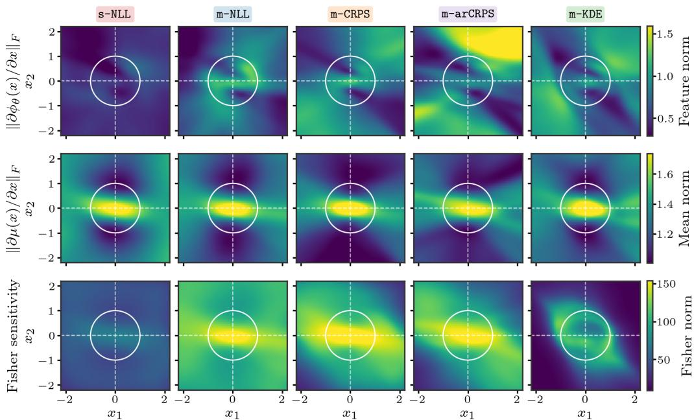  
Figure 9: Feature sensitivity (top), mean prediction sensitivity (middle), and Fisher sensitivity (bottom)for the learned model on the VSLC (Fig. 2). All models are evaluated on the same data yet there are distinct differences in behavior, most prominently in feature and Fisher sensitivity.

Fisher sensitivity. The bottom row highlights how uncertainty interacts with the learned features. We define the Fisher sensitivity as

$$
S _ { \mathrm { F } } ( { \pmb x } ) : = \left( \sum _ { j = 1 } ^ { d _ { x } } \frac { \big \| \nabla _ { { \pmb x } } \mu _ { j } ( { \pmb x } ) \big \| _ { 2 } ^ { 2 } } { \sigma _ { j } ^ { 2 } ( { \pmb x } ) } + 2 \sum _ { j = 1 } ^ { d _ { x } } \big \| \nabla _ { { \pmb x } } \log \sigma _ { j } ( { \pmb x } ) \big \| _ { 2 } ^ { 2 } \right) ^ { 1 / 2 } ,\tag{62}
$$

The Fisher sensitivity differs substantially across losses, reflecting how the posterior over the last layer couples with the representation. While s-NLL yields relatively uniform and low Fisher sensitivity due to the high noise estimates, multi-step and CRPS-based losses produce structured patterns. In particular, m-CRPS exhibits a high Fisher sensitivity at the transitions from slow to fast dynamic sections of the state space while m-KDE shows a very pronounced sensitivity around the limit cycle.

In the end, the important evaluation is the one from Figure 2 but still these results show that using the same data, the loss clearly influences both the learned features as well as the learned variational posterior.

## I.3 Sensitivity of m-KDE and m-arCRPS to Model Capacity

In all experiments, we fixed the model size and capacity and did not perform any dedicated tuning of these aspects. Nevertheless, studying how model size and capacity influence predictive performance is both relevant and insightful. In particular, it is plausible that certain loss functions are better able to exploit increased model capacity. To investigate this, we conduct an ablation study on model capacity for both m-KDE and m-arCRPS using the Mini Wheelbot. The results are summarized in Fig. 10.

For both three- and two-layer backbone (top and bottom row, respectively), we observe that increasing model capacity consistently improves performance, measured here by the energy distance on the xyplane across multiple rollouts. Across all model sizes, m-arCRPS outperforms m-KDE. Interestingly, the smallest model trained with m-arCRPS (bottom right) achieves performance comparable to the largest model trained with m-KDE (top left). While the absolute model sizes are tiny by modern standards, a reduction of up to 70× in the number of parameters is highly significant, particularly for deployment on embedded hardware.

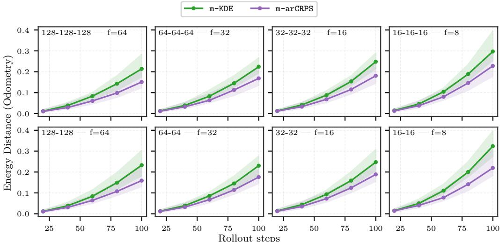

(a) Performance ofm-KDE and m-arCRPS under varying model size. We evaluate both losses on different sizes of the backbone. m-arCRPS consistently outperforms m-KDE across the full horizon of 100 time steps.  
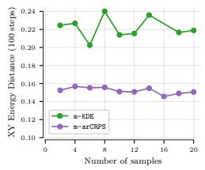  
(b) Performance.

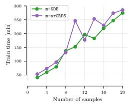  
(c) Training time.

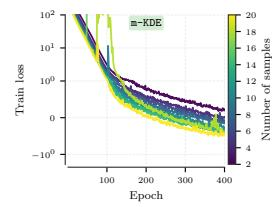  
(d) Training losses.

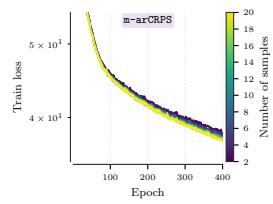  
(e) Training losses.  
Figure 10: Ablation of model size (top) and the sample size S (bottom) on Mini Wheelbot data.

## I.4 Sensitivity of m-KDE and m-arCRPS to Sample Size S

In all of our experiments, we use $S = 1 0$ and did not further tune this for any of the methods. In Fig. 10 (b)–(e), we ablate the sensitivity of the loss functions to different sample sizes S on the Mini Wheelbot data. We can see that both models perform comparable across different S. In Fig. 10 (c) we can further see the $\mathcal O ( S )$ scaling of the loss functions where small perturbations from the linear trend are due to minor cluster anomalies. Lastly, we can observe that the training with m-KDE becomes a bit more unstable for larger S actually resulting in a diverged training for $S = 1 6$ . Training with m-arCRPS is very stable and behaves similar for the different S.

## I.5 Sensitivity of m-KDE and m-arCRPS to Horizon H

In Fig. 11, we compare the performance of m-KDE and m-arCRPS on the Mini Wheelbot data for different horizons H. We find that generally increasing the horizon shows improved performance but it plateaus for $H > 4 0$ . Furthermore, we find that for large horizon, training with m-KDE was numerically more unstable resulting in the training runs of $\mathbf { \bar { \Gamma } } _ { H } \in \{ 7 0 , 9 0 , 1 0 0 \}$ to diverge. The matched m-arNLL trains up to H = 40 but diverges for all larger horizons, while m-arCRPS remains stable across all tested horizons. In general, we observed that training with a too long horizon can be challenging but having a robust scoring and with this bounded gradients on the noise helped in such long-horizon training scenarios.

## I.6 Effect of the regularization factor for m-CRPS and m-arCRPS

All the results in the main paper were generated with $\lambda = 1 / N$ . However, we observe that the autoregressive m-arCRPS can be overconfident in terms of coverage (also see Tab. 3–6). One way to increase coverage that directly aligns with the Gibbs VI framework is to increase the regularization by a factor $K _ { N }$ resulting in $\dot { \lambda ( \mathrm { = } K _ { N } / N }$ for the different methods. Note that also [7] use $K _ { N } = 1 0$

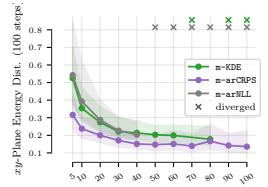

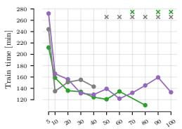

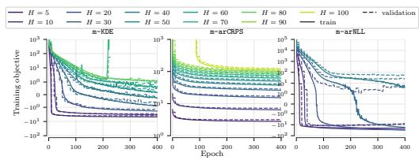  
Figure 11: Sensitivity to different horizon H. A longer horizon during training increases performance. Training time for small H increases as the effective data set size increase.

Final L2  
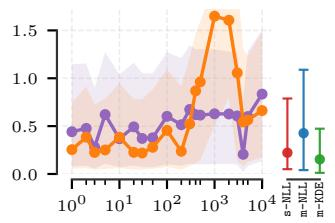

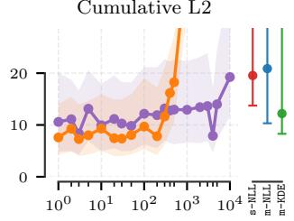

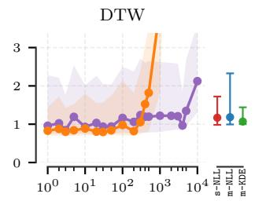

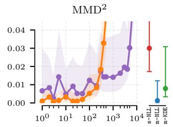

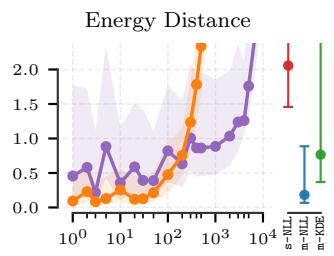

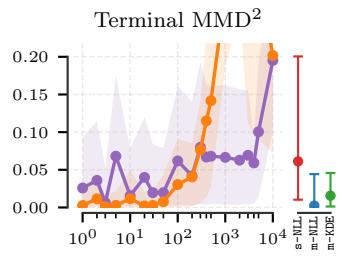

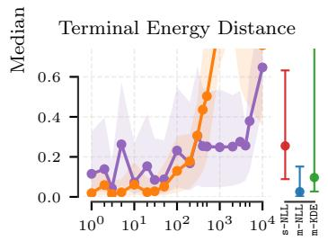

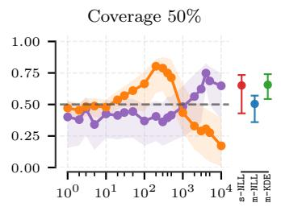

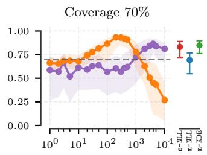

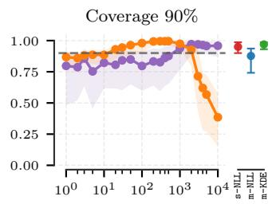

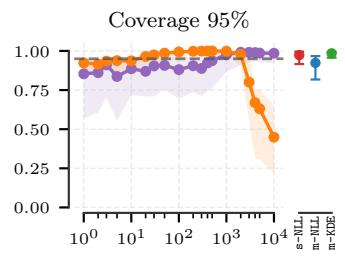  
Regularization weight multiplier $( K _ { N } )$  
Figure 12: Influence of changing the KL weight λ for the CRPS baselines.

m-arCRPS m-CRPS

for the one-step ELBO. In Fig. 12, we show how increasing $K _ { N }$ influences coverage as well as performance on the VSLC environment, where m-arCRPS tended to be overconfident. As the scale of the losses differ between m-CRPS and m-arCRPS, the magnitudes in which $K _ { N }$ needs to be adapted is different for the two methods. We find that for m-CRPS, setting $K _ { N } = 1 0$ gives good coverage and still strong performance while for m-arCRPS $K _ { N } = 1 0 ^ { 3 }$ demonstrates strong coverage at the cost however of slightly reduced performance.

## I.7 Gradient norms during optimization

The bounded derivatives of the CRPS in Sec. 3.2 hold at the score level, $i . e .$ , with respect to the predictive location and scale. They do not bound gradients through the backbone and, under autoregressive evaluation, backpropagation through time additionally multiplies rollout Jacobians. To assess how the scoring rule affects optimization in practice, we log the pre-clipping gradient norm of the backbone parameters at every training step for all objectives on all benchmark environments and report its 95th percentile per epoch in Fig. 13. All objectives use the same global gradient clipping threshold, which we adopt from the original VBLL implementation [31] and did not tune for any objective (cf . Appendix C for all the implementation details).

Teacher forcing. Under teacher forcing, the scoring rule alone already has a strong effect on the gradient magnitude: m-CRPS has by far the smallest backbone gradients, whereas m-NLL yields gradients that are orders of magnitude larger. Since the per-step contributions only add up without being propagated through a rollout, these large gradients remain benign and both objectives train successfully on all environments.

Autoregressive training. Once the predictions are fed back along the rollout, gradients compound through time. Consequently, m-arCRPS exhibits substantially larger backbone gradients than its teacher-forced counterpart m-CRPS. Here CRPS attenuates gradient growth under backpropagation through time. Nevertheless, the gradients of m-arCRPS remain of the same order as, and typically below, those of the teacher-forced m-NLL, and training remains finite on all environments. In contrast, the matched m-arNLL, which differs from m-arCRPS only in the scoring rule, exhibits the largest gradients on all non-chaotic systems and develops non-finite gradients on all chaotic systems. Since all objectives share the same clipping threshold, clipping alone is insufficient to prevent the instability of the autoregressive log score. We observe the same pattern on the Mini Wheelbot horizon sweep (Fig. 11), where m-arNLL trains at shorter horizons but diverges at longer ones, while m-arCRPS remains stable across all tested horizons.

Joint optimization of backbone and posterior. Since the backbone and the variational posterior are trained jointly, the last layer performs inference on a representation that shifts during training. To check whether the posterior keeps up with this representation drift, we track the relative change of the backbone parameters, the posterior mean, and the posterior covariance between consecutive epochs, i.e., the norm of the update divided by the norm of the respective parameters (Figs. 14–16). Across all objectives and environments, the posterior mean and covariance continue to update on a similar relative scale as the backbone throughout training. In particular, we do not observe the posterior stalling while the representation continues to move, i.e., the posterior does not decouple from the evolving features. We note that, since AdamW normalizes the update by a running estimate of the gradient scale and we use a constant learning rate, these quantities are largely insensitive to the gradient magnitudes in Fig. 13 and are not a measure of convergence.

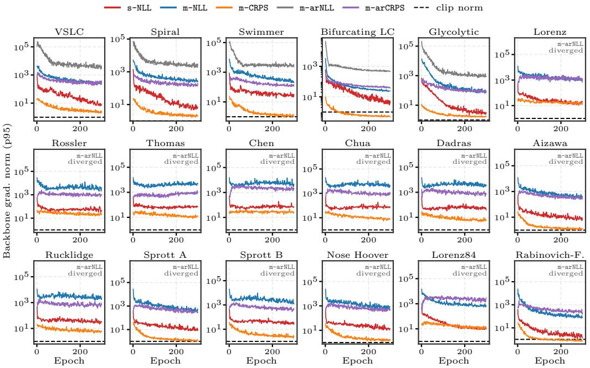  
Figure 13: Backbone gradient norms during training. 95th percentile of the pre-clipping backbone gradient norm per epoch for all objectives across all benchmark environments; the dashed line marks the clipping threshold. $\tt m { - a r N L I }$ develops non-finite gradients on all chaotic systems and is therefore only shown for the non-chaotic environments. CRPS attenuates but does not prevent the gradient growth induced by autoregressive training.

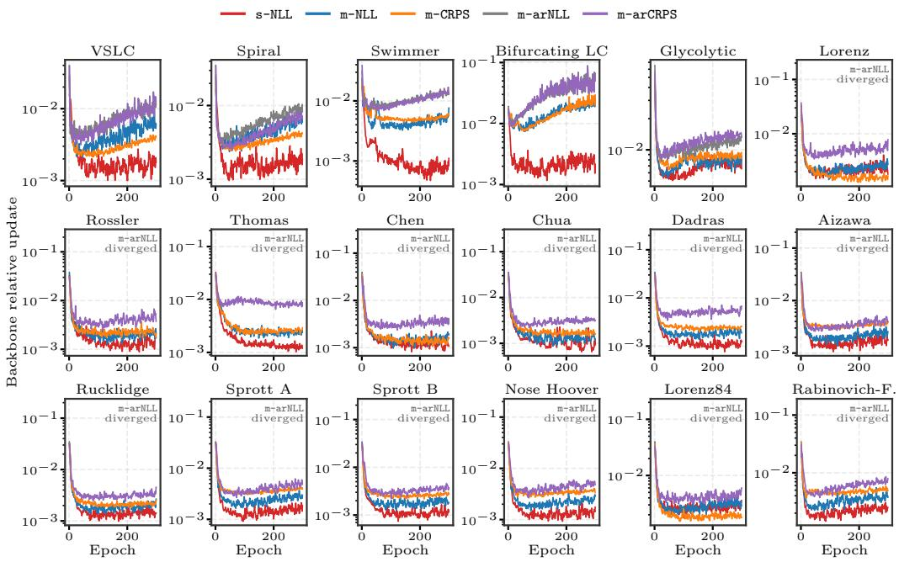  
Figure 14: Relative update ofthe backbone parameters per epoch. m-arNLL develops non-finite gradients on all chaotic systems and is therefore only shown for the non-chaotic environments.

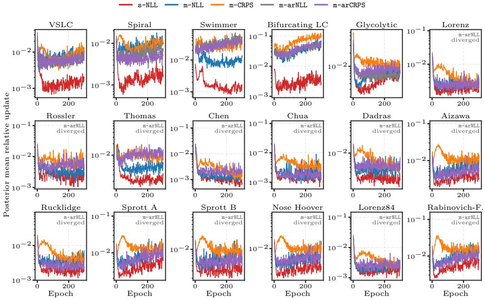  
Figure 15: Relative update ofthe posterior mean ofthe last-layer weights per epoch. The posterior mean keeps updating on a similar relative scale as the backbone (cf. Fig. 14).

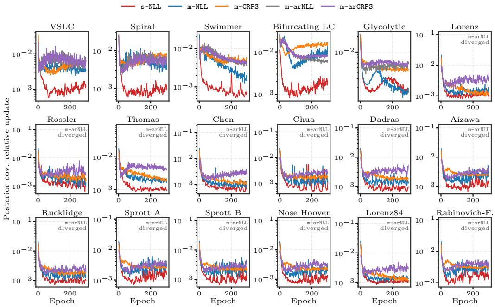  
Figure 16: Relative update of the posterior covariance of the last-layer weights per epoch. As for the posterior mean, the covariance does not stall while the backbone continues to update (cf. Fig. 14).

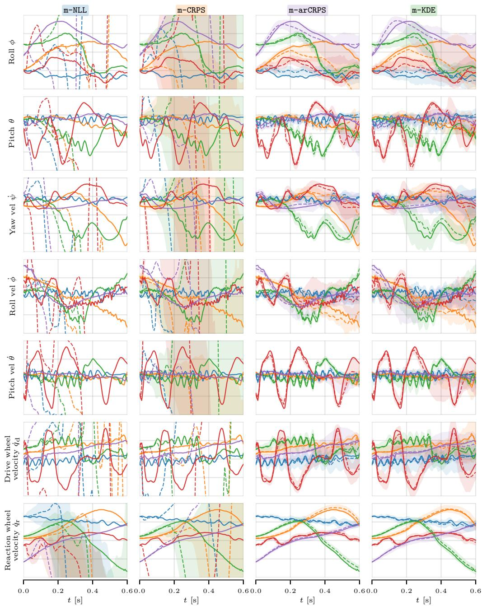  
Figure 17: Rollouts on Mini Wheelbot data. Figure shows the complete set of states to complement the rollouts shown in Fig. 5 in the main body of the paper.

Table 3: Results on the benchmarking ofSec. 4.2. (Part 1/4)
<table><tr><td>Environment Metric Final L2 ↓</td><td></td><td>s-NLL</td><td>m-NLL</td><td>m-CRPS</td><td>m-arNLL</td><td>m-arCRPS</td><td>m-KDE</td></tr><tr><td rowspan="12">Spral</td><td>Cumul. L2 ↓</td><td>0.325+0.236 -0.159 28.269 +23.817</td><td>0.056+0.061 -0.031 5.732 +6.806</td><td>0.033+0.016 -0.016 2.605+1.451</td><td>0.228+0.041 -0.079 13.834+3.687</td><td>0.122+0.020 -0.031 7.788+1.644</td><td>0.063+0.081 -0.047 6.926+11.042</td></tr><tr><td>DTW↓</td><td>-19.836 0.982+0.479</td><td>-2.495 +0.345</td><td>-0.480 0.351 +0.191</td><td>-6.170 0.732+0.166</td><td>-2.293 0.631+0.111</td><td>-4.906 0.546+0.387</td></tr><tr><td></td><td>-0.273</td><td>0.580+ -0.183</td><td>-0.067</td><td>-0.221</td><td>-0.076</td><td>-0.263</td></tr><tr><td>MMD2↓</td><td>0.020+0.031</td><td>0.001 +0.003</td><td>0.000+0.000 -0.000</td><td>0.005+0.003</td><td>0.002+0.001</td><td>0.003+0.010</td></tr><tr><td></td><td>-0.018 2.867 +3.429</td><td>-0.001 0.339 +0.616 0.082</td><td>+0.089 1.123</td><td>-0.003 3-0.488</td><td>-0.001 0.440+0.240</td><td>-0.003 (4.519+4.034) -4.519) × 108</td></tr><tr><td>Energy Dist. ↓ Term. MMD2 ↓</td><td>-1.998 0.041 +0.063</td><td>-0.199 0.001 +0.003 0.000</td><td>-0.042 +0.001</td><td>0.018+0.008 0.005</td><td>-0.220 +0.003</td><td>0.003+0.009</td></tr><tr><td>Term. Energy ↓</td><td>-0.032 0.319 +0.324</td><td>-0.001 0.030 +0.037</td><td>-0.000 0.010 +0.011</td><td>-0.010 0.193 +0.079</td><td>-0.003 0.073 +0.042</td><td>-0.003 (2.858+2.566) × 108</td></tr><tr><td></td><td>-0.202</td><td>-0.017</td><td>-0.006</td><td>-0.093</td><td>-0.037</td><td>-2.858)</td></tr><tr><td>Coverage@50%</td><td>0.433+0.384 -0.314</td><td>0.530+0.098 -0.210</td><td>0.522+0.035 +000 0</td><td>0.468+0.171 -0.149</td><td>0.432+0.067 -0.076</td><td>0.610+0.135 -0.194</td></tr><tr><td>Coverage@70%</td><td>0.624 +0.343 -0.415</td><td>0.727 +0.094 -0.226</td><td>0.719 -0.045</td><td>0.681 +0.158 -0.151</td><td>0.618+0.086 -0.092</td><td>0.822+0.094 -0.151</td></tr><tr><td>Coverage@90%</td><td>0.818 +0.181 -0.389</td><td>0.899+0.06 -0.173</td><td>0.902 +0.024 -0.034 +0.017</td><td>0.898+0.077 -0.077</td><td>0.831+0.02 -0.072</td><td>0.965 +0.026 -0.050</td></tr><tr><td rowspan="14">Swmner</td><td>Coverage@95%</td><td>0.871 +0.129 -0.327</td><td>0.936 +0.048 -0.149</td><td>0.945 -0.026</td><td>0.946+0.046 -0.059</td><td>0.891+0.054 -0.056</td><td>0.985 +0.013 -0.030</td></tr><tr><td>Final L2↓</td><td>1.960+3.607</td><td>0.779+1.961</td><td>0.680+1.753</td><td>1.178+2.058</td><td>0.780+1.924</td><td>1.397+4.511</td></tr><tr><td>Cumul. L2 ↓</td><td>-1.721 92.705+124.538 -65.774</td><td>-0.750 34.982 +86.975 -30.736</td><td>-0.624 30.262 +68.675 -24.227</td><td>1.035 55.362+78.506</td><td>-0.684 37.375+80.045</td><td>1.227 68.633+ -158.438 55.948</td></tr><tr><td>DTW↓</td><td>11.353 +18.860 -9.765</td><td>3.931 1+12.210 3.721</td><td>3.343+ +9.262 -3.063</td><td>43.438 6.520+ +11.519</td><td>-27.486 4.214+12.508</td><td>7.985 24.495 7.113</td></tr><tr><td></td><td>+0.236</td><td>+0.111</td><td>0.024+0.059</td><td>5.900</td><td>-3.802</td><td></td></tr><tr><td>MMD2↓</td><td>0.139 -0.127 +19.821</td><td>0.029 -0.029 +8.273</td><td>-0.024 +3.220</td><td>0.049+0.165 -0.048 +8.242</td><td>0.024+0.075 -0.023</td><td>0.079+0.270 -0.076 +11.835</td></tr><tr><td>Energy Dist. ↓</td><td>20.383 18.802 +0.301</td><td>2.026 1.874 +0.213</td><td>1.631 1.427 +0.152</td><td>3.171 -2.686</td><td>1.950+ +4.962 -1.559</td><td>5.201 4.655 +0.389</td></tr><tr><td>Term. MMD2 ↓</td><td>0.213 -0.209 +8.012</td><td>0.068 -0.068 +0.966</td><td>0.056 -0.057 0.266 +0.646</td><td>0.115+0.434 -0.113</td><td>0.057 +0.150 -0.056</td><td>0.107 -0.105 +3.545</td></tr><tr><td>Term. Energy ↓</td><td>6.908 -6.814</td><td>0.377 -0.362</td><td>-0.242</td><td>0.535+1.750 -0.499</td><td>0.303 +0.621 -0.271</td><td>0.952 -0.899</td></tr><tr><td>Coverage@50%</td><td>0.289+0.161 -0.136</td><td>0.444+0.093 -0.166</td><td>0.496+0.125 -0.129</td><td>0.506+0.142 -0.221</td><td>0.552+0.120 -0.141</td><td>0.521+0.185 -0.242</td></tr><tr><td>Coverage@70%</td><td>0.427 +0.213 -0.190</td><td>0.636 +0.109 -0.207</td><td>0.689 +0.131 -0.143</td><td>0.692 +0.152 -0.315</td><td>0.750+ +0.120 -0.152</td><td>0.723 +0.163 -0.261</td></tr><tr><td>Coverage@90%</td><td>0.619 +0.213 -0.263</td><td>0.838 +0.067 -0.156</td><td>0.876+0.077 -0.111</td><td>0.873+0.092 -0.254</td><td>0.913+ +0.068 -0.088</td><td>+0.0719 0.903 -0.167</td></tr><tr><td>Coverage@95%</td><td>0.689 +0.198 -0.270</td><td>0.897 +0.044 -0.111</td><td>0.923 +0.054 -0.085</td><td>0.921 +0.068 -0.181</td><td>0.947 +0.046 -0.060</td><td>0.943 +0.052 -0.130</td></tr><tr><td></td><td>0.641+0.812 33.795</td><td>0.604+0.690</td><td>0.506+0.527</td><td>0.947+0.698</td><td></td><td>1.003+0.735</td></tr><tr><td rowspan="14">Varde pped Llim yycle</td><td>Final L2↓ Cumul. L2 ↓</td><td>-0.562 +23.476</td><td>-0.522</td><td>-0.431 +10.816</td><td>-0.759</td><td>0.804+0.705 -0.659</td><td>-0.827 42.588+19.399</td></tr><tr><td></td><td>-18.509</td><td>27.046+16.965 -14.420</td><td>22.672 -10.660</td><td>39.565+16.166 -14.162</td><td>32.990+17.631 -16.019</td><td>18.881</td></tr><tr><td>DTW↓ 1.688</td><td>+1.519 -0.631</td><td>-0.554</td><td>1.409 +0.737 -0.384</td><td>2.357+1.470 -1.136</td><td>1.984+1.441 -0.878</td><td>2.449+1.759 1.323</td></tr><tr><td>MMD2↓</td><td>0.032+0.036</td><td>0.010+0.016</td><td>0.005+0.008</td><td>0.035+0.017</td><td>0.023+0.019</td><td>0.053+0.033</td></tr><tr><td>Energy Dist. ↓</td><td>-0.017 2.101 +1.338</td><td>-0.008 0.786+0.762</td><td>-0.005 0.405 +0.561</td><td>-0.014 +0.723</td><td>-0.016 1.464+1.016</td><td>-0.025 (5.296+7.338 -5.296) × 1013</td></tr><tr><td>Term. MMD2 ↓</td><td>-0.806 0.057 +0.072</td><td>-0.495 0.032 +0.068</td><td>-0.328 0.016 +0.042</td><td>2.111 -0.672 0.102+0.111</td><td>-0.894 0.081+0.123</td><td>0.146+0.158</td></tr><tr><td>Term. Energy ↓</td><td>-0.049 0.225 +0.208</td><td>-0.032 0.125 +0.205</td><td>-0.016 0.067 +0.129</td><td>-0.093 0.354+0.307</td><td>-0.075 0.285 +0.355</td><td>-0.135 (3.770+5.097 × 1013</td></tr><tr><td></td><td>-0.138</td><td>-0.109</td><td>-0.059</td><td>-0.259</td><td>-0.218</td><td>-3.770</td></tr><tr><td>Coverage@50% Coverage@70%</td><td>0.666+0.135 -0.259 +0.091</td><td>0.560+0.117 -0.150 +0.107</td><td>0.465+0.059 -0.080 0.655+0.061</td><td>0.544+0.124 -0.118 +0.085</td><td>0.362+0.144 -0.137</td><td>0.423+0.151 -0.164</td></tr><tr><td>Coverage@90% Coverage@95%</td><td>0.836 -0.160 0.946 +0.045</td><td>0.757 -0.147 0.920 +0.058</td><td>-0.062 0.854+ +0.051</td><td>0.761 -0.101 +0.036</td><td>0.540+0.158 -0.182 +0.126</td><td>0.670+0.125 -0.194 +0.063</td></tr><tr><td></td><td>-0.083 0.962+0.035 -0.070</td><td>-0.089 0.950+0.043</td><td>-0.054 0.908+0.044</td><td>0.927 -0.046 0.958+0.026</td><td>0.766 -0.180 0.839+0.110</td><td>0.905 -0.089 0.951 +0.038</td></tr><tr><td>Final L2 ↓</td><td>0.512+0.543</td><td>-0.067</td><td>-0.044</td><td>-0.039</td><td>-0.163</td><td>-0.044</td></tr><tr><td>Cumul. L2 ↓</td><td>-0.190 +51.762</td><td>0.098+0.088 -0.085 +11.627</td><td>0.104+0.156 -0.085</td><td>0.152+0.208 -0.102</td><td>0.161+0.228 -0.118</td><td>0.179+0.301 -0.148</td></tr><tr><td>DTW↓</td><td>38.958 17.880 -2.048</td><td>11.930 -8.538 +0.709</td><td>12.839+10.576 -8.255 +0.663</td><td>14.479+6.341 -7.294</td><td>15.772+3.991 -8.014</td><td>17.685 +7.511 -9.268</td></tr><tr><td>Bircatng MMD2↓</td><td>1.787 -0.770 +0.112</td><td>0.687 -0.379</td><td>0.786 -0.511</td><td>1.041+0.557 -0.681</td><td>1.103+0.6314 -0.729</td><td>1.173+0.553 -0.821</td></tr><tr><td>Ilimi yece</td><td>0.056 -0.041</td><td>0.003 +0.006</td><td>0.003+0.004 -0.003</td><td>0.004+0.004 -0.003</td><td>0.005+0.005</td><td>0.005+0.010 -0.005</td></tr><tr><td>Energy Dist. ↓</td><td>2.605 +4.517 -1.642</td><td>-0.003 0.296+0.404 -0.204</td><td>0.320 +0.275 -0.175</td><td>0.352 +0.242 -0.177</td><td>-0.003 0.414+0.304 +0.304</td><td></td></tr><tr><td>Term. MMD2 ↓</td><td>0.115 +0.136</td><td>0.003+0.0104</td><td>0.003 +0.011</td><td>0.008+0.018</td><td>0.009+0.014</td><td>0.006+0.011</td></tr><tr><td>Term. Energy ↓</td><td>-0.069 0.375 +0.401</td><td>-0.005 0.023+0.050</td><td>-0.005 0.024+0.042</td><td>-0.009 0.043+0.066</td><td>-0.009 0.046+0.059</td><td>-0.007 (2.769+2.723) × 108</td></tr><tr><td>Coverage@50%</td><td>-0.206</td><td>-0.019</td><td>-0.019 0.482+0.051</td><td>-0.034</td><td>-0.036</td><td>-2.769</td></tr><tr><td>Coverage@70% Coverage@90%</td><td>0.405+0.108 -0.196 0.586 +0.128 -0.247</td><td>0.476+0.058 -0.076 0.669+0.064</td><td>0.0</td><td>0.449+0.051 -0.054 0.636+0.054</td><td>0.412+0.050 -0.062 0.592+0.053</td><td>0.468+0.129 -0.067 0.655+0.113</td></tr><tr><td>Coverage@95% Final L2 ↓</td><td>0.792 +0.109 -0.255</td><td>-0.093 0.865 +0.049</td><td>-0.060 0.874+0.045</td><td>-0.052 0.838+0.044</td><td>-0.073 0.797+0.044</td><td>-0.071 0.851+0.056</td></tr><tr><td></td><td>0.852 +0.088 -0.240</td><td>-0.074 0.915 +0.035 -0.055</td><td>-0.048 0.923 +0.029 -0.044</td><td>-0.038 0.894+0.032</td><td>-0.072 0.860+ +0.036</td><td>-0.054 0.904+0.036</td></tr><tr><td>Energy Dist. ↓ Term. MMD2 ↓</td><td>0.096+0.080</td><td></td><td>0.090+0.097</td><td>-0.039 0.038+0.064</td><td>-0.064 0.042+0.095</td><td>-0.042 0.060+0.095</td></tr><tr><td rowspan="14">Gyytc OSsciator Term. Energy ↓ Coverage@50%</td><td>Cumul. L2 ↓</td><td>-0.043</td><td>0.065+0.082 -0.038</td><td>-0.059</td><td>+9.004 8</td><td>-0.032</td><td>-0.042 +8.352</td></tr><tr><td></td><td>8.278 +6.001 -3.756</td><td>7.055 +7.605 -3.594</td><td>7.715 +7.113 -4.028</td><td>5.758 -3.397</td><td>6.470+5.760 -4.258</td><td>6.777 -4.430</td></tr><tr><td>DTW↓</td><td>0.687 +0.509 -0.252</td><td>0.568 +0.304 -0.238</td><td>0.727 +0.568 -0.340</td><td>0.441 +0.328 -0.228</td><td>0.511+0.594 -0.298</td><td>0.495+0.574 -0.294 0.010+0.019</td></tr><tr><td>MMD2↓ 0.308</td><td>0.009+0.017 -0.008 +0.479</td><td>0.009+0.028 -0.009</td><td>0.010+0.019 -0.010 0.331 1+0.579</td><td>0.004+0.008 -0.004 0.201 +0.270</td><td>0.006+0.013 -0.006 0.268+0.355</td></table>

Table 4: Results on the benchmarking ofSec. 4.2. (Part 2/4)
<table><tr><td>Environment</td><td>Metric Final L2 ↓</td><td>s-NLL 11.642+20.187</td><td>m-NLL</td><td>m-CRPS</td><td>m-arNLL</td><td>m-arCRPS</td><td>m-KDE</td></tr><tr><td rowspan="11">Iorenz</td><td>Cumul. L2 ↓</td><td>-7.280 866.827+1,085.481</td><td>11.676+20.290 -7.289 865.478 +1,100.729</td><td>12.378+21.322 +1,070.867 -8.270 888.891</td><td>div. div.</td><td>10.755+16.145 -6.936 805.358+1090.6800</td><td>11.388+15.737 -7.501 +993.302</td></tr><tr><td></td><td>-577.921 101.314+176.614</td><td>-592.923 +154.610</td><td>-607.088 106.475+163.943</td><td></td><td>-605.800 +158.475</td><td>939.147 -664.319</td></tr><tr><td>DTW↓</td><td>-74.273</td><td>101.067 -75.645</td><td>-78.152</td><td>div.</td><td>91.795+ -70.442</td><td>96.209+183.364 -76.473</td></tr><tr><td>MMD2↓</td><td>0.018+0.034</td><td>0.016+0.049</td><td>0.002+0.001</td><td>div.</td><td>0.032+0.128</td><td>0.060+0.163</td></tr><tr><td></td><td>-0.017 32.190 +41.168</td><td>-0.016 -43.562</td><td></td><td></td><td>-0.031 +91.551</td><td>-0.052 66.410 +87.538</td></tr><tr><td>Energy Dist. ↓</td><td>-21.357 0.052+0.181</td><td>27.615 -19.143 +0.214</td><td>6.585 4.436 0.007 +0.036</td><td>div.</td><td>40.672 -28.389 +0.164</td><td>-36.004 0.138 +0.335</td></tr><tr><td>Term. MMD2 ↓</td><td>-0.050 3.365 +5.308</td><td>0.047 -0.046 2.987 +6.991</td><td>7+1.00 0.755</td><td>div. div.</td><td>0.089 -0.087 4.847 +4.751</td><td>-0.118 6.811 +9.295</td></tr><tr><td>Term. Energy ↓</td><td>-2.186</td><td>-2.040</td><td>-0.536</td><td></td><td>-3.608</td><td>-4.165</td></tr><tr><td>Coverage@50%</td><td>0.600+0.342 -0.365</td><td>0.657+0.3331</td><td>0.680+0.220 -0.300</td><td>div.</td><td>0.453+0.387 -0.280</td><td>0.587+0.250 -0.253</td></tr><tr><td>Coverage@70%</td><td>0.778+0.219 -0.334 0.899+0.101</td><td>0.807+0.193 -0.299</td><td>0.851 +0.124 -0.185 +0.038</td><td>div.</td><td>0.644+0.321 -0.330</td><td>-0.271 0.785</td></tr><tr><td>Coverage@90%</td><td>-0.220</td><td>0.903+0.097 -0.217 0.922+0.078</td><td>0.961 -0.085 +0.021</td><td>div.</td><td>0.865+0.135 -0.229</td><td>0.930 +0.070 -0.175 0.955+0.045</td></tr><tr><td rowspan="11">Rossser</td><td>Coverage@95%</td><td>0.923+0.077 -0.204</td><td>-0.166</td><td>0.979 -0.062</td><td>div.</td><td>0.919+0.081 -0.151</td><td>-0.108</td></tr><tr><td>Final L2 ↓</td><td>5.526+22.964 -5.235</td><td>3.043+8.113 -2.770</td><td>2.970+5.795 -2.639</td><td>div.</td><td>2.055+4.283 -1.853</td><td>3.122+11.468 2.601</td></tr><tr><td>Cumul. L2 ↓</td><td>+1,162.182 308.492+ -272.137</td><td>+672.712 189.383 -170.539</td><td>175.177 +690.083 -151.841</td><td>div.</td><td>129.353+321.938 -93.695</td><td>274.057+688.777 -227.348</td></tr><tr><td>DTW ↓</td><td>31.308 +101.024 28.241</td><td>18.353 +58.595 -16.859</td><td>18.073 +56.194 -16.150</td><td>div.</td><td>13.218+24.425 10.542</td><td>18.566+46.830 -14.728</td></tr><tr><td>MMD2↓</td><td>0.063+0.383</td><td>0.038+0.252</td><td>0.031 +0.087</td><td>div.</td><td>0.012+0.047</td><td>0.058+0.340</td></tr><tr><td>Energy Dist. ↓</td><td>-0.063 42.987 +176.541 -39.017</td><td>-0.038 34.315+148.174</td><td>-0.031 +64.006 18.782 -17.846</td><td>div.</td><td>-0.012 18.341+30.882</td><td>-0.057 57.247+134.724 -50.274</td></tr><tr><td>Term. MMD2 ↓</td><td>0.112+ +0.851 -0.111</td><td>-31.185 0.058 +0.355 -0.058</td><td>0.039 +0.165 -0.039</td><td>div.</td><td>-14.410 0.025 +0.122 -0.025</td><td>0.067 +0.257 -0.066</td></tr><tr><td>Term. Energy ↓</td><td>5.333+20.409 -4.941</td><td>4.416+15.281 -4.169</td><td>2.226 +6.353 -2.088</td><td>div.</td><td>1.700 +3.345 -1.247</td><td>9.646+5.729 -8.883</td></tr><tr><td>Coverage@50%</td><td>0.589+0.293</td><td>0.730+0.200</td><td>0.610+0.179</td><td>div.</td><td>0.633+0.237</td><td>0.681+0.257</td></tr><tr><td>Coverage@70%</td><td>-0.228 0.771+0.200</td><td>-0.254 0.844+0.145</td><td>-0.205 0.764+0.142</td><td>div.</td><td>-0.246 0.792+0.155</td><td>-0.283 0.838+0.161</td></tr><tr><td>Coverage@90%</td><td>-0.246 0.915 +0.084</td><td>-0.250 0.915+0.084</td><td>-0.223 0.884 +0.101 -0.179</td><td>div.</td><td>-0.205 0.919+0.079 -0.124</td><td>-0.279 0.953+0.047 -0.137</td></tr><tr><td rowspan="14">Thmmas</td><td>Coverage@95%</td><td>-0.164 0.939+0.061</td><td>-0.187 0.931+0.069</td><td>0.919 +0.078</td><td>div.</td><td>0.943 +0.057</td><td>0.976+0.024 -0.088</td></tr><tr><td></td><td>-0.165</td><td>-0.161</td><td>-0.158</td><td></td><td>-0.102</td><td></td></tr><tr><td>Final L2 ↓</td><td>3.401+5.074 -3.169 +343.640</td><td>2.563+2.897 +266.636</td><td>3.055 +5.636 -2.677 +314.579</td><td>div.</td><td>3.856+4.805 -3.206 +277.511</td><td>4.203+4.664 -3.408 +326.280</td></tr><tr><td>Cumul. L2 ↓</td><td>248.753 -202.328</td><td>209.298 -148.305 +30.461</td><td>234.563 -180.084 +55.883</td><td>div.</td><td>311.617 -212.877</td><td>345.675 -248.642 +58.020</td></tr><tr><td>DTW↓</td><td>24.646+55.097 -21.664</td><td>17.826 -14.815</td><td>22.228 -19.148</td><td>div.</td><td>30.894+49.974 -25.269</td><td>35.361 29.046</td></tr><tr><td>MMD2↓</td><td>0.114+0.197 -0.101</td><td>0.093+0.243 -0.086</td><td>0.085+0.229 -0.079</td><td>div.</td><td>0.145 +0.147 -0.082</td><td>0.147 +0.152 -0.089</td></tr><tr><td>Energy Dist. ↓</td><td>28.102+30.720 -20.994</td><td>23.674+39.580 19.348</td><td>21.784+34.836 -17.308</td><td>div.</td><td>33.095+23.488 -16.952</td><td>33.354+22.130 17.009</td></tr><tr><td>Term. MMD2 ↓</td><td>0.280+0.633 -0.252</td><td>0.234+0.578 -0.221</td><td>0.222+0.549 -0.211</td><td>div.</td><td>0.303 +0.254 -0.257</td><td>0.269+0.292 -0.222</td></tr><tr><td>Term. Energy ↓</td><td>3.000+5.585 -2.437</td><td>2.540+5.243 -2.099</td><td>2.394+5.061 -2.115</td><td>div.</td><td>3.183+2.566 -2.500</td><td></td></tr><tr><td>Coverage@50%</td><td>0.313+0.188</td><td>0.317+0.258</td><td>0.371+0.259</td><td>div.</td><td>0.426+0.172</td><td>0.517+0.199</td></tr><tr><td>Coverage@70%</td><td>-0.222 0.460+0.275</td><td>-0.230</td><td>-0.250 +0.234</td><td></td><td>-0.255 +0.193</td><td>-0.228 +0.176</td></tr><tr><td></td><td>-0.321 +0.268</td><td>0.466+0.290 -0.338</td><td>0.537 -0.314 +0.188</td><td>div.</td><td>0.625 -0.307</td><td>0.731 -0.251 +0.065</td></tr><tr><td>Coverage@90% Coverage@95%</td><td>0.648 -0.314 0.713+0.242</td><td>0.648+0.309 -0.433</td><td>0.741 -0.346 +0.155</td><td>div.</td><td>-0.11 0.845 +0.084</td><td>0.929 -0.114 +0.032</td></tr><tr><td>Final L2 ↓</td><td>-0.288</td><td>0.708+0.274 -0.431</td><td>0.807 -0.362</td><td>div.</td><td>0.903 -0.219</td><td>0.968 -0.060</td></tr><tr><td rowspan="14">Chen</td><td></td><td>82.268+315.884</td><td>81.588+313.748</td><td>80.967+313.225</td><td>div.</td><td>78.405+317.573 -76.964</td><td>78.293+322.186 76.454</td></tr><tr><td>Cumul. L2 ↓</td><td>-75.893 +5,696.542</td><td>77.290 +5,706.440</td><td>77.519 2,390.966+5,547.503</td><td></td><td>2,256.695 +5,575.695</td><td>2225.977 -5487.926</td></tr><tr><td></td><td>2,632.050 2,328.641 +1,311.867</td><td>2,472.056 -2,275.327</td><td>2,118.735 1,322.254</td><td>div.</td><td>-2,071.567 398.471+1,324.148</td><td>-2043.738 +1312.737</td></tr><tr><td>DTW ↓</td><td>455.176 427.570</td><td>435.915 +1,318.478 -411.696</td><td>426.888 409.791</td><td>div.</td><td>-390.604</td><td>390.429 -380.294</td></tr><tr><td>MMD2↓</td><td>0.064+0.133 -0.056</td><td>0.032+0.086 -0.030</td><td>0.006 +0.013 -0.006</td><td>div.</td><td>0.037 +0.067 -0.027</td><td>0.066+0.082 -0.048</td></tr><tr><td>Energy Dist. ↓</td><td>92.980 +125.503 -58.505</td><td>61.408 +75.142</td><td>19.539+24.231 -11.870</td><td>div.</td><td>71.982 +61.931 -28.136</td><td>99.056 +69.566 -41.005</td></tr><tr><td>Term. MMD2 ↓</td><td>0.247 +0.482</td><td>-36.156 0.126+0.193</td><td>0.030 +0.086</td><td>div.</td><td>0.203+0.251</td><td>0.309 +0.226</td></tr><tr><td>Term. Energy ↓</td><td>-0.199 10.460+14.919</td><td>-0.107</td><td>+2.023 2.297 0.g 4</td><td>div.</td><td>-0.134 9.101+8.244</td><td>-0.153 12.550+8.178</td></tr><tr><td></td><td>-6.142</td><td>6.451+5.818 -3.530</td><td>-1.655</td><td></td><td>-4.028</td><td>-4.623</td></tr><tr><td>Coverage@50% Coverage@70%</td><td>0.451+0.422 -0.379 0.645+0.3379</td><td>0.655+0.258 -0.430 0.809+0.182</td><td>0.559+0.307 -0.387 +0.243</td><td>div.</td><td>0.680+0.235 -0.239 0.848+0.149</td><td>0.639+0.177 -0.199 +0.159</td></tr><tr><td>Coverage@90%</td><td>0.825+0.175 -0.560</td><td>-0.437 0.896+0.104</td><td>0.727 -0.405 0.874 +0.124</td><td>div.</td><td>-0.181 0.944+0.056</td><td>0.837 -0.206 0.955+0.045</td></tr><tr><td>Coverage@95%</td><td>0.876 6+0.124</td><td>-0.331 0.914+0.081</td><td>-0.271 0.915 +0.085</td><td>div.</td><td>-0.144 0.957 +0.043</td><td>-0.100 +0.031</td></tr><tr><td>Final L2 ↓</td><td>-0.503 3.435+2.315</td><td>-0.254</td><td>-0.174</td><td>div.</td><td>-0.121</td><td>0.969 -0.085</td></tr><tr><td>Cumul. L2 ↓</td><td>-2.673 205.778 +146.256</td><td>2.900+2.144 -2.235 +149.897</td><td>2.906+2.000 -2.435 168.414+151.822</td><td>div.</td><td>3.468+2.285 -2.938 +168.468</td><td>2.845+2.474 -2.150 +188.956</td></tr><tr><td rowspan="14">Chua</td><td>DTW↓</td><td>-150.998 26.080+18.769</td><td>179.212 -127.671 +18.361</td><td>-115.994 +17.437</td><td>div.</td><td>204.200 -160.485 +19.703</td><td>183.526 -131.790 21.549 20.888</td></tr><tr><td></td><td>-21.161 0.010+0.029</td><td>22.381 19.009 0.005+0.015</td><td>21.718 -17.885 +0.004</td><td>div.</td><td>26.225 -22.669 0.011+0.020</td><td>-17.960 0.016+0.038</td></tr><tr><td>MMD2↓ Energy Dist. ↓</td></table>

Table 5: Results on the benchmarking ofSec. 4.2. (Part 3/4)
<table><tr><td>Environment Final L2 ↓</td><td>Metric</td><td>S-NLL 0.625+1.436</td><td>m-NLL 0.971+1.933</td><td>m-CRPS</td><td>m-arNLL</td><td>m-arCRPS</td><td>m-KDE</td></tr><tr><td rowspan="14">Dadras</td><td>Cumul. L2 ↓</td><td>-0.504 64.177 7+142.690</td><td>-0.808 86.223 +163.618</td><td>0.747+1.564 -0.628 63.810+143.738</td><td>div. div.</td><td>1.658+2.602 -1.316 +242.559</td><td>1.623+ +2.702 -1.391 155.975 +262.996</td></tr><tr><td></td><td>-48.394 +13.106</td><td>-72.316</td><td>-53.438</td><td></td><td>165.292+ 123.316</td><td>-132.129</td></tr><tr><td>DTW↓</td><td>5.327 4.150</td><td>7.868+16.345 6.798</td><td>6.245+ +15.722 -5.639</td><td>div.</td><td>14.775 +25.840 -12.719</td><td>14.076 +27.889 12.537</td></tr><tr><td></td><td>0.003+0.006</td><td>0.004+0.006</td><td>+0.001</td><td></td><td>0.034+0.013</td><td>0.021+0.128</td></tr><tr><td>MMD2↓</td><td>-0.003 +8.197</td><td>-0.004</td><td>0.001 -0.001 +2.392</td><td>div.</td><td>-0.032</td><td>-0.021 +40.953</td></tr><tr><td>Energy Dist. ↓</td><td>5.273 -3.674</td><td>4.221 +7.851 3.194</td><td>1.905 .287</td><td>div.</td><td>19.186+14.491 15.053</td><td>14.222 10.325</td></tr><tr><td>Term. MMD2 ↓</td><td>0.012+ +0.030 -0.011</td><td>0.010+0.022 -0.009</td><td>0.003 0.007 -0.003</td><td>div.</td><td>0.080+0.154 -0.077</td><td>0.050 +0.181 -0.048</td></tr><tr><td>Term. Energy ↓</td><td>0.535 +0.554 -0.393</td><td>0.333 +0.588 -0.232</td><td>0.198 +0.203 -0.148</td><td>div.</td><td>1.770+2.161 -1.460</td><td>1.216 +2.295 -0.769</td></tr><tr><td>Coverage@50%</td><td>0.414+0.262 -0.246</td><td>0.424+0.221 -0.235</td><td>0.556+0.189</td><td>div.</td><td>0.316+0.367</td><td>0.687 +0.310</td></tr><tr><td></td><td>0.590 +0.242 0.791</td><td>0.613+0.218</td><td></td><td>div.</td><td>-0.163 0.459+0.469</td><td>-0.343 0.875 +0.125</td></tr><tr><td rowspan="14"></td><td>Coverage@70%</td><td>-0.324 +0.175</td><td>-0.313 0.821 +0.147</td><td>7+0.005</td><td></td><td>-0.206</td><td>-0.317 +0.019</td></tr><tr><td>Coverage@90%</td><td>-0.360</td><td>-0.303</td><td>0.937 -0.103</td><td>div.</td><td>0.644+0.354 -0.257</td><td>0.981 -0.101 +0.008</td></tr><tr><td>Coverage@95%</td><td>0.852+0.139 -0.358</td><td>0.879+0.110 -0.275</td><td>0.968 +0.028 -0.067</td><td>div.</td><td>0.713+0.287 -0.263</td><td>0.992 -0.039</td></tr><tr><td>Final L2 ↓</td><td>0.143+0.248 -0.116</td><td>0.174+0.237 -0.126</td><td>0.155+0.184 -0.112</td><td>div.</td><td>0.106+0.085 -0.049</td><td>0.136 +0.149 -0.096</td></tr><tr><td>Cumul. L2 ↓</td><td>13.840 +14.133 -8.795</td><td>16.972+21.204 12.383</td><td>13.237 +9.535 -9.093</td><td>div.</td><td>10.353 3+13.076 -6.823</td><td>13.989 +16.426 -9.214</td></tr><tr><td>DTW↓</td><td>1.032 +1.071 -0.683</td><td>1.074 +1.102 -0.630</td><td>0.985 +0.855 -0.644</td><td>div.</td><td>0.640 +0.530 -0.336</td><td>0.966 -0.846 -0.601</td></tr><tr><td>MMD2↓</td><td>0.003+0.007</td><td>0.004+0.014</td><td>+0.004 0.001</td><td>div.</td><td>0.002+0.0010</td><td>0.002 +0.006</td></tr><tr><td>Energy Dist. ↓</td><td>-0.002 0.731 +1.351</td><td>-0.004 0.891+2.336 -0.778</td><td>-0.001 0.406 +0.674 -0.318</td><td>div.</td><td>0.480+1.020</td><td>-0.002 0.630 +1.445 -0.530</td></tr><tr><td>Term. MMD2 ↓</td><td>-0.562 0.012 +0.043 -0.012</td><td>0.015 +0.042 -0.014</td><td>0.007 +0.028 -0.007</td><td>div.</td><td>-0.380 0.006+0.017 -0.006</td><td>0.009 +0.012 -0.009</td></tr><tr><td>Term. Energy ↓</td><td>0.062 +0.163 -0.054</td><td>0.072 +0.174 -0.064</td><td>0.041 +0.108 -0.032</td><td>div.</td><td>0.037 +0.055 -0.028</td><td>0.046 +0.054 -0.039</td></tr><tr><td></td><td>0.436+0.087</td><td>0.411+0.102</td><td>0.536+0.116</td><td></td><td></td><td>0.505+0.091</td></tr><tr><td>Coverage@50%</td><td>-0.160 +0.105</td><td>-0.206 0.586+0.128</td><td>-0.082 +0.100</td><td>div.</td><td>0.474+0.077 -0.161 0.664+0.08</td><td>-0.112 +0.083</td></tr><tr><td>Coverage@70% Coverage@90%</td><td>0.622 -0.204 +0.080</td><td>-0.277 0.785+0.115</td><td>0.735 -0.089 +0.054</td><td>div.</td><td>-0.210 0.860+0.070</td><td>0.703 -0.111 0.897 0.048</td></tr><tr><td>Coverage@95%</td><td>0.827 -0.192 +0.061</td><td>-0.298 0.846+0.095</td><td>0.913 -0.043 0.951 +0.034</td><td>div.</td><td>-0.200 0.910+0.055</td><td>-0.066 +0.032</td></tr><tr><td rowspan="14">Rukide</td><td></td><td>0.886 -0.168</td><td>-0.285</td><td>-0.027</td><td>div.</td><td>-0.176</td><td>0.939 -0.044</td></tr><tr><td>Final L2↓</td><td>2.182+3.195 -1.635</td><td>1.433+2.534 1.245</td><td>1.437+2.852 -1.293</td><td>div.</td><td>1.934+2.242 -1.598</td><td>1.157 +1.507 -0.946</td></tr><tr><td>Cumul. L2 ↓</td><td>215.658 352.235 -182.725</td><td>140.230+265.235 122.588</td><td>140.198+285.035 130.461</td><td>div.</td><td>160.935+ +249.114 -130.320</td><td>116.752+184.853 -85.862</td></tr><tr><td>DTW↓</td><td>19.645+30.644 -17.305</td><td>10.978+22.607 -9.856</td><td>12.302 +24.060 11.481</td><td>div.</td><td>15.212+23.054 12.925</td><td>9.534+15.602 -7.638</td></tr><tr><td>MMD2↓</td><td>0.007 +0.019 -0.007</td><td>0.002+0.005 -0.002</td><td>0.001 +0.001 -0.000</td><td>div.</td><td>0.004+0.007 -0.004</td><td>0.014+0.044 -0.013</td></tr><tr><td>Energy Dist. ↓</td><td>11.691 +21.468 -9.447</td><td>5.409+8.360 -4.354</td><td>2.153+3.170 1.734</td><td>div.</td><td>8.058+10.914 -5.205</td><td>16.142+26.409 12.120</td></tr><tr><td>Term. MMD2 ↓</td><td>0.047 +0.146 -0.042</td><td>0.016+0.053 -0.015</td><td>0.004+0.004 -0.003</td><td>div.</td><td>0.053+0.245 -0.052</td><td>0.094 +0.171 -0.091</td></tr><tr><td>Term. Energy ↓</td><td>0.972 -1.752 -0.674</td><td>0.403 +0.674 -0.300</td><td>0.174 +0.234 -0.132</td><td>div.</td><td>0.895 +2.348 -0.698</td><td>1.586 -1.390 -1.171</td></tr><tr><td>Coverage@50%</td><td>+0.315 0.367 -0.242</td><td>0.528+0.269 -0.235</td><td>0.645+0.175</td><td>div.</td><td>0.460+0.28</td><td>0.547 +0.372</td></tr><tr><td>Coverage@70%</td><td>0.529 +0.353 -0.344</td><td>0.714+0.236 -0.275</td><td>-0.161 0.846 +0.115 -0.128</td><td>div.</td><td>0.657+0.233</td><td>-0.376 0.696 +0.294</td></tr><tr><td>Coverage@90%</td><td>0.717 +0.275</td><td>0.878+0.118 -0.280</td><td>0.968 +0.031 -0.050</td><td>div.</td><td>-0.277 0.866+0.12 -0.262</td><td>-0.435 0.857 +0.143 -0.356</td></tr><tr><td>Coverage@95%</td><td>-0.399 0.778 +0.220</td><td>0.914+0.085 -0.264</td><td>0.986 +0.014 -0.024</td><td>div.</td><td>0.917 +0.083</td><td>0.916 +0.084 -0.242</td></tr><tr><td>Final L2 ↓</td><td>-0.401</td><td>0.124+0.157</td><td>0.114+0.199</td><td></td><td>-0.223 0.192+0.211</td><td>0.197+0.528</td></tr><tr><td>SpprtA</td><td>0.213+0.182 -0.150 15.822 +16.399</td><td>-0.093</td><td></td><td>+14.0862</td><td>div. -0.142</td><td>-0.141 +22.311</td></tr><tr><td rowspan="14"></td><td>Cumul. L2 ↓</td><td>-9.695</td><td>8.906+9.702 -6.804</td><td>8.506 -6.073</td><td>div.</td><td>14.211+20.560 -9.903</td><td>15.700 11.504</td></tr><tr><td>DTW ↓</td><td>1.230 1.455</td><td>0.648 8+0.833</td><td>0.600 +1.028</td><td>div.</td><td>1.060+1 1.423</td><td>1.067 -2.414 -0.803</td></tr><tr><td></td><td>-0.918</td><td>-0.470</td><td>-0.462</td><td></td><td>-0.848</td><td></td></tr><tr><td>MMD2↓</td><td>0.002+0.003 -0.002</td><td>0.001 +0.003 -0.001</td><td>0.001 +0.002 -0.001</td><td>div.</td><td>0.001+0.004 -0.001</td><td>0.004+0.013 -0.004 +2.974</td></tr><tr><td>Energy Dist. ↓</td><td>0.929 +1.124 -0.747 +0.011</td><td>0.395+0.826 -0.332</td><td>0.366 +0.524 -0.304</td><td>div.</td><td>0.568+1.019 -0.445</td><td>1.223 -1.020 +0.073</td></tr><tr><td>Term. MMD2 ↓</td><td>0.009 -0.009</td><td>0.004+0.011 -0.004</td><td>0.003+0.00 -0.003</td><td>div.</td><td>0.005+0.01 -0.005</td><td>0.015 -0.015 +0.484</td></tr><tr><td>Term. Energy ↓</td><td>0.127 +0.164 -0.110</td><td>0.056+0.105 -0.051</td><td>0.048+0.083 -0.041</td><td>div.</td><td>0.070+0.205 -0.054</td><td>0.154 -0.129</td></tr><tr><td>Coverage@50%</td><td>0.426+0.110 -0.142</td><td>0.471 +0.067 -0.096</td><td>0.574+0.094 -0.068</td><td>div.</td><td>0.533+0.071 -0.114</td><td>0.543 +0.112 -0.127</td></tr><tr><td>Coverage@70% Coverage@90%</td><td>0.607 +0.119 -0.175</td><td>0.664+0.076 -0.102 +0.052</td><td>0.776+0.090 -0.065</td><td>div.</td><td>0.731 +0.080 -0.119</td><td>0.750 +0.094 -0.115</td></tr><tr><td>Coverage@95% Final L2 ↓</td><td>0.811 +0.101 -0.166 0.872 +0.080</td><td>0.865 -0.094 +0.040</td><td>0.937 +0.041 -0.039 +0.024</td><td>div.</td><td>0.910+0.04 -0.083 +0.030</td><td>0.929 +0.039 -0.061 +0.022</td></tr><tr><td rowspan="14">Spprrot Energy Dist. ↓ Term. MMD2 ↓</td><td></td><td>-0.126</td><td>0.917 -0.081</td><td>0.968 -0.023</td><td>div.</td><td>0.949 -0.059</td><td>0.964 -0.038</td></tr><tr><td></td><td>0.841+1.833</td><td>+0.494</td><td>+0.534</td><td></td><td>0.548+0.921</td><td>0.658 +0.673</td></tr><tr><td>Cumul. L2 ↓ 49.921</td><td>-0.722 +78.618</td><td>0.360 -0.278 25.833+40.166</td><td>0.297 -0.239 20.661 +38.655</td><td>div. div.</td><td>-0.441 32.873 -51.218</td><td>-0.431 46.435 +63.514 -28.021</td></tr><tr><td>DTW↓</td><td>-41.964 4.144 +7.032 -3.664</td><td>-16.695 1.812 +3.254 -1.337</td><td>-14.484 1.693 +3.849 -1.306</td><td>div.</td><td>-24.128 2.649 +4.091 -2.094</td><td>3.613 4.297 -2.181 0.006+0.014</td></tr><tr><td>MMD2↓</td><td>0.009+0.028 -0.009 4.415+1.009</td></table>

Table 6: Results on the benchmarking ofSec. 4.2. (Part 4/4)
<table><tr><td>Environment</td><td>Metric</td><td>s-NLL</td><td>m-NLL</td><td>m-CRPS</td><td>m-arNLL</td><td>m-arCRPS</td><td>m-KDE</td></tr><tr><td rowspan="7">Nove Hver</td><td>Final L2↓ Cumul. L2 ↓</td><td> $0 . 4 0 2 _ { - 0 . 3 2 1 } ^ { + 0 . 2 0 7 }$ </td><td> $0 . 1 9 2 _ { - 0 . 1 5 8 } ^ { + 0 . 2 1 1 }$ </td><td> $\mathbf { 0 . 1 9 1 } _ { - 0 . 1 4 4 } ^ { + 0 . 1 4 8 }$ </td><td>div.</td><td>0.193 +0.149 -0.148 +18.193</td><td> $0 . 3 1 8 _ { - 0 . 2 8 4 } ^ { + 0 . 2 4 5 }$  +38.851</td></tr><tr><td>DTW ↓</td><td> $2 1 . 4 6 7 _ { - 1 6 . 1 2 9 } ^ { + 1 7 . 9 8 7 }$   $2 . 3 1 6 _ { - 1 . 9 9 2 } ^ { + 1 . 0 1 1 }$ </td><td> $1 4 . 1 8 0 _ { - 1 1 . 0 4 5 } ^ { + 1 7 . 4 3 6 }$   $\mathbf { 1 . 0 6 3 _ { - 0 . 8 7 7 } ^ { + 1 . 8 9 2 } }$ </td><td> $\mathbf { 1 3 . 5 2 7 _ { - 9 . 5 3 6 } ^ { + 1 3 . 7 4 5 } }$   $1 . 1 7 2 _ { - 0 . 9 0 7 } ^ { + 0 . 8 1 8 }$ </td><td>div. div.</td><td>14.617 -8.045 1.205+1.479 -0.898</td><td>21.230 -15.677  $1 . 9 0 3 _ { - 1 . 6 2 6 } ^ { + 2 . 6 0 0 }$ </td></tr><tr><td>MMD2↓</td><td>0.005 +0.004</td><td> $0 . 0 0 2 _ { - 0 . 0 0 2 } ^ { + 0 . 0 0 2 }$ </td><td> $\mathbf { 0 . 0 0 1 } _ { - 0 . 0 0 1 } ^ { + 0 . 0 0 2 }$ </td><td></td><td>0.004+0.006</td><td> $0 . 0 0 7 _ { - 0 . 0 0 7 } ^ { + 0 . 0 1 6 }$ </td></tr><tr><td>Energy Dist. ↓</td><td>-0.005  $1 . 0 9 0 _ { - 0 . 8 9 0 } ^ { + 1 . 5 8 1 }$ </td><td> $\mathbf { 0 . 4 6 5 _ { - 0 . 3 8 3 } ^ { + 0 . 5 5 5 } }$ </td><td> $0 . 4 8 8 _ { - 0 . 3 9 0 } ^ { + 0 . 7 0 2 }$ </td><td>div. div.</td><td>-0.004  $1 . 1 4 8 _ { - 0 . 8 8 3 } ^ { + 1 . 2 6 4 }$ </td><td> $1 . 4 8 4 _ { - 1 . 1 8 4 } ^ { + 3 . 4 0 2 }$ </td></tr><tr><td>Term. MMD2 ↓</td><td> $0 . 0 1 7 _ { - 0 . 0 1 6 } ^ { + 0 . 0 2 5 }$ </td><td>-0:003  $\mathbf { 0 . 0 0 4 } _ { - \Omega . \cap \Omega } ^ { + \mathbf { U } . \mathbf { U U } 2 }$ </td><td></td><td>div.</td><td> $0 . 0 1 1 _ { - 0 . 0 1 1 } ^ { + 0 . 0 1 3 }$ </td><td> $0 . 0 1 7 _ { - 0 . 0 1 7 } ^ { + 0 . 0 4 4 }$ </td></tr><tr><td>Term. Energy ↓</td><td> $0 . 1 7 5 _ { - 0 . 1 4 9 } ^ { + 0 . 1 8 3 }$ </td><td>0.056 +0.077</td><td> $0 . 0 0 4 _ { - 0 . 0 0 4 } ^ { + 0 . 0 0 8 }$   $0 . 0 6 9 _ { - 0 . 0 5 7 } ^ { + 0 . 1 0 8 }$ </td><td>div.</td><td> $0 . 1 3 7 _ { - 0 . 1 1 0 } ^ { + 0 . 1 5 3 }$ </td><td> $0 . 1 8 9 _ { - 0 . 1 6 4 } ^ { + 0 . 5 1 5 }$ </td></tr><tr><td>Coverage@50%</td><td> $0 . 4 2 9 _ { - 0 . 1 1 9 } ^ { + 0 . 0 9 9 }$ </td><td>-0.051  $0 . 4 7 2 _ { - 0 . 0 7 0 } ^ { + 0 . 0 5 9 }$ </td><td></td><td></td><td></td><td> $0 . 5 9 9 _ { - 0 . 2 1 2 } ^ { + 0 . 1 2 3 }$ </td></tr><tr><td></td><td></td><td> $0 . 6 6 3 _ { - 0 . 0 8 5 } ^ { + 0 . 0 6 6 }$ </td><td> $0 . 5 4 5 _ { - 0 . 0 9 7 } ^ { + 0 . 0 8 6 }$   $0 . 7 4 4 _ { - 0 . 1 0 2 } ^ { + 0 . 0 7 8 }$ </td><td>div.</td><td> $\mathbf { 0 . 5 1 4 } _ { - \mathbf { n } . 1 \Delta ^ { - } } ^ { + \mathbf { 0 . 1 3 1 } }$   $\mathbf { 0 . 7 0 9 } _ { \mathrm { ~ n ~ 1 5 5 } } ^ { + \mathbf { 0 . 1 2 4 } }$ </td><td></td></tr><tr><td>Coverage@70% Coverage@90%</td><td> $0 . 6 1 4 _ { - 0 . 1 4 0 } ^ { + 0 . 1 0 6 }$   $0 . 8 2 5 _ { - 0 . 1 0 4 } ^ { + 0 . 0 7 8 }$ </td><td> $0 . 8 6 2 _ { - 0 . 0 7 8 } ^ { + 0 . 0 4 8 }$ </td><td> $0 . 9 1 8 _ { - 0 . 0 6 0 } ^ { + 0 . 0 4 3 }$ </td><td>div. div.</td><td> $\mathbf { 0 . 8 9 4 } _ { - 0 . 1 1 4 } ^ { + 0 . 0 6 8 }$ </td><td> $0 . 8 0 4 _ { - 0 . 1 9 7 } ^ { + 0 . 1 0 4 }$   $0 . 9 5 4 _ { - 0 . 0 6 0 } ^ { + 0 . 0 3 6 }$ </td></tr><tr><td>Coverage@95%</td><td> $0 . 8 8 4 _ { - 0 . 0 9 8 } ^ { + 0 . 0 6 2 }$ </td><td> $0 . 9 1 5 _ { - 0 . 0 5 7 } ^ { + 0 . 0 3 6 }$ </td><td> $\mathbf { 0 . 9 5 4 } _ { - 0 . 0 4 2 } ^ { + 0 . 0 3 0 }$ </td><td>div.</td><td> $0 . 9 3 8 _ { - 0 . 0 8 4 } ^ { + 0 . 0 4 5 }$ </td><td> $0 . 9 7 8 _ { - 0 . 0 3 3 } ^ { + 0 . 0 1 9 }$ </td></tr><tr><td>Final L2 ↓</td><td> $3 . 2 9 5 _ { - 2 . 2 7 9 } ^ { + 2 . 2 5 6 }$ </td><td> $3 . 4 1 6 _ { - 2 . 3 7 8 } ^ { + 2 . 3 0 5 }$ </td><td></td><td></td><td></td><td></td></tr><tr><td>Lorz84</td><td></td><td></td><td> $3 . 5 6 4 _ { - 2 . 2 7 5 } ^ { + 1 . 6 7 5 }$ </td><td>div.</td><td> $3 . 2 2 9 _ { - 2 . 1 1 5 } ^ { + 1 . 8 6 7 }$ </td><td> $\mathbf { 2 . 9 4 7 _ { - 2 . 0 6 7 } ^ { + 2 . 0 1 2 } }$ </td></tr><tr><td rowspan="8"></td><td>Cumul. L2 ↓</td><td> $2 9 2 . 3 9 9 _ { - 1 6 0 . 0 6 7 } ^ { + 1 0 3 . 2 4 4 }$ </td><td> $2 7 7 . 6 2 2 _ { - 1 8 6 . 0 3 7 } ^ { + 1 0 5 . 9 1 0 }$ </td><td> $2 7 7 . 1 8 8 _ { - 1 7 7 . 7 7 6 } ^ { + 1 0 8 . 9 5 8 }$ </td><td>div.</td><td> $\mathbf { 2 6 6 . 7 2 9 _ { - 1 4 9 . 0 1 8 } ^ { + 1 1 3 . 3 2 8 } }$ </td><td> $2 6 8 . 4 1 2 _ { - 1 7 3 . 5 7 5 } ^ { + 1 2 0 . 2 2 4 }$ </td></tr><tr><td>DTW ↓</td><td> $2 6 . 7 0 5 _ { - 2 0 . 1 1 2 } ^ { + 1 4 . 6 0 9 }$ </td><td> $2 7 . 7 0 2 _ { - 1 8 . 1 6 9 } ^ { + 1 5 . 5 8 6 }$ </td><td> $2 6 . 9 7 4 _ { - 1 9 . 0 4 0 } ^ { + 1 4 . 0 6 6 }$ </td><td>div.</td><td> $2 6 . 7 8 7 _ { - 1 6 . 9 8 8 } ^ { + 1 4 . 8 6 4 }$ </td><td>25.833 +15.500 -17.385</td></tr><tr><td> $\mathrm { { \bf M M D } ^ { 2 } \downarrow }$ </td><td> $0 . 1 0 8 _ { - 0 . 0 7 5 } ^ { + 0 . 1 4 9 }$ </td><td> $0 . 0 8 2 _ { - 0 . 0 5 9 } ^ { + 0 . 1 5 1 }$ </td><td> $\mathbf { 0 . 0 2 4 } _ { - 0 . 0 2 2 } ^ { + 0 . 0 5 5 }$ </td><td>div.</td><td> $0 . 1 1 1 _ { - 0 . 0 6 3 } ^ { + 0 . 1 0 2 }$ </td><td> $0 . 1 1 0 _ { - 0 . 0 6 5 } ^ { + 0 . 1 0 1 }$ </td></tr><tr><td>Energy Dist. ↓</td><td> $1 2 . 4 3 2 _ { - 6 . 3 6 1 } ^ { + 1 3 . 8 0 4 }$ </td><td> $9 . 9 6 5 _ { - 5 . 3 1 4 } ^ { + 1 5 . 6 3 7 }$ </td><td> $\mathbf { 3 . 5 0 9 } _ { - 2 \mathrm { ~ s ~ } \wedge A , 1 } ^ { + 7 . 0 2 4 }$ </td><td>div.</td><td> $1 2 . 7 8 4 _ { - 5 . 2 3 7 } ^ { + 7 . 5 3 7 }$ </td><td> $1 2 . 6 6 7 _ { - 6 . 2 1 4 } ^ { + 8 . 1 7 6 }$ </td></tr><tr><td>Term. MMD2 ↓</td><td> $0 . 1 5 5 _ { - 0 . 1 1 2 } ^ { + 0 . 1 4 4 }$ </td><td> $0 . 1 3 5 _ { - 0 . 1 0 6 } ^ { + 0 . 1 2 5 }$ </td><td> $\begin{array} { r } { \mathbf { \Gamma } _ { 0 . 0 . 0 5 6 7 } \mathbf { \Gamma } _ { 1 . 0 . 1 4 3 } ^ { - 2 . 8 4 4 } } \end{array}$   $\mathbf { \ u . 0 0 9 _ { \frac { - } { + } 0 . 0 6 5 } }$ </td><td>div.</td><td> $0 . 1 7 3 _ { - 0 . 1 2 5 } ^ { + 0 . 1 5 2 }$ </td><td> $0 . 1 6 1 _ { - 0 . 1 2 8 } ^ { + 0 . 1 5 0 }$ </td></tr><tr><td>Term. Energy ↓</td><td> $1 . 1 2 9 _ { - 0 . 6 3 7 } ^ { + 0 . 8 4 8 }$ </td><td> $0 . 9 8 5 _ { - 0 . 6 3 8 } ^ { + 0 . 7 4 2 }$ </td><td> $\mathbf { 0 . 5 0 1 } _ { - 0 . 4 2 1 } ^ { + \mathbf { U } . \mathbf { \approx } \mathbf { 0 . 1 } }$ </td><td>div.</td><td> $1 . 2 4 9 _ { - 0 . 8 0 9 } ^ { + 1 . 0 1 7 }$ </td><td> $1 . 1 7 2 _ { - 0 . 8 3 9 } ^ { + 0 . 9 7 5 }$ </td></tr><tr><td>Coverage@50%</td><td> $0 . 5 3 1 _ { - 0 . 2 8 7 } ^ { + 0 . 2 4 5 }$ </td><td> $0 . 5 7 9 _ { - 0 . 2 8 5 } ^ { + 0 . 2 2 0 }$ </td><td> $\mathbf { 0 . 5 1 8 _ { - 0 . 2 1 7 } ^ { + 0 . 1 3 8 } }$ </td><td></td><td></td><td></td></tr><tr><td>Coverage@70%</td><td> $0 . 7 2 6 _ { - 0 . 3 2 7 } ^ { + 0 . 1 9 9 }$ </td><td> $0 . 7 6 5 _ { - 0 . 2 9 6 } ^ { + 0 . 1 6 9 }$ </td><td> $\mathbf { 0 . 7 1 7 _ { - n . 2 4 8 } ^ { + 0 . 1 2 6 } }$ </td><td>div.</td><td> $0 . 4 2 0 _ { - 0 . 2 0 3 } ^ { + 0 . 2 5 4 }$ </td><td> $0 . 5 7 9 _ { - 0 . 1 6 8 } ^ { + 0 . 1 4 4 }$ </td></tr><tr><td>Coverage@90%</td><td> $0 . 8 9 5 _ { - 0 . 2 1 3 } ^ { + 0 . 1 0 0 }$ </td><td> $0 . 9 0 8 _ { - 0 . 2 0 1 } ^ { + 0 . 0 8 7 }$ </td><td>+0.069  $\mathbf { 0 . 9 0 5 _ { - 0 . 1 7 8 } ^ { + 0 . 0 0 9 } }$ </td><td>div.</td><td> $0 . 6 0 6 _ { - 0 . 2 5 7 } ^ { + 0 . 2 3 7 }$   $0 . 8 2 3 _ { - 0 . 2 4 7 } ^ { + 0 . 1 4 1 }$ </td><td> $0 . 7 6 5 _ { - 0 . 1 0 8 } ^ { + 0 . 0 8 6 }$   $0 . 9 2 4 _ { - 0 . 0 5 9 } ^ { + 0 . 0 4 7 }$ </td></tr><tr><td>Coverage@95%</td><td> $0 . 9 2 7 _ { - 0 . 1 4 6 } ^ { + 0 . 0 7 2 }$ </td><td> $0 . 9 3 5 _ { - 0 . 1 7 4 } ^ { + 0 . 0 6 5 }$ </td><td> $\mathbf { \Gamma _ { 0 } } \mathbf { a } \mathbf { \Gamma _ { 1 6 } } \mathbf { + 0 } \mathbf { : 0 } \mathbf { \dot { 4 } } \mathbf { 1 }$   $\mathbf { 0 . 9 4 6 } _ { - 0 . 1 3 6 } ^ { + 0 . 0 4 1 }$ </td><td>div. div.</td><td> $0 . 8 8 5 _ { - 0 . 2 0 5 } ^ { + 0 . 0 9 8 }$ </td><td> $0 . 9 5 7 _ { - 0 . 0 4 7 } ^ { + 0 . 0 3 8 }$ </td></tr><tr><td>Final L2↓</td><td> $0 . 1 2 3 _ { - 0 . 1 0 1 } ^ { + 0 . 2 6 6 }$ </td><td> $0 . 1 1 5 _ { - 0 . 0 8 2 } ^ { + 0 . 1 2 0 }$ </td><td> $\mathbf { 0 . 0 9 6 } _ { - 0 . 0 6 0 } ^ { + 0 . 0 9 3 }$ </td><td></td><td></td><td> $0 . 1 8 5 _ { - 0 . 1 2 6 } ^ { + 0 . 2 7 6 }$ </td></tr><tr><td>Cumul. L2 ↓</td><td>6.946 +15.980 -5.217</td><td> $6 . 7 8 3 _ { - 4 . 1 1 6 } ^ { + 6 . 8 3 6 }$ </td><td> ${ \bf 5 . 6 7 3 } _ { - 3 . 3 7 3 } ^ { + 5 . 2 7 8 }$ </td><td>div. div.</td><td> $0 . 1 3 4 _ { - 0 . 1 0 6 } ^ { + 0 . 2 0 1 }$   $7 . 4 8 7 _ { - 5 . 5 6 1 } ^ { + 1 1 . 3 5 3 }$ </td><td> $1 0 . 4 9 3 _ { - 6 . 6 1 7 } ^ { + 1 3 . 6 0 5 }$ </td></tr><tr><td></td><td>0.488 +0.992</td><td> $0 . 6 1 5 _ { - 0 . 4 7 9 } ^ { + 0 . 9 3 7 }$ </td><td></td><td></td><td>0.586+0.927</td><td></td></tr><tr><td rowspan="10">Raqoyich Faqbqiant</td><td>DTW↓</td><td>-0.369</td><td></td><td> $\mathbf { 0 . 4 5 8 } _ { - 0 . 3 2 6 } ^ { + \mathbf { U . 5 0 1 } }$ </td><td>div.</td><td>-0.492</td><td> $0 . 8 2 7 _ { - 0 . 6 0 7 } ^ { + 0 . 8 7 6 }$ </td></tr><tr><td>MMD2↓</td><td>+0.042</td><td></td><td></td><td></td><td></td><td></td></tr><tr><td></td><td>0.008 -0.008</td><td> $0 . 0 0 4 _ { - 0 . 0 0 4 } ^ { + 0 . 0 0 8 }$ </td><td> $\mathbf { 0 . 0 0 3 _ { - n \alpha , n a 2 } ^ { + 0 . 0 1 2 } }$ </td><td>div.</td><td>0.007 +0.026 -0.008</td><td> $0 . 0 1 3 _ { - 0 . 0 1 2 } ^ { + 0 . 0 4 3 }$ </td></tr><tr><td>Energy Dist. ↓</td><td>0.367 +1.497 -0.309</td><td> $0 . 2 2 9 _ { - 0 . 1 6 8 } ^ { + 0 . 3 4 8 }$ </td><td> $\yen 123,459$   $\mathbf { 0 . 1 9 6 } _ { - 0 . 1 4 3 } ^ { + 0 . 4 5 9 }$ </td><td>div.</td><td>0.350 +0.931 -0.284</td><td> $0 . 5 5 8 _ { - 0 . 4 3 3 } ^ { + 1 . 3 4 6 }$ </td></tr><tr><td>Term. MMD2 ↓</td><td>0.026 +0.133 -0.028</td><td> $0 . 0 1 0 _ { - 0 . 0 1 2 } ^ { + 0 . 0 1 9 }$ </td><td> $\begin{array} { r } { \phantom { + } \phantom { + } \mathbf { 0 . 0 4 9 } \overline { { + 0 . 0 4 3 } } } \end{array}$   $\mathbf { 0 . 0 1 0 _ { - 0 . 0 1 1 } ^ { + 0 . 0 4 3 } }$ </td><td>div.</td><td>0.024 +0.101 -0.026</td><td> $0 . 0 4 1 _ { - 0 . 0 4 1 } ^ { + 0 . 1 1 7 }$ </td></tr><tr><td>Term. Energy ↓</td><td> $0 . 0 6 3 _ { - 0 . 0 5 8 } ^ { + 0 . 2 5 1 }$ </td><td> $0 . 0 3 4 _ { - 0 . 0 2 6 } ^ { + 0 . 0 4 4 }$ </td><td> $\mathbf { 0 . 0 3 1 } _ { - 0 . 0 2 6 } ^ { + 0 . 0 8 4 }$ </td><td>div.</td><td>0.061 +0.208 -0.054</td><td> $0 . 0 9 6 _ { - 0 . 0 8 6 } ^ { + 0 . 2 1 9 }$ </td></tr><tr><td>Coverage@50%</td><td> $0 . 4 6 5 _ { - 0 . 1 1 1 } ^ { + 0 . 0 5 7 }$ </td><td> $0 . 4 6 4 _ { - 0 . 0 5 1 } ^ { + 0 . 0 5 9 }$ </td><td> $0 . 5 0 1 _ { - 0 . 0 5 0 } ^ { + 0 . 0 4 9 }$ </td><td>div.</td><td>0.516+0.076 -0.083</td><td> $\mathbf { 0 . 5 0 0 } _ { - 0 . 0 7 7 } ^ { + 0 . 0 6 3 }$ </td></tr><tr><td>Coverage@70%</td><td> $0 . 6 5 7 _ { - 0 . 1 3 5 } ^ { + 0 . 0 6 8 }$ </td><td> $0 . 6 5 5 _ { - 0 . 0 6 2 } ^ { + 0 . 0 5 2 }$ </td><td> $\mathbf { 0 . 7 0 0 } _ { - \ 0 . 0 5 9 } ^ { + 0 . 0 5 7 }$ </td><td>div.</td><td>0.711 +0.072</td><td> $0 . 6 9 9 _ { - 0 . 0 7 5 } ^ { + 0 . 0 6 0 }$ </td></tr><tr><td>Coverage@90%</td><td> $0 . 8 5 8 _ { - 0 . 0 7 7 } ^ { + 0 . 0 4 7 }$ </td><td> $0 . 8 5 6 _ { -  n \ n A s } ^ { + 0 . 0 3 2 }$ </td><td> $0 . 8 9 1 _ { - 0 . 0 4 1 } ^ { + 0 . 0 4 0 }$ </td><td>div.</td><td>-0.074 0.893 +0.043</td><td> $\mathbf { 0 . 8 9 4 } _ { - \mathbf { n . n 4 7 } } ^ { + \mathbf { 0 . 0 3 4 } }$ </td></tr><tr><td>Coverage@95%</td><td> $0 . 9 1 0 _ { - 0 . 0 5 6 } ^ { + 0 . 0 3 5 }$ </td><td> $0 . 9 0 9 _ { - 0 . 0 3 8 } ^ { + 0 . 0 2 7 }$ </td><td> $0 . 9 3 6 _ { - 0 . 0 2 8 } ^ { + 0 . 0 2 9 }$ </td><td>div.</td><td>-0.062 6+0.029 0.936 -0.044</td><td>+0.023  $\mathbf { 0 . 9 3 9 _ { - 0 . 0 2 8 } ^ { + 0 . 0 2 3 } }$ </td></tr></table>

Table 7: Training hyperparameters for the cluster sweep: model configuration.
<table><tr><td>Hyperparameter</td><td>Value</td></tr><tr><td>Hidden width</td><td>64 (128 for Glycolytic oscillator)</td></tr><tr><td>Hidden layers</td><td>3</td></tr><tr><td>Feature dimension</td><td>32 (64 for Glycolytic oscillator)</td></tr><tr><td>Activation Prior scale</td><td>mish</td></tr><tr><td></td><td>1</td></tr></table>

Table 8: Training hyperparameters for the cluster sweep: loss-specific training settings.
<table><tr><td>Loss</td><td>Epochs</td><td>LR</td><td>Batch</td><td>Weight decay</td><td>Grad. clip</td><td>λ</td><td>S</td></tr><tr><td>s-NLL</td><td>300</td><td>0.001</td><td> $6 4 \times \mathrm { H }$ </td><td> $1 . 0 \times 1 0 ^ { - 4 }$ </td><td>1</td><td> $1 / | \mathcal { D } _ { \mathrm { s i n g l e } } |$ </td><td>一</td></tr><tr><td>m-NLL</td><td>300</td><td>0.001</td><td>64</td><td> $1 . 0 \times 1 0 ^ { - 4 }$ </td><td>1</td><td> $1 / | \mathcal { D } _ { \mathrm { t r a j } } |$ </td><td>一</td></tr><tr><td>m-CRPS</td><td>300</td><td>0.001</td><td>64</td><td> $1 . 0 \times 1 0 ^ { - 4 }$ </td><td>1</td><td> $1 / | \mathcal { D } _ { \mathrm { t r a j } }$ </td><td>10</td></tr><tr><td>m-KDE</td><td>300</td><td>0.001</td><td>64</td><td> $1 . 0 \times 1 0 ^ { - 4 }$ </td><td>1</td><td> $1 / | \mathcal { D } _ { \mathrm { t r a j } }$ </td><td>10</td></tr><tr><td>m-arNLL</td><td>300</td><td>0.001</td><td>64</td><td> $1 . 0 \times 1 0 ^ { - 4 }$ </td><td>1</td><td> $1 / | \mathcal { D } _ { \mathrm { t r a j } }$ </td><td>10</td></tr><tr><td>m-arCRPS</td><td>300</td><td>0.001</td><td>64</td><td> $1 . 0 \times 1 0 ^ { - 4 }$ </td><td>1</td><td> $1 / | \mathcal { D } _ { \mathrm { t r a j } } |$ </td><td>10</td></tr></table>

Table 9: Training hyperparameters for the cluster sweep: environment, data, and post-evaluation settings.
<table><tr><td>Name</td><td>Dim.</td><td>Norm.</td><td>∆t</td><td>σ</td><td>Traj.</td><td>Len.</td><td>Stride s</td><td>H</td><td>Eval steps</td><td>States</td><td>Samples S for eval</td></tr><tr><td>Spiral</td><td>2</td><td>no</td><td>0.1</td><td>0.01</td><td>300</td><td>90</td><td>1</td><td>40</td><td>120</td><td>80</td><td>100</td></tr><tr><td>Swimmer</td><td>2</td><td>no</td><td>0.1</td><td>0.01</td><td>300</td><td>90</td><td>1</td><td>40</td><td>120</td><td>80</td><td>100</td></tr><tr><td>Variable-speed limit cycle</td><td>2</td><td>no</td><td>0.1</td><td>0.01</td><td>300</td><td>90</td><td>1</td><td>40</td><td>120</td><td>80</td><td>100</td></tr><tr><td>Bifurcating limit cycle</td><td>2</td><td>no</td><td>0.05</td><td>0.03</td><td>300</td><td>90</td><td>1</td><td>40</td><td>120</td><td>80</td><td>100</td></tr><tr><td>Glycolytic oscillator</td><td>7</td><td>yes</td><td>0.01</td><td>0.01</td><td>300</td><td>90</td><td>1</td><td>40</td><td>120</td><td>80</td><td>100</td></tr><tr><td>Lorenz</td><td>3</td><td>yes</td><td>0.01</td><td>0.01</td><td>400</td><td>90</td><td>20</td><td>40</td><td>120</td><td>80</td><td>100</td></tr><tr><td>Rossler</td><td>3</td><td>yes</td><td>0.02</td><td>0.01</td><td>400</td><td>90</td><td>20</td><td>40</td><td>120</td><td>80</td><td>100</td></tr><tr><td>Thomas</td><td>3</td><td>yes</td><td>0.02</td><td>0.01</td><td>400</td><td>90</td><td>20</td><td>40</td><td>120</td><td>80</td><td>100</td></tr><tr><td>Chen</td><td>3</td><td>yes</td><td>0.005</td><td>0.01</td><td>400</td><td>90</td><td>20</td><td>40</td><td>120</td><td>80</td><td>100</td></tr><tr><td>Chua</td><td>3</td><td>yes</td><td>0.02</td><td>0.01</td><td>400</td><td>90</td><td>20</td><td>40</td><td>120</td><td>80</td><td>100</td></tr><tr><td>Dadras</td><td>3</td><td>yes</td><td>0.005</td><td>0.01</td><td>400</td><td>90</td><td>20</td><td>40</td><td>120</td><td>80</td><td>100</td></tr><tr><td>Aizawa</td><td>3</td><td>yes</td><td>0.01</td><td>0.01</td><td>400</td><td>90</td><td>20</td><td>40</td><td>120</td><td>80</td><td>100</td></tr><tr><td>Rucklidge</td><td>3</td><td>yes</td><td>0.02</td><td>0.01</td><td>400</td><td>90</td><td>20</td><td>40</td><td>120</td><td>80</td><td>100</td></tr><tr><td>Sprott A</td><td>3</td><td>yes</td><td>0.015</td><td>0.01</td><td>400</td><td>90</td><td>20</td><td>40</td><td>120</td><td>80</td><td>100</td></tr><tr><td>Sprott B</td><td>3</td><td>yes</td><td>0.015</td><td>0.01</td><td>400</td><td>90</td><td>20</td><td>40</td><td>120</td><td>80</td><td>100</td></tr><tr><td>Nose-Hoover</td><td>3</td><td>yes</td><td>0.02</td><td>0.01</td><td>400</td><td>90</td><td>20</td><td>40</td><td>120</td><td>80</td><td>100</td></tr><tr><td>Lorenz 84</td><td>3</td><td>yes</td><td>0.015</td><td>0.01</td><td>400</td><td>90</td><td>20</td><td>40</td><td>120</td><td>80</td><td>100</td></tr><tr><td>Rabinovich-Fabrikant</td><td>3</td><td>yes</td><td>0.01</td><td>0.01</td><td>400</td><td>90</td><td>20</td><td>40</td><td>120</td><td>80</td><td>100</td></tr></table>

Table 10: Training hyperparameters for the cluster sweep: Wheelbot model configuration.
<table><tr><td>Hyperparameter</td><td>Value</td><td></td></tr><tr><td>Hidden width</td><td>128</td><td rowspan="3"></td></tr><tr><td>Hidden layers</td><td>3</td></tr><tr><td>Feature dimension</td><td>64</td></tr><tr><td>Activation</td><td>mish</td><td rowspan="2"></td></tr><tr><td>Prior scale</td><td>1</td></tr></table>

Table 11: Training hyperparameters for the cluster sweep: Wheelbot loss-specific training settings.
<table><tr><td>Loss</td><td>Epochs</td><td>LR</td><td>Batch</td><td>Weight decay</td><td>Grad. clip</td><td>H</td><td>Stride s</td><td>S</td><td> $S _ { \mathrm { v a l } }$ </td></tr><tr><td>s-NLL</td><td>400</td><td> $5 . 0 \times 1 0 ^ { - 4 }$ </td><td>256</td><td> $1 . 0 \times 1 0 ^ { - 4 }$ </td><td>1</td><td>一</td><td>一</td><td>一</td><td>一</td></tr><tr><td>m-NLL</td><td>400</td><td> $5 . 0 \times 1 0 ^ { - 4 }$ </td><td>256</td><td> $1 . 0 \times 1 0 ^ { - 4 }$ </td><td>1</td><td>40</td><td>20</td><td>10</td><td>100</td></tr><tr><td>m-CRPS</td><td>400</td><td> $5 . 0 \times 1 0 ^ { - 4 }$ </td><td>256</td><td> $1 . 0 \times 1 0 ^ { - 4 }$ </td><td>1</td><td>40</td><td>20</td><td>10</td><td>100</td></tr><tr><td>m-KDE</td><td>400</td><td> $5 . 0 \times 1 0 ^ { - 4 }$ </td><td>256</td><td> $1 . 0 \times 1 0 ^ { - 4 }$ </td><td>1</td><td>40</td><td>20</td><td>10</td><td>100</td></tr><tr><td> $\mathtt { m - a r N L L }$ </td><td>400</td><td> $5 . 0 \times 1 0 ^ { - 4 }$ </td><td>256</td><td> $1 . 0 \times 1 0 ^ { - 4 }$ </td><td>1</td><td>40</td><td>20</td><td>10</td><td>100</td></tr><tr><td>m-arCRPS</td><td>400</td><td> $5 . 0 \times 1 0 ^ { - 4 }$ </td><td>256</td><td> $1 . 0 \times 1 0 ^ { - 4 }$ </td><td>1</td><td>40</td><td>20</td><td>10</td><td>100</td></tr></table>

## NeurIPS Paper Checklist

## 1. Claims

Question: Do the main claims made in the abstract and introduction accurately reflect the paper’s contributions and scope?

Answer: [Yes]

Justification: All the claims from the introduction are backed by empirical evidence mainly provided in Section 4 as well as in ablations and additional results in Appendix I.

Guidelines:

• The answer NA means that the abstract and introduction do not include the claims made in the paper.

• The abstract and/or introduction should clearly state the claims made, including the contributions made in the paper and important assumptions and limitations. A No or NA answer to this question will not be perceived well by the reviewers.

• The claims made should match theoretical and experimental results, and reflect how much the results can be expected to generalize to other settings.

• It is fine to include aspirational goals as motivation as long as it is clear that these goals are not attained by the paper.

## 2. Limitations

Question: Does the paper discuss the limitations of the work performed by the authors?

Answer: [Yes]

Justification: We explicitly include Section 6 in the main paper to thoroughly discuss the limitations of this paper and the presented approaches.

Guidelines:

• The answer NA means that the paper has no limitation while the answer No means that the paper has limitations, but those are not discussed in the paper.

• The authors are encouraged to create a separate "Limitations" section in their paper.

• The paper should point out any strong assumptions and how robust the results are to violations of these assumptions (e.g., independence assumptions, noiseless settings, model well-specification, asymptotic approximations only holding locally). The authors should reflect on how these assumptions might be violated in practice and what the implications would be.

• The authors should reflect on the scope of the claims made, e.g., if the approach was only tested on a few datasets or with a few runs. In general, empirical results often depend on implicit assumptions, which should be articulated.

• The authors should reflect on the factors that influence the performance of the approach. For example, a facial recognition algorithm may perform poorly when image resolution is low or images are taken in low lighting. Or a speech-to-text system might not be used reliably to provide closed captions for online lectures because it fails to handle technical jargon.

• The authors should discuss the computational efficiency of the proposed algorithms and how they scale with dataset size.

• If applicable, the authors should discuss possible limitations of their approach to address problems of privacy and fairness.

• While the authors might fear that complete honesty about limitations might be used by reviewers as grounds for rejection, a worse outcome might be that reviewers discover limitations that aren’t acknowledged in the paper. The authors should use their best judgment and recognize that individual actions in favor of transparency play an important role in developing norms that preserve the integrity of the community. Reviewers will be specifically instructed to not penalize honesty concerning limitations.

## 3. Theory assumptions and proofs

Question: For each theoretical result, does the paper provide the full set of assumptions and a complete (and correct) proof?

## Answer: [Yes]

Justification: For Proposition 1, we include the full proof in Appendix G and list the assumptions for the statement in the Proposition itself. Since Corollary 1 is based on a simple sum over equivalent terms, we do not provide a full proof here.

Guidelines:

• The answer NA means that the paper does not include theoretical results.

• All the theorems, formulas, and proofs in the paper should be numbered and crossreferenced.

• All assumptions should be clearly stated or referenced in the statement of any theorems.

• The proofs can either appear in the main paper or the supplemental material, but if they appear in the supplemental material, the authors are encouraged to provide a short proof sketch to provide intuition.

• Inversely, any informal proof provided in the core of the paper should be complemented by formal proofs provided in appendix or supplemental material.

• Theorems and Lemmas that the proof relies upon should be properly referenced.

## 4. Experimental result reproducibility

Question: Does the paper fully disclose all the information needed to reproduce the main experimental results of the paper to the extent that it affects the main claims and/or conclusions of the paper (regardless of whether the code and data are provided or not)?

Answer: [Yes]

Justification: We list the most relevant information in the main body of the text in the introduction to Section 4. Furthermore, we give more details in Appendix C and list all the necessary hyperparameters in Tables 7–11.

Guidelines:

• The answer NA means that the paper does not include experiments.

• If the paper includes experiments, a No answer to this question will not be perceived well by the reviewers: Making the paper reproducible is important, regardless of whether the code and data are provided or not.

• If the contribution is a dataset and/or model, the authors should describe the steps taken to make their results reproducible or verifiable.

• Depending on the contribution, reproducibility can be accomplished in various ways. For example, if the contribution is a novel architecture, describing the architecture fully might suffice, or if the contribution is a specific model and empirical evaluation, it may be necessary to either make it possible for others to replicate the model with the same dataset, or provide access to the model. In general. releasing code and data is often one good way to accomplish this, but reproducibility can also be provided via detailed instructions for how to replicate the results, access to a hosted model (e.g., in the case of a large language model), releasing of a model checkpoint, or other means that are appropriate to the research performed.

• While NeurIPS does not require releasing code, the conference does require all submissions to provide some reasonable avenue for reproducibility, which may depend on the nature of the contribution. For example

(a) If the contribution is primarily a new algorithm, the paper should make it clear how to reproduce that algorithm.

(b) If the contribution is primarily a new model architecture, the paper should describe the architecture clearly and fully.

(c) If the contribution is a new model (e.g., a large language model), then there should either be a way to access this model for reproducing the results or a way to reproduce the model (e.g., with an open-source dataset or instructions for how to construct the dataset).

(d) We recognize that reproducibility may be tricky in some cases, in which case authors are welcome to describe the particular way they provide for reproducibility. In the case of closed-source models, it may be that access to the model is limited in some way (e.g., to registered users), but it should be possible for other researchers to have some path to reproducing or verifying the results.

## 5. Open access to data and code

Question: Does the paper provide open access to the data and code, with sufficient instructions to faithfully reproduce the main experimental results, as described in supplemental material?

Answer: [Yes]

Justification: All benchmarks including the real-world data are publicly available and we provide instructions to reproduce all experiments. The code is publicly available under the MIT license under https://github.com/brunzema/gibbs-vbll.

Guidelines:

• The answer NA means that paper does not include experiments requiring code.

• Please see the NeurIPS code and data submission guidelines (https://nips.cc/ public/guides/CodeSubmissionPolicy) for more details.

• While we encourage the release of code and data, we understand that this might not be possible, so “No” is an acceptable answer. Papers cannot be rejected simply for not including code, unless this is central to the contribution (e.g., for a new open-source benchmark).

• The instructions should contain the exact command and environment needed to run to reproduce the results. See the NeurIPS code and data submission guidelines (https: //nips.cc/public/guides/CodeSubmissionPolicy) for more details.

• The authors should provide instructions on data access and preparation, including how to access the raw data, preprocessed data, intermediate data, and generated data, etc.

• The authors should provide scripts to reproduce all experimental results for the new proposed method and baselines. If only a subset of experiments are reproducible, they should state which ones are omitted from the script and why.

• At submission time, to preserve anonymity, the authors should release anonymized versions (if applicable).

• Providing as much information as possible in supplemental material (appended to the paper) is recommended, but including URLs to data and code is permitted.

## 6. Experimental setting/details

Question: Does the paper specify all the training and test details (e.g., data splits, hyperparameters, how they were chosen, type of optimizer, etc.) necessary to understand the results?

Answer: [Yes]

Justification: As stated above, we list the most relevant information in the main body of the text in the introduction to Section 4. Furthermore, we give more details, e.g. on the type of optimizer, in Appendix C and list all the necessary hyperparameters in Tables 7–11.

Guidelines:

• The answer NA means that the paper does not include experiments.

• The experimental setting should be presented in the core of the paper to a level of detail that is necessary to appreciate the results and make sense of them.

• The full details can be provided either with the code, in appendix, or as supplemental material.

## 7. Experiment statistical significance

Question: Does the paper report error bars suitably and correctly defined or other appropriate information about the statistical significance of the experiments?

Answer: [Yes]

Justification: All performance plots include quantiles. Furthermore, the statistical significance of the results in Table 1 is provided by a Wilcoxon signed-rank test and the results in Figure 2 (bottom) shows the full distribution over different initial conditions via box plots.

Guidelines:

• The answer NA means that the paper does not include experiments.

• The authors should answer "Yes" if the results are accompanied by error bars, confidence intervals, or statistical significance tests, at least for the experiments that support the main claims of the paper.

• The factors of variability that the error bars are capturing should be clearly stated (for example, train/test split, initialization, random drawing of some parameter, or overall run with given experimental conditions).

• The method for calculating the error bars should be explained (closed form formula, call to a library function, bootstrap, etc.)

• The assumptions made should be given (e.g., Normally distributed errors).

• It should be clear whether the error bar is the standard deviation or the standard error of the mean.

• It is OK to report 1-sigma error bars, but one should state it. The authors should preferably report a 2-sigma error bar than state that they have a 96% CI, if the hypothesis of Normality of errors is not verified.

• For asymmetric distributions, the authors should be careful not to show in tables or figures symmetric error bars that would yield results that are out of range (e.g. negative error rates).

• If error bars are reported in tables or plots, The authors should explain in the text how they were calculated and reference the corresponding figures or tables in the text.

## 8. Experiments compute resources

Question: For each experiment, does the paper provide sufficient information on the computer resources (type of compute workers, memory, time of execution) needed to reproduce the experiments?

Answer: [Yes]

Justification: We report runtime in Table 1 for the Mini Wheelbot and include a footnote on the type of compute used to produce the results. Still, the methods and models in this paper are rather small for todays standard and all models can also be trained on a standard laptop CPU.

Guidelines:

• The answer NA means that the paper does not include experiments.

• The paper should indicate the type of compute workers CPU or GPU, internal cluster, or cloud provider, including relevant memory and storage.

• The paper should provide the amount of compute required for each of the individual experimental runs as well as estimate the total compute.

• The paper should disclose whether the full research project required more compute than the experiments reported in the paper (e.g., preliminary or failed experiments that didn’t make it into the paper).

## 9. Code of ethics

Question: Does the research conducted in the paper conform, in every respect, with the NeurIPS Code of Ethics https://neurips.cc/public/EthicsGuidelines?

Answer: [Yes]

Justification: The paper does not violate any of the guidelines in the NeurIPS Code of Ethics. Guidelines:

• The answer NA means that the authors have not reviewed the NeurIPS Code of Ethics.

• If the authors answer No, they should explain the special circumstances that require a deviation from the Code of Ethics.

• The authors should make sure to preserve anonymity (e.g., if there is a special consideration due to laws or regulations in their jurisdiction).

## 10. Broader impacts

Question: Does the paper discuss both potential positive societal impacts and negative societal impacts of the work performed?

Answer: [Yes]

Justification: As the paper develops general-purpose loss functions primarily in the context of dynamics learning, we believe the direct societal impact to be limited in scope, though we acknowledge relevance to safety-critical control applications.

## Guidelines:

• The answer NA means that there is no societal impact of the work performed.

• If the authors answer NA or No, they should explain why their work has no societal impact or why the paper does not address societal impact.

• Examples of negative societal impacts include potential malicious or unintended uses (e.g., disinformation, generating fake profiles, surveillance), fairness considerations (e.g., deployment of technologies that could make decisions that unfairly impact specific groups), privacy considerations, and security considerations.

• The conference expects that many papers will be foundational research and not tied to particular applications, let alone deployments. However, if there is a direct path to any negative applications, the authors should point it out. For example, it is legitimate to point out that an improvement in the quality of generative models could be used to generate deepfakes for disinformation. On the other hand, it is not needed to point out that a generic algorithm for optimizing neural networks could enable people to train models that generate Deepfakes faster.

• The authors should consider possible harms that could arise when the technology is being used as intended and functioning correctly, harms that could arise when the technology is being used as intended but gives incorrect results, and harms following from (intentional or unintentional) misuse of the technology.

• If there are negative societal impacts, the authors could also discuss possible mitigation strategies (e.g., gated release of models, providing defenses in addition to attacks, mechanisms for monitoring misuse, mechanisms to monitor how a system learns from feedback over time, improving the efficiency and accessibility of ML).

## 11. Safeguards

Question: Does the paper describe safeguards that have been put in place for responsible release of data or models that have a high risk for misuse (e.g., pretrained language models, image generators, or scraped datasets)?

Answer: [N/A]

Justification: The paper proposed general loss functions for regression. As such, the paper poses no such risks.

Guidelines:

• The answer NA means that the paper poses no such risks.

• Released models that have a high risk for misuse or dual-use should be released with necessary safeguards to allow for controlled use of the model, for example by requiring that users adhere to usage guidelines or restrictions to access the model or implementing safety filters.

• Datasets that have been scraped from the Internet could pose safety risks. The authors should describe how they avoided releasing unsafe images.

• We recognize that providing effective safeguards is challenging, and many papers do not require this, but we encourage authors to take this into account and make a best faith effort.

## 12. Licenses for existing assets

Question: Are the creators or original owners of assets (e.g., code, data, models), used in the paper, properly credited and are the license and terms of use explicitly mentioned and properly respected?

Answer: [Yes]

Justification: All models were build in Flax NNX which is available under the Apache-2.0 license. Furthermore, we use the chaotic systems from the dysts library [25] which is also available under the Apache-2.0 license. We calculate the DTW using dtaidistance available under the Apache-2.0 license. The Mini Wheelbot dataset is available under the MIT license.

## Guidelines:

• The answer NA means that the paper does not use existing assets.

• The authors should cite the original paper that produced the code package or dataset.

• The authors should state which version of the asset is used and, if possible, include a URL.

• The name of the license (e.g., CC-BY 4.0) should be included for each asset.

• For scraped data from a particular source (e.g., website), the copyright and terms of service of that source should be provided.

• If assets are released, the license, copyright information, and terms of use in the package should be provided. For popular datasets, paperswithcode.com/datasets has curated licenses for some datasets. Their licensing guide can help determine the license of a dataset.

• For existing datasets that are re-packaged, both the original license and the license of the derived asset (if it has changed) should be provided.

• If this information is not available online, the authors are encouraged to reach out to the asset’s creators.

## 13. New assets

Question: Are new assets introduced in the paper well documented and is the documentation provided alongside the assets?

Answer: [N/A]

Justification: The paper does not provide additional assets such as new datasets but builds on existing publicly available simulations and real-world data.

Guidelines:

• The answer NA means that the paper does not release new assets.

• Researchers should communicate the details of the dataset/code/model as part of their submissions via structured templates. This includes details about training, license, limitations, etc.

• The paper should discuss whether and how consent was obtained from people whose asset is used.

• At submission time, remember to anonymize your assets (if applicable). You can either create an anonymized URL or include an anonymized zip file.

## 14. Crowdsourcing and research with human subjects

Question: For crowdsourcing experiments and research with human subjects, does the paper include the full text of instructions given to participants and screenshots, if applicable, as well as details about compensation (if any)?

Answer: [N/A]

Justification: Our paper does not involve crowdsourcing nor research with human subjects. Guidelines:

• The answer NA means that the paper does not involve crowdsourcing nor research with human subjects.

• Including this information in the supplemental material is fine, but if the main contribution of the paper involves human subjects, then as much detail as possible should be included in the main paper.

• According to the NeurIPS Code of Ethics, workers involved in data collection, curation, or other labor should be paid at least the minimum wage in the country of the data collector.

## 15. Institutional review board (IRB) approvals or equivalent for research with human subjects

Question: Does the paper describe potential risks incurred by study participants, whether such risks were disclosed to the subjects, and whether Institutional Review Board (IRB) approvals (or an equivalent approval/review based on the requirements of your country or institution) were obtained?

## Answer: [N/A]

Justification: Our paper does not involve crowdsourcing nor research with human subjects. Guidelines:

• The answer NA means that the paper does not involve crowdsourcing nor research with human subjects.

• Depending on the country in which research is conducted, IRB approval (or equivalent) may be required for any human subjects research. If you obtained IRB approval, you should clearly state this in the paper.

• We recognize that the procedures for this may vary significantly between institutions and locations, and we expect authors to adhere to the NeurIPS Code of Ethics and the guidelines for their institution.

• For initial submissions, do not include any information that would break anonymity (if applicable), such as the institution conducting the review.

## 16. Declaration of LLM usage

Question: Does the paper describe the usage of LLMs if it is an important, original, or non-standard component of the core methods in this research? Note that if the LLM is used only for writing, editing, or formatting purposes and does not impact the core methodology, scientific rigorousness, or originality of the research, declaration is not required.

Answer: [N/A]

Justification: The paper does not include LLMs in any part of the method.

Guidelines:

• The answer NA means that the core method development in this research does not involve LLMs as any important, original, or non-standard components.

• Please refer to our LLM policy (https://neurips.cc/Conferences/2025/LLM) for what should or should not be described.