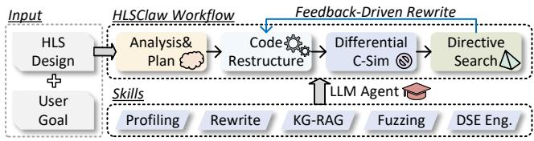
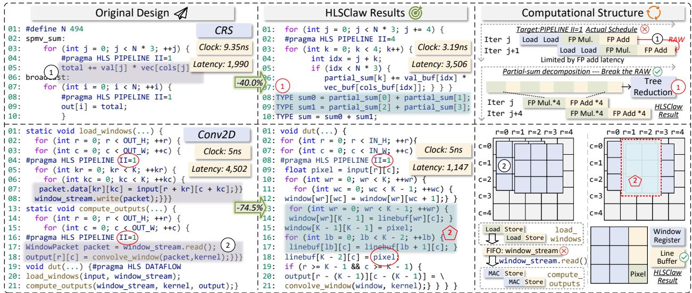
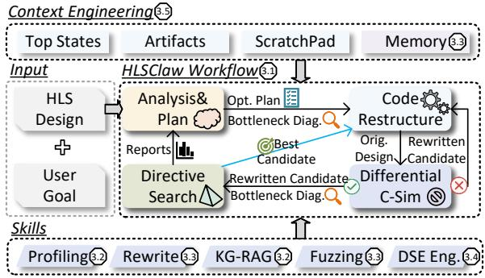
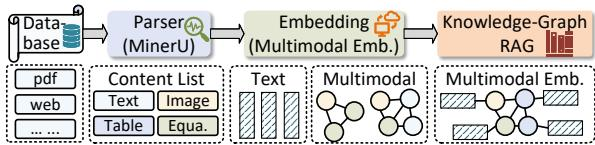
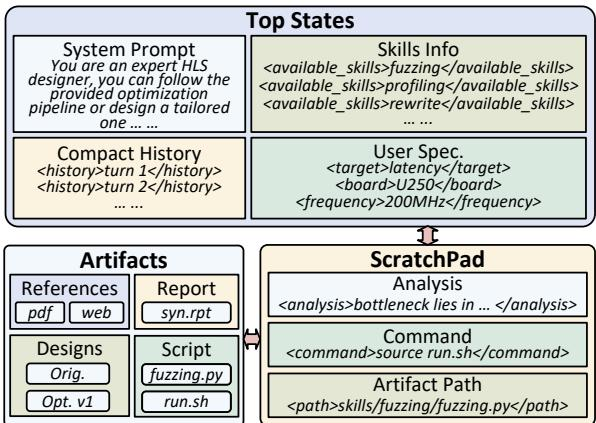
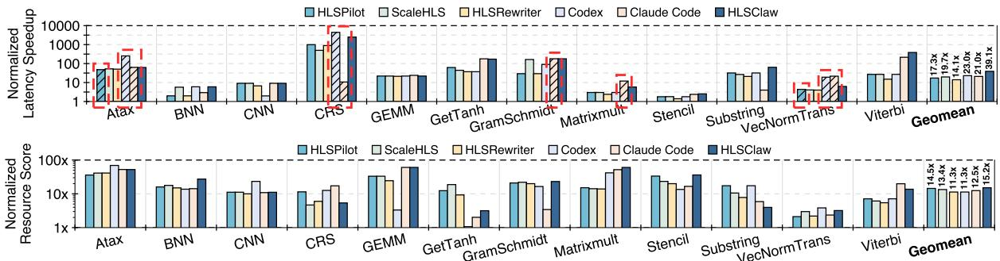
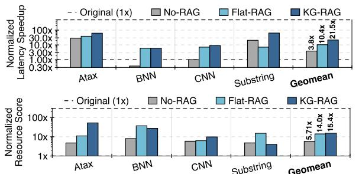
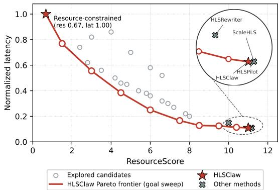
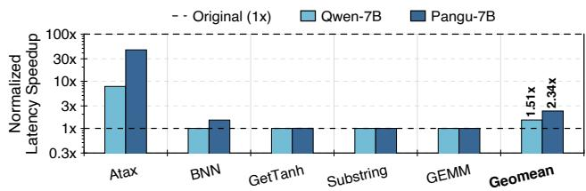

# HLSClaw: Bringing Vibe Coding to High-Level Synthesis through Skill-Based Agentic Harness

Jinming Ge The Hong Kong University of Science and Technology Hong Kong, Hong Kong jgeab@connect.ust.hk

Shangkun Li The Hong Kong University of Science and Technology Hong Kong, Hong Kong shangkun.li@connect.ust.hk

Shang Liu The Hong Kong University of Science and Technology Hong Kong, Hong Kong sliudx@connect.ust.hk

Afzal Ahmad The Hong Kong University of Science and Technology Hong Kong, Hong Kong afzal.ahmad@connect.ust.hk

Linfeng Du† The Hong Kong University of Science and Technology Hong Kong, Hong Kong linfeng.du@connect.ust.hk

Wei Zhang‡   
Dept of Electronic & Computer   
Engineering   
The Hong Kong University of Science   
and Technology   
Hong Kong, Hong Kong   
wei.zhang@ust.hk

Jiawei Liang The Hong Kong University of Science and Technology Hong Kong, Hong Kong jliangbr@connect.ust.hk

Jiang Xu The Hong Kong University of Science and Technology (Guangzhou) Guangzhou, China jiang.xu@hkust-gz.edu.cn

## Abstract

LLM agents are rapidly shifting software development toward intent-driven vibe coding, yet their efectiveness drops sharply in high-level synthesis (HLS), where code optimization must jointly consider design structure, directive search, and downstream hard ware constraints. Existing HLS optimization approaches, including both heuristic-based methods and recent LLM-assisted pipelines, typically operate at fixed abstraction levels or in weakly coupled stages, limiting their ability to leverage the strong interplay between source code restructuring and directive search outcomes.

Our key insight is that HLS optimization can be reframed from a fixed, hardwired transformation pipeline into a skill-based agen tic control problem: an LLM agent equipped with modular, executable optimization skills and a feedback-driven orchestrator can autonomously navigate the coupled space of code restructuring and directive search. This motivates the design of HLSClaw , the first HLS-specific, skill-based agentic harness for holistic HLS optimization. On real-world HLS benchmarks, HLSClaw achieves a 39.12× geometric-mean latency speedup, outperforming the compiler baseline ScaleHLS by 1.98×, and surpassing the commercial coding agents Claude Code and Codex by 1.86× and 1.70×, respectively, while maintaining strong timing robustness.

CCS Concepts

• Hardware → High-level and register-transfer level synthe- sis; • Computing methodologies → Intelligent agents.

## Keywords

Autonomous LLM, Harness Engineering, High-Level Synthesis, Source-to-Source Transformation

## 1 Introduction

Software development is undergoing a paradigm shift from laborintensive manual coding toward AI-assisted vibe coding, in which developers express high-level intent to LLM-powered agents. This paradigm succeeds in mainstream software since modern software compilers are mature enough to accommodate structural variations in source code without materially afecting runtime correctness or performance [3]. General-purpose agentic tools such as OpenAI Codex [19] and Claude Code [2] capitalize on this robustness, delivering remarkable proficiency in mainstream software tasks with minimal human intervention.

However, this paradigm breaks down in high-level synthesis (HLS), the dominant agile design flow for specialized hardware accelerators [7, 10, 28]. Unlike software compilation, HLS design quality is highly sensitive to both source-level computational structure and applied hardware directives. Their interaction shapes the resulting hardware architecture and quality of results (QoR), giving rise to a multidimensional and tightly coupled optimization space. Consequently, closing the vibe coding quality gap for HLS demands domain-specific harnesses—structured wrappers that equip an LLM agent with executable tools, feedback parsers, and correctness checks—to perform high-quality source-to-source transformations, the decisive factor for final hardware QoR.

  
Figure 1: Overview of HLSClaw: an LLM agent coordinates optimization skills in a feedback-driven workflow.

Despite sustained eforts from both academia and industry [6, 9, 11, 12, 22, 24–27], high-quality HLS source-to-source transformation remains an open challenge. Existing approaches either isolate code restructuring from HLS directive search or couple them in a fixed order, where early structural transformations constrain the space for downstream directive optimization.

Recent LLM-based methods [8, 18, 25, 26] alleviate this rigid ity by leveraging LLMs’ natural capacity for flexible source-level reasoning. However, they still organize optimization as either a linear pipeline or a human-scripted iteration, lacking a closed-loop architecture in which structural decisions can be revised based on later synthesis outcomes. These gaps cannot be addressed by sim ply prompting the LLM to “try again” with raw feedback: without structured feedback parsing, the agent cannot diagnose bottlenecks; without tool-driven validation, it silently introduces bugs; and without optimization memory, it repeats failed transformations.

Our key insight is that HLS experts navigate this tightly coupled optimization problem not by following a fixed recipe, but by iteratively diagnosing bottlenecks from synthesis feedback, selecting matched strategies, validating functional consistency, and revising upon deficiency—precisely the closed-loop capabilities that current LLM-based methods lack. Our work, as shown in Fig. 1, encodes this expert workflow by reframing HLS source-to-source transfor mation from hardwired rule design to dynamic skill orchestration— packaging expert HLS knowledge into modular skills that an LLM agent selects and composes according to the current design state and vendor-tool feedback. The main contributions are as follows:

• We present HLSClaw, the first HLS-specific, skill-based agentic harness that brings vibe coding to HLS through feedback-driven orchestration of code restructuring and di rective search.

• We equip HLSClaw with modular, composable skills whose complementary benefits for optimization quality and efi ciency are demonstrated through ablation studies.

• Across 12 HLS benchmarks, we achieve a 39.12× geometricmean latency speedup, outperforming Claude Code by 1.86× and Codex by 1.70×, with only modest resource overhead.

## 2 Motivation

We present two representative design snippets to illustrate the fundamental limitations of current HLS optimization: the inability of HLS compilers to compensate for suboptimal source structure, and the necessity of bidirectional coupling between code restructuring and directive search for high-quality optimization. For clarity, Fig. 2 only retains the key computational structure of each kernel. All synthesis results target the AMD U250 FPGA at a 5 ns clock period (200 MHz) using Vitis HLS 2025.2.

## 2.1 When Directives Are Not Enough

Fig. 2 (top) presents the CRS kernel, a sparse reduction-andbroadcast pattern that commonly appears in ML workloads. The original design uses the aggressive directive #pragma HLS PIPELINE II=1 ( 1 ). This setting yields a latency of 1,990 cycles. However, it ignores a loop-carried RAW dependency on total: the requested II=1 is unachievable in practice due to the FP accumulation latency, and the resulting design faces severe timing pressure with the Vivado post-synthesis clock stretched to 9.35 ns. The indirect memory access vec[cols[j]] further complicates scheduling since memory partitioning cannot guarantee conflict-free bank access. As a result, although the transformed code appears to reduce cycle count, the generated hardware is timing-infeasible and yields worse QoR.

By contrast, HLSClaw identifies the loop-carried RAW dependency as the key bottleneck and applies a coordinated restructuring ( 1 ): it stages external arrays into BRAM, decomposes the accumulator into UNROLL FACTOR=4 independent partial sums with the inner loop fully unrolled, and relaxes the pipeline target to II=4 so each partial\_sum[k] is updated once every four iterations. A final tree reduction merges the partial results, breaking the RAW hazard and producing a more eficient hardware pipeline. Although this rewrite results in a higher latency of 3,506 cycles, it achieves a much shorter clock of 3.19 ns, leading to a lower execution time.

## 2.2 When One Strategy Does Not Fit All

The 3 × 3 convolution over a 32 × 32 input shown in Fig. 2 (bottom) exposes a limitation of task-level dataflow decomposition [1, 4, 21, 27]. After applying dataflow decomposition with pipeline directives at II = 1, the resulting latency remains far from optimal despite significant engineering efort. The computational structure exposes the underlying cause: nine input values are loaded independently for every output pixel, yet adjacent windows overlap by six elements ( 2 ). The true bottleneck is spatial data reuse, and factoring the code into producer–consumer stages does nothing to exploit it.

HLSClaw addresses this bottleneck by reorganizing the entire loop nest around a line-bufer and sliding-window architecture ( 2 ). A single pipelined loop at II = 1 brings in one new pixel per cycle, shifts a � × � window of registers, and refills one column from the line bufer, with the MAC fully unrolled. The resulting latency of 1,147 cycles (−74.5% vs. original) demonstrates the payof of matching the transformation to the kernel-specific bottleneck. Crucially, this improvement stems from directive search outcomes feeding back into restructuring decisions: when the dataflow-decomposed code proved unresponsive to further directive tuning, HLSClaw recognized diminishing returns and selected a fundamentally different restructuring strategy—something forward-only pipelines cannot do, as they lack feedback between stages.

## 2.3 From Compiler Limitations to LLM Opportunities

These two cases expose two fundamental challenges in existing HLS optimization methods. Challenge 1: structure-constrained directive exploration. CRS shows that restrictive computational dependencies fundamentally limit directive search, often trapping it in locally optimal designs. Challenge 2: missing architecture- level reorganization. Conv2D shows that even after dataflow decomposition and pipelining, existing compilers may fail to identify transformations such as line-bufer-based spatial reuse that eliminate the dominant memory-access bottleneck.

  
Figure 2: Motivation examples demonstrating the limitations of existing HLS compilers and the opportunity for LLMs. The green arrows show execution time reductions. Circle and pentagon markers highlight the bottlenecks and modified regions.

Both challenges arise because the required restructurings are high-level, domain-aware optimizations that are dificult to encode as deterministic compiler transformations, motivating the use of LLM-based reasoning. However, existing LLM-assisted HLS methods typically lack a feedback connection between code restructuring and downstream DSE, preventing synthesis outcomes from revising earlier structural decisions. HLSClaw addresses this limitation by grounding the agent with domain-specific skills, coordinating them in a feedback-driven loop, and using context engineering to preserve diagnoses, tool evidence, and design history across iterations. This design harnesses the flexibility of LLMs to enable a tool-grounded, correctness-aware, and iterative process tailored to the tightly coupled nature of HLS optimization.

## 3 Methodology

## 3.1 Framework Overview

Fig. 3 presents the architecture of HLSClaw. Given an HLS design and a user-specified optimization goal, the agent first invokes the Profiling and KG-RAG skills to analyze synthesis feedback, diagnose the bottleneck, and formulate an optimization plan. Guided by this plan, the agent invokes the Rewrite skill to generate source-level design variants that target the identified bottleneck. The rewritten candidate is then compared with the original design through diferential C simulation using the Fuzzing skill. Candidates that fail the functional-consistency check are rejected and returned to the agent for further revision, whereas valid candidates proceed to directive exploration. The agent then invokes the DSE Engine skill to explore directive configurations for the current design and evaluates them through HLS synthesis. After directive search, the resulting QoR reports are fed back to the analysis stage. If the best candidate violates the user-specified constraints or the reports indicate further optimization opportunities, the agent updates its bottleneck diagnosis and initiates another restructuring iteration. This feedback-driven process continues until no candidate provides a meaningful QoR improvement or the optimization budget is exhausted.

  
Figure 3: Overview of HLSClaw with five optimization skills, a feedback-driven workflow, and context engineering.

## 3.2 Profiling & Knowledge-Guided Planning

A key enabler of HLSClaw’s agentic behavior is its ability to plan before acting. Before applying any optimization, the agent invokes the Profiling skill, which runs HLS synthesis and performs static analysis of the resulting QoR reports to derive higher-level bottleneck diagnoses. Crucially, profiling is not limited to the initial design: after major rewrites or DSE rounds, the agent re-invokes the profiling skill to reassess the updated design. This ensures that subsequent decisions are grounded in the current design state and forms a central component of HLSClaw’s closed-loop optimization.

After obtaining the QoR report, the agent invokes the KG-RAG skill to ground its bottleneck diagnosis in domain-specific HLS knowledge. As shown in Fig. 4, the knowledge library is constructed ofline by parsing vendor documentation with a multimodal document parser [14], encoding the extracted text, images, tables, and equations, and organizing them into a knowledge-graph-based RAG store. At query time, the agent formulates a bottleneck-aware query, and the RAG library returns prioritized optimization strategies with supporting rationale. Unlike Flat-RAG, which retrieves semantically similar passages independently, the graph-structured RAG explicitly models relationships among bottlenecks, root causes, optimization techniques, and vendor constraints. This structure supports multi-hop reasoning, composition of compatible strategies, and vendor-specific grounding.

  
Figure 4: Ofline construction of the KG-RAG library from multimodal documents for HLS knowledge retrieval.

## 3.3 Code Restructuring & Diferential C-Sim

The Rewrite skill provides a library of more than 100 curated code templates collected from publicly available repositories and programming platforms. Additionally, we classify them according to common HLS bottlenecks, including redundant computation, loopcarried dependencies, ineficient memory access, limited data reuse, irregular control flow, and imbalanced dataflow organization. For each bottleneck category, the library records representative code templates together with their applicable conditions, enabling the agent to retrieve structurally relevant examples when implementing an optimization plan. The template library is further complemented by a self-updating memory. When the agent encounters a bottleneck that is not adequately covered by existing templates, it derives a new rewrite pattern from the successful optimization attempt and stores the validated pattern, its triggering bottleneck, and the observed synthesis outcome for reuse in subsequent runs.

Since LLM-generated rewrites may introduce functional errors, HLSClaw invokes the Fuzzing skill before each rewritten candidate enters HLS evaluation. The skill constructs a self-checking diferential testbench that executes the original design and the rewritten candidate on identical fixed-seed, fuzz-generated inputs through AMD Vitis C simulation. Their outputs are compared element-wise using exact matching for integer and fixed-point computations and a predefined numerical tolerance for floating-point outputs. A candidate is rejected if it produces an output mismatch, runtime failure, assertion violation, or incompatible top-level interface. The failing input and first divergent output are summarized as feedback for the next rewrite attempt. Candidates that pass this test-based functional-consistency check proceed to HLS synthesis and directive search. This lightweight gate prevents incorrect rewrites from consuming expensive HLS evaluations.

## 3.4 Directive Search & DSE Engine

The directive-search stage consists of two steps. First, the agent leverages the structural analysis from the rewrite stage to identify high-impact directive sites and construct a focused candidate set from the full set of AMD Vitis HLS directives. The agent then invokes the DSE Engine skill to evaluate these candidates through an algorithmic search engine, progressively adding or updating one directive site at each iteration.

  
Figure 5: Context engineering with Top States, ScratchPad, and Artifacts for orchestration, memory, and outputs.

For candidate selection, HLSClaw adopts a constraint-first, goalaware ranking scheme. Let C denote the set of user-specified constraints, where each constraint is expressed as $g _ { c } ( x ) \leq b _ { c }$ for candidate �. These constraints may include the target clock period and resource budgets. We quantify the maximum normalized constraint violation as

$$
V ( x ) = \operatorname* { m a x } _ { c \in C } \left[ \frac { g _ { c } ( x ) - b _ { c } } { b _ { c } } \right] _ { + } , \qquad [ z ] _ { + } = \operatorname* { m a x } _ { } ( z , 0 ) .\tag{1}
$$

A candidate is feasible if and only if $V ( x ) = 0$

Candidates are first ranked by normalized constraint violation and then by the user-selected optimization objective. Let $q _ { g } ( x )$ denote the QoR cost of candidate � under goal �. We normalize this objective against the current rewritten baseline �0:

$$
J _ { g } ( x ) = \frac { q _ { g } ( x ) } { q _ { g } ( x _ { 0 } ) } .\tag{2}
$$

A lower value of $J _ { g } ( x )$ indicates a better design under the selected optimization goal. Candidates are ordered lexicographically by

$$
\Phi _ { g } ( x ) = { \big ( } V ( x ) , J _ { g } ( x ) { \big ) } .\tag{3}
$$

Each feasible candidate is preferred over an infeasible one; feasible candidates are then ranked solely by the selected QoR objective.

The DSE Engine explores hardware directives in three stages. It first synthesizes the rewritten baseline and evaluates all singlesite directive candidates in parallel. For each site, the best option that improves upon the baseline under the lexicographic ranking $\Phi _ { g } = ( V , J _ { g } )$ is retained. These options are then progressively combined through beam expansion. At each round, the engine ranks the evaluated configurations using $\Phi _ { g }$ and applies rank-based Boltzmann sampling to preserve promising alternatives while avoiding early commitment to a local optimum. As the search progresses, the selection gradually favors higher-ranked candidates. Finally, the remaining evaluation budget is used to explore unseen, conflict-free multi-site combinations, and the lexicographically best configuration is returned.

  
Figure 6: Performance and resource comparison across 12 HLS benchmarks. Top: normalized latency speedup, where higher is better. Bottom: normalized resource score relative to the original design, where lower is better.

## 3.5 Context Engineering

Long-horizon agentic runs accumulate heterogeneous context, including user constraints, intermediate analyses, code variants, tool outputs, and empirical takeaways. As illustrated in Fig. 5, HLSClaw partitions this context into three layers. Top States maintains sta ble orchestration information such as the system prompt, skill descriptions, execution history, and user specifications. ScratchPad stores transient reasoning state, including bottleneck diagnoses, commands, and artifact paths, while Artifacts preserves concrete outputs such as designs, synthesis reports, and scripts. This separation keeps control signals explicit, allows reasoning to persist across skill invocations, and preserves inspectable evidence throughout long-horizon optimization.

This partitioning yields three benefits. First, robustness: the agent can resume, reroute, or terminate using explicit state rather than fragile conversational reconstruction. Second, reasoning quality: separating working memory from orchestration metadata reduces interference across skill invocations. Third, auditability: tool outputs persist as artifacts rather than free-form summaries. Context engineering therefore provides a reliable basis for multi-skill orchestration by separating control logic, evolving reasoning state, and verifiable optimization evidence.

## 4 Experiments

We implement HLSClaw using LangGraph 1.0.10 [16], a productiongrade framework for building agentic systems in industry [5, 17], comprising over 12,000 lines of Python code, and evaluate it on a suite of 12 representative HLS kernels drawn from four classical benchmark suites [15, 20, 23, 30] spanning dense linear algebra (GEMM, Matrixmult, Atax, GramSchmidt), neural-networkstyle computation (BNN, CNN, GetTanh), stencil and convolution patterns (Stencil, CRS), and control-heavy or irregular workloads (Viterbi, Substring, VecNormTrans). All designs are synthesized using Vitis HLS 2025.2 targeting the AMD U250 at a 5 ns clock period (200 MHz), with latency as the primary optimization objective.

For DSE, we set the beam width to � = 5, limit each search to at most � = 13 HLS evaluations per rewritten design, and use an initial Boltzmann temperature of $T _ { 0 } ~ = ~ 5 0 . 0$ with a geometric cooling factor of $\gamma = 0 . 8 5$ . Hardware QoR is measured from synthesis reports in terms of latency (cycles), timing slack (ns), and resource utilization. We quantify overall hardware cost using a weighted normalized resource metric, denoted as ResourceScore:

Table 1: Execution time = latency × achieved clock period; For all four metrics, higher is better.
<table><tr><td>Metric</td><td>HLSPilot</td><td>ScaleHLS</td><td>HLS Rewriter</td><td>Codex</td><td>Claude Code</td><td>HLSClaw</td></tr><tr><td>GM</td><td>11.89</td><td>18.29</td><td>14.16</td><td>13.34</td><td>14.68</td><td>30.59</td></tr><tr><td>ETS</td><td>3.44</td><td>6.35</td><td>5.35</td><td>4.13</td><td>5.26</td><td>7.48</td></tr><tr><td>EWS</td><td>4.41</td><td>4.46</td><td>4.99</td><td>4.42</td><td>4.68</td><td>5.70</td></tr><tr><td>Perf/HW Gain</td><td>0.82</td><td>1.36</td><td>1.25</td><td>1.18</td><td>1.17</td><td>2.01</td></tr></table>

GM: geometric mean of execution-time speedups.  
ETS/EWS: equal-time and equal-work harmonic-mean speedups, respectively [13].  
Perf/HW gain: geometric mean of per-benchmark execution-time speedup divided by normalized ResourceScore overhead.

ResourceScor ${ \mathbf { e } } = 0 . 3 0 u _ { \mathrm { L U T } } + 0 . 1 0 u _ { \mathrm { F F } } + 0 . 3 0 u _ { \mathrm { D S P } } + 0 . 3 0 u _ { \mathrm { B R A M } } .$ . This formulation assigns larger weights to LUT, DSP, and BRAM because they are typically more constraining in HLS designs, while FF receives a smaller weight due to its lower practical pressure.

We compare against five baselines representing three optimization paradigms: (1) compiler-based: ScaleHLS [27]; (2) LLM-based: HLSPilot [25] and HLSRewriter [26]; (3) general-purpose coding agents: OpenAI Codex [19] and Claude Code [2]. To ensure fair comparison across LLM-based methods, HLSClaw, HLSPilot [25], and HLSRewriter [26] all use GPT-5.5 as the base model.

## 4.1 Comparison with SOTA HLS Opt. Methods

Fig. 6 compares end-to-end speedup and resource usage across 12 benchmarks for six methods. HLSClaw achieves the highest geometric-mean latency speedup of 39.1×, outperforming Codex (23.0×) and Claude Code (21.0×) by 1.70× and 1.86×, respectively. Although the coding agents report higher nominal speedups on several benchmarks, four of these designs sufer severe timing violations, as indicated by the red dashed boxes. In contrast, HLSClaw maintains timing-feasible performance across the benchmark suite while remaining competitive in resource usage, with a geometricmean normalized resource score of 15.2×.

For LLM-based methods and general-purpose coding agents, the overall runtime is dominated by repeated Vitis HLS evaluations. HLSClaw reduces this cost through diferential C simulation, which rejects incorrect rewrites before they enter synthesis and avoids unnecessary tool invocations. Compiler-based methods such as ScaleHLS instead use analytical QoR models during DSE, trading synthesis-level evaluation fidelity for lower exploration runtime.

To account for timing infeasibility and enable a fair comparison of performance and resource eficiency, we further evaluate all methods using four execution-time-based metrics, as summarized in Table 1. Execution time is computed as latency multiplied by the achieved clock period, thereby penalizing designs with poor timing closure. HLSClaw consistently achieves the best results across all four metrics, attaining a GM speedup of 30.59×, ETS and EWS speedups of 7.48× and 5.70×, respectively, and the highest Perf/HW gain of 2.01.

  
Figure 7: KG-RAG ablation on four kernels: (top) normalized latency speedup; (bottom) normalized resource score.

Table 2: Impact of diferential C simulation on validation and optimization wall-clock time.
<table><tr><td>Configuration</td><td>C-sim time (s)</td><td>HLS evals</td><td>Invalid evals HLS wall executed</td><td>time (s)</td><td>Total wall time (s)</td></tr><tr><td>Without C-sim gate</td><td>0</td><td>80</td><td>15</td><td>966.50</td><td>966.50</td></tr><tr><td>With differential C-sim</td><td>94.10</td><td>65</td><td>0</td><td>295.71</td><td>389.81</td></tr><tr><td>Change</td><td>+94.10</td><td>-15</td><td>-15</td><td>-670.79</td><td>-576.69</td></tr><tr><td>Relative saving</td><td>一</td><td>18.8%</td><td>100%</td><td>69.40%</td><td>59.70%</td></tr></table>

## 4.2 Skill Ablation Study

To isolate the contributions of key components of HLSClaw, we conduct three ablation studies: KG-RAG versus Flat-RAG and No-RAG; diferential C simulation for early rejection of incorrect rewrites; and isolated, one-shot, and feedback-driven coordination of code restructuring and directive search.

4.2.1 KG-RAG. We evaluate No-RAG, Flat-RAG, and KG-RAG within HLSClaw, as shown in Fig. 7. KG-RAG achieves the highest geometric-mean latency speedup and Perf/HW gain, with 21 $. 5 / 1 5 . 4 \approx 1 . 4 0 \times$ , compared with $1 0 . 4 / 1 4 . 0 \approx 0 . 7 4 \times$ for Flat-RAG and $3 . 8 / 5 . 7 1 \approx 0 . 6 7 \times$ for No-RAG. The small gain of Flat-RAG over No-RAG suggests that isolated passage retrieval provides limited benefit, whereas graph-structured retrieval better captures relationships among bottlenecks, optimization strategies, and hardware constraints.

4.2.2 Diferential C-Sim. Table 2 evaluates diferential C simulation on four benchmarks using four rewrites each. Without early validation, the 16 candidates require 16 × 5 = 80 HLS evaluations. Eight fixed-seed fuzzing trials reject three incorrect rewrites before DSE, avoiding 15 HLS evaluations. Including 94.10 s of C-sim overhead, total wall-clock time decreases from 966.50 s to 389.81 s.

  
Figure 8: Latency–resource trade-of on CNN. The red curve shows the Pareto frontier obtained by sweeping �.

Table 3: Contribution of eval-1, eval-2, eval-3, and eval-4.
<table><tr><td>Benchmark</td><td>eval-1 cycles</td><td>eval-1 gain</td><td>eval-2 cycles</td><td>eval-2 gain</td><td>eval-3 cycles</td><td>eval-3 gain</td><td>eval-4 cycles</td><td>eval-4 gain</td></tr><tr><td>Substring</td><td>24,607</td><td>10.65X</td><td>42,762</td><td>6.13×</td><td>4,122†</td><td>63.59x†</td><td>4,121</td><td>63.61×</td></tr><tr><td>VecNormTrans</td><td>30,729</td><td>1.46×</td><td>6,199</td><td>7.26×</td><td>4,814</td><td>9.35X</td><td>3,127</td><td>14.39X</td></tr><tr><td>CNN</td><td>8,115</td><td>4.61×</td><td>14,278</td><td>2.62X</td><td>8,115</td><td>4.61×</td><td>4,105</td><td>9.11X</td></tr><tr><td>Atax</td><td>1,259</td><td>26.62×</td><td>977</td><td>34.30×</td><td>1,072†</td><td>31.26׆</td><td>532</td><td>63.00X</td></tr></table>

† Timing-infeasible design.

4.2.3 Feedback-driven Rewrite. Table 3 compares directive search only (eval-1), code restructuring only (eval-2), fixed-order restructuring followed by DSE (eval-3), and the full feedback-driven workflow (eval-4). The isolated stages favor diferent kernels, while eval-3 cannot revise restructuring decisions using downstream synthesis feedback and produces timing-infeasible designs. In contrast, eval-4 achieves the lowest latency on all four benchmarks while maintaining timing feasibility.

## 4.3 Case Study: Multi-Objective Pareto Front

Although this work mainly focuses on latency optimization, HLSClaw is not restricted to a single optimization objective. After filtering infeasible candidates, the agent can rank feasible designs using a user-defined latency–resource objective:

$$
J _ { \lambda } ( x ) = \lambda { \frac { L ( x ) } { L ( x _ { 0 } ) } } + ( 1 - \lambda ) { \frac { \rho ( x ) } { \rho ( x _ { 0 } ) } } , \qquad 0 \leq \lambda \leq 1 ,\tag{4}
$$

where �(�) and $\rho ( x )$ denote the latency and resource score of candidate �, respectively, and $x _ { 0 }$ is the current rewritten baseline.

We sweep � on CNN to study the latency–resource trade-of. As shown in Fig. 8, HLSClaw explores a broad design space and traces a Pareto frontier from resource-eficient to latency-oriented solutions, demonstrating its ability to adapt to diferent user objectives rather than returning only the fastest design.

## 4.4 Open-Source Model Study

To investigate the feasibility of deploying open-source LLMs for agentic HLS optimization, we establish a local inference environment on an Ascend server equipped with eight Ascend 910B NPUs, each providing 64 GiB of HBM, and a 192-core Kunpeng 920 CPU. The software stack includes CANN 8.5.2, PyTorch 2.7.1, TorchNPU 2.7.1.post2, and Hugging Face Transformers 4.53.3. All evaluated models are executed in BF16 precision.

Table 4: Inference results of open-source LLMs on Huawei Ascend 910B1 NPUs.
<table><tr><td>Model</td><td>NPUs</td><td>Tokens</td><td>Time (s)</td><td>Tokens/s</td></tr><tr><td>Qwen2.5-0.5B</td><td>1</td><td>93</td><td>4.57</td><td>20.35</td></tr><tr><td>openPangu-7B</td><td>1</td><td>92</td><td>7.18</td><td>12.81</td></tr><tr><td>Qwen2.5-32B</td><td>4</td><td>128</td><td>32.22</td><td>3.97</td></tr></table>

  
Figure 9: Cycle-based latency speedup of HLSClaw using openPangu-7B and Qwen2.5-7B-Instruct on five benchmarks.

We evaluate Qwen2.5 and openPangu models to validate inference across diferent model sizes and NPU configurations. For integration with HLSClaw, we deploy openPangu-Embedded-7B on a single NPU and expose it through a lightweight FastAPI server implementing OpenAI-compatible model discovery and chat com pletion endpoints. HLSClaw communicates with the remote inference server through an SSH tunnel using its existing custom LLM provider, without modifying the agent workflow. The serving configuration uses deterministic decoding (temperature = 0), a maximum generation length of 4096 tokens, and a request timeout of 600 seconds.

4.4.1 NPU Inference Performance. We first evaluate the inference capability of the Ascend platform using three open-source LLM configurations. Table 4 reports the execution time and generation throughput from our initial inference tests. Qwen2.5-0.5B and openPangu-Embedded-7B are executed on a single NPU, whereas Qwen2.5-32B is distributed across four NPUs using layer-wise model sharding. Specifically, its 64 Transformer layers are evenly partitioned across the four devices.

All three configurations successfully complete autoregressive generation on the Ascend platform. The 32B experiment further demonstrates the feasibility ofdistributing a large model across mul tiple NPUs. Since the measurements involve diferent model sizes and generation workloads, they serve as functional deployment results rather than a controlled comparison of inference eficiency.

4.4.2 Open-Source Model Comparison. Figure 9 compares the HLS optimization performance of openPangu-7B and Qwen2.5- 7B-Instruct on five selected benchmarks. Speedup is calculated using worst-case latency in cycles, with unsuccessful runs assigned 1×. Pangu achieves a geometric-mean speedup of 2.34×, compared with 1.51× for Qwen, primarily driven by its 46.35× speedup on Atax versus Qwen’s 7.77×.

However, Pangu’s Atax result has a negative timing slack of −0.30 ns, and the two models were evaluated under diferent search budgets and parallelism settings. Therefore, these results demonstrate the feasibility of using open-source LLMs for HLS optimization, rather than a strictly controlled comparison of model capabilities.

## 5 Related Work

HLS Optimization. Existing HLS optimization methods mainly explore hardware directives or apply compiler-based transformations. Directive-search approaches, including AutoDSE [24], COMBA [29], and FADO [11, 12], use heuristic search, analytical models, or learned predictors to identify promising configurations. ScaleHL-S [27], SEER [6], and more recent holistic frameworks [21, 22] further optimize source code or intermediate representations and, in some cases, combine code transformations with directive insertion. Nevertheless, these methods generally operate within predefined transformation spaces or fixed optimization orders, limiting their ability to revisit source-level decisions using downstream feedback.

LLM-Assisted HLS. Recent studies use LLMs for HLS code generation and optimization. HLSPilot [25] generates and refines synthesizable designs, while HLSRewriter [26] focuses on source-code refactoring. C2HLSC [8] and ChatHLS [18] further demonstrate LLM-based translation, analysis, and optimization for HLS. However, these approaches typically rely on one-shot, fixed-stage, or externally scripted workflows, with limited support for revising earlier restructuring decisions or maintaining structured state across repeated synthesis and rewriting iterations.

## 6 Conclusion

This paper presents HLSClaw, a skill-based agentic harness for HLS optimization that coordinates code restructuring, directive search, and synthesis feedback. HLSClaw achieves a 39.12× geometricmean latency speedup with strong timing robustness, outperforming ScaleHLS, Claude Code, and Codex, while also supporting userdefined latency–resource trade-ofs through goal-aware DSE.

## References

[1] Stefan Abi-Karam, Rishov Sarkar, Suhail Basalama, Jason Cong, and Callie Hao. 2026. FIFOAdvisor: a DSE framework for automated FIFO sizing of high-level synthesis designs. In 2026 31st Asia and South Pacific Design Automation Conference (ASP-DAC). IEEE, 489–495.

[2] Anthropic. 2025. Claude Code: Agentic Coding Tool. https://www.anthropic. com/product/claude-code. Accessed: 2026-04-04.

[3] Amir H Ashouri, William Killian, John Cavazos, Gianluca Palermo, and Cristina Silvano. 2018. A survey on compiler autotuning using machine learning. ACM Computing Surveys (CSUR) 51, 5 (2018), 1–42.

[4] Suhail Basalama and Jason Cong. 2025. Stream-HLS: towards automatic dataflow acceleration. In Proceedings ofthe 2025 ACM/SIGDA International Symposium on Field Programmable Gate Arrays. 103–114.

[5] ByteDance. 2025. DeerFlow: A Multi-Agent Framework for Deep Research Automation. https://github.com/bytedance/deer-flow. Accessed: 2026-04-13.

[6] Jianyi Cheng, Samuel Coward, Lorenzo Chelini, Rafael Barbalho, and Theo Drane. 2024. Seer: Super-optimization explorer for high-level synthesis using e-graph rewriting. In Proceedings ofthe 29th ACM International Conference on Architectural Support for Programming Languages and Operating Systems, Volume 2. 1029–1044.

[7] Yuze Chi, Weikang Qiao, Atefeh Sohrabizadeh, Jie Wang, and Jason Cong. 2022. Democratizing domain-specific computing. Commun. ACM 66, 1 (2022), 74–85.

[8] Luca Collini, Siddharth Garg, and Ramesh Karri. 2025. C2hlsc: Leveraging large language models to bridge the software-to-hardware design gap. ACM Transactions on Design Automation ofElectronic Systems 30, 6 (2025), 1–24.

[9] Jason Cong, Muhuan Huang, Peichen Pan, Yuxin Wang, and Peng Zhang. 2016. Source-to-source optimization for HLS. In FPGAs for Software Programmers. Springer, 137–163.

[10] Jason Cong, Jason Lau, Gai Liu, Stephen Neuendorfer, Peichen Pan, Kees Vissers, and Zhiru Zhang. 2022. FPGA HLS today: successes, challenges, and opportunities. ACM Transactions on Reconfigurable Technology and Systems (TRETS) 15, 4 (2022), 1–42.

[11] Linfeng Du, Tingyuan Liang, Sharad Sinha, Zhiyao Xie, and Wei Zhang. 2023. FADO: Floorplan-aware directive optimization for high-level synthesis designs on multi-die FPGAs. In Proceedings of the 2023 ACM/SIGDA International Symposium on Field Programmable Gate Arrays. 15–25.

[12] Linfeng Du, Tingyuan Liang, Xiaofeng Zhou, Jinming Ge, Shangkun Li, Sharad Sinha, Jieru Zhao, Zhiyao Xie, and Wei Zhang. 2024. FADO: Floorplan-aware directive optimization based on synthesis and analytical models for high-level synthesis designs on multi-die FPGAs. ACM Transactions on Reconfigurable Technology and Systems 17, 3 (2024), 1–33.

[13] Lieven Eeckhout. 2024. R.I.P. Geomean Speedup Use Equal-Work (or Equal-Time) Harmonic Mean Speedup Instead. IEEE Computer Architecture Letters 23, 1 (2024), 78–82. doi:10.1109/LCA.2024.3361925

[14] Zirui Guo, Xubin Ren, Lingrui Xu, Jiahao Zhang, and Chao Huang. 2025. Raganything: All-in-one rag framework. arXiv preprint arXiv:2510.12323 (2025).

[15] Yuko Hara, Hiroyuki Tomiyama, Shinya Honda, Hiroaki Takada, and Katsuya Ishii. 2008. Chstone: A benchmark program suite for practical c-based high-level synthesis. In 2008 IEEE International Symposium on Circuits and Systems (ISCAS). IEEE, 1192–1195.

[16] LangChain Inc. 2024. LangGraph: A Library for Building Stateful, Multi-Actor Applications with LLMs. https://github.com/langchain-ai/langgraph. Accessed:

2026-04-13.

[17] LangChain Inc. 2024. Top 5 LangGraph Agents in Production 2024. https: //blog.langchain.com/top-5-langgraph-agents-in-production-2024/. Features LinkedIn, Elastic, Replit, and AppFolio. Accessed: 2026-04-13.

[18] Runkai Li, Jia Xiong, Xiuyuan He, Jiaqi Lv, Jieru Zhao, and Xi Wang. 2025. ChatHLS: Towards Systematic Design Automation and Optimization for High Level Synthesis. arXiv preprint arXiv:2507.00642 (2025).

[19] OpenAI. 2025. Introducing Codex. https://openai.com/index/introducing-codex/. Accessed: 2026-04-04.

[20] Louis-Noël Pouchet et al. 2012. PolyBench: The Polyhedral Benchmark Suite. https://www.cs.colostate.edu/\~pouchet/software/polybench/ Accessed: 2026-07- 19.

[21] Stéphane Pouget, Michael Lo, Louis-Noël Pouchet, and Jason Cong. 2025. Holistic Optimization Framework for FPGA Accelerators. ACM Transactions on Design Automation ofElectronic Systems 31, 1 (2025), 1–37.

[22] Stéphane Pouget, Louis-Noël Pouchet, andJason Cong. 2025. A unified framework for automated code transformation and pragma insertion. In Proceedings ofthe 2025 ACM/SIGDA International Symposium on Field Programmable Gate Arrays. 187–198.

[23] Brandon Reagen, Robert Adolf, Yakun Sophia Shao, Gu-Yeon Wei, and David Brooks. 2014. MachSuite: Benchmarks for Accelerator Design and Customized Architectures. In Proceedings ofthe IEEE International Symposium on Workload Characterization. Raleigh, North Carolina.

[24] Atefeh Sohrabizadeh, Cody Hao Yu, Min Gao, and Jason Cong. 2022. AutoDSE: Enabling software programmers to design eficient FPGA accelerators. ACM Transactions on Design Automation of Electronic Systems (TODAES) 27, 4 (2022), 1–27.

[25] Chenwei Xiong, Cheng Liu, Huawei Li, and Xiaowei Li. 2024. HLSPilot: LLMbased high-level synthesis. In Proceedings ofthe 43rd IEEE/ACM International Conference on Computer-Aided Design. 1–9.

[26] Kangwei Xu, Grace Li Zhang, Xunzhao Yin, Cheng Zhuo, Ulf Schlichtmann, and Bing Li. 2025. HLSRewriter: Eficient Refactoring and Optimization of C/C++ Code with LLMs for High-Level Synthesis. ACM Transactions on Design Automation ofElectronic Systems (2025).

[27] Hanchen Ye, Cong Hao, Jianyi Cheng, Hyunmin Jeong, Jack Huang, Stephen Neuendorfer, and Deming Chen. 2022. ScaleHLS: A new scalable high-level synthesis framework on multi-level intermediate representation. In 2022 IEEE international symposium on high-performance computer architecture (HPCA). IEEE, 741–755.

[28] Wei Zhang. 2025. Streamlining FPGA Development: Challenges and Opportunities of Agile Design Flows. Keynote at the International Conference on Field-Programmable Technology (FPT).

[29] Jieru Zhao, Liang Feng, Sharad Sinha, Wei Zhang, Yun Liang, and Bingsheng He. 2017. COMBA: A comprehensive model-based analysis framework for high level synthesis of real applications. In 2017 IEEE/ACM International Conference on Computer-Aided Design (ICCAD). IEEE, 430–437.

[30] Yuan Zhou, Udit Gupta, Steve Dai, Ritchie Zhao, Nitish Srivastava, Hanchen Jin, Joseph Featherston, Yi-Hsiang Lai, Gai Liu, Gustavo Angarita Velasquez, et al. 2018. Rosetta: A realistic high-level synthesis benchmark suite for soft ware programmable FPGAs. In Proceedings ofthe 2018 ACM/SIGDA International Symposium on Field-Programmable Gate Arrays. 269–278.