# Hybrid Federated Learning for Multimodal Fusion under Missing Modalities and Site Heterogeneity

Xiaofei Wu<sup>a</sup>, Rongmei Liang<sup>b</sup>, Jian Qing Shi<sup>c,∗</sup>

<sup>a</sup>Yunnan Key Laboratory of Statistical Modeling and Data Analysis, Yunnan University; School of Mathematics and Statistics, Yunnan University, Dongwaihuan South Road, Chenggong District, Kunming, Yunnan, 650500, China

<sup>b</sup>Department of Statistics and Data Science, Southern University of Science and Technology, Shenzhen, 518055, China

<sup>c</sup>Guangdong Provincial/Zhuhai Key Laboratory of Interdisciplinary Research and Application for Data Science, Beijing Normal-Hong Kong Baptist University, 2000 Jintong Road, Tangjiawan, Zhuhai, Guangdong, 519087, China

## Abstract

Multimodal fusion is studied under hybrid federation, where data are partitioned across samples and feature blocks. The proposed two-dimensional fed erated smooth multiple-kernel large-margin learning method (2D-FedSMKL) integrates availability-corrected modality scores, group-kernel regularization, and smooth worst-site risk aggregation. For fixed maps and propensities, the objective is convex and smooth. Curvature bounds and exact synchronous block-gradient equivalence are established for binary and multiclass scores, giving a conditional accelerated rate. An oracle-propensity binary risk bound and a propensity-perturbation result are also derived. Simulations and two public activity-recognition benchmarks assess site heterogeneity and modality absence. Worst-site aggregation improves worst-site performance under heterogeneity, including reversed and size-balanced designs. On the benchmarks, validation selects the correction; the selected model is not significantly worse than the strongest reference at the worst site, and group-regularization benefits vary by dataset.

Keywords: hybrid federated learning, information fusion, missing modalities, multiple-kernel learning, site heterogeneity

## 1. Introduction

Multimodal information fusion combines sources such as wearable signals, physiological measurements, clinical examinations, and demographic variables. Their complementary information must be reconciled with diferences in sampling, feature geometry, noise, and semantic content [1, 2, 3, 4]. For example, free-living fatigue assessment has combined ECG, accelerometry, skin temperature, respiratory rate, and demographics [5]. These sources may be distributed and incomplete: multimodal medical studies can lack entire modalities [6], while federated systems partition data across samples, features, or both [7, 8, 9, 10]. Figure 1 illustrates the joint partition: sites contain diferent participant records, and separate custodians hold modality-specific feature blocks linked by aligned identifiers. Missing blocks are an additional record-level property, distinct from where features are held.

This layout creates four related dificulties. First, fusion must proceed without centralizing raw feature blocks, particularly in vertical or hybrid federation [7, 8, 10]. Second, missingness often occurs by modality: an entire wearable recording, imaging study, or laboratory panel may be unavailable. Complete-case analysis then loses eficiency and can be biased when complete records are not an appropriate random subsample [6, 11]. Third, hospitals can difer in patient mix, acquisition protocols, and endpoint prevalence. Such heterogeneity is a well-known challenge in federated optimization, and robust objectives can limit poor performance in shifted or underrepresented groups [12, 13, 14]. Finally, modalities may require distinct representations and similarity measures, motivating group-aware regularization beyond a shared penalty on concatenated features [1, 15].

Activity recognition provides a concrete example of the decision task. In MHEALTH, a time window contains chest, ECG, wrist and ankle measurements, from which modality-specific summaries are extracted [16, 17]. A support vector machine (SVM) learns a large-margin classification rule from these features and activity labels [18]. In the multiclass extension, one score is assigned to each activity and the largest score determines the prediction [19]. Multiple-kernel learning (MKL) combines modality-specific score contributions and regularizes their relative influence [15, 20]. The fusion problem is to learn this rule when some window-level blocks are absent and diferent sites have diferent risks, while preserving the feature-custody constraints.

Our formulation combines four established components in a common objective. First, a softplus approximation to the unit-margin hinge loss permits smooth first-order optimization [18, 21, 22]. Second, each observed modality score is weighted by an estimated observation propensity, allowing incomplete records to contribute to estimation [11, 23]. Third, log-sum-exp aggregation smoothly approximates the maximum site risk and gives greater influence to sites with larger empirical risk [13, 14, 22]. Finally, a diferentiable squared group-kernel penalty regularizes modalities and yields MKL weights through the connection between block norms and MKL perspective formulations [20, 24]. The feature maps are fixed throughout: the federated protocol covers the decision layer and its optimization, not representation learning.

For this hybrid federated setting, we propose two-dimensional federated smooth multiple-kernel large-margin learning (2D-FedSMKL). The method makes the following contributions.

(i) We formulate availability-corrected multimodal decision fusion for simultaneous sample and feature partitions. The correction has two instantiations, an inverse-probability score with a risk guarantee and a conditional imputation, and is selected on validation data. The resulting objective is convex and couples modality-level regularization with smooth worst-site risk under fixed representations, and it has an explicit interface for evaluation without centralizing feature blocks.

(ii) We establish target-specific curvature bounds and exact synchronous block-gradient equivalence for binary and multiclass scores. Standard accelerated optimization then gives a conditional convergence guarantee. An oracle-propensity binary risk bound and a training-sample propensity perturbation result quantify costs of site size and modality availability for fixed representations.

(iii) We evaluate the framework through controlled simulations and two public activity-recognition benchmarks. The experiments examine predictive performance under site heterogeneity and modality absence, assess the contribution of the main modeling components, select the availability correction on validation data, and test the simulation mechanism under reversed and size-balanced site designs. We report where the framework matches or improves on the mean-risk and horizontal references, and where it does not.

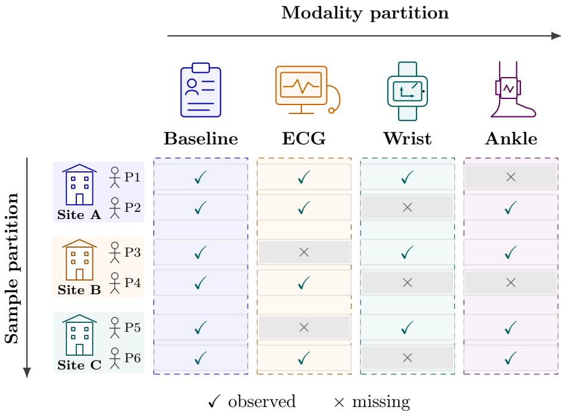  
Figure 1: Illustrative sample and modality partitions in hybrid federated fusion. Sites group distinct patient records vertically; independently held modality blocks form the horizontal partition. Original device icons depict baseline records, ECG monitoring and wrist/ankle inertial sensors (IMUs). Check marks indicate observed blocks and crosses indicate record-level absence; the baseline remains observed. IDs, devices and availability patterns are schematic, not clinical study data. Computational row groups need not coincide with statistical sites. Raw feature blocks remain with their custodians. 2D-Fed denotes 2D-FedSMKL.

Section 2 reviews missing-modality fusion, MKL, hybrid federated learning, and robust multicenter objectives. Section 3 defines the score and objective, Section 4 develops the two-dimensional algorithm, and Section 5 gives the theoretical results. Section 6 and Section 7 report the controlled simulations and the two public benchmarks, and Section 8 sets out the implications, limitations, and conclusions.

## 2. Related work

## 2.1. Incomplete multimodal information fusion

Information may be fused at the data, feature, score, or decision level. Multimodal and multi-view learning address related problems of representation, alignment, fusion, translation, co-learning, and the use of complementary feature sets [1, 3, 4]. In medical studies, intermediate or late fusion is often preferable when modalities difer in sampling rate, dimension, and quality-control requirements. Recent incomplete multi-view clustering methods first complete samples or graphs and then learn a consensus representation [25, 26, 27]; medical fusion methods have also begun to address severe modality absence and low-quality observations [6]. Although this literature establishes missing modalities as a central problem, it mainly considers centralized representation learning or unsupervised clustering. We instead study supervised large-margin decision fusion when sites difer and data are distributed along both sample and feature dimensions.

Complete-case analysis is ineficient and may be biased unless complete records constitute an appropriate random subsample [11]. Inverse-probability weighting (IPW) addresses selection by weighting observed contributions by the reciprocal of their estimated observation probability [23]. We apply this principle to modality-level scores: each observed score is reweighted under a stated missing-at-random condition. Section 3 also defines a conditionalimputation instantiation, and Section 7 selects between the two on validation data.

## 2.2. Multiple-kernel large-margin fusion

SVMs balance empirical margin loss against an RKHS norm when learning a separating function [18, 28]. Kernel-based multi-view extensions include multi-view Laplacian SVMs, which combine agreement between views with margin learning in RKHSs [29]. MKL learns a combination of base kernels. Its semidefinite, conic, and block-norm formulations established the connection between kernel weighting and group regularization [15, 20, 24]. Related discriminative approaches include multi-kernel maximum-entropy discrimination [30], while kernel alignment provides another criterion for selecting or combining kernels [31]. Distributed online MKL has also been developed for networked streaming learners [32]; that setting, however, assumes horizontally distributed examples rather than aligned feature blocks with site-dependent modality absence.

Related functional-data work jointly considers registration and clustering of multidimensional trajectories [33]. Our development assumes fixed modality feature maps. The simulations use linear modality kernels; nonlinear kernels can be approximated locally with random Fourier or Nyström features, without sharing raw columns [34, 35]. Previous generalization analyses of multi-view classifiers have also used a PAC-Bayesian perspective [36]. Here, the analysis instead controls an availability-corrected worst-site risk and explicitly displays its dependence on the smallest site and the minimum modality-observation propensity. The squared sum of smoothed group norms is a diferentiable analogue of the block norm obtained after optimizing the standard MKL perspective weights, so the fitted group norms can be interpreted directly as modality weights.

## 2.3. Horizontal, vertical, and hybrid federated learning

Horizontal federated learning aggregates models across disjoint samples with a shared feature space [8, 37]. FedAvg and FedProx are prominent examples, with the latter designed for systems and statistical heterogeneity [12]. Vertical federated learning instead aligns shared entities across parties that hold diferent features [7].

Hybrid federated learning permits variation in both samples and features. FedHD addresses hybrid data through local updates and gradient tracking [9]; Zhang et al. use model matching to combine feature extractors and classifiers under sample and feature heterogeneity [10]. Both works address sample and feature heterogeneity, as does the present formulation. The present target is a fixed-representation, availability-corrected worst-site decision objective evaluated through exact synchronous reductions. We assume aligned records and feature correspondence; arbitrary feature matching and entity alignment require a diferent formulation. Supplementary Material S5 compares the assumptions, exchanged quantities, and guarantee objects.

Multimodal federated learning covers the wider design space surveyed by Huang et al. [2], dual-clustered feature contrast under domain heterogeneity [38], and distillation-based embedding transfer [39]. Modality-completion and distillation methods address missingness at the representation level [6, 39]; this paper fixes the representation and corrects observed scores instead. Our framework provides a convex decision objective with explicit assumptions, and the fitted group norms give the modality weights directly. Centralized and horizontal predictors are statistical references; the computational comparison uses ordinary and accelerated gradient methods on the same objective and row/column message interface, which isolates solver cost from the information available to each method.

## 2.4. Site heterogeneity and robust objectives

Multisource domain adaptation transfers information across labeled sources to an often-unlabeled target [40, 41]. Multicenter training poses a related but diferent problem: every participating site is part of the target, so high pooled performance should not conceal failure at a smaller site. Distributionally robust optimization (DRO) formalizes robustness to changes in the data-generating distribution [13, 42], and group-DRO methods minimize or approximate the worst loss over prespecified groups [14]. We use an entropy-regularized maximization over site weights. Its closed form is the log-sum-exp of the empirical site risks, which smoothly interpolates between prevalence-weighted mean risk and worst-site risk and remains amenable to accelerated first-order optimization.

## 3. Two-dimensional smooth large-margin fusion

## 3.1. Data layout and notation

Let $s \in \mathcal S = \{ 1 , \dots , S \}$ index statistical sites, with $n _ { s } \geq 1$ training observations at site s and total $n = \textstyle \sum _ { s } n _ { s }$ . Let $m \in \mathcal { M } = \{ 1 , \dots , M \}$ index modalities. For $i = 1 , \dots , n _ { s }$ , observation $( s , i )$ has binary label $y _ { s i } \in$ $\{ - 1 , + 1 \}$ and potential measurement $x _ { s i m } \in \mathcal { X } _ { m } .$ , where ${ \mathcal { X } } _ { m }$ is modality m’s measurement space. Write $x _ { s i } = ( x _ { s i 1 } , \dots , x _ { s i M } )$ and $r _ { s i } = ( r _ { s i 1 } , \dots , r _ { s i M } )$ 2 with $r _ { s i m } \in \{ 0 , 1 \}$ indicating whether the block is observed. An alwaysavailable baseline vector $z _ { s i } .$ , such as demographics or acquisition covariates, supports the observation propensity

$$
p _ { s i m } = \mathbb { P } ( r _ { s i m } = 1 \mid z _ { s i } , s ) .\tag{1}
$$

The fitted propensity is $\widehat { p } _ { s i m } ; \ : p _ { \mathrm { m i n } } > 0$ denotes the lower clipping threshold. Observation probabilities describe record-level availability, not worker connectivity. We apply inverse-probability weighting to modality-score contributions [11, 23].

For computation, reindex the pairs $( s , i )$ by global rows $1 , \ldots , n$ , and let $\mathcal { N } _ { s }$ be the rows belonging to site s. In the finite-dimensional representation introduced below, modality m has $d _ { m }$ coordinates and $\begin{array} { r } { d = \sum _ { m } d _ { m } } \end{array}$ . Let $\boldsymbol { X } \in \mathbb { R } ^ { n \times d }$ denote the represented design matrix for block indexing; absent blocks have zero storage placeholders and retain their availability indicators. Row sets $\{ \mathcal { T } _ { a } \} _ { a = 1 } ^ { A }$ partition $\{ 1 , \ldots , n \}$ , and column sets $\{ \mathcal { I } _ { j } \} _ { j = 1 } ^ { B }$ partition $\{ 1 , \ldots , d \}$ . Worker $( a , j ) , a = 1 , \dotsc , A , j = 1 , \dotsc , B$ , holds $X [ \mathcal { T } _ { a } , \mathcal { T } _ { j } ]$ and the associated availability information. Statistical sites S and computational row groups A need not coincide. A modality may occupy one column group or span several. Feature-custodian records must be aligned before fitting [7]; entity matching is outside the present optimization problem.

## 3.2. Availability-corrected additive kernel score

For modality m, let $\mathcal { H } _ { m }$ be a reproducing kernel Hilbert space (RKHS), with inner product $\langle \cdot , \cdot \rangle _ { \mathscr { H } _ { m } }$ and norm $\| \cdot \| _ { \mathcal { H } _ { m } }$ . Its kernel and feature map satisfy [28]

$$
\phi _ { m } : \mathcal { X } _ { m }  \mathcal { H } _ { m } , \qquad K _ { m } ( x , x ^ { \prime } ) = \langle \phi _ { m } ( x ) , \phi _ { m } ( x ^ { \prime } ) \rangle _ { \mathcal { H } _ { m } } .
$$

The coeficient is $w _ { m } \in \mathcal { H } _ { m }$ , the intercept is $b \in \mathbb { R }$ , and $w = ( w _ { 1 } , \dots , w _ { M } )$ With availability multiplier $a _ { s i m }$ , the score is

$$
\begin{array} { c l } { f _ { w , b } ( x _ { s i } , r _ { s i } ) = { b } + \displaystyle \sum _ { m = 1 } ^ { M } a _ { s i m } \left. w _ { m } , \phi _ { m } ( x _ { s i m } ) \right. _ { \mathscr { H } _ { m } } , } \\ { a _ { s i m } = \displaystyle \frac { r _ { s i m } } { \operatorname* { m a x } \left( \widehat { p } _ { s i m } , p _ { \operatorname* { m i n } } \right) } . } \end{array}
$$

Here $a _ { s i m } = 0$ for an absent block, so no unavailable feature value is evaluated. For the oracle identity, replace the fitted denominator by the true propensity. For any fixed coeficient block $w _ { m }$ and positive true propensity $p _ { s i m } > 0$ , the modality-level missing-at-random (MAR) condition $\mathbb { P } ( r _ { s i m } = 1 \mid x _ { s i m } , z _ { s i } , s ) =$ $\mathbb { P } ( r _ { s i m } = 1 \mid z _ { s i } , s ) = p _ { s i m }$ gives

$$
\mathbb { E } \biggl [ \frac { r _ { s i m } } { p _ { s i m } } \langle w _ { m } , \phi _ { m } ( x _ { s i m } ) \rangle \biggm | x _ { s i m } , z _ { s i } , s \biggr ] = \langle w _ { m } , \phi _ { m } ( x _ { s i m } ) \rangle .\tag{2}
$$

Equation (2) concerns the linear score contribution under true propensities. A nonlinear loss applied to the sum of corrected scores generally changes this unbiasedness property. Accordingly, the objective below targets correctedscore risk. Fitted and clipped propensities can introduce bias, and small probabilities can amplify variability. If every modality is observed with probability one and the correction is set to one, the score reduces to ordinary additive MKL. Figure 2 illustrates this correction without reconstructing an absent signal.

The correction is a module with two instantiations. The first is the inverse-probability score above. The second replaces an absent block with a conditional prediction from the always-observed block: for each optional block, a ridge regression is fitted on training rows where the block is observed and applied to the rows where it is absent, and the score is evaluated on the completed feature vector. Both instantiations use the same decision layer and hyperparameters, and the correction is selected on validation data by worst-site macro-F1, with ties resolved in favour of the inverse-probability form. Section 5 analyses the inverse-probability instantiation; the imputation instantiation targets the risk of the imputed score and is evaluated empirically in Section 7.4.

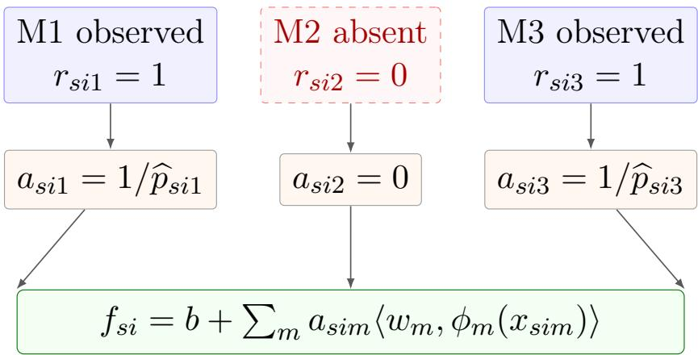  
Figure 2: Availability-corrected additive fusion for one sample. Observed modalities are inverse-probability weighted, whereas an absent block contributes zero rather than an imputed signal. Under the stated missing-at-random assumption and with the true observation propensities, the correction recovers each full-data linear score contribution in expectation. Estimated propensities are clipped to limit instabili $\operatorname { t y } ,$ which can introduce bias.

For a finite-dimensional implementation, use $\phi _ { m } ( x ) \in \mathbb { R } ^ { d _ { m } }$ and $\boldsymbol { w _ { m } } \in \mathbb { R } ^ { d _ { m } }$ stack $w \in \mathbb { R } ^ { d }$ , and use Euclidean inner products and norms. The corrected feature vector is $\widetilde { \boldsymbol { \phi } } _ { s i } = ( a _ { s i 1 } \phi _ { 1 } ( \boldsymbol { x } _ { s i 1 } ) ^ { \top } , \ldots , a _ { s i M } \phi _ { M } ( \boldsymbol { x } _ { s i M } ) ^ { \top } , 1 ) ^ { \top }$ , with absent components zero. It includes the intercept coordinate. The analysis conditions on fixed feature and correction maps. Linear features can be used directly, whereas nonlinear kernels may be approximated locally with random Fourier or Nyström features [34, 35]. Define the smoothed group norm and the sum of these norms by

$$
g _ { m , \epsilon } ( w _ { m } ) = \sqrt { \| w _ { m } \| _ { 2 } ^ { 2 } + \epsilon ^ { 2 } } , \qquad G _ { \epsilon } ( w ) = \sum _ { m = 1 } ^ { M } g _ { m , \epsilon } ( w _ { m } ) ,
$$

with small $\epsilon > 0$ . For fitted coeficient blocks ${ \widehat { w } } .$ , the normalized modality weight is

$$
\widehat { \beta } _ { m } = \frac { g _ { m , \epsilon } ( \widehat { w } _ { m } ) } { G _ { \epsilon } ( \widehat { w } ) } .\tag{3}
$$

For fixed $w ,$ minimizing $\begin{array} { r l r } {  { \sum _ { m } ( \| w _ { m } \| _ { 2 } ^ { 2 } + \epsilon ^ { 2 } ) / \beta _ { m } } } \end{array}$ over positive kernel weights $\beta _ { m }$ summing to one gives $G _ { \epsilon } ( w ) ^ { 2 }$ , with $\beta _ { m } = g _ { m , \epsilon } ( w _ { m } ) / G _ { \epsilon } ( w )$ , by Cauchy– Schwarz. As $\epsilon \downarrow 0$ , this recovers the standard block-norm/MKL perspective connection [20, 24]. Reported shares describe fitted coeficient blocks.

## 3.3. Smooth unit-margin loss

For a binary observation, write $t = y _ { s i } f _ { w , b } ( x _ { s i } , r _ { s i } )$ for its signed margin. Using t as the scalar argument, the classical SVM uses the nondiferentiable hinge loss $( 1 - t ) _ { + } \left[ 1 8 , 2 8 \right]$ . Smooth SVMs replace the positive-part operator with a diferentiable approximation. The softplus below is the log-sum-exp approximation to max $\{ 0 , 1 - t \}$ and is closely related to the smoothing construction of Lee and Mangasarian [21, 22]:

$$
\ell _ { \tau } ( t ) = \frac { 1 } { \tau } \log \{ 1 + \exp [ \tau ( 1 - t ) ] \} , \qquad \tau > 0 .\tag{4}
$$

Its transition is centered on the SVM unit margin $t ~ = ~ 1$ , whereas the logistic-regression loss places its transition at $t = 0$ . Equivalently, $\ell _ { \tau } ( t ) =$ $\tau ^ { - 1 } \operatorname { L S E } \{ 0 , \tau ( 1 - t ) \}$ , where LSE denotes log-sum-exp. The standard smoothmaximum inequality therefore gives [22]

$$
0 \leq \ell _ { \tau } ( t ) - ( 1 - t ) _ { + } \leq \frac { \log 2 } { \tau } ,
$$

and $\ell _ { \tau }$ approaches hinge loss as $\tau \to \infty$ . Its derivative magnitude is at most one, and its second derivative is at most $\tau / 4$

The empirical risk at site s is

$$
\widehat { R } _ { s } ( w , b ) = \frac { 1 } { n _ { s } } \sum _ { i = 1 } ^ { n _ { s } } \ell _ { \tau } \big ( y _ { s i } f _ { w , b } \big ( x _ { s i } , r _ { s i } \big ) \big ) .
$$

## 3.4. Smooth worst-site aggregation

Average empirical risk can conceal poor performance in a small or shifted group; worst-group and worst-domain objectives are designed to address this problem [13, 14]. Treating sites as prespecified groups, we replace the

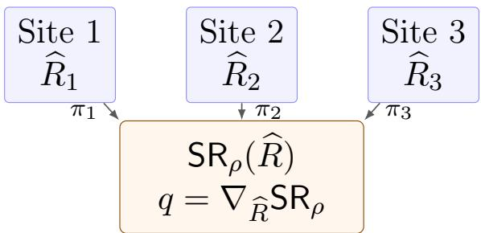  
Figure 3: Smooth worst-site aggregation. Log-sum-exp provides a diferentiable approximation to the largest site risk, and its gradient gives the adaptive weight $q _ { s }$ . Decreasing ρ approaches worst-site training; increasing ρ approaches π-weighted mean-risk training.

nonsmooth maximum site risk with a log-sum-exp approximation [22]. Let $\pi _ { s } > 0$ and $\textstyle \sum _ { s } \pi _ { s } = 1$ denote reference site weights, ordinarily $n _ { s } / n$ , and define

$$
{ \sf S R } _ { \rho } ( \widehat { R } _ { 1 } , \ldots , \widehat { R } _ { S } ) = \rho \log \left\{ \sum _ { s = 1 } ^ { S } \pi _ { s } \exp \left( \frac { \widehat { R } _ { s } } { \rho } \right) \right\} , \qquad \rho > 0 .
$$

Its derivative with respect to $\widehat { R } _ { s }$ is the adaptive site weight

$$
q _ { s } ( w , b ) = \frac { \pi _ { s } \exp \{ \widehat { R } _ { s } ( w , b ) / \rho \} } { \sum _ { u = 1 } ^ { S } \pi _ { u } \exp \{ \widehat { R } _ { u } ( w , b ) / \rho \} } .\tag{5}
$$

The amplification factor ${ { q } _ { s } } / { { \pi } _ { s } }$ increases with $\widehat { R } _ { s } \mathrm { : }$ ; in particular, a site attaining the largest empirical risk has $q _ { s } \geq \pi _ { s }$ . The absolute weights $q _ { s }$ need not have the same ordering as the risks because they also depend on the reference weights $\pi _ { s }$ . This mechanism is the smooth analogue of upweighting groups with larger losses in group-DRO training [14] and is illustrated in Figure 3. It also satisfies

$$
\operatorname* { m a x } _ { s } \widehat { R } _ { s } + \rho \log \pi _ { \operatorname* { m i n } } \leq { \sf S R } _ { \rho } ( \widehat { R } ) \leq \operatorname* { m a x } _ { s } \widehat { R } _ { s } ,\tag{6}
$$

where $\pi _ { \operatorname* { m i n } } = \operatorname* { m i n } _ { s } \pi _ { s }$ . Thus eq. (6) limits the smooth-maximum approximation gap by $\rho \log ( 1 / \pi _ { \operatorname* { m i n } } )$

The proposed estimator minimizes

$$
\begin{array} { l } { \displaystyle { J ( w , b ) = 5 \mathsf { R } _ { \rho } \{ \widehat { R } _ { 1 } ( w , b ) , \ldots , \widehat { R } _ { S } ( w , b ) \} } } \\ { \displaystyle { \phantom { \frac { J ( w , b ) } { 2 } } + \frac { \lambda _ { 0 } } { 2 } \left( \sum _ { m = 1 } ^ { M } \| w _ { m } \| _ { 2 } ^ { 2 } + \eta _ { b } b ^ { 2 } \right) + \frac { \lambda _ { 1 } } { 2 } G _ { \epsilon } ( w ) ^ { 2 } } . } \end{array}\tag{7}
$$

Here $\lambda _ { 0 } , \lambda _ { 1 } , \eta _ { b } \ge 0$ and $\tau , \rho , \epsilon > 0$ . The risk term controls the aggregation of site losses: as $\rho  \infty$ it approaches the π-weighted mean, whereas $\rho \downarrow 0$ emphasizes the largest site risk. This can protect a dificult site at the expense of average performance; smaller $\rho$ also increases curvature. The $\lambda _ { 0 }$ term shrinks coeficients, with $\eta _ { b }$ setting the relative intercept penalty. When both $\lambda _ { 0 }$ and $\eta _ { b }$ are positive, this penalty supplies strong convexity. Excessive shrinkage can increase bias. The $\lambda _ { 1 }$ term couples modality norms and induces the fitted MKL shares. Its predictive efect depends on the data and missingness regime; Section 7 reports a setting in which removing it improves performance.

The smoothing parameters have separate roles. Larger τ gives a sharper hinge approximation but increases loss curvature. Smaller ϵ more closely approximates the unsmoothed group norm, but increases the available curvature bound near zero blocks. These choices trade approximation accuracy against numerical conditioning and regularization. Section 5 states the resulting guarantees and the conditions under which they hold.

## 3.5. Multiclass extension

Crammer and Singer [19] proposed a direct multiclass maximum-margin classifier. It assigns one score $f _ { c } ( x )$ to each of $C$ classes and predicts arg max f<sub>c</sub>(x). Its per-example hinge loss can be written as

$$
\ell ^ { \mathrm { C S } } ( y , f ) = \operatorname* { m a x } \left\{ 0 , \operatorname* { m a x } _ { c \neq y } \left( 1 + f _ { c } - f _ { y } \right) \right\} .
$$

Applying the same log-sum-exp smoothing principle as in the binary case gives

$$
\ell _ { \tau } ^ { \mathrm { m c } } ( y , f ) = \frac { 1 } { \tau } \log \left[ 1 + \sum _ { c \neq y } \exp \left\{ \tau ( 1 + f _ { c } - f _ { y } ) \right\} \right] , \qquad \tau > 0 .\tag{8}
$$

The log-sum-exp approximation to a maximum satisfies [22]

$$
0 \leq \ell _ { \tau } ^ { \mathrm { m c } } ( y , f ) - \ell ^ { \mathrm { C S } } ( y , f ) \leq \frac { \log C } { \tau } .
$$

Thus $\tau$ has the same interpretation as in eq. (4): larger values give a sharper approximation to the corresponding maximum-margin loss. For modality $m$ , collect the class-specific coeficient vectors in $W _ { m } = [ w _ { m 1 } , \dots , w _ { m C } ]$ , use intercept $b \in \mathbb { R } ^ { C }$ , and replace coeficient and intercept norms in eq. (7) by Frobenius and Euclidean norms, respectively. When $\lambda _ { 0 } , \eta _ { b } > 0$ , the quadratic penalty resolves the common-score-shift indeterminacy and ensures a unique minimizer. Partial class-score vectors remain additive across feature blocks. Supplementary Material S4.7 proves convexity, strong convexity under these conditions, a multiclass curvature bound, and exact block-gradient equivalence. The population-risk results in section $5$ concern binary classification; Section 7 evaluates the multiclass extension empirically.

## 4. Two-dimensional federated optimization

## 4.1. Score and gradient decomposition

Write the finite-dimensional parameter as $\theta = ( w ^ { \top } , b ) ^ { \top } \in \mathbb { R } ^ { d + 1 }$ , where $\begin{array} { r } { d = \sum _ { m } d _ { m } } \end{array}$ . We use the global row indexing of Section 3, suppressing the site index in $x _ { i m } , r _ { i m } , a _ { i m }$ and $y _ { i }$ . For sample $i \in \mathcal { Z } _ { a }$ , column worker $j$ computes

$$
z _ { i j } = \sum _ { m : \mathcal { D } _ { m } \cap \mathcal { I } _ { j } \neq \emptyset } a _ { i m } \left. w _ { m , j } , \phi _ { m , j } ( x _ { i m } ) \right. ,
$$

where $\mathcal { D } _ { m }$ is the coordinate set of modality $m ,$ and $w _ { m , j }$ and $\phi _ { m , j }$ restrict its coeficients and features to $\mathcal { D } _ { m } \cap \mathcal { J } _ { j }$ . Aggregation within the aligned row group gives

$$
f _ { i } = b + \sum _ { j = 1 } ^ { B } z _ { i j } .
$$

The row coordinator evaluates

$$
d _ { i } = \frac { \partial \ell _ { \tau } ( y _ { i } f _ { i } ) } { \partial f _ { i } } = - y _ { i } \sigma \{ \tau ( 1 - y _ { i } f _ { i } ) \} ,
$$

where $\sigma ( u ) = ( 1 + e ^ { - u } ) ^ { - 1 }$ . Let $\mathcal { N } _ { s }$ denote the global row indices belonging to site s. After the empirical site risks are aggregated, the coordinator obtains $q _ { s }$ from eq. (5). The risk gradient for feature block $j$ is

$$
\nabla _ { w _ { j } } \mathsf { S R } _ { \rho } = \sum _ { s = 1 } ^ { S } \frac { q _ { s } } { n _ { s } } \sum _ { i \in \mathcal { N } _ { s } } d _ { i } \widetilde { \phi } _ { j } ( \boldsymbol { x } _ { i } , \boldsymbol { r } _ { i } ) ,
$$

where $\widetilde { \phi } _ { j }$ restricts the non-intercept coordinates of the corrected feature vector to ${ \mathcal { I } } _ { j }$ . Each row worker forms the inner sum locally, after which only the

resulting block gradient is reduced across row workers. The scalar risk gradient for the intercept is

$$
g _ { b } ^ { \mathrm { r i s k } } = \sum _ { s = 1 } ^ { S } \frac { q _ { s } } { n _ { s } } \sum _ { i \in \mathcal { N } _ { s } } d _ { i } ,
$$

and is reduced across row groups in the same synchronization stage.

Writing the two penalty terms in eq. (7) as $\mathrm { R e g } ( w , b )$ , their complete gradient contribution for modality m and the intercept is

$$
\begin{array} { r l } & { \nabla _ { w _ { m } } \operatorname { R e g } ( w , b ) = \lambda _ { 0 } w _ { m } + \lambda _ { 1 } G _ { \epsilon } ( w ) \frac { w _ { m } } { g _ { m , \epsilon } ( w _ { m } ) } , } \\ & { \frac { \partial \operatorname { R e g } ( w , b ) } { \partial b } = \lambda _ { 0 } \eta _ { b } b . } \end{array}\tag{9}
$$

Computing $G _ { \epsilon }$ requires one scalar norm per modality, or a reduction of squared norms if a modality spans several workers, followed by a scalar broadcast. Along with the additive reductions for scores and risk gradients, this operation keeps raw features local.

## 4.2. Parallel accelerated updates

We use accelerated gradient descent with a nondecreasing backtracking estimate [43]. Local computation alternates with structured aggregation, as in standard federated optimization [8, 37]; unlike a horizontal scheme, however, the present layout partitions both samples and features [9, 10]. For

$$
Q _ { L } ( v , u ) = J ( u ) + \langle \nabla J ( u ) , v - u \rangle + \frac { L } { 2 } \left. v - u \right. _ { 2 } ^ { 2 } ,
$$

we accept a trial point v when $J ( v ) \leq Q _ { L } ( v , u )$ . Other solvers could use the same score-and-gradient interface, but the analysis below assumes synchronous accelerated updates so that distributed and centralized iterates can be compared exactly.

Each iteration has two parallel stages separated by reductions. During the parallel score stage, every available worker $( a , j )$ evaluates partial scores for the samples in row block $a .$ These scores are synchronized within the aligned row group because the complete score is needed to compute $f _ { i } , d _ { i }$ , and the site losses. Once the site losses have been reduced and the adaptive weights $q _ { s }$ are available, the parallel gradient stage computes, for each row–column worker pair,

$$
g _ { a j } = \sum _ { s = 1 } ^ { S } \frac { q _ { s } } { n _ { s } } \sum _ { i \in \mathcal { T } _ { a } \cap \mathcal { N } _ { s } } d _ { i } \widetilde { \phi } _ { j } ( \boldsymbol { x } _ { i } , \boldsymbol { r } _ { i } ) ,
$$

followed by the feature-block reduction $\begin{array} { r } { g _ { j } \ = \ \sum _ { a } g _ { a j } } \end{array}$ and the scalar intercept reduction $g _ { b } ^ { \mathrm { r i s k } }$ . Computations for all row–column blocks are therefore concurrent between synchronization points.

```latex
Algorithm 1 2D-FedSMKL with parallel, missing-modality-aware updates
Require: Row partition $\{ \underline { { { T } } } _ { a } \} _ { a = 1 } ^ { A } ;$ feature partition $\{ \mathcal { I } _ { j } \} _ { j = 1 } ^ { B } ;$ propensity models.
Require: Parameters $\tau , \rho , \lambda _ { 0 } , \lambda _ { 1 } , \eta _ { b } ,$ ϵ and backtracking factor $\gamma > 1$
1: Initialize $\theta _ { 0 } = 0 ,$ extrapolated point $u _ { 0 } = \theta _ { 0 } , t _ { 0 } = 1$ , and accepted estimate $\widehat { L } _ { - 1 } > 0$
2: for $k = 0 , \stackrel { \smile } { 1 } , \dots , T - 1$ do
Parallel score stage
3: for all row groups a in parallel do
4: for all column workers $j$ in parallel do
5: Compute $z _ { i j } ( u _ { k } )$ for $\begin{array} { r } { { \bf \check { \Phi } } _ { i } \in \dot { \cal T } _ { a } , } \end{array}$ observed blocks on $\mathrm { l y } .$ ▷ partial score
6: end for
7: Synchronize column scores within row group a; compute $f _ { i } , \ d _ { i }$ and site-loss
sums. ▷ full score, $d _ { i }$
8: end for
9: Synchronize site-loss scalars and compute $q _ { s } .$ ▷ site weights
Parallel gradient stage
10: for all feature blocks $j$ in parallel do
11: for all row groups a in parallel do
12: Compute local risk-gradient block $g _ { a j }$ ▷ block gradient
13: end for
14: Reduce $\begin{array} { r } { g _ { j }  \sum _ { a = 1 } ^ { A } g _ { a j } } \end{array}$
15: end for
16: Reduce $g _ { b } ^ { \mathrm { r i s k } }$ across row groups.
17: Aggregate modality norms and add the regularizer gradient in eq. (9).
18: Set $L _ { k } \gets \widehat { L } _ { k - 1 }$
19: repeat
20: $\theta _ { k + 1 } \gets u _ { k } - L _ { k } ^ { - 1 } \nabla J ( u _ { k } )$
21: Evaluate the trial objective by a score-only reduction.
22: accepted $ [ J ( \theta _ { k + 1 } ) ^ { \circ } \leq Q _ { L _ { k } } ( \breve { \theta } _ { k + 1 } , u _ { k } ) ]$ ▷ majorization test
23: if not accepted then
24: $L _ { k _ { - } } \gets \hat { \gamma L } _ { k }$
25: end if
26: until accepted
27: $\widehat { L } _ { k } \gets L _ { k } ;$ synchronize the accepted iterate.
28: $t _ { k + 1 } \gets \{ 1 + \sqrt { 1 + 4 t _ { k } ^ { 2 } } \} / 2 .$
29: $\begin{array} { r } { u _ { k + 1 }  \theta _ { k + 1 } + \frac { t _ { k } - 1 } { t _ { k + 1 } } ( \theta _ { k + 1 } - \theta _ { k } ) } \end{array}$ ▷ momentum
30: Stop $\mathrm { i f } \ \lVert \theta _ { k + 1 } - \theta _ { k } \rVert / ( 1 + \lVert \theta _ { k } \rVert )$ is below tolerance.
31: end for
32: return $\widehat { \theta }$ and the modality weights.
```

Algorithm 1 makes the resulting communication points explicit. Raw feature vectors are not transmitted: column workers exchange partial scores, sites exchange loss summaries, and row groups reduce feature-block gradients and the scalar intercept gradient. The score and risk reductions create synchronization barriers because $d _ { i }$ depends on the complete additive score and $q _ { s }$ depends on all site risks. The method is therefore synchronous, although local computation remains parallel along both partition axes.

Each failed line-search test increases $L _ { k }$ and recomputes the trial point before testing again. Supplementary Material S4.8 gives a gradient-norm objective-gap certificate when $\lambda _ { 0 } , \eta _ { b } > 0 ;$ the relative-iterate stopping rule used in the experiments does not supply an objective-gap certificate.

## 4.3. Modality availability and propensity estimation

Sample-level modality absence belongs to the statistical model, and it is distinct from system failure. Under the inverse-probability instantiation, an absent block has $r _ { i m } = a _ { i m } = 0$ and contributes no raw value, while an observed block is reweighted by the clipped propensity estimate defined in section 3. Under the conditional-imputation instantiation, an absent optional block is replaced by a prediction from the always-observed block and enters with unit weight. The inverse-probability form is a modality-score analogue of correction for incomplete data [11, 23]. The distinction matters in multimodal federated learning, where clients may legitimately hold diferent modality subsets [2]. Statistically absent sample–modality contributions are skipped in the parallel loops without altering the row/column reduction pattern.

For each optional modality, we fit a logistic observation model using the always-observed baseline block and site indicators. The required gradients are aggregated horizontally across row groups. If the baseline block and the availability indicator are held by diferent feature custodians, the logistic linear predictor can be computed from the same partial scores. Propensity models are fitted on training samples only and then applied unchanged to test samples. More flexible calibrated classifiers may replace logistic regression, but the clipping threshold should be specified in advance.

## 4.4. Communication and system considerations

Communication is a primary design constraint in federated learning [8, 37], and hybrid sample–feature partitioning creates trafic along both the row and column dimensions [9, 10]. Let n be the total number of aligned training rows and d the total feature dimension. With 64-bit scalars and synchronous full gradients, the payload is approximately

$$
\mathrm { C o m m } _ { A , B } = 1 6 d A + 1 6 n ( B - 1 ) \quad \mathrm { b y t e s ~ p e r ~ r o u n d } .\tag{10}
$$

The first term accounts for gradient reduction and parameter broadcast across row blocks, at eight bytes in each direction; the second accounts for partialscore aggregation and derivative return across column blocks. Site-risk and modality-norm summaries add $O ( S + M )$ scalars. Equation (10) is a collapsedcoordinator approximation for one complete score-and-gradient evaluation. Supplementary Material S3 separately counts the explicit messages of a global coordinator, row coordinators, and feature workers; that topology also includes communication for $A = B = 1$ , so its totals are not interchangeable with this approximation, and the payload figures reported there are computed from that topology rather than from eq. (10). Each backtracking trial, including the accepted one, requires an additional score-only objective pass, and rejected trials require further passes. Total training trafic consequently depends on the observed number of line-search trials, reported in the Supplementary Material.

The trust model assumes non-colluding parties and does not provide a formal privacy guarantee. Row coordinators hold labels and site identifiers; a global coordinator receives site-risk summaries, adaptive site weights, featureblock gradients and modality norms; and a feature worker holds one column block with its availability indicators. Raw features and labels are not transmitted, but partial scores and gradients carry information about the records. Exact reductions preserve the equivalence in Theorem 2; secure aggregation with fixed-point encoding or quantization would require a separate error analysis.

In a balanced layout, each row group performs $O ( n d / A )$ work. If both rows and feature coordinates are balanced and all AB workers operate concurrently, worker $( a , j )$ performs approximately $O ( n d / ( A B ) )$ local operations per full score-and-gradient evaluation. Synchronization, network latency, and stragglers limit the corresponding reduction in wall-clock time. Nonlinear random features increase d but preserve the additive communication interface. This calculation quantifies application-level payload and excludes any secure-aggregation overhead.

## 5. Theoretical properties

We state the results for fixed, finite-dimensional feature maps and the parameter domains specified in section 3. The statistical bounds concern the binary loss. Deterministic multiclass properties and complete proofs appear in Supplementary Material S4. Theorem 1 adapts accelerated analysis to the proposed objective, Theorem 2 establishes exact equivalence for the implementation, and Theorem 3 with Corollary 2 bounds the corrected-score worst-site risk.

Assumption 1 (Bounded corrected features). For every m, $\| \phi _ { m } ( x ) \| _ { 2 } \leq \kappa _ { m }$ The true propensities $p _ { s i m } = p _ { m } ( z _ { s i } , s )$ satisfy $p _ { m } ( z , s ) \geq p _ { \operatorname* { m i n } } > 0$ , and any estimated propensities used by the estimator are clipped at $p _ { \mathrm { m i n } }$ . For each fixed correction map considered below, the augmented availability-corrected feature, including the intercept coordinate, satisfies $\left\| \widetilde { \phi } _ { s i } \right\| _ { 2 } \leq B _ { x }$

Assumption 2 (Sampling and parameter class). For the generalization result, $\begin{array} { r } { \sum _ { m } \| w _ { m } \| _ { 2 } \leq B _ { w } } \end{array}$ and $| b | \le B _ { b }$ . Observations are independent and identically distributed within each site, and the site samples are mutually independent. The feature maps and true propensity functions are fixed independently of the sampled observations. For each modality, $r _ { s i m } \perp x _ { s i m } \mid ( z _ { s i } , s )$ , equivalently $\mathbb { P } ( r _ { s i m } = 1 \mid x _ { s i m } , z _ { s i } , s ) = p _ { m } ( z _ { s i } , s )$

## 5.1. Convexity and smoothness

Proposition 1. Under Assumption 1, the objective J in $e q . \ ( 7 )$ is convex and continuously diferentiable. On $B _ { R _ { w } } = \{ ( w , b ) : \| w \| _ { 2 } \leq R _ { w } \}$ , its gradient is Lipschitz with the valid bound

$$
\begin{array} { r } { \overline { { L } } _ { J } ( R _ { w } ) = \displaystyle \frac { \tau B _ { x } ^ { 2 } } { 4 } + \frac { B _ { x } ^ { 2 } } { \rho } + \lambda _ { 0 } \operatorname* { m a x } ( 1 , \eta _ { b } ) } \\ { + \lambda _ { 1 } \left( 2 M + \frac { \sqrt { M } R _ { w } } { \epsilon } \right) . } \end{array}\tag{11}
$$

If $\lambda _ { 0 } ~ > ~ 0$ and $\eta _ { b } ~ > ~ 0 .$ , then J is strongly convex with modulus at least $\mu = \lambda _ { 0 } \operatorname* { m i n } ( 1 , \eta _ { b } )$

In eq. (11), the first term is contributed by the softplus margin loss and the second by the covariance component of the Hessian of the log-sum-exp site aggregate. The last term is local because the Hessian of $G _ { \epsilon } ^ { 2 } / 2$ grows with $\lVert \boldsymbol { w } \rVert$ Decreasing $\rho$ therefore produces a closer approximation to the worst-site risk but also increases curvature, creating an optimization–robustness trade-of.

Theorem 1 (Accelerated convergence). Let $\theta ^ { \star }$ minimize J. Fix $T \geq 1$ and suppose ${ \cal B } _ { { \cal R } _ { u } }$ contains $\theta ^ { \star }$ and every extrapolated and trial point evaluated through round $T$ . Let Algorithm 1 use backtracking factor $\gamma > 1$ , initial estimate $\widehat { L } _ { - 1 } > 0$ , and the nondecreasing accepted estimates specified in the algorithm. Define

$$
L _ { R _ { w } } = \operatorname* { m a x } \{ \widehat { L } _ { - 1 } , \gamma \overline { { L } } _ { J } ( R _ { w } ) \} .
$$

Then every accepted estimate is at most $L _ { R _ { w } }$ , and

$$
J ( \theta _ { T } ) - J ( \theta ^ { \star } ) \leq \frac { 2 L _ { R _ { w } } \left. \theta _ { 0 } - \theta ^ { \star } \right. _ { 2 } ^ { 2 } } { ( T + 1 ) ^ { 2 } } .\tag{12}
$$

When $\mu > 0$ , restarting the acceleration every $K = \lceil \sqrt { 8 L _ { R _ { w } } / \mu } \rceil$ gradient rounds reduces the objective gap by at least one half per epoch, provided the same regional bound holds for those epochs.

The $O ( T ^ { - 2 } )$ bound in eq. (12) requires the stated local-region condition but not strong convexity. Strong convexity is needed only for the restart contraction. The theorem therefore assumes that extrapolated and rejected trial points remain in the stated region.

The constants in eq. (11) are explicit but loose at this scale. With $\epsilon = 1 0 ^ { - 4 }$ the group term is $\lambda _ { 1 } ( 2 M + \sqrt { M } R _ { w } / \epsilon )$ . Taking $R _ { w } = 2 6$ , the bound implied by Corollary 1 for the public settings, that term alone is about $1 . 8 \times 1 0 ^ { 3 }$ , while $\mu = 6 \times 1 0 ^ { - 4 }$ . The restart epoch of Theorem 1, $K = \lceil \sqrt { 8 L _ { R _ { w } } / \mu } \rceil$ , is therefore at least about $4 . 9 \times 1 0 ^ { 3 }$ rounds, above the 1400-round cap used in the experiments. The iteration counts in Section 7 therefore reflect local curvature rather than the worst-case rate.

## 5.2. Equivalence of two-dimensional and centralized gradients

Theorem 2 (Exact block-gradient equivalence). Suppose $\{ { \cal { T } } _ { a } \} _ { a = { \mathrm { \scriptsize { . } } } } ^ { A }$ and $\{ \mathcal { I } _ { j } \} _ { j = 1 } ^ { B }$ are disjoint partitions of the training samples and feature coordinates, respectively, and all reductions in Algorithm 1 are exact. Then, for every θ,

$$
\begin{array} { l } { { \displaystyle \nabla _ { w _ { j } } J ( \theta ) = \sum _ { a = 1 } ^ { A } g _ { a j } + \nabla _ { w _ { j } } \mathrm { R e g } ( \theta ) , ~ j = 1 , \dots , B , } } \\ { { \displaystyle \nabla _ { b } J ( \theta ) = g _ { b } ^ { \mathrm { r i s k } } + \frac { \partial \mathrm { R e g } ( \theta ) } { \partial b } . } } \end{array}
$$

Thus, with identical initialization and line-search decisions,

$$
\theta _ { k } ^ { \mathrm { d i s t } } = \theta _ { k } ^ { \mathrm { c e n t } } , \qquad J ( \theta _ { k } ^ { \mathrm { d i s t } } ) = J ( \theta _ { k } ^ { \mathrm { c e n t } } ) , \quad k = 0 , \ldots , T .
$$

The identity holds at the level of individual iterates: the two-dimensional layout changes where sums are evaluated, but not the estimator or update being computed. In floating-point arithmetic, diferent reduction orders produce rounding-level deviations; Section 6.3 reports their observed magnitude. The theorem is related to the partition-insensitive property studied by Wu et al. [44]. For a feature-splitting proximal-point algorithm for Dantzig selectors, they showed that the terminal solution is unchanged by the partition of the feature set. Both results express partition invariance, but at diferent levels. Theorem 2 is an iterate-level statement: for any admissible row/column partition, exact synchronous aggregation makes every distributed gradient, accepted line-search value, and iterate coincide with its centralized counterpart. Invariance of the final estimator follows immediately. This operational result relies on the additive score decomposition and the synchronization and exact-reduction conditions in Theorem 2. Stale, lossy, or asynchronous updates require a separate equivalence and convergence analysis.

Corollary 1 (Parameter bounds for the regularized estimator). Assume $\lambda _ { 0 } > 0$ and $\eta _ { b } > 0$ , and let $( \widehat { w } , \widehat { b } )$ minimize eq. (7). Define

$$
J _ { 0 } = \ell _ { \tau } ( 0 ) + \frac { \lambda _ { 1 } } { 2 } M ^ { 2 } \epsilon ^ { 2 } .
$$

Since $J ( \widehat { w } , \widehat { b } ) \leq J ( 0 , 0 ) = J _ { 0 }$ , the estimator satisfies

$$
\sum _ { m = 1 } ^ { M } \| \widehat { w } _ { m } \| _ { 2 } \leq \sqrt { \frac { 2 M J _ { 0 } } { \lambda _ { 0 } } } , \qquad | \widehat { b } | \leq \sqrt { \frac { 2 J _ { 0 } } { \lambda _ { 0 } \eta _ { b } } } .
$$

These choices of $B _ { w }$ and $B _ { b }$ establish only the parameter restrictions in Assumption ${ \mathit { 2 } } ;$ its sampling, fixed-map, and missingness assumptions remain separate requirements.

The corollary concerns an exact minimizer. A numerical output with $J ( \theta ) \leq J _ { 0 } + e , e \geq 0$ , satisfies the same bounds with $J _ { 0 } + e$ in place of $J _ { 0 }$ Supplementary Material S4.8 gives a gradient-norm gap certificate for runs that record the final gradient evaluation.

## 5.3. Worst-site generalization under modality absence

For any fixed propensity map $\bar { p } _ { m } ( z , s ) \ge p _ { \mathrm { m i n } }$ , write

$$
f _ { w , b } ^ { \bar { p } } ( x , r , z , s ) = b + \sum _ { m = 1 } ^ { M } \frac { r _ { m } } { \bar { p } _ { m } ( z , s ) } \left. w _ { m } , \phi _ { m } ( x _ { m } ) \right. ,
$$

and let $R _ { s } ^ { \bar { p } } ( f )$ and $\widehat { R } _ { s } ^ { \bar { p } } ( f )$ denote its population and empirical soft-margin risks at site s. The oracle bound is stated for a fixed true propensity map p; treating a nuisance estimate fitted on the same data requires separate estimation control. The proof uses a standard Rademacher-complexity deviation inequality [45]. Let $\begin{array} { r } { n _ { \mathrm { m i n } } = \operatorname* { m i n } _ { s } n _ { s } , \pi _ { \mathrm { m i n } } = \operatorname* { m i n } _ { s } \pi _ { s } , } \end{array}$ and $\kappa = ( \sum _ { m } \kappa _ { m } ^ { 2 } ) ^ { 1 / 2 }$ The parameter bounds give the loss envelope

$$
L _ { \mathrm { m a x } } = \ell _ { \tau } ( - B _ { b } - B _ { w } \kappa / p _ { \mathrm { m i n } } ) .
$$

Theorem 3 (Uniform oracle-propensity worst-site bound). Under Assumptions 1 and ${ \mathcal { Q } } ,$ with probability at least $1 - \delta$ , simultaneously for every admissible $f _ { i }$

$$
\begin{array} { r l } { \displaystyle \operatorname* { m a x } _ { s \in S } R _ { s } ^ { p } ( f ) \leq \mathsf { S R } _ { \rho } \{ \widehat { R } _ { 1 } ^ { p } ( f ) , \ldots , \widehat { R } _ { S } ^ { p } ( f ) \} + \rho \log \frac { 1 } { \pi _ { \operatorname* { m i n } } } } & { } \\ { + \frac { 2 \left( B _ { w } \kappa / p _ { \operatorname* { m i n } } + B _ { b } \right) } { \sqrt { n _ { \operatorname* { m i n } } } } + 3 L _ { \operatorname* { m a x } } \sqrt \frac { \log \left( 2 S / \delta \right) } { 2 n _ { \operatorname* { m i n } } } . } \end{array}\tag{13}
$$

The bound concerns binary soft-margin risk for the oracle-corrected, partially observed score. Extending it to the learned multiclass pipeline with training-fitted PCA and propensity models requires additional analysis. Rarely observed modalities inflate the complexity term through $1 / p _ { \mathrm { m i n } }$ ; the smallest site determines the worst-site sampling term; and the reference weights contribute $\rho \log ( 1 / \pi _ { \operatorname* { m i n } } )$

Corollary 2 (Estimated-propensity perturbation). Let $\widehat { p }$ denote the postclipping propensity estimator used in the empirical objective. Suppose the event $\begin{array} { r } { \mathcal { E } _ { p } = \left\{ \operatorname* { m a x } _ { s , i , m } \left| \widehat { p } _ { s i m } - p _ { s i m } \right| \leq e _ { p } \right\} } \end{array}$ has probability at least $1 - \delta _ { p }$ . On this event, replacing p by $\widehat { p }$ changes every admissible training loss by at most

$$
\Delta _ { p } = \frac { B _ { w } \kappa e _ { p } } { p _ { \mathrm { m i n } } ^ { 2 } } .
$$

Consequently, for $\delta + \delta _ { p } < 1$ , with probability at least $1 - \delta - \delta _ { p } ,$ , the bound in eq. (13) remains valid after replacing $\mathsf { S R } _ { \rho } ( \widehat { R } ^ { p } )$ by $\mathsf { S R } _ { \rho } ( \widehat { R } ^ { \widehat { p } } ) + \Delta _ { p }$

Because the comparison is pathwise on $\mathcal { E } _ { p } ,$ , the corollary allows the propensity model to be fitted on the training sample. The result bounds perturbation of the empirical objective relative to the oracle-propensity population target. A usable high-probability value of $e _ { p }$ and out-of-sample control of fitted propensity functions are separate estimation problems. Across the primary masks the fitted propensities deviate from the true ones by $e _ { p } = 0 . 0 8 – 0 . 1 6$ on MHEALTH and 0.02–0.15 on HAR; with $B _ { w }$ from Corollary 1, the observed feature norms and $p _ { \mathrm { m i n } } = 0 . 0 8$ , the perturbation constant is $\Delta _ { p } \approx 1 . 1 \times 1 0 ^ { 4 } -$ $2 . 3 \times 1 0 ^ { 4 }$ on MHEALTH and $0 . 9 \times 1 0 ^ { 4 } – 6 . 0 \times 1 0 ^ { 4 }$ on HAR (Supplementary Material S2). At this scale $\Delta _ { p }$ exceeds the loss range, so the corollary is qualitative. Under missing-not-at-random mechanisms, availability may still depend on unobserved modality values after conditioning on $z ,$ requiring additional identification assumptions. The controlled sensitivity experiments therefore examine the correction under specified departures from the default MAR model.

## 6. Simulation study

## 6.1. Design and comparators

The simulation isolates three features of the proposed setting: blockwise modality absence, unequal sites with distributional shifts, and row/column distributed optimization. We use $S = 3$ sites and $M = 4$ modalities of dimensions 8, 12, 16, and 12. The site-specific training sizes are (360, 140, 60), and each test site contains 300 samples. A five-dimensional latent state $z _ { s i } \sim N ( h \mu _ { s } , I _ { 5 } )$ generates the modality measurements and labels. The heterogeneity parameter $h$ controls shifts in both the site distributions and the discriminant directions, with the largest decision-boundary shift assigned to the smallest site in the primary design. This assignment combines the smallest sample with the largest shift, the configuration in which worst-site aggregation has most to gain; Section 6.4 reports reversed and size-balanced designs as a check on the mechanism.

Modality 1 is always observed. Each optional modality follows the bounded MAR mechanism

$$
p _ { s i m } = \mathrm { c l i p } \Big [ \sigma \big \{ \alpha _ { m } + \gamma _ { s m } + 0 . 3 5 x _ { s i 1 } ^ { ( 1 ) } - 0 . 2 5 x _ { s i 2 } ^ { ( 1 ) } + 0 . 1 5 x _ { s i 3 } ^ { ( 1 ) } \big \} , 0 . 0 8 , 0 . 9 8 \Big ] ,\tag{14}
$$

where $\sigma$ is the logistic function and the modality-specific site ofsets $\gamma _ { s m }$ are specified in Supplementary Material S1. Propensities are re-estimated on the training data by ridge-logistic regression and clipped to [0.10, 0.98]. We study $h \in \{ 0 , 0 . 4 , 0 . 8 , 1 . 2 \}$ at 35% target optional-modality absence and missingness levels {0.10, 0.25, 0.35, 0.50, 0.65} at $h = 0 . 8$ , with 20 matched replicates per scenario. Hyperparameters are fixed across scenarios: $\tau = 4$ $\rho = 0 . 0 6 , \lambda _ { 0 } = 0 . 0 1 5 , \lambda _ { 1 } = 0 . 0 0 4 , \epsilon = 1 0 ^ { - 4 }$ , and $\eta _ { b } = 0 . 0 5$

Table 1: Predictive performance in the primary simulation setting (35% target optionalmodality absence and heterogeneity h = 0.8). Entries are mean (standard deviation) over 20 replicates. The oracle uses fully observed modalities and is not feasible in practice.
<table><tr><td>Method</td><td>Mean AUC</td><td>Worst-site AUC</td><td>Mean BA</td><td>Worst-site BA</td></tr><tr><td>Complete-case SMKL</td><td>0.675 (0.024)</td><td>0.583 (0.030)</td><td>0.621 (0.025)</td><td>0.546 (0.027)</td></tr><tr><td>Zero-fill SMKL</td><td>0.740 (0.018)</td><td>0.613 (0.034)</td><td>0.673 (0.016)</td><td>0.574 (0.032)</td></tr><tr><td>IPW mean SMKL</td><td>0.736 (0.018)</td><td>0.612 (0.035)</td><td>0.669 (0.014)</td><td>0.577 (0.029)</td></tr><tr><td>2D-FedSMKL</td><td>0.723 (0.022)</td><td>0.622 (0.037)</td><td>0.659 (0.018)</td><td>0.584 (0.028)</td></tr><tr><td>Oracle full SMKL</td><td>0.751 (0.016)</td><td>0.623 (0.037)</td><td>0.681 (0.015)</td><td>0.581 (0.036)</td></tr></table>

We compare Complete-case SMKL, Zero-fill SMKL, IPW mean SMKL, 2D-FedSMKL, and an infeasible Oracle full SMKL reference. Unless stated otherwise, every smooth baseline uses the same group-kernel penalty as the proposed method. Worst-site AUC is the primary metric; mean-site AUC and mean and worst-site balanced accuracy are secondary metrics. A worst-site value is the minimum over sites of the metric in question, and the minimizing site can difer across metrics. Because each modality is standardized on its observed training rows, zero filling places an absent block at its observed training mean, so the zero-fill baseline is mean imputation. Supplementary Material S1 specifies the data-generating process and reports paired intervals and stress diagnostics; the project repository retains the replicate-level records. Complete-case training uses zero-filled inputs for inference on the same masked test population.

The archived simulations used Python 3.13.5 and NumPy 2.3.5 on a Linux CPU instance. The public-data and explicit-message experiments use Python 3.12.14, NumPy 2.3.5, SciPy 1.18.1 and scikit-learn 1.9.1 on Windows x86\_64 with one BLAS thread. Wall-clock measurements come from single-process emulations and exclude physical-network latency and concurrent worker execution. Exact versions, input hashes and commands are recorded with each run. Reproduction materials and deterministic seeds are available at https://github.com/xfwu1016/2D-FedSMKL.

## 6.2. Primary predictive results

In the primary setting (h = 0.8, 35% target absence), 2D-FedSMKL attains a worst-site AUC of 0.622, compared with 0.612 for IPW mean SMKL and 0.583 for complete-case training (Table 1). Its mean AUC is lower than that of IPW mean SMKL (0.723 versus 0.736). The robust criterion gives more weight to the most dificult site rather than maximizing prevalenceweighted performance; the lower mean AUC is the cost of that choice. In one prespecified reference replicate, the fitted modality weights are 0.398, 0.157, 0.230, and 0.215; the group-kernel penalty retains all four modalities rather than selecting a single block.

The heterogeneity stress test shows when this trade-of becomes relevant. At $h = 1 . 2$ , the worst-site AUC of 2D-FedSMKL exceeds that of IPW mean SMKL by 0.049 (95% paired interval 0.039–0.059), whereas the two objectives give almost identical results at $h = 0$ . The efect of robust aggregation thus grows when one site becomes systematically more dificult, but is negligible when site-specific decision rules are similar. This pattern agrees with Eq. (5): a site with a larger empirical loss has greater influence on the gradient than it would under prevalence weighting.

Increasing missingness produces a diferent pattern. The number of complete records falls rapidly, making complete-case fitting unstable: at 65% target absence, only 6 of 20 replicates meet the prespecified fitting rule. Because available modality scores from incomplete records still contribute, 2D-FedSMKL remains estimable. At this extreme level, however, its worstsite AUC exceeds that of IPW mean SMKL by only 0.009 and remains close to that of zero filling. Inverse weighting can have high variance when estimated propensities are small or variable, so unbiased score contributions in expectation need not yield better predictions in a finite sample. The missingness experiment supports retaining incomplete records, while the finite-sample benefit of propensity weighting varies with the missingness level and propensity dispersion.

## 6.3. Optimization and partition audit

Across the tested row/column layouts, the explicit two-dimensional and centralized gradients difer by between $4 . 1 6 \times 1 0 ^ { - 1 7 }$ and $1 . 0 4 \times 1 0 ^ { - 1 6 }$ , consistent with Theorem 2. In the reference fit, the smallest site represents 60/560 = 0.107 of the training sample but receives a final adaptive weight of 0.303 because it has the largest empirical risk. Supplementary Material S1 provides the objective trace, partition table, communication-by-layout audit, and summaries of the 786 successful fits; the replicate-level records are retained in the project repository. The remaining 14 results are failed complete-case fits at the highest missingness level.

The multiclass message interface is also exercised on both public datasets, using separate row–column feature arrays and explicit score, derivative, norm and gradient messages. Across $( A , B ) \in \{ ( 1 , 1 ) , ( 2 , 2 ) , ( 4 , 4 ) \}$ , objective and gradient checks agree with the centralized evaluator to below $1 0 ^ { - 1 2 }$ , and each solver gives the same test predictions as its centralized counterpart. With a common fixed objective and a 350-round budget, FISTA reaches a $1 0 ^ { - 3 }$ gap to an independently optimized numerical reference after 188 rounds on MHEALTH and 204 on HAR. Plain gradient descent does not reach that target within the budget. We use the best observed objective as a numerical reference; it is not treated as the exact optimum J<sup>⋆</sup>. Supplementary Material S3 gives the message ledger, terminal gradient norms, reference certificate and complete accuracy–payload traces.

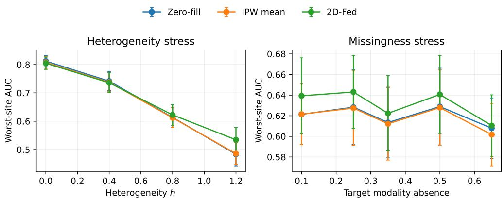  
Figure 4: Compact simulation trends for the three incomplete-sample fusion methods. The legend label 2D-Fed denotes the proposed 2D-FedSMKL method. Left: the robust objective separates from mean-risk alternatives as site heterogeneity increases. Right: the methods remain close at moderate modality absence, with only modest separation at severe absence. Error bars show standard deviations across matched replicates.

## 6.4. Design sensitivity of the worst-site gain

The primary design assigns the largest shift to the smallest site. Repeating the simulation with the largest shift assigned to the largest site leaves the worst-site contrast at $h = 1 . 2$ at $+ 0 . 0 1 8 \ [ + 0 . 0 0 9 , + 0 . 0 2 8 ]$ and removes it at $h \ = \ 0 . 8 \ ( 0 . 0 0 0 \ [ - 0 . 0 0 4 , + 0 . 0 0 4 ] )$ . With site sizes (187, 187, 186), the contrast is $+ 0 . 0 1 4 \left[ + 0 . 0 0 5 , + 0 . 0 2 2 \right]$ at $h = 0 . 8 \mathrm { ~ a n d ~ } + 0 . 0 2 5 \left[ + 0 . 0 1 4 , + 0 . 0 3 5 \right]$ at $h = 1 . 2$ . The mechanism therefore does not depend on the smallest site being the hardest, or on unequal site sizes; its magnitude does. Supplementary Material S1 reports the full design comparison.

## 7. Public-data multiclass validation

## 7.1. Datasets, representations and source-only validation

MHEALTH provides wearable signals from 10 participants performing 12 activities [16, 17]. We extract nonoverlapping 2-s windows and use four blocks (chest acceleration, ECG, ankle and wrist sensing), retaining 55 coordinates after training-fitted reduction. Each participant is a statistical site. Within participant/activity, the earliest 70% of windows train the model and the remainder test it (2335/1020 windows); this evaluates later windows from seen participants. UCI HAR provides six smartphone activities from 30 volunteers [46, 47]. We retain its oficial subject-disjoint 7352/2947-window split, assign subjects to five fixed silos, and reduce accelerometer/non-gyroscope and gyroscope blocks to 25 PCA coordinates each. Test subjects are held out, while the five silos are constructed subject groups. MHEALTH therefore has 10 participant sites and HAR has five constructed silos; the two definitions follow the available grouping variables and are not equivalent.

Both datasets are originally complete. We impose site- and baselinedependent MAR absence, keep the first block observed, and fit observation propensities on training masks. Primary evaluation uses 35% target optionalblock absence and ten matched masks. Scaling and PCA are fitted exclusively within each inner-training fold for validation, then refitted on the full sourcetraining partition for outer testing. HAR uses raw-block scaling followed by PCA, without subsequent PCA-coordinate scaling. Standardization and PCA are applied block by block, so a custodian that holds one block can compute them locally; they are fitted here on complete source modalities before controlled removal, so the benchmark evaluates decision fusion conditional on those maps and does not model representation learning under missingness. Because the observed blocks are standardized, zero filling is mean imputation on these benchmarks. The theoretical risk bound covers binary learning with fixed maps; the benchmark tests the multiclass extension empirically.

The source-only grids select $\rho = 0 . 1 2$ for MHEALTH and 0.20 for HAR, SVM C = 10 and 1, and FedAvg/FedProx learning rate 0.05 with 350 and 200 rounds, respectively. Five local steps and FedProx coeficient 0.1 are fixed. All final primary smooth models and the robustness grid use a uniform 1400- round cap after training-objective/gradient diagnostics of the 350-round pilot. Other smooth parameters are fixed. Supplementary Material S2 specifies their values, the folds, candidate grids, selection rule, seeds and numerical diagnostics. Model selection uses inner validation only; outer test labels are reserved for final evaluation.

## 7.2. Comparators and primary results

References are pooled linear SVM [18], complete-case smooth Crammer– Singer (CS) classification [11, 19, 21], FedAvg-CS [37], FedProx-CS [12], Zerofill SMKL [20], IPW mean SMKL [20, 23], and an infeasible full-modality oracle. Complete-case CS trains on fully observed rows with no MKL penalty and uses zero-filled inference on the common masked test population. Its comparison jointly reflects training-row selection, regularization, and test-time zero filling. The centralized and horizontal methods are predictive references; the separate feature-custodian constraint is assessed by the row/column message-interface experiment. The same-interface computational control is reported in Section 6 and Supplementary Material S3. External modalitycompletion, hallucination and distillation baselines are not included; the conditional-imputation instantiation is part of the method and is compared in Section 7.4. The remaining comparison isolates training-row selection, mean imputation, availability correction, aggregation and horizontal federated training.

Table 2 reports the inverse-probability instantiation; the validation-selected configuration is reported in Section 7.4.

On MHEALTH, mean worst-site macro-F1 is 0.857 for the IPW instantiation of 2D-FedSMKL, 0.856 for Zero-fill (mean-imputation) SMKL, 0.850 for IPW mean SMKL, and 0.856 for FedAvg-CS. The paired diferences are small and their intervals include zero: $\left[ - 0 . 0 1 0 , + 0 . 0 2 4 \right]$ against IPW mean SMKL and $[ - 0 . 0 1 7 , + 0 . 0 1 8 ]$ against FedAvg-CS. The intervals therefore bound a possible diference rather than establish one. The oracle in Table 2 is fitted once on unmasked data, so its standard deviation across masks is zero.

On HAR, the corresponding worst-site values are 0.787, 0.777, 0.787, and 0.788. The IPW instantiation improves on mean imputation by 0.010 (95% interval $\left[ + 0 . 0 0 6 , + 0 . 0 1 4 \right] )$ , but its intervals against IPW mean SMKL, $[ - 0 . 0 0 2 , + 0 . 0 0 2 ]$ , and against FedAvg-CS, $\left[ - 0 . 0 0 6 , + 0 . 0 0 3 \right]$ , include zero. The gain over mean imputation therefore does not extend to the mean-risk MKL or horizontal references on this benchmark. The paired diferences and their 95% mask-conditional intervals are reported in Supplementary Material S2. These intervals describe variation across controlled masks on fixed samples and representations, without multiplicity adjustment; they do not extend to new sites or the population.

Table 2: Public-data results with fold-fitted preprocessing for source validation and final source-only representations, under 35% controlled MAR block absence. Entries are mean (sample SD) over ten matched masks. Zero-fill SMKL, and the zero-filled inference of complete-case CS, place an absent block at its observed training mean, which is mean imputation on standardized blocks. The oracle uses unmasked data and is fitted once, so its SD is zero across masks.
<table><tr><td>Method</td><td>Mean macro-F1</td><td>Worst-site macro-F1</td><td>Mean BA</td><td>Worst-site BA</td></tr><tr><td colspan="5">MHEALTH</td></tr><tr><td>Pooled linear SVM</td><td>0.949 (0.007)</td><td>0.849 (0.025)</td><td>0.949 (0.007)</td><td>0.859 (0.027)</td></tr><tr><td>Complete-case CS</td><td>0.763 (0.021)</td><td>0.587 (0.060)</td><td>0.767 (0.021)</td><td>0.592 (0.062)</td></tr><tr><td>FedAvg-CS</td><td>0.925 (0.012)</td><td>0.856 (0.029)</td><td>0.925 (0.012)</td><td>0.858 (0.028)</td></tr><tr><td>FedProx-CS</td><td>0.924 (0.012)</td><td>0.856 (0.029)</td><td>0.925 (0.012)</td><td>0.858 (0.028)</td></tr><tr><td>Zero-fill SMKL</td><td>0.927 (0.011)</td><td>0.856 (0.032)</td><td>0.927 (0.011)</td><td>0.855 (0.033)</td></tr><tr><td>IPW mean SMKL</td><td>0.924 (0.009)</td><td>0.850 (0.032)</td><td>0.925 (0.009)</td><td>0.850 (0.030)</td></tr><tr><td>2D-FedSMKL (IPW)</td><td>0.921 (0.013)</td><td>0.857 (0.027)</td><td>0.922 (0.013)</td><td>0.860 (0.028)</td></tr><tr><td>Oracle full SMKL</td><td>0.988 (0.000)</td><td>0.953 (0.000)</td><td>0.988 (0.000)</td><td>0.954 (0.000)</td></tr><tr><td colspan="5">UCI-HAR</td></tr><tr><td>Pooled linear SVM</td><td>0.885 (0.005)</td><td>0.772 (0.012)</td><td>0.885 (0.005)</td><td>0.775 (0.011)</td></tr><tr><td>Complete-case CS</td><td>0.858 (0.006)</td><td>0.775 (0.012)</td><td>0.862 (0.005)</td><td>0.787 (0.011)</td></tr><tr><td>FedAvg-CS</td><td>0.881 (0.003)</td><td>0.788 (0.009)</td><td>0.881 (0.003)</td><td>0.790 (0.009)</td></tr><tr><td>FedProx-CS</td><td>0.881 (0.003)</td><td>0.788 (0.009)</td><td>0.881 (0.003)</td><td>0.790 (0.009)</td></tr><tr><td>Zero-fill SMKL</td><td>0.884 (0.003)</td><td>0.777 (0.006)</td><td>0.884 (0.003)</td><td>0.781 (0.006)</td></tr><tr><td>IPW mean SMKL</td><td>0.885 (0.004)</td><td>0.787 (0.010)</td><td>0.885 (0.004)</td><td>0.790 (0.010)</td></tr><tr><td>2D-FedSMKL (IPW)</td><td>0.884 (0.004)</td><td>0.787 (0.010)</td><td>0.884 (0.004)</td><td>0.790 (0.010)</td></tr><tr><td>Oracle full SMKL</td><td>0.908 (0.000)</td><td>0.826 (0.000)</td><td>0.907 (0.000)</td><td>0.829 (0.000)</td></tr></table>

## 7.3. Component stress tests and numerical scope

A separate prespecified 2 × 2 study crosses mean/robust aggregation with zero-fill/IPW at 10%, 35% and 65% absence, using 20 matched masks per level, a common $\rho = 0 . 0 5$ , and a 350-round budget. Figure 5 displays the paired component contrasts and their unadjusted 95% intervals at 35% and 65% absence. For robust aggregation under IPW, the paired gains are +0.0157 and +0.0196 on MHEALTH at 35% and 65% absence, respectively, but only +0.0006 and +0.0038 on HAR. The point estimates are larger on MHEALTH and grow with absence there, but the intervals are unadjusted and the study contains 24 contrasts, so we read these contrasts as descriptive. For IPW relative to zero filling under robust aggregation, the corresponding diferences are −0.0022 and +0.0004 on MHEALTH, compared with +0.0056 and +0.0080 on HAR. The estimated interaction is small relative to its uncertainty, so robust aggregation and IPW correction show no clear joint efect. Full paired intervals, including the mean-risk contrasts, are provided in Supplementary Material S2.

The primary protocol and the component study use diferent temperatures.

Validation selects $\rho = 0 . 1 2$ for MHEALTH and 0.20 for HAR, values at which the log-sum-exp aggregate is close to mean aggregation; the primary robustversus-mean contrasts are correspondingly small. The component study uses $\rho = 0 . 0 5$ , where the robust term carries more influence. The component study therefore shows that the mechanism operates at smaller $\rho ;$ it does not show that the selected operating point improves worst-site performance. Re-running the validation grid on ten masks at the full 1400-round budget selects $\rho = 0 . 0 8$ for MHEALTH (0.8169, against 0.8168 at 0.12) and $\rho = 0 . 2 0$ for HAR (Supplementary Material S2); the selection is therefore stable, and the smaller- $- \rho$ gain seen on the test masks is not selected by validation. The selection is stable, and the smaller- $- \rho$ gain seen on the test masks is not selected by validation.

The efect of MKL is dataset-dependent: on MHEALTH at 65% absence, removing the group-kernel penalty raises worst-site macro-F1 from 0.787 to 0.806 (full minus no-MKL: −0.0191, interval $\left[ - 0 . 0 2 8 9 , - 0 . 0 0 9 3 \right] )$ , whereas the corresponding HAR diference is small $( + 0 . 0 0 1 9 )$ . The paired intervals are reported in Supplementary Material S2. Coeficient-norm shares summarize fitted modality weights and are interpreted descriptively. Propensity clipping and deliberate covariate omission are audited on unchanged masks in S2. All 620 secondary fits reach their 350-round cap. Their terminal-gradient diagnostics and the primary three-mask 350/1400-round budget comparison are reported in Supplementary Material S2; the component results are therefore interpreted as fixed-budget comparisons.

## 7.4. Validation-selected correction

The correction is selected on validation data. For each dataset, both instantiations are fitted on the inner-training partition at the temperature validated for the inverse-probability instantiation $( \rho = 0 . 1 2$ for MHEALTH, 0.20 for UCI-HAR; 1400 rounds) and compared on ten inner-validation masks (seeds 20261131–20261140; Supplementary Material S2). Conditional imputation is selected on both: 0.8282 against 0.8168 on MHEALTH and 0.5769 against 0.5549 on UCI-HAR. The selection uses validation data only; the test masks play no part.

Table 3 reports the selected model on the ten test masks. On MHEALTH it attains 0.882, against 0.856 for mean imputation in Table 2, 0.857 for the IPW instantiation and 0.850 for IPW mean. The paired diferences are +0.026 [−0.000, +0.052] against mean imputation, +0.032 [+0.008, +0.056] against IPW mean, +0.025 [+0.008, +0.043] against the IPW instantiation, and +0.026 [+0.000, +0.052] against the horizontal FedAvg reference. On UCI-HAR the selected model attains 0.787; the intervals against IPW mean, the IPW instantiation and FedAvg-CS are $[ - 0 . 0 0 9 , + 0 . 0 0 8 ] , [ - 0 . 0 0 9 , + 0 . 0 0 8 ]$ and $\left[ - 0 . 0 0 8 , + 0 . 0 0 5 \right]$ , while the diferences against mean imputation, +0.010 [+0.001, +0.018], and against the pooled linear SVM, +0.015 [+0.007, +0.022], exclude zero.

The correction matters: validation prefers imputation on both benchmarks, and on MHEALTH the selected model is significantly better than the IPW instantiation and IPW mean; the diference from the FedAvg reference is borderline, with interval $[ + 0 . 0 0 0 , + 0 . 0 5 2 ]$ . The margin over mean imputation is positive but borderline on MHEALTH ([−0.000, +0.052]) and significant on UCI-HAR, so the selected model is competitive but not uniformly superior. The risk analysis of Section 5 covers the IPW instantiation, whose score remains unbiased under MAR. The selected imputation instantiation is evaluated empirically; its risk is not covered by that bound, and imputation requires the always-observed block at the missing block’s custodian, whose communication and privacy costs are not analysed here.

Two further references were run at the 350-round budget, each on the masks of the comparison it supports. A modality-dropout training baseline (random block removal during training, three augmented copies, 20 masks) attains 0.861 on MHEALTH and 0.772 on UCI-HAR, below the selected model on the same masks (0.884 and 0.784; Supplementary Material S2). A late-fusion reference (one smooth classifier per block, scores averaged over observed blocks) attains 0.827 on MHEALTH and 0.794 on UCI-HAR on the ten primary masks; the selected model is +0.056 [+0.039, +0.072] above it on MHEALTH and −0.006 [−0.012, +0.000] on UCI-HAR, so the multiplekernel layer contributes where several heterogeneous blocks are present and is indistinguishable when only two blocks are available.

Table 3: Availability correction under the primary protocol (35% target absence, ten masks, 1400 rounds). Worst-site macro-F1 and paired diference against IPW mean, with the 95% interval over ten masks. The last row is the configuration selected on validation data and is the model summarised in the abstract.
<table><tr><td>Method</td><td>Worst-site macro-F1</td><td>∆ vs IPW mean</td></tr><tr><td colspan="3">MHEALTH</td></tr><tr><td>IPW mean</td><td>0.850</td><td></td></tr><tr><td>2D-FedSMKL (IPW, robust)</td><td>0.857</td><td>+0.007 [-0.010, +0.024]</td></tr><tr><td>Conditional imputation</td><td>0.877</td><td>+0.027 [+0.008, +0.047]</td></tr><tr><td>Conditional imputation + robust</td><td>0.882</td><td>+0.032 [+0.008, +0.056]</td></tr><tr><td colspan="3">UCI-HAR</td></tr><tr><td>IPW mean</td><td>0.787</td><td></td></tr><tr><td>2D-FedSMKL (IPW, robust)</td><td>0.787</td><td>+0.000 [-0.002, +0.002]</td></tr><tr><td>Conditional imputation</td><td>0.785</td><td>-0.002 [-0.008, +0.004]</td></tr><tr><td>Conditional imputation + robust</td><td>0.787</td><td>-0.000 [-0.009, +0.008]</td></tr></table>

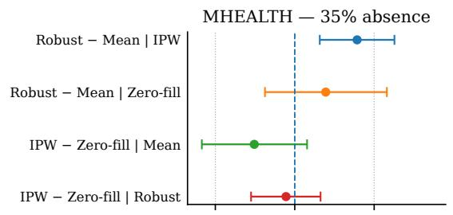

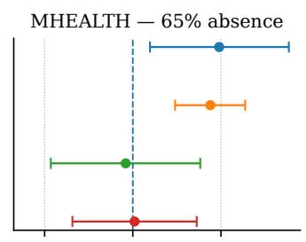

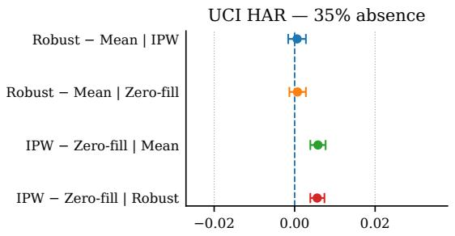

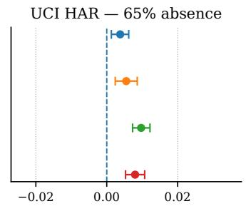  
Paired difference in worst-site macro-F1

Figure 5: Paired component efects in the secondary factorial study under controlled MAR block absence. Panels correspond to MHEALTH and UCI HAR at 35% and 65% target absence. Points are paired mean diferences in worst-site macro-F1 and horizontal bars are unadjusted 95% paired t intervals over 20 matched masks. Positive values favor the first-listed component: robust minus mean aggregation, conditional on IPW or zero filling; and IPW minus zero filling, conditional on mean or robust aggregation. The vertical dashed line denotes no diference. The figure focuses on the absence levels for which paired inferential contrasts are tabulated.

## 8. Discussion and conclusion

This paper develops 2D-FedSMKL, a hybrid federated decision layer for multimodal fusion with sample and feature partitions. For fixed representations the objective is convex and smooth; under the partition and exact-reduction conditions of Theorem 2 the distributed updates coincide with the centralized iterates; the curvature bounds and accelerated rate characterize optimization on the stated region; and the risk result is restricted to the binary, oracle-propensity setting. In the simulations, worst-site aggregation improves worst-site performance under heterogeneity, and the gain survives the reversed and size-balanced designs. On the public benchmarks the correction is selected on validation data, and the selected model is never significantly worse than the strongest reference at the worst site. On MHEALTH it is above mean imputation, the inverse-probability instantiation and the horizontal reference; on UCI-HAR the diferences from the mean-risk and horizontal references include zero.

The component analyses qualify these gains and delimit the evidence. The correction matters more than the aggregation rule on MHEALTH: validation selects conditional imputation on both benchmarks, and the selected model is above the inverse-probability instantiation on MHEALTH. The group-kernel penalty helps on UCI-HAR and hurts MHEALTH at 65% absence, and the robust term is visible only at the smaller temperature of the component study. Four limits bound the evidence: the masks are synthetic MAR generated by the same logistic form as the fitted model, so misspecified and missing-not-atrandom mechanisms are untested; the representations are fitted on complete sources before masking; no distillation or hallucination baseline is included; and the risk analysis covers the inverse-probability instantiation rather than the selected one, whose imputation step also adds an unmodelled modelselection step. The communication audit is a single-process emulation, the trust model assumes non-colluding parties, and the algorithm is synchronous.

Future work will study naturally incomplete multimodal data, federated representation learning under missingness, and misspecified or missing-notat-random propensities. A risk analysis for the imputation instantiation, a selection rule that accounts for validation uncertainty, and comparisons with distillation methods are the next methodological steps. An asynchronous implementation would require explicit delay assumptions and a separate convergence analysis.

## CRediT authorship contribution statement

Xiaofei Wu: Conceptualization, Methodology, Software, Validation, Formal analysis, Investigation, Data curation, Writing – original draft, Visualization. Rongmei Liang: Data curation, Formal analysis, Investigation, Writing – review & editing. Jian Qing Shi: Conceptualization, Methodology, Supervision, Writing – review & editing, Funding acquisition, Project administration.

## Declaration of competing interest

The authors declare that they have no known competing financial interests or personal relationships that could have appeared to influence the work reported in this paper.

## Declaration of generative AI and AI-assisted technologies in the manuscript preparation process

OpenAI Codex assisted with text, proof drafts, experimental code, and figure-generation code. All authors have reviewed and approved the final manuscript.

## Funding

Jian Qing Shi’s work was supported in part by the National Key R&D Program of China (Grant No. 2023YFA1011400), the Guangdong Higher Education Upgrading Plan (Grant No. 0400008-26), and the BNBU Research Grant (Grant No. R700105-27).

## Data and code availability

The raw MHEALTH and Human Activity Recognition Using Smartphones data are publicly available from the UCI Machine Learning Repository under DOIs 10.24432/C5TW22 and 10.24432/C54S4K, respectively. No new clinical or participant data were collected for this study. Reproduction code, simulation outputs, deterministic seeds, derived feature caches, validation indices, sample-level primary predictions and raw benchmark result tables are available at the project repository https://github.com/xfwu1016/2D-FedSMKL (release v24.8). The repository identifies the exact revision supporting the present tables.

## Supplementary Material

This supplement reports simulation stress tests, public-benchmark tuning and diagnostics, communication costs including backtracking objective passes, and proofs accompanying the hybrid federated multimodal fusion method 2D-FedSMKL studied in the main manuscript.

Notation. S denotes statistical sites and A computational row groups; these need not coincide. Section 3 of the main text defines the feature, parameter and correction notation used in the proofs. Terminology note. The hybrid federated setting uses the two-dimensional sample–feature layout defined in the main manuscript. Throughout the figures in this Supplementary Material, 2D-Fed is the compact legend label for the proposed 2D-FedSMKL method.

## S1. Additional simulation diagnostics

## S1.1. Data-generating process and evaluation population

The simulations use the following fixed design, implemented in code/ simulate\_experiments.py. For site $s \in \{ 1 , 2 , 3 \}$ , draw $z \sim N ( h \mu _ { s } , I _ { 5 } )$ 2 where the rows of the mean matrix are

$$
\left( \begin{array} { c c c c c } { { 0 } } & { { 0 } } & { { 0 } } & { { 0 } } & { { 0 } } \\ { { . 3 5 } } & { { - . 2 0 } } & { { . 1 5 } } & { { 0 } } & { { . 1 0 } } \\ { { - . 3 0 } } & { { . 3 0 } } & { { - . 1 0 } } & { { . 2 0 } } & { { - . 1 5 } } \end{array} \right) .
$$

Set $\theta _ { 0 } = ( 1 , - . 8 5 , . 7 0 , . 5 0 , - . 4 0 ) ^ { \top }$ , and let the rows of D be $( 0 , 0 , 0 , 0 , 0 )$ $( - . 3 5 , . 4 5 , . 1 0 , - . 2 0 , . 1 5 )$ and $( - 1 , 1 . 1 0 , - . 9 0 , . 4 0 , . 1 0 )$ . The label is

$$
y = 2 \mathbb { I } \{ z ^ { \top } ( \theta _ { 0 } + h D _ { s } ) + \xi > c _ { s } \} - 1 , \qquad c = ( . 0 5 , - . 1 0 , . 1 5 ) ,
$$

with independent $\xi \sim N ( 0 , \sigma _ { y } ^ { 2 } )$ The archived design uses $\sigma _ { y } ~ = ~ 1 . 2 5$ in training and 1.20 in testing. This small train–test noise change is part of the predictive stress design; the experiment is not a direct verification of an i.i.d. population-risk theorem.

For modality dimensions $d \ = \ ( 8 , 1 2 , 1 6 , 1 2 )$ , generate fixed matrices $A _ { m } \in \mathbb { R } ^ { 5 \times d _ { m } }$ with independent $N ( 0 , 1 / 5 )$ entries using NumPy seed 20260808. Measurements are

$$
x _ { m } = \{ 1 + . 0 8 h ( s - 2 ) \} z ^ { \top } A _ { m } + h u _ { s m } + e _ { m } ,
$$

where $u _ { s m }$ has independent $N ( 0 , . 2 2 ^ { 2 } )$ entries and is fixed using seed $9 1 0 0 +$ $1 0 0 ( s - 1 ) + ( m - 1 ) ; e _ { m }$ has independent $N \{ 0 , ( . 6 0 + . 1 0 m ) ^ { 2 } \}$ entries. Training site sizes are (360, 140, 60) and test sizes are (300, 300, 300). For replicate seed b, training and test site draws use $b + 3 7 ( s - 1 )$ and $b + 1 0 0 0 0 + 5 3 ( s - 1 )$ , respectively.

Modality 1 is always observed. Standardize its coordinates using training means and standard deviations and use its first three coordinates in the observation model. For $m = 2 , 3 , 4$ , set

$$
\begin{array} { r l } & { u _ { s m } = \mathrm { l o g i t } ( 1 - r ) + o _ { m } + \gamma _ { s m } + . 3 5 x _ { 1 } ^ { ( 1 ) } - . 2 5 x _ { 2 } ^ { ( 1 ) } + . 1 5 x _ { 3 } ^ { ( 1 ) } , } \\ & { p _ { s m } = \mathrm { c l i p } [ \sigma ( u _ { s m } ) , . 0 8 , . 9 8 ] . } \end{array}
$$

where r is the target absence setting, $( o _ { 2 } , o _ { 3 } , o _ { 4 } ) \ : = \ : ( . 3 5 , 0 , - . 3 5 )$ , and the rows of $( \gamma _ { s m } ) _ { m = 2 , 3 , 4 ; s = 1 , 2 , 3 }$ are $( 0 , 0 , 0 ) , ( 0 , - . 1 5 , - . 2 5 )$ and $( 0 , . 2 5 , - . 1 0 )$ . The target setting is not an exactly calibrated realized absence fraction. Bernoulli masks use seed $b + 8 8 8 8$ . A ridge-logistic observation model with intercept, the same three baseline coordinates and two site indicators is fitted to the training masks; its ridge is $1 0 ^ { - 3 }$ and its intercept is unpenalized. Estimated propensities are clipped to $[ . 1 0 , . 9 8 ]$ . The true-propensity lower bound is .08, not the estimated clipping threshold .10.

Each modality is standardized using its observed training rows. Zero-fill and IPW variants multiply these coordinates by $r _ { m }$ and $r _ { m } / \widehat { p } _ { m }$ , respectively; because the coordinates are centered, the zero-fill variant is mean imputation. Complete-case SMKL trains on rows with all modalities observed, retains the same SMKL penalty, and predicts all masked test rows using zero-filled inputs. Thus its contrast combines training-row selection and inference adaptation. Fits with fewer than 30 training rows or fewer than two observed classes are omitted; all 14 omitted fits occur for complete-case training at 65% target absence. All methods are evaluated on the same 900 test rows in a replicate. All 786 successful replicate-level records are retained in the project repository, while this Supplementary Material reports their summaries. The Gaussian measurement model has no deterministic population feature bound, so these predictive experiments do not establish applicability of the bounded-feature theorem.

## S1.2. Reversed and size-balanced designs

The design-sensitivity experiments reuse the seeds and hyperparameters of the primary simulation: seeds 16000–16019 at $h = 0 . 8$ and 17000–17019 at $h = 1 . 2 ,$ , 35% absence, 20 replicates. In the reversed design the decisionboundary ofsets of the first and third sites are exchanged, so the largest site is the hardest; in the balanced design the training sizes are (187, 187, 186) with the original shift assignment. Table S1 reports the comparison.

Table S1: Design sensitivity of the simulation. Worst-site AUC at 35% absence (20 replicates); the last column is the paired diference of 2D-FedSMKL against IPW mean. Original assigns the largest decision-boundary shift to the smallest site; reversed assigns it to the largest site; balanced uses site sizes (187, 187, 186).
<table><tr><td>Design</td><td>h</td><td>2D-FedSMKL</td><td>IPW mean</td><td>Zero-fill</td><td>∆ vs IPW mean</td></tr><tr><td>Original</td><td>0.8</td><td>0.622</td><td>0.612</td><td>0.613</td><td>+0.010 [+0.003, +0.017]</td></tr><tr><td>Original</td><td>1.2</td><td>0.535</td><td>0.486</td><td>0.483</td><td>+0.049 [+0.038, +0.060]</td></tr><tr><td>Reversed</td><td>0.8</td><td>0.669</td><td>0.670</td><td>0.674</td><td>-0.000 [-0.004, +0.004]</td></tr><tr><td>Reversed</td><td>1.2</td><td>0.604</td><td>0.586</td><td>0.588</td><td>+0.018 [+0.009, +0.028]</td></tr><tr><td>Balanced</td><td>0.8</td><td>0.659</td><td>0.646</td><td>0.651</td><td>+0.014 [+0.005, +0.022]</td></tr><tr><td>Balanced 1.2</td><td></td><td>0.606</td><td>0.581</td><td>0.585</td><td>+0.025 [+0.014, +0.035]</td></tr></table>

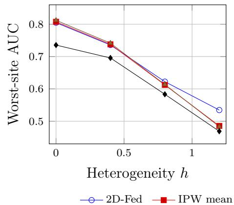

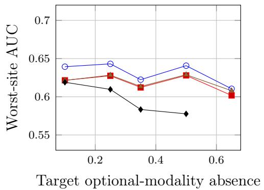  
2D-Fed IPW mean Zero fill Complete case  
Figure S1: Simulation stress tests. The legend label 2D-Fed denotes the proposed 2D-FedSMKL method. Left: site heterogeneity at 35% optional-modality absence. Right: controlled optional-modality absence at $h = 0 . 8 .$ . Points are means of 20 replicates.

Table S2: Paired improvement in worst-site AUC of 2D-FedSMKL over non-oracle baselines. Intervals are normal-approximation 95% confidence intervals over 20 matched replicates.
<table><tr><td>Missing</td><td>h</td><td>Comparator</td><td>AUC difference (95% CI)</td><td>Win rate</td></tr><tr><td>0.35</td><td>0.8</td><td>Complete-case SMKL</td><td>0.039 [0.023, 0.055]</td><td>85%</td></tr><tr><td>0.35</td><td>0.8</td><td>Zero-fill SMKL</td><td>0.009 [0.002, 0.016]</td><td>75%</td></tr><tr><td>0.35</td><td>0.8</td><td>IPW mean SMKL</td><td>0.010 [0.004, 0.016]</td><td>80%</td></tr><tr><td>0.35</td><td>1.2</td><td>Complete-case SMKL</td><td>0.066 [0.045, 0.086]</td><td>85%</td></tr><tr><td>0.35</td><td>1.2</td><td>Zero-fill SMKL</td><td>0.051 [0.041, 0.061]</td><td>100%</td></tr><tr><td>0.35</td><td>1.2</td><td>IPW mean SMKL</td><td>0.049 [0.039, 0.059]</td><td>100%</td></tr></table>

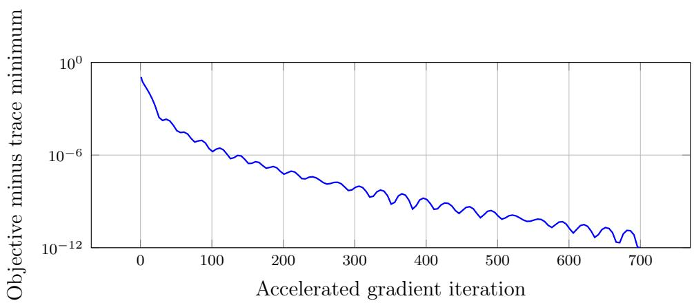  
Figure S2: Objective value minus the minimum observed over the complete reference trace, floored at $1 0 ^ { - 1 2 }$ for the logarithmic axis. The reference is the best observed value over the trace, not a known $J ^ { * }$ , and the plot is a numerical diagnostic.

Table S3: Numerical equivalence and estimated synchronous communication for twodimensional partitions.
<table><tr><td>Rows</td><td>Columns</td><td>Max. gradient error</td><td></td><td>KiB/round</td></tr><tr><td>1</td><td>1</td><td></td><td>4.34e-17</td><td>0.75</td></tr><tr><td>3</td><td>2</td><td></td><td>4.16e-17</td><td>11.00</td></tr><tr><td>3</td><td>4</td><td></td><td>4.51e-17</td><td>28.50</td></tr><tr><td>6</td><td>4</td><td></td><td>5.72e-17</td><td>30.75</td></tr><tr><td>9</td><td>8</td><td></td><td>1.04e-16</td><td>68.00</td></tr></table>

## S2. Public-data tuning and additional results

## S2.1. Representation fitting and source-only selection

All public-data experiments use the same source-training representations. MHEALTH has 2335 training and 1020 test windows, four blocks, and 55 retained coordinates. For each participant/activity, the earliest 70% of nonoverlapping 100-sample windows form the source-training set and the remainder form the test set. Thus participants are shared across partitions, and temporal dependence between adjacent windows remains possible. Within that sourcetraining set, an earlier 80%/later 20% split within participant/activity is used for validation. UCI HAR retains the oficial 7352/2947-window subjectdisjoint split, with two blocks and 50 retained coordinates. Its five trainingsubject silos are {1, 3, 5, 6}, {7, 8, 11, 14}, {15, 16, 17, 19}, {21, 22, 23, 25}, and {26, 27, 28, 29, 30}; test-subject silos are {2, 4}, {9, 10}, {12, 13}, {18, 20}, and {24}. Subjects 6, 14, 19, 25, and 30 are held out for inner validation, one per silo. The silos are constructed from the training subjects, so the split does not test generalization to unseen institutions.

For every inner split, blockwise means, standard deviations, and PCA are fitted exclusively on the inner-training subset and then applied to its validation subset. Final maps are refitted on the complete source-training partition and applied to the outer test partition. MHEALTH uses 15 summaries for chest acceleration, 10 for ECG, and 45 each for ankle and wrist sensing before reduction; blocks wider than 15 are reduced to 15 coordinates. HAR standardizes its 561 supplied features within the accelerometer/non-gyroscope and gyroscope blocks and retains 25 PCA coordinates per block. There is no additional standardization or whitening of the PCA coordinates. PCA uses randomized SVD with fixed seeds recorded in the script. Complete source modalities are available when these maps are fitted, before controlled removal. The experiment therefore evaluates decision fusion conditional on complete-source representations, rather than representation learning from naturally incomplete sources.

Three validation masks (integer seeds 20261131–20261133) are shared across candidates at 35% target absence. Candidate grids are

$$
\rho \in \{ 0 . 0 3 , 0 . 0 5 , 0 . 0 8 , 0 . 1 2 , 0 . 2 0 \} , \qquad C _ { \mathrm { s v m } } \in \{ 0 . 1 , 1 , 1 0 \} .
$$

FedAvg/FedProx learning rates are 0.01, 0.025 and 0.05 at 50 rounds, followed by selection among 50, 100, 200 and 350 rounds. Five local steps and the

FedProx coeficient 0.1 are fixed. Selection maximizes average validation worstsite macro-F1; ties use mean-site macro-F1 and then the smaller numeric candidate. The remaining smooth parameters are fixed: $\tau = 4 , \lambda _ { 0 } = 0 . 0 1 2$ $\lambda _ { 1 } = 0 . 0 0 3 5 , \epsilon = 1 0 ^ { - 4 }$ , and $\eta _ { b } = 0 . 0 5$ . After training-objective and gradient diagnostics of a uniform 350-round pilot, all final primary smooth models and the $\rho$ grid use a uniform 1400-round cap, fixed from those diagnostics rather than from test performance; SVM and FedAvg/FedProx selections remain frozen. The original relative-step stopping rule may terminate a fit earlier, so terminal gradient norms are reported alongside each fit.

Table S4: Frozen primary settings after source-only validation. Smooth hyperparameters not listed as selected are fixed as specified in S2.
<table><tr><td>Dataset</td><td>ρ</td><td>SVM C</td><td>Fed learning rate</td><td>Fed rounds</td></tr><tr><td>MHEALTH</td><td>0.12</td><td>10</td><td>0.05</td><td>350</td></tr><tr><td>UCI-HAR</td><td>0.20</td><td>1</td><td>0.05</td><td>200</td></tr></table>

## S2.2. Mask generation, correction, and evaluation population

For optional block index $m = 1 , \ldots , M - 1$ (the always-observed block has index zero), let z be its first three baseline-block coordinates, standardized using source-training moments, and let $O _ { s }$ be evenly spaced between −0.35 and 0.35 across sites. Generate independent Bernoulli observations conditional on these covariates with

$$
p _ { s m } ( z ) = \mathrm { l o g i t } ^ { - 1 } \{ \alpha _ { m } + ( 0 . 3 5 , - 0 . 2 5 , 0 . 1 5 ) ^ { \top } z + ( 1 + 0 . 1 5 m ) o _ { s } \} .
$$

The intercept $\alpha _ { m }$ is numerically calibrated to the requested average sourcetraining observation rate. Training-fitted ridge-logistic propensities use an intercept, the three baseline predictors and site indicators, with ridge coefficient 10<sup>−3</sup> and unpenalized intercept. Fitted probabilities are clipped to [0.10, 0.98] for the default correction and applied to training and test scores. The generating probabilities are logistic probabilities without this clipping; empirical minima are documented, not treated as a population positivity proof. Masks and all correction models are regenerated for each seed. The primary study uses seeds 20260820–20260829. Every feasible method is scored on the same masked test rows. Complete-case CS trains on fully observed rows with $\lambda _ { 1 } = 0$ , then zero-fills unavailable test blocks, which on standardized blocks is mean imputation; it does not restrict evaluation to complete test rows. Thus its comparison changes selection, regularization and inference handling together and does not isolate the efect of discarding training rows.

Table S5: Paired diferences in worst-site macro-F1 after fold-fitted source validation: 2D-FedSMKL minus comparator. Intervals are 95% paired t intervals over ten matched masks, conditional on the fixed benchmark samples.
<table><tr><td>Dataset</td><td>Comparator</td><td>Difference</td><td>95% interval</td></tr><tr><td>MHEALTH</td><td>Zero-fill SMKL</td><td>+0.001</td><td>[-0.024, +0.025]</td></tr><tr><td>MHEALTH</td><td>IPW mean SMKL</td><td>+0.007</td><td>[-0.010, +0.024]</td></tr><tr><td>MHEALTH</td><td>2D-FedSMKL no MKL</td><td>-0.001</td><td>[-0.014, +0.011]</td></tr><tr><td>MHEALTH</td><td>Complete-case CS</td><td>+0.270</td><td>[+0.225, +0.315]</td></tr><tr><td>MHEALTH</td><td>FedAvg-CS</td><td>+0.000</td><td>[-0.017, +0.018]</td></tr><tr><td>MHEALTH</td><td>FedProx-CS</td><td>+0.000</td><td>[-0.017, +0.018]</td></tr><tr><td>MHEALTH</td><td>Pooled linear SVM</td><td>+0.007</td><td>[-0.023, +0.038]</td></tr><tr><td>UCI-HAR</td><td>Zero-fill SMKL</td><td>+0.010</td><td>[+0.006, +0.014]</td></tr><tr><td>UCI-HAR</td><td>IPW mean SMKL</td><td>+0.000</td><td>[-0.002, +0.002]</td></tr><tr><td>UCI-HAR</td><td>2D-FedSMKL no MKL</td><td>+0.003</td><td>[+0.000, +0.006]</td></tr><tr><td>UCI-HAR</td><td>Complete-case CS</td><td>+0.012</td><td>[+0.006, +0.018]</td></tr><tr><td>UCI-HAR</td><td>FedAvg-CS</td><td>-0.001</td><td>[-0.006, +0.003]</td></tr><tr><td>UCI-HAR</td><td>FedProx-CS</td><td>-0.001</td><td>[-0.006, +0.003]</td></tr><tr><td>UCI-HAR</td><td>Pooled linear SVM</td><td>+0.015</td><td>[+0.012, +0.017]</td></tr></table>

Table S6: Final primary smooth-model diagnostics over ten masks. The no-MKL fit is an additional primary ablation. Norms and certificates concern the empirical training objective; reaching a budget or a relative-step rule is not a claim of exact minimization. 2D-Fed denotes 2D-FedSMKL.
<table><tr><td>Dataset</td><td>Method</td><td>Worst F1 (SD)</td><td>Gradient-norm range</td><td>Max gap bound</td></tr><tr><td>MHEALTH</td><td>Zero-fill</td><td>0.856 (0.032)</td><td>[1.44e-05, 7.02e-05]</td><td>4.10e-06</td></tr><tr><td>MHEALTH</td><td>IPW mean</td><td>0.850 (0.032)</td><td>[1.43e-04, 1.61e-04]</td><td>2.16e-05</td></tr><tr><td>MHEALTH</td><td>2D-Fed</td><td>0.857 (0.027)</td><td>[1.33e-04, 1.62e-04]</td><td>2.18e-05</td></tr><tr><td>MHEALTH</td><td>No-MKL</td><td>0.858 (0.031)</td><td>[1.93e-04, 2.17e-04]</td><td>3.94e-05</td></tr><tr><td>UCI-HAR</td><td>Zero-fill</td><td>0.777 (0.006)</td><td>[3.54e-04, 3.94e-04]</td><td>1.30e-04</td></tr><tr><td>UCI-HAR</td><td>IPW mean</td><td>0.787 (0.010)</td><td>[3.40e-04, 4.12e-04]</td><td>1.41e-04</td></tr><tr><td>UCI-HAR</td><td>2D-Fed</td><td>0.787 (0.010)</td><td>[3.40e-04, 4.12e-04]</td><td>1.42e-04</td></tr><tr><td>UCI-HAR</td><td>No-MKL</td><td>0.784 (0.011)</td><td>[3.80e-04, 4.40e-04]</td><td>1.61e-04</td></tr></table>

Raw metrics, per-site results, sample-level predictions and validation grids are in results\_revision; the independent confusion-matrix audit reconstructs every primary metric from those predictions. Paired t intervals describe variation across masks conditional on these benchmark samples, their split and their representations, without multiplicity adjustment; they do not extend to new sites or the population.

## S2.3. Factorial component and propensity stress studies

The separate, prespecified component study holds the representation and all common parameters fixed, including $\rho = 0 . 0 5$ and a 350-round cap. It crosses mean/robust site aggregation with zero-filled/IPW scores at 10%, 35% and 65% target absence, using 20 matched masks (seeds 20261101–20261120). At 35% and 65% it also removes the group penalty. These are controlled finite-budget component comparisons, not additional evaluations using the primary study’s selected $\rho$ and 1400-round cap. The 2D-Fed legend label denotes robust IPW with the group penalty, namely 2D-FedSMKL.

Table S7: Fixed-representation component comparison. Entries are mean (SD) worst-site macro-F1 over 20 matched masks; settings are frozen before evaluation.
<table><tr><td colspan="4">MHEALTH</td><td colspan="3">UCI HAR</td></tr><tr><td>Method</td><td>35%</td><td>65%</td><td></td><td>35%</td><td></td><td>65%</td></tr><tr><td>Mean zero</td><td>0.857 (0.027)</td><td>0.769</td><td>(0.031)</td><td>0.775</td><td>(0.008)</td><td>0.742 (0.005)</td></tr><tr><td>Robust zero</td><td>0.865 (0.021)</td><td></td><td>0.787 (0.025)</td><td>0.776 (0.008)</td><td></td><td>0.747 (0.006)</td></tr><tr><td>Mean IPW</td><td>0.847 (0.027)</td><td></td><td>0.767 (0.039)</td><td>0.781 (0.009)</td><td></td><td>0.751 (0.007)</td></tr><tr><td>Robust IPW</td><td>0.863 (0.030)</td><td></td><td>0.787 (0.031)</td><td>0.781 (0.008)</td><td></td><td>0.755 (0.006)</td></tr><tr><td>Robust IPW no-MKL</td><td>0.863 (0.029)</td><td></td><td>0.806 (0.024)</td><td>0.777 (0.010)</td><td></td><td>0.753 (0.007)</td></tr></table>

Table S8: Prespecified secondary component study with common $\rho = 0 . 0 5$ and a 350-round cap. Entries are paired diferences in worst-site macro-F1 over 20 matched masks with unadjusted 95% t intervals. Robust given IPW is robust minus mean risk under IPW, and analogously for the other simple efects. Interaction is (robust IPW minus mean IPW) minus (robust zero minus mean zero); MKL is full minus no-MKL under robust IPW. These settings are not selected by the nested primary validation.
<table><tr><td>Dataset</td><td>Absence</td><td>Contrast</td><td>Difference</td><td>95% interval</td></tr><tr><td>MHEALTH</td><td>35%</td><td>Robust given IPW</td><td>+0.0157</td><td>[+0.0063, +0.0251]</td></tr><tr><td>MHEALTH</td><td>35%</td><td>Robust given zero</td><td>+0.0078</td><td>[-0.0075, +0.0232]</td></tr><tr><td>MHEALTH</td><td>35%</td><td>IPW given mean</td><td>-0.0102</td><td>[-0.0234, +0.0031]</td></tr><tr><td>MHEALTH</td><td>35%</td><td>IPW given robust</td><td>-0.0022</td><td>[-0.0110, +0.0065]</td></tr><tr><td>MHEALTH</td><td>35%</td><td>Interaction</td><td>+0.0079</td><td>[-0.0060, +0.0219]</td></tr><tr><td>MHEALTH</td><td>35%</td><td>MKL given robust IPW</td><td>-0.0006</td><td>[-0.0105, +0.0092]</td></tr><tr><td>MHEALTH</td><td>65%</td><td>Robust given IPW</td><td>+0.0196</td><td>[+0.0039, +0.0354]</td></tr><tr><td>MHEALTH</td><td>65%</td><td>Robust given zero</td><td>+0.0176</td><td>[+0.0096, +0.0255]</td></tr><tr><td>MHEALTH</td><td>65%</td><td>IPW given mean</td><td>-0.0016</td><td>[-0.0186, +0.0153]</td></tr><tr><td>MHEALTH</td><td>65%</td><td>IPW given robust</td><td>+0.0004</td><td>[-0.0137, +0.0145]</td></tr><tr><td>MHEALTH</td><td>65%</td><td>Interaction</td><td>+0.0020</td><td>[-0.0154, +0.0195]</td></tr><tr><td>MHEALTH</td><td>65%</td><td>MKL given robust IPW</td><td>-0.0191</td><td>[-0.0289, -0.0093]</td></tr><tr><td>UCI-HAR</td><td>35%</td><td>Robust given IPW</td><td>+0.0006</td><td>[-0.0016, +0.0028]</td></tr><tr><td>UCI-HAR</td><td>35%</td><td>Robust given zero</td><td>+0.0007</td><td>[-0.0013, +0.0028]</td></tr><tr><td>UCI-HAR</td><td>35%</td><td>IPW given mean</td><td>+0.0058</td><td>[+0.0039, +0.0077]</td></tr><tr><td>UCI-HAR</td><td>35%</td><td>IPW given robust</td><td>+0.0056</td><td>[+0.0039, +0.0074]</td></tr><tr><td>UCI-HAR</td><td>35%</td><td>Interaction</td><td>-0.0001</td><td>[-0.0026, +0.0023]</td></tr><tr><td>UCI-HAR</td><td>35%</td><td>MKL given robust IPW</td><td>+0.0038</td><td>[+0.0012, +0.0065]</td></tr><tr><td>UCI-HAR</td><td>65%</td><td>Robust given IPW</td><td>+0.0038</td><td>[+0.0013, +0.0062]</td></tr><tr><td>UCI-HAR</td><td>65%</td><td>Robust given zero</td><td>+0.0055</td><td>[+0.0024, +0.0086]</td></tr><tr><td>UCI-HAR</td><td>65%</td><td>IPW given mean</td><td>+0.0097</td><td>[+0.0073, +0.0122]</td></tr><tr><td>UCI-HAR</td><td>65%</td><td>IPW given robust</td><td>+0.0080</td><td>[+0.0053, +0.0107]</td></tr><tr><td>UCI-HAR</td><td>65%</td><td>Interaction</td><td>-0.0017</td><td>[-0.0043, +0.0008]</td></tr><tr><td>UCI-HAR</td><td>65%</td><td>MKL given robust IPW</td><td>+0.0019</td><td>[-0.0003, +0.0041]</td></tr></table>

Table S9: Descriptive coeficient-norm shares at 65% absence in the secondary study: mean (SD) over 20 masks. Shares use smoothed modality Frobenius norms normalized to sum to one in both fits; no-MKL shares are post-fit summaries rather than optimized MKL weights. These are not causal importance measures.
<table><tr><td>Dataset</td><td>Penalty</td><td>Block 1</td><td>Block 2</td><td>Block 3</td><td>Block 4</td></tr><tr><td>MHEALTH</td><td>Full MKL</td><td>0.625 (0.009)</td><td>0.058 (0.008)</td><td>0.171 (0.009)</td><td>0.145 (0.007)</td></tr><tr><td>MHEALTH</td><td>No-MKL</td><td>0.554 (0.007)</td><td>0.103 (0.006)</td><td>0.186 (0.007)</td><td>0.156 (0.007)</td></tr><tr><td>UCI-HAR</td><td>Full MKL</td><td>0.789 (0.010)</td><td>0.211 (0.010)</td><td></td><td></td></tr><tr><td>UCI-HAR</td><td>No-MKL</td><td>0.761 (0.010)</td><td>0.239 (0.010)</td><td></td><td>1</td></tr></table>

Table S10: Terminal diagnostics for all 620 prespecified secondary fits, including sensitivity variants. Gradient norm and empirical objective-gap certificate are shown as median / maximum. For this strongly convex objective, $J ( \theta ) - J ^ { * } \leq \| \nabla J ( \theta ) \| ^ { 2 } / ( 2 \mu )$ with $\mu = \lambda _ { 0 } \eta _ { b } =$ 0.0006. The certificate concerns numerical optimization, not generalization; cap attainment is not itself convergence.
<table><tr><td>Dataset</td><td>Absence</td><td>Fits</td><td>At cap</td><td>Gradient norm</td><td>Gap certificate</td></tr><tr><td>MHEALTH</td><td>10%</td><td>80</td><td>80/80</td><td>0.00154 0.00177</td><td>0.00198 0.00261</td></tr><tr><td>MHEALTH</td><td>35%</td><td>100</td><td>100/100</td><td>0.00201 0.00253</td><td>0.00335 0.00532</td></tr><tr><td>MHEALTH</td><td>65%</td><td>130</td><td>130/130</td><td>0.00278 0.00573</td><td>0.00642 /0.0274</td></tr><tr><td>UCI-HAR</td><td>10%</td><td>80</td><td>80/80</td><td>0.00397 0.00422</td><td>0.0131 0.0148</td></tr><tr><td>UCI-HAR</td><td>35%</td><td>100</td><td>100/100</td><td>0.00395 0.00437</td><td>0.013 0.0159</td></tr><tr><td>UCI-HAR</td><td>65%</td><td>130</td><td>130/130</td><td>0.00689 0.00792</td><td>0.0396 0.0523</td></tr></table>

The interaction contrast is (robust IPW − mean IPW) − (robust zero − mean zero). It separates the two factors descriptively, rather than establishing an additive mechanism or a causal modality efect. Smoothed coeficientnorm weights sum to one and describe fitted blocks; rescaling or removing the penalty changes their interpretation. A penalty that stabilizes a coeficient pattern need not improve prediction.

At 65% absence, the first ten matched masks are reused for propensity sensitivity: clipping floors 0.05 and 0.20 replace 0.10, or the propensity model omits the baseline covariates and uses sites only. The mask realization stays unchanged. ESS is $\textstyle ( \sum _ { i } r _ { i } / \widehat { p _ { i } } ) ^ { 2 } / \sum _ { i } ( r _ { i } / \widehat { p _ { i } } ) ^ { 2 }$ , computed within each optional modality and divided by its observed training count. Reported averages are over modality-specific ESS ratios, rather than a pooled-record ESS.

Table S11: Propensity sensitivity at 65% absence using 10 matched masks. ESS ratio is the average modality-specific efective sample size divided by observed training records. Diferences compare each setting with baseline-plus-site propensity and clipping floor 0.10.
<table><tr><td>Dataset</td><td>Setting</td><td>Worst F1</td><td>Difference</td><td>Lower clipped</td><td>ESS ratio</td></tr><tr><td>MHEALTH</td><td>Full, 0.10</td><td>0.798</td><td>+0.000</td><td>0.0%</td><td>0.885</td></tr><tr><td>MHEALTH</td><td>Full, 0.05</td><td>0.798</td><td>+0.000</td><td>0.0%</td><td>0.885</td></tr><tr><td>MHEALTH</td><td>Full, 0.20</td><td>0.799</td><td>+0.001</td><td>4.7%</td><td>0.889</td></tr><tr><td>MHEALTH</td><td>Site-only, 0.10</td><td>0.796</td><td>-0.001</td><td>0.0%</td><td>0.963</td></tr><tr><td>UCI-HAR</td><td>Full, 0.10</td><td>0.754</td><td>+0.000</td><td>0.0%</td><td>0.887</td></tr><tr><td>UCI-HAR</td><td>Full, 0.05</td><td>0.754</td><td>+0.000</td><td>0.0%</td><td>0.887</td></tr><tr><td>UCI-HAR</td><td>Full, 0.20</td><td>0.754</td><td>+0.000</td><td>8.7%</td><td>0.908</td></tr><tr><td>UCI-HAR</td><td>Site-only, 0.10</td><td>0.754</td><td>-0.000</td><td>0.0%</td><td>0.972</td></tr></table>

Full quantiles, true generating-propensity minima, estimated-propensity quantiles, clipping fractions, RMSE and ESS are stored in component\_ propensity\_diagnostics.csv and its summaries. The diagnostics also

record the maximum deviation $e _ { p }$ and the resulting perturbation constant; Table S12 reports both. The sensitivity experiment is a local check under controlled MAR, not evidence of robustness to arbitrary misspecification or MNAR.  
Table S12: Observed propensity deviation and the perturbation constant of Corollary 2. $e _ { p } = \operatorname* { m a x } | \hat { p } - p |$ over training rows and optional modalities; $\Delta _ { p } = B _ { w } \kappa e _ { p } / p _ { \mathrm { m i n } } ^ { 2 }$ with $B _ { w }$ from Corollary 1 and $p _ { \operatorname* { m i n } } = 0 . 0 8 .$
<table><tr><td>Dataset</td><td> $e _ { p }$  min</td><td> $e _ { p }$  max</td><td> $\Delta _ { p }$  min</td><td> $\Delta _ { p }$  max</td><td> $B _ { w }$ </td></tr><tr><td>MHEALTH</td><td>0.0799</td><td>0.1617</td><td>11451.2</td><td>23164.9</td><td>25.88</td></tr><tr><td>UCI-HAR</td><td>0.0208</td><td>0.1460</td><td>8580.9</td><td>60116.9</td><td>18.30</td></tr></table>

## S2.4. Numerical budget sensitivity

Table S13: Numerical budget sensitivity on three prespecified matched masks. Changes are 1400-budget minus 350-budget values; gradients are terminal Euclidean norms. Diagnostic test metrics were not used to select the primary budget. This pilot diagnostic uses $\rho = 0 . 1 2$ for MHEALTH and 0.05 for HAR; the final primary HAR $\rho$ was subsequently reselected as 0.20. 2D-Fed denotes 2D-FedSMKL.
<table><tr><td>Dataset</td><td>Method</td><td> $\Delta J$ </td><td>||g350||</td><td>||91400∥|</td><td>Δ F1</td><td>Max |∆ F1|</td></tr><tr><td>MHEALTH</td><td>2D-Fed</td><td>-1.12e-04</td><td>2.04e-03</td><td>1.53e-04</td><td>+0.0000</td><td>0.0000</td></tr><tr><td>MHEALTH</td><td>IPW mean</td><td>-1.08e-04</td><td>1.99e-03</td><td>1.55e-04</td><td>+0.0000</td><td>0.0000</td></tr><tr><td>MHEALTH</td><td>Zero-fill</td><td>-2.13e-05</td><td>9.09e-04</td><td>5.67e-05</td><td>+0.0031</td><td>0.0093</td></tr><tr><td>UCI-HAR</td><td>2D-Fed</td><td>-4.69e-04</td><td>4.04e-03</td><td>3.48e-04</td><td>+0.0014</td><td>0.0056</td></tr><tr><td>UCI-HAR</td><td>IPW mean</td><td>-4.12e-04</td><td>3.84e-03</td><td>3.67e-04</td><td>+0.0025</td><td>0.0036</td></tr><tr><td>UCI-HAR</td><td>Zero-fill</td><td>-4.31e-04</td><td>3.98e-03</td><td>3.82e-04</td><td>+0.0010</td><td>0.0021</td></tr></table>

The diagnostic uses three fixed primary masks and the pilot temperatures: $\rho = 0 . 1 2$ for MHEALTH and 0.05 for HAR; the primary HAR temperature is 0.20. Small test-metric diferences can change with numerical accuracy and with the round budget. The final primary protocol uses the uniformly increased budget described above, while the factorial and message-interface experiments retain their common 350-round budgets. For positive $\mu ~ =$ $\lambda _ { 0 } \operatorname* { m i n } ( 1 , \eta _ { b } ) = 0 . 0 0 0 6$ , Supplementary Material S4.8 gives the empirical objective-gap upper bound $\| \nabla J ( \theta ) \| _ { 2 } ^ { 2 } / ( 2 \mu )$ . This can be conservative and is separate from predictive uncertainty and the binary population-risk bound.

## S2.5. Correction comparison and validation stability

The conditional-imputation instantiation fits, for each optional block, a ridge regression $( \lambda = 1 0 ^ { - 2 }$ , unpenalized intercept) from the always-observed block on training rows where the block is observed, and applies it to rows where it is absent; the decision layer and hyperparameters match the primary protocol. Table S14 reports the 350-round comparison, Table S15 the selection between the two instantiations on ten inner-validation masks at 1400 rounds, and Table S16 the $\rho$ grid re-run at the primary 1400-round budget on the same masks, with the selection rule of Section S2.1. A modality-dropout training baseline removes each optional block at random during training (keep probability 0.7, three augmented copies concatenated with the original training set) and mean-fills absent blocks at test time; at 350 rounds and 20 matched masks it reaches 0.861 on MHEALTH and 0.772 on UCI-HAR, below the selected model at the same budget.

Table S14: Correction and aggregation in the secondary budget (350 rounds, 20 masks). Worst-site macro-F1, mean over masks. At 35% absence the conditional-imputation variant is +0.035 [+0.021, +0.049] above IPW mean on MHEALTH and −0.000 [−0.005, +0.004] on UCI-HAR.
<table><tr><td>Method</td><td>35% absence</td><td>65% absence</td></tr><tr><td>MHEALTH</td><td></td><td></td></tr><tr><td>Zero-fill (mean imputation)</td><td>0.858</td><td>0.763</td></tr><tr><td>Conditional imputation</td><td>0.875</td><td>0.776</td></tr><tr><td>IPW mean</td><td>0.848</td><td>0.778</td></tr><tr><td>2D-FedSMKL (IPW, robust)</td><td>0.856</td><td>0.785</td></tr><tr><td>Conditional imputation + robust</td><td>0.884</td><td>0.816</td></tr><tr><td>UCI-HAR</td><td></td><td></td></tr><tr><td>Zero-fill (mean imputation)</td><td>0.778</td><td>0.744</td></tr><tr><td>Conditional imputation</td><td>0.783</td><td>0.750</td></tr><tr><td>IPW mean</td><td>0.784</td><td>0.752</td></tr><tr><td>2D-FedSMKL (IPW, robust)</td><td>0.784</td><td>0.752</td></tr><tr><td>Conditional imputation + robust</td><td>0.784</td><td>0.748</td></tr></table>

Table S15: Correction selection on ten inner-validation masks (1400 rounds, 35% absence). Entries are mean worst-site macro-F1; the selection rule prefers the higher value, with ties to the IPW form.
<table><tr><td>Dataset</td><td>IPW</td><td>Conditional imputation</td><td>Selected</td></tr><tr><td>MHEALTH</td><td>0.8168</td><td>0.8282</td><td>Conditional imputation</td></tr><tr><td>UCI-HAR</td><td>0.5549</td><td>0.5769</td><td>Conditional imputation</td></tr></table>

Table S16: Validation of $\rho$ on ten validation masks at the full 1400-round budget, 35% absence. Entries are mean worst-site macro-F1 over the ten masks.
<table><tr><td>Dataset</td><td> $\rho = 0 . 0 3$ </td><td>0.05</td><td>0.08</td><td>0.12</td><td>0.20</td></tr><tr><td>MHEALTH</td><td>0.8016</td><td>0.8093</td><td>0.8169</td><td>0.8168</td><td>0.8089</td></tr><tr><td>UCI-HAR</td><td>0.5463</td><td>0.5481</td><td>0.5512</td><td>0.5533</td><td>0.5549</td></tr></table>

## S3. Communication and computation audit

The multiclass audit evaluates the actual score/gradient message interface on the shared public-data caches, at 35% absence and mask seed 20261101. Both FISTA and plain gradient descent (GD) start at zero, use the same fixed objective $( \rho = 0 . 0 5$ and the common smooth parameters in S2), initial line-search estimate 1, doubling backtracking, and 350 accepted rounds. Each candidate is recomputed after a rejected majorant. Computational row groups A are independent of the S statistical sites; rows may contain observations from several sites. Each of the AB feature workers holds only a copy of its own matrix block. Separate row coordinators hold labels and site identifiers, and a separate global coordinator receives summaries. No central feature-matrix multiplication is used by the message evaluator. A central evaluator is used only for independent checking.

The central numerical reference is the best objective observed during an independent L-BFGS-B run (up to 4000 iterations), not a known exact $J ^ { * }$ Its terminal gradient norms are $6 . 2 6 \times 1 0 ^ { - 8 }$ for MHEALTH and $7 . 0 9 \times 1 0 ^ { - 8 }$ for HAR, giving empirical gap upper bounds below $4 . 2 \times 1 0 ^ { - 1 2 }$ . The target $1 0 ^ { - 3 }$ is the absolute diference from that reference. Full accepted-round traces, independent reference traces, final parameter arrays, random-point gradient probes and the message ledger are included.

Across the $1 \times 1 , \ 2 \times 2$ and $4 \times 4$ layouts, the largest objective and gradient-component discrepancies at zero, random and reference points are $6 . 2 2 \times 1 0 ^ { - 1 5 }$ and $8 . 7 0 \times 1 0 ^ { - 1 4 }$ . Each solver’s distributed predictions agree with its own centralized counterpart on every test row, which leaves open whether finite-budget GD and FISTA agree with each other. FISTA reaches the reference-gap target in 188 rounds on MHEALTH and 204 on HAR; GD does not reach it in 350. This evidence concerns the specified objective, layouts and budget.

Table S17: Multiclass hybrid message-interface audit on fixed public-data caches with 35% imposed absence (seed 20261101). All methods use 350 accepted rounds and the same objective. Gap is relative to an independently optimized best observed central objective, not a known optimum. MiB counts float64 application payloads in the explicit separate-coordinator topology; it is not measured network trafic. A dash indicates that the 10<sup>−3</sup> reference-gap target was not reached.
<table><tr><td>Data</td><td>Layout/method</td><td>Gap</td><td>||∇J||</td><td>Target round</td><td>MiB</td></tr><tr><td>MHEALTH</td><td>1x1 FISTA</td><td>1.12e-04</td><td>2.04e-03</td><td>188</td><td>232.8</td></tr><tr><td>MHEALTH</td><td>1x1 GD</td><td>4.40e-02</td><td>6.84e-02</td><td>一</td><td>232.8</td></tr><tr><td>MHEALTH</td><td>2x2 FISTA</td><td>1.12e-04</td><td>2.04e-03</td><td>188</td><td>463.9</td></tr><tr><td>MHEALTH</td><td>2x2 GD</td><td>4.40e-02</td><td>6.84e-02</td><td>一</td><td>463.9</td></tr><tr><td>MHEALTH</td><td>4x4 FISTA</td><td>1.12e-04</td><td>2.04e-03</td><td>188</td><td>926.0</td></tr><tr><td>MHEALTH</td><td>4x4 GD</td><td>4.40e-02</td><td>6.84e-02</td><td>一</td><td>926.0</td></tr><tr><td>HAR</td><td>1x1 FISTA</td><td>4.44e-04</td><td>3.81e-03</td><td>204</td><td>359.1</td></tr><tr><td>HAR</td><td>1x1 GD</td><td>5.30e-02</td><td>1.27e-01</td><td>一</td><td>359.1</td></tr><tr><td>HAR</td><td>2x2 FISTA</td><td>4.44e-04</td><td>3.81e-03</td><td>204</td><td>717.3</td></tr><tr><td>HAR</td><td>2x2 GD</td><td>5.30e-02</td><td>1.27e-01</td><td>一</td><td>717.3</td></tr><tr><td>HAR</td><td>4x4 FISTA</td><td>4.44e-04</td><td>3.81e-03</td><td>204</td><td>1433.8</td></tr><tr><td>HAR</td><td>4x4 GD</td><td>5.30e-02</td><td>1.27e-01</td><td>一</td><td>1433.8</td></tr></table>

## S3.1. Explicit application-payload ledger

Each transmitted number is charged as eight bytes; broadcasts are charged once per recipient. A score-only objective pass sends parameter blocks and intercepts, partial scores, site-loss sums and modality squared-norm summaries. Its payload is

$$
V = 8 \{ A d C + A C + B n C + A S + B M \} .
$$

A full objective/gradient pass adds site weights, weighted score derivatives, feature-gradient blocks, intercept-gradient sums, modality-penalty coeficients and the nonreplicated penalty-gradient blocks:

$$
G = V + 8 \{ A S + B n C + A d C + A C + B M + d C \} .
$$

Here n, d, C, M denote training count, feature dimension, class count and modality count. Norm and penalty reductions use the first row replica only, since parameters are replicated. With T accepted rounds and $N _ { \mathrm { t r i a l } }$ backtracking trials, the total is $T G + N _ { \mathrm { t r i a l } } V$ . The independent preflight recalculates every channel and the cumulative traces. In particular 1 × 1 still carries messages because the coordinators and worker remain separate. This explicit topology difers from the collapsed-coordinator approximation in the main manuscript, and the two totals are not comparable.

The FISTA payload to first reach the target is 125.56, 250.18 and 499.41 MiB on MHEALTH and 210.27, 420.07 and 839.67 MiB on HAR for the three layouts. At the common 350-round limit both solvers have the same payload in each layout because their total trial counts happen to match (355 and 357 for the respective datasets). Equal final payload does not imply equal objective accuracy. Initialization, static feature/label provisioning, test/audit calculations, headers, encryption, authentication, retransmission and secure-aggregation overhead are excluded. The runs are single-process, one-BLAS-thread emulations; no physical-network latency, parallel speedup, security or privacy guarantee is inferred.

## S4. Complete mathematical proofs

## S4.1. Proof of convexity and smoothness

The scalar softplus margin loss satisfies

$$
\ell _ { \tau } ^ { \prime } ( t ) = - \sigma \{ \tau ( 1 - t ) \} , \qquad \ell _ { \tau } ^ { \prime \prime } ( t ) = \tau \sigma \{ \tau ( 1 - t ) \} [ 1 - \sigma \{ \tau ( 1 - t ) \} ] ,
$$

so it is convex, continuously diferentiable, one-Lipschitz, and has second derivative at most $\tau / 4$ . Composition with an afine score preserves convexity. Consequently, each $\widehat { R } _ { s }$ is convex and smooth, with $\left. \nabla \widehat { R } _ { s } \right. _ { 2 } \leq B _ { x }$ and Hessian operator norm at most $\tau B _ { x } ^ { 2 } / 4$

The map $\begin{array} { r } { u \mapsto \rho \log \sum _ { s } \pi _ { s } \exp ( u _ { s } / \rho ) } \end{array}$ is convex and nondecreasing in every coordinate, so its composition with the convex site risks is convex. Writing $g _ { s } = \nabla \widehat { R } _ { s }$ , diferentiation gives

$$
\begin{array} { r l } & { \nabla ^ { 2 } \mathsf { S R } _ { \rho } = \displaystyle \sum _ { s } q _ { s } \nabla ^ { 2 } \widehat { R } _ { s } } \\ & { \quad \quad \quad + \rho ^ { - 1 } \left\{ \displaystyle \sum _ { s } q _ { s } g _ { s } \boldsymbol { g } _ { s } ^ { \top } - \left( \displaystyle \sum _ { s } q _ { s } \boldsymbol { g } _ { s } \right) \left( \displaystyle \sum _ { s } q _ { s } \boldsymbol { g } _ { s } \right) ^ { \top } \right\} . } \end{array}
$$

The expression in braces is a covariance matrix. Its operator norm is no greater than $\begin{array} { r } { \sum _ { s } q _ { s } \left\| g _ { s } \right\| _ { 2 } ^ { 2 } \leq B _ { x } ^ { 2 } } \end{array}$ , which gives the first two terms of the Lipschitz bound in Proposition 1 of the main manuscript.

It remains to bound the group penalty. Let $g _ { m } = ( \| w _ { m } \| _ { 2 } ^ { 2 } + \epsilon ^ { 2 } ) ^ { 1 / 2 }$ and $v _ { m } = w _ { m } / g _ { m }$ . Then

$$
\nabla g _ { m } = v _ { m } , \qquad \nabla ^ { 2 } g _ { m } = \frac { I } { g _ { m } } - \frac { w _ { m } w _ { m } ^ { \top } } { g _ { m } ^ { 3 } } .
$$

Thus $\begin{array} { r } { \left\| \nabla G _ { \epsilon } \right\| _ { 2 } ^ { 2 } = \sum _ { m } \left\| v _ { m } \right\| _ { 2 } ^ { 2 } \leq M } \end{array}$ and $\| \nabla ^ { 2 } G _ { \epsilon } \| _ { \mathrm { o p } } \leq 1 / \epsilon$ . On $\| w \| _ { 2 } \le R _ { w }$

$$
G _ { \epsilon } ( w ) \leq \sum _ { m } ( \| w _ { m } \| _ { 2 } + \epsilon ) \leq \sqrt { M } R _ { w } + M \epsilon .
$$

Since $\nabla ^ { 2 } ( G _ { \epsilon } ^ { 2 } / 2 ) = \nabla G _ { \epsilon } \nabla G _ { \epsilon } ^ { \top } + G _ { \epsilon } \nabla ^ { 2 } G _ { \epsilon }$ , its operator norm is bounded by $2 M +$ $\sqrt { M } R _ { w } / \epsilon$ . The quadratic penalty has Hessian operator norm $\lambda _ { 0 } \operatorname* { m a x } ( 1 , \eta _ { b } )$ and strong-convexity modulus $\lambda _ { 0 } \operatorname* { m i n } ( 1 , \eta _ { b } )$ . Summing these bounds proves Proposition 1 in the main manuscript. □

## S4.2. Proof of accelerated convergence

On the convex region ${ \cal { B } } _ { { \cal { R } } _ { w } }$ , Proposition 1 in the main manuscript and the descent lemma imply that every segment lying in the region satisfies

$$
J ( v ) \leq J ( u ) + \langle \nabla J ( u ) , v - u \rangle + \frac { \overline { { L } } _ { J } ( R _ { w } ) } { 2 } \left. v - u \right. _ { 2 } ^ { 2 } .
$$

Hence the line-search test is guaranteed to pass whenever its trial estimate is at least $\overline { { L } } _ { J } ( R _ { w } )$ . Because a search starts from the preceding accepted estimate and multiplies only by $\gamma ,$ , induction gives

$$
\widehat { L } _ { k } \leq \operatorname* { m a x } \{ \widehat { L } _ { - 1 } , \gamma \overline { { L } } _ { J } ( R _ { w } ) \} = L _ { R _ { w } } \qquad ( 0 \leq k < T ) .
$$

After each failure, Algorithm 1 recomputes the candidate at the increased estimate. Thus the accepted pair satisfies both $\theta _ { k + 1 } = u _ { k } - \nabla J ( u _ { k } ) / \widehat { L } _ { k }$ and the majorization test at that same $\widehat { L } _ { k }$ . The standard FISTA estimate-sequence argument for nondecreasing backtracking estimates then yields

$$
J ( \theta _ { T } ) - J ( \theta ^ { \star } ) \leq \frac { 2 L _ { R _ { w } } \| \theta _ { 0 } - \theta ^ { \star } \| _ { 2 } ^ { 2 } } { ( T + 1 ) ^ { 2 } }
$$

[22, 43], proving the accelerated-rate inequality in Theorem 1 of the main manuscript.

For the restart statement, strong convexity gives $\left\| \theta _ { 0 } - \theta ^ { \star } \right\| _ { 2 } ^ { 2 } \leq 2 \{ J ( \theta _ { 0 } ) -$ $J ( \theta ^ { \star } ) \} / \mu$ . Applying the convex rate for K rounds therefore multiplies the initial gap by at most $4 L _ { R _ { w } } / [ \mu ( K + 1 ) ^ { 2 } ]$ . The stated value of K makes this factor no greater than $1 / 2$ . Resetting t to one at every epoch and repeating the argument gives geometric contraction. □

## S4.3. Proof of block-gradient equivalence

For every row $i ,$ the column sets form a disjoint coordinate partition, so bilinearity gives

$$
\sum _ { j = 1 } ^ { B } \left. w _ { j } , \widetilde { \phi } _ { i j } \right. = \left. w , \widetilde { \phi } _ { i } \right. .
$$

Thus the aggregated partial score equals the centralized score and produces the same loss, site-risk vector, adaptive weight $q _ { s } ,$ , and scalar loss derivative $d _ { i }$ . For any feature block $j ,$ , the row sets are disjoint, hence

$$
\sum _ { a = 1 } ^ { A } \sum _ { i \in { \mathcal { I } } _ { a } } \omega _ { i } d _ { i } { \widetilde { \phi } } _ { i j } = \sum _ { i = 1 } ^ { n } \omega _ { i } d _ { i } { \widetilde { \phi } } _ { i j } ,
$$

where $\omega _ { i } = q _ { s ( i ) } / n _ { s ( i ) }$ . This is exactly the centralized risk gradient restricted to block $j$

If modality m spans several column blocks, disjointness also gives $\| w _ { m } \| _ { 2 } ^ { 2 } =$ $\textstyle \sum _ { j } \| w _ { m , j } \| _ { 2 } ^ { 2 }$ over its participating blocks. Exact reduction of these scalars therefore recovers every $g _ { m , \epsilon }$ and their sum $G _ { \epsilon } ,$ so the regularizer gradient in the main manuscript is identical to the centralized one. The scalar intercept derivative is likewise the sum of the weighted sample derivatives plus $\lambda _ { 0 } \eta _ { b } b$ Concatenating all blocks proves equality of the full gradients and objective values. Identical initialization, backtracking decisions, and deterministic updates then imply identical iterates by induction. □

## S4.4. Proof of the parameter-bound corollary

At the zero parameter, all site risks equal $\ell _ { \tau } ( 0 )$ and $G _ { \epsilon } ( 0 ) = M \epsilon$ , so

$$
J ( 0 , 0 ) = J _ { 0 } = \ell _ { \tau } ( 0 ) + \frac { \lambda _ { 1 } } { 2 } M ^ { 2 } \epsilon ^ { 2 } .
$$

Optimality gives $J ( \widehat { w } , \widehat { b } ) \le J _ { 0 }$ . Since every loss and penalty term is nonnegative,

$$
\frac { \lambda _ { 0 } } { 2 } \sum _ { m } \| \widehat { w } _ { m } \| _ { 2 } ^ { 2 } + \frac { \lambda _ { 0 } \eta _ { b } } { 2 } \widehat { b } ^ { 2 } \le J _ { 0 } .
$$

Therefore $\lvert \widehat { b } \rvert \le \sqrt { 2 J _ { 0 } / ( \lambda _ { 0 } \eta _ { b } ) }$ . Cauchy–Schwarz gives

$$
\sum _ { m } \| \widehat { w } _ { m } \| _ { 2 } \leq \sqrt { M } \left( \sum _ { m } \| \widehat { w } _ { m } \| _ { 2 } ^ { 2 } \right) ^ { 1 / 2 } ,
$$

and hence $\begin{array} { r } { \sum _ { m } \| \widehat { w } _ { m } \| _ { 2 } \leq \sqrt { 2 M J _ { 0 } / \lambda _ { 0 } } } \end{array}$

## S4.5. Proof of the worst-site risk bound

Fix site s and the true propensity map $p .$ Because $p$ and the feature maps are fixed, the corrected scores form a fixed function class. Put $\psi _ { s i m } =$ $r _ { s i m } \phi _ { m } ( x _ { s i m } ) / p _ { m } ( z _ { s i } , s )$ . For Rademacher signs $\sigma _ { i }$

$$
\begin{array} { r l } & { \widehat { \mathfrak { N } } _ { n _ { s } } ( \mathcal { F } ^ { p } ) = \displaystyle \frac { 1 } { n _ { s } } \mathbb { E } _ { \sigma } \operatorname* { s u p } _ { f } \sum _ { i = 1 } ^ { n _ { s } } \sigma _ { i } f ^ { p } ( x _ { s i } , r _ { s i } , z _ { s i } , s ) } \\ & { \qquad \le \displaystyle \frac { B _ { w } } { n _ { s } } \mathbb { E } _ { \sigma } \operatorname* { m a x } _ { m } \left\| \sum _ { i = 1 } ^ { n _ { s } } \sigma _ { i } \psi _ { s i m } \right\| _ { 2 } + \displaystyle \frac { B _ { b } } { n _ { s } } \mathbb { E } _ { \sigma } \left. \sum _ { i = 1 } ^ { n _ { s } } \sigma _ { i } \right. } \\ & { \qquad \le \displaystyle \frac { B _ { w } \kappa / p _ { \operatorname* { m i n } } + B _ { b } } { \sqrt { n _ { s } } } . } \end{array}
$$

For the last line, bound the maximum by the Euclidean sum over modality blocks, apply Jensen’s inequality, and use $\| \psi _ { s i m } \| _ { 2 } \le \kappa _ { m } / p _ { \mathrm { { m i n } } } ;$ the intercept term follows in the same way.

Because $\ell _ { \tau }$ is one-Lipschitz, the contraction inequality gives the same upper bound for the loss-class complexity. The parameter and feature bounds imply the envelope $L _ { \mathrm { m a x } }$ . A standard Rademacher deviation inequality [45] therefore yields, with probability at least $1 - \delta / S$ , simultaneously for every $f$

$$
R _ { s } ^ { p } ( f ) \leq \widehat { R } _ { s } ^ { p } ( f ) + \frac { 2 ( B _ { w } \kappa / p _ { \operatorname* { m i n } } + B _ { b } ) } { \sqrt { n _ { s } } } + 3 L _ { \operatorname* { m a x } } \sqrt { \frac { \log ( 2 S / \delta ) } { 2 n _ { s } } } .
$$

Taking a union bound over sites and replacing $n _ { s }$ by $n _ { \mathrm { m i n } }$ gives a uniform bound on max ${ } _ { s } R _ { s } ^ { p } ( f )$ in terms of max<sub>s</sub> $\widehat { R } _ { s } ^ { p } ( f )$ . Finally, the smooth-maximum inequality in the main manuscript implies

$$
\operatorname* { m a x } _ { s } \widehat { R } _ { s } ^ { p } ( f ) \leq \mathsf { S R } _ { \rho } ( \widehat { R } ^ { p } ( f ) ) + \rho \log ( 1 / \pi _ { \operatorname* { m i n } } ) ,
$$

which proves the stated worst-site generalization bound.

## S4.6. Proof of the propensity perturbation result

On $\mathcal { E } _ { p } ,$ , both the true and post-clipping estimated propensities are at least p<sub>min</sub>, so

$$
\left| \frac { 1 } { \widehat { p } _ { s i m } } - \frac { 1 } { p _ { s i m } } \right| = \frac { | \widehat { p } _ { s i m } - p _ { s i m } | } { \widehat { p } _ { s i m } p _ { s i m } } \leq \frac { e _ { p } } { p _ { \operatorname* { m i n } } ^ { 2 } } .
$$

For every admissible $f ,$ Cauchy–Schwarz and the group-norm constraint then give

$$
\begin{array} { r l r } {  { | f _ { w , b } ^ { \widehat { p } } - f _ { w , b } ^ { p } | \leq \frac { e _ { p } } { p _ { \operatorname* { m i n } } ^ { 2 } } \sum _ { m } r _ { m } \| w _ { m } \| _ { 2 } \kappa _ { m } } } \\ & { } & { \leq \frac { B _ { w } \kappa e _ { p } } { p _ { \operatorname* { m i n } } ^ { 2 } } = \Delta _ { p } . ~ } \end{array}
$$

The loss is one-Lipschitz, so $| \widehat { R } _ { s } ^ { \widehat { p } } ( f ) - \widehat { R } _ { s } ^ { p } ( f ) | \leq \Delta _ { p }$ for every site. $\mathsf { S R } _ { \rho }$ has gradient $q$ in the probability simplex and is therefore one-Lipschitz in the maximum norm. It follows that $\mathsf { S R } _ { \rho } ( \widehat { R } ^ { p } ) \leq \mathsf { S R } _ { \rho } ( \widehat { R } ^ { \widehat { p } } ) + \Delta _ { p }$ . Intersecting $\mathcal { E } _ { p }$ with the event in the worst-site generalization theorem and applying the union bound proves the estimated-propensity perturbation corollary; no independence between the two events is required. □

## S4.7. Deterministic properties of the multiclass objective

Fix the feature and correction maps and write the multiclass parameter as $\Theta = \left( W , b \right)$ , with $b \in \mathbb { R } ^ { C }$ and $\begin{array} { r } { \| W \| _ { \mathrm { F } } ^ { 2 } = \sum _ { m } \| W _ { m } \| _ { \mathrm { F } } ^ { 2 } } \end{array}$ . The multiclass objective $J _ { \mathrm { m c } }$ replaces the binary loss by the smooth Crammer–Singer loss and uses the penalties

$$
\frac { \lambda _ { 0 } } { 2 } ( \| \boldsymbol { W } \| _ { \mathrm { F } } ^ { 2 } + \eta _ { b } \| b \| _ { 2 } ^ { 2 } ) + \frac { \lambda _ { 1 } } { 2 } \left( \sum _ { m } \sqrt { \| \boldsymbol { W } _ { m } \| _ { \mathrm { F } } ^ { 2 } + \epsilon ^ { 2 } } \right) ^ { 2 } .
$$

For $\lambda _ { 0 } , \lambda _ { 1 } , \eta _ { b } \ge 0$ and $\tau , \rho , \epsilon > 0$ , this objective is convex and continuously dif ferentiable. If $\lambda _ { 0 } , \eta _ { b } > 0$ , it is strongly convex with modulus $\mu = \lambda _ { 0 } \operatorname* { m i n } ( 1 , \eta _ { b } )$ and has a unique minimizer. Under the corrected-feature bound $\begin{array} { r } { \| \widetilde { \phi } _ { i } \| _ { 2 } \leq B _ { x } } \end{array}$ a valid gradient Lipschitz constant on $\| W \| _ { \mathrm { F } } \le R _ { W }$ is

$$
\begin{array} { r } { \overline { { L } } _ { \mathrm { m c } } ( R _ { W } ) = \displaystyle \frac { \tau B _ { x } ^ { 2 } } { 2 } + \frac { 2 B _ { x } ^ { 2 } } { \rho } + \lambda _ { 0 } \operatorname* { m a x } ( 1 , \eta _ { b } ) } \\ { + \lambda _ { 1 } \left( 2 M + \frac { \sqrt { M } R _ { W } } { \epsilon } \right) . } \end{array}\tag{15}
$$

Exact synchronous reductions of class-score vectors, site risks, modality norms, coeficient-gradient matrices, and intercept-gradient vectors give the centralized multiclass gradient. Consequently, the accelerated-rate and exactiterate arguments apply to $J _ { \mathrm { m c } }$ with this curvature constant and the same regional and synchronization conditions.

To prove these statements, let $P$ be the softmax probability vector for logits $\tau f _ { y }$ and $\tau ( 1 + f _ { c } ) , c \neq y$ . The loss equals the log-sum-exp of these logits divided by $\tau ,$ minus $f _ { y }$ . Its score derivatives are

$$
\nabla _ { f } \ell _ { \tau } ^ { \mathrm { m c } } = P - e _ { y } , \qquad \nabla _ { f } ^ { 2 } \ell _ { \tau } ^ { \mathrm { m c } } = \tau \{ \mathrm { d i a g } ( P ) - P P ^ { \top } \} .
$$

Here $e _ { y }$ is the yth coordinate vector. The gradient norm is at most ${ \sqrt { 2 } } .$ . For any vector $v ,$ the quadratic form of the covariance matrix is the variance of a random coordinate $v _ { c }$ drawn with probabilities $P _ { c } .$ . Its variance is at most $\begin{array} { r } { ( \operatorname* { m a x } _ { c } v _ { c } - \operatorname* { m i n } _ { c } v _ { c } ) ^ { 2 } / 4 \leq \| v \| _ { 2 } ^ { 2 } / 2 \mathrm { . } } \end{array}$ : the first inequality follows by centering at the midpoint of the range, and the second by Cauchy–Schwarz. Thus the loss Hessian has operator norm at most $\tau / 2$

The linear map from $\Theta$ to a class-score vector has operator norm at most $B _ { x }$ . Each site-risk gradient therefore has norm at most $\sqrt { 2 } B _ { x }$ and Hessian norm at most $\tau B _ { x } ^ { 2 } / 2$ The site-aggregate Hessian decomposition in S4.1 bounds its covariance contribution by $2 B _ { x } ^ { 2 } / \rho$ . Vectorizing each $W _ { m }$ leaves the group-penalty argument in S4.1 unchanged, proving (15) and strong convexity. The positive quadratic penalty also makes the objective coercive, ensuring existence of the unique minimizer. Finally, the disjoint row and column sums in S4.3 hold componentwise for every class; squared Frobenius norms likewise add over disjoint coordinate blocks. This proves exact gradient and iterate equivalence. These are deterministic properties of the fixed empirical objective, not population-risk guarantees for learned preprocessing or missingness models. □

## S4.8. Numerical stopping and optional optimality certificates

The implemented relative-iterate rule can stop when successive parameters change little, but it does not bound the objective gap by itself. For either the binary or multiclass objective, when $\mu = \lambda _ { 0 } \operatorname* { m i n } ( 1 , \eta _ { b } ) > 0$ , any parameter θ satisfies

$$
0 \leq J ( \theta ) - J ( \theta ^ { \star } ) \leq \frac { \| \nabla J ( \theta ) \| _ { 2 } ^ { 2 } } { 2 \mu } .\tag{16}
$$

Strong convexity gives $J ( v ) \geq J ( \theta ) + \langle \nabla J ( \theta ) , v - \theta \rangle + \mu \| v - \theta \| _ { 2 } ^ { 2 } / 2$ . Minimizing the right-hand side over v yields (16). The gradient must be evaluated at the returned parameter, not at its extrapolated point. For a distributed certificate, all gradient blocks and the intercept gradient must be included; an inexact gradient needs a separately justified error bound.

A diagnostic record can report the termination reason, relative iterate change, final objective and gradient norm, accepted line-search estimates, and rejected-trial counts. The gradient certificate requires one final full gradient evaluation and does not follow from a recorded relative-change tolerance. The minimizer bound in Corollary 1 covers the returned point only, so a regional bound must include the accelerated and rejected trial points separately. For any returned point with $J ( \theta ) \leq J _ { 0 } + e , e \geq 0$ , nonnegativity of the risk and penalties gives the parameter bounds in S4.4 with $J _ { 0 } + e$ replacing $J _ { 0 } ;$ this conclusion requires neither exact optimality nor a convergence-rate claim.

## S5. Technical comparisons and information access

Table S18: Technical positioning relative to selected foundations. The comparisons concern the stated formulations, rather than asserting that an existing method cannot be extended. Hybrid data ownership and sample-level modality absence are distinct: the present method assumes aligned records and known feature-block correspondence before optimization.
<table><tr><td>Formulation</td><td>Data and target</td><td>Coordination and guarantee object</td><td>Relation to the present study</td></tr><tr><td>SimpleMKL [20]</td><td>Kernel combination for supervised prediction; a foundation for block-norm regularization.</td><td>Classifier and kernel-weight optimization; foundation. The present the weighted-norm/mixed- target couples this norm connection.</td><td>Supplies the block-norm principle to corrected modality scores and</td></tr><tr><td>FedHD [9]</td><td>Learning from hybrid data, including non-uniform holding patterns.</td><td>Local updates and gradient tracking for communication-efficient hybrid optimization.</td><td>Provides a hybrid optimization comparison. The present target explicitly couples propensity-corrected scores, group regularization and a</td></tr><tr><td>Zhang et al. [10]</td><td>Sample/feature heterogeneity with global/local model matching.</td><td>Feature- extractor/classifier coordination through model matching.</td><td>Addresses representation/model compatibility; the present interface assumes feature correspondence and does not perform that</td></tr><tr><td></td><td>Aligned row/column partitions; fixed representations and propensity corrections; smooth worst-site decision fusion.</td><td>Partial scores, site-risk scalars, norm summaries and block gradients. Exact synchronous reductions recover the common objective and gradient.</td><td>Target-specific convexity/curvature and ; equivalence properties; conditional accelerated convergence and an oracle-propensity binary risk bound. Guarantees concern the stated objective and exact</td></tr></table>

Table S19: Information access and roles of the predictive references and computational controls. All feasible predictors are evaluated on the same masked test population; complete case methods are not scored only on a complete-test subset. Centralized/horizontal references do not independently establish feasibility under column-wise feature custody.
<table><tr><td>Family</td><td>Training information and inference handling</td><td>Comparison role</td></tr><tr><td>Pooled linear SVM</td><td>Central access to all masked feature vectors and labels; zero filling during training and inference.</td><td>Statistical reference under centralized access.</td></tr><tr><td>Complete-case CS/SMKL</td><td>after zero filling. The public CS implementation sets the MKL penalty to zero.</td><td>Fit on rows with every optional block Joint training-selection/inference observed; infer on all masked test rows strategy; its gap does not isolate loss of training rows alone.</td></tr><tr><td>FedAvg- CS/FedProx-CS</td><td>Horizontal site learners have complete Horizontal statistical references; zero-filled feature vectors for their own they do not enforce separate rows; exchange model parameters.</td><td>column custodians.</td></tr><tr><td>Mean/robust × zero-fill/IPW</td><td>The same fixed representation and masked rows; cross site aggregation (mean/robust) with test and training score handling (zero-fill/IPW).</td><td>Factorial controls for aggregation, availability correction and their interaction.</td></tr><tr><td>No-MKL</td><td>Same corrected inputs and robust site Control for group-kernel objective as the full method, with λ1 = 0.</td><td>regularization; group weights describe the fitted coefficients rather than causal modality</td></tr><tr><td>Oracle full SMKL</td><td>Central access to complete training and test modalities, without artificial reference, not a deployment removal.</td><td>importance. Infeasible full-information competitor.</td></tr><tr><td>and GD</td><td>Row/column FISTA Each feature worker holds its own matrix block; row coordinators hold labels/site identifiers. Both solvers use payload. Emulated messages are the same corrected objective, initialization and explicit message interface.</td><td>Computational controls for objective accuracy and message not measurements of physical-network latency.</td></tr></table>

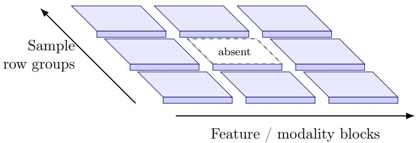

Figure S3: Spatial schematic of the two-dimensional ownership layout. Rows partition samples and columns partition feature/modality blocks; the dashed tile illustrates an unavailable block. Tile thickness is illustrative, not a third partition dimension, sample size, risk or measured quantity. Computational row groups need not coincide with statistical sites.

## References

[1] T. Baltrušaitis, C. Ahuja, L.-P. Morency, Multimodal machine learning: A survey and taxonomy, IEEE Trans. Pattern Anal. Mach. Intell. 41 (2) (2019) 423–443.

[2] W. Huang, D. Wang, X. Ouyang, J. Wan, J. Liu, T. Li, Multimodal federated learning: Concept, methods, applications and future directions, Inf. Fusion 112 (2024) 102576.

[3] S. Sun, A survey of multi-view machine learning, Neural Comput. Appl. 23 (7–8) (2013) 2031–2038.

[4] J. Zhao, X. Xie, X. Xu, S. Sun, Multi-view learning overview: Recent progress and new challenges, Inf. Fusion 38 (2017) 43–54.

[5] Y. Bai, Y. Guan, J. Q. Shi, W.-F. Ng, Towards automated fatigue assessment using wearable sensing and mixed-efects models, in: Proceedings of the 2021 ACM International Symposium on Wearable Computers, Association for Computing Machinery, 2021, pp. 129–131.

[6] Y. Wu, J. Chen, L. Hu, H. Xu, H. Liang, J. Wu, OmniFuse: A general modality fusion framework for multi-modality learning on low-quality medical data, Inf. Fusion 117 (2025) 102890.

[7] Q. Yang, Y. Liu, T. Chen, Y. Tong, Federated machine learning: Concept and applications, ACM Trans. Intell. Syst. Technol. 10 (2) (2019) 12:1–12:19.

[8] P. Kairouz, H. B. McMahan, B. Avent, et al., Advances and open problems in federated learning, Found. Trends Mach. Learn. 14 (1–2) (2021) 1–210.

[9] H. Gao, S. Ge, T.-H. Chang, FedHD: Communication-eficient federated learning from hybrid data, J. Franklin Inst. 360 (12) (2023) 8416–8454.

[10] X. Zhang, W. Yin, T. Chen, M. Hong, Hybrid federated learning for feature and sample heterogeneity: Algorithms and implementation, Trans. Mach. Learn. Res. 2024 (2024).

[11] R. J. A. Little, D. B. Rubin, Statistical Analysis with Missing Data, 3rd Edition, Wiley, Hoboken, NJ, 2019.

[12] T. Li, A. K. Sahu, M. Zaheer, M. Sanjabi, A. Talwalkar, V. Smith, Federated optimization in heterogeneous networks, in: Proceedings of Machine Learning and Systems, Vol. 2, 2020, pp. 429–450.

[13] J. C. Duchi, H. Namkoong, Learning models with uniform performance via distributionally robust optimization, Ann. Stat. 49 (3) (2021) 1378–1406.

[14] S. Sagawa, P. W. Koh, T. B. Hashimoto, P. Liang, Distributionally robust neural networks for group shifts: On the importance of regularization for worst-case generalization, in: International Conference on Learning Representations, 2020.

[15] G. R. G. Lanckriet, N. Cristianini, P. Bartlett, L. El Ghaoui, M. I. Jordan, Learning the kernel matrix with semidefinite programming, J. Mach. Learn. Res. 5 (2004) 27–72.

[16] O. Baños, R. Garcia, A. Saez, MHEALTH [dataset], UCI Machine Learning Repository (2014).

[17] O. Baños, R. Garcia, J. A. Holgado-Terriza, M. Damas, H. Pomares, I. Rojas, A. Saez, C. Villalonga, mHealthDroid: A novel framework for agile development of mobile health applications, in: Ambient Assisted Living and Daily Activities, Springer, 2014, pp. 91–98.

[18] C. Cortes, V. Vapnik, Support-vector networks, Mach. Learn. 20 (3) (1995) 273–297.

[19] K. Crammer, Y. Singer, On the algorithmic implementation of multiclass kernel-based vector machines, J. Mach. Learn. Res. 2 (2001) 265–292.

[20] A. Rakotomamonjy, F. R. Bach, S. Canu, Y. Grandvalet, SimpleMKL, J. Mach. Learn. Res. 9 (2008) 2491–2521.

[21] Y.-J. Lee, O. L. Mangasarian, SSVM: A smooth support vector machine for classification, Comput. Optim. Appl. 20 (1) (2001) 5–22.

[22] Y. Nesterov, Smooth minimization of non-smooth functions, Math. Program. 103 (1) (2005) 127–152.

[23] J. M. Robins, A. Rotnitzky, L. P. Zhao, Estimation of regression coeficients when some regressors are not always observed, J. Am. Stat. Assoc. 89 (427) (1994) 846–866.

[24] F. R. Bach, G. R. G. Lanckriet, M. I. Jordan, Multiple kernel learning, conic duality, and the SMO algorithm, in: Proceedings of the 21st International Conference on Machine Learning, 2004, pp. 41–48.

[25] Y. Cai, H. Che, B. Pan, M.-F. Leung, C. Liu, S. Wen, Projected cross-view learning for unbalanced incomplete multi-view clustering, Inf. Fusion 105 (2024) 102245.

[26] Y. Cai, Q. Shu, Z. Zhou, H. Meng, Incomplete multi-view clustering based on information fusion with self-supervised learning, Inf. Fusion 117 (2025) 102849.

[27] W. Liu, X. Jing, D. Zeng, T. Zhang, Graph refinement and consistency self-supervision for tensorized incomplete multi-view clustering, Inf. Fusion 114 (2025) 102709.

[28] B. Schölkopf, A. J. Smola, Learning with Kernels: Support Vector Machines, Regularization, Optimization, and Beyond, MIT Press, Cambridge, MA, 2002.

[29] S. Sun, Multi-view laplacian support vector machines, in: Advanced Data Mining and Applications, Vol. 7121 of Lecture Notes in Computer Science, Springer, 2011, pp. 209–222.

[30] G. Chao, S. Sun, Multi-kernel maximum entropy discrimination for multi-view learning, Intell. Data Anal. 20 (3) (2016) 481–493.

[31] C. Cortes, M. Mohri, A. Rostamizadeh, Algorithms for learning kernels based on centered alignment, J. Mach. Learn. Res. 13 (2012) 795–828.

[32] S. Hong, J. Chae, Distributed online learning with multiple kernels, IEEE Trans. Neural Netw. Learn. Syst. 34 (3) (2023) 1263–1277.

[33] P. Zeng, J. Q. Shi, W.-S. Kim, Simultaneous registration and clustering for multidimensional functional data, J. Comput. Graph. Stat. 28 (4) (2019) 943–953.

[34] A. Rahimi, B. Recht, Random features for large-scale kernel machines, in: Advances in Neural Information Processing Systems 20, 2007, pp. 1177–1184.

[35] C. K. I. Williams, M. Seeger, Using the Nyström method to speed up kernel machines, in: Advances in Neural Information Processing Systems 13, 2001, pp. 682–688.

[36] S. Sun, J. Shawe-Taylor, L. Mao, PAC-bayes analysis of multi-view learning, Inf. Fusion 35 (2017) 117–131.

[37] H. B. McMahan, E. Moore, D. Ramage, S. Hampson, B. A. y. Arcas, Communication-eficient learning of deep networks from decentralized data, in: Proceedings of the 20th International Conference on Artificial Intelligence and Statistics, Vol. 54 of Proceedings of Machine Learning Research, 2017, pp. 1273–1282.

[38] Y. Qiao, H. Q. Le, M. Zhang, A. Adhikary, C. Zhang, C. S. Hong, FedCCL: Federated dual-clustered feature contrast under domain heterogeneity, Inf. Fusion 113 (2025) 102645.

[39] H. Q. Le, M. N. H. Nguyen, C. M. Thwal, Y. Qiao, C. Zhang, C. S. Hong, FedMEKT: Distillation-based embedding knowledge transfer for multimodal federated learning, Neural Netw. 183 (2025) 107017.

[40] Y. Mansour, M. Mohri, A. Rostamizadeh, Domain adaptation with multiple sources, in: Advances in Neural Information Processing Systems 21, 2009, pp. 1041–1048.

[41] S. Zhao, J. Jiang, W. Tang, J. Zhu, H. Chen, P. Xu, B. W. Schuller, J. Tao, H. Yao, G. Ding, Multi-source multi-modal domain adaptation, Inf. Fusion 117 (2025) 102862.

[42] H. Namkoong, J. C. Duchi, Variance-based regularization with convex objectives, in: Advances in Neural Information Processing Systems 30, 2017, pp. 2971–2980.

[43] A. Beck, M. Teboulle, A fast iterative shrinkage-thresholding algorithm for linear inverse problems, SIAM J. Imaging Sci. 2 (1) (2009) 183–202.

[44] X. Wu, Y. Chao, R. Liang, S. Tang, Z. Zhang, Feature splitting parallel algorithm for dantzig selectors, Statistics and Computing 35 (2025) 116.

[45] P. L. Bartlett, S. Mendelson, Rademacher and gaussian complexities: Risk bounds and structural results, J. Mach. Learn. Res. 3 (2002) 463–482.

[46] J. Reyes-Ortiz, D. Anguita, A. Ghio, L. Oneto, X. Parra, Human activity recognition using smartphones [dataset], UCI Machine Learning Repository (2013).

[47] D. Anguita, A. Ghio, L. Oneto, X. Parra, J. L. Reyes-Ortiz, A public domain dataset for human activity recognition using smartphones, in: European Symposium on Artificial Neural Networks, Computational Intelligence and Machine Learning, 2013, pp. 437–442.