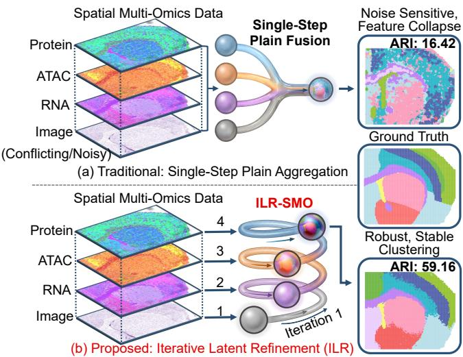
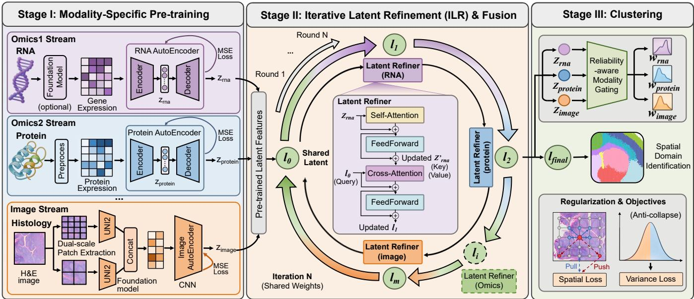
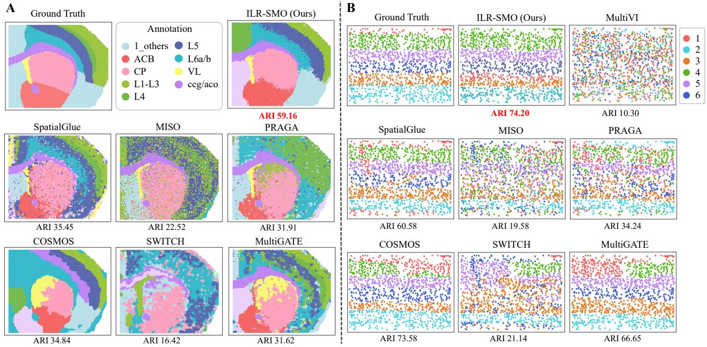
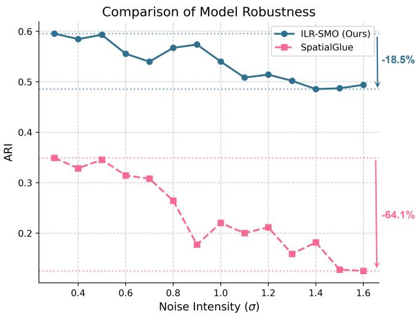
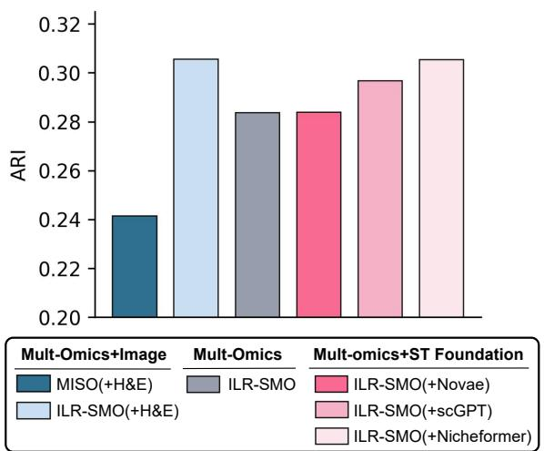

# ILR-SMO: Iterative Latent Refinement for Robust Spatial Multi-Omics Integration

Anqi Yu1 , Xudong Xu1 , Jianzhi Lu1 , Yuqi Sun1 , Bingguo Chen1 , Chenxi Ma1,∗ , Weimin Tan1,∗ , Bo Yan1,∗

1College of Computer Science and Artificial Intelligence, Shanghai Key Laboratory of Intelligent Information Processing, Fudan University, Shanghai 200438, China.   
24110240106@m.fudan.edu.cn, 25113050293@m.fudan.edu.cn, 24110240058@m.fudan.edu.cn, 22110240034@m.fudan.edu.cn, 25213050109@m.fudan.edu.cn, cxma17@fudan.edu.cn, wmtan@fudan.edu.cn, byan@fudan.edu.cn

## Abstract

Spatial multi-omics technologies jointly profile diverse molecular modalities with spatial context, providing a comprehensive view of cellular heterogeneity and tissue organization. To integrate spatial multi-omics data and identify spatial domains, a wide range of unsupervised methods has been proposed. However, recent approaches rely on single-step fusion, directly aggregating heterogeneous modalities into a shared representation, making embeddings sensitive to modality imbalance and measurement noise that are inherent to spatial multi-omics data, as well as unstable optimization under weak supervision. Here, we propose ILR-SMO (Iterative Latent Refinement for Spatial Multi-Omics), a unified self-supervised framework that reformulates multimodal integration as a stability-aware refinement process over a shared latent representation. Instead of single-step plain fusion, ILR-SMO progressively integrates modalityspecific information through sequential updates, allowing information to be injected in a controlled manner. This incremental refinement enables later updates to correct or compensate for earlier deviations, resulting in more stable and robust representation learning under heterogeneous and noisy modalities. ILR-SMO further incorporates reliability-aware modality gating for adaptive modulation of modality contributions, and employs a joint objective to enforce spatial coherence while preventing representation collapse. Extensive experiments on five spatial multi-omics benchmarks demonstrate that ILR-SMO consistently outperforms seven state-of-the-art methods and exhibits strong robustness across diverse settings.

  
Figure 1: Motivation and overview. ILR-SMO replaces single-step fusion with iterative latent refinement for robust spatial domain identification.

## 1 Introduction

Spatial multi-omics technologies enable the simultaneous measurement of multiple molecular modalities, such as RNA expression, chromatin accessibility (ATAC), protein abundance, and increasingly histological context, within the same intact tissue section. By jointly profiling complementary molecular layers with preserved spatial organization, spatial multi-omics enables a more comprehensive characterization of regulatory programs and tissue architecture than single-modality or dissociated assays [Zhang et al., 2025; Lee et al., 2025]. Effective computational integration has become essential for extracting biologically meaningful insights, with broad applications across cancer biology, neuroscience, and developmental biology [Deng et al., 2022; Zhang et al., 2023; Krossa et al., 2025].

Existing computational approaches have made notable progress toward multimodal integration, while several key limitations remain. In practical spatial multi-omics settings, modalities exhibit pronounced heterogeneity in feature dimensionality, signal quality, and biological content, along with modality-specific noise and potentially conflicting signals. Early multi-omics methods developed for single-cell data, such as GLUE [Cao and Gao, 2022], totalVI [Gayoso et al., 2021], and MultiVI [Ashuach et al., 2023], can effectively align multiple modalities but cannot exploit spatial context. More recently, SpatialGlue [Long et al., 2024] and its extensions such as PRAGA [Huang et al., 2025], COS-MOS [Zhou et al., 2025], SWITCH [Li et al., 2025], and MultiGATE [Miao et al., 2025], incorporate spatial adjacency through neighborhood graphs or graph neural networks, enabling joint modeling of molecular features and spatial structure. However, most of these approaches rely on single-step plain fusion strategies, where all modalities are roughly aggregated into a shared embedding in a single step (Fig. 1(a)). Such single-step fusion can be sensitive to measurement noise and modality heterogeneity, and often struggles to maintain stable performance across diverse datasets. In addition, most existing methods are trained end-to-end under a fixed and often bi-modal configuration, which limits extensibility as new modalities merge and makes it difficult to incorporate new data types without retraining. Furthermore, support for histopathological image modalities remains scarce. While MISO [Coleman et al., 2025] incorporates histological images into spatial multi-omics analysis, it relies on uniform pairwise cross-modal interactions, limiting its ability to prioritize informative modalities over noisy ones. These limitations highlight the need for a more robust and extensible fusion paradigm.

In this work, we propose ILR-SMO, a unified framework that performs Iterative Latent Refinement for Spatial Multi-Omics integration. Instead of treating multimodal fusion as a static aggregation process, ILR-SMO models it as a stabilityaware optimization process over a shared latent representation (Fig. 1(b)). To cope with severe modality heterogeneity and noise, the shared representation is refined progressively by integrating modality-specific information in a sequential manner. This incremental refinement allows multimodal signals to be incorporated in a controlled way, enabling later updates to correct or compensate for earlier ones and resulting in more stable optimization dynamics under weak selfsupervision. To further handle uneven modality quality, ILR-SMO adopts reliability-aware modality gating, which adaptively modulates modality contributions during fusion based on their reliability. The overall learning process is guided by a stability-aware objective that jointly enforces spatial coherence and prevents representation collapse.

Our main contributions are summarized as follows:

• We propose ILR-SMO, a unified spatial multi-omics fusion framework that formulates multimodal integration as an iterative and stability-aware optimization process, supporting flexible combinations of modalities and enabling robust representation learning under modality heterogeneity and noise.

• We introduce iterative latent refinement with sequential latent updates and reliability-aware modality gating, together with a stability-aware joint optimization objective that explicitly controls optimization dynamics for selfsupervised spatial clustering.

• We demonstrate the effectiveness of ILR-SMO on five spatial multi-omics benchmarks, where it consistently outperforms strong state-of-the-art baselines and exhibits robust performance across modalities†.

## 2 Related Work

## 2.1 Spatial Multi-Omics Aggregation

Spatial multi-omics has become an increasingly important paradigm for analyzing spatial biological data. Spatial multiomics integrates complementary molecular signals, motivating multimodal fusion methods for spatial domain identification. Early efforts primarily focused on single-cell multi omics integration, including totalVI [Gayoso et al., 2021], GLUE [Cao and Gao, 2022], and MultiVI [Ashuach et al., 2023], which model cross-modal relationships at the cellular level but do not incorporate spatial information. Recently, a series of spatial multi-omics methods have been proposed to jointly model molecular features and spatial adjacency, such as CellCharter [Varrone et al., 2024], SpaMultiVAE [Tian et al., 2024], and SpatialGlue [Long et al., 2024], as well as subsequent extensions including PRAGA [Huang et al., 2025], COSMOS [Zhou et al., 2025], SWITCH [Li et al., 2025], and MultiGATE [Miao et al., 2025]. However, existing spatial methods commonly adopt single-step fixed fusion schemes, which limit robustness and scalability. MISO [Coleman et al., 2025] extends spatial multi-omics integration by incorporating histological images, but treats all modalities uniformly without adapting to modality reliability. Overall, existing methods advance spatial multi-omics analysis while leaving challenges in robust and flexible multimodal fusion.

## 2.2 Multimodal Fusion

Multimodal representation learning aims to integrate multiple data inputs or latent representations into a unified embedding for downstream tasks. Existing fusion strategies typically fall into static operators (e.g., concatenation [Jaegle et al., 2021; Li et al., 2025]) and learnable mechanisms (e.g., attentionbased fusion [Nagrani et al., 2021; Xu and Chen, 2023]), where modality-specific encoders first produce latent features that are then aggregated into a shared representation. However, many fusion pipelines are built upon fixed fusion structures, often assuming bi-modal or pre-defined interaction patterns [Zhou et al., 2025; Miao et al., 2025]. Such rigid fusion schemes limit the flexibility of modality interaction modeling and prevent adaptive correction when modalities exhibit imbalanced quality or noise, making the resulting representations sensitive to modality heterogeneity [Chen et al., 2021; Xu and Chen, 2023]. MM-Lego [Hemker et al., 2025] explores frequency-domain interactions for cross-modal aggregation, highlighting the potential of more modular and extensible fusion designs. Inspired by these advances, we adapt iterative and reliability-aware fusion principles to the spatial multi-omics setting, enabling robust domain identification under heterogeneous modalities.

## 3 Method

We propose ILR-SMO, a unified framework for spatial multiomics integration that learns a shared latent representation for unsupervised spatial domain identification. As shown in Fig. 2, ILR-SMO comprises modality-specific pretraining, iterative multi-modal integration, and clustering-based spatial domain identification.

## 3.1 Preliminaries

Given a spatial multi-omics dataset consisting of N spatial locations measured across M omics and imaging streams, we denote the preprocessed modality-specific input matrix of the m-th omics stream as $X ^ { ( m ) } \in \bar { \mathbb { R } ^ { N \times d _ { m } } }$ , where $d _ { m }$ is the input dimensionality of modality $m ,$ , and $\mathbf { x } _ { i } ^ { ( m ) } \in \mathbb { R } ^ { d _ { m } }$ is the input at location i. Each location is associated with a spatial coordinate $\mathbf { s } _ { i } \in \mathbb { R } ^ { 2 }$ , collected in $S \in \mathbb { R } ^ { N \times 2 }$ . Each data stream is encoded to a modality-specific latent space via

$$
\begin{array} { r } { \mathbf { z } _ { i } ^ { ( m ) } = f _ { m } \left( \mathbf { x } _ { i } ^ { ( m ) } \right) , \quad \mathbf { z } _ { i } ^ { ( m ) } \in \mathbb { R } ^ { d _ { z } } . } \end{array}\tag{1}
$$

Given the latent representations $\{ \mathbf { z } _ { i } ^ { ( m ) } \} _ { m = 1 } ^ { M }$ , a shared latent representation $\mathbf { l } _ { i }$ is constructed for each spatial location as

$$
\begin{array} { r } { \mathbf { l } _ { i } = g \left( \mathbf { z } _ { i } ^ { ( 1 ) } , \ldots , \mathbf { z } _ { i } ^ { ( M ) } \right) , } \end{array}\tag{2}
$$

which serves as the unified embedding for unsupervised spatial domain identification using a clustering algorithm $\mathcal { C } ( \cdot )$ such as K-means or Leiden.

## 3.2 Modality-Specific Pretraining

As shown in Fig. 2 (stage I), we independently pretrain an autoencoder for each modality to obtain compact latent representations that serve as inputs for subsequent cross-modal integration. The inputs to each modality encoder are modalityspecific feature vectors obtained after standard preprocessing or foundation-model-based feature extraction. In particular, image modality is represented by dual-scale patch features extracted around each spatial location and encoded using a pathology foundation model (UNI2 [Chen et al., 2024]), whose outputs are concatenated to capture both local and contextual visual patterns. Given the preprocessed input $\mathbf { x } _ { i } ^ { ( m ) }$ each modality m is associated with an encoder–decoder pair $( f _ { m } ^ { e n c } , f _ { m } ^ { d e c } )$ , which maps the input to a latent embedding and reconstructs it as:

$$
\mathbf { z } _ { i } ^ { ( m ) } = f _ { m } ^ { e n c } ( \mathbf { x } _ { i } ^ { ( m ) } ) , \quad \hat { \mathbf { x } } _ { i } ^ { ( m ) } = f _ { m } ^ { d e c } ( \mathbf { z } _ { i } ^ { ( m ) } ) .\tag{3}
$$

The autoencoders are trained independently by minimizing a mean squared reconstruction error (MSE),

$$
\mathcal { L } _ { \mathrm { r e c } } ^ { ( m ) } = \frac { 1 } { N } \sum _ { i = 1 } ^ { N } \left. \hat { \mathbf { x } } _ { i } ^ { ( m ) } - \mathbf { x } _ { i } ^ { ( m ) } \right. _ { 2 } ^ { 2 } ,\tag{4}
$$

and the total stage I objective is the sum of reconstruction losses across all modalities. This pretraining decouples modality-specific representation learning from cross-modal fusion, providing informative and comparable latent embeddings for the iterative refinement stage.

## 3.3 Iterative Latent Refinement

## Optimization Perspective of ILR

As illustrated in Fig. 2 (stage II), we view multi-modal fusion as an optimization process over a shared latent representation l, driven by pretrained modality-specific latents that provide heterogeneous and potentially noisy supervision. In spatial multi-omics settings, uneven modality quality and viewspecific biases make single-step aggregation unstable under unsupervised learning. Iterative Latent Refinement (ILR) addresses this by sequentially integrating modality information into the shared latent, injecting one modality at a time through incremental updates. This formulation allows each modality to contribute in a controlled manner while enabling subsequent updates to compensate for earlier deviations, resulting in smoother optimization dynamics and improved robustness for self-supervised spatial domain identification.

## Mechanism of Sequential Latent Updates

ILR is instantiated by an Iterative Latent Refinement Module (ILRM), which maintains a learnable shared latent representation L and updates it via Sequential Latent Updates (SLU) across modalities. Given pretrained modality-specific latent embeddings from stage I, where $Z ^ { ( m ) } ~ \in ~ \mathbf { \bar { \mathbb { R } } } ^ { \bar { B } \times }$ 1×D denotes the normalized encoder output, ILRM initializes a shared latent token $\boldsymbol { L } \in \mathbb { R } ^ { B \times 1 \times D }$ and refines it over multiple refinement rounds. In each round, SLU traverses modalities in a fixed order and applies a Modality-wise Latent Refiner (MLR) to sequentially inject modality context into the shared latent. For a modality $m ,$ MLR first updates the modality token using a pre-norm self-attention module,

$$
Z ^ { ( m ) * } = Z ^ { ( m ) } + \mathrm { S e l f A t t e n t i o n } \bigl ( \mathrm { L a y e r N o r m } ( Z ^ { ( m ) } ) \bigr ) ,\tag{5}
$$

$$
Z ^ { ( m ) } { } ^ { \prime } = Z ^ { ( m ) * } + \mathrm { F e e d F o r w a r d } \bigl ( \mathrm { L a y e r N o r m } ( Z ^ { ( m ) * } ) \bigr ) .\tag{6}
$$

The updated modality token $Z ^ { ( m ) ^ { \prime } }$ is then used as context to refine the shared latent via cross-attention,

$$
\tilde { L } = L + \mathrm { C r o s s A t t e n t i o n } \big ( \mathrm { L a y e r N o r m } ( L ) , \mathrm { L a y e r N o r m } ( Z ^ { ( m ) ^ { \prime } } ) \big ) ,\tag{7}
$$

$$
L _ { u p d a t e d } = \tilde { L } + \mathrm { F e e d F o r w a r d } \big ( \mathrm { L a y e r N o r m } ( \tilde { L } ) \big ) .\tag{8}
$$

The refined latent $L _ { u p d a t e d }$ is passed to the next MLR, and one SLU round is completed after all modalities are processed. Repeating this procedure for multiple rounds yields the final shared representation $L _ { f i n a l }$ Compared to singlestep plain fusion schemes, SLU realizes ILR as a sequence of modality-conditioned refinements, providing a structured mechanism for cross-modal integration.

## Stability Analysis of ILR

To analyze the stability of Iterative Latent Refinement, we adopt an optimization-level abstraction by modeling the refinement of the shared latent L as minimizing a composite objective

$$
F ( L ) = \sum _ { m = 1 } ^ { M } f _ { m } ( L ) + r ( L ) ,\tag{9}
$$

  
Figure 2: Overview of ILR-SMO. The framework first performs modality-specific pretraining to obtain pretrained latent embeddings, then applies Iterative Latent Refinement (ILR) via sequential latent updates to progressively integrate heterogeneous modalities into a shared representation. Reliability-aware modality gating adaptively modulates refinement strength, while spatial consistency and dispersion regularization ensure stable, coherent, and non-collapsing optimization, yielding a unified latent for spatial domain identification.

where each $f _ { m }$ represents a modality-specific contribution and $r ( L )$ collects regularization terms. Let $g _ { m } ( L ) \ =$ $\nabla f _ { m } ( { \dot { L } } )$ and assume each $f _ { m }$ has β-Lipschitz continuous gradients. We compare ILR implemented via Sequential Latent Updates (SLU) with a single-step joint latent update that aggregates all modality gradients at once.

(i) First-order equivalence with second-order smoothing. A joint update takes the form,

$$
\Delta _ { \mathrm { j o i n t } } = - \eta \sum _ { m = 1 } ^ { M } g _ { m } ( L ) ,\tag{10}
$$

while one SLU cycle yields:

$$
\Delta _ { \mathrm { S L U } } = - \eta \sum _ { m = 1 } ^ { M } g _ { m } ( L ) + O ( \eta ^ { 2 } ) ,\tag{11}
$$

with the deviation bounded by

$$
\| \Delta _ { \mathrm { S L U } } - \Delta _ { \mathrm { j o i n t } } \| \le \beta \eta ^ { 2 } ( M - 1 ) \sum _ { m = 1 } ^ { M } \| g _ { m } ( L ) \| .\tag{12}
$$

This shows that SLU preserves the dominant descent direction while introducing higher-order corrections that smooth the optimization trajectory.

(ii) Localized impact of noisy modalities. For a perturbed modality k with $\tilde { g } _ { k } \dot { [ } L ) = g _ { k } ( \bar { L ) } + \epsilon ( L ) , \| \epsilon ( L ) \| \le ^ { \bullet } E . \ L _ { \mathrm { S L U } } ^ { + }$ and $\tilde { L } _ { \mathrm { S L U } } ^ { + }$ denote the SLU outputs under clean and perturbed gradients, respectively. The deviation satisfies

$$
\lVert \tilde { L } _ { \mathrm { S L U } } ^ { + } - L _ { \mathrm { S L U } } ^ { + } \rVert \leq \eta E e ^ { \eta \beta M } \approx O ( \eta E ) ,\tag{13}
$$

for typical small step sizes, indicating that modality-specific noise affects only a bounded incremental update instead of dominating the entire refinement.

(iii) Alleviating gradient conflicts. For joint aggregation, the squared norm of the summed gradient expands as

$$
\| \sum _ { m = 1 } ^ { M } g _ { m } ( L ) \| ^ { 2 } = \sum _ { m = 1 } ^ { M } \| g _ { m } ( L ) \| ^ { 2 } - 2 \sum _ { i < j } g _ { i } ( L ) ^ { \top } g _ { j } ( L ) ,\tag{14}
$$

where negative inner products cause cancellation under conflicting modalities. SLU avoids this hard aggregation by applying gradients sequentially, effectively decomposing refinement into modality-conditioned sub-steps and yielding more consistent optimization under heterogeneous modalities.

This abstraction emphasizes update order and locality rather than architectural details, and serves as an approximation of the ILR mechanism. Complete derivations and additional bounds are provided in Appendix A.

## 3.4 Reliability-Aware Modality Gating

To account for heterogeneous modality quality in spatial multi-omics data, we introduce Reliability-aware Modality Gating (RMG) to adaptively modulate refinement strength at the sample and modality levels, as shown in Fig. 2 (stage III). RMG takes normalized modality-specific latent embeddings $\{ \mathbf { z } _ { i } ^ { ( m ) } \} _ { m = 1 } ^ { M }$ as input and produces a soft reliability weight vector $\mathbf { w } _ { i } \in \mathbb { R } ^ { M }$ . Rather than modifying the fusion mechanism, RMG controls the update magnitude by weighting the alignment between the fused latent and each modality,

$$
\mathcal { L } _ { \mathrm { a l i g n } } = \frac { 1 } { N } \sum _ { i = 1 } ^ { N } \sum _ { m = 1 } ^ { M } w _ { i , m } \Vert \mathbf { z } _ { i } ^ { f } - \mathbf { z } _ { i } ^ { ( m ) } \Vert _ { 2 } ^ { 2 } ,\tag{15}
$$

where ${ \bf z } ^ { f } i$ denotes the fused representation. To avoid degenerate solutions where the gating collapses onto a single

modality, we regularize the batch-averaged weights w¯ using a negative entropy term,

$$
\mathcal { L } _ { \mathrm { e n t } } = \sum _ { m = 1 } ^ { M } \bar { w } _ { m } \log ( \bar { w } _ { m } + \epsilon ) .\tag{16}
$$

Together with ILR, RMG adaptively amplifies informative modalities while suppressing unreliable ones, improving robustness under modality heterogeneity and noise.

## 3.5 Stability-Aware Joint Optimization

We adopt a Stability-aware Joint Optimization (SJO) objective to guide ILR toward spatially coherent and noncollapsing solutions. Spatial Consistency Regularization promotes local smoothness by pulling together spatial neighbors while separating random negatives,

$$
\begin{array} { r l r } {  { \mathcal { L } _ { \mathrm { s p a t i a l } } = \frac { 1 } { N } \sum _ { i = 1 } ^ { N } ( \frac { 1 } { | \mathcal { N } _ { i } | } \sum _ { j \in \mathcal { N } _ { i } } \| \mathbf { z } _ { i } ^ { f } - \mathbf { z } _ { j } ^ { f } \| _ { 2 }  } } \\ & { } & {  + \operatorname* { m a x } \Bigl ( 0 , \gamma - \| \mathbf { z } _ { i } ^ { f } - \mathbf { z } _ { \pi ( i ) } ^ { f } \| _ { 2 } \Bigr ) ) . } \end{array}\tag{17}
$$

while representation dispersion regularization prevents collapse by enforcing a minimum per-dimension variance,

$$
\mathcal { L } _ { \mathrm { v a r } } = \frac { 1 } { d } \sum _ { k = 1 } ^ { d } \operatorname* { m a x } \left( 0 , \sigma _ { 0 } - \sqrt { \mathrm { V a r } ( \boldsymbol { z } _ { \cdot , k } ^ { f } ) + \epsilon } \right) .\tag{18}
$$

Cross-modal consistency is encouraged via pairwise agreement among modality latents,

$$
\mathcal { L } _ { \mathrm { c o n t r } } = \sum _ { 1 \leq m < n \leq M } \frac { 1 } { N } \sum _ { i = 1 } ^ { N } \Vert \mathbf { z } _ { i } ^ { ( m ) } - \mathbf { z } _ { i } ^ { ( n ) } \Vert _ { 2 } ^ { 2 } ,\tag{19}
$$

while reliability-weighted alignment and gating entropy are defined in Sec. 3.4. The overall objective is

$$
\begin{array} { r } { \mathcal { L } _ { t o t a l } = \alpha _ { r e c } \mathcal { L } _ { r e c } + \alpha _ { c o n t r } \mathcal { L } _ { \mathrm { c o n t r } } + \alpha _ { a l i g n } \mathcal { L } _ { \mathrm { a l i g n } } } \\ { + \alpha _ { s p a t i a l } \mathcal { L } _ { \mathrm { s p a t i a l } } + \alpha _ { v a r } \mathcal { L } _ { \mathrm { v a r } } + \alpha _ { e n t } \mathcal { L } _ { \mathrm { e n t } } , } \end{array}\tag{20}
$$

with coefficients $\alpha _ { * }$ . Together, these terms provide directional guidance and anti-collapse constraints, enabling stable refinement under heterogeneous multi-modal noise.

## 4 Experiments

## 4.1 Experimental Setups

Datasets. We evaluate our proposed method on five spatial multi-omics benchmarks with diverse modalities: (1) Spatial epigenome–transcriptome mouse brain dataset [Zhou et al., 2025]; (2) Human Lymph Node dataset [Long et al., 2024]; (3) Human Hippocampus dataset [Miao et al., 2025]; (4) Simulated Mouse Visual Cortex dataset [Zhou et al., 2025]; (5) Spatial simulated triplet omics dataset [Long et al., 2024]. Details are provided in Appendix B.

Baseline Methods. We compare ILR-SMO against a set of state-of-the-art multi-omics methods. We include MultiVI [Ashuach et al., 2023] as a representative multi-modal omics integration method, along with six latest spatial multi-omics approaches: SpatialGlue [Long et al., 2024], MISO [Coleman et al., 2025], PRAGA [Huang et al., 2025], COSMOS [Zhou et al., 2025], SWITCH [Li et al., 2025], and MultiGATE [Miao et al., 2025]. Among these baselines, MISO is the only method that incorporates image features.

Evaluation Metrics. We adopt six widely used clustering metrics: Adjusted Rand Index (ARI), Homogeneity (Homo.), Mutual Information (MI), V-measure (V-meas.), Adjusted Mutual Information (AMI), and Normalized Mutual Information (NMI) [Long et al., 2024], which provide complementary perspectives on clustering quality.

Implementation Details. The entire model is implemented using PyTorch and experiments are conducted on a single NVIDIA GeForce RTX 3090 GPU. Despite slightly increased parameterization, ILR-SMO maintains moderate computational cost and is efficiently trainable on standard consumergrade hardware, with detailed analyses in Appendix G.

## 4.2 Experimental Results

Quantitative Comparison. To comprehensively evaluate the effectiveness of ILR-SMO, we report the quantitative clustering results on five spatial multi-omics datasets using six widely adopted evaluation metrics (Tables 1 and 2). ILR-SMO consistently achieves state-of-the-art performance across all datasets and metrics, demonstrating strong and robust spatial domain identification capability under diverse experimental settings. Notably, ILR-SMO exhibits substantial performance margins over competing methods. On the mouse brain dataset, ILR-SMO surpasses the second-best result by 23.71% in ARI and 22.62% in MI, while on the human hippocampus dataset it outperforms the strongest baseline Multi-GATE by 7.44% in ARI and 9.09% in MI. ILR-SMO further maintains superior performance on the simulated mouse visual cortex dataset with structured perturbations and noise, indicating strong robustness against external disturbances. In contrast, competing methods exhibit larger variability across datasets. Finally, ILR-SMO naturally extends to tri-modal integration and achieves the best performance across all metrics on the spatial simulated triplet omics dataset (Table 2), demonstrating strong scalability across modalities.

Qualitative Visualization. We visualize the spatial domain identification results on the mouse brain dataset and the simulated mouse visual cortex dataset. As shown in Fig. 3, ILR-SMO produces spatial patterns highly consistent with the ground-truth annotations. On the mouse brain dataset, ILR-SMO yields compact spatial domains with clear boundaries and fewer scattered regions, leading to more coherent spatial organization. Notably, ILR-SMO is the only method that correctly distinguishes the nucleus accumbens (ACB) and caudoputamen (CP) regions. On the simulated mouse visual cortex dataset, ILR-SMO also recovers well-defined laminar structures that closely match the ground truth, demonstrating its ability to capture hierarchical spatial organization.

<table><tr><td colspan="8">Mouse Brain Dataset Human Lymph Node Dataset</td></tr><tr><td>Methods</td><td colspan="4">ARI(%) Homo.(%) MI(%) V-meas.(%) </td><td colspan="2">AMI(%) NMI(%)</td><td colspan="4">ARI(%) Homo.(%) MI(%) V-meas.(%) AMI(%) NMI(%)</td></tr><tr><td>MultiVI</td><td></td><td></td><td></td><td></td><td></td><td>7.78</td><td>8.18 13.79</td><td>8.74</td><td>8.32</td><td>8.74</td></tr><tr><td>SpatialGlue</td><td>35.45</td><td>49.34 98.59</td><td>48.20</td><td>48.10</td><td>48.20</td><td>26.98</td><td>39.34 66.37</td><td></td><td>38.48 38.19</td><td>38.48</td></tr><tr><td>MISO</td><td>22.52</td><td>31.95 63.84</td><td>33.52</td><td>33.38</td><td>33.52</td><td>24.28</td><td>28.09 47.39</td><td>35.49</td><td>35.18</td><td>35.49</td></tr><tr><td>PRAGA</td><td>31.91</td><td>47.33 94.57</td><td>46.90</td><td>46.80</td><td>46.90</td><td>28.23</td><td>40.23 67.87</td><td>39.08</td><td>38.80</td><td>39.08</td></tr><tr><td>COSMOS</td><td>34.84</td><td>61.94 123.76</td><td>59.88</td><td>59.80</td><td>59.88</td><td>18.65</td><td>33.34 56.25</td><td>31.18</td><td>30.87</td><td>31.18</td></tr><tr><td>SWITCH</td><td>16.42</td><td>28.43 56.81</td><td>30.45</td><td>30.29</td><td>30.45</td><td>21.08</td><td>28.46 48.02</td><td>30.63</td><td>30.29</td><td>30.63</td></tr><tr><td>MultiGATE</td><td>31.62</td><td>52.12 104.15</td><td>48.88</td><td>48.78</td><td>48.88</td><td>18.18</td><td>36.00 60.74</td><td>34.20</td><td>33.90</td><td>34.20</td></tr><tr><td>ILR-SMO</td><td>59.16</td><td>73.26146.38</td><td>69.97</td><td>69.91</td><td>69.97</td><td>28.38</td><td>40.88 68.96</td><td>39.11</td><td>38.83</td><td>39.11</td></tr><tr><td colspan="11">Human Hippocampus Dataset Simulated Mouse Visual Cortex Dataset</td></tr><tr><td colspan="11">Methods ARI(%) Homo.(%) MI(%) V-meas.(%) AMI(%) NMI(%) ARI(%) Homo.(%) MI(%) V-meas.(%) AMI(%) NMI(%)</td></tr><tr><td>MultiVI</td><td>15.17</td><td>28.83 50.11</td><td>27.61</td><td>27.32</td><td>27.61</td><td>10.30</td><td>14.64</td><td>24.90</td><td>14.58 14.06</td><td>14.58</td></tr><tr><td>SpatialGlue</td><td>32.82</td><td>44.24 75.69</td><td>41.85</td><td>41.58</td><td>41.85</td><td>60.58</td><td>64.20</td><td>109.18</td><td>63.11 62.88</td><td>63.11</td></tr><tr><td>MISO</td><td>19.62</td><td>30.32 52.70</td><td>30.39</td><td>30.09</td><td>30.39</td><td>19.58</td><td>24.77</td><td>42.12</td><td>24.51 24.04</td><td>24.51</td></tr><tr><td>PRAGA</td><td>17.06</td><td>29.05 49.69</td><td>27.45</td><td>27.12</td><td>27.45</td><td>34.24</td><td>41.95 71.33</td><td>40.92</td><td>40.56</td><td>40.92</td></tr><tr><td>COSMOS</td><td>31.37</td><td>47.87 83.22</td><td>47.00</td><td>46.78</td><td>47.00</td><td>73.58</td><td>79.65 135.45</td><td>78.05</td><td>77.92</td><td>78.05</td></tr><tr><td>SWITCH</td><td>18.31</td><td>27.82 48.36</td><td>30.98</td><td>30.65</td><td>30.98</td><td>21.14</td><td>34.76 59.12</td><td>36.75</td><td>36.32</td><td>36.75</td></tr><tr><td>MultiGATE</td><td>45.96</td><td>49.16 85.45</td><td>49.80</td><td>49.58</td><td>49.80</td><td>66.65</td><td>75.44128.30</td><td>74.48</td><td>74.32</td><td>74.48</td></tr><tr><td>ILR-SMO</td><td>53.40</td><td>54.39 94.54</td><td>54.25</td><td>54.06</td><td>54.25</td><td>74.20</td><td>79.82 135.74</td><td>79.12</td><td>78.99</td><td>79.12</td></tr></table>

Table 1: Quantitative results on the mouse brain dataset, the human lymph node dataset, the human hippocampus dataset, and the simulated mouse visual cortex dataset. Best and Second results are in highlight. MultiVI is omitted on the Mouse Brain dataset because only preprocessed data are available, while MultiVI requires raw count–based inputs. V-measure and NMI calculated with arithmetic-mean normalization are mathematically equivalent and therefore yield identical values.

  
Figure 3: A: Ground truth annotations of brain regions in the mouse brain dataset and spatial domain identification results for various methods. B: Ground truth annotations of the mouse visual cortex dataset and spatial domain identification results for various methods.

## 4.3 Robustness Under Noisy Modalities

We further evaluate the robustness of ILR-SMO under modality corruption by injecting Gaussian noise with varying intensity σ into the ATAC modality of the mouse brain dataset. This setting simulates realistic scenarios where a single modality is severely degraded and examines whether the model can maintain stable spatial domain identification. As shown in Fig. 4, ILR-SMO exhibits strong robustness against increasing noise levels. Even when the noise intensity reaches σ=1.6, ILR-SMO maintains an ARI around 0.5, indicating that meaningful spatial structures are still preserved. In contrast, the baseline SpatialGlue is highly sensitive to the corrupted modality, with ARI rapidly decreasing to 0.12, corresponding to a performance drop of 64.1% from its best result, whereas ILR-SMO only experiences a relative decrease of 18.5%. These results demonstrate that ILR-SMO degrades gracefully under severe modality noise and is substantially more robust to modality corruption.

<table><tr><td colspan="6">Spatial Simulated Triplet Omics Dataset</td></tr><tr><td>Methods</td><td colspan="5">ARI(%) Homo.(%) MI(%) V-meas.(%) AMI(%) NMI(%)</td></tr><tr><td>MultiVI</td><td>34.54 53.07</td><td>82.12</td><td>48.91</td><td>48.63</td><td>48.91</td></tr><tr><td>SpatialGlue</td><td>97.25</td><td>96.55149.40</td><td>96.55</td><td>96.54</td><td>96.55</td></tr><tr><td>MISO</td><td>15.13</td><td>24.26 37.54</td><td>28.97</td><td>28.63</td><td>28.97</td></tr><tr><td>PRAGA</td><td>99.37</td><td>99.10 153.45</td><td>99.07</td><td>99.07</td><td>99.07</td></tr><tr><td>ILR-SMO</td><td>100.00</td><td>100.00154.74</td><td>100.00</td><td>100.00</td><td>100.00</td></tr></table>

Table 2: Quantitative results on the spatial simulated triplet-omics dataset using six evaluation metrics. COSMOS, Switch, and Multi-GATE are omitted as they support only bimodal inputs.

  
Figure 4: Robustness comparison under increasing Gaussian noise injected into the ATAC modality on the mouse brain dataset.

## 4.4 Extension With Foundation Models

ILR-SMO is naturally compatible with emerging foundation models and can seamlessly incorporate their representations to further improve performance (Fig. 5). Incorporating histopathological foundation model features leads to consistent performance gains over the original image setting and substantially outperforms MISO with the image modality. In addition, ILR-SMO can flexibly integrate transcriptomic foundation models, including Novae [Blampey et al., 2025], scGPT [Cui et al., 2024], and Nicheformer [Schaar et al., 2024], all of which yield improvements. These results demonstrate that ILR-SMO serves as a general and extensible framework that can readily benefit from advances in foundation models across modalities.

## 4.5 Ablation Studies

We conduct ablation studies on a real-world dataset (mouse brain) and a simulated dataset (simulated mouse visual cortex) to assess the effectiveness of the key components in ILR-SMO. Specifically, we remove reliability-aware modality gating (denoted as w/o Gating), spatial consistency regularization (denoted as w/o $L _ { s p a t i a l } )$ , replace iterative latent refinement–based fusion with concatenation followed by projection (w/o ILR), or collapse sequential latent updates into a singlestep update using all modalities simultaneously (w/o SLU). As shown in Table 3, removing any component consistently degrades performance across all metrics on both datasets, in dicating that each module contributes meaningfully to the overall model. In particular, w/o ILR and w/o SLU cause pronounced drops, underscoring the importance of iterative latent refinement. Moreover, ILR is insensitive to modality update order, as all six permutations achieve identical clustering performance on the triplet-omics dataset (Appendix F). The full ILR-SMO model achieves the best performance.

  
Figure 5: ILR-SMO benefits from both histopathology and transcriptomic foundation representations, achieving consistent improvements under their respective modality settings.

## 5 Conclusion

In this work, we present ILR-SMO, a unified framework for spatial multi-omics integration that formulates multi-modal fusion as iterative optimization over a shared latent representation. By introducing Iterative Latent Refinement with sequential latent updates and Reliability-aware Modality Gating, ILR-SMO robustly integrates heterogeneous modalities under noise, imbalance, and gradient conflicts, while a stability-aware objective enforces spatial coherence and prevents representational collapse in an unsupervised setting. Extensive experiments on five diverse spatial multiomics datasets demonstrate that ILR-SMO consistently outperforms state-of-the-art methods in spatial domain identification across multiple metrics and experimental scenarios.

## Acknowledgments

This work was supported by the Shanghai Municipal Special Program for Basic Research on General AI Foundation Models (Grant No. 2025SHZDZX025G11) and NSFC (grant nos.

<table><tr><td colspan="8">Mouse Brain Dataset Simulated Mouse Visual Cortex Dataset</td></tr><tr><td>Methods</td><td>ARI(%) Homo.(%) MI(%) V-meas.(%) AMI(%) NMI(%).</td><td></td><td></td><td></td><td></td><td>ARI(%) Homo.(%) MI(%) V-meas.(%) AMI(%) NMI(%)</td><td></td><td></td><td></td><td></td></tr><tr><td>w/o Gating</td><td>55.39</td><td>69.15 138.16</td><td>66.53</td><td>66.46</td><td>66.53</td><td>71.74</td><td>77.72 132.16</td><td></td><td>76.90 76.76</td><td>76.90</td></tr><tr><td>w/o Lspatial</td><td>23.10</td><td>35.32 70.57</td><td>33.59</td><td>33.47</td><td>33.59</td><td>16.02</td><td>21.81</td><td>37.10</td><td>21.61 21.12</td><td>21.61</td></tr><tr><td>w/o ILR</td><td>34.32</td><td>44.93 89.77</td><td>43.76</td><td>43.65</td><td>43.76</td><td>44.81</td><td>54.91</td><td>93.37 53.93</td><td>53.65</td><td>53.93</td></tr><tr><td>w/o SLU</td><td>56.58</td><td>70.70141.26</td><td>67.56</td><td>67.50</td><td>67.56</td><td>68.47</td><td>74.85127.29</td><td></td><td>73.23 73.06</td><td>73.23</td></tr><tr><td>ILR-SMO</td><td>59.16</td><td>73.26146.38</td><td>69.97</td><td>69.91</td><td>69.97</td><td>74.20</td><td>79.82 135.74</td><td></td><td>79.12 78.99</td><td>79.12</td></tr></table>

Table 3: Ablation results on the mouse brain and simulated mouse visual cortex datasets; “w/o” denotes “without.”

62402120 to C.M., 62472102 to B.Y., and 62372117 to W.T.). The computations in this research were performed using the CFFF platform of Fudan University.

## References

[Ashuach et al., 2023] Tal Ashuach, Mariano I Gabitto, Rohan V Koodli, Giuseppe-Antonio Saldi, Michael I Jordan, and Nir Yosef. Multivi: deep generative model for the integration of multimodal data. Nature Methods, 20(8):1222– 1231, 2023.

[Blampey et al., 2025] Quentin Blampey, Hakim Benkirane, Nadege Bercovici, Kevin Mulder, Gr\` egoire Gessain, Flo-´ rent Ginhoux, Fabrice Andre, and Paul-Henry Courn´ ede.\` Novae: a graph-based foundation model for spatial transcriptomics data. Nature Methods, 22(12):2539–2550, 2025.

[Cao and Gao, 2022] Zhi-Jie Cao and Ge Gao. Multiomics single-cell data integration and regulatory inference with graph-linked embedding. Nature Biotechnology, 40(10):1458–1466, 2022.

[Chen et al., 2021] Richard J Chen, Ming Y Lu, Wei-Hung Weng, Tiffany Y Chen, Drew FK Williamson, Trevor Manz, Maha Shady, and Faisal Mahmood. Multimodal coattention transformer for survival prediction in gigapixel whole slide images. In Proceedings of the IEEE/CVF international conference on computer vision, pages 4015– 4025, 2021.

[Chen et al., 2024] Richard J Chen, Tong Ding, Ming Y Lu, Drew FK Williamson, Guillaume Jaume, Andrew H Song, Bowen Chen, Andrew Zhang, Daniel Shao, Muhammad Shaban, et al. Towards a general-purpose foundation model for computational pathology. Nature Medicine, 30(3):850–862, 2024.

[Coleman et al., 2025] Kyle Coleman, Amelia Schroeder, Melanie Loth, Daiwei Zhang, Jeong Hwan Park, Ji-Youn Sung, Niklas Blank, Alexis J Cowan, Xuyu Qian, Jianfeng Chen, et al. Resolving tissue complexity by multimodal spatial omics modeling with miso. Nature Methods, 22(3):530–538, 2025.

[Cui et al., 2024] Haotian Cui, Chloe Wang, Hassaan Maan, Kuan Pang, Fengning Luo, Nan Duan, and Bo Wang. scgpt: toward building a foundation model for singlecell multi-omics using generative ai. Nature Methods, 21(8):1470–1480, 2024.

[Deng et al., 2022] Yanxiang Deng, Marek Bartosovic, Petra Kukanja, Di Zhang, Yang Liu, Graham Su, Archibald Enninful, Zhiliang Bai, Gonc¸alo Castelo-Branco, and Rong Fan. Spatial-cut&tag: spatially resolved chromatin modification profiling at the cellular level. Science, 375(6581):681–686, 2022.

[Gayoso et al., 2021] Adam Gayoso, Zoe Steier, Romain¨ Lopez, Jeffrey Regier, Kristopher L Nazor, Aaron Streets, and Nir Yosef. Joint probabilistic modeling of single-cell multi-omic data with totalvi. Nature methods, 18(3):272– 282, 2021.

[Hemker et al., 2025] Konstantin Hemker, Nikola Simidjievski, and Mateja Jamnik. Multimodal lego: Model merging and fusion across topologies and modalities in biomedicine. Advances in Neural Information Processing Systems, 38, 2025.

[Huang et al., 2025] Xinlei Huang, Zhiqi Ma, Dian Meng, Yanran Liu, Shiwei Ruan, Qingqiang Sun, Xubin Zheng, and Ziyue Qiao. Praga: prototype-aware graph adaptive aggregation for spatial multi-modal omics analysis. In Proceedings of the AAAI Conference on Artificial Intelli gence, volume 39, pages 326–333, 2025.

[Jaegle et al., 2021] Andrew Jaegle, Felix Gimeno, Andy Brock, Oriol Vinyals, Andrew Zisserman, and Joao Carreira. Perceiver: General perception with iterative attention. In International conference on machine learning, pages 4651–4664. PMLR, 2021.

[Krossa et al., 2025] Sebastian Krossa, Maria K Andersen, Elise M Sandholm, Maximilian Wess, Antti Kiviaho, Abhibhav Sharma, Sini Hakkola, Yangyang Hao, Mohammed Alshalalfa, Elai Davicioni, et al. Spatial multi-omics identifies aggressive prostate cancer signatures highlighting pro-inflammatory chemokine activity in the tumor microenvironment. Nature Communications, 16(1):10160, 2025.

[Lee et al., 2025] Chin Nien Lee, Hongxiang Fu, Angelysia Cardilla, Wanding Zhou, and Yanxiang Deng. Spatial joint profiling of dna methylome and transcriptome in tissues. Nature, 646(8087):1261–1271, 2025.

[Li et al., 2025] Zhongzhan Li, Sanqing Qu, Haixin Liang, Ruohui Tang, Xudong Zhang, Fan Lu, Jiani Yang, Ziling Gan, Shaorong Gao, Yanping Zhang, et al. Integrative deep learning of spatial multi-omics with switch. Nature Computational Science, pages 1–13, 2025.

[Long et al., 2024] Yahui Long, Kok Siong Ang, Raman Sethi, Sha Liao, Yang Heng, Lynn van Olst, Shuchen Ye, Chengwei Zhong, Hang Xu, Di Zhang, et al. Deciphering spatial domains from spatial multi-omics with spatialglue. Nature Methods, 21(9):1658–1667, 2024.

[Miao et al., 2025] Jishuai Miao, Jinzhao Li, Jingxue Xin, Jiajuan Tu, Muyang Ge, Ji Qi, Xiaocheng Zhou, Ying Zhu, Can Yang, and Zhixiang Lin. Multigate: integrative analysis and regulatory inference in spatial multi-omics data via graph representation learning. Nature Communications, 16(1):9403, 2025.

[Nagrani et al., 2021] Arsha Nagrani, Shan Yang, Anurag Arnab, Aren Jansen, Cordelia Schmid, and Chen Sun. Attention bottlenecks for multimodal fusion. Advances in neural information processing systems, 34:14200–14213, 2021.

[Schaar et al., 2024] Anna C Schaar, Alejandro Tejada-Lapuerta, Giovanni Palla, Robert Gutgesell, Lennard Halle, Mariia Minaeva, Larsen Vornholz, Leander Dony, Francesca Drummer, Mojtaba Bahrami, et al. Nicheformer: a foundation model for single-cell and spatial omics. bioRxiv, pages 2024–04, 2024.

[Tian et al., 2024] Tian Tian, Jie Zhang, Xiang Lin, Zhi Wei, and Hakon Hakonarson. Dependency-aware deep generative models for multitasking analysis of spatial omics data. Nature Methods, 21(8):1501–1513, 2024.

[Varrone et al., 2024] Marco Varrone, Daniele Tavernari, Albert Santamaria-Mart´ınez, Logan A Walsh, and Giovanni Ciriello. Cellcharter reveals spatial cell niches associated with tissue remodeling and cell plasticity. Nature genetics, 56(1):74–84, 2024.

[Xu and Chen, 2023] Yingxue Xu and Hao Chen. Multimodal optimal transport-based co-attention transformer with global structure consistency for survival prediction. In Proceedings ofthe IEEE/CVF international conference on computer vision, pages 21241–21251, 2023.

[Zhang et al., 2023] Di Zhang, Yanxiang Deng, Petra Kukanja, Eneritz Agirre, Marek Bartosovic, Mingze Dong, Cong Ma, Sai Ma, Graham Su, Shuozhen Bao, et al. Spatial epigenome–transcriptome co-profiling of mammalian tissues. Nature, 616(7955):113–122, 2023.

[Zhang et al., 2025] Di Zhang, Leslie A Rubio Rodr´ıguez-Kirby, Yingxin Lin, Wenqi Wang, Mengyi Song, Li Wang, Lijun Wang, Shigeaki Kanatani, Tony Jimenez-Beristain, Yonglong Dang, et al. Spatial dynamics of brain development and neuroinflammation. Nature, 647(8088):213– 227, 2025.

[Zhou et al., 2025] Yuansheng Zhou, Xue Xiao, Lei Dong, Chen Tang, Guanghua Xiao, and Lin Xu. Cooperative integration of spatially resolved multi-omics data with cosmos. Nature Communications, 16(1):27, 2025.