# GSBR: Geometric Support Behavior Regularization for Online RL

Charles Xu1, Jacob Berg1, Liyiming Ke2, Sergey Levine1,2

1 UC Berkeley 2 Physical Intelligence

Abstract — Regularizing online reinforcement learning (RL) toward a pretrained base policy can improve sample eficiency and learning stability, but regularization that is too restrictive limits how much the policy can improve. Base policies – typically difusion or flow-matching models trained by imitation learning on large, diverse datasets – capture many behaviors that are reasonable but suboptimal. Existing regularizers using such base policies are too restrictive in one of two ways: behavioral cloning regularizers pull the actor toward the full base-policy distribution, penalizing it for discarding suboptimal modes, while hard support constraints forbid improvements that lie just outside the base policy’s support. We propose Geometric Support Behavior Regularization (GSBR), which penalizes actions by their distance from the base policy’s support. Actions within the support incur no penalty, so the actor can concentrate on high-value modes; outside the support, where value estimates are less reliable, the penalty grows smoothly with distance while still permitting improvement when the value gained outweighs the penalty. GSBR estimates this distance from a finite set of base-policy samples, so it requires only sample access to the base policy. Across 19 tasks on four robotic benchmarks, GSBR raises the average success rate from 33% for the base policy to 95%, achieving the highest average success rate and throughput among all compared methods, with about 23% higher normalized throughput than the next-best RL method. Project website and open-source code: https://charlesxu0124.github.io/gsbr/.

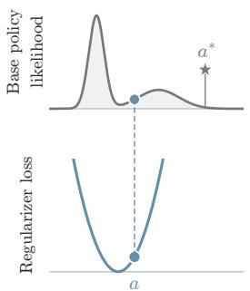  
(a) Behavior cloning  
b  ¼¯ [(a ¡ b)2]

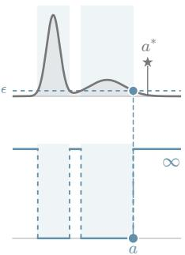  
(b) Support constraint

$$
\{ a \in A | \pi _ { \beta } ( a ) > \epsilon \}
$$

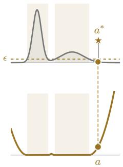  
(c) GSBR

[min ka ¡ bik2 ¡ r]2+ ; bi » ¼¯  
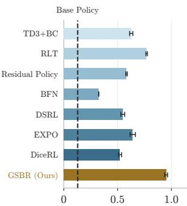  
Normalized throughput

Figure 1. Left: (a) Behavior cloning regularizer matches the base policy distribution, not allowing the RL actor to drop poor modes. (b) Support constraint allows the actor to select the best behavior in the base policy distribution, but excludes improvements beyond it. (c) GSBR applies distance-based regularization on deviation outside the base policy support, allowing the actor to discard suboptimal behaviors and guide exploration beyond the prior. Right: GSBR achieves 23% higher normalized throughput across 19 tasks and 4 benchmarks than previous methods.

## 1 Introduction

Online reinforcement learning (RL) can be costly when every interaction happens on a physical system, so practical methods often rely on a behavior prior that focuses exploration on plausible actions. In robotics, such priors are now available at scale: vision-language-action (VLA) and world-action models (WAMs) learn diverse behaviors from large demonstration datasets (Kim et al., 2024; Black et al., 2024; Ye et al., 2026), but often lack the robustness and throughput required for reliable deployment (Physical Intelligence et al., 2025; Xu et al., 2026). RL fine-tuning can close this gap by updating a policy that is regularized toward the pretrained base model. This raises a general question for RL: how should a behavior regularizer preserve the base policy’s guidance while giving the actor enoughfreedom to improve on it?

Improving upon base policies typically has two requirements: mode selection and local refinement. Consider a scene with two objects and the task is to grasp a specified target. Foundation models trained on large-scale data often produce diverse behaviors - and such base policies might have two action modes, one to grasp each object. The actor should be updated to discard the mode that reaches for the wrong object; we call this mode selection. However, existing behavior constraints can hinder one of the requirements and restrict policy improvement. Action regression (Fujimoto & Gu, 2021; Park et al., 2025b) and distribution-matching regularizers (Li & Levine, 2026; Fang et al., 2025) tie the actor to the base policy’s full action distribution, penalizing the actor even for discarding poor modes (Figure 1(a)). Support constraints (Kumar et al., 2019; Wagenmaker et al., 2025; Li et al., 2025) remove this penalty and permit mode selection, but can be too restrictive and often exclude optimal actions outside the base policy’s support (Figure 1(b)).

Our ke insi ht is to allow both mode selection and local refinement b introducin a eometric relaxation of the support constraint. We introduce Geometric Support Behavior Regularization (GSBR), an RL algorithm that estimates the support of the base policy using finite samples, and regularizes actions diferently based on whether they are inside or outside the support. Actions inside the estimated support incur no penalty, allowing the actor to discard poor modes and concentrate on better ones without preserving their relative frequencies. Outside the support, GSBR replaces the infinite penalty of a hard constraint with a finite one that grows with distance, reflecting that value estimates become less reliable far from the base policy. Because the support of a learned base policy is intractable to compute, we approximate it by the union of neighborhoods around actions sampled from the base policy, with a radius that adapts to the observed samples’ distances from each other. GSBR provides a practical sample-based geometric support regularizer fitting for the diverse distribution of large-scale robot foundation policies.

Our contributions are (1) a geometric behavior regularizer that permits both mode selection and local refinement in RL finetuning, (2) a sample-based approximation of multi-modal action distribution with an adaptive radius, with error bounds and a guarantee that the error vanishes as the number of reference samples grows, (3) an evaluation across 19 tasks drawn from four benchmarks where GSBR raises the average success rate from 33% for the base policy to 95%, achieving the highest average success rate and throughput among all compared methods, with about 23% higher normalized throughput than the next-best RL method. Further analysis shows that our approximation closely matches the true support region and examines the efects of sample count and support radius.

## 2 Related Work

Sample-eficient online RL. Learning from costly environment interaction is a central challenge in robotic RL. Of-policy actor–critic methods address this through experience reuse, high update-to- data ratios, and critic regularization to improve data eficiency (Haarnoja et al., 2018; Chen et al., 2021; Hiraoka et al., 2022). Prior data and demonstrations can also help by initializing policies and values, supplementing replay bufer, and guiding exploration (Ball et al., 2023; Nakamoto et al., 2023; Hu et al., 2023). These algorithmic advances enable practical s stems to learn contact-rich manipulation within hours of robot interaction (Luo et al., 2024; 2025; Dong et al., 2026a). GSBR is complementary to these advances: it further improves sample eficiency through a behavior regularizer that uses a frozen base policy as a prior, reducing unnecessary exploration while allowing policy improvement beyond the prior’s support.

RL with generative models, difusion and flow policies. Difusion and flow policies, including VLAs, represent multimodal behavior, but they require iterative action generation and complicate RL optimization. One family updates the generative model itself, through policy gradients, critic gradients, or denoising supervision (Ren et al., 2024; Wang et al., 2023; Li & Levine, 2026; Lu et al., 2025), or through distillation and advantage conditioning (Park et al., 2025b; Chen et al., 2025; Mark et al., 2024; Physical Intelligence et al., 2025). Another keeps the model frozen and trains a lightweight actor that corrects its actions (Silver et al., 2018; Johannink et al., 2019; Ankile et al., 2024; Xiao et al., 2025; Xu et al., 2026), steers its latent noise (Wagenmaker et al., 2025), or selects among sampled candidates (Dong et al., 2026b;a; Sun & Song, 2026), sometimes distilling the result back into the base model (Xiao et al., 2025; Intelligence et al., 2026). GSBR is most similar to the second family; methods within it difer mainly in how the actor is tied to the base policy, which we compare next.

Behavior constraints for RL. Behavior constraints guide policy improvement using available experience or a pretrained policy, but difer in how they restrict mode selection and departures from prior behavior.

Distribution matching and action regression. KL regularization penalizes reallocating probability toward higher-value modes (Wu et al., 2019; Fang et al., 2025; Li & Levine, 2026), and regression toward sampled actions favors their mean (Fujimoto & Gu, 2021; Tarasov et al., 2023). FQL and RLT (Park et al., 2025b; Xu et al., 2026) alleviate this mode collapsing problem by explicitly conditioning on noise or reference-action, but their pairwise regularization still ties the actor to the modes of randomly drawn inputs. In contrast, GSBR allows the actor to focus on promising modes and drop poor behaviors (mode selection) without retaining a particular action pairing.

Support constraints and approximations. Ideal support constraints allow the actor to choose freely among actions with non-negligible density under the behavior prior. They permit mode selection but block local refinement. BEAR, SPOT, and PRDC (Kumar et al., 2019; Wu et al., 2022; Ran et al., 2023) constrain the actor to dataset actions via sample-based MMD or a density estimator. However, they require access to the dataset and do not leverage a pretrained foundation model’s broader behavioral repertoire. DSRL (Wagenmaker et al., 2025) acts in the base policy’s latent-noise space, while best-of-N methods select the highest-value action among sampled actions (Nakamoto et al., 2024; Li et al., 2025; Hansen-Estruch et al., 2023). Both enable mode selection, but remain suboptimal when local refinement is needed. These limitations motivate GSBR, which constructs an unpenalized support region from the base policy distribution and applies a finite geometric penalty beyond it, allowing online exploration to depart from the prior’s support.

Residual reinforcement learning. Residual policies allow local refinement, but are often bounded by a prescribed scale (Silver et al., 2018; Johannink et al., 2019; Ankile et al., 2024). BCQ, EXPO and EXPO-FT (Fujimoto et al., 2019; Dong et al., 2026b;a) combine bounded corrections with value-based candidate selection to have both mode selection and local refinement. However, they only allow local refinement up to a fixed magnitude set as a hyperparameter, bounding the maximum allowed deviation without any guidance from the base policy. They can be interpreted as an implicit support constraint that admits an enlarged support region by a fixed radius. DICE-RL replaces the fixed magnitude by using a selectively dropped out squared-distance regularizer on the edit policy (Sun & Song, 2026). While this method can be viewed as an implicit support constraint with a geometric penalty for deviation, it creates constant optimization pressure that pulls even small edits towards each base policy sample. In contrast, GSBR explicitly approximates the support region for the base policy distribution, permitting in-distribution action to have zero behavior penalty, enabling free mode selection and refinement within the su ort re ion while allowin de artures at a finite, distance-dependent cost.

## 3 Preliminaries

Reinforcement learning. We consider a discounted Markov Decision Process (MDP) $\mathcal { M } = ( S _ { \mathrm { ~ \scriptsize ~ . ~ } }$ $\mathcal { A } , P , r , \rho , \gamma )$ with states $s \in S ,$ , actions $a \in \mathcal { A } \subseteq \mathbb { R } ^ { d }$ , transition distribution $\textstyle P ( \cdot \mid s , a )$ , reward $r ( s , a )$ , initial-state distribution $\rho ,$ and discount factor $\gamma \in [ 0 , 1 )$ . The goal is to learn a policy πθ that maximizes the expected discounted return

$$
\begin{array} { r } { J ( \theta ) = \mathbb { E } _ { \rho , P , \pi _ { \theta } } [ \sum _ { t = 0 } ^ { \infty } \gamma ^ { t } r ( s _ { t } , a _ { t } ) ] . } \end{array}\tag{1}
$$

Online RL with a pretrained behavior prior. In designing RL algorithms to interact with the MDP environment and optimize for the return, we leverage a behavior prior to guide exploration and training. We study online policy improvement with a frozen pretrained base $p o l i c y \pi _ { \beta }$ and an ofline transition dataset $\mathcal { D } _ { \mathrm { o f f } }$ of task-specific transitions, e.g., demonstrations or base-policy rollouts. The learner collects additional experience through environment interaction and trains on both ofline and online transitions. The base policy stays frozen and is accessed only through samples $b \sim \pi _ { \beta } ( \cdot \mid s ) ;$ we require no access to its parameters or gradients, so $\pi _ { \beta }$ can be any generative model.

Challenges. Three properties make this setting dificult: (1) $\pi _ { \beta }$ is typically multimodal and its modes can difer widely in value, which behaviors are worth keeping depends on the task. (2) the base action support is intractable: we can draw samples but cannot enumerate all plausible actions (e.g., too expensive to enumerate for every state). (3) the critic is trained on limited data, its estimates are less reliable when the input is out-of-distribution; an actor that maximizes $Q _ { \phi }$ without restraint will exploit these errors.

Support and optimality assumption about the base policy. Let $\pi _ { \beta } ( a \mid s )$ denote the base policy’s conditional action density. We define the support of $\pi _ { \beta }$ at state s:

$$
S _ { \beta } ( s ) = { \overline { { \left\{ a \in { \mathcal { A } } : \pi _ { \beta } ( a \mid s ) > 0 \right\} } } } ,\tag{2}
$$

and call its elements in-distribution actions. We assume only that the in-distribution actions include reasonable behaviors for the task, not that they include the optimal action. We further assume that improvements over $\pi _ { \beta }$ can be obtained in two ways: by concentrating on the most valuable supported actions regardless of how often $\pi _ { \beta }$ samples them, which we call mode selection, and by refining actions near the support, which we call local refinement.

Behavior-regularized actor–critic RL. Following classic actor-critic RL algorithms, we will learn two functions: actor $\pi _ { \theta } ( \cdot \mid s , B )$ and critic $Q ^ { \pi _ { \theta } } ( s , a )$ . The actor $\pi _ { \theta } ( \cdot \mid s , B )$ conditions on the state and on a set of $N$ reference actions $\boldsymbol { B } = \{ b _ { 1 } , \dots , b _ { N } \} \sim \pi _ { \beta } ( \cdot \mid s ) ^ { N }$ . The critic function $Q ^ { \pi _ { \theta } } ( s , a )$ is the expected discounted return after taking a in s and subsequently following $\pi _ { \theta }$ . We learn it with classic temporal-diference learning loss,

$$
\begin{array} { r } { \mathcal { L } _ { \mathrm { T D } } ( \phi ) = \mathbb { E } _ { ( s , a , r , s ^ { \prime } ) \sim \mathcal { D } , \ B ^ { \prime } \sim \pi _ { \beta } ( \cdot \vert s ^ { \prime } ) ^ { N } , a ^ { \prime } \sim \pi _ { \theta } ( \cdot \vert s ^ { \prime } , B ^ { \prime } ) } \Big [ \big ( Q _ { \phi } ( s , a ) - \mathrm { s g } \big ( r + \gamma Q _ { \bar { \phi } } ( s ^ { \prime } , a ^ { \prime } ) \big ) \big ) ^ { 2 } \Big ] , } \end{array}\tag{3}
$$

where $\mathcal { D }$ is the replay distribution over ofline and online transitions, sg denotes stop-gradient, $Q _ { \bar { \phi } }$ is a slowly updated target critic. The actor is trained with a behavior-regularized Q-maximization objective,

$$
\begin{array} { r } { \mathcal { L } _ { \mathrm { a c t o r } } ( \theta ) = \mathbb { E } _ { s \sim \mathcal { D } , \ B \sim \pi _ { \beta } ( \cdot \vert s ) ^ { N } , a \sim \pi _ { \theta } ( \cdot \vert s , B ) } \bigl [ { - Q } _ { \phi } ( s , a ) + \alpha \ell _ { \mathrm { b e h } } ( a , B ) \bigr ] , } \end{array}\tag{4}
$$

where $\ell _ { \mathrm { b e h } }$ is a behavior regularization penalty and $\alpha \geq 0$ controls its strength. The choice of $\ell _ { \mathrm { b e h } }$ determines which improvements the actor can reach.

## 4 Geometric Support Behavior Regularizer (GSBR)

GSBR uses the base policy to identify where exploration is promising while leaving the actor free to select and improve behaviors in that region. Section 4.1 formulates the desired behavior constraint $( \ell _ { \mathrm { b e h } }$ in Equation 4) as a geometric relaxation of support-constrained policy improvement. Section 4.2 approximates this penalty from base-policy samples and bounds the approximation error. Algorithm 1 describes the practical instantiation of our algorithm.

## 4.1 Geometric relaxation of support constraints

The assumption in Section 3 translates into two requirements on $\ell _ { \mathrm { b e h } }$ . For mode selection, the penalty should be zero for in-distribution actions, so that the actor can concentrate on the most valuable modes without preserving the base policy’s relative mode frequencies. For local refinement, actions outside the support should incur a finite penalty rather than being excluded, and this penalty should grow with distance: the assumption places improvements near the support, and the critic is least reliable far from it. Together, these requirements call for a region of zero penalty surrounded by a finite, distance-dependent penalty (Figure 2).

Following the definition of support region in Equation 2, the true geometric relaxation of the support constraint is given by

$$
\ell _ { \mathrm { s u p p } } ( s , a ) = d ( a , S _ { \beta } ) ^ { 2 } , \qquad d ( a , \mathscr { X } ) = \operatorname* { i n f } _ { x \in \mathscr { X } } \| a - x \| _ { 2 } .\tag{5}
$$

The penalty is zero throughout $S _ { \beta }$ , leaving value maximization free to determine which supported behaviors to favor. Outside the region, it penalizes the squared distance to the nearest supported action, allowing departures when their predicted value gains justify the cost. This geometry retains guidance from the prior without imposing a hard boundary on policy improvement.

## Geometric Interpretation of GSBR

The ideal penalty also admits a Wasserstein interpretation. Let $\mathcal { P } _ { 2 } ( S _ { \beta } )$ denote the set of dis- tributions with finite second moments supported entirely within $S _ { \beta }$ . For an actor distribution $\pi _ { \boldsymbol { \theta } } ( \cdot \mid s )$ with finite second moment,

$$
\begin{array} { r } { \mathbb { E } _ { a \sim \pi _ { \theta } ( \cdot | s ) } \left[ d ( a , S _ { \beta } ) ^ { 2 } \right] = \operatorname* { i n f } _ { \nu \in \mathcal { P } _ { 2 } ( S _ { \beta } ) } W _ { 2 } ^ { 2 } ( \pi _ { \theta } ( \cdot \mid s ) , \nu ) . } \end{array}\tag{6}
$$

The expected penalty is thus the squared Wasserstein distance from the actor distribution to the set of distributions supported in $( S _ { \beta } )$ , that is, the minimum quadratic transport cost required to move the actor’s probability mass into the support. Because ν can be any distribution on the support, the penalty constrains where the actor places its mass but not how it divides that mass among modes, which is the formal counterpart of mode selection.

## 4.2 Approximating support with reference-action neighborhoods

Computing $\ell _ { \mathrm { s u p p } }$ requires the support $S _ { \beta } ( s )$ , which is unavailable when the base policy provides only samples. We therefore estimate the support from the reference set . However, the reference set alone is a poor estimate: it leaves gaps between plausible actions, and penalizing distance directly to this set would pull the actor toward individual samples. We address this sampling sparsity by introducing a support ball around each reference action, with an adaptive radius determined by the observed spaces among sampled actions (Figure 2).

Given $B = \{ b _ { 1 } , \ldots , b _ { N } \}$ , we compute each reference action’s nearest-neighbor distance, and define the support radius as:

$$
u _ { i } : = \operatorname* { m i n } _ { j \neq i } \| b _ { i } - b _ { j } \| _ { 2 } , \qquad r _ { \mathcal { B } } : = \mathrm { Q u a n t i l e } _ { q } \left( \{ u _ { i } \} _ { i = 1 } ^ { N } \right)
$$

The distance $u _ { i }$ measures the local spacing of reference actions within the same mode or between adjacent action modes; the quantile $q \in ( 0 , 1 )$ is a hyperparameter that filters out large distances of isolated action samples. The estimated support is the union of closed balls of radius $r _ { B }$ centered around each reference action:

$$
C : = \bigcup _ { i = 1 } ^ { N } { \overline { { B } } } ( b _ { i } , r _ { B } ) = \left\{ a \in { \mathcal { A } } : \operatorname* { m i n } _ { i } \| a - b _ { i } \| _ { 2 } \leq r _ { \mathcal { B } } \right\} .\tag{7}
$$

Given this estimated support region $C ,$ we approximate the geometric relaxation of the support constraint as

$$
\ell _ { \mathrm { G S B R } } ( a , { \boldsymbol { B } } ) : = d ( a , C ) ^ { 2 } = \left[ \operatorname* { m i n } _ { i } | | a - b _ { i } | | _ { 2 } - r _ { \mathcal { B } } \right] _ { + } ^ { 2 }\tag{8}
$$

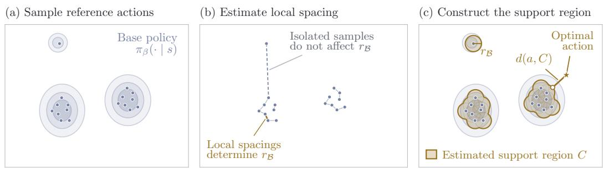  
Figure 2. GSBR. To implement the geometric support regularizer on a generative robot policy, draw samples from $\pi _ { \beta } ( \cdot \mid s )$ and compute the nearest-neighbor distance between them. Set $_ { r _ { B } }$ to a quantile over these distances and construct the support region $C$ as the union of balls of radius $_ { r _ { B } }$ around each sample. The behavior regularizer loss is computed as the Euclidean distance to the closest point in $C .$

where $[ x ] _ { + } = \operatorname* { m a x } ( x , 0 )$ . We train the actor with Equation 4 by setting $\ell _ { \mathrm { b e h } } = \ell _ { \mathrm { G S B R } }$

Because ℓ depends on $\boldsymbol { B }$ only through the nearest reference, an actor that observes all of $\boldsymbol { B }$ can move to any sampled mode at zero cost. This distinguishes GSBR from regularizers that tie each action to a single sampled reference action (Park et al., 2025b; Xu et al., 2026), which retain the base policy’s relative mode frequencies.

Approximation Guarantee. The following theorem shows that $\ell _ { \mathrm { G S B R } } + 2 D r$ upper bounds the true loss $\ell _ { s u p p } ;$ their expected diference is bounded and approaches zero as the number of reference samples grows.

Theorem 4.1 (Expected approximation error of the GSBR loss). Assume the action space A is compact with diameter D, and that $\pi _ { \beta } ( a \mid s )$ has continuous density. Fix any a $\in A ,$ , and define our reference action set as above.

Then, for any radius $r > 0 ,$ , define a $\lambda _ { r } > 0$ as:

$$
\lambda _ { r } : = \operatorname* { i n f } _ { c \in S _ { \beta } } \operatorname* { P r } _ { b \sim \pi _ { \beta } } \left( \| b - c \| _ { 2 } \leq r \right)
$$

representing the worst-case probability over our support set that a sampled action from $\pi _ { \beta }$ falls within distance r ofa given action in $S _ { \beta }$

Thefollowing bounds then hold:

$$
\ell _ { \mathrm { s u p p } } ( a ) \leq \ell _ { \mathrm { G S B R } } ( a , B ) + 2 D r ,\tag{9}
$$

$$
\mathbb { E } _ { \boldsymbol { B } } [ \vert \ell _ { \mathrm { G S B R } } ( a , \boldsymbol { B } ) - \ell _ { \mathrm { s u p p } } ( a ) \vert ] \le 2 D r + D ^ { 2 } ( 1 - \lambda _ { r } ) ^ { N } .\tag{10}
$$

The upper bound in Equation 9 also holds with $r = r _ { B }$ where $r _ { B }$ is shown above as the quantile of the nearest-neighbor distances between base policy samples. Further, with this choice of radius, $_ { r _ { B } }$ becomes arbitrarily small as N increases, and the approximation converges uniformly over the action space in expectation:

$$
\mathbb { E } _ { \mathcal { B } } \left[ \operatorname* { s u p } _ { a \in A } | \ell _ { \mathrm { G S B R } } ( a , \mathcal { B } ) - \ell _ { \mathrm { s u p p } } ( a ) | \right] \longrightarrow 0 \qquad a s N \to \infty .\tag{11}
$$

The full proof is in Appendix A.2. The term $D ^ { 2 } ( 1 - \lambda _ { r } ) ^ { N }$ accounts for the event that no reference lies within radius r of the in-distribution action nearest to $^ { a , }$ and it vanishes as $N \to \infty ;$ The term 2Dr bounds the error caused by subtracting the quantile radius.

We note that for generative policies, such as flow matching, they theoretically assign nonzero likelihood to every action (Lipman et al., 2023). Instead, we can define our constraint with respect to some $\pi _ { \epsilon }$ derived through filtering for actions such that $\pi _ { \beta } ( a | s ) \geq \epsilon$ , but we found this was not necessary in practice.

Algorithm 1 Online RL with GSBR   
Require: $\pi _ { \beta } , { \cal D } _ { \mathrm { o f f } } , N , q , \alpha .$   
1 Initialize $\pi _ { \theta } , Q _ { \phi } , Q _ { \bar { \phi } } ,$ ,and $\mathcal { D } _ { \mathrm { o n } } .$   
2 for each environment interaction do   
3 Sample $\boldsymbol { B } \sim \pi _ { \beta } ( \cdot \mid s ) ^ { N } ;$ ; execute $a \sim \pi _ { \theta } ( \cdot \mid s , B )$ and store the transition in $\mathcal { D } _ { \mathrm { o n } }$   
4 for each gradient update do   
5 Sample minibatch $( s , a , r , s ^ { \prime } ) \sim \mathcal { D } _ { \mathrm { o f f } }$ and $\mathcal { D } _ { \mathrm { o n } }$   
Train the critic   
6 Sample $\boldsymbol { B } ^ { \prime } \sim \pi _ { \beta } ( { \cdot } \mid s ^ { \prime } ) ^ { N }$ and $a ^ { \prime } \sim \pi _ { \theta } ( \cdot \mid s ^ { \prime } , B ^ { \prime } ) $   
7 Update ϕ to minimize $\mathbb { E } \Big [ \big ( Q _ { \phi } ( s , a ) - r - \gamma Q _ { \bar { \phi } } ( s ^ { \prime } , a ^ { \prime } ) \big ) ^ { 2 } \Big ]$   
Train the actor with geometric support regularization   
8 Sample $\mathcal { B } = \{ b _ { i } \} _ { i = 1 } ^ { N } \sim \pi _ { \beta } ( \cdot \mid s ) ^ { N }$ and $a _ { \theta } \sim \pi _ { \theta } ( \cdot \mid s , B )$   
9 $r _ { B } \gets \mathrm { Q }$ uantile $_ q \left( \{ \operatorname* { m i n } _ { j \neq i } \| b _ { i } - b _ { j } \| _ { 2 } \} _ { i = 1 } ^ { N } \right)$   
10 Update θ to minimize $\mathbb { E } _ { \mathrm { b a t c h } } [ - Q _ { \phi } ( s , a _ { \theta } ) + \alpha$ [mini $\| a _ { \theta } - b _ { i } \| _ { 2 } - r _ { B } \| _ { + } ^ { 2 } ]$   
11 end for   
12 end for

## 4.3 Practical Implementation

Algorithm 1 summarizes GSBR. Training alternates between environment interaction and gradient updates. Training always samples from a replay bufer  that mixes online and ofline transitions. The learned actor receives the state and a set of reference actions  as inputs. The algorithm has hyperparameters: N - number of sample actions, q - quantile that afects the size of the radius, and α - that controls the strength of the behavior regularizer.

## 5 Experimental Results

In this section, we empirically evaluate the performance of GSBR against previous online RL methods that leverage a frozen base policy across benchmarks covering both state and pixel inputs with MLP and VLA base policies. Throughout our experiments, we answer the following questions: (1) Is GSBR an efective behavior regularizer for online RL, (2) how sensitive is GSBR to the choice of support radius and number of samples, and (3) how well does GSBR estimate the true support region?

## 5.1 Experimental Setup

Benchmarks. We evaluate all methods on 19 tasks across four benchmarks, each having diferent properties that may change the distribution of base policies. In RoboMimic (Mandlekar et al., 2022), we select four challenging tasks: can-mh, square-mh, transport-mh, and tool-hang-ph. Each task contains demonstrations collected by human operators of various proficiency levels and captures challenges like precise alignment and bimanual coordination. We test five variants of the cube-triple-task 1-5 in OGBench (Park et al., 2025a). These long-horizon tasks contain a play-style exploration dataset that may lead to a base policy with many action modes and test the RL actor’s ability to drop bad actions while exploring better ones. The recently released benchmark OCBench (Park & Levine, 2026) provides a more realistic dataset that emulates the statistical properties of human demonstrations. We select block-lite-double-task 1-2 and chamber-lite-easy-task 1-3 . In these three benchmarks, the base policy is an MLP behavior cloning policy trained on only the task-specific dataset, and both the base and RL policies receive state information from the simulator. To test each method on more realistic settings, we also experiment on LIBERO (Liu et al., 2023) with the fine-tuned $\pi _ { 0 . 5 } – \mathrm { L I B E R O }$ base policy using pixel inputs. We hand-picked five tasks where the base VLA leaves room for improvement: task 14, 29, 54, 60, 64 . On these image-based tasks, the RL network trains a CNN from scratch. Since the π policy is slow to sample from, we cache a set of reference actions and sample from these instead of sampling from the policy at each training step.

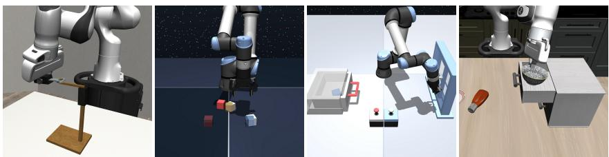  
Figure 3. Benchmarks. We evaluate our method across the four benchmarks above. From left to right, the tasks are RoboMimic tool-hang, OGBench cube-triple-task4, OCBench chamber-lite-easy-task3, and LIBERO task29.

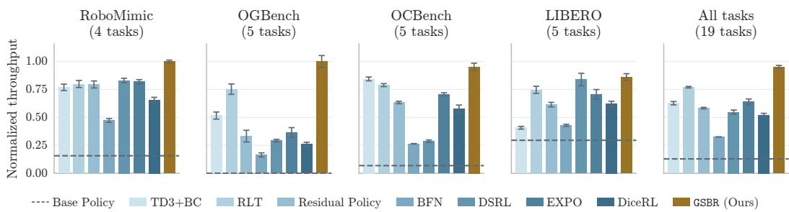  
Figure 4. Normalized throughput across benchmarks. GSBR achieves the highest average normalized throughput across all 19 tasks and leads all baselines on RoboMimic, OGBench, and OCBench. Throughput (success rate / mean episode length) is normalized by the best method’s seed-average value per task, then avera ed across tasks. Error bars show SEM across seeds.

Baselines. We compare GSBR with seven online RL baselines. TD3+BC (Fujimoto & Gu, 2021) trains a state-conditioned actor with a Q-maximization objective and a squared regression penalty to base policy samples. For expressive base policies, TD3+BC regularizes the action to the mean of the reference action distribution. RLT (Xu et al., 2026) conditions a Gaussian chunk actor on a single sampled base polic chunk and penalizes deviation from that specific reference. While the conditioning alleviates the mode averaging problem, RLT cannot drop action modes. Residual Policy (Silver et al., 2018; Johannink et al., 2019) scales and adds a learned correction to a sampled base policy action, so its deviation from the base policy proposal is limited. We follow the formulation of Dong et al. (2026a) and learn an action chunked residual policy conditioned on the base policy input. BFN (Li et al., 2025) does not learn an explicit actor, instead formulating it as the base policy sample that maximizes the Q value. This is analogous to a hard support constraint since the implicit actor cannot enerate actions outside the base olic ’s su ort. DSRL (Wa enmaker et al. 2025) learns to steer the frozen base policy through its latent noise rather than directly producing corrected actions, also limiting the possible actions to the support of the base policy. We use the DSRL-NA variant for the state-based tasks and the DSRL-SAC variant for LIBERO. EXPO-FT (Dong et al., 2026a) combines bounded residual edit policy with best-of-N sampling at test-time to achieve mode selection. For a fair comparison, we freeze the base policy. DICE-RL (Sun & Song, 2026) learns latent-conditioned residual corrections to base policy samples, applies selective BC regularization on the residual policy, and applies best-of-N sampling.

All methods use the same ofline data, online interaction budget, network size, and architecture. They also share training settings, including the action-chunk horizon, discount factor, and critic configuration. For each task, we evaluate each policy for 50 episodes and report the mean and standard error of the mean (SEM) across three seeds.

## 5.2 Results

Is GSBR an efective behavior regularizer for online RL? GSBR demonstrates strong empirical performance across benchmarks compared to the baselines. As shown in Figure 4 and Table 1, across

<table><tr><td>Method</td><td>RoboMimic (4 tasks)</td><td>OGBench (5 tasks)</td><td>OCBench (5 tasks)</td><td>LIBERO (5 tasks)</td><td>All tasks (19 tasks)</td></tr><tr><td>Base Policy</td><td>44</td><td>0</td><td>41</td><td>49</td><td>33</td></tr><tr><td>TD3+BC</td><td> $9 6 \pm 2$ </td><td> $7 3 \pm 1$ </td><td> $9 8 \pm 0$ </td><td> $5 4 \pm 2$ </td><td> $7 9 \pm 1$ </td></tr><tr><td>RLT</td><td> $9 6 \pm 2$ </td><td> $9 0 \pm 5$ </td><td> $9 8 \pm 0$ </td><td> ${ \bf 8 6 \pm 2 }$ </td><td> $9 2 \pm 1$ </td></tr><tr><td>Residual Policy</td><td> ${ 9 4 \pm 2 }$ </td><td> $6 8 \pm 1 0$ </td><td> $9 5 \pm 0$ </td><td> $7 8 \pm 1$ </td><td> $8 3 \pm 2$ </td></tr><tr><td>BFN</td><td> $8 6 \pm 2$ </td><td> $6 9 \pm 5$ </td><td> $8 8 \pm 2$ </td><td> $6 6 \pm 1$ </td><td> $7 7 \pm 1$ </td></tr><tr><td>DSRL</td><td> $9 7 \pm 1$ </td><td> $6 7 \pm 5$ </td><td> $8 7 \pm 2$ </td><td> $8 1 \pm 2$ </td><td> $8 2 \pm 2$ </td></tr><tr><td>EXPO</td><td> $9 7 \pm 1$ </td><td> $8 0 \pm 1$ </td><td> $9 8 \pm 1$ </td><td> $8 2 \pm 2$ </td><td> $8 9 \pm 1$ </td></tr><tr><td>DiceRL</td><td> $9 5 \pm 1$ </td><td> $4 0 \pm 1$ </td><td> $9 7 \pm 1$ </td><td> $7 4 \pm 1$ </td><td> $7 5 \pm 1$ </td></tr><tr><td>GSBR (Ours)</td><td> ${ \bf 9 8 \pm 0 }$ </td><td> ${ \bf 9 9 \pm 1 }$ </td><td> ${ \bf 9 9 \pm 0 }$ </td><td> $8 5 \pm 1$ </td><td> ${ \bf 9 5 \pm 0 }$ </td></tr></table>

Table 1. Average success rate (%) across benchmarks. Uncertainty is SEM across three seed-wise task averages. Values are rounded to the nearest integer; bold marks the highest unrounded mean in each column. Base Policy SEM is omitted because complete per-seed evidence is unavailable.

19 tasks, GSBR achieves 95% success rate and 0.95 normalized throughput, while the next-best baseline, RLT, achieves 92% success rate and 0.77 normalized throughput. On RoboMimic, while most methods have a similar success rate at around 95%, GSBR achieves the highest throughput, surpassing the next-best method, DSRL, by 20%. On OGBench, GSBR achieves a near-perfect success rate across all five tasks, which is about 9 percentage points higher in success rate and 33% (relative) higher throughput compared to RLT, the strongest baseline. On OCBench, most methods achieve a near-perfect success rate yet GSBR has approximately 13% higher throughput than TD3+BC.

Further, we evaluate the performance of our behavior regularizer on LIBERO with a modern VLA as the base policy. Using $\pi _ { 0 . 5 ^ { - } } \mathrm { L I B E R O } .$ , the strongest baseline is DSRL in terms of throughput at 0.84 and RLT in terms of success rate at 86%. GSBR achieves 85% success rate and 0.86 normalized throughput, closely matching or beating the best baselines on either metric. These results demonstrate that GSBR provides an efective behavior regularizer that empirically outperforms baselines in success rate and throughput, indicating that our regularizer allows the maximum deviation from the base policy while providing stabilizing guidance. For additional experimental detail and results, refer to Appendix A.4.1 and A.4.2

How sensitive is GSBR to the choice of support radius and number of samples? We sweep over a range of N, the number of base policy samples used to compute the behavior regularizer loss on cube-triple (Table 2) and find little efect on the performance of GSBR. The normalized through- put for N = 8, N = 16, and N = 32 is 1.0, 0.91, and 0.93, respectively. These results suggest that as few as eight samples from the base policy suf- fice for efective behavior regularization on these tasks.

We also ablate the efect of computing the support radius r (Table 3). With $r _ { B } = 0 .$ , the through- put degrades significantly to only 0.66. This abla- tion supports the benefit of leaving neighborhoods around reference actions unpenalized, unlike in other prior works, allowing the actor to refine its actions within these neighborhoods without being pulled toward individual samples.

<table><tr><td>Reference count N</td><td>Normalized TP</td></tr><tr><td>8 (Ours)</td><td> ${ \bf 1 . 0 0 \pm 0 . 0 5 }$ </td></tr><tr><td>16</td><td> $0 . 9 1 \pm 0 . 0 2$ </td></tr><tr><td>32</td><td> $0 . 9 3 \pm 0 . 0 2$ </td></tr></table>

Table 2. Reference-count ablation. On cube-triple, the number of base policy samples, N, has little efect on performance.

<table><tr><td>Support radius ablation</td><td>Normalized TP</td></tr><tr><td> $r _ { B } = 0$ </td><td> $0 . 6 6 \pm 0 . 0 7$ </td></tr><tr><td>GSBR (Ours)</td><td> ${ \bf 1 . 0 0 \pm 0 . 0 5 }$ </td></tr></table>

Table 3. Support-radius ablation. Removing the support radius, r , significantly reduces normalized throughput on cube-triple.

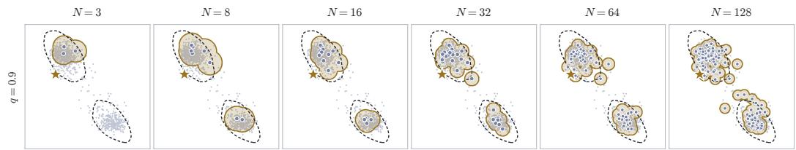  
Figure 5. Visualization of the true and estimated support region on cube-triple. The estimated support region (in bronze) closely matches the true support using only 8 samples. The RL actor learned an action just outside the support region (marked with star).

How well do we approximate the true support region? Figure 5 shows the empirical support of the base policy visualized on a bimodal state in cube-triple. We visualize the first two action dimensions using $q = 0 . 9$ , and the zero-penalty estimated support region C is marked in golden bronze. We estimate the true support of the base policy with KDE cutof at 95% from 5,000 base- policy samples. With only N = 3 references, the sampled actions cover one mode and miss the other. At $N = 8 ,$ , the zero-penalty region already captures both modes while leaving the low-density gap between them penalized. As N increases, the support radius shrinks as the local spacing between samples becomes tighter. On this particular state, the trained RL actor predicts an action slightly beyond the true support, which incurs little loss as it is close to the support region.

## 6 Conclusions

Foundation models ofer an appealing behavior prior for sample-eficient online RL, which raises the question of how to regularize an actor toward such a prior while still allowing it to improve. We introduce GSBR, a geometric support behavior regularizer that provides suficient guidance without overconstraining policy improvement. We provide a theoretically motivated implementation that estimates the ideal loss using base policy samples. GSBR demonstrated strong empirical performance: Across 19 tasks on four robotic benchmarks, GSBR raises the average success rate from 33% for the base policy to 95%, achieving the highest average success rate and throughput among all compared methods, with about 23% higher normalized throughput than the best prior method.

One limitation of the method is that it uses multiple base policy samples at test-time, which may impose compute overhead and introduce more inference latency. Further, GSBR introduces an extra hyperparameter, the quantile q, compared to other common methods. Although we tuned q for the best performance, fortunately, Figure 7 shows reasonable performance across the full range of possible values. Validating GSBR on real robots is a natural next step. Future work could also explore alternative ways to construct the support radius that could improve performance or reduce hyperparameter count.

## Acknowledgments

This research was supported by ONR N00014-25-1-2060. We would like to thank Seohong Park, Louis McConnell, Chongyi Zheng, and Zhiyuan Zhou for helpful discussion and feedback on the paper; we thank Jagdeep Bhatia and Qiyang Li for providing code prototype and early discussion. We thank the Google TPU Research Cloud (TRC) program for providing TPU compute resources. This research also used the Savio computational cluster resource provided by the Berkeley Research Computing program at UC Berkeley.

## Author Contributions

CX led the project, developed the core idea and method, designed and conducted experiments, and led manuscript writing and figure preparation. JB developed the theory and experimental analysis, helped iterate the method, contributed to the training infrastructure, conducted experiments, and

contributed to writing. LK and SL provided valuable guidance and feedback throughout the project and contributed to manuscript writing and revision.

## References

Lars Ankile, Anthony Simeonov, Idan Shenfeld, Marcel Torne, and Pulkit Agrawal. From imitation to refinement—residual RL for precise assembly, 2024. URL https://arxiv.org/abs/2407. 16677.

Philip J. Ball, Laura Smith, Ilya Kostrikov, and Sergey Levine. Eficient online reinforcement learning with ofline data. In Proceedings of the 40th International Conference on Machine Learning, volume 202, pp. 1577–1594. PMLR, 2023. URL https://proceedings.mlr.press/v202/ ball23a.html.

Kevin Black, Noah Brown, Danny Driess, Adnan Esmail, Michael Equi, Chelsea Finn, Niccolo Fusai, Lachy Groom, Karol Hausman, Brian Ichter, Szymon Jakubczak, Tim Jones, Liyiming Ke, Sergey Levine, Adrian Li-Bell, Mohith Mothukuri, Suraj Nair, Karl Pertsch, Lucy Xiaoyang Shi, James Tanner, Quan Vuong, Anna Walling, Haohuan Wang, and Ury Zhilinsky. π0: A vision-languageaction flow model for general robot control, 2024. URL https://arxiv.org/abs/2410.24164.

Xinyue Chen, Che Wang, Zijian Zhou, and Keith Ross. Randomized ensembled double q-learning: Learning fast without a model, 2021. URL https://arxiv.org/abs/2101.05982.

Yuhui Chen, Shuai Tian, Shugao Liu, Yingting Zhou, Haoran Li, and Dongbin Zhao. ConRFT: A reinforced fine-tuning method for VLA models via consistency policy, 2025. URL https: //arxiv.org/abs/2502.05450.

Perry Dong, Kuo-Han Hung, Tian Gao, Dorsa Sadigh, and Chelsea Finn. EXPO-FT: Sample-eficient reinforcement learning finetuning for vision-language-action models, 2026a. URL https:// arxiv.org/abs/2605.25477.

Perry Dong, Qiyang Li, Dorsa Sadigh, and Chelsea Finn. EXPO: Stable reinforcement learning with expressive policies. In International Conference on Learning Representations, 2026b. URL https://arxiv.org/abs/2507.07986.

Linjiajie Fang, Ruoxue Liu, Jing Zhang, Wenjia Wang, and Bing-Yi Jing. Difusion actor-critic: Formulating constrained policy iteration as difusion noise regression for ofline reinforcement learning. In International Conference on Learning Representations, 2025. URL https:// arxiv.org/abs/2405.20555.

Scott Fujimoto and Shixiang Shane Gu. A minimalist approach to ofline reinforcement learning. In Advances in Neural Information Processing Systems, 2021. URL https://arxiv.org/abs/ 2106.06860.

Scott Fujimoto, David Meger, and Doina Precup. Of-policy deep reinforcement learning without exploration. In Proceedings of the 36th International Conference on Machine Learning, volume 97, pp. 2052–2062. PMLR, 2019. URL https://proceedings.mlr.press/v97/fujimoto19a. html.

Tuomas Haarnoja, Aurick Zhou, Pieter Abbeel, and Sergey Levine. Soft actor-critic: Of-policy maximum entropy deep reinforcement learning with a stochastic actor. In Proceedings of the 35th International Conference on Machine Learning, volume 80 of Proceedings of Machine Learning Research, pp. 1861–1870, 2018. URL https://proceedings.mlr.press/v80/ haarnoja18b.html.

Philippe Hansen-Estruch, Ilya Kostrikov, Michael Janner, Jakub Grudzien Kuba, and Sergey Levine. IDQL: Implicit Q-learning as an actor-critic method with difusion policies, 2023. URL https: //arxiv.org/abs/2304.10573.

Takuya Hiraoka, Takahisa Imagawa, Taisei Hashimoto, Takashi Onishi, and Yoshimasa Tsuruoka. Dropout Q-functions for doubly eficient reinforcement learning. In International Conference on Learning Representations, 2022. URL https://arxiv.org/abs/2110.02034.

Hengyuan Hu, Suvir Mirchandani, and Dorsa Sadigh. Imitation bootstrapped reinforcement learning, 2023. URL https://arxiv.org/abs/2311.02198.

Physical Intelligence, Bo Ai, Ali Amin, Raichelle Aniceto, Ashwin Balakrishna, Greg Balke, Kevin Black, George Bokinsky, Shihao Cao, Thomas Charbonnier, Vedant Choudhary, Foster Collins, Ken Conley, Grace Connors, James Darpinian, Karan Dhabalia, Maitrayee Dhaka, Jared DiCarlo, Danny Driess, Michael Equi, Adnan Esmail, Yunhao Fang, Chelsea Finn, Catherine Glossop, Thomas Godden, Ivan Goryachev, Lachlan Groom, Haroun Habeeb, Hunter Hancock, Karol Hausman, Gashon Hussein, Victor Hwang, Brian Ichter, Connor Jacobsen, Szymon Jakubczak, Rowan Jen, Tim Jones, Gregg Kammerer, Ben Katz, Liyiming Ke, Mairbek Khadikov, Chandra Kuchi, Marinda Lamb, Devin LeBlanc, Brendon LeCount, Sergey Levine, Xinyu Li, Adrian Li-Bell, Vladislav Lialin, Zhonglin Liang, Wallace Lim, Yao Lu, Enyu Luo, Vishnu Mano, Nandan Marwaha, Aikys Mongush, Liam Murphy, Suraj Nair, Tyler Patterson, Karl Pertsch, Allen Z. Ren, Gavin Schelske, Charvi Sharma, Baifeng Shi, Lucy Xiaoyang Shi, Laura Smith, Jost Tobias Springenberg, Kyle Stachowicz, Will Stoeckle, Jiaming Tang, Jimmy Tanner, Shalom Tekeste, Marcel Torne, Kyle Vedder, Quan Vuong, Anna Walling, Haohuan Wang, Jason Wang, XuDong Wang, Chris Whalen, Samuel Whitmore, Blake Williams, Charles Xu, Sukwon Yoo, Lili Yu, Wuming Zhang, Zhuoyang Zhang, and Ury Zhilinsky. π : a steerable generalist robotic foundation model with emergent capabilities, 2026. URL https://arxiv.org/abs/2604. 15483.

Tobias Johannink, Shikhar Bahl, Ashvin Nair, Jianlan Luo, Avinash Kumar, Matthias Loskyll, Juan Aparicio Ojea, Eugen Solowjow, and Sergey Levine. Residual reinforcement learning for robot control. In International Conference on Robotics and Automation, 2019. URL https: //arxiv.org/abs/1812.03201.

Moo Jin Kim, Karl Pertsch, Siddharth Karamcheti, Ted Xiao, Ashwin Balakrishna, Suraj Nair, Rafael Rafailov, Ethan Foster, Grace Lam, Pannag Sanketi, Quan Vuong, Thomas Kollar, Benjamin Burchfiel, Russ Tedrake, Dorsa Sadigh, Sergey Levine, Percy Liang, and Chelsea Finn. OpenVLA: An open-source vision-language-action model, 2024. URL https://arxiv.org/abs/2406. 09246.

Aviral Kumar, Justin Fu, George Tucker, and Sergey Levine. Stabilizing of-policy q-learning via bootstrapping error reduction. In Advances in Neural Information Processing Systems, 2019. URL https://arxiv.org/abs/1906.00949.

Qiyang Li and Sergey Levine. Q-learning with adjoint matching, 2026. URL https://arxiv. org/abs/2601.14234.

Qiyang Li, Zhiyuan Zhou, and Sergey Levine. Reinforcement learning with action chunking. In The Thirty-ninth Annual Conference on Neural Information Processing Systems, 2025. URL https://openreview.net/forum?id=XUks1Y96NR.

Yaron Lipman, Ricky T. Q. Chen, Heli Ben-Hamu, Maximilian Nickel, and Matt Le. Flow matching for generative modeling, 2023. URL https://arxiv.org/abs/2210.02747.

Bo Liu, Yifeng Zhu, Chongkai Gao, Yihao Feng, Qiang Liu, Yuke Zhu, and Peter Stone. Libero: Benchmarking knowledge transfer for lifelong robot learning. In Advances in Neural Information Processing Systems, volume 36, 2023.

Guanxing Lu, Wenkai Guo, Chubin Zhang, Yuheng Zhou, Haonan Jiang, Zifeng Gao, Yansong Tang, and Ziwei Wang. VLA-RL: Towards masterful and general robotic manipulation with scalable reinforcement learning, 2025. URL https://arxiv.org/abs/2505.18719.

Jianlan Luo, Zheyuan Hu, Charles Xu, You Liang Tan, Jacob Berg, Archit Sharma, Stefan Schaal, Chelsea Finn, Abhishek Gupta, and Sergey Levine. SERL: A software suite for sample-eficient robotic reinforcement learning, 2024. URL https://arxiv.org/abs/2401.16013.

Jianlan Luo, Charles Xu, Jefrey Wu, and Sergey Levine. Precise and dexterous robotic manipulation via human-in-the-loop reinforcement learning. Science Robotics, 2025. doi: 10.1126/scirobotics. ads5033. URL https://arxiv.org/abs/2410.21845.

Ajay Mandlekar, Danfei Xu, Josiah Wong, Soroush Nasiriany, Chen Wang, Rohun Kulkarni, Li Fei-Fei, Silvio Savarese, Yuke Zhu, and Roberto Mart´ın-Mart´ın. What matters in learning from ofline human demonstrations for robot manipulation. In Proceedings of the 5th Conference on Robot Learning, volume 164, pp. 1678–1690. PMLR, 2022.

Max Sobol Mark, Tian Gao, Georgia Gabriela Sampaio, Mohan Kumar Srirama, Archit Sharma, Chelsea Finn, and Aviral Kumar. Policy agnostic RL: Ofline RL and online RL fine-tuning of any class and backbone, 2024. URL https://arxiv.org/abs/2412.06685.

Mitsuhiko Nakamoto, Yuexiang Zhai, Anikait Singh, Max Sobol Mark, Yi Ma, Chelsea Finn, Aviral Kumar, and Sergey Levine. Cal-QL: Calibrated ofline RL pre-training for eficient online finetuning. In Advances in Neural Information Processing Systems, 2023. URL https://arxiv. org/abs/2303.05479.

Mitsuhiko Nakamoto, Oier Mees, Aviral Kumar, and Sergey Levine. Steering your generalists: Improving robotic foundation models via value guidance, 2024. URL https://arxiv.org/ abs/2410.13816.

Seohong Park and Sergey Levine. Behavioral Cloning Mystery. ArXiv, abs/2610.07056, 2026.

Seohong Park, Kevin Frans, Benjamin Eysenbach, and Sergey Levine. Ogbench: Benchmarking ofline goal-conditioned rl. In International Conference on Learning Representations, 2025a.

Seohong Park, Qiyang Li, and Sergey Levine. Flow q-learning. In Proceedings of the 42nd International Conference on Machine Learning, volume 267, pp. 48104–48127. PMLR, 2025b. URL https://proceedings.mlr.press/v267/park25f.html.

Physical Intelligence, Ali Amin, Raichelle Aniceto, Ashwin Balakrishna, Kevin Black, Ken Conley, Grace Connors, James Darpinian, Karan Dhabalia, Jared DiCarlo, Danny Driess, Michael Equi, Adnan Esmail, Yunhao Fang, Chelsea Finn, Catherine Glossop, Thomas Godden, Ivan Gory- achev, Lachy Groom, Hunter Hancock, Karol Hausman, Gashon Hussein, Brian Ichter, Szymon Jakubczak, Rowan Jen, Tim Jones, Ben Katz, Liyiming Ke, Chandra Kuchi, Marinda Lamb, Devin LeBlanc, Sergey Levine, Adrian Li-Bell, Yao Lu, Vishnu Mano, Mohith Mothukuri, Suraj Nair, Karl Pertsch, Allen Z. Ren, Charvi Sharma, Lucy Xiaoyang Shi, Laura Smith, Jost To- bias Springenberg, Kyle Stachowicz, Will Stoeckle, Alex Swerdlow, James Tanner, Marcel Torne, Quan Vuong, Anna Walling, Haohuan Wang, Blake Williams, Sukwon Yoo, Lili Yu, Ury Zhilinsky, and Zhiyuan Zhou. $\pi _ { 0 . 6 } ^ { * } \colon$ A VLA that learns from experience, 2025. URL https://arxiv.org/abs/2511.14759.

Yuhang Ran, Yi-Chen Li, Fuxiang Zhang, Zongzhang Zhang, and Yang Yu. Policy regularization with dataset constraint for ofline reinforcement learning. In Proceedings ofthe 40th International Conference on Machine Learning, volume 202, pp. 28701–28717. PMLR, 2023. URL https: //proceedings.mlr.press/v202/ran23a.html.

Allen Z. Ren, Justin Lidard, Lars L. Ankile, Anthony Simeonov, Pulkit Agrawal, Anirudha Majumdar, Benjamin Burchfiel, Hongkai Dai, and Max Simchowitz. Difusion policy policy optimization, 2024. URL https://arxiv.org/abs/2409.00588.

Tom Silver, Kelsey Allen, Josh Tenenbaum, and Leslie Kaelbling. Residual policy learning, 2018. URL https://arxiv.org/abs/1812.06298.

Zhanyi Sun and Shuran Song. From prior to pro: Eficient skill mastery via distribution contractive RL finetuning, 2026. URL https://arxiv.org/abs/2603.10263.

Denis Tarasov, Vladislav Kurenkov, Alexander Nikulin, and Sergey Kolesnikov. Revisiting the minimalist approach to ofline reinforcement learning, 2023. URL https://arxiv.org/abs/ 2305.09836.

Andrew Wagenmaker, Mitsuhiko Nakamoto, Yunchu Zhang, Seohong Park, Waleed Yagoub, Anusha Nagabandi, Abhishek Gupta, and Sergey Levine. Steering your difusion policy with latent space reinforcement learning, 2025. URL https://arxiv.org/abs/2506.15799.

Zhendong Wang, Jonathan J. Hunt, and Mingyuan Zhou. Difusion policies as an expressive policy class for ofline reinforcement learning. In International Conference on Learning Representations, 2023. URL https://arxiv.org/abs/2208.06193.

Jialong Wu, Haixu Wu, Zihan Qiu, Jianmin Wang, and Mingsheng Long. Supported policy optimization for ofline reinforcement learning. In Advances in Neural Information Processing Systems, 2022. URL https://arxiv.org/abs/2202.06239.

Yifan Wu, George Tucker, and Ofir Nachum. Behavior regularized ofline reinforcement learning, 2019. URL https://arxiv.org/abs/1911.11361.

Wenli Xiao, Haotian Lin, Andy Peng, Haoru Xue, Tairan He, Yuqi Xie, Fengyuan Hu, Jimmy Wu, Zhengyi Luo, Linxi Fan, Guanya Shi, and Yuke Zhu. Self-improving vision-language-action models with data generation via residual RL, 2025. URL https://arxiv.org/abs/2511. 00091.

Charles Xu, Jost Tobias Springenberg, Michael Equi, Ali Amin, Adnan Esmail, Sergey Levine, and Liyiming Ke. RL Token: Bootstrapping online RL with vision-language-action models, 2026. URL https://arxiv.org/abs/2604.23073.

Seonghyeon Ye, Yunhao Ge, Kaiyuan Zheng, Shenyuan Gao, Sihyun Yu, George Kurian, Suneel Indupuru, You Liang Tan, Chuning Zhu, Jiannan Xiang, Ayaan Malik, Kyungmin Lee, William Liang, Nadun Ranawaka, Jiasheng Gu, Yinzhen Xu, Guanzhi Wang, Fengyuan Hu, Avnish Narayan, Johan Bjorck, Jing Wang, Gwanghyun Kim, Dantong Niu, Ruijie Zheng, Yuqi Xie, Jimmy Wu, Qi Wang, Ryan Julian, Danfei Xu, Yilun Du, Yevgen Chebotar, Scott Reed, Jan Kautz, Yuke Zhu, Linxi ”Jim” Fan, and Joel Jang. World action models are zero-shot policies, 2026. URL https://arxiv.org/abs/2602.15922.

## A Appendix

## A.1 Practical Implementation

In this section, we discuss some of the practical implementation choices for our method.

Action chunking. Both the base policy and RL policy learn over action chunks of H consecutive steps, which vary between three and ten depending on the domain. During rollout and evaluation, we execute the entire action chunk before querying the next one.

Reference action conditioning. Following Xu et al. (2026), we condition the RL actor on N reference action samples to provide additional learning signal and guidance. During training, we apply 50% dropout to prevent the actor from copying the reference action.

Using demo data. Following Ball et al. (2023), we store separate ofline and online replay bufers $\mathcal { D } _ { \mathrm { o f f } }$ and $\mathcal { D } _ { \mathrm { o n } }$ to maintain a 50/50 sampling ratio between demo and online data.

Critic ensemble. We train an ensemble of10 Q networks $\{ Q _ { \phi _ { k } } \} _ { k = 1 } ^ { K }$ and use the following pessimistic target value

$$
y = R + \gamma ^ { H } m \left( \mu _ { \bar { \phi } } ( s ^ { \prime } , \widetilde { a } ^ { \prime } ) - { \textstyle { \frac { 1 } { 2 } } } \sigma _ { \bar { \phi } } ( s ^ { \prime } , \widetilde { a } ^ { \prime } ) \right)\tag{12}
$$

where $\mu _ { \bar { \phi } } ( s ^ { \prime } , \widetilde { a } ^ { \prime } )$ and $\sigma _ { \bar { \phi } } ( s ^ { \prime } , \widetilde { a } ^ { \prime } )$ are the mean and standard deviation over the 10 target Q networks. Here R is the discounted chunk reward (Equation 14), m is the bootstrap mask, and $\widetilde { a } ^ { \prime } \sim \pi _ { \theta } ( \cdot \mid s ^ { \prime } , B ^ { \prime } )$ with next-state references $\begin{array} { r } { B ^ { \prime } \sim \pi _ { \beta } ( \cdot \mid s ^ { \prime } ) ^ { N } } \end{array}$ . The chunk discount is $\gamma ^ { H }$ for a per-step discount; for LIBERO, we use the configured per-chunk discount directly. The main-text critic objective and Algorithm 1 use single-step notation.

## A.2 Proof of Theorem 4.1

Theorem 4.1 restated: Assume the action space A is compact with diameter $D ,$ , and that $\pi _ { \beta } ( a \mid s )$ has continuous density. Fix any $a \in A ,$ , and define our reference action set as above.

Then,for any radius $r > 0 ,$ , define a $\lambda _ { r } > 0$ as:

$$
\lambda _ { r } : = \operatorname* { i n f } _ { c \in S _ { \beta } } \operatorname* { P r } _ { b \sim \pi _ { \beta } } \left( \| b - c \| _ { 2 } \leq r \right)
$$

representing the worst-case probability over our support set that a sampled action from $\pi _ { \beta }$ falls within distance r ofa given action in $S _ { \beta }$

Thefollowing bounds then hold:

$$
\begin{array} { r l r } & { } & { \ell _ { \mathrm { s u p p } } ( a ) \le \ell _ { \mathrm { G S B R } } ( a , \mathcal { B } ) + 2 D r , } \\ & { } & { \mathbb { E } _ { \mathcal { B } } [ | \ell _ { \mathrm { G S B R } } ( a , \mathcal { B } ) - \ell _ { \mathrm { s u p p } } ( a ) | ] \le 2 D r + D ^ { 2 } ( 1 - \lambda _ { r } ) ^ { N } . } \end{array}
$$

The upper bound in Equation $^ { 9 }$ also holds with $r = r _ { B }$ where $r _ { B }$ is shown above as the quantile of the nearest-neighbor distances between base policy samples. Further, with this choice of radius, $_ { r _ { B } }$ becomes arbitrarily small as N increases, and the approximation converges uniformly over the action space in expectation:

$$
\mathbb { E } _ { \mathcal { B } } \left[ \operatorname* { s u p } _ { a \in A } | \ell _ { \mathrm { G S B R } } ( a , \mathcal { B } ) - \ell _ { \mathrm { s u p p } } ( a ) | \right] \longrightarrow 0 \qquad a s N \to \infty .
$$

Proof. We first show that $\lambda _ { r } > 0$ . Since $S _ { \beta }$ is compact, it can be covered by finitely many balls of radius $r / 2$ centered in $S _ { \beta }$ . Each has positive probability under $\pi _ { \beta }$ , because its center belongs to the support of $\pi _ { \beta }$ . For every $c \in S _ { \beta }$ , some covering ball has its center within $r / 2$ of $c ,$ so that entire ball lies within distance r of c. Thus $\lambda _ { r }$ is at least the smallest probability among these finitely many covering balls, which is positive.

Now fix an action $a \in { \mathcal { A } }$ and write

$$
\rho _ { a } : = d ( a , S _ { \beta } ) , \qquad X : = d ( a , B ) , \qquad t : = [ X - r ] _ { + } .
$$

Because $\rho _ { a } = d ( a , S _ { \beta } )$ and $B \subseteq S _ { \beta }$ , we have $\rho _ { a } \leq X$ . Since $\rho _ { a } \leq X , X - t = \operatorname* { m i n } \{ X , r \} \leq r$ and $X + t \le 2 D$ , we have

$$
\ell _ { \mathrm { s u p p } } ( a ) - \ell _ { \mathrm { G S B R } } ( a , B ) = \rho _ { a } ^ { 2 } - t ^ { 2 } \leq X ^ { 2 } - t ^ { 2 } = ( X - t ) ( X + t ) \leq 2 D r .
$$

Thus, adding $\ell _ { \mathrm { G S B R } } ( a , B )$ to both sides shows that the GSBR penalty plus 2Dr upper bounds the support penalty:

$$
\ell _ { \mathrm { s u p p } } ( a ) \leq \ell _ { \mathrm { G S B R } } ( a , \mathcal { B } ) + 2 D r .
$$

Next for the error bound, since $S _ { \beta }$ is compact, there is a closest point $b ^ { \star } \in S _ { \beta }$ with $\| a - b ^ { \star } \| _ { 2 } = \rho _ { a }$ A reference within distance $r$ of $b ^ { \star }$ is also within distance $\rho _ { a } + r$ of $^ { a , }$ by the triangle inequality. Thus,

$$
\operatorname* { P r } _ { b \sim \pi _ { \beta } } \left( \| b - b ^ { \star } \| _ { 2 } \leq r \right) \leq \operatorname* { P r } _ { b \sim \pi _ { \beta } } \left( \| b - a \| _ { 2 } \leq \rho _ { a } + r \right)
$$

And using the definition of $\lambda _ { r }$ as the lower bound, $\lambda _ { r } \leq \operatorname* { P r } _ { b \sim \pi _ { \beta } } \left( \| b - a \| _ { 2 } \leq \rho _ { a } + r \right)$

Because the references are independent of one another and of $^ { a , }$ the probability that all N references miss this nei hborhood is at mos

$$
\operatorname* { P r } _ { B } ( X > \rho _ { a } + r \mid a ) \leq ( 1 - \lambda _ { r } ) ^ { N } .
$$

We now consider a decomposition of the expectation by partitioning on the event that $X \le \rho _ { a } + r$ On the event $X \leq \rho _ { a } + r ,$ subtracting r from both sides gives $X - r \leq \rho _ { a } .$ , and since $\rho _ { a } \geq 0 ,$ $t = [ X - r ] _ { + } \leq \rho _ { a } .$ . Therefore, the support penalty is at least the GSBR penalty, so the bound from above gives

$$
| \ell _ { \mathrm { G S B R } } ( a , \mathcal { B } ) - \ell _ { \mathrm { s u p p } } ( a ) | = \rho _ { a } ^ { 2 } - t ^ { 2 } \leq 2 D r .
$$

On the complementary event $X > \rho _ { a } + r ,$ , both penalties lie in $[ 0 , D ^ { 2 } ]$ , so their absolute diference is at most $\bar { D ^ { 2 } }$ . Combining the two events gives

$$
\begin{array} { r l } & { \mathbb { E } _ { B } \big [ | \ell _ { \mathrm { G S B R } } ( a , \mathcal { B } ) - \ell _ { \mathrm { s u p p } } ( a ) | \big ] \leq 2 D r \operatorname* { P r } ( X \leq \rho _ { a } + r \mid a ) + D ^ { 2 } \operatorname* { P r } ( X > \rho _ { a } + r \mid a ) } \\ & { \qquad \leq 2 D r + D ^ { 2 } ( 1 - \lambda _ { r } ) ^ { N } . } \end{array}
$$

Finally, consider the quantile radius $r _ { B }$ . The one-sided bound above is pointwise in r and , so it also holds with $r = r _ { B }$

Define the largest distance from the support to the reference set by

$$
h _ { N } : = \operatorname* { s u p } _ { c \in S _ { \beta } } d ( c , B ) .
$$

For any $a \in A$ , using the notation above with $r = r _ { B }$

$$
\rho _ { a } \le X \le \rho _ { a } + h _ { N } , \qquad \rho _ { a } - r _ { \mathcal { B } } \le t = [ X - r _ { \mathcal { B } } ] _ { + } \le \rho _ { a } + h _ { N } .
$$

Thus $| t - \rho _ { a } | \leq \operatorname* { m a x } \{ h _ { N } , r _ { B } \}$ . Since both t and $\rho _ { a }$ lie in $[ 0 , D ]$ , we have, for every $a \in A$

$$
| \ell _ { \mathrm { G S B R } } ( a , \mathcal { B } ) - \ell _ { \mathrm { s u p p } } ( a ) | = | t ^ { 2 } - \rho _ { a } ^ { 2 } | \leq 2 D \operatorname* { m a x } \{ h _ { N } , r _ { \mathcal { B } } \} .
$$

To show that this error vanishes, fix any $\delta > 0$ . Cover $S _ { \beta }$ by M closed balls of radius $\delta / 2$ centered in $S _ { \beta }$ . Each ball has probability at least $\lambda _ { \delta / 2 } > 0$ . If every covering ball contains a reference, every support point is within distance δ of a reference. Therefore,

$$
\operatorname* { P r } _ { \boldsymbol { \mathcal { B } } } ( h _ { N } > \boldsymbol { \delta } ) \leq M ( 1 - \lambda _ { \boldsymbol { \delta } / 2 } ) ^ { N } .
$$

The same cover controls the quantile radius. If $u _ { i } > \delta ,$ , any covering ball containing $b _ { i }$ cannot contain another reference, since the distance between two points in that ball is at most δ. Hence at most M references have $u _ { i } > \delta$ . For all suficiently large $N , N - M \geq \lceil q N \rceil$ , so $r _ { B } \leq \delta$

For all suficiently large N, we have $r _ { B } \leq \delta .$ On the event $h _ { N } \leq \delta$ , the absolute penalty error is therefore at most 2Dδ simultaneously for every $a \in A .$ . On the complementary event, it is at most $D ^ { 2 }$ . Taking the supremum over actions and then the expectation over reference samples gives

$$
\begin{array} { r l r } {  { \mathbb { E } _ { \mathcal { B } } \bigg [ \operatorname* { s u p } _ { a \in A } \vert \ell _ { \mathrm { G S B R } } ( a , \mathcal { B } ) - \ell _ { \mathrm { s u p p } } ( a ) \vert \bigg ] \leq 2 D \delta + D ^ { 2 } \operatorname* { P r } _ { \mathcal { B } } ( h _ { N } > \delta ) } } \\ & { } & { \leq 2 D \delta + D ^ { 2 } M ( 1 - \lambda _ { \delta / 2 } ) ^ { N } . } \end{array}\tag{13}
$$

Let $\eta > 0$ be any desired error tolerance. Choose $\delta > 0$ small enough that $2 D \delta < \eta / 2$ . For this fixed $\delta , D ^ { 2 } M ( 1 - \lambda _ { \delta / 2 } ) ^ { N } \to 0 { \mathrm { ~ a s ~ } } N \to \infty$ , thus it must be less than $\eta / 2$ for all suficiently large $N$ . The expected uniform error is therefore less than η for all suficiently large N. Since $\eta > 0$ is arbitrar , the ex ected uniform error conver es to zero as $N \to \infty$ , proving Equation 11. □

## A.3 Implementation Choices

Action chunking. For robotic control, we instantiate the action space using chunks of H consecutive control actions. Each action chunk is flattened into a vector of dimension $d = H d _ { a }$ , where $d _ { a }$ is the dimension of an individual control action. In this implementation, $a , b ,$ and the references in denote action chunks. Training uses H-step replay transitions $( s , a , R , s ^ { \prime } )$ , where a concatenates the recorded control actions $a _ { t } , \dots , a _ { t + H - 1 } , s = s _ { t } , s ^ { \prime } = s _ { t + H }$ and

$$
R = \sum _ { h = 0 } ^ { H - 1 } \gamma ^ { h } r ( s _ { t + h } , a _ { t + h } ) , \qquad s = s _ { t } , \quad s ^ { \prime } = s _ { t + H } .\tag{14}
$$

Reference action conditioning. We parameterize the actor as a tanh-squashed Gaussian policy conditioned on s. To reduce the burden on the actor on learning the full distribution of the base policy and provide early-training exploration signal, we adopt the reference action passthrough mechanism from Xu et al. (2026) and additionally condition the actor on all sampled reference actions . During training, we zero the entire reference input with probability $p _ { \mathrm { d r o p } }$ . In early testing, we found that this mechanism improves initial performance without having to sample from the base policy during deployment.

Critic ensembles. To stabilize Q-learning, we train an ensemble of $K = 1 0 0$ -functions $\{ Q _ { \phi _ { k } } \} _ { k = 1 } ^ { K }$ We compute the mean and standard deviation of their target predictions as

$$
\mu _ { \bar { \phi } } ( s ^ { \prime } , a ^ { \prime } ) = \frac { 1 } { K } \sum _ { k = 1 } ^ { K } Q _ { \bar { \phi } _ { k } } ( s ^ { \prime } , a ^ { \prime } ) , \quad \sigma _ { \bar { \phi } } ( s ^ { \prime } , a ^ { \prime } ) = \sqrt { \frac { 1 } { K } \sum _ { k = 1 } ^ { K } \left( Q _ { \bar { \phi } _ { k } } ( s ^ { \prime } , a ^ { \prime } ) - \mu _ { \bar { \phi } } ( s ^ { \prime } , a ^ { \prime } ) \right) ^ { 2 } } .\tag{15}
$$

For TD learning, we use the pessimistic target and the critic loss is

$$
\begin{array} { r } { \mathcal { L } _ { Q } ( \phi _ { k } ) = \mathbb { E } _ { ( s , a , R , s ^ { \prime } ) \sim \mathcal { D } } [ [ Q _ { \phi _ { k } } ( s , a ) - R - \gamma ^ { H } m ( \mu _ { \bar { \phi } } ( s ^ { \prime } , a ^ { \prime } ) - \frac { 1 } { 2 } \sigma _ { \bar { \phi } } ( s ^ { \prime } , a ^ { \prime } ) ) ] ^ { 2 } ] . } \\ {  \quad \quad \quad \quad \quad \quad \quad \quad \quad \quad \quad \quad \quad \quad \quad \quad \quad \quad \quad \quad \quad \quad \quad \quad \quad \quad } \\ { \quad \quad \quad \quad \quad \quad \quad \quad \quad \quad \quad \quad \quad \quad \quad \quad \quad \quad \quad \quad \quad \quad \quad \quad \quad \quad \quad \quad } \\ { \quad \quad \quad \quad \quad \quad \quad \quad \quad \quad \quad \quad \quad \quad \quad \quad \quad \quad \quad \quad \quad } \\ { \quad \quad \quad \quad \quad \quad \quad \quad \quad \quad \quad \quad \quad \quad \quad \quad \quad \quad \quad \quad } \end{array}\tag{16}
$$

The discount convention follows Equation 12: for LIBERO, the configured per-chunk discount replaces $\gamma ^ { H }$ . For the actor update, we simply take the mean of the Q-values.

Bufer sampling ratio. We maintain separate ofline and online replay bufers, $\mathcal { D } _ { \mathrm { o f f } }$ and $\mathcal { D } _ { \mathrm { o n } } .$ . Fol- lowing the symmetric replay sampling strategy of RLPD (Ball et al., 2023), each training minibatch contains equal numbers of H-step sequences from the two bufers. This retains access to prior experience as new interactions accumulate.

Rollouts and deployment. During a rollout, we sample reference chunks and obtain an action chunk from the actor without reference dropout. During deployment, we can optionally skip querying the base policy and run the actor with reference actions set to zero.

## A.4 Training details

We describe the shared training protocol for the state-based benchmarks, followed by method-specific settings and the configuration used for LIBERO. Unless specified otherwise, the state-based methods use the protocol below. Our training and evaluations were done on either A5000 GPUs or TPU V5E chips. Common training settings are described in Table 6. We also report the hyperparameter sweep range and the selected values of each method in Table 7 and Table 8. We select the hyperparameter value with priority on average success rate, and favor the configuration with higher average throughput if multiple runs have success rate within 2% of each other.

## A.4.1 State-based benchmarks

Base policies and datasets. For each training seed, we use a seed-matched flow-matching behavior cloning policy trained ofline for $1 0 ^ { 6 }$ training steps. The base policy produces action chunks and remains frozen during online RL. On RoboMimic and OGBench Cube Triple, it uses a four-layer MLP with 512 units per layer and 16 Euler integration steps. On the OCBench Block and Chamber tasks, it uses a residual MLP with four 1024-unit layers and 10 Euler integration steps. We clip sam led base- olic actions to the action bounds.

For RoboMimic, we use the low-dimensional v1.5 datasets: multi-human (MH) demonstrations for Can, Square, and Transport, and proficient-human (PH) demonstrations for Tool Hang due to it not providing a MH dataset. For OGBench, we use the cube triple play dataset. For OCBench, we use the type 51 dataset shards and normalize each action dimension using its 1st and 99th percentiles.

Re la and online trainin . The RL com onents receive no ofline retrainin . We initialize online replay with 50 episodes collected by the base policy, then train with minibatches of 256 sequences, split equally between the ofline dataset and online replay. We use two gradient updates per environment step, except for the DICE-RL where we take the max performance between a UTD 2 and the efective UTD used for their results in robosuite. We do not filter transitions by success and use the environment rewards. RoboMimic supplies a binary success reward, and episodes terminate on success; Cube Triple uses the OGBench reward.

## A.4.2 LIBERO

Tasks and observations. We evaluate on LIBERO-90 tasks 14, 29, 54, 60, and 64, with an episode limit of 400 environment steps and action chunks of length $H = 1 0$ . The frozen base policy is $\pi _ { 0 . }$ 5 with the pi05 libero configuration, which receives images from both cameras and proprioception. The RL actor and critic use CNNs with a $6 4 \times 6 4$ image and an eight-dimensional state as input.

Training and evaluation. LIBERO training uses online data only, without demonstrations. Base- policy reference chunks are cached and reused. Each unsuccessful chunk receives reward 1, and a successful chunk receives reward 0. The discount factor is 0.975 per chunk, and TD targets are not clipped. We train for 1,000 trajectories with 20 gradient updates per action chunk.

Method-specific settings. For GSBR, we draw $N = 8$ reference chunks from the cache and do not apply reference dropout. We use a separate radius for each of the seven action dimensions due to the chunk horizon, with each radius shared across the chunk’s time steps.

LIBERO regularizer. For chunks with $H = 1 0$ and $d _ { a } \ = \ 7$ , we sample $N = 8$ references $\boldsymbol { B } = \{ b _ { i } \} _ { i = 1 } ^ { N }$ . Define

$$
\rho _ { k } ( x , y ) : = \left( \frac { 1 } { H } \sum _ { t = 1 } ^ { H } ( x _ { t , k } - y _ { t , k } ) ^ { 2 } \right) ^ { 1 / 2 } ,\tag{17}
$$

$$
j _ { i } \in \underset { j \neq i } { \arg \operatorname* { m i n } } \| b _ { i } - b _ { j } \| _ { F } ^ { 2 } , \qquad r _ { \mathcal { B } , k } : = \mathrm { Q u a n t i l e } _ { q } \big ( \{ \rho _ { k } ( b _ { i } , b _ { j _ { i } } ) \} _ { i = 1 } ^ { N } \big ) ,\tag{18}
$$

$$
\ell _ { \mathrm { G S B R } } ^ { \mathrm { L I B E R O } } ( a , \mathcal { B } ) : = \operatorname* { m i n } _ { i } \frac { 1 } { d _ { a } } \sum _ { k = 1 } ^ { d _ { a } } [ \rho _ { k } ( a , b _ { i } ) - r _ { \mathcal { B } , k } ] _ { + } ^ { 2 } .\tag{19}
$$

We compute quantiles using linear interpolation. Nearest neighbors are selected using full chunks, while each action dimension has its own radius. The minimum selects one reference for all dimen- sions; the penalty vanishes when all dimension-wise distances to that reference lie within their radii. We use this loss in the actor objective and sweep α and q.

## A.5 Full results

Our full per task results are shown in table 4, and 5, and visualized in figure 6.

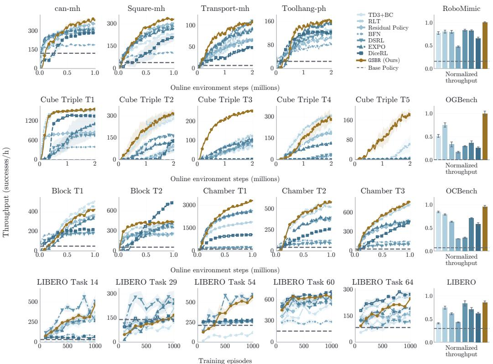

Figure 6. Absolute throughput (successes/h) over training steps
<table><tr><td>Task</td><td>BC</td><td>TD3+BC</td><td>RLT</td><td>Residual policy</td><td>BFN</td><td>DSRL</td><td>EXPO-FT</td><td>DICE-RL</td><td>GSBR (ours)</td></tr><tr><td colspan="10">RoboMimic</td></tr><tr><td>can-mh</td><td>73±1</td><td>99±0</td><td>99±0</td><td>97±1</td><td>94±2</td><td>99±0</td><td>99±0</td><td>99±0</td><td>98±1</td></tr><tr><td>square-mh</td><td>37±1</td><td>96±1</td><td>96±1</td><td>98±0</td><td>78±3</td><td>98±0</td><td>98±0</td><td>96±2</td><td>99±0</td></tr><tr><td>transport-mh</td><td>15±2</td><td>88±7</td><td>90±6</td><td>83±7</td><td>81±4</td><td>92±2</td><td>93±1</td><td>84±3</td><td>96±1</td></tr><tr><td>tool-hang-ph</td><td>50±2</td><td>97±0</td><td>97±0</td><td>97±2</td><td>90±2</td><td>96±2</td><td>95±1</td><td>98±0</td><td>98±0</td></tr><tr><td colspan="10">OGBench cube-triple</td></tr><tr><td>Task 1</td><td>0±0</td><td>100±0</td><td>100±0</td><td>100±0</td><td></td><td>100±0 100±0</td><td>98±1</td><td>100±0</td><td>100±0</td></tr><tr><td>Task 2</td><td>0±0</td><td>98±0</td><td>99±0</td><td>62±31</td><td>80±9</td><td>98±0</td><td>96±2</td><td>89±5</td><td>99±0</td></tr><tr><td>Task 3</td><td>0±0</td><td>72±7</td><td>92±1</td><td>80±16</td><td>82±4</td><td>85±1</td><td>96±2</td><td>6±3</td><td>100±0</td></tr><tr><td>Task 4</td><td>0±0</td><td>91±5</td><td>100±0</td><td>98±1</td><td>66±5</td><td>46±23</td><td>97±1</td><td>1±1</td><td>98±1</td></tr><tr><td>Task 5</td><td>0±0</td><td>0±0</td><td>58±29</td><td>0±0</td><td>15±15</td><td>4±2</td><td>8±4</td><td>0±0</td><td>95±1</td></tr><tr><td colspan="10">OCBench Lite</td></tr><tr><td>Block 1</td><td>33±5</td><td>95±1</td><td>95±1</td><td>91±1</td><td>92±1</td><td>89±1</td><td>97±1</td><td>93±2</td><td>97±1</td></tr><tr><td>Block 2</td><td>36±2</td><td>99±0</td><td>98±0</td><td>90±4</td><td>90±2</td><td>95±2</td><td>94±1</td><td>98±0</td><td>98±0</td></tr><tr><td>Chamber 1</td><td>72±3</td><td>100±0</td><td>100±0</td><td>100±0</td><td>97±0</td><td>96±2</td><td>100±0</td><td>100±0</td><td>100±0</td></tr><tr><td>Chamber 2</td><td>36±5</td><td>99±0</td><td>96±2</td><td>96±2</td><td>76±4</td><td>72±7</td><td>98±1</td><td>94±1</td><td>98±1</td></tr><tr><td>Chamber 3</td><td>26±3</td><td>98±1</td><td>98±1</td><td>97±1</td><td>84±5</td><td>80±4</td><td>98±1</td><td>99±0</td><td>100±0</td></tr><tr><td colspan="10">LIBERO</td></tr><tr><td>Task 14</td><td>16</td><td>8±4</td><td>80±2</td><td>74±4</td><td>30±4</td><td>87±2</td><td>70±5</td><td>30±2</td><td>86±2</td></tr><tr><td>Task 29</td><td>52</td><td>46±8</td><td>65±7</td><td>59±5</td><td>49±2</td><td>70±7</td><td>73±4</td><td>51±4</td><td>60±6</td></tr><tr><td>Task 54</td><td>84</td><td>56±3</td><td>95±1</td><td>93±0</td><td>96±1</td><td>96±2</td><td>94±1</td><td>97±0</td><td>94±2</td></tr><tr><td>Task 60</td><td>54</td><td>94±3</td><td>98±0</td><td>96±3</td><td>80±4</td><td>100±0</td><td>98±0</td><td>100±0</td><td>98±1</td></tr><tr><td>Task 64</td><td>40</td><td>66±6</td><td>87±3</td><td>66±3</td><td>70±2</td><td>51±2</td><td>76±2</td><td>90±3</td><td>84±2</td></tr><tr><td>can-mh</td><td>122±1</td><td>329±6</td><td> ${ 3 3 9 \pm 8 }$ </td><td> $3 8 9 \pm 2 1$ </td><td> $1 9 8 { \pm } 1 0 $ </td><td> ${ 3 0 8 \pm 7 }$ </td><td> ${ 3 1 7 \pm 5 }$ </td><td> ${ 2 8 9 2 6 }$ </td><td> ${ \bf 4 1 6 } \pm { \bf 1 6 }$ </td></tr><tr><td>square-mh</td><td>40±1</td><td>247±6</td><td> ${ 2 7 3 \pm 1 3 }$ </td><td> ${ 3 2 5 } { \pm 6 }$ </td><td> $1 1 3 { \pm } 7$ </td><td>297±6</td><td> ${ 2 7 3 \pm 3 }$ </td><td> $2 2 6 \pm 2 0$ </td><td>348±8</td></tr><tr><td>transport-mh</td><td>7±1</td><td>80±11</td><td> $8 6 { \pm } 1 1$ </td><td> $6 5 { \pm } 1 1 $ </td><td> $6 3 { \pm } 5$ </td><td> $1 0 4 { \pm } 5 $ </td><td> ${ 9 0 \pm 2 }$ </td><td> $5 2 \pm 2$ </td><td>105±2</td></tr><tr><td>tool-hang-ph</td><td> $2 4 \pm 2$ </td><td>133±3</td><td>127±5</td><td> $1 1 2 { \pm } 1 0 $ </td><td>80±7</td><td> $1 2 1 { \pm } 1 2$ </td><td> $1 4 3 { \pm } 1 0 $ </td><td> $1 2 8 { \pm } 6$ </td><td>165±3</td></tr><tr><td colspan="10">OGBench cube-triple</td></tr><tr><td>Task 1</td><td>0±0</td><td>1569±18</td><td> $1 5 6 6 { \pm } 1 4$ </td><td> ${ 8 3 8 \pm 7 }$ </td><td>405±14</td><td> $7 9 8 \pm 1 8$ </td><td> $1 0 6 5 { \pm } 3 7 1$ </td><td> $1 3 9 6 { \pm } 1 0 $ </td><td>1582±8</td></tr><tr><td>Task 2</td><td>0±0</td><td> ${ 2 6 6 \pm 3 }$ </td><td> ${ \bf 3 2 9 \pm 3 2 }$ </td><td> $9 1 \pm 4 7$ </td><td> ${ 6 0 \pm 1 3 }$ </td><td> ${ 1 7 2 \pm 3 }$ </td><td> $1 2 0 { \pm } 1 0 \ $ </td><td> $1 3 4 \pm 2 8$ </td><td> $3 2 8 \pm 2 8$ </td></tr><tr><td>Task 3</td><td>0±0</td><td> $_ { 6 4 \pm 1 2 }$ </td><td> $1 0 9 \pm 7$ </td><td> ${ 9 0 \pm 3 5 }$ </td><td>63±5</td><td> ${ 8 5 \pm 3 }$ </td><td> $1 1 7 { \pm } 1 4$ </td><td>2±1</td><td> ${ \bf 2 6 2 \pm 1 4 }$ </td></tr><tr><td>Task 4</td><td>0±0</td><td> $1 8 4 2 6 1$ </td><td>334±16</td><td> $1 7 5 { \pm } 1 0 $ </td><td>33±4</td><td> $3 2 \pm 2 0$ </td><td> $1 1 0 { \pm } 1$ </td><td>0±0</td><td> $\mathbf { 3 4 4 \pm 5 7 }$ </td></tr><tr><td>Task 5</td><td>0±0</td><td>0±0</td><td>66±36</td><td>0±0</td><td>7±7</td><td>1±0</td><td>3±2</td><td>0±0</td><td> $\mathbf { 1 7 4 } \pm \mathrm { 1 5 }$ </td></tr><tr><td colspan="10">OCBench Lite</td></tr><tr><td>Block 1</td><td> ${ } 3 2 \pm 6$ </td><td>293±8</td><td>273±4</td><td>228±11</td><td>133±5</td><td>137±7</td><td> ${ 2 2 9 \pm 1 5 }$ </td><td> $1 5 2 \pm 1 3$ </td><td> $2 7 9 \pm 1 0$ </td></tr><tr><td>Block 2</td><td> ${ } 3 7 \pm 2 { }$ </td><td>327±17</td><td> $3 4 0 { \pm } 4 2$ </td><td>184±37</td><td>185±19</td><td>243±25</td><td> $2 6 4 \pm 3$ </td><td> ${ \bf 4 2 6 } \pm { \bf 4 2 }$ </td><td> $3 6 4 \pm 2 4$ </td></tr><tr><td>Chamber 1</td><td> $\mathrm { 8 0 \pm 5 }$ </td><td>1302±33</td><td> $1 2 6 9 { \pm } 1 3$ </td><td> $1 8 1 7 { \pm } 1 8$ </td><td>161±6</td><td>157±9</td><td> $1 8 0 5 { \pm } 1 8$ </td><td> $6 9 5 { \pm 3 }$ </td><td> ${ \bf 2 3 1 1 \pm 1 8 }$ </td></tr><tr><td>Chamber 2</td><td> $2 8 { \pm } 4$ </td><td> $\mathbf { 4 0 6 } \pm 2 2$ </td><td> $3 1 6 \pm 4 7$ </td><td> $2 5 2 \pm 2 6$ </td><td>78±8</td><td> $7 3 { \pm } 1 0 $ </td><td> ${ 3 0 0 \pm 2 }$ </td><td> $1 8 0 { \pm } 8 $ </td><td> $3 8 8 \pm 3 5$ </td></tr><tr><td>Chamber 3</td><td> $2 0 { \pm } 2$ </td><td> $4 6 4 \pm 2 0$ </td><td> $4 6 0 \pm 4 7$ </td><td> $2 8 6 \pm 2 2$ </td><td>88±6</td><td> $\mathrm { 8 0 \pm 5 }$ </td><td> $3 1 7 { \pm } 3 9$ </td><td> $3 2 4 { \pm } 1 1$ </td><td> ${ \bf 5 2 2 \pm 3 2 }$ </td></tr><tr><td colspan="10">LIBERO</td></tr><tr><td>Task 14</td><td>33</td><td> ${ 1 7 \pm 9 }$ </td><td> $3 7 5 { \pm } 3 0 $ </td><td> $3 1 4 \pm 4 2$ </td><td> ${ 7 0 \pm 1 3 }$ </td><td> $\mathbf { 5 1 4 } \pm 7 2$ </td><td> $2 7 0 \pm 4 2$ </td><td> $6 9 2 6$ </td><td> $4 7 0 \pm 3 9$ </td></tr><tr><td>Task 29</td><td>141</td><td> $1 2 2 \pm 2 8$ </td><td> $2 0 9 \pm 3 8$ </td><td> $1 6 3 { \pm } 1 9 $ </td><td> $1 3 1 { \pm } 1 1$ </td><td> $\mathbf { 2 6 3 \pm 5 5 }$ </td><td> $2 4 2 \pm 2 5$ </td><td> $1 3 6 { \pm } 1 6$ </td><td> $1 6 8 \pm 2 8$ </td></tr><tr><td>Task 54</td><td>213</td><td> $1 1 9 { \pm } 9$ </td><td> ${ 2 6 3 2 6 }$ </td><td> ${ 2 5 6 \pm 5 }$ </td><td> $2 8 1 \pm 6$ </td><td> $\mathbf { 6 0 4 } \pm \mathbf { 4 3 }$ </td><td> ${ 2 6 3 \pm 1 1 }$ </td><td> $2 8 1 \pm 4$ </td><td> $5 7 2 \pm 5 1$ </td></tr><tr><td>Task 60</td><td>156</td><td> $5 4 8 { \pm } 6 0$ </td><td> $5 9 6 { \pm } 1 5$ </td><td> $5 9 4 \pm 4 4$ </td><td> ${ 2 8 7 \pm 3 4 }$ </td><td> $5 3 7 { \pm } 1 2$ </td><td> $6 7 2 \pm 2 7$ </td><td> ${ \bf 7 0 9 pm 1 9 }$ </td><td> $6 3 0 \pm 3 8$ </td></tr><tr><td>Task 64</td><td>84</td><td> $1 5 6 \pm 1 7$ </td><td> ${ 2 5 5 \pm 1 5 }$ </td><td> $1 5 8 { \pm } 1 1$ </td><td> $1 7 5 { \pm } 9$ </td><td> $1 1 8 { \pm } 6$ </td><td> ${ 1 9 3 \pm 7 }$ </td><td> ${ \bf 2 7 4 } \pm { \bf 1 6 }$ </td><td> $2 4 9 { \pm } 1 1$ </td></tr></table>

Table 4. Final success rate (%) across all tasks. Values are mean ± SEM.

## A.6 Hyperparameters

Table 5. Absolute throughput (successes/hour) across all tasks and methods assuming 10 Hz for RoboMimic, OGBench, and OCBench, and 20 Hz for LIBERO. Values are mean $\pm \operatorname { S E M }$  
We include all hyper parameter details for our method and what we sweep over in table 7, the baseline sweeps in table 8, and the training setup shared parameters in table 6.
<table><tr><td>Benchmark</td><td>Tasks</td><td>Online Env Steps</td><td>UTD</td><td>H</td><td>γ</td><td>TD clip</td></tr><tr><td>RoboMimic</td><td>can, square</td><td>1M</td><td>2</td><td>5</td><td>0.998</td><td>[0, 1]</td></tr><tr><td>RoboMimic</td><td>transport, tool-hang</td><td>2M</td><td>2</td><td>5</td><td>0.998</td><td>[0, 1]</td></tr><tr><td>OGBench</td><td>cube-triple-T[1-5]</td><td>2M</td><td>2</td><td>5</td><td>0.99</td><td>None</td></tr><tr><td>OCBench Lite</td><td>block-double-T[1-2] chamber-easy-T[1-3]</td><td>1M</td><td>2</td><td>3</td><td>0.99</td><td>[0, 1]</td></tr><tr><td>LIBERO</td><td>Task-{14, 29, 54, 60, 64}</td><td>1,000 episodes</td><td>2</td><td>10</td><td>0.975 per chunk</td><td>None</td></tr></table>

Table 6. Training settings. H is the action chunk length. UTD is per environment step; the discount γ is per environment step except for LIBERO, where it is per chunk.

<table><tr><td>Task</td><td>BC weight α</td><td>Quantile q</td></tr><tr><td colspan="3">RoboMimic</td></tr><tr><td>can-mh</td><td>{0.1, 0.3, 1, 3, 10}</td><td>{0.1, 0.3, 0.5, 0.7, 0.9}</td></tr><tr><td>square-mh</td><td>{3, 10, 30}</td><td>{0.7, 0.9}</td></tr><tr><td>transport-mh</td><td>{0.1, 0.3, 1, 3, 10, 30}</td><td>{0.1, 0.3, 0.7, 0.9}</td></tr><tr><td>tool-hang-ph</td><td>{3, 10, 30}</td><td>{0.1, 0.3, 0.5, 0.7, 0.9}</td></tr><tr><td colspan="3">OGBench</td></tr><tr><td>cube 1</td><td>{1, 3, 10}</td><td>{0.5, 0.7, 0.9}</td></tr><tr><td>cube 2</td><td>{3, 10, 30, 100}</td><td>{0.1, 0.3, 0.5, 0.7, 0.9}</td></tr><tr><td>cube 3</td><td>{30, 100, 300, 1000, 3000, 10000}</td><td>{0.7, 0.9}</td></tr><tr><td>cube 4</td><td>{3, 10, 30, 100, 300, 1000}</td><td>{0.7, 0.9}</td></tr><tr><td>cube 5</td><td>{100, 300, 1000}</td><td>{0.1, 0.3, 0.5, 0.7, 0.9}</td></tr><tr><td colspan="3">OCBench Lite</td></tr><tr><td>block 1</td><td>{0.1, 0.3, 1, 3, 10, 30}</td><td>{0.1, 0.3, 0.5, 0.7, 0.9}</td></tr><tr><td>block 2</td><td>{0.1, 0.3, 1, 3, 10}</td><td>{0.1, 0.3, 0.5, 0.7, 0.9}</td></tr><tr><td>chamber 1</td><td>{0.01, 0.03, 0.1}</td><td>{0.1, 0.3, 0.5, 0.7, 0.9}</td></tr><tr><td>chamber 2</td><td>{0.01, 0.03, 0.1, 0.3, 1, 3}</td><td>{0.1, 0.3, 0.5, 0.7, 0.9}</td></tr><tr><td>chamber 3</td><td>{0.01, 0.03, 0.1, 0.3, 1}</td><td>{0.1, 0.3, 0.5, 0.7, 0.9}</td></tr><tr><td colspan="3">LIBERO</td></tr><tr><td>LIBERO 14</td><td>{30, 100, 300}</td><td>{0.1, 0.5, 0.9}</td></tr><tr><td>LIBERO 29</td><td>{10, 30, 100, 300, 1000}</td><td>{0.1, 0.5, 0.9}</td></tr><tr><td>LIBERO 54</td><td>{30, 100, 300}</td><td>{0.1, 0.5, 0.9}</td></tr><tr><td>LIBERO 60</td><td>{30, 100, 300}</td><td>{0.1, 0.5, 0.9}</td></tr><tr><td>LIBERO 64</td><td>{100, 300, 1000, 3000}</td><td>{0.1, 0.5, 0.9}</td></tr></table>

Table 7. GSBR Hyperparameter sweep range.

<table><tr><td>Method</td><td>Tasks</td><td>Hyperparameter sets</td></tr><tr><td>DICE-RL</td><td>can-mh</td><td>α ∈ {3, 10, 30, 100, 300}; u ∈ {0.3125, 2} α ∈</td></tr><tr><td></td><td>square-mh</td><td>{3, 10, 30, 100, 300}; u ∈ { {0.3125, 2}</td></tr><tr><td>transport-mh</td><td></td><td>{3, 10, 30, 100, 300}; u ∈ {0.3125, 2}</td></tr><tr><td></td><td>tool-hang-ph</td><td>α ∈ α ∈ {3, 10, 30, 100, 300}; u ∈ {0.3125, 2}</td></tr><tr><td>cube 1</td><td></td><td>{1, 3, 10, 30, 100, 300}; u ∈ {0.3125, 2}</td></tr><tr><td>cube 2</td><td></td><td>{1, 3, 10, 30, 100, 300}; u ∈ {0.3125, 2}</td></tr><tr><td>cube 3</td><td></td><td>{1, 3, 10, 30, 100, 300}; u ∈ {0.3125, 2}</td></tr><tr><td>cube 4</td><td></td><td>{1, 3, 10, 30, 100, 300}; u ∈ {0.3125, 2}</td></tr><tr><td>cube 5</td><td></td><td>{1, 3, 10, 30, 100, 300}; u ∈ {0.3125}</td></tr><tr><td>block 1</td><td></td><td>α ∈{ {0.3, 1, 3, 10, 30, 100}; u ∈ {0.3125, 2}</td></tr><tr><td>block 2</td><td></td><td>{0.3, 1, 3, 10, 30, 100}; u ∈ {0.3125, 2}</td></tr><tr><td></td><td>chamber 1, 3</td><td>{0.3, 1, 3, 10, 30, 100}; u ∈ {0.3125, 2}</td></tr><tr><td></td><td>chamber 2</td><td>α ∈{ α ∈ {0.3, 1, 3, 10, 30, 100}; u ∈ {0.3125, 2}</td></tr><tr><td></td><td>LIBERO 14, 29, 54</td><td>α ∈ {10, 30, 100, 300}; u ∈ {2}</td></tr><tr><td></td><td>LIBERO 60, 64</td><td>α ∈ {10, 30, 100, 300}; u ∈ {2}</td></tr><tr><td>EXPO-FT</td><td>can-mh; LIBERO 64</td><td>s ∈ {0.01, 0.03, 0.1, 0.3, 1}</td></tr><tr><td></td><td>square-mh; cube 2</td><td>s ∈ {0.01, 0.03, 0.1, 0.3}</td></tr><tr><td>transport-mh</td><td></td><td>s ∈ {0.01, 0.03, 0.1, 0.3}</td></tr><tr><td></td><td>tool-hang-ph; cube 3-5</td><td>s ∈ {0.01, 0.03, 0.1, 0.3}</td></tr><tr><td></td><td>cube 1; chamber 1-2</td><td>s ∈ {0.01, 0.03, 0.1, 0.3, 1}</td></tr><tr><td></td><td>block 1–2; chamber 3; LIBERO 29</td><td>s ∈ {0.01, 0.03, 0.1, 0.3, 1}</td></tr><tr><td></td><td>LIBERO 14, 60</td><td>{0.01, 0.03, 0.1, 0.3, 1}</td></tr><tr><td>LIBERO 54</td><td></td><td>{0.01, 0.03, 0.1, 0.3, 1}</td></tr><tr><td>Residual</td><td>can-mh; cube 1–4; chamber 2–3</td><td>s ∈ {0.01, 0.03, 0.1, 0.3, 1}</td></tr><tr><td></td><td>square-mh</td><td>s ∈ s ∈ {0.01, 0.03, 0.1, 0.3}</td></tr><tr><td></td><td>transport-mh; tool-hang-ph</td><td>s ∈ {0.01, 0.03, 0.1, 0.3}</td></tr><tr><td>cube 5</td><td></td><td>s ∈ {0.01, 0.03, 0.1, 0.3} (all tied)</td></tr><tr><td></td><td>block 1; chamber 1</td><td>s ∈ {0.01, 0.03, 0.1, 0.3, 1}</td></tr><tr><td></td><td>block 2; LIBERO 64</td><td>s ∈ {0.01, 0.03, 0.1, 0.3, 1}</td></tr><tr><td></td><td>LIBERO 14, 29, 60</td><td>s ∈ {0.01, 0.03, 0.1, 0.3, 1}</td></tr><tr><td></td><td>LIBERO 54</td><td>s ∈ {0.01, 0.03, 0.1, 0.3, 1}</td></tr><tr><td>DSRL</td><td>can-mh; square-mh; block 2; chamber</td><td>b ∈ {1, 1.5, 2}</td></tr><tr><td>1-3</td><td>transport-mh; cube 3, 5; LIBERO 60,</td><td>b ∈ {1, 1.5, 2}</td></tr><tr><td>64</td><td>tool-hang-ph; cube 1–2, 4; block 1;</td><td>b ∈ {1, 1.5, 2}</td></tr><tr><td>RLT</td><td>LIBERO 14, 29, 54</td><td></td></tr><tr><td></td><td>can-mh</td><td>α ∈ {0.03, 0.1, 0.3, 1, 3} α∈</td></tr><tr><td></td><td>square-mh; transport-mh; tool-hang-ph</td><td>{0.1, 0.3, 1, 3, 10, 30, 100, 300, 1000}</td></tr><tr><td>cube 1</td><td></td><td>α∈ {1, 3, 10, 30, 100, 300, 1000}</td></tr><tr><td>cube 2, 4</td><td></td><td>{1, 3, 10, 30, 100, 300, 1000}</td></tr><tr><td>cube 3, 5</td><td></td><td>{1, 3, 10, 30, 100, 300, 1000}</td></tr><tr><td></td><td>block 1; chamber 1–3</td><td>α ∈ {0.1, 0.3, 1, 3, 10, 30, 100, 300, 1000}</td></tr><tr><td>block 2</td><td></td><td>α ∈ {1, 3, 10, 30, 100, 300, 1000}</td></tr><tr><td>LIBERO 54</td><td>LIBERO 14, 29, 64</td><td>α ∈ {10, 30, 100, 300, 1000}</td></tr><tr><td>LIBERO 60</td><td></td><td>α ∈ {10, 30, 100, 300, 1000}</td></tr><tr><td></td><td></td><td>α ∈ {10, 30, 100, 300, 1000}</td></tr><tr><td>TD3+BC can-mh</td><td></td><td>α ∈ {0.03, 0.1, 0.3, 1, 3}</td></tr><tr><td>square-mh; cube 1</td><td></td><td>α ∈ {1, 3, 10, 30, 100, 300, 1000}</td></tr><tr><td>transport-mh</td><td></td><td>α ∈ {0.1, 0.3, 1, 3, 10, 30, 100, 300, 1000}</td></tr><tr><td>tool-hang-ph</td><td></td><td>α ∈ {0.1, 0.3, 1, 3, 10, 30, 100, 300, 1000}</td></tr><tr><td>cube 2, 4</td><td></td><td>{0.1, 0.3, 1, 3, 10, 30, 100, 300, 1000}</td></tr><tr><td>cube 3</td><td></td><td>{0.1, 0.3, 1, 3, 10, 30, 100, 300, 1000}</td></tr><tr><td>cube 5</td><td></td><td>{0.1, 0.3, 1, 3, 10, 30, 100, 300, 1000} (all tied)</td></tr><tr><td>block 1; chamber 1–3</td><td></td><td>{0.1, 0.3, 1, 3, 10, 30, 100, 300, 1000}</td></tr><tr><td>block 2</td><td></td><td>{1, 3, 10, 30, 100, 300, 1000}</td></tr><tr><td>LIBERO 14, 29, 64</td><td></td><td>{10, 30, 100, 300, 1000}</td></tr><tr><td>LIBERO 54</td><td></td><td>{10, 30, 100, 300, 1000}</td></tr><tr><td>LIBERO 60</td><td></td><td>α ∈ {10, 30, 100, 300, 1000}</td></tr></table>

Table 8. Baseline search grids. Bold values are selected. Here s is residual scale, b is the DSRL bound/noise scale, and u is UTD.

## A.7 Sensitivity Analysis

We visualize the hyper parameter grid for our method in figure 7. Our method across most tasks under a specific quantile performs similarly across diferent magnitudes of behavior constraint weights.

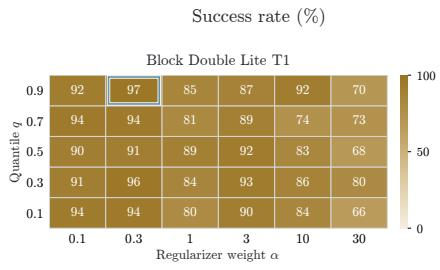

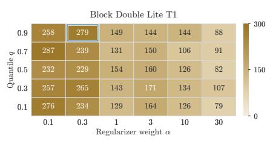

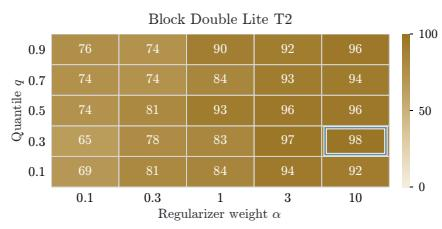

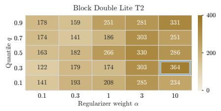

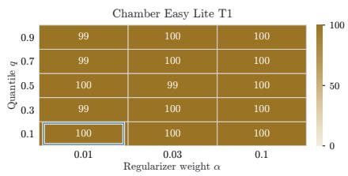

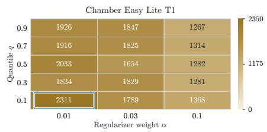

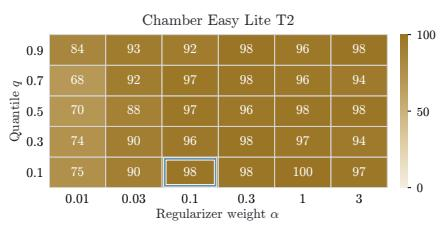

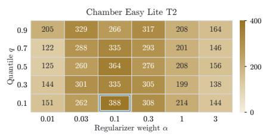

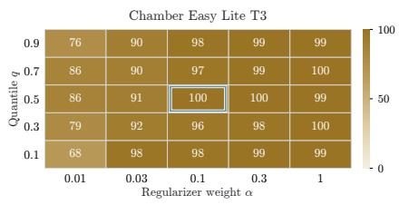

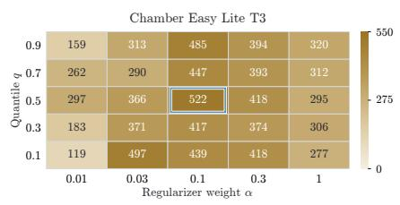  
Selected within displayed grid

Figure 7. This figure demonstrates how the success rate, and throughput vary across diferent hyper parameter configs. Our method performs well across multiple magnitudes of BC weights.