# A Random Matrix Analysis of Symmetric Tensor Unfolding

Tom Szwagier   
Univ. Toulouse, Toulouse INP, CNRS, IRIT   
31071 Toulouse, France

Xiaoyi Mai Univ. Toulouse, UT2J, IMT 31062 Toulouse, France

Jos´e Henrique de Morais Goulart Univ. Toulouse, Toulouse INP, CNRS, IRIT 31071 Toulouse, France

tom.szwagier@irit.fr

xiaoyi.mai@math.univ-toulouse.fr

henrique.goulart@irit.fr

## Abstract

We study a fundamental problem in machine learning: partial recovery of a planted signal $\pmb { v } \in \mathbb { S } ^ { n - 1 }$ from a spiked tensor $\pmb { \mathsf { X } } = \lambda \pmb { v } ^ { \otimes p } + \pmb { Z } .$ , where Z has symmetric Gaussian entries of $\mathrm { v a r i a n c e } \asymp n ^ { - 1 }$ . While previous works replace Z by an i.i.d. standard Gaussian tensor to circumvent technical dificulties caused by dependencies, this paper directly analyzes the symmetric model via random matrix theory. We show that the square unfolding algorithm is subject to a sharp phase transition for partial recovery at $\lambda \asymp n ^ { ( \hat { p } - 2 ) / 4 }$ , validating an open conjecture from Montanari and Richard (2014). We get precise expressions for the limiting spectral distribution, deterministic equivalent, phase transition threshold and overlap. The main message is that unfolded symmetric tensors spectrally behave like standard Wigner matrices, up to simple transformations accounting for high-order symmetries. We consider extensions to multiple orthogonal spikes, recursive unfolding and non-square unfolding via disproportionate random matrix theory, leading to an interesting conjectured statistical– computational tradeof regarding the choice of unfolding: square versus long.

Keywords: symmetric tensor, tensor unfolding, random matrix theory, tensor principal component analysis, spiked model.

## 1 Introduction

We are interested in the following tensor model:

$$
\begin{array} { r } { \pmb { \mathsf { X } } : = \lambda \pmb { v } ^ { \otimes p } + \pmb { Z } , } \end{array}\tag{1}
$$

where $\lambda > 0$ is a signal-to-noise ratio (SNR), $\pmb { v } \in \mathbb { S } ^ { n - 1 }$ is a planted signal and

$$
\pmb { Z } : = \frac { 1 } { p ! } \sqrt { \frac { p } { n } } \sum _ { \sigma \in \mathfrak { S } _ { p } } \mathbf { G } ^ { \sigma }\tag{2}
$$

is a random tensor of order p and dimension $n _ { \mathrm { : } }$ obtained by symmetrizing a tensor G with independent standard Gaussian entries, ensuring rotational invariance. The goal is to quantify the performance as $n  \infty$ of a certain estimator of v called the unfolding algorithm—which amounts to extracting the leading singular vector of a matrix reshaping of the tensor—as a function of the SNR λ. As usual in this setting, we are also interested in determining the SNR regime under which one can partially recover the signal. An illustration of the problem is given in Figure 1.

Spiked Tensor (Unfolded)

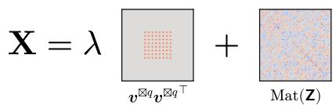

Signal-to-Noise Ratio $( \lambda / n ^ { ( p - 2 ) / 4 } )$  
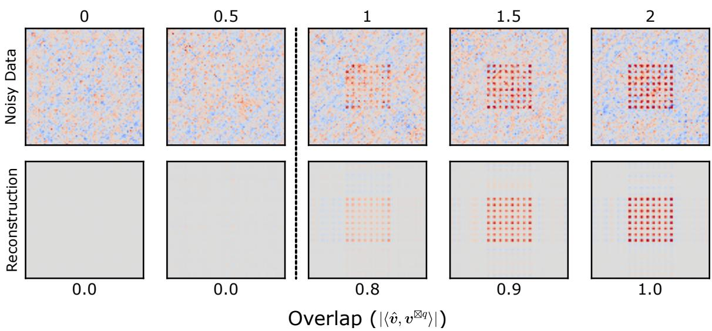  
Figure 1: Illustration of the Tensor PCA problem for $p = 4$ and $n = 2 0$ . Top: spiked tensor model $\begin{array} { r } { \pmb { \chi } = \lambda \pmb { v } ^ { \otimes p } + \pmb { Z } } \end{array}$ , unfolded into an $n ^ { 2 } \times n ^ { 2 }$ matrix X (see Section 2 for notation). Middle: samples for increasing SNR λ. Bottom: recovered signal, $\hat { v } \hat { v } ^ { \top }$ , where vˆ is the leading eigenvector of X. We observe a phase transition in signal recovery between 0.5 and 1, where the overlap goes from 0% to 80%.

## 1.1 Motivation

Model (1) is a spiked tensor model (Montanari and Richard, 2014) and the problem of estimating its parameters λ and v is commonly referred to as tensor principal component analysis (Tensor PCA). This generalization of PCA to tensors comes with many applications in machine learning (see reviews from Kolda and Bader 2009 and Sidiropoulos et al. 2017). In particular, it is central in the estimation of latent variable models via the method of moments (Pearson, 1894), with applications to independent component analysis, mixture models, topic models and hidden Markov models (Anandkumar et al., 2014). It also arises in community detection, via hypergraph adjacency tensors (Zhou et al., 2006; Kim et al., 2017; Luo and Zhang, 2020, 2022), in collaborative filtering, via tensor completion (Liu et al., 2013; Montanari and Sun, 2018) and many image processing tasks going beyond two-dimensional images (Vasilescu and Terzopoulos, 2002). Finally, it serves as a typical model for complex high-dimensional nonconvex landscapes, such as those encountered in deep learning (Janzamin et al., 2016; Zhong et al., 2017; Ge et al., 2018; Mondelli and Montanari, 2019; Ben Arous et al., 2019; Arous et al., 2024).

Unfolding (sometimes called matricization, reshaping or flattening) is a classical operation in the analysis of tensor-based methods. It is a natural way of transforming a tensor into a matrix, enabling the use of well-established matrix analysis tools, such as eigenvalue decompositions, concentration inequalities (Tropp, 2015) and more general random matrix results (Tao, 2012; Couillet and Liao, 2022). Consequently, unfolding is widely used as a spectral relaxation of low-rank tensor decomposition (Romera-Paredes and Pontil, 2013; Mu et al., 2014; Montanari and Richard, 2014). It is also used as a correlated initialization in many iterative algorithms—such as power iteration (Montanari and Richard, 2014; Kileel and Pereira, 2025), recursive unfolding (Montanari and Richard, 2014) and higher-order orthogonal iteration (HOOI) (De Lathauwer et al., 2000)—that achieve exact recovery beyond a critical SNR threshold (Feldman and Donoho, 2023; Lebeau et al., 2025).1

Hence, studying unfolding under spiked tensor models such as (1) is essential for understanding the statistical performance of low-rank tensor decomposition methods, coming with plenty of applications in machine learning.

## 1.2 State of the Art

Many works have analyzed spiked tensor models, identifying statistical and algorithmic thresholds on the SNR for signal recovery, under diverse estimation procedures. A statistical threshold refers here to the SNR above which a hypothesis test can distinguish a spiked model $\lambda { \pmb v } ^ { \otimes p } + { \pmb Z }$ from pure noise Z. An algorithmic threshold refers to the SNR above which a specified computationally-tractable class of estimators can achieve partial recovery. These notions need not coincide and are model- and algorithm-class dependent. The following recovery results are voluntarily simplified for expository purposes.2

Model (1) was originally introduced in Montanari and Richard (2014), who proposed several estimators for the planted signal $\pmb { v } \in \mathbb { S } ^ { n - 1 }$ , as $n \to \infty$ . They showed that maximum likelihood estimation (MLE) achieves partial recovery at $\lambda = \Omega ( 1 ) { \mathrm { - } } \mathrm { t h a t }$ is the statistical threshold (Perry et al., 2020; Jagannath et al., 2020; Goulart et al., 2022). However, solving the MLE problem itself is NP-hard (Hillar and Lim, 2013), leaving the question of the existence of tractable estimators achieving partial recovery at $\lambda = \Omega ( 1 )$ open.

Several polynomial-time alternatives for Tensor PCA have then been analyzed. Local methods such as power iteration, approximate message passing, Langevin dynamics and gradient descent have been shown to achieve partial recovery at $\lambda = \Omega ( n ^ { ( p - 2 ) / 2 } )$ under random initialization (Montanari and Richard, 2014; Ben Arous et al., 2020). Unfolding, partial tracing and local methods with “smart” initializations have been shown to achieve partial recovery at $\lambda = \Omega ( n ^ { ( p - 2 ) / 4 } )$ (Montanari and Richard, 2014; Hopkins et al., 2015, 2016; Anandkumar et al., 2017; Ben Arous et al., 2023; Feldman and Donoho, 2023). Severa analyses based on sum-of-squares relaxations and low-degree methods suggest that the latter threshold cannot be significantly improved with polynomial-time algorithms (Hopkins et al., 2015; Kunisky et al., 2022). This leads to a conjectured statistical–computational gap, between intractable MLE and tractable algorithms like unfolding that remains open today; see Figure 2 for an illustration.

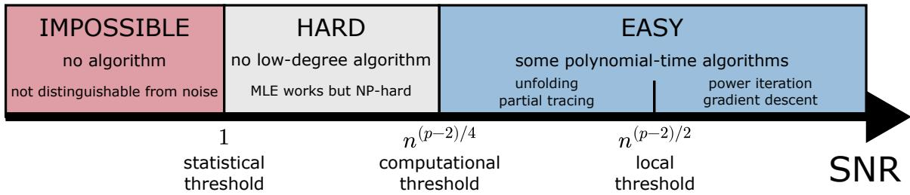  
Figure 2: Simplified illustration of the conjectured statistical–computational gap for partial recovery, as a function of the SNR λ. Estimation of the planted signal $\pmb { v } \in \mathbb { S } ^ { n \cdot }$ −1 is impossible below the statistical threshold (Jagannath et al., 2020). Above, it is possible by MLE but computationally hard. Below the conjectured computational threshold, no low-degree algorithm achieves recovery (Kunisky et al., 2022), while above, some polynomial-time algorithms—such as unfolding and partial tracing—do. Above the local threshold, algorithms such as power iteration, approximate message passing and gradient descent work (Montanari and Richard, 2014; Ben Arous et al., 2020). Figure adapted from Wein (2024).

Looking more closely into the assumptions of Montanari and Richard (2014) regarding tensor unfolding, the main results are actually derived under an asymmetric noise model, where the entries of the noise tensor are independent standard Gaussians. This importantly difers from the original noise model (2)—called Gaussian Orthogonal Tensor Ensemble (GOTE, Gurau 2020)—whose symmetry yields dependent entries, preventing the application of classical results from random matrix theory. Montanari and Richard (2014) conjecture that the same order of phase transition should hold for the symmetric model.

Some later works partially address this conjecture. Notably, Hopkins et al. (2015) and Wein et al. (2025) study symmetric models3 and obtain $\Omega ( n ^ { ( p - 2 ) / 4 } )$ recovery guarantees under variants of the tensor unfolding algorithm, while not providing either sharp transitions or precise overlaps. Follow-up works obtain sharp unfolding transitions and overlaps for even and odd orders (Ben Arous et al., 2023; Feldman and Donoho, 2023; Lebeau et al., 2025), but all under an asymmetric noise model that is not adapted to symmetric signals.

Hence, a random matrix analysis of the unfolding algorithm on the genuinely symmetric spiked tensor model of Montanari and Richard (2014) is currently lacking in the Tensor PCA literature.

## 1.3 Contributions

We perform a random matrix analysis of the unfolding algorithm under the spiked tensor model (1), with even order $( p : = 2 q )$ and square unfolding $( n ^ { q } \times n ^ { q } )$ . Specifically, we derive a deterministic equivalent (Couillet and Liao, 2022) of the resolvent and deduce the weak convergence of the empirical spectral distribution towards a generalization of the Wigner semicircle distribution (Wigner, 1958), that is a mixture of a scaled semicircle distribution and a Dirac distribution, whose weights depend on the tensor order p. Despite the nonclassical structure of the resolvent and the limiting spectral distribution, we show that the unfolding algorithm undergoes a classical phase transition regarding the recovery of the lifted signal $\pmb { v } ^ { \boxtimes q } \in \mathbb { S } ^ { n ^ { q } - 1 }$ , with explicit critical value and overlap—⊠ denotes the Kronecker product. See Section 2 for notation and definitions.

More precisely, let Z be a Gaussian orthogonal tensor defined as in (2) and Z its $n ^ { q } \times n ^ { q }$ unfolding. Denoting by $f _ { \mathrm { s c } } ( x ) : = \sqrt { ( 4 - x ^ { 2 } ) ^ { + } } / ( 2 \pi )$ the standard Wigner semicircle density and $\alpha _ { p , q } : = \sqrt { q ! / ( p - 1 ) ! }$ , the empirical spectral measure of $\alpha _ { p , q } ^ { - 1 } n ^ { - ( p - 2 ) / 4 } { \bf Z }$ converges weakly almost surely to $q ! \AA ^ { - 1 } f _ { \mathrm { s c } } ( x ) \mathrm { d } x + ( 1 - q ! \AA ^ { - 1 } ) \delta _ { 0 } ( \mathrm { d } x )$ . Let $\pmb { \chi } = \lambda \pmb { v } ^ { \otimes p } + \pmb { Z }$ be a spiked tensor as in (1), X its $n ^ { q } \times n ^ { q }$ unfolding and $( \hat { \lambda } , \hat { v } ) \in \mathbb { R } _ { + } \times \mathbb { S } ^ { n ^ { q } - 1 }$ its leading eigenpair. Writing $\tau : = \alpha _ { p , q } ^ { - 1 } n ^ { - ( p - 2 ) / 4 } \lambda$ and $\hat { \tau } : = \alpha _ { p , q } ^ { - 1 } n ^ { - ( p - 2 ) / 4 } \hat { \lambda }$ , one has, almost surely, as $n  \infty$ the following sharp phase transitions: for $\tau \leq 1 , \hat { \tau } \to 2$ and $| \hat { \pmb { v } } ^ { \top } \pmb { v } ^ { \boxtimes q } | ^ { 2 }  0$ while for $\tau > 1$ $\hat { \tau } \to \tau + \tau ^ { - 1 }$ and $\bar { | } \hat { v } ^ { \top } v ^ { \boxtimes q } | ^ { 2 }  1 - \tau ^ { - 2 }$

Our results confirm the open conjectures from Montanari and Richard (2014) and Hopkins et al. (2015) on symmetric spiked tensor unfolding: there is indeed a phase transition for partial recovery at $\lambda \asymp n ^ { ( p - 2 ) / 4 }$ and we now know its precise constant: $\alpha _ { p , q } : = \sqrt { ( p / 2 ) ! / ( p - 1 ) ! }$ . Hence, the high-order symmetries do not afect significantly the order of magnitude of the phase transition for partial recovery with respect to asymmetric models. They however significantly afect the spectral distribution, which becomes a mixture of a semicircle and a Dirac distribution. Moreover, although the phase transition is at the conjectured order of magnitude, $\lambda \asymp n ^ { ( p - 2 ) / 4 }$ , it appears at a diferent scale from the asymmetric model and the efect increases with the tensor order according to $\alpha _ { p , q } . ^ { 4 }$ Therefore, a simplified analysis focused on a “symmetric signal + asymmetric noise” model (Montanari and Richard, 2014; Kim et al., 2017; Feldman and Donoho, 2023) does not lead to the same phase transition thresholds and overlaps obtained under the genuine spiked tensor model (1) and misses important spectral phenomena caused by the loss of independence induced by the symmetries.

The proof relies on random matrix theory (RMT), exposing important phenomena that cannot be revealed via classical machine learning tools—notably, a sharp phase transition in spectral behavior (the so-called BBP transition of Baik et al. 2005), with precise eigenvector overlaps. The high-order symmetries in the GOTE break the fundamental independence assumption required in standard random matrix theory. To alleviate these dependencies, we project the unfolded GOTE onto symmetric tensor subspaces, which boils down to removing duplicated rows and columns and applying a specific scaling on the entries. The whole procedure, that we name symmetric unfolding, preserves the eigenstructure (up to a simple isometry), while removing the most impacting dependencies. The resulting matrix spectrally behaves like a standard Wigner matrix, from which we can precisely characterize the limiting spectral distribution and overlaps.

The paper is organized as follows. In Section 2, we introduce our notation, the spiked tensor model, the unfolding map and the main random matrix tools needed to establish our results. In Section 3, we state the main results of the paper: the analysis of unfolded symmetric tensors under the framework of hypersymmetric matrices, the deterministic equivalent, the limiting spectral distribution and the eigenvector overlap. We run simulations and show a strong match with theory, even for relatively small dimensions, $n \in \{ 2 0 , 5 0 , 1 0 0 \}$ . In Section 4, we discuss and put the previous results into perspective. In Appendix A, we give the proofs of the main results. In Appendix B, we extend our results and simulations to the i.i.d. symmetric standard Gaussian tensor model. In Appendix C, we extend our results to multiple spikes, under the canonical polyadic (CP) model. In Appendix D, we analyze a recursive unfolding procedure to estimate the planted signal $\pmb { v } \in \mathbb { S } ^ { n - 1 }$ from the lifted signal $\pmb { v } ^ { \boxtimes q } \in \mathbb { S } ^ { n ^ { q } - 1 }$ ; we conjecture a sharp phase transition at $\lambda = \alpha _ { p , q } n ^ { ( p - 2 ) / 4 }$ , from null to exact recovery. In Appendix E, we study odd order p and non-square unfolding $( n ^ { k } \times n ^ { p - k }$ with $1 \le k < p / 2 )$ ; we conjecture a sharp phase transition at $\lambda = \gamma _ { p , k } n ^ { ( p - 2 ) / 4 }$ , with $\gamma _ { p , k } : = ( k ! ( p - k ) ! / ( p - 1 ) ! ^ { 2 } ) ^ { 1 / 4 }$ , resulting in interesting statistical–computational tradeofs.

## 2 Preliminaries

## 2.1 Notation

Throughout this paper, we adopt the following notation. The dimension of the tensor is denoted by n and assumed to be large, while the order is denoted by p and assumed to be fixed and even: $p : = 2 q$ for some (fixed) positive integer q. For convenience, integer intervals are shortened as $[ n ] : = \{ 1 , \dots , n \}$ and multi-indices as $i : = ( i _ { 1 } , \dots , i _ { p } ) \in [ n ] ^ { p }$ . The set of permutations of a multi-index $\{ i _ { 1 } , \ldots , i _ { p } \}$ is written $\mathfrak { S } _ { i _ { 1 } , \dots , i _ { p } } ;$ ; for short, we write $\mathfrak { S } _ { p } : =$ ${ \mathfrak { S } } _ { 1 , \ldots , p } .$ . The cardinal of a set is denoted by #. We also denote by $_ { i \sqcup j }$ the multiset union of two multi-indices i and $j$ . Scalars, vectors, matrices and tensors are respectively written with the following fonts: a, a, A and A. We follow the common convention of omitting the indices in sequences of (random or deterministic) matrices: $\mathbf { \pmb { a } } \in \mathbb { R } ^ { n }$ and $\mathbf { A } \in \mathbb { R } ^ { n \times n }$ should be respectively understood as $\mathbf { \pmb { a } } _ { n } \in \mathbb { R } ^ { n }$ and $\mathbf { A } _ { n } \in \mathbb { R } ^ { n \times n }$

Outer and Kronecker products of vectors $\mathbf { \boldsymbol { a } } _ { 1 } , \dots , \mathbf { \boldsymbol { a } } _ { p } \in \mathbb { R } ^ { n }$ are respectively denoted by $\mathbf { a } _ { 1 } \otimes \cdot \cdot \cdot \otimes \mathbf { a } _ { p } \in ( \mathbb { R } ^ { n } ) ^ { \otimes p }$ and $\pmb { a } _ { 1 } \boxtimes \cdot \cdot \cdot \boxtimes \pmb { a } _ { p } \in \mathbb { R } ^ { n ^ { p } }$ ; in addition, we write $\pmb { a } ^ { \otimes p } = \pmb { a } \otimes \cdots \otimes \pmb { a }$ and $\pmb { a } ^ { \boxtimes p } = \pmb { a } \boxtimes \cdots \boxtimes \pmb { a }$ , where the product is repeated p times. The spectrum of a symmetric matrix $\mathbf { M } \in \mathbb { R } ^ { n \times n }$ is denoted by $\mathrm { S p } ( \mathbf { M } )$ ; its eigenvalues, $\lambda _ { 1 } ( \mathbf { M } ) \geq \cdot \cdot \cdot \geq \lambda _ { n } ( \mathbf { M } )$ , are repeated according to their multiplicity and sorted in decreasing order.

As we work in the asymptotic regime where $n  \infty ,$ , we use the classical Bachmann– Landau “big $O ^ { \mathfrak { s } }$ notation. We write $f ( n ) = O ( g ( n ) )$ if there exists a positive constant C such that $| f ( n ) | \leq C g ( n )$ as $n \to \infty$ . Similarly, we write $f ( n ) = \Omega ( g ( n ) )$ if $g ( n ) = O ( f ( n ) )$ ), $f ( n ) \asymp g ( n )$ if $f ( n ) = O ( g ( n ) )$ and $g ( n ) = O ( f ( n ) )$ . Finally, we write $f ( n ) = o ( g ( n ) )$ if $f ( n ) / g ( n ) \to 0 , f ( n ) = \omega ( g ( n ) ) { \mathrm { ~ i f ~ } } f ( n ) / g ( n ) \to \infty$ and $f ( n ) \sim g ( n ) { \mathrm { ~ i f ~ } } f ( n ) / g ( n ) \to 1$

## 2.2 Symmetric Tensors

The spiked tensor model (1) we consider in this work has the following entries:

$$
X _ { i _ { 1 } \cdots i _ { p } } = \lambda v _ { i _ { 1 } } \cdots v _ { i _ { p } } + \frac { 1 } { p ! } \sqrt { \frac { p } { n } } \sum _ { \sigma \in { \mathfrak { S } } _ { p } } G _ { i _ { \sigma ( 1 ) } \cdots i _ { \sigma ( p ) } } ,
$$

with $\lambda > 0 , v \in \mathbb { S } ^ { n - 1 }$ and $G _ { i _ { 1 } \cdots i _ { p } } \stackrel { \mathrm { i i d } } { \sim } \mathcal { N } ( 0 , 1 )$ . The random tensor $\begin{array} { r } { \pmb { Z } : = \frac { 1 } { p ! } \sqrt { \frac { p } { n } } \sum _ { \sigma \in \mathfrak { S } _ { p } } \mathbf { G } ^ { \sigma } } \end{array}$ belongs to the Gaussian Orthogonal Tensor Ensemble; we write $\mathbf { Z } \sim { \mathrm { G O T E } } _ { p , n } . ^ { \cdot }$

One can show that the entries of Z are independent normal—up to tensor symmetries— and their variance depends on the multiplicities of the multi-index (Bonnin, 2026a). More precisely, for $i _ { 1 } \leq \cdots \leq i _ { p }$ and $\sigma \in \mathfrak { S } _ { p }$ , one has

$$
\left\{ \begin{array} { l l } { Z _ { i _ { 1 } \cdots i _ { p } } } & { \overset { \mathrm { i i d } } { \sim } { \mathcal { N } } \left( 0 , \frac { p } { n \# \mathbb { S } _ { i _ { 1 } , \ldots , i _ { p } } } \right) , } \\ { Z _ { i _ { \sigma ( 1 ) } \cdots i _ { \sigma ( p ) } } } & { = Z _ { i _ { 1 } \cdots i _ { p } } . } \end{array} \right.
$$

Hence, the GOTE is a generalization of the (matrix) Gaussian Orthogonal Ensemble (GOE), which exhibits variance $1 / n$ of-diagonal and $2 / n$ on-diagonal, to $p \geq 2$

From a combinatorial viewpoint, writing m the multiset of multiplicities of the indices in $i \in [ n ] ^ { p }$ , one has

$$
\# \mathfrak { S } _ { i } = \binom { p } { m } : = \frac { p ! } { \prod _ { m \in m } ( m ! ) } .\tag{3}
$$

The latter expression is called a multinomial coeficient—a multi-way generalization of a binomial coeficient. The set of p-indices with multiplicities m therefore has cardinal $\binom { n } { \# m } \left( \binom { p } { m } \right)$ . This implies that multi-indices with distinct indices predominate in high dimensions; indeed, whenever m $\neq \{ 1 , \ldots , 1 \}$ , one has $\# m < p$ therefore $\textstyle { \binom { n } { \# m } } / ( \binom { n } { p } \to 0$

Let ${ \mathrm { S y m } } ^ { p } ( \mathbb { R } ^ { n } )$ denote the space of symmetric tensors of order p and dimension $n { - } \mathrm { w e }$ remove the superscript when $p = 2$ for symmetric matrices. Then $\operatorname { S y m } ^ { p } ( \mathbb { R } ^ { n } )$ is a linear subspace of $( \mathbb { R } ^ { n } ) ^ { \otimes p }$ of dimension $\begin{array} { r } { n _ { p } : = \dim ( \mathrm { S y m } ^ { p } ( \mathbb { R } ^ { n } ) ) = { \binom { n + p - 1 } { p } } } \end{array}$ ; this can be established via standard “stars-and-bars” arguments. A canonical orthonormal basis of $\operatorname { S y m } ^ { p } ( \mathbb { R } ^ { n } )$ is

$$
\left\{ \mathbf { \mathsf { U } } _ { i } : = \frac { 1 } { \sqrt { \# \mathbb { S } _ { i } } } \sum _ { j \in \mathbb { S } _ { i } } \mathsf { E } _ { j } { : } \quad 1 \leq i _ { 1 } \leq \cdots \leq i _ { p } \leq n \right\} ,\tag{4}
$$

where $\mathsf { E } _ { j } \in ( \mathbb { R } ^ { n } ) ^ { \otimes p }$ is the unit tensor with zeros everywhere except in position $( j _ { 1 } , \ldots , j _ { p } )$

## 2.3 Tensor Unfolding

Let us define the following bijective function between multi-indices and indices:

$$
\begin{array} { r c l } { \displaystyle \varphi _ { k } \colon [ n ] ^ { k } \longrightarrow [ n ^ { k } ] } \\ { \displaystyle ( i _ { 1 } , \ldots , i _ { k } ) \longmapsto 1 + \sum _ { j = 1 } ^ { k } ( i _ { j } - 1 ) n ^ { j - 1 } . } \end{array}\tag{5}
$$

The map $\varphi _ { k }$ induces a natural bijection between order-p tensors and matrices that is commonly called unfolding:

$$
\begin{array} { r l } & { \mathrm { M a t } _ { k } \colon ( \mathbb { R } ^ { n } ) ^ { \otimes p } \longrightarrow \mathbb { R } ^ { n ^ { k } \times n ^ { p - k } } } \\ & { \left( X _ { i _ { 1 } \cdots i _ { p } } \right) _ { ( i _ { 1 } , \ldots , i _ { p } ) \in [ n ] ^ { p } } \longmapsto \left( X _ { \varphi _ { k } ^ { - 1 } ( i ) ; \varphi _ { p - k } ^ { - 1 } ( j ) } \right) _ { ( i , j ) \in [ n ^ { q } ] \times [ n ^ { p - k } ] } . } \end{array}\tag{6}
$$

We identify ${ \mathrm { M a t } } _ { p }$ with the classical vectorization vec : $( \mathbb { R } ^ { n } ) ^ { \otimes p } \to \mathbb { R } ^ { n ^ { p } }$ . In this paper, we choose $k = \lfloor p / 2 \rfloor = q$ . This corresponds to a square unfolding, yielding an $n ^ { q } \times n ^ { q }$ symmetric matrix—like a classical Wigner matrix but with extra symmetries.

Remark 1 (Choice of Unfolding) Other choices of k for unfolding would have led to socalled long (Ben Arous et al., 2023) or disproportionate (Feldman, 2023) random matrices. In that case, the dimensions $( n ^ { k } \times n ^ { p - k } )$ are no longer comparable; one cannot apply classical RMT results (Benaych-Georges and Nadakuditi, 2012) and needs to use more sophisticated tools (Alex et $a l . , ~ 2 0 1 4 )$ . In addition, the choice of an unfolding that is “as square as $p o s s i b l e ^ { * }$ is recommended in Montanari and Richard $( 2 0 1 \llcorner )$ and Mu et al. $( 2 0 1 4 )$ , as it minimizes the operator norm of the unfolded noise. It is worth noting that this heuristic is later nuanced by Ben Arous et al. (2023), which states that the SNR threshold does not depend on the choice of k in the asymmetric model and therefore recommend $k = 1$ to avoid an extra recursive unfolding step to recover the planted signal. We shed light on these opposite points of view in Section 4 and Appendix E.

With a slight abuse of notation, we will often replace a multi-index $i : = ( i _ { 1 } , \dots , i _ { k } ) \in [ n ] ^ { k }$ by its associated index $i : = \varphi _ { k } ( i ) \in [ n ^ { k } ]$ and vice-versa. Likewise, we will often assimilate a tensor $\ b { \mathsf { X } } \in ( \mathbb { R } ^ { n } ) ^ { \otimes p }$ to its associated matrix $\mathbf { X } : = \mathrm { M a t } _ { k } ( \pmb { \mathsf { X } } ) \in \mathbb { R } ^ { n ^ { k } \times n ^ { p - k } }$

## 2.4 Useful Tools from Random Matrix Theory

Random matrix theory is a rich mathematical field at the intersection of probability theory, linear algebra and complex analysis. It provides tools to study the eigenstructure of large matrices with random entries—notably their limiting spectral distribution, isolated eigenvalues and associated eigenspaces—enabling the theoretical performance analysis of many machine learning algorithms. The RMT framework ofers several advantages over more classical theoretical tools in machine learning, often referred to as the blessing of dimensionality (Donoho, 2000). In high dimensions, a priori random spectral quantities often become asymptotically deterministic through concentration of measure, while universality makes their limiting behavior largely insensitive to the precise noise distribution. Moreover, RMT accommodates structured and dependent noise, as well as certain nonlinear spectral statistics that are central in machine learning (kernel, activation function). These features make it particularly well suited to characterizing phase transitions and partial recovery in high-dimensional planted-signal models. This subsection recalls the main results from RMT that will be used throughout this paper. Its content is mostly based on Couillet and Liao (2022), where the reader can find more details.

The first object we review is the resolvent, which is central in RMT, as it provides information on the eigenstructure.

Lemma 2 (Eigenstructure via Resolvent) Let M $\in \mathbb { R } ^ { n \times n }$ be a symmetric matrix, with spectrum $\mathbf { S p } ( \mathbf { M } ) \ \in \ \mathbb { R } ^ { n }$ Let $\begin{array} { r } { \mu _ { \mathbf { M } } : = \frac { 1 } { n } \sum _ { i = 1 } ^ { n } \delta _ { \lambda _ { i } ( \mathbf { M } ) } } \end{array}$ be its empirical spectral measure, $s _ { \mu _ { \mathbf { M } } } ( z ) : = \int 1 / ( t - z ) \mu _ { \mathbf { M } } ( \mathrm { d } t )$ its Stieltjes transform and $\mathbf { Q } _ { \mathbf { M } } ( z ) : = ( \mathbf { M } - z \mathbf { I } _ { n } ) ^ { - 1 }$ its resolvent $( w i t h \ z \in \mathbb { C } \setminus \mathrm { S p } ( \mathbf { M } ) )$ . Let $\lambda \in \mathrm { S p } ( \mathbf { M } )$ be a simple eigenvalue of M, with associated eigenvector $\hat { \pmb u } \in \mathbb S ^ { n - 1 }$ and Γ a closed contour around λ only. Then, one has

$$
s _ { \mu \mathbf { M } } ( z ) = \frac { 1 } { n } \operatorname { t r } \left( \mathbf { Q } _ { \mathbf { M } } ( z ) \right) \quad a n d \quad | \hat { u } ^ { \top } u | ^ { 2 } = - \frac { 1 } { 2 \pi i } \oint _ { \Gamma } u ^ { \top } \mathbf { Q } _ { \mathbf { M } } ( z ) u \mathrm { d } z \quad ( u \in \mathbb { S } ^ { n - 1 } ) .\tag{7}
$$

Hence, the resolvent gives access to the empirical spectral measure and the eigenvector overlap of deterministic matrices.6 When these are random, the eigenstructure can be characterized via deterministic equivalents (Girko, 1985; Hachem et al., 2007), i.e. deterministic matrices that “behave” similarly asymptotically with respect to certain linear and bilinear forms, as defined next.

Definition 3 (Deterministic Equivalent) Let $\mathbf { Q } \in \mathbb { R } ^ { n \times n }$ be a random matrix. We say that $\bar { \mathbf { Q } } \in \mathbb { R } ^ { n \times n }$ is a deterministic equivalent of Q—and write $\mathbf { Q }  { \bar { \mathbf { Q } } } - i f ,$ for any sequences of deterministic matrices $\mathbf { A } \in \mathbb { R } ^ { n \times n }$ of unit operator norm and vectors $a , b \in \mathbb { R } ^ { n }$ of unit Euclidean norm, one has, almost surely, as $n \to \infty$

$$
\frac 1 n \operatorname { t r } \left( \mathbf { A } \left( \mathbf { Q } - \bar { \mathbf { Q } } \right) \right) \xrightarrow [ n \to \infty ] { \mathrm { a . s . } } \boldsymbol { \eta } \qquad a n d \qquad a ^ { \top } \left( \mathbf { Q } - \bar { \mathbf { Q } } \right) b \xrightarrow [ n \to \infty ] { \mathrm { a . s . } } \boldsymbol { \eta } .\tag{8}
$$

Such deterministic equivalents can be obtained by showing the concentration of the expressions in (8) around their expectation. To that end, we state two fundamental probabilistic identities, where $\mathbb { E } \left[ \cdot \right]$ and $\mathbb { V } [ \cdot ]$ denote respectively the expectation and the variance.

Lemma 4 (Stein Lemma, Stein 1981) Let $x \sim \mathcal { N } ( 0 , 1 )$ and $f \colon  { \mathbb { R } } \to  { \mathbb { R } }$ . Then, upon existence of the following quantities, one has

$$
\mathbb { E } \left[ x f ( x ) \right] = \mathbb { E } \left[ f ^ { \prime } ( x ) \right] .\tag{9}
$$

Lemma 5 (Nash–Poincar´e Inequality) Let $\mathbf { \boldsymbol { x } } \sim \mathcal { N } ( 0 , \mathbf { \boldsymbol { C } } )$ , with $\mathbf { C } \in \mathbb { R } ^ { n \times n }$ and $f \colon  { \mathbb { R } } ^ { n } \to$ R. Then, upon existence of the following quantities, one has

$$
\mathbb { V } \left[ f ( \pmb { x } ) \right] \leq \sum _ { i , j \in [ n ] } \mathbf { C } _ { i j } \mathbb { E } \left[ \frac { \partial f ( \pmb { x } ) } { \partial x _ { i } } \frac { \partial f ( \pmb { x } ) } { \partial x _ { j } } \right] .\tag{10}
$$

Now that the main tools are given, let us outline a typical approach to characterize eigenstructure via RMT. The first step is to establish a deterministic equivalent for the resolvent matrix $\mathbf { Q } _ { \mathbf { M } } \in \mathbb { R } ^ { n \times n }$ , a natural candidate being its expectation, E $\left[ \mathbf { Q } _ { \mathbf { M } } \right]$ . To achieve this, we derive a self-consistent equation for the resolvent and simplify it using Stein’s Lemma (Lemma 4). This yields an explicit asymptotic expression for the expected resolvent. Next, we demonstrate the concentration of linear and bilinear forms of the resolvent around their expectation via the Nash–Poincar´e inequality (Lemma 5). If the resulting variance bound drops fast enough, then this allows establishing almost sure deterministic equivalence (Definition 3). The latter yields the limiting spectral distribution via inverse Stieltjes transform and the eigenvector overlap $| \hat { \pmb u } ^ { \top } { \pmb u } |$ via Cauchy’s integral formula (see Lemma 2). Finally, the integral expression can be further simplified using the Sherman–Morrison formula, which relates the resolvent of the spiked model to that of the noise model. We specialize this scheme to the symmetric unfolding in Appendix A.

## 3 Main Results

This section states the main results, namely the impact of tensor symmetries on the spectrum, the deterministic equivalent of the resolvent—consequently, the limiting spectral distribution—and the spiked eigenvalues and overlaps. The proofs are given in Appendix A.

## 3.1 Hypersymmetric Matrices and Symmetric Unfolding

Let $\mathbf { Z } \sim \mathrm { G O T E } _ { p , n }$ and $\mathbf { Z } : = \mathrm { M a t } _ { q } ( \mathbf { Z } ) \in \mathbb { R } ^ { n ^ { q } \times n ^ { q } }$ . As Z is a symmetric matrix with (mostly) independent Gaussian entries, one could think that its eigenvalues are almost-surely simple and nonzero—by applying Sard’s theorem to the discriminant polynomial (Breiding et al., 2018). However, the symmetries in Z lead its unfolding Z to have hypersymmetries—i.e., symmetries beyond the classical matrix ones—including notably duplicated columns. The next definition formalizes this notion of hypersymmetry in symmetric tensors.

Definition 6 (Hypersymmetric Matrix) We say that $\mathbf { M } \in \mathbb { R } ^ { n ^ { q } \times n ^ { q } }$ is a hypersymmetric matrix $i f$ there exists $\mathbf { T } \in \mathrm { S y m } ^ { p } ( \mathbb { R } ^ { n } )$ such that $\mathbf { M } = \mathrm { M a t } _ { q } ( \mathbf { T } )$ . Equivalently,

$$
M _ { i j } = M _ { i ^ { \prime } j ^ { \prime } } , \qquad \forall ( i _ { 1 } ^ { \prime } , \ldots , i _ { q } ^ { \prime } , j _ { 1 } ^ { \prime } , \ldots , j _ { q } ^ { \prime } ) \in \mathfrak { S } _ { i _ { 1 } , \ldots , i _ { q } , j _ { 1 } , \ldots , j _ { q } } .\tag{11}
$$

An important consequence of hypersymmetry is duplicated rows and columns: for $( i ^ { \prime } , j ^ { \prime } ) \in$ ${ \mathfrak { S } } _ { i } \times { \mathfrak { S } } _ { j }$ , one has $M _ { i \cdot } = M _ { i ^ { \prime } }$ · and $M _ { \cdot j } = M _ { \cdot j \prime }$ . Intuitively, removing these duplicates does not change the eigenstructure. We formalize this observation by projecting the row and column spaces onto symmetric tensor subspaces.

Let $\mathcal { T } _ { q } : = \{ ( i _ { 1 } , \dots , i _ { q } ) \in [ n ] ^ { q } \colon i _ { 1 } \leq \cdot \cdot \cdot \leq i _ { q } \}$ and $n _ { q } : = | \mathcal { Z } _ { q } | = \binom { q + n - 1 } { q }$ . For $i \in \mathcal { T } _ { q } .$ define $\pmb { u } _ { i } : = \mathrm { v e c } ( \mathbf { U } _ { i } ) \in \mathbb { S } ^ { n ^ { q } - 1 }$ (4) and $\mathbf { U } : = ( \pmb { { u } } _ { i } ) _ { i \in \mathcal { T } _ { a } } \in \mathbb { R } ^ { n ^ { q } \times n _ { q } }$ . The vectors $( u _ { i } ) _ { i \in \mathscr { T } _ { q } }$ form an orthonormal basis of $\operatorname { S y m } ^ { q } ( \mathbb { R } ^ { n } )$ ; hence $\mathbf { U } ^ { \top } \mathbf { U } = \mathbf { I } _ { n _ { q } }$ and $\boldsymbol { \Pi } : = \boldsymbol { \mathbf { U } } \boldsymbol { \mathbf { U } } ^ { \top } = ( \# \mathfrak { S } _ { i } ^ { - 1 } \mathbf { 1 } _ { \{ j \in \mathfrak { S } _ { i } \} } ) _ { i , j \in [ n ^ { q } ] }$ is the orthogonal projector onto $\operatorname { S y m } ^ { q } ( \mathbb { R } ^ { n } )$

Proposition 7 (Eigenstructure of Hypersymmetric Matrices) Let $\mathbf { T } \ \in \ \mathrm { S y m } ^ { p } ( \mathbb { R } ^ { n } )$ and $\mathbf { M } : = \mathrm { M a t } _ { q } ( \mathbf { T } ) \in \mathrm { S y m } ( \mathbb { R } ^ { q } )$ . Then, one has

$$
\mathbf { M } = \mathbf { U } \mathbf { M } ^ { \prime } \mathbf { U } ^ { \top } , \qquad w i t h \qquad \mathbf { M } ^ { \prime } : = \mathbf { U } ^ { \top } \mathbf { M } \mathbf { U } = \left( \sqrt { \# \mathsf { S } _ { i } \# \mathsf { S } _ { j } } \thinspace \mathsf { T } _ { i j } \right) _ { i , j \in \mathbb { Z } _ { q } } .\tag{12}
$$

Consequently, one has:

$$
\begin{array} { r } { I . \mathrm { \normalfont ~ S p } ( \mathbf { M } ) = \mathrm { \normalfont ~ S p } ( \mathbf { M } ^ { \prime } ) \cup \{ 0 \} , \qquad w i t h \mathrm { \normalfont ~ d i m } ( \mathrm { k e r } ( \mathbf { M } ) ) \geq n ^ { q } - \binom { q + n - 1 } { q } \sim \left( 1 - \frac { 1 } { q ! } \right) n ^ { q } . } \end{array}
$$

$$
\begin{array} { r } { \boldsymbol { \mathcal { Q } } . \ \forall ( \lambda ^ { \prime } , \pmb { v } ^ { \prime } ) \in \mathbb { R } \times \mathbb { S } ^ { n _ { q } - 1 } , \quad \mathbf { M } ^ { \prime } \pmb { v } ^ { \prime } = \lambda ^ { \prime } \pmb { v } ^ { \prime } \Longleftrightarrow \mathbf { M } \mathbf { U } \pmb { v } ^ { \prime } = \lambda ^ { \prime } \mathbf { U } \pmb { v } ^ { \prime } . } \end{array}
$$

We call $\Phi _ { q } \colon  { \mathsf { T } } \mapsto  { \mathbf { U } } ^ { \top }  { \operatorname { M a t } } _ { q } (  { \mathsf { T } } )  { \mathbf { U } }$ the symmetric unfolding. The previous result implies that the nonzero eigenpairs of $\operatorname { M a t } _ { q } ( \pmb { \mathsf { T } } )$ and $\Phi _ { q } ( \mathbf { T } )$ are isometric; we may therefore abusively switch between the two representations in the following.

Although elementary, Proposition 7 is actually extremely informative: the eigenstructure of $\operatorname { M a t } _ { q } ( \pmb { \mathsf { T } } )$ —notably the limiting spectral distribution, the spiked eigenvalues and overlaps—can be simply obtained via $\Phi _ { q } ( \mathbf { T } )$ , a compact version obtained by removing duplicated columns and scaling by the number of permutations of the indices.7 From a practical standpoint, this yields a computational speedup by a factor $( n ^ { q } / n _ { q } ) ^ { 3 } \sim q ! ^ { 3 }$ for eigendecomposition. From a theoretical standpoint, the projection onto the symmetric subspace reduces the number of dependencies between the entries. Let

$$
\mathcal { E } ( i , j ) : = \big \{ ( i ^ { \prime } , j ^ { \prime } ) \in \mathcal { T } _ { q } ^ { 2 } : i ^ { \prime } \sqcup j ^ { \prime } = i \sqcup j \big \}\tag{13}
$$

represent the equivalence class of entries that are determined by the entry $( i , j ) \in \mathcal { I } _ { q } ^ { 2 }$ . Then $\# \mathcal { E } ( i , j ) \leq { \binom { p } { q } } = p ! / q ! ^ { 2 }$ and we later show that these extra dependencies do not impact the asymptotic eigenstructure; see Section 4 for a broader discussion.

Example 1 (p = 4, n = 2) Let $\pmb { \mathsf { T } } : = ( T _ { i j k l } ) _ { i , j , k , l \in \{ 1 , 2 \} } \in \mathrm { S y m } ^ { 4 } ( \mathbb { R } ^ { 2 } )$ . Then,

$$
\mathrm { M a t } _ { q } ( \mathbf { T } ) = \left[ \begin{array} { l l l } { t _ { 1 1 1 1 } } & { t _ { 1 1 1 2 1 } } & { t _ { 1 1 1 2 } } & { t _ { 1 1 2 2 } } \\ { t _ { 2 1 1 1 } } & { t _ { 2 1 2 1 } } & { t _ { 2 1 1 2 } } & { t _ { 2 1 2 2 } } \\ { t _ { 1 2 1 1 } } & { t _ { 1 2 2 1 } } & { t _ { 1 2 1 2 } } & { t _ { 1 2 2 2 } } \\ { t _ { 2 2 1 1 } } & { t _ { 2 2 2 1 } } & { t _ { 2 2 1 2 } } & { t _ { 2 2 2 2 } } \end{array} \right] a n d \Phi _ { q } ( \mathbf { T } ) = \left[ \begin{array} { l l l } { 1 t _ { 1 1 1 1 } } & { \sqrt { 2 } t _ { 1 1 2 1 } } & { 1 t _ { 1 1 2 2 } } \\ { \sqrt { 2 } t _ { 2 1 1 1 } } & { 2 t _ { 2 1 2 1 } } & { \sqrt { 2 } t _ { 2 1 2 2 } } \\ { 1 t _ { 2 2 1 1 } } & { \sqrt { 2 } t _ { 2 2 2 1 } } & { 1 t _ { 2 2 2 2 } } \end{array} \right] .
$$

The colors depict the hypersymmetries.

Remark 8 (Catalecticant Matrices) The symmetric unfolding can be identified, up to the normalization induced by the orthonormal basis, with catalecticant matrices, whose determinant is the catalecticant polynomial from invariant theory. This connection links the present spectral approach to the classical catalecticant methods of Sylvester and their modern extensions (Sylvester, 1851; Brachat et al., 2010). In the noiseless setting, these methods exploit the low-rank and kernel structure of the catalecticant to recover symmetric rank decompositions. This suggests a hybrid approach where spectral denoising is followed by catalecticant methods for recovery. We leave this perspective for future research.

## 3.2 Deterministic Equivalent

The tools presented in previous sections (2.4 and 3.1) to analyze random matrices and hypersymmetric ones can now be combined to characterize the spectrum of square unfoldings of symmetric tensors under the spiked model (1). The following theorem gives a deterministic equivalent of the noise resolvent.

Theorem 9 (Deterministic Equivalent) Let $\mathbf { Z } \sim \mathrm { G O T E } _ { p , n } , \ \mathbf { M } : = \alpha _ { p , q } ^ { - 1 } n ^ { - ( p - 2 ) / 4 } \Phi _ { q } ( \mathbf { Z } )$ and $\mathbf { Q } ( z ) : = \left( \mathbf { M } - z \mathbf { I } _ { n _ { q } } \right) ^ { - 1 }$ , with $\alpha _ { p , q } : = \sqrt { q ! / ( p - 1 ) ! }$ . Then,

$$
\mathbf { Q } ( z ) \longleftrightarrow s _ { \mathrm { s c } } ( z ) \mathbf { I } _ { n _ { q } } , \qquad w i t h \qquad s _ { \mathrm { s c } } ( z ) : = - \big ( z - \sqrt { z ^ { 2 } - 4 } \big ) / 2 ,\tag{14}
$$

in the sense of Definition 3. Consequently, the empirical spectral distribution of M converges weakly almost surely to the standard Wigner semicircle law:

$$
{ \frac { 1 } { n _ { q } } } \sum _ { i = 1 } ^ { n _ { q } } \delta _ { \lambda _ { i } ( \mathbf { M } ) } { \xrightarrow { \mathrm { a . s . } } } \ f _ { \mathrm { s c } } ( x ) \mathrm { d } x , \qquad w i t h \qquad f _ { \mathrm { s c } } ( x ) = { \frac { { \sqrt { ( 4 - x ^ { 2 } ) ^ { + } } } } { 2 \pi } } .\tag{15}
$$

The theorem says that, on the symmetric tensor subspace, the normalized GOTE unfolding has the same deterministic resolvent as a classical GOE matrix. As a consequence of Proposition 7, we get a deterministic equivalent of the GOTE unfolding.

Corollary 10 (Standard Unfolding) Let $\mathbf { Z } \sim \mathrm { G O T E } _ { p , n } , \ \mathbf { M } : = \alpha _ { p , q } ^ { - 1 } n ^ { - ( p - 2 ) / 4 } \mathrm { M a t } _ { q } ( \mathbf { Z } )$ and $\mathbf { Q } ( z ) : = \left( \mathbf { M } - z \mathbf { I } _ { n ^ { q } } \right) ^ { - 1 }$ , with $\alpha _ { p , q } : = \sqrt { q ! / ( p - 1 ) ! }$ . Then,

$$
{ \bf Q } ( z ) \longleftrightarrow s _ { \mathrm { s c } } ( z ) \mathbf { I I } + s _ { \delta _ { 0 } } ( z ) ( \mathbf { I } _ { n ^ { q } } - \mathbf { I I } ) , \qquad w i t h \ \quad \ s _ { \delta _ { 0 } } ( z ) : = - \frac { 1 } { z } ,\tag{16}
$$

in the sense of Definition 3. Consequently, the empirical spectral distribution of M converges weakly almost surely to a mixture of a semicircle and a Dirac:

$$
\frac { 1 } { n ^ { q } } \sum _ { i = 1 } ^ { n ^ { q } } \delta _ { \lambda _ { i } ( \mathbf { M } ) } ( \mathrm { d } x ) \xrightarrow [ n  \infty ] { \mathrm { a . s . } } \frac { 1 } { q ! } f _ { \mathrm { s c } } ( x ) \mathrm { d } x + ( 1 - \frac { 1 } { q ! } ) \delta _ { 0 } ( \mathrm { d } x ) .\tag{17}
$$

The proof follows the scheme exposed in Section 2.4. The symmetric unfolding removes the deterministic null space created by repeated rows and columns. After the normalization by $\alpha _ { p , q } n ^ { ( p - 2 ) / 4 }$ , the entries have the same leading variance as those of a standard Wigner matrix of dimension $\begin{array} { r } { n _ { q } ; } \end{array}$ the remaining correlations are indexed by the finite equivalence classes (13). The proof shows, using Stein’s lemma, that all dependencies other than the usual matrix transpose symmetry are asymptotically negligible in the resolvent equation.

Remark 11 (Normalization Factor) One could expect a normalization by $\sqrt { n ^ { q } }$ given the resolvent matrix size $( n ^ { q } \times n ^ { q } )$ . The $n ^ { ( p - 2 ) / 4 } = \sqrt { n ^ { q } } / \sqrt { n }$ factor we get instead comes from the $1 / \sqrt { n }$ factor in the definition of the noise model (2). Although slightly more cumbersome, we decide to keep this normalization in order to stick with the original work of Montanari and Richard $( 2 0 1 \llcorner )$ . Several follow-up works indeed stick with this normalization, making the conjectured expression $\not \sim \bar { n } ^ { ( p - 2 ) / 4 } \not ,$ central in the Tensor PCA community (Ben Arous et al., 2019; Perry et al., 2020; Goulart et al., 2022; Ben Arous et al., 2023; Lebeau et al., 2025), while some other remove the noise tensor normalization by $\sqrt { n }$ for conciseness (Hopkins et al., 2015; Kim et al., 2017; Feldman and Donoho, 2023), getting $\cdot \epsilon _ { n } p / 4 \ : \cdot $ -like thresholds.

Remark 12 (Spectral Norm) The weak convergence of the empirical spectral distribution towards the limiting spectral distribution is not suficient to guarantee that no empirical eigenvalue “escapes” from the semicircle bulk support, which is crucial for estimation (see Couillet and Liao 2022, Section 2.3). In Appendix A.3, we show that the spectral edge of the (normalized) symmetrically unfolded GOTE is the standard Wigner spectral edge (Bai and Yin, 1988), by a high-moment argument adapted to the high-order dependencies (13).

## 3.3 Phase Transition

The previous results characterize the deterministic equivalent and the limiting spectral distribution of the unfolded noise tensor $\mathbf { Z } \sim \mathrm { G O T E } _ { p , n }$ . Coming back to the spiked tensor model $\pmb { \mathsf { X } } = \lambda \pmb { v } ^ { \otimes p } + \pmb { \mathsf { Z } } \left( 1 \right)$ , we now study the recovery of the lifted signal $\pmb { v } ^ { \boxtimes q } \in \mathbb { S } ^ { n ^ { q } - 1 }$ by eigendecomposition of the unfolded tensor $\mathbf { X } : = \mathrm { M a t } _ { q } ( \mathbf { X } )$ . The next theorem establishes a sharp phase transition with precise overlaps, as a function of the SNR λ.

Theorem 13 (Phase Transition) Let $\begin{array} { r } { \pmb { \mathsf { X } } = \lambda \pmb { v } ^ { \otimes p } + \pmb { Z } } \end{array}$ , with $\lambda > 0 , v \in \mathbb { S } ^ { n - 1 }$ and $\textsf { Z } \sim$ $\mathrm { G O T E } _ { p , n } , \mathbf { X } : = \Phi _ { q } ( \mathbf { X } ) \in \mathrm { S y m } ( n _ { q } )$ and $( \hat { \lambda } , \hat { v } ) \in \mathbb { R } _ { + } \times \mathbb { S } ^ { n _ { q } - 1 }$ the leading eigenpair of X.

Writing $\tau : = \lambda / ( \alpha _ { p , q } n ^ { ( p - 2 ) / 4 } )$ and $\hat { \tau } : = \hat { \lambda } / ( \alpha _ { p , q } n ^ { ( p - 2 ) / 4 } )$ , with $\alpha _ { p , q } : = \sqrt { q ! / ( p - 1 ) ! }$ , one has

$$
\hat { \tau } \xrightarrow [ n \to \infty ] { \mathrm { \Large ~ a . s . } } \left\{ \begin{array} { l l } { 2 } & { i f \tau \leq 1 , } \\ { \tau + \tau ^ { - 1 } } & { i f \tau > 1 , } \end{array} \right. \qquad a n d \qquad \left| \hat { v } ^ { \top } v ^ { \odot q } \right| ^ { 2 } \xrightarrow [ n \to \infty ] { \mathrm { \Large ~ a . s . } } \left\{ \begin{array} { l l } { 0 } & { i f \tau \leq 1 , } \\ { 1 - \tau ^ { - 2 } } & { i f \tau > 1 , } \end{array} \right.\tag{18}
$$

with $\pmb { v } ^ { \odot q } : = \mathbf { U } ^ { \top } \pmb { v } ^ { \boxtimes q } \in \mathbb { S } ^ { n _ { q } - 1 }$ . These results apply verbatim to $\mathbf { X } : = \mathrm { M a t } _ { q } ( \mathbf { X } ) \in \mathrm { S y m } ( n ^ { q } )$

The previous results generalize the GOE to higher orders. Indeed, when $p = 2 .$ , one has $q ! = 1$ and $\alpha _ { p , q } = 1$ , therefore the empirical spectral distribution is precisely the Wigner semicircle distribution and the associated overlaps follow (Benaych-Georges and Nadakuditi, 2011). We note that the support of the semicircle shrinks—as $\sqrt { q ! / ( p - 1 ) }$ —and the proportion of zero eigenvalues grows—as $1 - q ! ^ { - 1 _ { - } }$ —with the tensor order $p .$

Remark 14 (Standard Gaussian Noise) The previous results can be extended under the symmetric standard Gaussian noise model mentioned in Footnote 3. We establish in $A p { \mathrm { - } }$ pendix B a similar phase transition, with $\lambda = \sqrt { q ! } n ^ { p / 4 }$ instead of $\lambda = \sqrt { \smash [ b ] { q ! } / ( p - 1 ) ! } n ^ { ( p - 2 ) / 4 }$

Remark 15 (Multiple Spikes) The previous results extend to finite-rank signals. In $A p { \mathrm { - } }$ pendix $C ,$ we establish sharp phase transitions for partial recovery of the lifted planted signals and the subspace they span, under the canonical polyadic (CP) model (Hitchcock, 1927) with orthogonal spikes. We also discuss Tucker models (Tucker, 1966).

Remark 16 (Exact Recovery) We see that the overlap tends quadratically to 1 at the phase transition scale $\lambda \asymp n ^ { ( p - 2 ) / 4 }$ . This means that such a simple algorithm as unfolding, which is commonly believed to “break” the tensor structure, can recover the planted signal v for $\lambda = \omega ( n ^ { ( p - 2 ) / 4 } )$ , via a consistent rank-one extraction from the estimated lifted tensor $\pmb { v } ^ { \boxtimes q } \in \mathbb { S } ^ { n ^ { q } - 1 }$ . Recursive unfolding, which applies an $n \times n ^ { q - 1 }$ unfolding to $\pmb { v } ^ { \boxtimes q }$ , is one of those; it is conjectured by Montanari and Richard $( 2 0 1 \llcorner )$ to undergo a sharp phase transition at $\lambda \asymp n ^ { ( p - 2 ) / 4 }$ , with exact recovery. However, the techniques used in Montanari and Richard $( 2 0 1 \llcorner )$ and Feldman and Donoho (2023) to prove this result in the asymmetric setting do not translate directly to the symmetric setting. We discuss this perspective in Appendix D and conjecture a sharp phase transition from null to exact recovery at $\lambda =$ $\alpha _ { p , q } n ^ { ( p - 2 ) / 4 }$

## 3.4 Simulations

To confront the asymptotic theoretical results with finite-sample observations, we consider a spiked tensor model $\pmb { \mathsf { X } } = \lambda \pmb { v } ^ { \otimes p } + \pmb { Z } \left( 1 \right)$ with $p = 4$ . We report the theoretical and simulated spectral distribution of the symetrically unfolded GOTE, M $: = \ \alpha _ { p , q } ^ { - 1 } n ^ { - ( p - 2 ) / 4 } \ \Phi _ { q } ( { \bf Z } )$ , in Figure 3, with $n = 1 0 0$ . Moreover, we report the eigenvalues and overlaps in Figure 4, with $n \in \{ 2 0 , 5 0 , 1 0 0 \}$ . For that experiment, we fix the signal $\pmb { v } \in \mathbb { S } ^ { n - 1 }$ via uniform sampling on the sphere, then, ten times independently, we sample Z according to (2) and increase $\tau : = \lambda / ( \alpha _ { p , q } n ^ { ( p - 2 ) / 4 } )$ linearly from 0 to 2.5. We see that the empirical eigenvalues are well estimated by the limiting spectral distribution. Both leading eigenvalue and overlap are increasingly well estimated by the theoretical ones beyond phase transition, as λ grows. The phase transition is notably already well captured for $n = 5 0$

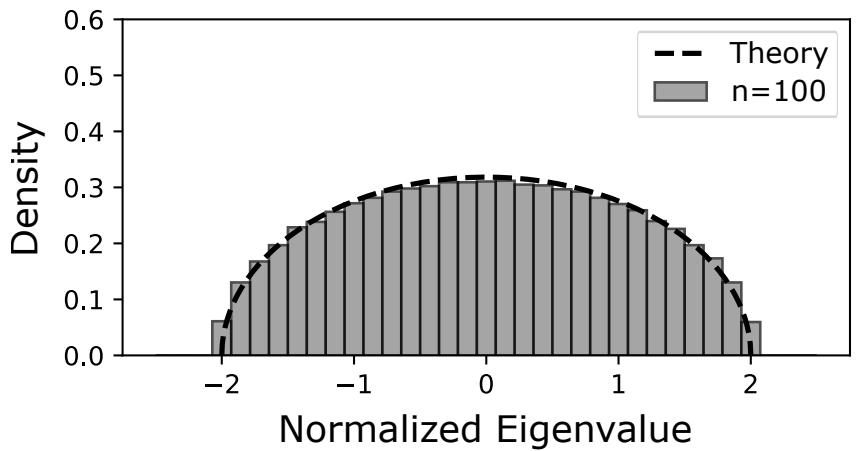  
Figure 3: Theoretical and simulated spectral distribution of $\textbf { M } : = \ \alpha _ { p , q } ^ { - 1 } n ^ { - ( p - 2 ) / 4 } \Phi _ { q } ( \mathbf { Z } )$ ， with $\mathbf { Z } \sim \mathrm { G O T E } _ { p , n }$ , for $p = 4$ and $n = 1 0 0$ (see Theorem 9).

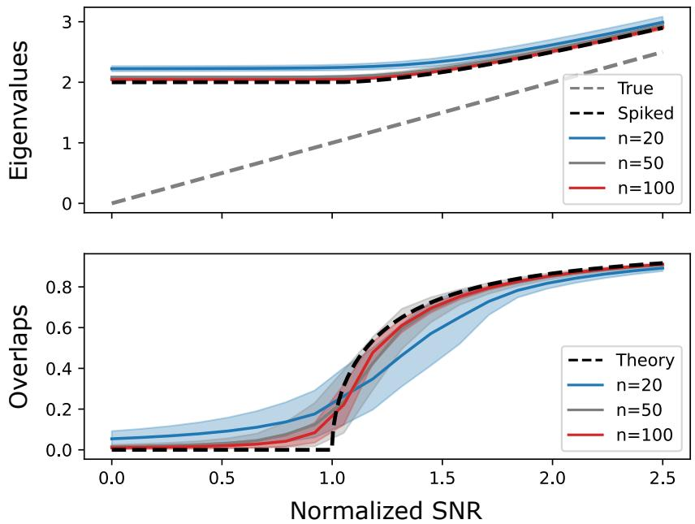  
Figure 4: Theoretical and simulated eigenvalues and overlaps of $\mathbf { M } : = \Phi _ { q } ( \lambda { \pmb v } ^ { \otimes p } + { \pmb Z } )$ , with $\mathbf { Z } \sim \operatorname { G O T E } _ { p , n }$ , for $p = 4$ and $n \in \{ 2 0 , 5 0 , 1 0 0 \}$ (see Theorem 13).

## 4 Discussion

We have studied the spectral behavior of the unfolding algorithm under the spiked symmetric tensor model (1). The strategy was to project the usual unfolding onto symmetric tensor subspaces, after which the matrix spectrally behaves like a Wigner matrix; this was rigorously proven using Stein’s lemma and Cauchy–Schwarz’s inequality on tensor slices with shared indices. We showed that, after normalization, the symmetric unfolding has a semicircular limiting spectrum and that its low-rank perturbation undergoes the usual BBP transition, with a sharp threshold $\lambda = \alpha _ { p , q } n ^ { ( p - 2 ) / 4 }$ and an explicit overlap, settling the conjectured scaling of Montanari and Richard (2014). Hence, despite its simplicity, the unfolding algorithm ranks among the best known polynomial-time estimators for symmetric Tensor PCA problems. To the best of our knowledge, this is the first random matrix analysis of the unfolding algorithm under the genuinely symmetric model of Montanari and Richard (2014) at that level of precision.

Several questions remain open. First, our analysis suggests a broader universality principle for tensor unfoldings. For a general order p and matricization $\operatorname { M a t } _ { k } ( \mathbf { T } )$ , one can similarly project the lines and columns onto $\operatorname { S y m } ^ { k } ( \mathbb { R } ^ { n } )$ and $\operatorname { S y m } ^ { p - k } ( \mathbb { R } ^ { n } )$ , obtaining a rectangular matrix $\Phi _ { k } ( \mathbf { T } ) \in \mathbb { R } ^ { n _ { k } \times n _ { p - k } }$ . For $k < p - k$ , a direct computation of the entrywise variance shows that, after normalization, the resulting model can be written in the form $n _ { p - k } ^ { - 1 / 2 } { \bf X } = \theta v ^ { \odot k } { \pmb v } ^ { \odot p - k ^ { \top } } + n _ { p - k } ^ { - 1 / 2 } { \bf Z } .$ , with $\theta : = \lambda \sqrt { ( p - 1 ) ! / ( k ! n ^ { p - k - 1 } ) }$ , where Z has “mostly” independent unit-variance entries. This is precisely the scaling of the disproportionate spiked matrix model of Feldman (2023), with matrix dimensions $n _ { k } \times n _ { p - k }$ . If the remaining dependencies induced by tensor symmetry (13) are spectrally negligible, like in Lemma 17, their Theorem 1 would therefore suggest a sharp transition at

$$
\lambda _ { k } = \gamma _ { p , k } n ^ { ( p - 2 ) / 4 } , \qquad \mathrm { w i t h } \qquad \gamma _ { p , k } : = \left( \frac { k ! ( p - k ) ! } { ( p - 1 ) ! ^ { 2 } } \right) ^ { 1 / 4 }
$$

and analogous formulas for the outlier singular value and the overlap with the left singular vector, corresponding to the shorter side. Interestingly, the polynomial order $n ^ { ( p - 2 ) / 4 }$ is independent of the unfolding, as in the asymmetric setting (Ben Arous et al., 2023; Feldman and Donoho, 2023), but the sharp constant is not: it is minimized by an “as square as possible” unfolding.8 Moreover, since the random matrix results hold under substantially more general assumptions than Gaussianity—see Benaych-Georges and Nadakuditi (2011) for square unfolding and Feldman (2023) for non-square unfolding—it is natural to expect that the same phenomenon extends to non-Gaussian symmetric noise under suitable moment and tail conditions. We conjecture that the symmetrically projected unfoldings indeed satisfy the corresponding disproportionate random matrix asymptotics; numerical simulations and additional comments are provided in Appendix E.

It would also be interesting to extend the present framework beyond the additive spiked model. Natural examples include moment and cumulant tensors (Kunisky et al., 2024; Tang et al., 2026) arising in latent variable models (Anandkumar et al., 2014). In each case, the main question is whether an appropriate symmetric unfolding reduces the problem to a tractable random matrix model with a sharp spectral transition.

Symmetric unfolding is related to other spectral approaches to Tensor PCA, notably the Kikuchi hierarchy (Wein et al., 2025). While symmetric unfolding exploits a single structured matricization, Kikuchi matrices introduce richer families of tensor transformations and provide a hierarchy of statistical and computational tradeofs. Understanding the relation between these constructions, possibly through the recent random matrix and freeprobabilistic techniques of Bandeira et al. (2023, 2026), could help understanding the impact of high-order symmetries on spectral transitions. Related questions arise for trace-invariant methods (Ouerfelli et al., 2022), which exploit tensor-network contractions.

Finally, our results raise the more fundamental question of whether symmetry can significantly modify the spectral behavior. In the present setting, the dependencies created by high-order symmetries (13) disappear at leading order after projection, resulting in a similar spectral behavior as the corresponding asymmetric model. This may not hold in general: localized signal priors or more-structured noise distributions may lead high-order dependencies to survive asymptotically, significantly impacting the eigenstructure.

## Acknowledgments and Disclosure of Funding

The authors would like to thank Afonso S. Bandeira for insightful discussions around symmetric unfolding, Kikuchi matrices and intrinsic freeness. This work was supported by the French National Research Agency (ANR) via project LATENT (grant ANR-25-CE48-7508- 01) and by the AI Interdisciplinary Institute ANITI funded by the France 2030 program (grant ANR-23-IACL-0002).

## Appendix A. Proofs

## A.1 Symmetric Unfolding (Proposition 7)

Proof By definition of U, one has $\Pi _ { i j } : = [ \mathbf { U U } ^ { \top } ] _ { i j } = \mathbf { 1 } _ { \{ j \in \mathfrak { S } _ { i } \} } / \# \mathfrak { S } _ { i }$ . Moreover, as M is hypersymmetric, every row and column is constant on permutation orbits, so M = ΠMΠ = $\mathbf { U U } ^ { \top } \mathbf { M U U } ^ { \top }$ , with

$$
[ \mathbf { U } ^ { \top } \mathbf { M } \mathbf { U } ] _ { i j } = \sum _ { i ^ { \prime } \in \mathfrak { S } _ { i } } \sum _ { j ^ { \prime } \in \mathfrak { S } _ { j } } \frac { M _ { i ^ { \prime } j ^ { \prime } } } { \sqrt { \# \mathfrak { S } _ { i } \# \mathfrak { S } _ { j } } } = \sum _ { i ^ { \prime } \in \mathfrak { S } _ { i } } \sum _ { j ^ { \prime } \in \mathfrak { S } _ { j } } \frac { M _ { i j } } { \sqrt { \# \mathfrak { S } _ { i } \# \mathfrak { S } _ { j } } } = \sqrt { \# \mathfrak { S } _ { i } \# \mathfrak { S } _ { j } } M _ { i j } .
$$

Finally, since $\mathbf { U } ^ { \top } \mathbf { U } = \mathbf { I } _ { n _ { q } } .$ , the nonzero eigenpairs are transported by the isometric embedding U. The remaining $n ^ { q } - n _ { q }$ dimensions belong to ker(M). ■

## A.2 Deterministic Equivalent (Theorem 9)

Proof The starting point is the resolvent identity $\mathbf { M } \mathbf { Q } = \mathbf { I } _ { n _ { q } } + z \mathbf { Q }$ . Applying Stein’s equality (Lemma 4), one gets

$$
\mathbb { E } \left[ \mathbf { M Q } \right] _ { i j } = \sum _ { k = 1 } ^ { n _ { q } } \mathbb { E } \left[ M _ { i k } Q _ { k j } \right] = \sum _ { k = 1 } ^ { n _ { q } } \frac { p \# \mathbb { S } _ { i } \# \mathbb { S } _ { k } } { \alpha _ { p , q } ^ { 2 } n ^ { p / 2 } \# \mathbb { S } _ { i \downarrow k } } \mathbb { E } \left[ \frac { \partial Q _ { k j } } { \partial M _ { i k } } \right] ,
$$

with

$$
\frac { \partial Q _ { k j } } { \partial M _ { i k } } = - \left[ { \bf Q } \frac { \partial { \bf M } } { \partial { \bf M } _ { i k } } { \bf Q } \right] _ { k j } = - \sum _ { ( i ^ { \prime } , k ^ { \prime } ) \in \mathcal { E } ( i , k ) } Q _ { k k ^ { \prime } } Q _ { i ^ { \prime } j } .\tag{19}
$$

Noting that $\# \mathfrak { S } _ { i \sqcup k } = p ! \# \mathfrak { S } _ { i } \# \mathfrak { S } _ { k } / q ! ^ { 2 }$ , for any “generic” $k \in \mathcal { T } _ { q }$ such that $i \cap k = \emptyset$ , one gets p# $\mathfrak { S } _ { i } \# \mathfrak { S } _ { k } / ( \alpha _ { p , q } ^ { 2 } n ^ { p / 2 } \# \mathfrak { S } _ { i \sqcup k } ) = q ! / n ^ { p / 2 } \sim n _ { q } ^ { - 1 }$ . Consequently,

$$
\mathbb { E } \left[ \mathbf { M } \mathbf { Q } \right] _ { i j } \sim - \frac { 1 } { n _ { q } } \sum _ { k \in \mathcal { I } _ { q } } \sum _ { ( i ^ { \prime } , k ^ { \prime } ) \in \mathcal { E } ( i , k ) } \mathbb { E } \left[ Q _ { k k ^ { \prime } } Q _ { i ^ { \prime } j } \right] .\tag{20}
$$

Equation (20) is rather simple, but the sum over permutations of multi-indices it involves prevents us from obtaining a self-consistent equation on Q. Fortunately, we can show that the only permutation yielding non-negligible terms is the trivial one, matching $( i , k )$ with $( i ^ { \prime } , k ^ { \prime } ) ;$ ; indeed, otherwise $Q _ { k k ^ { \prime } }$ and $Q _ { i ^ { \prime } j }$ have shared indices, leading the associated summation over k to be negligible with respect to the right-hand side.

Lemma 17 (Negligible Permutations) Let $s \in \{ 0 , \ldots , q \}$ and $( i ^ { \prime } , k ^ { \prime } ) \in \mathcal { E } ( i , k )$ be such that $i ^ { \prime } = ( k _ { 1 } , \dots , k _ { s } , i _ { s + 1 } , \dots , i _ { q } )$ and $\pmb { k } ^ { \prime } = ( i _ { 1 } , \dots , i _ { s } , k _ { s + 1 } , \dots , k _ { q } )$ . One has

$$
\sum _ { \pmb { k } \in \mathbb { Z } _ { q } } Q _ { \pmb { k } \pmb { k } ^ { \prime } } Q _ { i ^ { \prime } j } = O \left( n ^ { q - s } n ^ { \lfloor s / 2 \rfloor } \right) .\tag{21}
$$

Here, s represents the number of shared indices in $k \sqcup k ^ { \prime }$ and $i ^ { \prime } \sqcup j$

Proof One has

$$
\sum _ { k \in \cal Z _ { q } } Q _ { k k ^ { \prime } } Q _ { i ^ { \prime } j } = \sum _ { ( k _ { s + 1 } , \ldots , k _ { q } ) \in { \cal Z } _ { q - s } } \langle Q _ { k _ { s + 1 } \cdots k _ { q } i _ { 1 } \cdots i _ { s } k _ { s + 1 } \cdots k _ { q } } , Q _ { i _ { s + 1 } \cdots i _ { q } j _ { 1 } \cdots j _ { s } j _ { s + 1 } \cdots j _ { q } } \rangle _ { \mathrm { F } } ,
$$

with the tensor slice notation

$$
\begin{array} { r } { Q _ { k _ { s + 1 } \cdots k _ { q } i _ { 1 } \cdots i _ { s } k _ { s + 1 } \cdots k _ { q } } : = \left( Q _ { k _ { 1 } \cdots k _ { s } k _ { s + 1 } \cdots k _ { q } i _ { 1 } \cdots i _ { s } k _ { s + 1 } \cdots k _ { q } } \right) _ { ( k _ { 1 } , \ldots , k _ { s } ) \in \mathbb { Z } _ { s } } : = \mathsf { A } , } \\ { Q _ { i _ { s + 1 } \cdots i _ { q } j _ { 1 } \cdots j _ { s } j _ { s + 1 } \cdots j _ { q } } : = \left( Q _ { k _ { 1 } \cdots k _ { s } i _ { s + 1 } \cdots i _ { q } j _ { 1 } \cdots j _ { s } j _ { s + 1 } \cdots j _ { q } } \right) _ { ( k _ { 1 } , \ldots , k _ { s } ) \in \mathbb { Z } _ { s } } : = \mathsf { B } . } \end{array}
$$

Let $\pmb { \Delta } ^ { \prime } \in ( \mathbb { R } ^ { n } ) ^ { \otimes s }$ be such that $A _ { a _ { 1 } \ldots a _ { s } } ^ { \prime } = A _ { a _ { 1 } \ldots a _ { s } } { \mathrm { i f } } \left( a _ { 1 } , \ldots , a _ { s } \right) \in { \mathcal { T } } _ { s }$ and zero otherwise. Writing $\mathbf { A } : = \mathrm { M a t } _ { n ^ { \lfloor s / 2 \rfloor } } ( \pmb { \Delta } ^ { \prime } )$ , one has $\| \mathbf { A } \| _ { \mathrm { F } } = \| \mathbf { A } \| _ { \mathrm { F } } \leq { \sqrt { n ^ { \lfloor s / 2 \rfloor } } } \| \mathbf { A } \| _ { \mathrm { o p } } = O ( { \sqrt { n ^ { \lfloor s / 2 \rfloor } } } )$ . Similarly, one gets $\| \mathbf { B } \| _ { \mathrm { F } } = O ( { \sqrt { n ^ { \lfloor s / 2 \rfloor } } } )$ . We conclude via the Cauchy–Schwarz inequality:

$$
\sum _ { k \in \mathcal { Z } _ { q } } Q _ { k k ^ { \prime } } Q _ { i ^ { \prime } j } \le \sum _ { ( k _ { s + 1 } , \ldots , k _ { q } ) \in \mathcal { T } _ { q - s } } \| \pmb { \ A } \| _ { \mathrm { F } } \| \pmb { \ B } \| _ { \mathrm { F } } = O \left( n ^ { q - s } n ^ { \left\lfloor s / 2 \right\rfloor } \right) .
$$

Hence, as soon as k and $i ^ { \prime }$ share one index, the associated sum over k is $O ( n ^ { q - s } n ^ { \lfloor s / 2 \rfloor } ) =$ $O ( n ^ { q } n ^ { - \lceil s / 2 \rceil } ) = O ( n ^ { q - 1 } )$ . Consequently, one has

$$
\sum _ { \substack { k \in \mathcal { T } _ { q } \left( i ^ { \prime } , k ^ { \prime } \right) \in \mathcal { E } \left( i , k \right) } } Q _ { k k ^ { \prime } } Q _ { i ^ { \prime } j } \sim \sum _ { k \in \mathcal { T } _ { q } } Q _ { k k } Q _ { i j } .\tag{22}
$$

Lemma 17 implies that high-order dependencies are negligible, from the expected resolvent’s point of view. Applying it to the equation (20) yields

$$
\mathbb { E } \left[ \mathbf { M } \mathbf { Q } \right] _ { i j } \sim - n _ { q } ^ { - 1 } \sum _ { k \in \mathcal { T } _ { q } } \mathbb { E } \left[ Q _ { k k } Q _ { i j } \right] .
$$

Writing $s ( z ) : = { n _ { q } } ^ { - 1 } \operatorname { t r } \left( \mathbf { Q } \right)$ and using $\mathbf { M } \mathbf { Q } = \mathbf { I } _ { n _ { q } } + z \mathbf { Q }$ , we get

$$
\mathbf { I } _ { n _ { q } } + z \mathbb { E } \left[ \mathbf { Q } \right] + \mathbb { E } \left[ s ( z ) \mathbf { Q } \right] = o ( 1 ) .\tag{23}
$$

Taking the normalized trace yields, as $n  \infty ,$ , the self-consistent equation $s ^ { 2 } + z s + 1 = 0$ ， from which we recognize the classical Stieltjes transform of the semicircular distribution.

Substituting this relation back into (23) yields, for every deterministic A, a, b such that $\begin{array} { r } { \| \mathbf { A } \| _ { \mathrm { o p } } = \| \pmb { a } \| _ { 2 } = \| \pmb { b } \| _ { 2 } = 1 , \frac { 1 } { n _ { a } } \operatorname { t r } \left( \mathbf { A } \left( \mathbb { E } \left[ \mathbf { Q } \right] - s _ { \mathrm { s c } } ( z ) \mathbf { I } \right) \right) \to 0 } \end{array}$ and ${ \pmb a } ^ { \top } ( \mathbb { E } [ \mathbf { Q } ] - s _ { \mathrm { s c } } ( z ) \mathbf { I } ) { \pmb b }  0$

Hence, $\bar { \mathbf { Q } } : = s _ { \mathrm { s c } } \mathbf { I } _ { n _ { q } }$ is a good candidate for deterministic equivalence of Q (Definition 3). However, the previous results hold in expectation; to show concentration, we apply the Nash–Poincar´e inequality (Lemma 5) to the functions $f ( \pmb { x } ) = \operatorname { t r } \left( \mathbf { A } \mathbf { Q } \right)$ and $g ( \pmb { x } ) = \pmb { a } ^ { \top } \mathbf { Q } b$

where $\pmb { x } : = \mathrm { v e c } \big ( M _ { i } \big ) _ { i \in \mathcal { T } _ { p } }$ . Using again the derivative (19), we get

$$
\begin{array} { r l } { \mathbb { C } ( \alpha , ( A \otimes \beta ) - \alpha ^ { \prime } ( ( \frac { 1 } { n } ) , \sum _ { k = 0 } ^ { n } [ \frac { \sqrt { \alpha + \beta + \alpha ^ { \prime } } } { n ( \beta + \beta ) } ] ^ { k } ) } & { } \\ & { = - ( ( \frac { 1 } { n } ) , \sum _ { k = 0 } ^ { n } [ ( \frac { \sqrt { \alpha + \beta + \alpha ^ { \prime } } } { n ( \beta + \beta ) } ) ^ { k } ] ) } \\ & { \quad \quad \quad \quad \quad \quad \quad \quad \quad \quad \quad \quad \quad \quad \quad \quad \quad \quad \quad \quad \quad \quad \quad \quad \quad \quad \quad \quad \quad \quad \quad } \\ & { \quad \quad \quad \quad \quad \quad \quad \quad \quad \quad \quad \quad \quad \quad \quad \quad \quad \quad \quad \quad \quad \quad \quad \quad \quad \quad \quad \quad \quad \quad \quad \quad \quad \quad \quad \quad \quad \quad \quad \quad \quad } \\ & { \quad \quad \quad \quad \quad \quad \quad \quad \quad \quad \quad \quad \quad \quad \quad \quad \quad \quad \quad \quad \quad \quad \quad \quad \quad \quad \quad \quad \quad \quad \quad \quad \quad \quad \quad \quad \quad \quad \quad \quad \quad \quad \quad \quad } \\ & { = ( ( \frac { 1 } { n } ) , \sum _ { k = 0 } ^ { n } [ ( \frac { \sqrt { \alpha + \beta + \alpha ^ { \prime } } } { n ( \beta + \beta ) } , \sum _ { k = 0 } ^ { n } \alpha ( \beta + \beta ) ) ^ { k } ] ) \setminus } \\ & { \quad \quad \quad \quad \quad \quad \quad \quad \quad \quad \quad \quad \quad \quad \quad \quad \quad \quad \quad \quad \quad \quad \quad \quad \quad \quad \quad \quad \quad \quad \quad \quad \quad \quad \quad \quad \quad \quad } \\ &  = ( ( \frac { 1 } { n } ) , \sum _ { k = 0 } ^ { n } [ \frac { 1 } { n } ] , \sum _ { k = 0 } ^ { n } [ \sum _ { k = 0 } ^ { n } ( \sum _ { k = 0 } ^ { n } \ \end{array}
$$

Noticing that $\pmb { a } ^ { \top } \mathbf Q \pmb { b } = \mathrm { t r } \left( \pmb { b } \pmb { a } ^ { \top } \mathbf Q \right)$ , we can apply the same sequence of equalities for the concentration of bilinear forms of the resolvent. Writing $A _ { k l } = b _ { k } a _ { l }$ , we get

$$
\mathbb { V } \left[ a ^ { \top } \mathbf { Q } b \right] = { \cal O } \left( \frac { 1 } { n ^ { q } } \sum _ { i \in \mathcal { T } _ { p } } \mathbb { E } \left[ \sum _ { i _ { 1 } ^ { \prime } \sqcup i _ { 2 } ^ { \prime } = i } \left( \sum _ { k , l \in \left[ n ^ { q } \right] } b _ { k } a _ { l } Q _ { i _ { 1 } ^ { \prime } k } Q _ { l i _ { 2 } ^ { \prime } } \right) ^ { 2 } \right] \right)\tag{24}
$$

$$
= O \left( \mathbb { E } \left[ \| \mathbf { Q } \pmb { a } \| _ { 2 } ^ { 2 } \| \mathbf { Q } \pmb { b } \| _ { 2 } ^ { 2 } \right] / n ^ { q } \right)\tag{25}
$$

$$
= O \left( \mathbb { E } \left[ \| \mathbf { Q } \| _ { \mathrm { o p } } ^ { 2 } \| \mathbf { Q } \| _ { \mathrm { o p } } ^ { 2 } \right] / n ^ { q } \right)\tag{26}
$$

$$
= O ( 1 / n ^ { q } ) .\tag{27}
$$

Hence, one has $\mathbb { V } \left[ { \frac { 1 } { n ^ { q } } } \operatorname { t r } \left( \mathbf { A } \left( \mathbf { Q } - { \bar { \mathbf { Q } } } \right) \right) \right] = O ( n ^ { - p } )$ and $\mathbb { V } \left[ { \pmb a } ^ { \top } \left( { \pmb Q } - \bar { \mathbf Q } \right) { \pmb b } \right] = { \cal O } ( n ^ { - q } )$ . The variance bounds are both summable for $q \geq 2$ , therefore the convergence is almost sure by virtue of Chebyshev’s inequality and Borel–Cantelli’s lemma. For $q = 1$ , the matrix is an ordinary GOE and the almost-sure resolvent convergence is classical (see, for instance, Theorem 2.5 of Couillet and Liao 2022).

This proves the deterministic equivalent (14). The almost-sure convergence of the Stieltjes transform to $s _ { \mathrm { s c } }$ follows. The Stieltjes continuity theorem then gives weak convergence to the standard semicircle law (15). ■

Proof [Proof of Corollary 10] The full unfolding satisfies $\alpha _ { p , q } n ^ { ( p - 2 ) / 4 } \mathbf { M } = \mathbf { U } \Phi _ { q } ( \mathbf { Z } ) \mathbf { U } ^ { \top }$ on Im(U) and is zero on its orthogonal complement. Since $n _ { q } / n ^ { q }  1 / q !$ , its empirical law is the mixture of the semicircle scaled by $\alpha _ { p , q }$ and a Dirac mass of weight $1 - 1 / q !$

## A.3 Spectral Norm (Remark 12)

We establish the spectral norm of the symmetrically unfolded GOTE by adapting the standard high-moment argument (see Section 2.3 of Tao 2012) and showing that the additional identifications induced by tensor symmetry are negligible.

Proposition 18 (Spectral Norm) Let $\mathbf { Z } \ \sim \ \mathrm { G O T E } _ { p , n }$ and $\mathbf { M } : = \mathbf { \Phi } \alpha _ { p , q } ^ { - 1 } { n } ^ { - ( p - 2 ) / 4 } \Phi _ { q } ( \mathbf { Z } )$ with $\alpha _ { p , q } : = \sqrt { q ! / ( p - 1 ) ! }$ . One has $\| \mathbf { M } \| _ { \mathrm { o p } } \ { \xrightarrow { \mathrm { a . s . } } } \ 2$

Proof Expanding the trace and applying Wick’s formula gives

$$
\mathbb { E } \left[ \mathrm { t r } ( \mathbf { M } ^ { 2 k } ) \right] = \sum _ { \pi \in \mathcal { P } _ { 2 } ( 2 k ) } \sum _ { i _ { 1 } , \ldots , i _ { 2 k } \in \mathcal { I } _ { q } } \prod _ { \left\{ a , b \right\} \in \pi } \mathbb { E } \left[ \mathbf { M } _ { i _ { a } i _ { a + 1 } \mathbf { M } _ { i _ { b } i _ { b + 1 } } } \right] ,
$$

where $\mathcal { P } _ { 2 } ( 2 k )$ denotes the set of pair partitions of [2k] and $i _ { 2 k + 1 } = i _ { 1 }$ . A covariance is nonzero only if $\boldsymbol { i } _ { a } \sqcup \boldsymbol { i } _ { a + 1 } = \boldsymbol { i } _ { b } \sqcup \boldsymbol { i } _ { b + 1 }$ . The standard identifications are $( i _ { a } , i _ { a + 1 } ) = ( i _ { b } , i _ { b + 1 } )$ and $( i _ { a } , i _ { a + 1 } ) = ( i _ { b + 1 } , i _ { b } )$ ; all other identifications are called non-standard.

We first show that, for every $\varepsilon > 0$ , uniformly for $k \leq c _ { \varepsilon }$ ln n,

$$
\begin{array} { r } { \mathbb { E } [ \mathrm { t r } ( \mathbf { M } ^ { 2 k } ) ] \leq n _ { q } ( 2 + \varepsilon / 2 ) ^ { 2 k } . } \end{array}\tag{28}
$$

To this end, write $\begin{array} { r } { W ( \pi , i _ { 1 } , \ldots , i _ { 2 k } ) : = \prod _ { \left\{ a , b \right\} \in \pi } \mathbb { E } [ \mathbf { M } _ { i _ { a } i _ { a + 1 } } \mathbf { M } _ { i _ { b } i _ { b + 1 } } ] } \end{array}$ . The covariance structure of the symmetric unfolding gives, for some constants $A _ { q } , B _ { q } ,$

$$
\sum _ { \stackrel { \pi , i _ { 1 } , \ldots , i _ { 2 k } } { \mathrm { n o n - s t a n d a r d } } } W ( \pi , i _ { 1 } , \ldots , i _ { 2 k } ) \leq \frac { A _ { q } k ^ { B _ { q } } } { n } \sum _ { \stackrel { \pi , i _ { 1 } , \ldots , i _ { 2 k } } { \mathrm { s t a n d a r d } } } W ( \pi , i _ { 1 } , \ldots , i _ { 2 k } ) .\tag{29}
$$

Indeed, each non-standard identification leads to a factor $O ( n ^ { - 1 } )$ with respect to the associated standard identification—see Lemma 17—and the $k ^ { B _ { q } }$ factor accounts for the possible choices of locations of the non-standard covariances. The standard Wigner moment count gives, uniformly for $k \leq c _ { \varepsilon }$ ln n,

$$
\sum _ { \stackrel { \pi , i _ { 1 } , \ldots , i _ { 2 k } } { \mathrm { ~ s t a n d a r d } } } W ( \pi , i _ { 1 } , \ldots , i _ { 2 k } ) \leq n _ { q } ( 2 + \varepsilon / 4 ) ^ { 2 k } .
$$

Together with (29), this proves (28) for all suficiently large n.

Now let $k _ { n } = \lfloor c _ { \varepsilon }$ ln n⌋, with $c _ { \varepsilon }$ suficiently large. Since $\| \mathbf { M } \| _ { \mathrm { o p } } ^ { 2 k _ { n } } \leq \mathrm { t r } ( \mathbf { M } ^ { 2 k _ { n } } )$ , Markov’s inequality and (28) give

$$
\mathbb { P } ( \| \mathbf { M } \| _ { \mathrm { o p } } > 2 + \varepsilon ) \le n _ { q } \left( \frac { 2 + \varepsilon / 2 } { 2 + \varepsilon } \right) ^ { 2 k _ { n } } .
$$

Since $n _ { q } = { \cal O } ( n ^ { q } ) , c _ { \varepsilon }$ can be chosen so that the right-hand side is summable in n. Hence, by Borel–Cantelli, lim $\begin{array} { r } { \operatorname* { s u p } _ { n \to \infty } \| \mathbf { M } \| _ { \mathrm { o p } } \leq 2 } \end{array}$ , almost surely. Finally, the empirical spectral distribution converges almost surely to the semicircle law. Since the latter has positive mass in $( 2 - \varepsilon , 2 )$ , almost surely M has an eigenvalue larger than $2 - \varepsilon$ for all suficiently large n. Thus lim in $\mathrm { f } _ { n  \infty } \| \mathbf { M } \| _ { \mathrm { o p } } \geq 2 - \varepsilon$ . Letting $\varepsilon \downarrow 0$ concludes that $\| \mathbf { M } \| _ { \mathrm { o p } } \to 2$ , almost surely.

## A.4 Phase Transition (Theorem 13)

Proof Similarly to Theorem 9, let $\mathbf { M } : = \alpha _ { p , q } ^ { - 1 } n ^ { - ( p - 2 ) / 4 } \Phi _ { q } ( \mathbf { Z } )$ and $\mathbf { Q } ( z ) : = \left( \mathbf { M } - z \mathbf { I } _ { n ^ { q } } \right) ^ { - 1 }$ By Proposition 18, $\lambda _ { \mathrm { m a x } } ( \mathbf { M } )  2$ almost surely.

Suppose first that $\tau > 1$ and let $z \in \mathbb { C } \setminus [ - 2 , 2 ]$ . Then,

$$
\operatorname* { d e t } ( \mathbf { X } - z \mathbf { I } ) = \operatorname* { d e t } ( \mathbf { M } - z \mathbf { I } ) \left( 1 + \tau { \boldsymbol { v } } ^ { \odot q ^ { \top } } \mathbf { Q } ( z ) { \boldsymbol { v } } ^ { \odot q } \right) .\tag{30}
$$

By Theorem 9, one has ${ \pmb v } ^ { \odot q ^ { \top } } { \bf Q } ( z ) { \pmb v } ^ { \odot q }  s _ { \mathrm { s c } } ( z )$ . Since $1 + \tau s _ { \mathrm { s c } } ( z ) = 0$ has a unique solution outside $[ - 2 , 2 ]$ , that is $\rho ( \tau ) : = \tau + \tau ^ { - 1 }$ , X has a unique eigenvalue ˆτ converging to $\rho ( \tau ) > 2$ Let Γ be a small contour around $\rho ( \tau )$ . By Cauchy’s integral formula (Lemma 2) and Sherman–Morrison’s formula, one has

$$
| \hat { v } ^ { \top } v ^ { \odot q } | ^ { 2 } = - \frac { 1 } { 2 \pi i } \oint _ { \Gamma } \frac { v ^ { \odot q ^ { \top } } \mathbf { Q } ( z ) v ^ { \odot q } } { 1 + \tau v ^ { \odot q ^ { \top } } \mathbf { Q } ( z ) v ^ { \odot q } } \longrightarrow - \frac { 1 } { 2 \pi i } \oint _ { \Gamma } \frac { s _ { \mathrm { s c } } ( z ) } { 1 + \tau s _ { \mathrm { s c } } ( z ) } \mathrm { d } z .
$$

The integrand has a unique simple pole at $\rho ( \tau )$ , so the residue theorem yields

$$
| \hat { v } ^ { \top } v ^ { \odot q } | ^ { 2 } \longrightarrow - \frac { s _ { \mathrm { s c } } ( \rho ( \tau ) ) } { \tau s _ { \mathrm { s c } } ^ { \prime } ( \rho ( \tau ) ) } = 1 - \frac { 1 } { \tau ^ { 2 } } .
$$

Now suppose that $\tau \leq 1$ and fix $\varepsilon > 0$ . For $z \geq 2 + \varepsilon$ , one has $1 + \tau s _ { \mathrm { s c } } ( z ) \geq 1 + s _ { \mathrm { s c } } ( 2 + \varepsilon ) >$ 0. By Theorem 9, $1 + \tau { \pmb v } ^ { { \odot } { q } ^ { \top } } { \mathbf Q } ( z ) { \pmb v } ^ { { \odot } { q } }$ is therefore bounded away from zero, hence the determinant identity (30) shows that X has no eigenvalue larger than $2 + \varepsilon$ . By Weyl’s inequality, $\lambda _ { \operatorname* { m a x } } ( \mathbf { X } ) \geq \lambda _ { \operatorname* { m a x } } ( \mathbf { M } ) \to 2 ;$ eventually, $\lambda _ { \operatorname* { m a x } } ( \mathbf { X } ) \to 2$ . Finally, the subcritical finite-rank deformation result for Wigner matrices, together with the isotropic deterministic equivalent proved in Theorem 9, gives $| \hat { \pmb { v } } ^ { \top } \pmb { v } ^ { \odot q } | ^ { 2 }  0$

The results apply similarly to $\operatorname { M a t } _ { q } ( \pmb { \mathsf { X } } )$ , as $\begin{array} { r } { \left( \mathbf { U } \hat { \pmb { v } } \right) ^ { \top } ( \mathbf { U } \pmb { v } ^ { \odot q } ) = \hat { \pmb { v } } ^ { \top } \mathbf { U } ^ { \top } \mathbf { U } \pmb { v } ^ { \boxtimes q } = \hat { \pmb { v } } ^ { \top } \pmb { v } ^ { \odot q } } \end{array}$

## Appendix B. Standard Gaussian Noise

This section extends the main text results to the spiked tensor model $\pmb { \mathsf { X } } : = \lambda \pmb { v } ^ { \otimes p } + \pmb { Z }$ , where $\mathbf { Z } \sim \mathrm { S G } _ { p , n }$ has independent standard Gaussian entries up to tensor symmetry:

$$
\begin{array} { r } { \left\{ \begin{array} { l l } { Z _ { i _ { 1 } \cdots i _ { p } } } & { \stackrel { \mathrm { i i d } } { \sim } { \mathcal { N } } ( 0 , 1 ) , } \\ { Z _ { i _ { \sigma ( 1 ) } \cdots i _ { \sigma ( p ) } } } & { = Z _ { i _ { 1 } \cdots i _ { p } } . } \end{array} \right. } \end{array}\tag{31}
$$

Theorem 19 (Deterministic Equivalent) Let $\mathbf { Z } \sim \mathrm { S G } _ { p , n } , \mathbf { M } : = \beta ^ { - 1 } n ^ { - p / 4 } \Phi _ { q } ( \mathbf { Z } )$ and $\mathbf { Q } ( z ) : = \left( \mathbf { M } - z \mathbf { I } _ { n _ { q } } \right) ^ { - 1 }$ , with $\beta : = \sqrt { q ! }$ . Then,

$$
\mathbf { Q } ( z ) \longleftrightarrow s _ { \mathrm { s c } } ( z ) \mathbf { I } _ { n _ { q } } , \qquad w i t h \qquad s _ { \mathrm { s c } } ( z ) : = - \big ( z - \sqrt { z ^ { 2 } - 4 } \big ) / 2 ,\tag{32}
$$

in the sense of Definition 3. Consequently, the empirical spectral distribution of M converges weakly almost surely to the standard Wigner semicircle law:

$$
{ \frac { 1 } { n _ { q } } } \sum _ { i = 1 } ^ { n _ { q } } \delta _ { \lambda _ { i } ( \mathbf { M } ) } { \xrightarrow { \mathrm { a . s . } } } \ f _ { \operatorname { s c } } ( x ) \mathrm { d } x , \qquad w i t h \qquad f _ { \operatorname { s c } } ( x ) = { \frac { { \sqrt { ( 4 - x ^ { 2 } ) ^ { + } } } } { 2 \pi } } .\tag{33}
$$

Corollary 20 (Standard Unfolding) Let $\mathbf { Z } \ \sim \ \mathrm { S G } _ { p , n } , \ \mathbf { M } \ : = \ \beta ^ { - 1 } n ^ { - p / 4 } \ \mathrm { M a t } _ { q } ( \mathbf { Z } )$ and $\mathbf { Q } ( z ) : = \left( \mathbf { M } - z \mathbf { \dot { I } } _ { n ^ { q } } \right) ^ { - 1 }$ , with $\beta : = \sqrt { q ! }$ . Then,

$$
{ \bf Q } ( z ) \longleftrightarrow s _ { \mathrm { s c } } ( z ) \mathbf { I I } + s _ { \delta _ { 0 } } ( z ) ( \mathbf { I } _ { n ^ { q } } - \mathbf { I I } ) , \qquad w i t h \ \quad \ s _ { \delta _ { 0 } } ( z ) : = - \frac { 1 } { z } ,\tag{34}
$$

in the sense of Definition 3. Consequently, the empirical spectral distribution of M converges weakly almost surely to a mixture of a semicircle and a Dirac:

$$
{ \frac { 1 } { n ^ { q } } } \sum _ { i = 1 } ^ { n ^ { q } } \delta _ { \lambda _ { i } ( \mathbf { M } ) } ( \mathrm { d } x ) { \xrightarrow { \mathrm { a . s . } } } { \frac { 1 } { q ! } } f _ { \mathrm { s c } } ( x ) \mathrm { d } x + \left( 1 - { \frac { 1 } { q ! } } \right) \delta _ { 0 } ( \mathrm { d } x ) .\tag{35}
$$

Theorem 21 (Phase Transition) Let $\begin{array} { r } { \pmb { \mathsf { X } } = \lambda \pmb { v } ^ { \otimes p } + \pmb { Z } } \end{array}$ , with $\lambda > 0 , v \in \mathbb { S } ^ { n - 1 }$ and $\textsf { Z } \sim$ $\mathrm { S G } _ { p , n } , \mathbf { X } : = \Phi _ { q } ( { \mathbf { X } } ) \in \mathrm { S y m } ( n _ { q } )$ and $( \hat { \lambda } , \hat { v } ) \in \mathbb { R } _ { + } \times \mathbb { S } ^ { n _ { q } - 1 }$ the leading eigenpair $o f \mathbf { X }$ . Writing $\tau : = \lambda / ( \beta n ^ { p / 4 } )$ and $\hat { \tau } : = \hat { \lambda } / ( \beta n ^ { p / 4 } )$ , with $\beta : = \sqrt { q ! }$ , one has

$$
\begin{array}{c} \hat { \tau } \xrightarrow [ n \to \infty ] { \mathrm { \Large ~ a . s . } } \left\{ \begin{array} { l l } { 2 } & { i f \tau \leq 1 , } \\ { \tau + \tau ^ { - 1 } } & { i f \tau > 1 , } \end{array} \right. \qquad a n d \qquad \lvert \hat { v } ^ { \top } v ^ { \odot q } \rvert ^ { 2 } \xrightarrow [ n \to \infty ] { \mathrm { \Large ~ a . s . } } \left\{ 0 \qquad i f \tau \leq 1 ,  \\ { 1 - \tau ^ { - 2 } } & { i f \tau > 1 , } \end{array} \right.\tag{36}
$$

with $\pmb { v } ^ { \odot q } : = \mathbf { U } ^ { \top } \pmb { v } ^ { \boxtimes q } \in \mathbb { S } ^ { n _ { q } - 1 }$ . These results apply verbatim to $\mathbf { X } : = \mathrm { M a t } _ { q } ( \mathbf { X } ) \in \mathrm { S y m } ( n ^ { q } )$

Proof [Theorem 19, Corollary 20 and Theorem 21] The proof is identical in structure to the one of $\mathbf { Z } \ \sim \ \mathrm { G O T E } _ { p , n }$ . After multiplication by the symmetric basis weights and division by $\beta n ^ { p / 4 }$ , a generic entry of M has variance $q ! ^ { 2 } / ( \beta ^ { 2 } n ^ { p / 2 } ) = n _ { q } ^ { - 1 } ( 1 + O ( n ^ { - 1 } ) )$ . The dependency classes are exactly the same, whence the negligibility of non-standard symmetries. Eventually, the Stein, Nash–Poincar´e and Sherman–Morrison arguments apply similarly. 7

We report the theoretical and simulated spectral distribution of the symmetrically unfolded standard Gaussian model, $\mathbf { M } : = \beta ^ { - 1 } n ^ { - p / 4 } \Phi _ { q } ( \mathbf { Z } )$ , in Figure 5, with $n = 1 0 0$ . Moreover, we report the eigenvalues and overlaps in Figure 6, with $n \in \{ 2 0 , 5 0 , 1 0 0 \}$ , in a similar experimental setting to Section 3.4. We see that the empirical eigenvalues are well estimated by the limiting spectral distribution. Both leading eigenvalue and overlap are increasingly well estimated by the theoretical ones beyond phase transition, as λ grows.

The match between theory and simulations is slightly better under $\mathbf { Z } \sim \mathrm { S G } _ { p , n }$ than $\begin{array} { r } { \pmb { Z } \sim \mathrm { G O T E } _ { p , n } ; } \end{array}$ see Figures 3 and 4 for comparison. This may be due to the extra asymptotic approximations that are performed in the proof under the GOTE noise, notably $\# \mathfrak { S } _ { i \sqcup k } =$ $p ! \# \mathfrak { S } _ { i } \# \mathfrak { S } _ { k } / q ! ^ { 2 }$ , which holds only for generic indices.

  
Figure 5: Theoretical and simulated spectral distribution of the normalized symmetrically unfolded standard Gaussian noise, $\mathbf { M } : = \beta ^ { - 1 } n ^ { - p / 4 } \Phi _ { q } ( \mathbf { Z } )$ , with $\mathbf { Z } \sim \mathrm { S G } _ { p , n }$ , for $p = 4$ and $n = 1 0 0$ (see Theorem 19).

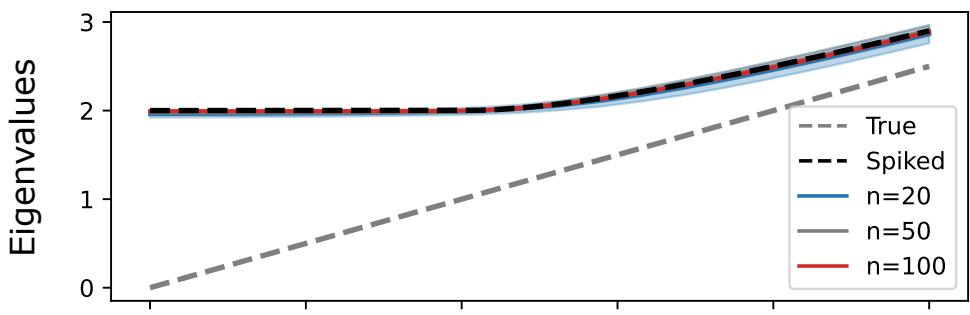

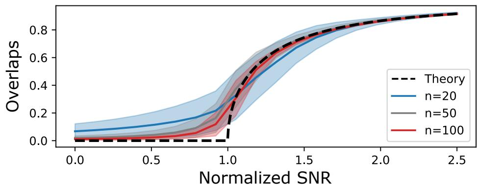  
Figure 6: Theoretical and simulated eigenvalues and overlaps for the symmetrically unfolded spiked tensor $\textbf { M } : = \Phi _ { q } ( \lambda \pmb { v } ^ { \otimes p } + \pmb { Z } )$ , with $\begin{array} { r } { \mathbf { Z } \ \sim \ \mathrm { S G } _ { p , n } } \end{array}$ , for $p \ = \ 4$ and $n \in \{ 2 0 , 5 0 , 1 0 0 \}$ (see Theorem 21).

## Appendix C. Finite-Rank Extensions

Theorem 13 on phase transition extends to a finite number of orthogonal planted signals. Corollary 22 (Multiple Spikes) Consider the CP model

$$
\pmb { \mathsf { X } } = \sum _ { k = 1 } ^ { r } \lambda _ { k } \pmb { v } _ { k } ^ { \otimes p } + \pmb { \mu } ,\tag{37}
$$

where $\lambda _ { 1 } > \dots > \lambda _ { r } > 0 , \pmb { v } _ { 1 } , \dots , \pmb { v } _ { r } \in \mathbb { S } ^ { n - 1 }$ are orthonormal and $\mathbf { Z } \sim \mathrm { G O T E } _ { p , n }$ . Let $\mathbf { X } =$ $\Phi _ { q } ( \mathbf { X } ) \in \mathrm { S y m } ( n _ { q } )$ and let $( \hat { \lambda } _ { k } , \hat { \pmb { v } } _ { k } ) _ { k = 1 } ^ { r }$ denote its r leading eigenpairs, ordered decreasingly. Writing $\tau _ { k } : = \lambda _ { k } / ( \alpha _ { p , q } n ^ { ( p - 2 ) / 4 } )$ and $\hat { \tau } _ { k } : = \hat { \lambda } _ { k } / ( \alpha _ { p , q } n ^ { ( p - 2 ) / 4 } )$ , with $\alpha _ { p , q } : = \sqrt { q ! / ( p - 1 ) ! }$ , one has, for every fixed $k \in { 1 , \dots , r }$

$$
\begin{array} { r } { \widehat { \tau } _ { k } \xrightarrow [ n  \infty ] { \mathrm { a . s . } } \{ \begin{array} { l l } { 2 , } & { \tau _ { k } \leq 1 , } \\ { \tau _ { k } + \tau _ { k } ^ { - 1 } , } & { \tau _ { k } > 1 , } \end{array}  \quad \quad \boldsymbol { a n d } \quad \quad \big | \widehat { \boldsymbol { v } } _ { k } ^ { \top } \boldsymbol { v } _ { k } ^ { \odot q } \big | ^ { 2 } \xrightarrow [ n  \infty ] { \mathrm { a . s . } } \{ \begin{array} { l l } { 0 , } & { \tau _ { k } \leq 1 , } \\ { 1 - \tau _ { k } ^ { - 2 } , } & { \tau _ { k } > 1 . } \end{array}  } \end{array}
$$

Moreover, for $l \neq k , \ \big | \hat { \pmb { v } } _ { k } ^ { \top } \pmb { v } _ { l } ^ { \top q } \big | \  \ 0$ . Consequently, writing $\mathbf { V } ~ = ~ \left[ v _ { 1 } ^ { \odot q } \quad \cdot \cdot \cdot \quad v _ { r } ^ { \odot q } \right]$ and $\hat { \bf V } = \left[ \hat { \pmb v } _ { 1 } \quad \cdots \quad \hat { \pmb v } _ { r } \right]$ , one has

$$
\| \hat { \mathbf { V } } ^ { \top } \mathbf { V } \| _ { F } ^ { 2 } \xrightarrow [ n  \infty ] { \mathrm { a . s . } } \sum _ { k = 1 } ^ { r } ( 1 - \tau _ { k } ^ { - 2 } ) ^ { + } .\tag{38}
$$

These results apply verbatim to $\mathbf { X } : = \mathrm { M a t } _ { q } ( \mathbf { X } ) \in \mathrm { S y m } ( n ^ { q } )$

Proof After the symmetric unfolding and normalization, the model is $\begin{array} { r } { \mathbf { M } + \sum _ { k = 1 } ^ { r } \tau _ { k } \pmb { u } _ { k } \pmb { u } _ { k } ^ { \top } } \end{array}$ with $\mathbf { } u _ { k } = v _ { k } ^ { \odot q }$ . The vectors $\mathbf { \Delta } \mathbf { u } _ { k }$ are orthonormal because $\langle { \pmb u } _ { k } , { \pmb u } _ { l } \rangle = \langle { \pmb v } _ { k } , { \pmb v } _ { l } \rangle ^ { q }$ . The deformation has fixed rank. The isotropic deterministic equivalent from Theorem 9 reduces its outlier equations to $1 + \tau _ { k } s _ { \mathrm { s c } } ( z ) = 0$ after applying Woodbury’s formula—a rank-r version of Sherman–Morrison’s. Distinct supercritical strengths therefore give separated outliers at $\tau _ { k } + \tau _ { k } ^ { - 1 }$ and the residue computation is the same as in the rank-one proof, yielding $| \hat { \pmb u } _ { k } ^ { \top } { \pmb u } _ { k } | ^ { 2 } \overset { \left. } { \right. } ( 1 - \tau _ { k } ^ { - 2 } ) ^ { + }$ and vanishing cross-overlaps. The following result on subspace alignment follows from the convergence of the overlap matrix. 7

We report the theoretical and simulated spectral distribution and subspace overlap of the symmetrically unfolded CP model (37), $\mathbf { M } : = \alpha _ { p , q } ^ { - 1 } n ^ { - ( p - 2 ) / 4 } \Phi _ { q } ( \mathbf { X } )$ , in Figure 7, with $p = 4$ $r = 4$ and $n \in \{ 2 0 , 5 0 , 1 0 0 \}$ . We see that the r largest eigenvalues escape the support of the limiting spectral density; they are therefore above the phase transition threshold. The theoretical subspace overlap curve undergoes multiple phase transitions, one for each spike. It increasingly well estimates the finite-sample simulations as n and λ grow.

The preceding subspace recovery result suggests an extension to other tensor models, such as the Tucker decomposition (Tucker, 1966):

$$
{ \pmb { \times } } = \sum _ { k _ { 1 } , \dots , k _ { p } = 1 } ^ { r } H _ { k _ { 1 } \dots k _ { p } } \left( { \pmb v } _ { k _ { 1 } } \otimes \dots \otimes { \pmb v } _ { k _ { p } } \right) + { \pmb { \mathrm { Z } } } ,\tag{39}
$$

where $\boldsymbol { \mathsf { H } } \in \mathrm { S y m } ^ { p } ( \mathbb { R } ^ { r } ) , \boldsymbol { v } _ { 1 } , . . . , \boldsymbol { v } _ { r } \in \mathbb { S } ^ { n - 1 }$ are orthonormal and $\mathbf { Z } \ \sim \ \mathrm { G O T E } _ { p , n }$ . Such a model is notably relevant in applications where the signal is described by a low-dimensional subspace rather than rank-one components (Sidiropoulos et al., 2017; Lebeau et al., 2025). However, the resulting lifted subspace estimate—an $\binom { n + q - 1 } { q } \times \binom { r + q - 1 } { q }$ matrix—would not straightforwardly lead to an estimate of the subspace span $( \pmb { v } _ { 1 } , \ldots , \hat { \pmb { v } } _ { r } )$ . We therefore leave the Tucker extension for future research.

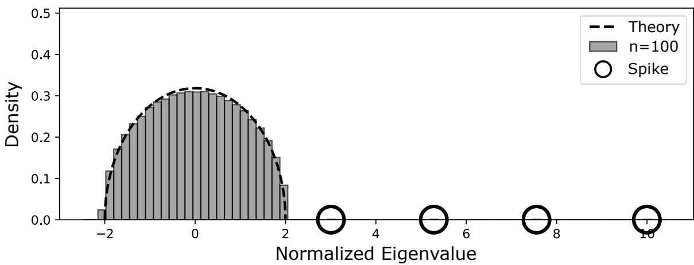

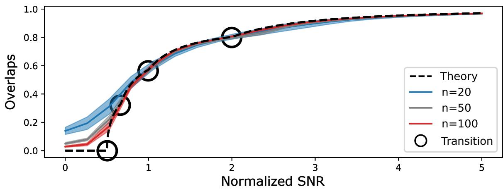  
Figure 7: Theoretical and simulated spectral distribution and subspace overlap of the symmetrically unfolded CP model $\begin{array} { r } { \textbf { M } : = \ \alpha _ { p , q } ^ { - 1 } n ^ { - ( p - 2 ) / 4 } \Phi _ { q } ( \sum _ { k = 1 } ^ { r } \lambda _ { k } \pmb { v } _ { k } ^ { \otimes p } + \pmb { \mathrm { Z } } ) } \end{array}$ , with $\begin{array} { r } { \pmb { Z } \sim \mathrm { G O T E } _ { p , n } . } \end{array}$ , for $p = 4 , r = 4$ and $n = 1 0 0$ (see Corollary 22).

## Appendix D. Recursive Unfolding

The main text analysis concerns a single unfolding of the tensor, resulting in overlap formulas with the lifted vector $\pmb { v } ^ { \boxtimes q } \in \mathbb { S } ^ { n ^ { q } - 1 }$ . It is natural to ask whether the corresponding recursive unfolding procedure, introduced and analyzed in the asymmetric setting by Montanari and Richard (2014, Theorem 5), also achieves exact recovery in the genuinely symmetric model. The similarity between the two Gaussian tensor models—notably enabled by Lemma 17 on the negligible high-order symmetries—suggests that it should.

Conjecture 23 (Recursive Unfolding) Let $\pmb { \times } = \lambda \pmb { v } ^ { \otimes p } + \pmb { Z }$ , with $\pmb { v } \in \mathbb { S } ^ { n - 1 }$ and $\textsf { Z } \sim$ $\mathrm { G O T E } _ { p , n }$ . Let $\mathbf { X } = \mathrm { M a t } _ { q } ( \mathbf { X } ) \in \mathrm { S y m } ( n ^ { q } )$ and denote by $\hat { \pmb { u } } \in \operatorname { S y m } ^ { q } ( \mathbb { R } ^ { n } )$ a leading eigenvector of X. Let $\hat { \pmb { v } } \in \mathbb { S } ^ { n - 1 }$ be a leading left singular vector of the first-mode matricization $\mathrm { M a t } _ { 1 } ( \hat { \pmb u } ) \in \mathbb { R } ^ { n \times n ^ { q - 1 } }$ . Writing $\tau : = \lambda / ( \alpha _ { p , q } n ^ { ( p - 2 ) / 4 } )$ with $\alpha _ { p , q } : = \sqrt { q ! / ( p - 1 ) ! }$ , one has

$$
\begin{array} { r } { | \widehat { \pmb { v } } ^ { \top } \pmb { v } | ^ { 2 } \xrightarrow [ n  \infty ] { \mathrm { a . s . } } \{ 0 \begin{array} { r l } & { i f \tau \leq 1 } \\ { 1 } & { i f \tau > 1 , } \end{array}  } \end{array}\tag{40}
$$

Proof [Idea of proof] The supercritical case can be understood by separating the signal component of the leading eigenvector from its orthogonal remainder. Write

$$
\hat { \pmb u } = \rho _ { n } \pmb u + \sqrt { 1 - \rho _ { n } ^ { 2 } } \pmb g ,\tag{41}
$$

with $\pmb { u } = \pmb { v } ^ { \boxtimes q } , \pmb { g } \perp$ u and $\| \pmb { g } \| = 1$ and set $\mathbf { G } = \mathrm { M a t } _ { 1 } ( \pmb { g } )$ . By Theorem 13, $\rho _ { n } ^ { 2 } \to 1 - \tau ^ { - 2 } > 0$ whenever $\tau > 1$ . Since $\mathrm { M a t } _ { 1 } ( \boldsymbol { \mathbf { u } } ) = \boldsymbol { \mathbf { \mathit { v } } } \boldsymbol { \mathbf { \mathit { v } } } ^ { \boxtimes ( q - 1 ) ^ { \top } }$ , we consequently have

$$
\mathrm { M a t } _ { 1 } ( \hat { \pmb u } ) = \rho _ { n } { \pmb v } { \pmb v } ^ { \boxtimes ( q - 1 ) ^ { \top } } + \sqrt { 1 - \rho _ { n } ^ { 2 } } { \bf G } .\tag{42}
$$

The first term in (42) is rank one with singular value $\rho _ { n } .$ , bounded away from zero. Thus, if one could establish

$$
\| \mathbf G \| _ { \mathrm { o p } } = o ( 1 ) ,\tag{43}
$$

then the Davis–Kahan/Wedin perturbation bound would imply $| \hat { \pmb { v } } ^ { \top } { \pmb { v } } |  1$

In the asymmetric model, Montanari and Richard (2014) establish the analogue of (43) in the proof of their Theorem 5, with the sharper bound $\| \mathbf G ^ { \prime } \| _ { \mathrm { o p } } = O ( n ^ { - 1 / 2 } )$ , almost surely. We expect the same estimate to hold in the symmetric model, with a negligibility argument similar to Lemma 17. Establishing (43) rigorously would, however, require an operatornorm estimate for the matricized eigenvector remainder that is not provided by our present deterministic-equivalent analysis. We therefore leave this step as a conjecture. 7

The numerical experiments in Figure 8 support Conjecture 23.

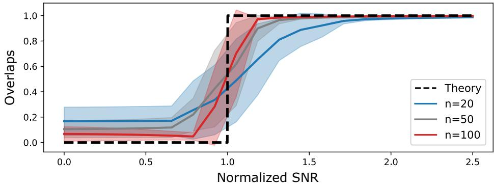  
Figure 8: Theoretical and simulated overlaps for the recursively unfolded spiked tensor T $\mathbf { \partial } \cdot \mathbf { \partial } : = \lambda \pmb { v } ^ { \otimes p } + \pmb { Z } .$ , with $\mathbf { Z } \ \sim \ \mathrm { G O T E } _ { p , n }$ , for $p \ = \ 4$ and $n ~ \in ~ \{ 2 0 , 5 0 , 1 0 0 \}$ (see Conjecture 23).

## Appendix E. Choice of Unfolding

We saw in Section 4 that, if the dependencies induced by the high-order symmetries are spectrally negligible for the $n _ { k } \times n _ { p - k }$ symmetric unfolding, then the disproportionate random matrix results of Feldman (2023, Theorem 1) suggest the following sharp phase transition.

Conjecture 24 (Phase Transition) Let $\begin{array} { r } { \pmb { \chi } = \lambda \pmb { v } ^ { \otimes p } + \pmb { Z } } \end{array}$ , with $\lambda > 0 , v \in \mathbb { S } ^ { n - 1 }$ and $\mathbf { Z } \sim$ $\mathrm { G O T E } _ { p , n }$ . Let $k < p / 2 , { \bf X } : = \Phi _ { k } ( { \bf X } ) \in \mathbb { R } ^ { n _ { k } \times n _ { p - k } }$ , and let $( \hat { \pmb { v } } _ { \ell } , \hat { \pmb { v } } _ { \mathrm { r } } ) \in \mathbb { S } ^ { n _ { k } - 1 } \times \mathbb { S } ^ { n _ { p - k } - 1 }$ denote its leading left and right singular vectors. Writing $\tau _ { \ell } : = \lambda / ( \gamma _ { \ell , p , k } n ^ { ( p - 2 ) / 4 } )$ , with $\gamma _ { \ell , p , k } : =$ $( k ! ( p - k ) ! / ( p - 1 ) ! ^ { 2 } ) ^ { 1 / 4 }$ and $\tau _ { \mathrm { r } } : = \lambda / ( \gamma _ { \mathrm { r } , p , k } n ^ { ( p - k - 1 ) / 2 } )$ , with $\gamma _ { \mathrm { r } , p , k } : = ( k ! / ( p - 1 ) ! ) ^ { 1 / 2 }$ , one has

$$
| \hat { v } _ { \ell } ^ { \top } v ^ { \odot k } | ^ { 2 } \xrightarrow [ n  \infty ] { \mathrm { a . s . } } ( 1 - \tau _ { \ell } ^ { - 4 } ) ^ { + } \qquad a n d \qquad | \hat { v } _ { \mathrm { r } } ^ { \top } v ^ { \odot p - k } | ^ { 2 } \xrightarrow [ n  \infty ] { \mathrm { a . s . } } \frac { \tau _ { \mathrm { r } } ^ { 2 } } { 1 + \tau _ { \mathrm { r } } ^ { 2 } } .\tag{44}
$$

This conjecture is conditional on a negligibility result analogous to Lemma 17, showing that the contractions associated with indices $( i ^ { \prime } , k ^ { \prime } ) \in \mathcal { T } _ { k } \times \mathcal { T } _ { p - k }$ such that $\pmb { i } ^ { \prime } \sqcup \pmb { k } ^ { \prime } = \pmb { i } \sqcup \pmb { k }$ are spectrally negligible. By studying the function $k \mapsto k ! ( p - k ) !$ , we see that the sharp constant in the phase-transition threshold for the short-side singular vector is minimized by an “as square as possible” unfolding. This is consistent with the recommendation of Montanari and Richard (2014, Lemma 3.1), while highlighting an important distinction with the asymmetric-noise setting of Ben Arous et al. (2023). More precisely, the result of Montanari and Richard (2014, Lemma 3.1) concerns partial recovery on the long side of the unfolding, for which the relevant threshold has a larger order of magnitude in the disproportionate regime, namely $n ^ { ( p - k - 1 ) / 2 }$ Thus, their recommendation should be interpreted with some caution in light of the distinction between the two singular-vector sides. Nevertheless, our results show that, for the short-side singular vector, their “as square as possible” prescription is indeed optimal at the level of the sharp constant (although not at the level of the polynomial order, which is the same for all unfoldings, namely $n ^ { ( \bar { p } - 2 ) / 4 } )$

We compare this conjecture with numerical simulations in Figure 9, for $( p , k , n ) ~ =$ (3, 1, 500) and $( p , k , n ) = ( 4 , \{ 1 , 2 \} , 1 0 0 )$ . The simulations match the conjectured overlaps. For $p = 4$ , the “as square as possible” unfolding (k = 2) undergoes a phase transition before the “as large as possible” unfolding (k = 1), resulting in better partial recovery. This superiority is reinforced with recursive unfolding; see Figure 10 for numerical simulations.

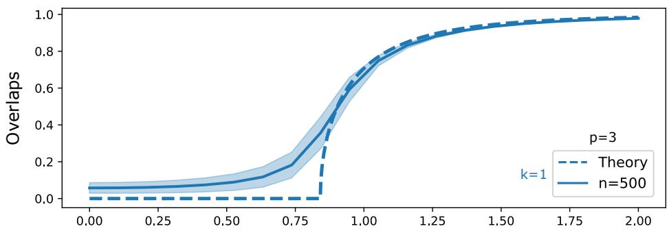

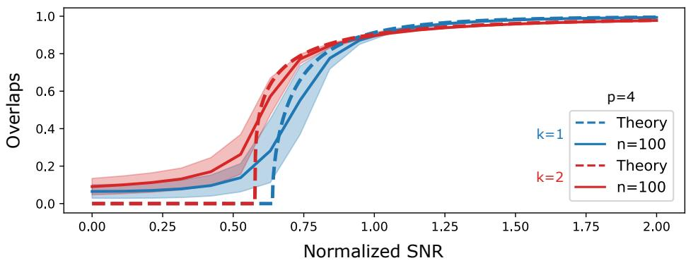  
Figure 9: Theoretical and simulated eigenvalues and overlaps for the symmetrically unfolded spiked tensor $\mathbf { M } : = \Phi _ { k } ( \lambda \pmb { v } ^ { \otimes p } + \pmb { Z } )$ , with $\mathbf { Z } \sim \mathrm { G O T E } _ { p , n }$ , for $( p , k , n ) =$ (3, 1, 500) (top) and $( p , k , n ) = ( 4 , \{ 1 , 2 \} , 1 0 0 )$ (bottom). See Conjecture 24.

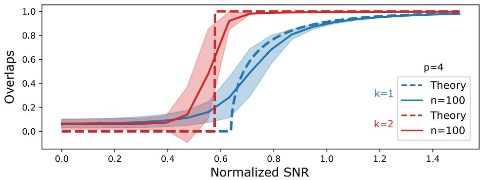  
Figure 10: Theoretical and simulated overlaps for the recursively symmetrically unfolded spiked tensor $\mathbf { M } : = \Phi _ { k } ( \lambda { \pmb v } ^ { \otimes p } + { \pmb Z } )$ , with ${ \bf Z } \sim \mathrm { G O T E } _ { p , n } ,$ for $p = 4 , k \in \{ 1 , 2 \}$ and $n = 1 0 0$ (see Conjectures 23 and 24).

From the computational standpoint, the comparison is somewhat diferent. The square unfolding involves extracting the leading r eigenpairs of a symmetric $n _ { p / 2 } \times n _ { p / 2 }$ matrix, which costs $O ( r n _ { p / 2 } ^ { 2 } ) = O ( r n ^ { p } / ( p / 2 ) ! ^ { 2 } )$ using an iterative eigensolver—up to the number of iterations required for convergence. A non-square unfolding involves extracting the leading r left singular vectors of a $n _ { k } \times n _ { p - k }$ matrix. An iterative SVD requires $O ( r n _ { k } n _ { p - k } )$ arithmetic operations per iteration, giving $O ( r n ^ { p } / ( k ! ( p - k ) ! ) )$ ) up to the same iteration-count considerations. Thus, in principle both types of unfolding have the same polynomial computational complexity, but the leading combinatorial factor is minimized by the “as large as possible” unfolding $( k = 1 )$ . Moreover, when $k = 1$ , the left singular vectors directly provide an estimate of $\pmb { v } \in \mathbb { S } ^ { n - 1 }$ , without requiring a subsequent recursive unfolding step.

Overall, this suggests a tradeof between statistical and computational eficiency. From a recovery standpoint, an “as square as possible” unfolding $\left( k = \lfloor p / 2 \rfloor \right)$ is preferable because it minimizes the conjectured phase-transition threshold, while recursive unfolding can then be used to recover the planted signal v. From a computational standpoint, an “as large as possible” unfolding $( k \ : = \ : 1 )$ is preferable: it has the smallest leading combinatorial factor and directly produces an estimator in the original signal space. To the best of our knowledge, this is the first analysis of the choice of unfolding to exhibit such a tradeof between computational eficiency and estimation performance. It highlights a qualitative distinction between symmetric and asymmetric tensor noise: in the asymmetric setting, the recovery threshold is independent of the choice of unfolding (Ben Arous et al., 2023; Feldman and Donoho, 2023). It is also reminiscent of the hierarchy of statistical–computational tradeofs provided by Kikuchi matrices (Wein et al., 2025; Bandeira et al., 2026).

## References

B. Alex, L. Erd˝os, A. Knowles, H.-T. Yau, and J. Yin. Isotropic local laws for sample covariance and generalized Wigner matrices. Electronic Journal of Probability, 19:1–53, 2014. doi: 10.1214/EJP.v19-3054.

A. Anandkumar, R. Ge, D. Hsu, S. M. Kakade, and M. Telgarsky. Tensor Decompositions for Learning Latent Variable Models. Journal of Machine Learning Research (JMLR), 15(80):2773–2832, 2014. URL http://jmlr.org/papers/v15/anandkumar14b.html.

A. Anandkumar, Y. Deng, R. Ge, and H. Mobahi. Homotopy Analysis for Tensor PCA. In Conference on Learning Theory (CoLT), pages 79–104. PMLR, 2017. URL https: //proceedings.mlr.press/v65/anandkumar17a.html.

G. B. Arous, R. Gheissari, and A. Jagannath. High-dimensional limit theorems for SGD: Effective dynamics and critical scaling. Communications on Pure and Applied Mathematics, 77(3):2030–2080, 2024. doi: 10.1002/cpa.22169.

Z. D. Bai and Y. Q. Yin. Necessary and Suficient Conditions for Almost Sure Convergence of the Largest Eigenvalue of a Wigner Matrix. The Annals of Probability, 16(4):1729–1741, 1988. doi: 10.1214/aop/1176991594.

J. Baik, G. Ben Arous, and S. P´ech´e. Phase transition of the largest eigenvalue for nonnull complex sample covariance matrices. The Annals of Probability, 33(5):1643–1697, 2005. doi: 10.1214/009117905000000233.

A. Bandeira, G. Cipolloni, D. Schr¨oder, and R. Van Handel. Matrix concentration inequalities and free probability II: Two-sided bounds and applications. Communications of the American Mathematical Society, 6(17):896–946, 2026. doi: 10.1090/cams/75.

A. S. Bandeira, M. T. Boedihardjo, and R. v. Handel. Matrix Concentration Inequalities and Free Probability. Inventiones mathematicae, 234(1):419–487, 2023. doi: 10.1007/ s00222-023-01204-6.

A. S. Bandeira, K. Lucca, P. Nizic-Nikolac, and R. van Handel. Matrix Chaos Inequalities and Chaos of Combinatorial Type. In Proceedings of the 57th Annual ACM Symposium on Theory of Computing, STOC ’25, pages 795–805. Association for Computing Machinery, 2025. doi: 10.1145/3717823.3718238.

G. Ben Arous, S. Mei, A. Montanari, and M. Nica. The Landscape of the Spiked Tensor Model. Communications on Pure and Applied Mathematics, 72(11):2282–2330, 2019. doi: 10.1002/cpa.21861.

G. Ben Arous, R. Gheissari, and A. Jagannath. Algorithmic Thresholds for Tensor Pca. The Annals of Probability, 48(4):2052–2087, 2020. URL https://www.jstor.org/stable/ 26966029.

G. Ben Arous, D. Z. Huang, and J. Huang. Long random matrices and tensor unfolding. The Annals of Applied Probability, 33(6B):5753–5780, 2023. doi: 10.1214/23-AAP1958.

F. Benaych-Georges and R. R. Nadakuditi. The eigenvalues and eigenvectors of finite, low rank perturbations of large random matrices. Advances in Mathematics, 227(1):494–521, 2011. doi: 10.1016/j.aim.2011.02.007.

F. Benaych-Georges and R. R. Nadakuditi. The singular values and vectors of low rank perturbations of large rectangular random matrices. Journal of Multivariate Analysis, 111:120–135, 2012. doi: 10.1016/j.jmva.2012.04.019.

R. Bonnin. Characterization of Gaussian Tensor Ensembles. Symmetry, Integrability and Geometry: Methods and Applications, 2026a. doi: 10.3842/SIGMA.2026.031.

R. Bonnin. Universality of the Wigner-Gurau limit for random tensors. Electronic Journal of Probability, 31:1–31, 2026b. doi: 10.1214/26-EJP1500.

J. Brachat, P. Comon, B. Mourrain, and E. Tsigaridas. Symmetric tensor decomposition. Linear Algebra and its Applications, 433(11):1851–1872, 2010. doi: 10.1016/j.laa.2010. 06.046.

P. Breiding, K. Kozhasov, and A. Lerario. On the Geometry of the Set of Symmetric Matrices with Repeated Eigenvalues. Arnold Mathematical Journal, 4(3):423–443, 2018. doi: 10.1007/s40598-018-0095-0.

R. Couillet and Z. Liao. Random Matrix Methods for Machine Learning. Cambridge University Press, 1 edition, 2022. doi: 10.1017/9781009128490.

L. De Lathauwer, B. De Moor, and J. Vandewalle. On the Best Rank-1 and Rank-$( R _ { 1 } , R _ { 2 } , \ldots , R _ { N } )$ Approximation of Higher-Order Tensors. SIAM Journal on Matrix Analysis and Applications, 21(4):1324–1342, 2000. doi: 10.1137/S0895479898346995.

D. Donoho. High-Dimensional Data Analysis: The Curses and Blessings of Dimensionality. In AMS Math Challenges Lecture, pages 1–32, 2000.

M. Feldman and D. Donoho. Sharp Recovery Thresholds of Tensor PCA Spectral Algorithms. Advances in Neural Information Processing Systems (NeurIPS), 36:56628–56640, 2023.

M. J. Feldman. Spiked singular values and vectors under extreme aspect ratios. Journal of Multivariate Analysis, 196:105187, 2023. doi: 10.1016/j.jmva.2023.105187.

R. Ge, J. D. Lee, and T. Ma. Learning One-hidden-layer Neural Networks with Landscape Design. In International Conference on Learning Representations (ICLR), 2018. URL https://openreview.net/forum?id=BkwHObbRZ.

V. L. Girko. Circular Law. Theory of Probability & Its Applications, 29(4):694–706, 1985. doi: 10.1137/1129095.

J. H. d. M. Goulart, R. Couillet, and P. Comon. A Random Matrix Perspective on Random Tensors. Journal of Machine Learning Research (JMLR), 23(264):1–36, 2022. URL http://jmlr.org/papers/v23/21-1038.html.

R. Gurau. On the generalization of the Wigner semicircle law to real symmetric tensors, 2020. URL http://arxiv.org/abs/2004.02660.

W. Hachem, P. Loubaton, and J. Najim. Deterministic equivalents for certain functionals of large random matrices. The Annals of Applied Probability, 17(3):875–930, 2007. doi: 10.1214/105051606000000925.

C. J. Hillar and L.-H. Lim. Most Tensor Problems Are NP-Hard. J. ACM, 60(6):45:1–45:39, 2013. doi: 10.1145/2512329.

F. L. Hitchcock. The Expression of a Tensor or a Polyadic as a Sum of Products. Journal of Mathematics and Physics, 6(1-4):164–189, 1927. doi: 10.1002/sapm192761164.

S. B. Hopkins, J. Shi, and D. Steurer. Tensor principal component analysis via sum-ofsquare proofs. In Conference on Learning Theory (COLT), pages 956–1006, 2015. URL https://proceedings.mlr.press/v40/Hopkins15.html.

S. B. Hopkins, T. Schramm, J. Shi, and D. Steurer. Fast spectral algorithms from sum-ofsquares proofs: tensor decomposition and planted sparse vectors. In Proceedings of the forty-eighth annual ACM symposium on Theory of Computing, STOC ’16, pages 178–191. Association for Computing Machinery, 2016. doi: 10.1145/2897518.2897529.

J. Huang, D. Z. Huang, Q. Yang, and G. Cheng. Power Iteration for Tensor PCA. Journal of Machine Learning Research (JMLR), 23(128):1–47, 2022. URL http://jmlr.org/ papers/v23/21-1290.html.

A. Jagannath, P. Lopatto, and L. Miolane. Statistical Thresholds for Tensor Pca. The Annals of Applied Probability, 30(4):1910–1933, 2020. URL https://www.jstor.org/ stable/26965995.

M. Janzamin, H. Sedghi, and A. Anandkumar. Beating the Perils of Non-Convexity: Guaranteed Training of Neural Networks using Tensor Methods, 2016. URL http: //arxiv.org/abs/1506.08473.

J. Kileel and J. M. Pereira. Subspace power method for symmetric tensor decomposition. Numerical Algorithms, 2025. doi: 10.1007/s11075-025-02165-y.

C. Kim, A. S. Bandeira, and M. X. Goemans. Community detection in hypergraphs, spiked tensor models, and Sum-of-Squares. In International Conference on Sampling Theory and Applications (SampTA), pages 124–128, 2017. doi: 10.1109/SAMPTA.2017.8024470.

T. G. Kolda and B. W. Bader. Tensor Decompositions and Applications. SIAM Review, 51 (3):455–500, 2009. doi: 10.1137/07070111X.

D. Kunisky, A. S. Wein, and A. S. Bandeira. Notes on Computational Hardness of Hypothesis Testing: Predictions Using the Low-Degree Likelihood Ratio. In Mathematical Analysis, its Applications and Computation, pages 1–50. Springer International Publishing, 2022. doi: 10.1007/978-3-030-97127-4 1.

D. Kunisky, C. Moore, and A. S. Wein. Tensor Cumulants for Statistical Inference on Invariant Distributions. In 2024 IEEE 65th Annual Symposium on Foundations of Computer Science (FOCS), pages 1007–1026, 2024. doi: 10.1109/FOCS61266.2024.00067.

H. Lebeau, F. Chatelain, and R. Couillet. A Random Matrix Approach to Low-Multilinear-Rank Tensor Approximation. Journal of Machine Learning Research (JMLR), 26(7): 1–64, 2025. URL http://jmlr.org/papers/v26/24-0193.html.

J. Liu, P. Musialski, P. Wonka, and J. Ye. Tensor Completion for Estimating Missing Values in Visual Data. IEEE Transactions on Pattern Analysis and Machine Intelligence, 35(1): 208–220, 2013. doi: 10.1109/TPAMI.2012.39.

Y. Luo and A. R. Zhang. Open Problem: Average-Case Hardness of Hypergraphic Planted Clique Detection. In Conference on Learning Theory (COLT), pages 3852–3856, 2020. URL https://proceedings.mlr.press/v125/luo20a.html.

Y. Luo and A. R. Zhang. Tensor Clustering with Planted Structures: Statistical Optimality and Computational Limits. The Annals of Statistics, 50(1):584–613, 2022. doi: 10.1214/ 21-AOS2123.

M. Mondelli and A. Montanari. On the Connection Between Learning Two-Layer Neural Networks and Tensor Decomposition. In International Conference on Artificial Intelligence and Statistics (AISTATS), pages 1051–1060, 2019. URL https://proceedings. mlr.press/v89/mondelli19a.html.

A. Montanari and E. Richard. A statistical model for tensor PCA. In Advances in Neural Information Processing Systems (NeurIPS), volume 27, 2014.

A. Montanari and N. Sun. Spectral Algorithms for Tensor Completion. Communications on Pure and Applied Mathematics, 71(11):2381–2425, 2018. doi: 10.1002/cpa.21748.

C. Mu, B. Huang, J. Wright, and D. Goldfarb. Square Deal: Lower Bounds and Improved Relaxations for Tensor Recovery. In International Conference on Machine Learning (ICML), pages 73–81, 2014. URL https://proceedings.mlr.press/v32/mu14.html.

S. S. Mukherjee and H. Talukdar. Spectra of contractions of the Gaussian Orthogonal Tensor Ensemble, 2025. URL https://arxiv.org/abs/2505.10555v1.

M. Ouerfelli, M. Tamaazousti, and V. Rivasseau. Random Tensor Theory for Tensor Decomposition. AAAI Conference on Artificial Intelligence, 36(7):7913–7921, 2022. doi: 10.1609/aaai.v36i7.20761.

K. Pearson. Contributions to the Mathematical Theory of Evolution. Philosophical Transactions of the Royal Society of London. A, 185:71–110, 1894. URL https://www.jstor. org/stable/90667.

A. Perry, A. S. Wein, and A. S. Bandeira. Statistical limits of spiked tensor models. Annales de l’Institut Henri Poincar´e, Probabilit´es et Statistiques, 56(1):230–264, 2020. doi: 10. 1214/19-AIHP960.

B. Romera-Paredes and M. Pontil. A New Convex Relaxation for Tensor Completion. In Advances in Neural Information Processing Systems (NeurIPS), volume 26, 2013. URL https://papers.nips.cc/paper\_files/paper/2013/hash/ c26820b8a4c1b3c2aa868d6d57e14a79-Abstract.html.

N. D. Sidiropoulos, L. De Lathauwer, X. Fu, K. Huang, E. E. Papalexakis, and C. Faloutsos. Tensor Decomposition for Signal Processing and Machine Learning. IEEE Transactions on Signal Processing, 65(13):3551–3582, 2017. doi: 10.1109/TSP.2017.2690524.

C. M. Stein. Estimation of the Mean of a Multivariate Normal Distribution. The Annals of Statistics, 9(6):1135–1151, 1981. doi: 10.1214/aos/1176345632.

J. J. Sylvester. On a remarkable discovery in the theory of canonical forms and of hyperdeterminants. The London, Edinburgh, and Dublin Philosophical Magazine and Journal of Science, 2(12):391–410, 1851. doi: 10.1080/14786445108645733.

R. Tang, Y. Han, and A. R. Zhang. Detection Is Harder Than Estimation in Certain Regimes: Inference for Moment and Cumulant Tensors, 2026. URL http://arxiv.org/ abs/2603.26029.

T. Tao. Topics in Random Matrix Theory, volume 132 of Graduate Studies in Mathematics. American Mathematical Society, 2012. doi: 10.1090/gsm/132.

J. A. Tropp. An Introduction to Matrix Concentration Inequalities. Foundations and Trends in Machine Learning, 8(1-2):1–230, 2015. doi: 10.1561/2200000048.

L. R. Tucker. Some Mathematical Notes on Three-Mode Factor Analysis. Psychometrika, 31(3):279–311, 1966. doi: 10.1007/BF02289464.

M. A. O. Vasilescu and D. Terzopoulos. Multilinear Analysis of Image Ensembles: Tensor-Faces. In European Conference on Computer Vision (ECCV), pages 447–460, 2002. doi: 10.1007/3-540-47969-4 30.

A. Wein. Mini-Course on Random Tensor Models (and related topics), 2024. URL https: //indico.math.cnrs.fr/event/10477/.

A. Wein, A. El Alaoui, and C. Moore. The Kikuchi Hierarchy and Tensor PCA. J. ACM, 72(5):35:1–35:40, 2025. doi: 10.1145/3762806.

E. P. Wigner. On the Distribution of the Roots of Certain Symmetric Matrices. Annals of Mathematics, 67(2):325–327, 1958. doi: 10.2307/1970008.

Y. Wu and K. Zhou. Sharp analysis of power iteration for tensor PCA. Journal of Machine Learning Research (JMLR), 25(195):1–42, 2024. URL http://jmlr.org/papers/v25/ 24-0006.html.

K. Zhong, Z. Song, P. Jain, P. L. Bartlett, and I. S. Dhillon. Recovery Guarantees for One-hidden-layer Neural Networks. In International Conference on Machine Learning (ICML), pages 4140–4149. PMLR, 2017. URL https://proceedings.mlr.press/v70/ zhong17a.html.

D. Zhou, J. Huang, and B. Sch¨olkopf. Learning with Hypergraphs: Clustering, Classification, and Embedding. In Advances in Neural Information Processing Systems (NeurIPS), volume 19, 2006. URL https://proceedings.neurips.cc/paper/2006/ hash/dff8e9c2ac33381546d96deea9922999-Abstract.html.