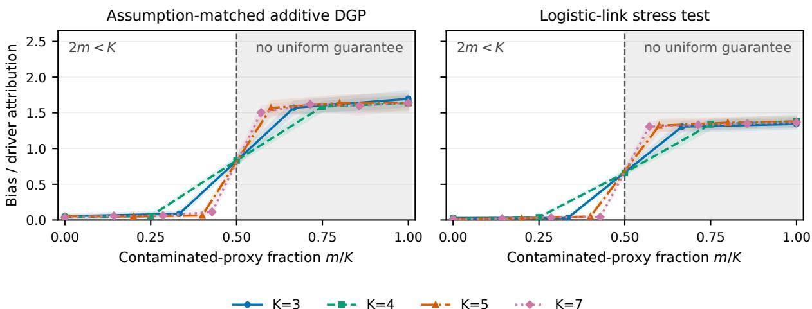

# Auditing Multi-Proxy Explanations of Web User Preferences: Identification Boundaries and Abstention

Yu Zhang   
AMap Alibaba Group   
Beijing, China   
yuanyu.zy@alibaba-inc.com   
Yuhang Lu   
AMap Alibaba Group   
Beijing, China   
lyh203611@alibaba-inc.com

Zhihan Wang AMap Alibaba Group Beijing, China yingchen.wzh@alibaba-inc.com

Shuai Li   
AMap Alibaba Group   
Beijing, China   
lion.lis@alibaba-inc.com

## Abstract

Web systems infer user preferences from behavior, ratings, text, and LLM-generated profiles, yet explaining one proxy may reveal its measurement process rather than the preference of interest. We introduce an audit framework that distinguishes when multi-proxy preference attributions are point identified, partially identified, or should abstain relative to an explicit reference distribution. Under feature-dependent, arbitrarily signed proxy bias, a strict majority of uncontaminated proxy attributions lets their coordinatewise median recover latent-attribution support and direction and, with externally justified positive scales, magnitude. We prove the threshold is sharp over the stated contamination class using response-valid indistinguishable worlds, characterize sharp minimax error and exact compatible-target sets under approximate cleanliness and scale uncertainty, and propagate clean-proxy attribution error to local, global, and support conclusions. A frozen known-truth benchmark spanning two response families, four proxy counts, every contamination count, three bias strengths, and eleven methods maps the full boundary and confirms the focal below-boundary comparison on twenty unseen seeds. Under correct budgets, a direct attributiontensor audit achieved 100% coverage, 95.40%–97.05% active-driver sign decisions, and no false signs. In a temporally separated Amazon study, median aggregation reduced comparator-relative conditional sign error for all four targets; six of eight prespecified target–metric contrasts had Bonferroni intervals excluding zero, and a controlled real-covariate perturbation favored the median on its prespecified focal metric for all four targets. Compatible sets diagnosed that the current proxy configuration rarely licensed strict-sign conclusions. Because comparator calibration was weak, the Amazon evidence supports fitted-surface alignment rather than latent-preference recovery.

## CCS Concepts

• Information systems → Recommender systems; • Humancentered computing → User models; • Mathematics of computing → Robust statistics.

## Keywords

user modeling, explainability, multi-proxy learning, robust statistics, partial identification, recommender systems

## 1 Introduction

Modern personalization relies on preference profiles emitted by large language models (LLMs) and behavioral systems: “this user prefers Jazz.” When a stakeholder asks why, explaining the profile model is natural, but the result concerns an observed proxy—a future behavior label, an explicit rating, or an LLM-generated tag—rather than the latent preference itself. Feature-dependent proxy construction can therefore create plausible but misdirected explanations: price sensitivity may shape purchases, and review style may shape an LLM label, even when neither reflects the shared construct.

A concrete example. A behavioral proxy may attribute “prefers Jazz” to average price, while an LLM proxy attributes it to rating tone. Each feature may describe how that proxy is produced rather than what the proxies share. Treating either attribution as ground truth can target an artifact of measurement. The useful object is therefore the attribution common to enough diferently constructed measurements, together with a boundary beyond which that common signal is not recoverable without additional information.

An attribution-level contamination model. Relative to a declared reference distribution, Shapley linearity decomposes proxy �’s attribution as $\phi _ { k i } ( x ) = a _ { k } \theta _ { i } ( x ) + \psi _ { i } ^ { b _ { k } } ( x )$ : a positively scaled latent attribution plus proxy-specific contamination. No single proxy can separate these terms without assumptions. After externally anchored scale calibration, a strict majority of uncontaminated entries is suficient, and—over an arbitrary coordinatewise contamination class—necessary for uniform recovery. We turn the scalar median’s 50% breakdown principle into a response-constrained identification result, using response-valid constructions to establish the exact boundary for an unobserved attribution induced by multiple proxy response functions: point recovery below the boundary, a matching impossibility result at and beyond it, and partial identification under approximate cleanliness and scale uncertainty.

Contributions.

• Estimand. We distinguish local signed �� (�) from global $I _ { i } = \mathbb { E } | \theta _ { i } ( X ) |$ and derive the scaled multi-proxy measurement model (Sec. 3).

• Identification. We prove strict-majority recovery and a matching impossibility result realized by valid response functions, derive sharp minimax error under approximate cleanliness, exact pointwise compatible-target sets under scale uncertainty, and conditional finite-sample recovery guarantees (Sec. 5).

• Evidence. A known-truth benchmark spans two response families, proxy counts 3, 4, 5, and 7, every contamination count, three strengths, and eleven estimators, with a separate 20-seed confirmation at one below-boundary cell. A direct attribution- tensor audit verifies compatible-set coverage and sign decisions under correct budgets. On temporally separated Amazon data, we evaluate alignment to fixed future-response surfaces, measurement-readiness decisions, and a single-regime real-covariate mechanism check (Sec. 6).

Together, these results make the identification boundary operational for explanations ofproxy response functions. The distinguishing elements are response-valid indistinguishable worlds yielding a matching lower bound, exact compatible-target sets under joint contamination and scale uncertainty, and a unified error interface that propagates proxy-attribution error to local, global, and support conclusions.

## 2 Related Work

Proxy outcomes, weak supervision, and noisy annotators. Optimizing an observable proxy can reproduce systematic measurement bias when the proxy is not the construct of interest [29]. Weaksupervision and crowdsourcing methods instead combine noisy labeling functions or annotators to estimate a latent label, commonly through a generative confusion model [11, 30]. Recent work also studies identifiability with instance-dependent annotator corruption [28]. These methods aggregate labels before fitting a predictor. Our question is diferent but complementary: given proxy-specific response functions, which parts of their local attribution vectors can be shared latent signal rather than diferential proxy bias? A label first majority model is therefore an objective-shifted alternative in our controlled known-truth comparison, not a matched baseline for the same attribution tensor or a claim that attribution-level aggregation replaces weak supervision.

Aggregation across explanation methods. Many explanation ensembles aggregate methods or variants for one observed model: saliency averaging [31], featurewise $\ell _ { 1 }$ centroids and aggregate Shapley values [3], median smoothing [13], or optimized convex combinations [12]. EnsembleSHAP certifies a random-subspace ensemble [33]; Rashomon analysis instead retains partial-order statements shared across good-fitting predictors [23]. Method dis agreement for a fixed prediction is documented [22]; these works address observed targets. We keep attribution semantics fixed but aggregate response functions from proxies of an unobserved target, studying measurement contamination, impossibility, and compatible targets; within-proxy ensembling is orthogonal. Separately, aggregate SHAP on observed support need not certify that a feature is absent from the underlying function because of-support evaluations matter [4]. Accordingly, our recovered support is the support of the declared attribution estimand, not a claim about functional dependence of $q .$ Latent SHAP instead explains an observed model in a human-interpretable latent feature representation [26]; our “latent” object is an unobserved response target whose attribution must itself be identified.

Robust location under corrupted updates. The median is a classical robust location estimator [18]. Coordinatewise medians and trimmed means also aggregate worker gradients with arbitrary worker failures and attain statistical rates [35]. Block-coordinate geometric medians also have a $1 / 2$ breakdown point [1]. Crucially, a coordinatewise minority guarantee need not preserve a useful highdimensional update direction: constructed examples based on inner products can invalidate median SGD [34]. These works estimate an observable location or gradient under corrupted worker messages. We instead ask whether an unobserved attribution is identified from diferent proxy response functions: positive proxy scales require external anchors, clean sets may change with (�, �), signed local estimates precede global absolute importance, and our lower bound is realized by observationally identical valid response functions. Building on this robust-location mechanism, we introduce a latentattribution estimand, prove a sharp identification boundary with a matching impossibility construction realized by valid response functions, and derive compatible-target sets under proxy-specific contamination.

Measurement error and structured recovery. Measurement-error and nonlinear-factor models identify latent quantities using auxiliary instruments or multiple indicators under model-specific independence and normalization restrictions [10, 17]. Anchor-free DIF uses a global minima $\left[ - L _ { 1 } \right.$ restriction in a MIMIC model [9]; majority-valid IV and weighted-median MR identify scalar causal efects [5, 20]. Our compatible-target sets specialize partial identification [27] to local proxy attributions under contamination and scale uncertainty. Robust PCA separates low-rank and sparse errors [8]; we instead impose a pointwise clean majority on the attribution tensor, without identifying a latent-factor distribution or assuming proxy independence.

Marginal and causal attribution. SHAP explains a prediction function through a chosen coalition value [25]; diferent operationalizations can yield diferent Shapley explanations [32]. Marginal (often called interventional) replacement breaks feature dependence and defines relevance relative to a background distribution [19]; distribution-supported attribution formalizes a related requirement for explaining observable classifiers [24]. By itself, however, a reference distribution does not identify a causal response surface from observational data. Causal Shapley instead incorporates causal structure into the coalition value [15]. Our robust aggregation result is conditional on the per-proxy value functions supplied to it. It has a causal interpretation only when the corresponding interventional responses are independently identified; otherwise we use the more limited term marginal model attribution.

Web preference explanations. LLM profile pipelines and explainers for recommendation or preference mechanisms [2, 7, 14, 21, 36] produce behavioral or textual proxies or explain observed targets. We focus on a prior question that those pipelines leave open: whether agreement among several proxy explanations is informative about an unobserved preference, and when shared proxy bias makes such a conclusion impossible. Recent work also shows that explanation evaluation without ground truth is sensitive to the evaluation intervention itself [6]; our real study accordingly separates a held-out rating comparator from a controlled association-injection stress test.

## 3 Problem Formulation

Latent response and reference-distribution attribution. Let pref∗ ∈ {0, 1} denote a latent preference that is never directly observed, and let $q ( x ) = P ( \mathrm { p r e f } ^ { * } { = } 1 \mid X { = } x )$ be its latent response surface. Let $N = [ d ] = \{ 1 , \dots , d \}$ . For a fixed, explicit reference distribution $P _ { \mathrm { r e f } } .$ define for any function ℎ

$$
v _ { x } ^ { h } ( S ) = \mathbb { E } _ { X ^ { \prime } \sim P _ { \mathrm { r e f } } } [ h ( x _ { S } , X _ { - S } ^ { \prime } ) ] , \qquad S \subseteq N .\tag{1}
$$

Our local estimand and its global summary are, respectively,

$$
\begin{array} { r } { \theta _ { i } ( x ) = \mathrm { S h } _ { i } ( v _ { x } ^ { q } ) , \qquad I _ { i } = \mathbb { E } _ { X \sim P _ { \mathrm { e v a l } } } | \theta _ { i } ( X ) | . } \end{array}\tag{2}
$$

Equation (1) is the usual marginal (also called “interventional” in the SHAP literature) model-attribution value function. It does not, by itself, assign a causal meaning to $q$ or to $\theta _ { i } ( x )$ . We treat each response as specified on the hybrid explanation domain $\{ ( x _ { S } , x _ { - S } ^ { \prime } )$ $S \subseteq N , \ x ^ { \prime } \ \in \ \operatorname { s u p p } ( P _ { \mathrm { r e f } } ) \}$ . Learning it from data additionally re quires support/overlap on this domain or an explicit extrapolation model; robust aggregation does not solve of-support identification.

Proxy measurement model. We observe proxy outcomes $Y _ { k } , k \in$ [�], and can learn only their response surfaces $m _ { k } ( x ) = \mathbb { E } [ Y _ { k } \ ]$ $X { = } x ]$ . We write

$$
m _ { k } ( x ) = a _ { k } q ( x ) + b _ { k } ( x ) , \qquad a _ { k } > 0 ,\tag{3}
$$

where $b _ { k } = m _ { k } - a _ { k } q$ is unrestricted; hence this is an accounting decomposition, not a testable afine-in-� restriction. $\mathrm { B y }$ linearity, the population proxy attribution $\phi _ { k i } ( x ) = \mathrm { S h } _ { i } ( v _ { x } ^ { m _ { k } } )$ obeys

$$
\begin{array} { r l } & { z _ { k i } ( x ) : = \phi _ { k i } ( x ) / a _ { k } = \theta _ { i } ( x ) + \eta _ { k i } ( x ) , } \\ & { } \\ & { \eta _ { k i } ( x ) = \mathrm { S h } _ { i } ( v _ { x } ^ { b _ { k } } ) / a _ { k } . } \end{array}\tag{4}
$$

Thus our identifying restriction is imposed directly at the attribution level: proxy � is clean for (�, �) when $\eta _ { k i } ( x ) = 0$ . Independence among the proxy outcomes is neither assumed nor used. A feature absent from $b _ { k }$ is clean, although attribution-level cleanliness is the weaker condition actually needed below.

Scale normalization in (4) requires $a _ { k }$ to be known or calibrated from external anchors; we do not identify it from the same proxy attributions. Four regimes must be distinguished. Known positive scales license point magnitude recovery. Estimated scales contribute normalization error to the finite-sample bound. Externally justified scale intervals produce compatible-target sets rather than points. With only unknown positive scales, the raw median preserves local support and sign under a strict clean majority, but licenses neither exact magnitudes nor cross-coordinate rankings (Prop. 3).

Definition 1 (Attribution-active feature and proxy contamination). The global active set is $D = \{ i : I _ { i } > 0 \}$ . At a point �, proxy � contaminates coordinate $i \operatorname { i f } \eta _ { k i } ( x ) \neq 0$ . These definitions concern the chosen reference-distribution attribution and make no causal claim.

Goal. Given estimated proxy attributions $\widehat { \phi } _ { k i } ( \boldsymbol { x } )$ , we seek to recover the local signed target $\theta _ { i } ( x )$ first, and only then form $I _ { i } =$ $\mathbb { E } | \theta _ { i } ( X ) |$ . The order matters:

$$
\mathrm { m e d i a n } _ { k } \mathbb { E } _ { X } | z _ { k i } ( X ) | \neq \mathbb { E } _ { X } | \mathrm { m e d i a n } _ { k } z _ { k i } ( X ) | .
$$

Section 5 characterizes exactly when the latter estimator is uniformly identified under arbitrary attribution contamination.

## 4 Identification Procedure and Audits

Proxy attribution equals shared signal plus contamination. For proxy response $m _ { k } = a _ { k } q + b _ { k }$ , linearity of the reference-based value function and Shapley operator yields $\phi _ { k i } ( x ) = a _ { k } \theta _ { i } ( x ) + \psi _ { i } ^ { b _ { k } } ( x )$ where $\psi _ { i } ^ { b _ { k } } ( x ) = \mathrm { S h } _ { i } ( v _ { x } ^ { b _ { k } } )$ . The decomposition is about the population response functions; predictor and Shapley approximation errors enter separately in Sec. 5.

Aggregate locally, then summarize globally. For every explained user $x ,$ define $\hat { z } _ { k i } ( x ) = \hat { \phi } _ { k i } ( x ) / \hat { a } _ { k }$ when scales come from an external anchor or independent calibration data. We then aggregate signed calibrated proxy attributions,

$$
\begin{array} { r } { \hat { \theta } _ { i } ^ { \mathrm { m e d } } ( x ) = \mathrm { m e d i a n } _ { k \in [ K ] } \hat { z } _ { k i } ( x ) , } \\ { \hat { I } _ { i } = \displaystyle \frac { 1 } { n _ { \mathrm { e v a l } } } \sum _ { x } \vert \hat { \theta } _ { i } ^ { \mathrm { m e d } } ( x ) \vert . } \end{array}
$$

Signed aggregation preserves direction; the absolute value is used only for global importance. The scales $a _ { k }$ are not identified from the same attribution tensor. Known scales yield point magnitudes; independently estimated scales add the normalization term in $\operatorname { E q } .$ (11); and externally justified scale intervals yield the exact pointwise set in Prop. 3. If no calibration is available, we median-aggregate raw $\hat { \phi } _ { k }$ and report support, direction, and an uncalibrated consensus score—not latent magnitude or feature ranking. A scale shared across points is outside our pointwise analysis under interval-scale uncertainty.

Which output to report. Evidence determines the output. If negligible contamination is externally justified and eficiency is primary, the mean is an eficiency-oriented summary. If arbitrary contamination by a strict minority is plausible and a strict clean majority is externally justified, the median yields point support and direction; magnitude additionally requires anchored positive scales. With only an $( r , \epsilon )$ budget or scale intervals, report the exact compatible set from Props. 1 and 3: excluding zero licenses a sign, containing zero abstains, and emptiness flags the joint declaration. Without external support, report consensus and sensitivity; agreement alone cannot choose among these branches.

Under coordinatewise arbitrary contamination, the median needs no joint proxy model and tolerates any strict minority of arbitrarily contaminated proxies; Thm. 2 proves the corresponding finite-� identification boundary. Low-rank–sparse and label-first alternatives impose diferent structures or objectives; the controlled benchmark compares them on common data.

Reference-distribution value estimation. We fit $f _ { k }$ to the conditional proxy response and explain it with a self-implemented Kernel SHAP. Of-features are drawn from a declared marginal reference distribution $P _ { \mathrm { r e f } } ;$ we therefore call the result marginal or model-interventional attribution, not an identified causal efect. $\mathrm { O r ^ { - } }$ dinarily, coalitions are exact when $2 ^ { d } \leq 4 0 9 6$ and Shapley-kernel– sampled otherwise; the numerical-error audit deliberately samples at $d \ : = \ : 8$ to isolate coalition Monte Carlo error. Eficiencyconstrained weighted least squares is solved in closed form via its KKT system (machine-precision eficiency).

The executable sequence is explicit: fit each fixed proxy response, compute local attributions under the declared $P _ { \mathrm { r e f } } .$ , normalize only with external scales, take the signed coordinatewise median, and only then form global summaries.

Audit interpretation. The strict-majority condition is structural: proxy agreement does not verify it. Cross-modal design diversifies measurement pathways, but external anchors, validation data, or a justified channel model must support the cleanliness and scale budgets. Otherwise, outputs are observable consensus and sensitivity summaries.

## 5 Theoretical Analysis

We first expose proxy leakage, then give a sharp attribution-level identifiability boundary. The result concerns the local signed esti mand $\theta _ { i } ( x )$ ; global importance $I _ { i }$ follows only after local recovery. The statements, constructions, and proof sketches below expose the decisive mechanisms.

Building on Shapley linearity, median trapping, and concentration, we provide a response-valid indistinguishability construction, exact compatible-target sets for known and interval scales, and an attribution-error interface that propagates uncertainty to local, global, and support recovery.

Theorem 1 (Single-proxy leakage). Under (3), the population attribution of proxy � is

$$
\begin{array} { r } { \phi _ { k i } ( x ) = a _ { k } \theta _ { i } ( x ) + \psi _ { i } ^ { b _ { k } } ( x ) , \qquad \psi _ { i } ^ { b _ { k } } ( x ) = \mathrm { S h } _ { i } ( v _ { x } ^ { b _ { k } } ) . } \end{array}\tag{5}
$$

$H b _ { k }$ is invariant to its �th argument throughout the hybrid explanation domain, then $\begin{array} { r } { \psi _ { i } ^ { b _ { k } } ( x ) = 0 ; } \end{array}$ feature-dependent bias may induce nonzero leakage. With unrestricted $b _ { k }$ , one proxy cannot uniformly identify �� (�).

Proofsketch. Both the reference-distribution value function and the Shapley operator are linear, giving (5). If�� is invariant to its �th argument, every coalitional marginal contribution of � is zero. Conversely, choose an interior response and transfer a suficiently small bounded component between � and $b _ { k } / a _ { k } ; m _ { k }$ is unchanged. □

Corollary 1 (Non-diferential bias). $H b _ { k } ( x )$ is constant in $x ,$ its attribution vanishes. A calibrated proxy then identifies $\theta ( x ) ,$ without calibration it identifies it only up to the positive factor $a _ { k }$

For ordered scalars $u _ { ( 1 ) } \leq \dots \leq u _ { ( K ) }$ , we use the signed median

$$
\mathrm { m e d } ( u ) = \left\{ \begin{array} { l l } { u _ { ( ( K + 1 ) / 2 ) } , } & { K \mathrm { o d d } , } \\ { ( u _ { ( K / 2 ) } + u _ { ( K / 2 + 1 ) } ) / 2 , } & { K \mathrm { e v e n } . } \end{array} \right.\tag{6}
$$

Theorem 2 (Sharp strict-majority identifiability). Fix an integer contamination budget $0 ~ \le ~ r ~ \le ~ K$ . Suppose that, for every $( i , x )$ $z _ { k i } ( x ) = \theta _ { i } ( x )$ for at least $K - r$ proxies, while the remaining values are arbitrary. $I f 2 r < K$ , then

$$
\theta _ { i } ( x ) = \mathrm { m e d } _ { k \in [ K ] } z _ { k i } ( x ) , \qquad I _ { i } = \mathbb { E } _ { X } \left| \mathrm { m e d } _ { k } z _ { k i } ( X ) \right| .\tag{7}
$$

Conversely, $i f 2 r \geq K$ , two distinct latent attributions can generate the same � proxy attributions while each contaminates at most � proxies. Hence no estimator uniformly identifies $\theta _ { i } ( x )$ under arbitrary contamination at or beyond this boundary.

Proofsketch. When $2 r < K$ , strictly more than half of the entries equal $\theta _ { i } ( x )$ , so the central order statistic—both central statistics when � is even—equals $\theta _ { i } ( x )$ . For $2 r \geq K$ , take disjoint sets �, � of size $K - r$ and an observed vector equal to $t _ { 0 }$ on � and $t _ { 1 } \neq t _ { 0 }$ on �. It is compatible with either latent value after changing at most � entries. This ambiguity is response-valid: for one feature � $\in [ - 1 , 1 ]$ a reference with $\mathbb { E } _ { \mathrm { r e f } } U = 0 ,$ evaluation $u = 1$ , and $| z _ { k } | , | t _ { j } | < 1 / 2$ set $q _ { j } ( u ) = 1 / 2 + t _ { j } u$ and $b _ { k , j } ( u ) = ( z _ { k } - t _ { j } ) u$ . Both candidates yield the same bounded proxy response $m _ { k } ( u ) = 1 / 2 + z _ { k } u \in [ 0 , 1 ]$ but latent attribution $t _ { j } .$ . For this lower-bound construction, give � the same distribution in both worlds and choose the same conditional coupling of the proxies; for example, conditional on $U = u ,$ , draw $Y _ { 1 } , \dots , Y _ { K }$ independently with $Y _ { k } \sim$ Bernoulli $( m _ { k } ( u ) )$ ). Since every �� is identical between the worlds, the complete observed laws of $( U , Y _ { 1 } , \ldots , Y _ { K } )$ coincide. Appending arbitrarily correlated nuisance features ignored by all responses embeds the construction in any $d > 1 ; P _ { \mathrm { r e f } }$ need not factorize. □

The clean set may vary by user and coordinate, without proxy independence or disjoint bias supports. For $K = 2 ,$ the boundary permits only $r = 0 .$

Proposition 1 (Sharp approximate risk and compatible-target set). Let $r \in \{ 0 , \ldots , K \}$ and � $\mathbf { \geq 0 }$ . Over pairs $( z , t )$ for which at least $K - r$ entries of � are within $\epsilon o f t _ { : }$ , the unrestricted-target minimax risk is

$$
R _ { K , r , \epsilon } ^ { \star } = \operatorname* { i n f } _ { T } \operatorname* { s u p } _ { ( z , t ) } | T ( z ) - t | = \left\{ \begin{array} { l l } { \epsilon , } & { 2 r < K , } \\ { \infty , } & { 2 r \ge K . } \end{array} \right.\tag{8}
$$

where the infimum is over $T : \mathbb { R } ^ { K }  \mathbb { R }$ . The median attains the first value. On a known finite interval $[ L , U ]$ , the risk is min $\{ \epsilon , ( U - L ) / 2 \}$ below the boundary and $( U - L ) / 2$ at or beyond it, attained by projecting the median or using the midpoint. Thus binary-response attributions in $[ - 1 , 1 ]$ have finite risk even without point identification.

For observed normalized attributions $\boldsymbol { z } = \left( z _ { 1 } , \dots , z _ { K } \right)$ at a fixed (�, �) and a declared target domain ${ \mathcal { T } } \subseteq \mathbb { R }$ , define

$$
C _ { r , \epsilon } ^ { \mathcal { T } } ( z ) = \{ t \in \mathcal { T } : | \{ k : | z _ { k } - t | \leq \epsilon \} | \geq K - r \} .\tag{9}
$$

This exact set uses $\mathcal { T } = [ - 1 , 1 ]$ for binary responses (and R when the superscript is omitted). A nonempty bounded set has conditional minimax radius halfits diameter. $I f 2 r < K$ , its diameter is at most 2� and the median is within � ofevery member; at or beyond the boundary its unrestricted diameter can be arbitrarily large over admissible � (and is unbounded $f o r r = K )$ . It is a sensitivity reportfor stated $( r , \epsilon )$ not an estimate of them from agreement.

Corollary 2 (Externally validated probabilistic cleanliness). Index $N _ { \mathrm { p a i r } }$ prespecified user–coordinate pairs by �. On a common proxychannel generation space let $C _ { n k } \ = \ 1 \big \{ | z _ { n k } - \theta _ { n } | \ \leq \ \epsilon \big \}$ . Suppose $\{ C _ { n k } \} _ { k = 1 } ^ { K }$ are independentfor each fixed � and in $\mathrm { ~ : ~ } _ { n , k } \operatorname* { P r } ( C _ { n k } = 1 ) \geq$ $p _ { 0 } : = 1 / 2 + \gamma ,$ where $0 < \gamma \leq 1 / 2$ . Define $\beta _ { K } ( \gamma ) = \operatorname* { P r } \{ \mathrm { B i n } ( K , p _ { 0 } ) \leq$ $\lfloor K / 2 \rfloor \}$ . Then, with probability at least $[ 1 - N _ { \mathrm { p a i r } } \beta _ { K } ( \gamma ) ] _ { + }$ , every pair has a strict approximate-clean majority and its median error is at most � (zero when $\epsilon = 0 )$ . Here $[ u ] _ { + } = \operatorname* { m a x } \{ u , 0 \} , \beta _ { K }$ is the exact worst-case per-pair failure probability over the allowed independent channels, and $\beta _ { K } ( \gamma ) \leq \exp ( - 2 K \gamma ^ { 2 } )$ . No independence across pairs is needed. The probability premise must come from independent latent-target validation, a known randomized measurement mechanism, or a proved channel model—neverfrom agreement among the analyzed proxies. If, conditional on an external validation event � with $\operatorname* { P r } ( V ) \geq 1 - \delta _ { \operatorname { v a l } }$ , the channels retain within-pair independence and in $\dot { \operatorname { \mu } _ { n , k } } \operatorname* { P r } ( C _ { n k } = 1 \mid V ) \ge p _ { 0 }$ , the unconditional lower bound is $\left[ 1 - \delta _ { \mathrm { v a l } } - N _ { \mathrm { p a i r } } \beta _ { K } ( \gamma ) \right] _ { + }$

Conditionalfalsification and abstention. For estimated inputs, use $C _ { r , \epsilon + \varepsilon _ { \mathrm { a t t r } } } ^ { \mathcal { T } } ( \widehat { z } )$ . If one set of at least $K - r$ proxies satisfies both declared structural and estimation errors, the triangle inequality places its target in this set. Emptiness therefore falsifies that joint declaration; a nonempty set identifies a sign only if all members share one strict sign, and never certifies the budgets themselves.

Proposition $2 \left( K = 2 \right.$ under support separation). For $P _ { \mathrm { e v a l } }$ -almost every �, let $D _ { x } = \{ i : \theta _ { i } ( x ) \neq 0 \}$ and $B _ { k } ( x ) = \{ i : \eta _ { k i } ( x ) \neq 0 \}$ . If $B _ { 1 } ( x ) \cap B _ { 2 } ( x ) = \emptyset$ and $D _ { x } \cap ( B _ { 1 } ( x ) \cup B _ { 2 } ( x ) ) = \emptyset$ , then, for every coordinate,

$$
\operatorname* { m i n } _ { k \in \{ 1 , 2 \} } | z _ { k i } ( x ) | = | \theta _ { i } ( x ) | .\tag{10}
$$

Thus $I _ { i } = \mathbb { E } _ { X }$ min� $| z _ { k i } ( X ) |$ under this stronger separation model, not a 50% robustness guarantee.

Theorem 3 (Uniform error propagation). Let $X _ { 1 } , . . . , X _ { n } \overset { \mathrm { i i d } } { \sim } P _ { \mathrm { e v a l } }$ and $\widehat { z } _ { k i } ( x ) = \widehat { \phi } _ { k i } ( x ) / \widehat { a } _ { k }$ . Suppose thatfor some $r \in \{ 0 , \ldots , K \}$ with $2 r < K ,$ , the strict-majority condition ofThm. 2 holds for every coordinate and $P _ { \mathrm { e v a l } }$ -almost every �. Suppose further that, with probability at least $1 - \delta _ { \mathrm { a t t r } }$ , simultaneously for all $i \in [ d ] , j \in [ n ]$ , and every proxy � that is population-clean at $( i , X _ { j } )$ ,

$$
\begin{array} { r l } { | \widehat { z } _ { k i } ( X _ { j } ) - z _ { k i } ( X _ { j } ) | \leq } & { \underbrace { \varepsilon _ { \mathrm { m o d e l } } } _ { r e s p o n s e f i t } ~ + \underbrace { \varepsilon _ { \mathrm { b g } } } _ { r e f e r e n c e M C } } \\ { ~ } & { + \underbrace { \varepsilon _ { \mathrm { c o a l } } } _ { c o a l i t i o n } ~ + \underbrace { \varepsilon _ { \mathrm { s c a l e } } } _ { n o r m a l i z a t i o n } ~ = : \varepsilon _ { \mathrm { a t t r } } . } \end{array}\tag{11}
$$

The remaining proxy estimates may be arbitrary. Then, simultaneously for all $i , j ,$

$$
| \widehat { \theta _ { i } } ( X _ { j } ) - \theta _ { i } ( X _ { j } ) | \leq \varepsilon _ { \mathrm { a t t r } } , \quad \widehat { \theta _ { i } } ( X _ { j } ) = \mathrm { m e d } _ { k } \widehat { z } _ { k i } ( X _ { j } ) .
$$

$I f | \theta _ { i } ( X ) | \leq M$ almost surely and

$$
{ \widehat { I _ { i } } } = { \frac { 1 } { n } } \sum _ { j = 1 } ^ { n } | { \widehat { \theta _ { i } } } ( X _ { j } ) | ,
$$

then, with probability at least $1 - \delta _ { \mathrm { a t t r } } - \delta _ { \mathrm { e v a l } } ,$

$$
\operatorname* { m a x } _ { i } | \widehat { I } _ { i } - I _ { i } | \leq \tau : = \varepsilon _ { \mathrm { a t t r } } + M \sqrt { \frac { \log ( 2 d / \delta _ { \mathrm { e v a l } } ) } { 2 n } } .\tag{12}
$$

With the convention min $_ { i \in \emptyset } I _ { i } \ = \ + \infty$ , let $\Delta \ = \ \mathrm { m i n } _ { i \in D } I _ { i } .$ . Consequently, $i f \Delta > 2 \tau$ , the strict-threshold estimate $\widehat { D } = \{ i : \widehat { I } _ { i } > \tau \}$ recovers � exactly, including when $D = \emptyset$

The four terms separately audit response fitting, reference and coalition Monte Carlo, and scale calibration; � and � require external validation, not proxy agreement.

Proposition 3 (Interval-calibrated and unknown positive scales). Let $K \geq 1 , r \in \{ 0 , . . . , K \} , \epsilon \geq 0 $ , and $\mathcal { T } \subseteq \mathbb { R } . \ F i x \ ( i , x )$ and use

only its raw attributions $p _ { k } = \phi _ { k i } ( x )$ . Let external calibration give $A _ { k } = [ \underline { { a } } _ { k } , \overline { { a } } _ { k } ] \subset ( 0 , \infty )$ and set

$$
\begin{array} { r l } & { \qquad J _ { k } ( p _ { k } ) = \big [ \operatorname* { m i n } _ { a \in A _ { k } } { p _ { k } / a } - \epsilon , \operatorname* { m a x } _ { a \in A _ { k } } { p _ { k } / a } + \epsilon \big ] , } \\ & { \qquad C _ { r , \epsilon } ^ { \mathcal { T } } ( p ; A ) = \{ t \in \mathcal { T } : \sum _ { k } { 1 \{ t \in J _ { k } ( p _ { k } ) \} } \geq K - r \} . } \end{array}\tag{13}
$$

This is exactly the pointwise target set compatible with some �� ∈ $A _ { k }$ at most � arbitrary proxies, and normalized clean error at most �. Let $w _ { k } = | p _ { k } | ( \underline { { a } } _ { k } ^ { - 1 } - \overline { { a } } _ { k } ^ { - 1 } ) + 2 \epsilon$ and write their order statistics as $w _ { ( 1 ) } \leq \cdots \leq w _ { ( K ) }$ . Whenever the compatible-target set is nonempty and $2 r < K ,$

$$
\dim C _ { r , \epsilon } ^ { \mathcal { T } } ( p ; A ) \leq \operatorname* { m i n } \{ \dim ( \mathcal { T } ) , w _ { ( 2 r + 1 ) } \} .\tag{14}
$$

Singleton scales recover Eq. (9). The set is pointwise; one scale vector shared across points would define a tighterjoint feasibility problem, which we do not analyze. Scale intervals require external evidence. If random intervals cover all true scales simultaneously with probability at least $1 - \delta _ { \mathrm { s c a l e } }$ , conditional claims inherit that failure term; it is not subtracted again when already included in $\delta _ { \mathrm { a t t r } }$

$I f 0 < a _ { \operatorname* { m i n } } \leq a _ { k } \leq a _ { \operatorname* { m a x } }$ and a strict majority of raw attributions satisfy $\phi _ { k i } = a _ { k } \theta _ { i } $ , their median has the support and sign of �� and obeys

$$
a _ { \mathrm { m i n } } | \theta _ { i } ( x ) | \leq | \mathrm { m e d } _ { k } \phi _ { k i } ( x ) | \leq a _ { \mathrm { m a x } } | \theta _ { i } ( x ) | .\tag{15}
$$

Thus the raw coordinatewise median alone guarantees neither exact magnitudes nor cross-coordinate rankings without calibration.

Proofroadmap. For Prop. 1, a common observation compatible with two targets gives the minimax lower bounds; below the boundary, two supporting sets of size $K - r$ intersect, giving diameter $2 \epsilon ,$ , while the median attains the upper bound. Cor. 2 couples each clean count to Bin(�, $1 / 2 + \gamma )$ , uses its exact lower tail, and unions over prespecified pairs; Hoefding gives the exponential relaxation. Prop. 2 splits on $i \in D _ { x }$ : both leakages vanish there, whereas of $D _ { x }$ disjoint bias supports leave one proxy at zero. For Thm. 3, a clean majority traps the median in the $\varepsilon _ { \mathrm { a t t r } }$ interval; the reverse triangle inequality and a Hoefding–union bound over coordinates yield �. Finally, two targets in the scale-uncertain compatible-target set share at least $K - 2 r$ supporting intervals, implying $| t - t ^ { \prime } | \leq w _ { ( 2 r + 1 ) }$ in Prop. 3.

Corollary 3 (Transfer to externally identified coalition values). If an external causal design identifies all latent and proxy coalition values with $v _ { k , x } ( S ) = a _ { k } v _ { x } ^ { \star } ( S ) + v _ { x } ^ { b _ { k } } ( S )$ , our results transfer to their Shapley values, subject to their respective cleanliness, scale, and error assumptions. A full-intervention surface alone need not identify every coalition value; fitting E[�� | �] supports only our model-attribution interpretation.

Scope. Causality-aware Shapley work [15, 19] studies observable targets under causal assumptions. Here the distinct question is robust identification of a latent target’s attribution vector from proxy-attribution contamination. The signed median attains the sharp $2 r \ < \ K$ point-identification boundary; the result does not identify the latent variable distribution itself and does not turn observational proxy models into causal models.

## 6 Experiments

We use controlled and real-data evidence. A known-truth benchmark maps the null, boundary, shared-majority, and bias-strength regimes across eleven methods. A direct attribution-tensor audit verifies the compatible-set interface: at the correct $\epsilon = . 0 1$ budget it attains 100% truth coverage, 95.40%/97.05% active-driver sign decisions, and zero false signs. A temporally ordered Amazon study asks: RQ1 later-response alignment; RQ2 median versus behavior; RQ3 compatible-set measurement readiness; and RQ4 a controlled perturbation on real covariates. Its anchors are observable responses, never latent preference ground truth.

## 6.1 Controlled Known-Truth Benchmark

Design and evidential status. We generate independent train and evaluation covariates in eight dimensions with two latent drivers and a separate bias coordinate. An additive-probability DGP and a nonlinear logistic-link DGP have known latent responses, scales, clean identities, and attributions. With $X \sim \operatorname { U n i f } ( [ - 1 , 1 ] ^ { 8 } )$ and contaminated indicator $c _ { k }$ , they use $q _ { \mathrm { a d d } } = . 5 + . 1 2 x _ { 1 } - . 1 0 x _ { 2 } , p _ { k } =$ $q _ { \mathrm { a d d } } + . 1 8 c _ { k } \lambda x _ { 3 }$ , and $p _ { k } = \sigma \big ( 1 . 2 x _ { 1 } - x _ { 2 } + 1 . 5 c _ { k } \lambda x _ { 3 } \big )$ for the logistic stress; all scales equal one. Each cell fits on 6,000 cases and explains 200 independent cases exactly. For $K \in \{ 3 , 4 , 5 , 7 \}$ we scan every contamination count $m = 0 , \ldots , K$ and strength $\lambda \in \{ 0 . 5 , 1 , 1 . 5 \}$ comparing eleven fixed estimator implementations over the same ten seeds; the clean-proxy oracle is undefined at $m \ = \ K .$ This full grid is exploratory and descriptive: its seed intervals show variation, not a familywise confirmatory claim. After inspecting this exploratory grid, but before any of twenty unseen confirmation seeds was run, we fixed the paired median–RPCA contrast at $K =$ $5 , m = 2 , \lambda = 1$ , the most contaminated $K = 5$ cell inside the strictmajority guarantee. The complete design contains 138 scenarios and 1,494 method–scenario summaries; only the separately frozen two-DGP contrast is treated as confirmatory.

Boundary, null, and strength behavior. Figure 1 supplies both favorable and adverse regimes. $\mathrm { A t } m = 0 ;$ , the mean can be more eficient than the median because there is no contamination to reject: at $K = 3 , \lambda = 1$ , mean/median normalized local $\ell _ { 1 }$ error was .179/.209 (additive) and .085/.102 (logistic). At the below-boundary � = 1 cell, this ordering reversed to .426/.247 and .301/.100. At the first � satisfying $2 m \geq K ,$ , leakage increases sharply; $K = 3 , m = 2$ is an explicit shared-majority negative control rather than independent canceling noise. For $K = 5 ,$ median leakage across $\lambda = ( . 5 , 1 , 1 . 5 )$ was (.082, .063, .097) and $( . 0 5 1 , . 0 4 9 , . 0 4 8 )$ at � = 2 (additive/logistic), versus (.741, 1.569, 2.379) and (.648, 1.322, 1.931) at � = 3. Thus the strength sweep preserves the qualitative boundary while exposing DGP- and strength-dependent error magnitude.

Eleven-method comparison and confirmation. The alternatives deliberately encode diferent structures: robust locations, rank-one and low-rank–sparse reconstructions, a label-first response, and a nondeployable clean-proxy oracle. They are comparable here because latent truth is known, not because they are interchangeable objectives on Amazon. On the twenty unseen confirmation seeds, mean bias leakage of the local median was .115 in the additive DGP and .050 in the logistic DGP, versus .142 and .058 for RPCA.

<table><tr><td>DGP</td><td>Median</td><td>RPCA</td><td>Δ</td><td>95% CI</td><td>Family-2 CI</td></tr><tr><td>Add.</td><td>0.115</td><td>0.142</td><td>-0.0277</td><td>[-0.0364, -0.0189]</td><td>[-0.0379, -0.0175]</td></tr><tr><td>Logit.</td><td>0.050</td><td>0.058</td><td>-0.0079</td><td>[-0.0110, -0.0047]</td><td>[-0.0116, -0.0042]</td></tr></table>

Table 1: Controlled confirmation-cohort bias leakage and seed-paired median-minus-RPCA efects at $K = 5 , m = 2 , \lambda = 1$ (20 unseen seeds; lower is better). Family-two intervals apply a reporting-stage Bonferroni correction across the two fixed DGP contrasts. This is the only frozen confirmatory method contrast; the remaining methods belong to the descriptive grid.

<table><tr><td>b</td><td>Declared (r, €)</td><td>Coverage</td><td>Mean diam.</td><td>Empty</td><td>Decision/false (%)</td></tr><tr><td>0.00</td><td>(2,0.010)</td><td>100.00%</td><td>0.00997</td><td>0.00%</td><td>95.40/0.00</td></tr><tr><td>0.35</td><td>(2,0.010)</td><td>100.00%</td><td>0.01349</td><td>0.00%</td><td>97.05/0.00</td></tr><tr><td>0.00</td><td>(2,0.005)</td><td>12.49%</td><td>0.00377</td><td>50.36%</td><td>48.85/0.36</td></tr><tr><td>0.35</td><td>(2, 0.005)</td><td>23.06%</td><td>0.00421</td><td>13.62%</td><td>85.98/0.00</td></tr><tr><td>0.00</td><td>(1, 0.010)</td><td>0.00%</td><td></td><td>100.00%</td><td>0.00/0.00</td></tr><tr><td>0.35</td><td>(1, 0.010)</td><td>0.00%</td><td>1</td><td>100.00%</td><td>0.00/0.00</td></tr></table>

Table 2: Direct known-truth compatible-target-set audit at true $( r , \epsilon ) = ( 2 , . 0 1 )$ . � is the shared clean-proxy ofset as a fraction of �. Coverage, diameter, and emptiness use all 512×8 case–coordinate cells per seed; decision/false uses the two active drivers. Ten seeds are the replicates. Misspecified rows are descriptive post-primary stress tests; “–” means all sets are empty.

The frozen confirmation-cohort paired median-minus-RPCA effects were −.0277 and −.0079. Treating the two fixed DGP contrasts as one reporting family, their two-sided Bonferroni family-two 95% intervals were $\left[ - . 0 3 7 9 , - . 0 1 7 5 \right]$ and $\left[ - . 0 1 1 6 , - . 0 0 4 2 \right]$ ; both remain below zero. Both phases used the same implementations, per-seed sample sizes, focal-cell definition, and leakage metric; only their disjoint seed cohorts difered. The additive median intervals [.030, .096] (discovery) and [.083, .147] (confirmation) overlap slightly, and the median–RPCA efect replicated in direction (−.0188 versus −.0277). Thus the .063–.115 absolute-level shift is betweencohort seed variation; the confirmation claim remains the frozen paired contrast. These confirmation statements apply only to the fixed $K = 5 , m = 2 , \lambda = 1$ cell; they do not convert the exploratory phase grid into a dominance claim.

Direct attribution-tensor audit. To isolate the attribution-specific mechanism from response fitting, a separate known-truth suite constructs the signed local attribution tensor directly $( K = 5 ,$ true $r = 2 ;$ ten seeds, 512 cases and eight coordinates per seed). Across all ten nonzero $\epsilon \times b$ cells under the correct budget, truth coverage was 100%, no set was empty, every diameter bound held, and mean diameter divided by � was .997–1.351. Table 2 shows the $\epsilon = . 0 1$ slice and deliberate post-primary misspecification checks. Halving the declared tolerance reduced coverage, while understating � made every set empty in this constructed stress regime. Emptiness falsifies only the joint budget and structure declaration; it does not locate the failed component, and nonemptiness does not validate the declaration.

  
Figure 1: Controlled strict-majority phase diagram at $\lambda = 1$ . The vertical axis reports bias leakage: mean absolute attribution on the designated bias coordinate divided by the average mean absolute attribution over the two true driver coordinates. It is shown for the signed local median at every contamination count and $K \in \{ 3 , 4 , 5 , 7 \}$ in the additive and logistic-link DGPs. Bands are pointwise 95% Student-� intervals over ten exploratory seeds. Leakage remains small when $2 m < K$ and rises under the shared-direction construction when the uniform guarantee ends. The theorem is worst-case: losing the guarantee does not require every beyond-boundary instance to fail.

At the strongest positive-scale stress, the raw median retained exact support and direction but had magnitude ratio 1.25 and global relative ℓ error .250. Known-scale normalization recovered zero error; normalization from 256 independent anchors reduced global error to .00384 (seed-level 95% CI [.00152, .00617]). This audit isolates attribution-tensor behavior and does not establish responsefunction realizability or Amazon budget validity.

## 6.2 Amazon Study: Pilot-Supported, Formal-Test-Blind Design

Data and temporal separation. We use the frozen 100,000-user CDs\_and\_Vinyl subset of Amazon Reviews 2023 [16] and its item metadata. For every eligible user, the first 20 chronologically ordered interactions are divided into disjoint history, proxy, and future windows of 12, 4, and 4 events. The formal cohort contains 5,000 users, split by fixed hash ranking into 3,000 response-training, 500 scale-fitting, 500 error-calibration, and 1,000 test users. It is disjoint from the pilot, engineering, and other study cohorts. Pop, Rock, Jazz, and Country were selected by a support-only pilot rule and then frozen. The ordering is temporal within each user; the hash partitioned roles need not occupy nonoverlapping global calendar periods. Thus the design evaluates forward response within users rather than ecosystem-wide calendar drift.

The seven covariates are history-only activity, rating, diversity, timing, entropy, and trend summaries. The behavior proxy records target engagement in the proxy window. Qwen2.5-7B-Instruct-4bit and Meta-Llama-3-8B-Instruct-4bit profiles are generated ofline from the same history packet using greedy decoding (temperature 0, top-� 1, at most 200 tokens) and parsed by a fixed schema. The primary comparator, future\_rated, records a target-mapped rat ing of at least four stars in the future window; proxy-window rating is secondary. Neither features nor LLM prompts use future-window information. A successfully parsed empty profile is retained and maps deterministically to zero for every target-specific binary response; it is neither dropped nor marked unavailable.

All 5,000 records per model completed, while exact-filter repairs were requested for 41.6%/36.7% of Qwen/Llama generations and 24.1%/23.4% parsed as empty. Because both LLM views use the same history packet, common contamination is a relevant stress case: if both views were contaminated, $K = 3 , r = 2$ would lie beyond the strict-majority guarantee. We therefore treat Amazon as a conservative observable-surface audit, use the controlled � = 3, � = 2 condition to characterize the corresponding failure mode, and do not invoke Cor. 2, whose externally validated within-pair independence and cleanliness premises are not established here.

Models, attributions, and method inventory. For every supported target–response pair, we fit the same deterministic, unweighted LightGBM classifier (160 trees, learning rate .05, 31 leaves, seed 42) on the training role. Local attributions use all $2 ^ { 7 } = 1 2 8$ coalitions per user–response pair and a fixed 128-user training background. Exact enumeration is exponential in �, motivating sampled coalitions at larger dimension. Aggregation is coordinate-wise on signed local attributions before global absolute importance. The unscaled three-view mean and median use behavior, Qwen, and Llama. Positive point scales, when available, are fitted only on the scale role against the future-rated response as origin-constrained slopes $\begin{array} { r } { \widehat { a } _ { k } = \bar { \sum } _ { i , j } \phi _ { i j } ^ { F } \phi _ { i j } ^ { k } / { \sum _ { i , j } ( \phi _ { i j } ^ { F } ) ^ { 2 } } ; } \end{array}$ ; a separate role supplies the compatibletarget-set error radius and conditional-sign margin. The eleven prespecified Amazon entries comprise ten point-attribution methods and one compatible-set output; their scale gates difer, and no all-method dominance claim is made.

On the 500-user error-calibration role, the radius is the 476th ordered per-user maximum absolute discrepancy across all three calibrated proxies and seven coordinates. The target-specific CSE margin is the .25 quantile of strictly positive absolute comparator attributions on that same role.

Test protocol. All cohorts, targets, features, learners, metrics, bootstrap seeds, and primary analysis outputs were fixed before test access. The primary paired contrast is the unscaled $\mathrm { K } { = } 3$ median minus its behavior-only constituent: an incremental multi-view comparison, not two independent evidence streams. Directionnormalized attribution error (DNAE) uses all 1,000 test users; conditional sign error (CSE) uses a method-independent efective set fixed by the comparator. Lower is better. Each target–metric cell uses 10,000 user-cluster bootstrap resamples, with ordinary and fixed-family Bonferroni intervals. The test role was evaluated once. Frozen aggregate assets and the explicitly labeled complete reporting extension are generated without manual transcription or withintable cell selection.

Precisely, for a seven-vector �, let $u ( v ) = v / \| v \| _ { \cdot }$ 1 when $\Vert \boldsymbol { v } \Vert _ { 1 } >$ $1 0 ^ { - 1 2 }$ and zero otherwise. For method �, comparator $F ,$ and user $i ,$ DNAE is $\begin{array} { r } { 7 ^ { - 1 } \sum _ { j = 1 } ^ { 7 } | u ( \phi _ { i } ^ { a } ) _ { j } - u ( \phi _ { i } ^ { F } ) _ { j } | } \end{array}$ . CSE is the proportion of sign disagreements with $F$ among coordinates satisfying $| \phi _ { i j } ^ { F } | \ge \delta _ { c }$ ; its user denominator is the fixed efective set containing at least one eligible coordinate.

## 6.3 RQ1–RQ2: Fixed Future-Response Alignment

Table 3 reports every primary cell. The efect is median minus behavior, so a negative value favors the median. Wins, ties, and losses use user-level paired diferences; an empty fixed CSE efective set produces an unavailable cell rather than a changed denominator.

All eight point estimates favored the median, with heterogeneous uncertainty. On the absolute scale, point-estimate reductions were $6 . 5 \% - 1 3 . 0 \%$ for CSE and $0 . 7 \% - 7 . 6 \%$ for DNAE. Bonferroni intervals excluded zero for six contrasts: CSE decreased for every target by .021–.054, while DNAE decreased for Pop $\left( - . 0 1 0 6 \right.$ $\left[ - . 0 1 3 8 , - . 0 0 7 4 \right] )$ ) and Country $\left( - . 0 0 4 1 , \left[ - . 0 0 7 4 , - . 0 0 0 6 \right] \right)$ . Rock and Jazz DNAE intervals crossed zero. Panel (b) of Table 3 is a post-test, reporting-only complete inventory giving point estimates for all ten frozen point methods. Relative to the best of the four single views, the $\mathrm { K } { = } 3$ median had lower loss in four of eight target–metric cells; the descriptive K=4 median including rating did so in seven, with Rock CSE as the exception. The unscaled K=3 mean was also below the $\mathrm { K } { = } 3$ median in seven of eight point cells. This post-test descriptive pattern matches the controlled eficiency–robustness tradeof: the mean was more eficient at $m = 0 ,$ , whereas the ordering reversed at $m = 1$ . It neither establishes mean dominance nor diagnoses contamination; the reporting rule in Sec. 4 distinguishes an eficiency-oriented mean from the median’s worst-case guarantee. The latter is the ordinary even-sample median (the mean of the two central values), has no interval or new inferential claim, and does not overcome the nonidentifiability of two jointly contaminated LLM views.

Held-out AUC and Brier skill were .597 and −1.20% for Pop, and .536 and −5.26% for Rock. The corresponding pairs were .542 and −11.62% for Jazz, and .634 and −4.39% for Country. Negative skill means that Brier loss exceeded the fixed train-prevalence baseline by .0030–.0127, not that a surface is random. This calibration audit bounds the interpretation: Amazon establishes alignment to weak fitted future-response surfaces, not predictive superiority, comparator validation, latent-preference recovery, or latent-scale recovery.

## 6.4 RQ3: Compatible-Target-Set Measurement-Readiness Audit

RQ3 asks whether current measurements, calibrations, and budgets license stable comparator-relative signs. A compatible set signs only when all values agree; containing zero abstains, and emptiness flags the joint scale, error, and contamination specification. This is a budget-conditional readiness audit, not another point estimator.

$\mathrm { A t } r = 0 \mathrm { ; }$ , simultaneous comparator coverage was .935–.961, strict signs were licensed for .53%–1.41% of coordinates, and abstention was $9 8 . 5 4 \% - 9 9 . 4 7 \% . \mathrm { A t } \ r = 1$ , coverage rose to .990–1.000, strictsign rates were at most .16%, and abstention was 99.84%–100%. The readiness verdict is clear: under the current calibrated radii and declared budgets, this three-proxy measurement system rarely supports comparator-relative sign claims. Abstention prevents unsupported point conclusions; it is not evidence of zero preference.

Comparator discordance used 34–95 eligible decisions per target at $r = 0 ;$ Rock and Country were $2 2 / 3 4$ and $2 4 / 4 6$ , and $r = 1$ was undefined for three targets. These small-denominator comparisons diagnose the rare licensed decisions against fitted comparators; they are not latent-direction error rates.

Calibrated radii were .651 (Pop), 1.756 (Rock), .345 (Jazz), and .697 (Country); CSE margins were .009, .010, .003, and .006. In the same order, mean set diameters at $r = 0$ were 1.142, 1.957, .600, and 1.236; at $r = 1$ they were 1.302, 1.999, .690, and 1.394.

A descriptive calibration-role decomposition localizes Rock’s 1.756 radius to Llama: its comparator-anchored positive scale was .0938, so normalization amplified its discrepancies; that view sup plied the per-user maximum for 453/500 calibration users and the 476th-order cutof. The resulting 1.957/1.999 mean diameters at $r = 0 / 1$ rule out deploying Rock’s rare strict-sign outputs. Any actionable sign still requires external support for target semantics, scales, and $( r , \epsilon )$ ; here the first remedy is a stronger independent scale anchor for Llama, or its replacement within a clean-majoritycapable proxy set.

## 6.5 RQ4: Single-Regime Real-Covariate Mechanism Check

For each target, two proxy labels copy the unperturbed behavior response and acquire distinct feature-conditioned associations. From a disjoint 128-user training subset, we choose two behavior-anchor drivers and two weak injection coordinates; above each injection coordinate’s .70 quantile, an unperturbed zero label flips with probability .60. All models are fitted before test access. “Unperturbed” means unaltered by this construction, not latent truth. We compare the coordinatewise mean and median of the three attribution vectors. This is one separated, coordinate-targeted regime; the controlled benchmark supplies the null, boundary, shared-majority, and strength sweeps.

(a) Frozen primary paired comparison
<table><tr><td>Target</td><td>Metric</td><td>Behavior</td><td>Median</td><td>Rel. red.</td><td>Effect</td><td>95% CI</td><td>Bonf. CI</td><td>n</td><td>W/T/L</td></tr><tr><td>Pop</td><td>DNAE</td><td>0.1396</td><td>0.1291</td><td>7.6%</td><td>-0.0106</td><td>[-0.01293, -0.00818]</td><td>[-0.01383, -0.00736]</td><td>1000</td><td>633/0/367</td></tr><tr><td>Pop</td><td>CSE</td><td>0.3413</td><td>0.3068</td><td>10.1%</td><td>-0.0344</td><td>[-0.04623, -0.02204]</td><td>[-0.05126, -0.01667]</td><td>1000</td><td>376/404/220</td></tr><tr><td>Rock</td><td>DNAE</td><td>0.1722</td><td>0.1709</td><td>0.7%</td><td>-0.0013</td><td>[-0.00431, 0.00175]</td><td>[-0.00552, 0.00296]</td><td>1000</td><td>534/1/465</td></tr><tr><td>Rock</td><td>CSE</td><td>0.4152</td><td>0.3611</td><td>13.0%</td><td>-0.0541</td><td>[-0.06770, -0.04014]</td><td>[-0.07325, -0.03494]</td><td>1000</td><td>408/354/238</td></tr><tr><td>Jazz</td><td>DNAE</td><td>0.1521</td><td>0.1493</td><td>1.8%</td><td>-0.0028</td><td>[-0.00558, 0.00003]</td><td>[-0.00661, 0.00109]</td><td>1000</td><td>527/5/468</td></tr><tr><td>Jazz</td><td>CSE</td><td>0.3560</td><td>0.3199</td><td>10.1%</td><td>-0.0361</td><td>[-0.04831, -0.02368]</td><td>[-0.05356, -0.01882]</td><td>1000</td><td>329/472/199</td></tr><tr><td>Country</td><td>DNAE</td><td>0.1477</td><td>0.1436</td><td>2.8%</td><td>-0.0041</td><td>[-0.00651, -0.00164]</td><td>[-0.00741,-0.00061]</td><td>1000</td><td>552/4/444</td></tr><tr><td>Country</td><td>CSE</td><td>0.3263</td><td>0.3052</td><td>6.5%</td><td>-0.0211</td><td>[-0.03236, -0.00979]</td><td>[-0.03693, -0.00529]</td><td>1000</td><td>320/462/218</td></tr></table>

(b) Complete point-method inventory (descriptive)
<table><tr><td>Method</td><td colspan="2">Pop</td><td colspan="2">Rock</td><td colspan="2">Jazz</td><td colspan="2">Country</td></tr><tr><td></td><td>DNAE</td><td>CSE</td><td>DNAE</td><td>CSE</td><td>DNAE</td><td>CSE</td><td>DNAE</td><td>CSE</td></tr><tr><td>Behavior only</td><td>0.1396</td><td>0.3413</td><td>0.1722</td><td>0.4152</td><td>0.1521</td><td>0.3560</td><td>0.1477</td><td>0.3263</td></tr><tr><td>Qwen only</td><td>0.1345</td><td>0.3476</td><td>0.1724</td><td>0.3511</td><td>0.1582</td><td>0.3555</td><td>0.1409</td><td>0.2892</td></tr><tr><td>Llama only</td><td>0.1654</td><td>0.3564</td><td>0.1941</td><td>0.4379</td><td>0.1648</td><td>0.3651</td><td>0.1762</td><td>0.3891</td></tr><tr><td>Rating only</td><td>0.1336</td><td>0.3027</td><td>0.1785</td><td>0.4303</td><td>0.1495</td><td>0.3456</td><td>0.1441</td><td>0.3009</td></tr><tr><td>K = 3 mean (unscaled)</td><td>0.1267</td><td>0.2971</td><td>0.1674</td><td>0.3455</td><td>0.1488</td><td>0.3174</td><td>0.1426</td><td>0.3145</td></tr><tr><td>K = 3 median (unscaled; primary)</td><td>0.1291</td><td>0.3068</td><td>0.1709</td><td>0.3611</td><td>0.1493</td><td>0.3199</td><td>0.1436</td><td>0.3052</td></tr><tr><td>Behavior only (calibrated)</td><td>0.1396</td><td>0.3413</td><td>0.1722</td><td>0.4152</td><td>0.1521</td><td>0.3560</td><td>0.1477</td><td>0.3263</td></tr><tr><td>K = 3 median (calibrated)</td><td>0.1292</td><td>0.3068</td><td>0.1722</td><td>0.3611</td><td>0.1488</td><td>0.3199</td><td>0.1429</td><td>0.3052</td></tr><tr><td>Label-first K = 3 majority</td><td>0.1297</td><td>0.3020</td><td>0.1770</td><td>0.3739</td><td>0.1525</td><td>0.3488</td><td>0.1508</td><td>0.3335</td></tr><tr><td>K = 4 median (+rating; descriptive)</td><td>0.1253</td><td>0.2879</td><td>0.1652</td><td>0.3658</td><td>0.1439</td><td>0.3139</td><td>0.1383</td><td>0.2864</td></tr></table>

Table 3: Amazon point-attribution results (lower is better). Panel (a) is the frozen paired � = 3 median-versus-behavior comparison; Bonferroni intervals cover its eight cells. Panel (b) lists every frozen point method without cell filtering or new inference. Rows difer in scale or objective, � = 4 is sensitivity only, and the primary contrast remains panel (a).

<table><tr><td>Target</td><td>r</td><td>Covered</td><td>Exact 95% CI</td><td>Empty</td><td> $\mathrm { S i g n }$ </td><td>Abstain</td><td>Elig. sign/coords</td><td>Discord./elig. sign</td></tr><tr><td>Pop</td><td>0</td><td>961/1000</td><td>[0.947, 0.972]</td><td>0.00%</td><td>0.53%</td><td>99.47%</td><td>34/5270</td><td>8/34</td></tr><tr><td>Pop</td><td>1</td><td>1000/1000</td><td>[0.996, 1.000]</td><td>0.00%</td><td>0.00%</td><td>100.00%</td><td>0/5270</td><td>一</td></tr><tr><td>Rock</td><td>0</td><td>949/1000</td><td>[0.933, 0.962]</td><td>0.06%</td><td>0.60%</td><td>99.34%</td><td>34/5231</td><td>22/34</td></tr><tr><td>Rock</td><td>1</td><td>1000/1000</td><td>[0.996, 1.000]</td><td>0.00%</td><td>0.00%</td><td>100.00%</td><td>0/5231</td><td></td></tr><tr><td>Jazz</td><td>0</td><td>935/1000</td><td>[0.918, 0.949]</td><td>0.04%</td><td>1.41%</td><td>98.54%</td><td>95/5310</td><td>25/95</td></tr><tr><td>Jazz</td><td>1</td><td>990/1000</td><td>[0.982, 0.995]</td><td>0.00%</td><td>0.16%</td><td>99.84%</td><td>11/5310</td><td>1/11</td></tr><tr><td>Country</td><td>0</td><td>955/1000</td><td>[0.940, 0.967]</td><td>0.00%</td><td>0.69%</td><td>99.31%</td><td>46/5258</td><td>24/46</td></tr><tr><td>Country</td><td>1</td><td>1000/1000</td><td>[0.996, 1.000]</td><td>0.00%</td><td>0.00%</td><td>100.00%</td><td>0/5258</td><td>一</td></tr></table>

Table 4: RQ3 comparator-relative point-scale compatible-target sets. Coverage is an all-coordinate user event with an exact Clopper–Pearson 95% interval; sign and abstention use all coordinate sets. Discordance uses eligible decisions under the fixed comparator margin; the comparator is not latent truth, and “–” means no eligible decision.

The prespecified injected-coordinate median-minus-mean efects were −.0387 to −.0124, with every family-four Bonferroni interval below zero.

Targetwise efects were Pop −.0124 (CI [−.0139, −.0109]), Rock −.0223 (CI [−.0236, −.0208]), Jazz −.0333 (CI [−.0351, −.0316]), and Country −.0387 (CI [−.0405, −.0369]). The descriptive diagnostics also favored the median: behavior-anchor top-2 preservation increased by .0575–.2425 and anchor $\ell _ { 1 }$ discrepancy decreased by .0704–.1195, with ordinary 95% intervals excluding zero. This establishes attenuation relative to the constructed anchor, not latentpreference recovery.

## 7 Conclusion

We establish a sharp 50% boundary: a strict clean majority identifies support and direction, and known positive scales add magnitude. Exact compatible sets formalize partial identification. Controlled experiments map the regimes, confirm the median–RPCA contrast, and yield nontrivial, zero-false-sign decisions under correct budgets. On Amazon, median aggregation improves all four CSE targets and the perturbation favors its focal metric; these results concern fitted surfaces. The framework tells auditors when evidence supports a point, a set, or remeasurement.

## 8 Ethical Considerations

Data and privacy. Public reviews and behavioral records can still support intrusive profiling or identity linkage. The empirical study reports aggregate statistics and does not release user identifiers, raw reviews, user-level profiles, raw LLM responses, or record-level attributions. Public availability should not be interpreted as consent for arbitrary downstream profiling.

Bias, validity, and potential misuse. Amazon users, categories, and platform mechanisms are not representative of all people or preference settings. Behavioral, rating, and LLM proxies can share platform, selection, and social biases, so agreement does not establish construct validity. The deterministic zero mapping of parsedempty LLM profiles may induce diferential measurement error and should be audited across relevant user groups before reuse. Incor rect preference explanations could enable manipulative targeting, discriminatory recommendations, or unjustified inferences about sensitive traits. The method should not be used as sole evidence in credit, employment, health, education, or other high-stakes decisions.

Safeguards and uncertainty. The strict-majority, cleanliness, scale, reference-distribution, and causal assumptions must be justified externally. When they are not, the appropriate outputs are observable diagnostics, compatible-target sets, or abstention rather than latent-magnitude claims. Recommended safeguards include inde pendent validation, aggregate-only data release, access controls for private caches, monitoring for shared proxy bias, human oversight, and an explicit prohibition on high-stakes automated use.

## References

[1] Anish Acharya, Abolfazl Hashemi, Prateek Jain, Sujay Sanghavi, Inderjit S. Dhillon, and Ufuk Topcu. 2022. Robust Training in High Dimensions via Block Coordinate Geometric Median Descent. In Proceedings ofthe 25th International Conference on Artificial Intelligence and Statistics (Proceedings of Machine Learning Research, Vol. 151). PMLR, 11145–11168. https://proceedings.mlr.press/v151 acharya22a.html

[2] Seunghwan Bang and Hwanjun Song. 2025. LLM-based User Profile Management for Recommender System. arXiv preprint arXiv:2502.14541 (2025). arXiv:2502.14541

[3] Umang Bhatt, Adrian Weller, and José M. F. Moura. 2020. Evaluating and Aggre gating Feature-based Model Explanations. In Proceedings ofthe Twenty-Ninth International Joint Conference on Artificial Intelligence. 3016–3022. doi:10.24963/ ijcai.2020/417

[4] Robi Bhattacharjee, Karolin Frohnapfel, and Ulrike von Luxburg. 2025. How to Safely Discard Features Based on Aggregate SHAP Values. In Proceedings of the Thirty-Eighth Conference on Learning Theory (Proceedings of Machine Learning Research, Vol. 291). PMLR, 280–314. https://proceedings.mlr.press/v291/ bhattacharjee25a.html

[5] Jack Bowden, George Davey Smith, Philip C. Haycock, and Stephen Burgess. 2016. Consistent Estimation in Mendelian Randomization with Some Invalid

Instruments Using a Weighted Median Estimator. Genetic Epidemiology 40, 4 (2016), 304–314. doi:10.1002/gepi.21965

[6] Yi Cai, Thibaud Ardoin, Mayank Gulati, and Gerhard Wunder. 2026. Rethinking Explanation Evaluation Under the Retraining Scheme. In Proceedings ofthe AAAI Conference on Artificial Intelligence, Vol. 40. 19826–19834. doi:10.1609/aaai.v40i24. 39065

[7] Nitay Calderon, Liat Ein-Dor, and Roi Reichart. 2025. Multi-Domain Explainability of Preferences. In Proceedings of the 2025 Conference on Empirical Methods in Natural Language Processing. Association for Computational Linguistics, Suzhou, China, 14542–14575. doi:10.18653/v1/2025.emnlp-main.736

[8] Emmanuel J. Candès, Xiaodong Li, Yi Ma, and John Wright. 2011. Robust Principal Component Analysis? J. ACM 58, 3 (2011), 11:1–11:37. doi:10.1145/1970392. 1970395

[9] Yunxiao Chen, Chengcheng Li, Jing Ouyang, and Gongjun Xu. 2023. DIF Statistical Inference Without Knowing Anchoring Items. Psychometrika 88, 4 (2023), 1097–1122. doi:10.1007/s11336-023-09930-9

[10] Flavio Cunha, James J Heckman, and Susanne M Schennach. 2010. Estimating the Technology of Cognitive and Noncognitive Skill Formation. Econometrica 78, 3 (2010), 883–931. doi:10.3982/ECTA6551

[11] Alexander P. Dawid and Allan M. Skene. 1979. Maximum Likelihood Estimation of Observer Error-Rates Using the EM Algorithm. Journal ofthe Royal Statistical Society: Series C (Applied Statistics) 28, 1 (1979), 20–28. doi:10.2307/2346806

[12] Thomas Decker, Ananta R. Bhattarai, Jindong Gu, Volker Tresp, and Florian Buettner. 2024. Provably Better Explanations with Optimized Aggregation of Feature Attributions. In Proceedings ofthe 41st International Conference on Machine Learning (Proceedings of Machine Learning Research, Vol. 235). 10267–10286.

[13] Yuyou Gan, Yuhao Mao, Xuhong Zhang, Shouling Ji, Yuwen Pu, Meng Han, Jianwei Yin, and Ting Wang. 2022. Is Your Explanation Stable?: A Robustness Evaluation Framework for Feature Attribution. In Proceedings ofthe 2022 ACM SIGSAC Conference on Computer and Communications Security. 1157–1171. doi:10. 1145/3548606.3559392

[14] Zhaolin Gao, Joyce Zhou, Yijia Dai, and Thorsten Joachims. 2024. End-to-end Training for Recommendation with Language-based User Profiles. arXiv preprint arXiv:2410.18870 (2024).

[15] Tom Heskes, Evi Sijben, Ioan Gabriel Bucur, and Tom Claassen. 2020. Causal Shapley Values: Exploiting Causal Knowledge to Explain Individual Predictions of Complex Models. In Advances in Neural Information Processing Systems, Vol. 33. 4778–4789.

[16] Yupeng Hou, Jiacheng Li, Xiangjun Fu, Zhankui He, An Yan, Xiusi Chen, and Julian McAuley. 2026. Bridging Language and Items for Retrieval and Recommendation: Benchmarking LLMs as Semantic Encoders. In Proceedings of the 64th Annual Meeting ofthe Association for Computational Linguistics (Volume 1: Long Papers). Association for Computational Linguistics, 3251–3265. doi:10.18653/v1/2026.acl-long.147

[17] Yingyao Hu and Susanne M Schennach. 2008. Instrumental Variable Treatment of Nonclassical Measurement Error Models. Econometrica 76, 1 (2008), 195–216. doi:10.1111/j.0012-9682.2008.00823.x

[18] Peter J. Huber. 1964. Robust Estimation of a Location Parameter. The Annals of Mathematical Statistics 35, 1 (1964), 73–101. doi:10.1214/aoms/1177703732

[19] Dominik Janzing, Lenon Minorics, and Patrick Blöbaum. 2020. Feature Relevance Quantification in Explainable AI: A Causal Problem. In Proceedings ofthe Twenty Third International Conference on Artificial Intelligence and Statistics (Proceedings ofMachine Learning Research, Vol. 108). PMLR, 2907–2916.

[20] Hyunseung Kang, Anru Zhang, T. Tony Cai, and Dylan S. Small. 2016. Instrumental Variables Estimation With Some Invalid Instruments and Its Application to Mendelian Randomization. J. Amer. Statist. Assoc. 111, 513 (2016), 132–144. doi:10.1080/01621459.2014.994705

[21] Jieyong Kim, Hyunseo Kim, Hyunjin Cho, SeongKu Kang, Buru Chang, Jinyoung Yeo, and Dongha Lee. 2025. Review-driven Personalized Preference Reasoning with Large Language Models for Recommendation. In Proceedings ofthe 48th International ACM SIGIR Conference on Research and Development in Information Retrieval. 1697–1706. doi:10.1145/3726302.3730055

[22] Satyapriya Krishna, Tessa Han, Alex Gu, Steven Wu, Shahin Jabbari, and Himabindu Lakkaraju. 2024. The Disagreement Problem in Explainable Machine Learning: A Practitioner’s Perspective. Transactions on Machine Learning Research (2024). https://openreview.net/forum?id=jESY2WTZCe

[23] Gabriel Laberge, Yann Pequignot, Alexandre Mathieu, Foutse Khomh, and Mario Marchand. 2023. Partial Order in Chaos: Consensus on Feature Attributions in the Rashomon Set. Journal ofMachine Learning Research 24, 364 (2023), 1–50. https://www.jmlr.org/papers/v24/23-0149.htm

[24] Xinpeng Li and Kai Ming Ting. 2026. Distribution-Based Feature Attribution for Explaining the Predictions of Any Classifier. In Proceedings of the AAAI Conference on Artificial Intelligence, Vol. 40. 23221–23229. doi:10.1609/aaai.v40i28. 39490

[25] Scott M Lundberg and Su-In Lee. 2017. A Unified Approach to Interpreting Model Predictions. In Advances in Neural Information Processing Systems, Vol. 30. 4765–4774.

[26] Alon Malach, Amiel Meiseles, Ron Bitton, Satoru Momiyama, Toshinori Araki, Jun Furukawa, Yuval Elovici, and Asaf Shabtai. 2025. Toward Practical Human-Interpretable Explanations. Machine Learning 114 (2025), 209. doi:10.1007/s10994- 025-06852-8

[27] Charles F. Manski. 2003. Partial Identification of Probability Distributions. Springer, New York, NY. doi:10.1007/b97478

[28] Tri Nguyen, Shahana Ibrahim, and Xiao Fu. 2024. Noisy Label Learning with Instance-Dependent Outliers: Identifiability via Crowd Wisdom. In Advances in Neural Information Processing Systems, Vol. 37. Neural Information Processing Systems Foundation, Inc., 97261–97298. doi:10.52202/079017-3085

[29] Ziad Obermeyer, Brian Powers, Christine Vogeli, and Sendhil Mullainathan. 2019. Dissecting Racial Bias in an Algorithm Used to Manage the Health of Populations. Science 366, 6464 (2019), 447–453. doi:10.1126/science.aax2342

[30] Alexander J. Ratner, Christopher M. De Sa, Sen Wu, Daniel Selsam, and Christopher Ré. 2016. Data Programming: Creating Large Training Sets, Quickly. In Advances in Neural Information Processing Systems, Vol. 29. Curran Associates, Inc., 3567–3575. https://proceedings.neurips.cc/paper/2016/hash/ 6709e8d64a5f47269ed5cea9f625f7ab-Abstract.html

[31] Laura Rieger and Lars Kai Hansen. 2019. Aggregating Explanation Methods for Stable and Robust Explainability. arXiv preprint arXiv:1903.00519 (2019). https://arxiv.org/abs/1903.00519

[32] Mukund Sundararajan and Amir Najmi. 2020. The Many Shapley Values for Model Explanation. In Proceedings of the 37th International Conference on Machine Learning (Proceedings ofMachine Learning Research, Vol. 119). PMLR, 9269–9278. https://proceedings.mlr.press/v119/sundararajan20b.html

[33] Yanting Wang and Jinyuan Jia. 2026. EnsembleSHAP: Faithful and Certifiably Robust Attribution for Random Subspace Method. In International Conference on Learning Representations. arXiv:2603.30034 https://arxiv.org/abs/2603.30034

[34] Cong Xie, Oluwasanmi Koyejo, and Indranil Gupta. 2020. Fall of Empires: Breaking Byzantine-tolerant SGD by Inner Product Manipulation. In Proceedings of the 35th Uncertainty in Artificial Intelligence Conference (Proceedings ofMachine Learning Research, Vol. 115). PMLR, 261–270. https://proceedings.mlr.press/v115/ xie20a.html

[35] Dong Yin, Yudong Chen, Ramchandran Kannan, and Peter Bartlett. 2018. Byzantine-Robust Distributed Learning: Towards Optimal Statistical Rates. In Proceedings of the 35th International Conference on Machine Learning (Proceedings of Machine Learning Research, Vol. 80). PMLR, 5650–5659. https: //proceedings.mlr.press/v80/yin18a.html

[36] Yongfeng Zhang and Xu Chen. 2020. Explainable Recommendation: A Survey and New Perspectives. Foundations and Trends in Information Retrieval 14, 1 (2020), 1–101. doi:10.1561/1500000066