# CRONOS: BENCHMARKING NON-EPISODIC REIN-FORCEMENT LEARNING FOR ROBOTIC MANIPULATION

Po-Yi Wu∗ Djengo Cyun-Jyun Fang∗ Dian Cheng∗ Tsung-Wei Ke

Department of Computer Science and Information Engineering

National Taiwan University

Taipei, Taiwan

{B11902127, B09501048, B12902058, twke}@csie.ntu.edu.tw

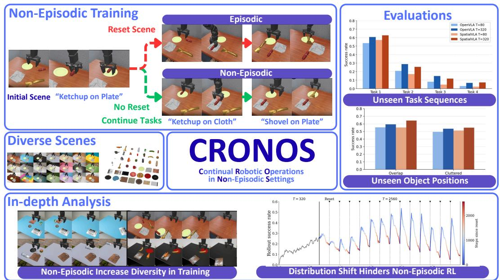

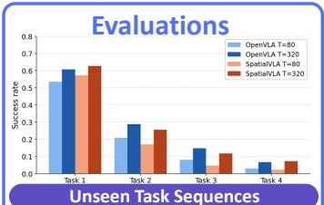

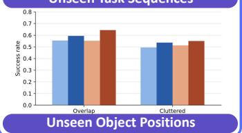

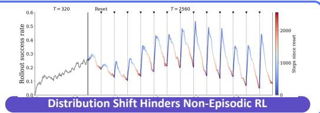  
Figure 1: Overview of non-episodic training in CRONOS. We introduce CRONOS, a benchmark for RL fine-tuning of VLAs under infrequent scene resets. Tasks share a scene (top left). Episodic training resets the scene before every task, whereas non-episodic training continues each task from where the previous one ended. CRONOS covers diverse scenes and objects (middle left). Without frequent resets, object positions become increasingly dispersed, and rollout success decays after each scene reset (bottom). Yet policies fine-tuned non-episodically generalize better to unseen object positions and perform better on unseen task sequences (right).

## ABSTRACT

Reinforcement learning (RL) is promising for adapting robot policies to unstructured real-world environments. However, standard RL pipelines rely on episodic training with frequent scene resets, which is impractical for real-world deployment due to the need for substantial human intervention. While prior work has studied non-episodic RL in relatively small policies trained from scratch, its behavior when fine-tuning modern large-scale pre-trained vision-language-action (VLA) models remains underexplored. In this work, we introduce CRONOS, a simulation benchmark for RL fine-tuning of VLAs under non-episodic scene resets. CRONOS leverages high-fidelity physics simulators and adopts shared-scene multi-task settings. Using CRONOS, we show that naively fine-tuning pre-trained policies fails in non-episodic settings due to shifts in object configurations and end-effector poses; however, these challenges can be mitigated through targeted reset allocation and by addressing biases in pre-trained models. Moreover, we find that non-episodic training enhances long-horizon manipulation and improves generalization to previously unseen object configurations and task sequences.

## 1 INTRODUCTION

Learning to adapt is key to deploying robots in continually changing worlds. Recently, behavior cloning has emerged as a dominant learning approach in robotic manipulation. It trains state-of-the-art visuomotor policies, often termed vision-language-action models (VLAs; Kim et al., 2024; Qu et al., 2025; Bjorck et al., 2025), on large-scale expert demonstrations (O’Neill et al., 2024; Bu et al., 2025), enabling robots to perform complex manipulation tasks (Black et al., 2025; Zheng et al., 2026). However, VLAs are not robust to unseen conditions during training: even a slight change in lighting, object appearance or scene layout can cause a VLA’s failure (TRI LBM Team et al., 2025). Reinforcement learning (RL) offers a compelling solution. RL adapts policies by trial and error, eliminating the persistent need for collecting demonstrations to cover new failures. Recent studies show that RL fine-tuning substantially improves a VLA’s generalization and robustness to novel scenarios (Physical Intelligence et al., 2025a; Zhang et al., 2026).

Despite its generality, standard RL pipelines rely on an unrealistic assumption of episodic training— scenes are frequently reset at each episode to prevent robots from being trapped in low-reward states during training, to enhance RL’s training efficiency. Because scene reset is free in simulation, this has been widely overlooked in prior work that studies RL fine-tuning in simulation (Liu et al., 2025; Yu et al., 2026). In contrast, in real-world settings, scene reset requires human intervention and incurs substantial overhead. This has prevented RL from being deployed at scale in real robotic systems. To address the limitation, a wide range of non-episodic RL algorithms have been proposed, including manually scripting the reset robot policy (Levine et al., 2016; Sharma et al., 2020), instrumenting the reset mechanism (Zeng et al., 2020; Kalashnikov et al., 2018; 2021), or tackling scene resets through a multi-task learning framework that either treats scene resets as additional tasks (Eysenbach et al., 2018; Zhu et al., 2020), or decomposes a task into a set of subtasks, allowing the execution of each to reset the others (Gupta et al., 2021). However, these approaches are proposed prior to the surge of VLAs, and confined to simpler settings of training policies from scratch.

We present an initial study to highlight challenges in RL fine-tuning VLAs under non-episodic scene reset, despite the prior success of episodic training. We answer three questions: (1) how does RL fine-tuning VLAs perform out of the box, under non-episodic, multi-task settings? (2) what are the key factors impacting the performance? (3) what are the advantages of non-episodic training, aside from reducing the labor cost? Experiments are primarily conducted in simulation benchmarks, as they are less time-consuming and offer better reproducibility than real-world benchmarks.

We introduce Continual Robotic Operations in NOn-episodic Settings (CRONOS), a simulation benchmark carefully designed to facilitate systematic study on non-episodic scene reset RL. CRONOS consists of a suite of 16 pick-and-place tasks, evenly distributed across 4 scenes. It addresses multiple limitations of existing benchmarks. First, CRONOS targets recent advances in VLAs. It evaluates nonepisodic RL fine-tuning of these pre-trained policies, rather than policies trained from scratch (Gupta et al., 2021). Second, CRONOS adopts a realistic multi-task learning setup by sharing scenes across tasks, in contrast to prior benchmarks that isolate each task into a separate scene (Yang et al., 2024). This compounds manipulation errors not only over the horizon, but also across tasks, as in real-world deployment where a robot keeps working in the same environment. Third, CRONOS builds upon a high-fidelity physics simulator, Maniskill (Tao et al., 2025), and its extension of manipulation tasks suites (Li et al., 2024; Liu et al., 2025). In contrast, existing benchmarks rely on outdated simulators (Balsells et al., 2023) with simplified physics and limited visual realism. Both our multi-task learning setup and usage of modern simulators make non-episodic scene reset RL more challenging. We present an overview comparison between common multi-task episodic RL and our shared-scene multi-task non-episodic scene reset RL in Figure 1.

We test two off-the-shelf VLAs: OpenVLA (Kim et al., 2024) and SpatialVLA (Qu et al., 2025), on CRONOS. We arrive at following findings: (1) Non-episodic RL fine-tuning for pre-trained VLAs is ineffective. We show that distribution drifts in initial scene layout and initial robot configurations make non-episodic training inefficient, (2) Targeted resets improves non-episodic training. We found that resetting strategies, that handle the distribution drifts, can improve non-episodic RL’s efficiency, while others show no benefit. (3) Non-episodic training brings stronger out-of-domain generalization. While difficult to train, we found that policies fine-tuned with non-episodic RL are more robust to novel object configurations and long-horizon robotic manipulation, than their episodically fine-tuned counterparts.

## 2 PRELIMINARIES

In this section, we present a general formulation of multi-task RL problems, and extend it to nonepisodic scene reset multi-task RL (NSR-MTRL) problems without loss of generality.

Multi-task RL. Multi-task RL problems consider learning optimal policies for a set of tasks sampled from a task distribution $p _ { z } .$ . A task $z \sim p _ { z } ( \cdot )$ defines a Markov decision process (MDP) $\mathcal { M } _ { z } = ( S , \mathcal { A } , P , R _ { z } , \rho , \gamma )$ , where $s$ is the state space, A is the action space, $P$ denotes the transition dynamics of the environment, $R _ { z }$ is the reward function of the task, $\rho$ is the initial state distribution, and $\gamma$ denotes the discount factor. Given policy π conditioning on task z, the RL objective $J ( \pi )$ is to maximize the expected return for every task:

$$
J ( \pi ) = \mathbb { E } _ { z \sim p _ { z } ( \cdot ) } \mathbb { E } _ { s _ { 0 } \sim \rho , a _ { h } \sim \pi ( \cdot \vert s _ { h } ; z ) , s _ { h + 1 } \sim P ( \cdot \vert s _ { h } , a _ { h } ) } \left[ \sum _ { h } \gamma ^ { h } R _ { z } ( s _ { h } , a _ { h } ) \right] .\tag{1}
$$

Non-episodic Scene Reset Multi-Task RL (NSR-MTRL). We extend this formulation to nonepisodic scene reset settings. Evaluation remains episodic, with trajectories rolled out from the initial state for each task; whereas, training trajectories are rolled out continually across tasks with no or only occasional scene resets (Sharma et al., 2022b). Therefore, the evaluation objective is identical to Eqn. 1, but the training objective differs. To model occasional scene resets, we define ε as the reset frequency and re-write the transition dynamics as: $\hat { P } ( \cdot | s _ { h } , a _ { h } ) = ( 1 - \varepsilon ) P ( \cdot | s _ { h } , a _ { h } ) + \varepsilon \rho ( \cdot )$ , where the next state follows the environment dynamics $P$ with probability $1 - \varepsilon ,$ , and is instead sampled from the initial-state distribution $\rho$ with probability $\varepsilon .$ Let $z _ { h }$ denote the task at time $h ,$ we follow Gupta et al. (2021) and write the training objective of NSR-MTRL as:

$$
\hat { J } ( \pi ) = \mathbb { E } _ { s _ { 0 } \sim \rho } \mathbb { E } _ { z _ { h } \sim p _ { z } ( \cdot ) , a _ { h } \sim \pi ( \cdot | s _ { h } ; z _ { h } ) , s _ { h + 1 } \sim \hat { P } ( \cdot | s _ { h } , a _ { h } ) } \left[ \sum _ { h } \gamma ^ { h } R _ { z _ { h } } ( s _ { h } , a _ { h } ) \right] .\tag{2}
$$

## 3 NON-EPISODIC SCENE RESET TRADES INTERACTION EFFICIENCY FORRESET EFFICIENCY

To find out if RL fine-tunes VLAs effectively under non-episodic multi-task settings, we propose a challenging simulation benchmark and evaluate NSR-MTRL fine-tuning for VLAs on the benchmark.

## 3.1 A CHALLENGING BENCHMARK FOR NSR-MTRL

We introduce CRONOS, a simulation benchmark designed to study non-episodic scene reset multitask RL (NSR-MTRL). It is built upon two established robotic manipulation simulation benchmarks, SimplerEnv (Li et al., 2024) and its extension (Liu et al., 2025). Both adopt a modern physics simulator, Maniskill3 (Tao et al., 2025), which produces high-fidelity physics simulation.

Training. Unlike previous benchmarks isolating each task into a separate scene, CRONOS adopts shares scenes across tasks, as shown in Figure 1 (top-left). This makes multi-task learning more challenging, because manipulation errors propagate to next tasks. To enable this, CRONOS creates four scenes with different environment backgrounds, table meshes, and lighting conditions. Each scene consists of a different set of 2 objects and 2 receptacles, yielding 4 language-conditioned tasks of the form “put the [object] on the [receptacle]” per scene, for a total of 16 tasks across all four scenes. Each task is rolled out for 80 interaction steps in the environment. In episodic training, we set the scene reset interval T to 80 interaction steps. Upon scene reset, the object and receptacle are randomly placed in one of 16 fixed positions, immediately before the policy switches to rolling out the next task. In non-episodic training, we reset scene every $T = 3 2 0$ or $T = 2 5 6 0$ steps, corresponding to a reset after every 4 or 32 tasks, respectively.

Evaluation. We adopt success rate, the fraction of trials that end in success, as the primary metric. We evaluate policies under two protocols, independent-task evaluation and sequential-task evaluation, each on both object and receptacle spatial configurations seen (In Domain) and unseen (Out of Domain) during training. For independent-task evaluation, the policy has up to 80 steps to complete a single task; the trial succeeds if it does so within that limit. For sequential-task evaluation, the policy is instructed to complete a sequence of tasks, each with an 80-step budget. A task not completed in time is counted as a failure, and the policy moves on to the next one. We evaluated sequential tasks performance in both training and unseen task sequences.

In most experiments, we adopt independent-task evaluation in In Domain object and receptacle spatial configurations, unless otherwise mentioned.

Models. In this work, we study two off-the-shelf VLAs: OpenVLA (Kim et al., 2024) and SpatialVLA (Qu et al., 2025). The former is widely adopted in previous approaches to RL finetuning (Zhang et al., 2024; Liu et al., 2025; Yu et al., 2026), and the latter shows strong performance in robotic manipulation. Both models are trained with PPO algorithm (Schulman et al., 2017).

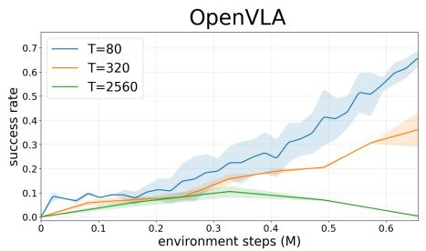

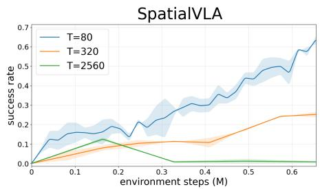  
Figure 2: Pretrained VLAs struggle to learn under non-episodic scene resets. When directly fine-tuned in the non-episodic multi-task setting, learning performance dropped dramatically as the scene reset interval T increased from 80 to 320 interaction steps, and failed at T = 2, 560 steps.

## 3.2 PRETRAINED VLAS STRUGGLE TO LEARN UNDER NON-EPISODIC SCENE RESETS

We summarize our preliminary study in Figure 2. Our first conclusion is that directly fine-tuning VLAs under non-episodic multi-task settings is ineffective. NSR-MTRL’s learning efficiency substantially drops with decreasing frequency of scene reset: within training scenes, OpenVLA’s success rate drops from 65% to 37% and 0% with scene reset interval T ranging from 80 to 320 and 2560; likewise, SpatialVLA’s success rate drops from 65% to 25% and 2%. Both models show similar trends when tested on Out of Domain configurations.

While adapting VLAs efficiently, episodic RL requires frequent but laborious scene resets, which hinder episodic RL’s application on real-world robotic systems. This necessitates NSR-MTRL algorithms, which should enhance both the reset and interaction efficiency for fine-tuning VLAs. Next, we conduct a series of experiments to study the problem in depth. We aim to answer two questions: (1) Can different reset mechanisms impact NSR-MTRL performance? and (2) what are the strengths of NSR-MTRL fine-tuned policies, compared to their episodically trained counterpart?

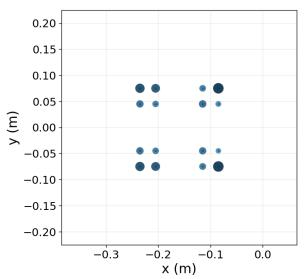  
(a) T = 80

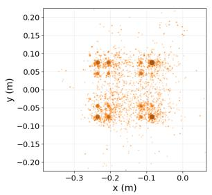  
(b) T = 320

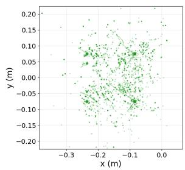  
(c) $T = 2 5 6 0$  
Figure 3: Long scene reset intervals expose the policy to diverse object starting positions. In non-episodic RL, each new task starts with the scene layout carried over from the previous task, causing object starting positions to become increasingly dispersed as the scene reset interval increases.

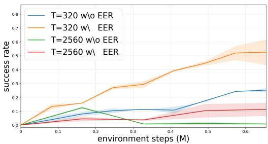  
Figure 4: End-effector reset mitigates pretraining bias. EER automatically resets the endeffector to its initial position at each task switch, improving the learning efficiency of SpatialVLA under non-episodic scene-reset settings.

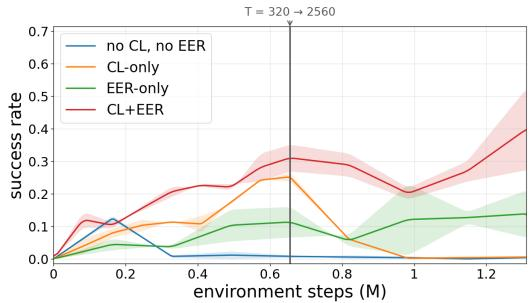  
Figure 5: Frequent scene resets during early training improve interaction efficiency. With EER, training SpatialVLA with a reset interval of 320 steps followed by an increase to 2560 steps is the only strategy that exhibits an upward trend in task success rate.

## 4 TARGETED RESETS ENABLE NON-EPISODIC SCENE RESET FINE-TUNING

As shown in Figure 2, reducing scene reset frequency directly degrades interaction efficiency. This raises the question of whether improving NSR-MTRL’s reset mechanisms achieves better tradeoff between reset and interaction efficiency. We investigate three approaches: (1) resetting only the robot arm, which can be performed automatically without human intervention; (2) adjusting the scene reset frequency throughout training; and (3) resetting low-reward scenes to prevent the loss of learning signals from unrecoverable states.

## 4.1 END-EFFECTOR RESETS REDUCE INITIAL-STATE DISTRIBUTION DRIFT

In large-scale demonstration datasets, such as Open X-Embodiment (O’Neill et al., 2024) and RH20T (Fang et al., 2023) used for pre-training OpenVLA and SpatialVLA, demonstrations typically start from a fixed end-effector pose. This yields a strong bias of the robot’s initial pose distribution, that is later learned by VLAs. In contrast, during non-episodic training, a new task starts with both the scene layout and the robot configuration continued from the end of the previous task, which drift as each task proceeds. Motivated by this observation, we study whether the distribution shift in the robot’s end-effector position impacts NSR-MTRL’s fine-tuning efficiency.

To eliminate the distribution shift, we introduce episodic end-effector reset (EER): at each task transition, it returns the end-effector automatically to its canonical pose, while leaving the scene untouched. Unlike scene reset, EER does not need any human intervention, and it can be performed using inverse kinematics or motion planning.

Surprisingly, we found that EER substantially enhance NSR-MTRL’s efficiency. As shown in Figure 4, EER improves SpatialVLA’s success rate by 25 and 10 percentage points with scene reset interval T = 320 and T = 2560. Our results demonstrate that pre-trained VLAs are biased by the robot’s initial pose, and reducing the distribution drift is key to NSR-MTRL’s performance. We therefore use EER in all subsequent experiments.

## 4.2 FREQUENT SCENE RESETS EARLY IMPROVE NSR-MTRL EFFICIENCY

While EER reduces distribution drift in initial robot pose, it does not handle distribution drift in initial scene layout. We next study how much drift in initial scene layout results from non-episodic training, and whether reducing the drift in the early training stage enhances NSR-MTRL’s efficiency.

First, we analyze the drift in initial scene layout. We record the positions of objects and receptacles at the start of each task during training. For episodic training, each object or receptacle is placed at one of the 16 positions. For non-episodic training, objects and receptacles are moved by the robot to random positions. As shown in Figure 3, the initial scene layout becomes more diverse with less frequent scene resets, and the trend coincides with the degrading efficiency of NSR-MTRL.

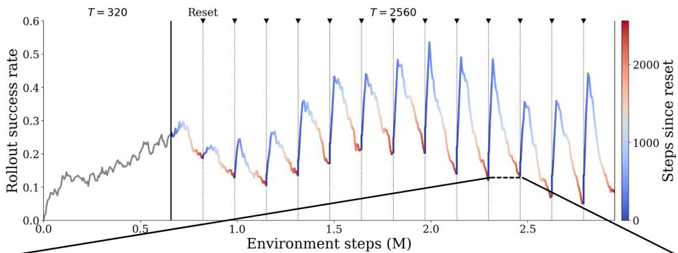

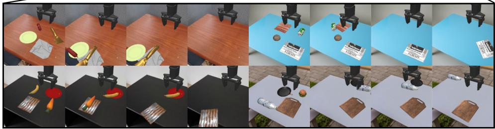  
Figure 6: Rollout success decays between scene resets. Top. Rollout success rate of SpatialVLA during non-episodic training. The vertical line at step 600K marks the switch from $T = 3 2 0$ to $T = \bar { 2 } 5 6 0$ , and triangles mark scene resets. Bottom. Snapshots of the scene between two consecutive resets. Objects become increasingly dispersed and eventually leave the reachable workspace, leaving few successful rollouts to learn from.

Next, we study the impact of reducing the distribution drift in initial scene layout. We propose a curriculum-learning (CL) approach that performs scene resets frequently early in training, and reduces reset frequency as training proceeds. Our idea is training policy to handle the distribution gap by gradually exposing it to novel distributions. We adopt a simple two-stage schedule and leave more advanced designs to future work. We first train VLAs with $T \stackrel { = } { = } 3 2 0$ for the first 600K steps and then increase the interval to $T = 2 5 6 0$ . We compare CL fine-tuned policies against their counterparts without CL fine-tuning. As shown in Figure 5, CL significantly enhances NSR-MTRL fine-tuning for VLAs. Tested on both in-domain and out-of-domain configurations, SpatialVLA fine-tuned with CL achieves 40% and 32% success rate, compared to 14% and 8% by the baseline. Our results demonstrate that allocating scene resets more intelligently is key to NSR-MTRL’s performance.

## 4.3 RESETTING UNRECOVERABLE SCENES PREVENT LOSS OF LEARNING SIGNALS

Even with EER and CL, learning under sparse scene resets remains challenging. As shown in the top of Figure 6, the policy’s success rate peaks right after every scene reset, then decays along time. We visualize the scene evolving between two scene resets in the bottom of Figure 6. We observe that object positions become increasingly dispersed, and eventually they fall out of the robot’s reachable workspace. Because the robot is stuck in unrecoverable states, the policy can never complete the task and therefore obtains zero reward from collected rollout. Human intervention is needed in such cases.

To resolve this, we first introduce a heuristic approach, Heuristic Scene Reset (HSR). With scripted functions, it checks whether the current scene is unrecoverable at each task transition. If any object falls off the table or lies outside the robot’s workspace, HSR triggers a scene reset; otherwise, the policy continues from the current scene, proceeding to the next task. We test SpatialVLA trained with HSR and scene reset interval $T = 2 5 6 0$ . As shown in Figure 7, HSR improves SpatialVLA’s success rate from 14% to 64% on in-domain positions . Motivated by these results, we explore other ways to introduce scene resets.

We study four alternatives to the heuristic approach: (1) Periodic Reset (PR), that resets the scene periodically and it is the vanilla approach adopted by NSR-MTRL, (2) HSR-only, that applies HSR without PR, (3) Learned Scene Reset (LSR; Eysenbach et al., 2018), that additionally trains the policy to relocate the same object as the previous task to any valid region on the table. By learning to reset objects to valid configurations, LSR can avoid the robot stuck in unrecoverable states, and (4) Perturbation Policy (PER; Zhu et al., 2020), that expands LSR by relocating the same object as the previous task to any valid region on the table or to another receptacle. Except HSR-only, all other methods also perform PR. More details are provided in Appendix C.

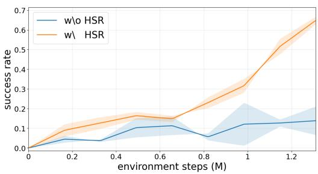  
Figure 7: Resetting unrecoverable scenes preserves learning signals. By resetting all unrecoverable scenes at each task switch, HSR achieved a 64% task success rate, compared with only 14% success rate without HSR.

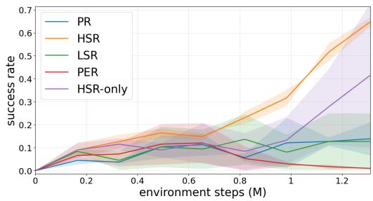  
Figure 8: Forced reset of unrecoverable scenes outperforms learned reset strategies. Only methods that forcibly reset all unrecoverable scenes (HSR and HSR-only) show a sustained increase in success rate.

We conduct experiments with SpatialVLA. Aside from their individual reset strategies, PR, HSR, LSR and PER also periodically reset the scene with interval $T = 2 5 6 0$ . As shown in Figure 8, only two approaches—HSR and HSR-only—demonstrate positive impact on NSR-MTRL; LSR performs as poorly as PR, and PER fails to adapt SpatialVLA to any task. Our results are not surprising. Both LSR and PER train policies to perform additional tasks, which are as inefficient to learn as the original pick-and-place tasks. Moreover, the robot can still enter unrecoverable states when training these reset tasks. In contrast, both HSR and HSR-only intervene to avoid unrecoverable states. One concern is that HSR may trigger more resets, trading reset efficiency for interaction efficiency. To examine this, we compare all methods under a fixed budget of 1000 resets. As shown in Figure 9, HSR and HSR-only still achieve the best performance. This indicates that HSR improves both interaction efficiency and reset efficiency.

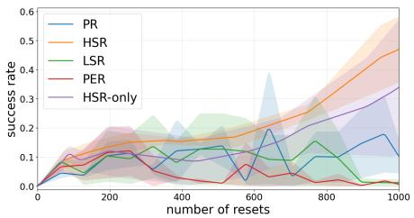

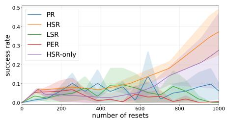  
Figure 9: Forcibly resetting unrecoverable scenes is the most reset-efficient strategy. As the number of scene resets increases, only methods that forcibly reset all unrecoverable scenes (HSR and HSR-only) continue to improve in performance.

## 5 NON-EPISODIC TRAINING BRINGS BENEFITS BEYOND RESET EFFICIENCY

What are other advantages NSR-MTRL can bring, aside from reducing the labor cost? Under NSR-MTRL, policies are forced to perform a sequence of tasks non-stop, in a scene that becomes untidier as tasks proceed. We conjecture that policies fine-tuned with NSR-MTRL are more robust to out-ofdomain spatial configurations and long-horizon manipulation tasks than their episodically trained counterparts. To test this hypothesis, we train both OpenVLA and SpatialVLA with episodic RL $( T = 8 0 )$ and NSR-MTRL $( T = 3 2 0 )$ , using 2.9M interaction steps. We test these models under two settings: (1) independent-task evaluation over out-of-domain configurations, and (2) sequential-task evaluation over out-of-domain configurations. Results are presented as follows.

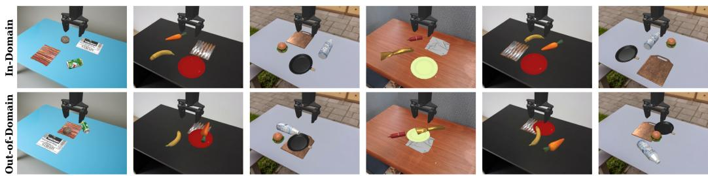  
Figure 10: In-domain and out-of-domain scene configurations. Out-of-domain scenes include overlapping and cluttered object layouts that do not appear during training.

## 5.1 EXPOSURE TO DISPERSED SCENES IMPROVES SPATIAL GENERALIZATION

To evaluate a policy’s robustness to out-of-domain initial scene layout, we propose two ways to initialize a scene. The first is the Overlap setup, placing at least two objects within 12 cm to each other. Objects therefore overlap or are in close contact. The second is the Cluttered setting, where objects are initialized at random positions above the tabletop and fall freely with physics simulation. This results in natural cluttered scenes. These two settings are beyond training distribution, which randomly place each object or receptacle on any of 16 positions without overlapping (Figure 10).

<table><tr><td>Model</td><td>T</td><td>Overlap</td><td>Cluttered</td></tr><tr><td rowspan="2">OpenVLA</td><td>80</td><td>0.554</td><td>0.494</td></tr><tr><td>320</td><td>0.593</td><td>0.536</td></tr><tr><td rowspan="2">SpatialVLA</td><td>80</td><td>0.552</td><td>0.512</td></tr><tr><td>320</td><td>0.643</td><td>0.550</td></tr></table>

Table 1: Exposure to dispersed scenes improves spatial generalization. Non-episodic resetting outperforms episodic resetting in both dispersed scenes.

Our evaluation results are summarized in Table 1. NSR-MTRL fine-tuning outperforms episodic fine-tuning in both settings. For SpatialVLA, the success rate rises from 55.2% to 64.3% in the Overlap setting and from 51.2% to 55.0% in the Cluttered setting. For OpenVLA, it rises from 55.4% to 59.3% and from 49.4% to 53.6%, respectively. Notably, while episodic training $( T = 8 0 )$ use four times as many scene resets as NSR-MTRL $( \dot { T } = 3 2 0 )$ , it is less robust to out-of-domain configurations than non-episodic counterpart. Our results demonstrate that exposing policies to more diverse configurations enhances their out-of-domain generalization, and NSR-MTRL naturally enables this capability.

## 5.2 CONTINUAL TRAINING IMPROVES SEQUENTIAL TASK EXECUTION

We evaluate whether NSR-MTRL enhances a policy’s robustness to both long-horizon robotic manipulation and out-of-domain configurations. In the following experiments, policies are tasked to perform four tasks in sequence non-stop within scenes, which are initialized under Overlap settings. For sequential-task evaluation, we consider two cases: one tests on sequences seen during training, and the other tests on unseen sequences.

Our results are summarized in Figure 11. While policies fine-tuned with episodic RL and NSR-MTRL achieve comparable performance on the first task, their performance gap enlarges with the following tasks. NSR-MTRL fine-tuned policies have an obvious lead over episodically fine-tuned counterparts. On seen task sequences, OpenVLA reaches 40% on the second task with $T = 3 2 0$ , compared to 26% with $T = 8 0$ . SpatialVLA reaches 33% with $T = 3 2 0$ , compared to 18% with $T = 8 0$ . After proceeding to the fourth task, NSR-MTRL achieves larger performance gain: it nearly doubles and triples the success rate of OpenVLA and SpatialVLA, both fine-tuned with $T = 8 0$ . We observe the similar trend on unseen sequences.

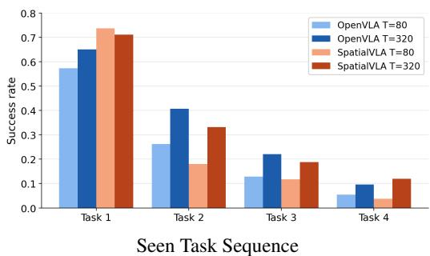

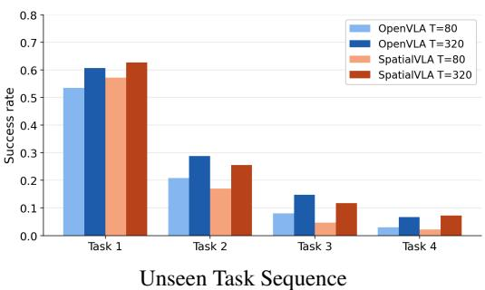  
Figure 11: Non-episodic scene reset training improves sequential task execution. Non-episodic training outperformed episodic training on all subsequent tasks, including both task sequences seen and unseen during training. This improvement was consistent across different VLAs.

## 6 RELATED WORK

Fine-tuning VLA with RL. Vision-Language Action (VLA) models (Physical Intelligence et al., 2025a; Kim et al., 2024; O’Neill et al., 2024; Ankile et al., 2025; Octo Model Team et al., 2024; Physical Intelligence et al., 2025b; Black et al., 2025) learn general robot policies across tasks using pre-trained vision-language foundation models. Despite their strong representational capacity, they share a key limitation of behavior cloning: poor robustness to out-of-distribution scenarios. Recent work shows that reinforcement learning fine-tuning can significantly improve generalization in perception, semantics, and execution (Liu et al., 2025). Several approaches target long-horizon generalization, including task decomposition with dense rewards, action chunking with value estima tion, world-model-based verification, and exploration-driven strategies (Zhang et al., 2025; Huang et al., 2025; Li et al., 2025; Lu et al., 2025). However, existing methods assume episodic training, while our benchmark studies VLA fine-tuning in a non-episodic setting.

Non-episodic RL. Real-world RL is limited by the need for human intervention to reset environments, and prior benchmarks demonstrate that episodic algorithms do not directly extend to non-episodic settings (Liu et al., 2023; Sharma et al., 2022b). Existing approaches address this limitation in several ways. Model-based methods improve exploration without resets (Yang et al., 2025; Sukhija et al., 2024). Other work jointly learns task and reset policies, explicitly handling irreversible states (Lee & Seo, 2024; Patil & Rajendran, 2024; Sharma et al., 2023; Kim et al., 2023; Walke et al., 2022; Sharma et al., 2022a;b; Zhang & Weihs, 2023; Xie et al., 2022; Eysenbach et al., 2018). Another line of work formulates reset-free learning as multi-task learning, where auxiliary tasks implicitly induce resets (Gupta et al., 2022; Xu et al., 2022; Gupta et al., 2021; Ha et al., 2020). Hybrid approaches have also been explored (Yang et al., 2024). In contrast, our benchmark quantifies reset efficiency through the number of resets and highlights the core challenges of reset-free learning.

## 7 CONCLUSION

We introduce CRONOS, a simulation benchmark for RL fine-tuning of VLAs under non-episodic scene resets. Using CRONOS, we find that naive non-episodic fine-tuning fails because object configurations disperse and the end-effector drifts from its pre-training pose. Targeted resets recover much of this loss. Resetting the end-effector at each task switch removes the pre-training bias at no human cost, scheduling scene resets densely early in training eases learning, and resetting only unrecoverable scenes restores learning under long reset intervals. Beyond reset efficiency, non-episodic training yields policies that generalize better to dispersed scenes and perform better on task sequences.

Limitations. Heuristic scene reset relies on privileged simulator state to detect unrecoverable scenes, and replacing it with a perception-based detector remains future work. Scene drift also continues to limit learning under long reset intervals. Addressing this drift and extending CRONOS to contact-rich tasks are important directions for future work.

## ACKNOWLEDGMENT

This research was supported by the National Science and Technology Council (NSTC), Taiwan, under Grants 114-2222-E-002-008-, 115-2222-E-002-006-, 115-2634-F-002-001-, 115-2218-E-002-026-, and 115-2634-F-002-012-.

## REFERENCES

Lars Ankile, Zhenyu Jiang, Rocky Duan, Guanya Shi, Pieter Abbeel, and Anusha Nagabandi. Residual off-policy RL for finetuning behavior cloning policies. arXiv preprint arXiv:2509.19301, 2025.

Max Balsells, Marcel Torne Villasevil, Zihan Wang, Samedh Desai, Pulkit Agrawal, and Abhishek Gupta. Autonomous robotic reinforcement learning with asynchronous human feedback. In Conference on Robot Learning, pp. 774–799. PMLR, 2023.

Johan Bjorck, Fernando Castañeda, Nikita Cherniadev, Xingye Da, Runyu Ding, Linxi Fan, Yu Fang, Dieter Fox, Fengyuan Hu, Spencer Huang, et al. Gr00t n1: An open foundation model for generalist humanoid robots. arXiv preprint arXiv:2503.14734, 2025.

Kevin Black, Noah Brown, Danny Driess, Adnan Esmail, Michael Equi, Chelsea Finn, Niccolo Fusai, Lachy Groom, Karol Hausman, Brian Ichter, Szymon Jakubczak, Tim Jones, Liyiming Ke, Sergey Levine, Adrian Li-Bell, Mohith Mothukuri, Suraj Nair, Karl Pertsch, Lucy Xiaoyang Shi, James Tanner, Quan Vuong, Anna Walling, Haohuan Wang, and Ury Zhilinsky. π : A vision-language-action flow model for general robot control. In Robotics: Science and Systems (RSS), 2025.

Qingwen Bu, Jisong Cai, Li Chen, Xiuqi Cui, Yan Ding, Siyuan Feng, Shenyuan Gao, Xindong He, Xuan Hu, Xu Huang, et al. Agibot world colosseo: A large-scale manipulation platform for scalable and intelligent embodied systems. arXiv preprint arXiv:2503.06669, 2025.

Benjamin Eysenbach, Shixiang Gu, Julian Ibarz, and Sergey Levine. Leave no trace: Learning to reset for safe and autonomous reinforcement learning. In International Conference on Learning Representations (ICLR), 2018.

Hao-Shu Fang, Hongjie Fang, Zhenyu Tang, Jirong Liu, Junbo Wang, Haoyi Zhu, and Cewu Lu. RH20T: A comprehensive robotic dataset for learning diverse skills in one-shot. In RSS 2023 Workshop on Learningfor Task and Motion Planning, 2023.

Abhishek Gupta, Justin Yu, Tony Z. Zhao, Vikash Kumar, Aaron Rovinsky, Kelvin Xu, Thomas Devlin, and Sergey Levine. Reset-free reinforcement learning via multi-task learning: Learning dexterous manipulation behaviors without human intervention. In International Conference on Robotics and Automation (ICRA), pp. 6664–6671. IEEE, 2021.

Abhishek Gupta, Corey Lynch, and Brandon Kinman. Demonstration-bootstrapped autonomous practicing via multi-task reinforcement learning. arXiv preprint arXiv:2203.15755, 2022.

Sehoon Ha, Peng Xu, and Zhenyu Tan. Learning to walk in the real world with minimal human effort. arXiv preprint arXiv:2002.08550, 2020.

Dongchi Huang, Zhirui Fang, and Tianle Zhang. Co-rft: Efficient fine-tuning of vision-languageaction models. arXiv preprint arXiv:2508.02219, 2025.

Dmitry Kalashnikov, Alex Irpan, Peter Pastor, Julian Ibarz, Alexander Herzog, Eric Jang, Deirdre Quillen, Ethan Holly, Mrinal Kalakrishnan, Vincent Vanhoucke, and Sergey Levine. Scalable deep reinforcement learning for vision-based robotic manipulation. In Conference on Robot Learning (CoRL), pp. 651–673. PMLR, 2018.

Dmitry Kalashnikov, Jacob Varley, Yevgen Chebotar, Benjamin Swanson, Rico Jonschkowski, Chelsea Finn, Sergey Levine, and Karol Hausman. Mt-opt: Continuous multi-task robotic reinforcement learning at scale. arXiv preprint arXiv:2104.08212, 2021.

Jigang Kim, Daesol Cho, and H. Jin Kim. Demonstration-free autonomous rl via bidirectional curriculum. arXiv preprint arXiv:2305.09943, 2023.

Moo Jin Kim, Karl Pertsch, Siddharth Karamcheti, Ted Xiao, Ashwin Balakrishna, Suraj Nair, Rafael Rafailov, Ethan Foster, Grace Lam, Pannag Sanketi, Quan Vuong, Thomas Kollar, Benjamin Burchfiel, Russ Tedrake, Dorsa Sadigh, Sergey Levine, Percy Liang, and Chelsea Finn. OpenVLA: An open-source vision-language-action model. In Conference on Robot Learning (CoRL), 2024.

Sang-Hyun Lee and Seung-Woo Seo. Self-supervised curriculum generation for autonomous rl. arXiv preprint arXiv:2311.09195, 2024.

Sergey Levine, Chelsea Finn, Trevor Darrell, and Pieter Abbeel. End-to-end training of deep visuomotor policies. Journal ofMachine Learning Research (JMLR), 17(39):1–40, 2016.

Hengtao Li, Pengxiang Ding, and Runze Suo. Vla-rft: Vision-language-action reinforcement finetuning with verified rewards. arXiv preprint arXiv:2510.00406, 2025.

Xuanlin Li, Kyle Hsu, Jiayuan Gu, Oier Mees, Karl Pertsch, Homer Rich Walke, Chuyuan Fu, Ishikaa Lunawat, Isabel Sieh, Sean Kirmani, Sergey Levine, Jiajun Wu, Chelsea Finn, Hao Su, Quan Vuong, and Ted Xiao. Evaluating real-world robot manipulation policies in simulation. In Conference on Robot Learning (CoRL), 2024.

Bo Liu, Yifeng Zhu, Chongkai Gao, Yihao Feng, Qiang Liu, Yuke Zhu, and Peter Stone. LIBERO: Benchmarking knowledge transfer for lifelong robot learning. In Advances in Neural Information Processing Systems (NeurIPS), 2023.

Jijia Liu, Feng Gao, Bingwen Wei, Xinlei Chen, Qingmin Liao, Yi Wu, Chao Yu, and Yu Wang. What can RL bring to VLA generalization? an empirical study. In Advances in Neural Information Processing Systems (NeurIPS), 2025.

Guanxing Lu, Wenkai Guo, Chubin Zhang, Yuheng Zhou, Haonan Jiang, Zifeng Gao, Yansong Tang, and Ziwei Wang. VLA-RL: Towards masterful and general robotic manipulation with scalable reinforcement learning. arXiv preprint arXiv:2505.18719, 2025.

Octo Model Team, Dibya Ghosh, Homer Walke, Karl Pertsch, Kevin Black, Oier Mees, Sudeep Dasari, Joey Hejna, Tobias Kreiman, Charles Xu, Jianlan Luo, You Liang Tan, Lawrence Yunliang Chen, Pannag Sanketi, Quan Vuong, Ted Xiao, Dorsa Sadigh, Chelsea Finn, and Sergey Levine. Octo: An open-source generalist robot policy. In Robotics: Science and Systems (RSS), 2024.

Abby O’Neill, Abdul Rehman, Abhiram Maddukuri, Abhishek Gupta, Abhishek Padalkar, Abraham Lee, Acorn Pooley, Agrim Gupta, Ajay Mandlekar, Ajinkya Jain, Albert Tung, Alex Bewley, Alexander Herzog, Alex Irpan, Alexander Khazatsky, Anant Rai, Anikait Singh, Anthony Brohan, Antonin Raffin, Ben Burgess-Limerick, Brianna Zitkovich, Brian Ichter, Danny Driess, Sergey Levine, and Chelsea Finn. Open X-embodiment: Robotic learning datasets and RT-X models. In International Conference on Robotics and Automation (ICRA), pp. 6892–6903. IEEE, 2024.

Darshan Patil and Janarthanan Rajendran. Intelligent switching for reset-free rl. arXiv preprint arXiv:2405.01684, 2024.

Physical Intelligence, Ali Amin, Raichelle Aniceto, Ashwin Balakrishna, Kevin Black, Ken Conley, Grace Connors, James Darpinian, Karan Dhabalia, Jared DiCarlo, Danny Driess, Adnan Esmail, Michael Equi, Chelsea Finn, Niccolo Fusai, Manuel Y. Galliker, Dibya Ghosh, Lachy Groom, Karol Hausman, Brian Ichter, Szymon Jakubczak, Tim Jones, Liyiming Ke, Devin LeBlanc, Sergey Levine, Adrian Li-Bell, Mohith Mothukuri, Suraj Nair, Karl Pertsch, Allen Z. Ren, Lucy Xiaoyang Shi, Laura Smith, Jost Tobias Springenberg, Kyle Stachowicz, James Tanner, Quan Vuong, Homer Walke, Anna Walling, Haohuan Wang, Lili Yu, and Ury Zhilinsky. π0.6: A VLA that learns from experience. arXiv preprint arXiv:2511.14759, 2025a.

Physical Intelligence, Kevin Black, Noah Brown, James Darpinian, Karan Dhabalia, Danny Driess, Adnan Esmail, Michael Equi, Chelsea Finn, Niccolo Fusai, Manuel Y. Galliker, Dibya Ghosh, Lachy Groom, Karol Hausman, Brian Ichter, Szymon Jakubczak, Tim Jones, Liyiming Ke, Devin LeBlanc, Sergey Levine, Adrian Li-Bell, Mohith Mothukuri, Suraj Nair, Karl Pertsch, Allen Z. Ren, Lucy Xiaoyang Shi, Laura Smith, Jost Tobias Springenberg, Kyle Stachowicz, James Tanner,

Quan Vuong, Homer Walke, Anna Walling, Haohuan Wang, Lili Yu, and Ury Zhilinsky. π0.5: A vision-language-action model with open-world generalization. arXiv preprint arXiv:2504.16054, 2025b.

Delin Qu, Haoming Song, Qizhi Chen, Yuanqi Yao, Xinyi Ye, Yan Ding, Zhigang Wang, JiaYuan Gu, Bin Zhao, Dong Wang, and Xuelong Li. SpatialVLA: Exploring spatial representations for vision-language-action models. In Robotics: Science and Systems (RSS), 2025.

John Schulman, Filip Wolski, Prafulla Dhariwal, Alec Radford, and Oleg Klimov. Proximal policy optimization algorithms. arXiv preprint arXiv:1707.06347, 2017.

Archit Sharma, Michael Ahn, Sergey Levine, Vikash Kumar, Karol Hausman, and Shixiang Gu. Emergent real-world robotic skills via unsupervised off-policy reinforcement learning. In Robotics: Science and Systems (RSS), 2020.

Archit Sharma, Rehaan Ahmad, and Chelsea Finn. A state-distribution matching approach to nonepisodic reinforcement learning. In International Conference on Machine Learning (ICML), pp. 19645–19657. PMLR, 2022a.

Archit Sharma, Kelvin Xu, Nikhil Sardana, Abhishek Gupta, Karol Hausman, Sergey Levine, and Chelsea Finn. Autonomous reinforcement learning: Formalism and benchmarking. In International Conference on Learning Representations (ICLR), 2022b.

Archit Sharma, Ahmed M. Ahmed, and Rehaan Ahmad. Self-improving robots: End-to-end autonomous visuomotor rl. arXiv preprint arXiv:2303.01488, 2023.

Bhavya Sukhija, Lenart Treven, Florian Dörfler, Stelian Coros, and Andreas Krause. Neorl: Efficient exploration for nonepisodic rl. In Advances in Neural Information Processing Systems (NeurIPS), volume 37, pp. 74966–74998, 2024.

Stone Tao, Fanbo Xiang, Arth Shukla, Yuzhe Qin, Xander Hinrichsen, Xiaodi Yuan, Chen Bao, Xinsong Lin, Yulin Liu, Tse-Kai Chan, Yuan Gao, Xuanlin Li, Tongzhou Mu, Nan Xiao, Arnav Gurha, Viswesh Nagaswamy Rajesh, Yong Woo Choi, Yen-Ru Chen, Zhiao Huang, Roberto Calandra, Rui Chen, Shan Luo, and Hao Su. Demonstrating GPU parallelized robot simulation and rendering for generalizable embodied AI with ManiSkill3. In Robotics: Science and Systems (RSS), 2025.

TRI LBM Team, Jose Barreiros, Andrew Beaulieu, Aditya Bhat, Rick Cory, Eric Cousineau, Hongkai Dai, Ching-Hsin Fang, Kunimatsu Hashimoto, Muhammad Zubair Irshad, Masha Itkina, Naveen Kuppuswamy, Kuan-Hui Lee, Katherine Liu, Dale McConachie, Ian McMahon, Haruki Nishimura, Calder Phillips-Grafflin, Charles Richter, Paarth Shah, Krishnan Srinivasan, Blake Wulfe, Chen Xu, and Mengchao Zhang. A careful examination of large behavior models for multitask dexterous manipulation. Science Robotics, 2025. doi: 10.1126/scirobotics.aea6201.

Homer Walke, Jonathan Yang, and Albert Yu. Don’t start from scratch: Leveraging prior data for robotic rl. arXiv preprint arXiv:2207.04703, 2022.

Annie Xie, Fahim Tajwar, and Archit Sharma. When to ask for help: Proactive interventions in autonomous rl. arXiv preprint arXiv:2210.10765, 2022.

Kelvin Xu, Zheyuan Hu, and Ria Doshi. Dexterous manipulation from images: Autonomous real-world rl via substep guidance. arXiv preprint arXiv:2212.09902, 2022.

Jingyun Yang, Max Sobol Mark, Brandon Vu, Archit Sharma, Jeannette Bohg, and Chelsea Finn. Robot fine-tuning made easy: Pre-training rewards and policies for autonomous real-world reinforcement learning. In International Conference on Robotics and Automation (ICRA), pp. 4804–4811. IEEE, 2024.

Zhao Yang, Thomas M. Moerland, Mike Preuss, Aske Plaat, and Edward S. Hu. Reset-free reinforcement learning with world models. Transactions on Machine Learning Research (TMLR), 2025. URL https://openreview.net/forum?id=ZdMIXltJzK.

Chao Yu, Yuanqing Wang, Zhen Guo, Hao Lin, Si Xu, Hongzhi Zang, Quanlu Zhang, Yongji Wu, Chunyang Zhu, Junhao Hu, et al. {RLinf}: Flexible and efficient {Large-Scale} reinforcement learning via {Macro-to-Micro} flow transformation. In 20th USENIX Symposium on Operating Systems Design and Implementation (OSDI), pp. 829–846, 2026.

Andy Zeng, Shuran Song, Johnny Lee, Alberto Rodriguez, and Thomas Funkhouser. Tossingbot: Learning to throw arbitrary objects with residual physics. IEEE Transactions on Robotics (T-RO), 36(4):1307–1319, 2020.

He Zhang, Lingzhu Xiang, Haitao Lin, Zeyu Huang, Minghui Wang, Dingyan Zhong, Yubo Dong, Yihao Wu, Yongming Rao, Dongsheng Zhang, et al. Hy-embodied-0.5-vla: From vision-languageaction models to a real-world robot learning stack. arXiv preprint arXiv:2606.14409, 2026.

Hongyin Zhang, Zifeng Zhuang, and Han Zhao. Reinbot: Amplifying robot vision-language manipulation with reinforcement learning. arXiv preprint arXiv:2505.07395, 2025.

Zichen Zhang and Luca Weihs. When learning is out of reach, reset: Generalization in visuomotor rl. arXiv preprint arXiv:2303.17600, 2023.

Zijian Zhang, Kaiyuan Zheng, Zhaorun Chen, Joel Jang, Yi Li, Siwei Han, Chaoqi Wang, Mingyu Ding, Dieter Fox, and Huaxiu Yao. GRAPE: Generalizing robot policy via preference alignment. arXiv preprint arXiv:2411.19309, 2024.

Jinliang Zheng, Jianxiong Li, Zhihao Wang, Dongxiu Liu, Xirui Kang, Yuchun Feng, Yinan Zheng, Jiayin Zou, Yilun Chen, Jia Zeng, et al. X-vla: Soft-prompted transformer as scalable crossembodiment vision-language-action model. In International Conference on Learning Representations (ICLR), 2026.

Henry Zhu, Justin Yu, Abhishek Gupta, Dhruv Shah, Kristian Hartikainen, Avi Singh, Vikash Kumar, and Sergey Levine. The ingredients of real-world robotic reinforcement learning. arXiv preprint arXiv:2004.12570, 2020.

## A NSR-MTRL ALGORITHM

Our full algorithm, summarized in Algorithm 1, illustrates the complete training procedure of NSR-MTRL. Training progresses over a continuous interaction stream and is structured around task-switch intervals. At each task switch, the agent may trigger one or more reset mechanisms according to the specified reset strategies. Environment resets are not tied to episode terminations, but are instead applied selectively.

Algorithm 1 Non-episodic Scene Reset Multi-Task RL (NSR-MTRL)   
1: Input: task set T , policy $\pi _ { \theta } ,$ value $V _ { \phi }$   
2: Input: total interaction steps $S ,$ task switch interval $K ,$ update interval U   
3: Input: scene reset interval $T ,$ reset budget B   
4: Optional: end-effector reset (EER), unrecoverable-state detector $\mathbb { I } _ { \mathrm { b a d } } ( s )$ (HSR)   
5: Initialize environment state $s _ { 0 } ,$ step counter $n \gets 0$   
6: Initialize reset counter $b \gets 0 ,$ buffer $\mathcal { D }  \emptyset$   
7: while $n < S$ and $b < B$ do   
8: Task switch: sample instruction $\tau \sim$ TASKSCHEDUL $. \mathrm { E R } ( \tau )$   
9: for $t = 1$ to $K$ do   
10: Observe $o _ { t }$ and instruction τ   
11: Sample action $a _ { t } \sim \pi _ { \theta } ( a \mid o _ { t } , \tau )$   
12: Step environment $s \gets f ( s , a _ { t } )$ and receive reward $r _ { t }$   
13: Store $\left( o _ { t } , \tau , a _ { t } , r _ { t } \right)$ into buffer D   
14: n $ n + 1$   
15: if (n mod $U ) = 0$ then   
16: Compute returns and advantages using $V _ { \phi }$   
17: Update policy $\pi _ { \theta }$ and value $V _ { \phi }$ on $\mathcal { D }$   
18: Clear buffer $\mathcal { D }  \emptyset$   
19: end if   
20: end for   
21: if EER enabled then   
22: Reset the end-effector to its canonical pose   
23: end if   
24: if HSR enabled and $\mathbb { I } _ { \mathrm { b a d } } ( s ) = 1$ then   
25: Apply scene reset; $b \gets b + 1$   
26: else if (n mod $T ) = 0$ then   
27: Apply scene reset; $b \gets b + 1$   
28: end if   
29: end while

## B HYPERPARAMETER DETAILS

We detail the training configuration and experiment setup used in our experiments. Table 2 reports the hyperparameters used across all experiments, covering PPO optimization, the vision-language-action (VLA) model configuration based on OpenVLA and SpatialVLA, and additional training settings related to reset-free multi-task learning.

<table><tr><td>Hyperparameter</td><td>Value</td></tr><tr><td>PPO</td><td></td></tr><tr><td>PPO epochs per update</td><td>1</td></tr><tr><td>Clip ratio (€)</td><td>0.2</td></tr><tr><td>Discount factor (γ)</td><td>0.99</td></tr><tr><td>GAE parameter (λ)</td><td>0.95</td></tr><tr><td>Entropy coefficient</td><td>0.0</td></tr><tr><td>Gradient accumulation steps</td><td>20</td></tr><tr><td colspan="2">Vision-language-Action (VLA) model</td></tr><tr><td>Backbone LoRA rank</td><td>OpenVLA-7B, SpatialVLA-4B 32</td></tr><tr><td>Optimizer</td><td>AdamW</td></tr><tr><td>Learning rate (VLA backbone)</td><td> $1 \times 1 0 ^ { - 4 }$ </td></tr><tr><td>Learning rate (value head)</td><td> $3 \times 1 0 ^ { - 3 }$ </td></tr><tr><td>Adam  $\bar { \beta _ { 1 } } , \beta _ { 2 }$ </td><td>0.9, 0.999</td></tr><tr><td>Action sampling temperature (train)</td><td>1.0</td></tr><tr><td>Action sampling temperature (eval)</td><td>0.6</td></tr><tr><td>Other Training Settings</td><td></td></tr><tr><td>Number of parallel environments</td><td>64</td></tr><tr><td>Training horizon (steps)</td><td>320</td></tr><tr><td>Instruction switch interval</td><td>80</td></tr><tr><td>Training update interval</td><td>160</td></tr><tr><td></td><td></td></tr></table>

Table 2: Training hyperparameters used in all experiments.

## C RESET STRATEGIES

Figure 12 illustrates the scene reset strategies compared in Section 4. Each row shows a sequence of five tasks executed in the same scene. A blue label above a task marks a scene reset, and the arrow between two tasks indicates how the policy proceeds to the next one. All non-episodic strategies use EER, so the end-effector returns to its canonical pose at every task transition.

Periodic Reset (PR). The scene is reset every T = 2560 steps, and the policy proceeds directly to the next task between resets. Objects remain wherever the previous task left them, even when they have left the reachable workspace or fallen off the table.

Heuristic Scene Reset (HSR). Before each task switch, HSR checks whether the scene has become unrecoverable. We consider a scene unrecoverable when an object has fallen off the table or lies outside the reachable workspace. If so, HSR triggers a scene reset before the next task. HSR also keeps the periodic reset every T = 2560 steps. HSR-only uses the same check but removes the periodic reset, so the scene is reset only when it becomes unrecoverable.

Learned Scene Reset (LSR). Following Eysenbach et al. (2018), LSR adds an auxiliary reset task, such as “put the [object] on the table”. The policy alternates between a forward task and this backward task, so that it learns to return objects toward task-relevant configurations. This removes external reset logic but spends part of the interaction budget on reset behavior. LSR keeps the periodic reset every T = 2560 steps.

Perturbation Policy (PER). Following Zhu et al. (2020), PER extends LSR with a second auxiliary task that perturbs the scene, such as “put the [object] on the other plate”. The reset task and the perturbation task are sampled uniformly at random. PER aims to expose the policy to more diverse object configurations. It also keeps the periodic reset every T = 2560 steps.

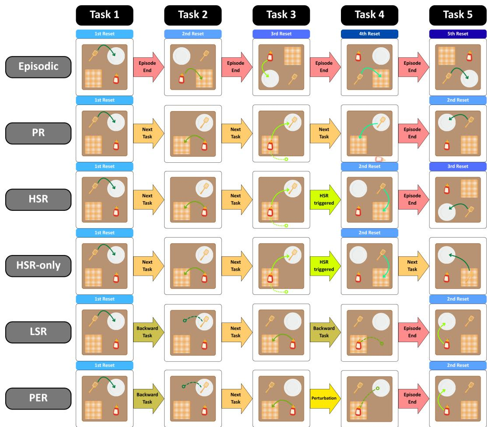  
Figure 12: Visualization of reset-free methods. We compare five methods: (1) periodic reset (PR), which resets the scene every T = 2560 steps; (2) heuristic scene reset (HSR), which detects unrecoverable states before each task switch and resets only when necessary; (3) heuristic scene reset without periodic reset (HSR-only), which uses heuristic resets without periodic resets, avoiding unnecessary resets in recoverable states; (4) learned scene reset (LSR), which learns reset behavior as an auxiliary task within a single policy, eliminating external reset logic at the cost of interaction budget; and (5) perturbation policy (PER), which extends LSR with a second auxiliary task that perturbs the scene, with the two tasks sampled uniformly at random.