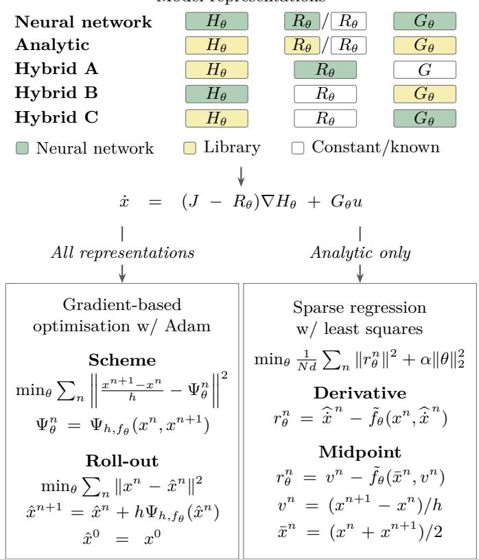
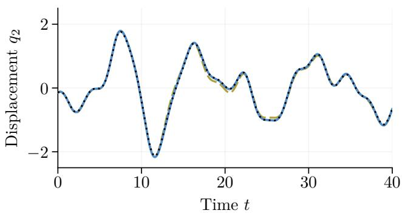
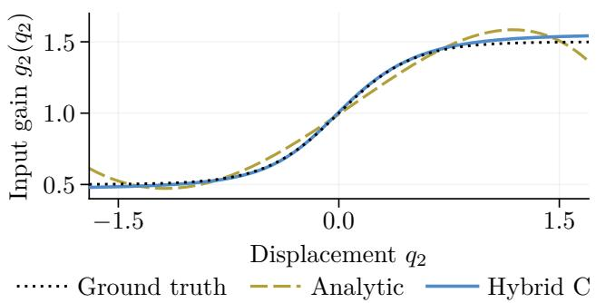
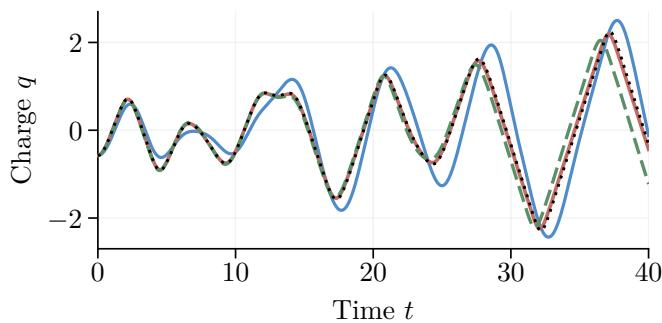
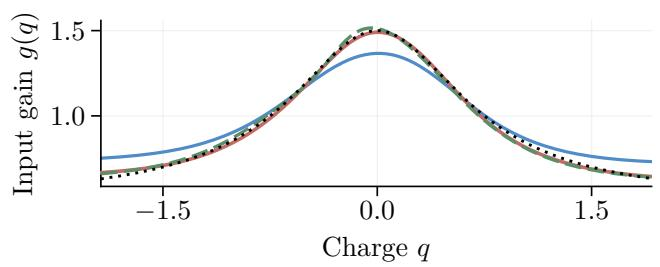

# Comparing model representations and fitting methods for port-Hamiltonian system identification ⋆

Sølve Eidnes ∗ Håkon Noren Myhr ∗∗

∗ Department of Mathematics and Cybernetics, SINTEF Digital, Oslo, Norway (e-mail: solve.eidnes@sintef.no). ∗∗ Department of Mathematical Sciences, Norwegian University of Science and Technology, Trondheim, Norway.

Abstract: Port-Hamiltonian models describe physical systems by separating stored energy, dissipation and external inputs. Learning such models from data requires a choice of representation and fitting method. We compare using neural networks, analytic expressions and combinations of the two for representing the diferent components of the port-Hamiltonian system, and compare fitting the models with gradient-based optimisation or sparse regression. Testing on simulations of mechanical and electrical systems, with and without added noise, we present prediction accuracy and computational cost of the diferent approaches.

Keywords: System identification; port-Hamiltonian systems; neural networks; sparse regression;   
nonlinear systems; data-driven modelling.

## 1. INTRODUCTION

Port-Hamiltonian models describe dynamics using separate functions for stored energy, dissipation and coupling to the surroundings through external inputs (van der Schaft and Jeltsema, 2014). To identify systems of this form from data one must choose how to represent the unknown functions and how to fit them to observations. Preserving the port-Hamiltonian structure allows the learned energy, dissipation and input map to be interpreted separately and provides a basis for control.

The unknown functions can be represented by analytic expressions obtained by fitting combinations of prescribed candidate functions (Lee et al., 2022; Holmsen et al., 2024; Myhr et al., 2026). Neural-network representations have been considered for the same purpose (Desai et al., 2021; Eidnes et al., 2023), building on Hamiltonian neural networks (Greydanus et al., 2019). Hybrid representations combine analytic expressions for some functions with neural networks for others (Holmsen et al., 2024; Cherifi et al., 2026; Khosrovian et al., 2024).

Sparse regression is used to select a small set of terms in a diferential equation from a candidate library (Brunton et al., 2016) and has been adapted to jointly identify the energy and dissipation of port-Hamiltonian systems (Myhr et al., 2026). Gradient-based optimisation is widely used to fit neural networks but has also been used to fit the coeficients of analytic port-Hamiltonian models (Lee et al., 2022; Holmsen et al., 2024). We compare two variants of each of these approaches, giving four diferent fitting methods. Our gradient-based optimisation minimises either integration-scheme residuals or errors in simulated trajectories. Our sparse-regression fits alternate ridgeregularised linear least-squares solves with term removal, using estimated derivatives or a midpoint discretisation.

In this paper, we compare the three types of representation and the two families of fitting methods, summarised in Figure 1, to examine how the choices afect prediction accuracy and computational cost when applied to data from simulated mechanical and electrical systems. We briefly consider how well the diferent models have learned the input gain, but a broader assessment of the identified functions is outside the scope of this study. This can, however, be explored using our public code on https:// github.com/SINTEF/PHSI.

## 2. MODELS AND FITTING METHODS

## 2.1 Port-Hamiltonian formulation

Let $\ b { x } ( t ) \in \mathbb { R } ^ { d }$ be the state, u(t) a scalar input and $H ( x )$ the Hamiltonian. With a skew-symmetric interconnection matrix $^ { J , }$ a symmetric positive semidefinite dissipation matrix $R ( x )$ and an input map G(x), the port-Hamiltonian formulation is

$$
\begin{array} { r l } & { \dot { \boldsymbol { x } } = ( J - R ( \boldsymbol { x } ) ) \nabla H ( \boldsymbol { x } ) + G ( \boldsymbol { x } ) \boldsymbol { u } , } \\ & { \boldsymbol { y } = G ( \boldsymbol { x } ) ^ { \top } \nabla H ( \boldsymbol { x } ) , } \end{array}\tag{1}
$$

where $y$ is the output conjugate to u, and uy is the supplied power (van der Schaft and Jeltsema, 2014). Since $J ^ { \top } = - J ,$ 2 the energy balance is $\dot { H } = - \nabla H ^ { \top } R \nabla H + u y$ . If H is bounded from below, a constant shift gives a nonnegative storage function and the system is passive.

Given measurements of the state and the input, port-Hamiltonian system identification means identifying representations $H _ { \theta } , R _ { \theta }$ and, when unknown, $G _ { \theta }$ , where θ represents the learnable parameters. In this paper, we keep J fixed and constrain $R _ { \theta }$ to be diagonal and positive semidefinite. For an unknown input map, $G _ { \theta } ( x ) = e g _ { \theta } ( z ( x ) )$ , where the standard unit vector e selects the known actuated coordinate and $z ( x )$ selects the prescribed state variable on which the gain depends. Only the gain $g _ { \theta }$ is learned. The learned input map $G _ { \theta }$ is used in both the state equation and the output equation in (1).

## 2.2 Model representations

In the neural-network representation, $H _ { \theta }$ is a neural network, as in Desai et al. (2021); Eidnes et al. (2023); Duong et al. (2024). We use two hidden layers of 64 hyperbolic tangent units and a linear output. For constant damping, the diagonal coeficients on the damped coordinates are learned as nonnegative parameters in θ, while the other entries of $R _ { \theta }$ are fixed at zero. For state-dependent damping, each damped coordinate has a separate network taking only that coordinate as input, with two hidden layers of 16 hyperbolic tangent units and a softplus output, ensuring a positive coeficient. An unknown input gain is represented by a network with two hidden layers of 16 hyperbolic tangent units and a linear output, and takes only the selected state variable as input.

In the analytic representation, $\begin{array} { r } { { H } _ { \theta } ( x ) ~ = ~ \sum _ { k } a _ { k } \varphi _ { k } ( x ) } \end{array}$ where the candidate functions φ are predefined and the coeficients $a _ { k }$ are learned. This candidate-library approach, popularised by Brunton et al. (2016), was combined with port-Hamiltonian formulations in Lee et al. (2022); Myhr et al. (2026). We test diferent libraries for the candidate functions. Each state-dependent damping coeficient is represented by a nonnegative combination of nonnegative candidate functions, while the coeficients for the Hamiltonian and input gain are unconstrained. The libraries in our main experiments are specified in sections 3.1 and 3.2, while alternative libraries are tested in Section 4.2.

The hybrid representations combine analytic and neuralnetwork terms, as also considered by Holmsen et al. (2024); Cherifi et al. (2026); Khosrovian et al. (2024). For statedependent damping with a known input map, hybrid A combines an analytic Hamiltonian model with the abovementioned neural networks for the damping. For constant damping but an unknown input map, hybrid B combines a neural network model of the Hamiltonian with an analytic model of the input gain, while hybrid C combines an analytic Hamiltonian model with a neural-network input gain. Both learn the constant damping coeficients.

## 2.3 Fitting methods

We compare two families of fitting methods, each with two variants. Gradient-based optimisation is used for every representation, while sparse regression is used only for the fully analytic representation.

Gradient-based optimisation We use the adaptive moment estimation (Adam) optimiser to minimise a mean squared loss. Our two variants of the loss difer in how they compare the model output with the observations. Integrationscheme fitting measures how closely pairs of adjacent observed states satisfy a symmetric fourth-order integration scheme (Eidnes et al., 2023; Holmsen et al., 2024). The scheme is mono-implicit, meaning it is explicitly given by the two end points, so evaluating the residual requires neither trajectory simulation nor a separate estimate of the state derivatives (Celledoni et al., 2025). Roll-out fitting instead simulates the model over short windows, starting from the first observed state in each window, and compares its predictions with subsequent observations of the state variables. We use explicit fourth-order Runge– Kutta integration and diferentiate through its steps to obtain the parameter gradients (Chen et al., 2018; Duong et al., 2024; Moradi et al., 2026); our implementation builds on that of the neural Hamiltonian ordinary diferential equations of Meltzer et al. (2026).

Model representations  
  
Fig. 1. Overview of the model representations and fitting objectives compared in the paper. Here $x ^ { n }$ is an observed state at time $t ^ { n } , \widehat { \dot { x } } ^ { n }$ its estimated derivative, and $h = t ^ { n + 1 } - t ^ { n }$ the sampling interval. For the model field $f _ { \theta } = ( J - R _ { \theta } ) \nabla H _ { \theta } + G _ { \theta } u _ { \mathrm { : } }$ a numerical integration scheme approximates the state change over one step by $h \Psi _ { h , f _ { \theta } }$ . Regression uses $\tilde { f } _ { \theta } ( x , v ) \colon$ : the analytic model $f _ { \theta } ,$ with $\nabla _ { p } H _ { \theta }$ in the damping term replaced by the corresponding components of the observed rate v. For regression, $N$ is the number of samples, d the number of state variables, and $\alpha \geq 0$ controls the strength of the ridge penalty.

Sparse regression Sparse regression fits the analytic coeficients by linear least squares while constraining the damping coeficients to be nonnegative (Brunton et al., 2016). Following Myhr et al. (2026), we include a ridge penalty on the squared coeficients to limit large coeficient values. For our canonical systems, we write $x = ( q , p )$ , with positions or charge $q ,$ momenta or flux $p ,$ and damping and input acting only on p. The relation $\dot { q } = \nabla _ { p } H$ then lets us replace this energy derivative in the damping term by a rate estimated from the observations. This avoids products of unknown energy and damping coeficients and makes the joint fit linear (Myhr et al., 2026). In the derivative fit variant, the derivatives of the states are estimated using second-order central diferences for raw data and local polynomial diferentiation for smoothed data. The midpoint fit variant instead evaluates the candidate functions halfway between consecutive observed states, using the change between these states divided by the sampling interval as the corresponding rate. This formulation is based on the implicit midpoint integration scheme. To obtain a sparse model, we alternate these penalised fits with the removal of terms with small coeficients, as described in Section 3.4.

## 3. NUMERICAL EXPERIMENTS

## 3.1 Two-mass system

Consider two masses connected by a nonlinear spring, with another nonlinear spring connecting the first mass to a fixed support. Let $q _ { 1 } , q _ { 2 }$ be their displacements from equilibrium, $p _ { 1 } , p _ { 2 }$ their momenta and $m _ { 1 } , m _ { 2 }$ their masses. With spring parameters $k _ { 0 } , k _ { 1 } , b _ { 0 } , b _ { 1 }$ , the Hamiltonian of the system is $\begin{array} { r } { \dot { H } = p _ { 1 } ^ { 2 } / ( 2 m _ { 1 } ) + p _ { 2 } ^ { 2 } / ( 2 m _ { 2 } ) + [ k _ { 0 } q _ { 1 } ^ { 2 } + k _ { 1 } ( q _ { 2 } - q _ { 1 } ) ^ { 2 } ] / 2 + [ b _ { 0 } q _ { 1 } ^ { 4 } + k _ { 0 } ( q _ { 2 } ^ { 4 } - q _ { 1 } ^ { 2 } ) ] , } \end{array}$ $b _ { 1 } ( q _ { 2 } - q _ { 1 } ) ^ { 4 } ] / 4$ . An external force $g _ { 2 } ( q _ { 2 } ) \ i$ acts on the second mass, where u is the measured input and $g _ { 2 }$ is the input gain. With damping coeficients $d _ { i }$ and input gains $g _ { i }$ , the equations of motion are

$$
\begin{array} { l } { \displaystyle \dot { q } _ { i } = p _ { i } / m _ { i } , } \\ { \displaystyle \dot { p } _ { i } = - \frac { \partial H } { \partial q _ { i } } - d _ { i } ( p _ { i } ) p _ { i } / m _ { i } + g _ { i } ( q _ { 2 } ) u , } \end{array}\tag{2}
$$

for $i = 1 , 2 $ , with $g _ { 1 } = 0$ . We use $( m _ { 1 } , m _ { 2 } ) \ = \ ( 1 , 1 . 2 )$ $( k _ { 0 } , k _ { 1 } ) ~ = ~ ( 1 , 1 . 5 )$ and $( b _ { 0 } , b _ { 1 } ) \ = \ ( 0 . 5 , 0 . 3 )$ in our experiments. For both mechanical examples, the analytic Hamiltonian library contains all nonconstant monomials in $q _ { 1 } , q _ { 2 } , p _ { 1 } , p _ { 2 }$ of total degree at most four.

In the first example, we learn the Hamiltonian, two constant damping coeficients and an input gain that depends only on the second mass’s position. The ground truth has constant damping, $d _ { 1 } = 0$ .15 and $d _ { 2 } = 0 . 2 0$ , and gain $g _ { 2 } ( q _ { 2 } ) = 1 + 0 . 5 \operatorname { t a n h } ( q _ { 2 } / \ell )$ , with displacement scale $\ell = 0 . 5$ The library for the analytic model of the gain contains a constant and powers of $q _ { 2 }$ through degree four and cannot represent the true gain exactly.

In the second example we assume the constant gain $g _ { 2 } = 1$ is known, but we have to learn the Hamiltonian and statedependent damping, whose ground truth is $d _ { i } ( p _ { i } ) = c _ { i } +$ $a _ { i } \exp [ - p _ { i } ^ { 2 } / s _ { i } ^ { 2 } ]$ , with $c = ( 0 . 1 5 , 0 . 2 0 ) , a = ( 0 . 2 5 , 0 . 2 0 )$ and $( s _ { 1 } , s _ { 2 } ) = ( 0 . 5 , 1 )$ . For the analytic model of the damping function, we use a library containing a constant, $p _ { i } ^ { 2 }$ and Gaussian functions $\exp [ - ( p _ { i } - \mu ) ^ { 2 } / { s ^ { 2 } } ]$ . The centres $\mu$ are seven equally spaced points in $[ - 1 . 5 , \mathrm { \bar { 1 . 5 } } ]$ , and the width scale s takes the values 0.3 and 0.6. This gives 16 candidate functions per damping coeficient, but does not include the true scales.

## 3.2 Nonlinear electrical circuit

The electrical example is a series circuit with an unknown, state-dependent input gain. Let $q$ be capacitor charge, ϕ inductor flux, $\bar { C } > \bar { 0 }$ capacitance, $r \ > \ 0$ resistance and $I _ { s } , \delta > 0$ current and flux scales. The Hamiltonian is $H ( q , \phi ) = q ^ { 2 } / ( 2 C ) + I _ { s } \delta \log \cosh ( \phi / \delta )$ . With measured voltage u and charge-dependent gain $g ( q )$ , the governing equations are

$$
\begin{array} { l } { { \dot { q } = I _ { s } \operatorname { t a n h } ( \phi / \delta ) , } } \\ { { \dot { \phi } = - q / C - r I _ { s } \operatorname { t a n h } ( \phi / \delta ) + g ( q ) u . } } \end{array}\tag{3}
$$

We use the nonlinear-inductor law of Castaños et al. (2009) in a simpler two-state circuit, with $C = I _ { s } = 1 , r \dot { = } 0 . 1 \dot { 5 }$ and $\delta = 0 . 7$ . The ground truth input gain is $g ( q ) = 0 . 5 +$ $[ 1 + ( q / q _ { 0 } ) ^ { 2 } ] ^ { - 1 }$ , with charge scale $q _ { 0 } = 0 . 7 5$ . Writing the inductor current as $i = I _ { s } \operatorname { t a n h } ( \phi / \delta )$ , the conjugate output is $y ~ = ~ g ( q ) i$ and $\dot { H } \ = \ - r i ^ { 2 } + u y$ Our models learn the Hamiltonian, the constant resistance and the statedependent input gain. The analytic Hamiltonian library contains all nonconstant monomials in $q , \phi$ of total degree at most four, and the gain library contains $1 , q , q ^ { 2 } , q ^ { 3 } , q ^ { 4 }$ Neither library can represent its corresponding reference function exactly.

## 3.3 Data

For each example, we use three independent datasets, each containing 24 training trajectories, eight validation trajectories and 16 test trajectories. Training and validation trajectories go from t = 0 to t = 20 with sampling interval $h = 0 . 0 5$ , while the test trajectories extend to $t = 4 0$ . All three examples use smooth, time-varying input signals.

For the examples with unknown input maps, we simulate two trajectories from each initial state, using inputs of opposite sign. This helps distinguish the efect of the input from the internal dynamics. All fitting methods use the same datasets, with separate trajectories for training, validation and testing.

Table 1 compares five conditions: noise-free data, and data with added noise of two diferent levels, each with and without smoothing. For the noisy conditions, we add independent, zero-mean Gaussian noise to the training and validation state observations. For each state variable, the noise standard deviation is 1% or 5% of its noise-free training standard deviation. The applied input and the test reference trajectories are noise-free.

## 3.4 Fitting procedure

We fit each model to the training data and use validation data to select among candidate fits. For models with analytic functions, the procedure includes pruning: terms with small coeficients, scaled by their contribution to the state equations, are removed and the remaining parameters are adjusted. In steps, the fitting procedure is:

(1) Prepare the data. Use raw training data or apply an 11-sample cubic local-polynomial smoother, discarding the first and last five samples of each smoothed trajectory. In both cases, determine normalisation from the raw training data.

(2) Fit the full model. Fit the parameters using the chosen method from Section 2.3. For regression, we test ridge strengths $\alpha \in \{ 0 , 1 0 ^ { - 8 } , 1 0 ^ { - 6 } , 1 0 ^ { - 5 } , 1 0 ^ { - 4 } , 1 0 ^ { - 2 } \}$ , where $\alpha = 0$ means no regularisation.

(3) Only if the model contains analytic library terms, prune and adjust the remaining parameters. Remove terms whose scaled coeficients have absolute values below a chosen threshold. For both fitting methods, test thresholds $0 , 1 0 ^ { - 4 } , 1 0 ^ { - 3 } , 1 0 ^ { - 2 } , 1 0 ^ { - 1 }$ , where zero means no pruning. For models with both an analytic Hamiltonian and an analytic damping or input-gain library, test all combinations of the two thresholds.

(a) Gradient-based optimisation: For each threshold combination, start from the same full-library model selected by validation, retain the fitted values of the remaining parameters and reset only the optimiser state before continuing optimisation.

(b) Sparse regression: For each combination of ridge strength and pruning thresholds, start with a fit using all library terms. Remove terms below the thresholds and fit the remaining coeficients again, retaining the same ridge penalty. Repeat until no further terms are removed, with a limit of 20 iterations.

(4) Select and evaluate. Choose the candidate with the lowest prediction error on the validation data. For regression, this jointly selects the ridge strength and pruning thresholds. Evaluate the selected model on the test trajectories.

For gradient-based optimisation, the initial fits have time limits of 30 minutes for scheme fitting and 90 minutes for roll-out fitting. For models with analytic library terms, each pruning candidate, including the unpruned model, receives a further five or fifteen minutes, respectively, for continued optimisation. Regression has a single 50-minute limit per dataset for the complete search over ridge strengths and pruning thresholds.

## 4. RESULTS AND DISCUSSION

## 4.1 Comparison of representations and fitting methods

Our main experiment is reported in Table 1, which compares prediction errors and fitting times for the three examples, using the candidate-function libraries described in Section 3. We evaluate predictions on the test trajectories up to $t = 2 0$ using the normalised root-mean-square error (NRMSE). The normalisation is done by dividing by the standard deviation in the noise-free training data for each state variable. The reported errors are the arithmetic mean NRMSE over the three datasets. The fitting times reported in the table include preprocessing, validation, initial fulllibrary fitting and the complete candidate search, but exclude inference on the test data. These times are averaged over all five conditions and three datasets, including unsuccessful fits. Each fit used two processor threads on an Intel Core i9-14900KF.

Figure 2 shows the predicted displacement of the second mass and the learned input gain function in the twomass system with constant damping and unknown input gain, from a purely analytic model and a hybrid model with an analytic model of the Hamiltonian and a neuralnetwork input gain model. Both models are fitted by gradient-based optimisation using the integration-scheme loss. Although the hybrid model gives a lower prediction error, its advantage is perhaps most apparent in how accurately it learns the gain function.

  
Fig. 2. Ground truth and model predictions for the first test trajectory (top) and input gain (bottom), for the first dataset on the two-mass system with constant damping. The predictions are from the models fitted to smoothed data with 5% noise.

## 4.2 Impact of the choice of function candidates

The performance of the analytic models is naturally very sensitive to the choice of the candidate functions in the library. Table 2 presents results using alternative libraries to those considered in Table 1. For the state-dependent damping in the two-mass system, the alternative library contains a constant, $p _ { i } ^ { 2 } .$ , and three Gaussian functions $\exp [ - p _ { i } ^ { 2 } / s ^ { 2 } ]$ , with width scales $s \in \{ 0 . 2 5 , 0 . 5 , 1 \}$ . Note that the library thus contains the true damping law. For the electrical circuit example, we add Gaussian functions of q and ϕ to the polynomial Hamiltonian library, and Gaussian functions of q to the input-gain library. Inspired by Najnudel et al. (2021), we choose the centres and widths based on the observed training range. For each coordinate, we use seven equally spaced centres between the 1st and 99th percentiles of its raw training values.

The results in Table 2 for the two-mass system with state-dependent damping confirm that on noise-free data, including the ground truth in the candidate-function library gives a low error. However, on data with 5% added noise, the hybrid model with a neural network modelling the damping still outperforms the pure analytic model. For the electrical circuit example, we see that adding Gaussian functions to the candidate-function libraries gives analytic and hybrid models that outperform the neural-network models. Figure 3 demonstrates how extending hybrid C’s Hamiltonian library with Gaussian functions improves both

Table 1. Prediction error on $t \in [ 0 , 2 0 ]$ and mean fitting time for the diferent methods.
<table><tr><td rowspan="2"></td><td rowspan="2"></td><td rowspan="2">Noise-free</td><td colspan="4">NRMSE</td><td rowspan="2">Mean fitting time (min)</td></tr><tr><td>Raw Raw</td><td>1% noise Smoothed</td><td>Raw</td><td>5% noise Smoothed</td></tr><tr><td colspan="8">Two-mass system with constant damping and unknown input map</td></tr><tr><td>Analytic</td><td>Gradient-based/scheme</td><td>4.02e-2</td><td>4.61e-2</td><td>4.26e-2</td><td>5.76e-2</td><td>4.86e-2</td><td>153</td></tr><tr><td>Analytic</td><td>Gradient-based/roll-out</td><td>4.36e-2</td><td> $4 . 4 4 \mathrm { e - 2 }$ </td><td>4.49e-2</td><td>7.31e-2</td><td>5.33e-2</td><td>463</td></tr><tr><td>Analytic</td><td>Regression/derivative</td><td> $4 . 1 3 \mathrm { e } { - 2 }$ </td><td> $4 . 3 4 \mathrm { e } { - 2 }$ </td><td>3.97e-2</td><td>2.63e-1</td><td> $6 . 1 1 \mathrm { e } { - 2 }$ </td><td>3.01</td></tr><tr><td>Analytic</td><td>Regression/midpoint</td><td>3.94e-2</td><td>7.44e-2</td><td>4.00e-2</td><td>5.07e-1</td><td>6.05e-2</td><td>3.15</td></tr><tr><td>Neural network</td><td>Gradient-based/scheme</td><td>1.10e-2</td><td>5.15e-2</td><td>2.89e-2</td><td>1.46e-1</td><td>7.92e-2</td><td>29.9</td></tr><tr><td>Neural network</td><td>Gradient-based/roll-out</td><td>1.72e-2</td><td>2.98e-2</td><td>2.61e-2</td><td>7.97e-2</td><td>5.87e-2</td><td>89.9</td></tr><tr><td>Hybrid B</td><td>Gradient-based/scheme</td><td> $4 . 2 7 \mathrm { e } { - 2 }$ </td><td> $7 . 4 3 \mathrm { e } { - 2 }$ </td><td> $5 . 1 8 \mathrm { e } { - 2 }$ </td><td> $1 . 5 4 \mathrm { e } { - 1 }$ </td><td> $8 . 7 8 \mathrm { e } { - 2 }$ </td><td>54.6</td></tr><tr><td>Hybrid B</td><td>Gradient-based/roll-out</td><td>4.20e-2</td><td>5.38e-2</td><td>4.35e-2</td><td> $9 . 0 5 \mathrm { e } { - 2 }$ </td><td> $8 . 3 0 \mathrm { e } { - 2 }$ </td><td>164</td></tr><tr><td>Hybrid C</td><td>Gradient-based/scheme</td><td> $\mathbf { 6 . 0 1 e { - 5 } }$ </td><td>1.18e-2</td><td>3.28e-3</td><td> $3 . 4 8 \mathrm { e } { - 2 }$ </td><td> $\mathbf { 1 . 9 3 e { - 2 } }$ </td><td>54.5</td></tr><tr><td>Hybrid C</td><td>Gradient-based/roll-out</td><td>1.59e-4</td><td>1.10e-2</td><td>6.40e-3</td><td>5.34e-2</td><td>1.78e-2</td><td>164</td></tr><tr><td colspan="8">Two-mass system with state-dependent damping and known input map</td></tr><tr><td>Analytic</td><td>Gradient-based/scheme</td><td>1.51e-3</td><td>1.05e-2</td><td>5.75e-3</td><td>3.17e-2</td><td>2.67e-2</td><td>153</td></tr><tr><td>Analytic</td><td>Gradient-based/roll-out</td><td>2.76e-3</td><td>7.77e-3</td><td>6.72e-3</td><td>5.56e-2</td><td>2.67e-2</td><td>463</td></tr><tr><td>Analytic</td><td>Regression/derivative</td><td>9.09e-3</td><td>3.67e-2</td><td>7.46e-3</td><td>2.98e-1</td><td>7.27e-2</td><td>32.8</td></tr><tr><td>Analytic</td><td>Regression/midpoint</td><td>3.86e-3</td><td>1.04e-1</td><td>8.58e-3</td><td>6.35e-1</td><td>7.59e-2</td><td>31.2</td></tr><tr><td>Neural network</td><td>Gradient-based/scheme</td><td>8.45e-2</td><td>1.82e-1</td><td> $1 . 6 2 \mathrm { e } { - 1 }$ </td><td> $2 . 1 9 \mathrm { e } { - 1 }$ </td><td>1.80e-1</td><td>27.2</td></tr><tr><td>Neural network</td><td>Gradient-based/roll-out</td><td>6.14e-2</td><td>1.24e-1</td><td>1.51e-1</td><td>1.55e-1</td><td>1.79e-1</td><td>87.6</td></tr><tr><td>Hybrid A</td><td>Gradient-based/scheme</td><td>3.88e-4</td><td>1.10e-2</td><td>5.02e-3</td><td>3.67e-2</td><td> $2 . 6 4 \mathrm { e } { - 2 }$ </td><td>54.4</td></tr><tr><td>Hybrid A</td><td>Gradient-based/roll-out</td><td>8.34e-4</td><td>7.60e-3</td><td>6.91e-3</td><td>3.96e-2</td><td>2.13e-2</td><td>165</td></tr><tr><td colspan="8">Nonlinear electrical circuit with constant damping and unknown input map</td></tr><tr><td>Analytic</td><td>Gradient-based/scheme</td><td>4.01e-1</td><td> $3 . 9 1 \mathrm { e } \mathrm { - } 1$ </td><td>3.96e-1</td><td> $3 . 8 6 \mathrm { e } { - 1 }$ </td><td>4.03e-1</td><td>153</td></tr><tr><td>Analytic</td><td>Gradient-based/roll-out</td><td> $3 . 8 6 \mathrm { e } { - 1 }$ </td><td> $3 . 8 5 \mathrm { e } \mathrm { - } 1$ </td><td> $3 . 8 7 \mathrm { e } { - 1 }$ </td><td> $f a i l e d ^ { * }$ </td><td>4.03e-1</td><td>463</td></tr><tr><td>Analytic</td><td>Regression/derivative</td><td> $f a i l e d ^ { \dagger }$ </td><td> $f a i l e d ^ { \dagger }$ </td><td> $f a i l e d ^ { \dagger }$ </td><td> $f a i l e d ^ { \dagger }$ </td><td> $f a i l e d ^ { \dagger }$ </td><td>1.80</td></tr><tr><td>Analytic</td><td>Regression/midpoint</td><td> $f a i l e d ^ { \dagger }$ </td><td> $f a i l e d ^ { \dagger }$ </td><td> $f a i l e d ^ { \dagger }$ </td><td> $f a i l e d ^ { \dagger }$ </td><td> $f a i l e d ^ { \dagger }$ </td><td>1.77</td></tr><tr><td>Neural network</td><td>Gradient-based/scheme</td><td>4.13e-3</td><td> $5 . 7 3 \mathrm { e } { - 2 }$ </td><td> $2 . 7 7 \mathrm { e } { - 2 }$ </td><td> $9 . 9 5 \mathrm { e } { - 2 }$ </td><td> $8 . 4 8 \mathrm { e } { - 2 }$ </td><td>29.9</td></tr><tr><td>Neural network</td><td>Gradient-based/roll-out</td><td>5.05e-3</td><td>3.38e-2</td><td>2.13e-2</td><td>9.06e-2</td><td> $\mathbf { 6 . 7 7 e { - 2 } }$ </td><td>89.9</td></tr><tr><td>Hybrid B</td><td>Gradient-based/scheme</td><td>6.06e-2</td><td> $8 . 4 3 \mathrm { e } { - 2 }$ </td><td>6.84e-2</td><td>1.12e-1</td><td> $1 . 0 7 \mathrm { e } { - 1 }$ </td><td>54.5</td></tr><tr><td>Hybrid B</td><td>Gradient-based/roll-out</td><td>5.78e-2</td><td> $7 . 4 5 \mathrm { e } { - 2 }$ </td><td> $7 . 2 9 \mathrm { e } { - 2 }$ </td><td>1.27e-1</td><td>1.23e-1</td><td>165</td></tr><tr><td>Hybrid C</td><td>Gradient-based/scheme</td><td>3.80e-1</td><td> $3 . 7 2 \mathrm { e } \mathrm { - } 1$ </td><td> $3 . 8 2 \mathrm { e } { - 1 }$ </td><td>3.59e-1</td><td>3.79e-1</td><td>54.5</td></tr><tr><td>Hybrid C</td><td>Gradient-based/roll-out</td><td> $4 . 3 9 \mathrm { { e - 1 } }$ </td><td> $4 . 4 2 \mathrm { e } { - 1 }$ </td><td> $4 . 4 1 \mathrm { e } { - 1 }$ </td><td>4.41e-1</td><td>4.39e-1</td><td>165</td></tr></table>

The errors are the average over the three datasets. The fitting times are the average over all five conditions and three datasets, including unsuccessful fits. \*At least one test forecast failed. †At least one fit failed validation.  
the charge prediction and the learned input gain, even though its input-gain representation is unchanged.

## 4.3 Computational time

We decided in advance how much computational time to allocate to each fitting method, as described at the end of Section 3, according to the assumed requirements of the specific method. Hence, the fitting times reported in Table 1 do not represent time to convergence. For analytic models, we allocated less time to regression because linear least-squares fitting generally requires less computation than nonlinear optimisation with Adam.

## 4.4 Energy bounds and extrapolation

As stated in Section 2.1, passivity of the system relies on a lower bound on the Hamiltonian. However, in our study, we impose no global lower bound on the analytic models for the Hamiltonian. The test trajectories extend to t = 40, but several models with polynomial Hamiltonians fitted by gradient-based optimisation failed between t = 20 and t = 40. We therefore report prediction errors up to t = 20 in the tables. The neural-network Hamiltonian models are bounded above and below for finite weights because their hidden units use bounded activation functions, and the neural-network and hybrid B models are thus guaranteed to be passive. Passivity alone does not guarantee bounded trajectories or accurate extrapolation, but stronger constraints on the Hamiltonian can guarantee stability and bounded unforced trajectories (Roth et al., 2025).

## 5. CONCLUSION

Our study shows that hybrid models that combine candidate-function and neural-network components can be beneficial over pure analytic models or pure neuralnetwork models, depending on the underlying system and the choice of candidate-function library. Other findings include: smoothing the training data generally improves prediction accuracy, and roll-out fitting generally gives similar or moderately lower prediction errors than scheme fitting, despite having three times the fitting budget.

## DECLARATION OF GENERATIVE AI ANDAI-ASSISTED TECHNOLOGIES IN THE WRITINGPROCESS

ChatGPT/Codex (OpenAI) and Claude (Anthropic) were used to assist with setting up experiments and drafting the manuscript. The authors reviewed all AI-assisted contributions and take full responsibility for the publication.

Table 2. Prediction error with alternative candidate-function libraries.
<table><tr><td>Fitting method</td><td>Noise-free 1% noise 5% noise</td><td>Prediction error</td></tr><tr><td>Two-mass system with state-dependent damping Analytic model w/ true damping widths and centres Gradient-based/scheme Gradient-based/roll-out Regression/derivative Regression/midpoint</td><td>1.04e-6 2.56e-7 8.56e-3</td><td>4.66e-3 2.70e-2 4.54e-3 2.56e-2 5.73e-3 8.00e-2 6.12e-3 8.05e-2</td></tr><tr><td>Analytic w/ Gaussian Hamiltonian and gain extensions Gradient-based/scheme Gradient-based/roll-out</td><td>7.39e-3 2.30e-2 1.50e-2 2.08e-2</td><td>6.04e-2 6.05e-2</td></tr><tr><td>Regression/derivative</td><td> $5 . 3 3 \mathrm { e } { - 3 }$ </td><td>1.32e-2 7.31e-2 8.43e-2</td></tr><tr><td>Regression/midpoint</td><td> $\mathbf { 3 . 7 3 e { - 3 } }$ </td><td>1.30e-2</td></tr><tr><td></td><td></td><td></td></tr><tr><td>Hybrid B w/ Gaussian gain extension</td><td></td><td></td></tr><tr><td>Gradient-based/scheme</td><td></td><td></td></tr><tr><td></td><td> $5 . 8 9 \mathrm { e } { - 3 }$ </td><td>2.60e-2 9.53e-2</td></tr><tr><td>Gradient-based/roll-out</td><td> $8 . 4 0 \mathrm { e } { - 3 }$ </td><td> $2 . 8 7 \mathrm { e } { - 2 }$  7.79e-2</td></tr><tr><td></td><td></td><td></td></tr><tr><td></td><td></td><td></td></tr><tr><td>Hybrid C w/ polynomial + Gaussian Hamiltonian</td><td></td><td></td></tr><tr><td></td><td></td><td></td></tr><tr><td></td><td></td><td></td></tr><tr><td>Gradient-based/scheme</td><td>6.58e-3</td><td>1.80e-2</td></tr><tr><td></td><td></td><td></td></tr><tr><td></td><td></td><td></td></tr><tr><td></td><td></td><td></td></tr><tr><td></td><td></td><td>4.76e-2</td></tr><tr><td></td><td></td><td></td></tr><tr><td></td><td></td><td></td></tr><tr><td></td><td></td><td></td></tr><tr><td></td><td></td><td></td></tr><tr><td></td><td></td><td></td></tr><tr><td></td><td></td><td></td></tr><tr><td></td><td></td><td></td></tr><tr><td></td><td></td><td></td></tr><tr><td></td><td></td><td></td></tr><tr><td></td><td></td><td></td></tr><tr><td></td><td></td><td></td></tr><tr><td></td><td></td><td></td></tr><tr><td></td><td></td><td></td></tr><tr><td></td><td></td><td></td></tr><tr><td></td><td></td><td></td></tr><tr><td>Gradient-based/roll-out</td><td></td><td></td></tr><tr><td></td><td>9.12e-3</td><td></td></tr><tr><td></td><td></td><td></td></tr><tr><td></td><td></td><td>1.64e-2 4.44e-2</td></tr><tr><td></td><td></td><td></td></tr><tr><td></td><td></td><td></td></tr><tr><td></td><td></td><td></td></tr><tr><td></td><td></td><td></td></tr><tr><td></td><td></td><td></td></tr><tr><td></td><td></td><td></td></tr><tr><td></td><td></td><td></td></tr><tr><td></td><td></td><td></td></tr><tr><td></td><td></td><td></td></tr><tr><td></td><td></td><td></td></tr><tr><td></td><td></td><td></td></tr><tr><td></td><td></td><td></td></tr><tr><td></td><td></td><td></td></tr><tr><td></td><td></td><td></td></tr><tr><td></td><td></td><td></td></tr><tr><td></td><td></td><td></td></tr><tr><td></td><td></td><td></td></tr><tr><td></td><td></td><td></td></tr><tr><td></td><td></td><td></td></tr><tr><td></td><td></td><td></td></tr><tr><td></td><td></td><td></td></tr><tr><td></td><td></td><td></td></tr><tr><td></td><td></td><td></td></tr></table>

The 1% and 5% noise results are on smoothed training data.

  
Ground truth Neural network  
Hybrid C w/ polynomial Hamiltonian  
Hybrid C w/ polynomial + Gaussian Hamiltonian

Fig. 3. Ground truth and model predictions for the first test trajectory and input gain of the first dataset of the circuit example. All models were fitted to smoothed data with 5% noise using the integration-scheme loss.

## REFERENCES

Brunton, S.L., Proctor, J.L., and Kutz, J.N. (2016). Discovering governing equations from data by sparse identification of nonlinear dynamical systems. Proc. Natl. Acad. Sci. USA, 113(15), 3932–3937.

Castaños, F., Jayawardhana, B., Ortega, R., and García-Canseco, E. (2009). Proportional plus integral control for

set-point regulation of a class of nonlinear RLC circuits. Circuits, Systems, and Signal Processing, 28(4), 609–623.

Celledoni, E., Eidnes, S., and Myhr, H.N. (2025). Learning dynamical systems from noisy data with inverse-explicit integrators. Physica D, 472, 134471.

Chen, R.T.Q., Rubanova, Y., Bettencourt, J., and Duvenaud, D.K. (2018). Neural ordinary diferential equations. In Advances in Neural Information Processing Systems, volume 31.

Cherifi, K., El Messaoudi, A., Gernandt, H., and Roschkowski, M. (2026). Nonlinear port-Hamiltonian system identification from input-state-output data (ISOpHNN). Physica D, 497, 135368.

Desai, S.A., Mattheakis, M., Sondak, D., Protopapas, P., and Roberts, S.J. (2021). Port-Hamiltonian neural networks for learning explicit time-dependent dynamical systems. Phys. Rev. E, 104(3), 034312.

Duong, T., Altawaitan, A., Stanley, J., and Atanasov, N. (2024). Port-Hamiltonian neural ODE networks on Lie groups for robot dynamics learning and control. IEEE Trans. Robot., 40, 3695–3715.

Eidnes, S., Stasik, A.J., Sterud, C., Bøhn, E., and Riemer-Sørensen, S. (2023). Pseudo-Hamiltonian neural networks with state-dependent external forces. Physica D, 446, 133673.

Greydanus, S., Dzamba, M., and Yosinski, J. (2019). Hamiltonian neural networks. In Advances in Neural Information Processing Systems, volume 32.

Holmsen, S., Eidnes, S., and Riemer-Sørensen, S. (2024). Pseudo-Hamiltonian system identification. J. Comput. Dyn., 11(1), 59–91.

Khosrovian, R.A., Yaguchi, T., and Matsubara, T. (2024). Port-Hamiltonian neural networks for learning coupled systems and their interactions. In Machine Learning and the Physical Sciences Workshop at NeurIPS.

Lee, K., Trask, N., and Stinis, P. (2022). Structurepreserving sparse identification of nonlinear dynamics for data-driven modeling. In B. Dong, Q. Li, L. Wang, and Z.Q.J. Xu (eds.), Proceedings of Mathematical and Scientific Machine Learning, volume 190 of Proceedings of Machine Learning Research, 65–80. PMLR.

Meltzer, S., Eidnes, S., and Stasik, A.J. (2026). Learning partially observed systems with neural Hamiltonian ordinary diferential equations. arXiv preprint, arXiv:2605.23510v1.

Moradi, S., Beintema, G.I., Jaensson, N.O., Tóth, R., and Schoukens, M. (2026). Port-Hamiltonian neural networks with output error noise models. Automatica, 187, 112892.

Myhr, H.N., Eidnes, S., and Kutz, J.N. (2026). SIPHy: Sparse identification of port-Hamiltonian systems from noisy data. arXiv preprint, arXiv:2609.20399v2.

Najnudel, J., Müller, R., Hélie, T., and Roze, D. (2021). Identification of nonlinear circuits as port-Hamiltonian systems. In Proceedings of the 24th International Conference on Digital Audio Efects, 1–8.

Roth, F.J., Klein, D.K., Kannapinn, M., Peters, J., and Weeger, O. (2025). Stable port-Hamiltonian neural networks. In Advances in Neural Information Processing Systems, volume 38.

van der Schaft, A. and Jeltsema, D. (2014). Port-Hamiltonian systems theory: An introductory overview. Found. Trends Syst. Control, 1(2–3), 173–378.