# Conformal Prediction at Performative Equilibrium: The Price of Performativity

Ahmed Mahrous

ahmed.mahrous@kaust.edu.sa

King Abdullah University of Science and Technology (KAUST) Thuwal 23955, Saudi Arabia

Roberto Di Pietro

roberto.dipietro@kaust.edu.sa

King Abdullah University of Science and Technology (KAUST) Thuwal 23955, Saudi Arabia

## Editor:

## Abstract

Conformal prediction gives finite-sample coverage when calibration and test points are exchangeable, but exchangeability can fail when deployment changes the data distribution. We study conformal prediction in performative settings, where the deployed predictor affects the data distribution, and seek prediction sets valid at performative equilibrium: coverage must hold under D(f<sup>⋆</sup>) for a performatively stable predictor f<sup>⋆</sup>. Under totalvariation L-sensitivity of the distribution map, we prove a phase transition at L = 1. If L ≥ 1, no finite-sample procedure can uniformly guarantee both equilibrium-valid coverage and nontrivial prediction sets. If L < 1, the minimax excess miscoverage over informative procedures is Ω(1 e /((1 − L) n)), implying a sample-complexity inflation of order $1 / ( 1 - L ) ^ { 2 }$ for fixed excess miscoverage. Our main technical tool is a transfer theorem: any procedure returning a predictor within ε of equilibrium yields equilibrium-valid coverage up to an additive Lε term after split-conformal calibration. We instantiate the theorem with two retraining algorithms: a model-free method for discretizable classes and a parametric tail-averaged method that matches the n- and L-dependence of this rate up to logarithmic factors. Experiments, including semi-synthetic credit scoring, demonstrate the predicted threshold behavior and scaling laws.

Keywords: conformal prediction, performative prediction, endogenous distribution shift, sample complexity, strategic classification, distribution-free inference

## 1 Introduction

Conformal prediction provides distribution-free coverage guarantees: given exchangeable calibration data, one can construct prediction sets $C ( x ) \subseteq { \mathcal { y } }$ satisfying $\mathbb { P } ( Y \in C ( X ) ) \geq$ 1 − α (Vovk et al., 2005; Shafer and Vovk, 2008; Lei et al., 2018; Angelopoulos and Bates, 2023). This guarantee requires no assumptions on the data-generating distribution beyond exchangeability; informally, the test point must come from the same data-generating process as the calibration data (Vovk, 2013; Lei and Wasserman, 2014).

In many applications, this assumption fails because deployment changes behavior and hence the data distribution. A lending rule afects who receives credit and thus the future distribution of defaults on which the rule is later retrained; a recidivism predictor afects sentencing and thus the future distribution of reofending; a treatment-allocation rule afects who receives care and thus the future distribution of health outcomes. In such settings, the distribution is endogenous: it depends on the deployed predictor. The performative prediction framework (Perdomo et al., 2020; Mendler-D¨unner et al., 2020; Miller et al., 2021; Izzo et al., 2021; Brown et al., 2022; Jagadeesan et al., 2022; Hardt et al., 2022) formalizes this through a map $D : \mathcal { F }  \Delta ( \mathcal { X } \times \mathcal { Y } )$ from predictors to distributions. Deploying f induces distribution $D ( f )$ , so a conformal guarantee calibrated under a fixed distribution need not remain valid under $D ( f )$

If $f ^ { \star }$ is a performatively stable predictor (a fixed point that minimizes risk under the distribution it induces), we want prediction sets valid at that distribution:

$$
\begin{array} { r } { \mathbb { P } _ { ( X , Y ) \sim D ( f ^ { \star } ) } \big ( Y \in C _ { f ^ { \star } } ( X ) \big ) \ \geq \ 1 - \alpha . } \end{array}\tag{1}
$$

We call this equilibrium-valid coverage. Equilibrium is the relevant operating point because deployed systems are retrained until they stabilize, and coverage is needed at that stable distribution. This viewpoint aligns with prior work on retraining dynamics, optimization to stable points, performative risk minimization, and state-dependent feedback (Perdomo et al., 2020; Mendler-D¨unner et al., 2020; Miller et al., 2021; Izzo et al., 2021; Brown et al., 2022; Jagadeesan et al., 2022).

Research question. In performative environments, what coverage guarantees can conformal prediction provide at performative equilibrium? Under what conditions on the feedback map are such guarantees achievable, and what finite-sample complexity do they require?

Contributions. We answer these questions in five steps: we identify a feasibility threshold, establish minimax lower and upper bounds, prove a transfer theorem that converts convergence to equilibrium into coverage at equilibrium, apply the theory with simple retraining-based algorithms, and validate the predicted theory empirically.

1. Impossibility (phase transition at $L  \geq 1 )$ . (Theorem 3.1). If $L \geq 1$ , no finitesample procedure can guarantee nontrivial equilibrium-valid coverage over all L-sensitive performative environments: there exists an environment for which the procedure must either fail to achieve $1 - \alpha$ coverage at equilibrium, or output the trivial prediction set that includes all possible labels.

2. Minimax rate (Theorem 3.2). When $L < 1$ , the minimax excess miscoverage over informative procedures (those whose prediction sets are τ-informative, excluding the vacuous set $C ( x ) = \mathcal { Y } )$ with n samples is $\widetilde \Omega ( 1 / ( ( 1 { - } L ) \sqrt { n } ) )$ ). Under standard regularity (β-smooth, γ-strongly convex loss with $\rho ~ = ~ L \beta / \gamma ~ < ~ 1 )$ , Algorithm 2 achieves rate $\widetilde { O } ( 1 / ( ( 1 - \rho ) \sqrt { n } ) )$ , which matches this rate when $\beta / \gamma = O ( 1 )$ . A model-free algorithm achieves $\widetilde { O } ( 1 / ( ( 1 { - } L ) ^ { 3 / 2 } \sqrt { n } ) )$ under only $L < 1$

3. Coverage transfer theorem (Theorem 2.8). If a learning or retraining procedure returns a predictor within ε of performative equilibrium in the metric used by the L-sensitivity condition, then split conformal calibration on held-out data achieves equilibrium-valid coverage up to an additive penalty of order Lε plus the standard finitesample conformal term. This decouples optimization from calibration, allowing equilibrium to be reached first and coverage to be obtained through calibration afterward.

4. Achievability via simple retraining (Theorems 4.1–4.4). Combining Theorem 2.8 with standard retraining yields equilibrium-valid coverage when $L < 1$ . For discretizable classes, a model-free variant achieves $\widetilde { O } ( 1 / ( ( 1 - L ) ^ { 3 / 2 } { \sqrt { n } } ) )$ under only $L \ < \ 1$ . Under standard regularity, a parametric variant with tail-averaging after a short stabilization period matches the $n -$ and L-dependence of the informative minimax rate when $\beta / \gamma =$ $O ( 1 )$

The price of performativity. The factor $1 / ( 1 - L ) ^ { 2 }$ in the sample complexity is the price of performativity. It quantifies how endogenous distribution shift inflates the data required to achieve a fixed excess miscoverage level. Relative to the non-performative setting, the required sample size grows by a factor of order $1 / ( 1 - L ) ^ { 2 }$ up to logarithmic terms. For example, $L = 0 . 5$ corresponds to a 4× increase, while $L = 0 . 9$ corresponds to a 100× increase. As $L \to 1$ , this cost diverges, matching the impossibility at $L \geq 1$

Paper outline. Section 2 formalizes equilibrium-valid coverage, the L-sensitivity framework, and the transfer principle. Section 3 establishes the fundamental limits: impossibility when $L \geq 1$ , minimax lower bounds when $L < 1$ , and the price of performativity interpretation. Section 4 gives retraining-based procedures and their upper bounds. Section 5 evaluates our framework empirically, beginning with a semi-synthetic study that demonstrates the value of equilibrium-aware calibration, followed by a set of controlled experiments that support the predicted sample complexity scaling, the $L \epsilon$ transfer efect, and the phase transition at $L = 1$ . Section 6 positions the results relative to related work on performative prediction and conformal prediction under shift. Section 7 discusses practical implications and extensions.

## 2 Framework and the Transfer Principle

We first recall the performative prediction framework and then introduce the objects used in our analysis.

## 2.1 Performative Prediction

Let X be a feature space, $\mathcal { V }$ a label space, and $\mathcal { F }$ a class of predictors $f : \mathcal { X }  \mathcal { Y }$ . Following Perdomo et al. (2020), a distribution map $D : \mathcal { F }  \Delta ( \mathcal { X } \times \mathcal { Y } )$ assigns to each predictor $f$ a joint distribution $D ( f )$ over $( X , Y )$ . We write $D _ { f }$ as shorthand.

Definition 2.1 (Performative stability (Perdomo et al., 2020)). A predictor $f ^ { \star } \in { \mathcal { F } }$ is performatively stable $i f$

$$
f ^ { \star } \in \arg \operatorname* { m i n } _ { f \in \mathcal { F } } \mathbb { E } _ { ( X , Y ) \sim D ( f ^ { \star } ) } \big [ \ell ( f ( X ) , Y ) \big ] .
$$

The key parameter in our analysis is L-sensitivity, which captures how strongly the distribution changes when the predictor changes.

Definition 2.2 (L-sensitivity). $D ( \cdot )$ is L-sensitive if for all $f , g \in { \mathcal { F } }$

$$
\mathrm { T V } \big ( D ( f ) , D ( g ) \big ) \ \leq \ L \cdot d _ { \mathcal { F } } ( f , g ) ,
$$

where TV denotes total variation distance and $d _ { \mathcal { F } }$ is a metric on $\mathcal { F }$

TV-sensitivity is the right assumption for our transfer result because total variation satisfies $\mathrm { T V } ( P , Q ) = \operatorname* { s u p } _ { A } \left| P ( A ) - Q ( A ) \right|$ , so it controls diferences in event probabilities uniformly over all measurable events. The coverage event $A = \{ ( x , y ) : s ( x , y ; f ) \leq q \}$ is one such event. Therefore, to bound the coverage gap between $D ( \hat { f } )$ and $D ( f ^ { \star } )$ , it sufices to control the total variation distance between these two distributions.

Standing assumptions. Throughout this section and Section 4, we assume the distribution map $D ( \cdot )$ is L-sensitive (Definition 2.2) and that an equilibrium $f ^ { \star }$ exists $( \mathrm { i . e . }$ , a performatively stable predictor). We also assume that the nonconformity score s is measurable and bounded. Any additional conditions are stated with each theorem.

## 2.2 Equilibrium-Valid Coverage

A nonconformity score s $: \mathcal { X } \times \mathcal { Y } \times \mathcal { F }  \mathbb { R }$ measures how unusual $( x , y )$ is under predictor $f$ . The prediction set at threshold $q$ is $C _ { f } ( x ) = \{ y \in \mathcal { y } : s ( x , y ; f ) \leq q \}$ . Our theory is agnostic to the choice of score: all results hold for any measurable s.

The guarantee in (1) requires validity under the equilibrium distribution $D ( f ^ { \star } )$ . The next two definitions make the feasibility question precise.

Definition 2.3 (Nontrivial Prediction Set). A prediction set mapping $C : \mathcal { X }  2 ^ { \mathcal { Y } }$ is nontrivial if $C ( x ) \neq \mathcal { y }$ for at least one $x \in \mathcal { X }$ with positive probability under the induced distribution.

Definition 2.4 (Excess Miscoverage). Given a target miscoverage level $\alpha \in ( 0 , 1 )$ , the excess miscoverage of a prediction set $C _ { f }$ at distribution $P$ is

$$
\operatorname { E x M i s c } ( C _ { f } , P ) = \operatorname* { m a x } \{ 0 , \mathbb { P } _ { P } ( Y \notin C _ { f } ( X ) ) - \alpha \} .
$$

Definition 2.5 (Marginal Excess Miscoverage). For a calibration-dependent procedure producing $C _ { S }$ from a sample $S ,$ , the marginal excess miscoverage at $P$ is

$$
\overline { { \mathrm { E x M i s c } } } ( C , P ) = \operatorname* { m a x } \Bigl \{ 0 , \mathbb { E } _ { S } \bigl [ \mathbb { P } _ { P } ( Y \notin C _ { S } ( X ) ) \bigr ] - \alpha \Bigr \} .
$$

The nontriviality condition excludes the vacuous solution $C ( x ) = \mathcal { y }$ , which achieves perfect coverage but conveys no information. Definition 2.3 is essentially the weakest non-vacuity requirement: it only demands that the prediction set be strictly smaller than Y with positive probability. This sufices to state the impossibility result (Theorem 3.1), and that result continues to hold under any stronger informativeness criterion. For the minimax rate (Theorem 3.2), however, a purely qualitative condition is too weak: on a non-singleton $\mathcal { X }$ an algorithm can output $\mathcal { V }$ except on a vanishingly small region, remain nontrivial in the sense of Definition 2.3, and still drive excess miscoverage to zero. We therefore use the following quantitative version.

Definition 2.6 (τ-Informativeness). Fix $\tau \in ( 0 , 1 ]$ . A prediction-set procedure producing $C _ { S }$ from a calibration sample $S$ is τ-informative at $P$ if

$$
\mathrm { I n f } ( C , P ) \ : = \ \mathbb { E } _ { S } \Big [ \mathbb { P } _ { X \sim P _ { X } } \big ( C _ { S } ( X ) \ne y ) \Big ] \ \ge \ \tau ,
$$

where $P _ { X }$ denotes the marginal distribution of X under $P .$

Setting $\tau \to 0 ^ { + }$ corresponds to Definition 2.3. Excess miscoverage quantifies the shortfall from the target coverage level $1 - \alpha$

Interaction model. The learning process proceeds over multiple rounds. At round t, the algorithm selects a predictor $f _ { t }$ and observes $n _ { t }$ independent samples from the induced distribution $D ( f _ { t } )$ . The total sample size is $n = \textstyle \sum _ { t } n _ { t }$

Minimax formulation. We evaluate performance in a minimax sense. An algorithm interacts with an unknown distribution map D that is L-sensitive and admits a stable fixed point $f ^ { \star }$ . The adversary selects both $D$ and a nonconformity score $s : \mathcal { X } \times \mathcal { Y } \times \mathcal { F }  [ 0 , 1 ]$ The predictor class $\mathcal { F }$ , metric $d _ { \mathcal { F } }$ , and sensitivity level L are fixed and known.

Without an informativeness constraint the minimax problem is vacuous: the constant procedure $C ( x ) = \mathcal { y }$ has zero excess miscoverage under every $D$ and $s ,$ so the unconstrained infimum is 0. We therefore optimize only over procedures that are genuinely informative at equilibrium. For a fixed $\tau \in ( 0 , 1 ]$ , let

$$
\mathcal A _ { \tau } = \left\{ \mathrm { a l g o r i t h m s : \mathrm { \mathrm { ~ I n f } } } ( C _ { \hat { f } } , D ( f ^ { \star } ) ) \geq \tau ~ \mathrm { f o r ~ e v e r y ~ a d m i s s i b l e } ~ ( D  , s ) \right\}
$$

be the class of τ-informative algorithms (Definition 2.6). The τ-informative minimax marginal excess miscoverage is

$$
{ \mathfrak { M } } _ { \tau } ( n , L , { \mathcal { F } } ) = \operatorname* { i n f } _ { \mathrm { a l g } \in { \mathcal { A } } _ { \tau } } \operatorname* { s u p } _ { D , s } { \overline { { \mathrm { E x M i s c } } } } ( C _ { \hat { f } } , D ( f ^ { \star } ) ) .
$$

In words, the learner seeks an informative algorithm that minimizes worst-case equilibrium marginal excess miscoverage over all L-sensitive distribution maps and scoring rules. The minimax value depends on n and ${ \mathcal { F } } _ { : }$ which determine statistical dificulty, and on $L ,$ , which determines performative dificulty.

This objective underlies our lower bound (Theorem 3.2) and matching upper bounds (Theorems 4.1–4.4).

## 2.3 Coverage Transfer Theorem

The following lemma turns distributional mismatch into a coverage penalty.

Lemma 2.7 (Coverage Decomposition). Fix predictors $h , g \in { \mathcal { F } }$ . Let $S \sim D ( g ) ^ { m }$ be a held-out calibration sample, and let $C _ { h , S }$ be the split conformal prediction set obtained by calibrating the scores $s ( \cdot ; h )$ on S. Then

$$
\begin{array} { r } { \mathbb { P } _ { S , ( X , Y ) \sim D ( h ) } \big ( Y \in C _ { h , S } ( X ) \big ) \ \geq \ 1 - \alpha - \mathrm { T V } \big ( D ( h ) , D ( g ) \big ) . } \end{array}
$$

(Proof in Appendix C.) Split conformal calibration on S guarantees $1 - \alpha$ coverage for a test point drawn from $D ( g )$ . If the test point is instead drawn from $D ( h )$ , the coverage probability changes by at most the total variation distance between the two distributions.

The independence condition is standard in split conformal prediction: conditional on $h ,$ the calibration scores on $S$ and the test score must be exchangeable under the same distribution for the $1 - \alpha$ coverage guarantee to apply. Without this independence, the split conformal guarantee can fail because the calibration sample $S$ may depend on h. In our algorithms, we enforce this by drawing S after the final predictor is fixed.

Theorem 2.8 (Coverage Transfer Theorem). Assume the distribution map $D ( \cdot )$ is $L _ { - }$ sensitive with respect to $d _ { \mathcal { F } }$ , with $L < 1$ . Let $\hat { f }$ satisfy $d _ { \mathcal { F } } ( \hat { f } , f ^ { \star } ) \leq \epsilon$ . Construct $C _ { \hat { f } }$ by split conformal calibration using a held-out calibration sample $S \sim D ( \hat { f } ) ^ { m }$ drawn after $\hat { f }$ is fixed. Then

$$
\mathbb { P } _ { S , ( X , Y ) \sim D ( f ^ { \star } ) } \big ( Y \in C _ { \hat { f } , S } ( X ) \big ) \ \geq \ 1 - \alpha - L \epsilon .
$$

Equivalently,

$$
\operatorname* { m a x } \Bigl \{ 0 , \mathbb { P } _ { S , ( X , Y ) \sim D ( f ^ { \star } ) } \bigl ( Y \notin C _ { \widehat f , S } ( X ) \bigr ) - \alpha \Bigr \} \ \leq \ L \epsilon .
$$

Proof sketch. Step 1 (validity under $D ( \hat { f } ) )$ . Because calibration uses held-out i.i.d. data from $D ( \hat { f } )$ drawn after $\hat { f }$ is fixed, split conformal guarantees

$$
\begin{array} { r } { \mathbb { P } _ { S , ( X , Y ) \sim D ( \hat { f } ) } \big ( Y \in C _ { \hat { f } , S } ( X ) \big ) \geq 1 - \alpha . } \end{array}
$$

Step 2 (transfer to $D ( f ^ { \star } ) )$ . For each realized calibration sample $S ,$ define

$$
A _ { S } = \{ ( X , Y ) : Y \in C _ { \hat { f } , S } ( X ) \} .
$$

This is the event that the prediction set constructed from S covers the test label. By total variation,

$$
\begin{array} { r } { \mathbb { P } _ { ( X , Y ) \sim D ( f ^ { \star } ) } ( A _ { S } ) \ge \mathbb { P } _ { ( X , Y ) \sim D ( \hat { f } ) } ( A _ { S } ) - \mathrm { T V } \big ( D ( \hat { f } ) , D ( f ^ { \star } ) \big ) . } \end{array}
$$

This holds for every realization of $S ,$ so averaging over $S$ gives

$$
\begin{array} { r } { \mathbb { P } _ { S , ( X , Y ) \sim D ( f ^ { \star } ) } \big ( Y \in C _ { \hat { f } , S } ( X ) \big ) \ge 1 - \alpha - \mathrm { T V } \big ( D ( \hat { f } ) , D ( f ^ { \star } ) \big ) . } \end{array}
$$

By L-sensitivity,

$$
\mathrm { T V } ( D ( \hat { f } ) , D ( f ^ { \star } ) ) \leq L d _ { \mathcal { F } } ( \hat { f } , f ^ { \star } ) \leq L \epsilon .
$$

Combining the two steps proves the claim.

## 2.4 Example: Lending

We illustrate L-sensitivity in a simple lending model.

A bank chooses a credit threshold $\theta \in [ 0 , 1 ]$ : applicants with score $X \geq \theta$ receive a loan. Receiving a loan changes future repayment behavior: access to capital provides liquidity that may decrease the probability of default, or it may increase the borrower’s total debt burden and increase the probability of default. Suppose

$$
\mathbb { P } ( Y = 1 \mid X = x ) = g ( x , \theta ) , \quad g ( x , \theta ) = g _ { 0 } ( x ) + \lambda \mathbf { 1 } [ x \geq \theta ] ,
$$

where λ represents the net causal efect of receiving the loan.

The distribution of scores X is fixed. Thus, changing θ afects the data distribution only through applicants whose loan decision flips. If θ changes to $\theta ^ { \prime }$ , the only afected applicants are those with

$$
X \in [ \operatorname* { m i n } ( \theta , \theta ^ { \prime } ) , \operatorname* { m a x } ( \theta , \theta ^ { \prime } ) ] .
$$

The total variation distance between $D ( \theta )$ and $D ( \theta ^ { \prime } )$ is therefore proportional to the probability mass of this interval:

$$
\mathrm { T V } ( D ( \theta ) , D ( \theta ^ { \prime } ) ) \leq \lambda \mathbb { P } \big ( X \in [ \operatorname* { m i n } ( \theta , \theta ^ { \prime } ) , \operatorname* { m a x } ( \theta , \theta ^ { \prime } ) ] \big ) .
$$

If the score distribution has density bounded by B, then

$$
\mathbb { P } ( X \in [ \theta ^ { \prime } , \theta ] ) \le B | \theta - \theta ^ { \prime } | ,
$$

so

$$
\mathrm { T V } ( D ( \theta ) , D ( \theta ^ { \prime } ) ) \leq \lambda B | \theta - \theta ^ { \prime } | .
$$

Thus the distribution map is L-sensitive with $L = \lambda B .$

This example makes the phase transition intuitive. When the treatment efect λ is large or many applicants are concentrated near the threshold (large B), the environment reacts strongly to small changes in $\theta ,$ corresponding to large L. When $\lambda B < 1$ , performative efects are moderate, and equilibrium guarantees remain feasible.

## 2.5 Strategic Classification

Strategic classification (Hardt et al., 2016; Dong et al., 2018; Milli et al., 2019; Miller et al., 2020; Levanon and Rosenfeld, 2021) provides a natural instance of performative prediction. A population of agents has features $X \in { \mathcal { X } }$ and labels $Y \in \{ 0 , 1 \}$ . A classifier $f$ is deployed. Each agent with features x can modify their features to $x ^ { \prime } = \Delta ( x ; f )$ at cost $c ( \boldsymbol { x } , \boldsymbol { x } ^ { \prime } )$ . The post-manipulation distribution is $D ( f )$

Sensitivity from manipulation costs. If agents’ best-response functions are Lipschitz in $f ,$ then $D ( \cdot )$ is L-sensitive with $L = \operatorname* { s u p } _ { x } \mathrm { L i p } ( \Delta ( x ; \cdot ) )$ . Agents with high manipulation costs (inelastic best-response) contribute small $L ;$ agents with low costs (elastic bestresponse) contribute large L.

Interpretation. $L \geq 1$ means agents can shift features at least as fast as the classifier changes. Our impossibility result (Theorem 3.1) establishes that nontrivial prediction sets are impossible in this regime. $L < 1$ means manipulation is bounded, and $1 / ( 1 { - } L ) ^ { 2 }$ is the “price of performativity” for sample complexity. At $L = 0 . 7$ , a practitioner needs roughly 11× more data than without strategic behavior to achieve the same target coverage.

Worked example. Let $\mathcal { X } = \mathbb { R } ^ { d } , \mathcal { Y } = \{ 0 , 1 \}$ , and $f _ { \boldsymbol { \theta } } ( \boldsymbol { x } ) = \mathbf { 1 } [ \boldsymbol { \theta } ^ { \top } \boldsymbol { x } \geq 0 ]$ . Agents trade of the benefit of a positive classification against the cost of manipulation, solving the penalized best response

$$
\Delta ( x ; \theta ) = \arg \operatorname* { m i n } _ { x ^ { \prime } } - \theta ^ { \top } x ^ { \prime } + c \| x ^ { \prime } - x \| ^ { 2 } .
$$

Setting the gradient to zero gives $x ^ { \prime } = x + \theta / ( 2 c )$ . The best-response Lipschitz constant in θ therefore scales as $1 / c \colon$ cheap manipulation (small c) gives large $L ;$ expensive manipulation (large c) gives small $L .$

When c is large enough that $L \ < \ 1$ , the conditions for our positive results hold, so equilibrium-valid conformal prediction becomes possible. The resulting prediction sets may be wider than naive conformal sets at the same sample size because they must account for the additional uncertainty induced by performative feedback. In contrast, naive procedures that ignore manipulation need not maintain coverage at equilibrium.

This strategic-classification perspective motivates our semi-synthetic experiment in Section 5.1. There we vary the feedback strength in a lending-related dataset to illustrate the role of L in equilibrium-valid coverage.

## 3 Main Results: A Phase Transition at $L = 1$

Our main results show a sharp phase transition at $L = 1$ . When $L \geq 1$ , equilibrium-valid coverage is impossible. When $L < 1$ , it is achievable, and the required sample size is inflated by a factor of ${ \widetilde { \Theta } } ( 1 / ( 1 { - } L ) ^ { 2 } )$ relative to the non-performative setting. This section states these limits and explains their interpretation. Matching algorithms appear in Section 4.

## 3.1 Impossibility When $L \geq 1$

When $L \geq 1$ , the feedback is too strong for uniform nontrivial coverage guarantees. The theorem below makes this precise.

Theorem 3.1 (Impossibility for $L \geq 1 )$ . Let $L \ge 1 , \alpha \in ( 0 , 1 )$ , and $n \in \mathbb N$ . There is no algorithm that, using a total sample budget n, can uniformly guarantee both of the following over all L-sensitive performative environments admitting a performatively stable predictor $f ^ { \star } .$

(a) Equilibrium-valid coverage:

$$
\begin{array} { r } { \mathbb { P } _ { ( X , Y ) \sim D ( f ^ { \star } ) } \big ( Y \in C _ { \hat { f } } ( X ) \big ) \geq 1 - \alpha ; } \end{array}
$$

(b) Nontriviality:

$$
\mathbb { P } _ { X \sim D _ { X } ( f ^ { \star } ) } ( C _ { \hat { f } } ( X ) \neq \mathcal { Y } ) > 0 ,
$$

where $D _ { X } ( f ^ { \star } )$ denotes the distribution of inputs X under $D ( f ^ { \star } )$

Equivalently, for every such algorithm, there exists an L-sensitive environment for which either equilibrium-valid coverage fails or the output prediction set is trivial.

Proof sketch. It sufices to prove the claim for $L = 1$ , because every 1-sensitive map is automatically L-sensitive for every $L \geq 1$

Consider a one-dimensional predictor class $\mathcal { F } = \Theta = \left\lceil 0 , 1 \right\rceil$ , a singleton feature space $\mathcal { X } ~ = ~ \{ { \boldsymbol { x } } _ { 0 } \}$ , binary labels $\mathcal { V } = \{ 0 , 1 \}$ , and squared loss $\bar { \ell ( \theta , y ) } = ( \theta - y ) ^ { 2 }$ . Define two 1-sensitive distribution maps:

$$
\begin{array} { l l } { { D _ { + } ( \theta ) : } } & { { Y \sim \mathrm { B e r n } \big ( \operatorname* { m i n } \left( \theta + \epsilon , ~ 1 - \epsilon \right) \big ) , } } \\ { { D _ { - } ( \theta ) : } } & { { Y \sim \mathrm { B e r n } \big ( \operatorname* { m a x } \left( \theta - \epsilon , ~ \epsilon \right) \big ) . } } \end{array}
$$

These maps admit performatively stable predictors, namely $\theta _ { + } ^ { \star } = 1 - \epsilon$ and $\theta _ { - } ^ { \star } = \epsilon$ . Hence the corresponding equilibrium distributions are Bern(1 − ϵ) and Bern(ϵ).

At any deployment θ, the Bernoulli parameters under $D _ { + } ( \theta )$ and $D _ { - } ( \theta )$ difer by at most $2 \epsilon$ , and both remain in $[ \epsilon , 1 - \epsilon ]$ . Therefore the per-sample KL divergence is $O ( \epsilon )$ uniformly over θ. Choosing $\epsilon = c / n$ keeps the total KL over n adaptive samples bounded by a constant, so no algorithm can reliably distinguish the two environments.

However, because $\mathcal { X }$ is a singleton and $\mathcal { V } = \{ 0 , 1 \}$ , the only nontrivial prediction sets are {0} and {1}. If $\epsilon < \operatorname* { m i n } ( \alpha , 1 - \alpha )$ , then under $D _ { + } ( \theta _ { + } ^ { \star } ) = \mathrm { B e r n } ( 1 - \epsilon )$ the only nontrivial set achieving coverage at least $1 - \alpha$ is {1}, while under $D _ { - } ( \theta _ { - } ^ { \star } ) = \mathrm { B e r n } ( \epsilon )$ the only nontrivial set achieving coverage at least 1−α is {0}. Thus no algorithm can simultaneously guarantee both equilibrium-valid coverage and nontriviality uniformly over the two environments. By Le Cam’s two-point testing lemma $( \mathrm { L e }$ Cam, 1986), the bounded KL divergence implies that no algorithm can distinguish $D _ { + }$ from D<sub>−</sub> with high enough probability to reliably output the distinct valid sets required by each environment.

The full proof, including the extension to general spaces, is in Appendix A. That extension shows that this binary construction can be embedded into an arbitrary feature and label space.

The implication is direct. When $L \geq 1$ , collecting more data cannot yield uniform guarantees, because each deployment can induce a distribution shift as large as the information gained. The remedy is to reduce L below one, rather than increasing the sample size.

## 3.2 Minimax Rate When $L < 1$

When $L < 1$ , the distribution map is a contraction and equilibrium-valid coverage becomes feasible. In this regime, we establish a minimax lower bound that characterizes the optimal sample complexity.

Theorem 3.2 (Minimax Lower Bound for $L < 1 )$ . Let $D ( \cdot )$ be L-sensitive with $L < 1$ and fix any $\tau \in \mathsf { \Gamma } ( 0 , 1 ]$ . For n total samples, the τ-informative minimax marginal excess miscoverage satisfies

$$
\mathfrak { M } _ { \tau } ( n , L , \mathcal { F } ) \geq \widetilde { \Omega } \left( \frac { 1 } { ( 1 - L ) \sqrt { n } } \right) .
$$

Equivalently, for every algorithm in $\mathbf { \mathcal { A } } _ { \tau }$ there exists an L-sensitive map such that

$$
\overline { { \mathrm { E x M i s c } } } ( C _ { \hat { f } } , D ( f ^ { \star } ) ) \geq \widetilde \Omega \left( \frac { 1 } { ( 1 - L ) \sqrt { n } } \right) .
$$

The restriction to $\mathbf { \mathcal { A } } _ { \tau }$ rules out vacuous and near-vacuous prediction sets; the rate itself is independent of $\tau ,$ in that any fixed $\tau \in ( 0 , 1 ]$ yields the same order.

Matching upper bounds appear in Section 4. We sketch the lower bound here; the full proof is in Appendix B.

Lower bound construction. We use Le Cam’s two-point method. Consider two $L _ { - }$ sensitive maps on $\mathcal { X } = \{ x _ { 0 } \}$ and $\mathcal { V } = \{ 0 , 1 \}$ :

$$
D _ { i } ( \theta ) : \quad Y \sim \mathrm { B e r n } ( a + i \delta + L \theta ) , \qquad i \in \{ 0 , 1 \} ,
$$

where $a$ is bounded away from 0 and 1. Because the risk minimizer under squared loss is the mean, the performative equilibria satisfy

$$
\theta _ { i } ^ { \star } = \frac { a + i \delta } { 1 - L } .
$$

Thus the two environments difer by only $\delta$ at any fixed deployment $\theta ,$ but their equilibria are separated by

$$
\vert \theta _ { 1 } ^ { \star } - \theta _ { 0 } ^ { \star } \vert = \frac { \delta } { 1 - L } .
$$

This is the key amplification efect: a local perturbation of size δ becomes an equilibrium gap larger by a factor $1 / ( 1 - L )$

At the same time, the two environments are statistically hard to distinguish:

$$
p _ { 1 } ( \theta ) - p _ { 0 } ( \theta ) = \delta \quad \mathrm { f o r ~ e v e r y ~ } \theta ,
$$

so the per-sample KL divergence is $O ( \delta ^ { 2 } )$ uniformly over the deployed predictor. Adaptivity therefore does not help: no matter which predictor the algorithm deploys, each sample provides only $O ( \delta ^ { 2 } )$ information about which environment is active. Over n samples, the total KL is $O ( n \delta ^ { 2 } )$

Choosing $\delta = c / \sqrt { n }$ keeps the total KL bounded by a constant, so Le Cam’s lemma implies that the two environments cannot be reliably distinguished. By centering the target coverage threshold perfectly between the two equilibrium parameters, a prediction set valid for one environment is strictly invalid for the other. Therefore, failing to distinguish the environments forces the algorithm to output an invalid set, incurring an excess miscoverage of at least

$$
\Omega \bigg ( \frac { \delta } { 1 - L } \bigg ) = \Omega \bigg ( \frac { 1 } { ( 1 - L ) \sqrt { n } } \bigg ) .
$$

The full proof is given in Appendix B.

## 3.3 The Price of Performativity

Theorems 3.1 and 3.2 together give a complete picture as a function of L:

<table><tr><td>Form</td><td>Expression</td></tr><tr><td>Excess miscoverage given n samples</td><td> $\widetilde { \Theta } \bigg ( \frac { 1 } { ( 1 - L ) \sqrt { n } } \bigg ) \mathbb { 1 }$ </td></tr><tr><td>Sample complexity for target excess €</td><td> $\widetilde { \Theta } \left( \frac { 1 } { ( 1 - L ) ^ { 2 } \epsilon ^ { 2 } } \right) \dot { { \cal { \epsilon } } }$ </td></tr></table>

<sup>†</sup>Upper bound achieved by the parametric algorithm under standard regularity $( \beta / \gamma = O ( 1 ) )$ ; the model-free algorithm achieves $\left( 1 - L \right) ^ { - 3 / 2 }$ in place of $( 1 - L ) ^ { - 1 }$

The factor $1 / ( 1 - L ) ^ { 2 }$ is the price of performativity: how the sample size must grow to maintain a fixed accuracy under endogenous distribution shift. If excess miscoverage scales as $\widetilde { O } \big ( 1 / ( ( 1 { - } L ) \sqrt { n } ) \big )$ , then requiring it to be at most ϵ implies

$$
\widetilde O \Big ( \frac { 1 } { ( 1 - L ) \sqrt { n } } \Big ) \leq \epsilon \quad \Longrightarrow \quad n \geq \widetilde \Omega \Big ( \frac { 1 } { ( 1 - L ) ^ { 2 } \epsilon ^ { 2 } } \Big ) .
$$

Thus the cost is constant at $L = 0$ and grows rapidly as $L \to 1 \ ( \mathrm { e . g . , } \ L = 0 . 5$ requires about 4× more samples, while $L = 0 . 9$ requires about $1 0 0 \times )$ . This matches the divergence suggested by the impossibility at $L = 1$

The intuition is that performative feedback magnifies statistical error. A local estimation error of size ϵ does not remain of size ϵ at equilibrium. Instead, because the predictor changes the distribution and the distribution feeds back into the predictor, controlling equilibrium error requires paying an amplification factor on the order of $1 / ( 1 - L )$ . Therefore, to guarantee final excess miscoverage at most $\Delta$ , the underlying statistical error must be correspondingly smaller, on the order of $\Delta ( 1 - L )$ . Since achieving estimation accuracy ϵ requires a sample size of order $1 / \epsilon ^ { 2 }$ , this leads to sample complexity scaling as $1 / ( \Delta ^ { 2 } ( 1 -$ $L ) ^ { 2 } )$ Thus, at a high level, the $( 1 - L ) ^ { - 2 }$ dependence reflects the interaction between feedback amplification and the standard quadratic cost of statistical precision.

## 4 Algorithms

Section 2.3 reduces equilibrium-valid coverage to a constructive problem: produce a predictor close to performative equilibrium, then transfer that predictor error into a coverage guarantee. This section gives two retraining-based algorithms that follow this template. The model-free method gives general achievability under minimal assumptions, while the parametric method sharpens the rate under stronger regularity.

## 4.1 Model-Free Algorithm

We begin with a finite-class model-free setting, meaning that we do not assume a parametric or diferentiable form for the performative map. The main structural assumption is $L < 1$ 2 and we do not impose smoothness or strong convexity on the performative map. In this setting, repeated retraining combined with a final split conformal calibration step yields the following upper bound.

Algorithm 1 Model-Free Performative Conformal Prediction (MF-PCP)   
Require: Finite predictor class $\mathcal { F }$ with $| { \mathcal { F } } | = N$ , non-conformity score function $s ,$ loss   
function ℓ, sample budget $n ,$ rounds $T$ , target miscoverage level $\alpha ,$ initial predictor   
$f _ { 0 } \in \mathcal { F }$   
1: Set $m = \lfloor n / ( T + 1 ) \rfloor$   
2: for $t = 1 , \dots , T$ do   
3: Deploy $f _ { t - 1 }$ and collect m i.i.d. samples $S _ { t }$ from $D ( f _ { t - 1 } )$   
4: $f _ { t } \gets$ arg min $_ { f \in \mathcal { F } } \widehat { R } ( f ; S _ { t } )$ {ERM over $\mathcal { F }$ using loss $\ell \}$   
5: end for   
6: Deploy $f _ { T }$ and collect m held-out samples $S _ { T + 1 }$ from $D ( f _ { T } )$   
7: $\hat { q }  \lceil ( 1 - \alpha ) ( | S _ { T + 1 } | + 1 ) ^ { - }$ ⌉-th smallest score on $S _ { T + 1 }$ using $s ( x , y ; f _ { T } )$   
8: return $f _ { T } , C _ { f _ { T } } ( x ) = \{ y : s ( x , y ; f _ { T } ) \leq \hat { q } \}$

For a finite class with bounded loss, empirical risk minimization (ERM) based on m samples achieves excess risk $O ( \sqrt { \log N / m } )$ (Shalev-Shwartz and Ben-David, 2014). Applied at round $t ,$ this controls the excess risk of $f _ { t }$ under the current distribution $D ( f _ { t - 1 } )$ . To convert such risk control into control of the predictor itself, we assume an error-bound condition: there exists $\mu > 0$ such that, for the relevant round-wise population risk,

$$
d _ { \mathcal { F } } ( f , f _ { t - 1 } ^ { \dagger } ) \leq \frac { 1 } { \mu } \Big ( R ( f ; D ( f _ { t - 1 } ) ) - R ( f _ { t - 1 } ^ { \dagger } ; D ( f _ { t - 1 } ) ) \Big ) ,
$$

where $f _ { t - 1 } ^ { \dagger }$ denotes the population risk minimizer under $D ( f _ { t - 1 } )$ . Under this assumption, ERM yields a round-wise statistical error

$$
d _ { \mathcal { F } } ( f _ { t } , f _ { t - 1 } ^ { \dagger } ) = O \left( \frac { 1 } { \mu } \sqrt { \frac { \log N } { m } } \right) ,
$$

which can then be combined with the L-sensitivity contraction to bound $d _ { \mathcal { F } } ( f _ { t } , f ^ { \star } )$

Theorem 4.1 (Model-Free Upper Bound). Under L-sensitivity with $L < 1$ , bounded loss $\ell \in [ 0 , 1 ] , | \mathcal { F } | = N$ , and error-bound parameter $\mu > 0$ , Algorithm 1 achieves approximate equilibrium-valid coverage. More precisely, for $0 < L < 1$ , if

$$
T = \left\lceil { \frac { \log n } { \log ( 1 / L ) } } \right\rceil ,
$$

then

$$
\overline { { \mathrm { E x M i s c } } } ( C _ { f _ { T } , S } , D ( f ^ { \star } ) ) \ \leq \ \widetilde O \left( \frac { 1 } { ( 1 - L ) ^ { 3 / 2 } \sqrt { n } } \right) .
$$

For $L = 0$ , the same conclusion holds with $T = 1$

Proof sketch. Let $m = \lfloor n / ( T + 1 ) \rfloor$ be the per-round sample size. By the ERM bound and the error-bound condition, each retraining step incurs a statistical error of order

$$
\widetilde { \cal O } _ { N , \mu } \left( \frac { 1 } { \sqrt { m } } \right)
$$

in $d _ { \mathcal { F } }$ . Repeated retraining therefore gives

$$
\begin{array} { r } { d _ { \mathcal { F } } ( f _ { T } , f ^ { \star } ) \leq L ^ { T } d _ { \mathcal { F } } ( f _ { 0 } , f ^ { \star } ) + \displaystyle \sum _ { k = 0 } ^ { T - 1 } L ^ { k } \widetilde { O } _ { N , \mu } \bigg ( \frac { 1 } { \sqrt { m } } \bigg ) } \\ { \leq L ^ { T } d _ { \mathcal { F } } ( f _ { 0 } , f ^ { \star } ) + \displaystyle \frac { 1 } { 1 - L } \widetilde { O } _ { N , \mu } \bigg ( \frac { 1 } { \sqrt { m } } \bigg ) . } \end{array}
$$

The first term is the transient error from the initialization, while the second is the accumulated statistical error across rounds.

With

$$
T = \left\lceil { \frac { \log n } { \log ( 1 / L ) } } \right\rceil ,
$$

we have $L ^ { T } \leq 1 / n$ , so the transient term is negligible. Moreover, since $\log ( 1 / L ) \geq 1 - L$ for $0 < L < 1$ , the number of rounds satisfies

$$
T = O \left( { \frac { \log n } { 1 - L } } \right) ,
$$

and hence

$$
m = \Omega \left( { \frac { n ( 1 - L ) } { \log n } } \right) .
$$

Substituting this into the accumulated error term yields

$$
\frac { 1 } { 1 - L } \widetilde O _ { N , \mu } \biggl ( \frac { 1 } { \sqrt { m } } \biggr ) \ = \ \widetilde O _ { N , \mu } \biggl ( \frac { 1 } { ( 1 - L ) ^ { 3 / 2 } \sqrt { n } } \biggr ) \ .
$$

Thus,

$$
d _ { \mathcal { F } } ( f _ { T } , f ^ { \star } ) = \widetilde { O } _ { N , \mu } \biggl ( \frac { 1 } { ( 1 - L ) ^ { 3 / 2 } \sqrt { n } } \biggr ) .
$$

The retraining phase bounds the distance between $f _ { T }$ and $f ^ { \star }$ . The independent cali bration sample then ensures conformal validity under $D ( f _ { T } )$ . Theorem 2.8 translates this distance bound into the stated excess-miscoverage guarantee under $D ( f ^ { \star } )$ □

Remark 4.2. The model-free rate has an extra $( 1 - L ) ^ { - 1 / 2 }$ factor relative to the minimax lower bound, arising from splitting the sample budget across $O ( \log n / ( 1 - L ) )$ rounds. In the parametric setting, tail-averaging after a short stabilization period closes this gap (Theorem $4 { \cdot } 4 )$ by exploiting the $A R ( { \mathit { 1 } } )$ autocorrelation structure of the iterates. Whether the information-theoretic rate is achievable over finite classes without smoothness assumptions is an open question.

Remark 4.3 (Beyond Finite Classes). Although Theorem $\it 4 . 1$ is stated for a finite class $\mathcal { F } _ { \cdot }$ , the same type of guarantee extends to many infinite classes. One can approximate $\mathcal { F }$ by a finite subset that is dense enough so that the approximation error is of smaller order than the statistical error, and then run the same procedure on that subset. This modifies the bound only by additional logarithmic factors that reflect the size of the approximation.

## 4.2 Parametric Algorithm

We now turn to continuous parametric classes, where predictors are parameterized by vectors in a convex subset of $\mathbb { R } ^ { d }$ . In this setting, discretization is less attractive because it can introduce substantial dimension-dependent error. Instead, under stronger regularity assumptions, we analyze repeated empirical risk minimization directly.

Under these assumptions, the population retraining map is contractive, so repeated retraining drives the predictor toward equilibrium. Finite samples introduce noise at each round. Averaging later iterates reduces this noise, but averaging too early retains too much dependence on the initial predictor. We therefore use a short stabilization period and average only the later iterates, in the spirit of Polyak–Ruppert averaging (Ruppert, 1988; Polyak and Juditsky, 1992).

Theorem 4.4 (Parametric Upper Bound). Assume $\mathcal { F } \subseteq \mathbb { R } ^ { d }$ is convex, with $d _ { \mathcal { F } } ( \cdot , \cdot ) =$ $\| \cdot - \cdot \| _ { 2 }$ . Assume $D ( \cdot )$ is L-sensitive. Assume also that for every distribution $D _ { \cdot }$ , the population risk $R _ { D }$ is $\beta$ -smooth and γ-strongly convex over $\mathcal { F }$ . Let

$$
\rho : = \frac { L \beta } { \gamma } , \qquad \rho < 1 .
$$

Run Algorithm $\mathcal { Q }$ with stabilization length and averaging window satisfying

$$
B = O \left( { \frac { \log n } { 1 - \rho } } \right) , \qquad K = O \left( { \frac { \log n } { 1 - \rho } } \right) .
$$

```latex
Algorithm 2 Parametric Performative Conformal Prediction (P-PCP)
Require: Initial predictor $f _ { 0 } ,$ total sample budget $n ,$ stabilization rounds $B ,$ averaging
rounds $K .$ , target miscoverage level $\alpha$
1: Set $m = \lfloor n / ( B + K + 1 ) \rfloor$
2: for $t = 1 , \ldots , B + K$ do
3: Deploy $f _ { t - 1 }$ and collect m samples $S _ { t } \sim D ( f _ { t - 1 } )$
4: Retrain by ERM:
$f _ { t } \gets \arg \operatorname* { m i n } _ { f \in \mathcal { F } } \widehat { R } ( f ; S _ { t } )$
5: end for
6: Form the tail-averaged predictor
$\bar { f } _ { B , K } \gets \frac { 1 } { K } \sum _ { t = B + 1 } ^ { B + K } f _ { t }$
7: Deploy $\bar { f } _ { B , K }$ and collect m fresh samples $S _ { B + K + 1 } \sim D ( \bar { f } _ { B , K } )$ for calibration
8: Let $\hat { q }$ be the $\lceil ( 1 - \alpha ) ( m + 1 ) \rceil$ -th smallest score in $\left\{ s ( x , y ; \bar { f } _ { B , K } ) : ( x , y ) \in S _ { B + K + 1 } \right\}$
9: return $\bar { f } _ { B , K }$ and
$C _ { \bar { f } _ { B , K } } ( x ) = \{ y : s ( x , y ; \bar { f } _ { B , K } ) \leq \hat { q } \}$
Then
$\overline { { \mathrm { E x M i s c } } } ( C _ { \bar { f } _ { B , K } } , D ( f ^ { \star } ) ) \ \leq \ \widetilde { O } \left( \frac { 1 } { ( 1 - \rho ) \sqrt { n } } \right) .$
When $\rho \asymp L ,$ for example in the well-conditioned regime $\beta / \gamma \approx 1$ , this matches the n
and L-dependence of the informative minimax lower bound (Theorem 3.2) up to logarithmic
factors under the stated regularity conditions.
Proof sketch. Under smoothness and strong convexity, the population minimizer varies
Lipschitzly with the underlying distribution; combined with L-sensitivity, this implies that
the population retraining map is contractive with factor $\rho = L \beta / \gamma$
Thus repeated retraining moves the predictor toward equilibrium, and the efect of the
initial predictor shrinks by a factor $\rho$ at each round. We choose the stabilization length B
so that this initialization term is no larger than the final statistical error. After this, the
remaining K iterates fluctuate around equilibrium due to sampling noise, and averaging
them reduces that noise. This yields
$d _ { \mathcal { F } } ( \bar { f } _ { B , K } , f ^ { \star } ) = \widetilde { O } \left( \frac { 1 } { ( 1 - \rho ) \sqrt { n } } \right) .$
The transfer theorem (Theorem 2.8) then converts this predictor error into the stated excess
miscoverage bound. Full details are given in Appendix C.
Remark 4.5 (Upper bounds are τ-informative). The lower bound of Theorem 3.2 is stated
over the constrained class $\mathbf { \mathcal { A } } _ { \tau }$ , so a matching upper bound is only meaningful for procedures
```

that are themselves τ-informative. Both algorithms output a split-conformal set at the $f _ { - }$ nite empirical quantile ${ \hat { q } } ,$ the $\lceil ( 1 - \alpha ) ( m + 1 ) \rceil$ -th smallest calibration score. Whenever the equilibrium score distribution is non-degenerate above its $( 1 - \alpha )$ -quantile—a mild condition beyond the standing boundedness assumption—the quantile qˆ stays bounded away from sup s, so the returned set excludes at least one label with probability bounded below; that $i s ,$ Inf $( C _ { \hat { f } } , D ( f ^ { \star } ) ) \geq \tau$ for some $\tau > 0$ . Both algorithms then lie in $\boldsymbol { A } _ { \tau } ,$ so the upper and lower bounds compare within the same algorithm class.

## 4.3 Comparing the Two Algorithms

Table 1 summarizes the tradeofs between the two approaches. The model-free method requires only bounded loss but incurs an additional $( \bar { 1 } - L ) ^ { - 1 / 2 }$ penalty. The parametric method assumes smoothness and strong convexity, allowing retraining to contract toward equilibrium. By tail-averaging to reduce sampling noise, the parametric approach achieves a sharper rate, removing the extra $( 1 - L ) ^ { - 1 / 2 }$ factor (up to logarithmic terms) when $\beta / \gamma \approx 1$

Table 1: Comparison of the two algorithms
<table><tr><td></td><td>Model-free (Alg. 1)</td><td>Parametric (Alg. 2)</td></tr><tr><td>Contraction</td><td> $L < 1$ </td><td> $\rho = L \beta / \gamma < 1$ </td></tr><tr><td>Output</td><td>Last iterate</td><td>Average after stabilization</td></tr><tr><td>Rate</td><td> $\scriptstyle { \widetilde { O } } ( { \frac { 1 } { ( 1 - L ) ^ { 3 / 2 } { \sqrt { n } } } } )$ </td><td> $\begin{array} { r } { { \widetilde { O } } \big ( \frac { 1 } { ( 1 - \rho ) \sqrt { n } } \big ) } \end{array}$ </td></tr><tr><td>Loss assumptions</td><td>Bounded</td><td>Smooth, strongly convex</td></tr><tr><td>Relation to lower bound Suboptimal by a factor (1 —</td><td> $L ) ^ { - 1 / 2 } .$  , up to logs</td><td>Matches lower bound up to logs when  $\rho \asymp L$ </td></tr></table>

This comparison also clarifies the mechanics of the transfer theorem. The minimax lower bound depends exclusively on the performative sensitivity L (Theorem 3.2), capturing the statistical dificulty induced by feedback. By contrast, the parametric upper bound depends on $\rho = L \beta / \gamma$ , coupling the feedback strength L with the optimization geometry $( \beta$ and γ) of the loss.

## 5 Experiments

This section serves two purposes. We first show practical relevance in a semi-synthetic credit-scoring task, where performative feedback causes a standard conformal baseline to fail and where equilibrium-aware retraining restores coverage. We then turn to controlled synthetic models that isolate the dependence predicted by the theory on $L , n ,$ , and predictor error.

## 5.1 Semi-Synthetic Case Study: Strategic Regression in Credit Scoring

We begin with a semi-synthetic strategic regression task based on the Kaggle “Give Me Some Credit” dataset (Kaggle, 2011). The goal is to test the method under realistic covariates and model misspecification, rather than only in stylized synthetic settings.

Results. Figure 3 presents the results of the semi-synthetic experiment. As the manipulation strength ϵ increases, the Naive Split Conformal baseline substantially undercovers, dropping well below the nominal 90% level. Because this baseline calibrates on historical, unmanipulated data, it fails to account for the endogenous distribution shift induced by deployment. In contrast, P-PCP remains close to the target coverage across the full range of ϵ.

Figure 3b shows the corresponding interval widths. In this run, the naive baseline stays nearly flat as ϵ increases, while P-PCP adapts by using materially wider intervals once performative efects become non-negligible. At high manipulation strengths, P-PCP produces markedly wider intervals than the naive baseline. In this semi-synthetic example, equilibrium-aware retraining with fresh calibration preserves nominal coverage much better than historical calibration alone.

## 5.2 Synthetic Illustrations of the Theory

We now turn to controlled synthetic models. Their role is diferent: they isolate the dependence on $L , n .$ , and predictor error so that the scaling laws from the theory can be checked directly. Unless stated otherwise, we use the Gaussian location model $Y \sim { \mathcal { N } } ( a + L \theta , 1 )$ with $a = 0 . 3$ , score $s ( y ; \theta ) = | y - \theta |$ , and target miscoverage level $\alpha = 0 . 1$ . Each configuration uses 2000 independent replications and 50,000 test samples drawn from $D ( f ^ { \star } )$ . Full simulation settings are deferred to Appendix S2 in the supplementary material.

Rate and price of performativity (Simulation 1; Theorem 3.2). We use $\mathrm { { A l g o - } }$ rithm 2 as a testbed to examine the scaling predicted by Theorem 3.2. For each fixed $L _ { i }$ the theorem predicts excess miscoverage of order $\widetilde { \Theta } ( 1 / ( ( 1 - L ) \sqrt { n } ) )$ , so the dependence on sample size is $n ^ { - 1 / 2 }$ , while the dependence on performative sensitivity appears through the prefactor $( 1 - L ) ^ { - 1 }$ . We vary $L \in \{ 0 , 0 . 1 , . . . , 0 . 7 \}$ and $n \in \{ 5 0 , \ldots , 1 0 0 , 0 0 0 \}$ . Figure 1a plots excess miscoverage against n on a log–log scale. The curves are approximately parallel to the $n ^ { - 1 / 2 }$ reference slope (dashed), which matches the predicted decay in sample size. At the same time, larger values of L shift the curves upward, consistent with the predicted deterioration as L approaches 1.

Figure 1b shows the same relationship in sample-complexity form. Since Theorem 3.2 predicts excess miscoverage of order $\widetilde { \Theta } ( 1 / ( ( 1 - L ) \sqrt { n } ) )$ , the sample size needed to reach a fixed target excess should scale as $\widetilde { \Theta } ( 1 / ( 1 - L ) ^ { 2 } )$ To test this prediction, we define $n ^ { \star } ( L )$ as the smallest sample size for which the excess miscoverage falls below 0.02. The horizontal axis plots the predicted complexity term $1 / ( 1 - L ) ^ { 2 }$ , and the vertical axis plots the corresponding empirical threshold $n ^ { \star } ( L )$ The points lie close to a straight line, with fitted relation $n ^ { \star } \approx 1 0 7 / ( 1 - L ) ^ { 2 } + 9 7$ and $R ^ { 2 } = 0 . 9 4 8$ , in line with the predicted $\widetilde { \Theta } ( 1 / ( 1 -$ $L ) ^ { 2 } )$ scaling. The nonzero intercept reflects the baseline cost already present in the nonperformative case.

Transfer theorem (Simulation 2; Theorem 2.8). We next test the main prediction of the transfer theorem. For a deployed predictor at distance

$$
\varepsilon = | \theta _ { \mathrm { d e p l o y e d } } - \theta ^ { \star } |
$$

from equilibrium, the theorem implies that the leading-order coverage loss should depend on the single quantity $L \varepsilon$ . We fix $m = 2 0 0 0$ calibration samples and vary ε across five values of $L .$

Figure 1c plots coverage against $L \varepsilon$ . Near the origin, the curves align closely: for $L \varepsilon \leq 0 . 3$ , their spread is at most 0.03. This is the regime where the first-order prediction is expected to be most accurate. Over this range, all curves remain above the lower bound $1 - \alpha - L \varepsilon$ (dashed). The figure therefore supports the prediction that, for small predictor error, coverage degradation is governed primarily by the product $L \varepsilon$ , rather than by L and ε separately.

Phase transition at $L = 1$ (Simulation 3; Theorem 3.1). We next illustrate the feasibility boundary predicted by Theorem 3.1 using bounded Bernoulli maps whose equilibria remain explicit on both sides of the threshold. Figure 2 reports the results.

Figure 2 sweeps $L ~ \in ~ \{ 0 . 7 , 0 . 8 , 0 . 9 , 0 . 9 5 , 0 . 9 8 , 0 . 9 9 , 1 . 0 , 1 . 0 1 , 1 . 0 2 , 1 . 0 5 , 1 . 1 , 1 . 2 \}$ for the clipped family

$$
g _ { L , \pm } ( \theta ) = \mathrm { c l i p } ( c + L ( \theta - c ) \pm \varepsilon , [ \varepsilon , 1 - \varepsilon ] ) , \qquad c = 0 . 0 5 , \varepsilon = 0 . 0 1 ,
$$

and reports conservative equilibrium coverage (the minimum over the two branches) together with the unrestricted full-set rate (the maximum over the two branches). As L approaches 1 from below, coverage remains near nominal only while the unrestricted procedure increasingly returns the full label set. Unlike the previous Gaussian illustration, the supercritical regime here is still a genuine equilibrium experiment, because the clipped Bernoulli maps are well-defined and have explicit fixed points for every plotted L. The figure is therefore a theorem-compatible empirical illustration of the feasibility boundary in a setting that remains well-defined across the full sweep, including $L \geq 1$ . As before, it is an empirical illustration, not an empirical proof of impossibility.

## 6 Related Work

Performative prediction. The performative prediction framework of Perdomo et al. (2020) shows that when $L < 1$ , repeated retraining converges to a stable equilibrium, and that convergence slows as $L \to 1$ . Subsequent work studies stochastic retraining dynamics (Mendler-D¨unner et al., 2020), regret under performativity (Jagadeesan et al., 2022), state-dependent feedback (Brown et al., 2022), and performative power (Hardt et al., 2022). This entire line of work asks how quickly a system reaches equilibrium and how to minimize performative risk. We ask a diferent question: once the system has stabilized, how reliably can we quantify prediction uncertainty? The connection is that the same parameter L that governs convergence also determines whether valid uncertainty guarantees are achievable.

Conformal prediction under distribution shift. Several papers extend conformal prediction to settings where the test distribution difers from the calibration distribution. Tibshirani et al. (2019) handle covariate shift via importance-weighted scores. Barber et al. (2023) derive coverage bounds for general non-exchangeable data. Gibbs and Cand\`es (2021, 2024) give procedures that maintain coverage under arbitrary temporal drift. Oliveira et al. (2024) study split conformal guarantees when data is not exchangeable. None of these papers model the performative case, where deployment itself alters the future datagenerating process.

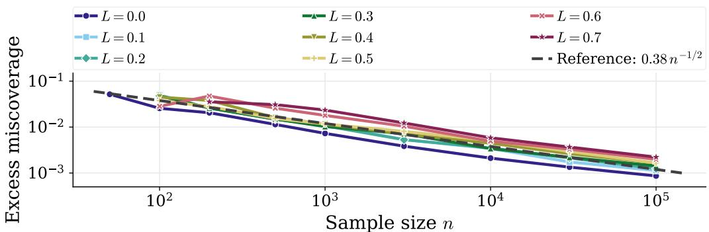

(a) Excess miscoverage versus sample size n  
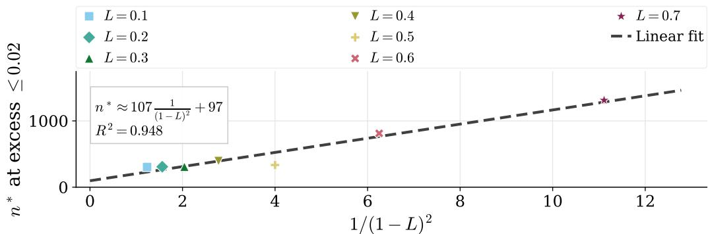

(b) Threshold sample size $n ^ { \star } ( L )$  
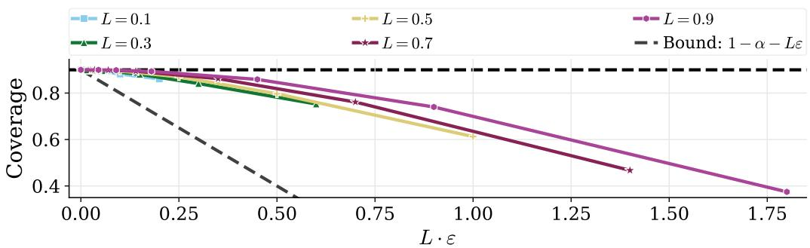  
(c) Coverage versus $L \varepsilon$  
Figure 1: Synthetic validation of the theory. (a) Excess miscoverage versus sample size n (log–log) for $L \in \{ 0 , \ldots , 0 . 7 \}$ ; the dashed line shows the $n ^ { - 1 / 2 }$ reference slope. (b) Threshold sample size $n ^ { \star } ( L )$ , defined as the smallest n for which excess miscoverage is at most 0.02, plotted against $1 / ( 1 - L ) ^ { 2 } \colon$ the dashed line is a linear fit. (c) Coverage versus $L \varepsilon$ for five values of L. The dashed line is the first-order lower bound $1 - \alpha - L \varepsilon$

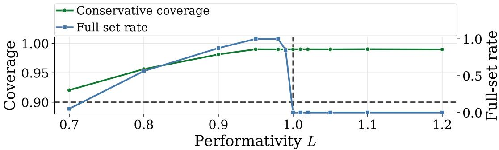  
(a) Bounded Bernoulli sweep  
Figure 2: Phase transition at $L = 1$ . Bounded Bernoulli sweep based on $g _ { L , \pm } ( \theta ) = \mathrm { c l i p } ( c +$ $L ( \theta - c ) \pm \varepsilon , [ \varepsilon , 1 - \varepsilon ] )$ with $c = 0 . 0 5$ and $\varepsilon = 0 . 0 1$ . The green curve is conservative equilibrium coverage (minimum over the + and − branches); the blue curve is the unrestricted full-set rate (maximum over the two branches). The supercritical regime is therefore well-defined for all plotted L, with explicit equilibria throughout. The dashed vertical line marks the threshold $L = 1$

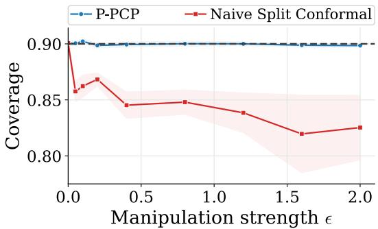  
(a) Equilibrium coverage versus ϵ

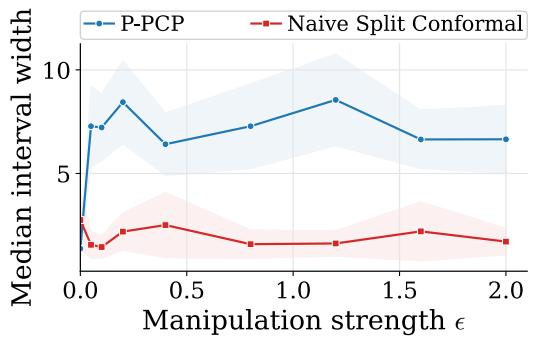  
(b) Prediction interval width versus ϵ  
Figure 3: Semi-synthetic strategic regression experiment. (a) Equilibrium coverage versus manipulation strength ϵ. The naive split conformal baseline undercovers as performativity increases, whereas P-PCP remains closer to the nominal 90% target. (b) Median prediction interval width versus ϵ for the two procedures.

The closest papers on the conformal side are Fannjiang et al. (2022) and Binny and Dixit (2025). Fannjiang et al. study a biomolecular design setting in which deploying a model changes which candidate molecules are proposed in the next round. However, their analysis handles only covariate shift: the marginal distribution over inputs changes, but the conditional distribution of outcomes given inputs does not. In a performative system, predictions afect behavior, which changes outcomes, so the full joint distribution shifts. Moreover, their analysis does not address the equilibrium that emerges after repeated retraining. Binny and Dixit apply a similar iterative conformal idea to multi-agent motion planning, where deploying an uncertainty-aware controller changes how surrounding agents behave. Their focus is on safe trajectory prediction rather than performative equilibrium in the statistical learning sense, and they do not analyze sample complexity. Our work is the first to study conformal validity at the equilibrium distribution $D ( f ^ { \star } )$ reached by repeated retraining.

Uncertainty quantification under performativity. Three recent papers study uncertainty quantification in performative settings, and we difer from each in a distinct way.

Li et al. (2025) introduce Performative Risk Control (PRC), which calibrates a scalar threshold so that a chosen risk measure stays controlled throughout the retraining process. Their guarantee is that $\mathbb { E } [ \ell ( z ; \lambda ) ] \le \alpha$ at each step, which is not the same as constructing a prediction set that covers the true outcome with probability $1 - \alpha \colon$ scalar risk control does not in general imply set-valued coverage. They also use a diferent sensitivity notion, measuring how much the expected loss changes when the threshold changes, rather than how much the data distribution itself changes. As a result, their analysis does not extend to coverage guarantees for prediction sets, does not yield a transfer theorem connecting proximity to equilibrium with coverage validity, and provides no impossibility results or minimax lower bounds.

Csillag et al. (2025) construct prediction sets that are valid against the worst-case strate-$\mathrm { g i c }$ response of the population. Because they do not assume anything about which equilibrium will emerge, their sets must be wide enough to cover all possible outcomes under any plausible response, and may be unnecessarily wide when the actual equilibrium is less extreme than the worst case. We instead target the specific equilibrium $D ( f ^ { \star } )$ reached by repeated retraining, which gives tighter sets when $L < 1$ . The two approaches suit diferent situations: theirs when the response is unknown and robustness is the priority; ours when the system stabilizes and one can calibrate at the stable distribution. Theorem 3.1 delineates where each applies: when $L < 1$ , targeting the equilibrium is possible and the sample complexity cost is $\widetilde { \Theta } ( 1 / ( 1 - L ) ^ { 2 } )$ times the non-performative baseline; when $L \geq 1$ no procedure can simultaneously achieve coverage and nontrivial set sizes.

Perdomo (2025) shows that performative multicalibration — simultaneously matching predicted probabilities to observed outcome frequencies across a large collection of subgroups — is always achievable under performative feedback, without any Lipschitz condition on $D ( \cdot )$ . This is a non-trivial algorithmic result, since multicalibration is demanding even in the static setting. Since multicalibration is a form of validity guarantee, one might read this as evidence that useful uncertainty quantification is always achievable under performativity, even when $L \geq 1$ , which would contradict our impossibility result. It does not, because the two results target diferent objects. Multicalibration is a property of predicted probabilities: it asks that the model’s outputs average correctly within subgroups. Coverage is a property of prediction sets: it asks that the set $C ( x )$ excludes some labels while still containing the true outcome with probability $1 - \alpha$ . A predictor can be perfectly multicalibrated and yet produce no useful prediction sets, because calibration of probabilities does not constrain which labels a set includes or excludes. When $L \geq 1$ , it is this exclusion requirement that becomes impossible to satisfy at equilibrium.

No prior work establishes the feasibility threshold for equilibrium-valid coverage, derives the minimax sample complexity below that threshold, proves a transfer theorem that converts proximity to equilibrium directly into a coverage guarantee, or provides algorithms that match the optimal rate. These are the four contributions of the present paper.

## 7 Discussion and Conclusion

Our results establish a sharp phase transition at $L = 1$ for conformal prediction under performative feedback: nontrivial equilibrium-valid coverage is impossible when $L \geq 1$ , and achievable with sample complexity inflated by a factor of $\widetilde { \Theta } ( 1 / ( 1 - L ) ^ { 2 } )$ when $L < 1$ . We now discuss practical implications, limitations, and extensions.

Practical implications. Our results suggest a workflow for uncertainty quantification under performativity. Before deployment in an environment where predictions afect outcomes, estimate the sensitivity L, for example from pilot deployments. If $L \ge 1$ , then equilibrium-valid prediction sets are not uniformly achievable: the main obstacle is an unstable feedback loop, not a lack of data. In that regime, the relevant intervention is to reduce L by limiting how strongly the predictor changes decisions. If $L \ < \ 1$ , then the non-performative sample requirement should be inflated by a factor of at least $1 / ( 1 - L ) ^ { 2 }$ (and up to $1 / ( 1 - L ) ^ { 3 }$ without smoothness and strong convexity) to budget for valid equilibrium coverage. The transfer theorem further shows that any improvement in estimating or reaching equilibrium translates directly into better equilibrium-valid coverage guarantees.

Limitations. Our analysis has several limitations. First, the coverage guarantees hold on average at equilibrium across the whole population, rather than separately for each feature value or subgroup. Second, the sharp parametric upper bound requires smoothness and strong convexity, while the more general model-free result pays an additional $( 1 - L ) ^ { - 1 / 2 }$ factor. Third, the experiments are primarily synthetic or semi-synthetic studies meant to test the predicted scaling laws and illustrate equilibrium-aware calibration, rather than full application-specific evaluations. Finally, the theory represents performative feedback through an L-sensitive distribution map, which summarizes the strength of the feedback in a single parameter. Extending the results to more local notions of sensitivity is a natural next step.

Extensions. Our minimax characterization also points to natural next directions. The model-free algorithm (Theorem 4.1) shows that $L < 1$ is both necessary and suficient for finite or compact predictor classes, while the parametric algorithm achieves the sharper rate for continuous classes under the standard regularity condition $\rho = L \beta / \gamma < 1$ . A central open question is whether the information-theoretic rate is achievable in polynomial time under only $L < 1$ , without strong convexity. The transfer theorem (Theorem 2.8) is useful precisely because it decouples this optimization question from calibration: any future method with a convergence guarantee to equilibrium immediately inherits a coverage guarantee through the theorem.

Reproducibility. The synthetic and semi-synthetic experiments rely only on the models and parameter grids described in Section 5 and Appendix S2. The semi-synthetic study uses the publicly available “Give Me Some Credit” dataset (Kaggle, 2011). Code and simulation scripts to reproduce all figures will be made publicly available upon acceptance.

## References

Anastasios N. Angelopoulos and Stephen Bates. Conformal prediction: A gentle introduction. Foundations and Trends in Machine Learning, 16(4):494–591, 2023.

Rina Foygel Barber, Emmanuel J. Cand\`es, Aaditya Ramdas, and Ryan J. Tibshirani. Conformal prediction beyond exchangeability. The Annals of Statistics, 51(2):816–845, 2023.

Allen Emmanuel Binny and Anushri Dixit. Who moved my distribution? Conformal prediction for interactive multi-agent systems, 2025. URL https://arxiv.org/abs/2511. 11567. arXiv preprint arXiv:2511.11567.

Gavin Brown, Shlomi Hod, and Iden Kalemaj. Performative prediction in a stateful world. In Proceedings of the 25th International Conference on Artificial Intelligence and Statistics, volume 151 of Proceedings of Machine Learning Research, pages 6045–6061. PMLR, 2022.

Daniel Csillag, Claudio Jos´e Struchiner, and Guilherme Tegoni Goedert. Strategic conformal prediction. In Proceedings of the 28th International Conference on Artificial Intelligence and Statistics, volume 258 of Proceedings ofMachine Learning Research, pages 5122–5130. PMLR, 2025.

Jinshuo Dong, Aaron Roth, Zachary Schutzman, Bo Waggoner, and Zhiwei Steven Wu. Strategic classification from revealed preferences. In Proceedings of the 2018 ACM Conference on Economics and Computation, pages 55–70, 2018.

Clara Fannjiang, Stephen Bates, Anastasios N. Angelopoulos, Jennifer Listgarten, and Michael I. Jordan. Conformal prediction under feedback covariate shift for biomolecular design. Proceedings of the National Academy of Sciences, 119(43):e2204569119, 2022.

Isaac Gibbs and Emmanuel J. Cand\`es. Adaptive conformal inference under distribution shift. In Advances in Neural Information Processing Systems, volume 34, pages 1660– 1672, 2021.

Isaac Gibbs and Emmanuel J. Cand\`es. Conformal inference for online prediction with arbitrary distribution shifts. Journal of Machine Learning Research, 25(162):1–36, 2024.

Moritz Hardt, Nimrod Megiddo, Christos Papadimitriou, and Mary Wootters. Strategic classification. In Proceedings of the 7th Conference on Innovations in Theoretical Computer Science, pages 111–122, 2016.

Moritz Hardt, Meena Jagadeesan, and Celestine Mendler-D¨unner. Performative power. In Advances in Neural Information Processing Systems, volume 35, pages 22969–22981, 2022.

Lily Hu, Nicole Immorlica, and Jennifer Wortman Vaughan. The disparate efects of strategic manipulation. In Proceedings of the Conference on Fairness, Accountability, and Transparency, pages 259–268, 2019.

Zachary Izzo, Lexing Ying, and James Zou. How to learn when data reacts to your model: Performative gradient descent. In Proceedings of the 38th International Conference on Machine Learning, volume 139 of Proceedings of Machine Learning Research, pages 4641– 4650. PMLR, 2021.

Meena Jagadeesan, Tijana Zrnic, and Celestine Mendler-D¨unner. Regret minimization with performative feedback. In Proceedings of the 39th International Conference on Machine Learning, volume 162 of Proceedings of Machine Learning Research, pages 9760–9785. PMLR, 2022.

Kaggle. Give me some credit. Kaggle competition dataset, 2011. URL https://www. kaggle.com/competitions/GiveMeSomeCredit. Competition page. Accessed 2026-05- 06.

Lucien Le Cam. Asymptotic Methods in Statistical Decision Theory. Springer, New York, NY, 1986.

Tosca Lechner, Ruth Urner, and Shai Ben-David. Strategic classification with unknown user manipulations. In Proceedings of the 40th International Conference on Machine Learning, volume 202 of Proceedings of Machine Learning Research, pages 18714–18732. PMLR, 2023.

Jing Lei and Larry Wasserman. Distribution-free prediction bands for non-parametric regression. Journal of the Royal Statistical Society: Series B (Statistical Methodology), 76 (1):71–96, 2014.

Jing Lei, Max G’Sell, Alessandro Rinaldo, Ryan J. Tibshirani, and Larry Wasserman. Distribution-free predictive inference for regression. Journal of the American Statistical Association, 113(523):1094–1111, 2018.

Sagi Levanon and Nir Rosenfeld. Strategic classification made practical. In Proceedings of the 38th International Conference on Machine Learning, volume 139 of Proceedings of Machine Learning Research, pages 6243–6253. PMLR, 2021.

Victor Li, Baiting Chen, Yuzhen Mao, Qi Lei, and Zhun Deng. Performative risk control: Calibrating models for reliable deployment under performativity. In Advances in Neural Information Processing Systems, volume 38, pages 145912–145943. Curran Associates, Inc., 2025.

Celestine Mendler-D¨unner, Juan C. Perdomo, Tijana Zrnic, and Moritz Hardt. Stochastic optimization for performative prediction. In Advances in Neural Information Processing Systems, volume 33, pages 4929–4939, 2020.

John Miller, Smitha Milli, and Moritz Hardt. Strategic classification is causal modeling in disguise. In Proceedings of the 37th International Conference on Machine Learning, volume 119 of Proceedings of Machine Learning Research, pages 6917–6926. PMLR, 2020.

John P. Miller, Juan C. Perdomo, and Tijana Zrnic. Outside the echo chamber: Optimizing the performative risk. In Proceedings of the 38th International Conference on Machine Learning, volume 139 of Proceedings of Machine Learning Research, pages 7710–7720. PMLR, 2021.

Smitha Milli, John Miller, Anca D. Dragan, and Moritz Hardt. The social cost of strategic classification. In Proceedings of the Conference on Fairness, Accountability, and Transparency, pages 230–239, 2019.

Roberto I. Oliveira, Paulo Orenstein, Thiago Ramos, and Joao Vitor Romano. Split conformal prediction and non-exchangeable data. Journal of Machine Learning Research, 25 (225):1–38, 2024.

Juan C. Perdomo, Tijana Zrnic, Celestine Mendler-D¨unner, and Moritz Hardt. Performative prediction. In Proceedings of the 37th International Conference on Machine Learning, volume 119 of Proceedings of Machine Learning Research, pages 7599–7609. PMLR, 2020.

Juan Carlos Perdomo. Revisiting the predictability of performative, social events. In Proceedings of the 42nd International Conference on Machine Learning, volume 267 of Proceedings of Machine Learning Research, pages 48948–48961. PMLR, 2025.

Boris T. Polyak and Anatoli B. Juditsky. Acceleration of stochastic approximation by averaging. SIAM Journal on Control and Optimization, 30(4):838–855, 1992.

David Ruppert. Eficient estimations from a slowly convergent Robbins–Monro process. Technical Report 781, Cornell University, School of Operations Research and Industrial Engineering, Ithaca, NY, 1988.

Glenn Shafer and Vladimir Vovk. A tutorial on conformal prediction. Journal of Machine Learning Research, 9:371–421, 2008.

Shai Shalev-Shwartz and Shai Ben-David. Understanding Machine Learning: From Theory to Algorithms. Cambridge University Press, Cambridge, UK, 2014.

Ryan J. Tibshirani, Rina Foygel Barber, Emmanuel J. Cand\`es, and Aaditya Ramdas. Conformal prediction under covariate shift. In Advances in Neural Information Processing Systems, volume 32, pages 2526–2536, 2019.

Berk Ustun, Alexander Spangher, and Yang Liu. Actionable recourse in linear classification. In Proceedings of the Conference on Fairness, Accountability, and Transparency, pages 10–19, 2019.

Vladimir Vovk. Conditional validity of inductive conformal predictors. Machine Learning, 92(2–3):349–376, 2013.

Vladimir Vovk, Alex Gammerman, and Glenn Shafer. Algorithmic Learning in a Random World. Springer, New York, NY, 2005.

## Appendix A. Proof of Theorem 3.1

It sufices to prove the theorem for $L = 1$ , because if

$$
\mathrm { T V } ( D ( f ) , D ( g ) ) \leq d _ { \mathcal { F } } ( f , g ) \quad \mathrm { f o r ~ a l l ~ } f , g \in \mathcal { F } ,
$$

then automatically

$$
\mathrm { T V } ( D ( f ) , D ( g ) ) \leq L d _ { \mathcal { F } } ( f , g ) \quad \mathrm { f o r ~ a l l ~ } f , g \in \mathcal { F }
$$

for every $L \geq 1$ . Thus any hard 1-sensitive instance is also a hard instance for every $L \geq 1$

## A.1 A Binary Hard Instance for Theorem 3.1

Proof. Take $\mathcal { X } = \{ x _ { 0 } \} , \mathcal { V } = \{ 0 , 1 \} , \Theta = [ 0 , 1 ]$ , and squared loss $\ell ( \theta , y ) = ( \theta - y ) ^ { 2 }$ . Fix $\epsilon > 0$ 2 to be chosen as a function of n. Define two distribution maps:

$$
\begin{array} { r l } & { D _ { + } ( \theta ) : Y \sim \mathrm { B e r n } \big ( g _ { + } ( \theta ) \big ) , \qquad g _ { + } ( \theta ) = \operatorname* { m i n } ( \theta + \epsilon , ~ 1 - \epsilon ) , } \\ & { D _ { - } ( \theta ) : Y \sim \mathrm { B e r n } \big ( g _ { - } ( \theta ) \big ) , \qquad g _ { - } ( \theta ) = \operatorname* { m a x } ( \theta - \epsilon , ~ \epsilon ) . } \end{array}
$$

Step 1: Both maps are 1-sensitive. We first show that $g _ { + }$ and $g _ { - }$ are 1-Lipschitz. Write

$$
g _ { + } ( \theta ) = c ( \theta + \epsilon ) , \qquad c ( u ) = \mathrm { m i n } ( u , 1 - \epsilon ) .
$$

The map $\theta \mapsto \theta + \epsilon$ is 1-Lipschitz, since

$$
| ( \theta + \epsilon ) - ( \theta ^ { \prime } + \epsilon ) | = | \theta - \theta ^ { \prime } | .
$$

The clipping map c is also 1-Lipschitz, because truncation at a constant cannot increase distances:

$$
| c ( u ) - c ( v ) | \leq | u - v | \qquad { \mathrm { f o r ~ a l l ~ } } u , v \in \mathbb { R } .
$$

Hence $g _ { + } ,$ as a composition of two 1-Lipschitz maps, is 1-Lipschitz. The same argument applies to

$$
g _ { - } ( \theta ) = \operatorname* { m a x } ( \theta - \epsilon , \epsilon ) ,
$$

so $g _ { - }$ is also 1-Lipschitz.

For Bernoulli distributions, total variation distance is the absolute diference of the success probabilities. Therefore

$$
\mathrm { T V } ( D _ { \pm } ( \theta ) , D _ { \pm } ( \theta ^ { \prime } ) ) = | g _ { \pm } ( \theta ) - g _ { \pm } ( \theta ^ { \prime } ) | \leq | \theta - \theta ^ { \prime } | .
$$

Hence both distribution maps are 1-sensitive.

The clipping ensures that the Bernoulli parameter remains in $[ \epsilon , 1 - \epsilon ]$ , which is needed both for the distribution to be well-defined and for the KL divergence bound in Step 3. Without clipping, the parameter could exceed 1 or fall below 0; any other truncation that preserves the 1-Lipschitz property (for example, clipping to $[ 0 , 1 ] )$ would work equally well.

Step 2: Both maps admit performatively stable predictors. Under squared loss, the risk minimizer under a Bernoulli distribution with mean $p$ is $\theta = p .$ . Therefore a performatively stable predictor solves

$$
\theta ^ { \star } = \mathbb { E } [ Y \mid Y \sim D ( \theta ^ { \star } ) ] = g ( \theta ^ { \star } ) .
$$

For $D _ { + }$ , the fixed-point equation is

$$
\theta = \operatorname* { m i n } ( \theta + \epsilon , 1 - \epsilon ) .
$$

Because $\epsilon > 0$ , the branch $\theta = \theta + \epsilon$ is impossible. Therefore, the fixed point must lie in the clipped region, so

$$
{ \theta } _ { + } ^ { \star } = 1 - \epsilon .
$$

$$
\mathrm { A t ~ } \theta = 1 - \epsilon ,
$$

$$
g _ { + } ( 1 - \epsilon ) = \operatorname* { m i n } ( 1 , 1 - \epsilon ) = 1 - \epsilon ,
$$

so $1 - \epsilon$ is a fixed point.

For $D _ { - }$ <sub>−</sub>, the fixed-point equation is

$$
\theta = \operatorname* { m a x } ( \theta - \epsilon , \epsilon ) ,
$$

and similarly the only solution is

$$
\theta _ { - } ^ { \star } = \epsilon ,
$$

since

$$
g _ { - } ( \epsilon ) = \operatorname* { m a x } ( 0 , \epsilon ) = \epsilon .
$$

Thus the equilibrium distributions are

$$
D _ { + } ( \theta _ { + } ^ { \star } ) = \mathrm { B e r n } ( 1 - \epsilon ) , \qquad D _ { - } ( \theta _ { - } ^ { \star } ) = \mathrm { B e r n } ( \epsilon ) .
$$

Step 3: The two environments are hard to distinguish. For every deployment $\theta \in [ 0 , 1 ]$ , the two Bernoulli parameters difer by at most 2ϵ. On the interior interval $[ 2 \epsilon , 1 - 2 \epsilon ]$ we have

$$
g _ { + } ( \theta ) = \theta + \epsilon , \qquad g _ { - } ( \theta ) = \theta - \epsilon ,
$$

and therefore

$$
| g _ { + } ( \theta ) - g _ { - } ( \theta ) | = 2 \epsilon .
$$

If $\theta \notin [ 2 \epsilon , 1 - 2 \epsilon ]$ , then either $\theta - \epsilon < \epsilon$ or $\theta + \epsilon > 1 - \epsilon ,$ , so one of the two expressions is truncated by the clipping operator. Such truncation cannot increase the distance between them. Hence, for all $\theta \in [ 0 , 1 ]$

$$
| g _ { + } ( \theta ) - g _ { - } ( \theta ) | \leq 2 \epsilon .
$$

Moreover, both parameters lie in $[ \epsilon , 1 - \epsilon ]$ . Hence

$$
\mathop { \mathrm { K L } } \bigl ( D _ { + } ( \theta ) \| D _ { - } ( \theta ) \bigr ) \leq \frac { \bigl ( g _ { + } ( \theta ) - g _ { - } ( \theta ) \bigr ) ^ { 2 } } { g _ { - } ( \theta ) ( 1 - g _ { - } ( \theta ) ) } \leq \frac { ( 2 \epsilon ) ^ { 2 } } { \epsilon ( 1 - \epsilon ) } = \frac { 4 \epsilon } { 1 - \epsilon } .
$$

Now consider any adaptive algorithm that deploys predictors $\theta _ { 1 } , \ldots , \theta _ { T }$ and collects $n _ { t }$ samples at round $t ,$ with $\textstyle \sum _ { t = 1 } ^ { T } n _ { t } = n$ . By the chain rule for KL divergence,

$$
\mathrm { K L } ( \mathbb { P } _ { + } ^ { ( n ) } \parallel \mathbb { P } _ { - } ^ { ( n ) } ) = \sum _ { t = 1 } ^ { T } n _ { t } \mathbb { E } _ { + } \left[ \mathrm { K L } \big ( D _ { + } ( \theta _ { t } ) \parallel D _ { - } ( \theta _ { t } ) \big ) \right] \leq \frac { 4 n \epsilon } { 1 - \epsilon } .
$$

Choosing

$$
\epsilon = \frac { c _ { 0 } } { n }
$$

for some constant $c _ { 0 } > 0$ makes the total KL bounded by a constant. Therefore $\mathrm { L e }$ Cam’s lemma implies that no algorithm can reliably distinguish whether the data came from $D _ { + }$ or D<sub>−</sub>.

Step 4: The nontrivial valid sets are incompatible. Because X is a singleton and $\mathcal { V } = \{ 0 , 1 \}$ , any prediction set is equivalent to one of

$$
\emptyset , \qquad \{ 0 \} , \qquad \{ 1 \} , \qquad \mathcal { V } .
$$

The empty set is never valid, and $\mathcal { V }$ is trivial. So the only nontrivial candidates are {0} and {1}.

Their equilibrium coverages are:

<table><tr><td> $D _ { + } ( \theta _ { + } ^ { \star } ) = \mathrm { B e r n } ( 1 - \epsilon ) \quad D _ { - } ( \theta _ { - } ^ { \star } ) = \mathrm { B e r n } ( \epsilon )$ </td></tr><tr><td> $C = \{ 1 \}$ </td></tr><tr><td>1 - € E</td></tr><tr><td> $C = \{ 0 \}$  1 - € E</td></tr></table>

If

$$
\epsilon < \operatorname* { m i n } ( \alpha , 1 - \alpha ) ,
$$

then under $D _ { + }$ the only nontrivial set with coverage at least $1 - \alpha$ is {1}, while under D<sub>−</sub> the only nontrivial set with coverage at least $1 - \alpha$ is {0}.

Therefore any algorithm that uniformly guaranteed both equilibrium-valid coverage and nontriviality would, from its output, implicitly identify which environment is active: output {1} under $D _ { + }$ and output {0} under $D _ { - }$ . But Step 3 shows that no algorithm can reliably distinguish the two environments. This is a contradiction.

Hence, for $L = 1$ , no algorithm can uniformly guarantee both equilibrium-valid coverage and nontriviality.

Every 1-sensitive map is also L-sensitive for every $L \geq 1$ . Hence the same impossibility result holds for all $L \geq 1$ □

## A.2 Extension to general spaces

Lemma A.1 (Reduction to the binary instance). Assume $\chi \neq \emptyset$ and $| y | \geq 2$ . Pick any $x _ { 0 } \in \mathcal { X }$ and any distinct labels $y _ { 0 } , y _ { 1 } \in \mathcal { D }$ . Consider the binary hard instance from the proof above, and view it as a distribution on $( \mathcal { X } , \mathcal { Y } )$ by placing all feature mass on x<sub>0</sub> and all label mass on $\{ y _ { 0 } , y _ { 1 } \}$ , with binary label 0 identified with y<sub>0</sub> and binary label 1 identified with $y _ { 1 }$ Then the binary construction embeds unchanged into the general spaces, so the impossibility result for the binary case applies to the general case as well.

Proof. The larger spaces X and Y do not matter, because the embedded construction uses only the single feature point $x _ { 0 }$ and the two labels $y _ { 0 } , y _ { 1 }$ . All other feature values and labels have probability zero.

Therefore the embedded instance is the same as the binary one, just with relabeled outcomes. The total variation distances are the same, the fixed-point equations are the same, and the coverage of any prediction set depends only on whether it contains $y _ { 0 }$ and/or $y _ { 1 }$ at $x _ { 0 }$ . Thus the same contradiction proved in the binary case applies unchanged.

## Appendix B. Full Lower Bound Proof (Theorem 3.2, Lower Bound)

We prove the lower bound by constructing two performative environments that are statistically hard to distinguish but for which a single informative prediction set is valid at one equilibrium and strictly invalid at the other.

## B.1 Construction

Take $\mathcal { X } = \{ x _ { 0 } \}$ and $\mathcal { V } = \{ 0 , 1 \}$ . Let the predictor be a scalar $\theta \in [ 0 , 1 ]$ , and use squared loss $\ell ( \theta , y ) = ( \theta - y ) ^ { 2 }$ . Fix $L < 1$ , and define two L-sensitive maps:

$$
\begin{array} { r l } { D _ { 0 } ( \theta ) : } & { { } Y \sim \mathrm { B e r n } \big ( a + L \theta \big ) , } \\ { D _ { 1 } ( \theta ) : } & { { } Y \sim \mathrm { B e r n } \big ( a + \delta + L \theta \big ) , } \end{array}
$$

where $a \in ( 0 , 1 )$ is chosen away from the boundary so that the Bernoulli parameters stay bounded away from 0 and 1, and $\delta > 0$ is a small perturbation. Assume $a + \delta + L < 1$ so that both Bernoulli parameters remain in (0, 1).

This construction changes the performative map only by a constant shift $\delta ,$ , while keeping the slope equal to L.

For Bernoulli outcomes under squared loss, the population risk minimizer is the Bernoulli mean. Therefore the equilibrium points satisfy

$$
\theta _ { 0 } ^ { \star } = a + L \theta _ { 0 } ^ { \star } , \qquad \theta _ { 1 } ^ { \star } = a + \delta + L \theta _ { 1 } ^ { \star } ,
$$

hence

$$
\theta _ { 0 } ^ { \star } = \frac { a } { 1 - L } , \qquad \theta _ { 1 } ^ { \star } = \frac { a + \delta } { 1 - L } .
$$

Since under squared loss the population minimizer equals the Bernoulli mean, the equilibrium Bernoulli parameters are

$$
p _ { 0 } ^ { \star } = \frac { a } { 1 - L } , \qquad p _ { 1 } ^ { \star } = \frac { a + \delta } { 1 - L } ,
$$

so the equilibrium gap is

$$
| p _ { 1 } ^ { \star } - p _ { 0 } ^ { \star } | = \frac { \delta } { 1 - L } .
$$

This is the amplification efect used in the lower bound: a local perturbation of size $\delta$ in the performative map produces an equilibrium shift larger by a factor $1 / ( 1 - L )$ .

## B.2 Sequential KL divergence

An algorithm may deploy predictors adaptively. At round t, it chooses $\theta _ { t }$ based on the past and then receives $n _ { t }$ independent samples from either $D _ { 0 } ( \theta _ { t } )$ or $D _ { 1 } ( \theta _ { t } )$ , with $\textstyle \sum _ { t } n _ { t } = n$

For every deployment $\theta ,$

$$
\begin{array} { r } { p _ { 1 } ( \theta ) - p _ { 0 } ( \theta ) = \delta , } \end{array}
$$

since $p _ { 1 } ( \theta ) = a + \delta + L \theta$ and $p _ { 0 } ( \theta ) = a + L \theta$ . Thus, the separation between the two Bernoulli models is the same at every deployment point.

Because a is chosen away from the boundary and $a + \delta + L < 1$ , both $p _ { 0 } ( \theta )$ and $p _ { 1 } ( \theta )$ lie in a fixed interval $[ \eta , 1 - \eta ] \subset ( 0 , 1 )$ , uniformly over θ.

For Bernoulli distributions,

$$
\mathrm { K L } ( \mathrm { B e r n } ( p ) \| \mathrm { B e r n } ( q ) ) \leq { \frac { ( p - q ) ^ { 2 } } { q ( 1 - q ) } } .
$$

Since $p _ { 0 } ( \theta ) , p _ { 1 } ( \theta ) \in [ \eta , 1 - \eta ]$ uniformly over $\theta ,$ we obtain

$$
\mathrm { K L } \big ( \mathrm { B e r n } ( p _ { 0 } ( \theta ) ) \| \mathrm { B e r n } ( p _ { 1 } ( \theta ) ) \big ) \leq \frac { \delta ^ { 2 } } { \eta ( 1 - \eta ) } = : C _ { a } \delta ^ { 2 } .
$$

Now condition on the history up to round $t - 1$ . The deployment $\theta _ { t }$ is then fixed, and the $n _ { t }$ samples collected at round t are independent draws from either Bern $( p _ { 0 } ( \theta _ { t } ) )$ or Bern $( p _ { 1 } ( \theta _ { t } ) )$ . Therefore the $\mathrm { K L }$ contribution of round $t ,$ conditional on the past, is

$$
n _ { t } \operatorname { K L } \bigl ( \operatorname { B e r n } ( p _ { 0 } ( \theta _ { t } ) ) \| \operatorname { B e r n } ( p _ { 1 } ( \theta _ { t } ) ) \bigr ) .
$$

Applying the chain rule for KL divergence and then taking expectation over the history gives

$$
\operatorname { K L } ( \mathbb { P } _ { 0 } ^ { ( n ) } \Vert \mathbb { P } _ { 1 } ^ { ( n ) } ) = \sum _ { t = 1 } ^ { T } n _ { t } \mathbb { E } _ { 0 } \left[ \operatorname { K I } \bigl ( \operatorname { B e r n } ( p _ { 0 } ( \theta _ { t } ) ) \parallel \operatorname { B e r n } ( p _ { 1 } ( \theta _ { t } ) ) \bigr ) \right] \leq C _ { a } \sum _ { t = 1 } ^ { T } n _ { t } \delta ^ { 2 } = C _ { a } n \delta ^ { 2 } .
$$

Therefore adaptivity does not help: no matter how the algorithm chooses its deployments, the total information available for distinguishing the two environments is at most of order $n \delta ^ { 2 }$

## B.3 From equilibrium separation to excess miscoverage

We now explain why this equilibrium gap forces a lower bound on excess miscoverage.

Because $\mathcal { X }$ is a singleton and $\mathcal { V } = \{ 0 , 1 \}$ , every prediction set is equivalent to one of ∅, {0}, {1}, {0, 1}.

The empty set is always invalid and $\{ 0 , 1 \}$ is trivial, so the only nontrivial candidates are $\{ 0 \}$ and $\{ 1 \}$ . Since X is a singleton, Inf $\in \{ 0 , 1 \}$ , so membership in $\boldsymbol { A } _ { \ u { \tau } }$ (for any $\tau \in ( 0 , 1 ] )$ is exactly the exclusion of the trivial set $\{ 0 , 1 \}$ . Combined with validity—the empty set is never valid—the output must be {0} or {1}. This is what rules out the vacuous full-set procedure that would otherwise attain zero excess miscoverage.

Under environment $i \in \{ 0 , 1 \}$ , the equilibrium label distribution is $\mathrm { B e r n } ( p _ { i } ^ { \star } )$ . Therefore:

$$
\mathbb { P } _ { i } \big ( Y \notin \{ 1 \} \big ) = 1 - p _ { i } ^ { \star } , \qquad \mathbb { P } _ { i } \big ( Y \notin \{ 0 \} \big ) = p _ { i } ^ { \star } .
$$

So the excess miscoverage of the two nontrivial sets is determined directly by the equilibrium Bernoulli parameter $p _ { i } ^ { \star }$

To make the informative set {1} straddle its validity boundary, choose the target miscoverage level $\alpha$ and the base parameter a so that the two equilibrium means lie on opposite sides of the threshold $1 - \alpha$ . Concretely, take

$$
p _ { 0 } ^ { \star } = 1 - \alpha - \frac { \Delta } { 2 } , \qquad p _ { 1 } ^ { \star } = 1 - \alpha + \frac { \Delta } { 2 } ,
$$

where

$$
\Delta = \frac { \delta } { 1 - L } .
$$

This can be achieved by choosing

$$
a = ( 1 - L ) \biggl ( 1 - \alpha - \frac { \Delta } { 2 } \biggr ) .
$$

Under $D _ { 0 }$ , the set {1} has miscoverage

$$
1 - p _ { 0 } ^ { \star } = \alpha + \frac { \Delta } { 2 } ,
$$

so its excess miscoverage is $\Delta / 2$ . Under $D _ { 1 }$ , the set {1} has miscoverage

$$
1 - p _ { 1 } ^ { \star } = \alpha - \frac { \Delta } { 2 } ,
$$

so its excess miscoverage is 0. Because the two equilibrium means $p _ { 0 } ^ { \star } , p _ { 1 } ^ { \star }$ straddle the threshold $1 - \alpha$ , the informative set {1} is the one whose validity flips across the two environments: it is valid under $D _ { 1 }$ (excess 0) and strictly invalid under $D _ { 0 }$ (excess $\Delta / 2 )$ . The other informative set {0} does not help, since its miscoverage is $p _ { i } ^ { \star }$ , which equals $1 - \alpha \mp \Delta / 2$ and hence incurs excess of order $1 - 2 \alpha$ under both environments. Indeed, under $D _ { 0 }$ no informative set is valid: the best informative choice, {1}, still misses the target by $\Delta / 2$

Therefore the same informative set {1} is valid at one equilibrium and strictly invalid at the other. Any τ -informative algorithm that cannot distinguish the two environments must commit to essentially the same output in both; outputting {1} (the only viable informative set) then incurs excess miscoverage at least of order $\Delta$ under $D _ { 0 }$ , while the trivial full set is excluded from $\mathbf { \mathcal { A } } _ { \tau }$

## B.4 Completing the lower bound

The two equilibria straddle the validity boundary of the informative set {1}: under $D _ { 0 }$ every informative set incurs excess miscoverage at least $\Delta / 2$ (the minimum, attained by {1}), whereas under $D _ { 1 }$ the set {1} is valid with zero excess. Therefore any τ -informative procedure that fails to distinguish the two environments incurs excess miscoverage at least $\Delta / 2$ in one of them.

Le Cam’s two-point lemma now applies. Since the KL divergence between the two induced data-generating processes is at most $C _ { a } n \delta ^ { 2 }$ , we have

$$
\operatorname* { i n f } _ { \phi } \bigl ( \mathbb { P } _ { 0 } ( \phi = 1 ) + \mathbb { P } _ { 1 } ( \phi = 0 ) \bigr ) \ \geq \ 1 - \sqrt { \frac { 1 } { 2 } C _ { a } n \delta ^ { 2 } } .
$$

Hence, at least one of the two testing errors is at least

$$
\frac { 1 } { 2 } \left( 1 - \sqrt { { \textstyle \frac { 1 } { 2 } } C _ { a } n \delta ^ { 2 } } \right) .
$$

Combining this with the loss separation $\Delta / 2$ , we obtain

$$
\operatorname* { m a x } _ { i \in \{ 0 , 1 \} } \overline { { \mathrm { E x M i s c } } } ( C _ { \hat { f } } , D _ { i } ( f ^ { \star } ) ) \ \geq \ \frac { \Delta } { 4 } \left( 1 - \sqrt { \frac 1 2 C _ { a } n \delta ^ { 2 } } \right) .
$$

Set

$$
\delta = { \frac { c ^ { \prime } } { \sqrt { n } } }
$$

with $c ^ { \prime } > 0$ small enough that the square-root term is bounded away from 1. Then

$$
\Delta = \frac { \delta } { 1 - L } = \frac { c ^ { \prime } } { ( 1 - L ) \sqrt { n } } ,
$$

and therefore

$$
\operatorname* { m a x } _ { i \in \{ 0 , 1 \} } \overline { { \mathrm { E x M i s c } } } ( C _ { \hat { f } } , D _ { i } ( f ^ { \star } ) ) \ \geq \ \Omega \bigg ( \frac { 1 } { ( 1 - L ) \sqrt { n } } \bigg ) .
$$

This proves the lower bound in Theorem 3.2.

## Appendix C. Full Upper Bound Proof

## C.1 Proof of Coverage Decomposition (Lemma 2.7)

Proof. Define score CDFs:

$$
\begin{array} { r } { F _ { h } ( q ) = \mathbb { P } _ { ( X , Y ) \sim D ( h ) } ( s ( X , Y ; h ) \le q ) , } \\ { G _ { g } ( q ) = \mathbb { P } _ { ( X , Y ) \sim D ( g ) } ( s ( X , Y ; h ) \le q ) . } \end{array}
$$

Step 1: Conformal guarantee under the calibration distribution. Conditional on $h ,$ the scores $s _ { 1 } , \ldots , s _ { m }$ are i.i.d. from $G _ { g }$ . A new score $s _ { m + 1 }$ drawn from the same distribution is exchangeable with $s _ { 1 } , \ldots , s _ { m }$ . By the exchangeability property of order statistics, the rank of $s _ { m + 1 }$ among $s _ { 1 } , \ldots , s _ { m + 1 }$ is uniformly distributed over $\{ 1 , \ldots , m + 1 \}$ }, meaning that each rank occurs with probability $1 / ( m + 1 )$ . Therefore,

$$
\mathbb { P } ( s _ { m + 1 } \le \hat { q } ) \ge \frac { \lceil ( 1 - \alpha ) ( m + 1 ) \rceil } { m + 1 } \ge 1 - \alpha .
$$

So $\mathbb { E } _ { S } [ G _ { g } ( \hat { q } ) ] \ge 1 - \alpha$

Step 2 (Transfer to the target distribution). For any measurable event $A \colon | P ( A )$ $Q ( A ) | \leq \mathrm { T V } ( P , Q )$ . Taking $A = \{ ( x , y ) : s ( x , y ; h ) \leq q \}$

$$
| F _ { h } ( q ) - G _ { g } ( q ) | \leq \mathrm { T V } ( D ( h ) , D ( g ) ) \quad \forall q .
$$

This holds for the random threshold ˆq: $F _ { h } ( \hat { q } ) \ge G _ { g } ( \hat { q } ) - \mathrm { T V } ( D ( h ) , D ( g ) )$

Step 3 (Combine).

$$
\begin{array} { r l } & { \mathbb { E } _ { S } [ F _ { h } ( \hat { q } ) ] \geq \mathbb { E } _ { S } [ G _ { g } ( \hat { q } ) ] - \mathrm { T V } ( D ( h ) , D ( g ) ) } \\ & { \qquad \geq ( 1 - \alpha ) - \mathrm { T V } ( D ( h ) , D ( g ) ) . } \end{array}
$$

## C.2 Proof of the Coverage Transfer Theorem (Theorem 2.8)

Proof. Apply Lemma 2.7 with $h = g = { \hat { f } } \colon$ calibrate and deploy the same predictor. Split conformal on m i.i.d. samples from $D ( \hat { f } )$ gives coverage $\geq 1 - \alpha$ under $D ( \hat { f } )$ ; this is exact in finite samples, with the conformal quantile being conservative (tending toward overcoverage, not undercoverage).

Transfer to $D ( f ^ { \star } )$ via the TV bound: for any event A,

$$
| \mathbb { P } _ { D ( \hat { f } ) } ( A ) - \mathbb { P } _ { D ( f ^ { \star } ) } ( A ) | \le \mathrm { T V } ( D ( \hat { f } ) , D ( f ^ { \star } ) ) \le L \cdot d _ { \mathcal { F } } ( \hat { f } , f ^ { \star } ) = L \epsilon .
$$

Combining:

$$
\mathbb { P } _ { D ( f ^ { \star } ) } ( Y \in C _ { \hat { f } } ( X ) ) \ \geq \ 1 - \alpha - L \epsilon .
$$

Equivalently,

$$
\overline { { \mathrm { E x M i s c } } } ( C _ { \hat { f } } , D ( f ^ { \star } ) ) \leq L \epsilon .
$$

## C.3 Proof of Parametric Upper Bound (Theorem 4.4)

The argument rests on the following predictor-error bound for the tail-averaged iterate; its proof, a tail-averaging analysis of the retraining recursion, is given in the supplementary material (Appendix S1).

Lemma C.1 (Predictor-error bound for P-PCP). Under the assumptions of Theorem $4 . 4 ,$ the tail-averaged predictor returned by Algorithm 2 satisfies

$$
\mathbb { E } \big [ d _ { \mathcal { F } } ( \bar { f } _ { B , K } , f ^ { \star } ) ^ { 2 } \big ] \ \le \ \widetilde { O } \bigg ( \frac { 1 } { ( 1 - \rho ) ^ { 2 } n } \bigg ) .
$$

Proof. The proof has two steps.

Step 1: Predictor error after stabilization and averaging. By Lemma C.1, Algorithm 2 returns a predictor <sup>¯</sup>f<sub>B,K</sub> satisfying

$$
\mathbb { E } \big [ d _ { \mathcal { F } } ( \bar { f } _ { B , K } , f ^ { \star } ) ^ { 2 } \big ] \ \le \ \widetilde { O } \bigg ( \frac { 1 } { ( 1 - \rho ) ^ { 2 } n } \bigg ) .
$$

By Jensen’s inequality (since $x \mapsto { \sqrt { x } }$ is concave),

$$
\mathbb { E } \big [ d _ { \mathcal { F } } ( \bar { f } _ { B , K } , f ^ { \star } ) \big ] \ \leq \ \widetilde { O } \Big ( \frac { 1 } { ( 1 - \rho ) \sqrt { n } } \Big ) \ .
$$

Step 2: Transfer to coverage. Apply Theorem 2.8 with $\epsilon = d _ { \mathcal { F } } ( \bar { f } _ { B , K } , f ^ { \star } )$

$$
\overline { { \mathrm { E x M i s c } } } ( C _ { \bar { f } _ { B , K } } , D ( f ^ { \star } ) ) \leq L \cdot \mathbb { E } \big [ d _ { \mathcal { F } } ( \bar { f } _ { B , K } , f ^ { \star } ) \big ] \leq \widetilde O \bigg ( \frac { L } { ( 1 - \rho ) \sqrt { n } } \bigg ) .
$$

Since $L \leq 1$ in the regime of interest, this is

$$
\overline { { \mathrm { E x M i s c } } } ( C _ { \bar { f } _ { B , K } } , D ( f ^ { \star } ) ) \ \leq \ \widetilde { O } \left( \frac { 1 } { ( 1 - \rho ) \sqrt { n } } \right) .
$$

When $\rho \asymp L$ , for example in the well-conditioned case $\beta / \gamma \approx 1$ , we have

$$
{ \frac { 1 } { 1 - \rho } } = \Theta { \Bigg ( } { \frac { 1 } { 1 - L } } { \Bigg ) } ,
$$

so the upper bound matches the n- and L-dependence of the lower bound up to logarithmic factors. □

## Appendix D. Proof of Model-Free Upper Bound (Theorem 4.1)

We prove the three components: the finite-class contraction argument, the iterated convergence, and the final coverage guarantee.

## D.1 Finite-Class Contraction Argument

Proof. Let $\begin{array} { r } { \mathrm { B R } ( P ) \ = \ \arg \operatorname* { m i n } _ { f \in { \mathcal F } } \mathbb { E } _ { P } [ \ell ( f ( X ) , Y ) ] } \end{array}$ denote the population best response to distribution $P .$ . Since $f ^ { \star }$ is performatively stable, $f ^ { \star } = \mathrm { B R } ( D ( f ^ { \star } ) )$

Step 1: ERM approximation. With m i.i.d. samples from $D ( f _ { t } )$ and $\ell \in [ 0 , 1 ]$ uniform convergence over $| \mathcal { F } | = N$ gives:

$$
\operatorname* { s u p } _ { f \in \mathcal { F } } \left| { \widehat { R } } ( f ; S _ { t } ) - R _ { D ( f _ { t } ) } ( f ) \right| \ \leq \ c _ { 0 } { \sqrt { \frac { \log N } { m } } }
$$

with probability $\geq 1 - 1 / n ^ { 2 }$ . Therefore:

$$
R _ { D ( f _ { t } ) } ( f _ { t + 1 } ) \ \leq \ R _ { D ( f _ { t } ) } ( \mathrm { B R } ( D ( f _ { t } ) ) ) + 2 c _ { 0 } \sqrt { \frac { \log N } { m } } .
$$

## Step 2: Best-response stability. Define the sub-optimality gap

$$
\mu = \operatorname* { m i n } _ { f \in { \mathcal F } , f \neq f ^ { \star } } \left[ R _ { D ( f ^ { \star } ) } ( f ) - R _ { D ( f ^ { \star } ) } ( f ^ { \star } ) \right] > 0 ,
$$

which is strictly positive because $\mathcal { F }$ is finite and $f ^ { \star }$ is the unique minimizer under $D ( f ^ { \star } )$

Claim: $\mathrm { I f ~ T V } ( D ( f _ { t } ) , D ( f ^ { \star } ) ) < \mu / 2$ , then $\mathrm { B R } ( D ( f _ { t } ) ) = f ^ { \star }$

Proof of claim. For any $f \neq f ^ { \star }$

$$
\begin{array} { r l } & { R _ { D ( f _ { t } ) } ( f ) - R _ { D ( f _ { t } ) } ( f ^ { \star } ) = \big [ R _ { D ( f ^ { \star } ) } ( f ) - R _ { D ( f ^ { \star } ) } ( f ^ { \star } ) \big ] } \\ & { \qquad + \big [ R _ { D ( f _ { t } ) } ( f ) - R _ { D ( f ^ { \star } ) } ( f ) \big ] - \big [ R _ { D ( f _ { t } ) } ( f ^ { \star } ) - R _ { D ( f ^ { \star } ) } ( f ^ { \star } ) \big ] . } \end{array}
$$

Since $\ell \in [ 0 , 1 ]$ , each diference in the second line is bounded by $\mathrm { T V } ( D ( f _ { t } ) , D ( f ^ { \star } ) )$ ). Therefore:

$$
R _ { D ( f _ { t } ) } ( f ) - R _ { D ( f _ { t } ) } ( f ^ { \star } ) \ge \mu - 2 \mathrm { T V } ( D ( f _ { t } ) , D ( f ^ { \star } ) ) > 0 ,
$$

so $f ^ { \star }$ is the unique minimizer of $R _ { D ( f _ { t } ) }$ over ${ \mathcal F } .$

By L-sensitivity, $\mathrm { T V } ( D ( f _ { t } ) , D ( f ^ { \star } ) ) ~ \leq ~ L \cdot d _ { \mathcal { F } } ( f _ { t } , f ^ { \star } )$ , so the claim holds whenever $d _ { \mathcal { F } } ( f _ { t } , f ^ { \star } ) < \mu / ( 2 L )$

Step 3: Contraction in the near regime. When $d _ { \mathcal { F } } ( f _ { t } , f ^ { \star } ) < \mu / ( 2 L )$ , the population best response is $f ^ { \star }$ itself, so $d _ { \mathcal { F } } ( \mathrm { B R } ( D ( f _ { t } ) ) , f ^ { \star } ) = 0$ . Combined with Step 1 and the triangle inequality:

$$
d _ { \mathcal { F } } ( f _ { t + 1 } , f ^ { \star } ) \ \leq \ d _ { \mathcal { F } } ( f _ { t + 1 } , \mathrm { B R } ( D ( f _ { t } ) ) ) + d _ { \mathcal { F } } ( \mathrm { B R } ( D ( f _ { t } ) ) , f ^ { \star } ) \ \leq \ O \left( \sqrt { \frac { \log N } { m } } \right) + 0 .
$$

Since $0 \leq L \cdot d _ { \mathcal { F } } ( f _ { t } , f ^ { \star } )$ , this implies the stated recursion:

$$
d _ { \mathcal { F } } ( f _ { t + 1 } , f ^ { \star } ) \leq L \cdot d _ { \mathcal { F } } ( f _ { t } , f ^ { \star } ) + O \left( \sqrt { \frac { \log N } { m } } \right) .
$$

Transient. The far regime, where $d _ { \mathcal { F } } ( f _ { t } , f ^ { \star } ) \geq \mu / ( 2 L )$ , lasts at most

$$
T _ { 0 } = O \left( { \frac { \log ( \dim ( { \mathcal { F } } ) / \mu ) } { 1 - L } } \right)
$$

rounds. This is because the excess risk decreases by at least a constant per round in that regime. □

## D.2 Iterated Convergence and Coverage

Proof of Theorem $4 . 1 .$ From the one-step recursion,

$$
d _ { \mathcal { F } } ( f _ { t + 1 } , f ^ { \star } ) \leq L d _ { \mathcal { F } } ( f _ { t } , f ^ { \star } ) + c _ { 1 } \sqrt { \frac { \log N } { m } } ,
$$

iterating over $T$ rounds gives

$$
d _ { \mathcal { F } } ( f _ { T } , f ^ { \star } ) \leq L ^ { T } d _ { \mathcal { F } } ( f _ { 0 } , f ^ { \star } ) + \sum _ { k = 0 } ^ { T - 1 } L ^ { k } c _ { 1 } \sqrt { \frac { \log N } { m } } .
$$

Since $d _ { \mathcal { F } } ( f _ { 0 } , f ^ { \star } ) \leq \dim ( \mathcal { F } )$ and $\begin{array} { r } { \sum _ { k = 0 } ^ { T - 1 } L ^ { k } \le 1 / ( 1 - L ) } \end{array}$ , we obtain

$$
d _ { \mathcal { F } } ( f _ { T } , f ^ { \star } ) \leq L ^ { T } \mathrm { d i a m } ( \mathcal { F } ) + \frac { c _ { 1 } } { 1 - L } \sqrt { \frac { \log N } { m } } .
$$

Choosing T. Set

$$
T = \left\lceil { \frac { \log ( n \dim ( { \mathcal { F } } ) ) } { \log ( 1 / L ) } } \right\rceil
$$

so that

$$
L ^ { T } \mathrm { d i a m } ( { \mathcal { F } } ) \leq { \frac { 1 } { n } } .
$$

Since $\log ( 1 / L ) \geq 1 - L$ for $L \in ( 0 , 1 )$ , this choice satisfies

$$
T = O \left( { \frac { \log n } { 1 - L } } \right) .
$$

Per-round budget. Therefore

$$
m = \left\lfloor { \frac { n } { T + 1 } } \right\rfloor = \Theta \left( { \frac { n ( 1 - L ) } { \log n } } \right) .
$$

Equilibrium error. Substituting this into the previous bound yields

$$
\frac { 1 } { 1 - L } \sqrt { \frac { \log N } { m } } = \widetilde { O } \left( \frac { 1 } { ( 1 - L ) ^ { 3 / 2 } \sqrt { n } } \right) .
$$

Hence

$$
d _ { \mathcal { F } } ( f _ { T } , f ^ { \star } ) \leq \frac { 1 } { n } + \widetilde O \mathopen { } \mathclose \bgroup \left( \frac { 1 } { ( 1 - L ) ^ { 3 / 2 } \sqrt { n } } \aftergroup \egroup \right) = \widetilde O \mathopen { } \mathclose \bgroup \left( \frac { 1 } { ( 1 - L ) ^ { 3 / 2 } \sqrt { n } } \aftergroup \egroup \right) .
$$

Coverage. Applying Theorem 2.8 and using the bound above, we conclude

$$
\overline { { \mathrm { E x M i s c } } } ( C _ { f _ { T } , S } , D ( f ^ { \star } ) ) \leq \widetilde O \left( \frac { 1 } { ( 1 - L ) ^ { 3 / 2 } \sqrt { n } } \right) .
$$

The extra $( 1 - L ) ^ { - 1 / 2 }$ factor relative to the minimax lower bound, and how tail-averaging removes it in the parametric setting, are discussed in the remark following Theorem 4.1 in Section 4.1.

## Supplementary Material

## Appendix S1. Tail-Averaging Analysis for the Parametric Algorithm

This appendix proves Lemma C.1, the predictor-error bound used in the proof of Theorem 4.4.

The main idea is the following. Repeated retraining moves the predictor toward equilibrium because the population retraining map is contractive. However, each empirical retraining step is noisy because it uses only finitely many samples. To combine these two facts, we split the procedure into two phases:

1. a short stabilization period, whose only role is to reduce the efect of the initial predictor, and

2. an averaging period, where we average later iterates that are already close to equilibrium in order to reduce sampling noise.

The appendix below makes this idea precise.

## S1.1 Parameter notation and one-step decomposition

For the parametric analysis, write the predictor as $f _ { \theta }$ with parameter $\theta \in \Theta \subseteq \mathbb { R } ^ { d }$ , and take

$$
\begin{array} { r } { d _ { \mathcal { F } } ( f _ { \theta } , f _ { \theta ^ { \prime } } ) = \lVert \theta - \theta ^ { \prime } \rVert _ { 2 } . } \end{array}
$$

Write $\theta _ { t }$ for the parameter of the iterate $f _ { t } ,$ and let $\theta ^ { \star }$ denote the equilibrium parameter corresponding to $f ^ { \star }$ . Define the error

$$
e _ { t } : = \theta _ { t } - \theta ^ { \star } .
$$

Let

$$
{ \mathrm { B R } } ( D ( \theta ) ) : = \arg \operatorname* { m i n } _ { \vartheta \in \Theta } R _ { D ( \theta ) } ( \vartheta )
$$

be the population best response to deployment $\theta .$ Under $\beta \mathrm { . }$ -smoothness, γ-strong convexity, and L-sensitivity, the best-response map is contractive:

$$
\| \mathrm { B R } ( D ( \theta ) ) - \theta ^ { \star } \| \leq \rho \| \theta - \theta ^ { \star } \| , \qquad \rho = \frac { L \beta } { \gamma } < 1 ,\tag{S1}
$$

by Perdomo et al. (2020, Theorem 3.5).

At round $t ,$ Algorithm 2 computes an ERM from m samples drawn under $D ( \theta _ { t } )$ . Under standard finite-sample regularity for ERM, we may write

$$
\theta _ { t + 1 } = \mathrm { B R } ( D ( \theta _ { t } ) ) + \xi _ { t } ,\tag{S2}
$$

where the estimation error $\xi _ { t }$ satisfies

$$
\mathbb { E } [ \xi _ { t } \mid \theta _ { t } ] = 0 , \qquad \mathbb { E } [ \| \xi _ { t } \| ^ { 2 } \mid \theta _ { t } ] \le \frac { \sigma ^ { 2 } } { m }\tag{S3}
$$

for a constant $\sigma ^ { 2 }$ that depends on the parametric problem but not on $t , m ,$ or n.

Equation (S2) says that each empirical retraining step equals the population retraining step plus a finite-sample error.

Lemma S1.1 (Contractive Error Recursion). Under (S1)–(S3), the errors satisfy

$$
\boldsymbol { e } _ { t + 1 } = \boldsymbol { A } _ { t } \boldsymbol { e } _ { t } + \boldsymbol { \xi } _ { t } ,
$$

where $\| A _ { t } \| \leq \rho$ for all t. Consequently, for every $t > s$ there are matrices $\Phi _ { t , s }$ with

$$
\| \Phi _ { t , s } \| \leq \rho ^ { t - s }
$$

such that

$$
e _ { t } = \Phi _ { t , 0 } e _ { 0 } + \sum _ { s = 0 } ^ { t - 1 } \Phi _ { t , s + 1 } \xi _ { s } .
$$

Proof. From (S2),

$$
e _ { t + 1 } = \theta _ { t + 1 } - \theta ^ { \star } = \left( \operatorname { B R } ( D ( \theta _ { t } ) ) - \theta ^ { \star } \right) + \xi _ { t } .
$$

Let

$$
\begin{array} { r } { u _ { t } : = \mathrm { B R } ( D ( \theta _ { t } ) ) - \theta ^ { \star } . } \end{array}
$$

By (S1),

$$
\| u _ { t } \| \leq \rho \| e _ { t } \| .
$$

If $\boldsymbol { e } _ { t } \neq 0 ,$ , define

$$
A _ { t } : = \frac { u _ { t } e _ { t } ^ { \top } } { \Vert e _ { t } \Vert ^ { 2 } } .
$$

Then

$$
A _ { t } e _ { t } = u _ { t } , \qquad \| A _ { t } \| = \frac { \| u _ { t } \| } { \| e _ { t } \| } \leq \rho .
$$

If $e _ { t } = 0 .$ , then $u _ { t } = 0$ by the contraction bound, so we may set $A _ { t } = 0$ . Thus in all cases

$$
u _ { t } = A _ { t } e _ { t } \qquad \mathrm { w i t h } \qquad \| A _ { t } \| \leq \rho .
$$

Therefore

$$
\boldsymbol { e } _ { t + 1 } = \boldsymbol { A } _ { t } \boldsymbol { e } _ { t } + \boldsymbol { \xi } _ { t } ,
$$

which proves the first claim.

Iterating the recursion yields

$$
e _ { t } = \Phi _ { t , 0 } e _ { 0 } + \sum _ { s = 0 } ^ { t - 1 } \Phi _ { t , s + 1 } \xi _ { s } ,
$$

where

$$
\Phi _ { t , s } = A _ { t - 1 } A _ { t - 2 } \cdot \cdot \cdot A _ { s } \qquad ( t > s ) ,
$$

and $\Phi _ { t , t } = I$ . Since each $\| A _ { j } \| \leq \rho ,$

$$
\| \Phi _ { t , s } \| \leq \prod _ { j = s } ^ { t - 1 } \| A _ { j } \| \leq \rho ^ { t - s } .
$$

## S1.2 Error of the averaged post-stabilization iterates

Algorithm 2 uses two phases:

• the first B rounds reduce the efect of the initial predictor;

• the next K rounds are averaged.

Define the averaged parameter error over the second phase by

$$
\bar { e } _ { B , K } : = \frac { 1 } { K } \sum _ { t = B + 1 } ^ { B + K } e _ { t } .
$$

The next lemma separates the two sources of error:

1. an initialization term, which becomes small after the stabilization period, and

2. a sampling-noise term, which becomes small after averaging.

Lemma S1.2 (Bias-Variance Bound for the Post-Stabilization Average). Under the conditions of Lemma S1.1,

$$
\mathbb { E } \big [ \| \bar { e } _ { B , K } \| ^ { 2 } \big ] \ \leq \ 2 \rho ^ { 2 B } \| e _ { 0 } \| ^ { 2 } + \frac { 2 \sigma ^ { 2 } ( B + K ) } { m K ^ { 2 } ( 1 - \rho ) ^ { 2 } } .
$$

Proof. Using Lemma S1.1,

$$
\bar { e } _ { B , K } = \frac { 1 } { K } \sum _ { t = B + 1 } ^ { B + K } \Phi _ { t , 0 } e _ { 0 } + \frac { 1 } { K } \sum _ { t = B + 1 } ^ { B + K } \sum _ { s = 0 } ^ { t - 1 } \Phi _ { t , s + 1 } \xi _ { s } .
$$

Call these two terms $\bar { b } _ { B , K }$ and $\bar { v } _ { B , K } $

$$
\bar { e } _ { B , K } = \bar { b } _ { B , K } + \bar { v } _ { B , K } .
$$

Initialization term. For every $t \geq B + 1$ ，

$$
\lVert \Phi _ { t , 0 } e _ { 0 } \rVert \leq \rho ^ { t } \lVert e _ { 0 } \rVert \leq \rho ^ { B } \lVert e _ { 0 } \rVert .
$$

Therefore

$$
\left\| \bar { b } _ { B , K } \right\| = \left\| \frac { 1 } { K } \sum _ { t = B + 1 } ^ { B + K } \Phi _ { t , 0 } e _ { 0 } \right\| \le \frac { 1 } { K } \sum _ { t = B + 1 } ^ { B + K } \rho ^ { B } \| e _ { 0 } \| = \rho ^ { B } \| e _ { 0 } \| .
$$

Hence

$$
\| \bar { b } _ { B , K } \| ^ { 2 } \leq \rho ^ { 2 B } \| e _ { 0 } \| ^ { 2 } .
$$

Sampling-noise term. Rearrange the second term by grouping together the contributions of each noise variable $\xi _ { s }$ :

$$
\bar { v } _ { B , K } = \sum _ { s = 0 } ^ { B + K - 1 } W _ { s } \xi _ { s } ,
$$

where

$$
W _ { s } : = \frac { 1 } { K } \sum _ { t = \operatorname* { m a x } ( B + 1 , s + 1 ) } ^ { B + K } \Phi _ { t , s + 1 } .
$$

Using $\| \Phi _ { t , s + 1 } \| \leq \rho ^ { t - s - 1 }$

$$
\| W _ { s } \| \leq \frac { 1 } { K } \sum _ { j = 0 } ^ { \infty } \rho ^ { j } = \frac { 1 } { K ( 1 - \rho ) } .
$$

Condition on the full trajectory $\mathcal { A } = \left\{ A _ { 0 } , \dotsc , A _ { B + K - 1 } \right\}$ . Given A, each $W _ { s }$ is deterministic. Since the samples at each round are fresh and independent, $\mathbb { E } [ \xi _ { s } \ | \ A ] = 0$ and the $\xi _ { s }$ are conditionally independent given A, so the cross-terms vanish:

$$
{ \mathbb E } \big [ \| \bar { v } _ { B , K } \| ^ { 2 } \mid A \big ] = \sum _ { s = 0 } ^ { B + K - 1 } \| W _ { s } \| ^ { 2 } { \mathbb E } \big [ \| \xi _ { s } \| ^ { 2 } \mid A \big ] \leq \frac { \sigma ^ { 2 } } { m } \sum _ { s = 0 } ^ { B + K - 1 } \| W _ { s } \| ^ { 2 } .
$$

Taking expectation over A and applying $\begin{array} { r } { \| W _ { s } \| \le \frac { 1 } { K ( 1 - \rho ) } } \end{array}$ gives

$$
\mathbb { E } \big [ \| \bar { v } _ { B , K } \| ^ { 2 } \big ] \leq ( B + K ) \cdot \frac { 1 } { K ^ { 2 } ( 1 - \rho ) ^ { 2 } } \cdot \frac { \sigma ^ { 2 } } { m } .
$$

Combine the two terms. Using $\| a + b \| ^ { 2 } \leq 2 \| a \| ^ { 2 } + 2 \| b \| ^ { 2 }$

$$
\begin{array} { r } { { \mathbb { E } } \left[ \| \bar { e } _ { B , K } \| ^ { 2 } \right] \leq 2 \| \bar { b } _ { B , K } \| ^ { 2 } + 2 { \mathbb { E } } \left[ \| \bar { v } _ { B , K } \| ^ { 2 } \right] , } \end{array}
$$

which gives

$$
\mathbb { E } \big [ \| \bar { e } _ { B , K } \| ^ { 2 } \big ] \leq 2 \rho ^ { 2 B } \| e _ { 0 } \| ^ { 2 } + \frac { 2 \sigma ^ { 2 } ( B + K ) } { m K ^ { 2 } ( 1 - \rho ) ^ { 2 } } .
$$

Remark S1.3 (Why the Stabilization Period Is Needed). If we averaged all iterates, then the average would include the early rounds that are still strongly afected by the initial predictor. The stabilization period removes these early terms. After that, averaging helps because it reduces the noise of later iterates that are already close to equilibrium.

## S1.3 Rate for Algorithm 2

The last step is to choose B and K so that:

• the initialization term is negligible, and

• the averaging term uses essentially the full sample budget.

Lemma S1.4 (Tail-Average Rate for Performative Retraining). Under the conditions of Theorem $4 . 4 ,$ , suppose the ERM errors satisfy (S3). Set

$$
B = K = \left\lceil { \frac { \log n } { \log ( 1 / \rho ) } } \right\rceil , \qquad m = \left\lfloor { \frac { n } { B + K + 1 } } \right\rfloor .
$$

Then the predictor returned by Algorithm 2 satisfies

$$
\mathbb { E } \big [ d _ { \mathcal { F } } ( \bar { f } _ { B , K } , f ^ { \star } ) ^ { 2 } \big ] \ \le \ \widetilde { O } \bigg ( \frac { 1 } { ( 1 - \rho ) ^ { 2 } n } \bigg ) .
$$

Consequently,

$$
\mathbb { E } \big [ d _ { \mathcal { F } } ( \bar { f } _ { B , K } , f ^ { \star } ) \big ] \ \leq \ \widetilde { O } \Big ( \frac { 1 } { ( 1 - \rho ) \sqrt { n } } \Big ) .
$$

Proof. Apply Lemma S1.2.

Initialization term. With

$$
B = \left\lceil { \frac { \log n } { \log ( 1 / \rho ) } } \right\rceil ,
$$

we have

$$
\rho ^ { B } \leq { \frac { 1 } { n } } , \qquad \mathrm { h e n c e } \qquad \rho ^ { 2 B } \| e _ { 0 } \| ^ { 2 } \leq { \frac { \| e _ { 0 } \| ^ { 2 } } { n ^ { 2 } } } .
$$

So the initialization term is of order $1 / n ^ { 2 }$ , which is negligible compared to the sampling-noise term of order $1 / n$ that dominates the final bound.

Averaging term. Since $B = K$ , the factor $( B + K ) / K ^ { 2 }$ is of order $1 / K$ . Also, because

$$
m = \left\lfloor { \frac { n } { B + K + 1 } } \right\rfloor ,
$$

we have m $\asymp n / ( B + K )$ , so

$$
{ \frac { B + K } { m K ^ { 2 } } } = O \left( { \frac { 1 } { n } } \right) .
$$

Therefore

$$
\frac { 2 \sigma ^ { 2 } ( B + K ) } { m K ^ { 2 } ( 1 - \rho ) ^ { 2 } } = O \left( \frac { 1 } { n ( 1 - \rho ) ^ { 2 } } \right) .
$$

Combine. Lemma S1.2 now gives

$$
\mathbb { E } \big [ \| \bar { e } _ { B , K } \| ^ { 2 } \big ] \leq O \bigg ( \frac { 1 } { n ^ { 2 } } \bigg ) + O \bigg ( \frac { 1 } { n ( 1 - \rho ) ^ { 2 } } \bigg ) = \widetilde { O } \bigg ( \frac { 1 } { n ( 1 - \rho ) ^ { 2 } } \bigg ) .
$$

Since $d \boldsymbol { \mathscr { F } }$ is the Euclidean distance in parameter space for the parametric analysis, this is

$$
\mathbb { E } \big [ d _ { \mathcal { F } } ( \bar { f } _ { B , K } , f ^ { \star } ) ^ { 2 } \big ] \leq \widetilde { O } \bigg ( \frac { 1 } { n ( 1 - \rho ) ^ { 2 } } \bigg ) .
$$

The bound on the first moment follows from Jensen’s inequality:

$$
\mathbb { E } \big [ d _ { \mathcal { F } } ( \bar { f } _ { B , K } , f ^ { \star } ) \big ] \leq \sqrt { \mathbb { E } \big [ d _ { \mathcal { F } } ( \bar { f } _ { B , K } , f ^ { \star } ) ^ { 2 } \big ] } \leq \widetilde O \bigg ( \frac { 1 } { ( 1 - \rho ) \sqrt { n } } \bigg ) .
$$

Remark S1.5 (Interpretation of the Choice of B and K). The stabilization length B is chosen so that the residual efect of the initial predictor, which decays geometrically like $\rho ^ { B }$ is smaller than the statistical error level of the final estimator.

The averaging window K is chosen to be of the same logarithmic order. This gives enough post-stabilization iterates to reduce sampling noise through averaging, while still keeping the per-round sample size

$$
m = \lfloor n / ( B + K + 1 ) \rfloor
$$

large enough for accurate ERM at each round.

Thus both B and K need only be of order log n: geometric contraction makes the initialization bias negligible after $O ( \log n )$ rounds, and a logarithmic averaging window is suficient to control the remaining noise.

## Appendix S2. Experimental Details

This appendix collects the full settings for the simulations reported in Section 5. Unless stated otherwise, all simulations use $\alpha = 0 . 1$ (target coverage 90%) and 50,000 independent test samples drawn from the equilibrium distribution $D ( f ^ { \star } )$

For the semi-synthetic strategic-regression setup, we also align with the broader strategic-classification and recourse literature on behavioral response and practical deployment constraints (Hu et al., 2019; Lechner et al., 2023; Ustun et al., 2019).

## S2.1 Parameter Specifications

Table S1 summarizes the parameter grids for the six simulation setups reported in the main text and appendix. All use a constant covariate, $\mathcal { X } = \{ x _ { 0 } \}$ , so that the simulations isolate the performative efect without additional variation from features.

Distribution map. Simulations 1, 2, 4, and 5 use the Gaussian location model

$$
Y \sim { \mathcal { N } } ( a + L \theta , 1 ) ,
$$

with equilibrium

$$
\theta ^ { \star } = \frac { a } { 1 - L } ,
$$

and score

$$
s ( y ; \theta ) = | y - \theta | .
$$

Simulation 1 varies L and n to study the rate $\widetilde { \Theta } ( 1 / ( ( 1 - L ) \sqrt { n } ) )$ and the induced sample complexity scaling $\widetilde { \Theta } ( 1 / ( 1 - L ) ^ { 2 } )$ for a fixed target accuracy.

Simulation 2 fixes the calibration size $m = 2 0 0 0$ and varies the deployed predictor ofset

$$
\varepsilon = | \theta _ { \mathrm { d e p l o y e d } } - \theta ^ { \star } |
$$

across several values of L in order to test the transfer-theorem prediction that small coverage losses are mainly determined by the product $L \varepsilon$

Table S1: Synthetic experiments reported in the paper and appendix.
<table><tr><td>Simulation Figures</td><td></td><td>Purpose / key parameters</td><td></td><td>Reps</td></tr><tr><td>1</td><td>Fig. 1(a,b)</td><td> $L _ { } * \in \{ 0 , 0 . 1 , \ldots , 0 . 7 \} , $   $\{ 5 0 , 1 0 0 , 2 0 0 , 5 0 0 , 1 0 0 0 , 3 0 0 0 , 1 0 ^ { 4 } , 3 \times$   $1 0 ^ { 4 } , 1 0 ^ { 5 } \}$  , Gaussian location model,  $a \ = \ 0 . 3 ;$  tests rate and price of</td><td></td><td>2000</td></tr><tr><td>2</td><td>Fig. 1(c)</td><td>performativity  $L ~ \in ~ \{ 0 . 1 , 0 . 3 , 0 . 5 , 0 . 7 , 0 . 9 \} , \varepsilon ~ \in ~$   $\begin{array} { r l } { \{ 0 , 0 . 0 5 , 0 . 1 , 0 . 2 , 0 . 5 , 1 , 2 \} , \quad m } & { { } = } \end{array}$  2000, Gaussian location model, a =</td><td></td><td>2000</td></tr><tr><td>3</td><td>Fig. 2</td><td>0.3; tests Lε collapse  $L \in \{ 0 . 7 , 0 . 8 , 0 . 9 , 0 . 9 5 , 0 . 9 8 , 0 . 9 9 ,$   $1 . 0 , 1 . 0 1 , 1 . 0 2 , 1 . 0 5 , 1 . 1 , 1 . 2 \} \nonumber$  bounded Bernoulli sweep at n = 300,000 with</td><td></td><td>2000</td></tr><tr><td>4</td><td>Fig. S1</td><td>tests the phase boundary with explicit equilibria for all L  $L ^ { - } \in \{ 0 , 0 . 3 , 0 . 5 , 0 . 7 , 0 . 9 \} , n \in$   $\{ 1 0 0 , 5 0 0 , 1 0 0 0 , 5 0 0 0 , 1 0 ^ { 4 } , 5 \times 1 0 ^ { 4 } \}$   $\begin{array} { r l r } { \delta } & { { } = } & { 0 . 5 / \sqrt { n } ; } \end{array}$  hypothesis construction; worst-case</td><td>Le Cam two-</td><td>2000</td></tr><tr><td>5</td><td>Fig. S2</td><td>excess miscoverage and scaled rate check Finite-class cation model  $\begin{array} { r l r } { \mathrm { P C P } ; \quad L } & { { } \in } & { \{ 0 , 0 . 3 , 0 . 5 , 0 . 7 \} } \end{array}$ </td><td>Gaussian lo- for MF-</td><td>2000</td></tr><tr><td>6</td><td>Fig. S3</td><td> $\{ 2 0 0 , 5 0 0 , 1 0 0 0 , 5 0 0 0 , 1 0 ^ { 4 } , 5 \times 1 0 ^ { 4 } \}$  Impossibility construction at 2000  $\begin{array} { r c l c r c l } { { { \cal L } } } & { { = } } & { { 1 } } & { { \mathrm { u s i n g } } } & { { D _ { + } } } & { { \mathrm { a n d } } } & { { D _ { - } , } } \end{array}$ </td><td> $n ~ \in ~ \{ 1 0 0 , 5 0 0 , 1 0 0 0 , 5 0 0 0 , 1 0 ^ { 4 } , 5 ~ \times$ </td><td></td></tr></table>

## Appendix S3. Auxiliary Experiments

## S3.1 Simulation 4: Le Cam Lower-Bound

This simulation validates the minimax lower bound of Theorem 3.2 by instantiating the Le Cam two-hypothesis construction. For each $( L , n )$ , we run Algorithm 2 separately on maps $D _ { 0 }$ and $D _ { 1 }$ (difering by $\delta = 0 . 5 / \sqrt { n } )$ and report the worst-case (maximum) excess miscoverage.

Figure S1a shows the worst-case excess miscoverage on a log-log scale. All curves decrease with n, with higher L producing larger miscoverage at each sample size. The $L = 0 . 9$ curve starts at the trivial level (excess = α) for $n \leq 1 0 0 0$ because the algorithm has not converged, but recovers the correct rate for $n \geq 5 0 0 0$

Figure S1b plots the scaled quantity excess× $( 1 - L ) \times { \sqrt { n } }$ , which should be approximately constant if the $\Omega ( 1 / ( ( 1 { - } L ) \sqrt { n } ) )$ rate is tight. The scaled values remain in [0.13, 0.35] across three orders of magnitude in n for all $L > 0 ;$ , confirming the rate. The scaled constant decreases mildly with L (from ≈ 0.27 at $L = 0 . 3$ to ≈ 0.14 at $L = 0 . 9 )$ , which reflects the fact that the Gaussian/Bernoulli model is not the adversarial worst case (the proof’s lower bound construction uses a diferent mechanism), but the rate in both n and $( 1 - L )$ is confirmed.

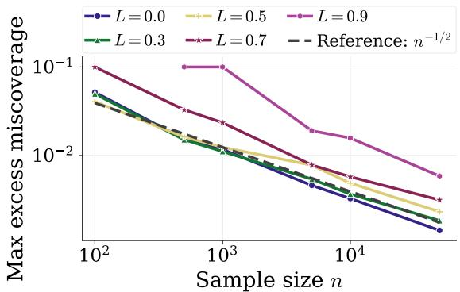  
(a) Worst-case excess miscoverage versus n

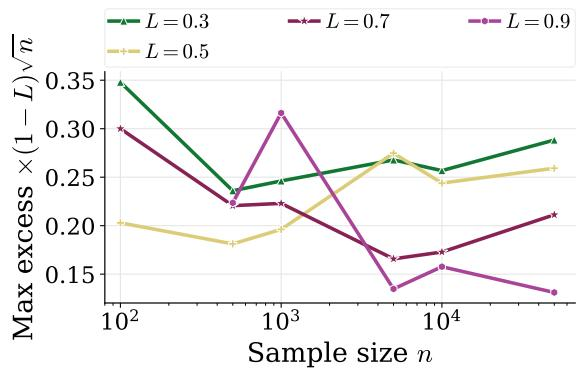  
(b) Scaled excess miscoverage  
Figure S1: Simulation 4: Le Cam lower bound validation. (a) Worst-case excess miscoverage (maximum over $D _ { 0 } , D _ { 1 } )$ vs. n on a log-log scale. The $L = 0 . 9$ curve saturates at the trivial level for $n \leq 1 0 0 0$ (algorithm has not converged). (b) Scaled quantity excess $\times ( 1 { - } L ) \times { \sqrt { n } } ;$ approximate flatness in [0.13, 0.35] confirms the $\Omega ( 1 / ( ( 1 { - } L ) \sqrt { n } ) )$ rate.

## S3.2 Simulation 5: Model-Free Algorithm

This simulation validates Algorithm 1 (MF-PCP) and Theorem 4.1 using the Gaussian location model with a finite predictor class of size N.

Figure S2a shows excess miscoverage vs. n for $N = 5 0$ across four values of L. All curves decrease at approximately the $n ^ { - 1 / 2 }$ rate (log-log slopes in $[ - 0 . 5 4 , - 0 . 4 4 ] )$ , consistent with the theorem. Higher L shifts curves upward, as expected.

Figure S2b shows the efect of the class size N at fixed $L = 0 . 5$ . The three curves $( N = 1 0 , 5 0 , 2 0 0 )$ are nearly indistinguishable, confirming that the log N factor in the bound is small relative to the dominant $n ^ { - 1 / 2 }$ term for the class sizes considered.

Convergence to equilibrium. The convergence check (fraction of replications where $\theta _ { \mathrm { f i n a l } }$ equals the equilibrium grid point $\theta _ { \mathrm { g r i d } } ^ { \star } )$ is low across all configurations (maximum 51% at $L = 0 , N = 1 0 , n = 5 0 , 0 0 0 ;$ as low as 2.5% at $L = 0 . 5 , N = 2 0 0 , n = 2 0 0 )$ . This does not indicate a problem: with a discrete grid of N points and stochastic ERM, the algorithm frequently selects a neighbor of $\theta _ { \mathrm { g r i d } } ^ { \star }$ rather than the exact grid point. Crucially, coverage validity does not require exact convergence; it only requires that the predictor is close enough that the conformal calibration set is representative, which is confirmed by the decreasing excess miscoverage.

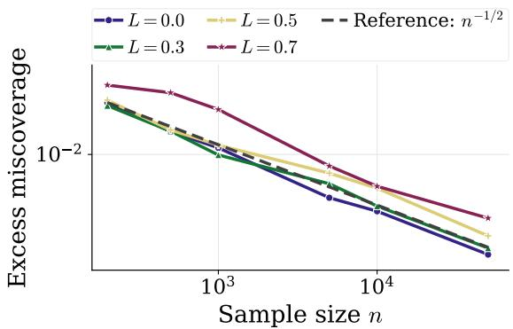  
(a) Excess miscoverage versus n for $N = 5 0$

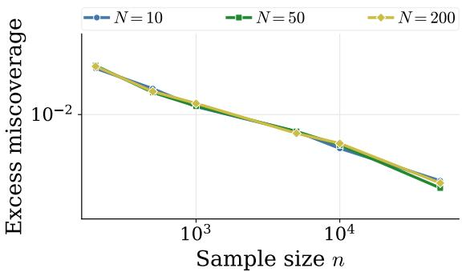  
(b) Efect of class size N at $L = 0 . 5$  
Figure S2: Simulation 5: Model-free algorithm validation. (a) Excess miscoverage vs. n for $N = 5 0$ , confirming $n ^ { - 1 / 2 }$ convergence across L values. (b) Efect of class size N at $L = 0 . 5 ;$ curves nearly overlap, indicating the log N factor is small.

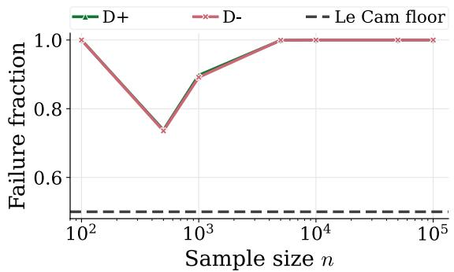  
Figure S3: Simulation 6: Impossibility at $L = 1$ . Failure rate (trivial set or coverage failure) vs. n for maps $D _ { + }$ and $D _ { - }$ . The rate stays bounded away from zero at all sample sizes, consistent with Theorem 3.1. Dashed line: Le Cam floor at 0.5.

## S3.3 Simulation 6: Impossibility at $L = 1$

This simulation validates Theorem 3.1 (Case 2) using the construction from the proof. Two 1-sensitive maps $D _ { + }$ and D<sub>−</sub> have equilibria at $\theta _ { + } ^ { \star } = 1 - \varepsilon$ and $\theta _ { - } ^ { \star } = \varepsilon$ , respectively, where $\varepsilon = 0 . 5 / n$ . As n grows, the two maps become increasingly similar (since $\varepsilon  0 )$ , yet their equilibria remain far apart $( \theta _ { + } ^ { \star } \to 1 , \theta _ { - } ^ { \star } \to 0 )$ . The impossibility theorem predicts that no algorithm can simultaneously achieve non-trivial prediction sets and valid coverage under both maps.

Figure S3 plots the failure rate (fraction of replications producing either a trivial set $\{ 0 , 1 \}$ or coverage below $1 - \alpha )$ against n. The failure rate is 100% at $n = 1 0 0$ and $n \geq 5 , 0 0 0$ for both maps. At intermediate sample sizes $( n = 5 0 0 , 1 0 0 0 )$ , the rate dips to $\approx 7 4 \%$ and $\approx 8 9 \%$ respectively, because with larger ε the algorithm occasionally identifies the correct map and produces a valid non-trivial set. As n increases further, $\varepsilon  0$ makes the maps indistinguishable and the failure rate returns to 100%.

This non-monotone pattern is predicted by the construction: at small $n , \varepsilon = 0 . 5 / n$ is large enough that $\mathrm { T V } ( D _ { + } ( \theta ) , D _ { - } ( \theta ) ) \leq 2 \varepsilon$ remains detectable, so the algorithm occasionally identifies the correct map; as n grows, $\varepsilon \to 0$ drives the total KL below the discrimination threshold, restoring impossibility.

The dominant failure mode is trivial prediction sets: at $n \geq 5 , 0 0 0$ , the fraction producing $C = \{ 0 , 1 \}$ exceeds 99.7%. This confirms the theorem’s prediction that the algorithm hedges by outputting the full label space when it cannot distinguish the maps.