# Curriculum unlearning in humans and neural networks

Jirko Rubruck1\*, Alice Zhang1\*, Andrew Saxe2 and Christopher Summerfield1

1 Department of Experimental Psychology, University of Oxford, Oxford, UK

2 Gatsby Unit & Sainsbury Wellcome Centre, University College London, London, UK \*These authors contributed equally to this work

## Abstract

During learning, humans often benefit from curricula that teach simple rules before exceptions. How ever, we lack a computational explanation for this phenomenon. Here, using a canonical behavioural task and modelling with neural networks, we develop and test a theory for why simple-to-complex curricula succeed. We show that during learning, both humans and neural networks show simplicity biases, a tendency to learn simple rules that are underfit to the data. In neural networks this bias is accompanied by compression of neural representations. Simple-to-complex curricula help both types of learners overcome this compression, developing representations (and policy) with appropriate dimensionality for the task. We test and confirm a further prediction from this theory: learners that have been pre-exposed to simple tasks and with more compressed initial representations benefit more from curricula. These findings suggest that curricula help with “unlearning” of simple rules.

## Introduction

Curriculum learning is the selection and sequencing of training examples to benefit task acquisition, retention and generalisation. Curricula are common in natural environments. For example, adult meerkats teach their ofspring to handle dead prey before attempting to catch living ones1, expert chimpanzees transfer tools to novices to facilitate termite foraging2, and education programmes structure information to maximise retention and understanding in human children. In laboratory experiments, learning of cognitive tasks is typically boosted by curricula that “start small”, prioritising simple elements before complex3–5, typical features before atypical6–9, or easy examples before hard10–13 (although results for motor skill learning are more mixed14). Curriculum learning is also of great practical utility in animal training and husbandry15,16.

Surprisingly, neural theories struggle to explain why curriculum learning is successful. In deep networks, which are widely proposed as a candidate theory for biological learning17–19, curricula do not reliably benefit performance or generalisation20,21. While some training sequences may help neural networks compose task primitives22, bridge the perception-action gap23–25, or direct gradients towards task-relevant features26–29, these benefits are typically modest and paradigm-dependent. Accordingly, for supervised learning tasks that involve assigning labels to stimuli, it is standard practice to draw independent and identically distributed samples at random during training30. We currently lack a generalised account of why curricula work. This holds us back from designing more efective training regimes for human task learning.

Here, we propose, formalise and test a new theory of curriculum learning. We focus on a popular approach to curriculum design in which common (or simple) examples are presented before rare (or complex) examples (e.g. a language teacher might emphasise generic rules for verb conjugation before teaching special cases). We study supervised learning of class labels, a canonical problem in both machine learning and neuroscience, with widespread translational application31. Our starting point is that neural networks trained with gradient descent from small weights (in the “rich” regime32) learn dataset modes in order of importance, such that directions which explain more variance in the data are learned faster (a ‘simplicity bias’33–38). As a result, these networks naturally settle into low-dimensional representations with a similarity structure that roughly matches that of the target input-output correlation matrix39.

However, compression comes at a cost. In gradient-based learning, dimensions that get discarded early are hard to recover later because they generate near-zero activation and thus weak gradients, preventing networks from relearning their relevance. Although biological systems do not learn via gradient descent, they nevertheless show the same striking dificulty with “uncompressing” a dimension that has been learned to be irrelevant. For example, having initially learned that stimulus colour is irrelevant to a psychophysical judgment, participants can perform hundreds of trials without realising that colour is fully predictive of the correct answer40,41. Brain-computer interface studies ofer an explanation for this phenomenon – that new learning is hard outside of the manifold that defines the current neural activity space42. In other words, once experience has sculpted neural activity into fixed pathways, new learning is obliged to respect them, limiting the flexibility of a mature system to form new representations.

We propose that in both artificial and biological learners, successful curricula promote learning along dimensions which have been compressed away and thus lie of manifold43. In other words, curricula could be said to help more with “unlearning” existing knowledge than with learning from scratch. In what follows, we test this theory, using a well-studied task that involves discriminating stimuli (as “good” or “bad”) based on combinations of one, two or three binary features44,45. Our primary focus is a task variant in which 75% of stimuli can be labelled on the basis of a single feature (“rule” stimuli) but there exist 25% stimuli for which the label is flipped based on a combination of the other features (“exception” stimuli). We call this the rule plus exception (R+E) task, and it corresponds to “type 5” in the classification scheme from Shepard & Hovland (Fig. 1a).

Past studies of categorisation have repeatedly shown that people learn rules earlier and more readily than exceptions46,47, a phenomenon that is captured with hardcoded models48,49, unsupervised clustering algorithms with simplicity priors50,51, or connectionist models with handcrafted basis sets and selective attention52. Here, we replicate this efect: humans exhibit path dependent learning and strong initial simplicity biases, with one-dimensional rules applied early in learning, and more intricate strategies emerging only later53,54. Although some learners later successfully learn the exceptions, simplicity biases tend to persist, with performance on exception stimuli remaining significantly worse than on rule stimuli even after extensive training. Building on past work with connectionist models55,56, we show that these findings all emerge in comparable form during supervised training of deep networks.

Next, we turn to our main question of how and why curricula afect learning. Replicating recent findings57,58, we observe that in both humans and networks, presenting rule stimuli early in training and exception stimuli later in a “simple-to-complex” curriculum leads to improved learning of exceptions. By examining the representations of our neural network models, we find that the curriculum helps by facilitating an expansion of the representational manifold and enabling learners to escape an overly simple, low-dimensional solution. Correspondingly, networks with more compressed initial representations benefit more from the simple-tocomplex curriculum. Finally, we test if the curriculum helps with uncompression in human learners by manipulating participants' priors through pretraining on a related task. As in our models, participants who begin the R+E task with more compressed, low-dimensional priors benefit more from curricula. Together, these findings support the claim that simple-to-complex curricula work by facilitating the uncompression of dimensions that prior learning has rendered irrelevant – a phenomenon we dub ‘curriculum unlearning’.

## Results

## Humans and networks demonstrate simplicity biases

In Exp. 1, n = 207 human participants learned to classify bug stimuli defined by three binary features (body pattern, antennae type, and wing shape; Fig. 1a). Six of the eight stimuli could be classified by a rule based on a single feature (rule stimuli), whereas the remaining two violated this rule (exception stimuli). Participants were randomly assigned to one of three curriculum conditions that varied the order in which rule and exception stimuli were presented (Fig. 1e). After learning via trial and error over five blocks of 48 trials (Fig. 1b), participants completed a test phase in which they classified each stimulus twice withou feedback.

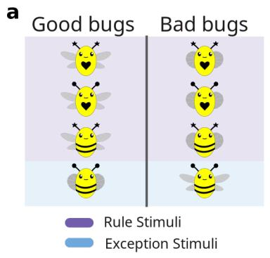

b  
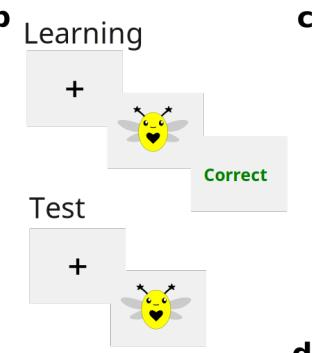

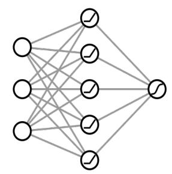  
d

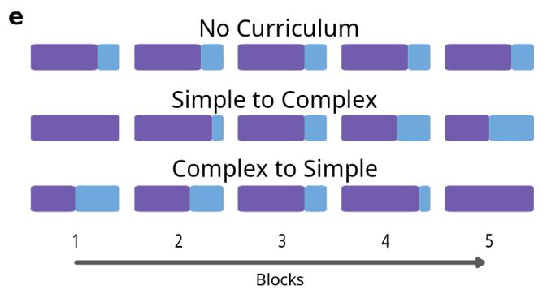

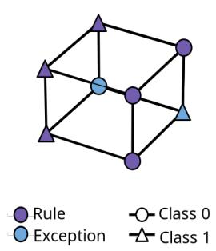  
Figure 1: a, Participants learned to classify bug stimuli as either “good” or “bad” in a rule plus exception (R+E) task. Most bugs can be correctly classified based on a single feature (here wings) but there are two exceptions to this rule. b, Participants learned the task in a trial-by-trial manner with fully supervised feedback. After the training phase, they were assessed in a test phase without feedback. c, We modelled the task using a two-layer neural network with stimuli (d) which similarly varied along three binary dimensions. The eight stimuli can be depicted as the corners of a cube in a three-dimensional binary feature space. Colour denotes rule (purple) versus exception (blue) stimuli and shape denotes the category label (circle = Class 0, triangle = Class 1). The network (bottom) contained H ReLU hidden units and a sigmoid output unit and was trained using trial-wise gradient descent, we trained one network per participant on that participant's own sequence of trials, so that each network receives identical stimuli in identical order to human participants e, Training consisted of five learning blocks of 48 trials each in which rule and exception stimuli were randomly interleaved. In the “no curriculum” condition, stimuli were sampled pseudorandomly on each block (36 rule stimuli and 12 exceptions). In the simple-to-complex condition, the fraction of exception stimuli in each block increased over the course of five blocks from 0 to 0.5. In the “complex-to-simple” curriculum, the fraction of exception stimuli decreased over learning blocks. All curriculum conditions are matched for the overall number of exposures to each stimulus.

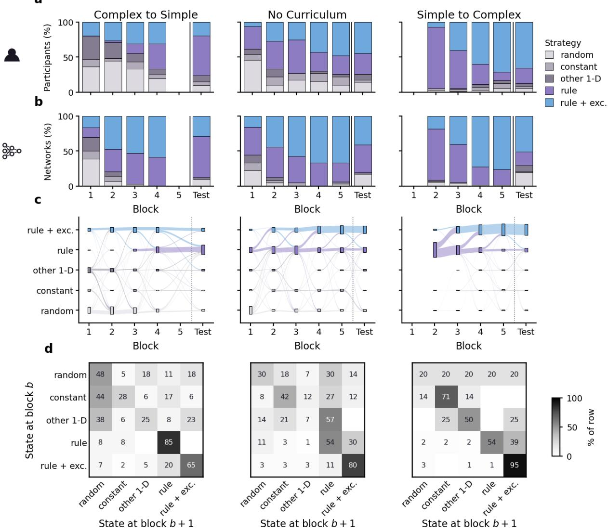  
Figure 2: a, Proportion of participants (n = 207) classified into each of five strategies at the end of each learning block and at test, separately by curriculum. Strategies were assigned by fitting nine deterministic policies plus a lapse rate and selecting by BIC against an unpenalised random-responding null. $\mathbf { b } ,$ The same classification applied to networks, one per participant, trained on that participant's exact trial sequence. Icons mark which rows show people and which show networks. $\mathbf { c } ,$ Block-to-block flow of human strategies, with ribbon width proportional to the number of participants making each transition; the dotted vertical line marks the test phase. d, Transition matrices summarising the transitions in $\mathbf { c } ,$ across training blocks giving the percentage of participants in each state at block b who occupied each state at block b+1. Rows sum to 100%. Pooled across curricula, the odds of moving from rule to rule + exceptions were 2.23 times higher under the simple-to-complex curriculum than under the other two (95% CI [1.18, 4.24], $p = . 0 1 4 ;$ Mantel–Haenszel stratified by block, participant-clustered bootstrap [1.21, 4.51]).

## Humans show simplicity biases

We first used a model-fitting approach to study the strategies used during learning. For every participant and block we asked which of ten candidate policies best explained responses including the correct policy (“rule + exc”), adherence to the rule only (“rule”), other incorrect 1D rules (“other 1D”, 5 variants), constant responding with a single key (“constant”, 2 variants), and random responding (“random”). Each policy was fitted with a maximum-likelihood lapse rate, so that consistent but imperfect behaviour is still attributed to the policy it follows, and policies were compared by BIC against the random-responding null, which was left unpenalised. Fig. 2a (top row) shows the percentage of humans best classified under each strategy for each block during training and the rightmost bar shows classifications at test for each of the three curricula. Note that strategies can only be distinguished where both rule and exception stimuli occur, so the first and last bar of the simple-to-complex and complex-to-simple curriculum respectively are missing.

Under no curriculum (Fig. 2a, middle), early blocks are dominated by the rule-only strategy, which peaks at 47.6% of participants by block 3 while only 25.4% are following rule plus exceptions. Of the 46 participants using one of the two rule-based strategies, 30 used the rule alone (exact binomial p = .054). This is a simplicity bias – participants initially learned the simple rule that explains a large amount of dataset variance, before transitioning to a more complex strategy46,47. However, this bias is substantially mitigated by the simple-tocomplex curriculum. Participants there also begin strongly rule-biased, since only rule stimuli are present in the first block. We find that 87.5% follow a rule-only strategy in block 2. However, the gradual introduction of exceptions reverses this pattern. The proportion following a rule + exc strategy dramatically increases from 6.9% to 70.8% across blocks 2 to 5, and reaches 65.3% at test time compared to 44.4% in the no curriculum condition (+20.8 percentage points [4.0, 36.1], OR = 2.35, Fisher's exact p = .024), while only 19.4% reached it under complex-to-simple (−25.0 points [−39.3, −9.3], OR = 0.30, p = .005).

Inspection of Fig. 2 suggests a twofold benefit. Firstly, relatively fewer participants stick with the rule strategy, failing to learn the exceptions (at test 22.2% under simple-to-complex against 30.2% under no curriculum and 56.9% under complex-to-simple;�2(2) = 20.36, p < .001, V = 0.31). Secondly, it seems as if fewer participants pursue idiosyncratic, unrelated strategies or random responding (12.5% of participants were classified as random, constant, or following some other one-dimensional rule, against 25.4% and 23.6% respectively). However, this diference is not significant $( \chi ^ { 2 } ( 2 ) = 4 . 2 1 , p = . 1 2 )$ . One might ask whether graduating the stimulus types (e.g. separating rule and exception training in time) was suficient to provoke these efects. It seems not, because in the complex-to-simple curriculum relatively fewer participants acquire the optimal (rule + exc) strategy across the course of training. Specifically, under complex-to-simple we find a drift to the rule-only strategy as exceptions are withdrawn, 1.4% of participants follow rule-only in block 1, rising to 36.1% by block 4.

Another way to show the simplicity bias and its mitigation by a simple-to-complex curriculum is to count the blockwise transitions between strategies, which we visualise in Fig. 2c and tabulate in Fig. 2d. First, under no curriculum the bias has a temporal dynamic such that participants pass through the rule-only state before acquiring the optimal strategy, with entry into rule + exceptions over four times more likely from the rule state than from other states (30.4% against 11.5%; OR = 4.15 [1.80, 9.55], $p < . 0 0 1 )$ . Under simple-to-complex curriculum participants enter the optimal strategy more readily (39.0% of rule-only blocks were followed by a rule-plus-exception block, against 30.4% under no curriculum and 0 of 13 participants under complex-to-simple). Pooling across block pairs and stratifying by block, the odds of this transition were 2.23 times higher under the simple-to-complex curriculum than under the other two (95% CI [1.18, 4.24], p = .014; Mantel–Haenszel stratified by block, participant-clustered bootstrap [1.21, 4.51]). Second, the strategy is significantly more stable under simple-to-complex, such that 94.8% of participants using the rule+exc strategy state remained there at the next block, against 79.7% under no curriculum and only 65.5% under complex-to-simple (OR = 3.63 [1.12, 11.74], p = .025).

## Simple-to-complex curricula facilitate learning

The simple-to-complex curriculum encourages more participants to behave in a way that is consistent with the rule+exc strategy, and should thus benefit learning. To verify this, we plotted human accuracy across training (Fig. 3a) and test (Fig. 3b) under each of the three curricula, separately for rule and exception stimuli.

During training, diferences in performance between conditions may be driven by patterns of stimulation under distinct curricula, so we focus on the no curriculum condition. We observe three salient efects. Firstly, rule stimuli are classified more accurately than exceptions $( \mathrm { L o g - O d d s } = - 0 . 4 8 \ [ - 0 . 5 2 \ - - 0 . 4 4 ] , \ z =$ $- 2 4 . 0 4 , p < . 0 0 1 )$ . Secondly, across the course of training, participants improved more on rule than exception stimuli, although this efect was marginal $( \mathrm { L o g - O d d s } = - 0 . 0 4 \ [ - 0 . 0 8 - 0 . 0 0 ] , \ z = - 1 . 9 7 , \ p = . 0 4 9 ; \ \mathrm { F i g . \ 3 a } )$ Thirdly, performance on the exceptions dips below chance early in training (Fig. 3a, first block: $\mathrm { M } = 0 . 4 4$ 95% CI $[ 0 . 3 9 ~ 0 . 4 8 ] , ~ t ( 6 2 ) = - 2 . 7 9 , ~ p = 0 . 0 0 7 , ~ d = - 0 . 3 5$ , which is expected if participants are displaying a simplicity bias that misclassifies exception stimuli using the 1-D rule.

a  
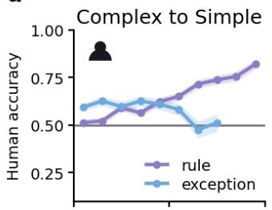

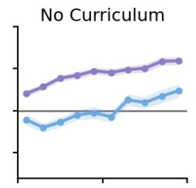

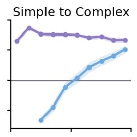

b  
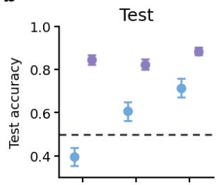

C  
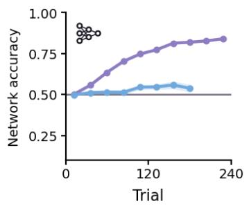  
e

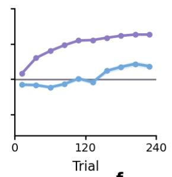  
f

d  
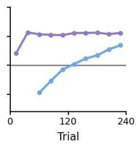

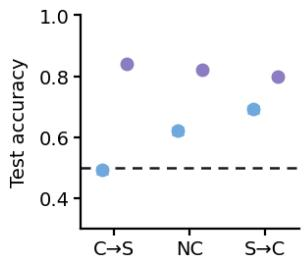

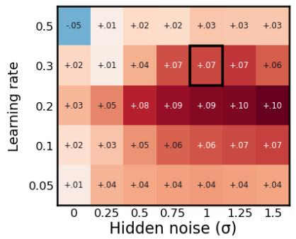

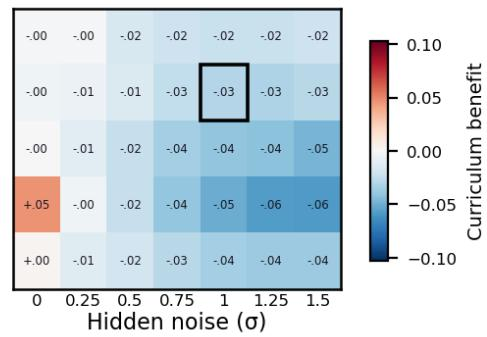  
Figure 3: Simple-to-complex curricula boost exception learning in humans and neural networks. a, Human accuracy over training, binned into ten 24-trial bins, separately for rule (purple) and exception (blue) stimuli and for each curriculum. Shading gives ±1 SEM across participants. $\mathbf { b } ,$ Human test accuracy, averaged over two presentations of each of the eight stimuli. c, d The same for the networks, measured identically, per-trial accuracy on the presented stimulus during training, and noise-marginalised accuracy at test. Networks inherit each participant's trial sequence, so the two rows are matched trial for trial and difer only in the learner. Error bars give ±1 SEM e, f Hyperparameter sweep for the networks. Colour gives the curriculum benefit — simple-to-complex minus no curriculum — in end-of-training accuracy on exception stimuli (e) and rule stimuli (f). The black box marks the configuration used throughout the paper. The exception benefit is positive in 34 of 35 configurations, so the efect does not depend on the exact hyperparameters selected.

The test phase is matched across curriculum conditions, allowing us a clean comparison of performance (Fig. 3b). Participants who learned under the simple-to-complex curriculum performed better than those who received no curriculum $( \mathrm { L o g - O d d s } = 0 . 7 8 \ [ 0 . 2 0 , 1 . 3 6 ] , \ z = 2 . 6 4 , \ p = . 0 0 8 )$ . This coeficient is the log-odds diference at the average of the two stimulus types, because stimulus type was sum-coded. To break this down, we computed estimated marginal means contrasts within each stimulus type. The simple-to-complex advantage was present for both exception stimuli $( \mathrm { L o g - O d d s } = 0 . 9 3 ~ [ 0 . 0 2 , ~ 1 . 8 3 ] , ~ z = 2 . 0 1 , ~ p = . 0 4 5 )$ and rule-consistent stimuli $( \mathrm { L o g - O d d s } = 0 . 6 3 \ [ 0 . 0 2 , 1 . 2 4 ] , z = 2 . 0 2 , p = . 0 4 4 )$ . The exception benefit is consistent with prior work on the rule-plus-exception task, in which delaying exceptions until after rule-consistent items improved exception categorization at $ { \mathrm { \ t e s t { } } ^ { 4 } } .$ . In contrast, participants in the complex-to-simple curriculum performed more poorly on exceptions $( \mathrm { L o g  – O d d s } = - 1 . 5 2 \ [ - 2 . 4 1 , - 0 . 6 3 ] , \ z = - 3 . 3 5 , \ p < . 0 0 1 )$ and did not significantly improve performance on rule stimuli relative to no curriculum $\mathrm { ( L o g  – O d d s = 0 . 3 2 \ [ - 0 . 2 8 } $ $0 . 9 3 \mathrm { { J } } , z = 1 . 0 5 , p = . 2 9 6 )$ . This diferential efect across rules and exceptions was reflected in a significant curriculum × stimulus-type interaction $( \mathrm { L o g  – O d d s } = - 0 . 9 2 \ [ - 1 . 4 3 , - 0 . 4 2 ] , z = - 3 . 5 7 , p < . 0 0 1 )$ . Thus, the complex-to-simple curriculum selectively harmed exception learning, which is consistent with participants overwriting or catastrophically forgetting exceptions learned early in training.

## Neural network performance mirrors that of humans

Next, we trained a two-layer feedforward neural network (from small initial weights, $\sigma ~ = 0 . 0 1 )$ with 32 ReLU hidden units, one sigmoid output to perform the R+E task (Fig. 1c). Networks learned over the same number of trials as humans, and we used single-trial gradient descent, so that (like humans) network received feedback after every trial. Training stimuli were encoded as Boolean inputs in $\{ - 1 , 1 \} ^ { 3 } \ ( \mathbf { F i g . } \ \mathbf { 1 d } )$ Specifically, networks were trained in a yoked manner, with each network exposed to the exact 240-trial sequence experienced by a single participant in a given curriculum condition. A key modelling choice was to inject Gaussian noise into the model hidden activations. This serves two purposes: it approximates noise in human neural representations and decision making, and it places the network in a regime where curriculum efects are expected to arise28. To fit human learning dynamics we conducted a hyper-parameter sweep over learning rate (from 0.05 to 0.50) and the hidden-activation noise (from 0 to 1.5), and fitted a global lapse rate. We then selected the configuration that best reproduced the average human learning accuracy across all conditions, blocks, and the two stimulus-types. The best globally fitting network had a learning rate of 0.30, and hidden-activation noise 1.0 and a global lapse rate of $0 . 3 0 \ ( R M S E = 0 . 0 7 7 )$

First, we classify the strategies used by the networks during learning, using the same approach as for humans (Fig. 2b). Given hidden activation noise and variability in stimulation sequence not all networks perform alike. Indeed, the fraction of networks that were classified under each strategy in each block was markedly similar to humans (Fig. 2a, lower panels). At test, 51.4% of networks trained under the simple-to-complex curriculum followed rule plus exceptions, against 41.3% under no curriculum and 29.2% under complex-tosimple $( \chi ^ { 2 } ( 2 , \ : N = 2 0 7 ) = 7 . 3 9 , \ : p = . 0 2 5 , \ : V = 0 . 1 9 )$ , with the proportion following a rule strategy alone running the other way (19.4%, 39.7% and 58.3%; $\chi ^ { 2 } ( 2 , N = 2 0 7 ) = 2 2 . 8 7 , p < . 0 0 1 , V = 0 . 3 3 )$ . To assess this human-network state correspondence statistically, we compared their respective distributions of strategies using a non-parametric approach. For each curriculum we took the distribution over the five strategies in each learning block and at test, separately for humans and networks, we then computed the mean absolute diference between the distributions of humans and networks for each condition and for each block. Averaged over the three curricula, this distance was 0.091 when each group of participants was compared with the networks trained on their own curriculum. We then constructed a null distribution by randomly assigning each of the 207 networks to one of the three curriculum conditions, while holding the number of networks per condition fixed. We then recomputed the matched distance for 5000 such reassignments. This gave a null centred on 0.120 (95% range [0.112, 0.128]). The observed matched distance of 0.091 fell below every one of the 5000 permutations $( p \textless . 0 0 1 )$ . Thus, the distribution of network behaviour resembles that of participants trained under the same curriculum more than those trained under a diferent one.

Next, we compared the accuracy of networks and humans. Once again, there was a marked similarity between both human and network learning curves during training and final performance at test (Fig. 3c, d). Like human learners, networks trained under the no curriculum condition learned to correctly classify rule stimuli before exceptions (rule accuracy passed 60% after a median of 48 trials whereas exception accuracy took 144 trials and never reached 60% at all in 5 of 63 networks (paired $t ( 5 7 ) = 1 2 . 0 1 , p < . 0 0 1 ; { \bf F i g }$ . 3c, middle). As for humans, exception accuracy first fell below chance, remaining there from the first trial until trial 139 and reaching a minimum of 0.440 around trial 70. Networks consistently showed this efect such that the lowest exception accuracy over the first half of training averaged 0.342 (SD 0.076) and fell below chance in 63 of 63 networks $( t ( 6 2 ) = - 1 6 . 4 1 , \ p \ < . 0 0 1 )$ . Below-chance performance is the signature of all eight stimuli preferentially being classified by the rule. This pattern of data implies that networks, like humans, show simplicity biases whereby gradient-based learning preferentially acquires dominant, low-dimensional structure before finer-grained distinctions.

Strong similarities between human and network performance were also observed under the other two curricula. Networks trained with simple-to-complex curricula display a dramatic early drop of exception accuracy to an average of 0.217, reflecting an even stronger acquisition of a simple, 1-D rule that similarly misclassifies exceptions along the rule axis (Fig. 3c, right). However, the gradually increasing proportion of exceptions drives fast recovery such that we find improved final exception accuracy relative to no curriculum by the end of training (Fig. 3c, center). However, in both humans and neural networks this recovery in exception accuracy is accompanied by some reduction in rule accuracy.

At test, we again see convergence between human and network performance (Fig. 3d). Networks trained under the simple-to-complex curriculum performed better than those trained without one (Estimate = 0.024 $[ 0 . 0 0 7 , 0 . 0 4 0 ] , \mathrm { z } = 2 . 8 2 , p = . 0 0 5 ;$ network estimates are diferences in accuracy rather than log-odds). Unlike in humans, however, this benefit was confined to exception stimuli $( { \mathrm { E s t i m a t e } } = 0 . 0 7 1 ~ [ 0 . 0 3 7 , 0 . 1 0 4 ] , \mathrm { z } = 4 . 1 6$ $p < . 0 0 1 )$ and reversed on rule-consistent stimuli, where networks paid a small but reliable cost (Estimate $= - 0 . 0 2 4 [ - 0 . 0 3 5 , - 0 . 0 1 2 ] , \mathrm { z } = - 4 . 1 4 , p < . 0 0 1 )$ . As in humans, networks trained under the complex-tosimple curriculum performed markedly worse on exceptions $( { \mathrm { E s t i m a t e } } = - 0 . 1 2 9 \ [ - 0 . 1 6 2 , - 0 . 0 9 5 ] , \mathbf { z } = - 7 . 5 7 ,$ $p \ < \ . 0 0 1 )$ , while improving slightly on rule stimuli $( { \mathrm { E s t i m a t e } } = 0 . 0 2 0 ~ [ 0 . 0 0 8 , 0 . 0 3 1 ] , \mathrm { z } = 3 . 4 5 , p < . 0 0 1 )$ . This diferential efect across rules and exceptions was reflected in significant curriculum × stimulus-type interactions in both directions (simple-to-complex: Estimate = 0.094 [0.057, 0.131], z = 4.96, p < .001; complex-to-simple: $\mathrm { E s t i m a t e } = - 0 . 1 4 8 ~ [ - 0 . 1 8 5 , ~ - 0 . 1 1 1 ] , ~ \mathrm { z } = - 7 . 8 0 , ~ p ~ < ~ . 0 0 1 )$ This is perhaps due to greater levels of forgetting (catastrophic interference) in the neural networks.

Because exception frequency difers across conditions in the final block of training (50% under simple-tocomplex, 25% under no curriculum, 0% under complex-to-simple), the ordering at test could in principle reflect a recency bias rather than durable learning. To control for this, we retrained every network with an identical balanced block appended after block 5 (48 trials at the no-curriculum composition), so that all three conditions end on the same local statistics. The simple-to-complex exception benefit survives this washout (Estimate = +0.040 [0.032, 0.048] against +0.063 [0.053, 0.073] without it, both $p < . 0 0 1 )$ , whereas the complex-to-simple exception cost $( + 0 . 0 0 1 \ [ - 0 . 0 0 7 , + 0 . 0 0 9 ] , p = . 7 3 )$ and the simple-to-complex rule cost $( - 0 . 0 0 1 \ [ - 0 . 0 0 4 , \ + 0 . 0 0 1 ] , \ p = \ . 3 7 )$ do not survive at all (Supplementary Fig. 1). Recency therefore accounts for the costs that curricula impose, including the rule cost on which networks and humans diverge, but not for the observed exception benefit.

Together, these results imply that ordering learning examples from simple to complex helps both human and artificial learners mitigate their simplicity biases. In both cases, simple-to-complex curricula successfully layer exception training on earlier rule acquisition. This efect was not specific to the parameterisation that best fit human data. When we swept over learning rates and noise levels and computed the exception benefit for each parameterisation, we found that it was highly consistent (Fig. 3e-f). However, the converse is not true; complex-to-simple curricula (which train rules after exceptions) do not preserve initial learning in the same way. Next, we examine our neural network models to gain a mechanistic understanding of the benefit of simple-to-complex curricula.

## Simple-to-complex curricula facilitate uncompression

Our main prediction is that curricula work by promoting learning along dimensions that were previously compressed away. If so, simple-to-complex curricula in the R+E task should drive networks to form a higher dimensional representation of the stimuli at the end of training. We test this hypothesis by quantifying the participation ratio (PR) of the eight stimulus representations in the hidden layer (a measure of representa tional dimensionality; Fig. 4a). Final dimensionality of the stimulus representations ordered as predicted by the end of training and was higher for simple-to-complex compared to no curriculum (2.37 against 2.27 at the end of training; +0.104 [0.046, 0.162], Welch’s $t ( 1 2 7 ) = 3 . 5 2 , p < . 0 0 1 )$

To study how network geometry evolves over the course of training under each curriculum, we projected the hidden representations onto two task-defined axes (see Methods): a rule axis, the ‘good’ minus ‘bad’ stimulus centroid for rule stimuli, and an exception axis, the direction separating the representation of the two exception stimuli. We find that the curriculum acts on these two axes very diferently (Fig. 4c, d). By the end of training, separation along the exception axis is substantially greater under the simple-to-complex curriculum than under no curriculum (+1.58 [0.93, 2.23], Welch’s $t ( 1 2 2 ) = 4 . 8 2 , p < . 0 0 1 \rangle$ ), whereas separation along the rule axis is statistically indistinguishable between them $( + 0 . 1 9 \ : [ - 0 . 1 5 , 0 . 5 2 ]$ , Welch’s $t ( 1 2 7 ) = 1 . 0 9$ $p = . 2 8 )$ . Any representational expansion is thus specific to the task-relevant exception representations that had been compressed away early in training. Visualising these projections confirms this (Fig. 4e). Early in training, after the first block (48 trials) all eight stimuli are organised almost entirely along the rule axis, with the exceptions represented as if they were consistent with the rule (which explains the initial below-chance exception accuracy reported above). By the end of training the exception representations become separated, and this efect is stronger for the simple-to-complex curriculum than under no curriculum. Across networks, the final participation ratio predicts final exception accuracy $( r = 0 . 7 0 \ [ 0 . 6 2 , 0 . 7 6 ] , p < . 0 0 1 , \mathrm { n } = 2 0 7 ;$ ; Fig. 4b), confirming that this uncompression connects to model behaviour so that networks that end up less compressed are those that learn the exceptions.

For humans, we cannot directly measure the dimensionality of task representations. However, we can analyse reaction times (RTs) to derive a sensible proxy. If a participant is neglecting the two exception-relevant features (i.e. those that do not define the rule) then we should see similar RTs for exception and rule stimuli; otherwise, exceptions should be slower. We thus computed, for each participant and block, the diference in mean log RT between exception and rule trials which we label the exception RT cost.

This exception RT cost varies diferently over the course of training in each condition $\left( \mathbf { F i g . \_ 4 f } \right)$ . In the no-curriculum condition, the cost is indistinguishable from zero in block $\mid ( - 0 . 3 \% , t ( 6 2 ) = - 0 . 1 5 , p = . 8 8 )$ and block $2 \left( + 1 . 5 \% , t ( 6 2 ) = 0 . 8 7 , p = . 3 9 \right)$ , but departs from zero from block 3 onwards $( + 7 . 8 \% , \ t ( 6 2 ) =$ $3 . 4 6 , \ p \ < \ . 0 0 1 )$ and remains so through blocks 4 $( + 1 1 . 1 \% , t ( 6 2 ) = 4 . 3 4 , p < . 0 0 1 )$ and $5 \ ( + 1 0 . 5 \% , \ t ( 6 2 )$ $= 3 . 7 5 , \ p < . 0 0 1 )$ . Thus, early on, participants treat exceptions exactly like rule items, and only later do they pay a processing cost for them in terms of RT. The exception RT cost in the curriculum conditions is at least partly driven by the ratio of rule to exception stimuli, but is comparable in block 3, where all three conditions present exceptions at an equal rate of 25%. Here, we see that the cost is larger under the simple-to-complex curriculum than under no curriculum (+14.7% against $+ 7 . 8 \% ; + 6 . 9$ points, Welch's t(133) $= 2 . 0 1 , p = . 0 4 6 )$ ) and not reliably smaller under complex-to-simple (+2.6%; −5.2 points, Welch's $t ( 1 3 2 ) =$ $- 1 . 6 5 , p = . 1 0 )$ . This ordering matches the strategy distributions in Fig. 2a, and implies that, on average, by block 3 of training, participants are already “uncompressing” the 1D solution that dominates during the early part of training, and that the simple-to-complex curriculum helps them do so. We also see that the RT cost is greatest when participants are estimated to be following a rule+exception strategy, exceeding every other state including the rule-only state $( + 0 . 0 7 5 ~ [ 0 . 0 4 6 , 0 . 1 0 5 ] , \mathrm { ~ z ~ = ~ 5 . 0 0 , ~ } p ~ < ~ . 0 0 1 )$ validating our initial strategy inference approach (Fig. 4g, h).

Overall, these results in networks and humans imply that curricula drive stronger uncompression of exceptionrelevant dimensions, supporting our hypothesis and suggesting a further prediction. Curricula should help most when there is more to unlearn, that is, when the learner begins from a lower-dimensional, more structured initial representation. In the next section, we examine if this potential link between initial representation and curriculum benefit can be manipulated directly in human learners.

## Curriculum benefits more for learners with low-dimensional priors

The results so far suggest that simple-to-complex curricula help learners “uncompress” overly simple rules for performing a task. This allows us to make a new prediction: if we pre-train (or ‘meta-train’59) learners on a diferent task for which relatively more simple or complex rules apply, then a simple-to-complex curriculum applied to the R+E task should confer more benefit on the former group (who learn simple rules and thus compress more). In Exp.2 (Fig. 5a), we tested this prediction, in both networks and a new and larger cohort of participants (see Methods), focussing exclusively on the no curriculum and simple-to-complex conditions. In the data that follow, networks were retrained using hyperparameters obtained from Exp. 1 (width (32), learning rate (0.3), initialisation scale $( \sigma = 0 . 0 1 )$ , and hidden-activation noise (1.0)) directly. The only quantities fit to Exp. 2 are two lapse rates, one per experimental phase; the weights of the network were carried over from pre-training to the subsequent R+E task.

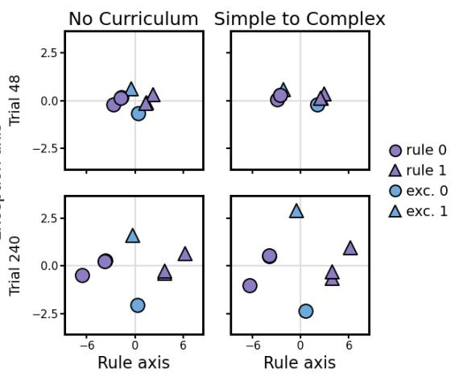

a  
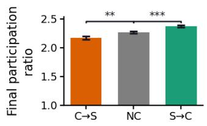  
C

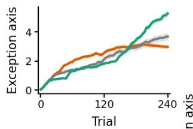  
d  
e

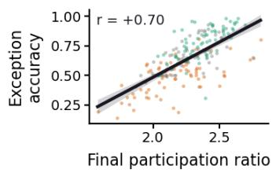

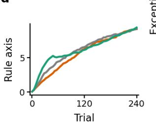

f  
2  
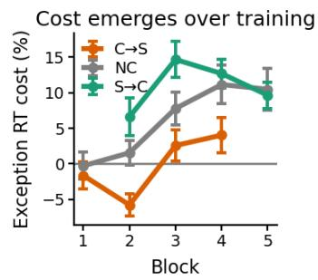

g  
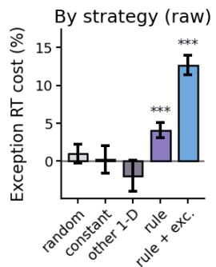

h  
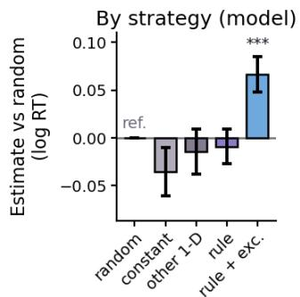  
Figure 4: Uncompression in networks, and the reaction-time signature of the strategies. a, Participation ratio of the eight hidden-layer stimulus representations at the end of training, by curriculum. b, Final participation ratio against final exception accuracy, one point per network $( r = + 0 . 7 0 , p < . 0 0 1 )$ . c, d Separation of the hidden representations along the exception axis and the rule axis over training. The rule axis is the class-1 minus class-0 mean over the six rule stimuli; the exception axis is the direction separating the two exceptions, orthogonalised against the rule axis. Both axes have a fixed sign in every network, so projections can be averaged. $\mathbf { e } ,$ The eight stimuli projected onto those axes early in training (trial 48) and at the end (trial 240), for no curriculum and simple-to-complex. Colour denotes stimulus type and shape the category label, as in Figure 1D. By the end of training the exceptions are pulled further apart under the curriculum (simple-to-complex minus no curriculum: $+ 1 . 5 8 , t ( 1 2 2 ) = 4 . 8 2 , p < . 0 0 1 )$ , and the final participation ratio is higher $( + 0 . 1 0 4 , t ( 1 2 7 ) = 3 . 5 2 , p < . 0 0 1 )$ . f–h In human participants, the reaction-time cost of exception stimuli relative to rule stimuli: over blocks and by curriculum (f), by the strategy the participant was in $( \mathbf { g } , \mathrm { r a w } )$ , and from a mixed model with participant random efects (h, estimates relative to random responding). The cost is largest for participants following rule + exceptions, as expected if they are retrieving an exception rather than applying the rule. Stars give $p < . 0 5 , . 0 1 , . 0 0 1 ;$ error bars $\pm 1 \mathrm { S E M } ; \mathrm { n } = 8 9 1$ participant-blocks from 207 participants.

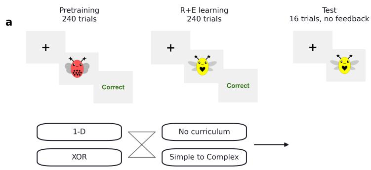

b  
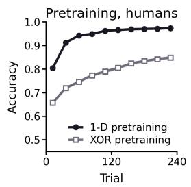  
C

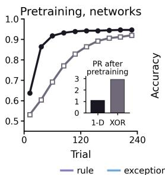

d  
e  
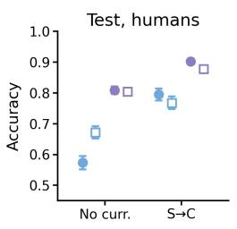

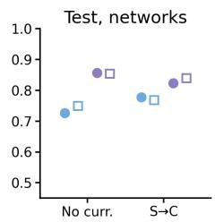

f  
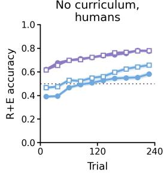

g  
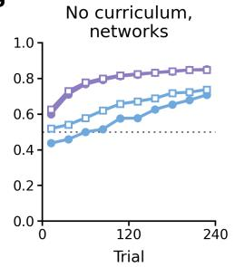  
h

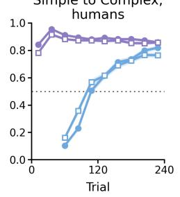

i  
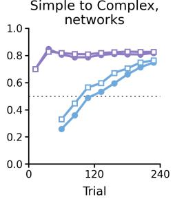

k  
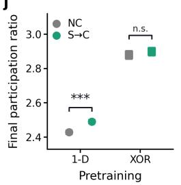

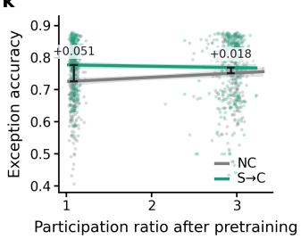  
Figure 5: Pretraining on a 1-D task strengthens simplicity biases and leads to greater curriculum benefit. Error bars and shaded ribbons represent the standard error of the mean (SEM). a, Exp. 2 task design. Participants learn to classify a diferent set of bugs in pretraining using a 1-D rule based on a single feature or an XOR rule over two features. In the learning phase, participants learn the rule plus exception (R+E) task under a simple-to-complex curriculum or no curriculum. Finally, participants complete a test phase where they classify the stimuli from learning without feedback. $\mathbf { b } , \mathbf { c } ,$ Pretraining accuracy for participants and for networks, binned into 24- trial bins. One network was trained per participant, on that participant's own trial sequence and in their own physical feature coding, through both phases. Every hyperparameter is inherited unchanged from the Exp. 1 model; one lapse rate per phase is the only quantity fitted. Inset: participation ratio of the eight hidden representations at the end of pretraining, 1.09 after one-dimensional pretraining against 2.93 after XOR — the compression manipulation works on the networks as intended. d, e, Test accuracy for rule (purple) and exception (blue) stimuli, by curriculum, with pretraining shown by marker shape. f–i Accuracy over the R+E phase by curriculum, people and networks. Under simple-to-complex no exception trials occur in the first block, so those bins are empty by design. j, Participation ratio at the end of $\mathrm { R } +$ E learning. The curriculum raises it for one-dimensionally pretrained networks (+0.062, p $< . 0 0 1 )$ with no detectable efect after XOR pretraining $( + 0 . 0 2 0 , \ p \ = . 5 7 )$ . k, Exception accuracy at test against participation ratio after pretraining, one point per network, with the curriculum benefit marked at each cluster. The benefit narrows for the most compressed networks. 11 11

In Exp. 2, learners first performed a pre-training phase, which was designed to manipulate the degree of a priori representational compression. One group learned to classify bugs using a simple 1D rule (e.g. round wings good, double wings bad), whereas the other learned to apply a higher-dimensional XOR rule defined over two features (e.g. round wings + heart body or double wings + stripy body good; double wings + heart body or round wings + stripy body bad; this task requires learners to attend to at least two dimensions). For Exp.2 we first report results from neural networks, followed by their corresponding human participants.

Networks learned both pretraining tasks (Fig. 5c), with accuracy rising from 0.64 (block 1) to 0.95 (block 10) under the one-dimensional rule and from 0.53 (block 1) to 0.92 (block 10) under XOR. Statistically, accuracy on the XOR task thus ended lower (-0.026, Welch’s $t ( 5 3 8 ) = - 1 5 . 4 8 , p < . 0 0 1 )$ . Critically, in networks we saw that the manipulation had its intended efect on dimensionality of representations. At the end of pretraining the participation ratio of the eight hidden representations was 1.09 after one-dimensional pretraining against 2.93 after XOR (Welch’s $t ( 5 6 4 ) = - 3 0 8 , \ p < . 0 0 1$ ; Fig. 5c inset). One-dimensional pretraining leaves the network with a latent representation that has collapsed to essentially a single dimension, whereas XOR pretraining induces a more uncompressed, higher dimensional representation.

Next, we examined subsequent R+E learning. Under no curriculum, networks pretrained on the one dimensional rule reached lower exception accuracy on the final 24 trials of training than those pretrained on XOR (0.708 against 0.738; Estimate $= - 0 . 0 3 0 \ [ - 0 . 0 5 3 , - 0 . 0 0 7 ]$ , Welch’s t(516) = −2.55, p = .011; Fig. 5g, i). In other words, networks preferred simple solutions, and this was stronger after 1-D pretraining. Critically, however, at test we observed a three-way interaction between pretraining, curriculum, and stimulus type (Estimate = 0.052 [0.028, 0.077], z = 4.14, p < .001; Fig. 5e). The curriculum benefit (simple-tocomplex relative to no curriculum) on exception stimuli was nearly three times larger after one-dimensional pretraining than after XOR pretraining (0.051 [0.035, 0.066], z = 6.33, p < .001 against 0.018 [0.002, 0.034], $\mathrm { z } = 2 . 1 7 , p = . 0 3 0 $ ; diference 0.033 [0.010, 0.055], z = 2.87, p = .004), with no corresponding advantage on rule stimuli. In neural networks, thus, the simple-to-complex curriculum helps learning most on exception stimuli when the learner arrives with a low-dimensional prior. To establish that initial representational change causally mediates this pretraining efect, we repeated Experiment 2 in neural networks with the hidden layer frozen at initialisation, so that only the readout is trained. Because hidden representations do not move, this yielded networks whose participation ratio was equal in both groups (3.36 in both) but which still carry their readout weights across the phase boundary. These networks also displayed a large curriculum benefit on exception learning, but pretraining condition did not modulate this efect, with the same benefit after one-dimensional and XOR pretraining (+0.111 [0.083, 0.139] against +0.113 [0.085, 0.142]; diference −0.003 [−0.042, +0.037], $p = . 9 0 )$ and no three-way interaction $( - 0 . 0 0 4 ~ [ - 0 . 0 3 1 , ~ + 0 . 0 2 2 ]$ , p = .75; Supplementary Fig. 2). Carrying prior learning in the readout alone is therefore not suficient; the efect requires a representation that prior learning has compressed.

Consistent with the mechanism proposed in Exp. 1, the curriculum also left simple pretrained networks with a higher participation ratio at the end of learning (+0.062, Welch’s $t ( 5 2 0 ) = 3 . 9 2 , p < . 0 0 1 )$ , with no detectable efect for networks which initially received XOR pretraining (+0.019, p = .57; Fig. 5j, k). As in Exp. 1, networks that ended learning with a higher-dimensional representation were those that learned the exceptions best $( r = + 0 . 3 6$ within cells, $p \ < \ . 0 0 1 )$ , and this relationship was about twice as strong across the four conditions after one-dimensional than after XOR pretraining $( r = 0 . 4 9$ and 0.54 against 0.27 and 0.37).

## Humans benefit more from simple-to-complex curricula after 1-D pretraining

We also collected data from a large cohort of humans performing the same task. These participants (n = 1027) first completed the same pretraining phase, designed to manipulate the degree of representational compression. Pretraining involved a visibly distinct set of bug stimuli (e.g. red rather than yellow). We reasoned that (like for networks) 1-D pretraining would encourage participants to compress, whereas XOR pretraining would require them to retain a higher-dimensional representation. Participants then learned to perform the same R+E task as above under either no curriculum or a simple-to-complex curriculum. As before, this was followed by a test phase in which participants classified the learning-phase stimuli without

## feedback.

During pretraining, accuracy increased over trials in both conditions $( \mathrm { L o g - O d d s } = 1 . 2 7 \ [ 1 . 2 1 - 1 . 3 3 ] , \ z =$ $4 0 . 6 2 , \ p < . 0 0 1 )$ , but participants are less accurate $( \mathrm { L o g - O d d s } = 1 . 5 4 \ : [ 1 . 4 4 \ : - 1 . 6 5 ] , \ : z = 2 8 . 7 2 , \ : p < . 0 0 1 )$ and improve less $( \mathrm { L o g - O d d s } = 0 . 6 2 \ [ 0 . 5 6 \ - 0 . 6 8 ] , \ z = 2 0 . 6 0 , \ p \ < \ . 0 0 1 )$ when learning an XOR function compared to a simple function (Fig. 5b). Turning to R+E learning in the subsequent experimental phase, we then asked whether 1-D pretraining led to stronger simplicity biases (Fig. 5f). As expected, we see that participants demonstrated a simplicity bias, performing better overall on rule than exception stimuli $( \mathrm { L o g - O d d s } = - 0 . 4 7 \ [ - 0 . 5 2 - - 0 . 4 3 ] , \ z = - 2 1 . 3 9 , \ p < . 0 0 1 )$ . Critically, participants who received 1-D pretraining were more likely to retain this simplicity bias than those who received XOR pretraining as evidenced by a significant pretraining x stimulus type interaction across all learning blocks $( \mathrm { L o g . O d d s } = - 0 . 0 8 \ [ - 0 . 1 2 - - 0 . 0 4 ]$ $z = - 3 . 6 9 , p < . 0 0 1 )$

In the learning phase, participants in the simple-to-complex curriculum condition classified exception stimuli less accurately than rule stimuli $( \mathrm { L o g - O d d s } \ = \ - 1 . 1 2 \ [ - 1 . 1 8 \ - \ - 1 . 0 6 ] , \ z \ = \ - 3 6 . 8 6 , \ p \ < \ . 0 0 1 )$ but improved more on exceptions than on rules across learning $( \mathrm { L o g - O d d s } = 0 . 8 3 \ [ 0 . 7 8 \mathrm { - } \ 0 . 8 8 ] , \ z = 3 2 . 5 1 , \ p \mathrm { ~ < ~ . 0 0 1 } )$ Consistent with our predictions, this diferential improvement depended on pretraining. Participants who received 1-D pretraining showed greater improvement on exceptions relative to rules than those who received XOR pretraining $( \mathrm { L o g - O d d s } \ = \ 0 . 1 6 \ [ 0 . 1 1 \ - \ 0 . 2 1 ] , \ z \ = \ 6 . 5 9 , \ p \ < \ . 0 0 1 )$ . In other words, the simple-tocomplex curriculum enabled participants to recover from the stronger initial simplicity bias induced by 1-D pretraining.

Next, we examined test-phase performance (Fig. 5d). As in Exp. 1, participants were less accurate on exception stimuli compared to rule stimuli $( \mathrm { L o g - O d d s } = - 0 . 4 0 \ [ - 0 . 5 0 \mathrm { - } 0 . 3 0 ] , \mathrm { z } = - 7 . 7 5 , \ p < . 0 0 1 )$ . Moreover, participants in the simple-to-complex curriculum once again performed better than those in no curriculum $( \mathrm { L o g - O d d s } = 0 . 5 6 ~ [ 0 . 4 5 - 0 . 6 8 ] , ~ \mathrm { z } = 9 . 7 1 , ~ p < . 0 0 1 )$ . We computed estimated marginal means contrasts within each stimulus type, which showed the benefit for both exception stimuli $\mathrm { ( L o g  – O d d s = 1 . 3 5 ~ [ 1 . 0 2 ~ - }$ 1.68], $\mathrm { z } = 7 . 9 3 , \ p < . 0 0 1 )$ and rule-consistent stimuli $( \mathrm { L o g - O d d s } = 0 . 9 2 \ [ 0 . 7 0 - 1 . 1 3 ] , \mathrm { z } = 8 . 1 5 , \ p < . 0 0 1 )$ We saw no significant main efect of pretraining on test performance $( \mathrm { L o g - O d d s } = - 0 . 0 3 \ [ - 0 . 1 4 - 0 . 0 8 ] , \mathrm { z } =$ $- 0 . 5 7 , p = . 5 7 )$

Finally, we turned to our key question of interest: do participants who received 1-D pretraining benefit more from curricula? As in neural networks, we observed a three-way interaction between pretraining, curriculum and stimulus type, with comparable functional form $( \mathrm { L o g - O d d s } = 0 . 1 0 \ [ 0 . 0 2 - 0 . 1 8 ] , \mathrm { z } = 2 . 3 3 , \ p \ = . 0 2 0 )$ The curriculum benefit was significantly larger for simple- than XOR-pretrained participants specifically on exception stimuli, mirroring findings in neural networks. This result supports the hypothesis that the curriculum facilitates the unlearning of low-dimensional priors in our human participants.

## Human curriculum benefits can be predicted by compression during pretraining

To examine the strategies used after simple and XOR pretraining in more detail, we adopted the approach taken in Exp.1 to classify learning strategies (Fig. 6a). Focussing on the final block of training, we observed that as in Exp.1 more participants adopted the R+E strategy following a simple-to-complex curriculum, but now this efect was stronger after one dimensional pretraining (41.7% to 78.8%, OR = 5.18) than after XOR pretraining (51.4% to $7 3 . 4 \% , \mathrm { O R } = 2 . 6 1 )$ , yielding a significant pretraining × curriculum interaction in the proportion classified as rule + exceptions (Likelihood-ratio $\chi ^ { 2 } = 6 . 2 9 , p = . 0 1 2 ; \mathbf { F i g . ~ 6 b } )$ .

Next, we estimated a proxy for representational compression during pretraining, using a previously-described RT-based measure called the switch–match reaction time (SMRT)60. This measure relies on the idea that responses should slow when an attended feature changes between trials. We divided pretraining into five equally sized bins and, for each stimulus feature and bin, computed the ratio of average RTs on trials where the feature changed to those where it did not (Fig. 6c). SMRT > 1 indicates that participants slowed on trials where the feature changed (implying they were attending to it). We normalized each feature’s SMRT by the average SMRT across all three features, yielding a relative measure of selective attention to that feature (or dimension).

First, we examined how selective attention evolved over the course of 1-D pretraining. As participants

a  
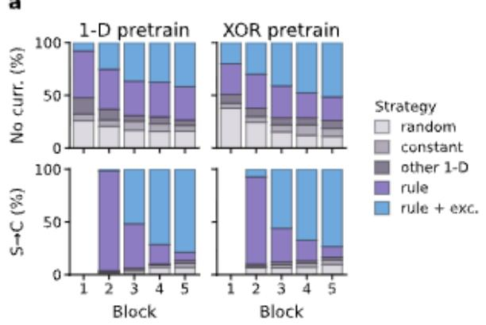

b  
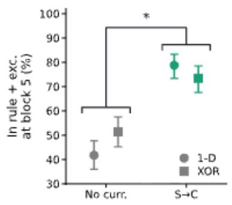

C  
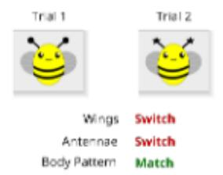

$$
S M R T _ { \mathit { l } } = R T _ { \mathrm { s e v t e } { \hbar } } / R T _ { \mathrm { n e t c h } }
$$

$$
S A _ { f } = S M R T _ { f } / S M R T _ { t o t o l }
$$

d  
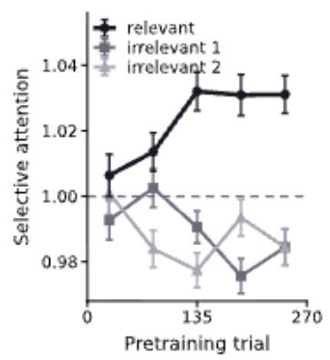

e  
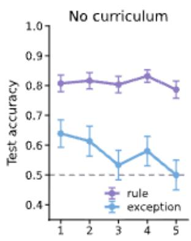

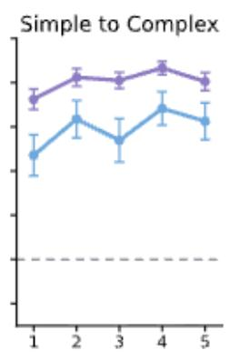  
Selective-attention quintile, end of pretraining

Figure 6: RT-based measure of compression in pretraining predicts later curriculum benefit. a. Propor tion of participants in each strategy over the five R+E learning blocks, split by pretraining (columns) and curriculum (rows), classified as in Figure 2. b. Proportion reaching the optimal rule + exceptions strategy by block 5. With 1-D pretraining fewer participants reach this state without a curriculum but more with one, giving a significant pretraining × curriculum interaction $( \mathrm { b } = - 0 . 6 8 6 , \mathrm { z } = - 2 . 5 0 , p = . 0 1 2 ) $ ; the bracket marks that interaction. Error bars are Wilson intervals. c. We compute a reaction-time measure of selective attention to each feature dimension during 1-D pretraining. For consecutive trial pairs, each feature either switches or matches; we define each feature's switch-match reaction time (SMRT) as the ratio of switch to match RTs, where $\mathrm { S M R T } > 1$ indicates attention to that feature. Selective attention to a feature is its SMRT normalized by the average SMRT across features. d. During 1-D pretraining, selective attention to the relevant 1-D feature increases while selective attention to the two irrelevant features decreases. Pretraining is split into five bins for computing selective attention, and error bars are standard errors of participant means. e. Participants who display greater selective attention to the relevant feature in 1-D pretraining benefit more from simple-to-complex curricula. Without a curriculum, exception accuracy falls as participants compress more and under the curriculum it does not. Selective attention is binned into quintiles for visualization. Error bars give ±1 SEM.

learned the task, selective attention to the relevant 1-D feature was greater overall (Estimate = -0.02 [-0.02 – -0.01], z = -12.04, p < .001) and increased more over pretraining (Estimate = -0.00 [-0.01 – -0.00], z = -3.73, p < .001) compared to selective attention to the two irrelevant features (Fig. 6d). We then asked whether participants who learned more compressed representations by the end of 1-D pretraining benefitted more from the simple-to-complex curriculum. We found that greater selective attention to the relevant feature in the last bin of pretraining did not predict overall R+E test accuracy (Log-Odds = 0.04 [-0.12 – 0.20], z = 0.47, p = .64; Fig. 6e). Critically, however, participants who compressed more by the end of pretraining, benefited more from the simple-to-complex curriculum compared to no curriculum (Log-Odds =0.20 [0.04 – 0.36], z = 2.43, p = .015). Together, these findings suggest that the benefit of simple-to-complex curricula for human learners depends on how much there is to unlearn, i.e. how much relevant features have been compressed away in prior learning.

## Discussion

We studied how curriculum learning impacted performance on a classical categorisation task in which most stimuli followed a simple rule, but others were exceptions. This task has been studied before, and it is well known that in the absence of any curriculum, participants tend to learn rules before exceptions. We replicate this result here. However, our main question was how and why curricula that sequence rule and exception stimuli impact learning. Our data suggest that in both humans and neural networks, simple-to-complex curricula assist learning by helping people “uncompress” – to escape from an overly simple solution that only accounts for the rule. We call this phenomenon “curriculum unlearning”.

We draw upon a literature that has studied the dynamics of learning in deep networks to understand why rules are learned before exceptions33–38. It has argued, for example, that networks prioritise the major modes of the input-output correlation matrix before minor ones33, or learn linear functions before more complex polynomials37. Consistent with this view, we show that networks, like humans, tend to initially learn 1D solutions and only later start to accommodate exceptions. In neural networks, where we have ready access to the dimensionality and geometry of neural representation, we see that mastery is accompanied by an initial compressive phase (in which the rule is acquired) followed by a gradual uncompression, in which exceptions are acquired. However, the late phase is not guaranteed; some networks remain trapped in the minimum formed by initial rule learning. Whilst we did not measure neural representation change in humans, they showed a strikingly similar behavioural patterns to neural networks during both training and test, giving us a strong basis to predict that similar efects would unfold. Indeed, we already know from neuroimaging studies that the dimensionality of prefrontal BOLD signals scales with task complexity in a closely related categorisation task54.

Our main question was how the imposition of a curriculum changes performance. Curricula that teach regularities before irregularities are in widespread educational use, such as during second language learning. We found that people learn faster and more efectively from a curriculum that prioritises rules before exceptions. Early studies reported that grouping rule-following stimuli together at the start of each training block improves learning speed4,61 and transfer success62. A more direct comparison with our work comes from two reports (using a similar binary categorisation paradigm) that late introduction of exceptions benefit performance57,58, and that exception learning may be driven by hippocampal circuits, which process novel or out-of-distribution exemplars63,64, and are activated by exceptions in neuroimaging studies65. Interestingly, this behavioural efect was observed in adults but not children. Neural representations in adults have been found to be intrinsically lower dimensional66 (perhaps due to more extensive training) and so the finding that they benefit more from curricula is consistent with our theory that curricula help people “unlearn”.

Our deep learning model ofers a candidate explanation for this curriculum advantage. There is a long tradition of modelling category learning with connectionist approaches, but standard neural networks trained with backpropagation were widely believed to be too flexible to capture human performance on the binary choice employed here50,52. Nevertheless, our neural network captures the patterns of learning (during the training phase) and inference (during the test phase) displayed by humans with quite striking fidelity. In particular, neural networks show very similar benefits to humans from simple-to-complex curricula, and similar costs for the anti-curriculum. This is surprising, because the benefits of curriculum learning have often been found to be modest or absent in supervised neural networks20. The clearest theoretically validated benefits are those for a diferent training approach (called “fading”) where exemplars are initially sampled far from the category boundary, before converging towards it. This approach, in which “easy” examples precede “hard” ones, benefits humans8,9 and can facilitate learning in neural networks, especially when they are underparameterised28, due to the geometry of gradient descent26.

In our R+E task, for both humans and neural networks the curriculum benefit is realised mainly as a greater probability that learners transition from simple 1D rules that are underfit to the task (to the ground truth rule plus exception strategy) during simple-to-complex curricula. For exceptions, this benefit is very similar between humans and networks; for rule stimuli, neural networks show a slight degradation of performance after simple-to-complex training which is absent in people. This tempers the advantage for the curriculum – in fact, in a regime where exceptions are suficiently rare, it can ofset it entirely. We chose to model learning on this task using an undiferentiated neural network, allowing us the simplest possible window into how people perform the task. However, our network lacks salient architectural motifs, such as the division between hippocampus and neocortex, which are important for learning in biological systems67. Coupled with evidence showing that the hippocampus is key for learning exceptions58,65, it seems likely that a more comprehensive curriculum benefit will emerge from models that incorporate this neuroanatomical detail58.

Studying the dynamics of learning in the neural networks led us to a computational account of why simpleto-complex curricula benefit learning. Early in training, learners are prone to adopt overly simplistic decision strategies that overlook the exceptions. This is one instance of a canonical phenomenon in cognitive psychology, whereby people tend to adopt ‘satisficing’ decision strategies that approximate, but do not fully capture, a more nuanced optimal policy68–70. The success of the simple-to-complex depends on its ability to help people escape from these overly simple solutions. In neural networks, this occurs as the curriculum encourages exception stimuli to be represented as increasingly separated along a neural axis which is orthogonal to that for the rule. This theory predicts that pretraining regimes that encourage relatively simpler, low-dimensional solutions should create conditions for greater curriculum benefit, and we show that this is the case for both neural networks and humans.

We note a number of limitations to our study. Firstly, our neural network models, like many other computational tools, ofer an overly simplistic account of human learning. Although it is surprising that network models capture the overall learning dynamics very faithfully, there are still some important ways in which they misfit – they show hallmarks of forgetting for rule stimuli, which humans do not, and although they mimic patterns of human curriculum benefit, those benefits in the networks are overall more modest. How ever, the simplicity of neural networks models is also their virtue, as it ofers us an elegant theory of the phenomenon we set out to study, and an unclouded window into how representational geometry and dimensionality change over the course of learning.

## References

1. Thornton, A. & McAulife, K. Teaching in Wild Meerkats. Science 313, 227–229 (2006).

2. Musgrave, S. et al. Teaching varies with task complexity in wild chimpanzees. Proc. Natl. Acad. Sci. 117, 969–976 (2020).

3. Bruner, J. S. The Process of Education. (Harvard university press, Cambridge (Mass.), 1977).

4. Mathy, F. & Feldman, J. A rule-based presentation order facilitates category learning. Psychon. Bull. Rev. 16, 1050–1057 (2009).

5. Mi, Q. & Summerfield, C. Human curriculum learning of a cue combination task. Nat. Hum. Behav. https://doi.org/10.1038/s41562-026-02452-1 (2026) doi:10.1038/s41562-026-02452-1.

6. Antzoulatos, E. G. & Miller, E. K. Increases in functional connectivity between prefrontal cortex and striatum during category learning. Neuron 83, 216–25 (2014).

7. Elio, R. & Anderson, J. R. The efects of information order and learning mode on schema abstraction. Mem Cogn. 12, 20–30 (1984).

8. Pashler, H. & Mozer, M. C. When does fading enhance perceptual category learning? J. Exp. Psychol. Learn. Mem. Cogn. 39, 1162–1173 (2013).

9. Hornsby, A. N. & Love, B. C. Improved classification of mammograms following idealized training. J. Appl. Res. Mem. Cogn. 3, 72–76 (2014).

10. Strittmatter, Y., Mannelli, S. S., Ruiz-Garcia, M., Musslick, S. & Spitzer, M. Curriculum learning in humans and neural networks. Preprint at https://doi.org/10.31234/osf.io/a9kjb\_v2 (2025).

11. Volk, C., Pack, C. C. & Bakhtiari, S. The curriculum efect in visual learning: the role of readout dimensionality. Preprint at https://doi.org/10.1101/2025.09.19.677409 (2025).

12. Ahissar, M. & Hochstein, S. Task dificulty and the specificity of perceptual learning. Nature 387, 401–406 (1997).

13. Lawrence, D. H. The transfer of a discrimination along a continuum. J. Comp. Physiol. Psychol. 45, 511–516 (1952).

14. Wulf, G. & Shea, C. H. Principles derived from the study of simple skills do not generalize to complex skill learning. Psychon. Bull. Rev. 9, 185–211 (2002).

15. Skinner, B. F. How to Teach Animals. in Cumulative record (enlarged ed.). 412–419 (Appleton-Century-Crofts, East Norwalk, 1961). doi:10.1037/11324-031.

16. Boundey, A., Nikitins, F. & Fernandez, E. J. An examination of husbandry training in zoos: A scoping review. Appl. Anim. Behav. Sci. 292, 106805 (2025).

17. Richards, B. A. et al. A deep learning framework for neuroscience. Nat Neurosci 22, 1761–1770 (2019).

18. Saxe, A., Nelli, S. & Summerfield, C. If deep learning is the answer, what is the question? Nat. Rev. Neurosci. 22, 55–67 (2021).

19. Marblestone, A. H., Wayne, G. & Kording, K. P. Toward an Integration of Deep Learning and Neuroscience. Front Comput Neurosci 10, 94 (2016).

20. Wu, X., Dyer, E. & Neyshabur, B. When Do Curricula Work? Preprint at http://arxiv.org/abs/2012.03107 (2021).

21. Charpentier, L. et al. Findings of the Third BabyLM Challenge: Accelerating Language Modeling Research with Cognitively Plausible Data. in Proceedings of the First BabyLM Workshop 399–420 (Association for Computational Linguistics, Suzhou, China, 2025). doi:10.18653/v1/2025.babylm-main.28.

22. Lee, J. H., Mannelli, S. S. & Saxe, A. Why Do Animals Need Shaping? A Theory of Task Composition and Curriculum Learning. Preprint at https://doi.org/10.48550/ARXIV.2402.18361 (2024).

23. Krueger, K. A. & Dayan, P. Flexible shaping: how learning in small steps helps. Cognition 110, 380–94 (2009).

24. Elman, J. L. Learning and development in neural networks: the importance of starting small. Cognition 48, 71–99 (1993).

25. Khajehabdollahi, S. et al. Emergent mechanisms for long timescales depend on training curriculum and afect performance in memory tasks. https://doi.org/10.48550/ARXIV.2309.12927 (2023) doi:10.48550/ARXIV.2309.12927.

26. Weinshall, D. & Amir, D. Theory of Curriculum Learning, with Convex Loss Functions. ArXiv181203472 Cs Stat http://arxiv.org/abs/1812.03472 (2018).

27. Hacohen, G. & Weinshall, D. On The Power of Curriculum Learning in Training Deep Networks. Preprint at https://doi.org/10.48550/arXiv.1904.03626 (2019).

28. Mannelli, S. S., Ivashynka, Y., Saxe, A. & Saglietti, L. Tilting the Odds at the Lottery: the Interplay of Overparameterisation and Curricula in Neural Networks. Preprint at http://arxiv.org/abs/2406.01589 (2024).

29. Saglietti, L., Mannelli, S. S. & Saxe, A. An Analytical Theory of Curriculum Learning in Teacher-Student Networks. https://doi.org/10.48550/ARXIV.2106.08068 (2021) doi:10.48550/ARXIV.2106.08068.

30. Goodfellow, I., Bengio, Y. & Courville, A. Deep Learning. (MIT Press, 2016).

31. LeCun, Y., Bengio, Y. & Hinton, G. Deep learning. Nature 521, 436–44 (2015).

32. Flesch, T., Juechems, K., Dumbalska, T., Saxe, A. & Summerfield, C. Orthogonal representations for robust context-dependent task performance in brains and neural networks. Neuron S0896627322000058 (2022) doi:10.1016/j.neuron.2022.01.005.

33. Saxe, A. M., McClelland, J. L. & Ganguli, S. A mathematical theory of semantic development in deep neural networks. Proc Natl Acad Sci U A 116, 11537–11546 (2019).

34. Rubruck, J., Bauer, J. P., Saxe, A. & Summerfield, C. Early learning of the optimal constant solution in neural networks and humans. Preprint at https://doi.org/10.48550/ARXIV.2406.17467 (2024).

35. Tiwari, R. & Shenoy, P. Overcoming Simplicity Bias in Deep Networks using a Feature Sieve. Preprint at https://doi.org/10.48550/ARXIV.2301.13293 (2023).

36. Nakkiran, P. et al. SGD on Neural Networks Learns Functions of Increasing Complexity. Preprint at https://doi.org/10.48550/ARXIV.1905.11604 (2019).

37. Rahaman, N. et al. On the Spectral Bias of Neural Networks. https://doi.org/10.48550/ARXIV.1806.08734 (2018) doi:10.48550/ARXIV.1806.08734.

38. Bhattamishra, S., Patel, A., Kanade, V. & Blunsom, P. Simplicity Bias in Transformers and their Ability to Learn Sparse Boolean Functions. Preprint at https://doi.org/10.48550/ARXIV.2211.12316 (2022).

39. Shwartz-Ziv, R. & Tishby, N. Opening the Black Box of Deep Neural Networks via Information. Preprint at https://doi.org/10.48550/arXiv.1703.00810 (2017).

40. Schuck, N. W. et al. Medial Prefrontal Cortex Predicts Internally Driven Strategy Shifts. Neuron 86, 331–340 (2015).

41. Löwe, A. T. et al. Regularised neural networks mimic human insight. Preprint at http://arxiv.org/abs/2302.11351 (2023).

42. Sadtler, P. T. et al. Neural constraints on learning. Nature 512, 423–6 (2014).

43. Oby, E. R. et al. New neural activity patterns emerge with long-term learning. Proc. Natl. Acad. Sci. 116, 15210–15215 (2019).

44. Shepard, R. N., Hovland, C. I. & Jenkins, H. M. Learning and memorization of classifications. Psychol. Monogr. Gen. Appl. 75, 1–42 (1961).

45. Feldman, J. Minimization of Boolean complexity in human concept learning. Nature 407, 630–633 (2000).

46. Johansen, M. Are there representational shifts during category learning? Cognit. Psychol. 45, 482–553 (2002).

47. Smith, J. D. & Minda, J. P. Prototypes in the mist: The early epochs of category learning. J. Exp. Psychol. Learn. Mem. Cogn. 24, 1411–1436 (1998).

48. Nosofsky, R. M., Palmeri, T. J. & McKinley, S. C. Rule-plus-exception model of classification learning. Psychol. Rev. 101, 53–79 (1994).

49. Anderson, J. R. & Betz, J. A hybrid model of categorization. Psychon. Bull. Rev. 8, 629–647 (2001).

50. Love, B. C., Medin, D. L. & Gureckis, T. M. SUSTAIN: A Network Model of Category Learning. Psychol. Rev. 111, 309–332 (2004).

51. Pothos, E. M. & Chater, N. Categorization by simplicity: a minimum description length approach to unsupervised clustering. in Similarity and Categorization (eds Hahn, U. & Ramscar, M.) 51–72 (Oxford University PressOxford, 2001). doi:10.1093/acprof:oso/9780198506287.003.0004.

52. Kruschke, J. K. ALCOVE: An exemplar-based connectionist model of category learning. Psychol. Rev. 99, 22–44 (1992).

53. Feldman, J. The Simplicity Principle in Human Concept Learning. Curr. Dir. Psychol. Sci. 12, 227–232 (2003).

54. Mack, M. L., Preston, A. R. & Love, B. C. Ventromedial prefrontal cortex compression during concept learning. Nat. Commun. 11, 46 (2020).

55. Carcassi, F. & Szymanik, J. Neural Networks Track the Logical Complexity of Boolean Concepts. Open Mind 6, 132–146 (2022).

56. Mingard, C. et al. Neural networks are a priori biased towards Boolean functions with low entropy. Preprint at https://doi.org/10.48550/ARXIV.1909.11522 (2019).

57. Song, J. et al. Category learning in adults but not children benefits from delayed introduction of exceptions. JoCN Forum https://doi.org/10.21428/8e6ba8ef.a059aed8 (2026) doi:10.21428/8e6ba8ef.a059aed8.

58. Hefernan, E. M., Schlichting, M. L. & Mack, M. L. Learning exceptions to the rule in human and model via hippocampal encoding. Sci. Rep. 11, 21429 (2021).

59. Binz, M. et al. Meta-Learned Models of Cognition. Preprint at http://arxiv.org/abs/2304.06729 (2023).

60. Collins, A. G. E. The Cost of Structure Learning. J. Cogn. Neurosci. 29, 1646–1655 (2017).

61. Mezzadri, G., Reynaud-Bouret, P., Laloë, T. & Mathy, F. Investigating interactions between types of order in categorization. Sci. Rep. 12, 21625 (2022).

62. Mathy, F. & Feldman, J. The Influence of Presentation Order on Category Transfer. Exp. Psychol. 63, 59–69 (2016).

63. Sun, W., Advani, M., Spruston, N., Saxe, A. & Fitzgerald, J. E. Organizing Memories for Generalization in Complementary Learning Systems. http://biorxiv.org/lookup/doi/10.1101/2021.10.13.463791 (2021) doi:10.1101/2021.10.13.463791.

64. Strange, B. A., Duggins, A., Penny, W., Dolan, R. J. & Friston, K. J. Information theory, novelty and hippocampal responses: unpredicted or unpredictable? Neural Netw 18, 225–30 (2005).

65. Davis, T., Love, B. C. & Preston, A. R. Learning the Exception to the Rule: Model-Based fMRI Reveals Specialized Representations for Surprising Category Members. Cereb. Cortex 22, 260–273 (2012).

66. Busch, E. L. & Turk-Browne, N. B. Developmental tuning of functional manifold dimensionality across the human brain. Preprint at https://doi.org/10.64898/2026.07.24.740635 (2026).

67. McClelland, J. L., McNaughton, B. L. & O’Reilly, R. C. Why there are complementary learning systems in the hippocampus and neocortex: insights from the successes and failures of connectionist models of learning and memory. Psychol Rev 102, 419–57 (1995).

68. Lieder, F. & Grifiths, T. L. Resource-rational analysis: Understanding human cognition as the optimal use of limited computational resources. Behav. Brain Sci. 43, e1 (2020).

69. Shah, A. K. & Oppenheimer, D. M. Heuristics made easy: An efort-reduction framework. Psychol. Bull. 134, 207–222 (2008).

70. Gigerenzer, G. & Gaissmaier, W. Heuristic decision making. Annu Rev Psychol 62, 451–82 (2011).

71. Bates, D., Mächler, M., Bolker, B. & Walker, S. Fitting Linear Mixed-Efects Models Using lme4. J. Stat. Softw. 67, (2015).

72. Barr, D. J., Levy, R., Scheepers, C. & Tily, H. J. Random efects structure for confirmatory hypothesis testing: Keep it maximal. J. Mem. Lang. 68, 255–278 (2013).

73. Lenth, R. V. & Piaskowski, J. emmeans: Estimated Marginal Means, aka Least-Squares Means. 2.0.4 https://doi.org/10.32614/CRAN.package.emmeans (2017).

## Methods

## Experiment 1

## Participants

207 participants completed Exp. 1. They were between the ages of 18 and 40 and were recruited from the crowd working site Prolific. All participants provided informed consent before beginning the study, and procedures were reviewed by the local ethics committee (protocol R50750/RE010). Only participants who completed the full study and missed fewer than four catch trials were included in analyses. The study took approximately 20 minutes to complete, and participants were paid £4 plus a performance bonus per correct response, up to a maximum of £1. Participants were randomly assigned with equal probability to one of three curriculum conditions: ”simple-to-complex,” ”complex-to-simple,” or ”no curriculum.” Of the 207 included participants, 72 learned under the simple-to-complex curriculum, 72 under complex-to-simple, and 63 under no curriculum.

## Experimental Procedure

Participants completed a category learning task, where they were asked to classify bug stimuli as either good bugs or bad bugs. Each stimulus could be identified by the combination of three Boolean features (wing shape, body pattern, antennae type), resulting in 8 unique stimuli. The eight stimuli followed a familyresemblance structure: a simple rule based on a single feature correctly classified six of the eight stimuli, while the remaining two stimuli were exceptions that violated the rule (mirroring the R+E structure of the network model's task, described below). The mapping between the three physical features and the three Boolean dimensions, and the assignment of feature values to 0/1, was randomized independently for each participant, so that no single physical feature was diagnostic across the sample. The assignment of the ”A” and ”L” keys to ”good bug” and ”bad bug” responses, and the left/right screen position of the two response options, were also independently randomized per participant.

On each learning trial, participants saw a bug and had up to 10 seconds to use the 'A' or 'L' keys to classify it as good or bad. They then received feedback on their choice for 2 seconds. Participants completed 5 blocks of learning with 48 bug trials each. Each learning block also included 6 catch trials designed to detect inattentive participants, in which a cartoon green bee was shown, and participants were instructed to pres the spacebar. Participants who missed 4 or more catch trials, or who timed out on more than 5 trials, had their task automatically ended and were excluded from analysis.

In the simple-to-complex curriculum, the five learning blocks progressed from containing no exception trials (Block 1: 48 rule-consistent trials, 0 exceptions) to an equal mix of rule and exception trials (Block 5: 24 rule-consistent, 24 exception trials), increasing in even steps across blocks (Block 2: 6 exceptions [12.5%]; Block 3: 12 exceptions [25%]; Block 4: 18 exceptions [37.5%]). In the complex-to-simple curriculum, this same sequence of five blocks was presented in reverse order. In the no curriculum condition, all five learning blocks used a fixed composition of 12 exception trials each (25%), matching the average exception rate of the two curriculum conditions.

After the learning phase, participants completed a short test phase, where they saw each of the eight unique bug stimuli twice, in random order, and were asked to classify them without feedback.

## Experiment 2

A total of 1027 participants completed our study across 5 separate data collection sessions and were included in analyses. The study took approximately 40 minutes to complete, and participants were recruited in the same manner as in Experiment 1. Only participants who completed the full study and were not excluded for inattentiveness were included in analyses. Sample size and exclusion criteria were determined a priori for each data collection session. Participants were randomly assigned with equal probability to one of two pretraining conditions (simple or XOR) and one of two curriculum conditions (simple-to-complex or no curriculum) in a between-subjects design. Of the 1027 included participants, 266 received 1-D pretraining and no curriculum, 259 received 1-D pretraining and simple-to-complex curriculum, 254 received XOR pretraining and no curriculum, and 248 received XOR pretraining and simple-to-complex-curriculum.

## Experimental Procedure

Pretraining. Participants learned about a set of bug stimuli that could be identified by the same three Boolean features as the main task (wing shape, body pattern, antennae type) but realized in a body color (red or blue) and set of feature values not otherwise used in the experiment. Depending on the assigned pretraining condition, the correct category was determined either by a simple rule based on a single feature (”simple” pretraining) or by the exclusive-or (XOR) of two features (”XOR” pretraining), with the third feature irrelevant in both cases. The mapping between physical features and Boolean dimensions was randomized independently per participant, as in the main task. Pretraining consisted of a fixed sequence of 270 trials organized into 30 blocks of 9: within each block, 8 trials presented one of the 8 pretraining stimuli (sampled with replacement) and 1 trial, at a randomized position within the block, was a catch trial. Feedback was error-corrective: an incorrect response was immediately followed by re-presentation of the same stimulus on the next trial, repeating until the participant responded correctly, after which a new stimulus was sampled; correct responses and catch trials were always followed by a new stimulus draw. As in the main task, participants had up to 10 seconds to respond on each trial.

Learning phase. Participants then learned about a new set of bug stimuli with a diferent body color and a new set of feature values not seen during pretraining (the color used for pretraining and the color used for the learning/test phases were counterbalanced across participants). The learning-phase stimuli followed the same 6-rule/2-exception structure as Exp. 1. As in Exp. 1, there were 5 learning blocks of 48 learning trials and 6 catch trials each (54 trials/block), with the proportion of exception trials increasing across blocks (0%, 12.5%, 25%, 37.5%, 50%) under the simple-to-complex curriculum or fixed at 25% throughout under no curriculum (Exp. 2 did not include a complex-to-simple condition). Learning blocks were presented consecutively with no on-screen break or signal marking the transition between blocks. Participants then completed a test phase identical in structure to Exp. 1: the eight learning-phase stimuli were each presented twice (16 trials total), in random order and without feedback.

Data collection sessions. Data collection sessions 1–3 (combined N = 628 [96, 116, and 416, respectively]) used one task implementation. Catch trials in these sessions used a distinctive green cartoon bee (shared across both pretraining colors) that was visually dissimilar from every classification stimulus; participants were automatically excluded from further participation in real time if they missed 4 or more catch trials or timed out on more than 5 trials. Participants were paid £6 plus a performance bonus per correct response, up to a maximum of £2.

Data collection sessions 4–5 (combined N = 399 [78 and 321, respectively]) modified the procedure in three ways relative to sessions 1–3, intended to increase compliance and better detect inattentive participants. First, the catch-trial stimulus was changed from the distinctive green bee to a color-matched ”unusual bug” composed of a novel combination of wing, body-pattern, and antennae features not used by any other stimulus in the experiment (previewed to participants on an instruction screen before each phase began), making catch trials substantially harder to pass by inattentive or non-deliberate responding. There was no longer a hard, real-time cutof for missed catch trials (only excessive timeouts, >5, ended the task automatically); catch-trial performance was instead used as a post-hoc exclusion criterion during analysis. Second, feedback duration was made asymmetric: 1.5 seconds following correct responses but 4 seconds following incorrect responses (versus a flat 2 seconds in sessions 1–3), giving participants more time to process error feedback. Third, participants were paid a flat fee of £9 with no performance bonus.

## Analysis Approach

We used the 'lme4' package71 in R to fit mixed-efects models to our data. Continuous variables were zscored prior to model-fitting. Categorical variables were coded using sum contrasts, with one exception: the three-level curriculum factor in Exp. 1 was coded using treatment (dummy) contrasts with ”No Curriculum” as the reference level, so that model coeficients directly reflect the comparison of each curriculum condition against the no curriculum control. Trials in which participants failed to respond within the allotted time limit were excluded from analyses.

We began by fitting models that included random intercepts for each participant and random slopes for every within-participant predictor and their interactions72. When models failed to converge, we pruned correlations between random slopes and intercepts, followed by interactions between random slopes, followed by random slopes themselves. We assessed the significance of fixed efects using Wald tests. Efects of curriculum separately on exception and rule stimuli were computed as model-based contrasts (emmeans package73) and tested with Wald z-tests.

Switch–match reaction time (SMRT). SMRT was computed from the pretraining phase only. Each trial was paired with the immediately preceding trial within the same block, and for each of the three features the transition was labeled a match (same feature value as the previous trial) or a switch (diferent value). We excluded the first trial of each block, catch and timed-out trials, any pair that was not strictly consecutive (e.g., because a catch or timed-out trial intervened), and any pair whose preceding trial was answered incorrectly, because error-corrective feedback re-presented the identical stimulus on the next trial. Pretraining was divided into five bins of 54 trials. For each participant, bin, and feature, we computed the mean RT on switch trials and on match trials, and SMRT was their ratio (switch/match). To obtain a relative measure of selective attention, each feature’s SMRT was divided by the mean SMRT across the three features within the same participant and bin, so that values above 1 indicate greater slowing when that feature changes than when the other features change.

## Strategy classification model fitting

For each participant and block we inferred which of a small set of decision policies best described their responses. We considered nine deterministic policies: the correct rule (classify by the relevant feature); the rule plus exceptions (the correct rule with the two exception stimuli reversed, i.e. the optimal policy); the relevant feature with inverted sign; each of the two irrelevant features in either sign (four policies); and the two constant responses (”always good”, ”always bad”). To these we added a tenth candidate, random responding at p = 0.5.

Each deterministic policy was fitted with a single free parameter, a lapse rate � estimated by maximum likelihood as the observed disagreement rate between the policy's predictions and the participant's responses, clipped to [10−6, 0.5]. Candidates were compared by BIC, −2 log L + log(N) for the deterministic policies and −2 log L with no penalty for the random null, where N is the number of trials in the block. Leaving the random null unpenalised makes the classifier conservative and a structured policy is adopted only if it earns its free parameter, so ambiguous blocks fall to ”random” rather than to a weakly-supported strategy. The nine deterministic policies were collapsed to four reported labels, giving five in total: rule; rule + exceptions; other 1-D rule (the inverted rule and the four irrelevant-feature policies); constant (the two constant responses); and random. A block was classified only if the stimuli actually presented in it distinguish rule from rule + exceptions — that is, only if at least one exception stimulus occurred. This excludes block 1 of the simple-to-complex condition and block 5 of the complex-to-simple condition, which contain no exception trials.

Networks were classified with the identical procedure. Because the classifier operates on discrete responses, we sampled binary responses from each network's noise-marginalised accuracy through the group lapse rate, at the human trial counts (six presentations of each stimulus per learning block, two per stimulus at test), and passed these to the same routine. Classification of the test phase rests on 16 trials against 48 per learning block and is correspondingly less powered.

## Neural Networks

## Stimuli and yoked training

Networks received the same three binary stimulus features available to participants, coded $\mathrm { a s \pm 1 }$ , so that the eight stimuli are the corners of a cube in $\mathbb { R } ^ { 3 }$ . The rule was defined on the second feature, and the two exception stimuli were those with the first feature present and the third absent.

Rather than training networks on idealised trial sequences, we trained one network per participant on that participant's own sequence of trials: 207 networks in Exp. 1 and 1027 in Exp. 2. Each network received exactly the stimuli its matched participant received, in the same order, with the same curriculum assignment, and with supervised feedback after every trial. Participants who timed out on a trial contribute a correspondingly shorter sequence; sequences were padded to a common length and masked so that padded positions contribute no gradient.

## Architecture and hyperparameter search

Each network was a two-layer feedforward network: three inputs, H = 32 ReLU hidden units, and a single sigmoid output. Weights and biases were initialised i.i.d. Gaussian with scale 0.01. Networks were trained by online stochastic gradient descent on the binary cross-entropy loss, one trial at a time, with learning rate 0.30.

Gaussian noise with $\sigma = 1 . 0$ was added to the hidden activations after the ReLU on every trial, so that $\mathrm { h } =$ $\mathrm { R e L U } ( \mathrm { W x } + \mathrm { b } ) + \varepsilon , \varepsilon \sim \mathcal { N } ( 0 , \sigma ^ { 2 } \mathrm { I } )$ , drawn independently each trial. Responses were generated through a lapse observation model, $\mathrm { p } ^ { \prime } = ( 1 - \varepsilon ) \mathrm { p } + \varepsilon / 2$ , with a single group-level lapse $\varepsilon = 0 . 3 0$ . The lapse is applied to responses only and never enters the weight update. We fixed the initialisation scale at 0.01 (the rich, feature-learning regime). We then swept learning rate ∈ {0.05, 0.10, 0.20, 0.30, 0.50} × hidden noise $\in \{ 0$ 0.25, 0.50, 0.75, 1.00, 1.25, 1.50}, 35 configurations at 32 hidden units with three seeds each. Configurations were scored by RMSE against the human group learning curves across the 56 defined block × condition × stimulus-type cells (10 bins × 3 conditions × 2 stimulus types), while fitting a global lapse with a 31-point grid from 0 to 0.6. The selected configuration was learning rate 0.30 with hidden noise 1.0, at RMSE 0.077 $\pm \ 0 . 0 0 1$ over 15 seeds.

## Experiment 2 networks

Exp. 2 networks were trained through both phases continuously. Each network received its participant's own pretraining sequence (one-dimensional rule or XOR, according to that participant's assignment) and then that participant's R+E sequence. Weights carry over between phases without reinitialisation, rescaling, or any change of learning rate.

Every architectural and optimisation hyperparameter was inherited unchanged from the Exp. 1 model (32 hidden units, learning rate 0.30, initialisation scale 0.01, hidden noise 1.0). The only quantities estimated from Exp. 2 are two lapse rates, 0.10 for pretraining and 0.24 for the R+E phase, reflecting the diferent dificulty of the two phases. No parameter was fitted to the efect of interest.

## Measurement conventions for neural networks

Learning curves are read from the training forward pass, with hidden noise injected — that is, networks are measured exactly as participants are, trial by trial on the stimulus actually presented. Test accuracy marginalises the hidden noise over 400 independent draws, because the test phase asks what the network has learned rather than how it behaves on a single noisy trial.

## Balanced washout control

To test whether test-phase diferences between curricula reflect the composition of the final training block, every Experiment 1 network was retrained with an identical extra block of 48 trials appended after block 5, regardless of condition: each of the six rule stimuli six times and each exception six times, in an order

shufled independently per network. All other settings were unchanged, and the test probe was taken after the extra block.

## Frozen representation control

To test whether the pretraining × curriculum interaction requires representational change, Experiment 2 was repeated with the input-to-hidden weights and biases held at their initialisation and only the readout trained. This is a fixed random-feature network, whose participation ratio is constant. Because the hidden activations must be on the scale of the injected noise for the readout to carry any signal, this control use an initialisation scale of 1.0 rather than 0.01 (placing it in the lazy regime); every other hyperparameter is inherited unchanged.

Both controls were run over multiple simulation seeds (20 and 3 respectively), and accuracy was averaged across seeds before model fitting.

## Representational analyses

All representational measures were computed on the noise-free hidden representations. I.e., the post-ReLU activations evoked by the eight stimulus prototypes with no noise added.

Dimensionality. We summarised representational dimensionality by the participation ratio, $\mathrm { P R } = ( \Sigma _ { i } \lambda _ { i } ) ^ { 2 }$ $/ \Sigma _ { i } { \lambda _ { i } } ^ { 2 }$ , where $\lambda _ { i }$ are the eigenvalues of the covariance of the eight mean-centred hidden representations. PR ranges from 1 (all stimuli on a single axis) to 8 and is invariant to overall scaling of the representation.

Task axes. We additionally projected the hidden representations onto two task-defined axes. The rule axis is the diference between the mean representation of class-1 and class-0 stimuli over the six rule stimuli. The exception axis is the direction separating the two exception stimuli, orthogonalised against the rule axis and renormalised. Both axes have a fixed sign in every network, so projections can be averaged across networks. We report the separation along each axis: for the rule axis, the class-1 minus class-0 mean over rule stimuli and for the exception axis, the class-1 exception minus the class-0 exception.

## Statistical analysis of network results

Test accuracy was analysed with a linear mixed model fitted to one observation per network per stimulus — the network's probability of a correct response to that stimulus, marginalised over the hidden noise and passed through the group lapse (Exp. 1: 1656 observations from 207 networks; Exp. 2: 8208 from 1026). This yields one expected accuracy per stimulus. The models were accuracy \~ curriculum \* stimulus type + (1 + stimulus type | network) for Exp. 1 and, for Exp. 2, accuracy \~ pretraining \* curriculum \* stimulus type + (1 + stimulus type | network), with stimulus type sum-coded.

Both models converge, though the estimated covariance is near-singular (intercept SD ≈ 0.003, slope SD ≈ 0.007, against residual SDs of 0.078 and 0.087), because the networks are more homogeneous. Efects within one stimulus type are reported as contrasts of these models, as the corresponding human efects are; quantities from other analyses, including learning curves and the representational measures, were tested with Welch's or paired t-tests. All estimates carry 95% confidence intervals.

## Data and code availability

All research code and anonymized data is available on Github: https://github.com/licezhang/curriculum\_ unlearning

## Supplementary information

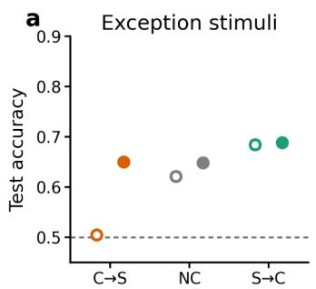

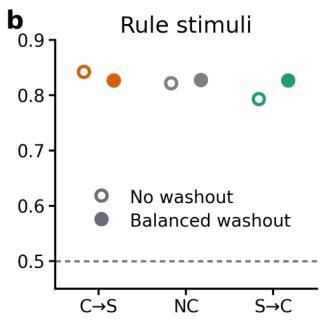

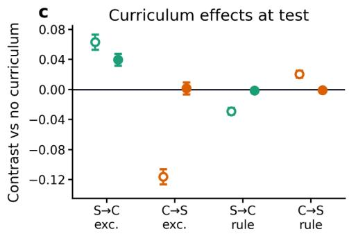  
Figure S1: Balanced washout control. We continued training networks for an additional 48-trial block at the no-curriculum composition (36 rule, 12 exception) appended after block $5 ,$ so that all three conditions end on the same local statistics; the test probe follows that block. ${ \mathbf { a } } ,$ Test accuracy on exception stimuli by curriculum, without (open) and with (filled) the washout block. Points are means over 207 networks and error bars are 95% confidence intervals; accuracy is averaged over 20 simulation seeds before plotting. $\mathbf { b } ,$ The same for rule stimuli. $\mathbf { c } ,$ Curriculum contrasts against no curriculum, estimated within stimulus type from the same mixed model used for the network test-phase contrasts in the main text (estimate and 95% CI). The exception benefit of simple-to-complex is reduced but remains reliable after the washout, whereas the complex-to-simple exception cost and the simple-to-complex rule cost are both abolished, identifying them as recency efects.

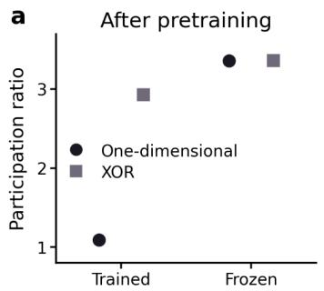

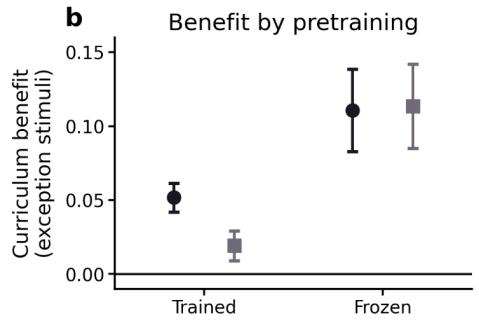

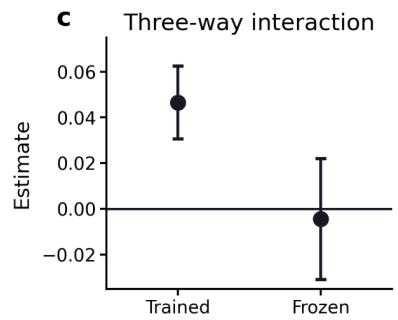  
Figure S2: Frozen representation control. Experiment 2 repeated with the hidden layer frozen at its initialisation and only the readout trained $\mathrm { ( a }$ fixed random-feature network), alongside the trained-representation model of Figure 5 ${ \mathbf { a } } ,$ Participation ratio of the eight stimuli at the end of pretraining, by pretraining task. One-dimensional pretraining compresses the trained network and leaves the frozen network unchanged by construction. $\mathbf { b } ,$ Curriculum benefit on exception stimuli at test, within each pretraining group (estimate and 95% CI, from the same mixed model used for the Experiment 2 test-phase contrasts in the main text). $\mathbf { c } ,$ The three-way pretraining $\times$ curriculum × stimulus-type interaction for each network. The frozen network shows a larger overall curriculum benefit than the trained one, but it is the same after one-dimensional and XOR pretraining and the interaction is absent. $\mathrm { n } = 1 0 2 7$ networks, three simulation seeds.