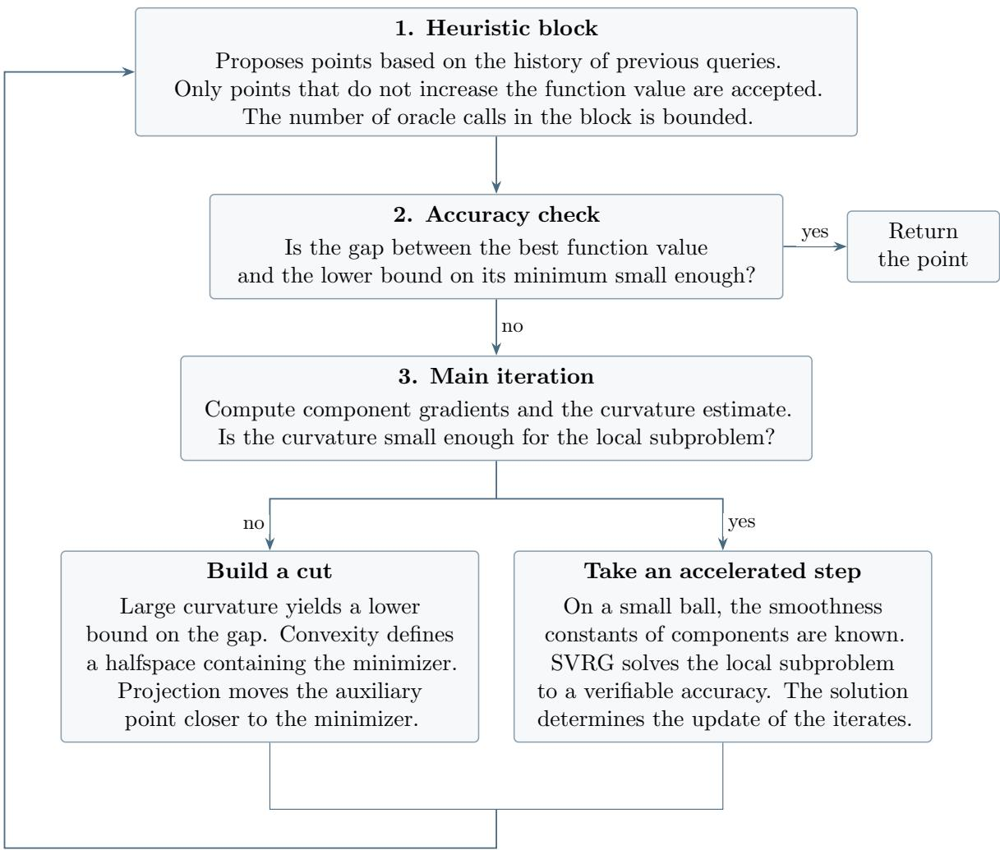
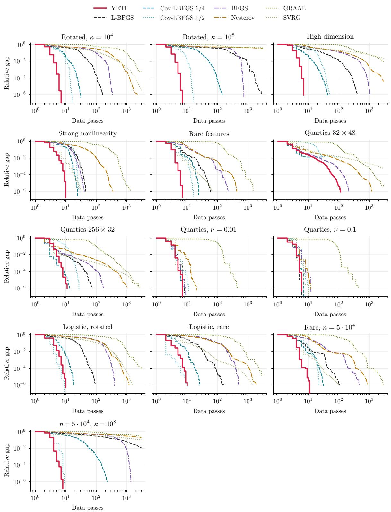
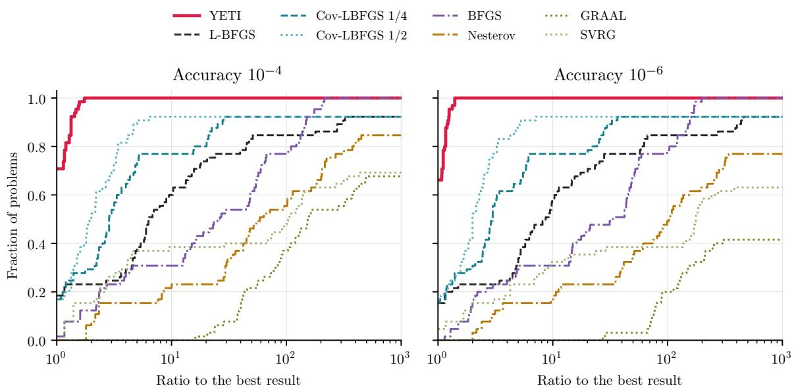
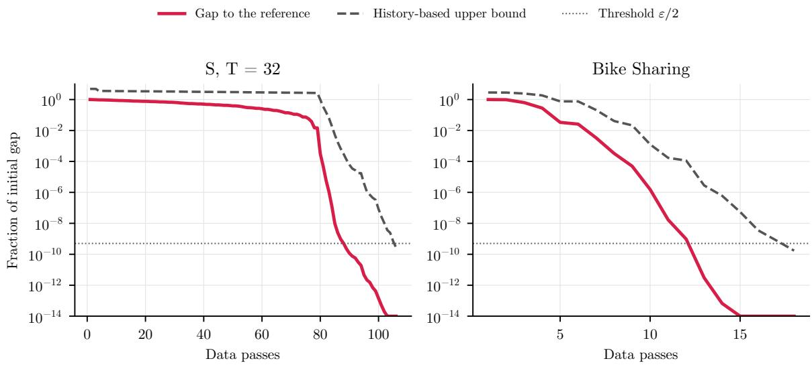

# Descending Everest, Part II Oracle Complexity of Minimizing a Sum of Convex $( L _ { 0 } , L _ { 1 } )$ -Smooth Functions∗

Mikhail Rudomanov♠ ί Ivan Fomin♣ ί Alexander V. Gasnikov† Fedor S. Stonyakin‡

Abstract. We study the minimization of the average of n convex $( L _ { 0 } , L _ { 1 } )$ -smooth functions: the Hessian norm of each function is bounded by an afine function of its gradient norm. We assume known upper bounds R on the distance from the starting point to a minimizer and δ on the diference between the minimum of the average and the average of the infima of the components. We derive upper and lower bounds on the oracle complexity of reaching accuracy ε in function value in expectation. Up to logarithmic factors, both bounds are of order

$$
n \big ( 1 + ( L _ { 1 } R ) ^ { 2 / 3 } \big ) + \sqrt { \frac { n ( L _ { 0 } + L _ { 1 } ^ { 2 } \delta ) R ^ { 2 } } { \varepsilon } + n ( L _ { 1 } R ) ^ { 2 } } .
$$

The upper bound is attained by the proposed method YETI. The method combines ideas of accelerated proximal methods and variance reduction methods with a heuristic for choosing additional points. The number of oracle calls made by the heuristic is bounded, which preserves the upper bound on the total number of queries needed to reach the target accuracy. In the experiments, YETI is compared with first-order methods on synthetic problems and Poisson regression problems. We also examine the stopping criterion and the efect of the heuristic separately. The lower bound is obtained by an explicit construction of families of instances that are hard for any first-order method.

Keywords: $( L _ { 0 } , L _ { 1 } )$ )-smoothness, generalized smoothness, finite-sum minimization, oracle complexity, lower bounds, accelerated methods, variance reduction.

Use of language models. The models Codex Astra 6 and Claude Opus 5.5 were used in obtaining the theoretical results of this work. They were also used to prepare and typeset the manuscript and to translate the original text into English. Nevertheless, every line of the paper, including every statement, every proof, and every computation, has been personally edited and checked by the authors. The authors bear sole responsibility for the correctness of all mathematical statements, proofs, and conclusions.

## 1 Introduction

We consider the problem of minimizing a finite sum

$$
f ( x ) = { \frac { 1 } { n } } \sum _ { i = 1 } ^ { n } f _ { i } ( x ) \to \operatorname* { m i n } _ { x \in \mathbb { R } ^ { d } } .
$$

Problems of this form arise in empirical risk minimization in machine learning, where $f _ { i }$ is the loss on the i-th example of the training set (Shalev-Shwartz and Ben-David, 2014, Bottou et al., 2018). In federated and distributed learning, the component $f _ { i }$ is the loss on the data of the i-th device or computing node (McMahan et al., 2017). The gradient of a single component is often much cheaper to compute than the full gradient. Therefore, we measure the complexity of methods by the number of calls to an oracle that returns the value and the gradient of a single component.

For a sum of L-smooth functions, variance reduction methods (Johnson and Zhang, 2013, Xiao and Zhang, 2014) make it possible to reduce the number of oracle calls. They periodically compute the full gradient of $f ,$ and at the remaining steps they use the gradients of individual components $f _ { i }$ . Lower bounds for arbitrary randomized methods show which dependencies on the number of components and on the accuracy cannot be improved (Woodworth and Srebro, 2016).

However, the L-smoothness condition fails, for example, for exponential loss functions. The $( L _ { 0 } , L _ { 1 } )$ -smoothness condition was introduced by Zhang et al. (2020) to explain the success of methods with gradient clipping. When training an LSTM-based language model, the authors observed that the local smoothness constant grows together with the gradient norm. A similar dependence was also found when training transformers (Crawshaw et al., 2022). The $( L _ { 0 } , L _ { 1 } )$ smoothness condition admits precisely this kind of curvature growth. Its generalizations and first-order methods for such functions were studied in Li et al. (2023), Gorbunov et al. (2025), Vankov et al. (2025), Tyurin (2025). For finite sums, one has to account simultaneously for the number of components and for the growth of curvature. For example, in Poisson regression with the log link (Stan Development Team) $f _ { i } ( x ) = \exp ( a _ { i } ^ { \top } x ) - b _ { i } a _ { i } ^ { \top } x$ , where $b _ { i } \geq 0$ , the Hessian is unbounded on the whole space, but

$$
\begin{array} { r } { \| \nabla ^ { 2 } f _ { i } ( x ) \| \leq b _ { i } \| a _ { i } \| ^ { 2 } + \| a _ { i } \| \| \nabla f _ { i } ( x ) \| . } \end{array}
$$

In phase retrieval from intensity measurements, one uses the losses $f _ { i } ( x ) = ( \langle a _ { i } , x \rangle ^ { 2 } - b _ { i } ) ^ { 2 }$ (Candès et al., 2015). Here, too, one has to minimize a finite sum of components with unbounded curvature. Another example is the exponential loss in classification (Gorbunov et al., 2025, Example 1.5). In all these problems, when the number of observations is large, computing the full gradient may be expensive, and the gradient itself is not globally Lipschitz. Therefore, one needs methods that account for the growth of curvature and do not compute the gradients of all components at every step. Below we assume that $f$ attains its minimum, and that the distance to the minimizer, the initial optimality gap, and the heterogeneity of the components are bounded.

The peculiarity of finite sums. In the problem under consideration, each component satisfies the inequality

$$
0 \preceq \nabla ^ { 2 } f _ { i } ( x ) \preceq \left( L _ { 0 , i } + L _ { 1 } \| \nabla f _ { i } ( x ) \| \right) I .
$$

Even at a minimizer of the average, the gradients of individual components can be large: the equality $\nabla f ( x ^ { * } ) = 0$ only means that their sum is zero. Therefore, a small norm of the full gradient does not imply small smoothness constants of the components, on which the bounds of variance reduction methods depend. What is the oracle complexity of minimizing a finite sum in this situation? We answer this question in this work.

Notation. We denote by $\varepsilon > 0$ the required accuracy of the solution in function value: the method must output a point xˆ such that $f ( { \hat { x } } ) - f ^ { * } \leq \varepsilon .$ . Throughout, k·k denotes the Euclidean norm of a vector and the spectral norm of a matrix, [x, y] is the segment with endpoints x, $\boldsymbol { y } \in \mathbb { R } ^ { d }$ , and $B ( x , r )$ is the closed ball of radius r centered at x. We denote the sum of the first k terms of a sequence by the corresponding capital letter: for example, $A _ { k } = a _ { 1 } + \cdots + a _ { k }$ and $A _ { 0 } = 0$

For randomized methods, the stated accuracy is required in expectation. All projections are Euclidean; $\Pi _ { C }$ denotes the projection onto a nonempty closed convex set C.

Main result. Let the components be convex, twice continuously diferentiable, and bounded from below, and let $\begin{array} { r } { n ^ { - 1 } \sum _ { i } L _ { 0 , i } \leq L _ { 0 } } \end{array}$ . We assume that the starting point $x _ { 0 }$ is zero: this can be achieved by a shift, with respect to which the problem class is invariant. We assume that f attains its minimum at a point $x ^ { * }$ with $\| x ^ { * } \| \leq R$ and $f ( 0 ) - f ^ { * } \leq \Delta$ . Under the conditions of Theorem 2.9, the upper and lower complexity bounds are, up to logarithmic factors, of order

$$
n \big ( 1 + ( L _ { 1 } R ) ^ { 2 / 3 } \big ) + \sqrt { \frac { n ( L _ { 0 } + L _ { 1 } ^ { 2 } \delta ) R ^ { 2 } } { \varepsilon } + n ( L _ { 1 } R ) ^ { 2 } } .
$$

Here, complexity means the worst-case expected number of queries of values and gradients of individual components that sufices to guarantee $\mathbb { E } [ f ( \hat { x } ) - f ^ { * } ] \leq \varepsilon$ . The lower bound holds for arbitrary randomized methods; the dimension of the problem is not bounded. The precise definition of the class and the logarithmic factors are given in Section 2.

Note on the logarithmic factors. In the upper bound, the hidden factor is $\log ^ { 2 } N$ , where N from (2.5) grows linearly in $\Delta / \varepsilon$ . In the worst case, when $\Delta$ is exponentially large in $L _ { 1 } R _ { : }$ this logarithm can be of order $L _ { 1 } R$ , so the factor $\log ^ { 2 } N$ can be of order $( L _ { 1 } R ) ^ { 2 }$ , that is, it can give an additional polynomial factor.

The term $\sqrt { n L _ { 0 } R ^ { 2 } / \varepsilon }$ is known from the theory of minimizing a sum of L-smooth functions (Woodworth and Srebro, 2016). The term $n ( L _ { 1 } R ) ^ { 2 / 3 }$ reflects the number of oracle calls required to approach the minimum from the region where the gradients are exponentially large. The term

$$
\sqrt { \frac { n L _ { 1 } ^ { 2 } R ^ { 2 } \delta } { \varepsilon } + n ( L _ { 1 } R ) ^ { 2 } }
$$

arises because the curvature of the components near the minimum is determined by their gradients, which can remain large even at the minimizer of the average.

Method and experiments. The upper bound is attained by the method YETI. When the local curvature is small, it performs an accelerated step, solving the auxiliary subproblem by SVRG, and when it is large, it projects the auxiliary point onto a halfspace containing the minimizer. In addition, YETI uses a heuristic with a bounded number of oracle queries: it makes it possible to take advantage of good proposed points without worsening the theoretical bound. In the experiments, YETI is compared with other methods, and its stopping criterion is tested.

Relation to known methods. YETI uses the accelerated proximal scheme of Monteiro– Svaiter (Monteiro and Svaiter, 2013) and the idea of adaptive choice of regularization without solving an implicit equation at every step (Carmon et al., 2022). The local subproblem is solved by a projected variant of SVRG. Acceleration via approximate solution of regularized subproblems was also studied in the Catalyst scheme (Lin et al., 2015, 2018) and in Frostig et al. (2015). In YETI, the choice of the step depends on the computed curvature estimate of the sum: if this estimate is too large, the method constructs a separating halfspace instead of a step. The complexity bound accounts for the queries of both the local solver and the heuristic.

The lower bound relies on Yao’s minimax principle (Yao, 1977): a hard instance is chosen at random from a finite family, after which we average over the random variables of the algorithm. Hidden coordinates and the distribution of information across diferent components continue the known approach to constructing lower bounds for finite-sum minimization (Woodworth and Srebro, 2016). For the class under consideration, we apply exponential transformations of convex chains and choose their parameters so that the constraints on $L _ { 1 } , \delta ,$ , and the initial optimality gap are satisfied.

The present paper continues our previous work Rudomanov et al. (2026), where the oracle complexity of this class was found for a single function $( n = 1 )$ : its order is $\sqrt { L _ { 0 } R ^ { 2 } / \varepsilon } + L _ { 1 } R .$ and for a small initial optimality gap it is $\sqrt { L _ { 0 } R ^ { 2 } / \varepsilon } + ( L _ { 1 } R ) ^ { 2 / 3 }$ . Here we consider a finite sum, and the oracle returns the value and the gradient of only one component; therefore, to obtain the upper bound, we use variance reduction. The results for a single function (Vankov et al., 2025, Tyurin, 2026) concern an oracle that computes the full gradient. In particular, the optimality of the method of Tyurin (2026) for suficiently small ε is based on the classical lower bound for the smooth subclass and concerns only the leading term $\sqrt { L _ { 0 } R ^ { 2 } / \varepsilon }$ . The optimality of the term $n ( L _ { 1 } R ) ^ { 2 / 3 }$ for an oracle returning the gradient of a single component does not follow from it. Similarly, the bounds for stochastic methods in the case of a common minimizer of all components (Gorbunov et al., 2025) do not cover an arbitrary positive heterogeneity δ.

Organization of the paper. The problem setting and the main result are given in Section 2, the method YETI and its analysis in Sections 3–5, the main experiments in Section 6 (further experiments and their details are in Appendix I), and the lower bound in Section 7. The main text contains the results and a proof sketch of the lower bound, while auxiliary proofs and variants of the method are deferred to the appendices. A summary table of known bounds is given in Appendix J.

## 2 Problem setting and main bounds

We consider the function $\begin{array} { r } { f = n ^ { - 1 } \sum _ { i = 1 } ^ { n } f _ { i } } \end{array}$ on $\mathbb { R } ^ { d }$ . We are given $n \geq 2 , L _ { 0 } , \delta \geq 0$ , and $L _ { 1 } , R , \Delta , \varepsilon > 0$ . We assume that the starting point is zero; this can be achieved by a shift of coordinates. All general assumptions are collected below.

Assumption 2.1 (components).   
The functions $f _ { i } : \mathbb { R } ^ { d }  \mathbb { R } , 1 \leq i \leq n ,$ are convex, twice continuously diferentiable, and   
bounded from below.

Assumption 2.2 (generalized smoothness).

Numbers $L _ { 0 , i } \geq 0$ are known such that

$$
\begin{array} { r } { \| \nabla ^ { 2 } f _ { i } ( x ) \| \leq L _ { 0 , i } + L _ { 1 } \| \nabla f _ { i } ( x ) \| \quad ( x \in \mathbb { R } ^ { d } , 1 \leq i \leq n ) , } \end{array}
$$

$$
{ \frac { 1 } { n } } \sum _ { i = 1 } ^ { n } L _ { 0 , i } \leq L _ { 0 } .\tag{2.1}
$$

## Assumption 2.3 (minimizer).

There exists a minimizer $x ^ { * } \in \arg$ min f such that $\| x ^ { * } \| \leq R$ . We denote $f ^ { * } = f ( x ^ { * } )$

Assumption 2.4 (initial optimality gap).

We have $f ( 0 ) - f ^ { * } \leq \Delta$ , and $\Delta \geq 2 \varepsilon$

Assumption 2.5 (heterogeneity).

$$
f ^ { * } - \frac { 1 } { n } \sum _ { i = 1 } ^ { n } \operatorname* { i n f } _ { x \in \mathbb { R } ^ { d } } f _ { i } ( x ) \leq \delta .\tag{2.2}
$$

Assumption 2.6 (range of accuracies).

$$
\frac { L _ { 1 } ^ { 2 } R ^ { 2 } \delta } { \varepsilon } \geq 3 .\tag{2.3}
$$

Definition 2.7 (problem class).

We denote by $\mathcal { P } _ { d }$ the set of collections of functions $f _ { 1 } , \dots , f _ { n } : \mathbb { R } ^ { d } \to \mathbb { R }$ and known numbers $L _ { 0 , 1 } , \ldots , L _ { 0 , n }$ satisfying Assumptions 2.1–2.5.

Assumption 2.2 bounds only the average of the numbers $\boldsymbol { L } _ { 0 , i } ;$ individual $L _ { 0 , i }$ may exceed $L _ { 0 }$ . It sufices to construct the lower bound on the subclass $L _ { 0 , i } = L _ { 0 }$ . For $C ^ { 2 }$ functions, the Hessian bound from Assumption 2.2 is equivalent to symmetric $( L _ { 0 , i } , L _ { 1 } )$ -smoothness (Gorbunov et al., 2025, Assumption 1.3, Eq. (5)):

$$
\| \nabla f _ { i } ( x ) - \nabla f _ { i } ( y ) \| \leq \left( L _ { 0 , i } + L _ { 1 } \operatorname* { s u p } _ { z \in [ x , y ] } \| \nabla f _ { i } ( z ) \| \right) \| x - y \| .
$$

Assumption 2.5 requires knowing neither $f ^ { * }$ nor the infima of the components. Assumption 2.6 guarantees that in the hard instance with a hidden pair of functions from Section $^ { 7 , }$ the initial optimality gap exceeds the required accuracy (Lemma D.5).

Oracle model. The algorithm knows the problem parameters and the numbers $L _ { 0 , i }$ . It obtains information about the functions only from an oracle that returns $( f _ { i } ( x ) , \nabla f _ { i } ( x ) )$ for a query $( i , x )$ . Queries are allowed anywhere in $\mathbb { R } ^ { d }$ . The query points, the stopping time, and the output are measurable functions of the received oracle answers and the random variables of the algorithm. Complexity is measured by the number of oracle calls (Nesterov, 2018, Section 1.1). Computing the function value and the full gradient at one point requires n queries.

## Definition 2.8 (oracle complexity).

Let $\tau _ { \mathsf { M } } ( p )$ be the number of oracle calls made by the algorithm M on the input $p ,$ and let ${ \hat { x } } _ { \mathsf { M } } ( \boldsymbol { p } )$ be its output. The algorithm is called valid if for any d and $p \in \mathcal { P } _ { d }$ it stops almost surely and

$$
\mathbb { E } \left[ f ( \hat { x } _ { \mathsf { M } } ( p ) ) - f ^ { * } \right] \leq \varepsilon .
$$

The complexity of an algorithm on the class and the minimax complexity are defined as

$$
\mathcal { T } ( \mathsf { M } ) = \operatorname* { s u p } _ { d \geq 1 } \mathsf { \Pi } _ { p \in \mathcal { P } _ { d } } \mathbb { E } \tau _ { \mathsf { M } } ( p ) ,
$$

$$
{ \mathcal { T } } ^ { * } = \operatorname* { i n f } _ { \mathrm {  ~ \cal ~ M ~ } \mathrm {  ~ v a l i d ~ } } { \mathcal { T } } ( { \sf M } ) .\tag{2.4}
$$

To bound the number of queries, we set

$$
N _ { 0 } = 4 + n + { \frac { ( L _ { 0 } + L _ { 1 } ^ { 2 } \delta ) R ^ { 2 } } { \varepsilon } } + ( L _ { 1 } R ) ^ { 2 } , \qquad N = N _ { 0 } - 2 + { \frac { \Delta } { \varepsilon } } .\tag{2.5}
$$

For nonnegative quantities, the notation a $\lesssim b$ means $a \leq C b$ with an absolute constant C independent of the problem parameters, the dimension, and the algorithm. We write $a \sim b$ if $a \lesssim b \lesssim a$ . The notation O and Ω is used in the same uniform sense, and $\widetilde { \Theta }$ also hides powers of log $N$ . The lower bound uses the quantity $N _ { 0 }$ e, which does not depend on $\Delta .$ , and the upper bound uses the quantity $N ,$ , which by Assumption 2.4 is not smaller than $N _ { 0 }$ . We set

$$
T _ { 0 } = n \big ( 1 + ( L _ { 1 } R ) ^ { 2 / 3 } \big ) + \sqrt { \frac { n ( L _ { 0 } + L _ { 1 } ^ { 2 } \delta ) R ^ { 2 } } { \varepsilon } + n ( L _ { 1 } R ) ^ { 2 } } .\tag{2.6}
$$

Theorem 2.9 (two-sided complexity bound).

Under Assumptions 2.1–2.6, we have

$$
\frac { T _ { 0 } } { \log ^ { 2 } N _ { 0 } } \lesssim T ^ { * } \lesssim T _ { 0 } \log ^ { 2 } N .\tag{2.7}
$$

The upper bound is attained by the method YETI, including the case of diferent $L _ { 0 , i }$ . The lower bound holds already for $L _ { 0 , i } = L _ { 0 }$

The upper bound is proved in Theorem 5.1, and the lower bound in Theorem 7.1. The proofs are given in Appendices C and E. The question of closing the gap in the logarithmic factors remains open.

## 3 The method YETI

YETI combines an accelerated proximal method with a heuristic. The heuristic proposes a point $z \in B ( 0 , R )$ based on the query history. The method accepts it if $f ( z ) \leq f ( x )$ . A single heuristic block is allowed at most ndlog Ne oracle queries, including the verification of the proposed points. If the block has not terminated the method, the main iteration is performed (Figure 1).

  
Figure 1. Flowchart of the method YETI.

Accelerated step and cut. From the gradients of the components at the point $y ,$ we compute the curvature estimate

$$
\ell ( y ) = \frac { 1 } { n } \sum _ { i } \bigl ( L _ { 0 , i } + L _ { 1 } \| \nabla f _ { i } ( y ) \| \bigr ) .
$$

By Lemma G.2, the following inequalities hold:

$$
\begin{array} { r } { \| \nabla ^ { 2 } f ( y ) \| \le \ell ( y ) \le \frac { 3 } { 2 } L _ { 0 } + 2 L _ { 1 } ^ { 2 } \big ( \delta + f ( y ) - f ^ { * } \big ) , \qquad \ell ( z ) \le e ^ { L _ { 1 } \| z - y \| } \ell ( y ) . } \end{array}
$$

If the quantity $\ell ( y )$ is small, then in the ball of radius $r = \mathrm { m i n } \{ R , 1 / ( 2 L _ { 1 } ) \}$ one can solve the regularized subproblem by SVRG and perform an accelerated step. If, however, the curvature check fails, then the upper bound on $\ell ( y )$ implies a lower bound on the optimality gap $f ( y ) - f ^ { * }$ . By convexity (Assumption 2.1), $\langle \nabla f ( y ) , x ^ { * } - y \rangle \leq - ( f ( y ) - f ^ { * } )$ , so this bound defines a halfspace $\mathcal { H } _ { y }$ containing the minimizer. The projection of the auxiliary point v onto this halfspace brings it closer to $x ^ { * }$

Stopping. By Assumptions 2.1 and 2.3, each computation of $f ( \boldsymbol p )$ and $\nabla f ( \boldsymbol { p } )$ yields the lower bound

$$
\widetilde { f } ( p ) = f ( p ) - \langle \nabla f ( p ) , p \rangle - R \| \nabla f ( p ) \| \leq f ^ { * } .
$$

The subroutine EVALUATE stores the maximum $\widetilde { f } _ { \mathrm { b e s t } }$ of such bounds and the best point found so far, $w _ { \mathrm { b e s t } } \in B ( 0 , R )$ . If $f ( w _ { \mathrm { b e s t } } ) - \widetilde { f } _ { \mathrm { b e s t } } \leq \varepsilon / 2$ e, the method stops and returns $w _ { \mathrm { b e s t } }$ . Compoenent answers that have already been obtained are not queried again.

Algorithm 1 stores the points $x , v ,$ the weight A, and the parameter $h ,$ , from which the regularization is chosen. The bounds $\lambda _ { \downarrow } ( \mathcal { A } )$ and $\lambda _ { \uparrow }$ are the lower and upper limits of the proximal parameter: at each iteration, the method takes $\lambda = \operatorname* { m i n } \{ \operatorname* { m a x } \{ h , \lambda _ { \downarrow } ( \mathcal { A } ) \} , \lambda _ { \uparrow } \}$ . The lower limit keeps the weight of the accelerated step bounded, makes the local subproblem well conditioned, and ensures stopping; it does not increase as the weight A grows. The upper limit $\lambda _ { \uparrow }$ is the value of the lower limit at the initial weight $\begin{array} { r } { \mathcal { A } = R ^ { 2 } / ( 2 \Delta ) } \end{array}$ . Explicit formulas are given in (G.7). The subroutines EVALUATE and BLOCK, including the rules for counting queries, are given in Appendix G. The requirements on the output of SOLVER are stated in the next section.

Algorithm 1 YETI   
Input: n, R, ∆, δ, ε, L0, $L _ { 1 }$ , constants $L _ { 0 , i }$ , a heuristic   
1: set $r , \lambda _ { \downarrow }$ , and $\lambda _ { \uparrow }$ by (G.7)   
2: $x = v = 0$   
3: $\begin{array} { r } { \mathcal { A } = R ^ { 2 } / ( 2 \Delta ) } \end{array}$   
4: $h = \lambda _ { \uparrow }$   
5: the query history is empty   
6: loop   
7: $x  \operatorname { B L O C K } ( x )$ ▷ heuristic block   
8: $\lambda = \operatorname* { m i n } \left\{ \operatorname* { m a x } \{ h , \lambda _ { \downarrow } ( \mathcal { A } ) \} , \lambda _ { \uparrow } \right\}$   
9: $a _ { \lambda } = \left( 1 + \sqrt { 1 + 4 \lambda { \cal A } } \right) / ( 2 \lambda )$   
10: $\alpha = { a _ { \lambda } } / { ( \mathcal { A } + a _ { \lambda } ) }$   
11: $y = ( 1 - \alpha ) x +$ αv   
12: EVALUATE(y)   
13: $\begin{array} { r } { \ell ( y ) = \frac { 1 } { n } \sum _ { i } \bigl ( L _ { 0 , i } + L _ { 1 } \| \nabla f _ { i } ( y ) \| \bigr ) } \end{array}$   
14: if $\ell ( y ) \stackrel { \cdot \cdot } { > } e ^ { L _ { 1 } \dot { r } } \big ( { \textstyle \frac { 3 } { 2 } } L _ { 0 } + 2 L _ { 1 } ^ { 2 } ( \delta + R ^ { 2 } / A ) \big )$ then ▷ cut   
15: $\mathcal { H } _ { y } = \Big \{ w : \langle \nabla f ( y ) , w - y \rangle \leq - \frac { \ell ( y ) - \frac { 3 } { 2 } L _ { 0 } - 2 L _ { 1 } ^ { 2 } \delta } { 2 L _ { 1 } ^ { 2 } } \Big \}$   
16: $v  \Pi _ { B ( 0 , R ) } \Pi _ { \mathcal { H } _ { y } } v$   
17: $h  2 \lambda$   
18: else ▷ step based on the solution of the local subproblem   
19: $( z , g , \beta ) \gets \mathrm { S O L V E R } ( y , \lambda )$   
20: if $\| g \| \leq \varepsilon / ( 4 R )$ then   
21: return z   
22: end if   
23: $\gamma = \lambda / ( \lambda + \beta )$   
24: $x  { \frac { ( 1 - \gamma ) { \dot { A } } x + \gamma ( A + a _ { \lambda } ) z } { x } }$   
$A + \gamma a _ { \lambda }$   
25: $v  \Pi _ { B ( 0 , R ) } ( v - \gamma a _ { \lambda } \dot { g } )$   
26: $\mathcal { A }  \mathcal { A } + \gamma a _ { \lambda }$   
(2λ, β > 0,   
27: h ←   
λ/2, β = 0   
28: if $\mathcal { A } \geq 2 R ^ { 2 } / \varepsilon$ then   
29: return x   
30: end if   
31: end if   
32: end loop

## 4 The local subproblem

At the point y, we solve the subproblem

$$
\operatorname* { m i n } _ { z \in B ( 0 , R ) \cap B ( y , r ) } \left\{ f ( z ) + \frac { \lambda } { 2 } \| z - y \| ^ { 2 } \right\} .
$$

The solver returns $z \in B ( 0 , R ) \cap B ( y , r ) , g \in \partial ( f + I _ { B ( 0 , R ) } ) ( z )$ , and $\beta \geq 0 .$ , where $\beta > 0$ is possible only ${ \mathrm { i f ~ } } \| y - z \| = r$ . Here ${ \cal I } _ { B ( 0 , R ) }$ is the indicator function of the ball $B ( 0 , R )$ . The output of the solver must satisfy one of the two conditions

$$
\| g \| \leq \frac { \varepsilon } { 4 R } \quad \mathrm { o r } \quad \| g - ( \lambda + \beta ) ( y - z ) \| \leq \frac { 4 } { 5 } ( \lambda + \beta ) \| y - z \| .
$$

The first one allows YETI to stop, and the second one ensures the accuracy of the accelerated update. If $\beta = 0$ , the weight of this update does not change, and if $\beta > 0$ , it is multiplied by the coeficient $\gamma = \lambda / ( \lambda + \beta ) < 1$

To solve the subproblem, we use SVRG with component sampling probabilities proportional to their local smoothness constants. After each epoch, the above conditions are checked. The solver terminates almost surely (Lemma H.2), and the expected number of its queries per iteration of YETI with a fixed history is $O ( n \log ( n + 2 ) )$ (Appendix C.3). The full algorithm of the solver is given in Appendix H.

## 5 Complexity bound for YETI

The analysis uses the Lyapunov function

$$
\begin{array} { r } { \Phi = \mathcal { A } \big ( f ( x ) - f ^ { * } \big ) + \frac { 1 } { 2 } \| v - x ^ { * } \| ^ { 2 } \leq R ^ { 2 } . } \end{array}
$$

Accepting a point proposed by the heuristic does not increase the first term. The projection onto $\mathcal { H } _ { y }$ decreases the second one. Under the accelerated update, Φ does not increase owing to the accuracy condition of the local solver. Hence $f ( x ) - f ^ { * } \leq R ^ { 2 } / A$

The number of iterations at which the regularization increases is bounded owing to the decrease of Φ. At the remaining iterations, the regularization is halved or the weight A grows. This yields a bound on the number of iterations until the condition $\mathcal { A } \geq 2 R ^ { 2 } / \varepsilon$ holds. The corresponding bounds are proved in Lemmas B.3 and B.4 of Appendix B. Each iteration, together with the heuristic block preceding it, requires $O ( n \log N )$ queries in expectation for a fixed history of the previous iterations.

Theorem 5.1 (upper bound).

Under Assumptions 2.1–2.6, Algorithm 1 stops almost surely and returns a point $\hat { x }$ such that

$$
\mathbb { E } [ f ( \hat { x } ) - f ^ { * } ] \leq \varepsilon ,\tag{5.1}
$$

and the expected total number $T$ of oracle calls satisfies

$$
\mathbb { E } T \lesssim T _ { 0 } \log ^ { 2 } N .\tag{5.2}
$$

The count $T$ includes all oracle calls in the heuristic blocks, the main iterations, and the checks.

The proof is given in Appendix C.3. A variant in which the allowed number of queries of the heuristic depends on the work already done is considered in Appendix F.4.

## 6 Numerical experiments

We compare the methods by the number of oracle calls on chains S and X (the hard families from Section 7.1), on Poisson models, and on 65 instances from 13 families (five instances each), including sums of quartic functions and logistic regression. The number of queries is divided by $n ,$ , that is, it is measured in passes over the data; the queries spent on rejected trial points during line search are also counted. The relative optimality gap equals $( f - f _ { \mathrm { r e f } } ) / \widehat { \Delta }$ where $\widehat { \Delta } = f ( 0 ) - f _ { \mathrm { r e f } }$ and $f _ { \mathrm { r e f } }$ bis the reference value of the minimum. On the chains, it coincides with $f ^ { * }$ , which is known from the construction. On the other instances, $f ^ { * }$ is unknown, and $f _ { \mathrm { r e f } }$ is its approximation computed numerically in advance; therefore, we denote it by $f _ { \mathrm { r e f } }$ rather than $f ^ { * }$ . The queries spent on computing the reference value are not counted in the comparison. The problem formulations, method settings, and detailed results are given in Appendix I.

On the chains, YETI performs approximately as well as L-BFGS. On five Poisson instances, it reaches the relative accuracy $1 0 ^ { - 4 }$ within 4–9 passes; on freMTPL2freq, SAGA requires fewer passes: 5 versus 7 (Tables 2, 4).

Stopping. The history-based stopping criterion (G.2) does not use the reference value. For $\varepsilon = 1 0 ^ { - 6 } \widehat { \Delta }$ , it is triggered on all 65 instances, and all returned points satisfy the tolerance bwith respect to the reference value. The median number of passes until stopping is 15, and the maximum is 273. The criterion may be triggered later than the tolerance is actually reached (Figure 4).

Test problems. Chains S and X are numerical variants of the hard families from Section 7.1. The Poisson models are synthetic instances and instances on the Bike Sharing and freMTPL2freq data. The thirteen families from which the 65 instances are composed (their names are shown in Figure 2 and in Table 1) are constructed as follows.

▷ Rotated, κ: Poisson regression in which the feature covariance matrix has condition number $\kappa \in \{ 1 0 ^ { 4 } , 1 0 ^ { 8 } \}$ and is not diagonal in the original basis (its eigenvectors are rotated with respect to the coordinate axes).

▷ High dimension: Poisson regression with a large number of features: $n = 6 0 0 , d = 1 6 0$ $\kappa = 1 0 ^ { 4 }$

▷ Strong nonlinearity: Poisson regression in which the true parameter vector used to generate the responses is three times longer than in the other Poisson families; this increases the spread of the linear predictors $a _ { i } ^ { \top } x$ and of the values of the exponential.

▷ Rare features and Rare, $n = 5 \cdot 1 0 ^ { 4 }$ : Poisson regression with sparse features; in the second family, the number of components equals $5 \cdot 1 0 ^ { 4 }$

▷ $n = 5 \cdot 1 0 ^ { 4 } , \kappa = 1 0 ^ { 8 }$ : ill-conditioned Poisson regression with $5 \cdot 1 0 ^ { 4 }$ components.

▷ Quartics: sums of quartic functions $\begin{array} { r } { f _ { i } ( x ) = \frac { 1 } { 2 } ( x - c _ { i } ) ^ { \mathsf { T } } H _ { i } ( x - c _ { i } ) + \frac { \nu } { 4 } \| x - c _ { i } \| ^ { 4 } } \end{array}$ , where $H _ { i } \succ 0$ and $c _ { i }$ are random centers. In the family names $3 2 \times 4 8$ and $2 5 6 \times 3 2$ , the number of components n and the dimension d are indicated; ν is the weight of the fourth-degree term (in these two families, $\nu = 1 0 ^ { - 6 } )$

▷ Logistic, rotated and Logistic, rare: regularized logistic regression with rotated and with sparse features, respectively.

  
Figure 2. Best relative optimality gap so far on the first instance of each family (log–log scale; YETI in red; κ is the condition number of the feature covariance).

## 7 Lower bound for arbitrary queries

We bound from below the number of queries required by any method that solves all instances of the class under consideration.

## 7.1 The origin of the four terms

We prove the lower bound separately for each of the four terms. Denote

$$
\begin{array} { r l r } & { } & { { \boldsymbol { B } } _ { n } = { \boldsymbol { n } } , } \\ & { } & { { \boldsymbol { B } } _ { S } = \sqrt { \frac { n L _ { 0 } R ^ { 2 } } { \varepsilon } } , } \\ & { } & { { \boldsymbol { B } } _ { Q } = n ( L _ { 1 } { \boldsymbol { R } } ) ^ { 2 / 3 } , } \\ & { } & { { \boldsymbol { B } } _ { X } = \sqrt { \frac { n L _ { 1 } ^ { 2 } R ^ { 2 } \delta } { \varepsilon } + n ( L _ { 1 } { \boldsymbol { R } } ) ^ { 2 } } . } \end{array}\tag{7.1}
$$

Since ${ \sqrt { a ^ { 2 } + b ^ { 2 } } } \sim a + b$ for $a , b \geq 0 ,$ we have $T _ { 0 } \sim B _ { n } + B _ { S } + B _ { X } + B _ { Q }$

<table><tr><td></td><td>Term What makes the problem hard</td><td>Hard family</td></tr><tr><td> $B _ { n }$ </td><td>Search for an informative component</td><td>Hidden pair of functions</td></tr><tr><td> $B _ { S }$ </td><td>Sequential revealing of smooth chains</td><td>Independent chains S</td></tr><tr><td> $B _ { X }$ </td><td>Heterogeneity of components under generalized smoothness</td><td>Exponential chains X</td></tr><tr><td> $B _ { Q }$ </td><td>Repeated search for the component for the next step</td><td>Chain Q with hidden placement of links</td></tr></table>

For each term, we construct its own family of instances. Since the method must solve the instances of all four families, its complexity is not smaller than the maximum of the obtained bounds. Below, the dependencies are discussed up to numerical and logarithmic factors. The precise conditions of the constructions are given in the appendix; if a particular construction is not applicable, the corresponding term is bounded via the others.

Search for an informative component: $B _ { n } = n$ . Among the n components, two nonzero ones are chosen at random, and the rest are zero. Until the first call to one of them, the algorithm receives only zero answers. These answers do not allow it to distinguish two instances whose minimizers lie on opposite sides of the starting point. For the expected error to be small, one has to find the hidden pair of functions with suficient probability, and this requires on the order of n oracle calls (Lemma D.5).

Independent smooth chains: $B _ { S }$ . Each component contains its own chain of coordinates. By a chain we mean a function in which the next coordinate afects the oracle answer only after suficient progress along the previous coordinates. In the idealized model, a single query reveals at most one new link of one chain. How this property carries over to arbitrary queries is explained below.

In family ${ \mathrm { S } } ,$ the number of links of a single chain is of order $\sqrt { L _ { 0 } R ^ { 2 } / ( n \varepsilon ) }$ . To reach accuracy $\varepsilon ,$ , one needs to reveal a suficient fraction of the total number of links of all chains. Therefore, the number of queries is of order

$$
n \sqrt { \frac { L _ { 0 } R ^ { 2 } } { n \varepsilon } } = \sqrt { \frac { n L _ { 0 } R ^ { 2 } } { \varepsilon } } = B _ { S } .
$$

The instances of this family are smooth: $\lVert \nabla ^ { 2 } f _ { i } \rVert \leq L _ { 0 }$ (Lemma D.6). If the conditions for constructing the chain are not satisfied, then $B s \lesssim B _ { n } ,$ , and the bound for $B _ { n }$ sufices.

Exponential chains: $B _ { X }$ . Under generalized smoothness, the curvature of a component can grow together with its gradient. Even at a minimizer of the average, where $\nabla f ( x ^ { * } ) = 0$ , the individual gradients $\nabla f _ { i } ( x ^ { * } )$ can be nonzero and cancel each other. Therefore, a small norm of the gradient of the average does not imply small smoothness constants of the components. The parameter $\delta$ bounds the discrepancy between the minimum of the average and the average of the infima of the components.

In family $\mathrm { X , }$ the chains enter the exponents of components grouped into pairs. The construction preserves the sequential revealing of links and sets the heterogeneity equal to $\delta .$ The bound for this family, together with the bound for the hidden pair of functions, yields $B _ { X }$ (Lemmas D.8 and D.5). Since $B _ { X } = \sqrt { n } L _ { 1 } R \sqrt { 1 + \delta / \varepsilon }$ , we have

$$
B _ { X } \sim \sqrt { n } L _ { 1 } R \operatorname* { m a x } \left\{ 1 , \sqrt { \frac { \delta } { \varepsilon } } \right\} .
$$

Search for the next link: $B _ { Q }$ . Family Q uses a single chain, but its links are randomly placed across pairs of components. After revealing the next coordinate, it is not enough to know in which direction to continue: one also has to find the pair containing the next link. A component that has already been queried may become informative only at the next level of the chain, so computing all components once does not eliminate these searches.

Under the conditions of Lemma D.10, the length of the chain is of order $( L _ { 1 } R ) ^ { 2 / 3 }$ , and the search for a pair at each level requires on the order of n queries in expectation. Hence, up to logarithmic factors,

$$
\underbrace { ( L _ { 1 } R ) ^ { 2 / 3 } } _ { \mathrm { n u m b e r ~ o f ~ l e v e l s ~ s e a r c h ~ p e r ~ l e v e l } } = B _ { Q } .
$$

The exponent $2 / 3$ is explained by the choice of the chain length T. At its minimizer, the $T$ active coordinates are equal to $R / \sqrt { T }$ , so that the norm of this point equals R. The bound on the optimality gap in terms of the number of revealed links (D.20) shows that to reach the accuracy one has to pass on the order of $L _ { 1 } R / \sqrt { T }$ levels (up to logarithmic factors), while the total number of levels is T. The chain length is chosen so that the quantities $T$ and $L _ { 1 } R / \sqrt { T }$ coincide up to absolute constants. From the equality $T = L _ { 1 } R / \sqrt { T }$ we obtain $T ^ { 3 / 2 } = L _ { 1 } R ,$ that is, $T = ( L _ { 1 } R ) ^ { 2 / 3 }$ ; in Lemma D.10, an integer T of this order is chosen. The precise conditions of this choice also take into account the initial optimality gap and the heterogeneity. The number of oracle calls required to find the next link is bounded in Lemmas D.9 and D.3.

## 7.2 The lower bound

Let Assumptions 2.1–2.6 hold. The number $N _ { 0 }$ is defined in (2.5).

Theorem 7.1. ▼ proof in Appendix E

For an oracle returning $( f _ { i } ( x ) , \nabla f _ { i } ( x ) )$ , we have

$$
\mathcal { T } ^ { * } \gtrsim \frac { T _ { 0 } } { \log ^ { 2 } N _ { 0 } } .
$$

The right-hand side does not depend on $\Delta$ for $\Delta \geq 2 \varepsilon$ . The bound refers to the worst instance of the class in arbitrary dimension. The method may be randomized and may choose query points anywhere in the space, not only in the linear span of the previously obtained gradients.

Together with the upper bound for YETI (Theorem 5.1), this theorem shows that in this setting the exponents of $n , L _ { 0 } , L _ { 1 } , R , \delta _ { \mathrm { \scriptsize ~ ; ~ } }$ and ε cannot be improved (up to logarithmic factors).

The logarithmic gap between the upper and lower bounds is not closed here. Assumption 2.6 is essential for the scope of the result: this lower bound cannot be automatically transferred, for example, to the subclass with $\delta = 0$ . The equality $\delta = 0$ means that the point $x ^ { * }$ minimizes each component, that is, all $f _ { i }$ have a common minimizer. For this case, convergence bounds for the stochastic methods $( L _ { 0 } , L _ { 1 } ) – \mathrm { S G D }$ and SGD-PS were obtained in Gorbunov et al. (2025, Section 7).

## 7.3 Proof of the lower bound

Proof sketch of Theorem 7.1. The instance with a hidden pair of functions $\mathrm { g i }$ ves the bound for $B _ { n }$ . Family S gives the bound for $B _ { S }$ , and if its conditions are violated, we use $B s \lesssim B _ { n }$ Family X, together with the hidden pair of functions, gives the bound for $B _ { X }$ up to a logarithmic factor. Family Q gives the bound for $B _ { Q }$ . When conditions (D.17) are not satisfied, this term is bounded via the bounds already obtained.

Consequently,

$$
\begin{array} { r } { T _ { 0 } \sim \operatorname* { m a x } \{ B _ { n } , B _ { S } , B _ { X } , B _ { Q } \} \lesssim \mathcal { T } ^ { * } \log ^ { 2 } N _ { 0 } . } \end{array}
$$

Lemmas D.1–D.3 make it possible to apply these bounds to arbitrary randomized methods. The analysis of all parameter regimes is given in Appendix E. □

## 8 Conclusion

For minimizing a sum of convex $( L _ { 0 } , L _ { 1 } )$ -smooth functions, the method YETI attains the upper bound $O ( T _ { 0 } \log ^ { 2 } N )$ , and for any valid method we prove the lower bound $\Omega ( T _ { 0 } / \log ^ { 2 } N _ { 0 } )$ If $\Delta / \varepsilon \leq N _ { 0 } ^ { c }$ for some fixed $c \geq 1$ , then these bounds coincide up to powers of log $N _ { 0 }$ . Without a restriction on the growth of the initial optimality gap $\Delta ,$ the optimality of the upper bound has not been established.

On 65 instances with relative accuracy $1 0 ^ { - 4 }$ , the tested variant of YETI ranked first (including ties with other methods) in 46 cases, and its history-based stopping criterion was triggered on all 65 instances. In these experiments, the main gain comes from the heuristic (Appendix I). However, its matrix operations may be expensive, so a gain in the number of queries does not necessarily mean the same gain in running time.

## 8.1 Open questions

1. Large initial optimality gap. What is the optimal dependence of the complexity on $\Delta ?$ If $\log ( \Delta / \varepsilon )$ is of order $L _ { 1 } R$ , then the obtained upper and lower bounds may difer polynomially in $L _ { 1 } R _ { ☉ }$ . One needs either to improve the upper bound or to prove a lower bound that accounts for $\Delta$ . For moderate $\Delta .$ , it remains to close the logarithmic gap.

2. Individual smoothness constants. Can one obtain a sharper complexity bound for a given collection $( L _ { 0 , i } , L _ { 1 , i } )$ without replacing all $L _ { 1 , i }$ by their maximum? Non-uniform sampling of components already makes it possible to use only the average value of $L _ { 0 , i } ( \mathrm { A p p e n d i x } \mathrm { F } )$ To improve the general bound, one needs to account for the relation between $L _ { 1 , i }$ and the optimality gaps of individual components and to construct a matching lower bound: our lower bound is obtained on the subclass with equal $L _ { 0 , i }$

3. Constraints and non-Euclidean geometry. How can the result be extended to minimization over a convex set and to methods with a Bregman distance? Mirror descent under generalized smoothness was studied in Yu et al. (2026). Here, one will additionally need an analysis of variance reduction, a replacement of the Euclidean potential, and a bound on the number of cuts.

4. Nonsmooth components. Can one obtain similar two-sided bounds for finite sums whose subgradient norms are bounded in terms of the optimality $\mathrm { g a p 2 }$ Such a nonsmooth stochastic setting is considered in Kovalev (2026). For a finite sum, one needs to define the oracle model separately and to determine what gain variance reduction provides.

5. Second- and higher-order methods. Can variance reduction for finite sums (Tsedenov and Kovalev, 2026) be combined with acceleration under generalized smoothness of the Hessian (Agafonov et al., 2026)? This requires error bounds for stochastic derivatives and a new local solver. Conditions on higher-order derivatives do not follow from Assumption 2.2.

6. The dual problem. Can YETI be interpreted as a coordinate method for the dual problem and related to the scheme of Podlipnova et al. (2026)? Besides transforming the problem, one will need to match the available oracles and the cost of a single step: a query of a component $f _ { i }$ and a query of a coordinate of the dual gradient are not equivalent in general.

Separately, it remains to determine the complexity outside the scope of Assumption 2.6, in particular for $\delta = 0$ . This question concerns the heterogeneity of the components and is distinct from the question of a large initial optimality gap $\Delta$

## References

Artem Agafonov, Aslan Ashabokov, Alexander D’yakonov, Martin Takáč, Alexander Gasnikov, and Dmitry Kamzolov. Optimal parameter-free second-order acceleration with inexact hessians under generalized smoothness. arXiv:2609.32977, 2026. URL https://arxiv.org/abs/2609.32977.

Zeyuan Allen-Zhu. Katyusha: The first direct acceleration of stochastic gradient methods. Journal of Machine Learning Research, 18(221):1–51, 2018. URL https://www.jmlr.org/papers/v18/16-410.h tml.

Jean-Bernard Baillon and Georges Haddad. Quelques propriétés des opérateurs angle-bornés et ncycliquement monotones. Israel Journal of Mathematics, 26(2):137–150, 1977. doi: 10.1007/BF03 007664.

Heinz H. Bauschke and Patrick L. Combettes. The Baillon–Haddad theorem revisited. Journal of Convex Analysis, 17(3–4):781–787, 2010. URL https://pcombet.math.ncsu.edu/jca3.pdf.

Ekaterina Borodich and Dmitry Kovalev. Nesterov finds GRAAL: Optimal and adaptive gradient method for convex optimization. In International Conference on Learning Representations, 2026. URL https://openreview.net/forum?id=vPSiCA3CkD.

Léon Bottou, Frank E. Curtis, and Jorge Nocedal. Optimization methods for large-scale machine learning. SIAM Review, 60(2):223–311, 2018.

Emmanuel J. Candès, Xiaodong Li, and Mahdi Soltanolkotabi. Phase retrieval via wirtinger flow: Theory and algorithms. IEEE Transactions on Information Theory, 61(4):1985–2007, 2015. doi: 10.1109/TIT.2015.2399924.

Yair Carmon, John C. Duchi, Oliver Hinder, and Aaron Sidford. Lower bounds for finding stationary points I. Mathematical Programming, 184:71–120, 2020. URL https://arxiv.org/abs/1710.11606.

Yair Carmon, Danielle Hausler, Arun Jambulapati, Yujia Jin, and Aaron Sidford. Optimal and adaptive Monteiro–Svaiter acceleration. In Advances in Neural Information Processing Systems, volume 35, 2022. URL https://arxiv.org/abs/2205.15371.

Michael Crawshaw, Mingrui Liu, Francesco Orabona, Wei Zhang, and Zhenxun Zhuang. Robustness to unbounded smoothness of generalized SignSGD. arXiv:2208.11195, 2022.

Aaron Defazio, Francis Bach, and Simon Lacoste-Julien. SAGA: A fast incremental gradient method with support for non-strongly convex composite objectives. In Advances in Neural Information Processing Systems, volume 27, 2014. URL https://proceedings.nips.cc/paper\_files/paper/2014/h ash/937964195d6fb3a55cd7cc578165f058-Abstract.html.

Elizabeth D. Dolan and Jorge J. Moré. Benchmarking optimization software with performance profiles. Mathematical Programming, 91(2):201–213, 2002. doi: 10.1007/s101070100263.

Roy Frostig, Rong Ge, Sham Kakade, and Aaron Sidford. Un-regularizing: Approximate proximal point and faster stochastic algorithms for empirical risk minimization. In Proceedings of the 32nd International Conference on Machine Learning, volume 37 of Proceedings of Machine Learning Research, pages 2540–2548, 2015. URL https://proceedings.mlr.press/v37/frostig15.html.

Eduard Gorbunov, Nazarii Tupitsa, Sayantan Choudhury, Alen Aliev, Peter Richtárik, Samuel Horváth, and Martin Takáč. Methods for convex (L0, L1)-smooth optimization: Clipping, acceleration, and adaptivity. In International Conference on Learning Representations, 2025. arXiv:2409.14989.

Martin Jaggi. Revisiting Frank–Wolfe: Projection-free sparse convex optimization. In Proceedings of the 30th International Conference on Machine Learning, volume 28 of Proceedings of Machine Learning Research, pages 427–435, 2013. URL https://proceedings.mlr.press/v28/jaggi13.html.

Rie Johnson and Tong Zhang. Accelerating stochastic gradient descent using predictive variance reduction. In Advances in Neural Information Processing Systems, volume 26, pages 315–323, 2013. URL https://proceedings.neurips.cc/paper/2013/hash/ac1dd209cbcc5e5d1c6e28598e8cbbe8-Abstr act.html.

Dmitry Kovalev. Stochastic non-smooth convex optimization with unbounded gradients. arXiv:2605.15522, 2026. URL https://arxiv.org/abs/2605.15522.

Guanghui Lan, Zhize Li, and Yi Zhou. A unified variance-reduced accelerated gradient method for convex optimization. In Advances in Neural Information Processing Systems, volume 32, 2019. URL https://arxiv.org/abs/1905.12412.

Haochuan Li, Jian Qian, Yi Tian, Alexander Rakhlin, and Ali Jadbabaie. Convex and non-convex optimization under generalized smoothness. In Advances in Neural Information Processing Systems, volume 36, 2023.

Hongzhou Lin, Julien Mairal, and Zaid Harchaoui. A universal catalyst for first-order optimization. In Advances in Neural Information Processing Systems, volume 28, 2015. URL https://proceedings.ne urips.cc/paper\_files/paper/2015/hash/c164bbc9d6c72a52c599bbb43d8db8e1-Abstract.html.

Hongzhou Lin, Julien Mairal, and Zaid Harchaoui. Catalyst acceleration for first-order convex optimization: from theory to practice. Journal of Machine Learning Research, 18(212):1–54, 2018. URL https://arxiv.org/abs/1712.05654.

Dong C. Liu and Jorge Nocedal. On the limited memory BFGS method for large scale optimization. Mathematical Programming, 45:503–528, 1989. doi: 10.1007/BF01589116.

Yura Malitsky and Konstantin Mishchenko. Adaptive gradient descent without descent. In Proceedings of the 37th International Conference on Machine Learning, volume 119 of Proceedings of Machine Learning Research, pages 6702–6712, 2020. URL https://proceedings.mlr.press/v119/malitsky20a .html.

H. Brendan McMahan, Eider Moore, Daniel Ramage, Seth Hampson, and Blaise Agüera y Arcas. Communication-eficient learning of deep networks from decentralized data. In Proceedings of the 20th International Conference on Artificial Intelligence and Statistics, volume 54 of Proceedings of Machine Learning Research, pages 1273–1282, 2017.

Renato D. C. Monteiro and Benar F. Svaiter. An accelerated hybrid proximal extragradient method for convex optimization and its implications to second-order methods. SIAM Journal on Optimization, 23(2):1092–1125, 2013. doi: 10.1137/110833786. URL https://w3.impa.br/\~benar/docs/SIAM/A ccHPE\_Optim.pdf.

Yurii Nesterov. Lectures on Convex Optimization, volume 137 of Springer Optimization and Its Applications. Springer, 2018.

Jorge Nocedal and Stephen J. Wright. Numerical Optimization. Springer, 2 edition, 2006. doi: 10.100 7/978-0-387-40065-5.

Irina Podlipnova, Maxim Mashtaler, Artem Agafonov, Yuriy Dorn, and Alexander Gasnikov. Smooth or separable? sparse block acceleration for entropy-regularized linear programs. arXiv:2609.32558, 2026. URL https://arxiv.org/abs/2609.32558.

Amirhossein Reisizadeh, Haochuan Li, Subhro Das, and Ali Jadbabaie. Variance-reduced clipping for non-convex optimization. arXiv:2303.00883, 2023.

M. Rudomanov, I. Fomin, A. V. Gasnikov, and F. S. Stonyakin. Descending Everest with first-order oracles: Oracle complexity of convex optimization under $( l _ { 0 } , l _ { 1 } )$ -smoothness. arXiv:2610.21461, 2026. URL https://arxiv.org/abs/2610.21461.

Shai Shalev-Shwartz and Shai Ben-David. Understanding Machine Learning: From Theory to Algorithms. Cambridge University Press, 2014.

Stan Development Team. Poisson-log generalized linear model (poisson regression). Stan Functions Reference, version 2.30, section 17.7. URL https://mc-stan.org/docs/2\_30/functions-reference/poi sson-log-glm.html.

Artem Tsedenov and Dmitry Kovalev. An optimal second-order algorithm for finite-sum optimization under average smoothness and convexity. arXiv:2610.10495, 2026. URL https://arxiv.org/abs/26 10.10495.

Alexander Tyurin. Toward a unified theory of gradient descent under generalized smoothness. In Proceedings of the 42nd International Conference on Machine Learning, volume 267 of Proceedings of Machine Learning Research, pages 60493–60514, 2025. URL https://proceedings.mlr.press/v267 /tyurin25a.html.

Alexander Tyurin. Near-optimal convergence of accelerated gradient methods under generalized and $( L _ { 0 } , L _ { 1 } )$ -smoothness. In Proceedings of the 43rd International Conference on Machine Learning, volume 306 of Proceedings of Machine Learning Research, pages 122876–122905, 2026. URL https: //proceedings.mlr.press/v306/tyurin26b.html.

Daniil Vankov, Anton Rodomanov, Angelia Nedić, Lalitha Sankar, and Sebastian U. Stich. Optimizing $( L _ { 0 } , L _ { 1 } )$ -smooth functions by gradient methods. In International Conference on Learning Representations, 2025. arXiv:2410.10800.

Blake Woodworth and Nathan Srebro. Tight complexity bounds for optimizing composite objectives. In Advances in Neural Information Processing Systems, volume 29, 2016. URL https://arxiv.org abs/1605.08003.

Lin Xiao and Tong Zhang. A proximal stochastic gradient method with progressive variance reduction. SIAM Journal on Optimization, 24(4):2057–2075, 2014. doi: 10.1137/140961791. URL https: //arxiv.org/abs/1403.4699.

Andrew Chi-Chih Yao. Probabilistic computations: Toward a unified measure of complexity. In 18th Annual Symposium on Foundations of Computer Science, pages 222–227, 1977. doi: 10.1109/SFCS .1977.24. URL https://doi.org/10.1109/SFCS.1977.24.

Dingzhi Yu, Wei Jiang, Hongyi Tao, Yuanyu Wan, and Lijun Zhang. Mirror descent under generalized smoothness. In Proceedings of the 43rd International Conference on Machine Learning, 2026. URL https://arxiv.org/abs/2502.00753. arXiv:2502.00753v4.

Jingzhao Zhang, Tianxing He, Suvrit Sra, and Ali Jadbabaie. Why gradient clipping accelerates training: A theoretical justification for adaptivity. In International Conference on Learning Representations, 2020. arXiv:1905.11881.

## A Analytic properties of the class

The auxiliary lemmas are stated for an arbitrary function $\varphi .$ . They apply to the components $f _ { i }$ by Assumptions 2.1 and 2.2, with the constant $L _ { 0 , i }$ in place of $L _ { 0 }$

## A.1 Local smoothness

See also Rudomanov et al. (2026, Lemma A.1) and Vankov et al. (2025, Lemma 2.5).

Lemma A.1 (growth of the gradient along a segment).

Let $\varphi \in C ^ { 2 } (  { \mathbb { R } } ^ { d } )$ and $\| \nabla ^ { 2 } \varphi ( x ) \| \leq L _ { 0 } + L _ { 1 } \| \nabla \varphi ( x ) \|$ for all $x .$ . Then for any $x , y .$

$$
L _ { 0 } + L _ { 1 } \| \nabla \varphi ( x ) \| \leq e ^ { L _ { 1 } \| x - y \| } \big ( L _ { 0 } + L _ { 1 } \| \nabla \varphi ( y ) \| \big ) .\tag{A.1}
$$

In particular, on the ball $B ( y , r )$ the gradient of $\varphi$ is Lipschitz with constant $e ^ { L _ { 1 } r } ( L _ { 0 } + L _ { 1 } \| \nabla \varphi ( y ) \| )$

Proof. $\mathrm { B y }$ the Newton–Leibniz formula,

$$
\nabla \varphi ( y + t ( x - y ) ) - \nabla \varphi ( y ) = \int _ { 0 } ^ { t } \nabla ^ { 2 } \varphi ( y + u ( x - y ) ) ( x - y ) d u .
$$

Taking norms and applying the Hessian condition, for $t \in [ 0 , 1 ]$ we obtain

$$
L _ { 0 } + L _ { 1 } \| \nabla \varphi ( y + t ( x - y ) ) \| \leq L _ { 0 } + L _ { 1 } \| \nabla \varphi ( y ) \| + L _ { 1 } \| x - y \| \int _ { 0 } ^ { t } \left( L _ { 0 } + L _ { 1 } \| \nabla \varphi ( y + u ( x - y ) ) \| \right) d u .
$$

By Grönwall’s inequality,

$$
L _ { 0 } + L _ { 1 } \| \nabla \varphi ( y + t ( x - y ) ) \| \leq e ^ { L _ { 1 } \| x - y \| t } \big ( L _ { 0 } + L _ { 1 } \| \nabla \varphi ( y ) \| \big ) .
$$

Setting $t = 1$ gives the first claim. For $x \in B ( y , r )$ it yields a bound on the Hessian norm over the whole ball, and integrating the Hessian along segments inside the convex ball proves that the gradient is Lipschitz. □

(Baillon–Haddad theorem, Bauschke and Combettes, 2010)

Lemma A.2 (cocoercivity on a convex domain).

Let $\varphi$ be convex and twice continuously diferentiable in a neighborhood of a convex set $\mathcal { D }$ . If $\| \nabla ^ { 2 } \varphi \| \leq L$ on $\mathcal { D } _ { \mathrm { : } }$ , where $L > 0 .$ , then for all $x , z \in { \mathcal { D } }$

$$
\| \nabla \varphi ( x ) - \nabla \varphi ( z ) \| ^ { 2 } \leq L \langle \nabla \varphi ( x ) - \nabla \varphi ( z ) , x - z \rangle .
$$

Proof. The averaged Hessian

$$
H = \int _ { 0 } ^ { 1 } \nabla ^ { 2 } \varphi ( z + t ( x - z ) ) d t
$$

satisfies $0 \preceq H \preceq L I$ by convexity; hence $H ^ { 2 } \preceq L H$ and

$$
\begin{array} { r } { \| \nabla \varphi ( x ) - \nabla \varphi ( z ) \| ^ { 2 } = \langle x - z , H ^ { 2 } ( x - z ) \rangle \leq L \langle x - z , H ( x - z ) \rangle = L \langle \nabla \varphi ( x ) - \nabla \varphi ( z ) , x - z \rangle . } \end{array}
$$

Lemma A.3 (bound on the gradient diference).

Let $\varphi$ be convex, $\varphi \in C ^ { 2 } (  { \mathbb { R } } ^ { d } )$ , and $\| \nabla ^ { 2 } \varphi \| \leq L$ on $B ( y , 3 r )$ , where $L > 0$ . Then for $x , w \in B ( y , r )$

$$
\begin{array} { r } { \| \nabla \varphi ( x ) - \nabla \varphi ( w ) \| ^ { 2 } \leq 2 L \big ( \varphi ( x ) - \varphi ( w ) - \langle \nabla \varphi ( w ) , x - w \rangle \big ) . } \end{array}
$$

Proof. Since the gradient of $\varphi$ is L-Lipschitz on $B ( y , r )$ and $x , w \in B ( y , r )$ , we have

$$
\begin{array} { r } { \| \nabla \varphi ( x ) - \nabla \varphi ( w ) \| \leq L \| x - w \| \leq 2 L r . } \end{array}
$$

Therefore, the point

$$
q = x - \frac { 1 } { L } \bigl ( \nabla \varphi ( x ) - \nabla \varphi ( w ) \bigr )
$$

lies in $B ( y , 3 r )$ , and hence the whole segment $[ x , q ]$ is contained in $B ( y , 3 r )$ . The function

$$
z \mapsto \varphi ( z ) - \varphi ( w ) - \langle \nabla \varphi ( w ) , z - w \rangle
$$

is convex, nonnegative on the whole space, and has on $B ( y , 3 r )$ the L-Lipschitz gradient $\nabla \varphi ( z ) - \nabla \varphi ( w )$ The quadratic upper bound on the segment [x, q] gives

$$
\begin{array} { r l } & { 0 \leq \varphi ( q ) - \varphi ( w ) - \langle \nabla \varphi ( w ) , q - w \rangle } \\ & { \quad \leq \varphi ( x ) - \varphi ( w ) - \langle \nabla \varphi ( w ) , x - w \rangle + \langle \nabla \varphi ( x ) - \nabla \varphi ( w ) , q - x \rangle + \cfrac { L } { 2 } \| q - x \| ^ { 2 } } \\ & { \quad = \varphi ( x ) - \varphi ( w ) - \langle \nabla \varphi ( w ) , x - w \rangle - \cfrac { 1 } { 2 L } \| \nabla \varphi ( x ) - \nabla \varphi ( w ) \| ^ { 2 } . } \end{array}
$$

It remains to move the last term to the left-hand side.

## A.2 Bounding the gradient norm by the optimality gap

Cf. Li et al. (2023) and Yu et al. (2026, Lemma 3.4).

Lemma A.4 (integral bound on the gradient norm).

Let $\varphi$ be convex, bounded from below, belong to $C ^ { 2 } ( \mathbb { R } ^ { d } )$ , and satisfy the condition of Lemma A.1. Then for any $x ,$

$$
\begin{array} { c } { \displaystyle \int _ { 0 } ^ { \| \nabla \varphi ( { \boldsymbol x } ) \| } \frac { t } { L _ { 0 } + L _ { 1 } t } d t \leq \varphi ( { \boldsymbol x } ) - \operatorname* { i n f } \varphi , } \\ { \displaystyle \| \nabla \varphi ( { \boldsymbol x } ) \| \leq L _ { 1 } \big ( \varphi ( { \boldsymbol x } ) - \operatorname* { i n f } \varphi \big ) + \sqrt { 2 L _ { 0 } \big ( \varphi ( { \boldsymbol x } ) - \operatorname* { i n f } \varphi \big ) } . } \end{array}\tag{A.2}
$$

For $L _ { 0 } = 0$ , the integrand is extended to zero by continuity. The infimum is not assumed to be attained.

Proof. If $\nabla \varphi ( x ) = 0$ , the claim is obvious. Otherwise, choose $h > 0$ such that

$$
\begin{array} { r l } & { \qquad L _ { 1 } h \| \nabla \varphi ( x ) \| \le \frac { 1 } { 2 } , } \\ & { \qquad h \big ( L _ { 0 } + L _ { 1 } \| \nabla \varphi ( x ) \| \big ) \le \frac { 1 } { 2 } , } \end{array}
$$

and consider gradient descent started from $x _ { 0 } = x \colon$

$$
x _ { j + 1 } = x _ { j } - h \nabla \varphi ( x _ { j } ) . \quad
$$

▷ The gradient norm does not increase. Suppose $\| \nabla \varphi ( x _ { j } ) \| \leq \| \nabla \varphi ( x ) \|$ . The segment $[ x _ { j } , x _ { j + 1 } ]$ has length $h \| \nabla \varphi ( x _ { j } ) \|$ ; hence, by Lemma $\mathrm { A . 1 }$ , the Hessian norm on it does not exceed

$$
e ^ { L _ { 1 } h \| \nabla \varphi ( x _ { j } ) \| } \big ( L _ { 0 } + L _ { 1 } \| \nabla \varphi ( x _ { j } ) \| \big ) \leq 2 \big ( L _ { 0 } + L _ { 1 } \| \nabla \varphi ( x ) \| \big ) \leq \frac { 1 } { h } .\tag{A.3}
$$

Thus, the averaged Hessian $H _ { j }$ on this segment satisfies $0 \preceq h H _ { j } \preceq I$ , and

$$
\begin{array} { r l } & { \nabla \varphi ( x _ { j + 1 } ) = ( I - h H _ { j } ) \nabla \varphi ( x _ { j } ) , } \\ & { \quad \| \nabla \varphi ( x _ { j + 1 } ) \| \underset { ( a ) } { \le } \| \nabla \varphi ( x _ { j } ) \| . } \end{array}
$$

Here $\mathrm { ( a ) }$ follows from $0 \preceq I - h H _ { j } \preceq I .$ . By induction, these bounds hold for all $j$

▷ We bound two telescoping sums. The quadratic upper bound together with the curvature estimate (A.3) gives

$$
\varphi ( x _ { j } ) - \varphi ( x _ { j + 1 } ) \geq h \| \nabla \varphi ( x _ { j } ) \| ^ { 2 } - \frac { h ^ { 2 } } { 2 } e ^ { L _ { 1 } h \| \nabla \varphi ( x _ { j } ) \| } \big ( L _ { 0 } + L _ { 1 } \| \nabla \varphi ( x _ { j } ) \| \big ) \| \nabla \varphi ( x _ { j } ) \| ^ { 2 } \geq \frac { h } { 2 } \| \nabla \varphi ( x _ { j } ) \| ^ { 2 } .
$$

The integrand $t / ( L _ { 0 } + L _ { 1 } t )$ is nondecreasing, and

$$
\| \nabla \varphi ( x _ { j } ) \| - \| \nabla \varphi ( x _ { j + 1 } ) \| \leq \| h H _ { j } \nabla \varphi ( x _ { j } ) \| .
$$

Therefore,

$$
\int _ { \| \nabla \varphi ( x _ { j + 1 } ) \| } ^ { \| \nabla \varphi ( x _ { j } ) \| } \frac { t d t } { L _ { 0 } + L _ { 1 } t } \leq \frac { \| \nabla \varphi ( x _ { j } ) \| } { L _ { 0 } + L _ { 1 } \| \nabla \varphi ( x _ { j } ) \| } \| h H _ { j } \nabla \varphi ( x _ { j } ) \| \leq h e ^ { L _ { 1 } h \| \nabla \varphi ( x _ { j } ) \| } \| \nabla \varphi ( x _ { j } ) \| ^ { 2 } .
$$

Here (a) follows from the bound (A.3) on $\| H _ { j } \|$ . Since $e ^ { s } - 1 \leq 2 s$ and $e ^ { s } \leq 2$ for $0 \leq s \leq 1 / 2$ 7 the function decrease bound and the last bound on the integral yield

$$
\int _ { \| \nabla \varphi ( x _ { j + 1 } ) \| } ^ { \| \nabla \varphi ( x _ { j } ) \| } \frac { t d t } { L _ { 0 } + L _ { 1 } t } \leq \varphi ( x _ { j } ) - \varphi ( x _ { j + 1 } ) + h ^ { 2 } \big ( L _ { 0 } + 3 L _ { 1 } \| \nabla \varphi ( x ) \| \big ) \| \nabla \varphi ( x _ { j } ) \| ^ { 2 } .
$$

Summing the inequality

$$
\varphi ( x _ { i } ) - \varphi ( x _ { i + 1 } ) \geq { \frac { h } { 2 } } \| \nabla \varphi ( x _ { i } ) \| ^ { 2 }
$$

over $i = 0 , \ldots , m - 1$ , we obtain

$$
h \sum _ { i < m } \| \nabla \varphi ( x _ { i } ) \| ^ { 2 } \leq 2 { \bigl ( } \varphi ( x ) - \operatorname* { i n f } \varphi { \bigr ) } .
$$

Summing the bound on the diference of integrals over $i = 0 , \dots , j - 1$ , where $0 \leq j < m$ , and using the resulting bound on the sum of squared gradient norms, we obtain

$$
\int _ { 0 } ^ { \| \nabla \varphi ( x ) \| } \frac { t d t } { L _ { 0 } + L _ { 1 } t } \leq \left( \varphi ( x ) - \operatorname* { i n f } \varphi \right) \left( 1 + 2 h \big ( L _ { 0 } + 3 L _ { 1 } \| \nabla \varphi ( x ) \| \big ) \right) + \int _ { 0 } ^ { \| \nabla \varphi ( x _ { j } ) \| } \frac { t d t } { L _ { 0 } + L _ { 1 } t } .
$$

Take $m = \lceil h ^ { - 2 } \rceil$ and an index $j < m$ with the smallest norm $\| \nabla \varphi ( x _ { j } ) \|$ . Then

$$
\| \nabla \varphi ( x _ { j } ) \| ^ { 2 } \leq { \frac { 2 ( \varphi ( x ) - \operatorname* { i n f } \varphi ) } { m h } } \to 0 \quad { \mathrm { a s ~ } } h \neq 0 .
$$

The last integral does not exceed $\| \nabla \varphi ( x _ { j } ) \| / L _ { 1 }$ ; hence, passing to the limit, we obtain the first inequality in (A.2).

▷ For $L _ { 0 } = 0$ , the integral equals $\| \nabla \varphi ( x ) \| / L _ { 1 }$ , which immediately gives the second inequality. For $L _ { 0 } > 0$ , after the substitution $t = L _ { 0 } s / L _ { 1 }$ , the integral bound takes the form

$$
\frac { L _ { 1 } \| \nabla \varphi ( x ) \| } { L _ { 0 } } - \log \Bigl ( 1 + \frac { L _ { 1 } \| \nabla \varphi ( x ) \| } { L _ { 0 } } \Bigr ) \leq \frac { L _ { 1 } ^ { 2 } ( \varphi ( x ) - \operatorname* { i n f } \varphi ) } { L _ { 0 } } .
$$

The function $s \mapsto s - \log ( 1 + s )$ is increasing for $s \geq 0$ . For $v \geq 0$ , the power series expansion of the exponential gives $e ^ { \sqrt { 2 v } } \geq 1 + \sqrt { 2 v } + v ;$ hence

$$
( v + \sqrt { 2 v } ) - \log ( 1 + v + \sqrt { 2 v } ) \geq v .
$$

Applying this inequality with $v = L _ { 1 } ^ { 2 } ( \varphi ( x ) - \operatorname { i n f } \varphi ) / L _ { 0 }$ , we obtain

$$
\frac { L _ { 1 } \| \nabla \varphi ( x ) \| } { L _ { 0 } } \leq \frac { L _ { 1 } ^ { 2 } ( \varphi ( x ) - \operatorname * { i n f } \varphi ) } { L _ { 0 } } + \sqrt { \frac { 2 L _ { 1 } ^ { 2 } ( \varphi ( x ) - \operatorname * { i n f } \varphi ) } { L _ { 0 } } } ,
$$

as required.

## A.3 Bounding the local curvature of the sum

Proof of Lemma G.2 ▲. For the average of the nonnegative quantities $f _ { i } ( y ) - \operatorname { i n f } f _ { i }$ we have

$$
{ \frac { 1 } { n } } \sum _ { i } { \big ( } f _ { i } ( y ) - \operatorname* { i n f } f _ { i } { \big ) } = f ( y ) - f ^ { * } + f ^ { * } - { \frac { 1 } { n } } \sum _ { i } \operatorname* { i n f } f _ { i } { \frac { \leq } { 2 . 5 } } \delta + f ( y ) - f ^ { * } .
$$

By Lemma A.4, which applies by Assumptions 2.1 and 2.2,

$$
\begin{array} { l } { \displaystyle \frac 1 n \sum _ { i } \| \nabla f _ { i } ( y ) \| \le \frac { L _ { 1 } } { n } \sum _ { i } \bigl ( f _ { i } ( y ) - \operatorname* { i n f } f _ { i } \bigr ) + \displaystyle \frac 1 n \sum _ { i } \sqrt { 2 L _ { 0 , i } \bigl ( f _ { i } ( y ) - \operatorname* { i n f } f _ { i } \bigr ) } } \\ { \displaystyle \qquad \le L _ { 1 } \bigl ( \delta + f ( y ) - f ^ { * } \bigr ) + \sqrt { 2 L _ { 0 } \bigl ( \delta + f ( y ) - f ^ { * } \bigr ) } , } \\ { \displaystyle \ell ( y ) \le L _ { 0 } + L _ { 1 } ^ { 2 } \bigl ( \delta + f ( y ) - f ^ { * } \bigr ) + L _ { 1 } \sqrt { 2 L _ { 0 } \bigl ( \delta + f ( y ) - f ^ { * } \bigr ) } } \\ { \displaystyle \qquad \le \frac 3 2 L _ { 0 } + 2 L _ { 1 } ^ { 2 } \bigl ( \delta + f ( y ) - f ^ { * } \bigr ) . } \end{array}
$$

In (a) we used the Cauchy–Schwarz inequality and the constraint on the average value of $L _ { 0 , i }$ from Assumption 2.2; (b) follows from $2 a b \leq a ^ { 2 } + b ^ { 2 }$ . The triangle inequality gives both bounds for $\| \nabla f ( y ) \|$ The remaining claims follow by summing the bounds of Lemma A.1 and taking Assumption 2.2 into account. □

## A.4 Degenerate class

Proposition A.5.

Under Assumptions 2.1–2.3 and 2.5, if $L _ { 0 } = \delta = 0$ , then all components are constant. Consequently, the minimax oracle complexity of this class is zero.

Proof. By Assumption 2.2, $L _ { 0 } = 0$ implies $L _ { 0 , i } = 0$ . At the point $x ^ { * }$ from Assumption 2.3 we have

$$
0 \leq { \frac { 1 } { n } } \sum _ { i } { \big ( } f _ { i } ( x ^ { * } ) - \operatorname* { i n f } f _ { i } { \big ) } = f ^ { * } - { \frac { 1 } { n } } \sum _ { i } \operatorname* { i n f } f _ { i } \leq \delta = 0 .
$$

Hence each summand is zero, whence $\nabla f _ { i } ( x ^ { * } ) = 0$ . Lemma A.1 with $L _ { 0 , i } = 0$ gives

$$
\| \nabla f _ { i } ( x ) \| \leq e ^ { L _ { 1 } \| x - x ^ { * } \| } \| \nabla f _ { i } ( x ^ { * } ) \| = 0
$$

for any x. Consequently, all components are constant, and the answer 0 can be output without a single oracle call. □

## B Proofs of the results on YETI

## B.1 History lower bounds

Proof of Lemma G.1 ▲. Choose a point $w \in B ( 0 , R )$ minimizing the linear function $u \mapsto \langle \nabla f ( z ) , u \rangle$ By the definition of the normal cone, $\langle v _ { z } , w - z \rangle \leq 0 \ :$ . Therefore,

$$
f ( z ) - \widetilde { f } ( z ) = \langle \nabla f ( z ) , z - w \rangle \leq \langle g , z - w \rangle \leq \| g \| \| z - w \| \leq 2 R \| g \| ,
$$

where (a) follows from the Cauchy–Schwarz inequality. After z is recorded in the history, we have $f ( w _ { \mathrm { b e s t } } ) \leq f ( z )$ and $\widetilde f _ { \mathrm { b e s t } } \geq \widetilde f ( z )$ , which completes the proof. □

## B.2 A lower bound from the responses of individual components

The stopping criterion (G.2) uses the lower bounds (G.1), each of which requires the responses of all n components at the same point. The heuristic in the experiments (Appendix I) queries individual components at diferent points. We show that such responses can also be combined into a lower bound on $f ^ { * }$ without making new queries. This subsection is needed only for the experiments: it is not used in the proof of the complexity bound for YETI.

For each index $i ,$ choose one of the responses of this component already obtained; let it be obtained at the point $p _ { i }$ . Set

$$
\widetilde { f } _ { \mathrm { m i x } } = \frac { 1 } { n } \sum _ { i = 1 } ^ { n } \bigl ( f _ { i } ( p _ { i } ) - \langle \nabla f _ { i } ( p _ { i } ) , p _ { i } \rangle \bigr ) - R \left\| \frac { 1 } { n } \sum _ { i = 1 } ^ { n } \nabla f _ { i } ( p _ { i } ) \right\| .\tag{B.1}
$$

If all points $p _ { i }$ coincide with some point $p ,$ then ${ \widetilde { f } } _ { \mathrm { m i x } } = { \widetilde { f } } ( p )$ ; that is, (B.1) generalizes (G.1).

## Proposition B.1.

We have $\widetilde { f } _ { \mathrm { m i x } } \le f ^ { * }$ . Therefore, the quantity $\widetilde { f } _ { \mathrm { m i x } }$ can be included in the maximum $\widetilde { f } _ { \mathrm { b e s t } }$ on a par e e ewith the bounds (G.1). When one selected response is replaced, recomputing both sums in (B.1) requires $O ( d )$ arithmetic operations and no new oracle calls.

Proof. By the convexity of the components (Assumption 2.1), for any $w ,$

$$
f ( w ) \geq \frac { 1 } { n } \sum _ { i } \bigl ( f _ { i } ( p _ { i } ) + \langle \nabla f _ { i } ( p _ { i } ) , w - p _ { i } \rangle \bigr ) .
$$

For $w = x ^ { * }$ , Assumption 2.3 and the Cauchy–Schwarz inequality give $f ^ { * } \geq \widetilde f _ { \mathrm { m i x } }$ . Replacing the response ewith index i changes only one term of the scalar sum and one term of the vector sum. □

The bound (B.1) can be computed only after at least one response has been obtained for each component. No conditions on the points $p _ { i }$ or on the order in which they are obtained are required. Under subsequent replacements of responses, the value $\widetilde { f } _ { \mathrm { m i x } }$ may decrease; therefore, $\widetilde { f } _ { \mathrm { b e s t } }$ stores the emaximum of all lower bounds obtained so far. To recompute $\tilde { f } _ { \mathrm { m i x } } ,$ e, one needs to store one selected eresponse per component; this is additional memory compared with storing only the best lower bound and the best point.

## B.3 Local solver

Proof of Lemma H.1 ▲.

▷ For $\zeta \geq 0 ,$ , consider the point

$$
z _ { \zeta } = \Pi _ { B ( 0 , R ) } \Big ( \frac { b + \zeta y } { 1 + \zeta } \Big ) .
$$

It depends continuously on $\zeta$ and tends to y as $\zeta  \infty$ . If $\| z _ { 0 } - y \| \leq r$ , it sufices to take $\zeta = 0$ Otherwise, there exists $\zeta > 0$ for which $\| z _ { \zeta } - y \| = r$ . The form of the normal cone to the ball $B ( 0 , R )$ gives (H.3). For any $t \in \kappa$ we obtain

$$
\langle b - z , t - z \rangle = \xi \langle z , t - z \rangle + \zeta \langle z - y , t - z \rangle \operatorname * { \nabla } _ { ( a ) } \mathrm { ~ } 0 .
$$

Here $\mathrm { ( a ) }$ follows from the fact that $\xi { z }$ and $\zeta ( z - y )$ are normals to the balls $B ( 0 , R )$ and $B ( y , r )$ at the point z. This inequality characterizes the projection onto K and proves the claim, including the cases when the balls coincide or one of them is contained in the other.

▷ Inequality (H.4) follows from Lemma $\mathrm { A . 3 }$ with $\varphi = P _ { i }$ and $L = L _ { i }$ . The auxiliary point from the proof of this lemma also lies in the ball of radius $3 r$ , so the smoothness bound applies to it. The convexity of $P _ { i }$ , which follows from Assumption 2.1, gives the nonnegativity of its deviation from the tangent. The cocoercivity of $P$ follows from Lemma A.2: on the convex ball $B ( y , r )$ , the averaged Hessian of $P$ lies between 0 and LI. This is a local version of the classical cocoercivity property (Baillon and Haddad, 1977).

For the local subproblem and the SVRG epoch, we keep the notation $u , w , s , h _ { s } , M$ , and L from Section 4.

Lemma B.2 (decrease of the Lyapunov function over an epoch). Set

$$
\Psi ( w , s ) = \| w - u \| ^ { 2 } + 4 h _ { s } ^ { 2 } \sum _ { j = 0 } ^ { M - 1 } ( 1 - h _ { s } \lambda ) ^ { j } \sum _ { i = 1 } ^ { n } \frac { \| \nabla P _ { i } ( s ) - \nabla P _ { i } ( u ) \| ^ { 2 } } { n L _ { i } / \overline { { L } } } .\tag{B.2}
$$

Then, conditionally on the entire history before the start of the epoch,

$$
\begin{array} { r } { \mathbb { E } \Psi ( w ^ { + } , s ^ { + } ) \leq \frac { 1 } { 2 } \Psi ( w , s ) , } \end{array}
$$

$$
\Psi ( y , y ) \leq \left( 1 + { \frac { 2 { \overline { { L } } } } { 3 \lambda } } \right) \| y - u \| ^ { 2 } .\tag{B.3}
$$

Proof.

▷ Let the random index I take the value i with probability $L _ { i } / ( n \overline { { L } } )$ . Then

$$
v _ { I } - \nabla P ( u ) = \frac { \nabla P _ { I } ( x ) - \nabla P _ { I } ( u ) } { L _ { I } / \overline { { L } } } + \Big ( \nabla P ( s ) - \nabla P ( u ) - \frac { \nabla P _ { I } ( s ) - \nabla P _ { I } ( u ) } { L _ { I } / \overline { { L } } } \Big ) .
$$

The second term is centered, and the expectation of its squared norm does not exceed the sum from (B.2). For any point $t \in B ( y , r )$ ,

$$
\sum _ { i = 1 } ^ { n } \frac { \| \nabla P _ { i } ( t ) - \nabla P _ { i } ( u ) \| ^ { 2 } } { n L _ { i } / \overline { { L } } } \overset { < } \underset { ( a ) } { \leq } 2 \overline { { L } } \big ( P ( t ) - P ( u ) - \langle \nabla P ( u ) , t - u \rangle \big ) ,\tag{B.4}
$$

where (a) follows from the choice of the probabilities $L _ { i } / ( n \overline { { L } } )$ , the bound (H.4), and the identity $\begin{array} { r } { P = \frac { 1 } { n } \sum _ { i } P _ { i } } \end{array}$ . Therefore,

$$
\begin{array} { r l } & { \mathbb { E } \| v _ { I } - \nabla P ( u ) \| ^ { 2 } \overset { \le } { \underset { i = 1 } { \le } } 2 \displaystyle \sum _ { i = 1 } ^ { n } \frac { \| \nabla P _ { i } ( x ) - \nabla P _ { i } ( u ) \| ^ { 2 } } { n L _ { i } / \overline { L } } + 2 \displaystyle \sum _ { i = 1 } ^ { n } \frac { \| \nabla P _ { i } ( s ) - \nabla P _ { i } ( u ) \| ^ { 2 } } { n L _ { i } / \overline { L } } } \\ & { \qquad \overset { \le } { \underset { ( b ) } { \le } } 4 \overline { L } \big ( P ( x ) - P ( u ) - \langle \nabla P ( u ) , x - u \rangle \big ) + 2 \displaystyle \sum _ { i = 1 } ^ { n } \frac { \| \nabla P _ { i } ( s ) - \nabla P _ { i } ( u ) \| ^ { 2 } } { n L _ { i } / \overline { L } } . } \end{array}
$$

Here (a) follows from the inequality

$$
\| a + b \| ^ { 2 } \leq 2 \| a \| ^ { 2 } + 2 \| b \| ^ { 2 } ,
$$

and (b) from (B.4) with $t = x .$

▷ The optimality of u means that $\boldsymbol { u } = \Pi _ { \mathcal { K } } ( \boldsymbol { u } - h _ { s } \nabla P ( \boldsymbol { u } ) )$ . Therefore,

$$
\begin{array} { r l } & { \mathbb { E } \| x ^ { + } - u \| ^ { 2 } \overset { \leq } { ( a ) } \| x - u \| ^ { 2 } - 2 h _ { s } \langle \nabla P ( x ) - \nabla P ( u ) , x - u \rangle + h _ { s } ^ { 2 } \mathbb { E } \| v _ { I } - \nabla P ( u ) \| ^ { 2 } } \\ & { \qquad \overset { \leq } { ( b ) } \big ( 1 - h _ { s } \lambda \big ) \| x - u \| ^ { 2 } - \frac { 4 } { 3 } h _ { s } \big ( P ( x ) - P ( u ) - \langle \nabla P ( u ) , x - u \rangle \big ) } \\ & { \qquad + 2 h _ { s } ^ { 2 } \displaystyle \sum _ { i = 1 } ^ { n } \frac { \| \nabla P _ { i } ( s ) - \nabla P _ { i } ( u ) \| ^ { 2 } } { n L _ { i } / \overline { { L } } } . } \end{array}
$$

Here (a) follows from the nonexpansiveness of the projection and the unbiasedness of $v _ { I }$ , and (b) from the strong convexity of $P ,$ the previous item, and the identity $2 h _ { s } - 4 h _ { s } ^ { 2 } \overline { { L } } = \frac { 4 } { 3 } h _ { s }$

▷ By (H.5), we have $0 < h _ { s } \lambda \le 1 / 6$ and $h _ { s } \lambda M \ge 7 / 1 0$ . We unroll the obtained recursive inequality over the whole epoch. Since $8 h _ { s } ^ { 2 } \overline { { L } } = \frac { 4 } { 3 } h _ { s }$ , the terms with the linearization remainders at the points $x _ { j }$ cancel, and

$$
\mathbb { E } \Psi ( w ^ { + } , s ^ { + } ) \underset { ( a ) } { \leq } ( 1 - h _ { s } \lambda ) ^ { M } \| w - u \| ^ { 2 } + 2 h _ { s } ^ { 2 } \sum _ { j = 0 } ^ { M - 1 } ( 1 - h _ { s } \lambda ) ^ { j } \sum _ { i = 1 } ^ { n } \frac { \| \nabla P _ { i } ( s ) - \nabla P _ { i } ( u ) \| ^ { 2 } } { n L _ { i } / \bar { L } } \underset { ( b ) } { \leq } \frac { 1 } { 2 } \Psi ( w , s ) .
$$

Here (a) follows from the recursive inequality of the previous item, the bound $\left( \mathrm { B . 4 } \right)$ with $t = s ^ { + }$ and Jensen’s inequality for the convex function $t \mapsto P ( t ) - P ( u ) - \langle \nabla P ( u ) , t - u \rangle$ , and (b) from $( 1 - h _ { s } \lambda ) ^ { M } \leq e ^ { - \bar { 7 } / 1 0 } < 1 / 2$ . Finally, local smoothness gives

$$
P ( y ) - P ( u ) - \langle \nabla P ( u ) , y - u \rangle \leq \frac { \overline { { L } } } { 2 } \Vert y - u \Vert ^ { 2 } ,
$$

so, by (B.4), the sum from (B.2) with $s = y$ does not exceed $\overline { { L } } ^ { 2 } \Vert y - u \Vert ^ { 2 }$ . Together with

$$
\sum _ { j = 0 } ^ { M - 1 } ( 1 - h _ { s } \lambda ) ^ { j } \leq \frac { 1 } { h _ { s } \lambda }
$$

this gives

$$
\Psi ( y , y ) \leq \left( 1 + \frac { 4 h _ { s } \overline { { L } } ^ { 2 } } { \lambda } \right) \| y - u \| ^ { 2 } = \left( 1 + \frac { 2 \overline { { L } } } { 3 \lambda } \right) \| y - u \| ^ { 2 } .
$$

Proof of Lemma H.2 ▲.

▷ By Lemma H.1, the map $I - \nabla P / \overline { { L } }$ is nonexpansive on $\kappa .$ . Comparing the projections of the points $w - \nabla P ( w ) / \overline { { L } }$ and $u - \nabla P ( u ) / \overline { { L } }$ , we obtain the first bound in (H.11). For the second bound, we have

$$
\begin{array} { r l } & { \| e \| ^ { 2 } = \overline { { L } } ^ { 2 } \| w - z \| ^ { 2 } - 2 \overline { { L } } \langle \nabla P ( w ) - \nabla P ( z ) , w - z \rangle + \| \nabla P ( w ) - \nabla P ( z ) \| ^ { 2 } } \\ & { \qquad \leq \overline { { L } } \langle e , w - z \rangle \overset { \leq } ( b ) \overline { { L } } \langle e , w - u \rangle \overset { \leq } ( \overline { { c } } ) \| e \| \| w - u \| . } \end{array}
$$

Here (a) follows from the cocoercivity of $\nabla P , ( \mathrm { b } )$ from the inequality

$$
\langle e , z - u \rangle \geq P ( z ) - P ( u ) \geq 0 ,
$$

which holds since $e \in \nabla P ( z ) + N \kappa ( z )$ by the definition of the projection, and (c) from the Cauchy–Schwarz inequality.

▷ If $\lVert \boldsymbol { w } - \boldsymbol { u } \rVert$ satisfies the condition of the lemma, then

$$
\| e \| \leq \overline { { L } } \| w - u \| \leq \frac { 4 } { 5 } \lambda \big ( \| y - u \| - \| w - u \| \big ) \leq \frac { 4 } { 5 } \lambda \| y - z \| \leq \frac { 4 } { 5 } ( \lambda + \beta ) \| y - z \| .
$$

The second-to-last step follows from $\| z - u \| \leq \| w - u \|$ and the triangle inequality. Hence the second condition in (H.10) holds. If $y = u ,$ then $\Psi ( y , y ) = 0$ , after the first epoch $w = u$ almost surely, and the triple is accepted. If $y \neq u$ , then after j epochs Lemma B.2 and Markov’s inequality give

$$
\begin{array} { r } { \mathrm { P r } ( T _ { \mathrm { e p } } > j ) \le \mathrm { P r } \left( \| w _ { j } - u \| > \frac { 4 \lambda } { 5 \overline { { L } } + 4 \lambda } \| y - u \| \right) } \\ { \le \left( 1 + \frac { 5 \overline { { L } } } { 4 \lambda } \right) ^ { 2 } \frac { \mathbb { E } \Psi ( w _ { j } , s _ { j } ) } { \| y - u \| ^ { 2 } } \le \Gamma 2 ^ { - j } . } \end{array}
$$

In deriving this bound, the epochs can be conceptually continued even after the first acceptance, using independent samples. The sum of the right-hand sides is finite, which proves both claims about the stopping time.

## B.4 Decrease of the Lyapunov function

Lemma B.3 (decrease of the Lyapunov function).

In all states of the method, the following conditions hold:

$$
\begin{array} { c } { x , v \in B ( 0 , R ) , } \\ { A \geq R ^ { 2 } / ( 2 \Delta ) , } \\ { h \geq \frac { 1 } { 2 } \lambda _ { \downarrow } ( A ) , } \\ { A \big ( f ( x ) - f ^ { * } \big ) + \frac { 1 } { 2 } \| v - x ^ { * } \| ^ { 2 } \leq R ^ { 2 } . } \end{array}\tag{B.5}
$$

Denote the left-hand side of the last inequality by Φ (the Lyapunov function). We always have $\alpha \leq \textstyle { \frac { 1 } { 2 } } ( r / R ) ^ { 2 / 3 } \leq \textstyle { \frac { 1 } { 2 } }$ and $\lambda \leq 2 h$ . Accepting a point proposed by the heuristic block does not change $v , A , h$ and does not increase Φ. If (G.9) is violated, the halfspace $\mathcal { H } _ { y }$ contains $x ^ { * }$ and

$$
\Phi ^ { + } \leq \Phi - \frac { 9 r ^ { 2 } } { 1 2 8 \alpha ^ { 2 } } .\tag{B.6}
$$

Let $y = ( 1 - \alpha ) x + \alpha v$ be the center of the local subproblem from (G.8), and let z be the point returned by the solver. If the triple $( z , g , \beta )$ is accepted by the second condition in (H.10), then

$$
\Phi ^ { + } \leq \Phi - \frac { 9 } { 5 0 } \frac { \| y - z \| ^ { 2 } } { \alpha ^ { 2 } } .\tag{B.7}
$$

Under any mode of stopping, the optimality gap of the output does not exceed $\varepsilon / 2$

Proof.

▷ At the initial moment,

$$
\Phi _ { 0 } = \frac { R ^ { 2 } } { 2 \Delta } \big ( f ( 0 ) - f ^ { * } \big ) + \frac { 1 } { 2 } \| x ^ { * } \| ^ { 2 } \leq _ { 2 . 3 , 2 . 4 } R ^ { 2 } .
$$

The function $\lambda _ { \downarrow }$ is nonincreasing; hence $\lambda _ { \downarrow } ( \mathcal { A } ) \leq \lambda _ { \uparrow }$ and $\lambda \ge \lambda _ { \downarrow } ( \mathcal { A } )$ . The identity $\lambda \mathcal { A } \alpha ^ { 2 } = 1 - \alpha$ implies $\alpha ~ \le ~ \frac { 1 } { 2 } ( r / R ) ^ { 2 / 3 }$ , since the function $t \ \mapsto \ ( 1 - t ) / t ^ { 2 }$ is decreasing. The inequality $h \geq \lambda _ { \downarrow } ( { \mathcal { A } } ) / 2$ implies $\lambda \leq 2 h$

▷ By the rule for accepting a heuristic point, $z \in B ( 0 , R )$ and $f ( z ) \leq f ( x )$ . Replacing x by z changes the Lyapunov function by ${ \mathcal { A } } ( f ( z ) - f ( x ) ) \leq 0$ , while $v , A , h$ do not change. Therefore, conditions (B.5) are preserved.

▷ From Assumption 2.1 and Corollary G.3 we obtain

$$
\langle \nabla f ( y ) , x ^ { * } - y \rangle \leq f ^ { * } - f ( y ) \leq - \frac { \ell ( y ) - \frac { 3 } { 2 } L _ { 0 } - 2 L _ { 1 } ^ { 2 } \delta } { 2 L _ { 1 } ^ { 2 } } ,
$$

that is, $x ^ { \ast } \in \mathcal { H } _ { y }$ . Suppose condition (G.9) is violated. Since $L _ { 1 } r \le 1 / 2$

$$
\frac { \ell ( y ) - \frac { 3 } { 2 } L _ { 0 } - 2 L _ { 1 } ^ { 2 } ( \delta + R ^ { 2 } / A ) } { 2 L _ { 1 } ^ { 2 } } \underset { ( a ) } { > } \frac { ( 1 - e ^ { - L _ { 1 } r } ) \ell ( y ) } { 2 L _ { 1 } ^ { 2 } } \underset { ( b ) } { \geq } \frac { 3 r \ell ( y ) } { 8 L _ { 1 } } > 0 .
$$

Here (a) follows from the violation of (G.9), and (b) from $1 - e ^ { - s } \geq 3 s / 4$ for $0 \leq s \leq 1 / 2$ . Since $f ( x ) - f ^ { * } \leq \Phi / \mathcal { A } \leq R ^ { 2 } / \mathcal { A }$

$$
\langle \nabla f ( y ) , y - x \rangle \overset { \ge } \ge f ( y ) - f ( x ) \ge f ( y ) - f ^ { * } - \frac { R ^ { 2 } } { \mathcal { A } } \overset { \ge } \frac { \ell ( y ) - \frac { 3 } { 2 } L _ { 0 } - 2 L _ { 1 } ^ { 2 } ( \delta + R ^ { 2 } / \mathcal { A } ) } { 2 L _ { 1 } ^ { 2 } } .
$$

Step (b) follows from Corollary G.3. The right-hand side is positive; consequently, $\nabla f ( y ) \neq 0$ Using $v - y = ( 1 - \alpha ) ( y - x ) / \alpha$ and $\| \nabla f ( y ) \| \leq \ell ( y ) / L _ { 1 }$ , we obtain

$$
\begin{array} { l l l } { \displaystyle \mathrm { d i s t } ( v , \mathcal { H } _ { y } ) = \displaystyle \frac { 1 } { \| \nabla f ( y ) \| } \left( \langle \nabla f ( y ) , v - y \rangle + \frac { \ell ( y ) - \frac { 3 } { 2 } L _ { 0 } - 2 L _ { 1 } ^ { 2 } \delta } { 2 L _ { 1 } ^ { 2 } } \right) } \\ { \displaystyle \quad \geq \frac { \ell ( y ) - \frac { 3 } { 2 } L _ { 0 } - 2 L _ { 1 } ^ { 2 } ( \delta + R ^ { 2 } / A ) } { 2 L _ { 1 } ^ { 2 } \alpha \| \nabla f ( y ) \| } \geq \frac { 3 r } { 8 \alpha } . } \end{array}
$$

The projection onto $\mathcal { H } _ { y }$ decreases the squared distance to $x ^ { * }$ by at least the squared distance from v to $\mathcal { H } _ { y } ,$ , and the projection onto $B ( 0 , R )$ does not increase it, by Assumption 2.3. This gives (B.6). The argument does not require x to belong to the halfspace.

▷ Suppose the triple is accepted by the second condition in (H.10). Then $g$ is a subgradient of $f + I _ { B ( 0 , R ) }$ at the point $z ,$ and

$$
\begin{array} { r l } & { \Phi ^ { + } - \Phi \underset { ( a ) } { \leq } \leq \gamma \mathcal { A } \langle g , z - x \rangle + \gamma a _ { \lambda } \langle g , z - v \rangle + \frac { 1 } { 2 } \gamma ^ { 2 } a _ { \lambda } ^ { 2 } \| g \| ^ { 2 } = - \gamma ( A + a _ { \lambda } ) \langle g , y - z \rangle + \frac { 1 } { 2 } \gamma ^ { 2 } a _ { \lambda } ^ { 2 } \| g \| ^ { 2 } } \\ & { \qquad = \frac { 1 } { 2 } \gamma ^ { 2 } a _ { \lambda } ^ { 2 } \big ( \| e \| ^ { 2 } - ( \lambda + \beta ) ^ { 2 } \| y - z \| ^ { 2 } \big ) \underset { ( b ) } { \leq } - \frac { 9 } { 5 0 } \gamma ^ { 2 } a _ { \lambda } ^ { 2 } ( \lambda + \beta ) ^ { 2 } \| y - z \| ^ { 2 } = - \frac { 9 } { 5 0 \alpha ^ { 2 } } \| y - z \| ^ { 2 } . } \end{array}
$$

In (a) we used the convexity of f (Assumption 2.1), the combination (G.11), and the nonexpansiveness of the projection, which preserves $x ^ { * }$ by Assumption 2.3; (b) follows from $\| e \| \le \frac { 4 } { 5 } ( \lambda + \beta ) \| y - z \|$ . In the last equality we used the identities $\gamma ( \lambda + \beta ) = \lambda$ and $\lambda a _ { \lambda } = 1 / \alpha$ If $\beta > 0$ , the displacement equals r. All new points belong to $B ( 0 , R )$ , and A does not decrease. On an up-step, $h ^ { + } = 2 \lambda \geq \lambda _ { \downarrow } ( { \mathcal { A } } ^ { + } ) / 2 ;$ on a down-step, $h ^ { + } = \lambda / 2 \geq \lambda _ { \downarrow } ( { \mathcal { A } } ^ { + } ) / 2$ . Therefore, conditions (B.5) are preserved.

▷ If a triple with $\| g \| \leq \varepsilon / ( 4 R )$ is accepted, then for $z , x ^ { * } \in B ( 0 , R )$

$$
\begin{array} { r } { f ( z ) - f ^ { * } \underbrace { < } _ { ( a ) } \left. g , z - x ^ { * } \right. \underbrace { < } _ { ( b ) } 2 R \| g \| \leq \varepsilon / 2 , } \end{array}
$$

where (a) follows from $g \in \partial ( f + I _ { B ( 0 , R ) } ) ( z )$ , and (b) from the Cauchy–Schwarz inequality and Assumption 2.3. Stopping due to the growth of A gives $f ( x ) - f ^ { * } \leq R ^ { 2 } / \mathcal { A } \leq \varepsilon / 2$ . By (G.1) and Proposition B.1, we have $\tilde { f } _ { \mathrm { b e s t } } \leq f ^ { * }$ . Therefore, when stopping by criterion (G.2),

$$
f ( w _ { \mathrm { b e s t } } ) - f ^ { * } \leq f ( w _ { \mathrm { b e s t } } ) - \widetilde { f } _ { \mathrm { b e s t } } \leq \varepsilon / 2 .
$$

Finally, a triple accepted by the second condition with $\beta = 0$ and $\lambda = \varepsilon / ( 8 r R )$ already satisfies

$$
\| g \| \leq \frac { 9 } { 5 } \cdot \frac { \varepsilon } { 8 r R } r = \frac { 9 \varepsilon } { 4 0 R } < \frac { \varepsilon } { 4 R } .
$$

Therefore, no separate stopping rule is needed for $\lambda = \varepsilon / ( 8 r R )$

## B.5 Number of main iterations

Lemma B.4 (number of main iterations).

For any choice of the heuristic in Algorithm 1, the method almost surely stops after at most $K _ { \mathrm { o u t } }$ main iterations, where $K _ { \mathrm { o u t } }$ is a deterministic quantity satisfying the bound

$$
\begin{array} { l } { { \displaystyle K _ { \mathrm { o u t } } \lesssim \left( \frac { R } { r } \right) ^ { 2 / 3 } \left( 1 + \log \frac { \Delta } { \varepsilon } \right) + \log \left( 2 + \frac { r R \lambda _ { \uparrow } } { \varepsilon } \right) } } \\ { { \displaystyle \qquad + \frac { L _ { 1 } R } { \sqrt { n } } \log \frac { \Delta } { \varepsilon } + \sqrt { \frac { ( L _ { 0 } + L _ { 1 } ^ { 2 } \delta ) R ^ { 2 } } { n \varepsilon } } } . } \end{array}\tag{B.8}
$$

Proof. We count only the iterations after which the method has not yet stopped; on them, $\mathcal { A } < 2 R ^ { 2 } / \varepsilon$ Accepting the output of the heuristic does not change A, h and does not increase the Lyapunov function Φ.

▷ Let $n _ { U }$ be the number of iterations that increase the regularization. By Lemma B.3, on each of them

$$
\Phi - \Phi ^ { + } \geq \frac { 9 r ^ { 2 } } { 1 2 8 \alpha ^ { 2 } } \geq \frac { 9 } { 3 2 } R ^ { 2 } \left( \frac { r } { R } \right) ^ { 2 / 3 } , \qquad \alpha \leq \frac { 1 } { 2 } \left( \frac { r } { R } \right) ^ { 2 / 3 } .
$$

Since $0 \le \Phi \le R ^ { 2 }$ , we have $n _ { U } \le \frac { 3 2 } { 9 } ( R / r ) ^ { 2 / 3 }$ . Each such iteration increases h by at most a factor of four. An iteration with $\beta = 0$ and $\lambda > \lambda _ { \downarrow } ( { \mathcal { A } } )$ decreases h by at least a factor of two,

and for $\lambda = \lambda _ { \downarrow } ( \mathcal { A } )$ it does not increase h. From $h \geq \lambda _ { \downarrow } ( A ) / 2 \geq \varepsilon / ( 1 6 r R )$ it follows that the number $n _ { D }$ of iterations with $\beta = 0$ and $\lambda > \lambda _ { \downarrow } ( { \mathcal { A } } )$ satisfies

$$
h 2 ^ { n _ { D } } \leq \lambda _ { \uparrow } 4 ^ { n _ { U } } , \qquad n _ { D } \leq 2 n _ { U } + \log _ { 2 } \frac { 1 6 r R \lambda _ { \uparrow } } { \varepsilon } .
$$

▷ Consider the remaining iterations with $\beta = 0$ and $\lambda = \lambda _ { \downarrow } ( \mathcal { A } )$ . On them, $\mathcal { A } ^ { + } = \mathcal { A } + a _ { \lambda }$ . If the maximum in (G.7) is attained at the first term, then $\alpha = \textstyle { \frac { 1 } { 2 } } ( { \dot { r } } / R ) ^ { 2 / 3 }$ and

$$
\log { \frac { \mathcal { A } ^ { + } } { \mathcal { A } } } = - \log ( 1 - \alpha ) \geq \alpha = \frac { 1 } { 2 } ( r / R ) ^ { 2 / 3 } .
$$

Since $\mathcal { A } _ { 0 } = R ^ { 2 } / ( 2 \Delta )$ and, before stopping, $\mathcal { A } < 2 R ^ { 2 } / \varepsilon .$ , the total growth of log A is less than log $( 4 \Delta / \varepsilon )$ . Therefore, there are at most $2 ( R / r ) ^ { 2 / 3 } \log ( 4 \Delta / \varepsilon )$ such iterations.

▷ If the maximum is attained at the second term, then

$$
\lambda = \frac { 1 } { n } \left( \frac { 3 } { 2 } L _ { 0 } + 2 L _ { 1 } ^ { 2 } \delta + \frac { 2 L _ { 1 } ^ { 2 } R ^ { 2 } } { A } \right) .
$$

If $\begin{array} { r } { \frac { 3 } { 2 } L _ { 0 } + 2 L _ { 1 } ^ { 2 } \delta \geq 2 L _ { 1 } ^ { 2 } R ^ { 2 } / A . } \end{array}$ then $\lambda \leq ( 3 L _ { 0 } + 4 L _ { 1 } ^ { 2 } \delta ) / n$ . From $a _ { \lambda } \ge \sqrt { \mathcal { A } / \lambda }$ and $\mathcal { A } ^ { + } \leq 2 \mathcal { A }$ we obtain

$$
\begin{array} { r l r } {  { \sqrt { \boldsymbol { A } ^ { + } } - \sqrt { \boldsymbol { A } } = \frac { a _ { \lambda } } { \sqrt { \boldsymbol { A } + a _ { \lambda } } + \sqrt { \boldsymbol { A } } } } } \\ & { } & { \geq \frac { 1 } { ( 1 + \sqrt { 2 } ) \sqrt { \lambda } } \geq \frac { \sqrt { n } } { ( 1 + \sqrt { 2 } ) \sqrt { 3 L _ { 0 } + 4 L _ { 1 } ^ { 2 } \delta } } . } \end{array}
$$

Since $\sqrt { \mathcal { A } } < \sqrt { 2 R ^ { 2 } / \varepsilon }$ , the number of these iterations does not exceed

$$
( 1 + \sqrt { 2 } ) \sqrt { \frac { 2 ( 3 L _ { 0 } + 4 L _ { 1 } ^ { 2 } \delta ) R ^ { 2 } } { n \varepsilon } } .
$$

In the opposite case, $\lambda \mathcal { A } < 4 ( L _ { 1 } R ) ^ { 2 } / n$ . Since $\alpha \leq 1 / 2$ , we have

$$
\alpha ^ { 2 } = \frac { 1 - \alpha } { \lambda \mathcal { A } } \geq \frac { n } { 8 ( L _ { 1 } R ) ^ { 2 } } , \qquad \log \frac { \mathcal { A } ^ { + } } { \mathcal { A } } \geq \alpha \geq \frac { \sqrt { n } } { 2 \sqrt { 2 } L _ { 1 } R } .
$$

Therefore, the number of such iterations is $O ( ( L _ { 1 } R / \sqrt { n } ) \log ( \Delta / \varepsilon ) )$

▷ If the maximum is attained at the last term, that is, $\lambda = \varepsilon / ( 8 r R )$ , then the method stops by Lemma B.3. If several terms are equal, the iteration is assigned to any one of them.

Summing the obtained bounds and accounting for the last iteration, we obtain (B.8). Each solver call almost surely terminates after finitely many steps, and each heuristic block is finite by definition (Section G.5). Consequently, the method almost surely stops. □

## B.6 Number of heuristic queries

Proof of Theorem F.3 ▲.

▷ Initially, $G = H = 0 .$ . The inequality $H \leq B _ { 0 } + \omega G$ implies that the number of allowed queries in (F.4) is nonnegative. A single block spends at most $B _ { 0 } { + } \omega G { - } H$ queries, so after the block the inequality is preserved. During a main iteration, only G increases, so the inequality is preserved as well. The limit of each block is at most $B _ { 0 }$ , which proves the second bound $H \leq k B _ { 0 }$

▷ Blocks with limit $B _ { k } \ \leq \ B _ { 0 }$ satisfy the requirements of Section G.5; therefore, Lemmas B.3 and B.4 apply to them. All conditional bounds for the main iterations and the bound on the number of oracle calls in each heuristic block remain valid. Consequently, the bound of Theorem 5.1 is preserved. Finally, for every run,

$$
T = G + H \underset { ( a ) } { \leq } B _ { 0 } + ( 1 + \omega ) G ,
$$

where (a) follows from (F.5). Taking expectations, we obtain (F.6).

## C Proof of the upper bound

We use N and $T _ { 0 }$ from Section 2. All bounds below are uniform in the problem parameters and in the history of the method.

## C.1 Number of main iterations

By the choice of the radius r, we have

$$
\frac { R } { r } = \operatorname* { m a x } \{ 1 , 2 L _ { 1 } R \} \le 2 \sqrt { N } .
$$

From (G.7) it follows that

$$
\frac { \lambda _ { \uparrow } r R } { \varepsilon } \lesssim \frac { \Delta } { \varepsilon } \left( \frac { R } { r } \right) ^ { 1 / 3 } + \frac { ( L _ { 0 } + L _ { 1 } ^ { 2 } \delta ) R ^ { 2 } } { n \varepsilon } + \frac { \Delta } { \varepsilon } \frac { L _ { 1 } R } { n } + 1 \lesssim N ^ { 3 / 2 } .\tag{C.1}
$$

Therefore, the logarithms in (B.8) are of order O(log N).

Lemma C.1.

The number of main iterations satisfies

$$
n K _ { \mathrm { o u t } } \lesssim T _ { 0 } \log N .\tag{C.2}
$$

Proof. Substituting (C.1) into (B.8), we obtain

$$
n K _ { \mathrm { o u t } } \lesssim \log N \left[ n \left( \frac { R } { r } \right) ^ { 2 / 3 } + \sqrt { n } L _ { 1 } R + \sqrt { \frac { n ( L _ { 0 } + L _ { 1 } ^ { 2 } \delta ) R ^ { 2 } } { \varepsilon } } \right] .
$$

It remains to use $( R / r ) ^ { 2 / 3 } \sim 1 + ( L _ { 1 } R ) ^ { 2 / 3 }$ and $a + b \sim \sqrt { a ^ { 2 } + b ^ { 2 } }$ for $a , b \geq 0 .$

## C.2 Number of local solver queries

The curvature test (G.9) and the lower bound on λ give

$$
\kappa : = \frac { \overline { { L } } } { \lambda } = 1 + \frac { e ^ { 3 L _ { 1 } r } \ell ( y ) } { \lambda } \leq 1 + n e ^ { 4 L _ { 1 } r } \leq 1 + n e ^ { 2 } \leq 8 n ,\tag{C.3}
$$

since $L _ { 1 } r \le 1 / 2$ and $n \geq 2$ . Here we used the fact that the same quantity $\textstyle { \frac { 3 } { 2 } } L _ { 0 } + 2 L _ { 1 } ^ { 2 } ( \delta + R ^ { 2 } / \mathcal { A } )$ enters both the curvature test and the lower bound on nλ.

Lemma C.2.

For any history preceding a local call,

$$
\mathbb { E } [ T _ { \mathrm { e p } } \mid \mathrm { h i s t o r y } ] \le 2 + \lceil \log _ { 2 } \Gamma \rceil , \qquad n + M \le 3 6 n ,\tag{C.4}
$$

where Γ is defined in Lemma H.2 and $\Gamma \leq 9 ( 8 n ) ^ { 3 }$ . In particular, the conditional expectation of the number of local solver queries is of order $O ( n \log ( n + 2 ) )$ ).

Proof. By (C.3), the epoch length is $M = \lceil 2 1 \kappa / 5 \rceil \leq 1 + 1 6 8 n / 5 \leq 3 5 n$ . For the quantity Γ from (H.12) we have

$$
\Gamma = \left( 1 + \frac { 2 \kappa } { 3 } \right) \left( 1 + \frac { 5 \kappa } { 4 } \right) ^ { 2 } \leq \frac { 5 \kappa } { 3 } \left( \frac { 9 \kappa } { 4 } \right) ^ { 2 } \leq 9 \kappa ^ { 3 } \leq 9 ( 8 n ) ^ { 3 } ,
$$

since $\kappa \geq 1$ . Set $j _ { 0 } = \lceil \log _ { 2 } \Gamma \rceil$ . Summing the tail bound (H.12), we obtain

$$
\mathbb { E } [ T _ { \mathrm { e p } } \mid \mathrm { h i s t o r y } ] \le 1 + \sum _ { j \ge 1 } \operatorname* { m i n } \{ 1 , \Gamma 2 ^ { - j } \} \le 1 + j _ { 0 } + \sum _ { j > j _ { 0 } } \Gamma 2 ^ { - j } \le j _ { 0 } + 2 .
$$

Each epoch, together with the verification of its result, requires $O ( n + M ) = O ( n )$ queries. □

## C.3 Total number of queries

Proof of Theorem 5.1. By Lemmas B.3 and B.4, the method almost surely stops with an optimality gap of at most $\varepsilon / 2 .$ . This proves (5.1).

If the curvature test fails, a main iteration requires n queries. Otherwise, by Lemma C.2, the conditional expected number of queries is $O ( n \log ( n + 2 ) )$ . This bound includes the evaluations at the center, at the anchor points, and in the verification of the solver’s output. The history-based stopping can only decrease the number of queries: for comparison, the solver can be continued with fresh random indices until its own stopping criterion is met. By the definition in Section G.5, each heuristic block makes $O ( n \log N )$ queries. Since $n + 2 \leq N$ , the same bound applies to a main iteration as well.

The number of main iterations and of the blocks preceding them does not exceed $K _ { \mathrm { o u t } }$ . Summing the conditional bounds and using (C.2), we obtain

$$
\begin{array} { r } { \mathbb { E } T \lesssim n K _ { \mathrm { o u t } } \log N \lesssim T _ { 0 } \log ^ { 2 } N . } \end{array}
$$

The bound is uniform over all heuristics admissible in the block from Section G.5.

## D Constructions for the lower bound

Throughout this appendix, Assumptions 2.1–2.6 are assumed to hold.

## D.1 Extension to randomized methods

Lemma D.1 (averaging over a finite family).   
Let $\mathcal { F }$ be a nonempty finite family of admissible inputs, and let $c _ { \tau } > 0$ and $c \varepsilon \geq 0$ be weight coeficients. Denote by $\tau _ { F }$ the number of oracle calls made by the algorithm on input $F ,$ and by $\mathcal { E } _ { F }$ the optimality gap of its output on this input, that is, $f _ { F } ( \hat { x } _ { F } ) - f _ { F } ^ { * }$ . If for every deterministic algorithm

$$
\frac { 1 } { | \mathcal { F } | } \sum _ { F \in \mathcal { F } } \left( c _ { \tau } \tau _ { F } + c _ { \mathcal { E } } \mathcal { E } _ { F } \right) \ge c ,
$$

then ${ \mathcal { T } } ^ { * } \geq ( c - c \varepsilon \varepsilon ) / c _ { \tau }$ . Inputs in the family may repeat: the sum is taken over a finite set of parameters with equal weights.

Proof of Lemma D.1. If all random variables used by the algorithm are fixed, it becomes deterministic. Measurability of the query selection rules in the adopted oracle model allows us to average the bound over the random variables of the algorithm. Let M be a valid algorithm (that is, its expected optimality gap on every input does not exceed ε) with $\mathcal { T } ( \mathsf { M } ) < + \infty$ . Then

$$
c \leq \mathbb { E } \left[ \frac { 1 } { | \mathcal { F } | } \sum _ { F \in \mathcal { F } } \big ( c _ { \tau } \tau _ { F } + c _ { \mathcal { E } } \mathcal { E } _ { F } \big ) \right] = \frac { 1 } { | \mathcal { F } | } \sum _ { F \in \mathcal { F } } \big ( c _ { \tau } \mathbb { E } \tau _ { F } + c _ { \mathcal { E } } \mathbb { E } \mathcal { E } _ { F } \big ) \leq c _ { \tau } \mathcal { T } ( \mathsf { M } ) + c _ { \mathcal { E } } \varepsilon .
$$

Here inequality (a) follows from the hypothesis of the lemma applied for every value of the random variables of the algorithm, and (b) uses the inequalities $\mathbb { E } \tau _ { F } \le \tau ( \mathsf { M } )$ and $\mathbb { E } \mathcal { E } _ { F } \le \varepsilon$ . Hence $\mathcal { T } ( \mathsf { M } ) \geq ( c - c \varepsilon \varepsilon ) / c _ { \tau } ;$ for $\mathcal { T } ( \mathsf { M } ) = + \infty$ this inequality is obvious. Taking the infimum over valid algorithms, we obtain the claim for $\tau ^ { * }$ . This is a version of Yao’s minimax principle (Yao, 1977) for a finite family. □

Let $c : \{ 1 , \ldots , s \}  \{ 1 , \ldots , d \}$ be chosen uniformly, and let coordinate 0 in $\mathbb { R } ^ { d + 1 }$ be distinguished. The revelation of coordinates and the oracle answers depend only on the current query and on the already revealed values, while the queries and the returned point depend on the history of answers. When bounding the probability of revealing coordinates, we also take into account the returned point; the number of queries does not increase in doing so.

Lemma D.2 (averaging over a hidden coordinate).

Let $\alpha , L > 0$ , and let $N _ { \mathrm { q r y } } \geq 1$ be an arbitrary integer. The fraction of maps c for which among the first $N _ { \mathrm { q r y } }$ query points and the point returned before this deadline there is a point x with $\lVert x \rVert \leq L$ and $| x _ { c ( j ) } | \ge \alpha$ for some not yet revealed coordinate $c ( j )$ does not exceed $( N _ { \mathrm { q r y } } + 1 ) s L ^ { 2 } / ( d \alpha ^ { 2 } )$ Taking non-injective maps into account, the fraction of exceptions does not exceed

$$
\frac { s ^ { 2 } + ( N _ { \mathrm { q r y } } + 1 ) s L ^ { 2 } / \alpha ^ { 2 } } { d } .\tag{D.1}
$$

Bound (D.1) refers to the uniform distribution on the set of all maps, not to the conditional distribution of injections. To each non-injective map we assign the input corresponding to one fixed injection. Thus, every input of the finite distribution is admissible. On the exceptions we use only the nonnegativity of the number of queries and of the optimality gap; no properties of the inadmissible construction are required there. The dimension is chosen after $N _ { \mathrm { q r y } } , L , \alpha$ , but before the choice of the algorithm. Therefore, one and the same dimension yields the required bound for every algorithm and every value of the random variables it uses.

Proof of Lemma $D . 2 .$ Fix a position $j$ and all values of c except $c ( j )$ . Until $j$ is revealed, all corresponding runs have the same history: this is verified by induction on time, since the answers before the revelation do not depend on $c ( j )$ . Therefore, at any step before the revelation, the query point or the returned point is the same for all d values of $c ( j )$ . If its norm is at most L, then

$$
\alpha ^ { 2 } \# \{ v : | x _ { v } | \geq \alpha \} \leq \sum _ { v : | x _ { v } | \geq \alpha } | x _ { v } | ^ { 2 } \leq \| x \| ^ { 2 } \leq L ^ { 2 } .
$$

The fraction of values $c ( j )$ for which $| x _ { c ( j ) } | \ge \alpha$ is at most $L ^ { 2 } / ( d \alpha ^ { 2 } )$ . It remains to average over the values at the other positions and to sum over the s positions and the $N _ { \mathrm { q r y } } + 1$ points. The probability that c takes equal values at two distinct positions is at most $\textstyle { \binom { s } { 2 } } / d \leq s ^ { 2 } / \bar { d } .$ □

Lemma D.3 (lower bound via the number of revealed links).

Suppose that for a finite distribution of admissible inputs an idealized process of revealing s links is given. For every deterministic algorithm and every deadline $N _ { \mathrm { q r y } }$ , denote by $Q$ the number of queries in this process before stopping or before the given deadline, and by $P$ the number of revealed links. Assume that $\mathbb { E } Q \geq c _ { \tau } \mathbb { E } P$ for some $c _ { \tau } > 0 .$

Assume, moreover, that outside the exceptional set the real and idealized histories coincide, and that the optimality gap of the point returned before this deadline is at least $A - B P$ , where

$$
A \geq 7 \varepsilon / 4 , \qquad B > 0 , \qquad s B \geq A .
$$

If the fraction of exceptions is bounded by (D.1) with fixed $L , \alpha > 0$ independent of the algorithm and of the dimension, then in some finite dimension

$$
\tau ^ { * } \geq \frac { c _ { \tau } A } { 4 B } .
$$

Proof. Set $N _ { \mathrm { q r y } } = \lceil 1 6 A c _ { \tau } / B \rceil , q = B N _ { \mathrm { q r y } } / ( A c _ { \tau } ) \geq 1 6$ and

$$
Z = { \frac { B Q } { A c _ { \tau } } } + 1 - { \frac { B } { A } } P .
$$

By assumption, $\mathbb { E } Z \geq 1$ , and $Q \leq N _ { \mathrm { q r y } }$ implies $Z \leq q + 1$ . By (D.1), the choice

$$
d \ge 1 6 q \big ( s ^ { 2 } + ( N _ { \mathrm { q r y } } + 1 ) s L ^ { 2 } / \alpha ^ { 2 } \big )
$$

ensures $q \operatorname* { P r } ( \mathrm { b a d } ) \leq 1 / 1 6$ simultaneously for all algorithms.

Let $\tau$ be the actual number of queries and $\mathcal { E }$ the optimality gap. Outside the exceptions, for $\tau < N _ { \mathrm { q r y } }$ we have $Q \leq \tau$ and ${ \mathcal { E } } \geq \operatorname* { m a x } \{ 0 , A - B P \}$ ; for $\tau \geq N _ { \mathrm { q r y } }$ we use $Z \leq q + 1$ . In all cases,

$$
\frac { B \tau } { A c _ { \tau } } + \frac { \mathcal { E } } { A } \geq \frac { q } { q + 1 } Z - q \mathbf { 1 } _ { \mathrm { b a d } } .
$$

Indeed, for $Z < 0$ the nonnegativity of the left-hand side sufices, and on the exceptions the right-hand side is nonpositive. Averaging over the inputs and over the random variables of a valid algorithm, as in Lemma D.1, we obtain

$$
\frac { B T ( \mathsf { M } ) } { A c _ { \tau } } \geq \frac { q } { q + 1 } - \frac { 1 } { 1 6 } - \frac { \varepsilon } { A } \geq \frac { 1 6 } { 1 7 } - \frac { 1 } { 1 6 } - \frac { 4 } { 7 } > \frac { 1 } { 4 } .
$$

It remains to take the infimum over valid algorithms.

□

## D.2 Construction of the chain

Define the symmetric $C ^ { 1 }$ transition function

$$
h ( t ) = \left\{ \begin{array} { l l } { 0 , } & { t \leq 0 , } \\ { 3 t ^ { 2 } - 2 t ^ { 3 } , } & { 0 \leq t \leq 1 , } \\ { 1 , } & { t \geq 1 . } \end{array} \right.
$$

It belongs to $C ^ { 1 }$ , is nondecreasing, and satisfies $h ( 1 - t ) = 1 - h ( t )$ . On [0, 1] we have $h ^ { \prime } ( t ) = 6 t ( 1 - t )$ ; hence $0 \leq h ^ { \prime } \leq M = 3 / 2$ . Set

$$
\begin{array} { l } { \displaystyle p ( t ) = h ( 4 | t | - 1 ) \big ( 1 - h \big ( | t | - 2 \big ) \big ) , } \\ { \displaystyle \widehat { \psi } ^ { \prime } ( t ) = \int _ { 0 } ^ { t } p ( u ) d u , } \\ { \displaystyle \widehat { \psi } ( t ) = \int _ { 0 } ^ { t } \widehat { \psi } ^ { \prime } ( u ) d u , } \\ { \displaystyle G _ { H } = \widehat { \psi } ^ { \prime } ( 1 ) , } \\ { \displaystyle c _ { H } = G _ { H } - \widehat { \psi } ( 1 ) . } \end{array}\tag{D.2}
$$

On $[ 1 / 4 , 1 / 2 ]$ , the substitution $u = 4 t - 1$ and integration of the polynomial h give

$$
G _ { H } = \frac { 5 } { 8 } , \qquad \widehat { \psi } ( 1 ) = \frac { 6 3 } { 3 2 0 } , \qquad c _ { H } = \frac { 1 3 7 } { 3 2 0 } .\tag{D.3}
$$

The function $p$ is even, $0 \leq p \leq 1$ , vanishes for $| t | \leq 1 / 4$ and $| t | \geq 3 ,$ , and equals one on $[ 1 / 2 , 2 ]$ Consequently, the function $\psi$ belongs to $C ^ { 2 }$ , is convex and nonnegative, vanishes on $[ - 1 / 4 , 1 / 4 ]$ , and satisfies the bounds

$$
\begin{array} { c } { { | \widehat { \psi } ^ { \prime } | \leq 3 , } } \\ { { \ } } \\ { { 0 \leq \widehat { \psi } ^ { \prime \prime } \leq 1 , } } \\ { { \widehat { \psi } ( v ) \geq \frac { 3 } { 2 } ( v - 2 ) . } } \end{array}\tag{D.4}
$$

For $v \geq 2$ , the last bound follows from the tangent at the point 2:

$$
{ \widehat { \psi } } ^ { \prime } ( 2 ) \geq \int _ { 1 / 2 } ^ { 2 } p = 3 / 2 .
$$

For arbitrary $c _ { \psi } , \sigma > 0$ , consider the family of one-dimensional functions

$$
\psi ( u ) = c _ { \psi } \widehat { \psi } ( u / \sigma ) .
$$

The parameters $c _ { \psi }$ and $\sigma$ will be chosen separately for each family.

For $w > 0$ , to smooth the maximum exactly, we define

$$
S _ { w } ^ { \prime } ( u ) = 2 h \big ( ( u + w ) / ( 2 w ) \big ) - 1 ,
$$

$$
S _ { w } ( u ) = w - \int _ { 0 } ^ { w } S _ { w } ^ { \prime } ( v ) d v + \int _ { 0 } ^ { u } S _ { w } ^ { \prime } ( v ) d v ,
$$

$$
\begin{array} { r } { \operatorname { s m a x } _ { w } ( a , b ) = ( a + b ) / 2 + S _ { w } ( ( a - b ) / 2 ) . } \end{array}
$$

The symmetry of h implies that $S _ { w }$ is even; moreover, $S _ { w } ( w ) = w$ . From $| S _ { w } ^ { \prime } | \le 1$ and $0 \leq S _ { w } ^ { \prime \prime } \leq M / w$ it follows that $S _ { w } \geq | \cdot |$ , with equality for $| u | \geq w$ . Therefore, the function smaxw belongs to $C ^ { 2 }$ , is convex, nondecreasing in each argument, not smaller than the maximum of its arguments, and coincides with it for $| a - b | \geq 2 w$ . For convex $C ^ { 2 }$ functions $a ( x ) , b ( x )$

$$
\begin{array} { l } { \displaystyle \nabla \operatorname* { s m a x } _ { w } ( a , b ) = \frac { \nabla a + \nabla b } { 2 } + \frac { 1 } { 2 } S _ { w } ^ { \prime } ( ( a - b ) / 2 ) ( \nabla a - \nabla b ) , } \\ { \displaystyle \| \nabla ^ { 2 } \operatorname* { s m a x } _ { w } ( a , b ) \| \leq \| \nabla ^ { 2 } a \| + \| \nabla ^ { 2 } b \| + \frac { M } { 4 w } \| \nabla a - \nabla b \| ^ { 2 } . } \end{array}\tag{D.5}
$$

These formulas are obtained by diferentiating twice; the additional term in the Hessian equals ${ \scriptstyle \frac { 1 } { 4 } } S _ { w } ^ { \prime \prime } ( ( a - b ) / 2 ) ( \nabla a - \nabla b ) ( \nabla a - \nabla b ) ^ { \top }$

For an arbitrary integer $T \geq 1$ , set $y _ { j } = x _ { c ( j ) }$ for $j < T$ and $y _ { T } = 0$ . Define the chain

$$
C ( x ) = - \frac { c _ { \psi } G _ { H } } { \sigma } y _ { 0 } + \sum _ { j = 0 } ^ { T - 1 } \psi ( y _ { j } - y _ { j + 1 } ) .\tag{D.6}
$$

The convexity of $\psi$ and the tangent at σ give, for $0 \leq p \leq T$

$$
C ( x ) \underset { ( a ) } { \geq } - \frac { c _ { \psi } G _ { H } } { \sigma } y _ { 0 } + \sum _ { j = 0 } ^ { p - 1 } \Bigl ( \frac { c _ { \psi } G _ { H } } { \sigma } ( y _ { j } - y _ { j + 1 } ) - c _ { \psi } c _ { H } \Bigr ) \underset { ( b ) } { = } - \frac { c _ { \psi } G _ { H } } { \sigma } y _ { p } - p c _ { \psi } c _ { H } .\tag{D.7}
$$

Here (a) uses the tangent to the function $\psi$ at the point σ, and (b) uses the cancellation of adjacent terms.

For $p = T$ we obtain $C \geq - T c _ { \psi } c _ { H }$ , with equality at $y _ { j } = ( T - j ) \sigma$ . For injective $^ { c , }$ the operator $y \mapsto \left( y _ { j } - y _ { j + 1 } \right) _ { j < T }$ has norm at most 2:

$$
\sum _ { j < T } ( y _ { j } - y _ { j + 1 } ) ^ { 2 } \leq 2 \sum _ { j < T } ( y _ { j } ^ { 2 } + y _ { j + 1 } ^ { 2 } ) \leq 4 \sum _ { j < T } y _ { j } ^ { 2 } .
$$

Hence, for the full chain and for any sum of its links,

$$
\begin{array} { c } { \displaystyle { \| \nabla C \| \le \frac { c _ { \psi } } { \sigma } ( G _ { H } + 6 \sqrt { T } ) , } } \\ { \displaystyle { \| \nabla ^ { 2 } C \| \le \frac { 4 c _ { \psi } } { \sigma ^ { 2 } } . } } \end{array}\tag{D.8}
$$

$\mathrm { ~ I f ~ } | y _ { j } | < \alpha \leq \sigma / 8$ for all $j \geq p ,$ then the links with $j \geq p$ vanish in some neighborhood of $x .$ Therefore, the value and the gradient of the chain at the point x coincide with the answer for the function

$$
{ \cal C } ^ { [ p ] } ( x ) = - \frac { c _ { \psi } G _ { H } } { \sigma } y _ { 0 } + \sum _ { 0 \leq j < \mathrm { m i n } ( p , T ) } \psi ( y _ { j } - y _ { j + 1 } ) .
$$

The answer for $C ^ { [ p ] }$ depends only on the coordinates with indices at most $p ;$ before the query some of them may still be hidden, but after this query at most one new coordinate is revealed.

To handle distant queries, we introduce a radial extension. It does not change the function in a ball containing its minimizer, and it hides the chain coordinates outside a larger ball.

Lemma D.4 (radial extension).

Let $r , G , L _ { \mathrm { a u x } } > 0$ , and let a convex $C ^ { 2 }$ function $C$ attain its minimum $C _ { * }$ in $B ( 0 , r )$ and satisfy

$$
\| \nabla C \| \le G , \qquad \| \nabla ^ { 2 } C \| \le L _ { \mathrm { a u x } } / 3 , \qquad 4 G / r \le L _ { \mathrm { a u x } } / 3 .
$$

Set

$$
\begin{array} { r } { \begin{array} { r } { w = \frac { 2 7 M G ^ { 2 } } { 4 L _ { \mathrm { a u x } } } , } \\ { \rho ( x ) = 2 G \sqrt { \| x \| ^ { 2 } + r ^ { 2 } } - 4 G r + C _ { * } - 2 w , } \\ { H ( x ) = \operatorname* { s m a x } _ { w } ( C ( x ) , \rho ( x ) ) . } \end{array} } \end{array}\tag{D.9}
$$

Then H is convex, belongs to $C ^ { 2 }$ , coincides with $C$ on $B ( 0 , r )$ , has the same minimum, and satisfies

$$
\| \nabla H \| \leq 2 G , \qquad \| \nabla ^ { 2 } H \| \leq L _ { \mathrm { a u x } } .
$$

For $\| x \| \geq 4 r + ( C ( 0 ) - C _ { * } + 4 w ) / G { \mathrm { ~ w e ~ h a v e ~ } } H ( x ) = \rho ( x ) \geq C ( 0 ) .$

Proof. On $B ( 0 , r )$ we have $\rho \leq C _ { * } - 2 w \leq C - 2 w ;$ hence $H = C$ . Everywhere $H \geq C \geq C _ { * }$ , so the minimum is preserved. For the points x in the last statement, we use $C ( x ) \leq C ( 0 ) + G \| x \|$

$$
\rho ( x ) \geq 2 G \| x \| - 4 G r + C _ { * } - 2 w \geq C ( 0 ) + G \| x \| + 2 w \geq C ( x ) + 2 w .
$$

Hence, there $H = \rho \geq C ( 0 )$

We have $\| \nabla \rho \| \leq 2 G$ and $\| \nabla ^ { 2 } \rho \| \leq 2 G / r$ . The gradient of $H$ is a convex combination of the gradients of C and $\rho .$ By (D.5),

$$
\| \nabla ^ { 2 } H \| \leq \frac { L _ { \mathrm { a u x } } } { 3 } + \frac { 2 G } { r } + \frac { 9 M G ^ { 2 } } { 4 w } \leq L _ { \mathrm { a u x } } .
$$

For the chain (D.6) we take $G = c _ { \psi } ( G _ { H } + 6 \sqrt { T } ) / \sigma$ and $C _ { * } = - T c _ { \psi } c _ { H }$ . The conditions of Lemma D.4 take the form

$$
\frac { 4 c _ { \psi } } { \sigma ^ { 2 } } \leq \frac { L _ { \mathrm { a u x } } } { 3 } , \qquad \frac { 4 c _ { \psi } \big ( G _ { H } + 6 \sqrt { T } \big ) } { \sigma r } \leq \frac { L _ { \mathrm { a u x } } } { 3 } .\tag{D.10}
$$

The truncated chains $C ^ { [ p ] }$ satisfy the same gradient bound and vanish at the origin. We extend them using the same function $\rho \colon$ outside the indicated ball, all answers coincide with $\rho .$ If the full and truncated chains coincide in a neighborhood of a point, applying the same smoothed maximum preserves this property. The idea of hiding information from distant queries by means of a radial extension is used in lower bounds on oracle complexity (Carmon et al., 2020).

## D.3 Searching for a hidden pair: the n term

Choose distinct indices $a , b$ and a sign $s \in \{ - 1 , 1 \}$ uniformly among all ordered triples. In the onedimensional space, define

$$
f _ { a } ( u ) = \frac { n \operatorname* { m i n } \left\{ \delta , \frac { \Delta } { \cosh ( L _ { 1 } R ) - 1 } \right\} } { 2 } e ^ { L _ { 1 } ( u - s R ) } ,
$$

$$
f _ { b } ( u ) = \frac { n \operatorname* { m i n } \left\{ \delta , \frac { \Delta } { \cosh ( L _ { 1 } R ) - 1 } \right\} } { 2 } e ^ { - L _ { 1 } ( u - s R ) } \mathrm { , }
$$

Lemma D.5.

Under Assumption 2.6, ${ T ^ { * } } \geq ( n + 1 ) / 9$

Proof of Lemma D.5.

▷ The components of the hidden pair satisfy Assumptions 2.1 and 2.2: they are convex, smooth, bounded below, and $| f _ { i } ^ { \prime \prime } | = L _ { 1 } | f _ { i } ^ { \prime } |$ . Their average equals

$$
f ( u ) = \operatorname* { m i n } \left\{ \delta , \frac { \Delta } { \cosh ( L _ { 1 } R ) - 1 } \right\} \cosh ( L _ { 1 } ( u - s R ) ) ,
$$

and the minimum is attained at sR, so Assumption 2.3 holds. The initial optimality gap equals min $\{ \Delta , ( \cosh ( L _ { 1 } R ) - 1 ) \delta \} \leq \Delta$ (Assumption 2.4), and Assumption 2.5 follows from

$$
f ^ { * } = \operatorname* { m i n } \left\{ \delta , { \frac { \Delta } { \cosh ( L _ { 1 } R ) - 1 } } \right\} ,
$$

$$
f ^ { * } - n ^ { - 1 } \sum _ { i } \operatorname* { i n f } f _ { i } = \operatorname* { m i n } \left\{ \delta , { \frac { \Delta } { \cosh ( L _ { 1 } R ) - 1 } } \right\} \leq \delta .
$$

▷ Fix an algorithm and trace its run on the zero input. Until the first query to a or b, all answers coincide with the answers on the zero input. If this pair is not touched before stopping, the returned point u does not depend on s, and

$$
\begin{array} { r l } & { \frac { 1 } { 2 } \displaystyle \sum _ { s = \pm 1 } \left( f ( u ) - f ^ { * } \right) = \operatorname* { m i n } \bigg \{ \delta , \frac { \Delta } { \cosh \left( L _ { 1 } R \right) - 1 } \bigg \} \left( \cosh ( L _ { 1 } u ) \cosh ( L _ { 1 } R ) - 1 \right) } \\ & { \qquad \quad \overset { \geq } \underset { ( a ) } { \geq } \operatorname* { m i n } \{ \Delta , ( \cosh ( L _ { 1 } R ) - 1 ) \delta \} . } \end{array}
$$

Here (a) uses the inequality cosh $\left( L _ { 1 } u \right) \geq 1$

▷ Suppose that the run on the zero input examines $r \leq n - 1$ distinct indices (after n − 1 examined indices, every pair has already been touched). Repeated queries only increase the number of queries. The probability of touching the pair equals

$$
1 - { \frac { ( n - r ) ( n - r - 1 ) } { n ( n - 1 ) } } .
$$

The expected number of queries before the first hit or stopping is at least

$$
\begin{array} { c } { \displaystyle \sum _ { j = 0 } ^ { r - 1 } \displaystyle \frac { ( n - j ) ( n - j - 1 ) } { n ( n - 1 ) } = \displaystyle \frac { n ( n ^ { 2 } - 1 ) - ( n - r ) ( ( n - r ) ^ { 2 } - 1 ) } { 3 n ( n - 1 ) } , } \\ { \displaystyle \sum _ { j = 0 } ^ { r - 1 } \displaystyle \frac { ( n - j ) ( n - j - 1 ) } { n ( n - 1 ) } - \displaystyle \frac { n + 1 } { 3 } \left( 1 - \displaystyle \frac { ( n - r ) ( n - r - 1 ) } { n ( n - 1 ) } \right) = \displaystyle \frac { ( n - r ) ( n - r - 1 ) r } { 3 n ( n - 1 ) } \ge 0 . } \end{array}
$$

The first equality uses the identity $\begin{array} { r } { \sum _ { u = 1 } ^ { v } u ( u - 1 ) = v ( v ^ { 2 } - 1 ) / 3 . } \end{array}$

If on the zero input the algorithm makes infinitely many queries but accesses fewer than $n - 1$ distinct indices, then on some input of the family the number of queries is infinite, and the required averaged bound also holds. Denote the number of queries on the chosen input by $\tau .$ and the optimality gap of the output by E. Then

$$
\frac { \mathbb { E } _ { a , b , s } \tau } { ( n + 1 ) / 3 } + \frac { \mathbb { E } _ { a , b , s } \mathcal { E } } { \operatorname* { m i n } \{ \Delta , ( \cosh ( L _ { 1 } R ) - 1 ) \delta \} } \geq 1 .
$$

▷ By Lemma D.1,

$$
\mathcal { T } ^ { * } \geq \frac { n + 1 } { 3 } \left( 1 - \frac { \varepsilon } { \operatorname* { m i n } \{ \Delta , ( \cosh ( L _ { 1 } R ) - 1 ) \delta \} } \right) .
$$

From cosh $u - 1 \ge u ^ { 2 } / 2$ and Assumption 2.6 it follows that (cosh $\lfloor ( L _ { 1 } R ) - 1 ) \delta \geq 3 \varepsilon / 2$ . By Assumption $2 . 4 , \Delta \geq 2 \varepsilon $ ; hence the expression in parentheses is at least $1 / 3$ . Consequently, ${ \mathcal { T } } ^ { * } \geq ( n + 1 ) / 9$

## D.4 Family S: independent smooth chains

Under the conditions of the next lemma, we define n chains (D.6) in disjoint coordinates $c ( i , j )$ ， $1 \leq i \leq n , 0 \leq j < T$ , where

$$
T = \left\lfloor \sqrt { \frac { c _ { H } L _ { 0 } R ^ { 2 } } { 2 4 n \varepsilon } } \right\rfloor , \qquad c _ { \psi } = \frac { 2 \varepsilon } { T c _ { H } } , \qquad \sigma = \sqrt { \frac { 2 4 \varepsilon } { T c _ { H } L _ { 0 } } } .
$$

Set $f _ { i } = H _ { i }$ , where $H _ { i }$ is the extension of the chain $C _ { i }$ by Lemma D.4 with radius R and Hessian bound $L _ { 0 }$ . The common minimizer has coordinates $x _ { c ( i , j ) } ^ { * } = ( T - j ) \sigma ,$

After qi queries to component $i ,$ we regard $p _ { i } = \operatorname* { m i n } \{ q _ { i } , T \}$ positions of its chain as revealed. The next idealized answer is given by the extension of $C _ { i } ^ { [ p _ { i } ] }$ and reveals at most one position. For the hidden coordinates we use the threshold

$$
\alpha = \sigma \operatorname* { m i n } \{ 1 / 8 , c _ { H } / ( 8 G _ { H } ) \} .
$$

The dimension is chosen by Lemma D.3 with $s = n T$

Lemma D.6.

If

$$
\frac { L _ { 0 } R ^ { 2 } } { \varepsilon } \geq \frac { 2 4 ( G _ { H } + 6 ) ^ { 2 } } { c _ { H } } n ,\tag{D.11}
$$

then

$$
\tau ^ { * } \gtrsim \sqrt { \frac { n L _ { 0 } R ^ { 2 } } { \varepsilon } } .\tag{D.12}
$$

Proof. Condition (D.11) ensures $T \geq 1$ and leaves a suficient margin of smoothness for the radial extension. We verify Assumption 2.3:

$$
\| x ^ { * } \| ^ { 2 } = n \sigma ^ { 2 } \sum _ { j = 1 } ^ { T } j ^ { 2 } \leq \frac { 2 4 n \varepsilon } { c _ { H } L _ { 0 } } T ^ { 2 } \leq R ^ { 2 } .
$$

By (D.8) we have

$$
\| \nabla ^ { 2 } C _ { i } \| \le \frac { 4 c _ { \psi } } { \sigma ^ { 2 } } = \frac { L _ { 0 } } { 3 } , \qquad G ^ { 2 } = \frac { L _ { 0 } \varepsilon } { 6 c _ { H } } \left( \frac { G _ { H } } { \sqrt { T } } + 6 \right) ^ { 2 } \le \frac { L _ { 0 } \varepsilon ( G _ { H } + 6 ) ^ { 2 } } { 6 c _ { H } } \le \left( \frac { L _ { 0 } R } { 1 2 } \right) ^ { 2 } .
$$

The last inequality follows from (D.11). Hence $4 G / R \le L _ { 0 } / 3$ , and Lemma D.4 yields convex, bounded below, $L _ { \mathrm { 0 ^ { - S m o o t h } } }$ components, that is, Assumptions 2.1 and 2.2 hold. We have $f ( 0 ) = 0$ and $f ^ { * } = - 2 \varepsilon ;$ the initial optimality gap equals $2 \varepsilon \leq \Delta .$ , and the heterogeneity is zero. Thus, Assumptions 2.4 and 2.5 hold.

Outside the exceptional set, the real and idealized histories coincide: for interior queries this follows from the presence of a flat region of $\psi ,$ and for exterior ones from Lemma D.4. The same holds for the returned point xˆ. Inside the extension ball, by (D.7),

$$
f _ { i } ( { \hat { x } } ) \geq - { \frac { 2 \varepsilon } { T } } \left( p _ { i } + { \frac { 1 } { 8 } } \right) .
$$

For $p _ { i } = T$ it sufices that $f _ { i } \geq - 2 \varepsilon$ . Therefore, with $P = \textstyle \sum _ { i } p _ { i }$ , the optimality gap satisfies

$$
\mathcal { E } \ge 2 \varepsilon - \frac { \varepsilon } { 4 T } - \frac { 2 \varepsilon } { n T } P \ge \frac { 7 \varepsilon } { 4 } - \frac { 2 \varepsilon } { n T } P .
$$

Outside the ball it is at least 2ε. Each query reveals at most one link. We apply Lemma D.3 with $c _ { \tau } = 1 , A = 7 \varepsilon / 4 , B = 2 \varepsilon / ( n T )$ . The condition $s B \geq A$ holds, and

$$
\begin{array} { r } { T ^ { \ast } \geq \frac { 7 n T } { 3 2 } \geq \frac { 7 } { 6 4 } \sqrt { \frac { c _ { H } n L _ { 0 } R ^ { 2 } } { 2 4 \varepsilon } } . } \end{array}
$$

Here we used the inequality $\lfloor u \rfloor \ge u / 2$ for $u \geq 1$

## D.5 Family X: exponential transformation of chains

Lemma D.7 (exponential transformation).

Let a function $m \geq 0$ be convex, belong to $C ^ { 2 }$ , and satisfy $\| \nabla m \| \leq L _ { 1 } / 7 , \| \nabla ^ { 2 } m \| \leq 4 L _ { 1 } ^ { 2 } / 4 9$ Then, for $\delta ^ { \prime } > 0$ , both functions

$$
v ( x ) = \delta ^ { \prime } \bigl ( e ^ { \pm 2 L _ { 1 } x _ { 0 } / 7 + m ( x ) } - 1 \bigr )
$$

are convex, belong to $C ^ { 2 }$ , have infimum $- \delta ^ { \prime }$ , and satisfy $\| \nabla ^ { 2 } v \| \leq L _ { 1 } \| \nabla v \|$

Proof. Set $u = \pm 2 L _ { 1 } x _ { 0 } / 7 + m ( x )$ . The function m may depend on $x _ { 0 }$ . We have

$$
\begin{array} { c } { { L _ { 1 } / 7 \le \| \nabla u \| \le 3 L _ { 1 } / 7 , } } \\ { { \displaystyle \| \nabla ^ { 2 } u \| + \| \nabla u \| ^ { 2 } \le \left( \frac { 4 L _ { 1 } } { 7 } + \frac { 3 L _ { 1 } } { 7 } \right) \| \nabla u \| = L _ { 1 } \| \nabla u \| , } } \\ { { \displaystyle \| \nabla ^ { 2 } v \| \le \delta ^ { \prime } e ^ { u } \big ( \| \nabla ^ { 2 } u \| + \| \nabla u \| ^ { 2 } \big ) \le L _ { 1 } \| \nabla v \| . } } \end{array}\tag{D.13}
$$

The convexity of $v$ follows from the convexity of u. Along $\begin{array} { r l r } { x } & { { } = } & { \mp t e _ { 0 } } \end{array}$ we have $u ( x ) \leq m ( 0 ) - L _ { 1 } t / 7 \to - \infty ;$ ; hence inf $v = - \delta ^ { \prime }$ □

Thus, v belongs to the required class for every $L _ { 0 } \ \geq \ 0$ . Verifying membership in the class via a Hessian bound corresponds to the characterization from the first part (Rudomanov et al., 2026, Lemma 2.2).

Set

$$
\begin{array} { c } { \displaystyle \eta = \log \left( 1 + \frac { 2 \varepsilon } { \delta } \right) , \qquad \displaystyle \rho = \left( 1 + \frac { \delta } { 2 \varepsilon } \right) \eta , } \\ { \displaystyle D _ { \delta } = \operatorname* { m a x } \left\{ \sqrt { \frac { 1 2 \eta } { c _ { H } } } , \frac { 4 ( G _ { H } + 6 ) \eta } { c _ { H } } \right\} , \qquad U = \frac { 2 L _ { 1 } R } { 7 D _ { \delta } } . } \end{array}\tag{D.14}
$$

Here $D _ { \delta } \sim \operatorname* { m a x } \{ \sqrt { \eta } , \eta \}$ . First consider arbitrary integers $g , T \geq 1$ with $2 g \le n$ . We construct g chains (D.6) in disjoint coordinates $c ( b , j ) , 1 \leq b \leq g , 0 \leq j < T$ , with parameters

$$
c _ { \psi } = \frac { \eta } { T c _ { H } } , \qquad \sigma = \frac { 7 } { 2 L _ { 1 } } \operatorname* { m a x } \left\{ \sqrt { \frac { 1 2 \eta } { T c _ { H } } } , \frac { 4 ( G _ { H } + 6 \sqrt { T } ) \eta } { T c _ { H } } \right\} .
$$

Denote by $\sigma _ { 1 }$ the value of σ for $T = 1$ . Then $\sigma \leq \sigma _ { 1 } / \sqrt { T }$ and $U = R / \sigma _ { 1 }$ . We extend each chain by Lemma D.4 with radius $r _ { X } =$ max $\{ R , 2 1 / ( 2 L _ { 1 } ) \}$ and Hessian bound $4 L _ { 1 } ^ { 2 } / 4 9$ . The resulting functions are denoted by $H _ { b }$ . Their common minimum is attained at the point $x _ { c ( b , j ) } ^ { * } = ( T - j ) \sigma$

We define 2g active components:

$$
\begin{array} { l } { { \displaystyle m _ { b } ( x ) = \eta + H _ { b } ( x ) , } } \\ { { \displaystyle f _ { b , \pm } ( x ) = \frac { n \delta } { 2 g } \big ( e ^ { \pm 2 L _ { 1 } x _ { 0 } / 7 + m _ { b } ( x ) } - 1 \big ) . } } \end{array}
$$

The remaining components are zero. The hidden coordinates are diferent from 0; hence $x _ { 0 } ^ { * } = 0$

A query to either component of a pair reveals at most one link of its chain. For the hidden coordinates we use the threshold

$$
\alpha = \sigma \operatorname* { m i n } \{ 1 / 8 , c _ { H } / ( 8 G _ { H } \rho ) \} .
$$

The dimension is chosen by Lemma D.3 with $s = g T$ . For $U \geq 1$ we take

$$
g = \operatorname * { m i n } \{ \lfloor n / 2 \rfloor , \lfloor U ^ { 2 } \rfloor \} , \qquad T = \lfloor U / \sqrt { g } \rfloor .
$$

Both numbers are positive, and $2 g \leq n$

Lemma D.8.

If $U \geq 1$ , then

$$
\mathcal { T } ^ { * } \gtrsim \frac { U \operatorname* { m i n } \{ \sqrt { n } , U \} } { \rho } .\tag{D.15}
$$

Proof. From the choice of $\sigma$ and (D.8) we obtain

$$
\| \nabla C _ { b } \| \le L _ { 1 } / 1 4 , \qquad \| \nabla ^ { 2 } C _ { b } \| \le 4 L _ { 1 } ^ { 2 } / 1 4 7 .
$$

Together with $r _ { X } \ge 2 1 / ( 2 L _ { 1 } )$ , this means that the conditions of Lemma D.4 hold. Moreover,

$$
\| x ^ { * } \| ^ { 2 } = g \sigma ^ { 2 } \sum _ { j = 1 } ^ { T } j ^ { 2 } \leq g \sigma _ { 1 } ^ { 2 } T ^ { 2 } \leq R ^ { 2 } .
$$

Consequently, $m _ { b } \geq 0 , \ \| \nabla m _ { b } \| \leq L _ { 1 } / 7$ and $\lVert \nabla ^ { 2 } m _ { b } \rVert \leq 4 L _ { 1 } ^ { 2 } / 4 9$ . By Lemma D.7, Assumptions 2.1 and 2.2 hold, and

$$
f ( x ) = \frac { \delta } { g } \sum _ { b = 1 } ^ { g } \bigl ( \cosh ( 2 L _ { 1 } x _ { 0 } / 7 ) e ^ { m _ { b } ( x ) } - 1 \bigr ) \geq 0 .
$$

At the point $x ^ { * }$ all $m _ { b } = 0 ;$ hence $f ( x ^ { * } ) = f ^ { * } = 0 .$ and Assumption 2.3 holds. At zero $m _ { b } = \eta ,$ whence $f ( 0 ) = 2 \varepsilon \leq \Delta$ (Assumption 2.4). Since inf $f _ { b , \pm } = - n \delta / ( 2 g )$ , the heterogeneity equals $\delta$ (Assumption 2.5).

The coincidence of the real and idealized histories is proved in the same way as for family S: the exponential transformation preserves local equality of functions. Let $p _ { b } \leq T$ be the number of revealed links of pair $b ,$ and let $\textstyle P = \sum _ { b } p _ { b }$ . Inside the extension ball and outside the exceptional set, bound (D.7) gives

$$
m _ { b } ( \hat { x } ) \ge \eta \left( 1 - \frac { p _ { b } } { T } \right) - \frac { \eta } { 8 T \rho } .
$$

For $p _ { b } = T$ it sufices that $m _ { b } \geq 0$ . The tangent to the exponential at $\eta$ and the equality $e ^ { \eta } \eta \delta = 2 \varepsilon \rho$ give

$$
\frac { \mathcal { E } } { 2 \varepsilon } \geq 1 - \frac { \rho } { g T } P - \frac { 1 } { 8 T } .
$$

Outside the ball, the optimality gap is at least 2ε. We apply Lemma D.3 with $c _ { \tau } = 1 , A = 7 \varepsilon / 4$ $B = 2 \varepsilon \rho / ( g T )$ . The inequality $( 1 + 1 / z )$ log $( 1 + z ) \ge 1$ for $z > 0$ gives $\rho \geq 1 ;$ hence $s B \geq A$ . We obtain $\mathcal { T } ^ { * } \geq 7 g T / ( 3 2 \rho )$ . From $n \geq 2 , U \geq 1$ and the definition of $g , T$ it follows that

$$
g \geq { \frac { 1 } { 3 } } \operatorname* { m i n } \{ n , U ^ { 2 } \} , \qquad T \geq { \frac { U } { 2 { \sqrt { g } } } } , \qquad g T \geq { \frac { U \operatorname* { m i n } \{ { \sqrt { n } } , U \} } { 2 { \sqrt { 3 } } } } .
$$

These inequalities imply (D.15).

## D.6 Number of queries needed to find a link

Lemma D.9 (number of queries needed to find a link). Lemma D.9 (number of queries needed to find a link).

Let T links be placed by an injection $\pi : \{ 0 , \ldots , T - 1 \} \to \{ 1 , \ldots , m \} , T \leq m$ . At level $j ,$ the idealized answer contains only the links with indices at most $j ,$ and the level increases by one only upon a query to the pair $\pi ( j )$ . Let $Q _ { j }$ be the number of queries at level j before stopping or before time $N _ { \mathrm { q r y } }$ , and let $R _ { j }$ be the indicator that this level has been passed by time $N _ { \mathrm { q r y } }$ . Then, for every fixed coordinate map,

$$
\mathbb { E } _ { \pi } Q _ { j } \geq \frac { m - T + 2 } { 2 } \mathbb { E } _ { \pi } R _ { j } .\tag{D.16}
$$

## Proof of Lemma D.9.

▷ Fix the placement of all links except $j .$ . For the placement of link $j ,$ there remain $m - T + 1$ free pairs. Before level $j ,$ the history does not depend on the placement of this link. At level j itself, we compare it with the virtual history in which link $j$ is placed in no pair. The runs coincide until the first query to the chosen free pair. Suppose that in the virtual history r distinct free pairs are queried before stopping or before time $N _ { \mathrm { q r y } }$

▷ Exactly r placement options lead to passing the level; for the k-th of them at least k queries are made at this level, and for each of the remaining $( m - T + 1 ) - r$ at least r. Therefore,

$$
\begin{array} { l } { { \displaystyle \sum _ { v = 1 } ^ { ( m - T + 1 ) } Q _ { j } ( v ) \geq \sum _ { i = 1 } ^ { r } k + ( ( m - T + 1 ) - r ) r = r \left( ( m - T + 1 ) + \frac { 1 - r } { 2 } \right) } } \\ { { \displaystyle \qquad \sum _ { ( b ) } \frac { \left( m - T + 1 \right) + 1 } { 2 } \sum _ { v = 1 } ^ { ( m - T + 1 ) } R _ { j } ( v ) . } } \end{array}
$$

Here (a) takes into account the order of the first visits to the free pairs, and (b) uses the relations $r \leq ( m - T + 1 ) , \ \sum _ { v } R _ { j } ( v ) = r$

▷ If the level is not reached at all, both right-hand quantities are zero. Repeated queries and queries to occupied pairs only increase the left-hand side. Summing over all fixed placements of the other links, we obtain (D.16). This is precisely averaging over all injections: each of them enters exactly one layer with weight $1 / ( m - T + 1 )$ .

## D.7 Family Q: searching for the pair with the next link

The exponent $2 / 3$ already appeared in the first part in the lower bound for a single function with bounded initial optimality gap (Rudomanov et al., 2026, Theorem B.3). The family $\mathrm { Q }$ used here is defined by exponentials of auxiliary functions and by a random placement of links over pairs of components.

First we construct the family for arbitrary integers m, $T \geq 1$ such that 2m $\leq n , T \leq m / 2$ and

$$
\begin{array} { c } { { 2 L _ { 1 } R / 7 \geq 3 , } } \\ { { ( 2 L _ { 1 } R / 7 ) ^ { 2 / 3 } \leq T \leq 2 ( 2 L _ { 1 } R / 7 ) ^ { 2 / 3 } , } } \\ { { 2 4 \log \biggr ( 1 + \displaystyle \frac { 2 \varepsilon m } { \delta } \biggr ) \leq \widehat \psi ( 1 ) ( 2 L _ { 1 } R / 7 ) ^ { 2 / 3 } . } } \end{array}
$$

The specific numbers of pairs and links will be set below.

We define the auxiliary functions

$$
\begin{array} { l } { \displaystyle \Psi _ { 0 } ( u ) = \frac { \log \left( 1 + \frac { 2 \varepsilon m } { \delta } \right) } { \widehat { \psi } ( 1 ) } \widehat { \psi } ( u \sqrt { T } / R ) , } \\ { \displaystyle \Psi ( u ) = \frac { 1 } { 4 8 } \widehat { \psi } ( 4 L _ { 1 } u / 7 ) . } \end{array}
$$

The links have the form $\Psi _ { 0 } \big ( R / \sqrt { T } - x _ { c ( 0 ) } \big )$ and $\Psi \big ( x _ { c ( j - 1 ) } - x _ { c ( j ) } \big ) , 1 \leq j < T .$ The coordinates $c ( j )$ are pairwise distinct and diferent from 0. The links are placed over m pairs by a uniformly chosen injection $\pi ,$ so that each pair contains at most one link. Denote by $\Psi _ { b }$ the sum of the links of pair $b ,$ and set

$$
\begin{array} { r l r } {  { \rho ( x ) = \frac { L _ { 1 } } { 7 } \sqrt { \| x \| ^ { 2 } + R ^ { 2 } } - \frac { 2 L _ { 1 } R } { 7 } - \frac { 2 7 M } { 3 2 } , } } \\ & { } & { m _ { b } ( x ) = \operatorname* { s m a x } _ { 2 7 M / 6 4 } ( \Psi _ { b } ( x ) , \rho ( x ) ) . } \end{array}
$$

Define the point

$$
x ^ { * } = \frac { R } { \sqrt T } \sum _ { j < T } e _ { c ( j ) } .
$$

Define the components

$$
f _ { b , \pm } ( x ) = \frac { n \delta } { 2 m } \left( e ^ { \pm 2 L _ { 1 } x _ { 0 } / 7 + m _ { b } ( x ) } - 1 \right) .
$$

The remaining components are zero. Define the functions

$$
\begin{array} { c } { { \phi _ { 0 } ( u ) = e ^ { \Psi _ { 0 } ( u ) } - 1 , } } \\ { { \phi ( u ) = e ^ { \Psi ( u ) } - 1 . } } \end{array}
$$

At level $p ,$ the idealized oracle keeps only the links $j \le p$ and increases the level after a query to the pair $\pi ( p )$ . Before the query, the coordinates with indices $j < p$ are revealed, and after it at most one new coordinate is revealed. For the hidden coordinates we use the threshold

$$
\operatorname* { m i n } \left\{ \frac { 7 } { 3 2 L _ { 1 } } , \frac { \varepsilon m } { 4 \phi _ { 0 } ^ { \prime } ( R / \sqrt { T } ) \delta } \right\} .
$$

For the next lemma, set

$$
t = ( 2 L _ { 1 } R / 7 ) ^ { 2 / 3 } , \qquad m = \lfloor n / 2 \rfloor , \qquad T = \lceil t \rceil , \qquad \eta _ { m } = \log ( 1 + 2 \varepsilon m / \delta ) .
$$

Lemma D.10.

If

$$
L _ { 1 } R \ge \frac { 2 1 } { 2 } , \qquad 4 t \le m , \qquad 2 4 \eta _ { m } \le \widehat \psi ( 1 ) t ,\tag{D.17}
$$

then

$$
T ^ { * } \gtrsim \frac { n ( L _ { 1 } R ) ^ { 2 / 3 } } { ( 1 + \eta _ { m } ) ^ { 2 } } .\tag{D.18}
$$

Proof of Lemma $D . 1 0 .$ The first condition in (D.17) allows us to extend the links beyond the ball $B ( 0 , R )$ . The second gives $t \le T \le 2 t \le m / 2$ : when searching for the next link, at least half of the pairs remain free. The third bounds the curvature of the first link.

▷ For an ordinary link, (D.4) implies the bounds $L _ { 1 } / 1 4$ for the gradient norm and $4 L _ { 1 } ^ { 2 } / 1 4 7$ for the Hessian norm. For the first link, the same bounds follow from

$$
\begin{array} { r l r } {  { \frac { 3 \sqrt { T } \eta _ { m } } { \hat { \psi } ( 1 ) R } \leq \frac { 6 \sqrt { t } \eta _ { m } } { \hat { \psi } ( 1 ) R } \leq \frac { t ^ { 3 / 2 } } { 4 R } = \frac { L _ { 1 } } { 1 4 } , } } \\ & { } & { \frac { T \eta _ { m } } { \hat { \psi } ( 1 ) R ^ { 2 } } \leq \frac { t ^ { 2 } } { 1 2 R ^ { 2 } } \leq \frac { 4 L _ { 1 } ^ { 2 } } { 1 4 7 } . \quad \quad } \end{array}
$$

For $2 L _ { 1 } R / 7 \geq 3$ , Lemma D.4 applies with $G = L _ { 1 } / 1 4 , L _ { \mathrm { a u x } } = 4 L _ { 1 } ^ { 2 } / 4 9 , r = R , C _ { * } = 0$ . Therefore,

$$
\begin{array} { c } { { \| \nabla m _ { b } \| \leq L _ { 1 } / 7 , } } \\ { { \| \nabla ^ { 2 } m _ { b } \| \leq 4 L _ { 1 } ^ { 2 } / 4 9 . } } \end{array}
$$

All potentials are nonnegative. The point $x ^ { * }$ has norm R, and all links and potentials vanish at it. At zero, only the potential of the pair containing link 0 is nonzero; it equals $\eta _ { m }$ . As for family X, the minimum of the average function equals zero, the heterogeneity equals $\delta ,$ and

$$
f ( 0 ) = 2 \varepsilon \leq \Delta .
$$

Thus, Assumptions 2.3–2.5 hold. Assumptions 2.1 and 2.2 follow from Lemma D.7. ▷ We prove a lower bound on the optimality gap. We have

$$
\begin{array} { l } { \displaystyle \phi _ { 0 } \bigl ( R / \sqrt { T } \bigr ) = e ^ { \eta _ { m } } - 1 = \frac { 2 \varepsilon m } { \delta } , } \\ { \displaystyle \phi _ { 0 } ^ { \prime } \bigl ( R / \sqrt { T } \bigr ) = \frac { G _ { H } \sqrt { T } } { R \widehat { \psi } \bigl ( 1 \bigr ) } e ^ { \eta _ { m } } \eta _ { m } . } \end{array}
$$

Denote $s _ { 0 } = \phi _ { 0 } ^ { \prime } ( R / \sqrt { T } ) > 0$ , log u = max{0, log u} and

$$
J = 1 + 1 6 \log _ { + } ( 5 6 s _ { 0 } / L _ { 1 } ) , \qquad K = \frac { 7 s _ { 0 } } { 2 L _ { 1 } } J .
$$

The quantity K bounds the loss in the lower bound when one link is added:

$$
\operatorname* { s u p } _ { u \in \mathbb { R } } \{ s _ { 0 } u - \phi ( u ) \} \leq K .\tag{D.19}
$$

For $u \leq 7 / ( 2 L _ { 1 } )$ it sufices that $\phi \geq 0$ . For $u > 7 / ( 2 L _ { 1 } )$ , set $v = 4 L _ { 1 } u / 7 - 2 > 0$ . By (D.4), $\Psi ( u ) \geq v / 3 2$ . For arbitrary $\mu \geq 0 , a > 0 , v \geq 0$ , the tangent to the exponential at $\log ( \mu / a )$ for $\mu > a$ and $e ^ { a v } \geq 1 + a v$ for $\mu \leq a$ give

$$
\mu v - ( e ^ { a v } - 1 ) \leq \frac { \mu } { a } \operatorname* { m a x } \{ 0 , \log ( \mu / a ) \} .
$$

Substituting $\mu = 7 s _ { 0 } / ( 4 L _ { 1 } )$ and $a = 1 / 3 2$ , we obtain

$$
s _ { 0 } u - \phi ( u ) \leq \frac { 7 s _ { 0 } } { 2 L _ { 1 } } + \frac { 5 6 s _ { 0 } } { L _ { 1 } } \log _ { + } ( 5 6 s _ { 0 } / L _ { 1 } ) = K .
$$

If the first $p < T$ coordinates are revealed and the absolute value of the next coordinate is less than the chosen threshold, then the sum of the diferences $R / \sqrt { T } - x _ { c ( 0 ) }$ and $x _ { c ( j - 1 ) } - x _ { c ( j ) }$ $1 \leq j \leq p _ { ; }$ equals $R / \sqrt { T } - x _ { c ( p ) }$ . The tangent to $\phi _ { 0 }$ and (D.19) give

$$
\begin{array} { l } { \displaystyle \phi _ { 0 } ( R / \sqrt { T } - x _ { c ( 0 ) } ) + \sum _ { j = 1 } ^ { p } \phi \big ( x _ { c ( j - 1 ) } - x _ { c ( j ) } \big ) } \\ { \displaystyle \geq \frac { 2 \varepsilon m } { \delta } - s _ { 0 } x _ { c ( p ) } - p K . } \end{array}\tag{D.20}
$$

The injectivity of $\pi$ allows us to bound the average function from below by the sum of these exponential links: an empty pair makes a nonnegative contribution, and a pair with link $j$ contributes at least $( \delta / m ) \phi ( x _ { c ( j - 1 ) } - x _ { c ( j ) } )$

▷ The threshold for the hidden coordinates chosen in the construction of $\mathrm { Q }$ does not exceed $7 / ( 3 2 L _ { 1 } )$ ; therefore, the distant links vanish in a neighborhood of the query point. For

$$
\| x \| \geq 4 R + \frac { 1 4 } { L _ { 1 } } \log \biggl ( 1 + \frac { 2 \varepsilon m } { \delta } \biggr ) + \frac { 1 8 9 M } { 8 L _ { 1 } } ,
$$

by Lemma D.4, the full and truncated components are determined only by the radial extension and the coordinate $x _ { 0 }$ . All potentials are at least log $\textstyle { \left( { 1 + { \frac { 2 \varepsilon m } { \delta } } } \right) }$ , and the optimality gap is at least the initial one. Thus, the histories coincide for arbitrary distant queries as well. By (D.20) and the choice of the threshold, the optimality gap after passing $p$ levels is at least $A - B p$ , where one can take

$$
A = 7 \varepsilon / 4 , \qquad B = { \frac { K \delta } { m } } = { \frac { 7 s _ { 0 } \delta } { 2 m L _ { 1 } } } J .
$$

Indeed, after multiplication by $\delta / m$ , the term with the hidden coordinate in (D.20) causes a loss of at most $\varepsilon / 4$ . To apply Lemma D.3, we verify two relations. From

$$
s _ { 0 } = \frac { G _ { H } } { \widehat { \psi } ( 1 ) } \frac { \sqrt { T } } { R } e ^ { \eta _ { m } } \eta _ { m } , \qquad \frac { \delta } { m } = \frac { 2 \varepsilon } { e ^ { \eta _ { m } } - 1 }
$$

and ${ \sqrt { T } } \leq 2 { \sqrt { t } }$ it follows that

$$
\frac { A } { B } = \frac { \widehat { \psi } ( 1 ) } { 4 G _ { H } } \frac { L _ { 1 } R } { \sqrt { T } } \frac { 1 - e ^ { - \eta _ { m } } } { \eta _ { m } J } \geq \frac { 7 \widehat { \psi } ( 1 ) } { 1 6 G _ { H } } \frac { t } { ( 1 + \eta _ { m } ) J } .\tag{D.21}
$$

Here we used the equality $L _ { 1 } R = 7 t ^ { 3 / 2 } / 2$ and the inequality $1 - e ^ { - u } \ge u / ( 1 + u )$ for $u \geq 0$ Moreover, $T ^ { 3 / 2 } \ge 2 L _ { 1 } R / 7 , J \ge 1$ and $G _ { H } / \widehat \psi ( 1 ) \geq 1$ give

$$
T B = \frac { 7 \delta } { 2 m L _ { 1 } } \frac { G _ { H } } { \widehat \psi ( 1 ) } \frac { T ^ { 3 / 2 } } { R } e ^ { \eta _ { m } } \eta _ { m } J \geq \frac { \delta } { m } e ^ { \eta _ { m } } \eta _ { m } \geq 2 \varepsilon > A .
$$

For $p = T$ , the bound on the optimality gap follows from $f \geq 0$

▷ Summing (D.16) over the levels, we obtain $\mathbb { E } Q \ \geq \ c _ { \tau } \mathbb { E } P$ with $c _ { \tau } = ( m - T + 2 ) / 2 \geq m / 4 .$ Lemma D.3 with $s = T$ gives $\mathcal { T } ^ { * } \geq m A / ( 1 6 B )$ . It remains to bound J. By the third condition in (D.17),

$$
\frac { 5 6 s _ { 0 } } { L _ { 1 } } \leq \frac { 3 2 G _ { H } } { \widehat { \psi } ( 1 ) } \frac { e ^ { \eta _ { m } } \eta _ { m } } { t } \leq \frac { 4 G _ { H } } { 3 } e ^ { \eta _ { m } } = \frac { 5 } { 6 } e ^ { \eta _ { m } } .
$$

Consequently, $J \le 1 + 1 6 \eta _ { m }$ . Substituting this bound into (D.21) and using $m \geq n / 3$ and $t = ( 2 / 7 ) ^ { 2 / 3 } ( L _ { 1 } R ) ^ { 2 / 3 }$ , we obtain (D.18).

## E Proof of the lower bound

Proof of Theorem $\gamma . 1 \textbf { \em }$ . It sufices to bound the four terms $B _ { n } , B _ { S } , B _ { X } , B _ { Q }$ from $\left( 7 . 1 \right)$ : their sum is of order $T _ { 0 }$ . Set $a = L _ { 1 } R ;$ we use the quantity $N _ { 0 }$ from (2.5). The numbers $G _ { H } , \widehat { \psi } ( 1 )$ and $c _ { H }$ are computed in (D.3).

## E.1 The $L _ { 0 }$ term

By Lemma D.5,

$$
B _ { n } = n \leq 9 T ^ { * } .\tag{E.1}
$$

If (D.11) holds, then Lemma D.6 applies. Otherwise,

$$
B _ { S } < \sqrt { 2 4 / c _ { H } } ( G _ { H } + 6 ) n < 5 0 n .
$$

In both cases,

$$
B _ { S } = \sqrt { \frac { n L _ { 0 } R ^ { 2 } } { \varepsilon } } \lesssim T ^ { * } .\tag{E.2}
$$

## E.2 Terms obtained from family X

We use the notation $\eta , \rho , D _ { \delta } , U$ from (D.14). By Assumption $2 . 6 , \varepsilon / \delta \leq a ^ { 2 } / 3$ , whence

$$
\eta \le \log ( 1 + 2 a ^ { 2 } / 3 ) \le \log N _ { 0 } , \qquad 1 \le \rho \le 1 + \eta \le 1 + \log N _ { 0 } .\tag{E.3}
$$

For the second bound, the inequalities $z / ( 1 + z ) \leq \log ( 1 + z ) \leq z$ with $z = 2 \varepsilon / \delta$ sufice. Moreover,

$$
D _ { \delta } \sqrt { 1 + \delta / \varepsilon } \lesssim \log N _ { 0 } .\tag{E.4}
$$

Indeed, $\eta \delta / \varepsilon \leq 2$ by the inequality log $( 1 + z ) \leq z ,$ , and $\sqrt { 1 + \delta / \varepsilon } \leq 1 + \delta / ( 2 \varepsilon )$ . Therefore,

$$
D _ { \delta } \sqrt { 1 + \delta / \varepsilon } \leq \operatorname* { m a x } \left\{ \sqrt { \frac { 1 2 ( \eta + 2 ) } { c _ { H } } } , \frac { 4 ( G _ { H } + 6 ) } { c _ { H } } \rho \right\} \lesssim \log N _ { 0 } .
$$

We show that

$$
{ \sqrt { n } } U \lesssim \log N _ { 0 } T ^ { * } .\tag{E.5}
$$

For $U \geq \sqrt { n }$ , this follows from Lemma D.8 and (E.3). For $1 \leq U < { \sqrt { n } }$ , the same lemma gives $U ^ { 2 } \lesssim \rho T ^ { * }$ . Multiplying this inequality and (E.1) side by side, we obtain $\sqrt { n } U \lesssim \sqrt { \rho } T ^ { * } \lesssim \log N _ { 0 } T ^ { * }$ Finally, for $U < 1$ it sufices that ${ \sqrt { n } } U \leq n$ . From $a = 7 U D _ { \delta } / 2 , ( \mathrm { E . 4 } )$ and (E.5) it follows that

$$
B _ { X } = \sqrt { n } a \sqrt { 1 + \delta / \varepsilon } \lesssim \log ^ { 2 } N _ { 0 } \mathcal { T } ^ { * } .\tag{E.6}
$$

## E.3 The term with exponent $2 / 3$

Set $t = ( 2 a / 7 ) ^ { 2 / 3 } , m = \lfloor n / 2 \rfloor$ and $\eta _ { m } = \log ( 1 + 2 \varepsilon m / \delta )$ . By Assumption 2.6,

$$
\eta _ { m } \leq \log ( 1 + n a ^ { 2 } / 3 ) \leq 2 \log N _ { 0 } .
$$

If conditions (D.17) hold, Lemma D.10 gives

$$
B _ { Q } = n a ^ { 2 / 3 } \lesssim ( 1 + \eta _ { m } ) ^ { 2 } \mathcal { T } ^ { * } \lesssim \log ^ { 2 } N _ { 0 } \mathcal { T } ^ { * } .\tag{E.7}
$$

If at least one of the conditions is violated, the bound follows from those already proved:

▷ If $a < 2 1 / 2$ , then $B _ { Q } < 5 n$

▷ If $a \ge 2 1 / 2$ but $m < 4 t$ , then $t > 1$ and $n \leq 2 m + 1 < 9 t$ . Therefore,

$$
\frac { B _ { Q } } { \sqrt { n } a } = \frac { \sqrt { n } } { a ^ { 1 / 3 } } < 3 ( 2 / 7 ) ^ { 1 / 3 } < 2 , \qquad B _ { Q } < 2 B _ { X } .
$$

▷ If $2 4 \eta _ { m } > \widehat { \psi } ( 1 ) t$ , then

$$
B _ { Q } < ( 7 / 2 ) ^ { 2 / 3 } \frac { 2 4 } { \widehat { \psi } ( 1 ) } n \eta _ { m } \lesssim n \log N _ { 0 } .
$$

bThus, bound (E.7) holds in all cases. Adding the bounds for the four terms, we obtain

$$
T _ { 0 } \sim B _ { n } + B _ { S } + B _ { X } + B _ { Q } \lesssim \log ^ { 2 } N _ { 0 } \mathcal { T } ^ { * } .
$$

## F Variants of YETI

## F.1 Why the local curvature must be bounded

The condition $\| y - x ^ { * } \| \leq R$ by itself does not yield a bound on the ratio of local smoothness constants that is polynomial in $L _ { 1 } R .$ . Consider the one-dimensional function

$$
\varphi ( t ) = \cosh ( L _ { 1 } t ) .
$$

It is convex, attains its minimum at zero, and satisfies

$$
\varphi ^ { \prime \prime } ( t ) = L _ { 1 } ^ { 2 } \cosh ( L _ { 1 } t ) \leq L _ { 1 } ^ { 2 } + L _ { 1 } | \varphi ^ { \prime } ( t ) | .
$$

However,

$$
\frac { \varphi ^ { \prime \prime } ( R ) } { \varphi ^ { \prime \prime } ( 0 ) } = \cosh ( L _ { 1 } R )
$$

grows exponentially. Therefore, the mere fact that the centers lie in the ball is not suficient to drop the curvature test while preserving the same bound on the number of oracle calls per local call. This example concerns only the solver used here and does not rule out the existence of other algorithms.

## F.2 Choice of the stochastic gradient

Let the functions $\varphi _ { i }$ have local smoothness constants $L _ { i } > 0$ on the enlarged ball, and let the points x, w lie in the original ball. For a random index I with probabilities $q _ { i } > 0$ , Lemma A.3 gives

$$
\begin{array} { r l r } {  { \mathbb { E } \| \frac { \nabla \varphi _ { I } ( x ) - \nabla \varphi _ { I } ( w ) } { n q _ { I } } \| ^ { 2 } = \frac { 1 } { n ^ { 2 } } \sum _ { i } \frac { \| \nabla \varphi _ { i } ( x ) - \nabla \varphi _ { i } ( w ) \| ^ { 2 } } { q _ { i } } } } \\ & { } & { \leq \frac { 2 } { n ^ { 2 } } \sum _ { i } \frac { L _ { i } } { q _ { i } } \big ( \varphi _ { i } ( x ) - \varphi _ { i } ( w ) - \langle \nabla \varphi _ { i } ( w ) , x - w \rangle \big ) . } \end{array}\tag{F.1}
$$

If

$$
q _ { i } = \frac { L _ { i } } { \sum _ { j } L _ { j } } ,
$$

then the last line equals

$$
\left( \frac { 2 } { n } \sum _ { i } L _ { i } \right) \frac { 1 } { n } \sum _ { i } \bigl ( \varphi _ { i } ( x ) - \varphi _ { i } ( w ) - \langle \nabla \varphi _ { i } ( w ) , x - w \rangle \bigr ) .
$$

Under uniform sampling, the standard upper bound contains 2 maxi $L _ { i }$ instead of $2 n ^ { - 1 } \sum _ { i } { L _ { i } }$

The ratio of these quantities can be of order n even within the class under consideration. In the one-dimensional case with $L _ { 0 } > 0$ , take

$$
\begin{array} { c } { { f _ { 1 } ( t ) = \displaystyle \frac { L _ { 0 } } { 2 } ( t - R ) ^ { 2 } , } } \\ { { f _ { i } ( t ) = 0 \quad ( i > 1 ) . } } \end{array}
$$

Set the known upper bounds $L _ { 0 , i } = L _ { 0 }$ for all i. Choose the parameters

$$
\begin{array} { c } { { y = 0 , } } \\ { { { } } } \\ { { L _ { 1 } R = n , } } \\ { { { } } } \\ { { r = \displaystyle \frac { 1 } { 2 L _ { 1 } } , } } \\ { { { } } } \\ { { \lambda = L _ { 0 } . } } \end{array}
$$

Then the constants from (H.2), that is,

$$
L _ { i } = e ^ { 3 L _ { 1 } r } \bigl ( L _ { 0 , i } + L _ { 1 } \| \nabla f _ { i } ( y ) \| \bigr ) + \lambda ,
$$

satisfy

$$
\frac { \operatorname* { m a x } _ { i } L _ { i } } { n ^ { - 1 } \sum _ { i } L _ { i } } = \frac { 1 + e ^ { 3 / 2 } ( 1 + n ) } { 1 + 2 e ^ { 3 / 2 } } .
$$

This ratio grows linearly in $n .$ Hence, for this bound of the inner solver, non-uniform sampling is essential. It does not follow that every method with uniform sampling is necessarily worse.

The YETI solver uses the probabilities

$$
q _ { i } = \frac { L _ { i } } { \sum _ { j } L _ { j } } .
$$

If another distribution guarantees only

$$
\frac { L _ { i } } { n q _ { i } } \leq \frac { c } { n } \sum _ { j } L _ { j } ,
$$

then a factor c appears on the right-hand side of bound (F.1). Its efect on the complexity bound must be taken into account together with the choice of the epoch parameters.

Storing the anchor gradient is also essential. For $a > 0$ and the functions

$$
\begin{array} { c } { { f _ { 1 } ( t ) = \displaystyle \frac { ( t - a ) ^ { 2 } } { 2 } , } } \\ { { f _ { 2 } ( t ) = \displaystyle \frac { ( t + a ) ^ { 2 } } { 2 } } } \end{array}
$$

the minimum of their average is attained at zero, but

$$
{ \frac { 1 } { 2 } } \sum _ { i = 1 } ^ { 2 } | f _ { i } ^ { \prime } ( 0 ) | ^ { 2 } = a ^ { 2 } > 0 .
$$

Therefore, the gradient of a randomly chosen component has nonzero variance at the solution. In bound (F.1), by contrast, the gradient diferences vanish at $x = w$ . Without the correction based on the stored gradients, the variance at the solution may remain positive, and the above proof of geometric convergence does not apply.

## F.3 Componentwise secants for generalized linear models

$$
f _ { i } ( x ) = \phi _ { i } ( a _ { i } ^ { \top } x ) ,
$$

where $\phi _ { i }$ is convex and twice continuously diferentiable. Using the already computed gradients at the points $x _ { 0 } , x _ { 1 }$ , define

$$
\begin{array} { c } { s = x _ { 1 } - x _ { 0 } , } \\ { \Delta g _ { i } = \nabla f _ { i } ( x _ { 1 } ) - \nabla f _ { i } ( x _ { 0 } ) . } \end{array}
$$

Proposition F.1 (recovering the average Hessian).

If $\langle \Delta g _ { i } , s \rangle > 0$ , then

$$
\frac { \Delta g _ { i } \Delta g _ { i } ^ { \mathsf { T } } } { \langle \Delta g _ { i } , s \rangle } = \int _ { 0 } ^ { 1 } \nabla ^ { 2 } f _ { i } ( x _ { 0 } + t s ) d t .\tag{F.2}
$$

If $a _ { i } ^ { \mathsf { T } } s = 0 .$ , then a zero secant may correspond to a nonzero matrix on the right-hand side. If, however, the average scalar curvature is zero and the secant is explicitly defined as the zero matrix (without division by zero), then both sides of the equality are zero.

Proof. By the Newton–Leibniz formula,

$$
\Delta g _ { i } = ( a _ { i } ^ { \top } s ) a _ { i } \int _ { 0 } ^ { 1 } \phi _ { i } ^ { \prime \prime } ( a _ { i } ^ { \top } ( x _ { 0 } + t s ) ) d t ,
$$

$$
\langle \Delta g _ { i } , s \rangle = ( a _ { i } ^ { \top } s ) ^ { 2 } \int _ { 0 } ^ { 1 } \phi _ { i } ^ { \prime \prime } ( a _ { i } ^ { \top } ( x _ { 0 } + t s ) ) d t ,
$$

$$
\int _ { 0 } ^ { 1 } \nabla ^ { 2 } f _ { i } ( x _ { 0 } + t s ) d t = a _ { i } a _ { i } ^ { \top } \int _ { 0 } ^ { 1 } \phi _ { i } ^ { \prime \prime } ( a _ { i } ^ { \top } ( x _ { 0 } + t s ) ) d t .
$$

When the denominator is positive, cancelling the scalar factors gives (F.2). When $a _ { i } ^ { \mathsf { T } } s = 0$ , the equality $\Delta g _ { i } = 0$ does not determine the integral of $\phi _ { i } ^ { \prime \prime }$ . If, however, this integral is zero, then the average Hessian and the gradient diference are zero. □

Thus, a positive componentwise secant recovers the average Hessian along the segment. Obtaining the Hessian at the endpoint of the segment requires an additional assumption.

Proposition F.2 (approximating the Hessian of the Poisson model). Let

$$
\begin{array} { r } { f _ { i } ( x ) = e ^ { a _ { i } ^ { \top } x } - y _ { i } a _ { i } ^ { \top } x , } \end{array}
$$

where $y _ { i } \geq 0$ and $\| a _ { i } \| \leq L _ { 1 }$ . These components satisfy the condition of the class with

$$
L _ { 0 , i } = y _ { i } \| a _ { i } \| ^ { 2 } .
$$

If $a _ { i } ^ { \mathsf { T } } s \neq 0$ for every nonzero $a _ { i }$ , then the matrix M obtained by averaging the secants (F.2) satisfies

$$
e ^ { - L _ { 1 } \| s \| } \nabla ^ { 2 } f ( x _ { 1 } ) \preceq M \preceq e ^ { L _ { 1 } \| s \| } \nabla ^ { 2 } f ( x _ { 1 } ) .\tag{F.3}
$$

Zero $a _ { i }$ contribute zero matrices to the sum.

Proof. Directly from the form of the component we obtain

$$
\begin{array} { r } { \| \nabla ^ { 2 } f _ { i } ( x ) \| = e ^ { a _ { i } ^ { \top } x } \| a _ { i } \| ^ { 2 } \leq y _ { i } \| a _ { i } \| ^ { 2 } + | e ^ { a _ { i } ^ { \top } x } - y _ { i } | \| a _ { i } \| ^ { 2 } \leq L _ { 0 , i } + L _ { 1 } \| \nabla f _ { i } ( x ) \| . } \end{array}
$$

Moreover, for $0 \leq t \leq 1$ , by the Cauchy–Schwarz inequality,

$$
| a _ { i } ^ { \mathsf { T } } ( x _ { 0 } + t s - x _ { 1 } ) | \leq L _ { 1 } \| s \| .
$$

Therefore,

$$
\begin{array} { r } { e ^ { - L _ { 1 } \| s \| } e ^ { a _ { i } ^ { \top } x _ { 1 } } \le e ^ { a _ { i } ^ { \top } ( x _ { 0 } + t s ) } \le e ^ { L _ { 1 } \| s \| } e ^ { a _ { i } ^ { \top } x _ { 1 } } . } \end{array}
$$

Multiplying by the positive semidefinite matrix $a _ { i } a _ { i } ^ { \top }$ , integrating, and averaging over i, we obtain (F.3).

Applying the main theorem also requires Assumptions 2.3–2.5. The condition that no nonzero directions are missed is essential: if $a _ { i } ^ { \mathsf { T } } s = 0$ with $a _ { i } \neq 0$ , then the gradient secant is zero, whereas the Hessian of the Poisson component is nonzero. Moreover, two observed parallel derivatives do not prove that the component is globally representable in the form $\phi _ { i } ( a _ { i } ^ { \mathsf { T } } x )$ . Therefore, the recovered matrix can be used to choose the heuristic proposal of YETI: the checks and the main iterations of the method preserve its complexity bound. Replacing the full sum of secants by a sample of a fixed number of components would require a separate theorem on spectral approximation.

## F.4 Limiting the number of oracle queries made by the heuristic

Let $B _ { 0 } = n \lceil \log N \rceil$ , let G be the total number of oracle queries in the main iterations, and let H be the total number in the heuristic blocks. Choose $\omega \ge 0$ . Before the next heuristic block, we allow

$$
B _ { k } = n \left\lfloor \frac { \operatorname* { m i n } \{ B _ { 0 } , B _ { 0 } + \omega G - H \} } { n } \right\rfloor\tag{F.4}
$$

queries. If $B _ { k } < n$ , the block is skipped. Before each evaluation of the function and the full gradient, n queries are reserved. All oracle calls made by the heuristic, including checks of the proposed points, are counted in H.

The proof of the following theorem reduces to a step-by-step verification of an invariant and is given in Appendix B.6.

Theorem F.3 (number of heuristic queries). ▼ proof in Appendix B.6

If k heuristic blocks have been started by some moment of the run, then at this moment

$$
H \leq \operatorname* { m i n } \{ k B _ { 0 } , B _ { 0 } + \omega G \} .\tag{F.5}
$$

Rule (F.4) preserves the upper bound of Theorem 5.1. Moreover,

$$
\begin{array} { r } { \mathbb { E } T \leq B _ { 0 } + ( 1 + \omega ) \mathbb { E } G . } \end{array}\tag{F.6}
$$

Here all final evaluations of the function and the full gradient are included in $G$ or $H .$

For $\omega = 1$ , beyond the first $B _ { 0 }$ queries, the heuristic cannot make more oracle calls than the main iterations have already made. The first block has all $B _ { 0 }$ queries available, so for the same values of the random variables it makes the same queries as a block with the constant limit $B _ { 0 }$ . This does not require any assumption on the usefulness of the heuristic. Limiting the number of queries is essential: repeating the same point without stopping and without passing to a main iteration can make the number of oracle calls infinite, even if the function value does not increase.

## G Detailed description of YETI

## G.1 History-based stopping criterion

Evaluating the function and the full gradient at a point $\boldsymbol { p } ^ { \mathrm { ~ ~ } } \in ~ \mathbb { R } ^ { d }$ yields the afine minorant $u \mapsto f ( p ) + \langle \nabla f ( p ) , u - p \rangle$ . Its minimum over $u \in B ( 0 , R )$ equals

$$
\widetilde { f } ( p ) = f ( p ) - \langle \nabla f ( p ) , p \rangle - R \| \nabla f ( p ) \| .\tag{G.1}
$$

This is a lower bound on the optimal value:

$$
\begin{array} { r } { f ^ { * } \underset { \ b { \frac { 2 \cdot 1 } { 2 \cdot 1 } } } { \geq } f ( \boldsymbol { p } ) + \langle \nabla f ( \boldsymbol { p } ) , \boldsymbol { x } ^ { * } - \boldsymbol { p } \rangle \underset { \ b { \frac { 2 } { 2 \cdot 3 } } } { \geq } f ( \boldsymbol { p } ) - \langle \nabla f ( \boldsymbol { p } ) , \boldsymbol { p } \rangle - R \| \nabla f ( \boldsymbol { p } ) \| . } \end{array}
$$

The second step also uses the Cauchy–Schwarz inequality. If $p \in B ( 0 , R )$ , then the diference $f ( p ) - { \tilde { f } } ( p )$ is the Frank–Wolfe gap (Jaggi, 2013); the bound ${ \widetilde { f } } ( p ) \leq f ^ { * }$ also holds for $p \notin B ( 0 , R )$ e. Denote by fbest the maximum of all stored lower bounds, and by $w _ { \mathrm { b e s t } }$ the best of the points of the ball $B ( 0 , R )$ at which the function value is known. The method stops and returns $w _ { \mathrm { b e s t } }$ if

$$
f ( w _ { \mathrm { b e s t } } ) - \widetilde { f } _ { \mathrm { b e s t } } \leq \varepsilon / 2 .\tag{G.2}
$$

The point $w _ { \mathrm { b e s t } }$ is stored separately from x: under the accelerated update of x, the function value does not necessarily decrease monotonically. All evaluations of the function and the full gradient are performed by the subroutine EVALUATE (Algorithm 2): at the points proposed by the heuristic, at the centers, and at the anchor and test points of the solver. If the values and gradients of all components at a given point are already known, repeated queries are not needed. To check (G.2), it sufices to store ${ \widetilde { f } } _ { \mathrm { b e s t } } , w _ { \mathrm { b e s t } } .$ , and $f ( w _ { \mathrm { b e s t } } )$ ; the heuristic may also store additional data for choosing points.

Algorithm 2 EVALUATE(p): evaluation of the function and gradient, and accuracy check   
Input: point p   
1: query $\left( f _ { i } ( p ) , \nabla f _ { i } ( p ) \right)$ for all i whose answers at p have not yet been obtained   
2: $\widetilde { f } _ { \mathrm { b e s t } } \gets \operatorname* { m a x } \{ \widetilde { f } _ { \mathrm { b e s t } } , \ f ( p ) - \langle \nabla f ( p ) , p \rangle - R \| \nabla f ( p ) \| \}$   
e3: if $\| p \| \leq R$ eand $f ( \boldsymbol { p } ) < f ( \boldsymbol { w } _ { \mathrm { b e s t } } )$ then $\triangleright f ( w _ { \mathrm { b e s t } } ) = + \infty$ until the first such point   
4: $w _ { \mathrm { b e s t } }  p$   
5: end if   
6: if $f ( w _ { \mathrm { b e s t } } ) - \widetilde { f } _ { \mathrm { b e s t } } \leq \varepsilon / 2$ then   
7: eterminate YETI with output $w _ { \mathrm { b e s t } }$   
8: end if

Lemma G.1 (stopping at a small subgradient). ▼ proof in Appendix B.1   
Let $z ~ \in ~ B ( 0 , R )$ , let the function and the full gradient at z be already computed, and let   
$g = \nabla f ( z ) + v _ { z }$ , where $v _ { z } \in N _ { B ( 0 , R ) } ( z )$ . Then   
$f ( z ) - { \widetilde { f } } ( z ) \leq 2 R \| g \| .$   
In particular, if $\| g \| \leq \varepsilon / ( 4 R )$ , then after z is recorded in the history, (G.2) holds.

The stopping test can also use component answers obtained at diferent points. The corresponding lower bound and the way to update it without new queries are given in Appendix B.2. This option is used by the heuristic in the experiments, but it is not needed for the complexity bound of YETI.

## G.2 Estimating the local curvature

After the function and the full gradient at y are evaluated, the quantity

$$
\ell ( y ) = \frac { 1 } { n } \sum _ { i = 1 } ^ { n } \bigl ( L _ { 0 , i } + L _ { 1 } \| \nabla f _ { i } ( y ) \| \bigr )\tag{G.3}
$$

is known.

Lemma G.2 (curvature estimate via the optimality gap). ▼ proof in Appendix A.3 Under Assumptions 2.1–2.3 and 2.5, for every point $y ,$

$$
\begin{array} { c } { { \| \nabla f ( y ) \| \leq L _ { 1 } \big ( \delta + f ( y ) - f ^ { * } \big ) + \sqrt { 2 L _ { 0 } \big ( \delta + f ( y ) - f ^ { * } \big ) } , } } \\ { { L _ { 1 } \| \nabla f ( y ) \| \leq \ell ( y ) , } } \\ { { \ell ( y ) \leq \frac { 3 } { 2 } L _ { 0 } + 2 L _ { 1 } ^ { 2 } \big ( \delta + f ( y ) - f ^ { * } \big ) . } } \end{array}\tag{G.4}
$$

Moreover, for all $x , y ,$

$$
\begin{array} { c } { \ell ( x ) \leq e ^ { L _ { 1 } \| x - y \| } \ell ( y ) , } \\ { \| \nabla ^ { 2 } f ( x ) \| \leq \ell ( x ) . } \end{array}\tag{G.5}
$$

In particular, for every $r > 0$ , the norm of the Hessian of the component $f _ { i }$ on $B ( y , 3 r )$ does not exceed

$$
e ^ { 3 L _ { 1 } r } \bigl ( L _ { 0 , i } + L _ { 1 } \| \nabla f _ { i } ( y ) \| \bigr ) .\tag{G.6}
$$

Corollary G.3 (lower bound on the optimality gap via curvature).

Evaluating the function and the full gradient at y yields the lower bound on the optimality gap

$$
f ( y ) - f ^ { * } \geq \frac { \ell ( y ) - \frac { 3 } { 2 } L _ { 0 } - 2 L _ { 1 } ^ { 2 } \delta } { 2 L _ { 1 } ^ { 2 } } .
$$

If the right-hand side is negative, the bound is trivial.

## G.3 Parameters of YETI

The state of the method consists of points $x , v \in B ( 0 , R )$ , a number $A > 0$ , and a parameter $h > 0$ The number A plays the same role as the sum of the coeficients $A _ { k }$ in accelerated methods with estimate sequences: we prove below that always $f ( x ) - f ^ { * } \leq R ^ { 2 } / \mathcal { A } .$ and that A does not decrease and increases under the update (G.11). Unlike the sum $A _ { k }$ introduced in the notation, the initial value of A is positive. The radius r is chosen so that on the small ball the curvature changes by at most a constant factor. The proximal parameter is bounded from below for three reasons, related to the weight of the accelerated step, the conditioning of the local subproblem, and stopping. We use the following values:

$$
\begin{array} { l } { r = \operatorname* { m i n } \left. R , \displaystyle \frac { 1 } { 2 L _ { 1 } } \right. , } \\ { \displaystyle \lambda _ { \downarrow } ( A ) = \operatorname* { m a x } \left. \frac { 1 - \frac 1 2 ( r / R ) ^ { 2 / 3 } } { \frac 1 4 ( r / R ) ^ { 4 / 3 } \mathcal { A } } , \frac 1 n \Big ( \frac 3 2 L _ { 0 } + 2 L _ { 1 } ^ { 2 } \Big ( \delta + \frac { R ^ { 2 } } { \mathcal { A } } \Big ) \Big ) , \frac { \varepsilon } { 8 r R } \right. , } \\ { \displaystyle \lambda _ { \uparrow } = \lambda _ { \downarrow } \Big ( \frac { R ^ { 2 } } { 2 \Delta } \Big ) . } \end{array}\tag{G.7}
$$

Here r is the radius of the small ball, $\lambda _ { \downarrow } ( \mathcal { A } )$ is the lower limit of the proximal parameter, and $\lambda _ { \uparrow }$ is the upper one. The three expressions under the maximum correspond to these reasons: the first prevents the weight α of the accelerated step from exceeding $\scriptstyle { \frac { 1 } { 2 } } ( r / R ) ^ { 2 / 3 }$ , the second makes the local subproblem well conditioned, and the third is needed for stopping.

The method starts with $x = v = 0 , \mathcal { A } = R ^ { 2 } / ( 2 \Delta ) , h = \lambda _ { \uparrow }$ , and an empty query history.

## G.4 Main iteration of YETI

In the state $( x , v , A , h )$ , we compute

$$
\begin{array} { l } { { \displaystyle \lambda = \operatorname* { m i n } \bigl \{ \operatorname* { m a x } \{ h , \lambda _ { \mathrm { + } } ( A ) \} , \lambda _ { \mathrm { \uparrow } } \bigr \} , } } \\ { { \displaystyle a _ { \lambda } = \frac { 1 + \sqrt { 1 + 4 \lambda A } } { 2 \lambda } , } } \\ { { \displaystyle \alpha = \frac { a _ { \lambda } } { A + a _ { \lambda } } , } } \\ { { \displaystyle y = ( 1 - \alpha ) x + \alpha v } . } \end{array}\tag{G.8}
$$

The number $a _ { \lambda }$ is the positive root of the equation $\lambda a _ { \lambda } ^ { 2 } = \mathcal { A } + a _ { \lambda } ;$ ; therefore,

$$
\begin{array} { c } { { \lambda A \alpha ^ { 2 } = 1 - \alpha , } } \\ { { \lambda a _ { \lambda } = 1 / \alpha . } } \end{array}
$$

Using the values of the component gradients at $y ,$ we check the curvature condition

$$
\ell ( y ) \leq e ^ { L _ { 1 } r } \Big ( \frac 3 2 L _ { 0 } + 2 L _ { 1 } ^ { 2 } \Big ( \delta + \frac { R ^ { 2 } } { A } \Big ) \Big ) .\tag{G.9}
$$

If this condition is violated, then by Corollary G.3 the optimality gap at $y$ is large, and the halfspace

$$
\mathcal { H } _ { y } = \left\{ w : \ \langle \nabla f ( y ) , w - y \rangle \leq - \frac { \ell ( y ) - \frac { 3 } { 2 } L _ { 0 } - 2 L _ { 1 } ^ { 2 } \delta } { 2 L _ { 1 } ^ { 2 } } \right\}\tag{G.10}
$$

contains the minimizer. In this case, we perform the update

$$
\begin{array} { r l } & { \boldsymbol { v } ^ { + } = \Pi _ { B ( 0 , R ) } \Pi _ { \mathcal { H } _ { y } } \boldsymbol { v } , } \\ & { \boldsymbol { h } ^ { + } = 2 \lambda , } \end{array}
$$

under which x and A do not change. Such a step is called an up-step.

If condition (G.9) holds, we run the local solver (Algorithm 5), which uses the already obtained values and gradients of the components at y. It returns a point z, a subgradient g of the problem on the ball $B ( 0 , R )$ at z, and a number $\beta \geq 0$ . If g is small, the method returns z. Otherwise, setting $\gamma = \lambda / ( \lambda + \beta )$ , we reduce the weight of the accelerated update by multiplying it by γ, following the scheme of (Carmon et al., 2022):

$$
\begin{array} { r l } & { A ^ { + } = \mathcal { A } + \gamma a _ { \lambda } , } \\ & { x ^ { + } = \frac { ( 1 - \gamma ) A x + \gamma ( A + a _ { \lambda } ) z } { A ^ { + } } , } \\ & { v ^ { + } = \Pi _ { B ( 0 , R ) } ( v - \gamma a _ { \lambda } g ) , } \\ & { h ^ { + } = \left\{ \begin{array} { l l } { 2 \lambda , \quad \beta > 0 , } \\ { \lambda / 2 , \quad \beta = 0 . } \end{array} \right. } \end{array}\tag{G.11}
$$

The step with $\beta > 0$ is also called an up-step, and the step with $\beta = 0$ a down-step. If $\mathcal { A } ^ { + } \geq 2 R ^ { 2 } / \varepsilon$ the method returns $x ^ { + }$

## G.5 Heuristic block

The heuristic uses the known parameters of the problem, the history of oracle answers, and its own random variables. Each block returns control after finitely many computational steps. The limit ndlog Ne applies to all queries, including queries at rejected points and the initial evaluation of the function and the full gradient at x. Before the heuristic is called, n queries are reserved for checking the proposal.

A point z is accepted if $z \in B ( 0 , R )$ and $f ( z ) \leq f ( x )$ ; in this case only x changes. Stopping is possible by criterion (G.2). The decisions made by the heuristic are measurable. The indices of the local solver use fresh independent random variables; given the history, the indices have the distribution from Section 4.

Algorithm 3 BLOCK(x): heuristic block   
Input: point $x \in B ( 0 , R )$ , heuristic   
1: b = ndlog Ne ▷ each query decreases b by one   
2: EVALUATE(x)   
3: while $b \geq n$ and the heuristic has not terminated the block do   
4: the heuristic makes at most $b - n$ queries and proposes $z \in B ( 0 , R )$   
5: EVALUATE(z)   
6: if $f ( z ) \leq f ( x )$ then   
7: x ← z   
8: end if   
9: end while   
10: return x

## H Local solution by SVRG

## H.1 Local subproblem

Let $y \in B ( 0 , R ) , \lambda > 0 .$ , and $r > 0$ . Consider the functions

$$
\begin{array} { l } { { \displaystyle P ( z ) = f ( z ) + \frac { \lambda } { 2 } \| z - y \| ^ { 2 } , } } \\ { { \displaystyle P _ { i } ( z ) = f _ { i } ( z ) + \frac { \lambda } { 2 } \| z - y \| ^ { 2 } , } } \end{array}\tag{H.1}
$$

the set $K = B ( 0 , R ) \cap B ( y , r )$ , and the point

$$
\begin{array} { r } { u = \arg \operatorname* { m i n } _ { z \in \mathcal { K } } P ( z ) . } \end{array}
$$

The set K is compact and convex, and P is strongly convex with parameter $\lambda ;$ hence u exists and is unique. Evaluating the function and the full gradient at y allows us to find the numbers

$$
L _ { i } = e ^ { 3 L _ { 1 } r } \bigl ( L _ { 0 , i } + L _ { 1 } \| \nabla f _ { i } ( y ) \| \bigr ) + \lambda\tag{H.2}
$$

and their average

$$
\overline { { L } } = \frac { 1 } { n } \sum _ { i } L _ { i } = e ^ { 3 L _ { 1 } r } \ell ( y ) + \lambda .
$$

By Lemma G.2, the norm of the Hessian of $P _ { i }$ on $B ( y , 3 r )$ does not exceed $L _ { i } .$

The following lemma describes the projection onto $\kappa$ and the local cocoercivity of the components; its proof is given in Appendix B.3.

Lemma H.1 (projection onto the intersection of balls). ▼ proof in Appendix B.3   
$\mathrm { I f } ~ z = \Pi _ { \mathcal { K } } ( b )$ , then there exist $\xi , \zeta \geq 0$ such that   
b − z = ξz + ζ(z − y),   
ξ > 0 =⇒ kzk = R, (H.3)   
ζ > 0 =⇒ kz − yk = r.   
For $x , t \in B ( y , r )$   
k∇Pi(x) − ∇Pi(t)k2 ≤ 2Li Pi(x) − Pi(t) − h∇Pi(t), x − ti . (H.4)   
In particular, the gradient of P on $B ( y , r )$ is $1 / \overline { { L } }$ -cocoercive.

## H.2 SVRG epoch

Within a single call of the solver, the quantities $\lambda , y ,$ and $L _ { i }$ do not change. The index i is chosen with probability $L _ { i } / ( n \overline { { L } } )$ . The step size and the epoch length are

$$
\begin{array} { l } { \displaystyle h _ { s } = \frac { 1 } { 6 \overline { { L } } } , } \\ { \displaystyle M = \left\lceil \frac { 2 1 \overline { { L } } } { 5 \lambda } \right\rceil . } \end{array}\tag{H.5}
$$

Since $L _ { i } \ge \lambda > 0 .$ all probabilities $L _ { i } / ( n \overline { { L } } )$ are positive and sum to one. At the anchor point $s \in \kappa$ the values and gradients of all components are known. From the current point $x _ { j }$ , a step is made with a new index $i _ { j }$ , conditionally independent of the previous ones:

$$
\begin{array} { l } { v _ { i _ { j } } = \nabla P ( s ) + \displaystyle \frac { \nabla P _ { i _ { j } } ( x _ { j } ) - \nabla P _ { i _ { j } } ( s ) } { L _ { i _ { j } } / \overline { { L } } } , } \\ { x _ { j + 1 } = \Pi _ { K } ( x _ { j } - h _ { s } v _ { i _ { j } } ) . } \end{array}\tag{H.6}
$$

The next epoch starts at the point $w ^ { + } = x _ { M }$ , and the new anchor point is

$$
s ^ { + } = \frac { \sum _ { j = 0 } ^ { M - 1 } ( 1 - h _ { s } \lambda ) ^ { M - 1 - j } x _ { j } } { \sum _ { j = 0 } ^ { M - 1 } ( 1 - h _ { s } \lambda ) ^ { j } } .\tag{H.7}
$$

The first epoch of a call starts with $w = s = y$ . The component gradients at the anchor point are stored, so one inner step requires one query.

Algorithm 4 EPOCH(w, s): SVRG epoch for the local subproblem   
Input: points $w , s \in { \mathcal { K } } ,$ answers of all components at $s , P _ { i } , \mathcal { K } , L _ { i } , \overline { { L } } , h _ { s } .$ , M from Algorithm 5   
1: x0 = w   
2: for $j = 0 , \ldots , M - 1$ do   
3: choose the index $i _ { j } = i$ with probability $L _ { i } / ( n \overline { { L } } )$ independently of the past   
4: query $\nabla f _ { i _ { j } } ( x _ { j } )$   
5: $v _ { j } = \nabla P ( s ) + \frac { \overline { { L } } } { L _ { i _ { j } } } \big ( \nabla P _ { i _ { j } } ( x _ { j } ) - \nabla P _ { i _ { j } } ( s ) \big )$   
6: $x _ { j + 1 } = \Pi _ { K } ( x _ { j } - \bar { h } _ { s } v _ { j } )$   
7: end for   
8: return $\Big ( x _ { M } , ~ \frac { \sum _ { j = 0 } ^ { M - 1 } ( 1 - h _ { s } \lambda ) ^ { M - 1 - j } x _ { j } } { \sum _ { j = 0 } ^ { M - 1 } ( 1 - h _ { s } \lambda ) ^ { j } } \Big )$

## H.3 Stopping the local solver

After an epoch, the full gradient at w is computed. First, the tuple

$$
\begin{array} { c } { z = w , } \\ { \beta = 0 , } \\ { g = \nabla f ( w ) , } \\ { e = \nabla P ( w ) } \end{array}
$$

is checked. If it is not accepted, we compute the point and the vectors

$$
\begin{array} { r l } & { z = \Pi _ { K } \big ( w - \nabla P ( w ) / \overline { { L } } \big ) , } \\ & { e = \nabla P ( z ) - \nabla P ( w ) + \overline { { L } } ( w - z ) , } \\ & { g = \nabla f ( z ) + \overline { { L } } \xi z , } \end{array}\tag{H.8}
$$

and the number

$$
\beta = { \overline { { L } } } \zeta ,
$$

where $\xi , \zeta$ are the coeficients from (H.3) for precisely the projection in the first line. Computing e and g requires the full gradient at $z .$ In both cases,

$$
\begin{array} { r l } & { g \in \partial ( f + I _ { B ( 0 , R ) } ) ( z ) , } \\ & { e = g - ( \lambda + \beta ) ( y - z ) , } \\ & { \beta > 0 \Longrightarrow \| y - z \| = r , } \end{array}\tag{H.9}
$$

where ${ \cal I } _ { B ( 0 , R ) }$ is the indicator function of the convex set; its subdiferential is the normal cone. The tuple is accepted if at least one of the conditions

$$
\begin{array} { c } { { \displaystyle \| g \| \le \frac \varepsilon { 4 R } , } } \\ { { \| e \| \le \frac 4 5 ( \lambda + \beta ) \| y - z \| } } \end{array}\tag{H.10}
$$

holds. The first condition is checked before the second.

The complete solver is given in Algorithm 5. If no tuple is accepted after an epoch, the function and the full gradient are evaluated at the new anchor point, and the next epoch begins.

Algorithm 5 $\operatorname { S o L V E R } ( y , \lambda )$ : approximate solution of the local subproblem   
Input: center $y \in B ( 0 , R )$ at which the answers of all components are known, parameter   
$\lambda > 0$   
1: $P _ { i } ( z ) = f _ { i } ( z ) + { \textstyle \frac { \lambda } { 2 } } \| z - y \| ^ { 2 } , i = 1 , \dots , n$   
2: $\begin{array} { r } { P ( z ) = f ( z ) + \frac { \lambda } { 2 } \| z - y \| ^ { 2 } } \end{array}$   
3: $K = B ( 0 , R ) \cap B ( y , r )$   
4: $L _ { i } = e ^ { 3 L _ { 1 } r } \bigl ( L _ { 0 , i } + L _ { 1 } \| \nabla f _ { i } ( y ) \| \bigr ) + \lambda , i = 1 , \ldots , n$   
5: $\begin{array} { r } { \overline { { L } } = \frac { 1 } { n } \sum _ { i } { \dot { L } } _ { i } } \end{array}$   
6: $h _ { s } = 1 / ( 6 \overline { { L } } )$   
7: $M = \lceil 2 1 \overline { { L } } / ( 5 \lambda ) \rceil$   
8: a tuple $( z , g , \beta )$ is accepted if kgk $\leq \frac { \varepsilon } { 4 R }$ or $\| g - ( \lambda + \beta ) ( y - z ) \| \leq { \frac { 4 } { 5 } } ( \lambda + \beta ) \| y - z \|$   
9: $w = s = y$   
10: loop   
11: $( w , s ) \gets \mathrm { E P O C H } ( w , s )$   
12: EVALUATE(w)   
13: if the tuple $\left( \boldsymbol { w } , \nabla f ( \boldsymbol { w } ) , 0 \right)$ is accepted then   
14: return $\left( \boldsymbol { w } , \nabla f ( \boldsymbol { w } ) , 0 \right)$   
15: end if   
16: $z = \Pi _ { \mathcal { K } } \big ( w - \nabla P ( w ) / \overline { { L } } \big )$   
17: $\xi , \zeta \geq 0$ are the multipliers of the normals to the two balls at z:   
$w - \nabla P ( w ) / \overline { { L } } - z = \xi z + \zeta ( z - y )$   
$\xi > 0 \Longrightarrow \| z \| = R ,$   
$\zeta > 0 \Longrightarrow \| z - y \| = r$   
18: EVALUATE(z)   
19: if the tuple $( z , \nabla f ( z ) + \overline { { L } } \xi z , \overline { { L } } \zeta )$ is accepted then   
20: return $( z , \nabla f ( z ) + \overline { { L } } \xi z , \overline { { L } } \zeta )$   
21: end if   
22: EVALUATE(s)   
23: end loop

Lemma H.2 (number of epochs until the solver stops). ▼ proof in Appendix B.3 For the tuple (H.8), the bounds

$$
\| z - u \| \leq \| w - u \| ,
$$

$$
\| e \| \leq \overline { { L } } \| w - u \|\tag{H.11}
$$

hold. Therefore, $\begin{array} { r } { \mathrm { i f ~ } \lVert w - u \rVert \leq \frac { 4 \lambda } { 5 \overline { { L } } + 4 \lambda } \lVert y - u \rVert } \end{array}$ , the tuple is accepted. Let $T _ { \mathrm { e p } }$ be the number of epochs until the first accepted tuple. Then for $j \geq 1$

$$
\operatorname* { P r } ( T _ { \mathrm { e p } } > j \mid \mathrm { h i s t o r y ~ o f ~ t h e ~ c a l l } ) \le \operatorname* { m i n } \{ 1 , \Gamma 2 ^ { - j } \} ,\tag{H.12}
$$

where

$$
\Gamma = \left( 1 + \frac { 2 \overline { { { L } } } } { 3 \lambda } \right) \left( 1 + \frac { 5 \overline { { { L } } } } { 4 \lambda } \right) ^ { 2 } .
$$

In particular, the solver terminates almost surely and makes a finite expected number of oracle calls.

## I Experimental details

## I.1 Experimental setup

Problems. We use three groups of problems:

▷ Chains S and $\mathrm { X } \colon n = 1 6 , T \in \{ 8 , 1 6 , 3 2 , 6 4 \}$ . These are numerical versions of the families from Section 7 with tabulated integrals, without hidden coordinates and without radial extension. They allow us to compare methods as T increases; these experiments do not test the lower bound for arbitrary methods.

▷ Poisson models $\begin{array} { r } { f _ { i } ( x ) = w _ { i } e ^ { a _ { i } ^ { \mathsf { T } } x } - y _ { i } a _ { i } ^ { \mathsf { T } } x , } \end{array}$ , where $w _ { i } > 0 , y _ { i } \geq 0 , L _ { 0 , i } = y _ { i } \| a _ { i } \| ^ { 2 } , L _ { 1 } = \operatorname* { m a x } _ { i } \| a _ { i } \|$ In the synthetic problems, $d = 5 0 , n \in \{ 2 0 0 0 , 2 0 0 0 0 , 1 0 0 0 0 0 \}$ , and the condition number of the feature covariance is $1 0 ^ { 4 }$ . On the Bike Sharing data, $n = 1 7 3 7 9 , d = 4 8$ ; on freMTPL2freq, $n = 6 7 8 0 1 3 , d = 6 8$

▷ 65 problems: 13 families with five random instances each. This series includes rotated, illconditioned (up to $1 0 ^ { 8 } )$ , nonlinear, and sparse Poisson models, high-dimensional problems, sums of quartic functions, and regularized logistic regression. The implementation settings were fixed before these experiments were run; the problems used during its development are not included in the series.

Metric. We count all queries of a method, including queries for constructing the initial metric, computing full gradients, stochastic corrections, and line search. One pass equals n queries. The minimum on the chains is known from the construction; on the other problems, $f _ { \mathrm { r e f } }$ is found numerically. The reference solution is also used to compute the bounds $R , \Delta , \delta$ passed to YETI as problem parameters. Queries for computing the reference and for external diagnostics are not counted. The number of queries to reach the tolerance is determined by the first checked point satisfying the tolerance; on the 65 problems, we consider all points with a complete set of component answers, including trial points of the line search. The plots show the smallest optimality gap attained up to a given moment. The triggering of a method’s own stopping criterion is measured separately.

Methods. On the 65 problems, we compare YETI, L-BFGS with memory 50, Cov-LBFGS $1 / 4$ and 1/2, BFGS, Nesterov’s method with line search and restart, GRAAL with stabilization of the curvature estimate, and SVRG (Liu and Nocedal, 1989, Nocedal and Wright, 2006, Borodich and Kovalev, 2026, Johnson and Zhang, 2013). Cov-LBFGS uses the coordinate transformation $C ^ { - 1 / 4 } \mathrm { o r } C ^ { - 1 / 2 }$ , where C is the centered covariance of the initial component gradients; on the cut-of subspace, the pseudoinverse is zero. On the main test set, we additionally consider nonlinear CG, AdGD, clipped gradient descent, SAGA, and Katyusha (Malitsky and Mishchenko, 2020, Zhang et al., 2020, Defazio et al., 2014, Allen-Zhu, 2018). For the variance reduction methods, the local smoothness estimates are updated using the available component gradients.

Run limits. On the chains, the baseline methods are limited to 20000 passes, on the Poisson models to 1000, and on the 65 problems to 3000 passes and 1800 seconds. The main tables report results for one instance of each problem configuration. In the extended series, all runs are counted, including failed ones; the family median is reported only if all five instances succeed.

Tested variant of YETI. For collinear component gradients, the heuristic uses the secants from Proposition F.1; in the remaining cases, it uses L-BFGS in the covariance metric with the power chosen from the observed secant. When the history is insuficient, standard L-BFGS is used. On large samples, the initial secant matrix is built from a subsample of up to 4096 rows. After 32 evaluations of the full gradient or after an unsuccessful block, a switch to the full history of component answers is possible. The dense covariance requires $O ( n d ^ { 2 } )$ operations, and its spectral decomposition $O ( d ^ { 3 } )$ . The implementation limits the fraction of the accelerated step and the number of inner calls, and changes the settings of the local solver. Theorem 2.9 is proved for Algorithm 1; these modifications require a separate analysis.

## I.2 Results by family

Figure 3 compares the methods on all 65 problems, and Table 1 shows the medians over the five instances of each family. In particular, on the quartic problems with $n < d ,$ Cov-LBFGS does not reach the tolerance on all instances because directions are lost when inverting the degenerate covariance matrix.

Figure 3. Fraction of the 65 problems on which the number of queries does not exceed the best result by more than a factor of τ (Dolan and Moré, 2002). $\mathrm { A t } ~ \tau = 1$ , all first places are counted, including shared ones; failed runs remain in the denominator.
<table><tr><td>Family</td><td>YETI L-BFGS Cov-LBFGS Cov-LBFGS BFGS Nesterov GRAAL SVRG</td><td>(50)</td><td> $1 / 4$ </td><td> $1 / 2$ </td><td></td><td></td><td></td><td></td></tr><tr><td>Rotated,  $1 0 ^ { 4 }$ </td><td>6.0</td><td>163</td><td>33</td><td>15</td><td>337</td><td>1969</td><td></td><td></td></tr><tr><td>Rotated,  $1 0 ^ { 8 }$ </td><td>6.0</td><td>2617</td><td>155</td><td>15</td><td>725</td><td></td><td></td><td></td></tr><tr><td>High dimension</td><td>7.0</td><td>440</td><td>42</td><td>37</td><td>1123</td><td></td><td></td><td></td></tr><tr><td>Strong nonlinearity</td><td>8.0</td><td>45</td><td>24</td><td>27</td><td>40</td><td>323</td><td>1080</td><td>34</td></tr><tr><td>Rare features</td><td>11</td><td>57</td><td>27</td><td>19</td><td>229</td><td>670</td><td>1614</td><td>94</td></tr><tr><td>Rare,  $n = 5 \cdot 1 0 ^ { 4 }$ </td><td>27</td><td>104</td><td>30</td><td>25</td><td>464</td><td>1230</td><td></td><td>190</td></tr><tr><td> $n = 5 \cdot 1 0 ^ { 4 } .$  cond.  $1 0 ^ { 8 }$ </td><td>8.0</td><td></td><td>237</td><td>10</td><td>1364</td><td></td><td></td><td></td></tr><tr><td>Quartics  $3 2 \times 4 8$ </td><td>101</td><td>101</td><td></td><td></td><td>211</td><td>1121</td><td></td><td></td></tr><tr><td> $\mathrm { Q u a r t i c s ~ 2 5 6 \times 3 2 }$ </td><td>13</td><td>73</td><td>12</td><td>29</td><td>177</td><td>1091</td><td></td><td></td></tr><tr><td>Quartics, ν = 0.01</td><td>7.0</td><td>8.0</td><td>7.0</td><td>11</td><td>9.0</td><td>22</td><td>474</td><td>7.0</td></tr><tr><td>Quartics, ν = 0.1</td><td>7.0</td><td>6.0</td><td>7.0</td><td>11</td><td>12</td><td>12</td><td>444</td><td>10</td></tr><tr><td>Logistic, rotated</td><td>10</td><td>88</td><td>20</td><td>9.0</td><td>392</td><td>1011</td><td></td><td>1519</td></tr><tr><td>Logistic, rare</td><td>10</td><td>132</td><td>28</td><td>9.0</td><td>470</td><td>2403</td><td></td><td>1591</td></tr></table>

Table 1. Median number of passes to relative accuracy $1 0 ^ { - 6 }$ over five instances. “—” indicates failure on at least one instance; the minimum before rounding is shown in bold. κ is the condition number of the feature covariance, and $n \times d$ are the number of components and the dimension.

Results on the main test set are given in Tables 2 and 4. In additional runs of YETI on five synthetic Poisson instances, the median numbers of passes are 4, 5, and 5 for $n = 2 0 0 0$ , 20000, and 100000; the ranges are 4–5, 5–7, and $5 { - } 8 ,$ respectively.

<table><tr><td></td><td colspan="4">S, length T</td><td colspan="4">X, length T</td></tr><tr><td>Method</td><td>8</td><td>16</td><td>32</td><td>64</td><td>8</td><td>16</td><td>32</td><td>64</td></tr><tr><td>YETI</td><td>22</td><td>44</td><td>80</td><td>158</td><td>21</td><td>39</td><td>81</td><td>151</td></tr><tr><td>L-BFGS</td><td>22</td><td>43</td><td>87</td><td>181</td><td>21</td><td>41</td><td>88</td><td>175</td></tr><tr><td>BFGS</td><td>39</td><td>79</td><td>157</td><td>313</td><td>27</td><td>55</td><td>111</td><td>217</td></tr><tr><td>Katyusha</td><td>223</td><td>436</td><td>868</td><td>1726</td><td>265</td><td>514</td><td>1009</td><td>2005</td></tr><tr><td>Nesterov</td><td>82</td><td>182</td><td>377</td><td>763</td><td>159</td><td>416</td><td>873</td><td>1850</td></tr><tr><td>GRAAL</td><td>756</td><td>1472</td><td>2906</td><td>5814</td><td>496</td><td>1096</td><td>2610</td><td>5504</td></tr><tr><td>AdGD</td><td>149</td><td>156</td><td>1005</td><td>4640</td><td>392</td><td>1650</td><td>6538</td><td></td></tr><tr><td>SVRG</td><td>3658</td><td>13699</td><td></td><td></td><td>4222</td><td>15676</td><td></td><td></td></tr></table>

Table 2. Number of passes to relative accuracy $1 0 ^ { - 2 }$ on the chains. The minimum before rounding is shown in bold; “—” indicates that the tolerance was not reached within the allotted number of passes.

<table><tr><td rowspan="2">Family</td><td rowspan="2"></td><td colspan="3">To  $1 0 ^ { - 2 } \widehat { \Delta }$ </td><td colspan="3">To the stopping criterion</td></tr><tr><td> T YETI</td><td>No proposals</td><td>Random proposals</td><td>YETI</td><td>No proposals</td><td>Random proposals</td></tr><tr><td></td><td></td><td></td><td></td><td>19290</td><td></td><td></td><td>46145</td></tr><tr><td>S S</td><td>8</td><td>22 44</td><td>898 2299</td><td>43590</td><td>27 47</td><td>2343 6329</td><td>113107</td></tr><tr><td>X</td><td>16 8</td><td>21</td><td>1218</td><td>63896</td><td>33</td><td>3837</td><td>177593</td></tr><tr><td>X</td><td>16</td><td>39</td><td>1968</td><td>106768</td><td>55</td><td>7418</td><td></td></tr></table>

Table 3. Number of passes for three variants of the heuristic. The method’s own stopping criterion uses $\varepsilon = 1 0 ^ { - 3 } \widehat { \Delta }$ . “—” indicates that it was not satisfied within 200000 passes.

<table><tr><td rowspan="2">Method</td><td colspan="3">Synthetic problems, n</td><td rowspan="2">Bike Sharing</td><td rowspan="2">freMTPL2 freq</td></tr><tr><td>2000</td><td>20000</td><td>100000</td></tr><tr><td>YETI</td><td>4.0</td><td>5.0</td><td>5.0</td><td>9.0</td><td>7.0</td></tr><tr><td>L-BFGS</td><td>197</td><td>168</td><td>99</td><td>44</td><td>22</td></tr><tr><td>Cov-LBFGS 1/4</td><td>22</td><td>23</td><td>16</td><td>21</td><td>12</td></tr><tr><td>BFGS</td><td>353</td><td>325</td><td>253</td><td>26</td><td>116</td></tr><tr><td>Nonlinear CG</td><td>705</td><td>707</td><td>359</td><td>108</td><td>102</td></tr><tr><td>Nesterov</td><td>一</td><td>775</td><td>508</td><td>242</td><td>77</td></tr><tr><td>GRAAL</td><td></td><td></td><td>984</td><td>642</td><td>396</td></tr><tr><td>AdGD</td><td></td><td>一</td><td>一</td><td>937</td><td>86</td></tr><tr><td>Clipped GD</td><td>—</td><td>一</td><td>—</td><td>一</td><td>—</td></tr><tr><td>SVRG</td><td></td><td>145</td><td>16</td><td>10</td><td>10</td></tr><tr><td>SAGA</td><td></td><td>906</td><td>96</td><td>32</td><td>5.0</td></tr><tr><td>Katyusha</td><td>394</td><td>133</td><td>43</td><td>22</td><td>10</td></tr></table>

Table 4. Number of passes to relative accuracy $1 0 ^ { - 4 }$ on the Poisson models. Notation as in Table 2.

## I.3 Stopping test

On the 65 problems with $\varepsilon = 1 0 ^ { - 6 } \widehat { \Delta }$ , at least 90% of the runs terminate within 37 passes. In 63 of bthe 65 runs, YETI stops already in the first heuristic block. The main proximal step was needed only on two instances with rare features at $n = 5 0 0 0 0 \colon$ it was performed 4 and 8 times. On the main test set, all 45 runs (24 on the chains and 21 on regression) terminated before the first such step. Figure 4 shows two additional runs with a stricter tolerance.

  
Figure 4. Optimality gap relative to the reference value and its history-based upper bound at $\varepsilon = 1 0 ^ { - 9 } \widehat { \Delta }$ . All quantities are divided by $\widehat { \Delta }$ ; the dotted line indicates the threshold $\varepsilon / 2$ . Values below $1 0 ^ { - 1 4 }$ b bare shown at the lower boundary of the axis.

Table 3 compares the standard heuristic, a block consisting of a single checking pass without proposals, and a block that proposes random points of the feasible ball. In the last variant, each block spends the entire allowed limit: 243–264 passes. The overall limit is 60000 passes in the mode without proposals and 200000 with random proposals.

The tolerance $1 0 ^ { - 2 } \widehat { \Delta }$ is reached in all runs. Disabling the heuristic proposals increases the number bof passes to the tolerance by a factor of about 41–58, and random proposals increase it by a further factor of about 19–54 relative to the mode without proposals. Thus, in these experiments, the main gain comes from the heuristic. However, its matrix operations can be expensive, so a gain in the number of queries does not necessarily imply the same gain in time. On X with $T = 1 6 ,$ the method’s own stopping criterion is not satisfied within the allotted number of passes. Limiting the block length does not eliminate the cost of useless proposals.

## J Summary of known bounds

Table 5. Finite-sum minimization: number of calls to the component oracle.
<table><tr><td>Method and work</td><td>Smoothness</td><td>Convex Criterion</td><td></td></tr><tr><td colspan="4">Finite sum, L-smooth components</td></tr><tr><td>SAGA Defazio et al. (2014)</td><td>L</td><td></td><td> $\mathbb { E } f ( \hat { x } ) - f ^ { * } \leq \varepsilon \quad O \Big ( n + \frac { n F _ { 0 } + L R ^ { 2 } } { \varepsilon } \Big )$ </td></tr><tr><td>Katyusha with AdaptReg† Allen-Zhu (2018)</td><td>L</td><td>V</td><td> $\mathbb { E } f ( \hat { x } ) - f ^ { * } \leq \varepsilon \ O \Big ( n \log \frac { F _ { 0 } } { \varepsilon } + \sqrt { \frac { n L R ^ { 2 } } { \varepsilon } } \Big )$ </td></tr><tr><td>Varag Lan et al. (2019)</td><td>L</td><td></td><td> $\mathbb { E } f ( \hat { x } ) - f ^ { * } \leq \varepsilon \quad O \Big ( n + n \log \operatorname* { m i n } \Big \{ n , \frac { D _ { 0 } } { \varepsilon } \Big \} + \sqrt { \frac { n D _ { 0 } } { \varepsilon } } \Big )$ </td></tr><tr><td>Lower bound⁸ Woodworth and Srebro (2016)</td><td>L</td><td></td><td> $\mathbb { E } f ( \hat { x } ) - f ^ { * } \leq \varepsilon \quad \Omega \Big ( n + \sqrt { \frac { n L R ^ { 2 } } { \varepsilon } } \Big )$ </td></tr><tr><td colspan="4">One function (n = 1), generalized smoothness, full-gradient oracle</td></tr><tr><td>Accelerated method¶</td><td>sym.  $( L _ { 0 } , L _ { 1 } )$  of f</td><td>L</td><td> $\begin{array} { r l } { f ( \hat { x } ) - f ^ { * } \leq \varepsilon } & { { } O \Big ( \sqrt { \frac { L _ { 0 } R ^ { 2 } } { \varepsilon } } + L _ { 1 } R \log _ { + } \operatorname* { m i n } \Bigl \{ \frac { 2 L _ { 1 } ^ { 2 } F _ { 0 } } { L _ { 0 } } , \frac { 2 F _ { 0 } } { \varepsilon } \Bigr \} } \end{array}$   $+ \log _ { + } \frac { 2 F _ { 0 } } { L _ { 0 } R ^ { 2 } } \biggr )$ </td></tr><tr><td>Tyurin (2026) Upper and lower bounds†† Rudomanov et al.</td><td>sym.  $( L _ { 0 } , L _ { 1 } )$  of f</td><td></td><td> $\widetilde { \Theta } \Big ( \sqrt { \frac { L _ { 0 } R ^ { 2 } } { \varepsilon } } + L _ { 1 } R \Big ) ;$   $f ( \hat { x } ) - f ^ { * } \leq \varepsilon$   ${ \mathrm { i f ~ } } F _ { 0 } \leq 4 \varepsilon             : { \widetilde { \Theta } } { \Bigl ( } { \sqrt { \frac { L _ { 0 } R ^ { 2 } } { \varepsilon } } } + \left( L _ { 1 } R \right) ^ { 2 / 3 } { \Bigr ) }$ </td></tr><tr><td colspan="4">(2026) Finite sum, generalized smoothness</td></tr><tr><td> $( L _ { 0 } , L _ { 1 } ) – \mathrm { S G D } ,$  SGD-PS# Gorbunov et al.</td><td>sym.  $( L _ { 0 } , L _ { 1 } )$  of each  $f _ { i }$ </td><td></td><td> $O \Big ( \frac { L _ { 0 } R ^ { 2 } } { \varepsilon } \Big )$  see note #  $\operatorname { i f } \delta = \mathbf { \bar { 0 } }$  (all fi share a minimizer)</td></tr><tr><td>(2025)  $( L _ { 0 } , L _ { 1 } )$  -SPIDER§$ Reisizadeh et al. (2023)</td><td> $\arg . \ ( L _ { 0 } , L _ { 1 } )$ </td><td>X with probability</td><td> $\begin{array} { r l } { \| \nabla f ( \hat { x } ) \| \leq \varepsilon } & { { } \quad O \Big ( n + \frac { \sqrt { n } L _ { 0 } F _ { 0 } } { \varepsilon ^ { 2 } } \Big ) } \end{array}$ </td></tr><tr><td>YETI and lower  $\mathrm { b o u n d } ^ { \bullet \bullet }$  This paper,</td><td> $( L _ { 0 , i } , L _ { 1 } )$  sym. of each fi</td><td></td><td> $\begin{array} { r } { \mathbb { E } f ( \hat { x } ) - f ^ { * } \leq \varepsilon \quad \widetilde { \Theta } \Big ( n \big ( 1 + ( L _ { 1 } R ) ^ { 2 / 3 } \big ) + } \end{array}$   $\sqrt { \frac { n ( L _ { 0 } + L _ { 1 } ^ { 2 } \delta ) R ^ { 2 } } { \varepsilon } + n ( L _ { 1 } R ) ^ { 2 } \biggl ) }$ </td></tr></table>

Notation. $R = \| x _ { 0 } - x ^ { * } \| , F _ { 0 } = f ( x _ { 0 } ) - f ^ { * } , \log _ { + } = \operatorname* { m a x } \{ \log , 0 \} ; O ( \cdot )$ and $\Omega ( \cdot )$ hide absolute constants, and $\widetilde { \Theta } ( \cdot )$ also hides logarithmic factors. Column “Convex $\therefore \swarrow -$ the result is obtained for convex $f _ { i } , x -$ convexity is not assumed. Smoothness. L: the gradient of each $f _ { i }$ is Lipschitz with constant L. sym.: symmetric $( L _ { 0 } , L _ { 1 } )$ -smoothness (Gorbunov et al., 2025, Assumption 1.3), $\begin{array} { r l } { \| \nabla g ( x ) - \nabla g ( y ) \| \le \big ( L _ { 0 } + L _ { 1 } \operatorname* { s u p } _ { u \in [ x , y ] } \| \nabla g ( u ) \| \big ) \| x - y \| } \end{array}$ for all $x , y ;$ for $C ^ { 2 }$ functions this is equivalent to $\| \nabla ^ { 2 } g ( x ) \| \leq L _ { 0 } + L _ { 1 } \| \nabla g ( x ) \| . \ \mathrm { A v g } . \cdot $ : averaged $( L _ { 0 } , L _ { 1 } ) ,$ )-smoothness (Reisizadeh et al., 2023, Assumption 1(ii)), $\begin{array} { r } { \left( \frac { 1 } { n } \sum _ { i = 1 } ^ { n } \lVert \nabla f _ { i } ( x ) - \nabla f _ { i } ( y ) \rVert ^ { 2 } \right) ^ { 1 / 2 } \leq \left( L _ { 0 } + L _ { 1 } \lVert \nabla f ( x ) \rVert \right) \lVert x - y \rVert } \end{array}$ for $\| x - y \| \leq 1 / L _ { 1 } { \mathrm { : } }$ : the components are bounded only in the mean-square sense, and the right-hand side contains the gradient of the sum f rather than the gradients of the components. † For $0 < \varepsilon \leq F _ { 0 } / 2$ ‡ $\begin{array} { r } { D _ { 0 } = 2 F _ { 0 } + \frac { 3 } { 2 } L R ^ { 2 } ; } \end{array}$ the bound is stated for $D _ { 0 } \geq \varepsilon$ . †† For deterministic methods with $L _ { 0 } R ^ { 2 } \geq \varepsilon$ § For randomized algorithms in suficiently high dimension, on the ball

$$
\| x \| \leq R .
$$

¶ The result is obtained for ℓ-smooth functions, $\| \nabla ^ { 2 } f ( x ) \| \leq \ell ( \| \nabla f ( x ) \| )$ : for a general ℓ the bound is $O \left( { \sqrt { \ell ( 0 ) } } R / { \sqrt { \varepsilon } } + T \right)$ with an implicitly defined T (Tyurin, 2026, Corollary 5.3). Here it is reduced to $\ell ( s ) = L _ { 0 } + L _ { 1 } s \ ( { \mathrm { T y u r i n } } ; { \dot { 2 } } 0 2 6 , { \mathrm { T h e o r e m ~ 4 . 3 } } )$ with $\bar { R } = \dot { R } , \Gamma _ { 0 } = 2 F _ { 0 } / R ^ { 2 }$

‡‡ Number of stochastic gradients until mink E min $\begin{array} { r } { \big \{ \frac { \nu L _ { 0 } } { 4 n L _ { 1 } ^ { 2 } } , f ( x _ { k } ) - f ^ { * } \big \} \leq \varepsilon , } \end{array}$ , where $\nu = e ^ { - \nu }$ (Gorbunov et al., 2025,

Theorems 7.2, 7.3); SGD-PS additionally requires knowing all min fi.

§§ $\mathrm { F o r } \ \varepsilon < L _ { 0 } / ( 2 0 L _ { 1 } )$ ; here $F _ { 0 } = f ( x _ { 0 } ) - \operatorname* { i n f } f$ (Reisizadeh et al., 2023, Theorem 4).

¶¶ The $L _ { 0 , i }$ may difer, $\begin{array} { r } { \frac { 1 } { n } \sum _ { i } L _ { 0 , i } \leq L _ { 0 } . } \end{array}$ Complexity in the sense of Definition 2.8; the hidden factors are $\log ^ { 2 } N _ { 0 }$ (lower bound) and $\log ^ { 2 } N$ (upper bound). Assumptions $2 . 1 \mathrm { - } 2 . 6$ , including $n \ge 2 , \Delta \ge 2 \varepsilon , L _ { 1 } ^ { 2 } R ^ { 2 } \delta / \varepsilon \ge 3 ;$ the case $\delta = 0$ is not covered.