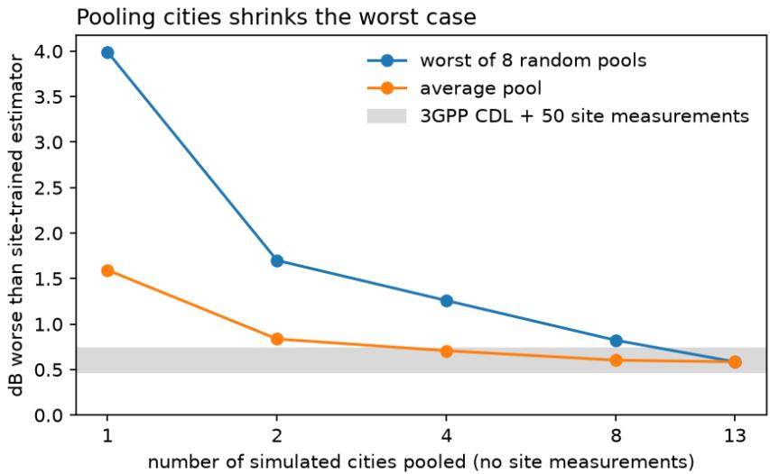
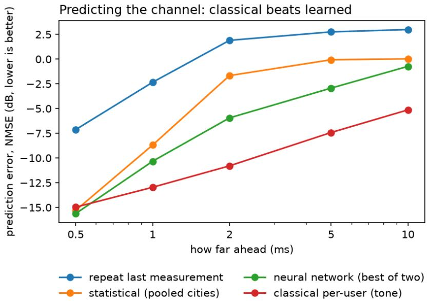
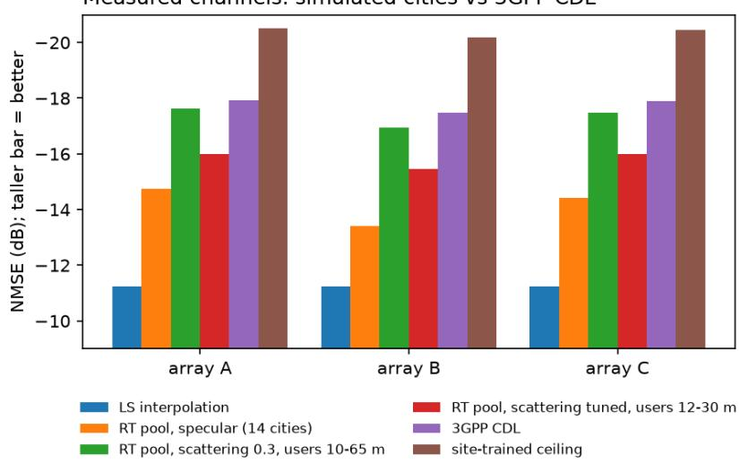

# Do Ray-Traced Cities Make a Better Channel Prior for an Unseen Site?

A pre-registered study in simulation, and a test on measured channels that reverses it

Krish Patel University of Waterloo k77patel@uwaterloo.ca

November 2026

## Abstract

Channel estimators at a newly deployed base station usually start from 3GPP stochastic channel models, which describe no particular street. Ray tracers can simulate real city layouts instead. We ask whether a channel prior pooled from many ray-traced cities serves an unseen site better than the 3GPP CDL models, and whether learned estimators are what make the diference. With Sionna RT on 14 city scenes, LMMSE estimation from covariance priors, leave-one-city-out evaluation, and outcomes and pass/fail bars written down before each main experiment, we find in simulation that the pooled prior sits about 0.6 dB from a site-trained estimator with no site measurements—about what CDL reaches after 50 measurements—and protects against a badly matched source city. Learned models added little: at most 0.65 dB in estimation, and in channel prediction a simple per-user classical method beat CNN predictors by 1.8–12 dB from 2 ms ahead. On measured channels from the DICHASUS outdoor dataset (1.272 GHz, three 2×8 arrays on one building) the result reversed: the pooled ray-traced prior was 3.2–4.1 dB worse than CDL. The simulated channels were too clean. Enabling difuse scattering nearly closed the gap (to 0.3–0.5 dB) only while simulated users stood farther away than the real ones; with users at the real distances, even a scattering level tuned from 50 site measurements left the prior about 2 dB behind CDL. The map-built scenes miss multipath the real street has. A pre-registered follow-on on two more measured environments found the generic CDL prior 2.1–4.7 dB from a site-trained one on the full grid: no further in a factory hall than on the street, furthest in a small lab room whose delay spread sits at the low end of the prior’s range. Finally, a hallway model calibrated to measurements by diferentiable ray tracing reproduced delay spread, but as a prior in an unmeasured part of the hallway it was 4.5 dB worse than CDL on the full array. All measured results come from one sounder.

## 1 Introduction

A base station estimates the radio channel to each user from a few pilot symbols. Linear MMSE (LMMSE) estimation does this well when it knows the channel’s second-order statistics (its covariance across antennas, subcarriers and time); learned estimators can in principle exploit more. At a new site, neither the covariance nor training data is available, so estimators start from a generic prior—typically the 3GPP CDL/TDL models of TR 38.901 [1]—and adapt as site measurements arrive.

Diferentiable ray tracers such as Sionna RT [3] can simulate propagation in real city geometry. Recent work uses ray-traced data as a site-specific prior for a known site [10, 11, 12], pre-trains across source cities for CSI feedback [13], and compares stochastic with ray-traced data for machine learning [17]. We ask a narrower question: for a site with no geometry model and no measurements, is a prior pooled from other ray-traced cities better than the 3GPP models? And is a learned estimator what makes the diference?

We answer in three steps, plus two follow-ons: (i) leave-one-city-out experiments in simulation, (ii) the same question for short-term channel prediction, where learning has more room, and (iii) a test of the main simulation finding on measured channels; the follow-on (iv) asks how far the 3GPP prior falls short in three measured environments, and a final trial (v) whether a ray-traced model calibrated to measurements does better. Each main experiment’s expected outcome and pass/fail bar was committed to the lab notebook before it ran; follow-up checks are labelled as post-hoc or exploratory. The code, notebook, logs and result tables are available from the author on request.

Our contributions are: (1) a pre-registered leave-one-city-out comparison of ray-traced and 3GPP priors across 14 cities, showing pooling as insurance in simulation; (2) evidence that, on this simulator, classical estimators and predictors match or beat learned ones; (3) a test of the simulation finding on measured channels with one processing chain for every source, which reverses it; (4) a diagnosis consistent with the data: the gap comes from multipath the map-built scenes lack, which neither more cities, scattering, nor a tuned scattering level recovers; and (5) a measurement of how far the generic 3GPP prior falls short in three environments, which found it no larger on the full grid in a factory hall than on an open street.

## 2 Setup

Grid and estimation. A 5G NR-like OFDM slot: 3.5 GHz carrier, 30 kHz subcarrier spacing, 128 subcarriers × 14 symbols, DMRS-like pilots on every other subcarrier of symbols 2 and 11, and an 8-antenna half-wavelength uniform linear array at the base station. Channels are normalised to unit power per sample. The estimator is LMMSE from a covariance prior $( R _ { h p } , R _ { p p } )$ estimated from simulated channels (12k per source in simulation; 6000 per city on measured data, 2000 in the exploratory runs). With N site measurements, the prior is shrunk toward their sample covariance with a weight chosen by 5-fold cross-validation. A residual CNN (zero-initialised last layer, so it starts at its LMMSE front end) tests whether anything beyond second-order statistics helps. Error is NMSE at 10 dB SNR unless stated, and the “ceiling” is LMMSE from 12k channels of the target site itself.

Channel sources. All channels are generated with Sionna [2]. CDL: 3GPP CDL-A to E with delay spread 30–300 ns and a random base-station heading per sample (a fixed heading made CDL artificially poor in an early run, which we corrected and report). Ray-traced (RT): Sionna RT 2.2 with up to 3 specular bounces and refraction, in Sionna’s four built-in scenes (Munich, Paris-Etoile, Florence, San Francisco) and ten New York State areas built from OpenStreetMap´ with geo2sigmap [4], reading buildings from an ofline Geofabrik extract. Base stations are placed 25–40 m up near the scene centre and users within 250 m.

Protocol. Each city in turn is the unseen target; priors come from the other cities (pooled with equal weight) or from CDL. Test users are at base-station sites the priors never saw. The realism result was re-checked on fresh base-station sites and freshly drawn pre-training sets.

  
Figure 1: Simulation: gap to a site-trained estimator vs. the number of pooled ray-traced cities, no site measurements, mean over 14 targets. The grey band is 3GPP CDL after blending in 50 site measurements.

## 3 Results in simulation

Ray-traced vs CDL, four cities. With no site data, a prior pooled from the three other built-in cities beat CDL in Munich (+0.3–0.5 dB), Florence (+1.1–1.2) and San Francisco (+1.3–1.5) and lost in Etoile (–1.2 to –1.8) across the original and two fresh draws of sites and pre-training data.´ The advantage faded with site data: by N=1000 all priors were within ∼0.2 dB except Etoile.´

Fourteen cities: pooling as insurance. Pooling k random other cities (8 draws each), the worst draw’s gap to the ceiling shrank from 3.99 dB at k=1 to 0.82 dB at k=8, while the average went from 1.59 to 0.60 dB (Fig. 1): pooling protects against a badly matched source city (the worst single-city cases, 6–7 dB, all used a nearly empty open-area scene as the source for a dense downtown). The all-cities pool beat CDL in 11 of 14 targets by 0.29 dB on average. With no site data it sat 0.59 dB from the ceiling, about where CDL lands after 50 site measurements (0.47– 0.73 dB across four draws of those 50; post-hoc). Once 50 measurements are blended in, the two are comparable (pooled ahead by ∼0.1 dB on built-up sites; post-hoc). Choosing a single best source city from 50 measurements worked with 3 candidates (mean regret 0.05 dB) but overfit with 15 (0.48 dB, against a pre-registered bar of 0.3).

Learning in estimation. The CNN refiner added ∼0.2–0.45 dB on the CDL prior and often nothing on ray-traced priors, at most 0.65 dB in any cell (one seed). The covariance did almost all of the work.

## 4 Learning where it should have room: channel prediction

Predicting the channel 0.5–10 ms ahead from ∼1.8 ms of noisy pilot history (8 observations over 4 slots) is a task where per-user adaptation matters: a covariance pooled over users cannot know each user’s Doppler. Sionna RT evolves a moving user by rotating the phases of a fixed set of paths;

  
Figure 2: Simulation: prediction error vs. horizon, mean over four cities, 10 dB SNR, no site data. “Neural network” is the better of the two CNN arms in each cell.

we checked that this matches re-tracing at the moved position up to ∼10 ms for nearly all users at 3.5 GHz (with the solver’s deterministic mode), so we restricted horizons to 10 ms.

On 3GPP-compliant simulated channels, learned predictors have been reported to beat a Pronybased angle–delay baseline [14]; neural predictors have also been compared on the 3GPP TDL model [16]. We compared repeating the last observation, space-time Wiener prediction from covariance priors, a classical per-user method (“tone”: in the angle–delay domain, fit one Doppler tone per bin to the history and extrapolate), and CNN predictors in the antenna and angle–delay domains. The pre-registered test for “learning has room” failed: tone beat both CNN arms at every horizon from 2 ms in every city, by 1.8–4.7 dB in Munich, Etoile and Florence and by´ ∼9–12 dB in San Francisco (Fig. 2). The CNNs did beat covariance-based prediction by 3–6 dB at 2 ms; learning was competitive only one slot (0.5 ms) ahead.

A post-hoc follow-up trained a CNN to correct tone’s prediction, with a loss weighted toward the predictable horizons. It added 0.3–0.6 dB at 2–10 ms in three of four cities (cells 0.26–0.65; two seeds agree within ∼0.2 dB) and cost 0.8–1.2 dB at 5–10 ms in San Francisco, where tone is already near-exact. Re-weighting the original CNNs’ loss alone did not help. The caveat that matters most: fixed-path evolution is tone’s own model, so on real channels tone would degrade by an amount this simulator cannot measure.

## 5 Test on measured channels

Data. DICHASUS [5] outdoor set dxxx [6]: three 2×8 arrays (λ/2 at 1.272 GHz) on one building facade about 10 m up and tilted ∼20◦ down, a hand-pulled transmitter on the street, 50 MHz over 1024 subcarriers, tachymeter positions. Calibration files (also used for the ceiling), a site file (50 random measurements, 4 draws) and test files are disjoint recordings.

<table><tr><td>array</td><td>LS interp.</td><td>RT specular</td><td>RT scatt., far users</td><td>RT tuned, real distances</td><td>CDL</td><td>ceiling</td></tr><tr><td>A</td><td>-11.2</td><td>-14.7</td><td>-17.6</td><td>-16.0</td><td>-17.9</td><td>-20.5</td></tr><tr><td>B</td><td>-11.2</td><td>-13.4</td><td>-17.0</td><td>-15.5</td><td>-17.5</td><td>-20.2</td></tr><tr><td>C</td><td>-11.2</td><td>-14.4</td><td>-17.5</td><td>-16.0</td><td>-17.9</td><td>-20.4</td></tr></table>

Table 1: Measured DICHASUS channels: NMSE (dB) at 10 dB SNR on the full 16-antenna × 128-subcarrier grid. Specular: 14-city pool, users 10–65 m. Scattering, far users: 7 cities, scattering 0.3, users 10–65 m. Tuned, real distances: 7 cities, users 12–30 m, scattering level picked by 50 site measurements (the only prior column that uses site data). The last two are exploratory.

Processing. The receivers carry constant per-antenna phase and timing ofsets, as the dataset authors describe; ofset files are not shipped for this set. We fit, per antenna, a phase plus a delay relative to a reference antenna to the line-of-sight phase predicted from the tachymeter positions; the fit also identified the array layout (8-element axis horizontal: coherence 0.73 on array A versus at most 0.32 for the alternative layouts in an early fit; 0.80 on the full calibration set). Every source—measured, CDL and ray-traced—is generated on the full 50 MHz band and passes through one chain: align the first arrival to delay zero (measured datapoints are first shifted so their strongest tap sits at zero, removing the recording’s timing ofset; added during the follow-on, it leaves the street results unchanged), keep a delay window of −200 ns to $2 \mu \mathrm { s } .$ , take the 128 subcarriers around the carrier (6.25 MHz), normalise. The grid is 16 antennas × 128 subcarriers in one snapshot, pilots on every other subcarrier. All 14 cities were re-simulated at 1.272 GHz with the 2×8 array, a directional 38.901 element pattern, a 20 downtilt and a facade-like placement (base station 10 m above ground, users 10–65 m in front, outdoor positions only, heights following terrain).

Results. The pre-registered claim that the pooled ray-traced prior beats CDL with no site data was falsified on all three arrays (Table 1, Fig. 3): it was 3.2–4.1 dB worse on the full array × frequency grid and 0.5–1.3 dB worse per antenna. On the full grid no single city beat CDL either. With 50 site measurements CDL still led by 1.2–1.7 dB on the full grid; per antenna both reached the site-trained level. Pooling still shrank the worst single-city case in 5 of 6 checks, but around a level below CDL. The pool sat 5.8–6.8 dB from the ceiling, against ∼0.6 dB in simulation.

Why. The simulated channels were cleaner in delay than the measured street: 89–100% of energy in the first 160 ns tap across the 14 cities, against 79–84% measured (CDL 78%). Spatial concentration was not clearly diferent. The ray tracer ran with the original study’s settings: specular reflection and refraction only, no difuse scattering, no difraction, every material’s scattering coefficient zero. In an exploratory rerun, added after a dry run and labelled as such, we enabled difuse scattering (coeficient 0.3, Lambertian) and Sionna’s wedge difraction for 7 cities. The pooled prior came within 0.3–0.5 dB of CDL on the full grid and level with it per antenna (0.3 dB ahead on arrays B and C). A control with the same cities and the same number of base-station sites but no scattering attributes ∼2.8 dB of the ∼3 dB improvement on array A to scattering and difraction and ∼0.2 dB to the extra sites.

Matching the users’ distance made it worse. The simulated users sat farther from the array than the real ones (median 46 m vs 18–20 m). In a second exploratory probe, with scattering on and users placed 12–30 m away, the ray-traced prior fell to 2.9 dB behind CDL on array A (2.4– 2.6 dB worse than the farther placement on the full grid of every array, 1.5–2.2 dB per antenna). Closer simulated users are more line-of-sight dominated (first-tap share 89–97%), while the real users at those distances show 79–84%: the measured street has multipath the map-built scenes do not produce, plausibly from objects they lack (vehicles, trees, street furniture, facade detail). The near-match of the scattering variant therefore came partly from placing users farther away than the real ones.

  
Figure 3: Measured channels, the same numbers as Table 1; taller bars are better.

Tuning the scattering level from 50 site measurements. With users at the measured distances, we simulated the 7 cities at difuse-scattering coeficients 0, 0.15, 0.3, 0.5 and 0.7 and let each draw of 50 site measurements pick the level whose pooled prior scored best on them. On the full grid the measurements always picked 0.7, which was also best on the test data, but the tuned prior stayed 1.9–2.0 dB behind CDL on the full grid of every array (0.9–1.5 dB behind CDL + 50 once the 50 measurements were blended in), and per antenna the scattering level made no diference (1.2–2.3 dB behind CDL). Difuse scattering of the modelled buildings does not supply the delay spread the street has at short range; the related work points to street clutter (vehicles, poles, trees) and to 3GPP-style random clusters on top of the ray-traced paths [1].

## 6 Where does CDL fall short? Three measured environments

A site-specific prior, ray-traced or otherwise, only earns its cost where the 3GPP models are a poor prior. As a follow-on, pre-registered before the lab and factory results (the street gap was already known), we measured that gap in three environments recorded with the same sounder at 1.272 GHz: the street above, an indoor lab room with two 2×8 arrays (0d5x [7]) and a factory hall with four 2×4 arrays placed around it, with line-of-sight and blocked positions (cf0x [8]).

Design. The estimator, grid, calibration and processing chain are those of Section 5, with no downtilt indoors. Indoors, the site-trained ceiling is fitted on 80% of one recording, the 50 site measurements (4 draws) come from the remaining contiguous 20%, and testing uses a diferent recording. All arrays passed the pre-set calibration bar (coherence ≥0.5): 0.71 and 0.81 in the lab, 0.85–0.91 in the factory. The lab’s positions are two-dimensional; the transmitter height was set from calibration coherence alone, before any estimation result. CDL priors were re-simulated for each array shape. Besides the generic CDL mixture (delay spreads drawn from 30–300 ns), we scored each of 15 fixed profiles (CDL-A to E at 30, 100 and 300 ns) and the profile that the 50 site measurements pick. Three claims were registered: (G1) the generic-CDL gap to the ceiling is larger in the factory than on the street (full grid, mean over arrays); (G2) if the gap is below 1 dB everywhere, CDL is good enough and we stop; (G3) a profile picked from 50 site measurements closes at least half of the gap wherever it is at least 1 dB.

<table><tr><td rowspan="2">environment first tap</td><td rowspan="2"></td><td colspan="4">dB above the site-trained ceiling: full grid / per antenna</td></tr><tr><td>generic CDL</td><td>CDL +50</td><td>picked</td><td>oracle</td></tr><tr><td>street (3 arrays, 2×8)</td><td>79-84%</td><td>2.5–2.7 / 0.8–0.9</td><td></td><td></td><td></td><td>4.8–5.6 / 0.3–0.6</td></tr><tr><td>lab room (2, 2×8)</td><td>95-96%</td><td>4.7 / 4.3</td><td></td><td>1.4–1.7 / 0.0-0.1 1.5–2.5 / 0.0</td><td>4.8–5.6 / 0.3–0.6 2.3-2.5 / 0.4</td><td>2.3-2.5 / 0.4</td></tr><tr><td>factory (4, 2×4)</td><td>81-94%</td><td>2.1–2.8 / 0.7–1.4</td><td></td><td>1.0–2.5 / 0.2–1.1</td><td>3.5–6.8 / 0.5–1.9</td><td>3.3-4.5 / 0.3–0.5</td></tr></table>

Table 2: The CDL gap in three measured environments at 10 dB SNR: ranges over arrays, means over the four draws of 50 site measurements. First tap: share of energy in the first 160 ns delay tap of the 6.25 MHz grid (CDL’s own: ∼78%). Picked profile: the single fixed CDL profile the 50 site measurements pick; oracle: the best one on the test recording.

Results. These are the results after a processing fix made during review (described at the end of this section); the first, faulty analysis had supported G1. G1 is falsified: the factory gap (2.1– 2.8 dB, mean 2.4) is no larger than the street’s (2.5–2.7, mean 2.6), also at 0 dB SNR (Table 2); per antenna, a secondary reading, it is slightly larger (1.1 vs 0.8 dB). The stop rule G2 was not triggered: the full-grid gap is at least 2 dB everywhere. The largest gap is in the lab room (4.7 dB full grid, 4.3 per antenna). G3 named no basis. On the full grid, the basis of G1 and G2, it is met nowhere: a single picked profile was worse than the generic mixture on the street and in the factory, and closed 49% of the gap in the lab (53% at 0 dB SNR, just over the bar). Per antenna it is met in the lab (4.3 to 0.4 dB) but not in the factory, where picking helped on arrays B and D and hurt on A and C (mean 1.09 to 1.06 dB). Blending the 50 site measurements into the generic prior helped most: at 10 dB SNR, within 0.2 dB of the ceiling per antenna on the street and in the lab, at most 1.1 dB in the factory, and 1.0–2.5 dB on the full grid. It was not uniformly helpful. Indoors the 50 come from one stretch of the recording; on factory arrays A and C that stretch sat about 4 m from the array against 11–12 m for the test recording, and there, per antenna, the 50 mostly picked a line-of-sight profile (CDL-E) and blending helped little or hurt (0.84 to 0.69 dB; 0.71 to 1.10). On arrays B and D the mismatch ran the other way (11–13 vs 5 m) and blending worked, so distance alone does not explain the diference. At 0 dB SNR blending hurt per antenna in the factory on average (0.43 to 0.59 dB). The pre-registration also listed RMS delay spread and spatial eigenvalue shares, to be reported without a bar; we dropped them, because on this grid the RMS statistic is dominated by leakage and noise and does not track the true delay spread, and the spatial share is not comparable between 8- and 16-antenna arrays. The factory test recording was not split into line-of-sight and blocked positions.

Reading. The pre-registered expectation, that CDL falls further short in a dense indoor space than on an open street, is not supported by these recordings: the factory hall is about as close as the street. The outlier is the small lab room, whose energy nearly all arrives within one 160 ns tap, at the low end of the generic mixture’s 30–300 ns delay-spread range. That is partly a choice of the mixture rather than a failure of the 3GPP models: TR 38.901 scales CDL to a scenario’s delay spread, with examples from 10 to 1000 ns [1], and a 30 ns profile fixes the lab per antenna (on the full grid it closes about half the gap). It is not the whole story: factory arrays B and D also put 93–94% of their energy in the first tap but show much smaller gaps, for reasons we have not established. None of the three environments stands out as one where a site-specific prior would clearly pay of. Three recordings with diferent arrays cannot rule out such sites elsewhere, and this study did not test a ray-traced prior indoors.

A correction. A review of this follow-on found that the factory recordings carry a timing ofset that drifts across the whole delay range between datapoints, far beyond the chain’s first-arrival search. A first analysis therefore kept mostly noise for the factory and reported a 10–12 dB gap, which supported G1; a post-hoc check with longer-delay CDL profiles built on it was withdrawn. Measured channels are now first shifted so that each datapoint’s strongest tap sits at delay zero (Section 5). A synthetic check fails without this shift and passes with it; no street or lab datapoint changed by more than $1 0 ^ { - 6 }$ ; and in no factory datapoint does a tap within 10 dB of the strongest arrive 400 ns to $2 \mu \mathrm { s }$ before it, where the chain’s search would miss it. The numbers above are the rerun.

## 7 A calibrated ray-traced hallway

The street scenes were built from maps and never fitted to the site. A pre-registered final trial asked whether a scene fitted to measurements does better. DICHASUS dcxx [9] (recording dc01, 3.438 GHz, 50 MHz) observes a robot-carried dipole in an institute hallway from two 4×8 arrays at opposite ends; its simplified 3D model (floor, walls, ceiling, one material each) is the one calibrated by diferentiable ray tracing in [15]. We first reproduced that calibration (permittivity and conductivity of the three objects, fitted to per-antenna power and RMS delay spread): held-out delay-spread error fell from 0.42 to 0.28 (paper: 0.54 to 0.24), and power error fell in the corridor (4.2 to 2.4 dB) but rose in the lobby (11.0 to 16.0 dB), where the model is too simple. The calibration was then refitted on one part of the corridor $( y < 0 )$ and the model used as a prior in another $( y > 1 0 \mathrm { m } ;$ the band between, which holds the lobby, was left out): channels simulated at 12,000 positions over that part, with the chain of Section 5. Test: the last 30% of the unmeasured part in recorded order (1,500 and 495 datapoints for the two arrays); ceiling: an LMMSE trained on its first 70%.

<table><tr><td>prior</td><td>full grid</td><td>per antenna</td></tr><tr><td>generic CDL</td><td>7.12</td><td>1.81</td></tr><tr><td>CDL + 50 from the measured part</td><td>6.11</td><td>1.66</td></tr><tr><td>ray-traced, ITU materials</td><td>12.06</td><td>2.05</td></tr><tr><td>ray-traced, calibrated</td><td>11.63</td><td>1.54</td></tr><tr><td>ray-traced, calibrated, at the exact test positions</td><td>12.05</td><td>1.68</td></tr><tr><td>ray-traced, calibrated + 50 from the measured part</td><td>7.94</td><td>1.66</td></tr><tr><td>CDL + 50 from the unmeasured part (reference)</td><td>2.41</td><td>0.06</td></tr></table>

Table 3: Calibrated hallway model as a prior where nothing was measured: dB above the site-trained ceiling at 10 dB SNR, mean over the two arrays and over four draws of 50 measurements.

Table 3 gives the result. The main claim, that the calibrated model beats generic CDL by at least 0.5 dB on the full grid, failed: it was 4.5 dB worse. Calibration beat the ITU materials by 0.4 dB (that claim was met), and the model lost to CDL with 50 measurements from the measured part by 5.5 dB. Per antenna, the calibrated model was the best prior without measurements from the tested part (1.54 against 1.81 dB), so its power and delay structure helps a little; its spatial structure does not. At the same test positions, its normalised spatial signatures matched the measured ones barely better than an unrelated measured position did (0.45 against 0.39 and 0.74 against 0.76 for the two arrays, post hoc), and knowing the exact test positions did not help. The model, the surveyed positions and the antenna phase calibration cannot be separated here (one array’s calibration coherence was 0.55), and the idealised array model is untested. Fifty measurements from the tested part itself closed almost the whole gap.

## 8 Discussion and limitations

The reversal is consistent with a home-ground efect, which the caveat written before the first run anticipated: test channels came from the same ray tracer as the priors. CDL is fitted to measurements; ray tracing at default settings encodes geometry but, at this site, misses multipath the real street has, and every ray-traced candidate is biased the same way, so pooling cannot insure against it. Even closing the gap would not, on its own, be useful: CDL is free and needs no maps, simulation or tuning, so a ray-traced prior earns its cost only where it clearly beats CDL. Our simulation study suggested such sites exist (Florence and San Francisco gained 1–1.5 dB over CDL in simulation), but the measured street is not one, and in the follow-on the factory hall’s gap was no larger than the street’s; the lab room’s larger gap shrinks per antenna once a short-delay profile is used (Section 6). Several limits apply.

• The map-built ray-traced priors were tested on one measured site: one street, one building, three arrays on its facade, 1.272 GHz, mostly line-of-sight; LMMSE estimation only. The calibrated hallway model (Section 7) is one trial on one simplified scene (three surfaces, one material each, an idealised array model).

• The measured-channel test was pre-registered but not blind: a pilot had already scored CDL on the test data, and a dry run preceded the full run.

• The simulated placement was not matched to the real users (median 46 m and ∼10◦ below the array by the placement rule, versus 18–20 m and 24–26◦ measured), and one downtilt was used for all three arrays.

• Small asymmetries remain: measured channels sit ∼10–20 ns later after alignment than simulated ones (bounded at ∼0.5 dB of the CDL-vs-pool gap), and the correlation between the two antenna rows is lower in the measured data than in either model, for reasons not established.

• Most randomly placed users in the rooftop simulations received no paths and were dropped, so simulated users skew toward simpler links.

• The follow-on compares three recordings made with diferent arrays (2×8 on the street and in the lab, 2×4 in the factory), one test recording each, ceilings trained diferently (separate recordings on the street, 80% of one recording indoors) and at diferent absolute levels, and indoor site measurements from one contiguous stretch of a recording; the lab’s transmitter height is assumed (positions are two-dimensional).

• The scattering, distance and tuning probes are exploratory: 7 cities, scattering levels up to 0.7 (the tuned level sat at the top of that range), chosen after seeing earlier results.

A code review during the measured-channel work found a cache keyed on object identity that could hand a scene another scene’s ground mesh; it was fixed and everything rerun, and reported numbers moved by at most 0.02 dB. A review of the follow-on found the factory timing ofset described in Section 6; the factory was rerun after the fix.

## 9 Conclusion

In simulation, a covariance prior pooled over many ray-traced cities looked like a good starting point for an unseen site and a safer one than any single city. On measured channels from one site it was worse than the 3GPP CDL models: the map-built scenes produce cleaner channels than the real street, and neither more cities, difuse scattering, nor a scattering level tuned from site measurements closed the gap once users stood at their real distances. Learned models never beat the classical methods; at best they refined them. The practical reading is that, without scene content the maps lack, a ray-traced prior from other cities is not yet a better default than the free 3GPP models. A follow-on on two more measured environments points the same way: the generic CDL prior was 2.1–4.7 dB from a site-trained one on the full grid at all three sites, no larger in a factory hall than on the street and largest in a small room whose delay spread sits at the low end of the prior’s range; blending 50 site measurements into it closed most of the per-antenna gap, though not on every array.

Open questions. (i) Where does CDL fail? Three recordings found no clear case; more environments, recorded with one array type and with site measurements spread over the area, would be needed to find sites where a site-specific prior pays of, and only there would simulation be worth its cost. (ii) Missing scene content: random street clutter (vehicles, poles, trees) or 3GPP-style random clusters on top of the ray-traced paths [1] are the natural next levers. Per-site calibration of a fully modelled scene is established [15]; in a short final trial (Section 7) we calibrated that paper’s hallway model on one part of its recording and used it as a prior in another. It was the best perantenna prior without local data, but on the full array it was 4.5 dB worse than generic CDL: the simplified scene does not reproduce the cross-antenna structure. Transfer of global settings across sites remains untested. (iii) More measured sites and prediction on measured channels, which need multi-site outdoor arrays and millisecond-spaced measurements of moving users respectively.

Reproducibility. Code, the lab notebook with every pre-registration and result in order, logs and result tables are available from the author on request. Channel sets are regenerated by the scripts; the measured data is public under CC BY 4.0 [6].

## References

[1] 3GPP, “Study on channel model for frequencies from 0.5 to 100 GHz,” TR 38.901 (v17.0.0, 2022); delay scaling in §7.7.3.

[2] J. Hoydis, S. Cammerer, F. Ait Aoudia, A. Vem, N. Binder, G. Marcus, A. Keller, “Sionna: An open-source library for next-generation physical layer research,” arXiv:2203.11854, 2022.

[3] J. Hoydis, F. A¨ıt Aoudia, S. Cammerer, M. Nimier-David, N. Binder, G. Marcus, A. Keller, “Sionna RT: Diferentiable ray tracing for radio propagation modeling,” arXiv:2303.11103, 2023.

[4] Functions Lab, “geo2sigmap,” https://github.com/functions-lab/geo2sigmap (commit 08ca016).

[5] F. Euchner, M. Gauger, S. D¨orner, S. ten Brink, “A distributed massive MIMO channel sounder for ‘big CSI data’-driven machine learning,” WSA 2021; arXiv:2206.15302.

[6] University of Stuttgart, “CSI dataset dichasus-dxxx-complete: Outdoor—three arrays distributed along the facade,” DaRUS, doi:10.18419/DARUS-3153, CC BY 4.0.

[7] F. Euchner, M. Gauger, “CSI dataset dichasus-0d5x: Distributed arrays: Indoor LoS, lab room,” DaRUS, doi:10.18419/DARUS-2218, 2022, CC BY 4.0.

[8] F. Euchner, M. Gauger, “CSI dataset dichasus-cf0x: Distributed antenna setup in industrial environment, day 1,” DaRUS, doi:10.18419/DARUS-2854, 2024, CC BY 4.0.

[9] F. Euchner, P. Stephan, M. Gauger, “CSI dataset dichasus-dcxx: Institute hallway with known 3D model, distributed antennas,” DaRUS, doi:10.18419/DARUS-3831, 2023.

[10] L. Del Moro et al., “Site geometry and calibration uncertainties in digital twin-enabled channel estimation,” arXiv:2607.09334, 2026.

[11] S. Alikhani et al., “Digital twin aided channel estimation: Zone-specific subspace prediction and calibration,” arXiv:2501.02758, 2025.

[12] M. S. Abouamer et al., “Prediction of wireless channel statistics with ray tracing and uncalibrated digital twin,” arXiv:2411.13360, 2024.

[13] C.-J. Zhao et al., “SiFo: Wireless foundation model for low-overhead site-specific CSI feedback,” arXiv:2605.16141, 2026.

[14] B. Liu et al., “WiFo: Wireless foundation model for channel prediction,” arXiv:2412.08908, 2024.

[15] J. Hoydis, F. A¨ıt Aoudia, S. Cammerer, F. Euchner, M. Nimier-David, S. ten Brink, A. Keller, “Learning radio environments by diferentiable ray tracing,” arXiv:2311.18558, 2023.

[16] O. Stenhammar, G. Fodor, C. Fischione, “A comparison of neural networks for wireless channel prediction,” arXiv:2308.14020, 2023.

[17] J. Morais, A. Malhotra, S. Hamidi-Rad, A. Alkhateeb, “Comparing stochastic and ray-tracing datasets in machine learning for wireless applications,” arXiv:2512.12449, 2025.