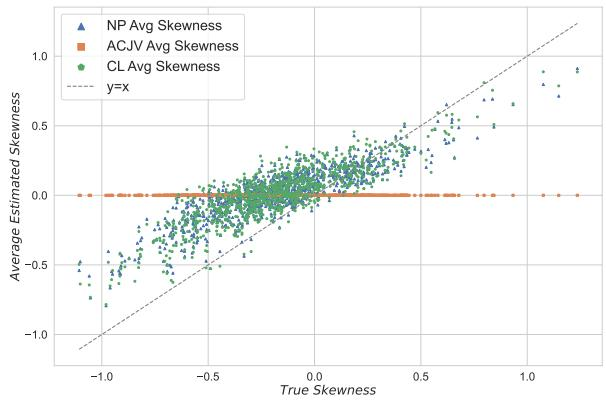
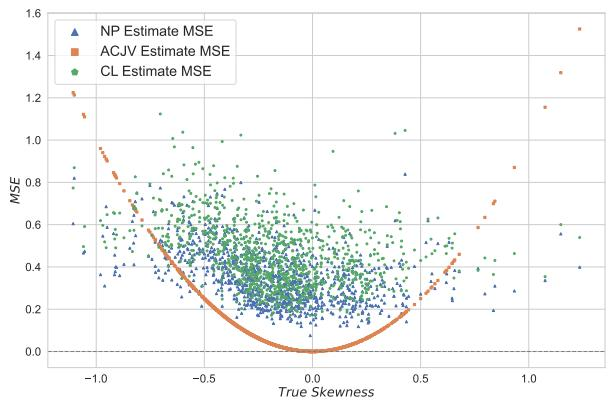
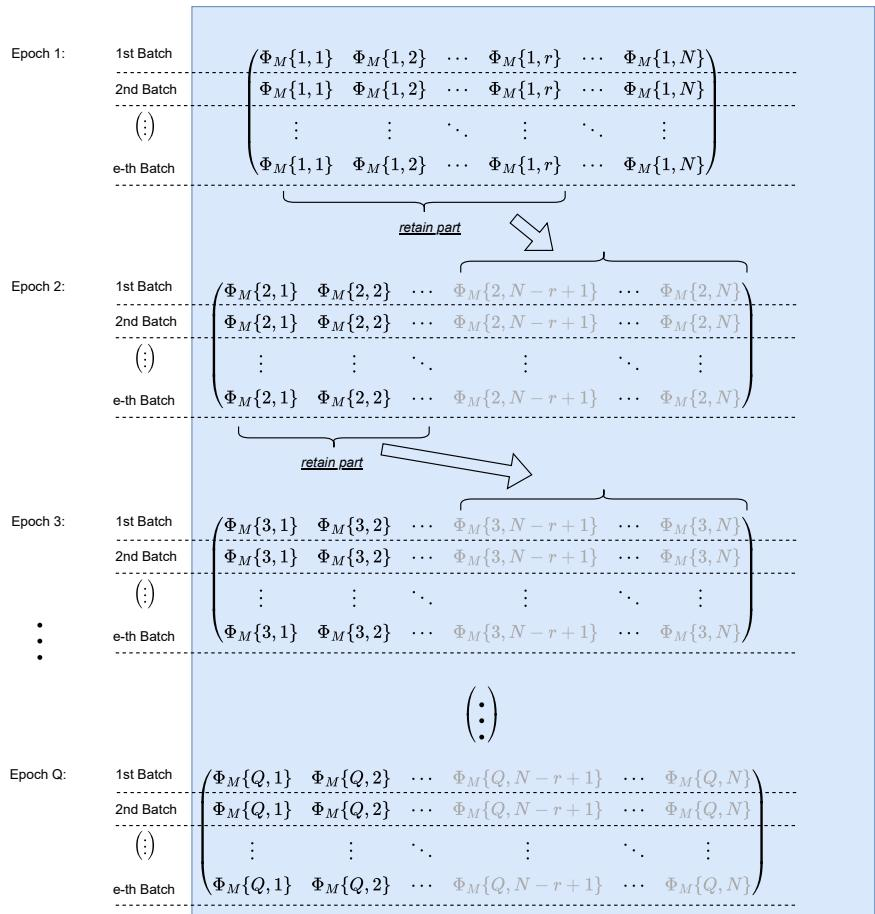
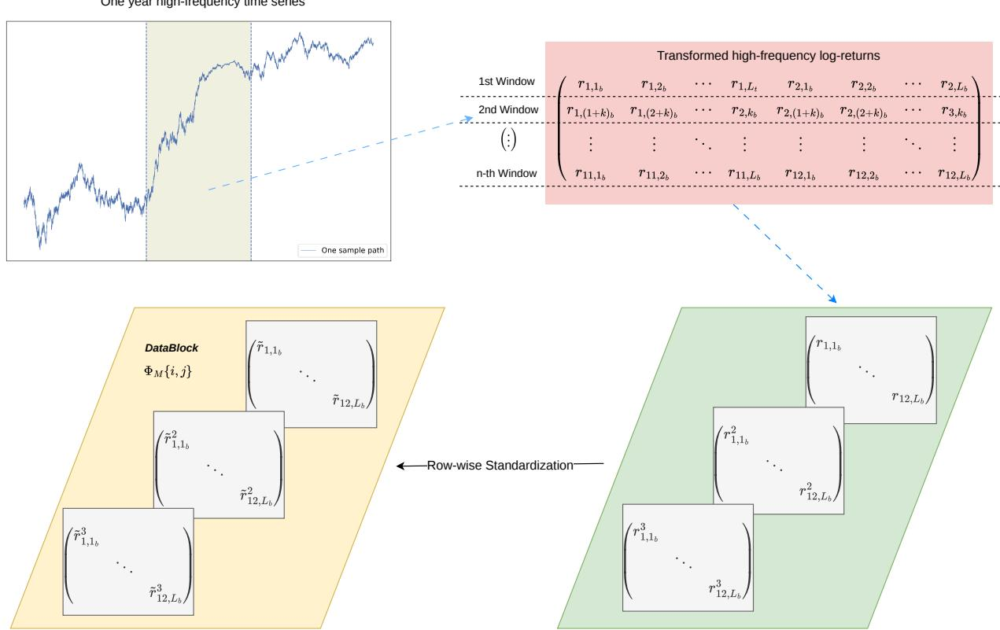
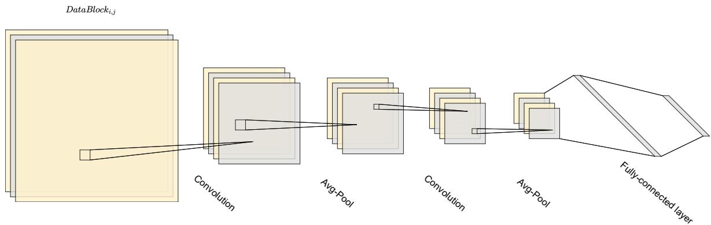
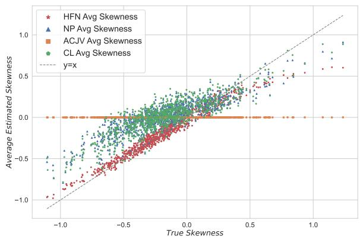
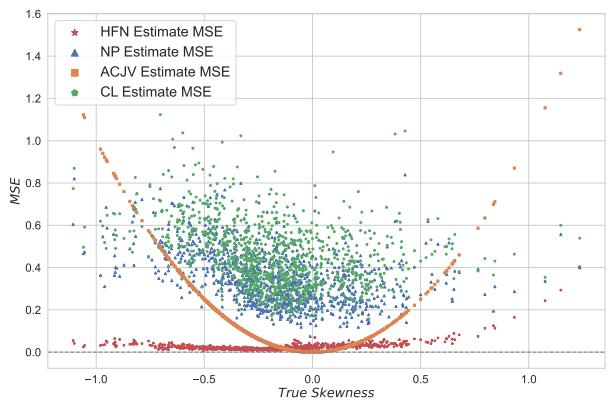
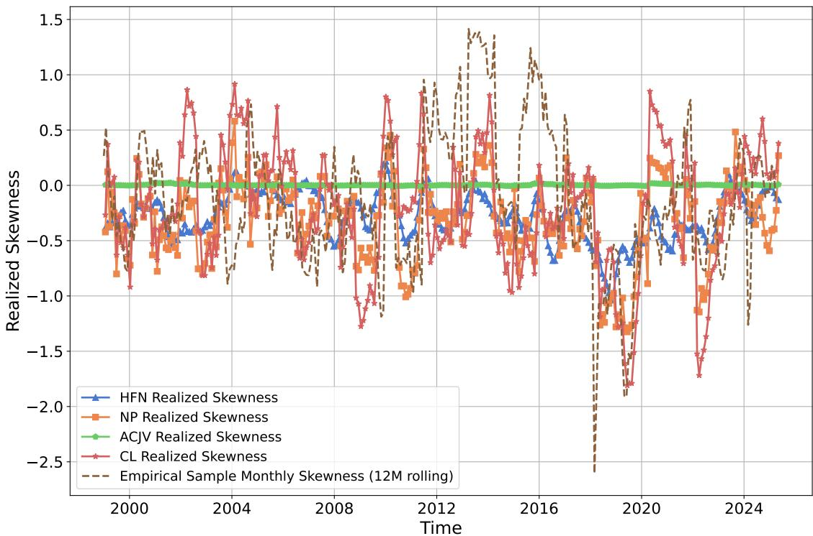
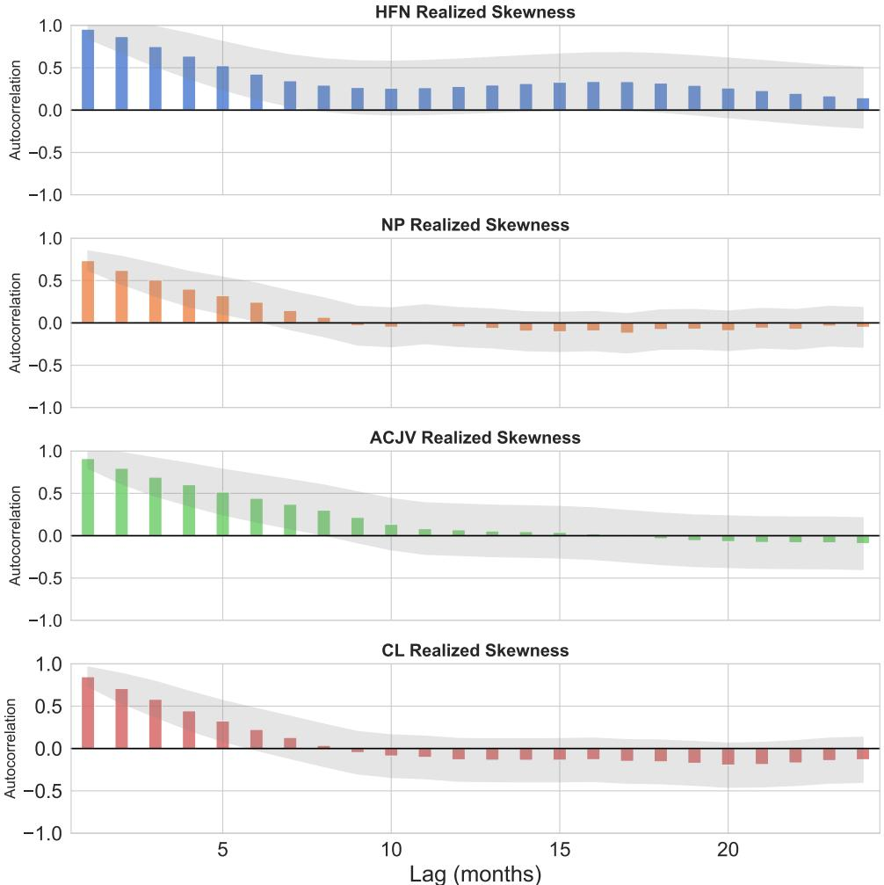
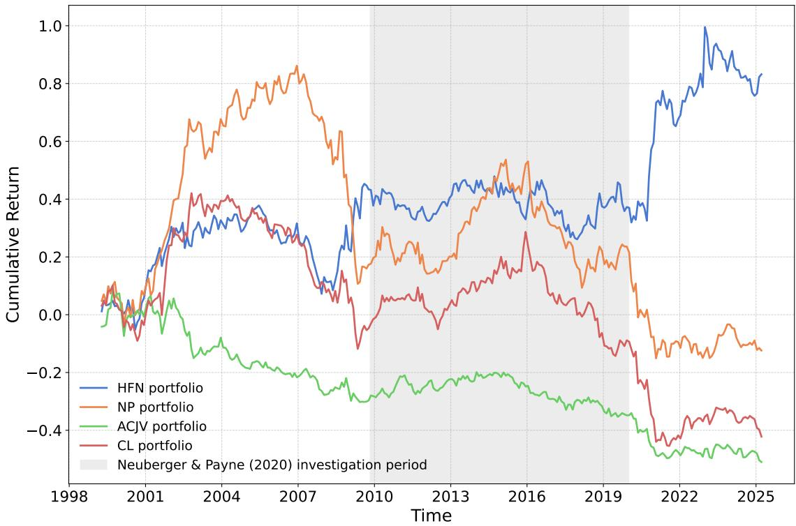

# Estimating “Realized” Skewness using Convolutional Neural Network

Haozhe Jiang,a Ostap Okhrin,b Michael Rockinger,c,∗

October 2026

## Abstract

We propose a new estimator of low-frequency skewness (monthly) that exploits high-frequency data (5 min) through a direct functional mapping consisting of layers of Convolutional Neural Networks followed by Multi Layer Perceptrons. Monte Carlo experiments involving stochastic volatility models, with and without jumps, show that the estimator reduces finite-sample bias relative to existing realized-skewness estimators and remains accurate under model misspecification. Empirically, our estimator exhibits temporal stability and delivers cross-sectional performance in actual skewness-sorted portfolios. We characterize the finite-sample bias of conventional plug-in skewness estimators and establish risk consistency properties of the proposed NN estimator under standard regularity conditions.

JEL Classification Code: C13, C58, C45

Keywords: Heston, Bates, Jump-process, Temporal aggregation

a Technische Universit¨at Dresden. “Friedrich List” Faculty of Transportation. Chair of Applied Statistics.   
E-mail: haozhe.jiang@tu-dresden.de.

b Technische Universit¨at Dresden. “Friedrich List” Faculty of Transportation. Chair of Applied Statistics. Center for Scalable Data Analytics and Artificial Intelligence (ScaDS.AI) Dresden/Leipzig, Germany. Email: ostap.okhrin@tu-dresden.de.

under number 497262150, and to the Collaborative Research Center SFB/TRR 408 (AgiMo: Data-driven agile planning for responsible mobility), who partially funded the project under number F-016273-551- 6A7-1161105.

## 1 Introduction

Pearson (1895) defined the skewness of a random variable Z as its standardized third central moment,

$$
\operatorname { S k e w } ( Z ) = { \frac { \mathbb { E } \left[ ( Z - \mathbb { E } [ Z ] ) ^ { 3 } \right] } { \mathbb { E } \left[ ( Z - \mathbb { E } [ Z ] ) ^ { 2 } \right] ^ { \frac { 3 } { 2 } } } } .\tag{1}
$$

The estimation of (1) in the context of finance is however problematic. A long history of data is required. Yet over long time intervals, the estimate can be dominated by a few rare events, such as the 1987 stock market crash (Kim and White, 2004), and the true skewness itself may not be stable over time. For the variance, high-frequency (HF) data resolve this dilemma: realized variance replaces a long history of low-frequency returns by many intraday returns within the same period and converges to the integrated variance (Andersen et al., 2001, 2003; Barndorf-Nielsen and Shephard, 2002a,b). It is tempting to use HF returns in the same way to estimate the low-frequency skewness from a short history. This does not work as well. No path-wise infill limit exists for the third moment analogous to realized variance because of the interaction between returns and squared returns. This cross term has an infill limit but the limit itself does not identify the third moment. Even for a Brownian motion path, a realized third moment that incorporates the leverage efect converges to a random quantity rather than capturing the third moment, which is well-known as zero.1 Consequently, observing a single path ever more finely does not reveal its low-frequency skewness.

A new definition of skewness and a new estimator has been proposed by Neuberger (2012) and extended by Neuberger and Payne (2021). Neuberger (2012) introduced aggregator functions for the moments of a return and estimates the third and higher moments by using these aggregator functions with HF data as input. For the third moment, the resulting low-frequency measure is the sum of cubed HF returns plus a leverage term capturing the interaction between price increments and variance increments. The result holds when prices follow a martingale and applies to log-price diferences or simple returns. Within this information set, the aggregator is unique. Neuberger and Payne (2021) build on Neuberger (2012) by using only the stock price data and by dividing the realized third moment by realized volatility raised to the power 3/2. They call the resulting statistic ‘NP skewness’.

Neuberger and Payne (2021)’s aggregator combines a small, fixed set of functions of the HF path. The question is whether projecting the skewness onto a larger class of functions of the same path yields a more accurate estimate?

We answer this question by learning the estimator rather than deriving it. Following the logic of the realized third moment of Neuberger (2012) and Neuberger and Payne (2021), whose defining property holds in expectation rather than path-wise, we therefore define realized skewness as the output of a measurable aggregator functional h(·) which maps a path of HF returns to an estimate of the global, low-frequency skewness $S ^ { \star }$ . Supervised learning is used in this paper to approximate the aggregator functional h(·). We specify a data generating process (DGP) with a parameter vector ϑ and with a available closed form for the true skewness. We draw ϑ from a prior distribution, simulate one year of five-minute returns r from the model, and train a network that maps $\Phi ( r ) = ( \tilde { r } , \tilde { r } ^ { 2 } , \tilde { r } ^ { 3 } )$ , the returns and their second and third powers arranged by intraday, daily and monthly position, into a prediction of S⋆. Under squared loss the best such predictor is the conditional expectation E[S⋆ | Φ], that is, the posterior mean of the model-implied monthly skewness given the observed path. We call the neural approximation of this object High Frequency Network (HFN). The fundamental architecture underlying HFN is the Convolutional Neural Network (CNN), which ofers a flexible way to combine many lagged HF returns and their powers, with aggregation weights that are learned rather than fixed. Initially, CNNs were invented for character recognition, LeCun et al. (1989). In the context of financial econometrics, they represent a very natural tool to combine layers of powers of returns each layer containing lagged returns. Clearly, the way that we constructed the HFN is based on some prior information namely that the aggregated skewness should be a function of returns, their squares and their cubes. This helps to render the network more eficient.

HFN is therefore a simulation-trained estimator: it is not model-free like the NP estimator, because the specialized DGP prior enters through the training law. In this research, we use the Heston (1993) model as one DGP since its time series generates skewed returns due to the interaction between returns and volatility (the leverage efect) and because it can be simulated eficiently (Andersen, 2008) and its moments are available analytically (Okhrin et al., 2022a). Nevertheless, the Heston model is a vehicle for producing labels and not a structural assumption of the method. The core contribution of this paper is the HFN architecture: a convolutional network whose receptive fields follow the intraday-to-daily and daily-to-monthly aggregation of HF returns, and which extracts global distributional characteristics from a HF path. Nothing in the architecture or in our main Theorem 1 is specific to the Heston model. The theorem holds for any training law that satisfies the regularity conditions provided in the Supplementary Material. Training paths can therefore be drawn from a richer mixture of semimartingale models, for example with jumps, rough or multi-factor volatility, or microstructure noise, as long as their skewness can be computed exactly or simulated with high precision. Enlarging the training law in this way moves the learned target E[S⋆ | Φ] towards the one relevant for a broad class of semimartingales.

The HFN has two distinctive features. First, instead of replacing the numerator and the denominator of 1 to get a skewness estimator it directly maps the input to the target skewness. Second, it learns the weights relating the inputs instead of keeping them fixed. Both features matter for the comparison with NP. The first is what allows the network to reduce the finite-sample bias of a ratio of separately estimated moments (Neuberger and Payne, 2021). Doing so, has the advantage of avoiding regions where the denominator of this expression could become very small (think about very calm stock markets) and, thus, avoids introducing large outliers in the statistics. It therefore avoids the issue that a ratio of unbiased moments is not necessarily unbiased. Actually, it takes about 20 years of data before the bias in NP statistic disappears. The second feature is what makes the resulting estimates smoother over time. By construction, our method operates as a filter, smoothing out such periods. To anticipate, Figure (5a) shows that, fixed at one-year horizon, relative to existing competing skewness estimates, our method exhibits less bias.

We have trained the HFN by using Heston’s model but the HFN continues to generate better skewness under model misspecification. The HFN is trained on Heston simulations with parameters satisfying the Feller condition. Interestingly, when tested on trajectories where the Feller condition is violated, thus where volatility may come very close to 0 and stay there for a while, we find that the HFN continues to outperform competing methods. Also Kim and White (2004) show that skewness can be influenced by rare events, such as the 1987 stock market crash. See also Conrad et al. (2013) and Ghysels et al. (2016) who look for alternatives to traditional skewness. As we will show, by simulating from the Bates (1996) model which contains jumps, the HFN estimator has very good filtering properties with respect to crashes, i.e. outliers. Those findings suggest that the HFN has learned a functional which remains largely model-free.

Our research should therefore be useful in various strands of research where skewness appears prominently. In finance, Rubinstein (1973) and Kraus and Litzenberger (1976) demonstrate the usefulness of skewness in portfolio allocation. In Harvey and Siddique (1999) co-skewness, the covariance between returns of one asset and the squared return of another one plays an essential role. Our model should help the econometrician to test theoretical models where skewness appears such as in McQueen and Vorkink (2004); Barberis and Huang (2008); Albuquerque et al. (2019). We initiate such applications by bringing the HFN estimator to actual stock market data. It produces smoother and more persistent skewness estimates than competing methods. In the cross-section, following Amaya et al. (2015), Fama–MacBeth regressions show that HFN skewness is positively related to next-month returns at the 5% level, whereas the coeficients on the NP, ACJV and CL estimates are small and insignificant. A skewness-sorted long/short portfolio strategy is also illustrated as one potential application. In some other research we reconsider the question if green companies have a diferent skewness than brown companies.

There exists a further literature directly related to the work of Neuberger (2012). Choe and Lee (2014) obtain an expression involving essentially the leverage efect of HF data. In contrast, Amaya et al. (2015) focuses on an expression containing cubed terms aiming to capture the skewness generated by jumps. Later Fukasawa and Matsushita (2021) discovers that their findings can be cast in the general setting of Bell polynomials and extend their work to any higher order cumulants.

Our theoretical convergence and approximation results, mostly relegated to the Supplementary Material, rely on a proof strategy that is standard in modern learning-based estimation and closely related to Schmidt-Hieber (2020). By considering the structure of our neural network we can prove convergence of the empirical-risk minimizer using the Rademacher-complexity framework of Bartlett and Mendelson (2002). Our overall pipeline, combining continuity, neural-network approximation, and risk consistency, relates most directly to Schmidt-Hieber (2020) and recent approximation results such as Yarotsky (2017)

and Jentzen et al. (2021). The robustness result further parallels Wasserstein-based generalization bounds established in Mohajerin Esfahani and Kuhn (2018).

The HFN comes with some limitations. In its current form, it is trained for a specific input frequency (5-minute returns) and a fixed output horizon (monthly skewness). Adapting it to other frequencies or horizons, possibly via transfer learning, is left for future research, and we regard the present paper as a proof of concept.

The structure of the paper is as follows. In Section 2, we describe our CNN model. Section 3 reports simulation results, with robustness checks, and three empirical applications to U.S. stock data. Finally, Section 4 concludes the paper. The Supplementary Material contains the details of the HFN architecture and its training, the detailed misspecification results, a parameter-sensitivity analysis, ablation studies, the proof of the finite-sample ratio bias, and the statistical learning theory of the HFN.

## 2 Methodology

## 2.1 Setup and notation

Let $( \Omega , { \mathcal { F } } , \{ { \mathcal { F } } _ { t } \} _ { t \in [ 0 , T ] } , \mathbb { P } )$ be a filtered probability space supporting a semimartingale logprice process $X = ( X _ { t } ) _ { t \in [ 0 , T ] }$ which can be decomposed in the form

$$
X _ { t } \ = \ X _ { 0 } \ + \ \int _ { 0 } ^ { t } \mu _ { s } d s \ + \ \int _ { 0 } ^ { t } \sigma _ { s } d W _ { s } \ + \ \int _ { 0 } ^ { t } \int _ { \mathbb R } z \big ( \mu ^ { X } - \nu ^ { X } \big ) ( d s , d z ) ,\tag{2}
$$

where W is a Brownian motion, $\sigma$ is c\`adl\`ag and locally bounded, $\mu ^ { X }$ is the jump measure with compensator $\nu ^ { X } ( d s , d z ) = \lambda _ { s } ( d z )$ ds, and $\textstyle \int _ { \mathbb { R } } \bigl ( 1 \wedge z ^ { 2 } \bigr ) \lambda _ { s } ( d z ) < \infty$ . In this decomposition the first term is the finite-variation drift, the second term is the continuous local martingale component, and the last term collects the jumps. This decomposition has been given by Protter (1990). For ease of exposition, we assume that $X _ { 0 } ~ = ~ 0$ . We are interested in the higher-order moment properties of a return over long horizons $[ 0 , T ] . ^ { 2 }$ This return is defined by $R _ { T } : = X _ { T } - X _ { 0 }$ , and its population (central) moments and skewness are defined as

$$
\begin{array} { r } { m _ { 2 } ( T ) : = \mathbb { E } \bigl [ ( R _ { T } - \mathbb { E } [ R _ { T } ] ) ^ { 2 } \bigr ] , \quad m _ { 3 } ( T ) : = \mathbb { E } \bigl [ ( R _ { T } - \mathbb { E } [ R _ { T } ] ) ^ { 3 } \bigr ] , } \end{array}\tag{3}
$$

$$
S ^ { \star } : = \operatorname { S k e w } ( R _ { T } ) = \frac { m _ { 3 } ( T ) } { m _ { 2 } ( T ) ^ { 3 / 2 } } = \frac { \mathbb { E } [ ( R _ { T } - \mathbb { E } [ R _ { T } ] ) ^ { 3 } ] } { \big ( \mathbb { E } [ ( R _ { T } - \mathbb { E } [ R _ { T } ] ) ^ { 2 } ] \big ) ^ { 3 / 2 } } .\tag{4}
$$

Those statistics are assumed to be finite and well defined. Moreover, we assume that the integrated variance over $[ 0 , T ]$ is not degenerate: $m _ { 2 } ( T ) \geq v _ { \mathrm { m i n } } > 0$ . To keep the notation simple, in the following we assume either that $\mathbb { E } [ R _ { T } ] = 0$ (martingale assumption), or that all moments are central moments.3

HF data is obtained by introducing a partition of [0, T] denoted $\Pi _ { M } = \{ 0 = t _ { 0 } < t _ { 1 } <$ $\cdots < t _ { M } = T \}$ , with $| | \Pi _ { M } | | = \operatorname* { m a x } _ { i } ( t _ { i } - t _ { i - 1 } )$ being the mesh of $\Pi _ { M }$ and M the number of HF observations within the fixed time horizon [0, T]. We define HF (i.e., intraday) log-returns on the partition by $r _ { i } : = X _ { t _ { i } } - X _ { t _ { i - 1 } }$ , where $i = 1 , \cdots , M$ and consider the situation where $\left. \Pi _ { M } \right. \downarrow 0$ . Summing HF returns yields the low-frequency return over the long horizon $T ,$ so that $\begin{array} { r } { R _ { T } \ = \ \sum _ { i = 1 } ^ { M } r _ { i } } \end{array}$

## 2.2 Link with the Literature

To nest the various models from the literature, the easiest is to start from the decomposition of standard semimartingales in equation (2). Suppose X and Y are two semimartingale processes on [0, T]. For any $t \in [ 0 , T ]$ and a given partition $\Pi _ { M }$ , let $k = k ( t , M )$ be the largest index such that $t _ { k } \leq t < t _ { k + 1 }$ . Define

$$
Q ( X , Y ; \Pi _ { M } ) ( t ) : = \sum _ { i = 1 } ^ { k } \bigl ( X _ { t _ { i } } - X _ { t _ { i - 1 } } \bigr ) \left( Y _ { t _ { i } } - Y _ { t _ { i - 1 } } \right) .
$$

If the limit

$$
[ X , Y ] _ { t } : = \operatorname* { l i m } _ { \| \Pi _ { M } \|  0 } Q ( X , Y ; \Pi _ { M } ) ( t )
$$

exists in probability for each $t \in [ 0 , T ]$ , then $[ X , Y ] _ { t }$ is called the quadratic covariation process of X and Y . The process $[ X ] _ { t } : = [ X , X ] _ { t }$ is the quadratic variation process of $X$

The quadratic variation of $X _ { t }$ has two components and can be written as:

$$
[ X ] _ { t } = \int _ { 0 } ^ { t } \sigma _ { s } ^ { 2 } \mathrm { d } s + \sum _ { s \leq t } ( \Delta X _ { s } ) ^ { 2 } ,\tag{5}
$$

where $X _ { s - } = \operatorname* { l i m } _ { u \uparrow s } X _ { u }$ denotes the left-limit of X at s and $\Delta X _ { s } : = X _ { s } - X _ { s }$ − is the jump size at time s. This decomposition is the foundation of the early contemporaneous research on realized volatility by Andersen et al. (2001) and Barndorf-Nielsen and Shephard (2001, 2002a).

Equation (5) provides the exact continuous–jump decomposition of quadratic variation, which serves as the path-wise conditional second moment of returns, given the volatility path. By Itˆo calculus, one can easily show (Barndorf-Nielsen and Shephard, 2002b):

$$
X _ { t } ^ { 2 } = X _ { 0 } ^ { 2 } + [ X ] _ { t } + 2 \int _ { 0 } ^ { t } X _ { s - } \mathrm { d } X _ { s } .\tag{6}
$$

Under the martingale assumption and $X _ { 0 } = 0$ , realized variance (RV) defined by $\Sigma _ { i = 1 } ^ { M } ( X _ { t _ { i } } -$ $X _ { t _ { i - 1 } } \big ) ^ { 2 }$ serves as a consistent estimator of quadratic variation and an asymptotically unbiased estimator of the conditional variance of returns (Barndorf-Nielsen and Shephard, 2002b).

An analogous decomposition for higher moments is less straightfroward. For $p > 2$ , the p-variation of a continuous martingale vanishes faster, so a na¨ıve cubic variation $\Sigma _ { i = 1 } ^ { M } ( X _ { t _ { i } } -$ $X _ { t _ { i - 1 } } ) ^ { 3 }$ captures only jump components missing the continuous part of skewness entirely. Amaya et al. (2015) (ACJV) defined realized skewness as the standardized sum of cubed HF returns:

$$
\mathrm { R S k e w } _ { T } ^ { A C J V } = \frac { \sum _ { i = 1 } ^ { M } r _ { i } ^ { 3 } } { \left( \sum _ { i = 1 } ^ { M } r _ { i } ^ { 2 } \right) ^ { 3 / 2 } } .\tag{7}
$$

As mentioned, there is no continuous cubic variation analogous to quadratic variation. Using the result of Barndorf-Nielsen et al. (2010), the work by Amaya et al. (2015) shows that the limiting behavior of the numerator is given by:

$$
\mathrm { R T M } _ { T } ^ { A C J V } \ = \ \sum _ { i = 1 } ^ { M } r _ { i } ^ { 3 } \ \stackrel { \mathbb { P } } {  } \ \sum _ { s \leq T } ( \Delta X _ { s } ) ^ { 3 } .\tag{8}
$$

It indicates that the cubic variation is trivial for difusions: If the process $X _ { t }$ has no jumps, then the realized third moment converges to 0.

Therefore, estimating the low frequency third moment requires a diferent technique. A useful trick to decompose the third moment is proposed by Choe and Lee (2014) who introduce the quadratic covariation of X and $X ^ { 2 }$ . For any semimartingale $X _ { t }$ , using Itˆo’s lemma

$$
X _ { t } ^ { 3 } = X _ { 0 } ^ { 3 } + [ X , X ^ { 2 } ] _ { t } + \int _ { 0 } ^ { t } X _ { s - } \mathrm { d } X _ { s } ^ { 2 } + \int _ { 0 } ^ { t } X _ { s - } ^ { 2 } \mathrm { d } X _ { s } ,\tag{9}
$$

which, after rearranging, yields the canonical semimartingale decomposition

$$
X _ { t } ^ { 3 } = X _ { 0 } ^ { 3 } + 3 \int _ { 0 } ^ { t } X _ { s - } \mathrm { d } [ X ] _ { s } + 3 \int _ { 0 } ^ { t } X _ { s - } ^ { 2 } \mathrm { d } X _ { s } + \sum _ { s \leq t } ( \Delta X _ { s } ) ^ { 3 } .\tag{10}
$$

Equation (10) demonstrates that the third moment of a semimartingale path consists of two components: a continuous part arising from the interaction between the price level $X _ { s }$ and the local quadratic variation $\mathrm { d } [ X ] _ { s }$ , and a jump part given by the signed cubic jump sizes. The third term on the right hand side of Equation (10) is identically zero under the martingale assumption.

Consequently, Choe and Lee (2014) prove that, specialized to the stochastic volatility model (i.e., Heston) and with the martingale assumption, the linearly scaled quadratic covariation between the log-return and the squared log-return processes is an unbiased estimator of the third central moment (also known as the third cumulant) of the longhorizon log-returns:

$$
\mathbb { E } [ R _ { T } ^ { 3 } ] = \frac { 3 } { 2 } \mathbb { E } [ [ X , X ^ { 2 } ] _ { T } ] .\tag{11}
$$

This correlation between return and variance innovations is the so-called leverage efect.4 This results in the Choe and Lee (2014) (CL) skewness estimator:

$$
\mathrm { R S k e w } _ { T } ^ { C L } = \frac { \frac { 3 } { 2 } \sum _ { i = 1 } ^ { M } \bigl ( X _ { t _ { i } } - X _ { t _ { i - 1 } } \bigr ) \bigl ( X _ { t _ { i } } ^ { 2 } - X _ { t _ { i - 1 } } ^ { 2 } \bigr ) } { \bigl ( \sum _ { i = 1 } ^ { M } r _ { i } ^ { 2 } \bigr ) ^ { 3 / 2 } } ,\tag{12}
$$

whose numerator is an asymptotically unbiased estimator of the true third moment when the sampling frequency goes to infinity. However, a bias still exists in finite samples, and this estimator is model-based.

Neuberger (2012) did not specialize the model framework and proposed a discretization of the continuous-time identity, Eq. (10), as a measure of the third moment. Replacing $\mathrm { d } [ X ] _ { \varepsilon }$ by the change in the conditional variance of $X _ { T }$ between times $t _ { i - 1 }$ and $t _ { i }$ , i.e., $\left( V _ { t _ { i } } - V _ { t _ { i - 1 } } \right)$ where $V _ { t _ { i } } : = \mathrm { V a r } [ X _ { T } | \mathcal { F } _ { t _ { i } } ]$ , and approximating the integral by a Riemann sum yields his definition of the realized third moment (RTM):

$$
\mathrm { R T M } _ { T } ^ { N e u b e r g e r } = 3 \sum _ { i = 1 } ^ { M } \bigl ( X _ { t _ { i } } - X _ { t _ { i - 1 } } \bigr ) \bigl ( V _ { t _ { i } } - V _ { t _ { i - 1 } } \bigr ) \ + \ \sum _ { i = 1 } ^ { M } \bigl ( X _ { t _ { i } } - X _ { t _ { i - 1 } } \bigr ) ^ { 3 } ,\tag{13}
$$

so that $\mathbb { E } [ \mathrm { R T M } _ { T } ^ { N e u b e r g e r } ] = \mathbb { E } [ R _ { T } ^ { 3 } ]$

Based on Equation (13), approximating the conditional variances by the aggregation of squared intraday returns, Neuberger and Payne (2021) (NP) introduced a new method

$$
\mathbb { E } [ R _ { T } ^ { 3 } ] \ = \ M \mathbb { E } [ r _ { i } ^ { 3 } ] + 3 M \mathbb { E } \big [ y _ { i } ^ { ( 1 * ) } r _ { i } ^ { 2 } \big ] , \qquad y _ { i } ^ { ( 1 * ) } : = \frac { 1 } { M } \sum _ { u = 1 } ^ { M } ( X _ { t _ { i - 1 } } - X _ { t _ { i - u } } ) ,\tag{14}
$$

leading to a new definition of the realized skewness:

$$
\mathrm { R S k e w } _ { T } ^ { N P } = \frac { \sum _ { i = 1 } ^ { M } r _ { i } ^ { 3 } + 3 \sum _ { i = 1 } ^ { M } y _ { i } ^ { ( 1 * ) } r _ { i } ^ { 2 } } { \left( \sum _ { i = 1 } ^ { M } r _ { i } ^ { 2 } \right) ^ { 3 / 2 } } .\tag{15}
$$

Neuberger and Payne (2021) show that if $X _ { t }$ is a martingale and generates stationary returns, then the numerator is an unbiased estimator of the true third central moment even when the sampling frequency is finite. Intuitively, the first term on the numerator captures the jumps, whereas the second term captures the impact of volatility on returns.

One can complete this literature review of models describing realized skewness by mentioning the work by Fukasawa and Matsushita (2021). Those authors realize that one can relate Neuberger (2012) to Bell’s polynomials. By building on the theory behind those polynomials, they are able to further generalize the work by Neuberger to higher order cumulants.

## 2.2.1 Limitations

In summary, the numerator of ACJV does not fully capture all sources of asymmetry, particularly the leverage efect, resulting in a systematic bias. The CL and NP numerators incorporate the leverage efect and are (asymptotically) unbiased for the third central moment. However, unbiased numerators and denominators do not guarantee an unbiased ratio (Neuberger and Payne, 2021). Hence, according to their methods, the plug-in realized skewness exhibits a bias in estimating the true low frequency skewness as demonstrated below.

Proposition 1 (Finite-sample ratio bias of plug-in skewness). Fix a target horizon $T ,$ and let

$$
S ^ { \star } = \frac { m _ { 3 } } { m _ { 2 } ^ { 3 / 2 } } , \qquad m _ { 2 } > 0 ,
$$

where $m _ { 2 }$ and $m _ { 3 }$ are the second and third central moments of the low-frequency return. Let

$$
{ \widehat S } = \frac { \widehat m _ { 3 } } { \widehat m _ { 2 } ^ { 3 / 2 } }
$$

be a plug-in skewness estimator based on estimators $\widehat { m } _ { 2 } > 0$ and $\widehat { m } _ { 3 }$

Even if $\widehat { m } _ { 2 }$ and $\widehat { m } _ { 3 }$ are unbiased for $m _ { 2 }$ and $m _ { 3 }$ , respective $: l y .$ , $\widehat { S }$ is generally biased in finite samples. The leading (second-order) bias is

$$
\frac { 1 5 } { 8 } m _ { 3 } m _ { 2 } ^ { - 7 / 2 } \mathrm { V a r } ( \widehat { m } _ { 2 } ) - \frac { 3 } { 2 } m _ { 2 } ^ { - 5 / 2 } \mathrm { C o v } ( \widehat { m } _ { 2 } , \widehat { m } _ { 3 } ) .
$$

Let $\begin{array} { r } { \widehat { m } _ { q } = n ^ { - 1 } \sum _ { j = 1 } ^ { n } Y _ { q , j } , q = 2 , 3 } \end{array}$ , where $Y _ { q , j }$ is computed on the j-th of n non-overlapping low-frequency estimation windows. Here $Y _ { q , j }$ denotes a realized moment of window j: $Y _ { 2 , j }$ is the realized variance $\textstyle \sum _ { i = 1 } ^ { M } r _ { i } ^ { 2 }$ , computed from the HF returns of window j, appearing in the denominator of Eqs. (7), (12) or (15), and $Y _ { 3 , j }$ is the corresponding numerator. Suppose that

(a) $\{ ( Y _ { 2 , j } , Y _ { 3 , j } ) \} _ { j }$ is (weakly) stationary with $\mathbb { E } [ Y _ { q , j } ^ { 2 } ] < \infty , q = 2 , 3$

(b) the auto- and cross-covariances are summable, $\begin{array} { r } { \sum _ { k \in \mathbb { Z } } \big \vert \operatorname { C o v } ( Y _ { q , 0 } , Y _ { r , k } ) \big \vert < \infty } \end{array}$ for q, r ∈ {2, 3}.

Then the leading ratio bias is of order $O ( n ^ { - 1 } )$ .

A complete proof is provided in Section S4.2 of the Supplementary Material.

This proposition highlights that the relevant sample size for the ratio bias is the number of non-overlapping low-frequency observation windows, not the number of intraday observations. For example, one year of data contains only about twelve non-overlapping monthly returns. Rolling the monthly window at a five-minute frequency creates many overlapping monthly returns, but these windows are highly dependent and do not increase the efective sample size proportionally. Therefore, HF sampling alone does not eliminate the finite-sample bias of plug-in skewness ratios.

It should be noted that due to this finite-sample ratio bias the Neuberger and Payne (2021) estimator requires roughly 20 years of HF data for a single realized-skewness estimate, implicitly assuming stationarity over long periods. This assumption is very unlikely to hold in practice. With shorter samples, instability can be substantial. How unstable is an empirical question.

To investigate this issue, we simulated 50,000 trajectories (for more details see Section 3). Figure 1 illustrates the performance of the benchmarks when only one year of HF data is available to estimate low-frequency skewness. The left part of Figure 1 displays the value of the realized skewness averaged over 50 paths as a function of the true skewness S⋆ determined by the formula provided in Okhrin et al. (2022a). The right part of this figure displays the Mean Squared Error (MSE) between the true value and the estimated value of skewness.

Because we simulate from Heston’s model there are no jumps. As a consequence, as expected, the ACJV estimator converges to 0 as theory commands. On the other hand, both the CL and NP estimators are similar but exhibit an upward bias (Figure 1a) and are not stable as demonstrated by the MSE (Figure 1b).

  
(a) Average estimated skewness

  
(b) Mean squared error  
Figure 1: Average estimated skewness and MSE of benchmark methods. Note: See details of the test dataset and estimator application in the beginning of Section 3.

The analytical bias mechanism and empirical instability motivate learning the skewness functional directly from HF features rather than separately estimating $m _ { 2 }$ and $m _ { 3 }$ and forming their nonlinear ratio.

## 2.2.2 Theoretical motivation: primitive-feature representation of the Bayes prediction target

As demonstrated above, the CL and NP benchmark estimators may exhibit non-negligible finite-sample bias. Nevertheless, they provide important structural insight: CL links the third moment to leverage-type quadratic covariations between X and $X ^ { 2 }$ , while NP derives discrete-time identities expressing $\mathbb { E } [ R _ { T } ^ { 3 } ]$ through filtered covariances of $r _ { i }$ and $r _ { i } ^ { 2 }$ .

Building on these ideas, our goal here is not to claim an exact skewness estimator in full generality given a finite sample of size M or to establish that finite-dimensional HF features are suficient for exact recovery of the latent skewness, but rather to formalize the prediction problem induced by economically motivated HF representations. In particular, we observe that the primitive array $\mathcal { R } _ { M } = \{ ( r _ { i } , r _ { i } ^ { 2 } , r _ { i } ^ { 3 } ) \} _ { i = 1 } ^ { M }$ contains the information used by classical realized skewness constructions such as CL and NP, and therefore provides a natural feature basis for learning conditional skewness functionals from HF data.

Proposition 2 (Optimal prediction of low-frequency skewness using high-frequency features). Let $\Phi _ { M } = \phi _ { M } ( ( \{ r _ { i } , r _ { i } ^ { 2 } , r _ { i } ^ { 3 } \} ) _ { i = 1 } ^ { M } )$ denote the high-frequency features used as network input. Under the regularity conditions stated in Section $S 4 . 2$ of the Supplementary Material, the predictor $\tilde { h } _ { M }$ of $S ^ { \star }$ that minimizes expected squared error under the training law $\mathbb { P } _ { \mathrm { t r } }$ , among all predictors based on $\Phi _ { M }$ , exists as

$$
\tilde { h } _ { M } ( \Phi _ { M } ) = \mathbb { E } [ S ^ { \star } \mid \Phi _ { M } ] \qquad a . s .
$$

The HFN is trained to approximate this conditional mean. The formal statement and proof are provided in Section S4.2 of the Supplementary Material. In contrast to ratiobased realized skewness constructions $\mathrm { ( C L / N P ) }$ , the HFN directly learns a predictive mapping from transformed HF features to low-frequency skewness within a supervised learning framework. Under squared loss, the optimal predictor associated with the primitive-feature representation is the conditional expectation $\mathbb { E } [ S ^ { \star } \mid \Phi _ { M } ]$ , which depends on the observed HF data through the transformed feature tensor $\Phi _ { M }$ . The result establishes that economically transformed HF representations induce a well-defined prediction target that can be approximated by a neural network architecture.

## 2.3 Asymptotic Regimes

Before introducing the HFN, we clarify the asymptotic regime in which we study it. According to the aforementioned definition, realized skewness can be studied under three distinct limits:

(a) Infill asymptotics, $M  \infty \mathrm { . }$ : the number of intraday observations within the fixed horizon [0, T] grows, i.e. $\| \Pi _ { M } \|  0 ;$

(b) Long-span asymptotics, $n  \infty \colon$ the number of non-overlapping low-frequency windows grows, which is the regime in which the ratio bias of plug-in estimators vanishes (Proposition 1);

(c) Training asymptotics, $N  \infty \mathrm { : }$ the number of simulated training pairs $\left( \Phi _ { M } ^ { \left( j \right) } , S ^ { \star \left( j \right) } \right)$ grows.

The first paragraph in Section 1 shows that regime (a) alone cannot deliver skewness. Regime (b) is the one on which the existing estimators implicitly rely. It requires long samples, roughly two decades of data for the NP estimator, and hence stationarity over long periods. The limitation has been discussed in Section 2.2.1. Our question is therefore how to obtain an unbiased and stable skewness estimate for given M and n. Accordingly, we hold the sampling design fixed and study the training regime (c). Theorem 1 shows that, as $N \to \infty$ , the HFN attains the Bayes risk of the fixed feature representation and is unbiased on average, $\mathbb { E } [ \widehat { S } _ { \mathrm { H F N } } ]  \mathbb { E } [ S ^ { \star } ]$ . Section 3 documents its stability. A joint treatment of all three regimes is left for future research.

## 2.4 High Frequency Network (HFN) Approach

According to Neuberger (2012), a realized characteristic is generated by a function $g ( \cdot )$ that maps from HF returns to a low-frequency characteristic while respecting the aggregation property, i.e., $\begin{array} { r } { \mathbb { E } [ g ( X _ { T } - X _ { 0 } ) ] = \mathbb { E } [ \sum _ { i = 1 } ^ { M } g ( X _ { t _ { i } } - X _ { t _ { i - 1 } } ) ] } \end{array}$ . In (7), (12), and (15), HF observations enter as quadratic or cubic terms with constant weights in the sum. Inspired by this, a convolutional form should work on the HF data, and a non-linear functional form should be added to capture the latent non-linear feature induced by the fraction operator. A na¨ıve fixed-window convolution (product–sum) over rolling blocks is essentially the “monthly method” of Neuberger and Payne (2021), which has a good average outcome but can have high variance due to dependence across overlapping adjacent windows.

Convolutional neural networks (CNNs) provide therefore an interesting alternative: they scan local fields with shared weights and, through depth, pooling, and strides, can reduce sensitivity to local shifts while capturing serial dependence (Bengio and Lecun, 1995). We therefore design a bespoke CNN that maps HF data to a low-frequency skewness estimate, allowing, however, the aggregation weights to be learned from a large-scale simulation. Nonlinear activations in both convolutional and fully connected layers accommodate the nonlinear transformation from third moments to skewness. We call this approach the High Frequency Network (HFN).

## 2.4.1 Data Generating Process

The network weights of the HFN are learned using trajectories simulated from the underlying stochastic models. In this work, we simulate HF trajectories specifically under the jump–difusion framework of Bates (1996). This way of proceeding is convening since powerful simulation methods exist, see Andersen (2008), and there exist exact closed form formulas for the required moments, see Okhrin et al. (2022a). The following DGP specializes our general semi-martingale (2):

$$
\mathrm { d } S _ { t } = \left( \mu - \bar { k } \right) S _ { t } \mathrm { d } t + \sqrt { v _ { t } } S _ { t } \mathrm { d } W _ { t } ^ { x } + S _ { t } J _ { t } \mathrm { d } N _ { t } ,\tag{16}
$$

$$
\mathrm { d } v _ { t } = \kappa ( \theta - v _ { t } ) \mathrm { d } t + \sigma \sqrt { v _ { t } } \mathrm { d } W _ { t } ^ { v } ,\tag{17}
$$

$$
\mathbb { E } [ \mathrm { d } W _ { t } ^ { x } \mathrm { d } W _ { t } ^ { v } ] = \rho \mathrm { d } t .\tag{18}
$$

Equation (16) specifies the equity price $S _ { t }$ with a continuous difusion component of drift $\mu$ and stochastic variance $v _ { t }$ , augmented by multiplicative jumps of relative size $J _ { t }$ arriving according to a homogeneous Poisson process $N _ { t }$ with intensity $\lambda \in \mathbb { R } _ { + }$ . We assume $( 1 +$ Jt) ∼ Lognormal $( 1 + \mu _ { J } , \sigma _ { J } ^ { 2 } )$ so that jumps are strictly multiplicative. Equivalently, $\log ( 1 +$ $J _ { t } ) \sim \mathcal { N } ( \log ( 1 + \mu _ { J } ) - \sigma _ { J } ^ { 2 } , 2 \sigma _ { J } ^ { 2 } )$ . Following Bates (1996), the compensator $\bar { k } = \lambda \mu _ { J }$ ofsets the average jump efect so that $\mathbb { E } [ \mathrm { d } S _ { t } \mid S _ { t } ] = \mu S _ { t } \mathrm { d } t$ . In (17), the instantaneous variance follows the CIR process (Cox et al., 1985), where κ is the speed of mean reversion, θ the long-run mean, and $\sigma$ the volatility of variance. The Brownian motions $W _ { t } ^ { x }$ and $W _ { t } ^ { v }$ are correlated as in (18), with $\rho \in [ - 1 , 1 ]$

We treat $( \mu , \kappa , \theta , \sigma )$ as constants. For the CIR dynamics, a strong solution exists for any $( \kappa , \theta , \sigma ) \in ( 0 , \infty ) ^ { 3 }$ and $v _ { 0 } ~ > ~ 0$ (Revuz and Yor, 1999). If $\gamma : = 2 \kappa \theta / \sigma ^ { 2 } \geq 1$ (the Feller condition), $v _ { t }$ remains strictly positive; when $0 \leq \gamma < 1$ , the origin is attainable and instantaneously reflecting (Feller, 1951; Pitman and Yor, 1982). We do not impose the Feller condition and assume only $\kappa , \theta , \sigma > 0$

For afine tractability (Dufie et al., 2000), define $X _ { t } = \log { S _ { t } }$ . By Itˆo’s lemma (Okhrin et al., 2022a),

$$
\begin{array} { r } { \mathrm { d } X _ { t } ~ = ~ \left( \mu - \frac { 1 } { 2 } v _ { t } - \tilde { k } \right) \mathrm { d } t + \sqrt { v _ { t } } \mathrm { d } W _ { t } ^ { x } + \log ( 1 + J _ { t } ) \mathrm { d } N _ { t } , } \end{array}\tag{19}
$$

with $\tilde { k } : = \lambda [ \log ( 1 + \mu _ { J } ) - \sigma _ { J } ^ { 2 } ]$ compensating the average jump contribution in log space. Equations (17), (18), and (19) now jointly define the system of stochastic diferential equations (SDEs) governing our data-generating process. Setting $\lambda = 0$ yields the Heston (1993) model. We refer to specifications with jumps as the Bates model, and to those without jumps as the Heston model.

When we simulate $X _ { t }$ at high frequency, we use the QE scheme of Andersen (2008) since this simulation technique has been found to have good statistical properties and is conveniently fast, see Okhrin et al. (2022b).

For the training of a base HFN, we simulate trajectories of a Heston process with random parameters generated according to the distributions in the 2nd column in Table 1. To ensure that during the training the Feller condition is verified, we generate draws for $\gamma : = 2 \kappa \theta / \sigma ^ { 2 }$ from a shifted exponential. We also sample $( \theta , \sigma )$ from a uniform distribution with supports as indicated in the table. Eventually, we obtain $\kappa = \gamma \sigma ^ { 2 } / ( 2 \theta )$ deterministically. We fix $\mu = \theta / 2$ to preserve the martingale property in logs. Data generation and processing are described in Sections 2.4.2 and 2.4.3; the network architecture is detailed in Section 2.4.4.

## 2.4.2 Data Simulation: Training on the fly

Conventionally, the standard training of an NN consists of loading the entire generated dataset, splitting it into a fixed number of mini-batches, then back-propagating the gradi ents with respect to each batch in a certain epoch, and then iterating this gradient-descent type optimization through a fixed number of epochs. This difers from our setting, as our designed HFN targets learning from unlimited training data. To avoid memory bottlenecks, training data are generated on the fly during training (Sahoo et al., 2018). We synthesize a fixed number (i.e., batch size) of new data blocks every time a new epoch begins and then trigger backpropagation. In other words, at each epoch, a rejuvenated batch of data is generated and submitted to the optimizer for the gradient descent. However, employing a fully refreshed data batch at every epoch introduces significant gradient noise, thereby impairing training stability and inducing catastrophic forgetting in the network.

To attenuate gradient noises, we (i) in the first epoch, initialize one dataset and repeat this set e times (creating e identical mini-batches). Then, we (ii) from epoch 2 onward, retain a fraction of z% of the data from the previous epoch and generate new data for $( 1 - z ) \%$ . For instance, setting e = 1 and z = 0 produces a single fresh batch per epoch, which empirically exhibits a “zig-zag” behavior in the loss curve.

Figure 2 summarizes the flow of data generation, with the “DataBlock” $\Phi _ { M }$ being defined in Section 2.4.3.

## 2.4.3 Data Processing

Liu et al. (2015) have demonstrated that 5-minute realized variance is an empirically dominant volatility estimator. For this reason, we also consider prices sampled at a five-minute interval running from 9:30 to 16:00 EST, for a total of 78 intraday returns per day. We repeat this for 22 days per month, and 12 months per year. This yields series with 20,592 observations. The objective is to estimate the monthly skewness. Other frequencies or lengths are not repeatedly discussed in this paper, as they can be handled analogously. Our focus on a monthly time horizon is justified by the fact that most allocation decisions in finance are conducted at this horizon.

  
Figure 2: On-the-fly generation of training data.

Reshaping time series Having a given HF log-price time series $X _ { t } ,$ we expand the single time index t into a pair $( a , l _ { b } )$ so that the log-price process can be represented as $X _ { a , l _ { b } }$ where a = 1, 2, · · · , A denotes the month index, l = 1, 2, · · · , L denotes the day index, and b = 1, 2, · · · , B denotes the intraday index. Following this notation, the short-horizon (i.e., HF intraday) log-return process can be defined by $r _ { a , l _ { b } } = X _ { a , l _ { b } } - X _ { a , l _ { b - 1 } }$ while the low-frequency (e.g., monthly) return is $R _ { a , l _ { b } } = X _ { a , l _ { b } } - X _ { a - 1 , l _ { b } }$

As shown in Figure 3, we start from the left figure with a given HF time series. The objective is to reshape this time series in a convenient way into a matrix to which we can apply the CNN filters by preserving the nature of the data. Our idea follows a rollingwindow approach: we insert the first set of two-month HF log-returns in the first row. Then, we shift the window forward by k days and insert the following two-month data-window into the second row. We repeat this process until the whole time series has been stored in the matrix. Here, monthly shift (k = 22), biweekly shift (k = 10), and weekly shift (k = 5) can be applied with a lag in the kernel convolution, facilitating the CNN’s ability to learn lagged autocovariances at multiple granularities. This feature will be explained in section 2.4.4. The arrow from left to right in Figure 3 visualizes this data transform, reshaping a one-dimensional time series into a matrix form. Within the red box, each element $r _ { a , l _ { b } }$ contains 78 intraday returns indexed with $b = \{ 1 , 2 , \cdots , 7 8 \}$ . As discussed earlier, we know that the estimation of skewness also requires the second and third powers of returns. So we implement the same transform for both squared returns and cubed returns. Following the top-down arrow in Figure 3, we construct a three-channel array by stacking the matrices of returns, squared returns, and cubed returns, i.e., $( r _ { i } , r _ { i } ^ { 2 } , r _ { i } ^ { 3 } )$ . The combined object is a tensor. The final object is similar to an RGB-type image and the tools used in machine learning for image processing can now be applied to our data.

Scaling In order to obtain good convergence of the optimization of a NN we scale the data, e.g., (Iofe and Szegedy, 2015). As we show in Figure 3 (the arrow from right to left), we perform for each row of the elements in the 3-dimensional tensor a transform dividing it by its empirical standard deviation:

$$
\tilde { r } ^ { ( q ) } = [ \tilde { r } _ { a , ( 1 + k ) _ { b } } ^ { ( q ) } , \tilde { r } _ { a , ( 2 + k ) _ { b } } ^ { ( q ) } , \cdots \cdot \tilde { r } _ { a + 2 , k _ { b } } ^ { ( q ) } ] = \frac { [ r _ { a , ( 1 + k ) _ { b } } ^ { ( q ) } , r _ { a , ( 2 + k ) _ { b } } ^ { ( q ) } , \cdots \cdot r _ { a + 2 , k _ { b } } ^ { ( q ) } ] } { \sigma ( [ r _ { a , ( 1 + k ) _ { b } } ^ { ( q ) } , r _ { a , ( 2 + k ) _ { b } } ^ { ( q ) } , \cdots \cdot r _ { a + 2 , k _ { b } } ^ { ( q ) } ] ) } ,\tag{20}
$$

where $q = 1 , 2 , 3$ represents the used power of each return. At this stage, the yellow box of Figure 3 contains one sample of what we called in Section 2.4.2 a “DataBlock”.

Thus, we can define the feature extraction function $\phi _ { M }$ , that reshapes the one-dimensional sequence of intraday returns $r _ { i }$ into a fixed array with three channels,

$$
\Phi _ { M } \in \mathbb { R } ^ { H \times W \times 3 } , \qquad \Phi _ { M } = \big [ \tilde { r } , \tilde { r } ^ { 2 } , \tilde { r } ^ { 3 } \big ] ,
$$

where r denotes the vector of intraday returns arranged on the HF M grid within the fixed time horizon [0, T]. Here H and W depend only on the fixed low-frequency (e.g., monthly) horizon and the reshape rule (e.g., $H = 1 1 , W = 2 \times M$ in the baseline). The three channels correspond to first-, second-, and third-power features of the returns. Rowwise standardization and (if needed) clipping ensure that all entries are bounded, so that the image of $\phi _ { M }$ lies in a compact subset of $\mathcal { X } \subset \mathbb { R } ^ { H \times W \times 3 }$ , a property required in the subsequent learning-theoretic results.

  
Figure 3: Transforming a high-frequency series into the HFN input.

## 2.4.4 HFN Architecture

We design a HFN with c convolutional blocks (depth) and F filters per block (width). In this architecture, depth governs the complexity of the approximating functional by enabling nested compositions of local operators, whereas width determines the dimensionality of the learned feature basis at each layer. This specification should be viewed as a flexible architectural family: practitioners may increase c or $F$ to enrich the representational capacity and allow the network to approximate more complex nonlinear functionals. For theoretical purposes, we formalize this flexibility through the following HFN family.

Definition 1 (HFN family). For each $p \geq 1$ , let $\mathcal { F } _ { p }$ denote a family of high-frequency

networks (HFNs) mapping the feature tensor

$$
\Phi _ { M } \in \mathcal { X } \subset \mathbb { R } ^ { H \times W \times 3 }
$$

into an output vector containing a low-frequency skewness prediction.

Each $f \in \mathcal { F } _ { p }$ consists of: (i) a finite sequence of convolutional layers operating across progressively coarser temporal aggregation scales, (ii) pointwise non-polynomial activation functions, (iii) pooling operators, and (iv) a finite sequence of fully connected layers.

The index p parameterizes the architectural complexity of the network, including the number of convolutional layers, the number of convolutional filters, and the number of hidden units in the fully connected component.

In the empirical implementation studied in this paper, which focuses on estimating monthly skewness, we use a parsimonious member of this family consisting of two convolutional blocks and four filters per block, designed to reflect the frequency-aligned aggregation structure (i.e., intraday-to-daily and daily-to-monthly) of the skewness estimation problem. Figure 4 depicts the structure of a two-layer baseline HFN (c = 2). The detailed formulas

  
Figure 4: High Frequency Network (HFN) Structure. Note: Our baseline HFN consists of two levels of multi-dimensional convolution followed by average pooling.

of the convolution and the average-pooling operations are provided in Section S1 of the Supplementary Material. Sufice it to say here that a convolutional layer multiplies local subsets of the entries in a “DataBlock” (i.e., feature tensor $\Phi _ { M } )$ by small cubes, called “kernels”, and then sums these products to pass the resulting feature maps to the next layer. After each layer we apply a non-linear activation function ReLU. The convolutional layer substantially reduces the number of parameters through weight sharing and can be interpreted as a learned filtering operation.

The average-pooling layer computes the average value within small patches of the feature maps. This operation further reduces the dimensionality of the data, introduces smoothing by construction, and retains only the most stable local information.

It is important to stress that in our architecture, the first convolution-pooling pair reduces the large raw-data tensor to daily observations, while the second pair aggregates the daily features to the monthly frequency used in the subsequent layers.

The final layers are fully connected layers with the ReLU activation function. The output of the NN is an estimate of skewness and an estimate of volatility. Because realized volatility and realized skewness are expected to share common latent features, we include the true volatility factor in the training target (i.e., labels) to stabilize the loss convergence. In the sequel, this empirical implementation is referred to as the baseline HFN and, for notational simplicity, abbreviated as HFN in the empirical results section.

Further details on the training, such as learning rate, optimizer, etc, can be found in Section S2 of the Supplementary Material.

## 2.4.5 Theoretical properties of HFN

The HFN is trained on simulated HF paths generated from the stochastic volatility models in Section 2.4.1. Its inputs are the feature tensors $\Phi _ { M }$ constructed on a partition $\Pi _ { M }$ as described in Section 2.4.3, and training minimizes squared loss on simulated pairs $\left( \Phi _ { M } ^ { \left( j \right) } , \ S ^ { \star ( j ) } \right)$ , where $j = 1 , \cdots ,$ , N indexes i.i.d. training samples. Please note that the i.i.d. assumption applies to the simulated training ensemble, not to the observed market time series themselves.

For a fixed sampling design M, the HFN learning problem is therefore a standard supervised regression problem on the feature space $\mathcal { X } .$ . As shown in Proposition 2, under squared loss, the corresponding Bayes prediction target is

$$
\mathbb { E } [ S ^ { \star } \mid \Phi _ { M } = x ] .
$$

Given a sampling resolution $\Vert \Pi _ { M } \Vert$ , the performance of the HFN estimator depends on two ingredients: (i) the number of simulated training samples N, and (ii) the expressive capacity of the neural network. The theoretical results below characterize approximation and prediction-risk properties of the HFN relative to this conditional expectation.

Theorem 1 (Risk consistency of the HFN estimator). Fix a sampling design M and the associated feature tensor $\Phi _ { M }$ . Consider an HFN trained under squared loss on simulated data $\{ ( \Phi _ { M } ^ { ( j ) } , S ^ { \star ( j ) } ) \} _ { j = 1 } ^ { N }$ and the resulting estimate denoted as $\widehat { S } _ { \mathrm { H F N } }$ . Suppose the regularity assumptions in Supplementary Material hold. Then, as $N \to \infty$ 2

$$
{ \mathbb E } \Big [ \big ( \widehat S _ { \mathrm { H F N } } - { \mathbb E } [ S ^ { \star } \mid \Phi _ { M } = x ] \big ) ^ { 2 } \Big ] \longrightarrow 0 ,
$$

Moreover,

$$
{ \mathbb E } [ \widehat S _ { \mathrm { H F N } } ] \longrightarrow { \mathbb E } [ S ^ { \star } ] .
$$

A complete proof of the risk-consistency statement is provided in Section S4.3 of the Supplementary Material. The second property, which shows unconditional calibration, follows immediately from Cauchy–Schwarz together with the tower property of conditional expectations.

The theorem identifies the HFN as a risk-consistent approximation of the Bayes predictor induced by the fixed feature representation $\Phi _ { M }$ . Within the chosen feature space, the HFN asymptotically recovers the optimal predictor under squared loss.

The unconditional calibration statement further implies that, averaged over the training distribution, the HFN does not systematically overestimate or underestimate skewness. This should not be interpreted as conditional unbiasedness for each realized HF path. The pointwise prediction target remains the Bayes predictor $\mathbb { E } [ S ^ { \star } \ | \ \Phi _ { M } ]$ . Hence, while individual pathwise predictions may still contain irreducible conditional error, the estimator reproduces the correct first-order skewness level in expectation across the simulated population. This result establishes an aggregate calibration property that is particularly relevant for applications involving cross-sectional ranking, portfolio sorting, or estimation of average skewness premia.

## 2.4.6 Empirical Baseline HFN

As mentioned in Section 2.4.4, for our empirical study of monthly skew estimation throughout this paper, a baseline HFN is selected from the HFN family. It consists of two convolutional blocks with kernel sizes (3, 78) and (3, 22), followed by a fully connected head. These receptive fields are chosen to match the intraday-to-daily and daily-to-monthly aggregation structure of the problem.

Remark 1 (Why use a two-layer HFN?). The theoretical results above apply to a suficiently rich HFN family on the feature tensor $\Phi _ { M }$ . However, the selected two-layer HFN baseline is better aligned with the economics of the problem and brings a series of advantages:

1. By fixing the convolutional receptive fields at the intraday and daily scales (78, 22), every filter in the first block “sees” an entire trading day, and every filter in the second block aggregates information over an entire month. This matches the structure of realized variance and realized skewness operators, which are themselves built from day-by-day and month-by-month block aggregations.

2. Because the relevant temporal scales are hard-coded, the architecture family $\mathcal { F } _ { p }$ does not have to spend capacity on discovering which lags matter. The frequency-aligned receptive fields reduce the burden on the network to learn economically relevant temporal aggregation scales from data alone. Empirically, this structured design improves training stability and predictive performance relative to generic architectures explored in preliminary experiments.

3. The number of free parameters grows mainly through the numbers of filters and hidden units, while kernel supports remain fixed. This keeps the Rademacher complexity $\Re _ { N } ( \mathcal { F } _ { p } )$ in Assumption 4 (Supplementary Material) under control and prevents the capacity of the network from exploding as the number of layer increases.

From an optimization perspective, the reduced architectural search space also simplifies training: gradient-based methods operate on a lower-dimensional parameter manifold and do not need to explore configurations with inappropriate temporal receptive fields. While we do not make formal statements about the nonconvex optimization landscape, our empirical results suggest that the baseline HFN trains more stably and reaches good solutions with moderate network sizes and sample sizes.

## 3 Empirical Results

This section evaluates the empirical performance of the proposed HFN method relative to three benchmark approaches: Amaya et al. (2015)’s (ACJV), Choe and Lee (2014)’s (CL), and Neuberger and Payne (2021)’s (NP) methods, using both simulated and real-world data.

The test dataset comprises 1,000 × 50 simulated stochastic processes. Each process corresponds to one year of five-minute prices from 9:30 to 16:00 EST, producing 78 intraday returns per day, 22 days per month, and 12 months per year (20,592 log-returns per path). We draw 1,000 Bates parameter sets from the predefined distributions, and for each parameter set, simulate 50 sample paths. The quantity of interest is the monthly realized skewness, i.e., the skewness of 22-day returns.

For each simulated path, realized skewness is derived by reshaping the time series into the prescribed input tensor and applying the trained HFN operator. The benchmark estimators are computed according to equations (7), (12), and (15), scaled to monthly quantity. The experiments proceed in five stages.

First, a baseline HFN is trained under the Heston framework (without jumps) using the hyperparameters reported in Table S1 in Section S2 of the Supplementary Material. Once trained, this model is used for all comparative analyses and interpretability studies. In this section we test the base HFN under the Heston framework (without jumps), namely, we sample the DGP (19) model parameters as in the 2nd column in Table 1. The parameter ranges are anchored in economically meaningful priors and selected to be suficiently broad so as to include the calibration outcomes of Eraker (2004). Importantly, although the testing environment mirrors the training setup, the random seeds used to generate test data difer, ensuring that results are out-of-sample. The findings are presented in Section 3.1.

Second, the base HFN is evaluated under two misspecified scenarios. The first includes normally distributed jumps while maintaining the Feller condition; the second removes jumps but allows the Feller condition to be violated. Parameter distributions for both scenarios are summarized in the 3rd and 4th columns in Table 1. The range of jump parameters in the 3rd column follows Eraker (2004). The results of the skewness prediction are summarized in Section 3.2 and reported in detail in Section S3.1 of the Supplementary Material. Third, we explore the interpretability of the HFN by examining its estimated dependence on key Heston parameters $( \rho , \kappa , \sigma )$ . For each parameter set, we compute the true skewness and average the estimated skewness across simulated paths to assess whether the HFN learns the correct functional relationships (Section S3.2 of the Supplementary Material).

Table 1: Sampling distributions for Bates’ model parameters in 3 use cases
<table><tr><td>Param.</td><td>Base Test</td><td>Misspecification Test 1</td><td>Misspecification Test 2</td></tr><tr><td> $\begin{array} { r } { \gamma = \frac { 2 \kappa \theta } { \sigma ^ { 2 } } } \end{array}$ </td><td> $\mathrm { E x p } ( 4 ) + 1$ </td><td> $\mathrm { E x p } ( 4 ) + 1$ </td><td> $\mathrm { E x p } ( 0 . 5 ) + 1 0 ^ { - 6 }$ </td></tr><tr><td>θ</td><td> $\mathcal { U } ( 0 . 0 5 , 0 . 5 )$ </td><td> $\mathcal { U } ( 0 . 0 5 , 0 . 5 )$ </td><td> $\mathcal { U } ( 0 . 0 5 , 0 . 5 )$ </td></tr><tr><td> $\sigma$ </td><td> $\mathcal { U } ( 0 . 1 , 1 )$ </td><td> $\mathcal { U } ( 0 . 1 , 1 )$ </td><td> $\mathcal { U } ( 0 . 1 , 1 )$ </td></tr><tr><td>ρ</td><td> $\mathcal { U } ( - 1 , 1 )$ </td><td> $\mathcal { U } ( - 1 , 1 )$ </td><td> $\mathcal { U } ( - 1 , 1 )$ </td></tr><tr><td>μ</td><td> $\mu = \theta / 2$ </td><td> $\mu = \theta / 2$ </td><td> $\mu = \theta / 2$ </td></tr><tr><td>K</td><td> $\gamma \sigma ^ { 2 } / ( 2 \theta )$ </td><td> $\gamma \sigma ^ { 2 } / ( 2 \theta )$ </td><td> $\gamma \sigma ^ { 2 } / ( 2 \theta )$ </td></tr><tr><td>λ</td><td>0</td><td> $\mathcal { U } ( 0 . 2 5 , 1 . 5 0 )$ </td><td>0</td></tr><tr><td> $\mu _ { J }$ </td><td>0</td><td> $\mathcal { U } ( - 0 . 1 1 , 0 . 0 1 )$ </td><td>0</td></tr><tr><td> $\sigma { } J$ </td><td>0</td><td>U(0.04, 0.12)</td><td>0</td></tr></table>

Fourth, a series of ablation studies investigates the determinants of HFN performance, focusing on (i) hyperparameter and initialization efects, (ii) input data format, and (iii) network architecture (Section S3.3 of the Supplementary Material).

Finally, we apply all estimators to HF U.S. equity data from 1998–2025 to assess empirical behavior, predictive power, and cross-sectional implications (Section 3.3).

## 3.1 Comparison in the Jump-Free Case

In a Heston test environment, as Figure 5 demonstrates, our HFN approach generates the best skewness estimator. The base HFN’s realized skewness results are, on average, scattered closely around the true skewness line. Moreover, the mean squared error of the HFN outcomes exhibits no sensitivity to variations in the true skewness level, remaining almost uniformly low across the parameter space. Hence, it not only reduces the upward bias of the CL and NP estimators, but also enhances the estimation stability as visualized in Figure 5b. Especially for a random variable with a skewness close to -1 or even lower than -1, which fits the fact of negatively skewed financial market returns (Neuberger, 2012), the base HFN method produces accurate and robust estimated coeficients, with a substantial advantage over all other methods. In contrast, while both the NP and CL methods capture the qualitative pattern of the true skewness, their estimates are systematically shifted upward relative to the true values, resulting in a substantial positive bias. In addition, the high MSEs suggests unstable estimates. The observed pattern in Figure 5a implies a high likelihood that the NP and CL methods overestimate the skewness of the financial return data, adversely afecting investors who are particularly averse to left-tail events. The ACJV omits the leverage efect, which has been empirically evidenced as a major driver of the skewness over long horizons (Neuberger and Payne, 2021), and converges to 0 as theory predicts. For high skewness levels, say above 1, our HFN estimator becomes biased, and its robustness also deteriorates. Nonetheless, for stock market data, returns are not in this high skewness range. Thus, the bias should not be of practical concern in this context.

  
(a) Average estimated skewness

  
(b) Mean squared error  
Figure 5: Average estimated skewness and MSE of the HFN and benchmark estimators (no jumps).

## 3.2 Misspecification Tests

We also examine the efect of moderate distributional shifts between the simulated training law and the evaluation law. Since the HFN predictors are Lipschitz on a compact feature domain, their squared prediction risk satisfies a standard bounded-Lipschitz stability bound under perturbations of the joint law of $( \Phi _ { M } , S ^ { \star } )$ .

Remark 2 (Distributional stability of prediction risk). Let $\mathbb { P } _ { 0 }$ denote the true law of $( \Phi _ { M } , S ^ { \star } )$ and $\mathbb { P } _ { \mathrm { t r } }$ the training law. Assuming the Lipschitz and boundedness conditions (Assumption 3 in Supplementary Material), with $| S ^ { \star } | \leq S _ { \mathrm { m a x } }$ almost surely and X compact, the squared prediction risk of any predictor $f \in \mathcal { F } _ { p }$ satisfies

$$
\begin{array} { r } { \Big | \mathbb { E } _ { \mathbb { P } _ { 0 } } \big [ ( \widehat { S } ( \Phi _ { M } ) - S ^ { \star } ) ^ { 2 } \big ] - \mathbb { E } _ { \mathbb { P } _ { \mathrm { t r } } } \big [ ( \widehat { S } ( \Phi _ { M } ) - S ^ { \star } ) ^ { 2 } \big ] \Big | \leq C W _ { 1 } ( \mathbb { P } _ { 0 } , \mathbb { P } _ { \mathrm { t r } } ) , } \end{array}
$$

where $W _ { 1 }$ is the 1-Wasserstein distance and the constant C depends only on the Lipschitz and boundedness constants of the predictor class.

A formal version of this result, together with a complete proof, is provided in Section S4.3 of the Supplementary Material. The remark provides a stability interpretation for the following empirical misspecification experiments. In particular, if the distributional shift between the training and evaluation laws (e.g., discrepancies in volatility dynamics, jump behavior, or microstructure noise) is moderate in Wasserstein distance, then the corresponding change in squared prediction risk is controlled proportionally. The remark itself is a standard bounded-Lipschitz stability bound whose role here is to connect the empirical misspecification experiments with the distributional robustness properties implied by the Lipschitz structure of the predictor class.

In the simulation study summarized below, the training law is generated under the Heston model, whereas some evaluation experiments are conducted under the Bates model with additional jump components or under the Heston model with violated Feller condition. The stability bound therefore suggests that the resulting change in prediction risk should remain controlled whenever the induced shift in the joint law of $( \Phi _ { M } , S ^ { \star } )$ is moderate in Wasserstein distance. A formal quantitative analysis of Wasserstein distances between such stochastic-volatility and jump-difusion specifications is left for future research.

Summary of the misspecification results. The detailed results of both experiments are reported in Section S3.1 of the Supplementary Material (Figures S2–S4); we summarize them here. First, when jumps are added (Bates model, 3rd column of Table 1), the pattern of Figure 5 is preserved. Although jumps enlarge the admissible parameter space and generate more extreme skewness values, the baseline HFN, which is trained on Heston paths only, remains the most accurate and most stable estimator. Training the HFN directly on Bates-type dynamics is therefore not necessary for jump–difusion data. Second, when the Feller condition is violated for approximately $4 0 \%$ of the simulated variance paths (4th column of Table 1), the variance process simulated with the QE scheme of Andersen (2008) can remain at zero for extended periods, which produces flat price paths and very negative true skewness. None of the estimators, including the HFN, recovers skewness on these outlying paths. We regard this as desirable, since flat price paths carry no information from which skewness could be recovered. Outside these outliers, i.e. for true skewness in [−2, 2], the HFN again delivers the smallest bias and MSE.

## 3.3 Real-world Application

In this section, we apply the proposed low-frequency skewness estimator to U.S. stock market data, sourced from the TAQ database, and benchmark its performance against all competing methods. We select 753 liquid stocks over the period from January 1998 to May 2005 and sample prices at five-minute intervals to construct the corresponding HF return series. As in the simulation study, we exclude the overnight jumps for each time series first. Then, we select a one-year rolling window (i.e., 12 months×22 days×78 intraday returns), following Neuberger and Payne (2021), we demean the intraday returns within the rolling window, and shift this window each step by one month (i.e., 22 days × 78 intraday returns) till we reach the end of a series. We do this for all skewness estimation methods. Overall, for each method, we produce a time series of monthly skewness estimates for each stock.

We demonstrate the utility of our HFN skewness estimator through four distinct applications. First, we provide a detailed analysis of the results for a single stock in Section 3.3.1. Second, we perform cross-sectional Fama-MacBeth regressions in Section 3.3.2. Finally, following the approaches of Amaya et al. (2015) and Neuberger and Payne (2021), we construct an equally weighted long-short portfolio based on cross-sectional skewness sorting and evaluate its performance in Section 3.3.3.

## 3.3.1 Single Stock Time Series

We illustrate the behavior of the various estimators using HF data for Microsoft (MSFT). For each method, we apply the rolling-window procedure described above to compute realized monthly skewness, and we also calculate the corresponding empirical sample skewness within each window for comparison. The resulting skewness series are shown in Figure 6. Except for the ACJV estimator, all methods display broadly similar dynamics. Among them, our HFN estimator yields the smoothest and most stable series, whereas the alternative estimators exhibit substantial volatility, with the empirical sample skewness showing particularly pronounced fluctuations. Using 327 monthly return observations from 1998 to 2025, the full-sample empirical skewness is approximately −0.3, which is consistent with the skewness levels produced by our HFN estimator. The persistent evolution of HFN skewness, contrasted with the oscillatory patterns of other methods in Figure 6, prompts an analysis of their autocorrelations (Figure 7). The autocorrelations of the NP, ACJV, and CL estimators decay rapidly and become negative, whereas the HFN’s remain positive at all lags, including non-overlapping 12-month horizons. This sustained positive autocorrelation implies that HFN uniquely captures a clustering of skewness. Combined with its proven accuracy, this finding indicates that standard estimators may overlook a critical momentum in tail-risk dynamics, raising concerns of bias in practical applications.

  
Figure 6: Realized Skewness of MSFT Stock (Rolling 12-Month Window)

## 3.3.2 Cross-sectional Regressions

Following Amaya et al. (2015), we examine the relation between realized skewness and future returns using the Fama and MacBeth (1973) methodology. In each month $t ,$ we run a cross-sectional regression of individual stock returns in month t + 1 on realized skewness and a set of control variables, all measured at the end of month t:

$$
r _ { i , t + 1 } = \gamma _ { 0 , t } + \gamma _ { 1 , t } R S k e w _ { i , t } + \gamma _ { 2 , t } R V _ { i , t } + \gamma _ { 3 , t } M O M _ { i , t } + \gamma _ { 4 , t } L a g R e t _ { i , t } + \epsilon _ { i , t + 1 } .\tag{21}
$$

$R S k e w _ { i , t }$ is the realized skewness of stock i estimated by HFN, NP, ACJV or CL over the 12-month window ending in month t. The control variables are computed from the same

  
Figure 7: Autocorrelation Function (ACF) of Realized Monthly Skewness (95% confidence interval marked in grey)

HF data. $R V _ { i , t }$ is the logarithm of the realized variance over the same 12-month window, i.e. the sum of squared demeaned intraday five-minute returns. $M O M _ { i , t }$ is the cumulative return from month t − 11 to month t − 1, which skips the most recent month. Following Amaya et al. (2015), $L a g R e t _ { i , t }$ denotes the lagged return, i.e. the return of stock i in month t, which captures the short-term reversal efect. For each month, all regressors are winsorized at the 1st and 99th percentiles and standardized cross-sectionally to zero mean and unit variance. A slope coeficient therefore measures the change in next-month return associated with a one-standard-deviation increase in the regressor, and the coeficients are directly comparable across the four skewness estimators. The reported coeficients are time-series averages of the monthly estimates $\widehat { \gamma } _ { k , t }$ . Their t-statistics are based on Newey and West (1987) standard errors with 12 lags, which account for the serial correlation induced by overlapping 12-month estimation windows.

Our sample includes 165 highly liquid stocks with few zero returns over the five-minute intervals.5 The first 12-month estimation window ends in April 1999. Unlike studies that consider multiple higher moments as predictors, we focus exclusively on skewness but compare four diferent estimators. The results are reported in Table 2. Table 2 displays

Table 2: Fama–MacBeth Cross-Sectional Regressions with Control Variables.
<table><tr><td></td><td>HFN</td><td>NP</td><td>ACJV</td><td>CL</td></tr><tr><td>Intercept</td><td> $0 . 0 1 1 0 ^ { * * * }$  (4.03)</td><td> $0 . 0 1 1 0 ^ { * * * }$  (4.03)</td><td> $0 . 0 1 1 0 ^ { * * * }$  (4.03)</td><td> $0 . 0 1 1 0 ^ { * * * }$  (4.03)</td></tr><tr><td>Realized Skewness</td><td>0.0011** (1.99)</td><td>0.0005 (0.72)</td><td>-0.0001 (-0.21)</td><td>-0.0002 (-0.31)</td></tr><tr><td>Realized Variance</td><td>0.0016 (1.17)</td><td>0.0018 (1.25)</td><td>0.0015 (1.10)</td><td>0.0015 (1.10)</td></tr><tr><td>Momentum</td><td>-0.0008 (-0.61)</td><td>-0.0009</td><td>-0.0009</td><td>-0.0007</td></tr><tr><td>Lagged Return</td><td>-0.0021*** (-2.79)</td><td>(-0.72) -0.0021*** (-2.82)</td><td>(-0.71) -0.0020*** (-2.68)</td><td>(-0.54) -0.0021*** (-2.86)</td></tr></table>

Note: This table reports cross-sectional regressions of next-month stock returns on realized skewness, estimated by HFN, NP, ACJV and CL, controlling for realized variance (in logs), momentum (cumulative return from month t−11 to t − 1) and the lagged return (month-t return). t-statistics based on Newey and West (1987) HAC standard errors with 12 lags are shown in parentheses. ∗: $p < 0 . 1 0 $ , ∗∗: p < 0.05, ∗ ∗ ∗: p < 0.01.

very similar patterns for the NP, ACJV and CL estimates. Their skewness coeficients are close to zero and far from statistical significance, so those estimates do not establish the existence of a skewness premium in stocks. This finding aligns with Neuberger and Payne (2021), who argue that investors demand compensation for intraday skewness, whereas longer-term asymmetry does not elicit a similar risk premium. In contrast, the coeficient on the more stable HFN skewness estimate is positive and significant at the 5% level (t = 1.99). A one-standard-deviation increase in HFN skewness is associated with a 0.11% higher return in the following month, or about 1.3% per year. The positive relation reflects the skewness clustering phenomenon discussed in Section 3.3.1, indicating that stock-level skewness is persistent and may carry upside potential over subsequent periods.

The HFN skewness efect is not driven by the control variables. Across all four specifications, the lagged return is the only significant control, with a coeficient of about −0.21% $( t \approx - 2 . 8 )$ , consistent with the short-term reversal documented by Amaya et al. (2015). Realized variance and momentum are insignificant once the other regressors are included. Moreover, the average monthly cross-sectional Spearman correlations between HFN skewness and the controls are small: 0.02 with realized variance, −0.09 with momentum and −0.01 with the lagged return. Hence, HFN skewness is not a smoothed proxy for past returns or volatility. By contrast, the NP and CL skewness estimates are noticeably correlated with the lagged return (−0.15 and −0.13), suggesting that these estimators partly reflect the most recent price movements rather than the persistent component of return asymmetry.

## 3.3.3 Allocation based on Skewness sorts

The foundation of this investigation is Amaya et al. (2015), who show that portfolios longing the stocks with high five-minute skew while shorting the stocks with low five-minute skew yield significant negative returns subsequently. Based on this work, Neuberger and Payne (2021) have expanded the skew estimation window to a longer horizon (i.e., daily and weekly) and demonstrated that the evidence of a compensation for exposure to negative skew disappears when the estimated skew is targeted at a longer horizon. According to their finding, it implies that investors do not have preference for holding stocks with greater skewness at longer horizons. However, in view of the patterns observed in our simulations and in Section 3.3.1, it may be worth reflecting on whether the long-short portfolio findings in Neuberger and Payne (2021) could in part be related to how efectively their estimator captures the persistence of skewness over longer horizons.

Our work uses a longer investigation period (1998–2025) than Neuberger and Payne (2021) (2009–2019) and Amaya et al. (2015) (1993–2013) and focuses on monthly skewness estimators for diferent methods. As in Neuberger and Payne (2021), we construct a longshort portfolio by buying an equally weighted portfolio of the top third of stocks with the highest realized monthly skewness and selling the bottom third. Skewness is estimated each month using a one-year rolling window of HF data, and the portfolio is rebalanced monthly. Let us now compare the cumulative returns obtained for the various portfolios

Table 3: Skew-sorted Long–Short Portfolio Returns (Monthly): Summary Statistics.
<table><tr><td rowspan="2">Period</td><td colspan="3">Skewness Estimation Method</td></tr><tr><td>HFN</td><td>NP ACJV</td><td>CL</td></tr><tr><td>1998-2025</td><td>0.24%</td><td>-0.00%</td><td>-0.22% -0.14%</td></tr><tr><td rowspan="3">2020-2025</td><td>(1.59)</td><td>(-0.02)</td><td>(-1.68) (-0.84)</td></tr><tr><td>0.61%</td><td>-0.20%</td><td>-0.35% -0.42%</td></tr><tr><td>(1.36)</td><td>(-0.53)</td><td>(-0.98) (-0.86)</td></tr></table>

Note: This table displays the mean and the corresponding t-statistics (in parentheses) of the monthly returns for diferent long/short portfolios constructed by various skewness estimation methods.

depending on the skewness measure. The trajectories are displayed in Figure 8. The period over which one can compare our results directly with the ones of Neuberger and Payne (2021), that is, the period 2009-2019, is represented with a gray background. In the gray window, the evolution of the cumulative returns obtained by NP in our experiment is similar to what Neuberger and Payne (2021) obtained (their Figure 10). The portfolio constructed using the NP method yields an insignificant return. Even if we extend the investigation period to 1998-2025, as illustrated in Table 3, there is no clear evidence of meaningful reward for exposure to negative skewness.

Unlike earlier studies, our HFN-based long-short portfolio generates positive average returns. This was especially evident during the 2020 post-COVID rebound, where our method showed a higher likelihood of positive performance (Table 3). We reconcile this with existing theory as follows: while investors are compensated for intraday jump risk (Amaya et al., 2015; Neuberger and Payne, 2021), this component is minor at longer horizons. Instead, monthly skewness is primarily driven by the leverage efect. We attribute our positive returns to HFN’s capture of skewness clustering, an efect neglected by other estimators.

  
Figure 8: Cumulative long-short returns from sorting stocks on skewness. Note: The long-short portfolios result from sorted realized skewness derived respectively with HFN, NP, ACJV, and CL. The realized skewnesses are all based on a monthly time horizon. Portfolio rebalancing is monthly.

What can explain this outperformance of the HFN estimator? To investigate this question, we compute out-of-sample return observations with respect to 4 long-short portfolios (HFN, NP, ACJV and CL) and then estimate the out-of-sample skewness of each longshort portfolio using the HFN estimator uniformly. Then, the number of positive and negative skewness estimates is counted. Table 4 shows that the HFN-based portfolio has a 58% probability of positive subsequent skewness, while all other methods fall below 50%. Notably, the ACJV method produces portfolios with opposite-sign skewness 84% of the time. This is intuitive: as ACJV captures only the intraday jump component, it reflects a skewness reversal consistent with compensation for tail risk. This fundamental diference explains the divergence in cumulative returns after 2020 (Figure 8). In contrast to the benchmarks, HFN captures skewness persistence, allowing its portfolio to maintain a positively skewed profile and thus generate positive returns during the market rebound. In other words, with the HFN estimate there is a momentum efect the other methods miss.

Table 4: Out-of-sample Portfolio Skewness.
<table><tr><td rowspan="2"></td><td colspan="3">Predicted Skewness</td></tr><tr><td>HFN</td><td>NP</td><td>ACJV CL</td></tr><tr><td>No. of positive skew</td><td>166</td><td>90</td><td>46 84</td></tr><tr><td>No. of negative skew</td><td>118 194</td><td>238</td><td>200</td></tr><tr><td>Total Observations</td><td>284</td><td>284 284</td><td>284</td></tr></table>

Note: This table displays the counts of positive/negative skewness for diferent long/short portfolios.

## 4 Conclusion

This paper proposes a High Frequency Network (HFN) framework for learning low-frequency distributional characteristics from HF financial data. From a theoretical perspective, we study a HFN family and show that, under standard universality conditions for convolutional neural networks, HFN can converge to the optimal predictor associated with the chosen feature representation under squared loss. For the empirical application considered in this paper, namely the estimation of monthly skewness from 5-minute returns, we select a parsimonious two-layer HFN whose convolutional receptive fields are aligned with the economically motivated intraday-to-daily and daily-to-monthly aggregation structure of the problem. This baseline HFN combines structured temporal aggregation with convolutional feature extraction, allowing the network to progressively summarize information across multiple time scales.

Previous research has proposed three benchmark estimators: the ACJV method (Amaya et al., 2015), the CL method (Choe and Lee, 2014), and the NP method (Neuberger and Payne, 2021). However, these estimators exhibit in small samples systematic bias and require long historical samples (up to twenty years of HF observations) to achieve stability, relying on the unrealistic assumption of constant underlying dynamics. To overcome these limitations, we employ the proposed baseline HFN trained on one-year-long HF sequences, enabling the estimation of low-frequency skewnesses over shorter and more realistic sequence lengths.

Although the baseline HFN is trained exclusively on data simulated under a Heston stochastic volatility framework, i.e. without jumps and under a satisfied Feller condition, empirical results demonstrate that it achieves superior accuracy and robustness across a wide range of misspecified environments, including processes with jumps and those violating the Feller constraint. These findings indicate that, despite its model-specific training setup, HFN generalizes efectively to more complex stochastic processes. Particularly for negatively skewed return distributions (e.g., skewness near or below –1), which are typical in financial markets (Neuberger, 2012), the HFN substantially outperforms all benchmark methods, producing more stable skewness predictions in finite samples. Furthermore, partial dependence analyses (Supplementary Material, Section S3.2) confirm that the HFN successfully captures the functional relationships between realized skewness and the underlying Heston parameters $( \rho , \kappa ,$ and σ), highlighting its potential utility in stochastic model calibration and risk factor analysis.

Beyond simulation experiments, the HFN estimator is applied to U.S. HF equity data from 1998 to 2025. The empirical analysis demonstrates that the HFN produces smoother and more persistent skewness dynamics compared to traditional estimators, capturing a momentum-like clustering behavior in tail risk that benchmark methods fail to identify. In cross-sectional regressions, HFN-estimated skewness exhibits a positive and statistically significant relation with subsequent stock returns, suggesting that skewness persistence may carry predictive information. Moreover, in skew-sorted portfolio analyses, portfolios constructed using HFN-estimated skewness display directionally stronger and more stable returns during recovery periods, such as the post–COVID-19 rebound, reflecting its ability to capture persistent asymmetry. These results underscore the empirical relevance of HFN in both risk assessment and asset pricing applications, bridging the gap between HF data modeling and practical portfolio construction.

Overall, the High Frequency Network provides a robust and scalable framework for establishing a function mapping to realized higher moments from HF data. By integrating stochastic modeling, convolutional architectures, and empirical validation, this study contributes a new methodological perspective to the measurement of return asymmetry and highlights promising avenues for future research in financial econometrics, volatility modeling, and machine learning–based market analysis.

## References

Albuquerque, R., Koskinen, Y., Zhang, C., 2019. Corporate social responsibility and firm risk: Theory and empirical evidence. Management Science 65, pp. 4451–4469.

Amaya, D., Christofersen, P., Jacobs, K., Vasquez, A., 2015. Does realized skewness predict the cross-section of equity returns? Journal of Financial Economics 118, 135–167.

Andersen, L., 2008. Simple and eficient simulation of the Heston stochastic volatility model. Journal of Computational Finance 11, 1–43.

Andersen, T.G., Bollerslev, T., Diebold, F.X., Labys, P., 2001. The distribution of realized exchange rate volatility. Journal of the American Statistical Association 96, 42–55.

Andersen, T.G., Bollerslev, T., Diebold, F.X., Labys, P., 2003. Modeling and forecasting realized volatility. Econometrica 71, 579–625.

Barberis, N., Huang, M., 2008. Stocks as lotteries: The implications of probability weighting for security prices. American Economic Review 98, 2066–2100.

Barndorf-Nielsen, O.E., Kinnebrouk, S., Shephard, N., 2010. Measuring downside risk: Realised semivariance. (edited by T. Bollerslev, J. Russell and M. Watson) ed.. Oxford University Press. pp. 117–136.

Barndorf-Nielsen, O.E., Shephard, N., 2001. Non-Gaussian Ornstein–Uhlenbeck-based models and some of their uses in financial economics. Journal of the Royal Statistical Society: Series B (Statistical Methodology) 63, 167–241.

Barndorf-Nielsen, O.E., Shephard, N., 2002a. Econometric analysis of realized volatility and its use in estimating stochastic volatility models. Journal of the Royal Statistical Society Series B: Statistical Methodology 64, 253–280.

Barndorf-Nielsen, O.E., Shephard, N., 2002b. Estimating quadratic variation using realized variance. Journal of Applied Econometrics 17, 457–477.

Bartlett, P.L., Mendelson, S., 2002. Rademacher and Gaussian complexities: Risk bounds and structural results. Journal of Machine Learning Research 3, 463–482.

Bates, D.S., 1996. Jumps and stochastic volatility: Exchange rate processes implicit in Deutsche Mark options. The Review of Financial Studies 9, 69–107.

Bengio, Y., Lecun, Y., 1995. Convolutional networks for images, speech, and time-series. The Handbook of Brain Theory and Neural Networks .

Choe, G.H., Lee, K., 2014. High moment variations and their application. Journal of Futures Markets 34, 1040–1061.

Conrad, J., Dittmar, R.F., Ghysels, E., 2013. Ex ante skewness and expected stock returns. The Journal of Finance 68, 85–124.

Cox, J.C., Ingersoll, J.E., Ross, S.A., 1985. A theory of the term structure of interest rates. Econometrica 53, 385–408.

Dufie, D., Pan, J., Singleton, K., 2000. Transform analysis and asset pricing for afine jumpdifusions. Econometrica 68, 1343–1376.

Eraker, B., 2004. Do stock prices and volatility jump? reconciling evidence from spot and option prices. The Journal of Finance 59, 1367–1403.

Fama, E.F., MacBeth, J.D., 1973. Risk, return, and equilibrium: Empirical tests. Journal of Political Economy 81, 607–636.

Feller, W., 1951. Two singular difusion problems. Annals of Mathematics 54, 173–182.

Fukasawa, M., Matsushita, K., 2021. Realized cumulants for martingales. Electronic Communications in Probability 26.

Ghysels, E., Plazzi, A., Valkanov, R., 2016. Why invest in emerging markets? The role of conditional return asymmetry. The Journal of Finance 71, 2145–2192.

Harvey, C.R., Siddique, A., 1999. Autoregressive conditional skewness. Journal of Financial and Quantitative Analysis 34, 465–487.

Heston, S.L., 1993. A closed-form solution for options with stochastic volatility with applications to bond and currency options. The Review of Financial Studies 6, 327–343.

Iofe, S., Szegedy, C., 2015. Batch normalization: Accelerating deep network training by reducing internal covariate shift. Proceedings of the 32nd International Conference on Machine Learning 37, 448–456.

Jentzen, A., Salimova, D., Welti, T., 2021. A proof that deep artificial neural networks overcome the curse of dimensionality in the numerical approximation of Kolmogorov partial diferential

equations with constant difusion and nonlinear drift coeficients. Communications in Mathematical Sciences 19, 1167–1205.

Kim, T.H., White, H., 2004. On more robust estimation of skewness and kurtosis. Finance Research Letters 1, 56–73.

Kraus, A., Litzenberger, R.H., 1976. Skewness preference and the valuation of risk assets. The Journal of Finance 31, 1085–1100.

LeCun, Y., Boser, B., Denker, J.S., Henderson, D., Howard, R.E., Hubbard, W., Jackel, L.D., 1989. Backpropagation applied to handwritten zip code recognition. Neural Computation 1, 541–551.

Liu, L.Y., Patton, A.J., Sheppard, K., 2015. Does anything beat 5-minute RV? A comparison of realized measures across multiple asset classes. Journal of Econometrics 187, 293–311.

McQueen, G., Vorkink, K., 2004. Whence GARCH? A preference-based explanation for conditional volatility. Review of Financial Studies 17, 915–949.

Mohajerin Esfahani, P., Kuhn, D., 2018. Data-driven distributionally robust optimization using the Wasserstein metric: Performance guarantees and tractable reformulations. Mathematical Programming 171, 115–166.

Neuberger, A., 2012. Realized skewness. Review of Financial Studies 25, 3423–3455.

Neuberger, A., Payne, R., 2021. The skewness of the stock market over long horizons. The Review of Financial Studies 34, 1572–1616.

Newey, W., West, K., 1987. A simple, positive semi-definite, heteroskedasticity and autocorrelation consistent covariance matrix. Econometrica 55, 703–08.

Okhrin, O., Rockinger, M., Schmid, M., 2022a. Distributional properties of continuous time processes: From CIR to Bates. AStA Advances in Statistical Analysis 107, 397–419.

Okhrin, O., Rockinger, M., Schmid, M., 2022b. Simulating the Cox–Ingersoll–Ross and Heston processes: Matching the first four moments. Journal of Computational Finance 26.

Pearson, K., 1895. Contributions to the mathematical theory of evolution. ii. skew variation in homogeneous material. Philosophical Transactions of the Royal Society of London. Series A 186, 343–414.

Pitman, J., Yor, M., 1982. A decomposition of Bessel bridges. Zeitschrift f¨ur Wahrscheinlichkeitstheorie und Verwandte Gebiete 59, 425–457.

Protter, P., 1990. Stochastic Integration and Diferential Equations: A New Approach. NewYork:SpringerVerlag.

Revuz, D., Yor, M., 1999. Continuous martingales and Brownian motion. Springer-Verlag.

Rubinstein, M.E., 1973. The fundamental theorem of parameter-preference security valuation. Journal of Financial and Quantitative Analysis 8, 61–69.

Sahoo, D., Pham, Q., Lu, J., Hoi, S.C.H., 2018. Online deep learning: Learning deep neural networks on the fly. Proceedings of the Twenty-Seventh International Joint Conference on Artificial Intelligence, IJCAI-18 , 2660–2666.

Schmidt-Hieber, J., 2020. Nonparametric regression using deep neural networks with ReLU activation function. The Annals of Statistics 48, 1875 – 1897.

Yarotsky, D., 2017. Error bounds for approximations with deep ReLU networks. Neural Networks 94, 103–114.