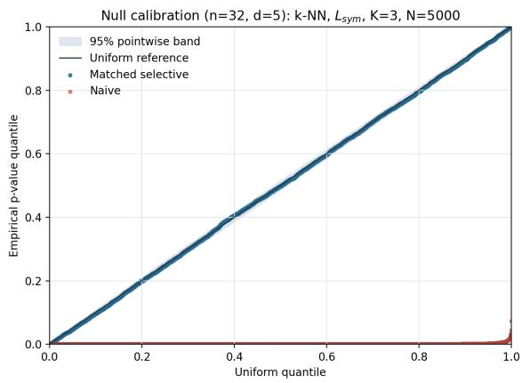
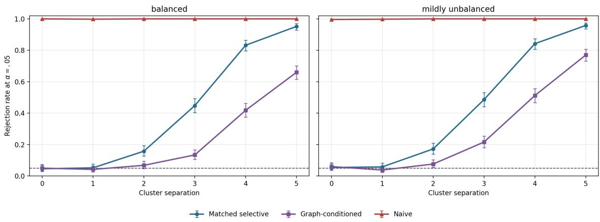
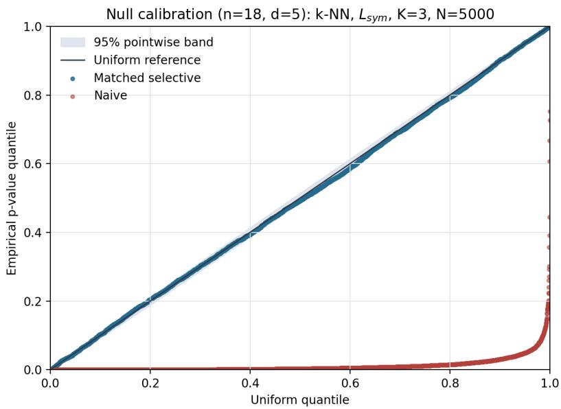
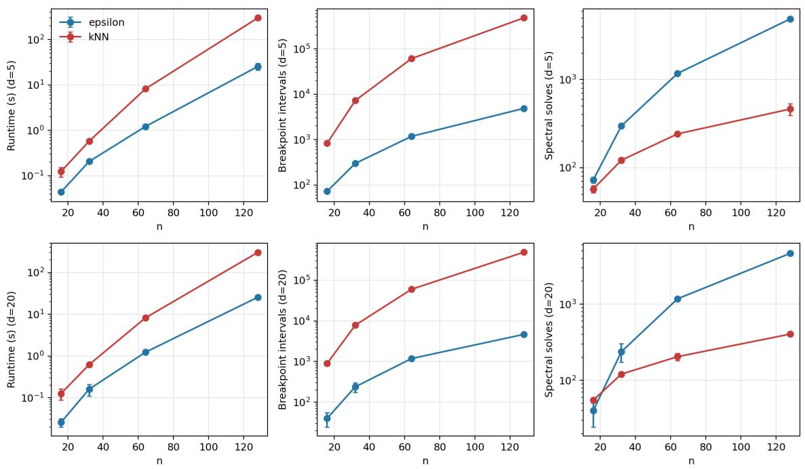
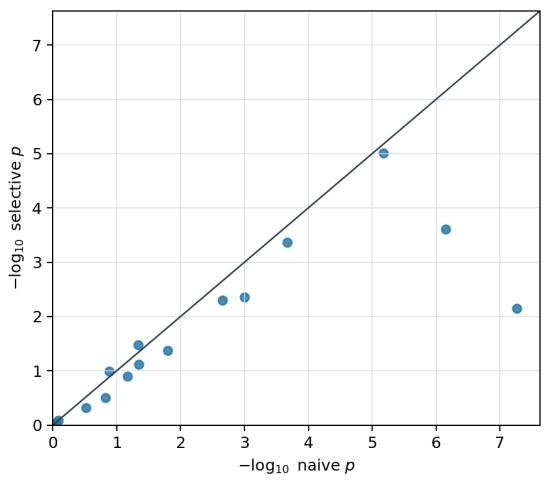
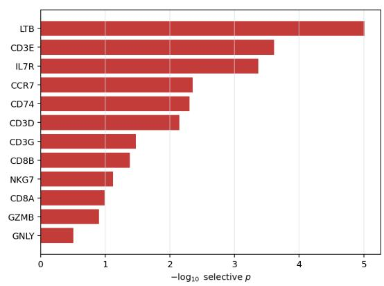

# Exact Selective Inference for Spectral Clustering via Piecewise-Constant Graph Perturbation

Naotoshi Nakamura

nakamura.nao.ms@yokohama-cu.ac.jp

Graduate School of Data Science, Yokohama City University, Yokohama, Japan

Editors: Andy Song, Bo Han and Sarah Erfani

## Abstract

Cluster labels are often used twice: first to discover groups, and then to test whether the discovered groups difer. This double use of the data makes ordinary two-sample p-values anti-conservative. Selective inference fixes this by conditioning on the clustering event, but for spectral clustering the event appears dificult because the algorithm combines an afinity map, an eigendecomposition, and a rounding step.

We show that, for spectral clustering based on unweighted ε- or k-nearest-neighbor graphs, the obstruction is the afinity construction rather than the eigendecomposition. Along the one-dimensional perturbation used by the truncated-χ selective test, graph changes occur only at finitely many real roots of data-dependent quadratic distance comparisons. Between these breakpoints, the graph, Laplacian spectrum, embedding, rounding, and reported cluster pair are deterministic functions of a finite graph state. Consequently, in real arithmetic and under a known-scale spherical Gaussian model, the selection set is an exact finite union of intervals, yielding finite-sample selective p-values for selected spectralcluster pairs. The same argument gives feature-wise truncated-normal tests. We also record direct extensions to known feature covariance, eigengap-selected K, and auxiliarycoordinate graphs. We validate null and partial-null calibration, operational power, numerical sensitivity, and model-scope diagnostics, and give a working-model PBMC algorithmic illustration. Smooth kernels such as RBF afinities fall outside the finite-state guarantee. Keywords: selective inference; spectral clustering; post-clustering inference; graph homotopy; truncated pivots

## 1. Introduction

Clustering is routinely followed by a confirmatory step: having obtained clusters, the analyst asks whether two of them are truly diferent, for example whether their feature means difer. The naive approach, namely a two-sample test between the estimated clusters, is invalid, because the clusters were chosen by the data precisely to be separated, so the test rejects far too often even when no structure is present (the “double-dipping” problem (Ball et al., 2019)). Selective inference resolves this by conditioning on the event that the algorithm returned the clusters of interest (Lee et al., 2016; Gao et al., 2024).

For hierarchical clustering with squared-Euclidean Ward linkage, Gao et al. (2024) derived an exact selective test: under a spherical Gaussian model, the diference-in-means statistic follows a χ distribution truncated to the set of perturbations that preserve the clusters, and that set is an analytically computable union of intervals. Chen and Witten (2023) extended the program to k-means by conditioning on the iterates of Lloyd’s algorithm. Subsequent work has extended post-clustering selective inference to convex clustering (Bachoc et al., 2025), dependent observations and features (González-Delgado et al.,

2026), and functional or longitudinal data (Zhu et al., 2024); see also the recent review of conditional selective inference by Neufeld et al. (2026). A parallel line based on parametric programming (Le Duy and Takeuchi, 2022) computes the same conditioning set by line search and has recently been assembled into a framework for multi-stage clustering pipelines (Miyata et al., 2026), whose component library covers distance-based outlier detection, variance/correlation feature selection, k-means and DBSCAN. A method-agnostic alternative, data thinning (Neufeld et al., 2024; Dharamshi et al., 2025), splits the data into independent parts and avoids conditioning by testing clusters selected on an independent noisy copy. This is valid, but it targets that randomized selection copy rather than the deterministic clustering returned on the observed data, which is our target.

Conspicuously absent from all of these is spectral clustering (Ng et al., 2001; von Luxburg, 2007), despite its ubiquity. Graph-based representations and decompositions are also central in genomic interaction analysis, including graph-cover formulations for Hi–C data and comparative evaluation of topological-domain callers on RNA-associated interactomes (Sefer, 2021; Alaygut and Sefer, 2026). Spectral clustering composes three operations: an afinity map, an eigendecomposition of a graph Laplacian, and a rounding step (k-means on the spectral embedding); and the eigendecomposition is the step that does not admit the polyhedral / linear-or-quadratic characterization of the selection event on which existing exact post-clustering inference relies (Gao et al., 2024; Bachoc et al., 2025; Le Duy and Takeuchi, 2022). It is therefore natural to suspect that the eigendecomposition is the obstruction. Our central observation is that it is not; the afinity construction is. We make this precise and instantiate an exact-in-real-arithmetic selective test. Many spectral clustering pipelines construct an unweighted ε- or k-nearest-neighbor graph before forming a graph Laplacian; our theorem targets exactly this graph-based regime, while smooth weighted kernels require separate analysis.

## Contributions.

1. Finite-state theorem. We prove that any polynomial finite-state graph selector yields a finite-union selection set for deterministic spectral clustering (Section 3).

2. Neighborhood graphs. Unweighted ε-graphs and OR-symmetrized k-NN graphs satisfy the theorem with quadratic predicates and quadratic-root breakpoints.

3. Selective tests. Under the stated known-scale spherical Gaussian model, we derive finite-sample exact truncated-χ tests in real arithmetic for selected spectral-cluster pairs, with deterministic gap, rounding, and target-selection conventions.

4. Feature-wise inference. We derive truncated-normal tests for marker or driver features after spectral clustering.

5. Direct extensions and scope. We record short extensions for known feature covariance, eigengap-selected K, and auxiliary-coordinate afinities, while keeping the main theorem focused on the fixed-K neighborhood-graph case.

6. Empirical validation and scope. We report global- and partial-null calibration, operational power and usability, numerical-sensitivity and misspecification diagnostics, scaling behavior, and a working-model PBMC illustration (Section 5). To our

knowledge, this is the first finite-sample exact selective-inference procedure, at the theorem level, for spectral clustering with unweighted neighborhood-graph afinities.

## 2. Setup and selective test

Model. Let $\mathbf { X } \in \mathbb { R } ^ { n \times d }$ have independent rows $\mathbf { x } _ { i } \sim N ( \mu _ { i } , \sigma ^ { 2 } I _ { d } )$ with σ known. A clustering algorithm is a map $\mathcal { C } : \mathbb { R } ^ { n \times d }  \Pi _ { n }$ to partitions of $\{ 1 , \ldots , n \}$ ; write $\mathcal { C } _ { \mathrm { s p e c } }$ for spectral clustering. For two clusters $C _ { a } , C _ { b } \in \mathcal { C } ( \mathbf { X } )$ we test

$$
\begin{array} { r } { H _ { 0 } : \bar { \mu } _ { C _ { a } } = \bar { \mu } _ { C _ { b } } , \qquad \bar { \mu } _ { C } : = \frac { 1 } { | C | } \sum _ { i \in C } \mu _ { i } . } \end{array}\tag{1}
$$

Contrast and statistic. Define $\nu \in \mathbb { R } ^ { n }$ by $\nu _ { i } = \mathbb { 1 } ( i \in C _ { a } ) / | C _ { a } | - \mathbb { 1 } ( i \in C _ { b } ) / | C _ { b } |$ , so that $\pmb { \nu } ^ { \top } \mathbf { X } = \bar { \mathbf { x } } _ { C _ { a } } - \bar { \mathbf { x } } _ { C _ { b } } \in \mathbb { R } ^ { d }$ and $\mathbb { E } [ { \pmb { \nu } } ^ { \top } { \bf X } ] = \bar { \pmb { \mu } } _ { C _ { a } } - \bar { \pmb { \mu } } _ { C _ { b } }$ . The test statistic is $T ( \mathbf { X } ) = \| \pmb { \nu } ^ { \top } \mathbf { X } \| _ { 2 }$ Under $H _ { 0 } , \bar { \pmb { \nu } } ^ { \top } \mathbf { X } \stackrel {  } { \sim } N ( 0 , \sigma ^ { 2 } \| \pmb { \nu } \| ^ { 2 } I _ { d } )$ and hence

$$
T ( \mathbf { X } ) / \left( { \boldsymbol { \sigma } } \| { \boldsymbol { \nu } } \| \right) \sim \ \chi _ { d } .\tag{2}
$$

Here $\chi _ { d }$ denotes the distribution of $\| G \| _ { 2 }$ for $G \sim N ( 0 , I _ { d } )$ ; it is a chi, not a chi-squared, distribution. Note $\| \pmb { \nu } \| ^ { 2 } = 1 / | C _ { a } | + 1 / | C _ { b } |$ , and ν is supported only on $C _ { a } \cup C _ { b } \mathrm { . }$ points outside the tested pair (“spectators”) do not enter the contrast, though they still shape the graph.

Perturbation path. Let $\pi : = \operatorname { d i r } ( { \pmb { \nu } } ^ { \top } \mathbf { X } ) = { \pmb { \nu } } ^ { \top } \mathbf { X } / T ( \mathbf { X } )$ . Define, for $\phi \geq 0$

$$
\mathbf { X } ^ { \prime } ( \phi ) : = \mathbf { \phi } \mathbf { X } + \frac { \phi - T ( \mathbf { X } ) } { \| \pmb { \nu } \| ^ { 2 } } \pmb { \nu } \pi ^ { \top } ,\tag{3}
$$

so that $\pmb { \nu } ^ { \top } \mathbf { X } ^ { \prime } ( \phi ) = \phi \pi$ , the orthogonal nuisance $\Pi _ { \nu } ^ { \perp } \mathbf { X }$ and direction π are preserved, and ${ \bf { X } } ^ { \prime } ( T ( { \bf { X } } ) ) = { \bf { X } }$ . Crucially, (3) is afine in $\phi \colon$ row i is $p _ { i } + \phi q _ { i }$ with $p _ { i } = \mathbf { x } _ { i } - ( \nu _ { i } / \Vert \boldsymbol { \nu } \Vert ^ { 2 } ) \boldsymbol { \nu } ^ { \top } \mathbf { X }$ and $q _ { i } = ( \nu _ { i } / \lVert \nu \rVert ^ { 2 } ) \pi ;$ spectator rows have $q _ { i } = 0$

Target-selection rule. The tested pair may itself be chosen after clustering, so we make that rule part of the selection event. Let A be a deterministic target-selection rule that maps the clustering output (and any deterministic diagnostics such as cluster sizes) to a set of unordered cluster pairs to be tested. For example, $\mathcal { A } _ { \mathrm { a p p } } ( \mathcal { C } )$ returns all unordered pairs of clusters in ${ \mathcal { C } } ,$ whereas $\mathcal { A } _ { \mathrm { 2 l g } } ( \mathcal { C } )$ returns only the pair consisting of the two largest clusters, with a fixed tie-breaking rule. The observed target is the unordered pair $\{ C _ { a } , C _ { b } \}$ of index sets. Once the deterministic validity conventions of Section 4.1 are fixed, the matched selection event is that the spectral pipeline is valid and $\{ C _ { a } , C _ { b } \} \in \mathcal { A } ( \mathcal { C } _ { \mathrm { s p e c } } ( \mathbf { X } ) )$ . If the reported hypothesis is simply this observed pair, $\mathcal { A } _ { \mathrm { a p p } }$ is the Gao–Bien–Witten “pair appears” event; if the analysis protocol says to test the two largest clusters, $\boldsymbol { A } _ { \mathrm { 2 l g } }$ is the correct event to condition on. More generally, any pre-specified rule that is a deterministic function of the finite graph state and pipeline output is covered without new graph roots. A rule using additional raw-data summaries requires its own selection decision to be added, and the finite-state conclusion persists only when that added decision is itself piecewise constant with finitely many tractable boundaries.

Table 1: Conditioning levels used in the paper. The valid event must match the reported target; conditioning on more information is valid but can be conservative.
<table><tr><td>Level</td><td>Event fixed along the path</td><td>Role</td></tr><tr><td>Graph-conditioned</td><td>realized graph state</td><td>cheapest, most conservative</td></tr><tr><td>Full partition</td><td>exact spectral partition</td><td>intermediate diagnostic</td></tr><tr><td>Matched rule</td><td> $\{ C _ { a } , C _ { b } \} \in \mathcal { A } ( \mathcal { C } ( \cdot ) )$  for the reporting rule</td><td>primary test</td></tr><tr><td>Pair appearance</td><td> $\{ C _ { a } , C _ { b } \}$  appears among cluster pairs</td><td>valid when the pair is user chosen</td></tr></table>

Selective p-value. Conditioning on the matched selection event together with the nuisances $\left( \Pi _ { \nu } ^ { \perp } \mathbf { X } , \pi \right)$ reduces the test to a one-dimensional truncated χ problem (Gao et al., 2024). With

$$
S _ { A } \ : = \ \{ \phi \geq 0 : \ \mathcal { C } _ { \mathrm { s p e c } } ( \mathbf { X } ^ { \prime } ( \phi ) ) \ \mathrm { i s ~ v a l i d ~ a n d } \ \{ C _ { a } , C _ { b } \} \in \mathcal { A } ( \mathcal { C } _ { \mathrm { s p e c } } ( \mathbf { X } ^ { \prime } ( \phi ) ) ) \} ,\tag{4}
$$

the selective p-value is

$$
p ~ = ~ { \frac { \mathbb { P } \left( { \boldsymbol { \sigma } } \| { \pmb { \nu } } \| ~ { \chi } _ { d } \geq T ( \mathbf { x } ^ { \mathrm { o b s } } ) , ~ { \boldsymbol { \sigma } } \| { \pmb { \nu } } \| ~ { \chi } _ { d } \in S _ { \mathcal { A } } \right) } { \mathbb { P } \left( { \boldsymbol { \sigma } } \| { \pmb { \nu } } \| ~ { \chi } _ { d } \in S _ { \mathcal { A } } \right) } } .\tag{5}
$$

If $S _ { A }$ is a union of intervals $\begin{array} { r l } {  { \bigcup _ { m } \bigl [ \ell _ { m } , u _ { m } \bigr ] } } \qquad & { { } } \end{array}$ , (5) is a finite sum of $\chi _ { d ^ { - } } \mathrm { C D F }$ diferences. The entire problem thus reduces to computing $S _ { A }$ for the actual target-selection rule.

The spherical model $\mathbf { x } _ { i } \sim N ( \mu _ { i } , \sigma ^ { 2 } I _ { d } )$ can be relaxed when the feature covariance is known: one applies the entire pipeline after whitening, as summarized with the direct extensions in Section 4.3.

## 3. The tractability dichotomy

Because (3) is afine, every pairwise squared distance along the path is a scalar quadratic in ϕ:

$$
d _ { i j } ( \phi ) ^ { 2 } = \| ( p _ { i } - p _ { j } ) + \phi ( q _ { i } - q _ { j } ) \| ^ { 2 } = \alpha _ { i j } \phi ^ { 2 } + \beta _ { i j } \phi + \gamma _ { i j } ,\tag{6}
$$

with $\alpha _ { i j } = | | q _ { i } - q _ { j } | | ^ { 2 } , \beta _ { i j } = 2 ( p _ { i } - p _ { j } ) ^ { \top } ( q _ { i } - q _ { j } ) , \gamma _ { i j } = | | p _ { i } - p _ { j } | | ^ { 2 }$ . What happens next depends sharply on the afinity.

Definition 1 (Finite-state selector) Fix the nuisance variables defining the afine path (3). A graph construction is polynomial finite-state along this path if finitely many real polynomials $h _ { 1 } , \ldots , h _ { M }$ and a deterministic map Γ satisfy

$$
G ( \phi ) = \Gamma \big ( \mathrm { s i g n } h _ { 1 } ( \phi ) , \dots , \mathrm { s i g n } h _ { M } ( \phi ) \big )
$$

for all $\phi$ outside the roots of the $h _ { m } \ : s$ . If each $h _ { m }$ has degree at most r, we call the selector degree-r.

Lemma 2 (Fixed graph states) Fix a deterministic graph-to-clustering pipeline with its invalid-state convention, and fix a target-selection rule A. If $G ( \phi ) = G _ { 0 }$ on an interval $I ,$ then the clustering output and the decision

$$
\mathbb { 1 } \{ \{ C _ { a } , C _ { b } \} \in \mathcal { A } ( \mathcal { C } _ { \mathrm { s p e c } } ( G ( \phi ) ) ) \}
$$

are constant on I, where the indicator is defined to be zero whenever the pipeline declares the graph state invalid.

Theorem 3 (Finite-state graph selector theorem) Suppose the graph along the selective path is a degree-r polynomial finite-state selector. Suppose further that the embedding, spectral-gap check, rounding map, and target-selection rule A are deterministic functions of the graph state. Then the selection indicator

$$
\phi \longmapsto \mathbb { 1 } \{ \{ C _ { a } , C _ { b } \} \in \mathcal { A } ( \mathcal { C } ( \mathbf { X } ^ { \prime } ( \phi ) ) ) \}
$$

is constant on every connected component $o f [ 0 , \infty ) \backslash \{ \cup _ { m = 1 } ^ { M } \{ \phi : h _ { m } ( \phi ) = 0 \}$ . Consequently $S _ { A }$ in (4) is, up to endpoints of measure zero, a finite union of intervals whose finite endpoints are roots of the $h _ { m } \ : s .$ In particular, if the $h _ { m }$ have algebraic coeficients and degree at most r, the endpoints are algebraic numbers.

Corollary 4 (Neighborhood graphs) Unweighted ε-graphs and OR-symmetrized k-NN graphs are degree-2 finite-state selectors along (3). Their candidate breakpoints are contained in the real roots of

(i) $d _ { i j } ( \phi ) ^ { 2 } = \varepsilon ^ { 2 }$ over all pairs (i, j) (ε-graph; $O ( n ^ { 2 } )$ candidate roots), or

(ii) $d _ { i j } ( \phi ) ^ { 2 } = d _ { i m } ( \phi ) ^ { 2 }$ over all triples (i, j, m) (k-NN graph; $O ( n ^ { 3 } )$ candidate roots).

Each equation is quadratic in ϕ, so, in real arithmetic, $S _ { A }$ is an exact finite union of intervals whose finite endpoints are among the real roots of these data-dependent quadratics, for any deterministic spectral pipeline and deterministic target-selection rule A.

Proofs of Lemma 2, Theorem 3, and Corollary 4 are given in the supplement.

Remark 5 (The eigendecomposition is not the obstruction) Theorem 3 never $d i f -$ ferentiates eigenvectors in ϕ: on each finite-state interval the Laplacian is a fixed matrix, so its spectrum is fixed. All ϕ-dependence is combinatorial, living in the graph selector and in the deterministic target-selection rule. This is why unweighted graphs are the tractable case.

Remark 6 (RBF afinities) For a Gaussian/RBF afinity $w _ { i j } ( \phi ) = \exp ( - d _ { i j } ( \phi ) ^ { 2 } / 2 h ^ { 2 } )$ W(ϕ) is real-analytic rather than finite-state. Away from eigenvalue crossings and rounding ties, eigenvectors vary analytically by Rellich’s theorem. The endpoints of the selection set are then zeros of analytic, generally transcendental functions, not roots of finitely many graph-state polynomials. A line-search method may localize such endpoints numerically under suitable bracketing and tie-free conditions, but the finite quadratic-root interval representation of Corollary 4 is no longer supplied by our finite-state argument.

## 4. A finite-state spectral selective test

We instantiate the construction with a single code path parameterized by the graph type (unweighted ε- or k-NN) and the Laplacian (unnormalized $L = D - W$ , symmetric-normalized $L _ { \mathrm { s y m } } ~ = ~ I - { D ^ { - 1 / 2 } W D ^ { - 1 / 2 } }$ with row-normalized embedding à la Ng–Jordan–Weiss, or random-walk $L _ { \mathrm { r w } } = I - D ^ { - 1 } W$ à la Shi–Malik), with k-means rounding for general $K ,$ testing a chosen pair of clusters. All variants share the same breakpoint set (Corollary 4) and the same gap condition below, since $L _ { \mathrm { r w } }$ and $L _ { \mathrm { s y m } }$ have identical eigenvalues.

## 4.1. Deterministic spectral pipeline and degeneracy conventions

For the exact selection event, spectral clustering must be a single-valued map from a graph state to either a partition or an invalid symbol. We use the following convention throughout.

Graph construction. The ε-graph has $W _ { i j } = \mathbb { 1 } \{ d _ { i j } ^ { 2 } \leq \varepsilon ^ { 2 } \}$ for $i \neq j$ and zero diagonal, so the endpoint convention is closed. For the k-NN graph, self-neighbors are excluded and node i orders candidates by the lexicographic key $( d _ { i j } ^ { 2 } , j ) ; N _ { k } ( i )$ is the first k indices in that order. The undirected graph is the OR-symmetrization $W _ { i j } = \mathbb { 1 } \{ j \in N _ { k } ( i )$ or $i \in N _ { k } ( j ) \}$ Mutual k-NN is not used in the reported experiments.

Degrees, Laplacians, and zero rows. Let $d _ { i } = \textstyle \sum _ { j } W _ { i j }$ . For normalized variants we set $d _ { i } ^ { - 1 } = d _ { i } ^ { - 1 / 2 } = 0$ when $d _ { i } = 0 ;$ thus isolated vertices contribute zero rows to the normalized adjacency. We then form $L = D - W$ ， $L _ { \mathrm { s y m } } = I - D ^ { - 1 / 2 } W D ^ { - 1 / 2 }$ , or, for the randomwalk embedding, the equivalent symmetric generalized problem obtained from $L _ { \mathrm { s y m } }$ and mapped back by $D ^ { - 1 / 2 }$ . Zero-degree states are not random choices; they are handled by this convention and may still be excluded by the gap check below.

Gap and bottom-K representation. A graph state is declared invalid unless $\lambda _ { K } ( L ) <$ $\lambda _ { K + 1 } ( L )$ for the chosen Laplacian eigenvalues in nondecreasing order. Repeated eigenvalues inside the bottom-K subspace are allowed. To remove basis ambiguity, the mathematical embedding is defined from the bottom-K spectral projector by the following deterministic procedure:

1. Scan the coordinate vectors $e _ { 1 } , \ldots , e _ { n }$ in index order.

2. Project each vector onto the bottom-K invariant subspace.

3. Orthogonalize the projection against all previously accepted vectors.

4. Append the normalized residual whenever it is nonzero.

5. Choose the sign so the first nonzero coordinate is positive.

The resulting canonical orthonormal basis is a deterministic representation of the selected invariant subspace; away from degeneracies it agrees with the usual spectral-clustering target up to rounding. In floating-point experiments we use the same convention up to fixed numerical tolerances, declaring a graph invalid when the observed gap is below tolerance.

Embedding, rounding, and labels. For $L _ { \mathrm { s y m } }$ we row-normalize the $n \times K$ embedding; a zero spectral row remains zero. For $L _ { \mathrm { r w } }$ and L we use the unnormalized rows. Rounding is deterministic Lloyd k-means: a fixed pseudorandom seed gives the initialization, centerdistance ties are assigned to the smallest center index, center updates are performed in label order, empty clusters retain their previous center, and the iteration stops when labels no longer change or after a fixed maximum number of iterations. The inferential target is expressed as an unordered pair of cluster index sets, so numeric label names have no statistical meaning; for reporting only, labels are ordered by the smallest observation index in each cluster.

Target-selection rules. $\mathcal { A } _ { \mathrm { a p p } }$ returns every unordered pair of nonempty clusters in the partition. $\boldsymbol { A } _ { \mathrm { 2 l g } }$ returns the unordered pair of the two largest nonempty clusters, breaking size ties by the smallest observation index in the cluster and then lexicographically. Other graphoutput-based rules are allowed when specified before inference and made deterministic. For example, a fixed external annotation may be used to choose the pair having the largest pre-specified annotation contrast. A rule that inspects additional raw-data summaries is not automatically covered: its selection event must also be characterized and included.

Conditioning beyond the cluster pair. Two further data-defined events must be included in the conditioning set to make the procedure well-defined. They are deterministic, hence measurable, functions of the graph state; intersecting them with the selection event only removes additional values of $\phi$ from $S _ { A }$ , so the truncated-pivot validity argument is unchanged.

Assumption 7 (Strict spectral gap) We retain only ϕ at which $\lambda _ { K + 1 } ( L ) > \lambda _ { K } ( L )$ where $\lambda _ { 1 } \leq \cdots \leq \lambda _ { n }$ are the Laplacian eigenvalues, i.e. the K eigenvalues used for the embedding are strictly separated from the remainder of the spectrum. This excludes graphs with more than K connected components and other degeneracies where the selected bottom-K invariant subspace itself is not separated. Repeated eigenvalues inside the bottom-K subspace are handled by the canonical basis convention in Section 4.1.

Assumption 8 (Deterministic rounding) The k-means rounding uses the deterministic Lloyd convention in Section 4.1, including fixed initialization, iteration order, tiebreaking, and empty-cluster handling. Within a fixed-graph interval the embedding is identical, so the labels are identical.

Under Assumptions 7–8 and the conventions in Section 4.1, the conditioning event is $S _ { A }$ with invalid graph states removed. The rule A must match the way the reported hypothesis was selected: the Gao–Bien–Witten pair-appearance event uses $\mathcal { A } _ { \mathrm { a p p } }$ , whereas experiments that test the two largest clusters use $\boldsymbol { A } _ { \mathrm { 2 l g } }$

Proposition 9 (Validity) Under the model of Section 2, under $H _ { 0 }$ , and for the deterministic pipeline above, let

$$
\begin{array} { r l } & { U = ( P _ { \nu } ^ { \perp } \mathbf { X } , \pi ) , } \\ & { S _ { A } ( U ) = \{ \phi \geq 0 : \ C _ { \mathrm { s p e c } } ( \mathbf { X } ^ { \prime } ( \phi ) ) \ i s \ v a l i d \ a n d \ \{ C _ { a } , C _ { b } \} \in \mathcal { A } ( \mathcal { C } _ { \mathrm { s p e c } } ( \mathbf { X } ^ { \prime } ( \phi ) ) ) \} , } \end{array}
$$

and let $E _ { A } = \{ T ( \mathbf { X } ) \in S _ { A } ( U ) \}$ be the matched selection event. The p-value (5), evaluated over the finite-interval set $S _ { \mathcal { A } } ( U )$ of Theorem ${ \mathcal { B } } ,$ satisfies $\mathbb { P } ( p \leq t \mid E _ { \mathcal { A } } ) \leq t$ for all $t \in [ 0 , 1 ]$ ， with equality when $S _ { \mathcal { A } } ( U )$ has positive measure almost surely on $E _ { A }$

Proof [Proof sketch] On the line (3), fixing $U = ( P _ { \nu } ^ { \perp } { \bf X } , \pi )$ leaves only the radius $T ( \mathbf { X } )$ free. Under $H _ { 0 } , \ \pmb { \nu } ^ { \top } \mathbf { X } \sim N ( 0 , \sigma ^ { 2 } \| \pmb { \nu } \| ^ { 2 } I _ { d } )$ , and Gaussian orthogonality plus isotropy give $T ( \mathbf { X } ) \ \sim \ \sigma \| \pmb { \nu } \| \chi _ { d }$ independent of U. For fixed $U _ { : }$ , the deterministic pipeline makes the matched selection event exactly $\{ T ( \mathbf { X } ) \in S _ { A } ( U ) \}$ , so the conditional law is the same $\chi _ { d }$ law truncated to $S _ { \mathcal { A } } ( U )$ . The ratio (5) is therefore the truncated upper-tail probability and is uniform by the probability integral transform; zero-mass truncation sets are assigned $p = 1$ Full details are in the supplement.

## 4.2. Feature-wise selective inference

The global test asks whether two selected clusters difer in their overall d-dimensional mean. In high-dimensional applications it is often more useful to ask which coordinates explain the selected separation. For feature $j \in \{ 1 , \ldots , d \}$ , consider

$$
H _ { 0 j } : \nu ^ { \top } \pmb { \mu } . _ { j } = 0 , \qquad Z _ { j } : = \nu ^ { \top } \mathbf { X } . _ { j } .\tag{7}
$$

Under $H _ { 0 j } , Z _ { j } \sim N ( 0 , \sigma ^ { 2 } \| \pmb { \nu } \| ^ { 2 } )$ . Condition on the other features $\mathbf { X } _ { \cdot , - j }$ and on the nuisance projection $P _ { \nu } ^ { \perp } \mathbf { X } . _ { j }$ . The one-dimensional path that varies only the tested feature is

$$
\mathbf { X } _ { j } ^ { \prime } ( \phi ) : = \mathbf { \phi } \mathbf { X } + \frac { \phi - Z _ { j } } { \| \pmb { \nu } \| ^ { 2 } } \pmb { \nu } e _ { j } ^ { \top } , \qquad \phi \in \mathbb { R } ,\tag{8}
$$

where $e _ { j }$ is the jth coordinate vector. Then $\nu ^ { \top } { \bf X } _ { j } ^ { \prime } ( \phi ) . _ { j } ~ = ~ \phi$ , all other coordinates are unchanged, and the nuisance $P _ { \nu } ^ { \perp } \mathbf { X } . _ { j }$ is preserved. Define the feature-wise selection set

$$
S _ { A , j } : = \{ \phi \in \mathbb { R } : \mathcal { C } _ { \mathrm { s p e c } } ( \mathbf { X } _ { j } ^ { \prime } ( \phi ) ) \mathrm { ~ i s ~ v a l i d ~ a n d ~ } \{ C _ { a } , C _ { b } \} \in \mathcal { A } ( \mathcal { C } _ { \mathrm { s p e c } } ( \mathbf { X } _ { j } ^ { \prime } ( \phi ) ) ) \} .\tag{9}
$$

Because (8) is afine in $\phi ,$ every pairwise squared distance along the path is again a quadratic polynomial in $\phi .$ . Hence Theorem 3 and Corollary 4 apply verbatim: for unweighted ε- and k-NN graphs, $S _ { A , j }$ is an exact finite union of intervals whose finite endpoints are among the corresponding data-dependent quadratic roots.

Proposition 10 (Feature-wise validity) Under the model of Section 2, $H _ { 0 j }$ , and the deterministic pipeline above, conditional on the matched selection event and the feature-wise nuisance variables, $Z _ { j }$ has a $N ( 0 , \sigma ^ { 2 } \| \nu \| ^ { 2 } )$ distribution truncated to $S _ { A , j }$ . Consequently the two-sided feature-wise selective p-value

$$
p _ { j } = \frac { \mathbb { P } \big ( | Y _ { j } | \geq | Z _ { j } ^ { \mathrm { o b s } } | , \ Y _ { j } \in S _ { A , j } \big ) } { \mathbb { P } \big ( Y _ { j } \in S _ { A , j } \big ) } , \qquad Y _ { j } \sim N ( 0 , \sigma ^ { 2 } \| \pmb { \nu } \| ^ { 2 } ) ,\tag{10}
$$

is super-uniform under $H _ { 0 j }$ ; one-sided alternatives use the corresponding upper or lower tail of the same truncated normal law.

Proof [Proof sketch] Fix the selected pair and condition on $U _ { j } = ( \mathbf { X } . , . . { } _ { j } , P _ { \nu } ^ { \perp } \mathbf { X } . _ { j } )$ . Under $H _ { 0 j } , Z _ { j } = \pmb { \nu } ^ { \top } \mathbf { X } . _ { j } \sim N ( 0 , \sigma ^ { 2 } \| \pmb { \nu } \| ^ { 2 } )$ and is independent of $U _ { j }$ by Gaussian orthogonality and the spherical feature model. For fixed $U _ { j }$ , the matched selection event is $\{ Z _ { j } \in S _ { \mathcal { A } , j } ( U _ { j } ) \}$ ， and Corollary 4 makes this set a finite union of intervals for the graph classes considered here. The truncated-normal probability integral transform gives (10); one-sided tails are analogous. Full details are in the supplement. 7

Remark 11 (Multiple features) If all features are tested for a fixed selected pair, Proposition 10 gives valid marginal selective p-values for marker or driver features. The subsequent multiplicity correction is a separate layer: Bonferroni or Benjamini–Yekutieli control is valid under arbitrary dependence, while more powerful false-discovery-rate procedures require assumptions on the dependence among the selective p-values. Ifthe analyst first screens features and then tests only the screened subset, that screening rule should also be included in the selection event or handled by sample splitting.

## 4.3. Direct extensions

The finite-state proof is stable under deterministic operations that are fixed on each interval where the neighborhood graph is fixed. We therefore keep the main construction focused on the fixed-K spherical case above, and record only the application-facing extensions here. The supplement gives the full whitening and auxiliary-coordinate statements and proofs.

Remark 12 (Known feature covariance) If the rows are independent Gaussian observations with known covariance $\Sigma \ \succ \ 0 ,$ , apply the entire pipeline to the whitened matrix $\tilde { \mathbf { X } } = \mathbf { X } \boldsymbol { \Sigma } ^ { - 1 / 2 }$ : build the graph in the Mahalanobis metric and use the Mahalanobis diferencein-means statistic. Then X˜ satisfies the unit-scale spherical model, so Proposition 9 applies with reference law $\| \nu \| \chi _ { d }$ truncated to the finite-state selection set computed after whitening. Whitening only the statistic while keeping a Euclidean graph on the unwhitened data is not covered, and per-coordinate feature-wise pivots under general $\Sigma$ remain outside the present theorem.

Data-driven number of clusters. Fix a maximum $K _ { \mathrm { m a x } }$ and use the deterministic eigengap rule

$$
{ \hat { K } } ( G ) \ : = \ \operatorname * { a r g m a x } _ { k \in \{ 1 , \ldots , K _ { \operatorname* { m a x } } \} } { \bigl ( } \lambda _ { k + 1 } ( L ) - \lambda _ { k } ( L ) { \bigr ) } ,\tag{11}
$$

with ties broken by the smallest such k. Because the Laplacian is fixed on each finite-state interval, the whole spectrum and hence $\hat { K }$ are constant there.

Proposition 13 (Exact inference with a data-driven K) Augment the deterministic pipeline of Section 4.1 so that the embedding dimension is chosen by (11), and add $\{ \hat { K } ( \phi ) =$ $K _ { \mathrm { o b s } } \}$ to the selection event, where $K _ { \mathrm { o b s } } = \hat { K } ( G ( \mathbf { x } ^ { \mathrm { o b s } } ) )$ . Under the model of Section 2 and $H _ { 0 }$ , the augmented selection set

$$
\begin{array} { r } { S _ { A } ^ { K } \ : = \ \{ \phi \ge 0 : \ \mathcal { C } _ { \mathrm { s p e c } } ( { \bf X } ^ { \prime } ( \phi ) ) \ i s \ v a l i d , \ \hat { K } ( \phi ) = K _ { \mathrm { o b s } } , \ a n d \ \{ C _ { a } , C _ { b } \} \in A ( \mathcal { C } _ { \mathrm { s p e c } } ( { \bf X } ^ { \prime } ( \phi ) ) ) \} } \end{array}
$$

is a finite union of intervals whose finite endpoints are among the data-dependent quadratic roots, and the p-value (5) evaluated over $S _ { \mathcal { A } } ^ { K }$ is super-uniform.

The proof, given in the supplement, is immediate from Lemma 2 and Proposition 9: the event $\{ \hat { K } ( \phi ) = K _ { \mathrm { o b s } } \}$ is just one more measurable, path-piecewise-constant selection event. The reported experiments fix $K = 3 ; ( 1 1 )$ is the validity-preserving way to let the data set $K$

Graphs built from auxiliary coordinates. If the graph is a deterministic function of auxiliary coordinates independent of the tested features—for example, spatial coordinates used to cluster cells before testing expression—then the graph is held fixed along the expression perturbation path. The selection event is independent of the contrast, the truncation set is the whole ray (or all of R for feature-wise tests), and the ordinary test is already exact. This boundary case is stated and proved in the supplement.

Algorithm 1: Finite-state computation of the selective p-value

Input: X, σ, K, neighborhood size; observed labels and pair $\left( C _ { a } , C _ { b } \right)$ ; deterministic targetselection rule A.

1. Form ν and the afine path coeficients $p _ { i } , q _ { i }$

2. Compute all graph-change roots from $\alpha _ { i j } , \beta _ { i j } , \gamma _ { i j }$ in $\mathrm { E q . ~ } ( 6 )$

3. Set $B  \{ 0 \} \cup$ {positive finite roots returned by the solver} $\cup \left\{ \infty \right\}$ ; deduplicate roots by floating-point equality and sort B.

4. Initialize $S _ { \mathcal { A } }  \emptyset$ and $g _ { \mathrm { p r e v } }  \bot$

5. For each consecutive interval $( \ell , u )$ in $B \colon$

(a) Choose $\phi ^ { \star }$ as the midpoint of $( \ell , u )$ , or $\ell + 1$ when $u = \infty ,$

(b) Build G from $\{ d _ { i j } ( \phi ^ { \star } ) ^ { 2 } \}$ and set $g $ the byte representation of the binary adjacency matrix.

(c) If $g = g _ { \mathrm { p r e v } }$ , verify matrix equality and reuse the previous decision.

(d) Otherwise, check Assumption 7. If it fails, set ok ← false; if it passes, compute the canonical embedding, run deterministic k-means, and set ok $ ( \{ C _ { a } , C _ { b } \} \in$ $\mathcal { A } ( \mathcal { C } ( \mathbf { X } ^ { \prime } ( \phi ^ { \star } ) ) ) )$

(e) Set $g _ { \mathrm { p r e v } }  g .$ . If ok, add $[ \ell , u ]$ to $S _ { A }$

6. Merge adjacent accepted intervals using the fixed boundary tolerance.

7. Return the truncated-χd p-value over $S _ { A }$

Algorithm. Algorithm 1 constructs the finite-interval representation of $S _ { A }$ . Two optimizations reduce computation without changing the output: (a) spectator sparsity—under $\sigma ^ { 2 } I , q _ { i } \neq 0$ only for $i \in C _ { a } \cup C _ { b } ,$ so only breakpoints from candidate pairs with at least one endpoint in $C _ { a } \cup C _ { b }$ need be enumerated; spectator–spectator distances are constant along the path; (b) graph deduplication—consecutive intervals frequently share the same graph (the swapped pair lies deep in the ordering), so the eigendecomposition and rounding are recomputed only when G actually changes.

Homotopy line search. We implement Algorithm 1 as a homotopy that walks $\phi$ from 0 to ∞ and recomputes the embedding and rounding only when the graph’s binary adjacency representation changes, reusing the decision across the (often many) intervals that share a graph. This is consequential for k-NN graphs, where most rank-swap breakpoints occur deep in the distance ordering and leave the top-k graph unchanged: in our experiments the number of spectral solves was roughly 15× smaller than the number of breakpoint intervals (Section 5). For ε-graphs every breakpoint is an edge flip, so solves equal intervals.

Floating-point conventions and numerical audit. The theorem is an exact realarithmetic statement; the implementation is a floating-point proof of concept. In the initially submitted solver, coeficients with $| a | < 1 0 ^ { - 1 2 }$ are treated as linear, negative computed discriminants are discarded rather than clipped, only positive finite roots above $1 0 ^ { - 1 2 }$ are retained, and candidate roots are deduplicated by exact floating-point equality. The eigengap tolerance is $1 0 ^ { - 7 }$ , and adjacent accepted intervals are merged when their displayed boundary diference is below $1 0 ^ { - 9 }$ . Infinite intervals use $\ell + 1$ as an interior evaluation point.

Graph reuse keys on the binary adjacency byte string and verifies matrix equality before reusing a decision. The revised camera-ready code also makes the theoretical lexicographic k-NN tie rule explicit; the audit below found no target or validity changes from that update. Endpoint membership is immaterial for the continuous reference laws.

We audited 400 fixed datasets against six alternative numerical policies. Of 2,400 attempted policy–dataset comparisons, 2,394 had an evaluable submitted target. No alternative changed overall evaluation status; among evaluable cases, neither the selected target nor eigengap validity changed. In 484 comparisons the two computed selection sets had nonzero symmetric-diference probability mass, but every diference was confined to extremely narrow intervals adjacent to selection-set boundaries; the largest such mass was $5 . 3 5 \times 1 0 ^ { - 1 6 }$ and the largest absolute p-value diference was $1 . 1 0 \times 1 0 ^ { - 1 3 }$ . A 100-digit root/graph-state audit matched the submitted state sequence in 48/48 high-risk cases. These checks are empirical sensitivity evidence, not interval-arithmetic certification: eigenspaces and rounding remain float64, so the implementation does not provide certified upper/lower truncation probabilities. Full policies and results are in the supplement.

Conditioning level: over-conditioning vs. parametric programming. A single pass can yield valid p-values at several conditioning levels. The over-conditioned test fixes the realized graph, $S _ { \mathrm { o c } } = \{ \phi : G ( \phi ) = G ( \mathbf { x } ^ { \mathrm { o b s } } ) \}$ ; the matched-rule test uses $S _ { A }$ for the targetselection rule actually used to report $\{ C _ { a } , C _ { b } \}$ ; and the pair-appearance special case is $S _ { \mathrm { a p p } } = \{ \phi : \{ C _ { a } , C _ { b } \} \in \mathcal { A } _ { \mathrm { a p p } } ( \mathcal { C } ( \mathbf { X } ^ { \prime } ( \phi ) ) ) \}$ . Since the graph determines the clustering and the target-selection rule is a deterministic function of the clustering, all three sets are produced by the same homotopy. The less one conditions, the more power is available, but validity requires that the conditioning event match the reported hypothesis: if the protocol tests the two largest clusters, the correct power-preserving set is $S _ { \mathrm { 2 l g } }$ , not merely $S _ { \mathrm { a p p } }$

## 5. Experiments

Analysis protocol. Unless a robustness cell explicitly changes one component, graph type, neighborhood size, Laplacian, K, rounding seed, target rule, preprocessing, and tested features are fixed before inspecting the tested outcome. The primary and power experiments use OR-symmetrized k-NN with $k = 5 , L _ { \mathrm { s v m } } , K = 3$ deterministic rounding, and the twolargest rule. The ε robustness threshold is fixed at $1 . 3 \sqrt { 2 d \sigma ^ { 2 } }$ . Other data-dependent tuning choices must be fixed in advance, selected on independent data, or incorporated into the selection event.

## 5.1. Primary null calibration

We first verify type-I control under the global null (all $\pmb { \mu } _ { i }$ equal, so no true clusters), where valid selective p-values must be uniform on [0, 1]. The primary configuration uses the full Algorithm 1: OR-symmetrized k-NN graph with $k = 5 , L _ { \mathrm { s y m } } , K = 3$ , deterministic kmeans rounding, and the matched two-largest-cluster target rule $\boldsymbol { A } _ { \mathrm { 2 l g } }$ . The primary setting is $n = 3 2 , d = 5$ ; we retain $n = 1 8 , d = 5$ as a small supporting configuration, with 5000 usable null replicates in each setting. A replicate is “usable” if the deterministic pipeline returns the specified target and passes the validity checks; failures are reported separately.

Table 2: Primary type-I calibration under the global null for k-NN, $L _ { \mathrm { s y m } } , ~ K = 3 ,$ and matched $\boldsymbol { A } _ { \mathrm { 2 l g } }$ conditioning $( d = 5 , \sigma = 1 )$ . Brackets give exact binomial 95% confidence intervals for tail probabilities.
<table><tr><td>Setting</td><td>N</td><td>mean p</td><td> $\mathbb { P } ( p \leq . 0 1 )$ </td><td> $\mathbb { P } ( p \leq . 0 5 )$ </td><td> $\mathbb { P } ( p \leq . 1 0 )$ </td><td>KSp</td></tr><tr><td>current_n18_d5</td><td>5000</td><td>0.497</td><td>0.010 [0.008, 0.014]</td><td>0.051 [0.045, 0.057]</td><td>0.096 [0.088, 0.105]</td><td>0.222</td></tr><tr><td>larger n32_d5</td><td>5000</td><td>0.498</td><td>0.010 [0.008, 0.013]</td><td>0.053 [0.047, 0.059]</td><td>0.104 [0.096, 0.113]</td><td>0.911</td></tr></table>

  
Figure 1: Quantile–quantile plot under the primary $n = 3 2 , d = 5$ global-null configuration (5000 attempted and usable replicates). The gray band is the pointwise 95% beta band for uniform order statistics. Matched selective p-values track the diagonal, whereas the naive selected-cluster test collapses to the floor. The supporting n = 18 plot is in the supplement.

The selective p-values are indistinguishable from uniform: KS p-values are 0.911 for $n = 3 2$ and 0.222 for $n = 1 8$ , and the empirical rejection rates at levels .01, .05, and .10 all fall within their binomial confidence intervals. No observed replicate failed because of the spectral gap, zero-degree vertices, empty-cluster output, or numerical truncationmass issues. The naive test rejected in 99.98% of the primary $n = 3 2$ null replicates and 95.2% of the supporting $n = 1 8$ replicates. For the primary $n = 3 2$ setting, the average number of candidate intervals was 7317, but graph deduplication reduced this to 119 spectral solves; the supporting $n = 1 8$ setting had 1277 intervals and 69 solves. Thus the number of interval blocks is not the number of eigendecompositions, so candidate intervals and eigendecompositions should be distinguished, although the explicit interval walk remains costly.

## 5.2. Laplacian variants, graph types, and conditioning level

We next exercise the unified procedure across graph type (ε, k-NN), Laplacian $\left( L _ { \mathrm { s y m } } , L _ { \mathrm { r w } } \right)$ and conditioning level under the global null. The supplement reports 2000 usable replicates per cell for both $n = 1 6$ and $n = 3 2 \ ( d = 5 , \ K = 3 )$ . The matched rows use the same two-largest target-selection rule as the primary calibration; the graph-conditioned rows fix the realized graph for the main $k { \mathrm { - N N } } , L _ { \mathrm { s y m } }$ configuration. All level .05 conditional tail-rate confidence intervals cover the nominal level. Under the target-usable stopping rule, the $n = 1 6 ~ \varepsilon$ random-walk and symmetric cells required 2,099 and 2,101 attempts to obtain 2,000 usable replicates: usability was 0.953 and 0.952, conditional rejection was 0.050 and 0.0555, and joint usable-and-reject probability was 0.0476 and 0.0528. The extra attempts were observed-gap failures. All k-NN cells and all $n = 3 2$ cells were usable in 2,000/2,000 attempts. Because these runs stopped at 2,000 usable datasets, the attempt-based rates are diagnostics rather than pre-specified fixed-attempt binomial estimates.

Power: conditioning level matters. We next vary signal strength in three-cluster Gaussian alternatives $( k { \mathrm { - N N } } , L _ { \mathrm { s y m } } , K = 3 , d = 5 )$ . The cluster centers are $0 , \delta e _ { 1 }$ , and $\delta e _ { 2 } .$ , with $\delta \in \{ 0 , 1 , 2 , 3 , 4 , 5 \}$ . We use 500 fixed attempts per separation for a balanced design with cluster sizes (10, 10, 10) and a mildly unbalanced design with sizes (6, 10, 14). Figure 2 compares the naive test, realized-graph conditioning, and matched $\boldsymbol { A } _ { \mathrm { 2 l g } }$ conditioning. All 500/500 attempts were usable in every cell, so conditional rejection and operational joint discovery coincide in these runs; the finite-sample lower 95% confidence bound on usability in each cell is 0.993. The plotted uncertainty bars are exact binomial 95% confidence intervals for rejection. At $\delta = 0 \ :$ , the selective tests are near nominal while the naive test rejects almost always because the clusters were selected from the same noise. As separation grows, matched conditioning is materially more powerful than fixing the realized graph: at $\delta = 4$ , matched power is 0.832 (balanced) and 0.842 (unbalanced), versus 0.418 and 0.512 for graph conditioning; at $\delta = 5$ the matched powers are 0.952 and 0.958. The supplement also reports a valid Gaussian data-thinning baseline, but it targets clusters selected from an independent noisy copy $X ^ { \mathrm { s e l } }$ rather than the spectral clustering actually returned on X. In some power cells this diferent target is easier; for example, in Supplementary Table S7 the balanced $\delta = 3$ thinning rejection rate is 0.728, compared with 0.448 for the matched selective test.

Feature-wise partial null in structured data. We generated $n = 3 0 , d = 5$ spherical Gaussian data with three balanced groups, signal in the first two coordinates, and a prespecified fifth feature having mean zero in every true group. For separations $\delta = 0 , 2 , 4 , 5 .$ , all 1,000/1,000 attempts were usable. Selective level-.05 rejection was 0.050, 0.048, 0.043, 0.054, respectively, versus naive rates 0.447, 0.275, 0.059, 0.051. Median truncation masses were 0.0301, 0.101, 0.917, 1.000. Thus calibration persisted both when the selection set was restrictive and when genuine cluster structure was present; full exact confidence intervals and truncation-mass quantiles are in the supplement.

Model-scope diagnostics. In a fixed-attempt grid of 500 datasets per setting, rejection was 0.052 under the theorem-backed spherical Gaussian model. Outside the theorem, row heteroskedasticity also gave 0.052; row correlation $\rho = 0 . 2$ gave a conservative .05 tail rate of 0.028 but a non-uniform full distribution. For feature correlations $\rho = 0 . 1 , 0 . 2 5 , 0 . 5$ , the rates were 0.066, 0.068, and 0.144. The submitted standardized-t5 stress test rejected at 0.013 in 300 datasets. These rows are diagnostics and not theorem extensions; feature correlation can be materially anti-conservative. Pilot direct evaluations found no selection-set mismatch at 746 checked points in the new partial-null runs.

  
Figure 2: Power curves for three Gaussian clusters under k-NN, $L _ { \mathrm { s y m } }$ ， $K = 3$ , and the twolargest target rule, with 500 fixed attempts per separation (all usable) and exact binomial 95% confidence intervals. Matched target-selection conditioning retains substantially more power than fixing the realized graph, while the naive test is already invalid at $\delta = 0$

## 5.3. Computational scaling

Let M denote candidate intervals and U the distinct graph states that require spectral solves. Coeficient construction costs $O ( n ^ { 2 } d )$ time and $O ( n ^ { 2 } )$ memory; the explicit root list has $M = O ( n ^ { 2 } )$ for ε graphs and $M = O ( n ^ { 3 } )$ for k-NN, with O(M log M) sorting and $O ( n ^ { 2 } + M )$ storage. The current code rebuilds each graph, costing $O ( M n ^ { 2 } )$ for ε and $O ( M n ^ { 2 } \log n )$ for k-NN, then performs U dense $O ( n ^ { 3 } )$ spectral solves; $U \leq M$ . Testing F features repeats the feature-wise homotopy approximately F times.

A component diagnostic (three fixed attempts per graph/n cell) confirms the current bottleneck. For k-NN at $n = 3 2 , 6 4 , 1 2 8$ , mean candidate intervals were 6,890, 59,083, and 497,839, versus 107, 240, and 482 spectral solves; mean times were 0.18, 5.89, and 244.59 seconds, with the graph walk accounting for 83.9%, 97.3%, and 99.6%. For ε graphs, the corresponding n = 32, 64, 128 means were 273, 1,186, and 4,989 intervals/solves and 0.06, 0.56, and 6.54 seconds, with eigendecomposition/rounding accounting for 87.8–94.5%. Note that these measurements characterize the recorded proof-of-concept engine, not hardwareindependent constants or an optimized-complexity claim. Larger problems require skipping irrelevant rank swaps, incremental graph maintenance, and warm-started or partial eigensolvers.

## 5.4. Working-model PBMC algorithmic illustration

We use the PBMC 3k dataset (Wolf et al., 2018) to illustrate execution of the feature-wise homotopy on a fixed preprocessed matrix; this is not to support confirmatory biological inference. The protocol fixes a pre-specified 16-gene panel, log-normalized library-size-adjusted counts, marginal gene standardization, a fixed-seed subsample of 60 cells, $k = 5 , K = 3$ and the matched two-largest rule. The observed cluster sizes are (31, 21, 8), and the 16 homotopies finish in 55.5 seconds.

The calculation sets the working scale to $\sigma = 1$ after standardization; this is not a known sampling variance, and marginal standardization does not remove gene–gene correlation. The misspecification grid above shows that feature correlation can be strongly anti-conservative. Accordingly, the displayed quantities are working-model selective values and not valid confirmatory scientific p-values under a defensible PBMC sampling model. We make no marker significance or biological conclusion. The fixed-panel table and diagnostic plots are moved to the supplement, where they are labeled with the same caveat.

## 6. Discussion

Conditioning and power. The same graph-state walk yields several valid conditioning levels: fixing the realized graph is cheapest but most conservative, while conditioning only on the matched target-selection rule $\{ C _ { a } , C _ { b } \} \in \mathcal { A } ( C ( \cdot ) )$ preserves the reported hypothesis with more power. Figure 2 illustrates the gap: at separation $\delta = 4$ , matched-rule conditioning gains 33–41 percentage points over graph conditioning without extra graph enumeration. This is the same conditioning/power trade-of emphasized in parametric-programming selective inference and related post-selection problems.

Diferent targets and pipeline use. Data thinning is a valid baseline, but it clusters a randomized copy $X ^ { \mathrm { s e l } }$ and tests on an independent copy $X ^ { \mathrm { i n f } }$ ; our selective test instead makes inference for the deterministic spectral clustering returned on the observed matrix X. Theorem 3 and Corollary 4 also make the unweighted-graph spectral step a natural component for multi-stage clustering-pipeline selective inference, where linear/quadratic selection events are already handled for steps such as feature selection, k-means, and DBSCAN.

Assumptions, numerical status, and limitations. The finite-state graph reduction does not require known σ, but the stated truncated-χ and truncated-normal reference laws do. An independent or same-data scale estimate cannot simply be plugged in and called exact; an exact studentized construction would require a new conditional-law derivation. When a known covariance Σ is available, validity applies only if the analysis itself is defined by whitening first and clustering/testing in the resulting Mahalanobis metric; it does not validate the Euclidean clusters that would have been obtained before whitening, and percoordinate pivots under general or unknown covariance remain open. Fixed preprocessing and deterministic rounding are required. Data-driven K under Proposition 13 is covered, but feature selection, graph type, neighborhood size, normalization, and other tuning choices must be fixed, independently selected, or added to the selection event. Smooth kernels break the finite quadratic-root representation. Finally, the numerical audit supports stability on the audited datasets but is not end-to-end certification, and the current implementation is a proof of concept for the studied problem sizes rather than a practical large-scale system.

## 7. Conclusion

Exact selective inference for spectral clustering is tractable at the statistical-theorem level, and the eigendecomposition is not the obstruction. For unweighted neighborhood graphs, clustering is piecewise constant along the selective perturbation, with finite breakpoints among roots of data-dependent quadratics. This yields finite-sample exact truncated pivots in real arithmetic under the stated known-scale spherical Gaussian model. The same graph-state argument gives feature-wise tests and supplies the previously missing spectral component for clustering-pipeline selective inference. Smooth kernels, unknown/correlated covariance, adaptive preprocessing, scalable implementation, and end-to-end numerical certification remain outside the present guarantee.

## References

F. Bachoc, C. Maugis-Rabusseau, and P. Neuvial. Selective inference after convex clustering with $\ell _ { 1 }$ penalization. ESAIM: PS 29, 204–242, 2025.

T. M. Ball, L. M. Squeglia, S. F. Tapert, M. P. Paulus. Double dipping in machine learning: problems and solutions. Biol Psychiatry Cogn Neurosci Neuroimaging 5, 261–263, 2019.

R. Carrington and P. Fearnhead. Improving power by conditioning on less in post-selection inference for changepoints. Statistics and Computing, 35, 8, 2025.

Y. T. Chen and D. M. Witten. Selective inference for k-means clustering. Journal of Machine Learning Research 24, 1–41, 2023.

A. Dharamshi, A. Neufeld, K. Motwani, L. L. Gao, D. Witten, and J. Bien. Generalized data thinning using suficient statistics. Journal of the American Statistical Association 120, 511–523, 2025.

L. L. Gao, J. Bien, and D. Witten. Selective inference for hierarchical clustering. Journal of the American Statistical Association 119, 332–342, 2024.

J. González-Delgado, M. Deronzier, J. Cortés, and P. Neuvial. Post-clustering inference under dependence. Journal of the American Statistical Association, Published online: 09 Oct 2026.

S. Hyun, M. G’Sell, and R. J. Tibshirani. Exact Post-Selection Inference for Changepoint Detection Algorithms and Other Generalized Lasso Problems. arXiv:1606.03552, 2016.

S. Hyun, K. Lin, M. G’Sell, and R. J. Tibshirani. Post-selection inference for changepoint detection algorithms with application to copy number variation data. Biometrics 77, 1037–1049, 2021.

V. N. Le Duy and I. Takeuchi. More Powerful Conditional Selective Inference for Generalized Lasso by Parametric Programming. Journal of Machine Learning Research 23, 1–37, 2022.

J. D. Lee, D. L. Sun, Y. Sun, and J. E. Taylor. Exact post-selection inference, with application to the lasso. The Annals of Statistics 44, 907–927, 2016.

Y. Miyata, T. Shiraishi, S. Nishino, I. Takeuchi. Statistical testing framework for clustering pipelines by selective inference. arXiv:2603.18413, 2026.

A. Neufeld, A. Dharamshi, L. L. Gao, and D. Witten. Data thinning for convolution-closed distributions. Journal of Machine Learning Research 25, 1–35, 2024.

A. Neufeld, R. Perry, and D. Witten. Inference conditional on selection: a review. arXiv:2604.09779, 2026.

A. Y. Ng, M. I. Jordan, and Y. Weiss. On spectral clustering: Analysis and an algorithm. In Advances in Neural Information Processing Systems, 849–856, 2001.

T. Alaygut and E. Sefer. A comparative analysis of topological domain callers over RNA-associated interactome. BMC Bioinformatics 27, 98, 2026.

E. Sefer. Hi–C interaction graph analysis reveals the impact of histone modifications in chromatin shape. Applied Network Science 6, 54, 2021.

U. von Luxburg. A tutorial on spectral clustering. Statistics and Computing 17, 395–416, 2007.

F. A. Wolf, P. Angerer, and F. J. Theis. SCANPY: large-scale single-cell gene expression data analysis. Genome Biology 19, 15, 2018.

Z. Zhu, X. Gai, and A. R. Zhang. Functional post-clustering selective inference with applications to EHR data analysis. arXiv:2405.03042, 2024.

# Supplementary Material

Exact Selective Inference for Spectral Clustering via Piecewise-Constant Graph Perturbation

Naotoshi Nakamura

## S1. Expanded Proofs and Technical Details

## S1.1. Proof of Theorem 3 and Corollary 4

Proof [Proof of Lemma 2] On an interval where $G ( \phi ) = G _ { 0 } ,$ , every downstream operation is evaluated at the same graph state. The Laplacian construction, gap/validity check, canonical embedding map, rounding rule, label-set representation, and target-selection rule are fixed measurable functions of that state. Their composition is therefore a single constant value on the interval.

Proof [Proof of Theorem 3] Let

$$
B = \{ \phi \geq 0 : h _ { m } ( \phi ) = 0 \mathrm { ~ f o r ~ a t ~ l e a s t ~ o n e ~ n o n z e r o ~ } h _ { m } \} .
$$

Because there are finitely many nonzero polynomials and each has finite degree, B is finite. On any connected component I of $[ 0 , \infty ) \backslash B$ , every sign sign $h _ { m } ( \phi )$ is constant, so the graph selector returns a fixed graph $G _ { I }$ throughout I. By the deterministic spectral pipeline and the strict-gap convention, the graph-to-label map either returns a single partition or the invalid symbol. Lemma 2 therefore makes the target decision 1 $\{ \{ C _ { a } , C _ { b } \} \in \mathcal { A } ( \mathcal { C } ( \mathbf { X } ^ { \prime } ( \phi ) ) ) \}$ constant on $I ,$ with invalid graph states contributing decision zero. Hence $S _ { A }$ is the union of those components for which the constant decision is one, up to finitely many endpoints in $B$ . These endpoints have no efect on the truncated $\chi$ or truncated normal pivots because the reference laws are continuous.

If the coeficients of the $h _ { m }$ ’s are algebraic, each finite endpoint is a root of a polynomial with algebraic coeficients. Thus every finite endpoint is an algebraic number.

Proof [Proof of Corollary 4] Along the selective path (3), row i can be written as

$$
\mathbf { x } _ { i } ^ { \prime } ( \phi ) = p _ { i } + \phi q _ { i } , \qquad p _ { i } = \mathbf { x } _ { i } - { \frac { \nu _ { i } } { \| { \boldsymbol { \nu } } \| ^ { 2 } } } { \boldsymbol { \nu } } ^ { \top } \mathbf { X } , \qquad q _ { i } = { \frac { \nu _ { i } } { \| { \boldsymbol { \nu } } \| ^ { 2 } } } \pi .
$$

For $i \neq j$

$$
d _ { i j } ( \phi ) ^ { 2 } = \lVert \mathbf { x } _ { i } ^ { \prime } ( \phi ) - \mathbf { x } _ { j } ^ { \prime } ( \phi ) \rVert ^ { 2 } = \alpha _ { i j } \phi ^ { 2 } + \beta _ { i j } \phi + \gamma _ { i j } ,
$$

where

$$
\alpha _ { i j } = \| q _ { i } - q _ { j } \| ^ { 2 } , \qquad \beta _ { i j } = 2 ( p _ { i } - p _ { j } ) ^ { \top } ( q _ { i } - q _ { j } ) , \qquad \gamma _ { i j } = \| p _ { i } - p _ { j } \| ^ { 2 } .
$$

Thus every pairwise squared distance is a polynomial of degree at most two.

For an ε-graph, the edge $\{ i , j \}$ is determined by the predicate $d _ { i j } ( \phi ) ^ { 2 } \leq \varepsilon ^ { 2 } .$ , whose boundary is the quadratic equation $d _ { i j } ( \phi ) ^ { 2 } - \varepsilon ^ { 2 } = 0$ . Hence the graph can change only at roots of these $O ( n ^ { 2 } )$ quadratic equations.

For an OR-symmetrized k-NN graph, node i orders candidates by $( d _ { i j } ( \phi ) ^ { 2 } , j )$ , with the index tie-breaker fixed in advance. Away from ties, the top-k set is determined by the order predicates $d _ { i j } ( \phi ) ^ { 2 } < d _ { i m } ( \phi ) ^ { 2 }$ for $j , m \neq i$ Each boundary is

$$
d _ { i j } ( \phi ) ^ { 2 } - d _ { i m } ( \phi ) ^ { 2 } = 0 ,
$$

again a polynomial equation of degree at most two. There are $O ( n ^ { 3 } )$ such candidate orderswap equations. Between consecutive candidate roots all edge predicates, order predicates, and hence the graph are constant. Theorem 3 then gives the finite union of intervals. The finite endpoints are roots of $\mathrm { d e g r e e } { - } \le \ 2$ polynomials with coeficients determined by the data.

Remark S1 (Degenerate quadratic coeficients) If $\alpha _ { i j } ~ = ~ 0$ , the corresponding distance or order boundary is linear or constant. Constant nonzero predicates contribute no breakpoint. Identically zero boundaries correspond to exact distance ties on the path; the deterministic endpoint and lexicographic tie conventions assign these cases to a fixed graph state, and the boundary itself is null for the continuous pivot laws.

## S1.2. Proof of Proposition 9

Proof Let $T ( \mathbf { X } ) = \| \pmb { \nu } ^ { \top } \mathbf { X } \|$ and $\pi = \nu ^ { \top } \mathbf { X } / T ( \mathbf { X } )$ on $\{ T > 0 \}$ , and let

$$
P _ { \nu } ^ { \perp } = I _ { n } - \frac { \nu \nu ^ { \top } } { \Vert \nu \Vert ^ { 2 } } , \qquad U = ( P _ { \nu } ^ { \perp } { \bf X } , \pi ) .
$$

The data decompose as

$$
\mathbf { X } = P _ { \nu } ^ { \perp } \mathbf { X } + \frac { \nu ( \nu ^ { \top } \mathbf { X } ) ^ { \top } } { \Vert \pmb { \nu } \Vert ^ { 2 } } = P _ { \nu } ^ { \perp } \mathbf { X } + \frac { \nu ( T ( \mathbf { X } ) \pi ) ^ { \top } } { \Vert \pmb { \nu } \Vert ^ { 2 } } .
$$

Conversely, replacing $T ( \mathbf { X } )$ by any $\phi \geq 0$ gives exactly the path

$$
\mathbf { X } ^ { \prime } ( \phi ) = P _ { \nu } ^ { \bot } \mathbf { X } + \frac { \nu ( \phi \pi ) ^ { \top } } { \Vert \nu \Vert ^ { 2 } } ,
$$

so $( U , \phi )$ reconstructs the data matrix on the selective line.

Under the null hypothesis,

$$
Z : = \pmb { \nu } ^ { \top } \mathbf { X } \sim N ( 0 , \sigma ^ { 2 } \| \pmb { \nu } \| ^ { 2 } I _ { d } ) .
$$

For each feature, Z is uncorrelated with $P _ { \nu } ^ { \perp } \mathbf { X }$ , and joint Gaussianity implies independence. Since Z is isotropic under $H _ { 0 }$ , its radius and direction are independent, with

$$
T ( \mathbf { X } ) = \| Z \| \sim \sigma \| \nu \| \chi _ { d }
$$

and $T ( \mathbf { X } )$ independent of $U = ( P _ { \nu } ^ { \perp } \mathbf { X } , \pi )$

By construction of the deterministic pipeline, for fixed U the matched selection event is exactly

$$
E _ { \mathcal { A } } = \{ T ( \mathbf { X } ) \in S _ { \mathcal { A } } ( U ) \} ,
$$

where invalid graph states are excluded from $S _ { \mathcal { A } } ( U )$ . Therefore, conditional on $U$ and on selection, $T ( \mathbf { X } )$ follows a $\sigma \| \nu \| \chi _ { d }$ law truncated to $S _ { \mathcal { A } } ( U )$ . The p-value (5) is the upper-tail probability under that truncated law. By the probability integral transform it is uniform conditional on $U$ and $E _ { A }$ whenever the truncation set has positive measure. If the truncation mass is zero we set the p-value to one, which preserves super-uniformity. Averaging over $U$ conditional on selection yields

$$
\mathbb { P } ( p \leq t \mid E _ { A } ) \leq t , \qquad t \in [ 0 , 1 ] .
$$

## S1.3. Proof of Proposition 10

Proof Fix the selected pair $\{ C _ { a } , C _ { b } \}$ and its contrast vector ν. For feature $j ,$ write

$$
Z _ { j } = \pmb { \nu } ^ { \top } \mathbf { X } _ { \cdot j } , \qquad s _ { j } = \sigma \Vert \pmb { \nu } \Vert , \qquad U _ { j } = ( \mathbf { X } _ { \cdot , - j } , P _ { \pmb { \nu } } ^ { \bot } \mathbf { X } _ { \cdot j } ) .
$$

The tested column has the orthogonal decomposition

$$
\mathbf { X } . \ j = P _ { \nu } ^ { \perp } \mathbf { X } . \ j + \frac { \nu Z _ { j } } { \Vert \pmb { \nu } \Vert ^ { 2 } } .
$$

Replacing $Z _ { j }$ by a candidate scalar $\phi \in \mathbb { R }$ while holding $U _ { j }$ fixed gives the feature-wise path (8). Thus $( U _ { j } , \phi )$ is the one-dimensional reparametrization used to evaluate the selection event for feature $j .$

Under $H _ { 0 j }$

$$
Z _ { j } \sim N ( 0 , s _ { j } ^ { 2 } ) .
$$

Moreover,

$$
\begin{array} { r } { \mathrm { C o v } ( P _ { \nu } ^ { \perp } \mathbf { X } . _ { j } , Z _ { j } ) = \sigma ^ { 2 } P _ { \nu } ^ { \perp } \nu = 0 , } \end{array}
$$

so Gaussianity implies $Z _ { j } \perp P _ { \nu } ^ { \perp } \mathbf { X } . _ { j }$ . The spherical model also makes feature $j$ independent of $\mathbf { X } _ { \cdot , - j }$ , hence $Z _ { j } \perp U _ { j }$

For fixed $U _ { j }$ , define

$$
S _ { \mathcal { A } , j } ( U _ { j } ) = \{ \phi \in \mathbb { R } : \mathcal { C } _ { \mathrm { s p e c } } ( \mathbf { X } _ { j } ^ { \prime } ( \phi ) ) \mathrm { ~ i s ~ v a l i d ~ a n d ~ } \{ C _ { a } , C _ { b } \} \in \mathcal { A } ( \mathcal { C } _ { \mathrm { s p e c } } ( \mathbf { X } _ { j } ^ { \prime } ( \phi ) ) ) \} .
$$

Because $\mathbf { X } = \mathbf { X } _ { j } ^ { \prime } ( Z _ { j } )$ , the matched feature-wise selection event is $\{ Z _ { j } \in S _ { { \cal A } , j } ( U _ { j } ) \}$ . The finite-state graph argument applies to this path as well because every pairwise squared distance remains quadratic in $\phi ;$ hence $S _ { A , j }$ is a finite union of intervals for the graph classes covered by Corollary 4.

Conditional on $U _ { j }$ and on selection, $Z _ { j }$ therefore follows ${ \cal N } ( 0 , s _ { j } ^ { 2 } )$ truncated to $S _ { A , j } ( U _ { j } )$ For the two-sided statistic, the null distribution of $| Z _ { j } |$ induced by this truncated norma law gives the selective tail probability (10). Applying the probability integral transform to that induced distribution gives a uniform conditional pivot whenever the truncation mass is positive; zero-mass cases are assigned $p _ { j } ~ = ~ 1$ Averaging over the selected nuisance distribution proves super-uniformity. One-sided pivots follow by replacing the two-sided absolute tail with the corresponding upper or lower truncated-normal tail.

## S1.4. Direct extension statements and proofs

Supplementary Proposition S1 (Known covariance whitening) Suppose the rows are independent with $\mathbf { x } _ { i } \sim N ( \mu _ { i } , \Sigma )$ and known $\Sigma \succ 0$ , and let $\tilde { \mathbf { X } } = \mathbf { X } \boldsymbol { \Sigma } ^ { - 1 / 2 } ,$ . Then the whitened rows obey the unit-scale spherical model, and $\bar { \pmb { \mu } } _ { C _ { a } } = \bar { \pmb { \mu } } _ { C _ { b } }$ if and only if $\bar { \tilde { \mu } } _ { C _ { a } } = \bar { \tilde { \mu } } _ { C _ { b } }$ Consequently, applying the pipeline to $\tilde { \mathbf { X } } - b u i l d i n g$ the graph from Mahalanobis distances and using $T ( \tilde { \mathbf { X } } ) = \| \pmb { \nu } ^ { \top } \mathbf { X } \| _ { \Sigma ^ { - 1 } } \widetilde { - y i e l d s }$ , under $H _ { 0 }$ , an exact selective p-value with reference law $\| \nu \| \chi _ { d }$ truncated to the finite-state selection set computed in the whitened metric.

Proof Whitening is a fixed invertible linear map on features. If $\mathbf { x } _ { i } \sim N ( \mu _ { i } , \Sigma )$ independently, then $\tilde { \bf x } _ { i } = \Sigma ^ { - 1 / 2 } { \bf x } _ { i } \sim N ( \Sigma ^ { - 1 / 2 } \pmb { \mu } _ { i } , \Sigma ^ { - 1 / 2 } \Sigma \Sigma ^ { - 1 / 2 } ) = N ( \Sigma ^ { - 1 / 2 } \pmb { \mu } _ { i } , I _ { d } )$ , so the rows of $\tilde { \mathbf { X } } = \mathbf { X } \boldsymbol { \Sigma } ^ { - 1 / 2 }$ obey the unit-scale spherical model of the main text. Since $\Sigma ^ { - 1 / 2 }$ is invertible, $\bar { \pmb { \mu } } _ { C _ { a } } - \bar { \pmb { \mu } } _ { C _ { b } } = 0$ if $( \bar { \pmb { \mu } } _ { C _ { a } } - \bar { \pmb { \mu } } _ { C _ { b } } ) \Sigma ^ { - 1 / 2 } = \bar { \pmb { \mu } } _ { C _ { a } }$ − µ¯˜C = 0, so $H _ { 0 }$ is unchanged. Running the pipeline on $\tilde { \mathbf { X } }$ means the graph is built from $| | \widetilde { \mathbf { x } } _ { i } - \widetilde { \mathbf { x } } _ { j } | | ^ { 2 } = ( \mathbf { x } _ { i } - \mathbf { x } _ { j } ) ^ { \top } \Sigma ^ { - 1 } ( \mathbf { x } _ { i } - \mathbf { x } _ { j } )$ and the statistic is $T ( \tilde { \mathbf { X } } ) = \| \pmb { \nu } ^ { \top } \tilde { \mathbf { X } } \| _ { 2 } = \| \pmb { \nu } ^ { \top } \mathbf { X } \| _ { \Sigma ^ { - 1 } }$ . The selective path for $\tilde { \mathbf { X } } , \tilde { \mathbf { X } } ^ { \prime } ( \phi ) =$ $\begin{array} { r } { \tilde { \mathbf { X } } + \frac { \phi - T ( \tilde { \mathbf { X } } ) } { \| \boldsymbol { \nu } \| ^ { 2 } } \nu \tilde { \pi } ^ { \top } } \end{array}$ with $\tilde { \pi } = \nu ^ { \top } \tilde { \mathbf { X } } / T ( \tilde { \mathbf { X } } )$ , is afine in $\phi ,$ so every pairwise squared distance is quadratic in $\phi$ exactly as in (6). Corollary 4 therefore holds verbatim for $\tilde { \mathbf { X } }$ , and Proposition 9 applied to $\tilde { \mathbf { X } }$ with $\sigma = 1$ gives the exact selective $p \textmd { - }$ value with reference law $\| \nu \| \chi _ { d }$ truncated to $S _ { A }$

Remark S2 (Why graph whitening is required) Proposition 9 requires the truncation set and the test statistic to be measurable functions of the same one-dimensional reduction $( U , \phi )$ Whitening only the statistic, while building a Euclidean graph on the unwhitened $\mathbf { X } ,$ , breaks this: the graph breakpoints are then quadratics in the Euclidean distances of X, whereas the reference law lives in the Mahalanobis metric, and the two no longer share the $a f f i n e$ line. Clustering the whitened data restores a single metric and hence the exact reduction.

Proof [Proof of Proposition 13] On any connected component I of $[ 0 , \infty ) \backslash B$ (with B the finite breakpoint set of Theorem 3) the graph, hence the Laplacian $L ,$ is a fixed matrix; therefore its ordered spectrum $\lambda _ { 1 } ( L ) \ \leq \ \cdots \leq \ \lambda _ { n } ( L )$ is a fixed tuple and the eigengap maximiser $\hat { K }$ of (11), with its fixed tie-break, is a constant on I. Augment the target decision of Lemma 2 by the factor $\mathbb { 1 } \{ \hat { K } ( \phi ) = K _ { \mathrm { o b s } } \}$ ; being a deterministic function of the frozen spectrum, it is constant on $I ,$ so the augmented decision is constant on I. Theorem 3 then makes $S _ { \mathcal { A } } ^ { K }$ a finite union of intervals whose finite endpoints lie among roots of the datadependent polynomial predicates. Validity is Proposition 9 verbatim: the event $\{ \hat { K } ( \phi ) =$ $K _ { \mathrm { o b s } } \}$ is one more measurable selection event that is piecewise constant along the path, so intersecting it into $E _ { A }$ leaves $T ( \mathbf { X } ) \sim \sigma \| \pmb { \nu } \| \chi _ { d }$ conditionally on $U$ truncated to $S _ { \mathcal { A } } ^ { K } ( U )$ , and the probability integral transform gives super-uniformity (with $p = 1$ on zero truncation mass). The strict-gap requirement $\lambda _ { \hat { K } + 1 } > \lambda _ { \hat { K } }$ holds automatically on any interval where the maximal gap in (11) is positive.

Supplementary Proposition S2 (Auxiliary-coordinate graphs) Suppose the $a f f i n \mathrm { - }$ ity graph is a deterministic function of auxiliary coordinates that are held fixed along the perturbation path, or equivalently that the graph metric ignores the perturbed directions. Then the graph is constant along the path. If the auxiliary coordinates are independent of the tested feature matrix X, the selected contrast is independent of the test statistic, the truncation set is vacuous, and the ordinary global and feature-wise tests are exactly valid.

Proof If the graph metric ignores the perturbed directions then, in the notation of Corollary 4, every distance or order predicate entering the selector has $q _ { i } - q _ { j } = 0$ , so its defining quadratic (6) is the constant $\gamma _ { i j }$ and contributes no breakpoint. Hence $G ( \phi ) \equiv G$ and the finite-state selector has no roots on $[ 0 , \infty )$ : the single component $[ 0 , \infty )$ carries one graph state. If that state is valid and $\{ C _ { a } , C _ { b } \} \in \mathcal { A } ( \mathcal { C } _ { \mathrm { s p e c } } ( G ) )$ then $S _ { \mathcal { A } } = [ 0 , \infty )$ , so the truncation in (5) is vacuous and the pivot is the untruncated $\sigma \| \nu \| \chi _ { d }$ tail, i.e. the ordinary test; the identical argument on the feature-wise path (8) gives $S _ { \mathcal { A } , j } = \mathbb { R }$ and the ordinary $N ( 0 , \sigma ^ { 2 } \| \nu \| ^ { 2 } )$ test. When the auxiliary coordinates defining the graph are independent of X, the induced ν (a function of those coordinates) is independent of $\nu ^ { \top } \mathbf { X } .$ , so $T ( \mathbf { X } ) \sim \sigma \| \pmb { \nu } \| \chi _ { d }$ holds conditionally on the selection and the naive test is exactly valid.

## S2. Primary Null Calibration Diagnostics

Figure S1 shows the smaller primary global-null design that was displayed in the submitted main paper and is moved here to make room for the camera-ready additions. The experiment used 5,000 fixed attempts; all 5,000 were usable. The matched and graph-conditioned selective p-values are close to uniform, whereas the ordinary post-clustering test is severely anti-conservative.

  
Figure S1: Global-null p-value diagnostics for the $n = 1 8 , d = 5$ primary design. The selective curves track the uniform reference; the naive curve reflects selectioninduced anti-conservatism.

## S3. Floating-Point Numerical-Sensitivity Audit

The finite-state characterization and pivots in the main paper are exact in real arithmetic under the stated model. The implementation is a floating-point proof of concept and is not an interval-arithmetic certification. The originally submitted numerical policy treats $| a | < 1 0 ^ { - 1 2 }$ as linear, discards negative computed discriminants, retains positive finite roots above $1 0 ^ { - 1 2 }$ , deduplicates candidate roots by exact floating-point equality, uses an eigengap tolerance of $1 0 ^ { - 7 }$ , and merges adjacent accepted intervals at a boundary tolerance of $1 0 ^ { - 9 } .$

We audited 400 fixed datasets, 50 in each of eight strata: k-NN global-null settings at $n = 1 8$ and 32, ε-graph global-null settings at $n = 1 6$ and 32, and balanced or mildly unbalanced power settings at separations 3 and 5. Each dataset was compared with six alternative policies: a stable quadratic formula, long-double root arithmetic, relaxed root handling, eigengap tolerances $1 0 ^ { - 1 0 }$ and $1 0 ^ { - 6 }$ , and explicit deterministic k-NN tie handling. The camera-ready code adopts the explicit theoretical lexicographic tie rule. One $n =$ 16 ε-graph dataset failed the observed eigengap check under the submitted policy and all alternatives; this leaves 399 evaluable datasets per policy and $^ { 2 , 3 9 4 }$ evaluable comparisons overall.

Table S1: Aggregate numerical-sensitivity audit. “Set diferences” counts comparisons with nonzero symmetric-diference probability mass between the two computed selection sets. “Discrete changes” counts changes in evaluation status, selected target, or eigengap validity.
<table><tr><td>Alternative policy</td><td>Attempted</td><td>Evaluable</td><td>Set differences</td><td>Discrete changes</td><td>Max.  $| \Delta p |$ </td><td>Max. symmetric mass</td></tr><tr><td>Stable quadratic formula</td><td>400</td><td>399</td><td>121</td><td>0</td><td>1.10e-13</td><td>5.35e-16</td></tr><tr><td>Long-double roots</td><td>400</td><td>399</td><td>121</td><td>0</td><td>1.10e-13</td><td>5.35e-16</td></tr><tr><td>Relaxed root merging</td><td>400</td><td>399</td><td>121</td><td>0</td><td>1.10e-13</td><td>5.35e-16</td></tr><tr><td>Eigengap tol.  $1 0 ^ { - 1 0 }$ </td><td>400</td><td>399</td><td>0</td><td>0</td><td>0.00e+00</td><td>0.00e+00</td></tr><tr><td>Eigengap tol.  $1 0 ^ { - 6 }$ </td><td>400</td><td>399</td><td>0</td><td>0</td><td>0.00e+00</td><td>0.00e+00</td></tr><tr><td>Explicit deterministic ties</td><td>400</td><td>399</td><td>121</td><td>0</td><td>1.10e-13</td><td>5.35e-16</td></tr></table>

Across the 2,394 evaluable comparisons, no alternative policy changed the overall evaluation status, selected target, or eigengap validity. There were 484 comparisons with numerically nonzero symmetric-diference mass; every such diference was confined to extremely narrow intervals adjacent to selection-set boundaries. The maximum probability mass under the reference law was $5 . 3 5 \times 1 0 ^ { - 1 6 }$ , and the maximum absolute p-value diference was $1 . 1 0 \times 1 0 ^ { - 1 3 }$ The only root-count change occurred for one balanced separation-5 dataset under relaxed root merging (5,040 to 5,039 roots); it merged a redundant root and changed neither the selection set’s probability mass nor the p-value.

We additionally selected 48 risk cases using small root spacing, discriminants, graph margins, eigengaps, or truncation masses and recomputed roots and compressed graphstate sequences at 100 decimal digits. The submitted and long-double state sequences both matched the high-precision sequence in $4 8 / 4 8$ cases. This high-precision check covers root and graph-state enumeration only: spectral eigendecomposition and rounding remain float64 and are not interval-enclosed. Consequently, the audit supplies empirical sensitivity evidence rather than certified upper and lower truncation probabilities.

## S4. Operational Usability and Power

The submitted power files contain fixed attempts rather than only successful replicates. Table S2 therefore reports the requested end-to-end quantities. Every cell had 500/500 usable attempts, so the conditional rejection probability and the operational joint probability agree in this grid. The exact finite-sample lower 95% confidence bound on usability in each cell is 0.993; this finite Monte Carlo result is not a universal usability guarantee.

Table S2: Operational usability and matched-rule power. Brackets are exact binomial 95% confidence intervals.
<table><tr><td>Design</td><td>δ</td><td>Attempts</td><td>Usable</td><td>Pr(reject | usable)</td><td></td><td>Pr(usable ∩reject)</td><td></td></tr><tr><td>Balanced</td><td>0</td><td>500</td><td>500/500</td><td></td><td>0.046 [0.029, 0.068]</td><td></td><td>0.046 [0.029, 0.068]</td></tr><tr><td></td><td>1</td><td>500</td><td>500/500</td><td></td><td>0.052 [0.034, 0.075]</td><td></td><td>0.052 [0.034, 0.075]</td></tr><tr><td></td><td>2</td><td>500</td><td>500/500</td><td></td><td>0.158 [0.127, 0.193]</td><td></td><td>0.158 [0.127, 0.193]</td></tr><tr><td></td><td>3</td><td>500</td><td>500/500</td><td></td><td>0.448 [0.404, 0.493]</td><td>0.448</td><td>[0.404, 0.493]</td></tr><tr><td></td><td>4</td><td>500</td><td>500/500</td><td></td><td>0.832 [0.796, 0.864]</td><td></td><td>0.832 [0.796, 0.864]</td></tr><tr><td></td><td>5</td><td>500</td><td>500/500</td><td></td><td>0.952 [0.929, 0.969]</td><td></td><td>0.952 [0.929, 0.969]</td></tr><tr><td>Mildly unbalanced</td><td>0</td><td>500</td><td>500/500</td><td></td><td>0.054 [0.036, 0.078]</td><td></td><td>0.054 [0.036, 0.078]</td></tr><tr><td></td><td>1</td><td>500</td><td>500/500</td><td></td><td>0.058 [0.039, 0.082]</td><td></td><td>0.058 [0.039, 0.082]</td></tr><tr><td></td><td>2</td><td>500</td><td>500/500</td><td></td><td>0.172 [0.140, 0.208]</td><td></td><td>0.172 [0.140, 0.208]</td></tr><tr><td></td><td>3</td><td>500</td><td>500/500</td><td></td><td>0.486 [0.441, 0.531]</td><td></td><td>0.486 [0.441, 0.531]</td></tr><tr><td></td><td>4</td><td>500</td><td>500/500</td><td></td><td>0.842 [0.807, 0.873]</td><td></td><td>0.842 [0.807, 0.873]</td></tr><tr><td></td><td>5</td><td>500</td><td>500/500</td><td></td><td>0.958 [0.937, 0.974]</td><td></td><td>0.958 [0.937, 0.974]</td></tr></table>

Table S3 gives the analogous attempt-based quantities for the submitted graph/Laplacian robustness file. These runs used a target-usable stopping rule, so the attempt totals are diagnostic denominators rather than a prospectively fixed sample size. The only observed failures were in the n = 16 ε-graph cells: 99 eigengap failures before 2,000 usable randomwalk cases and 101 before 2,000 usable symmetric-normalized cases. All other displayed cells were 2,000/2,000 usable.

Table S3: Attempt-based operational quantities for graph and Laplacian variants. Brackets are exact binomial 95% confidence intervals.
<table><tr><td>n</td><td>Graph</td><td>Laplacian</td><td>Cond.</td><td>Attempts</td><td>Pr(usable)</td><td>Pr(reject | usable)</td><td></td><td>Pr(usable ∩ reject)</td></tr><tr><td>16</td><td>ε</td><td> $L _ { \mathrm { r w } }$ </td><td>matched</td><td>2099</td><td>0.953 [0.943, 0.962]</td><td></td><td>0.050 [0.041, 0.060]</td><td>0.048 [0.039, 0.058]</td></tr><tr><td>16</td><td>ε</td><td> $L _ { \mathrm { s y m } }$ </td><td>matched</td><td>2101</td><td>0.952 [0.942, 0.961]</td><td></td><td>0.056 [0.046, 0.066]</td><td>0.053 [0.044, 0.063]</td></tr><tr><td>16</td><td>k-NN</td><td> $L _ { \mathrm { r w } }$ </td><td>matched</td><td>2000</td><td>1.000 [0.998, 1.000]</td><td>0.048</td><td>[0.039, 0.058]</td><td>0.048 [0.039, 0.058]</td></tr><tr><td>16</td><td>k-NN</td><td> $L _ { \mathrm { s y m } }$ </td><td>graph</td><td>2000</td><td>1.000 [0.998, 1.000]</td><td></td><td>0.044 [0.036, 0.054]</td><td>0.044 [0.036, 0.054]</td></tr><tr><td>16</td><td>k-NN</td><td> $L _ { \mathrm { s y m } }$ </td><td>matched</td><td>2000</td><td>1.000 [0.998, 1.000]</td><td></td><td>0.048 [0.039, 0.058]</td><td>0.048 [0.039, 0.058]</td></tr><tr><td>32</td><td>ε</td><td> $L _ { \mathrm { r w } }$ </td><td>matched</td><td>2000</td><td>1.000 [0.998, 1.000]</td><td></td><td>0.050 [0.041, 0.060]</td><td>0.050 [0.041, 0.060]</td></tr><tr><td>32</td><td>ε</td><td> $L _ { \mathrm { s y m } }$ </td><td>matched</td><td>2000</td><td>1.000 [0.998, 1.000]</td><td></td><td>0.054 [0.045, 0.065]</td><td>0.054 [0.045, 0.065]</td></tr><tr><td>32</td><td>k-NN</td><td> $L _ { \mathrm { r w } }$ </td><td>matched</td><td>2000</td><td>1.000 [0.998, 1.000]</td><td></td><td>0.053 [0.044, 0.064]</td><td>0.053 [0.044, 0.064]</td></tr><tr><td>32</td><td>k-NN</td><td> $L _ { \mathrm { s y m } }$ </td><td>graph</td><td>2000</td><td>1.000 [0.998, 1.000]</td><td></td><td>0.045 [0.037, 0.056]</td><td>0.045 [0.037, 0.056]</td></tr><tr><td>32</td><td>k-NN</td><td> $L _ { \mathrm { s y m } }$ </td><td>matched</td><td>2000</td><td>1.000 [0.998, 1.000]</td><td></td><td>0.043 [0.035, 0.053]</td><td>0.043 [0.035, 0.053]</td></tr></table>

## S5. Feature-Wise Partial-Null Calibration with True Structure

To complement the global-null experiments, we generated spherical Gaussian data with $n = 3 0 , d = 5$ and three balanced true groups. The first two coordinates carried group separation δ, while the fifth coordinate was pre-specified for testing and had mean zero in every true group. We applied the feature-wise matched-rule test to that null coordinate after spectral clustering. All 4,000 attempts were usable. Table S4 shows calibration across regimes ranging from restrictive truncation at $\delta = 0$ to nearly vacuous truncation at $\delta = 5$

Table S4: Feature-wise partial-null calibration at nominal level .05. Brackets are exact binomial 95% confidence intervals.
<table><tr><td>δ</td><td>Usable</td><td>Selective rejection</td><td></td><td>Operational joint</td><td></td><td>Naive rejection</td><td>Median truncation mass</td></tr><tr><td>0</td><td>1000/1000</td><td></td><td>0.050 [0.037, 0.065]</td><td>0.050 [0.037, 0.065]</td><td></td><td>0.447 [0.416, 0.478]</td><td>0.03007</td></tr><tr><td>2</td><td>1000/1000</td><td></td><td>0.048 [0.036, 0.063]</td><td>0.048 [0.036, 0.063]</td><td></td><td>0.275 [0.248, 0.304]</td><td>0.101</td></tr><tr><td>4</td><td>1000/1000</td><td></td><td>0.043 [0.031, 0.057]</td><td>0.043 [0.031, 0.057]</td><td></td><td>0.059 [0.045, 0.075]</td><td>0.9171</td></tr><tr><td>5</td><td>1000/1000</td><td></td><td>0.054 [0.041, 0.070]</td><td>0.054 [0.041, 0.070]</td><td></td><td>0.051 [0.038, 0.067]</td><td>1</td></tr></table>

Selective rejection rates were 0.050, 0.048, 0.043, and 0.054 at $\delta = 0 , 2 , 4 , 5 .$ respectively. The corresponding naive rates were 0.447, 0.275, 0.059, and 0.051. A stable interval-mass helper and the submitted direct formula difered by at most $3 . 7 0 \times 1 0 ^ { - 1 0 }$ over the 4,000 attempts. A pilot direct evaluation of the selection rule at 746 non-boundary points in 10 successful datasets found no mismatch with the enumerated intervals.

## S6. Target-Rule Equivalence Sanity Check for the Reported K = 3 Design

Table S5 reports a small null diagnostic for the main $k { \mathrm { - N N } } , L _ { \mathrm { s y m } } , K = 3$ configuration. The reported target is the pair of the two largest clusters. This table is not intended to show a power diference among the first three conditioning events. In this K = 3 setting, once the two exact selected cluster index sets are fixed, the pair-appearance and full-partition events coincide with the matched two-largest event: the remaining cluster is the complement, and the selected pair retains the same sizes. Thus the first three rows are expected to agree. The graph-conditioned row is the stricter over-conditioned event used in the main paper’s power comparison. Larger-K ablations can be generated with run\_target\_rule\_comparison.py.

Table S5: Target-rule equivalence sanity check under the global null $( n = 3 2 , d = 5 , K = 3$ $k { \mathrm { - N N } } , L _ { \mathrm { s y m } } , \sigma = 1 )$
<table><tr><td>Conditioning event</td><td>N</td><td>mean p</td><td> $\mathbb { P } ( p \leq . 0 1 )$ </td><td> $\mathbb { P } ( p \leq . 0 5 )$ </td><td> $\mathbb { P } ( p \leq . 1 0 )$ </td></tr><tr><td>Pair appears</td><td>500</td><td>0.526</td><td>0.012</td><td>0.046</td><td>0.104</td></tr><tr><td>Two largest</td><td>500</td><td>0.526</td><td>0.012</td><td>0.046</td><td>0.104</td></tr><tr><td>Full partition</td><td>500</td><td>0.526</td><td>0.012</td><td>0.046</td><td>0.104</td></tr><tr><td>Realized graph</td><td>500</td><td>0.518</td><td>0.008</td><td>0.042</td><td>0.096</td></tr></table>

## S7. Robustness Matrix

Table S6 reports the graph-type, Laplacian, and conditioning-level robustness matrix summarized in the main paper. The matched rows condition on the two-largest-cluster targetselection rule; graph rows fix the realized graph for the main k-NN, $L _ { \mathrm { s y m } }$ configuration.

Table S6: Robustness matrix under the global null (d = 5, K = 3). Brackets give exact binomial 95% confidence intervals for the level .05 tail probability.
<table><tr><td>n</td><td>Graph</td><td>Laplacian</td><td>Cond.</td><td>N</td><td>mean p</td><td> $\mathbb { P } ( p \leq . 0 5 )$ </td><td></td><td>KS  $p$ </td></tr><tr><td>16</td><td>k-NN</td><td> $L _ { \mathrm { s y m } }$ </td><td>Matched</td><td>2000</td><td>0.499</td><td>0.048</td><td>[0.039, 0.058]</td><td>0.896</td></tr><tr><td>16</td><td>k-NN</td><td> $L _ { \mathrm { s y m } }$ </td><td>Graph</td><td>2000</td><td>0.499</td><td></td><td>0.044 [0.036, 0.054]</td><td>0.802</td></tr><tr><td>16</td><td>k-NN</td><td> $L _ { \mathrm { r w } }$ </td><td>Matched</td><td>2000</td><td>0.498</td><td>0.048</td><td>[0.039, 0.058]</td><td>0.977</td></tr><tr><td>16</td><td>ε</td><td> $L _ { \mathrm { s y m } }$ </td><td>Matched</td><td>2000</td><td>0.499</td><td></td><td>0.056 [0.046, 0.066]</td><td>0.992</td></tr><tr><td>16</td><td>ε</td><td> $L _ { \mathrm { r w } }$ </td><td>Matched</td><td>2000</td><td>0.498</td><td></td><td>0.050 [0.041, 0.060]</td><td>0.571</td></tr><tr><td>32</td><td>k-NN</td><td> $L _ { \mathrm { s y m } }$ </td><td>Matched</td><td>2000</td><td>0.502</td><td>0.043</td><td>[0.035, 0.053]</td><td>0.817</td></tr><tr><td>32</td><td>k-NN</td><td> $L _ { \mathrm { s y m } }$ </td><td>Graph</td><td>2000</td><td>0.502</td><td>0.045</td><td>[0.037, 0.056]</td><td>0.735</td></tr><tr><td>32</td><td>k-NN</td><td> $L _ { \mathrm { r w } }$ </td><td>Matched</td><td>2000</td><td>0.499</td><td>0.053</td><td>[0.044, 0.064]</td><td>0.776</td></tr><tr><td>32</td><td>ε</td><td> $L _ { \mathrm { s y m } }$ </td><td>Matched</td><td>2000</td><td>0.504</td><td></td><td>0.054 [0.045, 0.065]</td><td>0.724</td></tr><tr><td>32</td><td>ε</td><td> $L _ { \mathrm { r w } }$ </td><td>Matched</td><td>2000</td><td>0.491</td><td></td><td>0.050 [0.041, 0.060]</td><td>0.080</td></tr></table>

## S8. Gaussian Data-Thinning Baseline

Table S7 adds a simple independent-inference baseline for the power experiment. For a thinning fraction $\rho = 1 / 2$ , draw $E \sim N ( 0 , \sigma ^ { 2 } I )$ and set

$$
X ^ { \mathrm { s e l } } = X + E , \qquad X ^ { \mathrm { i n f } } = X - E .
$$

Then $X ^ { \mathrm { s e l } }$ and $X ^ { \mathrm { i n f } }$ are independent, each with mean $\mu$ and variance $2 \sigma ^ { 2 } I$ . We run the same k-NN spectral clustering pipeline on $X ^ { \mathrm { s e l } }$ , select the two largest clusters, and test their mean diference on $X ^ { \mathrm { i n f } }$ with the ordinary $\chi _ { d }$ test using the inflated scale $\sqrt { 2 } \sigma$ . This baseline is valid because inference is performed on data independent of the clustering step, but it answers a diferent question: the selected clusters come from the randomized noisy copy, not from the deterministic spectral clustering of the observed matrix X. Power entries where thinning is larger should therefore be read as performance for this randomized target, not as a direct power comparison for the same reported clustering.  
Table S7: Rejection rates at level .05 for the matched selective test, graph-conditioned selective test, and Gaussian data-thinning baseline. Each entry uses 500 usable replicates. The thinning baseline controls type-I error but targets the randomized clustering of $X ^ { \mathrm { s e l } }$
<table><tr><td>Design</td><td>Method</td><td> $\delta = 0$ </td><td>1</td><td>2</td><td>3</td><td>4</td><td>5</td></tr><tr><td>balanced</td><td>Matched selective</td><td>0.046</td><td>0.052</td><td>0.158</td><td>0.448</td><td>0.832</td><td>0.952</td></tr><tr><td>balanced</td><td>Graph-conditioned</td><td>0.050</td><td>0.042</td><td>0.068</td><td>0.134</td><td>0.418</td><td>0.660</td></tr><tr><td>balanced</td><td>Gaussian thinning</td><td>0.046</td><td>0.086</td><td>0.234</td><td>0.728</td><td>0.964</td><td>0.998</td></tr><tr><td>mildly unbalanced</td><td>Matched selective</td><td>0.054</td><td>0.058</td><td>0.172</td><td>0.486</td><td>0.842</td><td>0.958</td></tr><tr><td>mildly unbalanced</td><td>Graph-conditioned</td><td>0.060</td><td>0.038</td><td>0.076</td><td>0.216</td><td>0.512</td><td>0.770</td></tr><tr><td>mildly unbalanced</td><td>Gaussian thinning</td><td>0.054</td><td>0.072</td><td>0.292</td><td>0.808</td><td>0.976</td><td>0.992</td></tr></table>

## S9. Scale-Sensitivity Check

Table S8 evaluates the same matched selection event under the global null while changing only the scale used in the truncated- $\cdot \chi _ { d }$ pivot. The first row uses the true simulation scale and is the theorem-backed setting. The plug-in and independent-pilot rows ignore scaleestimation uncertainty and are included only as sensitivity checks; they should not be read as an unknown-variance theorem. The last two rows show the expected directional efect of a fixed 10% scale misspecification.

Table S8: Scale sensitivity under the global null $( n = 3 2$ $d = 5 .$ $K = 3 ,$ k-NN, $L _ { \mathrm { s y m } } )$ . Brackets give exact binomial 95% confidence intervals for the level .05 tail probability.
<table><tr><td>Scale used in pivot</td><td>Theorem-backed?</td><td>N</td><td>mean p</td><td> $\mathbb { P } ( p \leq . 0 5 )$ </td><td>KS p</td></tr><tr><td>True σ</td><td>Yes</td><td>500</td><td>0.497</td><td>0.056 [0.038, 0.080]</td><td>0.765</td></tr><tr><td>Same-data plug-in  $\hat { \sigma }$ </td><td>No</td><td>500</td><td>0.496</td><td>0.052 [0.034, 0.075]</td><td>0.701</td></tr><tr><td>Independent-pilot ô</td><td>No</td><td>500</td><td>0.496</td><td>0.056 [0.038, 0.080]</td><td>0.744</td></tr><tr><td>0.9σ</td><td>No</td><td>500</td><td>0.457</td><td>0.078 [0.056, 0.105]</td><td>0.003</td></tr><tr><td>1.1σ</td><td>No</td><td>500</td><td>0.533</td><td>0.042 [0.026, 0.063]</td><td>0.016</td></tr></table>

## S10. Distributional Stress Tests

Table S9 changes the null distribution while keeping the same selective calculation and nominal σ = 1 pivot. Only the spherical Gaussian row is covered by the theorem. The standardized $t _ { 5 }$ row is a heavy-tailed non-Gaussian stress test; the correlated-Gaussian row keeps unit marginal variances but violates the spherical feature covariance assumption. These rows are included to show empirical sensitivity, not to claim validity outside the model. The correlated-feature result is deliberately cautionary: the $\chi _ { d }$ pivot can be distorted when the feature covariance is not proportional to the identity. This is the same caveat that applies to the PBMC illustration: marginal standardization sets unit scale but does not make correlated genes spherical.

Table S9: Distributional stress tests under the global null $( n = 3 2 , d = 5 , K = 3 , k \mathrm { { \mathrm { - } } N N }$ $L _ { \mathrm { s y m } } )$ . Brackets give exact binomial 95% confidence intervals for the level .05 tail probability.
<table><tr><td>Scenario</td><td>Theorem-backed?</td><td>N</td><td>mean p</td><td> $\mathbb { P } ( p \leq . 0 5 )$ </td><td> $\mathrm { K S } ~ p$ </td></tr><tr><td>Gaussian, spherical</td><td>Yes</td><td>300</td><td>0.486</td><td>0.073 [0.047, 0.109]</td><td>0.501</td></tr><tr><td>Standardized  $t _ { 5 }$ </td><td>No</td><td>300</td><td>0.530</td><td>0.013 [0.004, 0.034]</td><td>0.081</td></tr><tr><td>Gaussian, correlated features</td><td>No</td><td>300</td><td>0.408</td><td>0.143 [0.106, 0.188]</td><td>0.000</td></tr></table>

## S11. Fixed-Attempt Model-Scope Diagnostics

Table S10 extends the distributional stress analysis with 500 fixed attempts per scenario. Only the first row is covered by the spherical-Gaussian theorem. The other rows deliberately retain the same selective calculation under row heteroskedasticity, row correlation, or feature correlation and should be read only as scope diagnostics. All attempts were usable. Row dependence was conservative in this particular design, whereas feature correlation became increasingly anti-conservative; this does not contradict the theorem because these rows violate its covariance assumptions.

Table S10: Fixed-attempt model-scope diagnostics at nominal level .05. Brackets are exact binomial 95% confidence intervals. The KS column tests the full p-value distribution against uniformity.
<table><tr><td>Scenario</td><td>Theorem</td><td>Usable</td><td>Rejection</td><td></td><td>Operational joint</td><td> $\mathrm { K S } ~ p$ </td><td>Median truncation mass</td></tr><tr><td>Spherical Gaussian</td><td>Yes</td><td>500/500</td><td></td><td>0.052 [0.034, 0.075]</td><td>0.052</td><td>0.809</td><td>6.57e-05</td></tr><tr><td>Row heteroskedastic</td><td>No</td><td>500/500</td><td>0.052</td><td>[0.034, 0.075]</td><td>0.052</td><td>0.253</td><td>9.23e-05</td></tr><tr><td>Row-correlated  $( \rho = . 2 )$ </td><td>No</td><td>500/500</td><td></td><td>0.028 [0.015, 0.047]</td><td>0.028</td><td>0.00112</td><td>0.000604</td></tr><tr><td>Feature-correlated  $( \rho = . 1 )$ </td><td>No</td><td>500/500</td><td></td><td>0.066 [0.046, 0.091]</td><td>0.066</td><td>0.472</td><td>6.86e-05</td></tr><tr><td>Feature-correlated  $\ddot { ( \rho = } . 2 \dot { 5 } )$ </td><td>No</td><td>500/500</td><td></td><td>0.068 [0.048, 0.094]</td><td>0.068</td><td>0.0214</td><td>2.71e-05</td></tr><tr><td>Feature-correlated  $( \rho = . 5 )$ </td><td>No</td><td>500/500</td><td></td><td>0.144 [0.114, 0.178]</td><td>0.144</td><td>4e-15</td><td>1.92e-05</td></tr></table>

## S12. Reproducibility Notes

The code and computational artifacts described in this section are distributed with the camera-ready PMLR supplementary package; the arXiv source package contains only the paper and this textual supplement. The camera-ready Supplementary Material contains the core implementation, environment specification, fixed seeds, unit tests, quick and full reproduction runners, scripts and raw and summary outputs for the originally submitted experiments, and the manuscript sources. The result-to-script map in RESULTS\_MAP.md identifies the files used for each original table and figure.

A dedicated rebuttal-results directory adds the compact raw and summary outputs used for the camera-ready numerical audit, operational usability, partial-null, misspecification, and component-runtime results. It also contains a machine-readable reproducibility manifest recording the original execution environment, seeds, commands, numerical policies, source hash, and output checksums. The accompanying table-generation script validates the checked-in summaries while regenerating the new LaTeX tables. The detailed interval serialization file from the sensitivity audit is not required to rebuild the paper tables and is omitted from the compact camera-ready package because of its size; the included per-policy raw file, risk-case file, high-precision raw file, summaries, and manifest contain the quantities reported here.

All theorem-level claims concern real arithmetic. The included outputs and implementation use floating-point arithmetic; the numerical audit is empirical sensitivity evidence and not interval certification. The 100-digit audit covers root and graph-state sequences only, while eigendecomposition and rounding remain float64. Likewise, the partial-null experiment is theorem-backed only for its independent spherical-Gaussian design, and the non-spherical rows in Table S10 are scope diagnostics.

The principal original output map is:

run\_primary\_calibration.py

→ si\_spectral\_primary\_calibration\_\*,

run\_target\_rule\_comparison.py

run\_thinning\_baseline.py

run\_scale\_sensitivity.py

run\_distribution\_stress.py

run\_scaling\_experiments.py

run\_pbmc\_featurewise\_demo.py

## S13. Additional Scaling Diagnostics

Table S11: Scaling diagnostics for the finite-state homotopy computation under the global null. Entries are averages over successful replicates; Reps is the number of successful replicates used in the averages, and Fail is the fraction of attempted replicates that failed the deterministic validity checks. Peak memory is Pythonside tracemalloc peak memory.
<table><tr><td>Graph</td><td>d</td><td>n</td><td>Reps</td><td>Breakpoints</td><td>Intervals</td><td>Solves</td><td>Skipped</td><td>Time (s)</td><td>Peak MB</td><td>Fail</td></tr><tr><td>eps</td><td>5</td><td>16</td><td>3</td><td>72</td><td>73</td><td>73</td><td>0.0%</td><td>0.04</td><td>0.1</td><td>0.0%</td></tr><tr><td>eps</td><td>5</td><td>32</td><td>3</td><td>297</td><td>298</td><td>298</td><td>0.0%</td><td>0.21</td><td>0.2</td><td>0.0%</td></tr><tr><td>eps</td><td>5</td><td>64</td><td>3</td><td>1176</td><td>1177</td><td>1177</td><td>0.0%</td><td>1.22</td><td>0.7</td><td>0.0%</td></tr><tr><td>eps</td><td>5</td><td>128</td><td>3</td><td>4877</td><td>4878</td><td>4878</td><td>0.0%</td><td>25.53</td><td>2.5</td><td>0.0%</td></tr><tr><td>eps</td><td>20</td><td>16</td><td>2</td><td>39</td><td>40</td><td>40</td><td>0.0%</td><td>0.03</td><td>0.1</td><td>33.3%</td></tr><tr><td>eps</td><td>20</td><td>32</td><td>3</td><td>237</td><td>238</td><td>238</td><td>0.0%</td><td>0.16</td><td>0.3</td><td>0.0%</td></tr><tr><td>eps</td><td>20</td><td>64</td><td>3</td><td>1179</td><td>1180</td><td>1180</td><td>0.0%</td><td>1.23</td><td>1.2</td><td>0.0%</td></tr><tr><td>eps</td><td>20</td><td>128</td><td>3</td><td>4646</td><td>4647</td><td>4647</td><td>0.0%</td><td>25.56</td><td>4.5</td><td>0.0%</td></tr><tr><td>knn</td><td>5</td><td>16</td><td>3</td><td>829</td><td>830</td><td>57</td><td>93.1%</td><td>0.12</td><td>0.1</td><td>0.0%</td></tr><tr><td>knn</td><td>5</td><td>32</td><td>3</td><td>7242</td><td>7243</td><td>122</td><td>98.3%</td><td>0.58</td><td>0.7</td><td>0.0%</td></tr><tr><td>knn</td><td>5</td><td>64</td><td>3</td><td>60892</td><td>60893</td><td>242</td><td>99.6%</td><td>8.19</td><td>4.6</td><td>0.0%</td></tr><tr><td>knn</td><td>5</td><td>128</td><td>3</td><td>482753</td><td>482754</td><td>463</td><td>99.9%</td><td>299.73</td><td>24.9</td><td>0.0%</td></tr><tr><td>knn</td><td>20</td><td>16</td><td>3</td><td>894</td><td>895</td><td>55</td><td>93.8%</td><td>0.13</td><td>0.1</td><td>0.0%</td></tr><tr><td>knn</td><td>20</td><td>32</td><td>3</td><td>7809</td><td>7810</td><td>121</td><td>98.4%</td><td>0.62</td><td>0.6</td><td>0.0%</td></tr><tr><td>knn</td><td>20</td><td>64</td><td>3</td><td>59744</td><td>59745</td><td>205</td><td>99.7%</td><td>8.18</td><td>4.2</td><td>0.0%</td></tr><tr><td>knn</td><td>20</td><td>128</td><td>3</td><td>488983</td><td>488984</td><td>405</td><td>99.9%</td><td>302.92</td><td>26.5</td><td>0.0%</td></tr></table>

Table S12: Component timing for the current proof-of-concept implementation (three fixed attempts per graph/n cell). Percentages are fractions of total wall-clock time in the recorded environment and are not hardware-independent complexity constants.
<table><tr><td>Graph</td><td>n</td><td>Candidate intervals</td><td>Spectral solves</td><td>Total sec.</td><td>Graph walk</td><td>Eigen/rounding</td></tr><tr><td>ε</td><td>32</td><td>273</td><td>273.3</td><td>0.06</td><td>9.4%</td><td>87.8%</td></tr><tr><td>ε</td><td>64</td><td>1,186</td><td>1,186.0</td><td>0.56</td><td>6.8%</td><td>92.8%</td></tr><tr><td>ε</td><td>128</td><td>4,989</td><td>4,989.0</td><td>6.54</td><td>5.5%</td><td>94.5%</td></tr><tr><td>k-NN</td><td>32</td><td>6,890</td><td>107.3</td><td>0.18</td><td>83.9%</td><td>13.9%</td></tr><tr><td>k-NN</td><td>64</td><td>59,083</td><td>240.3</td><td>5.89</td><td>97.3%</td><td>2.4%</td></tr><tr><td>k-NN</td><td>128</td><td>497,839</td><td>482.0</td><td>244.59</td><td>99.6%</td><td>0.3%</td></tr></table>

  
Figure S2: Scaling of runtime, candidate breakpoint intervals, and spectral solves for $d = 5$ and $d = 2 0 .$ The main paper reports the same diagnostics in compressed form; Table S11 gives the numerical summaries. This figure visualizes the separation between candidate intervals and graph states requiring spectral recomputation.

## S14. Working-Model PBMC Algorithmic Illustration

The PBMC calculation is retained only to demonstrate the feature-wise homotopy on a fixed preprocessed matrix. It is not a confirmatory biological analysis. The protocol fixes a 16-gene panel, log-normalized library-size-adjusted counts, marginal gene standardization, a fixed-seed subsample of 60 cells, $k = 5 , K = 3$ , and the matched two-largest rule. It then sets a working scale $\sigma = 1$ This value is not a known sampling variance, and marginal standardization does not remove gene–gene correlation. In light of Table S10, the values below must not be interpreted as scientifically valid PBMC p-values or marker discoveries.

Table S13: Smallest working-model feature-wise values in the fixed 16-gene PBMC panel. “Adjusted” means Bonferroni multiplication within this fixed panel. The table is an algorithmic diagnostic, not confirmatory biological inference.
<table><tr><td>Gene</td><td>Mean diff.</td><td>Naive value</td><td>Selective value</td><td>Adjusted selective value</td></tr><tr><td>LTB</td><td>1.27</td><td>6.61e-06</td><td>9.72e-06</td><td>1.56e-04</td></tr><tr><td>CD3E</td><td>1.40</td><td>6.98e-07</td><td>2.44e-04</td><td>3.90e-03</td></tr><tr><td>IL7R</td><td>1.05</td><td>2.15e-04</td><td>4.29e-04</td><td>6.87e-03</td></tr><tr><td>CCR7</td><td>0.93</td><td>9.99e-04</td><td>4.44e-03</td><td>7.10e-02</td></tr><tr><td>CD74</td><td>-0.87</td><td>2.20e-03</td><td>4.95e-03</td><td>7.93e-02</td></tr><tr><td>CD3D</td><td>1.54</td><td>5.41e-08</td><td>7.14e-03</td><td>1.14e-01</td></tr><tr><td>CD3G</td><td>0.56</td><td>4.57e-02</td><td>3.36e-02</td><td>5.38e-01</td></tr><tr><td>CD8B</td><td>0.68</td><td>1.59e-02</td><td>4.18e-02</td><td>6.69e-01</td></tr><tr><td>NKG7</td><td>-0.57</td><td>4.56e-02</td><td>7.57e-02</td><td>1.00e+00</td></tr><tr><td>CD8A</td><td>0.43</td><td>1.31e-01</td><td>1.03e-01</td><td>1.00e+00</td></tr><tr><td>GZMB</td><td>-0.52</td><td>6.76e-02</td><td>1.25e-01</td><td>1.00e+00</td></tr><tr><td>GNLY</td><td>-0.41</td><td>1.50e-01</td><td>3.11e-01</td><td>1.00e+00</td></tr></table>

  
Figure S3: Working-model PBMC diagnostics. Left: naive versus feature-wise selective values. Right: genes ranked by the working-model selective value. The plots illustrate numerical execution only; they do not establish marker significance under a defensible PBMC sampling model.