# Exploiting Biases in Attention for Transformers

Charles Herr1 Gabriele Spadaro2 Enzo Tartaglione1,3

1LTCI, Tel´ ecom Paris, Institut Polytechnique de Paris, France ´ 2University of Turin, Italy 3CNR-ISASI, Italy enzo.tartaglione@telecom-paris.fr

## Abstract

Attention is known to be sparse in vision transformers. In particular, we analyze the unequal relevance of attentionmatrix columns to the final computation and show that this phenomenon becomes increasingly pronounced with network depth. This can be interpreted as saying that tokens have an absolute importance for the attention process, independently of queries. Inspired by this, we propose a reformulation of the attention formula that makes this phenomenon explicit by adding an input-dependent bias to the query-key dot product. We show that this new term gives each token a scalar value indicating its anticipated influence on other tokens during the attention process, and can thus serve as a proxy for pruning attention maps. Across multiple transformer model sizes, this allows us to substantially reduce the computational cost of attention, in terms of both FLOPs and inference latency, while retaining most of the original classification accuracy. We publicly released the code and models at https://github.com/EIDOSLAB/AttentionWithBias.

## 1. Introduction

Since the introduction of the vision transformer (ViT) [7], computer vision has been shifting away from traditional CNN-based architectures [11] to embrace the transformer architecture originally developed for natural language processing [27]. Transformers now achieve strong results across a wide range of visual tasks, including image classification [7], object detection [31], semantic segmentation [30], and image generation [23]. Their reach extends well beyond purely visual problems: by tokenizing images into sequences compatible with language models, the same architecture underpins today’s large vision-language models, which jointly process visual and textual tokens for tasks such as visual question answering and instruction following [19]. This versatility has made the transformer a nearuniversal backbone for modern multimodal perception.

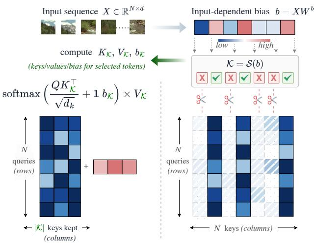  
Figure 1. Bias-based column pruning. The learned bias provides a query-independent importance score for each token, allowing lowbias columns to be removed before computing keys and values. Attention is then evaluated only over the retained set \protec \mathcal {K}, reducing its size from N\times N to N\times |\mathcal {K}| .

This success, however, comes at a price: the selfattention mechanism at the core of transformers has a computational cost quadratic in the length of the processed sequence. The issue is particularly acute in vision, since for square images the number of tokens grows quadratically with the image resolution, and it is amplified further in multimodal settings, where long visual token streams are concatenated with text [19]. Reducing the cost of attention is thus an important and active research problem.

Existing approaches fall broadly into two families. The first rewrites the attention operator to lower its asymptotic cost, for instance by limiting attention to local windows [20] or replacing the softmax with a linear approximation [4, 16], usually at the expense of some accuracy. The second keeps standard attention but shortens the input sequence by suppressing tokens [1–3, 24], exploiting visual redundancy. Both families rely, explicitly or implicitly, on a notion of token importance, yet obtaining a reliable and cheap importance signal remains difficult and often requires auxiliary prediction modules and additional training objectives [24].

In this work, we take a different route. We start from a simple empirical observation: in the attention maps of trained ViTs, some columns receive a far greater share of attention than others. This effect becomes more pronounced in the deeper layers, where attention maps degenerate into a few near-vertical lines. This suggests that certain tokens carry an absolute importance for the attention process: an influence on other tokens that is largely independent of the query but varies across heads. The same phenomenon has recently been characterized from other angles, as attention sinks in language models [9, 29] and as high-norm register tokens in vision transformers [5, 15]; notably, Gu et al. [9] show that attention sinks behave like an input-independent key bias added inside the softmax. Whereas this line of work largely treats the effect as an artifact to be characterized or cleaned up, we argue that the underlying queryindependent importance is a useful quantity that should be made explicit and exploited. As shown in Fig. 1, we then add a learnable, per-head, input-dependent bias to the query-key scores before the softmax. This bias yields, for each token and each head, a scalar quantifying how much that token is expected to influence others. Since this score is computed before keys and values are formed, it serves as a proxy for pruning attention maps, allowing us to skip computing keys and values for low-importance tokens.

Our contributions can be summarized as follows.

• We identify and analyze a query-independent form of column sparsity in ViT attention maps, which becomes increasingly pronounced with depth (Sec. 3.1 and Fig. 3).

• We introduce a minimal reparameterization of selfattention that assigns each token a learned, inputdependent bias, and use it to prune low-importance key-value columns before they are computed (Secs. 3.2 and 3.3).

• We show that bias-based pruning reduces attention computation and inference latency across different model sizes (Sec. 3.4 and Tab. 1), is complementary to sequencereduction strategies (Sec. 4.3), and achieves a better accuracy-latency trade-off than the evaluated structuredpruning baseline (Sec. 4.4).

## 2. Related works

The quadratic cost of self-attention has motivated extensive research on efficient transformer architectures. We review the approaches most relevant to us and then connect our approach to the recently characterized phenomenon of attention sinks and register tokens.

Improving efficiency in vision transformers. The computational cost of ViTs can be reduced by targeting different sources of redundancy. Some methods modify the attention operator itself, for example by restricting interactions to local windows [20] or replacing softmax attention with linear approximations [4, 16], at the expense of some accuracy. Other methods instead exploit redundancy in the token sequence. Tokens can be removed using learned or attention-based importance scores [24], merged with similar tokens to preserve more information [2], or jointly pruned and merged with learned layer-wise compression rates [3, 22]. A further direction reduces the model itself through structured pruning, removing parameters or components [8, 10, 14, 25]; these approaches derive binary masks over attention heads or weight matrices, but these masks are fixed after training and shared across all inputs.

Our method targets a different granularity of redundancy. Compared with structured pruning [8, 10, 14, 25], it adapts the selection to each input and attention head rather than permanently removing fixed model components. Compared with token-sequence reduction methods such as ToME and DiffRate [2, 3], it retains the full residual sequence and all queries. Moreover, its pruning score emerges directly from the attention reparameterization, without introducing auxiliary prediction modules specifically trained for token selection, as required by approaches such as DynamicViT [24]. This distinct granularity makes our method complementary to sequence-reduction techniques and, as demonstrated by its combination with ToME, improves the accuracyefficiency trade-off in low-complexity regimes.

Attention sinks and register tokens. Our method is motivated by the observation that a small subset of attention columns consistently receives high scores across many queries, especially in deeper ViT layers. We interpret these vertical patterns as evidence of a query-independent component of token importance, which our formulation makes explicit through a learned, per-head, input-dependent bias term. This interpretation connects our work to recent studies of attention sinks and register tokens.

In language models, Xiao et al. [29] identified attention sinks: tokens that attract a large share of attention mass largely independently of content, and showed that merely preserving them suffices to stabilize streaming inference. In vision, Darcet et al. [5] showed that ViTs spontaneously repurpose a few low-information background patches as highnorm “artifact” tokens that store global information, and proposed adding learnable register tokens to absorb this role and produce cleaner attention maps; Jiang et al. [15] subsequently reproduced this effect at test time without retraining. Most relevant to us, Gu et al. [9] show that attention sinks emerge from softmax normalization and behave like an input-independent key bias added inside the softmax.

Our formulation makes a related notion of key bias explicit, while making it per-head, and input-dependent. Rather than concentrating query-independent importance into a small set of sink or register tokens, we assign every token a learned scalar bias b that exposes its expected influence across queries. Whereas prior work mainly characterizes or mitigates this concentration phenomenon, we model it directly and repurpose it as a pre-computable signal for pruning attention columns.

## 3. Method

Our method builds on the hypothesis that attention may contain query-independent components. We introduce the underlying hypothesis and notation in Sec. 3.1, define and analyze the bias in Sec. 3.2, and present the pruning pipeline, selection strategy, and computational gains in Secs. 3.3 and 3.4. The corresponding empirical analyses are provided in Sec. 4.1.

## 3.1. Preliminaries

Multi-head self-attention. Let $X \in \mathbb { R } ^ { N \times d }$ denote a sequence of N tokens, each represented by a d-dimensional embedding. Multi-head self-attention processes X through h parallel attention heads. For the $i ^ { \mathrm { { t h } } }$ head, queries, keys, and values are obtained through linear projections:

$$
Q _ { i } = X W _ { i } ^ { Q } , \qquad K _ { i } = X W _ { i } ^ { K } , \qquad V _ { i } = X W _ { i } ^ { V } ,\tag{1}
$$

where $W _ { i } ^ { Q } , W _ { i } ^ { K } \in \mathbb { R } ^ { d \times d _ { k } }$ and $W _ { i } ^ { V } \in \mathbb { R } ^ { d \times d _ { v } }$

The output of the $i ^ { \mathrm { { t h } } }$ head is then computed as

$$
\mathrm { A t t e n t i o n } ( Q _ { i } , K _ { i } , V _ { i } ) = \mathrm { s o f t m a x } \left( \frac { Q _ { i } K _ { i } ^ { \top } } { \sqrt { d _ { k } } } \right) V _ { i } ,\tag{2}
$$

where the softmax is applied row-wise. The resulting attention matrix assigns, for each query token, a normalized weight to every key token, and the head output is the corresponding weighted combination of the value vectors.

Finally, the outputs of all heads are concatenated and projected back to the original embedding dimension:

$$
\operatorname { M u l t i H e a d } ( X ) = \operatorname { C o n c a t } \left( \operatorname { h e a d } _ { 1 } , \ldots , \operatorname { h e a d } _ { h } \right) W ^ { O } ,\tag{3}
$$

$$
\mathrm { w h e r e } W ^ { O } \in \mathbb { R } ^ { h d _ { v } \times d } \mathrm { a n d } \mathrm { h e a d } _ { i } = \mathrm { A t t e n t i o n } ( Q _ { i } , K _ { i } , V _ { i } ) .
$$

Working hypothesis. For a given head, $Q _ { i } K _ { i } ^ { T }$ computes the dot-product of each query with each key. Heads, however, may specialize and ignore irrelevant tokens: in image classification, for instance, a head specialized in detecting faces does not need tokens describing the background color. We thus hypothesize that ViT attention is column-sparse: a small subset of tokens receives most of the attention; this subset is largely independent of the query, and the effect strengthens with depth, so that deep-layer attention maps degenerate into a few vertical lines (anchor tokens). Our method makes this query-independent importance explicit. We empirically validate this hypothesis in Sec. 4.1 (Fig. 3).

## 3.2. Definition and theoretical analysis of the bias in attention

Input-dependent attention bias. For each attention head, we associate every token with an additional scalar score that is computed directly from its input representation. For the $i ^ { \mathrm { { t h } } }$ head, we define

$$
b _ { i } = X W _ { i } ^ { b } , \qquad W _ { i } ^ { b } \in \mathbb { R } ^ { d \times 1 } .\tag{4}
$$

The projection $W _ { i } ^ { b }$ is layer- and head-specific, with no parameter sharing, and $b _ { i } ~ \in ~ \mathbb { R } ^ { N }$ contains one inputdependent scalar per token. Then, we incorporate these scores into the attention logits before applying the softmax:

$$
\begin{array} { r l r } { \mathrm { A t t e n t i o n } ( Q _ { i } , K _ { i } , V _ { i } , b _ { i } ) = } \\ { \mathrm { s o f t m a x } \left( \frac { Q _ { i } K _ { i } ^ { \top } } { \sqrt { d _ { k } } } + \mathbf { 1 } _ { N } b _ { i } ^ { \top } \right) V _ { i } , } \end{array}\tag{5}
$$

where $\mathbf { 1 } _ { N } \in \mathbb { R } ^ { N }$ is the all-ones vector. Therefore, the scalar $( b _ { i } ) _ { k }$ is added to the $k ^ { \mathrm { { t h } } }$ attention column for every query. Unlike the query-key score, which depends on a specific pair of tokens, $( b _ { i } ) _ { k }$ depends only on the representation of token k and is shared across all queries within the head.

The bias projection introduces d additional parameters and 2Nd FLOPs per head. Given $d _ { k } \gg 1$ , this overhead is negligible compared with the query, key, and value projections. Since the bias participates directly in the attention computation, $\boldsymbol { W } _ { i } ^ { b }$ is learned jointly with the remaining model parameters, without requiring an auxiliary module or tailored loss.

Bias interpretation. To clarify the role of the proposed bias, we write the standard attention logits of the $i ^ { \mathrm { { \bar { h } } } }$ head as

$$
S _ { i } = \frac { Q _ { i } K _ { i } ^ { \top } } { \sqrt { d _ { k } } } .\tag{6}
$$

The modified logits can then be decomposed as

$$
\widetilde { S } _ { i } = S _ { i } + \mathbf { 1 } _ { N } b _ { i } ^ { \top } .\tag{7}
$$

At the level of individual entries, we can write

$$
( \widetilde { S } _ { i } ) _ { q k } = ( S _ { i } ) _ { q k } + ( b _ { i } ) _ { k } .\tag{8}
$$

The two terms play complementary roles. The interaction term $( S _ { i } ) _ { q k }$ measures the compatibility between query q and token k, whereas $( b _ { i } ) _ { k }$ represents a query-independent preference for token k. The latter can vary across inputs and attention heads, but remains constant across all queries of the same head.

This interpretation becomes more explicit after applying the row-wise softmax. For query $q ,$ the attention weight assigned to token k is

$$
\widetilde { a } _ { i } ( q ) _ { k } = \frac { \exp ( ( S _ { i } ) _ { q k } ) \exp ( ( b _ { i } ) _ { k } ) } { \sum _ { j } \exp ( ( S _ { i } ) _ { q j } ) \exp ( ( b _ { i } ) _ { j } ) } .\tag{9}
$$

Defining

$$
g _ { i k } = \exp ( ( b _ { i } ) _ { k } ) ,\tag{10}
$$

the bias can therefore be interpreted as a positive, per-token gate that reweights query-dependent attention before normalization. Tokens with large $g _ { i k }$ are consistently promoted across queries, while tokens with small $g _ { i k }$ are suppressed.

This provides an explicit parameterization of the queryindependent token importance introduced in Sec. 3.1. It also connects the bias naturally to column pruning: removing column k is equivalent to setting $g _ { i k } = 0 , \mathrm { o r } ,$ in logit space, $( b _ { i } ) _ { k } = - \infty$ . In practice, we use the finite values of $b _ { i }$ to determine which attention columns should be retained, as described in Sec. 3.3.

Properties. The formulation above leads to three key properties, which we denote as properties 1–3 and investigate empirically in Sec. 4.1.

Property 1. Since $b _ { i }$ is shared across queries, the term $\mathbf { 1 } _ { N } b _ { i } ^ { \top }$ can capture the query-independent component of the attention pattern, including the prominent vertical structures observed in deeper layers, whereas $S _ { i } = Q _ { i } K _ { i } ^ { \top } / \sqrt { d _ { k } }$ captures query-specific variations (Fig. 4); we expect the relative contribution of $b _ { i }$ to increase with depth.

Property 2. The bias is not constrained a priori to match any particular statistic of the query-key scores, yet in practice it learns to approximate their pre-softmax per-column mean, increasingly so with depth (Fig. 5). Crucially, $b _ { i }$ is computed before $S _ { i } ,$ so it provides a cheap, precomputable surrogate of this per-column importance that would otherwise require materializing $Q K ^ { \top }$

Property 3. Since $g _ { i k } ~ = ~ \exp ( ( b _ { i } ) _ { k } )$ multiplicatively modulates the contribution of token k for every query inside the softmax operation, tokens with larger bias values are expected to receive more attention mass across the rows of the attention matrix, especially in layers where the queryindependent component is dominant (Fig. 6).

The last property is central to our method, motivating the use of $b _ { i }$ as a proxy for pruning attention columns.

## 3.3. Bias selection strategy and pipeline

We now use the learned bias as an input-adaptive signal for pruning. For clarity, we present the procedure for a single attention head and omit the head index i.

Bias as a proxy for pruning. By Eq. (9), columns with a small bias contribute little to the output, so we can prune them. The key benefit is that $b = X W ^ { b }$ is available before Q,K,V: once the kept set ${ \mathcal { K } } \subseteq \{ 1 , \ldots , N \}$ is chosen from b, we can avoid computing the keys and values of the discarded tokens and never materialize the corresponding columns. Figure 2 sketches the forward pass, while the pseudo-code is provided in the supplementary material.

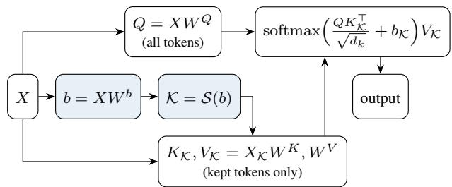  
Figure 2. Bias-based pruning pipeline. The importance score b is computed first (shaded) and selects the kept set \mathcal {K}. All queries are kept, but keys and values are computed only for the kept tokens, so the pruned columns are never materialized.

Computational benefits depend on the selection rule. Additive masking with -\infty reproduces pruning but saves no computation, since the full K, V, and attention matrix are still materialized. Real savings require gathering tokens beforehand, reducing attention from $N \times N$ to $N \times | K |$ . Because adaptive budgets produce irregular tensor shapes requiring padding or specialized support, we use a fixed budget with input-adaptive indices and static shapes.

Top-k. Given a target budget k, we retain the columns with the largest bias values:

$$
\mathcal { K } = \mathrm { T o p - k } ( b , k ) .\tag{11}
$$

Top-k selects exactly k columns for every input and head within a layer. The retained indices remain input- and headdependent, but their number is fixed, allowing the selected tokens to be gathered before computing K and V. The resulting reduced attention operation can therefore be implemented using standard dense batched operations.

Using the same k in every layer is sub-optimal. As suggested by property 1 and validated in Sec. 4.1, the bias becomes a stronger indicator of query-independent token relevance with depth. We therefore retain more columns in early layers and prune more aggressively in deeper ones. For a network with L layers, we define a keep ratio that decreases linearly from $\rho _ { \mathrm { h i g h } }$ to \rho \_{\tex {low} :

$$
\rho _ { \ell } = \rho _ { \mathrm { h i g h } } - \left( \rho _ { \mathrm { h i g h } } - \rho _ { \mathrm { l o w } } \right) \frac { \ell - 1 } { L - 1 } , \qquad k _ { \ell } = \lfloor \rho _ { \ell } N \rceil ,\tag{12}
$$

for $\ell = 1 , \ldots , L ,$ , where \delimter "426304 \cdot \rceil denotes rounding to the nearest integer. We denote such a schedule by $\rho _ { \mathrm { h i g h } } \searrow \rho _ { \mathrm { l o w } } ;$ for example, $0 . 9 ~ \searrow _ { \times } 0 . 1$ keeps 90\% of the columns in the first layer and progressively reduces this to 10\% in the last.

Training with pruning. Pruning can be applied at inference to a model trained with Eq. (5), but this limits how aggressively columns can be removed without degrading accuracy. We therefore apply the selection rule \protec \mathcal {S} during training as a pruning mask in the forward pass. This allows the model to adapt to the missing columns and better preserve accuracy at larger pruning ratios. Although discarded columns receive no gradient, $\hat W ^ { b }$ is still optimized through the bias values of the retained columns in Eq. (9).

## 3.4. Computational analysis

We compare standard multi-head attention with actual column pruning, assuming $d _ { k } = d _ { v } = d / h$ . Summing over the h heads, the query, key, value, and output projections require $8 N d ^ { 2 }$ FLOPs, while computing the attention scores and aggregating the values requires $4 N ^ { 2 } d .$ Neglecting the lower-order cost of the softmax, standard multi-head attention therefore requires

$$
C _ { \mathrm { f u l l } } = 8 N d ^ { 2 } + 4 N ^ { 2 } d .\tag{13}
$$

Let \delimter "026A30C \kept \vert denote the number of retained columns. All N queries are preserved, whereas keys and values are computed only for the k selected tokens. The resulting cost is

$$
C _ { \mathrm { p r u n e d } } = 4 ( N + \lvert \ K \rvert ) d ^ { 2 } + 4 N \lvert \ K \rvert d ,\tag{14}
$$

plus 2Ndh FLOPs for computing the per-head biases. This additional cost is lower order with respect to the attention projections. Consequently, the bias projection leaves the asymptotic complexity of both the forward and backward passes unchanged, introducing almost no training overhead.

We are primarily interested in the long-sequence regime $N \gg d ,$ where the attention terms dominate the projection costs. In this regime, standard attention has complexity $C _ { \mathrm { f u l l } } = \mathcal { O } ( N ^ { 2 } d )$ , while column pruning reduces it to

$$
C _ { \mathrm { p r u n e d } } = \mathcal { O } ( N | \mathcal { K } | d ) .\tag{15}
$$

Our method is therefore particularly beneficial for long sequences, such as those produced by high-resolution images. Accordingly, in Secs. 4.2 to 4.4, we evaluate both FLOPs and inference latency at an input resolution of 1024\times 1024 .

## 4. Experiments

Setup. We evaluate our method on the tiny, small, and base variants of DeiT [26], as well as on a ViT-L pretrained with MAE [13], all using a patch size of 16. We append the subscript $" b "$ to indicate models equipped with our modified attention mechanism, resulting in DeiT-Tib, DeiT-Sb, $\mathrm { D e i T - B } _ { b }$ , and ${ \mathrm { V i T } } \mathrm { - L } _ { b } .$ . Our main experiments are conducted on the ImageNet ILSVRC 2012 dataset (ImageNet-1k) [6], which contains approximately 1.2 million training images and 50, 000 validation images across 1, 000 categories.1 Starting from the official pretrained checkpoints, we replace the attention module in each transformer block with the formulation introduced in Eq. (5). For DeiT, we then fine-tune the resulting models for 70 epochs using AdamW [21], a batch size of 1, 024, and an initial learning rate of $1 0 ^ { - 4 }$ decayed according to a cosine schedule. We do not use learning-rate warmup. For ViT-L, we start from the official MAE checkpoint fine-tuned on ImageNet-1K and fine-tune only the attention modules for 30 epochs, using AdamW, an effective batch size of 1, 024, and, also in this case, an initial learning rate of $1 0 ^ { - 3 }$ decayed according to a cosine schedule without learning-rate warmup.

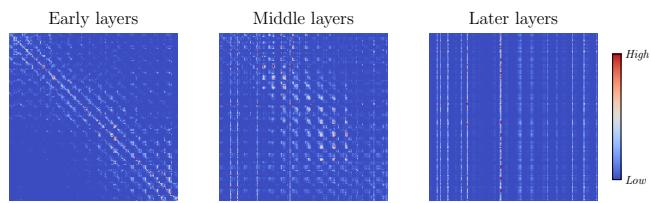  
Figure 3. Attention maps at different depths of the pretrained DeiT-S model. Vertical lines naturally emerge in the last layers.

To evaluate our strategy beyond classification, we finetune Mask R-CNN [12] with a DeiT-S backbone on COCO [18] for 100 epochs at 1024\times 1024 resolution, following the ViTDet [17] training recipe. The pruned model uses the same $0 . 9 ~ \searrow ~ 0 . 1$ schedule adopted for classification. Further details are provided in the supplementary material.

## 4.1. Preliminary experiments

Before evaluating pruning, we validate the assumptions underlying our method. We analyze column sparsity using a DeiT-S pretrained on ImageNet-1K, while experiments involving the proposed bias use a ${ \mathrm { D e i T } } { \cdot } {  { \mathbf { S } } } _ { b }$ fine-tuned and evaluated with full attention, without any top-k selection or pruning mask. This isolates the behavior learned by the bias from any adaptation or implicit regularization induced by training with pruned attention columns. In particular, neither our layer-wise pruning schedule nor an auxiliary column-ranking objective is used in these experiments.

Unless otherwise stated, visualizations refer to the same ImageNet validation image and to layers 3, 7, and 11 of the first attention head, representing early, middle, and late depth. The supplementary material extends these analyses to additional images, layers, and heads, as well as to the other DeiT variants and ViT-L.

Attention is column-sparse. We first qualitatively inspect the attention maps of a pretrained DeiT-S at different depths (Fig. 3). In the early layers, attention is predominantly concentrated around the diagonal, indicating that tokens mainly interact with themselves and with spatially neighboring tokens. As depth increases, a small number of vertical structures emerge alongside the diagonal. In the final layers, attention becomes strongly concentrated on a few columns that consistently receive high attention across many queries. We quantify this behavior in the supplementary material by comparing a global top-k column selection with a query-dependent top-k oracle. Their gap decreases with depth and becomes nearly zero in the final blocks. This result supports the presence of a progressively stronger query-independent component and motivates our depth-dependent pruning schedule.

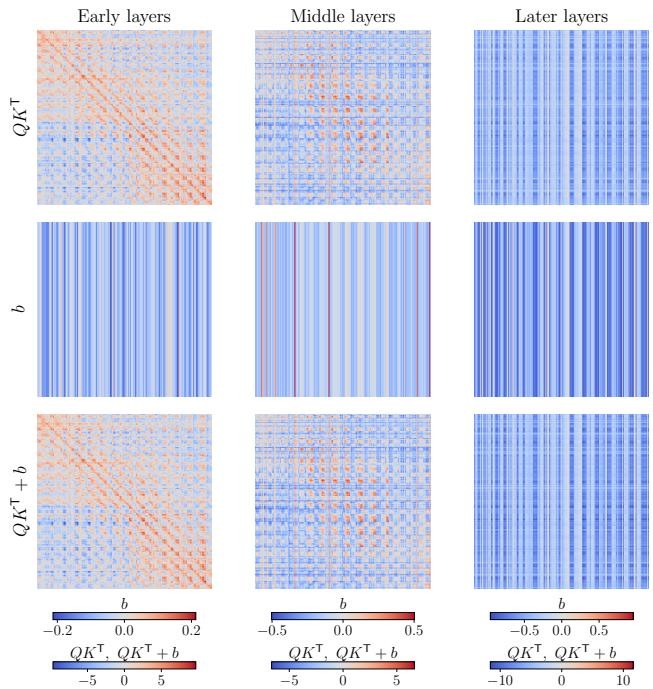

Figure 4. Decomposition of the attention logits at different network depths.  
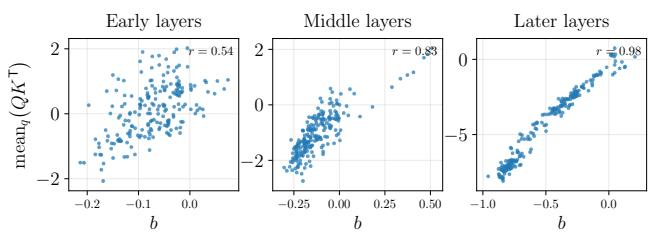  
Figure 5. Learned bias b versus the per-column mean of the querykey logits ${ \mathrm { m e a n } } _ { q } ( Q K ^ { \top } )$ , at three depths. The correlation grows with depth (r reported per panel).

The bias captures query-independent attention structure. To empirically validate property 1 from Sec. 3.2, we visualize side by side the query-key logits $Q K ^ { \top }$ , the bias term $1 b ^ { \top }$ broadcast across queries, and their sum in Fig. 4.

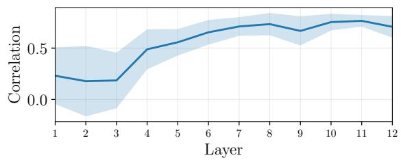  
Figure 6. Layer-wise Pearson correlation between the learned bias and the mean attention received by each column.

The bias term captures the query-independent vertical structures, whereas the query-key term preserves query-specific patterns, including the prominent diagonal component observed in shallow layers.

As depth increases, the vertical structures encoded by the bias become increasingly pronounced and eventually account for most of the visible structure in the combined logits, consistent with the observations in Fig. 3. Motivated by this trend, in the supplementary material we investigate a limiting architectural variant in which the query-key term is removed from the final blocks and the attention logits are computed solely from the broadcast bias $1 b ^ { \top }$

The bias anticipates column importance. We next examine property 2 and ask whether b encodes information about the query-key scores. We compare b with the percolumn mean of $\dot { Q } K ^ { \top }$ across queries; the corresponding scatter plots at three depths are shown in Fig. 5. A clear and increasingly tight relationship emerges with depth, suggesting that the bias learns to approximate the per-column mean of the query-key logits. To quantify this trend, we compute the Pearson correlation over 200 images from the ImageNet-1K validation set, averaging over samples and attention heads. As expected, the correlation grows with depth, from $r \approx 0 . 5$ in early layers to $r \approx 0 . 9 8$ in the final layers. More details are provided in the supplementary materials. Notably, this correlation emerges without any pruning or ranking objective during training and is therefore learned implicitly rather than explicitly enforced. The bias thus acts as a surrogate of column importance, providing a principled and cheap pruning signal.

The bias correlates with received attention. Finally, we examine property 3 from Sec. 3.2. Since $g = \exp ( b )$ directly reweights each column inside the softmax normalization (Eq. (9)), a positive association between the bias and the resulting attention mass is expected by construction. However, in this analysis we investigate how strongly this correlation varies with network depth. We thus correlate b with the mean post-softmax attention received by each column across queries, using 200 images from the ImageNet-

Table 1. Accuracy and efficiency of bias-based attention pruning on ImageNet-1k. End-to-end inference latency, including bias computation, top-k selection, index gathering, and all remaining model operations, is measured with the math attention backend on a single 1024 1024 image on one NVIDIA A40 GPU.
<table><tr><td rowspan="2">Model</td><td rowspan="2">Pruning schedule</td><td colspan="2">Accuracy</td><td rowspan="2">FLOPs (G)</td><td rowspan="2">Latency (ms)</td></tr><tr><td>Top-1 (%)</td><td>Top-5 (%)</td></tr><tr><td>DeiT-Ti</td><td>-</td><td>72.13</td><td>91.14</td><td>199.4</td><td> $4 7 . 9 2 _ { \pm 0 . 1 0 }$ </td></tr><tr><td>DeiT-Tib</td><td>x</td><td>72.66</td><td>91.35</td><td>209.1</td><td> $4 9 . 0 4 { \scriptstyle \pm 0 . 1 2 }$ </td></tr><tr><td>DeiT-Tib</td><td> $0 . 9 \stackrel { \cdot } { _ \mathrm { ~ \tiny ~ \textnormal ~ { ~ \scriptsize ~ \simeq ~ } } } 0 . 1$ </td><td>69.10</td><td>89.73</td><td>122.1</td><td> $\mathbf { 3 2 . 5 2 { \scriptstyle \pm 0 . 1 3 } }$ </td></tr><tr><td>DeiT-S</td><td></td><td>79.83</td><td>94.95</td><td>485.8</td><td> $9 2 . 0 5 { \scriptstyle \pm 0 . 1 4 }$ </td></tr><tr><td>DeiT-Sb</td><td></td><td>80.19</td><td>94.99</td><td>505.4</td><td> $9 4 . 4 7 { \scriptstyle \pm 0 . 1 6 }$ </td></tr><tr><td>DeiT-Sb</td><td> $\underset { 0 . 9 } { \overset { \pmb { x } } { } } \overset { \pmb { x } } { } _ { \mathrm { \succ } } \mathrm { \ b { 0 . 1 } }$ </td><td>78.55</td><td>94.31</td><td>331.3</td><td> ${ \bf 6 3 . 0 8 _ { \pm 0 . 1 3 } }$ </td></tr><tr><td>DeiT-B</td><td>-</td><td>81.80</td><td>95.59</td><td>1319.6</td><td> $1 9 5 . 4 0 { \scriptstyle \pm 0 . 3 3 }$ </td></tr><tr><td>DeiT-Bb</td><td>x</td><td>81.79</td><td>95.47</td><td>1359.1</td><td> $2 0 0 . 2 7 { \scriptstyle \pm 0 . 2 0 }$ </td></tr><tr><td>DeiT-Bb</td><td> $0 . 9 ~ \searrow , 0 . 1$ </td><td>80.59</td><td>94.86</td><td>1011.0</td><td> $\mathbf { 1 3 9 . 9 6 _ { \pm 0 . 1 2 } }$ </td></tr><tr><td>ViT-L (MAE)</td><td>=</td><td>85.95</td><td>97.57</td><td>4131.0</td><td> $5 5 6 . 9 2 { \scriptstyle \pm 1 . 4 0 }$ </td></tr><tr><td> $\mathsf { V i T - L } _ { b } \ ( \mathbf { M A E } )$ </td><td></td><td>85.85</td><td>97.55</td><td>4134.2</td><td> $6 5 1 . 8 0 { \scriptstyle \pm 0 . 2 6 }$ </td></tr><tr><td>ViT-Lb (MAE)</td><td> $\underset { 0 . 9 } { \overset { \pmb { x } } { } } \overset { \pmb { x } } { } _ { \mathrm { \succ } } \mathrm { \ b { 0 . 1 } }$ </td><td>84.66</td><td>97.14</td><td>3309.0</td><td> $\mathbf { 4 0 6 . 9 8 } _ { \pm 0 . 6 0 } ^ { - }$ </td></tr></table>

1K validation set and averaging over samples and attention heads. As shown in Fig. 6, the correlation becomes progressively stronger in deeper blocks. Importantly, this depthdependent behavior emerges although the model is finetuned without top-k selection. Thus, while the existence of a correlation is partly induced by the formulation, its systematic increase with depth is not imposed by the pruning mechanism and indicates that bias implicitly becomes increasingly aligned with column-wise attention importance.

## 4.2. Bias-based attention pruning

ImageNet Accuracy. We now evaluate whether the learned bias can be used to reduce the computational cost of attention while preserving classification accuracy. For each architecture, we compare three configurations. First, we consider the original model with standard self-attention. Second, we add the proposed bias term but keep all attention columns, in order to isolate the effect of the modified attention. Third, we enable bias-based pruning using the layer-wise top-k schedule $0 . 9 \searrow 0 . 1$ described in Sec. 3.3.

As shown in Tab. 1, introducing the bias alone slightly improves accuracy for DeiT-Ti and DeiT-S, while leaving DeiT-B and MAE-pretrained ViT-L essentially unchanged. When pruning is enabled, Top-1 accuracy decreases by approximately 3 points for Dei $\mathrm { T } \mathrm { - } \mathrm { T i } _ { b }$ and 1.3 points for the larger variants, relative to the corresponding original models, while substantially reducing FLOPs and inference latency. The smallest architecture is more sensitive to the aggressive $0 . 9 ~ \searrow , 0 . 1$ schedule because of its lower capacity and redundancy. Additional results in the supplementary material evaluate DeiT-Ti under multiple pruning schedules, illustrating the trade-off between accuracy, FLOPs, and latency and showing how the operating point can be adapted to different efficiency requirements.

Table 2. Object detection and instance segmentation on COCO $\mathtt { v a l } 2 0 1 7$ . Both models use Mask R-CNN with a DeiT-S backbone and the same ViTDet-style training recipe. GFLOPs and end-to-end latency are reported for the isolated backbone and the complete detector. Latency is measured in full precision with the math attention backend on one NVIDIA A40 GPU using a single 1024\times 1024 image.
<table><tr><td rowspan="2">Model</td><td rowspan="2">Pruning schedule</td><td colspan="2">COCO accuracy</td><td colspan="2">Backbone only</td><td colspan="2">Full detector</td></tr><tr><td> $\overline { { \mathsf { A P } ^ { \mathrm { B o x } } } }$ </td><td> $\overline { { { \bf A P } ^ { \mathrm { M a s k } } } }$ </td><td></td><td></td><td></td><td>GFLOPs Latency (ms) GFLOPs Latency (ms)</td></tr><tr><td>DeiT-S</td><td></td><td>43.3</td><td>38.7</td><td>485.60</td><td> $6 7 . 5 3 { \scriptstyle \pm 0 . 1 1 }$ </td><td>1171.68</td><td> $1 1 0 . 3 7 { \scriptstyle \pm 0 . 6 9 }$ </td></tr><tr><td> $\mathrm { D e i T } { - }  { \mathbf { S } } _ { b } ~ 0 . 9 \setminus \mathrm { 0 . 1 }$ </td><td></td><td>42.7</td><td>38.1</td><td>331.17</td><td> ${ \bf 5 1 . 3 6 _ { \pm 0 . 0 9 } }$ </td><td>1017.25</td><td> $\mathbf { 9 4 . 4 8 _ { \pm 0 . 5 2 } }$ </td></tr></table>

All reported latencies are end-to-end model measurements and therefore include the overhead of bias computation, top-k selection, and index gathering. We leverage the math attention backend to highlight the computational reduction under a controlled setting. Additional measurements in the supplementary material show consistent speedups with the efficient GPU backend and on CPU. The efficiency gains are consistently larger for narrower models and become smaller as the embedding dimension increases. This trend aligns with the analysis in Sec. 3.4: for a fixed sequence length, pruning is most effective when the quadratic attention term accounts for a large fraction of the total computation, i.e. when N is large relative to d. Nevertheless, all four model sizes benefit from the reduced key, value, and attention dimensions, with inference speedups reaching approximately 1.47 .

Object detection and instance segmentation. As shown in Tab. 2, bias-based pruning transfers effectively to dense prediction. Despite the aggressive $0 . 9 ~ \searrow ~ 0 . 1$ schedule, which retains only 10\% of the keys and values in the final block, box and mask AP remain within 0.6 points of the baseline. This suggests that the column importance learned on ImageNet provides an effective initialization and adapts during detector fine-tuning. Although the unchanged feature pyramid and detection heads reduce the backbonelevel gains, the 1.7\times full-detector speedup, including postprocessing, show that savings extend beyond classification.

## 4.3. Combining with token merging

Bias-based pruning operates at the level of key-value columns within each attention layer, and is therefore compatible with methods that instead reduce the token sequence length. We compare our method directly with Token Merging (ToME) [2], which progressively merges similar tokens between blocks, and then combine the two approaches. We apply ToME to both DeiT-S and DeiT-Sb, varying the number of tokens merged per layer m to trace the accuracyefficiency frontier. GFLOPs are measured at $1 0 2 4 \times 1 0 2 4$ resolution, with m rescaled proportionally to match the perlayer merging fraction used at $2 2 4 \times 2 2 4$

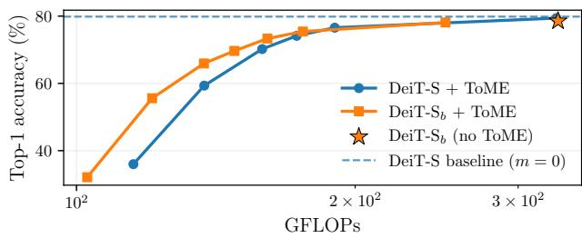  
Figure 7. Accuracy-efficiency trade-off for ToME [2], our biasbased column pruning (star), and their combination on DeiT-S. The dashed line denotes the original DeiT-S accuracy.

Table 3. Comparison with 30% ℓ2-norm structured pruning on DeiT-S. Latency is measured with the math attention backend at $1 0 2 4 \times 1 0 2 4$ resolution on one NVIDIA A40 GPU.
<table><tr><td>Method</td><td>Pruning schedule</td><td>Head pruning</td><td>Top-1 (%)</td><td>FLOPs (G)</td><td>Latency (ms)</td></tr><tr><td>DeiT-Sb (ours)</td><td> $0 . 9 \searrow 0 . 1$ </td><td>一</td><td>78.55</td><td>331.3</td><td> ${ \bf 6 3 . 0 8 _ { \pm 0 . 1 3 } }$ </td></tr><tr><td>Structured pruning</td><td>一</td><td>x</td><td>76.80</td><td>303.0</td><td> $8 8 . 1 3 { \scriptstyle \pm 0 . 0 9 }$ </td></tr><tr><td>Structured pruning</td><td>一</td><td>√</td><td>76.26</td><td>301.3</td><td> $6 3 . 5 6 _ { \pm 0 . 1 0 }$ </td></tr></table>

As shown in Fig. 7, ToME and our bias-based pruning (star) achieve similar accuracy at approximately the same computational budget, and both remain close to the upper bound set by the original DeiT-S. Increasing the number of tokens merged by ToME further reduces computation, but eventually causes a marked accuracy drop. Combining ToME with our column pruning provides a better trade-off in this aggressive regime: at low GFLOP budgets, DeiT-$\mathrm { S } _ { b } + \mathrm { T o M E }$ retains substantially higher accuracy than applying ToME to the original DeiT-S. This confirms that the two methods exploit complementary sources of redundancy and can be effectively used together.

## 4.4. Comparison with structured pruning

We additionally compare our method with structured pruning implemented using Torch-Pruning [8]. Starting from the same pretrained DeiT-S, we apply global, isomorphic ℓ2-norm pruning with a ratio of 30% and use the same finetuning policy as for our model. We consider two variants: standard structured pruning, which reduces channel dimensions while preserving all attention heads, and a variant that prunes 30% of the heads.

As reported in Tab. 3, standard structured pruning reaches a FLOP count comparable to our method, but yields only a marginal latency reduction. Reducing channel dimensions does not shorten the token sequence, so the attention matrices remain quadratic in the number of tokens. Consequently, the theoretical FLOP reduction does not translate into a comparable wall-clock speedup at high resolution. Pruning attention heads reduces latency to 63.56 ms, approximately matching our 63.08 ms, but further lowers Top-1 accuracy. Our method therefore achieves a better accuracy-latency trade-off, reaching 78.55% while directly reducing the number of key-value columns during attention.

Table 4. Effect of applying top-k pruning during training and inference on ImageNet-1k. All configurations use ${ \mathrm { D e i T } } { \cdot } {  { \mathrm { S } } } _ { b }$ and the $0 . 9 \searrow 0 . 1$ keep-ratio schedule whenever pruning is enabled.
<table><tr><td rowspan="2">Training pruning</td><td rowspan="2">Inference pruning</td><td colspan="2">Accuracy</td></tr><tr><td>Top-1 (%)</td><td>Top-5 (%)</td></tr><tr><td>x</td><td>x</td><td>80.19</td><td>94.99</td></tr><tr><td>x</td><td>√</td><td>76.90</td><td>93.01</td></tr><tr><td>√</td><td>x</td><td>77.89</td><td>94.03</td></tr><tr><td>√</td><td>√</td><td>78.55</td><td>94.31</td></tr></table>

## 4.5. Pruning during training and inference.

We next study whether pruning should be applied during training, inference, or both, considering our DeiT-Sb finetuned on ImageNet-1k. In all configurations, the model uses the proposed bias-augmented attention; we vary only whether the top-k mask is enabled in the two stages. The results in Tab. 4 show that inference-only pruning leads to a larger accuracy drop, since the model has not learned to compensate for the removal of low-bias columns. Applying pruning during both training and inference instead allows the network to adapt its representations to the reduced attention maps. Disabling pruning at inference after training with pruning does not provide a clear advantage, indicating that the model adapts to operating with the selected columns rather than merely benefiting from pruning as a regularizer.

## 5. Conclusion

In this work, we introduced an input-dependent, per-head bias term to explicitly identify the query-independent components of self-attention. Our analysis shows that these components become increasingly significant as network depth increases. Our learned bias thus provides an efficient estimation of the importance of each attention column before computing the full attention matrix. The resulting approach is flexible by design. It adapts the selected columns to each input and attention head, and can be applied with different layer-wise pruning budgets without modifying the softmax attention operator. It is also compatible with complementary efficiency techniques, such as token merging.

Importantly, the computational savings extend beyond analytical FLOP reductions. Bias-based column pruning consistently lowers inference latency across different model sizes on real hardware, achieving speedups of up to 1.47\times while retaining most of the original classification accuracy. These results indicate that exposing and exploiting queryindependent token importance is a practical and broadly applicable direction for improving transformer efficiency.

## Acknowledgments

This work benefited from Hi! PARIS and State funding managed by the French National Research Agency (ANR) under the France 2030 program, reference ANR-23-IACL-0005. This work was also supported by the Italian MUR through the FIS 2 project FIS-2023-03417 (DD n. 23314 10-12-2024, CUP D53C25002040001) and by the DARE SGA1 project, which has received funding from the European High-Performance Computing Joint Undertaking (JU) under grant agreement No. 101202459.

## References

[1] Saeed Ranjbar Alvar, Gursimran Singh, Mohammad Akbari, and Yong Zhang. Divprune: Diversity-based visual token pruning for large multimodal models, 2025. 1

[2] Daniel Bolya, Cheng-Yang Fu, Xiaoliang Dai, Peizhao Zhang, Christoph Feichtenhofer, and Judy Hoffman. Token merging: Your vit but faster, 2023. 2, 7, 8

[3] Mengzhao Chen, Wenqi Shao, Peng Xu, Mingbao Lin, Kaipeng Zhang, Fei Chao, Rongrong Ji, Yu Qiao, and Ping Luo. Diffrate: Differentiable compression rate for efficient vision transformers, 2023. ICCV. 1, 2

[4] Krzysztof Choromanski, Valerii Likhosherstov, David Dohan, Xingyou Song, Andreea Gane, Tamas Sarl´ os, Peter´ Hawkins, Jared Davis, Afroz Mohiuddin, Lukasz Kaiser, David Belanger, Lucy J. Colwell, and Adrian Weller. Rethinking attention with performers. CoRR, abs/2009.14794, 2020. 1, 2

[5] Timothee Darcet, Maxime Oquab, Julien Mairal, and Pi-´ otr Bojanowski. Vision transformers need registers, 2024. ICLR. 2

[6] Jia Deng, Wei Dong, Richard Socher, Li-Jia Li, Kai Li, and Li Fei-Fei. Imagenet: A large-scale hierarchical image database. In 2009 IEEE Conference on Computer Vision and Pattern Recognition, pages 248–255, 2009. 5, 11

[7] Alexey Dosovitskiy, Lucas Beyer, Alexander Kolesnikov, Dirk Weissenborn, Xiaohua Zhai, Thomas Unterthiner, Mostafa Dehghani, Matthias Minderer, Georg Heigold, Sylvain Gelly, Jakob Uszkoreit, and Neil Houlsby. An image is worth 16x16 words: Transformers for image recognition at scale, 2021. 1

[8] Gongfan Fang, Xinyin Ma, Mingli Song, Michael Bi Mi, and Xinchao Wang. Depgraph: Towards any structural pruning. In Proceedings of the IEEE/CVF Conference on Computer Vision and Pattern Recognition, pages 16091–16101, 2023. 2, 8

[9] Xiangming Gu, Tianyu Pang, Chao Du, Qian Liu, Fengzhuo Zhang, Cunxiao Du, Ye Wang, and Min Lin. When attention sink emerges in language models: An empirical view, 2025. ICLR. 2

[10] Song Han, Jeff Pool, John Tran, and William J. Dally. Learning both weights and connections for efficient neural networks. In Proceedings ofthe 29th International Conference on Neural Information Processing Systems - Volume 1, page 1135–1143, 2015. 2

[11] Kaiming He, Xiangyu Zhang, Shaoqing Ren, and Jian Sun. Deep residual learning for image recognition. CoRR, abs/1512.03385, 2015. 1

[12] Kaiming He, Georgia Gkioxari, Piotr Dollar, and Ross Gir-´ shick. Mask r-cnn. In 2017 IEEE International Conference on Computer Vision (ICCV), 2017. 5, 11

[13] Kaiming He, Xinlei Chen, Saining Xie, Yanghao Li, Piotr Dollar, and Ross Girshick. Masked Autoencoders Are Scalable Vision Learners . In 2022 IEEE/CVF Conference on Computer Vision and Pattern Recognition (CVPR), pages 15979–15988, 2022. 5, 11

[14] Yang He and Lingao Xiao. Structured pruning for deep convolutional neural networks: A survey. IEEE Transactions on Pattern Analysis and Machine Intelligence, 46(5):2900– 2919, 2024. 2

[15] Nick Jiang, Amil Dravid, Alexei Efros, and Yossi Gandelsman. Vision transformers don’t need trained registers, 2025. NeurIPS. 2

[16] Angelos Katharopoulos, Apoorv Vyas, Nikolaos Pappas, and Franc¸ois Fleuret. Transformers are rnns: Fast autoregressive transformers with linear attention. CoRR, abs/2006.16236, 2020. 1, 2

[17] Yanghao Li, Hanzi Mao, Ross Girshick, and Kaiming He. Exploring plain vision transformer backbones for object detection. In European Conference on Computer Vision, 2022. 5, 11

[18] Tsung-Yi Lin, Michael Maire, Serge Belongie, James Hays, Pietro Perona, Deva Ramanan, Piotr Dollar, and C Lawrence´ Zitnick. Microsoft COCO: Common objects in context. In European Conference on Computer Vision, 2014. 5, 11

[19] Haotian Liu, Chunyuan Li, Qingyang Wu, and Yong Jae Lee. Visual instruction tuning. In Thirty-seventh Conference on Neural Information Processing Systems, 2023. 1

[20] Ze Liu, Yutong Lin, Yue Cao, Han Hu, Yixuan Wei, Zheng Zhang, Stephen Lin, and Baining Guo. Swin transformer: Hierarchical vision transformer using shifted win dows. CoRR, abs/2103.14030, 2021. 1, 2

[21] Ilya Loshchilov and Frank Hutter. Fixing weight decay regularization in adam. In ICLR, 2019. 5, 11

[22] Junzhu Mao, Yang Shen, Jinyang Guo, Yazhou Yao, and Xiansheng Hua. Efficient token compression for vision transformer with spatial information preserved, 2025. 2

[23] William Peebles and Saining Xie. Scalable diffusion models with transformers, 2023. 1

[24] Yongming Rao, Wenliang Zhao, Benlin Liu, Jiwen Lu, Jie Zhou, and Cho-Jui Hsieh. Dynamicvit: Efficient vision transformers with dynamic token sparsification. CoRR, abs/2106.02034, 2021. 1, 2

[25] Enzo Tartaglione, Andrea Bragagnolo, Attilio Fiandrotti, and Marco Grangetto. Loss-based sensitivity regularization: towards deep sparse neural networks. Neural Network, 2020. 2

[26] Hugo Touvron, Matthieu Cord, Matthijs Douze, Francisco Massa, Alexandre Sablayrolles, and Herve J ´ egou. Training´ data-efficient image transformers & distillation through attention. CoRR, abs/2012.12877, 2020. 5, 11

[27] Ashish Vaswani, Noam Shazeer, Niki Parmar, Jakob Uszkoreit, Llion Jones, Aidan N. Gomez, Lukasz Kaiser, and Illia Polosukhin. Attention is all you need. CoRR, abs/1706.03762, 2017. 1

[28] Ross Wightman. Pytorch image models. https : / / github . com / rwightman / pytorch - image - models, 2019. 11

[29] Guangxuan Xiao, Yuandong Tian, Beidi Chen, Song Han, and Mike Lewis. Efficient streaming language models with attention sinks, 2024. ICLR. 2

[30] Enze Xie, Wenhai Wang, Zhiding Yu, Anima Anandkumar, Jose M.´ Alvarez, and Ping Luo. Segformer: Simple and ef-´ ficient design for semantic segmentation with transformers. CoRR, abs/2105.15203, 2021. 1

[31] Xizhou Zhu, Weijie Su, Lewei Lu, Bin Li, Xiaogang Wang, and Jifeng Dai. Deformable DETR: deformable transformers for end-to-end object detection. CoRR, abs/2010.04159, 2020. 1

## Appendix

This supplementary material is organized as follows. Sec. A provides training and implementation details, including a detailed pseudo-code for our method (Algorithm 1). Sec. B reports additional pruning ablations, including the effect of different schedules on DeiT-Ti (Tab. 6). Sec. C investigates query-key-free attention, while Sec. D reports latency measurements across attention backends (Tab. 11) and hardware platforms (Tab. 12). Sec. E compares query-shared and query-dependent selection. Finally, Sec. F extends the attention and learned-bias analyses across images, architectures, and network depths.

## A. Experimental details

## A.1. Training details

ImageNet-1k (fine-tuning). Experiments on ImageNet ILSVRC 2012 [6] start from the official DeiT pretrained checkpoints [26]. We augment each self-attention module with the proposed bias term, introducing only the additional parameter matrix $W ^ { b }$ , and, when enabled, the corresponding pruning mechanism in the forward function. All remaining model parameters are initialized from the pretrained checkpoint, after which the entire network is fine-tuned end-to-end with AdamW [21] for 70 epochs, using a batch size of 1,024 and an initial learning rate of $1 0 ^ { - 4 }$ , decayed with a cosine schedule without warmup with 5 cooldown epochs. Data augmentation follows the original DeiT recipe throughout. For ViT-L, we use the official MAE checkpoint fine-tuned on ImageNet-1K [13]. After introducing the bias projection in every attention block, we fine-tune only the attention modules for 30 epochs on four NVIDIA A40 GPUs. We use AdamW, an effective batch size of 1,024, layer-wise learning-rate decay of 0.75, weight decay of 0.05, and the MAE fine-tuning augmentations. We train both the biaswithout-pruning and $0 . 9 \searrow 0 . 1$ pruning configurations with the same recipe.

COCO object detection and instance segmentation. We evaluate Mask R-CNN [12] with a DeiT-S backbone on COCO [18] train2017 and report box and mask AP on val2017. Following the ViTDet [17] protocol, a Simple Feature Pyramid converts the single-scale DeiT representation into the hierarchy used by the detection and segmentation heads. Training uses large-scale jittering with a fixed $1 0 2 4 \times 1 0 2 4$ image size, AdamW, mixed precision, and layer-wise learning-rate decay. Both models are finetuned end-to-end for 100 epochs on 4 NVIDIA A40 GPUs with a global batch size of 16. The baseline is initialized from the official supervised DeiT-S ImageNet-1K checkpoint, whereas the pruned model uses the corresponding bias-augmented checkpoint and the $0 . 9 ~ \searrow ~ 0 . 1$ schedule.

Table 5. Training recipe used for the ImageNet100 experiments. RandAugment $^ { 6 6 } 2 / 9 ^ { 9 }$ denotes 2 operations at magnitude 9, following the torchvision implementation. Mixup $( \alpha = 0 . 2 )$ and Cutmix $( \alpha = 1 . 0 )$ intensities follow the $\mathrm { P y }$ Torch convention: α is the parameter of the symmetric Beta distribution from which the mixing coefficient is sampled.
<table><tr><td colspan="2">Hyperparameter</td></tr><tr><td>Epochs</td><td>300</td></tr><tr><td>Batch size</td><td>1024</td></tr><tr><td>Optimizer</td><td>AdamW</td></tr><tr><td>Learning rate</td><td> $1 0 ^ { - 3 }$ </td></tr><tr><td>LR decay</td><td>cosine</td></tr><tr><td>Warmup epochs</td><td>5</td></tr><tr><td>Warmup decay</td><td>0.033</td></tr><tr><td>Weight decay</td><td>0.1</td></tr><tr><td>Gradient clipping</td><td>1.0</td></tr><tr><td>Label smoothing</td><td>0.1</td></tr><tr><td>RandAugment</td><td>2/9</td></tr><tr><td>Mixup</td><td>0.2</td></tr><tr><td>Cutmix</td><td>1.0</td></tr></table>

During training, top-k masking is applied to the full attention logits; at validation time, discarded keys and values are removed before attention. All remaining architectural and optimization choices are identical.

Efficiency is measured in full precision on one NVIDIA A40 GPU using the math attention backend and a single $1 0 2 4 \times 1 0 2 4$ validation image. Full-detector measurements include the Simple Feature Pyramid, region proposal network, RoI heads, and prediction post-processing. The backbone FLOPs differ slightly from the classification results because the dense-prediction backbone omits the classification token and head.

ImageNet100 (training from scratch). Models evaluated on ImageNet100 (a 100-class subset of ImageNet) are trained from scratch for 300 epochs using a recipe inspired by DeiT [26], with some simplifications. We use AdamW with an initial learning rate of $1 0 ^ { - 3 }$ decayed with a cosine schedule and a linear warmup of 5 epochs (warmup decay factor 0.033). The batch size is 1 024 and weight decay is set to 0.1. Gradient norms are clipped to 1.0. For regularization and data augmentation, we use label smoothing $( \varepsilon = 0 . 1 )$ , RandAugment with 2 operations at magnitude 9, Mixup with intensity parameter $\alpha = 0 . 2$ (i.e. sampled from Beta(0.2, 0.2)), and Cutmix with $\alpha = 1 . 0$ . The complete set of hyper-parameters is reported in Tab. 5.

## A.2. Implementation details

Codebase. Our implementation builds on the official DeiT [26] and MAE [13] codebases and the timm library [28]. We modify only the self-attention module to introduce the input-dependent bias and the bias-based column pruning, while the data pipeline, optimizer, and training loop follow DeiT unchanged. The released code preserves the original Apache 2.0 license and attribution. Bias computation and top-k selection are implemented with standard PyTorch tensor operations and require no custom CUDA kernels or specialized sparse-attention libraries.

Algorithm 1 Bias-based attention with column pruning   
(one head, one layer).   
Require: tokens $X \in  { \mathbb { R } } ^ { N \times d } ;$ projections   
$\mathbf { \bar { \it W } } ^ { Q } , \mathbf { \it W } ^ { K } , \mathbf { \it W } ^ { V } , \mathbf { \it W } ^ { b } ;$ selection rule $s$   
1: $b  X W ^ { b } \triangleright b \in \mathbb { R } ^ { N } \colon$ query-independent importance,   
computed first   
2: ${ \mathcal { K } } \gets S ( b )$ \triangleright indices of kept columns   
3: $Q  X \dot { W } ^ { Q }$ \triangleright all queries are kept   
4: $\dot { K } _ { \kappa } \gets X _ { \kappa } W ^ { K }$ $V _ { \mathcal { K } }  X _ { \mathcal { K } } W ^ { V }$ \triangleright keys/values only   
for kept tokens   
5: $L \gets \frac { Q K _ { \kappa } ^ { \top } } { \sqrt { d _ { k } } } + \mathbf { 1 } _ { N } b _ { \kappa } ^ { \top }$ \triangleright logits over kept columns   
6: return softmax(L) VK

Bias projection. For each attention head i, the inputdependent bias $b _ { i } ~ = ~ X W _ { i } ^ { b }$ is computed by a single linear projection $W _ { i } ^ { b } \in \mathbb { R } ^ { d \times 1 }$ applied to the token sequence $X ~ \in ~ \hat { \mathbb { R } } ^ { N \times d }$ . The complete pseudo-code for the updated forward pass is reported in Algorithm 1.

Top-k selection and actual speedups. Bias values are computed before the attention scores, so the top-k indices are available before forming $Q K ^ { \top }$ . Each attention head selects the same number k of tokens, although the selected indices may differ across heads. In our implementation, the key and value projections are first computed for all N tokens, after which the k selected keys and values are gathered separately for each head according to the retaining set . Because the retained cardinality is identical across heads, the resulting tensors have uniform dense shapes and can be processed efficiently using standard batched matrix multiplications.

Consequently, the full $N \times N$ attention matrix is never materialized. Instead, each head operates on a score matrix of size $N \times | { \cal { K } } |$ , and both scaled dot-product attention and value aggregation are performed only over the selected columns.

These operations are implemented using standard dense batched matrix multiplications and indexing operations, requiring neither custom CUDA kernels nor sparse-attention libraries. The resulting speedup therefore comes from reducing the quadratic attention-score.

Table 6. Accuracy and efficiency of bias-based attention pruning on ImageNet-1k with different pruning schedules. Inference latency is measured with the math attention backend on a single 1024 1024 image on one NVIDIA A40 GPU.
<table><tr><td rowspan="2">Model</td><td rowspan="2">Pruning schedule</td><td colspan="2">Accuracy</td><td rowspan="2">FLOPs (G)</td><td rowspan="2">Latency (ms)</td></tr><tr><td>Top-1 (%)</td><td>Top-5 (%)</td></tr><tr><td>DeiT-Ti</td><td></td><td>72.13</td><td>91.14</td><td>199.4</td><td> $4 7 . 9 2 _ { \pm 0 . 1 0 }$ </td></tr><tr><td>DeiT-Tib</td><td> $0 . 9 \searrow 0 . 5$ </td><td>71.47</td><td>90.55</td><td>153.0</td><td> $4 2 . 2 2 _ { \pm 0 . 0 7 }$ </td></tr><tr><td>DeiT-Tib</td><td> $0 . 9 \searrow 0 . 3$ </td><td>70.32</td><td>90.11</td><td>137.6</td><td> $3 7 . 2 9 \pm 0$  05</td></tr><tr><td>DeiT-Tib</td><td> $0 . 9 \stackrel {  } { \searrow } 0 . 1$ </td><td>69.10</td><td>89.73</td><td>122.1</td><td>32.52±0.13</td></tr></table>

Layer-wise keep-ratio schedule. For a network with L layers, we define a linearly decreasing keep ratio

$$
\rho _ { \ell } = \rho _ { \mathrm { h i g h } } - \left( \rho _ { \mathrm { h i g h } } - \rho _ { \mathrm { l o w } } \right) \frac { \ell - 1 } { L - 1 } , \qquad k _ { \ell } = \lfloor \rho _ { \ell } N \rceil ,
$$

where $\ell = 1 , \ldots , L .$ For the schedule $0 . 9 \searrow 0 . 1$ on the 12- layer DeiT architectures, this yields the per-layer keep ratios 0.900, 0.827, 0.755, 0.682, 0.609, 0.536, 0.464, 0.391, 0.318, 0.245, 0.173, 0.100.

Pruning during training. When pruning is enabled at training time, the top-k mask is applied in the forward pass as a hard selection: discarded columns receive no gradient, but the bias weights $W _ { i } ^ { b }$ are still updated through the retained columns. This allows the model to adapt its internal representations to the reduced attention maps and yields better accuracy than applying pruning only at inference (see Tab. 4 in the main paper).

## B. Additional pruning ablations

## B.1. Effect of the pruning schedule on DeiT-Ti

Table 1 of the main paper compares all architectures using the same aggressive $0 . 9 ~ \searrow _ { \times } 0 . 1$ pruning schedule. This operating point can be particularly challenging for small models such as DeiT-Ti.

Our method, however, allows the layer-wise pruning schedule to be adapted to the desired accuracy-efficiency trade-off. In Tab. 6, we retain 90\% of the columns in the first layer and vary the final-layer keep ratio from 0.5 to 0.1 . A more conservative $0 . 9 ~ \searrow ~ 0 . 5$ schedule preserves most of the original accuracy while still reducing FLOPs and latency. As expected, lower final keep ratios progressively increase the computational savings at the cost of larger accuracy degradation.

## B.2. Column-selection strategy

We compare the layer-wise top-k schedule used in our main experiments with a fixed keep ratio, and a probabilitythreshold rule. Given the normalized scores $\begin{array} { r l } { p _ { k } } & { { } = } \end{array}$ $\frac { \exp ( b _ { k } ) } { \sum _ { j } \exp ( b _ { j } ) }$ , probability thresholding sorts columns by decreasing $p _ { k }$ and retains the smallest set whose cumulative probability mass reaches a threshold \tau . Unlike top-k, this criterion allows the number of retained columns to vary across inputs and heads. However, the resulting variable tensor shapes do not directly support efficient dense batched computation. Experiments are conducted on ${ \mathrm { V i T } } _ { - } S _ { b }$ trained on ImageNet100.

Table 7. Ablation of the column-selection strategy on ImageNet100 using ViT-Sb. The pruning ratio denotes the fraction of removed attention columns.
<table><tr><td rowspan="2">Method</td><td rowspan="2">Selection rule</td><td rowspan="2">Pruning ratio (%)</td><td colspan="2">Accuracy</td></tr><tr><td>Top-1 (%)</td><td>Top-5 (%)</td></tr><tr><td>No pruning</td><td>一</td><td>0</td><td>80.04</td><td>93.30</td></tr><tr><td>Probability threshold</td><td> $\tau = 0 . 8$ </td><td>49.55</td><td>79.66</td><td>93.18</td></tr><tr><td>Fixed top-k</td><td>0.5</td><td>50.00</td><td>79.70</td><td>92.30</td></tr><tr><td>Layer-wise top-k</td><td> $0 . 9 \searrow 0 . 1$ </td><td>50.00</td><td>80.48</td><td>93.18</td></tr></table>

Table 8. Results of the probability-threshold pruning strategy on ImageNet100. The pruning ratio denotes the fraction of removed attention columns and is measured at the end of training.
<table><tr><td>Model</td><td>Probability threshold</td><td>Pruning ratio (%)</td><td colspan="2">Accuracy</td></tr><tr><td></td><td></td><td></td><td>Top-1 (%)</td><td>Top-5 (%)</td></tr><tr><td>ViT-Ti</td><td>一</td><td>0</td><td>79.08</td><td>92.90</td></tr><tr><td>ViT-Tib  $\mathrm { V i T - T i } _ { b }$ </td><td>x</td><td>0</td><td>78.40</td><td>92.82</td></tr><tr><td></td><td> $\tau = 0 . 8$ </td><td>48.00</td><td>78.56</td><td>93.14</td></tr><tr><td>ViT-S</td><td>一</td><td>0</td><td>80.12</td><td>92.54</td></tr><tr><td>ViT-Sb</td><td>x</td><td>0</td><td>80.04</td><td>93.30</td></tr><tr><td>ViT-Sb</td><td> $\tau = 0 . 8$ </td><td>49.55</td><td>79.66</td><td>93.18</td></tr><tr><td>ViT-Sb</td><td> $\tau = 0 . 7$ </td><td>61.58</td><td>78.50</td><td>92.40</td></tr><tr><td>ViT-Sb</td><td> $\tau = 0 . 6$ </td><td>70.09</td><td>78.76</td><td>91.92</td></tr></table>

Table 9. Results of the top-k pruning strategy on ImageNet100. The pruning ratio denotes the fraction of removed attention columns. The top-k value is expressed as the fraction of tokens that are kept.
<table><tr><td rowspan="2">Model</td><td rowspan="2">Top-k value</td><td rowspan="2">Pruning ratio (%)</td><td colspan="2">Accuracy</td></tr><tr><td> $\mathrm { T o p - 1 } \left( \% \right)$ </td><td> $\mathrm { T o p } { - } 5 ( \% )$ </td></tr><tr><td>ViT-Ti</td><td>一</td><td>0</td><td>79.08</td><td>92.90</td></tr><tr><td>ViT  $\cdot \mathrm { T i } _ { b }$ </td><td></td><td>0</td><td>78.40</td><td>92.82</td></tr><tr><td>ViT-Tib</td><td> $\displaystyle 0 . 9 \sum _ { 0 . 5 } ^ { \pmb { \chi } } 0 . 1$ </td><td>50</td><td>78.74</td><td>92.94</td></tr><tr><td> $\mathrm { V i T - T i } _ { b }$ </td><td></td><td>50</td><td>78.68</td><td>92.80</td></tr><tr><td>ViT-S</td><td></td><td>0</td><td>80.12</td><td>92.54</td></tr><tr><td> ${ \mathrm { V i T } } _ {  { \mathbf { \lambda } } } S _ { b }$ </td><td></td><td>0</td><td>80.04</td><td>93.30</td></tr><tr><td> ${ \mathrm { V i T } } _ {  { \mathbf { \lambda } } } S _ { b }$ </td><td> $\underset { \substack { 0 . 9 \sum _ { n = 1 } ^ { \infty } 0 . 1 } } { \pmb { x } }$ </td><td>50</td><td>80.48</td><td>93.18</td></tr><tr><td> ${ \mathrm { V i T } } _ {  { \mathbf { \lambda } } } S _ { b }$ </td><td>0.7</td><td>30</td><td>79.58</td><td>92.62</td></tr><tr><td> ${ \mathrm { V i T } } _ {  { \mathbf { \lambda } } } S _ { b }$ </td><td>0.5</td><td>50</td><td>79.70</td><td>92.30</td></tr><tr><td>ViT-Sb</td><td>0.3</td><td>70</td><td>78.44</td><td>92.42</td></tr></table>

As shown in Tab. 7, at an average pruning ratio of approximately 50\%, the layer-wise $0 . 9 ~ \searrow _ { \times } ~ 0 . 1$ schedule outperforms both a fixed 0.5 keep ratio and probability thresholding. This confirms that applying the same pruning rate at every depth is sub-optimal. Probability thresholding offers greater flexibility across samples and heads, but top-k produces fixed tensor shapes and therefore enables the actual reduction of the key, value, and attention dimensions.

Table 10. ImageNet100 accuracy when replacing the query–key term with the broadcast bias in the last transformer blocks. “Query-key-free blocks” denote the number of final blocks using only $\mathbf { 1 } b ^ { \top }$
<table><tr><td rowspan="2">Model</td><td rowspan="2">Query-key-free blocks</td><td colspan="2">Accuracy</td></tr><tr><td> $\mathrm { T o p - l } \left( \% \right)$ </td><td>Top-5 (%)</td></tr><tr><td>ViT-S</td><td>一</td><td>80.12</td><td>92.54</td></tr><tr><td> ${ \mathrm { V i T } } _ {  { \mathrm { - } }  { \mathrm { S } } _ { b } }$ </td><td>x</td><td>80.04</td><td>93.30</td></tr><tr><td> ${ \mathrm { V i T } } _ {  { \mathrm { - } }  { \mathrm { S } } _ { b } }$ </td><td>4</td><td>80.28</td><td>92.82</td></tr><tr><td> ${ \mathrm { V i T } } _ {  { \mathrm { - } }  { \mathrm { S } } _ { b } }$ </td><td>6</td><td>79.30</td><td>92.72</td></tr><tr><td> ${ \mathrm { V i T } } _ {  { \mathrm { - } }  { \mathrm { S } } _ { b } }$ </td><td>8</td><td>79.22</td><td>92.08</td></tr></table>

## B.3. Probability-threshold pruning

The preceding analysis reports probability-threshold results only at a single operating point $( \tau = 0 . 8 ,$ , corresponding to roughly 50% pruning ratio) for a direct comparison with the fixed and layer-wise top-k schedules. Tab. 8 extends this analysis by sweeping τ across a wider range.

Given the normalized bias scores $\begin{array} { r l r l } { p _ { k } } & { { } } & { = } \end{array}$ $\begin{array} { r } { \exp ( b _ { k } ) / \sum _ { j } \exp ( b _ { j } ) } \end{array}$ , probability thresholding retains the smallest set of tokens whose cumulative probability mass reaches τ. This makes the number of retained columns input- and head-dependent, which in principle allows a finer-grained adaptation to each sample. However, the resulting variable tensor shapes prevent direct use of dense batched matrix multiplications and therefore limit practical wall-clock speedups to those achievable through masked (padded) implementations.

At comparable pruning ratios, the layer-wise top-k schedule consistently outperforms probability thresholding (Tab. 7), confirming that the fixed-shape constraint of top-k comes at no accuracy cost in practice.

## B.4. Fixed top-k schedules

We additionally evaluate uniform keep ratios, where the same fraction of columns is retained in every layer, at several pruning levels, and compare them with the layer-wise schedule adopted in the main paper. Results are reported in Tab. 9.

Across all tested keep ratios, the layer-wise $0 . 9 ~ \searrow _ { \times } ~ 0 . 1$ schedule outperforms the corresponding uniform baseline at a comparable average pruning ratio. This confirms that allocating a larger attention budget to early layers, where query-dependent patterns are most prominent, and progressively increasing the pruning ratio with depth is consistently more effective than applying a uniform reduction throughout the network.

## C. Query-key-free attention in the last layers

We evaluate the architectural variant discussed in Sec. 4.1 of the main paper, in which the query-key term $Q _ { i } K _ { i } ^ { \top } / \sqrt { d _ { k } }$ is removed from the last transformer blocks and attention is determined solely by the broadcast bias $\mathbf { 1 } b _ { i } ^ { \top }$ . We conduct this analysis on ${ \mathrm { V i T } } _ { - } { \cal S } _ { b }$ trained from scratch on ImageNet100. The network has 12 transformer blocks, and we progressively replace full-attention logits with the querykey-free formulation in the final 4, 6, or 8 blocks.

As reported in Tab. 10, using query-key-free attention in the last four blocks preserves and slightly improves Top-1 accuracy over the original ViT-S, indicating that querykey interactions become largely redundant near the end of the network. Extending the replacement to the last six or eight blocks produces a moderate degradation, showing that query-dependent interactions remain useful at intermediate depths. Overall, the result further supports our interpretation that the query-independent component becomes increasingly dominant in deeper layers.

## D. Runtime measurements and backend considerations

Backend dependence. Modern PyTorch scaled dotproduct attention is dispatched to one of three backends: flash, efficient, or math. The main paper reports measurements with the math backend, whose straightforward matrix multiplications make the relationship between FLOPs and latency easier to interpret. Here we additionally evaluate the efficient backend, which uses optimized kernels and represents a more practical inference setting. Our implementation relies on dense fixed-shape tensors and standard PyTorch operations, and therefore supports both backends without custom kernels.

Comparison across backends. Tab. 11 compares the original and bias-pruned configurations for DeiT-Ti/S/B and MAE-pretrained ViT-L under both backends. Measurements are taken on a single NVIDIA A40 GPU at $1 0 2 4 \times 1 0 2 4$ resolution, averaged over 200 forward passes after a warm-up of 50 passes. Column pruning consistently reduces latency regardless of the selected backend. With math, speedups range from 1.37 to 1.47 ; with $\mathtt { e f f i c i e n t }$ , they range from $1 . 4 5 \times { \mathrm { ~ t o ~ } } 1 . 6 1 \times$ . The gains under the optimized backend confirm that our dense implementation is compatible with efficient attention kernels and that its acceleration is not restricted to the controlled math setting used in the main paper.

CPU measurements. We additionally evaluate CPU inference latency on an AMD EPYC 7402 processor. Measurements use a batch size of one and a single 1024 1024 image with the math attention backend. We report the mean and standard deviation over 20 forward passes after 5 warm-up iterations.

As shown in Tab. 12, bias-based column pruning provides a substantial CPU acceleration, reaching speedups up to 1.95 for DeiT-Ti. These gains show that the reduced key, value, and attention dimensions also translate into lower latency outside GPU-specific attention kernels.

## E. Global vs. query-dependent selection

Figure 3 of the main paper qualitatively shows that the attention maps of a pretrained DeiT-S progressively exhibit vertical structures as depth increases (i.e. small number of key columns receive attention from many different queries). These patterns suggest that, especially in deeper layers, it may be possible to identify a common subset of key tokens that is important to most queries and remove the remaining columns altogether. However, Fig. 3 alone does not quantify how much attention mass such a shared selection would preserve, nor how much would be lost compared with a finer-grained selection tailored to each query.

To measure this trade-off, we compare two sparsification strategies under the same pruning-column budget. The first assigns each key token a single importance score. This query-shared selection allows entire key-value columns to be removed and is therefore the form of sparsity required by our method to reduce the attention matrix from $N \times N$ to $N \times k$ . The second is a query-dependent strategy, which retains the largest attention entries in each query row independently. This method can better preserve query-specific interactions, but generally selects different key tokens for different queries and therefore does not correspond to removing complete columns. We treat this finer-grained strategy as an oracle at the same sparsity budget and measure how closely the query-shared selection approaches it as network depth increases. For this purpose, we next define the global top-k set shared across queries and the corresponding query-dependent top-k sets.

Notably, this analysis is conducted on the original pretrained DeiT-S, without introducing our bias term or finetuning the model. It therefore quantifies a property that emerges spontaneously in standard self-attention.

Global and query-dependent top-k. Let

$$
A ^ { ( s , \ell , h ) } = \operatorname { s o f t m a x } \left( Q ^ { ( s , \ell , h ) } K ^ { ( s , \ell , h ) \top } / \sqrt { d _ { k } } \right) \in \mathbb { R } ^ { N \times N }\tag{16}
$$

denote the post-softmax attention matrix for image s, layer $\ell ,$ and head h. As in Fig. 3 of the main paper, we remove the class-token row and column and renormalize every remaining row, so that $N =$ 196 denotes the number of patch tokens and $\begin{array} { r } { \sum _ { j = 1 } ^ { N } A _ { q j } ^ { ( s , \ell , h ) } = 1 } \end{array}$ for every patch query q. For readability, we omit the superscripts $( s , \ell , h )$ below.

Table 11. Inference latency (ms) of the original and bias-pruned models using the math and efficient attention backends. Measure ments use a single 1024 1024 image on one NVIDIA A40 GPU. Values in parentheses report the speedup of the pruned model over it corresponding original model.
<table><tr><td></td><td colspan="2">math backend</td><td colspan="2">efficient backend</td></tr><tr><td>Model</td><td>Original</td><td>Bias-pruned</td><td>Original</td><td>Bias-pruned</td></tr><tr><td>DeiT-Ti</td><td> $4 7 . 9 2 _ { \pm 0 . 1 0 }$ </td><td> $\mathbf { 3 2 . 5 2 _ { \pm 0 . 1 3 } \ ( 1 . 4 7 \times ) }$ </td><td> $3 3 . 6 0 { \scriptstyle \pm 0 . 3 0 }$ </td><td> $\mathbf { 2 0 . 8 3 _ { \pm 0 . 2 0 } \ ( 1 . 6 1 \times ) }$ </td></tr><tr><td>DeiT-S</td><td> $9 2 . 0 5 _ { \pm 0 . 1 4 }$ </td><td> ${ \bf 6 3 . 0 8 { _ { \pm 0 . 1 3 } } } \left( 1 . 4 6 \times \right)$ </td><td> $6 3 . 2 2 _ { \pm 0 . 0 9 }$ </td><td> ${ \bf 3 9 . 8 8 _ { \pm 0 . 0 9 } \ ( 1 . 5 9 \times ) }$ </td></tr><tr><td>DeiT-B</td><td> $1 9 5 . 4 0 { \scriptstyle \pm 0 . 3 3 }$ </td><td> $\mathbf { 1 3 9 . 9 6 _ { \pm 0 . 1 2 } \ ( 1 . 4 0 \times ) }$ </td><td> $1 4 0 . 5 9 { \scriptstyle \pm 0 . 1 6 }$ </td><td> $\mathbf { 9 3 . 6 1 { \scriptstyle \pm 0 . 1 6 } }$  (1.50×)</td></tr><tr><td>ViT-L (MAE)</td><td> $5 5 6 . 9 2 _ { \pm 1 . 4 0 }$ </td><td> ${ \bf 4 0 6 . 9 8 _ { \pm 0 . 6 0 } ( 1 . 3 7 \times ) }$ </td><td> $4 1 7 . 4 6 _ { \pm 0 . 7 9 }$ </td><td> $\mathbf { 2 8 8 . 5 5 _ { \pm 0 . 3 7 } }$  (1.45×)</td></tr></table>

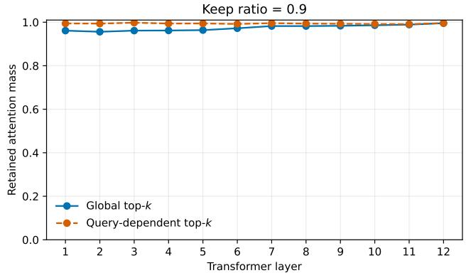

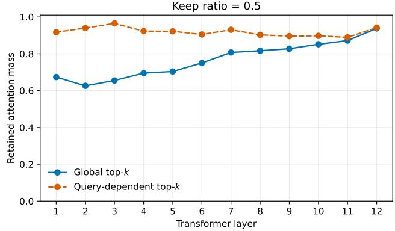

(a) Keep ratio ρ = 0.9.  
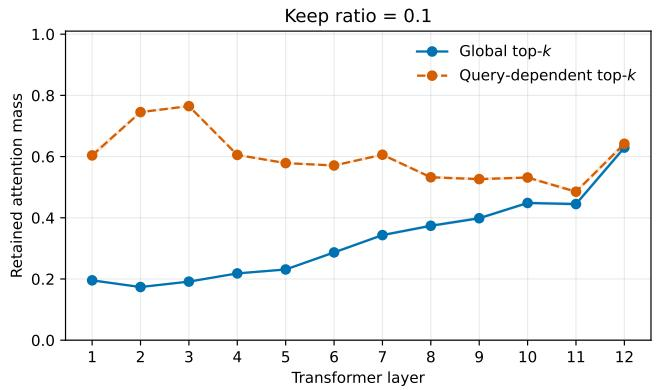  
(c) Keep ratio $\rho = 0 . 1$

(b) Keep ratio ρ = 0.5.  
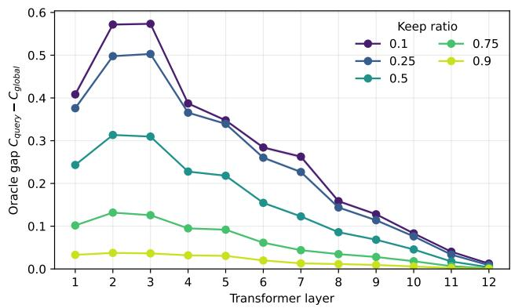  
(d) Oracle gap across keep ratios.  
Figure 8. Global versus query-dependent column selection in the original pretrained DeiT-S, averaged over all attention heads and 200 ImageNet-1K validation images. (a–c) Retained attention mass at different keep ratios. (d) Oracle gap $\Delta = C _ { \mathrm { q u e r y } } - C _ { \mathrm { g l o b a l } }$ across all evaluated keep ratios.

For a keep ratio $\rho ,$ we retain $m _ { \rho } ~ = ~ \operatorname * { m a x } ( 1 , \lfloor \rho N \rceil )$ columns. We first define the mean attention received by column j across all queries as

$$
\bar { a } _ { j } = \frac { 1 } { N } \sum _ { q = 1 } ^ { N } A _ { q j } .\tag{17}
$$

The global top-k set is then

$$
\mathcal { G } _ { \rho } = \mathrm { T o p K } ( \bar { a } , m _ { \rho } ) ,\tag{18}
$$

and is shared by every query within the image and attention head. Its retained attention mass is

$$
C _ { \mathrm { g l o b a l } } ( \rho ) = \frac { 1 } { N } \sum _ { q = 1 } ^ { N } \sum _ { j \in \mathcal { G } _ { \rho } } A _ { q j } .\tag{19}
$$

Here, “global” means global across queries: $\mathcal { G } _ { \rho }$ is still input-, layer-, and head-dependent.

For comparison, the query-dependent top-k indepen-

Table 12. CPU inference latency (ms) of the original and biaspruned models. Measurements use one 1024 1024 image on an AMD EPYC 7402 processor with 12 CPU threads and the math attention backend. We report the mean and standard deviation over 20 runs after 5 warm-up iterations. Parentheses indicate the speedup over the corresponding original model.
<table><tr><td>Model</td><td>Original</td><td>Bias-pruned</td></tr><tr><td>DeiT-Ti</td><td> $1 , 8 8 6 . 1 2 { \scriptstyle \pm 5 3 . 9 8 }$ </td><td> $\mathbf { 9 6 6 . 0 0 _ { \pm 8 6 . 1 2 } }$  (1.95×)</td></tr><tr><td>DeiT-S</td><td> $2 , 3 2 5 . 1 3 { \scriptstyle \pm 4 9 . 9 4 }$ </td><td> $\mathbf { 1 } , \mathbf { 3 6 9 . 3 2 _ { \pm 7 5 . 3 5 } }$  (1.70×)</td></tr><tr><td>DeiT-B</td><td> $6 , 7 7 0 . 2 9 { \scriptstyle \pm 7 0 . 8 5 }$ </td><td> $\mathbf { 3 } , \mathbf { 8 9 1 . 0 3 _ { \pm 2 5 2 . 2 9 } }$  (1.74×)</td></tr><tr><td>ViT-L (MAE)</td><td> $2 1 , 1 8 7 . 7 4 { \scriptstyle \pm 4 4 0 . 5 4 }$ </td><td> $\mathbf { 1 1 } , \mathbf { 8 0 7 . 3 9 { \pm } 1 6 6 . 2 1 }$  (1.79×)</td></tr></table>

dently selects the best columns for each query,

$$
\mathcal { Q } _ { q , \rho } = \mathrm { T o p K } ( A _ { q , : } , m _ { \rho } ) ,\tag{20}
$$

with retained mass

$$
C _ { \mathrm { q u e r y } } ( \rho ) = \frac { 1 } { N } \sum _ { q = 1 } ^ { N } \sum _ { j \in \mathcal { Q } _ { q , \rho } } A _ { q j } .\tag{21}
$$

Because it may choose a different set for every row, $C _ { \mathrm { q u e r y } }$ is an oracle upper bound at the same column budget, and $C _ { \mathrm { q u e r y } } \geq C _ { \mathrm { g l o b a l } }$ by construction. We therefore measure the cost of enforcing a query-shared selection through the oracle gap

$$
\Delta ( \rho ) = C _ { \mathrm { q u e r y } } ( \rho ) - C _ { \mathrm { g l o b a l } } ( \rho ) .\tag{22}
$$

We compute these quantities for every layer and attention head on a random subset of 200 ImageNet-1K validation images. Heads are first averaged within each image, after which we report the mean across images.

Results and relation to depth. With mild pruning $( \rho =$ 0.9), both strategies preserve almost all attention mass throughout the network and their gap is small (Fig. 8a). As pruning becomes more aggressive, the gap in the early layers increases substantially (Figs. 8b and 8c), revealing the importance of query-specific interactions at shallow depth. Nevertheless (after peaking in the early blocks), the oracle gap consistently decreases with depth for every keep ratio and approaches zero in the final layers (Fig. 8d).

Thus, the important-column ranking becomes increasingly shared across queries, quantitatively supporting the vertical structures in Fig. 3 of the main paper. This result further supports our $0 . 9 ~ \searrow ~ 0 . 1$ schedule, which preserves more columns where query-specific structure is strongest and prunes progressively with depth. Moreover, it identifies a failure regime of our strategy, when aggressive column pruning in the early layers is adopted.

## F. Additional analysis of the learned bias

## F.1. Additional attention visualizations

Setup. In the main paper, attention-map visualizations (Fig. 3) were restricted to a single validation image and a single attention head of DeiT-S for readability. Here we extend the analysis along four additional axes: (i) multiple images, to assess whether the qualitative emergence of column sparsity generalizes across images; (ii) multiple layers spanning the network depth, rather than only the three representative blocks shown in the main paper; (iii) multiple heads and (iv) multiple models, namely DeiT-Ti, DeiT-S, DeiT-B, and MAE-pretrained ViT-L, to verify that the effect is not specific to a particular model size.

Results across images and layers. Figs. 10 to 12 report attention maps for DeiT-Ti, DeiT-S, and DeiT-B, respectively, at layers 1, 3, 4, 8, 9, 11 across several validation images. In all three models and across all tested images, the qualitative evolution with depth is consistent: early layers display a pronounced diagonal structure, indicating that each token primarily attends to itself and its spatial neighbours; as depth increases, vertical structures progressively emerge and eventually dominate the attention maps in the final layers. This pattern holds across different images belonging to the ImageNet validation set, confirming that column sparsity is a systematic property of the attention mechanism rather than an image-specific artifact. Importantly, the same phenomenon is visible in all three architectures, with the transition from diagonal to vertical structure occurring at comparable relative depths regardless of model width.

As shown in Fig. 13, we additionally inspect the 24- block MAE-pretrained ViT-L at layers 3, 7, 11, 15, 19, 22 and across its attention heads. The same transition is preserved at this larger depth and scale: early attention is predominantly diagonal, whereas a small set of columns becomes dominant in the final blocks.

Head selection. Each attention-map in Figs. 10 to 13 reports one representative head for each architecture: head 2 for DeiT-Ti, head 4 for DeiT-S, head 7 for DeiT-B, and head 11 for ViT-L. Although the selected heads differ across architectures, all exhibit the same qualitative depth-wise transition from predominantly diagonal attention to increasingly column-sparse patterns. Individual heads may differ in the location and sharpness of the dominant columns but present the same patterns.

Decomposition visualizations. Figs. 14 to 16 show the attention-logit decomposition $( Q K ^ { \top } , \ b , \ Q K ^ { \top } \ + \ b )$ for DeiT-Ti, DeiT-S, and DeiT-B at layers $\{ 1 , 3 , 5 , 7 , 9 , 1 1 \}$ on a single validation image. These extend Fig. 4 of the main paper to a denser set of depths and to multiple architectures. Across all models, the bias term b progressively takes over the vertical structure of the combined logits: in early layers $Q K ^ { \top }$ dominates with its diagonal pattern, while in later layers b alone accounts for most of the visible structure in $Q K ^ { \top } + b$ . The transition is gradual and consistent with the growing depth-wise correlation reported in Fig. 5 of the main paper. The decomposition of MAE-pretrained ${ \mathrm { V i T } } { \mathrm { - } } \mathbf { L } _ { b }$ in Fig. 17 exhibits the same depth-wise behavior across its 24 blocks, extending this observation beyond the DeiT family and to a different pretraining strategy.

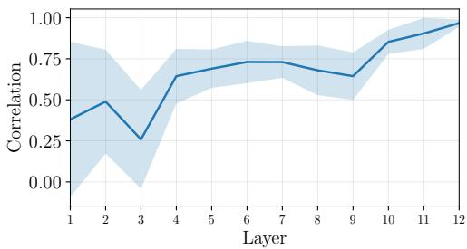  
Figure 9. Layer-wise Pearson correlation between the learned bias and the pre-softmax per-column mean mea $\mathsf { \Omega } _ { \mathsf { l } q } ( Q K ^ { \mathsf { T } } )$ . The correlation grows steadily with depth, reaching $r \approx 0 . 9 8$ in the final layer, confirming that the bias serves as an effective and cheap surrogate of column importance.

Scatter-plot visualizations. Figs. 18 to 20 extend the percolumn scatter analysis of Fig. 5 to multiple validation images (rows) for DeiT-Tib, DeiT-Sb, and $\mathrm { D e i T - B } _ { b } .$ . Each panel plots the learned bias b against the per-query mean of the query-key logits, m $\mathrm { { } } \mathrm { { s a n } } _ { q } ( \bar { Q } K ^ { \top } )$ , and reports the Pearson correlation r. Across all models and all tested images, the correlation follows the same depth-dependent trend: weak and variable in early layers (occasionally near zero or negative), increasing with depth to $r \approx 0 . 8 3 - 0 . 9 9$ in the final blocks. The consistency across images confirms that the bias learns a reliable approximation of the column-wise query-averaged importance, independently of the specific content of the input. As shown in Fig. 21, we observe the same qualitative growth for ${ \mathrm { V i T } } \mathbf { - L } _ { b } ,$ showing that the relationship between the learned bias and query-averaged column importance also persists at larger scale.

## F.2. Correlation with pre-softmax column importance

In Sec. 4.1 of the main paper, we showed that the learned bias correlates with the per-column mean of the pre-softmax query-key scores, ${ \mathrm { m e a n } } _ { q } ( Q K ^ { \top } )$ . Fig. 9 extends this analysis by reporting the layer-wise Pearson correlation computed over 200 ImageNet validation images and averaged over attention heads considering our ${ \mathrm { D e i T } } { \cdot } {  { \mathbf { S } } } _ { b }$

The correlation increases steadily with network depth, approaching unity in the last transformer blocks. This confirms that the learned bias progressively converges towards a cheap, pre-computable approximation of the average column importance that would otherwise require materializing the full $N \times N$ query-key matrix.

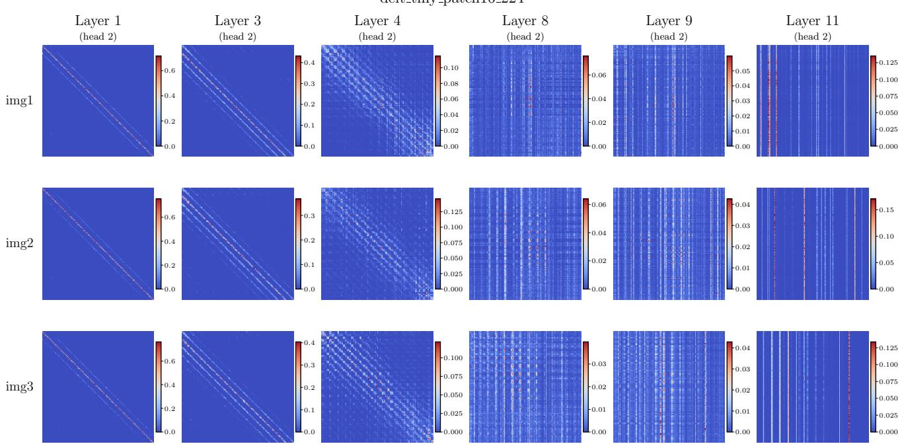  
Figure 10. Attention maps for DeiT-Ti at layers 1, 3, 4, 8, 9, 11 (columns), head 2, across several ImageNet validation images (rows). In all cases the attention evolves from a diagonal, locally-concentrated pattern in early layers to strongly column-sparse maps in the fina blocks, where a small number of tokens attract the attention of virtually all queries.

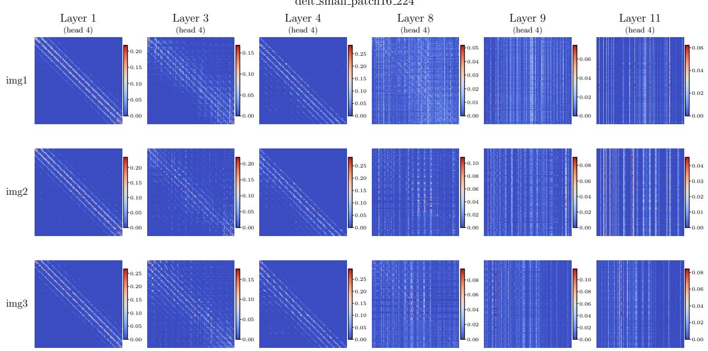  
Figure 11. Attention maps for DeiT-S at layers 1, 3, 4, 8, 9, 11 (columns), head 4, across several ImageNet validation images (rows). The transition from diagonal to vertical attention structure is visible and consistent across all images, confirming that column sparsity is a systematic property of the attention mechanism rather than an image-specific artifact.

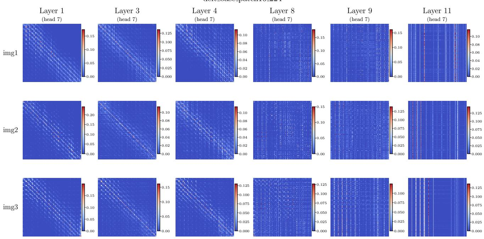  
Figure 12. Attention maps for DeiT-B at layers 1, 3, 4, 8, 9, 11 (columns), head 7, across several ImageNet validation images (rows). The same depth-wise evolution observed in DeiT-Ti and DeiT-S is reproduced here, showing that column sparsity is not specific to a particular model width.

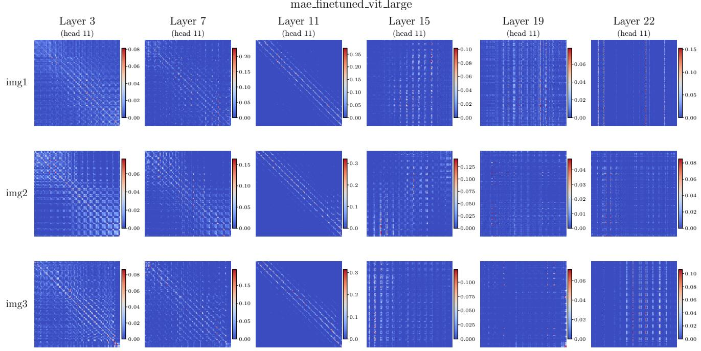  
Figure 13. Attention maps for the MAE-pretrained ViT-L at layers 3, 7, 11, 15, 19, 22 (columns), head 11, across several ImageNe validation images (rows). Despite its greater depth and different pretraining strategy, ViT-L exhibits the same transition from predominantly diagonal attention in early blocks to increasingly column-sparse patterns in deeper blocks.

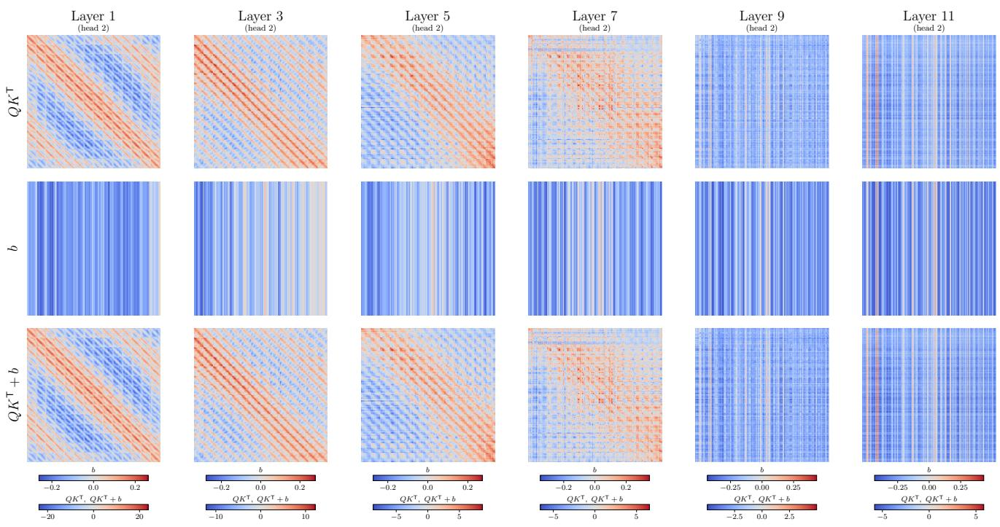  
Figure 14. Decomposition of the attention logits $( Q K ^ { \top } , b , Q K ^ { \top } + b )$ for DeiT-Tib at layers 1, 3, 5, 7, 9, 11 , head 2. In the early layers, $\bar { Q \bar { K } } ^ { \top }$ dominates with a strong diagonal pattern. With increasing depth the bias b progressively captures the vertical structures, until in the final layers it accounts for most of the visible structure in the combined logits $Q \bar { K } ^ { \top } + b .$

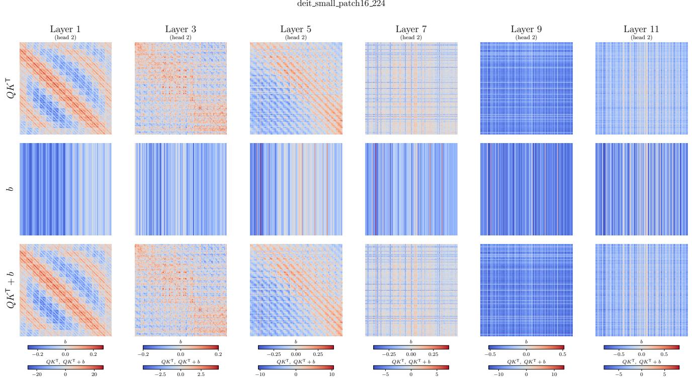  
Figure 15. Decomposition of the attention logits for ${ \mathrm { D e i T } } { \cdot } { \mathrm { S } } _ { b }$ at layers $\{ 1 , 3 , 5 , 7 , 9 , 1 1 \}$ , head 2. The bias term increasingly dominates the combined logits with depth, consistently with Fig. 4 and Fig. 5 of the main paper.

mae vit large attention only notopk  
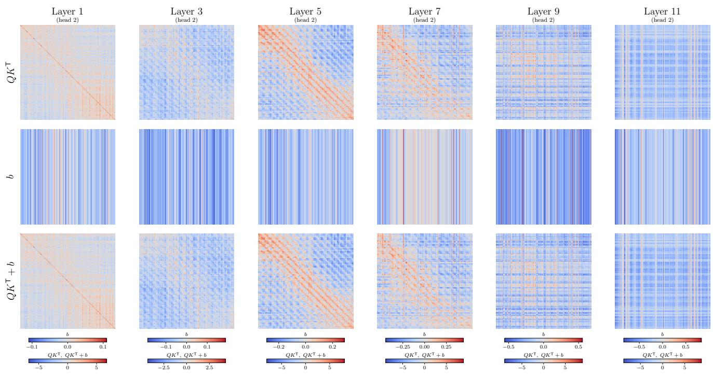  
Figure 16. Decomposition of the attention logits for DeiT-Bb at layers 1, 3, 5, 7, 9, 11 , head 2. The depth-wise takeover of the bias term is visible across all three model sizes, confirming that the learned bias captures a universal property of deep vision-transformer attention.

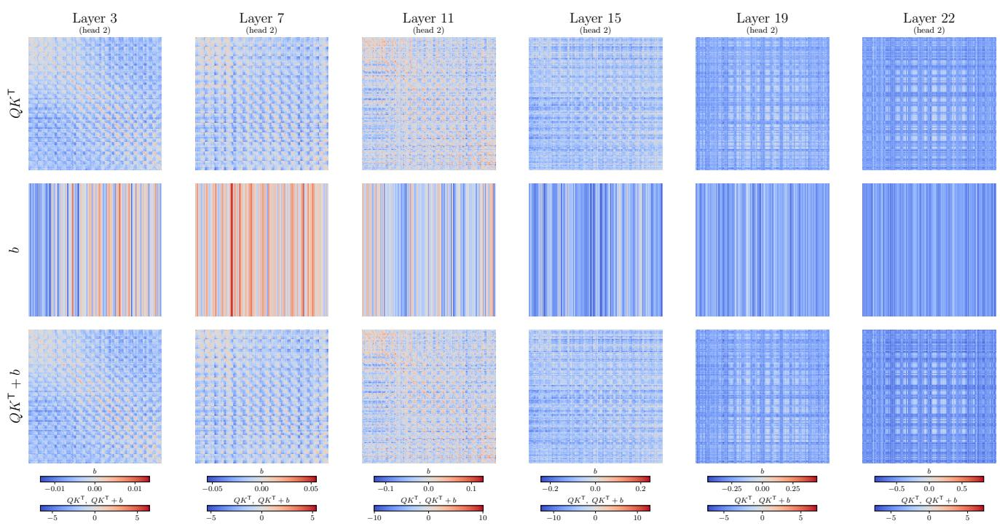  
Figure 17. Decomposition of the attention logits $( Q K ^ { \top } , b ,$ and $\boldsymbol { Q K } ^ { \intercal } + \boldsymbol { b } )$ for MAE-pretrained ViT-Lb at layers 3, 7, 11, 15, 19, 22 , head 2. The model is fine-tuned with the bias term but without top-k pruning. As depth increases, the bias progressively captures the vertical, query-independent structure of the combined logits, reproducing the behavior observed for DeiT.

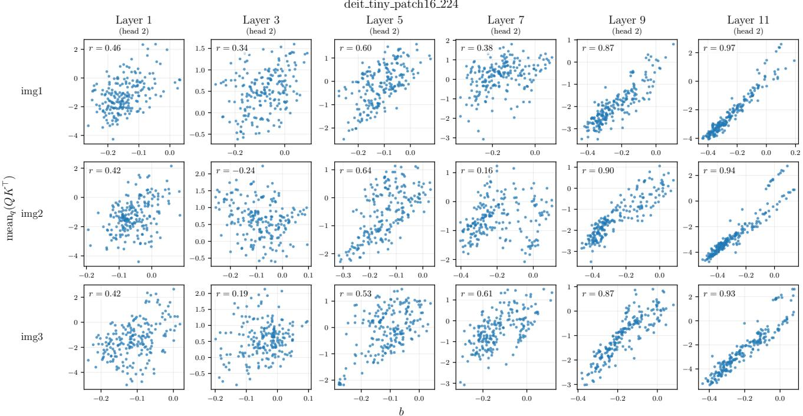  
Figure 18. Scatter plots of the learned bias b versus mea $\mathbf { \tau } _ { 1 q } ( Q K ^ { \top } ) _ { k }$ for DeiT-Tib at layers 1, 3, 5, 7, 9, 11 (columns), head 2, across multiple validation images (rows). The Pearson correlation r reported per panel grows steadily with depth and remains consistent across images, confirming that the bias provides a reliable surrogate across different input images of column importance.

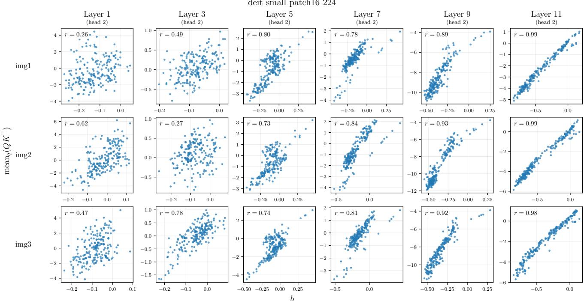  
Figure 19. Scatter plots for DeiT ${ \bf - } S _ { b }$ at layers 1, 3, 5, 7, 9, 11 , head 2, across multiple validation images. The correlation reaches r 0.98 in the final layer, independently of the input image, showing that the bias approximates the query-averaged column importance with high fidelity in the deeper blocks.

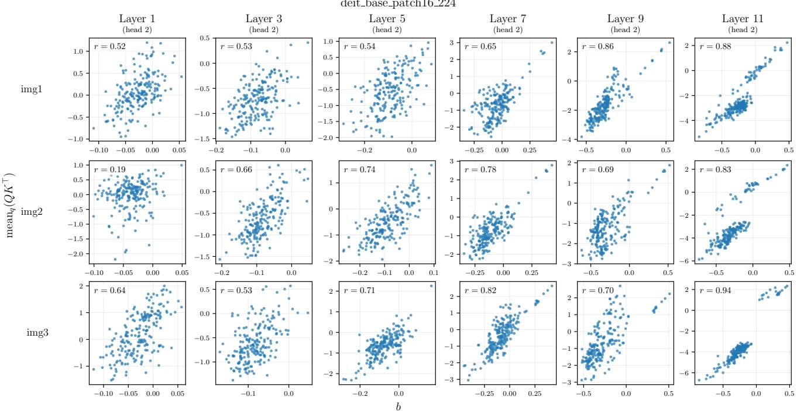  
Figure 20. Scatter plots for DeiT-Bb at layers 1, 3, 5, 7, 9, 11 , head 2, across multiple validation images. The depth-wise growth of r is reproduced in the larger model, confirming that the relationship between the bias and the query-averaged column importance is a property of the attention mechanism rather than of a specific model scale.

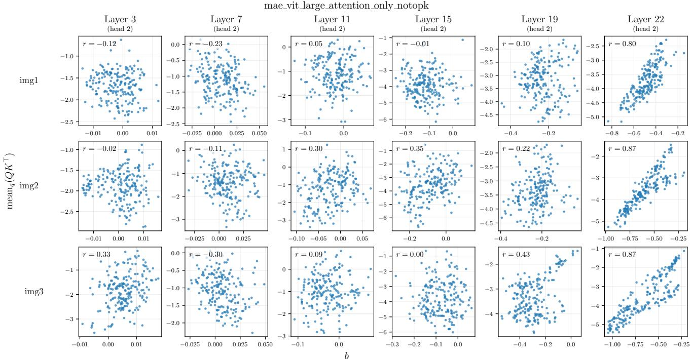  
Figure 21. Learned bias b versus the per-column mean mea $\mathbf { n } _ { q } ( Q K ^ { \top } ) _ { k }$ for MAE-pretrained ${ \mathrm { V i T } } { \mathrm { - } } \mathbf { L } _ { b }$ at layers 3, 7, 11, 15, 19, 22 (columns), head 2, across multiple ImageNet validation images (rows). The Pearson correlation reported in each panel becomes stronge with depth, showing that the bias also learns a reliable proxy for query-averaged column importance in ViT-L.