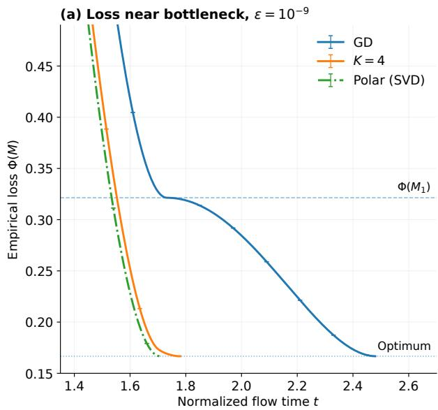
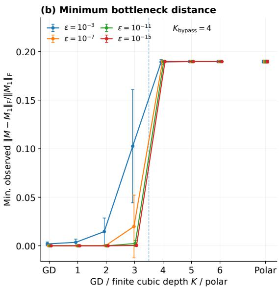

# Finite Spectral Depth Controls Gaussian Entrance Rank and Avoidance of the First Gradient-Flow Saddle

Yanlin Long

ynlinlong@gmail.com

Independent Researcher

Guizhou, China

## Abstract

Matrix factorization provides a simple model for studying the training dynamics of neural networks. Recent studies of gradient flow under small initialization have analyzed how trajectories escape from a neighborhood of the origin and approach their first nonzero stationary point. In this paper, we study continuous-time dynamics that applies a finite number of Newton–Schulz iterations to the normalized matrix gradient (Muon). We show that the number of Newton–Schulz steps can change the rank selected during the early stages of training and allow the resulting trajectory to bypass the first nonzero stationary point approached by gradient flow. Under an additional residual-inertia condition, we prove that bypass occurs for all suficiently large finite Newton–Schulz depths and provide an explicit suficient threshold. We also construct an example in which the bypass threshold is four.

Keywords: Newton–Schulz iteration, Gaussian initialization, optimization dynamics, rank selection, saddle avoidance

## 1 Introduction

Muon and its variants have emerged as practical optimizers for large-scale language-model training (Liu et al., 2025; Kimi Team, 2025), using Newton–Schulz iterations to approximately orthogonalize matrix-valued updates (Jordan et al., 2024). Their design is closely related to steepest descent under the spectral norm, where the polar factor provides an idealized update direction (Bernstein and Newhouse, 2024). In practice, however, orthogonalization is performed by a fixed, small number of polynomial iterations. This distinction is particularly relevant near rank deficiency: exact polar orthogonalization maps every nonzero singular value to one, whereas finite Newton–Schulz iterations have a bounded amplification factor near zero at each fixed depth. Analyses of idealized spectral updates have identified learning dynamics distinct from gradient descent in concrete matrix models (Ma et al., 2026; Rhee et al., 2026; Li et al., 2026), while finite Newton–Schulz updates have been studied through convergence guarantees and their smoothing efect (Kim and Oh, 2026; Li and Tsuchiya, 2026). These developments motivate a direct study of how the finite number of iterations shapes the optimization trajectory.

Polynomial iterations for matrix orthogonalization have a long history in numerical linear algebra (Kovarik, 1970; Björck and Bowie, 1971; Higham, 1986; Higham and Schreiber, 1990). More recently, optimization analyses that explicitly retain finitely many Newton–Schulz iterations have investigated convergence to stationary points, the dependence on iteration depth, and the efects of stabilization and momentum (Kim and Oh, 2026; Li and Tsuchiya,

2026; Peng et al., 2026; Li and Tan, 2026). These results provide a useful foundation for studying the dynamical consequences of a fixed-depth spectral transformation.

Gradient-based training of factorized models from small initialization can exhibit incremental learning, with diferent components becoming appreciable at successive stages (Saxe et al., 2014; Jacot et al., 2021; Li et al., 2021; Berthier, 2023; Jin et al., 2023). In matrix factorization, this behavior can take the form of dominant directions being learned first, followed by weaker directions that increase the efective rank of the predictor. The trajectory may consequently pass near intermediate low-rank stationary points. Related analyses of homogeneous networks describe directional convergence near the origin and saddle points, as well as the subsequent trajectory toward the first saddle after escape (Kumar and Haupt, 2024, 2025). A complementary approach studies training dynamics in high-dimensional limits, extracting efective structure from the evolving parameters or deriving dynamical mean-field descriptions of gradient flow (Martin et al., 2024, 2026). Related work on feature learning and the distinction from lazy training provides another perspective on how diferent directions become accessible during optimization (Chizat et al., 2019; Dandi et al., 2024).

Since Newton–Schulz iterations amplify small singular values of the normalized gradient, a natural question is whether a finite increase in the number of iterations can make weaker directions emerge early enough to change which stationary points the trajectory approaches. Answering this question requires tracking both singular-value amplification and the coupled evolution of diferent directions, as the gradient and its singular subspaces evolve with the factorized parameters.

We consider a two-layer neural network with quadratic activation and all second-layer weights fixed to one. This model admits an equivalent representation as a positive-semidefinite matrix factorization. Such quadratic networks provide a tractable setting for analyzing nonlinear training dynamics, and have also been studied through gradient flow and spectral gradient methods (Martin et al., 2024, 2026; Braun et al., 2026). We study continuoustime optimization dynamics in which K cubic Newton–Schulz iterations are applied to the normalized factor gradient, and refer to K as the spectral depth.

For the analysis, we use a two-scale Gaussian initialization: one hidden row is initialized at scale ε, while the remaining rows have scale $\varepsilon ^ { b } { } _ { ; }$ , where $b > 1$ . The gradient normalization includes an additive stabilization proportional to ε. This choice of initialization scales allows us to identify the leading directional dynamics first and then derive the coupled equations governing the weaker components in the remaining independent directions. We compare trajectories on the same task and with the same underlying Gaussian seed as ε tends to zero, while keeping each spectral depth fixed. Removing the row-dependent initialization scales would instead lead to an isotropic Gaussian initialization, for which the competing directions may exhibit diferent and potentially richer dynamics. The analysis of this regime remains open.

Another question concerns the extent to which small-initialization asymptotics can determine the subsequent training trajectory. Under suitable structural conditions, gradient flow admits a precise description in which the initialization scale can be used to reverseengineer the full training dynamics, leading also to a characterization of time-dependent implicit regularization (Berthier, 2023). For finite-depth Newton–Schulz dynamics, the nonlinear matrix iteration prevents this reconstruction argument from carrying over directly. Although the dynamics can be analyzed in a small neighborhood of the origin, the resulting local description does not by itself determine the trajectory after leaving that neighborhood. This creates two distinct dynamical scales: the entrance dynamics near the origin and the subsequent evolution away from it. Establishing how the entrance dynamics are transmitted to the later trajectory is one of the main results of this paper.

Following the framework of Li et al. (2021), which characterizes the first nonzero stationary point selected by gradient flow under suitable assumptions, we study the evolution from small initialization through the first stationary point encountered after escape. This allows us to compare the stationary points approached by gradient descent and by finitedepth Newton–Schulz dynamics. Under an additional structural assumption, we establish a suficient large-depth guarantee: for all suficiently large spectral depths, the selected Newton–Schulz continuation approaches a first stationary point whose loss is strictly smaller than that of the first stationary point selected by gradient descent. For smaller depths, our results do not provide a general criterion determining whether the trajectory visits or bypasses the gradient-descent stationary point. Moreover, without the additional assumption, the first stationary points reached by finite-depth Newton–Schulz dynamics and gradient descent may have the same loss. Such equal-loss behavior may reveal further dynamical structures, which we leave for future work.

The rest of this paper is organized as follows. Section 2 introduces the model and pathwise comparison criteria. Sections 3–5 establish the Gaussian entrance law, continuation criteria, and eventual depth guarantee. Section 6 presents an exact empirical task, and Section 7 discusses the scope of the results and open questions. Detailed proofs are given in the appendices.

Notations. We write $\mathbb { S } ^ { r }$ for the real symmetric r × r matrices and $\mathbb { S } _ { + } ^ { r }$ for the positivesemidefinite cone. The matrix inner product is $\langle A , B \rangle = \operatorname { t r } ( A ^ { \top } B )$ . Subscripts F and op denote the Frobenius and operator norms, respectively; vector norms are Euclidean. For a symmetric matrix $A , n _ { + } ( A )$ counts its strictly positive eigenvalues with multiplicity. We write $O ( m ) = \{ Q \in \mathbb { R } ^ { m \times m } : Q ^ { \top } Q = I _ { m } \}$

## 2 Main Results

In this section, we introduce the empirical quadratic model and finite-depth Newton–Schulz dynamics, and formulate the pathwise comparison with gradient flow from small initialization.

## 2.1 Empirical quadratic learning

Fix $m \geq 2$ and $r \geq 3$ , and data $\{ ( x _ { l } , y _ { l } ) \} _ { l = 1 } ^ { n }$ with $x _ { l } \in \mathbb { R } ^ { r }$ spanning $\mathbb { R } ^ { r }$ and $y _ { l } \in \mathbb { R }$ . Put $q = \operatorname* { m i n } \{ m , r \}$ . For $W \in \mathbb { R } ^ { m \times r }$ , set

$$
M = W ^ { \top } W , \qquad \Phi ( M ) = \frac { 1 } { 2 n } \sum _ { l = 1 } ^ { n } ( y _ { l } - x _ { l } ^ { \top } M x _ { l } ) ^ { 2 } , \qquad f ( W ) = \Phi ( W ^ { \top } W ) .\tag{1}
$$

This is the predictor of the quadratic network $x \mapsto \| W x \| _ { 2 } ^ { 2 }$ with fixed unit readouts. Define the task matrix, measurement operator, and residual by

$$
C = \frac { 1 } { n } \sum _ { l } y _ { l } x _ { l } x _ { l } ^ { \top } , \qquad \mathcal { L } ( H ) = \frac { 1 } { n } \sum _ { l } ( x _ { l } ^ { \top } H x _ { l } ) x _ { l } x _ { l } ^ { \top } , \qquad R ( M ) = C - \mathcal { L } ( M ) .\tag{2}
$$

The gradient is

$$
\boldsymbol { G } ( \boldsymbol { W } ) : = - \nabla \boldsymbol { f } ( \boldsymbol { W } ) = 2 \boldsymbol { W } \boldsymbol { R } ( \boldsymbol { W } ^ { \top } \boldsymbol { W } ) .
$$

## 2.2 Finite spectral depth and two-scale initialization

We use the cubic Newton–Schulz polynomial iteration (Björck and Bowie, 1971; Higham, 1986)

$$
\begin{array} { r } { P _ { 0 } ( X ) = X , \qquad P _ { k + 1 } ( X ) = \frac { 3 } { 2 } P _ { k } ( X ) - \frac { 1 } { 2 } P _ { k } ( X ) P _ { k } ( X ) ^ { \top } P _ { k } ( X ) . } \end{array}\tag{3}
$$

On the unit Frobenius ball, $P _ { k }$ preserves singular vectors and applies the scalar polynomial $p _ { k }$ to each singular value, where

$$
\begin{array} { r } { p _ { 0 } ( s ) = s , \qquad p _ { k + 1 } ( s ) = \frac { 3 } { 2 } p _ { k } ( s ) - \frac { 1 } { 2 } p _ { k } ( s ) ^ { 3 } , \qquad a _ { K } = p _ { K } ^ { \prime } ( 0 ) = ( 3 / 2 ) ^ { K } . } \end{array}\tag{4}
$$

Fix $b > 1 , c _ { \eta } > 0$ , and finite $K \in \mathbb { N } _ { 0 } = \{ 0 , 1 , 2 , . . . \}$ . For a matrix $U \in \mathbb { R } ^ { m \times r }$ with independent standard normal entries, initialize

$$
W _ { K } ^ { \varepsilon , b } ( 0 ; U ) = D _ { \varepsilon , b } U , \qquad D _ { \varepsilon , b } = \mathrm { d i a g } ( \varepsilon , \varepsilon ^ { b } , \dots , \varepsilon ^ { b } ) , \qquad \eta _ { \varepsilon } = c _ { \eta } \varepsilon .\tag{5}
$$

The actual trajectory, in physical time $t ,$ solves

$$
\frac { \mathrm { d } W } { \mathrm { d } t } = P _ { K } \bigg ( \frac { G ( W ) } { \| G ( W ) \| _ { F } + \eta _ { \varepsilon } } \bigg ) .\tag{6}
$$

The additive stabilization in the denominator follows the original Muon implementation, which uses a fixed numerical constant of $1 0 ^ { - 7 }$ in gradient normalization (Jordan et al., 2024). The choice $\eta _ { \varepsilon } = c _ { \eta } \varepsilon$ introduces an additional structural assumption: the stabilization term is taken to be of the same order as the small-initialization scale. Diferent scaling choices may lead to diferent balances between the gradient norm and the stabilization term, and hence diferent rescaled dynamics. For simplicity, we adopt this linear scaling throughout the paper.

Throughout the paper, we fix a finite spectral depth K before taking the limit $\varepsilon \downarrow 0$ with the same Gaussian seed $U .$

Since $p _ { K }$ is odd, there is a polynomial $q _ { K }$ satisfying

$$
p _ { K } ( s ) = s q _ { K } ( s ^ { 2 } ) , \qquad q _ { K } ( 0 ) = a _ { K } .
$$

For $G \in \mathbb { R } ^ { m \times r }$ and $\eta \geq 0$ , define

$$
H _ { K , \eta } ( G ) = \left\{ \begin{array} { l l } { ( \| G \| _ { F } + \eta ) P _ { K } ( G / ( \| G \| _ { F } + \eta ) ) , } & { \| G \| _ { F } + \eta > 0 , } \\ { 0 , } & { G = 0 , \ \eta = 0 . } \end{array} \right.\tag{7}
$$

We use $\tau$ for the time variable in $\mathrm { d } W / \mathrm { d } \tau = H _ { K , \eta } ( G ( W ) )$ .

For the actual predictor, write

$$
\begin{array} { r } { M _ { K } ^ { \varepsilon , b } ( t ; U ) = W _ { K } ^ { \varepsilon , b } ( t ; U ) ^ { \top } W _ { K } ^ { \varepsilon , b } ( t ; U ) . } \end{array}
$$

## 2.3 Continuation and the gradient-flow comparison

Multiplying the physical vector field by its positive denominator gives a convenient time parameter for continuation. The following bounds keep that change of time and all later finite-interval comparisons on the same ordered path.

Proposition 1 (Continuation of finite-depth dynamics) For a spanning empirical task, the following assertions hold in arbitrary positive factor dimensions. Fix finite K and $\eta \geq 0$ . Every solution of

$$
\frac { \mathrm { d } W } { \mathrm { d } \tau } = H _ { K , \eta } ( G ( W ) )
$$

is uniquely defined for all $\tau \geq 0$ and converges to one stationary factor $W _ { s }$ . Every finite time preserves the initial rank. Every PSD sublevel of Φ, and every factor sublevel of $f ,$ is compact. Along the solution,

$$
- \frac { \mathrm { d } f } { \mathrm { d } \tau } \geq \| \nabla f \| _ { F } ^ { 2 } , \qquad \| \frac { \mathrm { d } W } { \mathrm { d } \tau } \| _ { F } \leq a _ { K } \| \nabla f \| _ { F } , \qquad - \frac { \mathrm { d } f } { \mathrm { d } \tau } \geq a _ { K } ^ { - 1 } \| \nabla f \| _ { F } \| \frac { \mathrm { d } W } { \mathrm { d } \tau } \| _ { F } .\tag{8}
$$

For $\eta > 0$ , the physical-time equation with denominator $\| G ( W ) \| _ { F } + \eta$ has the same ordered path, is defined for all $t \geq 0$ , converges to $W _ { s }$ , and satisfies

$$
\operatorname { r a n k } W ( t ) = \operatorname { r a n k } W ( 0 ) \qquad ( 0 \leq t < \infty ) .
$$

The change of time is $\mathrm { d } t / \mathrm { d } \tau = \| G ( W ) \| _ { F } + \eta$ . More generally, a bounded $C ^ { 1 }$ curve satisfying (8) for a real-analytic loss on a neighborhood of its closure converges to a stationary point. These conclusions also apply to one-row and projected empirical problems used below.

At depth zero, $H _ { 0 , \eta } ( G ) = G$ . The corresponding predictor evolves by ordinary factor gradient flow. Its first small-initialization stage selects a rank-one trajectory whose stationary endpoint will remain fixed throughout the optimizer comparison. We further assume that the two largest eigenvalues of C are distinct.

Assumption 2 (Task spectrum) The task matrix C is nonsingular. Its signed eigenvalues and an orthonormal eigenbasis satisfy

$$
C v _ { l } = \lambda _ { l } v _ { l } , \qquad \lambda _ { 1 } > \lambda _ { 2 } \geq \dots \geq \lambda _ { r } , \qquad \lambda _ { 2 } > 0 .
$$

Spectral separation conditions are common in analyses of incremental learning in matrix factorization (Jiang et al., 2023). Here, strict gap between the two largest eigenvalues, allowing multiplicities among the remaining ones. Removing the leading spectral gap may give rise to other interesting dynamical structures, which we leave for future work.

Proposition 3 (First gradient-flow stage) Under Assumption 2, there is a taskdependent nonconstant rank-one predictor trajectory $\mathcal { M } ^ { \mathrm { G } } ( s )$ and a nonzero rank-one stationary predictor

$$
M _ { 1 } = \operatorname* { l i m } _ { s \to \infty } \mathcal { M } ^ { \mathrm { G } } ( s ) , \qquad M _ { 1 } R ( M _ { 1 } ) = 0 .\tag{9}
$$

The trajectory is selected by the leading positive eigendirection of C in the small-initialization limit of factor gradient flow. For each fixed $b > 1$ , the actual depth-zero paths satisfy

$$
\operatorname* { l i m } _ { \varepsilon \downarrow 0 } \operatorname* { i n f } _ { t \geq 0 } \lVert M _ { 0 } ^ { \varepsilon , b } ( t ; U ) - M _ { 1 } \rVert _ { F } = 0 \quad f o r \ G a u s s i a n - a l m o s t \ e v e r y \ U .\tag{10}
$$

The explicit time-shifted selection law for a general positive semidefinite initial family is given in Appendix C. The endpoint $M _ { 1 }$ is determined by the empirical flow after its leading direction has been selected. Set $R _ { 1 } = R ( M _ { 1 } )$ and $\phi _ { 1 } = \Phi ( M _ { 1 } )$ .

## 2.4 All-time distance and loss crossing

A visit is measured over the whole physical-time path. The second observable asks whether training reaches a level below the comparison loss, providing a quantitative loss improvement alongside separation.

Definition 4 (First nonzero stationary-point bypass) For the predictor $M _ { 1 }$ of Proposition 3 and a positive loss gap $\Delta$ , define

$$
d _ { 1 } ( K , b , \varepsilon , U ) = \operatorname* { i n f } _ { t \geq 0 } \frac { \| M _ { K } ^ { \varepsilon , b } ( t ; U ) - M _ { 1 } \| _ { F } } { \| M _ { 1 } \| _ { F } } ,\tag{11}
$$

$$
T _ { \Delta } ( K , b , \varepsilon , U ) = \operatorname* { i n f } \left\{ t \geq 0 : \Phi ( M _ { K } ^ { \varepsilon , b } ( t ; U ) ) \leq \phi _ { 1 } - \Delta \right\} .\tag{12}
$$

An empty hitting set has time $+ \infty$

A finite depth K gives almost-sure small-initialization bypass of $M _ { 1 }$ if, for almost every fixed Gaussian seed $U _ { i }$

$$
\operatorname* { l i m } _ { \varepsilon \downarrow 0 } \operatorname* { i n f } _ { 0 } d _ { 1 } ( K , b , \varepsilon , U ) > 0 , \qquad \operatorname* { l i m } _ { \varepsilon \downarrow 0 } \operatorname* { s u p } _ { t \geq 0 } \operatorname* { i n f } _ { \varepsilon \geq 0 } \Phi ( M _ { K } ^ { \varepsilon , b } ( t ; U ) ) < \phi _ { 1 } .
$$

The second condition is equivalent to eventual finite crossing of a common loss level strictly below $\phi _ { 1 }$ ; this level and the initialization cutof may depend on the fixed seed.

Define $K _ { \mathrm { b y p a s s } } ( b )$ as the minimum such depth, with min $\mathcal { D } = + \infty$

The infimum over time is taken separately at each positive ε. The ensuing smallinitialization limit therefore tests the entire path, including intervals whose physical or continuation times diverge with initialization. Later results give a deterministic distance bound and a deterministic loss gap, with only the admissible initialization cutof depending on the fixed seed.

## 3 Gaussian Entrance at Finite Spectral Depth

An independent weak component can be suppressed during one stage and amplified during a later stage. The entrance rank records how many such components reach a fixed rescaled size before physical time becomes independent of initialization. This section first gives the finite recursion computing that rank, then identifies its limit in the actual Gaussian dynamics.

## 3.1 Rescaled shapes and normal growth rates

For $\sigma = t / \varepsilon$ and $v = \log t$ , define

$$
Y ^ { \varepsilon } ( \sigma ) = \frac { W _ { K } ^ { \varepsilon , b } ( \varepsilon \sigma ; U ) } { \varepsilon } , \qquad Q ^ { \varepsilon } ( t ) = \frac { W _ { K } ^ { \varepsilon , b } ( t ; U ) } { t } .
$$

The exact relation is $Q ^ { \varepsilon } ( \varepsilon \sigma ) = Y ^ { \varepsilon } ( \sigma ) / \sigma$ . The limiting vector field for the second rescaling is

$$
F _ { K } ( Q ) = P _ { K } ( Q C / \| Q C \| _ { F } ) - Q , \qquad Q \neq 0 .\tag{13}
$$

Nonsingularity of C makes this expression well defined. Lemma 18 gives the exact rescaled empirical equation and its local $C ^ { 1 }$ error of order $t ^ { 2 } + \varepsilon / t$ . The two contributions are the empirical correction and denominator stabilization, respectively.

A matrix satisfying $F _ { K } ( Q _ { I , K } ) = 0$ and $\mathrm { R a n } ( Q _ { I , K } ^ { \top } ) = \mathrm { s p a n } \{ v _ { l } : l \in I \}$ is denoted by $Q _ { I , K }$ whenever it exists, and $s _ { I , K } = \| Q _ { I , K } C \| _ { F }$ . We identify factors in $\{ O Q _ { I , K } : O \in \mathrm { O } ( m ) \}$ } by their common Gram matrix. For the leading d task directions, write $Q _ { d , K } = Q _ { \{ 1 , \ldots , d \} , K }$ and $s _ { d , K } = s _ { \{ 1 , \ldots , d \} , K }$

For $K \geq 1$ , an existing positive support has unique coeficients $q _ { l } > 0$ determined by

$$
\begin{array} { r l r } { Q _ { I , K } ^ { \top } Q _ { I , K } = \displaystyle \sum _ { l \in I } q _ { l } ^ { 2 } v _ { l } v _ { l } ^ { \top } , } & \\ { q _ { l } = p _ { K } \big ( \lambda _ { l } q _ { l } / s _ { I , K } \big ) , } & { l \in I , } & { s _ { I , K } ^ { 2 } = \displaystyle \sum _ { l \in I } \lambda _ { l } ^ { 2 } q _ { l } ^ { 2 } . } \end{array}\tag{14}
$$

The rank-one shape is $Q _ { 1 , K } = e _ { 1 } v _ { 1 } ^ { \top }$ with $s _ { 1 , K } = \lambda _ { 1 }$ , including $K = 0$ . A new independent direction $v _ { l }$ has growth rate

$$
g _ { l } ^ { ( d ) } = \frac { a _ { K } \lambda _ { l } } { s _ { d , K } } - 1 , \qquad l > d .\tag{15}
$$

A positive next rate constructs the next leading support by Lemma 34. Negative task eigenvalues give rates below −1. The local derivative in the already occupied rank manifold is contracting after factors with equal Gram matrices are identified.

For a symmetric matrix A, let $n _ { + } ( A )$ count its strictly positive eigenvalues with multiplicity. The positive-direction capacity is

$$
p = \operatorname* { m i n } \{ m , n _ { + } ( C ) \} , \qquad 2 \leq p \leq q = \operatorname* { m i n } \{ m , r \} .\tag{16}
$$

The entrance may have rank below $p .$ The actual positive Gaussian initialization has rank q almost surely; its rank is preserved at every finite time. These two ranks enter diferent parts of the analysis.

Assumption 5 (Separated capacity prefix) The ordered eigenvalues in Assumption 2 satisfy

$$
\lambda _ { k } > \lambda _ { k + 1 } \qquad ( 1 \leq k \leq \operatorname * { m i n } \{ p , r - 1 \} ) .\tag{17}
$$

The gaps in this assumption distinguish the leading exterior column at each retained order. Eigenvalues beyond the tested prefix may repeat. When $p = n _ { + } ( C ) < r ,$ the last tested boundary is already strict because C is nonsingular and that boundary separates positive and negative eigenvalues.

## 3.2 Executable clocks and exceptional exponents

The clock $x _ { d }$ measures a fraction of the logarithmic interval from $t = O ( \varepsilon )$ to a fixed physical scale. Its increment is the remaining suppression exponent divided by the new normal growth rate.

Definition 6 (Candidate entrance-rank computation) Fix K and $b > 1$ , with capacity $p$ as in (16).

Start at rank one with $x _ { 1 } = 0$ and $s _ { 1 , K } = \lambda _ { 1 }$ . Define the first candidate by

$$
x _ { 2 } = \left\{ \begin{array} { l l } { \displaystyle { \frac { b - 1 } { a _ { K } \lambda _ { 2 } / \lambda _ { 1 } - 1 } } , } & { a _ { K } \lambda _ { 2 } / \lambda _ { 1 } > 1 , } \\ { + \infty , } & { a _ { K } \lambda _ { 2 } / \lambda _ { 1 } \leq 1 . } \end{array} \right.\tag{18}
$$

At each subsequently reached rank $2 \leq d < p$ , compute the normalization from (14) and the next growth rate from (15). Define

$$
x _ { d + 1 } = \left\{ \begin{array} { l r } { x _ { d } + \frac { ( b - 1 + x _ { d } ) ( 1 - \lambda _ { d + 1 } / \lambda _ { d } ) } { g _ { d + 1 } ^ { ( d ) } } , } & { g _ { d + 1 } ^ { ( d ) } > 0 , } \\ { + \infty , } & { g _ { d + 1 } ^ { ( d ) } \leq 0 . } \end{array} \right.\tag{19}
$$

Proceed to rank $d + 1$ whenever $x _ { d + 1 } < 1$ . Stop at capacity p or at the first candidate $x _ { d + 1 } \geq 1$ . Denote the final rank by $d _ { K } ( b )$

To separate the exponent from this procedure, first build the longest leading support allowed by positive addition rates, without applying the test $x _ { d } < 1$ . Start with $Q _ { 1 , K }$ and, while $d < p ,$ , add the next positive task eigenvector exactly when $g _ { d + 1 } ^ { ( d ) } > 0$ . The construction stops at capacity $p .$ On this algebraic sequence set $c _ { 1 , K } = 0$ and

$$
\begin{array} { r l } & { c _ { 2 , K } = \displaystyle \frac { 1 } { a _ { K } \lambda _ { 2 } / \lambda _ { 1 } - 1 } , } \\ & { c _ { d + 1 , K } = c _ { d , K } + \displaystyle \frac { ( 1 + c _ { d , K } ) ( 1 - \lambda _ { d + 1 } / \lambda _ { d } ) } { g _ { d + 1 } ^ { ( d ) } } \qquad ( 2 \le d < p ) . } \end{array}\tag{20}
$$

A displayed quotient is evaluated only when its addition rate is positive. At the first nonpositive rate, that next coeficient and all later coeficients are set to +∞. Put

$$
\mathcal { B } _ { C , K } = \{ 1 + 1 / c _ { d , K } : 2 \leq d \leq p , \ 0 < c _ { d , K } < \infty \} , \qquad \mathcal { B } _ { C } = \bigcup _ { K \in \mathbb { N } _ { 0 } } \mathcal { B } _ { C , K } .\tag{21}
$$

The finite candidate equations determine $B _ { C , K }$ from the task spectrum, depth, and capacity. Proposition 37 proves existence of each evaluated support and the identity $x _ { d } = ( b - 1 ) c _ { d , K }$ In particular $| B _ { C , K } | \le p - 1$ , and $B _ { C }$ is countable. The resulting staircase is

$$
d _ { K } ( b ) = \operatorname* { m a x } \{ d \leq p : ( b - 1 ) c _ { d , K } < 1 \} .\tag{22}
$$

Here a positive number times $+ \infty \mathrm { ~ i s ~ } + \infty$ . The first rank increase occurs exactly when $b < a _ { K } \lambda _ { 2 } / \lambda _ { 1 }$

## 3.3 The actual first-radius limit

For fixed K, b and $\rho > 0$ , define

$$
\begin{array} { r } { T _ { \rho } ^ { \varepsilon } = \operatorname* { i n f } \{ t \geq 0 : \| M _ { K } ^ { \varepsilon , b } ( t ; U ) \| _ { F } = \rho \} , \qquad \operatorname* { i n f } \varnothing = + \infty . } \end{array}\tag{23}
$$

The first-radius entrance rank is the rank of the predictor limit at this first hit, whenever the hit and limit exist. The theorem identifies both and fixes the continuation selected at the boundary $t = 0$

Theorem 7 (Gaussian first-radius entrance) Fix Assumptions 2 and $^ { 5 , }$ $m \geq 2 , r \geq 3$ and $c _ { \eta } > 0$ . For every fixed finite K and every $b > 1$ with $b \notin B _ { C , K }$ , put $d = d _ { K } ( b )$ . There is a local rank-d solution $\overline { { W } } _ { K , d }$ of

$$
\dot { W } = P _ { K } ( G ( W ) / \| G ( W ) \| _ { F } ) , \qquad W ( t ) / t \longrightarrow Q _ { d , K } ,
$$

unique in this fixed-rank boundary class up to a constant left orthogonal transformation. For some fixed $t _ { * } > 0$ it satisfies

$$
\overline { { { W } } } _ { K , d } ( t ) = t Q _ { d , K } + O ( t ^ { 3 } ) , \qquad \dot { \overline { { { W } } } } _ { K , d } ( t ) = Q _ { d , K } + O ( t ^ { 2 } ) .\tag{24}
$$

There is a measurable Gaussian-full set $\mathcal { G } _ { K , b }$ such that for every $U \in { \mathcal { G } } _ { K , b ; }$

$$
\operatorname* { l i m } _ { \varepsilon \downarrow 0 } \operatorname* { i n f } _ { O \in \mathsf { O } ( m ) } \| O W _ { K } ^ { \varepsilon , b } ( t ; U ) - \overline { { W } } _ { K , d } ( t ) \| _ { F } = 0 \quad l o c a l l y \ u n i f o r m l y \ o n \ ( 0 , t _ { * } ) .\tag{25}
$$

For each suficiently small fixed $\rho > 0$ , let $t _ { \rho }$ be the first time when $\| \overline { { W } } _ { K , d } ( t ) ^ { \top } \overline { { W } } _ { K , d } ( t ) \| _ { F } = \rho ,$ For every $U \in { \mathcal { G } } _ { K , b ; }$ the actual first hits exist for all suficiently small ε, their times converge to $t _ { \rho } ,$ and

$$
M _ { K } ^ { \varepsilon , b } ( T _ { \rho } ^ { \varepsilon } ; U ) \longrightarrow \overline { { { W } } } _ { K , d } ( t _ { \rho } ) ^ { \top } \overline { { { W } } } _ { K , d } ( t _ { \rho } ) .\tag{26}
$$

This predictor is independent of U and has rank $d _ { K } ( b )$ . For every fixed b /∈ $B _ { C }$ , these assertions hold on one common Gaussian-full event for all finite K.

The time interval and admissible radii are determined by the task and selected shape. Constants may depend on K, and the small-initialization cutofs may additionally depend on the seed. The countable exceptional set implies the stated result for Lebesgue-almost every $b > 1$ at every finite depth.

Proposition 8 (Depth monotonicity of entrance rank) Under Assumptions 2 and $^ { 5 , }$ the algebraically computed rank $d _ { K } ( b )$ is nondecreasing in the integer depth K. For the actual first-radius ranks, this comparison holds at the depths covered by Theorem 7.

The normalization of an existing support of rank at least two increases with depth, but its ratio to $a _ { K }$ decreases. The latter comparison increases the unused growth rates and decreases the finite clock coeficients. Appendix B proves these scalar properties and the proposition.

## 3.4 How Gaussian independent scales determine the clocks

The initial-layer equations separate the leading row from the weak rows on every fixed finite $\sigma$ interval. Eliminating the component of a weak row parallel to the leading row gives a linear right-multiplication equation. Conditional on the leading Gaussian row, its independent coeficients have a nonsingular Gaussian density. The relevant minors are nonzero simultaneously on one full-probability event. One then fixes a seed in that event and chooses a suficiently large finite $\sigma _ { 0 } ( U )$ ; this time stays fixed while $\varepsilon \downarrow 0$

In logarithmic initial-layer time

$$
\begin{array} { r } { \mu = \log \sigma = \log ( t / \varepsilon ) , } \end{array}\tag{27}
$$

the leading independent rates are $g _ { l } ^ { ( 1 ) } = a _ { K } \lambda _ { l } / \lambda _ { 1 } - 1$ , with an integrable coeficient error. $\mathrm { A t } ~ t = \varepsilon \sigma _ { 0 } ( U )$ , the leading independent h-volume has logarithm $h ( b - 1 ) \log \varepsilon + O _ { U } ( 1 )$ . This is the quantitative information passed from the fixed initial layer to the longer residence intervals.

For a later rank-d stage, project the unused task columns away from the occupied hidden span and express the result as $Z .$ The exact projected equation is homogeneous in $Z$ and retains both the empirical correction and the denominator term $\varepsilon / t$ . Exterior products measure independence: the consecutive volume ratio is the component of the next column orthogonal to the preceding columns. Thus a large column already contained in their span contributes no new independent direction.

The first waiting fraction already illustrates the balance. On the rank-one stage, a weak independent amplitude begins at order $\varepsilon ^ { b - 1 }$ and grows at logarithmic rate $g _ { 2 } ^ { ( 1 ) }$ . Reaching a fixed positive size therefore requires a logarithmic elapsed time $- ( b - 1 ) \log \varepsilon / g _ { 2 } ^ { ( 1 ) } + O _ { U } ( 1 )$ Returning to physical time gives

$$
\log t _ { 2 } ^ { \varepsilon } = \left( 1 - \frac { b - 1 } { g _ { 2 } ^ { ( 1 ) } } \right) \log \varepsilon + O _ { U } ( 1 ) .
$$

This crossing remains on a vanishing physical scale exactly when $x _ { 2 } < 1$ . If the rate is nonpositive, the first candidate is infinite; if the finite clock reaches one, the crossing is at the boundary of the scale on which the homogeneous approximation determines the answer. The exceptional set records precisely these finite boundary values.

For two completed additions, consider an unused task label $l > 2$ . At the second-rank entry, its remaining exponent is

$$
( b - 1 ) - g _ { l } ^ { ( 1 ) } x _ { 2 } = ( b - 1 + x _ { 2 } ) \left( 1 - \frac { \lambda _ { l } } { \lambda _ { 2 } } \right) .
$$

The equality follows from $( b - 1 ) = g _ { 2 } ^ { ( 1 ) } x _ { 2 }$ and $g _ { l } ^ { ( 1 ) } + 1 = ( \lambda _ { l } / \lambda _ { 2 } ) ( g _ { 2 } ^ { ( 1 ) } + 1 )$ . Projection away from the newly occupied direction changes the multiplicative coeficient by bounded positive factors, so it preserves this exponent. At a later rank $d ,$ the same calculation with the transferred exponents gives $( b - 1 + x _ { d } ) ( 1 - \lambda _ { l } / \lambda _ { d } )$ . Dividing the exponent for $l = d + 1$ by its new rate gives the increment in (19). Thus each clock uses the growth rates of the occupied stage together with the suppression inherited from earlier stages.

The residence interval can have logarithmic length proportional to $\log ( 1 / \varepsilon )$ . Integrating its volume equation therefore requires a bound on the time integral of the coeficient error. The actual estimates in Lemma 39 give this bound uniformly in residence length. For the two explicit rescaling terms, their accumulated contribution from $t = \varepsilon \sigma _ { 0 }$ to a fixed small $t _ { * }$ is bounded by

$$
\int _ { \varepsilon \sigma _ { 0 } } ^ { t _ { * } } \left( t ^ { 2 } + \frac { \varepsilon } { t } \right) \frac { \mathrm { d } t } { t } = \frac { t _ { * } ^ { 2 } - \varepsilon ^ { 2 } \sigma _ { 0 } ^ { 2 } } { 2 } + \frac { 1 } { \sigma _ { 0 } } - \frac { \varepsilon } { t _ { * } } \leq \frac { t _ { * } ^ { 2 } } { 2 } + \frac { 1 } { \sigma _ { 0 } } .
$$

The stable tangent equation and the increasing normal component give corresponding integrated bounds for the remaining coeficient terms. The resulting control is multiplicative on each independent volume: it preserves a positive lower bound relative to its incoming value, even when that value is a high power of ε. These estimates identify each completed first crossing as

$$
\log t _ { d + 1 } ^ { \varepsilon } = ( 1 - x _ { d + 1 } ) \log \varepsilon + O _ { U } ( 1 ) .
$$

After that crossing, projection away from the new direction and relative transport on a fixed connection segment preserve every remaining independent exponent. This produces the numerator $( b - 1 + x _ { d } ) ( 1 - \lambda _ { d + 1 } / \lambda _ { d } )$ in (19).

At the final stage, the unused component tends to zero on each compact positive-time interval. A stable Gram equation with a zero-time boundary then selects the rank- $\cdot d _ { K } ( b )$ empirical entrance. Its expansion in (24), a speed bound before a fixed early time, and transverse crossing at the selected section identify the actual first hit. The definitions and estimates for these steps appear in Appendix B.

The selected entrance solves the empirical equation at positive time. In its rescaled Gram equation, the stable tangent correction has order $t ^ { 2 }$ , so lifting back to a factor gives the $O ( t ^ { 3 } )$ correction in (24). The loss operator therefore enters the selected continuation even though the finite clock recursion uses only the task spectrum. This separates two computations: the spectrum and initialization exponent determine the entrance rank, and the empirical operator determines the continuation from its boundary shape.

The argument also distinguishes convergence at a prescribed positive time from convergence at the first section. The uniform speed bound excludes an earlier actual hit on an initial interval. On the remaining compact interval before the selected hit, the limiting predictor stays strictly below the chosen radius. Uniform convergence preserves that margin. Transversality then places the actual first hit in every small neighborhood of the selected hitting time. This gives the time and predictor conclusions of Theorem 7 on the same seed event.

## 4 Selected Continuation and All-Time Bypass

The entrance theorem supplies a deterministic predictor at a small section. Continuing from that selected entrance gives a finite comparison segment. A strict loss decrease on such a segment subsequently controls all later actual times. At equal terminal loss, control instead comes from the finite length of trajectories near an analytic stationary point.

## 4.1 The selected empirical continuation

Write $\varphi _ { K } ( \tau , Z )$ for the solution starting at $Z$ of

$$
\frac { \mathrm { d } W } { \mathrm { d } \tau } = H _ { K , 0 } ( G ( W ) ) .\tag{28}
$$

For a depth and exponent covered by Theorem 7, choose a factor $Z$ at a suficiently small positive time on $\overline { { W } } _ { K , d _ { K } ( b ) }$ and define

$$
M _ { s , K } = \operatorname* { l i m } _ { \tau \to \infty } \varphi _ { K } ( \tau , Z ) ^ { \top } \varphi _ { K } ( \tau , Z ) , \qquad \ell _ { K , d _ { K } ( b ) } = \Phi ( M _ { s , K } ) .
$$

Proposition 1 gives existence. Uniqueness of continuation, its positive time change, and left orthogonal equivariance make these objects independent of the chosen positive entrance point and hidden frame. The starting point is fixed by the selected entrance. The notation $\ell _ { K , d }$ also applies when that entrance has a specified rank $d ,$ with its boundary Gram matrix fixed.

Assumption 9 (A nonglobal comparison predictor) The first gradient-flow endpoint satisfies

$$
\lambda _ { \operatorname* { m a x } } ( R _ { 1 } ) > 0 .\tag{29}
$$

Under this condition every factor of $M _ { 1 }$ has negative curvature in an unused hidden direction, as proved in Corollary 47. It also implies that the minimum PSD loss is strictly below $\phi _ { 1 }$ . These properties concern the comparison and loss-transfer results of this section and Section 5.

Theorem 10 (Strict selected loss implies actual bypass) Under the pointwise hypotheses of Theorem 7 and Assumption 9, suppose $\ell _ { K , d _ { K } ( b ) } < \phi _ { 1 }$ . There are deterministic constants $d _ { * } , \Delta _ { * } > 0$ and a Gaussian-full event such that, for every fixed seed U in that event,

$$
d _ { 1 } ( K , b , \varepsilon , U ) \geq d _ { * } , \qquad T _ { \Delta _ { * } } ( K , b , \varepsilon , U ) < \infty
$$

for every suficiently small $\varepsilon > 0$ , with the cutof allowed to depend on $U$

The entry-set formulation in Appendix C gives the same selected terminal loss at every suficiently small section. It also retains a section-independent terminal-loss test and its minimum successful depth.

## 4.2 A finite comparison segment and the entire tail

Before the first-radius hit, the predictor norm is small, giving a positive distance from $M _ { 1 }$ Starting at that section, choose a finite segment of the selected continuation ending below ϕ . Every factor of $M _ { 1 }$ is stationary. Uniqueness prevents this selected segment from meeting such a factor, since its terminal loss is lower. Compactness of the segment gives a positive minimum distance. Finite-time continuous dependence transfers both this distance and the terminal loss gap to the actual small-initialization path.

For all subsequent times, actual loss monotonicity preserves the gap. At M1, the empirical quadratic identity is

$$
\begin{array} { r } { \Phi ( M ) - \phi _ { 1 } = - \langle R _ { 1 } , M - M _ { 1 } \rangle + \frac { 1 } { 2 } \langle M - M _ { 1 } , \mathcal { L } ( M - M _ { 1 } ) \rangle . } \end{array}
$$

Its nonnegative quadratic term converts the preserved loss decrease into a permanent predictor-distance bound. In particular, whenever $\Phi ( M ) \leq \phi _ { 1 } - \Delta$ for a fixed $\Delta > 0$ ，

$$
\begin{array} { r } { \Delta \leq \langle R _ { 1 } , M - M _ { 1 } \rangle \leq \| R _ { 1 } \| _ { F } \| M - M _ { 1 } \| _ { F } . } \end{array}
$$

After the crossing, the same inequality applies at every later actual time. The smallinitialization comparison is used only to reach this fixed loss level; the algebraic loss identity then supplies the tail bound without an initialization-dependent comparison interval. Combining the early interval, the fixed comparison segment, and this tail proves the all-time result. The comparison time is chosen before taking the initialization limit.

## 4.3 Equal loss, selected capture, and full width

A selected endpoint can have loss $\phi _ { 1 }$ while difering from $M _ { 1 }$ . The following corollary distinguishes that case from selection of $M _ { 1 }$ itself. It also records the actual full-width loss statement with its own empirical hypotheses.

Corollary 11 (Selected endpoints and actual paths) The following assertions have separate hypotheses.

1. Under the pointwise hypotheses of Theorem 7, if $M _ { s , K } = M _ { 1 }$ , then for Gaussian-almost every fixed seed,

$$
\operatorname* { l i m } _ { \varepsilon \downarrow 0 } d _ { 1 } ( K , b , \varepsilon , U ) = 0 .
$$

2. Under the pointwise hypotheses of Theorem 7 and Assumption 9, suppose $\ell _ { K , d _ { K } ( b ) } = \phi _ { 1 }$ and $M _ { s , K } \neq M _ { 1 }$ . There is a deterministic $d _ { * } > 0$ and a Gaussian-full event on which, for each seed, $d _ { 1 } ( K , b , \varepsilon , U ) \geq d _ { * }$ for all suficiently small $\varepsilon > 0$ . If also $m \geq r ,$ this depth gives bypass.

3. Under the empirical model, $m \geq r ,$ , and Assumption 9, let $\Phi _ { * } : = \operatorname* { m i n } _ { M \succeq 0 } \Phi ( M )$ . Then $\Phi _ { * } < \phi _ { 1 }$ . On one Gaussian-full event, for every $\varepsilon > 0$ and every finite K,

$$
\operatorname * { l i m } _ { t  \infty } \Phi ( M _ { K } ^ { \varepsilon , b } ( t ; U ) ) = \Phi _ { * } .
$$

Thus the strict loss-crossing part of Definition 4 holds at every finite depth. The crossing times may depend on ε.

4. Under the pointwise hypotheses of Theorem $\tilde { \tau } , m \geq r$ , and Assumption 9, at every fixed depth with $\ell _ { K , d _ { K } ( b ) } \leq \phi _ { 1 }$ ，

K gives almost-sure small-initialization bypass $\iff \quad M _ { s , K } \neq M _ { 1 }$

Part (iii) requires the empirical model and full width at positive initialization. Its probabilityone event is the full-column-rank event for U. Parts (i), (ii), and $( \mathrm { i v } )$ use the entrance event at the fixed admissible depth; the loss premise in part (iv) is imposed at that depth.

For part (ii), choose a small factor ball around the selected terminal factor whose predictors stay separated from $M _ { 1 }$ . The analytic gradient inequality and the angle bound in (8) control the length of actual trajectories inside a small loss interval around $\phi _ { 1 }$ . The portions above and below $\phi _ { 1 }$ have separate integrable length bounds. A finite selected segment brings the actual factor inside the ball. It then either stays there or crosses the lower loss boundary, after which the permanent loss-gap argument applies. All radii, loss widths, and distance constants are fixed before choosing the actual seed cutof. Appendix C gives the quantitative margins.

The distinction between parts (ii) and (iii) is useful for the order of limits. In part (ii), the selected endpoint and its neighborhood are fixed before $\varepsilon \downarrow 0$ . In part (iii), the positiveinitialization path is followed to its stationary limit; full finite-time rank forces the terminal residual to be nonpositive by Lemma 12. The latter argument gives a loss decrease at a finite time for every positive initialization, but that time can diverge as initialization vanishes. The corollary combines these two conclusions only in the parts whose hypotheses include both entrance selection and full width.

## 5 Residual Inertia and an Eventual Depth Guarantee

A large entrance rank can rule out a high-loss stationary endpoint. The relevant restriction uses the rank at finite time, which the flow preserves, and the positive eigenvalues of the residual at the limit. This distinction allows the selected predictor to lose rank as it converges.

## 5.1 Preserved rank and terminal residual inertia

Lemma 12 (Rank–inertia bound) Let $B ( \tau )$ be measurable and symmetric with $I \preceq$ $B ( \tau ) \preceq a I$ for fixed $a \ge 1$ , and let a locally absolutely continuous forward trajectory satisfy

$$
W ^ { \prime } = 2 W R ( W ^ { \top } W ) B ( \tau ) \quad f o r \ a l m o s t \ e v e r y \ \tau .
$$

Assume the coeficients are locally bounded and the trajectory converges to $W _ { s }$ . Ifrank $W ( 0 ) =$ $d ,$ then

$$
d + n _ { + } ( R ( W _ { s } ^ { \top } W _ { s } ) ) \leq r .\tag{30}
$$

In particular this applies to $W ^ { \prime } = H _ { K , \eta } ( G ( W ) )$ for every fixed finite K and $\eta \geq 0$

The proof uses the actual right-multiplication equation. A positive quadratic cone associated with the terminal residual is forward invariant once the residual is suficiently close to its limit. Uniform positivity of the multiplier forces exponential growth of every row combination in that cone. A dimension argument supplies such a combination whenever the inequality in (30) fails, contradicting convergence. The derivative estimate keeps the order of all matrix products.

For the empirical loss, a separate stationary identity gives rank $M + n _ { + } ( R ( M ) ) \leq n _ { + } ( C )$ whenever $M \succeq 0$ and $M R ( M ) = 0$ . The proof uses strict positivity of $\mathcal { L } ( M )$ on Ran M and is given in Lemma 23. The dynamic bound above instead uses the rank before the terminal limit. For example, a full-column-rank trajectory has a terminal residual with no positive eigenvalues and therefore attains a PSD-optimal loss.

## 5.2 A critical stationary loss band

Under Assumption 9, define

$$
\begin{array} { r l } & { \mathsf { C } _ { \ge \phi _ { 1 } } ^ { ( q ) } = \{ M \succeq 0 : \operatorname { r a n k } M \leq q , \ M R ( M ) = 0 , \ \phi _ { 1 } \leq \Phi ( M ) \leq \Phi ( 0 ) \} , } \\ & { \quad p _ { * } ^ { ( q ) } = \operatorname* { m i n } _ { M \in \mathsf { C } _ { \ge \phi _ { 1 } } ^ { ( q ) } } n _ { + } ( R ( M ) ) . } \end{array}\tag{31}
$$

This set is nonempty and compact, and $1 \leq p _ { * } ^ { ( q ) } \leq n _ { + } ( R _ { 1 } ) \leq n _ { + } ( C ) - 1$ (Lemma 53). Its lower bound follows because $M _ { 1 }$ admits a lower-loss PSD perturbation, whereas a stationary PSD predictor with nonpositive residual is globally optimal.

Every selected continuation starts below $\Phi ( 0 )$ and converges to a stationary predictor of rank at most $d _ { K } ( b )$ . If its terminal loss were at least $\phi _ { 1 }$ , that endpoint would belong to the displayed band. Lemma 12 would then require $d _ { K } ( b ) + p _ { * } ^ { ( q ) } \leq r$ . Consequently the strict reverse inequality supplies the selected-loss premise of Theorem 10. This argument is formalized in Corollary 54.

## 5.3 Capacity saturation and the depth tail

The next bound makes every clock complete before the fixed physical scale. It depends on the input spectrum, hidden width, and initialization exponent. The sharper selected loss remains a property of the full empirical continuation.

Proposition 13 (Saturation at an explicit finite depth) Under Assumptions $\mathcal { Q }$ and $^ { 5 , }$ define

$$
K _ { \mathrm { c a p } } ( b ) = 1 + \left\lfloor \log _ { 3 / 2 } \frac { [ 1 + 2 ( p - 1 ) \operatorname* { m a x } \{ 1 , b - 1 \} ] ( \sum _ { i = 1 } ^ { p } \lambda _ { i } ^ { 2 } ) ^ { 1 / 2 } } { \lambda _ { p } } \right\rfloor .\tag{32}
$$

For every fixed $b > 1$ and every finite integer $K \ge K _ { \mathrm { c a p } } ( b )$ , all candidate supports through rank p exist, every finite candidate clock is strictly below one, and Theorem 7 applies with $d _ { K } ( b ) = p$ . For each fixed $b , c _ { \eta }$ , the Gaussian events can be chosen simultaneously for all these integer depths. Moreover, for each $B > 1$ , the set $B _ { C } \cap ( 1 , B ]$ is finite, with cardinality at most $( p - 1 ) K _ { \mathrm { c a p } } ( B )$

Theorem 14 (Eventual avoidance under a residual-inertia condition) Fix a task and width satisfying Assumptions ${ \it 2 , \ 5 , }$ and 9. Suppose, in addition, that

$$
p + p _ { * } ^ { ( q ) } > r , \qquad p = \operatorname* { m i n } \{ m , n _ { + } ( C ) \} , \quad q = \operatorname* { m i n } \{ m , r \} .\tag{33}
$$

For every fixed $b > 1$ and $c _ { \eta } > 0$ , every finite integer $K \ge K _ { \mathrm { c a p } } ( b )$ has

$$
d _ { K } ( b ) = p , \qquad \ell _ { K , p } < \phi _ { 1 } ,
$$

and gives almost-sure small-initialization bypass in Definition $\it 4 .$ More precisely, for every finite $K \ge K _ { \mathrm { c a p } } ( b )$ there are constants $d _ { * , K } , \Delta _ { * , K } > 0$ . There is one Gaussian-full event

such that, for every U in it and every such K, the following inequalities hold for every suficiently small $\varepsilon > 0$ , with a cutof allowed to depend on K and U:

$$
d _ { 1 } ( K , b , \varepsilon , U ) \geq d _ { * , K } , \qquad T _ { \Delta _ { * , K } } ( K , b , \varepsilon , U ) < \infty .\tag{34}
$$

Here $K _ { \mathrm { c a p } } ( b )$ is the explicit suficient cutof in (32); the constants and initialization cutofs are allowed to vary with the fixed finite depth.

For each finite depth in the asserted tail, the proof first selects its rank-p entrance, applies the residual-inertia bound to its continuation, and transfers the resulting strict loss decrease to the actual path. A countable intersection then gives the common Gaussian-full event. This preserves the depth-dependent constants and the seed-dependent initialization cutofs in the theorem.

## 6 Numerical Experiments

We compare gradient descent, finite-depth Newton–Schulz dynamics, and polar updates on the same empirical quadratic task. The experiment follows the approach to the first gradient-flow stationary point and measures the closest point reached along each training trajectory.

We use $m = r = 3$ and 24 equally weighted samples. The first eight have

$$
x _ { l } = 3 ^ { 1 / 4 } ( \pm 1 , \pm 1 , \pm \sqrt { 3 / 2 0 } ) , y _ { l } = 3 \sqrt { 3 } ,
$$

with all independent sign choices. The remaining samples consist of four copies of each signed pair

$$
\begin{array} { l l } { x _ { l } = ( 0 , \pm \sqrt { 3 } , 0 ) , } & { y _ { l } = - 1 , } \\ { x _ { l } = ( 0 , 0 , \pm ( 1 1 7 3 / 4 0 0 ) ^ { 1 / 4 } ) , } & { y _ { l } = 1 1 \sqrt { 3 / 3 9 1 } . } \end{array}
$$

For these data, $C = \mathrm { d i a g } ( 3 , 2 , 1 )$ . The first gradient-flow stationary predictor in Proposition 3 is $M _ { 1 } = \mathrm { d i a g } ( 3 , 0 , 0 )$ , with $\Phi ( M _ { 1 } ) = 3 7 7 / 1 1 7 3 \colon$ ; the minimum PSD loss is $1 / 6$

We initialize with $b = 5 / 4$ and $c _ { \eta } = 1$ . For each $\varepsilon \in \{ 1 0 ^ { - 3 } , 1 0 ^ { - 5 } , \dots , 1 0 ^ { - 1 5 } \}$ , we compare GD, $K = 1 , \ldots , 6 .$ , and an SVD-computed polar update. We draw 32 independent standard Gaussian matrices U and reuse this bank across all methods and initialization scales, giving 1792 trajectories. GD is integrated as ordinary gradient flow and displayed using the positive time change in Proposition 1, so the left panel uses the normalized clock of (6). The polar branch uses the polar factor of the full factor gradient at each numerical step. All methods update the complete $3 \times 3$ factor.

Theorem 7 gives entrance rank one at $K = 1$ , rank two at $K = 2 , 3$ , and rank three at $K \geq 4$ for this task. The rank-two selected continuation lies in span $( e _ { 1 } , e _ { 2 } )$ and converges to $M _ { 1 }$ , so Corollary 11 gives approach to $M _ { 1 }$ by the corresponding small-initialization paths. At rank three, Lemma 12 yields PSD-optimal selected loss, and Theorem 10 gives bypass. The numerical comparison in Figure 1 follows this classification: the distance decreases with initialization scale for GD and depths one to three, while depths four to six remain separated from $M _ { 1 }$ . In the left panel, GD passes through a shoulder near $\Phi ( M _ { 1 } )$ ; depth four and the polar reference descend through that level without the same shoulder. All runs reach the common near-optimal loss, consistent with the full-width conclusion of Corollary 11 for GD and finite depth.

  
Figure 1: Finite-initialization trajectories on the 24-sample task. (a) Loss at $\varepsilon = 1 0 ^ { - 9 }$ for GD, depth four, and the SVD polar reference. GD is shown in the normalized path time described in the text. (b) Minimum observed relative distance to $M _ { 1 }$ before the numerical stopping condition, for four initialization scales. Points and curves show means over 32 Gaussian draws; error bars show one sample standard deviation. Small horizontal ofsets separate overlapping error bars. Lines between integer depths guide the eye; the polar reference is displayed separately.

The GD and finite-depth equations are integrated with DOP853 in continuation time while accumulating the normalized time. Polar is integrated by explicit SVD updates with step-size control and backtracking. Integration stops within $1 0 ^ { - 1 1 }$ of the optimal loss for GD and finite depth, and within $1 0 ^ { - 9 }$ for polar. We check smaller steps and tighter tolerances on repeated runs. The source, Gaussian draws, per-run measurements, and numerical diagnostics are provided with the experiment code.

## 7 Conclusion

In this paper, we have studied how finitely many iterations of a nonlinear matrix transformation can reshape optimization dynamics. In a quadratic two-layer network, we have characterized the evolution from small-initialization escape near the origin to the first nonzero stationary stage. Our results provide a precise description of how the number of Newton–Schulz iterations controls early rank selection and regulates the subsequent optimization path. Beyond this particular model, the analysis ofers a framework combining spectral dynamics with small-initialization techniques, which may help understand certain training phenomena arising in large-scale neural networks, including language models.

An immediate open question is whether similar dynamical descriptions can be established for more general models and under weaker assumptions. Of particular interest are networks with nonlinear activations such as ReLU, high-dimensional training regimes, and deeper architectures, where the interaction between spectral updates and feature learning may lead to richer dynamics.

## Appendix A. Foundations and Shared Structural Tools

The empirical identities provide compact sublevels and positive multipliers. These yield continuation, finite-time comparison, and rank preservation. The last subsection proves the rank–inertia bound used both for full-width optimality and for the suficient depth theorem.

## A.1 Empirical identities, update bounds, and changes of time

The next three statements give the algebraic and analytic properties of the update before any spectral-prefix or comparison assumption is used.

Lemma 15 (Empirical loss identities) The empirical loss satisfies

$$
\Phi ( M ) = \Phi ( 0 ) - \langle C , M \rangle + \textstyle { \frac { 1 } { 2 } } \langle M , \mathcal { L } ( M ) \rangle , \qquad \langle H , \mathcal { L } ( H ) \rangle = \frac { 1 } { n } \sum _ { l } ( x _ { l } ^ { \top } H x _ { l } ) ^ { 2 } \ge 0 .\tag{35}
$$

Moreover, Φ is convex, L is self-adjoint, $\mathcal { L } ( M ) \succeq 0 \ f o r \ M \succeq 0 , \nabla \Phi ( M ) = - R ( M )$ , and $G ( W ) = 2 W R ( W ^ { \top } W )$

Proof (of Lemma 15). Expand each summand as $y _ { l } ^ { 2 } - 2 y _ { l } x _ { l } ^ { \top } M x _ { l } + ( x _ { l } ^ { \top } M x _ { l } ) ^ { 2 }$ . Since $x _ { l } ^ { \top } M x _ { l } = \langle x _ { l } x _ { l } ^ { \top } , M \rangle$ , the linear term is $- \langle C , M \rangle$ and the quadratic term is $\langle M , \mathcal { L } ( M ) \rangle / 2$ For symmetric A, B,

$$
\langle A , \mathcal { L } ( B ) \rangle = \frac { 1 } { n } \sum _ { l } ( x _ { l } ^ { \top } A x _ { l } ) ( x _ { l } ^ { \top } B x _ { l } ) = \langle \mathcal { L } ( A ) , B \rangle .
$$

This proves self-adjointness and the second identity. If $M \succeq 0$ , every coeficient of $x _ { l } x _ { l } ^ { \top }$ in $\mathcal { L } ( M )$ is nonnegative. Diferentiating the expansion now gives $\nabla \Phi ( M ) = { \mathcal { L } } ( M ) - C$ . Finally, for a factor increment E,

$$
\begin{array} { r } { D f ( W ) [ E ] = \langle - R ( W ^ { \top } W ) , E ^ { \top } W + W ^ { \top } E \rangle = \langle - 2 W R ( W ^ { \top } W ) , E \rangle , } \end{array}
$$

which gives the stated negative gradient. In particular $\Phi$ is convex.

Lemma 16 (Bounds and continuity of the update map) Fix finite K. On $[ 0 , 1 ]$ the scalar polynomials satisfy

$$
\begin{array} { r } { s \le p _ { K } ( s ) \le a _ { K } s , \qquad 0 \le p _ { K } ( s ) \le 1 , \qquad 1 \le q _ { K } ( x ) \le a _ { K } . } \end{array}
$$

Moreover $p _ { K } ^ { \prime } ( s ) > 0 \ f o r \ 0 < s < 1$ . For $K \geq 1 , q _ { K } ^ { \prime } ( x ) < 0 f o r 0 < x < 1$ , and qK maps [0, 1] bijectively onto $[ 1 , a _ { K } ]$ in decreasing order. For every matrix X,

$$
P _ { K } ( X ) = X q _ { K } ( X ^ { \top } X ) = q _ { K } ( X X ^ { \top } ) X .
$$

The maps $H _ { K , \eta } , \eta \ge 0$ , are globally Lipschitz in G with a constant independent of η. They satisfy

$$
H _ { K , \eta } ( G ) = G B ^ { R } , \eqno . I \preceq B ^ { R } \preceq a _ { K } I ,\tag{36}
$$

$$
\langle G , H _ { K , \eta } ( G ) \rangle \geq \Vert G \Vert _ { F } ^ { 2 } , \qquad \Vert H _ { K , \eta } ( G ) \Vert _ { F } \leq a _ { K } \Vert G \Vert _ { F } ,\tag{37}
$$

$$
\operatorname* { s u p } _ { G } \Vert H _ { K , \eta } ( G ) - H _ { K , 0 } ( G ) \Vert _ { F } \leq C _ { K } \eta .\tag{38}
$$

Here the identity matrix has the appropriate size, and

$$
B ^ { R } = q _ { K } \left( \frac { G ^ { \top } G } { ( \| G \| _ { F } + \eta ) ^ { 2 } } \right) \in \mathbb { S } ^ { r } .
$$

The constant $C _ { K } < \infty$ depends only on the fixed depth and matrix dimensions. $A t \ G =$ $0 , \eta = 0$ , set $B ^ { R } = a _ { K } I _ { r }$

Proof (of Lemma 16). The polynomial identity in the statement follows by expanding $p _ { K }$ into odd powers and multiplying the corresponding matrix monomials. Equivalently, a singular value decomposition applies the scalar polynomial to each singular value.

For $0 \leq s \leq 1$ , the scalar map $s \mapsto ( 3 s - s ^ { 3 } ) / 2$ takes [0, 1] into itself, is at least s, and is at most $3 s / 2$ . Induction gives

$$
s \leq p _ { K } ( s ) \leq a _ { K } s , \qquad 0 \leq p _ { K } ( s ) \leq 1 .
$$

Thus $1 \leq q _ { K } ( x ) \leq a _ { K }$ on [0, 1]. The scalar cubic map has positive derivative on (0, 1), so composition gives $p _ { K } ^ { \prime } ( s ) > 0$ there. Since $q _ { 1 } ( x ) = 3 / 2 - x / 2$ , its derivative is negative. The recurrence

$$
q _ { K + 1 } ( x ) = q _ { K } ( x ) \left\{ \frac { 3 } { 2 } - \frac { 1 } { 2 } p _ { K } ( \sqrt { x } ) ^ { 2 } \right\}
$$

has a positive second factor; diferentiating it shows that both summands in its derivative are negative whenever $q _ { K } ^ { \prime } ( x ) < 0 , 0 < x < 1$ . Induction proves strict decrease. The endpoint identities $q _ { K } ( 0 ) = a _ { K }$ and $q _ { K } ( 1 ) = p _ { K } ( 1 ) = 1$ give the stated bijection.

The normalized singular values of G belong to this interval. Applying the polynomial identity above in singular coordinates proves (36). It also gives

$$
\langle G , H _ { K , \eta } ( G ) \rangle = \mathrm { t r } ( G ^ { \top } G B ^ { R } ) \geq \mathrm { t r } ( G ^ { \top } G ) , \qquad \| G B ^ { R } \| _ { F } \leq a _ { K } \| G \| _ { F } ,
$$

so (37) follows.

For the Lipschitz bound, $P _ { K }$ and its first derivative are bounded on the unit Frobenius ball. At $G \neq 0$ , direct diferentiation gives

$$
\begin{array} { l } { \displaystyle D H _ { K , \eta } ( G ) [ E ] = D P _ { K } \bigg ( \frac { G } { \| G \| _ { F } + \eta } \bigg ) [ E ] } \\ { \displaystyle \qquad + \frac { \langle G , E \rangle } { \| G \| _ { F } } \bigg \{ P _ { K } \bigg ( \frac { G } { \| G \| _ { F } + \eta } \bigg ) - D P _ { K } \bigg ( \frac { G } { \| G \| _ { F } + \eta } \bigg ) \left[ \frac { G } { \| G \| _ { F } + \eta } \right] \bigg \} . } \end{array}\tag{39}
$$

The normalized argument has norm at most one, and $| \langle G , E \rangle | / \| G \| _ { F } \leq \| E \| _ { F }$ . Thus the derivative is bounded by $C _ { K } \| E \| _ { F }$ , independently of η. Also (37) implies continuity of $H _ { K , \eta }$ at zero. Integrating along a line segment, split at zero when necessary, proves a common global Lipschitz bound.

For $G \neq 0$ , the parameter diference is

$$
\begin{array} { l } { { H _ { K , \eta } ( G ) - H _ { K , 0 } ( G ) = \eta P _ { K } \bigg ( \frac { G } { \| G \| _ { F } + \eta } \bigg ) } } \\ { { + \| G \| _ { F } \left\{ P _ { K } \bigg ( \frac { G } { \| G \| _ { F } + \eta } \bigg ) - P _ { K } \bigg ( \frac { G } { \| G \| _ { F } } \bigg ) \right\} , } } \end{array}
$$

$$
\left. \frac { G } { \| G \| _ { F } + \eta } - \frac { G } { \| G \| _ { F } } \right. _ { F } = \frac { \eta } { \| G \| _ { F } + \eta } .
$$

The first term is $O _ { K } ( \eta )$ ; the second is bounded by $C _ { K } \| G \| _ { F } \eta / ( \| G \| _ { F } + \eta ) \le C _ { K } \eta$ . Both maps vanish at $G = 0$ , proving (38). ■

Lemma 17 (Positive change of time) Fix $\eta > 0 . \ I f W ( t )$ solves the physical-time equation with denominator $\| G ( W ) \| _ { F } + \eta$ , define

$$
\tau ( t ) = \int _ { 0 } ^ { t } \frac { \mathrm { d } s } { \| G ( W ( s ) ) \| _ { F } + \eta } .
$$

Then $\tau ( t )$ is strictly increasing, and

$$
\frac { \mathrm { d } t } { \mathrm { d } \tau } = \| G ( W ( t ( \tau ) ) ) \| _ { F } + \eta , \qquad \frac { \mathrm { d } } { \mathrm { d } \tau } W ( t ( \tau ) ) = H _ { K , \eta } ( G ( W ( t ( \tau ) ) ) ) .\tag{40}
$$

On bounded forward solutions this change of time maps the whole forward half-line onto itself and preserves finite hitting times and the infimum of distance over the path. At $K = 0$ $H _ { 0 , \eta } ( G ) = G$ for every $\eta \geq 0$

Proof (of Lemma 17). The integrand is positive and continuous, so $\tau ( t )$ is strictly increasing and has an inverse on its image. The chain rule gives

$$
\frac { \mathrm { d } W ( t ( \tau ) ) } { \mathrm { d } \tau } = \frac { \mathrm { d } W } { \mathrm { d } t } \frac { \mathrm { d } t } { \mathrm { d } \tau } = ( \| G ( W ( t ( \tau ) ) ) \| _ { F } + \eta ) P _ { K } \left( \frac { G ( W ( t ( \tau ) ) ) } { \| G ( W ( t ( \tau ) ) ) \| _ { F } + \eta } \right) .
$$

This proves (40). On a bounded trajectory $G ( W )$ is bounded, so $\eta ~ \leq ~ \mathrm { d } t / \mathrm { d } \tau ~ \leq$ $\operatorname* { s u p } _ { \tau } \lVert G ( W ( \tau ) ) \rVert _ { F } + \eta$ . Integrating these inequalities in either direction shows that the time variables cover the same forward half-line and that finite times correspond to finite times. The ordered set of matrices visited is the same, proving the hitting-time and distance claims. Finally $P _ { 0 } ( X ) = X$ gives $H _ { 0 , \eta } ( G ) = G$ directly.

The two rescalings introduced in Section 3 retain the empirical operator and denominator at their respective scales. The error bound below is local in a region with a positive limiting denominator.

Lemma 18 (Exact rescaling and local error) The initial-layer and shape equations are

$$
\frac { \mathrm { d } Y ^ { \varepsilon } } { \mathrm { d } \sigma } = P _ { K } \left( \frac { 2 Y ^ { \varepsilon } [ C - \varepsilon ^ { 2 } \mathcal { L } ( ( Y ^ { \varepsilon } ) ^ { \top } Y ^ { \varepsilon } ) ] } { 2 \| Y ^ { \varepsilon } [ C - \varepsilon ^ { 2 } \mathcal { L } ( ( Y ^ { \varepsilon } ) ^ { \top } Y ^ { \varepsilon } ) ] \| _ { F } + c _ { \eta } } \right) ,\tag{41}
$$

$$
Y ^ { \varepsilon } ( 0 ) = \mathrm { d i a g } ( 1 , \varepsilon ^ { b - 1 } , \dots , \varepsilon ^ { b - 1 } ) U ,
$$

and

$$
\frac { \mathrm { d } Q ^ { \varepsilon } } { \mathrm { d } v } = P _ { K } \bigg ( \frac { Q ^ { \varepsilon } [ C - t ^ { 2 } \mathcal L ( ( Q ^ { \varepsilon } ) ^ { \top } Q ^ { \varepsilon } ) ] } { \| Q ^ { \varepsilon } [ C - t ^ { 2 } \mathcal L ( ( Q ^ { \varepsilon } ) ^ { \top } Q ^ { \varepsilon } ) ] \| _ { F } + c _ { \eta } \varepsilon / ( 2 t ) } \bigg ) - Q ^ { \varepsilon } , \qquad t = e ^ { v } .\tag{42}
$$

On a fixed bounded Q region with in $\mathrm { \Delta } _ { \mathrm { \ell } } ^ { \mathrm { \ell } } Q \lVert Q C \rVert _ { F } > 0 ;$

$$
\| r i g h t s i d e o f \ ( 4 2 ) - F _ { K } \| _ { C ^ { 1 } } = O ( t ^ { 2 } + \varepsilon / t )\tag{43}
$$

for all suficiently small $t > 0$ and $0 \leq \varepsilon / t \leq 1$ . The implied bound and the allowed upper bound on t depend only on this region and the fixed model parameters.

Proof (of Lemma 18). The chain rule gives

$$
{ \frac { \mathrm { d } Q } { \mathrm { d } v } } = t { \frac { \mathrm { d } } { \mathrm { d } t } } ( W / t ) = { \dot { W } } - Q .
$$

The exact gradient substitution is

$$
G ( t Q ) = 2 t Q \{ C - t ^ { 2 } \mathcal { L } ( Q ^ { \top } Q ) \} , \qquad \frac { G ( t Q ) } { \| G ( t Q ) \| _ { F } + c _ { \eta } \varepsilon } = \frac { Q [ C - t ^ { 2 } \mathcal { L } ( Q ^ { \top } Q ) ] } { \| Q [ C - t ^ { 2 } \mathcal { L } ( Q ^ { \top } Q ) ] \| _ { F } + c _ { \eta } \varepsilon / ( 2 t ) } .
$$

Together with $Q ^ { \prime } = \dot { W } - Q$ , this proves (42).

For the estimate, choose $\kappa > 0$ such that $\| Q C \| _ { F } \geq \kappa$ on the stated region, and use the induced Frobenius operator norm of $\mathcal { L }$ . On $\| Q \| _ { F } \leq B$

$$
\begin{array} { r } { \| Q \mathcal { L } ( Q ^ { \top } Q ) \| _ { F } \leq \| \mathcal { L } \| B ^ { 3 } , \quad D [ Q \mathcal { L } ( Q ^ { \top } Q ) ] [ E ] = E \mathcal { L } ( Q ^ { \top } Q ) + Q \mathcal { L } ( E ^ { \top } Q + Q ^ { \top } E ) . } \end{array}
$$

The derivative has norm at most $3 \| \mathcal { L } \| B ^ { 2 } \| E \| _ { F }$ . Therefore $Q [ C - t ^ { 2 } \mathcal { L } ( Q ^ { \top } Q ) ] - Q C$ and its first derivative are $O ( t ^ { 2 } )$ uniformly on the region. For all suficiently small $t , \parallel Q [ C -$ $t ^ { 2 } \mathcal { L } ( Q ^ { \top } Q ) ] \| _ { F } \geq \kappa / 2$

On matrices A in a fixed bounded set with $\| A \| _ { F } \ge \kappa / 2$ and scalars $0 \leq z \leq c _ { \eta } / 2$ , the function $A / ( \| A \| _ { F } + z )$ is smooth in $( A , z )$ and has bounded derivatives through order two. Its derivative in a matrix direction E is

$$
{ \frac { E } { \| A \| _ { F } + z } } - { \frac { A \langle A , E \rangle } { \| A \| _ { F } ( \| A \| _ { F } + z ) ^ { 2 } } } .
$$

The denominator lower bound controls this expression and its next derivatives. Applying the mean value estimate to $A = Q [ C - t ^ { 2 } \mathcal { L } ( Q ^ { \top } Q ) ] , z = c _ { \eta } \varepsilon / ( 2 t )$ and to $A = Q C , z = 0$ gives a $C ^ { 1 }$ diference of order $t ^ { 2 } + \varepsilon / t$ . Finally $P _ { K }$ has bounded derivatives through order two on the relevant bounded set. Composition proves (43). The same argument applies to every fixed bounded range of $\varepsilon / t$ , with a bound depending on that range.

For the initial scale, the chain rule gives

$$
\frac { \mathrm { d } Y ^ { \varepsilon } } { \mathrm { d } \sigma } = \frac { 1 } { \varepsilon } \frac { \mathrm { d } W ( \varepsilon \sigma ) } { \mathrm { d } \sigma } = \dot { W } ( \varepsilon \sigma ) .
$$

Substituting $W = \varepsilon Y$ gives $G ( \varepsilon Y ) = 2 \varepsilon Y [ C - \varepsilon ^ { 2 } \mathcal { L } ( Y ^ { \top } Y ) ]$ . Cancellation of the positive factor ε from the stabilized normalization, together with $\bar { \varepsilon ^ { - 1 } } D _ { \varepsilon , b } = \mathrm { d i a g } ( 1 , \varepsilon ^ { b - 1 } , \dots , \varepsilon ^ { b - 1 } )$ proves (41). 7

## A.2 Global continuation and finite-time comparison

Compact empirical sublevels bound the factors. The update inequalities then supply both a descent angle and a uniform finite-interval perturbation estimate in the regularization parameter.

Proof (of Proposition 1). The spanning assumption gives $n ^ { - 1 } \sum _ { l } x _ { l } x _ { l } ^ { \top } \succ 0$ . For $M \succeq 0$ , all $x _ { l } ^ { \top } M x _ { l }$ are nonnegative. The prediction-vector triangle inequality and Cauchy–Schwarz give

$$
\lambda _ { \operatorname* { m i n } } \left( \frac { 1 } { n } \sum _ { l } x _ { l } x _ { l } ^ { \top } \right) \operatorname { t r } M \leq \frac { 1 } { n } \sum _ { l } x _ { l } ^ { \top } M x _ { l } \leq \left( \frac { 1 } { n } \sum _ { l } y _ { l } ^ { 2 } \right) ^ { 1 / 2 } + \sqrt { 2 \Phi ( M ) } .\tag{44}
$$

Since $\| M \| _ { F } \le \operatorname { t r } M$ and $\| \boldsymbol { W } \| _ { F } ^ { 2 } = \mathrm { t r } ( \boldsymbol { W } ^ { \top } \boldsymbol { W } )$ , closed PSD and factor sublevels are compact.

The identity $G = - \nabla f$ , the chain rule, and (37) yield

$$
- f ^ { \prime } = \langle G , H _ { K , \eta } ( G ) \rangle \geq \| G \| _ { F } ^ { 2 } , \qquad \| W ^ { \prime } \| _ { F } \leq a _ { K } \| G \| _ { F } .
$$

Their combination proves all three inequalities in (8). The vector field is locally Lipschitz by Lemma 16. Each solution remains in its compact initial sublevel, so the continuation theorem of Teschl (2012, Corollary 2.15) gives global existence.

For any bounded $C ^ { 1 }$ curve satisfying (8), the angle inequality is

$$
\frac { \mathrm { d } } { \mathrm { d } \tau } f ( W ( \tau ) ) \leq - a _ { K } ^ { - 1 } \| \nabla f ( W ( \tau ) ) \| _ { F } \| W ^ { \prime } ( \tau ) \| _ { F } .
$$

A zero loss derivative forces the gradient and then the velocity to vanish. The angle and weak-decrease hypotheses of Absil et al. (2005, Theorem 2.2) therefore hold. Analyticity on a neighborhood of the compact closure and boundedness give convergence. The limit is stationary: otherwise continuity bounds the gradient norm away from zero on the tail, and $- f ^ { \prime } \geq \| \nabla f \| _ { F } ^ { 2 }$ contradicts the lower bound on the loss. This proves both the empirical assertion and the stated bounded-curve assertion.

For a nonstationary solution, local uniqueness implies $G ( W ( \tau ) ) \neq 0$ at each finite time. Thus the coeficient in

$$
\begin{array} { r } { W ^ { \prime } = 2 W R ( W ^ { \top } W ) B ^ { R } } \end{array}
$$

is continuous and bounded on finite intervals, including when $\eta = 0$ . Multiplication on the left by a fixed row vector gives a solution of the same linear row equation. Forward and backward uniqueness imply that this row solution vanishes at a finite time exactly when it vanishes initially. The left nullspace of W is consequently unchanged, proving finite-time rank preservation. A stationary solution has constant rank directly.

For $\eta > 0$ , Lemma 17 identifies the physical-time solution with this continuation. On its compact sublevel, $\mathrm { d } t / $ dτ is bounded above and is at least $\eta .$ Both forward time half-lines are covered. The same factor limit and finite-time rank therefore hold in physical time. $\mathrm { A t }$ $K = 0$ the continuation is factor gradient flow.

Corollary 19 (Finite-time comparison) Let $W _ { \eta }$ and $\bar { W }$ be solutions of

$$
W _ { \eta } ^ { \prime } = H _ { K , \eta } ( G ( W _ { \eta } ) ) , \qquad \bar { W } ^ { \prime } = H _ { K , 0 } ( G ( \bar { W } ) ) .
$$

Fix finite K and $\eta \geq 0$ . The two initial values may difer. Suppose both solutions stay in a fixed bounded factor region for $0 \leq \tau \leq S$ , where $S < \infty$ . There is a common Lipschitz constant L for the composed vector fields on a ball containing this region, and

$$
\operatorname* { s u p } _ { 0 \leq \tau \leq S } \| W _ { \eta } ( \tau ) - \bar { W } ( \tau ) \| _ { F } \leq e ^ { L S } \big ( \| W _ { \eta } ( 0 ) - \bar { W } ( 0 ) \| _ { F } + C _ { K } \eta S \big ) .\tag{45}
$$

Proof (of Corollary 19). The polynomial map $G$ is Lipschitz on a bounded ball. Lemma 16 gives a common Lipschitz constant L for its compositions, uniformly in $\eta .$ Subtracting the integral equations and adding and subtracting $H _ { K , \eta } ( G ( \bar { W } ) )$ yields

$$
\| W _ { \eta } ( \tau ) - \bar { W } ( \tau ) \| _ { F } \leq \| W _ { \eta } ( 0 ) - \bar { W } ( 0 ) \| _ { F } + \int _ { 0 } ^ { \tau } \bigl ( L \| W _ { \eta } ( u ) - \bar { W } ( u ) \| _ { F } + C _ { K } \eta \bigr ) \mathrm { d } u .
$$

The nonhomogeneous form of Teschl (2012, Lemma 2.7) gives

$$
\begin{array} { l } { \displaystyle \| W _ { \eta } ( \tau ) - \bar { W } ( \tau ) \| _ { F } \leq e ^ { L \tau } \| W _ { \eta } ( 0 ) - \bar { W } ( 0 ) \| _ { F } + C _ { K } \eta \displaystyle \int _ { 0 } ^ { \tau } e ^ { L ( \tau - u ) } \mathrm { d } u } \\ { \leq e ^ { L S } \big ( \| W _ { \eta } ( 0 ) - \bar { W } ( 0 ) \| _ { F } + C _ { K } \eta S \big ) . } \end{array}
$$

Taking the supremum proves (45).

Lemma 20 (Linearization at a stationary factor) Fix $\eta ~ > ~ 0$ and finite K. The physical-time vector field vanishes exactly at the stationary factors of f. At any such factor $W _ { s }$ , its derivative is

$$
- \frac { a _ { K } } { \eta } \nabla ^ { 2 } f ( W _ { s } ) .
$$

Thus its linearized eigenvalue signs agree with those of negative gradient flow, including zero eigenvalues.

Proof (of Lemma 20). For stationarity, the normalized singular values lie in $[ 0 , 1 )$ and $p _ { K } ( s ) > 0$ for $s > 0$ in this interval. Consequently the update vanishes exactly when $G = 0$ At a stationary factor, the derivative of $G / ( \| G \| _ { F } + \eta )$ is $D G / \eta .$ , and $D P _ { K } ( 0 ) = a _ { K } I$ . Since $D G ( W _ { s } ) = - \nabla ^ { 2 } f ( W _ { s } )$ , the asserted derivative follows. Multiplication by the positive scalar $a \kappa / \eta$ preserves signs, including zero eigenvalues.

Lemma 21 (Fixed-denominator expansion) For fixed finite K and fixed $\eta > 0$

$$
P _ { K } \left( { \frac { G } { \| G \| _ { F } + \eta } } \right) = { \frac { a _ { K } } { \eta } } G + O _ { K } \left( { \frac { \| G \| _ { F } ^ { 2 } } { \eta ^ { 2 } } } \right) \qquad ( \| G \| _ { F } / \eta \to 0 ) .
$$

Proof (of Lemma 21). Each cubic composition is odd and has derivative $a _ { K } I$ at zero. Therefore $P _ { K } ( X ) = a _ { K } X + O _ { K } ( \| X \| _ { F } ^ { 3 } )$ on a fixed neighborhood of zero. Also

$$
\| \frac { G } { \| G \| _ { F } + \eta } - \frac { G } { \eta } \| _ { F } = \frac { \| G \| _ { F } ^ { 2 } } { \eta ( \| G \| _ { F } + \eta ) } \leq \frac { \| G \| _ { F } ^ { 2 } } { \eta ^ { 2 } } .
$$

The nonlinear polynomial remainder is $O _ { K } ( ( | | G | | _ { F } / \eta ) ^ { 3 } )$ , which is bounded by $O _ { K } ( ( | | G | | _ { F } / \eta ) ^ { 2 } )$ as $\| G \| _ { F } / \eta \to 0$ . Combining the two estimates proves the claim.

## A.3 Cited analytic tools and the normalized leading-direction limit

Local solution, uniqueness, dependence, and continuation results are used in the forms of Teschl (2012, Theorems 2.2, 2.9, 2.11, 2.13 and Corollary 2.15). At each application the vector field is locally Lipschitz on the indicated region, and compact confinement extends the solution as needed. The integral comparison is Teschl (2012, Lemma 2.7); the nonhomogeneous form follows by including the accumulated forcing in the additive term and interchanging the integrals. For measurable coeficients the integrating-factor argument applies to absolutely continuous primitives.

The weighted function spaces used below are Banach spaces after multiplication by their displayed weight. Each application of Teschl (2012, Theorem 2.1) verifies invariance of a closed ball and a strict contraction estimate. Nonzero determinant polynomials have null zero sets by Mityagin (2020); an identity submatrix witnesses their nontriviality, and Gaussian density transfers nullity to probability zero.

The next lemma states the normalization of the local exit result needed in the empirical passage argument. Its proof retains the asymptotic, uniqueness, and compact-interval comparison steps around the cited shifted-limit theorem.

Lemma 22 (Limit in a simple leading direction) Let $g ~ : ~ \mathbb { R } ^ { N } ~ \to ~ \mathbb { R } ^ { N }$ be $C ^ { 2 }$ , with $g ( 0 ) = 0$ , and let $\psi ( t , z )$ be the flow of $z ^ { \prime } = g ( z )$ , defined for every $( t , z ) \in \mathbb R \times \mathbb R ^ { N }$ . Suppose $D g ( 0 )$ has an algebraically simple real eigenvalue $\alpha _ { * } > 0$ with real part strictly larger than every other eigenvalue. Let $r _ { * }$ and $l _ { * }$ be corresponding right and left eigenvectors with $l _ { * } ^ { \top } r _ { * } = 1$ . There is a common nonconstant solution with $e ^ { - \alpha _ { * } t } z _ { * } ( t ) \to r _ { * } \ a s \ t \to - \infty$ , given $b y$

$$
z _ { * } ( t ) = \operatorname* { l i m } _ { \alpha \downarrow 0 } \psi \big ( t + \alpha _ { * } ^ { - 1 } \log ( 1 / \alpha ) , \alpha r _ { * } \big ) .
$$

For every family $z _ { \alpha }  0$ with

$$
\operatorname* { l i m } _ { \alpha \downarrow 0 } \operatorname* { i n f } _ { \| z _ { \alpha } \| } ^ { \overline { { \jmath } } } > 0 ,
$$

and every fixed $t \in \mathbb { R }$

$$
\psi \left( t + \alpha _ { * } ^ { - 1 } \log \frac { 1 } { l _ { * } ^ { \top } z _ { \alpha } } , z _ { \alpha } \right) \longrightarrow z _ { * } ( t ) .
$$

Proof (of Lemma 22). Theorem E.7 of Li et al. (2021) gives the common shifted limit under the stated positive left-projection condition. It allows non-diagonalizable remaining spectral blocks. To relate its normalization to the one used here, choose $C \geq \operatorname* { m a x } \{ 1 , \| r _ { * } \| \}$ suficiently large that

$$
\| e ^ { s D g ( 0 ) } \| \leq C e ^ { \alpha _ { * } s } \quad ( s \geq 0 ) , \qquad \| g ( z ) - D g ( 0 ) z \| \leq C \| z \| ^ { 2 }
$$

in a fixed ball about zero for the second estimate. The first estimate follows from the simple leading eigenvalue and the strict gap in real parts, including all nonleading Jordan blocks. Variation of constants gives

$$
\| \psi ( s , \alpha r _ { * } ) - \alpha e ^ { \alpha _ { * } s } r _ { * } \| \leq C ^ { 2 } \int _ { 0 } ^ { s } e ^ { \alpha _ { * } ( s - u ) } \| \psi ( u , \alpha r _ { * } ) \| ^ { 2 } \mathrm { d } u .
$$

Under the temporary bound $\| \psi ( u , \alpha r _ { * } ) \| \leq 2 C \alpha e ^ { \alpha _ { * } u }$ , the right side is at most

$$
\frac { 4 C ^ { 4 } } { \alpha _ { * } } \alpha ^ { 2 } e ^ { \alpha _ { * } s } ( e ^ { \alpha _ { * } s } - 1 ) .
$$

If $\alpha e ^ { \alpha _ { * } s }$ is suficiently small, depending only on the fixed field and eigenvectors, this strictly improves the temporary bound and keeps the solution inside the chosen ball. A first-exit argument therefore proves the bound throughout such an interval. Substitute

$s = t + \alpha _ { * } ^ { - 1 } \log ( 1 / \alpha )$ and let α ↓ 0. For every suficiently negative fixed t, Theorem E.7 yields

$$
\| z _ { * } ( t ) - e ^ { \alpha _ { * } t } r _ { * } \| \leq \frac { 4 C ^ { 4 } } { \alpha _ { * } } e ^ { 2 \alpha _ { * } t } .
$$

This proves the normalized leading asymptotic and nonconstancy. The limit solves the diferential equation: convergence at a fixed time, together with finite-time continuous dependence, identifies all other limits with the solution from that limiting value. Completeness gives its extension to every real time. For any compact interval, apply Theorem E.7 at its left endpoint and then finite-time continuous dependence on the whole interval. This upgrades the convergence to uniform convergence on each compact time interval.

The normalized asymptotic identifies the solution uniquely. If z is another solution with $e ^ { - \alpha _ { * } s } z ( s ) \to r _ { * }$ as $s \to - \infty$ , then $l _ { * } ^ { \top } z ( s ) = e ^ { \alpha _ { * } s } ( 1 + o ( 1 ) )$ and $l _ { * } ^ { \top } z ( s ) / \| z ( s ) \|  1 / \| r _ { * } \| > 0$ $\mathrm { A p p l y }$ Theorem E.7 to the initial family $z ( s )$ as $s \to - \infty$ . For each fixed t, its shifted flow is

$$
\psi \bigg ( t + \alpha _ { * } ^ { - 1 } \log \frac { 1 } { l _ { * } ^ { \top } z ( s ) } , z ( s ) \bigg ) = z \bigg ( s + t + \alpha _ { * } ^ { - 1 } \log \frac { 1 } { l _ { * } ^ { \top } z ( s ) } \bigg ) = z ( t + o ( 1 ) ) .
$$

Its limit is both $z _ { * } ( t )$ by the theorem and $z ( t )$ by continuity. Hence the two solutions agree. All applications must still verify the smooth completion, spectral gap and positive left projection required by the cited theorem.

## A.4 Rank–inertia and PSD optimality

Finite-time row relations are preserved by a right-linear equation. The terminal residual then determines a quadratic cone in which a row would have to grow. The following proof applies with a measurable positive multiplier and retains its noncommuting products.

Proof (of Lemma 12). For any fixed coeficient vector $c \in \mathbb { R } ^ { m }$ , the row $c ^ { \top } W$ is locally absolutely continuous and satisfies the same right-linear integral equation as every row of $W$ with coeficient $2 R ( W ^ { \top } W ) B$ . On a finite interval this coeficient is measurable and bounded. Forward and backward Gronwall inequalities imply that a row combination vanishes at one endpoint exactly when it vanishes throughout that interval. Thus the linear relations among the rows are preserved, and the row space has dimension d at every finite time.

Write $D = R ( W _ { s } ^ { \top } W _ { s } )$ . If $n _ { + } ( D ) = 0$ , the conclusion is $d \leq r$ . Otherwise, let $P _ { 0 }$ be the orthogonal projector onto ker $D .$ , and let $\sigma > 0$ be the smallest nonzero absolute eigenvalue of D. Set

$$
\alpha = \operatorname* { m i n } \left\{ 1 , \frac { \sigma ^ { 2 } } { 1 6 a ^ { 2 } \| D \| _ { \mathrm { o p } } } \right\} , \qquad J = D - \alpha P _ { 0 } .
$$

The matrix J is nonsingular and has $n _ { + } ( D )$ positive eigenvalues. Moreover $\alpha \leq \| D \| _ { \mathrm { o p } } ,$ so $\| J \| _ { \mathrm { o p } } = \| D \| _ { \mathrm { o p } }$ . Use the quadratic form $\begin{array} { r } { \mathcal { Q } ( z ) = z J z ^ { \top } } \end{array}$ on row vectors, and apply it to $c ^ { \top } W$ with c fixed. On the cone $\mathcal { Q } ( c ^ { \top } W ) \ge 0$ , orthogonality of the kernel and its complement gives

$$
\begin{array} { r } { \alpha \| c ^ { \top } W P _ { 0 } \| ^ { 2 } \leq c ^ { \top } W D W ^ { \top } c \leq \| D \| _ { \mathrm { o p } } \| c ^ { \top } W ( I - P _ { 0 } ) \| ^ { 2 } , \qquad \| c ^ { \top } W ( I - P _ { 0 } ) \| \leq \sigma ^ { - 1 } \| c ^ { \top } W D \| . } \end{array}
$$

Consequently,

$$
\| c ^ { \top } W \| ^ { 2 } \leq \frac { 1 + \| D \| _ { \mathrm { o p } } / \alpha } { \sigma ^ { 2 } } \| c ^ { \top } W D \| ^ { 2 } .
$$

Diferentiation using the actual residual and ${ \cal D } P _ { 0 } = P _ { 0 } { \cal D } = 0$ yields

$$
\begin{array} { r l } & { \frac { \mathrm { d } } { \mathrm { d } \tau } \mathcal { Q } ( c ^ { \top } W ) = 4 c ^ { \top } W D B D W ^ { \top } c - 4 \alpha c ^ { \top } W D B P _ { 0 } W ^ { \top } c } \\ & { \qquad + \ 4 c ^ { \top } W \big ( R ( W ^ { \top } W ) - D \big ) B J W ^ { \top } c . } \end{array}\tag{46}
$$

The first term is at least $4 \| c ^ { \top } W D \| ^ { 2 }$ . The absolute value of the second is at most

$$
4 \alpha a \| c ^ { \top } W D \| \| c ^ { \top } W P _ { 0 } \| \leq \frac { 4 a \sqrt { \alpha \| D \| _ { \mathrm { o p } } } } { \sigma } \| c ^ { \top } W D \| ^ { 2 } \leq \| c ^ { \top } W D \| ^ { 2 } .
$$

The last term is bounded in absolute value by

$$
4 a \| R ( { W } ^ { \top } { W } ) - D \| _ { \mathrm { o p } } \| D \| _ { \mathrm { o p } } \frac { 1 + \| D \| _ { \mathrm { o p } } / \alpha } { \sigma ^ { 2 } } \| c ^ { \top } { W } D \| ^ { 2 } .
$$

Its coeficient tends to zero. After a suficiently late time, chosen independently of $^ { c , }$ the cone therefore satisfies almost everywhere

$$
\frac { \mathrm { d } } { \mathrm { d } \tau } \mathcal { Q } ( c ^ { \top } W ) \geq 2 \| c ^ { \top } W D \| ^ { 2 } \geq 2 \sigma \mathcal { Q } ( c ^ { \top } W ) .\tag{47}
$$

For the second inequality, diagonalization gives $D ^ { 2 } \succeq \sigma D$ : each positive eigenvalue is at least $\sigma ,$ and each nonpositive eigenvalue gives a nonpositive right side. Also $c ^ { \top } W D W ^ { \top } c \geq$ $\mathcal { Q } ( c ^ { \top } W )$

On an interval where this quadratic form is positive, its logarithmic derivative is at least $2 \sigma$ almost everywhere. Integration before a possible first zero preserves positivity and excludes that zero by continuity. The same inequality then forces exponential growth for all later times. If $d > r - n _ { + } ( D )$ , the row space at a suficiently late finite time contains a vector on which J is positive. Indeed, its projection onto the negative eigenspace of J cannot be injective; a nonzero vector in the kernel belongs to the positive eigenspace. Represent this vector as $c ^ { \top } W$ and keep $c$ fixed thereafter. The resulting exponential growth contradicts boundedness of the convergent trajectory. Hence $d + n _ { + } ( D ) \leq r .$

Lemma 23 (Stationary rank and residual inertia) For a spanning empirical task in any positive factor dimensions, every $M \succeq 0$ with M $R ( M ) = 0$ satisfies

$$
\operatorname { r a n k } M + n _ { + } ( R ( M ) ) \leq n _ { + } ( C ) .\tag{48}
$$

In particular, under Assumption 9, $1 \leq n _ { + } ( R _ { 1 } ) \leq n _ { + } ( C ) - 1$

Proof (of Lemma 23). The empirical formula gives $\mathcal { L } ( M ) \succeq 0$ . For any nonzero $u \in$ Ran $M .$ the spanning assumption supplies a sample with $x _ { l } ^ { \top } u \neq 0$ . For this sample $x _ { l } ^ { \top } M x _ { l } > 0$ otherwise positive semidefiniteness would imply $M x _ { l } = 0$ , making $x _ { l }$ orthogonal to Ran M. Consequently

$$
u ^ { \top } \mathcal { L } ( M ) u = \frac { 1 } { n } \sum _ { l } ( x _ { l } ^ { \top } M x _ { l } ) ( x _ { l } ^ { \top } u ) ^ { 2 } > 0 .
$$

Symmetry and $M R ( M ) = 0$ give $R ( M ) M = 0$ , so Ran $M \subset \ker R ( M )$ . For $u \in$ Ran M and v in the positive eigenspace of $R ( M )$

$$
( u + v ) ^ { \top } C ( u + v ) = v ^ { \top } R ( M ) v + ( u + v ) ^ { \top } \mathcal L ( M ) ( u + v ) .
$$

This is positive whenever $( u , v ) \neq ( 0 , 0 )$ , by the preceding positivity when $v = 0$ and by the first term when $v \neq 0$ . Thus C is positive definite on the orthogonal direct sum of these two spaces. Projection of that sum onto the positive eigenspace of C is injective; a nonzero vector in its kernel would lie in the nonpositive eigenspace of C. The dimension bound is precisely rank $M + n _ { + } ( R ( M ) ) \leq n _ { + } ( C )$ . At $M = M _ { 1 }$ , Proposition 3 gives rank one and stationarity, and Assumption 9 gives $n _ { + } ( R _ { 1 } ) \geq 1$

Lemma 24 (PSD optimality conditions) If $M _ { s } ~ \succeq ~ 0$ satisfies $M _ { s } R ( M _ { s } ) ~ = ~ 0$ and $R ( M _ { s } ) \preceq 0$ , then $\Phi ( M ) \ge \Phi ( M _ { s } )$ for every $M \succeq 0$

Proof (of Lemma 24). For any $M \succeq 0$ , convexity and $\nabla \Phi ( M _ { s } ) = - R ( M _ { s } )$ give

$$
\Phi ( M ) \geq \Phi ( M _ { s } ) + \langle - R ( M _ { s } ) , M - M _ { s } \rangle \geq \Phi ( M _ { s } ) .
$$

The second inequality uses $- R ( M _ { s } ) \succeq 0$ and $\langle R ( M _ { s } ) , M _ { s } \rangle = 0$

Corollary 25 (Full-column-rank convergence to a PSD optimum) Fix finite K and $\eta \geq 0$ $I f W ( 0 )$ has column rank r, the solution of $W ^ { \prime } = H _ { K , \eta } ( G ( W ) )$ converges to a factor $W _ { s }$ whose predictor $W _ { s } ^ { \top } W _ { s }$ minimizes Φ over $\mathbb { S } _ { + } ^ { r }$ . For every fixed $\varepsilon > 0$ , the same conclusion holds for the actual positive-regularization trajectory whenever its initial factor has column rank r.

Proof (of Corollary 25). Proposition 1 gives a stationary limit $W _ { s }$ . The initial column rank r and Lemma 12 give $R ( W _ { s } ^ { \top } W _ { s } ) \preceq 0$ . Stationarity gives $( W _ { s } ^ { \top } W _ { s } ) R ( W _ { s } ^ { \top } W _ { s } ) = 0$ , so Lemma 24 applies. For each actual trajectory with fixed $\varepsilon > 0$ , the time change (40) covers the complete forward path, which gives the same conclusion in physical time.

## Appendix B. Gaussian Entrance and Actual Passages

The proof first establishes independent Gaussian coeficients on the fixed initial scale. It then propagates their relative volumes through each actual passage, including the empirical and regularization terms. The final residence selects the boundary-value entrance of Theorem 7.

## B.1 Initial rows and independent Gaussian components

The row expansion is taken on a fixed finite initial-layer interval. Its leading row determines the coeficients of a linear equation for the weaker rows; eliminating their parallel components

preserves a nonsingular conditional Gaussian law. Write the rows of $U$ as $u ^ { \top } , u _ { 2 } ^ { \top } , \ldots , u _ { m } ^ { \top }$ and the rows of $Y ^ { \varepsilon } ( \sigma )$ as $y _ { a } ^ { \varepsilon } ( \sigma ) ^ { \top }$ . Define $w ( \sigma ) , h _ { a } ( \sigma ) \in \mathbb { R } ^ { r }$ by

$$
\begin{array} { r l r } & { \frac { \mathrm { d } w ( \sigma ) ^ { \top } } { \mathrm { d } \sigma } = w ( \sigma ) ^ { \top } A ( \sigma ) , } & { w ( 0 ) = u , } \\ & { \frac { \mathrm { d } h _ { a } ( \sigma ) ^ { \top } } { \mathrm { d } \sigma } = h _ { a } ( \sigma ) ^ { \top } A ( \sigma ) , } & { h _ { a } ( 0 ) = u _ { a } \quad ( 2 \leq a \leq m ) , } \end{array}\tag{49}
$$

where

$$
A ( \sigma ) = \frac { 2 C } { 2 \| w ( \sigma ) ^ { \top } C \| + c _ { \eta } } q _ { K } \left( \frac { 4 C w ( \sigma ) w ( \sigma ) ^ { \top } C } { ( 2 \| w ( \sigma ) ^ { \top } C \| + c _ { \eta } ) ^ { 2 } } \right) .\tag{50}
$$

In the first row, the same equation reads

$$
\frac { \mathrm { d } w ( \boldsymbol \sigma ) ^ { \top } } { \mathrm { d } \boldsymbol \sigma } = p _ { K } \left( \frac { 2 \| w ( \boldsymbol \sigma ) ^ { \top } C \| } { 2 \| w ( \boldsymbol \sigma ) ^ { \top } C \| + c _ { \eta } } \right) \frac { w ( \boldsymbol \sigma ) ^ { \top } C } { \| w ( \boldsymbol \sigma ) ^ { \top } C \| } .\tag{51}
$$

Lemma 26 (Finite-interval row expansion) Under Assumption 2, fix $K , b , c _ { \eta } , \ a$ seed with $u ^ { \top } v _ { 1 } \ne 0$ , and a finite $S > 0$ . The row equations are defined on $[ 0 , \infty )$ and $w ( \sigma ) ^ { \top } v _ { 1 } \ne 0$ for every $\sigma \geq 0$ . Uniformly for $0 \leq \sigma \leq S$ 2

$$
\begin{array} { r l r l } & { y _ { 1 } ^ { \varepsilon } ( \sigma ) = w ( \sigma ) + O _ { U , S } ( \varepsilon ^ { 2 ( b - 1 ) } + \varepsilon ^ { 2 } ) , } & & { } \\ & { y _ { a } ^ { \varepsilon } ( \sigma ) = \varepsilon ^ { b - 1 } \bigl [ h _ { a } ( \sigma ) + O _ { U , S } ( \varepsilon ^ { 2 ( b - 1 ) } + \varepsilon ^ { 2 } ) \bigr ] , } & & { 2 \leq a \leq m . } \end{array}\tag{52}
$$

Proof (of Lemma 26). First consider the first equation in (49). The matrix polynomial identity in Lemma 16, applied to a one-row matrix, gives (51). Introduce a scalar time $\vartheta$ by

$$
\frac { \mathrm { d } \vartheta } { \mathrm { d } \sigma } = \frac { p _ { K } ( 2 \| w ( \sigma ) ^ { \top } C \| / ( 2 \| w ( \sigma ) ^ { \top } C \| + c _ { \eta } ) ) } { \| w ( \sigma ) ^ { \top } C \| } , \qquad \vartheta ( 0 ) = 0 .
$$

As long as the solution is defined, this number is positive and

$$
\boldsymbol { w } ( \boldsymbol { \sigma } ) ^ { \top } = \boldsymbol { u } ^ { \top } e ^ { \vartheta ( \boldsymbol { \sigma } ) \boldsymbol { C } } , \qquad \boldsymbol { w } ( \boldsymbol { \sigma } ) ^ { \top } \boldsymbol { v } _ { 1 } = ( \boldsymbol { u } ^ { \top } \boldsymbol { v } _ { 1 } ) e ^ { \lambda _ { 1 } \vartheta ( \boldsymbol { \sigma } ) } .
$$

In particular the last quantity never vanishes, and $\| w ( \sigma ) ^ { \top } C \| > 0$ . The bound $p _ { K } ( s ) \leq 1$ on [0, 1] gives $\| \mathrm { d } w / \mathrm { d } \sigma \| \leq 1$ and hence $\| w ( \sigma ) \| \le \| u \| + \sigma . \mathrm { ~ A ~ }$ finite endpoint of the solution would therefore have a bounded state and $\begin{array} { r } { | w ( \sigma ) ^ { \top } v _ { 1 } | \geq | u ^ { \top } v _ { 1 } | > 0 ; } \end{array}$ the locally smooth vector field extends through that endpoint by Teschl (2012, Theorems 2.2, 2.9, 2.11, 2.13 and Corollary 2.15). Thus w exists on the whole positive half-line. On each compact interval $A ( \sigma )$ is continuous and bounded. The integral equation for each $h _ { a }$ and Gronwall’s inequality give

$$
\| h _ { a } ( \sigma ) \| \leq \| u _ { a } \| \exp \biggl ( \int _ { 0 } ^ { \sigma } \| A ( s ) \| _ { \mathrm { o p } } \mathrm { d } s \biggr ) .
$$

This proves the asserted existence of all row equations.

We next quantify their relation to the actual matrix. Use two independent real parameters $a , z$ and let $Y ^ { a , z }$ solve

$$
\frac { \mathrm { d } Y ^ { a , z } } { \mathrm { d } \sigma } = P _ { K } \left( \frac { 2 Y ^ { a , z } [ C - z \mathcal { L } ( ( Y ^ { a , z } ) ^ { \top } Y ^ { a , z } ) ] } { 2 \| Y ^ { a , z } [ C - z \mathcal { L } ( ( Y ^ { a , z } ) ^ { \top } Y ^ { a , z } ) ] \| _ { F } + c _ { \eta } } \right) , \qquad Y ^ { a , z } ( 0 ) = \mathrm { d i a g } ( 1 , a , \dots , a ) U .
$$

At $( a , z ) = ( 0 , 0 )$ this solution is $e _ { 1 } w ( \sigma ) ^ { \top }$ . For fixed S, the matrices $e _ { 1 } w ( \sigma ) ^ { \top } C , 0 \leq \sigma \leq S$ form a compact set avoiding zero. There is consequently a tube about this solution, and a neighborhood of $( a , z ) = ( 0 , 0 )$ , on which the matrix inside the norm also avoids zero. The vector field is $C ^ { \infty }$ there: it is a matrix polynomial composed with linear operations and the smooth norm away from zero, and its denominator is at least $c _ { \eta }$ . Finite-time dependence in Teschl (2012, Theorems 2.2, 2.9, 2.11, 2.13 and Corollary 2.15), on a finite cover of [0, S], supplies one parameter neighborhood on which $Y ^ { a , z }$ and its parameter derivatives through order three are uniformly bounded. The parameter derivatives are taken on this nonzero-gradient tube.

The transformation $Y \mapsto \mathrm { d i a g } ( 1 , - 1 , . . . , - 1 ) Y$ preserves $Y ^ { \top } Y$ and commutes with $P _ { K }$ on the left. Uniqueness and the initial values give $Y ^ { - a , z } = \mathrm { d i a g } ( 1 , - 1 , \ldots , - 1 ) Y ^ { a , z }$ . The first row is therefore even in a and every other row is odd in a. At $a = 0$ all weak rows vanish for every small $z ,$ because a zero row of $Y$ stays zero in its right-multiplier equation. Taylor’s formula on the common compact parameter neighborhood yields, uniformly on $[ 0 , S ]$ 2

$$
\begin{array} { r l } & { ( Y ^ { a , z } ) _ { 1 , : } = w ( \sigma ) ^ { \top } + O _ { U , S } ( a ^ { 2 } + | z | ) , } \\ & { ( Y ^ { a , z } ) _ { a _ { 0 } , : } = a [ \partial _ { a } ( Y ^ { a , 0 } ) _ { a _ { 0 } , : } | _ { a = 0 } + O _ { U , S } ( a ^ { 2 } + | z | ) ] , \qquad 2 \leq a _ { 0 } \leq m . } \end{array}
$$

For each weak-row entry, oddness eliminates its constant and quadratic Taylor terms in $^ { a , }$ leaving its derivative at $a = 0$ and an $O ( a ^ { 3 } )$ remainder. The mixed parameter derivative bounds the change of that first derivative between z and 0 by $O ( | z | )$ . The bounds are uniform over the finitely many row entries.

It remains to identify the derivative in this formula. At $\boldsymbol { Y } = e _ { 1 } \boldsymbol { w } ^ { \intercal }$ a perturbation supported on the weak rows has

$$
\delta ( \boldsymbol { Y } ^ { \top } \boldsymbol { Y } ) = ( \delta \boldsymbol { Y } ) ^ { \top } e _ { 1 } \boldsymbol { w } ^ { \top } + \boldsymbol { w } e _ { 1 } ^ { \top } \delta \boldsymbol { Y } = 0 , \qquad \delta \| \boldsymbol { Y } \boldsymbol { C } \| _ { F } ^ { 2 } = \mathrm { t r } ( \boldsymbol { C } \delta ( \boldsymbol { Y } ^ { \top } \boldsymbol { Y } ) \boldsymbol { C } ) = 0 .
$$

At $z = 0$ the vector field is

$$
Y \frac { 2 C } { 2 \| Y C \| _ { F } + c _ { \eta } } q _ { K } \left( \frac { 4 C Y ^ { \top } Y C } { ( 2 \| Y C \| _ { F } + c _ { \eta } ) ^ { 2 } } \right) .
$$

The displayed first variations make the derivative of this entire right coeficient zero in a weak-row perturbation. Its coeficient at the base solution is exactly $A ( \sigma )$ . Thus the a derivative of weak row $a _ { 0 }$ solves $\mathrm { d } h _ { a _ { 0 } } ^ { \top } / \mathrm { d } \sigma = h _ { a _ { 0 } } ^ { \top } A$ , with $h _ { a _ { 0 } } ( 0 ) = u _ { a _ { 0 } }$ . Uniqueness identifies it with (49). Substituting $a = \varepsilon ^ { b - 1 }$ and $z = \varepsilon ^ { 2 }$ gives both bounds in (52). All parameter neighborhoods and all constants were chosen after fixing $S$

Let $V _ { \perp } = ( v _ { 2 } , \ldots , v _ { r } )$ and define

$$
\zeta _ { a } ( \sigma ) = h _ { a } ( \sigma ) ^ { \top } V _ { \bot } - \frac { h _ { a } ( \sigma ) ^ { \top } v _ { 1 } } { w ( \sigma ) ^ { \top } v _ { 1 } } w ( \sigma ) ^ { \top } V _ { \bot } ,\tag{53}
$$

$$
B ( \sigma ) = V _ { \perp } ^ { \top } A ( \sigma ) V _ { \perp } - \frac { V _ { \perp } ^ { \top } A ( \sigma ) v _ { 1 } w ( \sigma ) ^ { \top } V _ { \perp } } { w ( \sigma ) ^ { \top } v _ { 1 } } .\tag{54}
$$

Lemma 27 (Projected weak-row transport) For the data of Lemma 26,

$$
\frac { \mathrm { d } \zeta _ { a } } { \mathrm { d } \sigma } = \zeta _ { a } B ( \sigma ) .\tag{55}
$$

The matrix solution

$$
\Psi ^ { \prime } ( \sigma ) = \Psi ( \sigma ) B ( \sigma ) , \qquad \Psi ( 0 ) = I _ { r - 1 }\tag{56}
$$

is invertible at every finite $\sigma ,$ , and

$$
\zeta _ { a } ( \sigma ) = \zeta _ { a } ( 0 ) \Psi ( \sigma ) , \qquad \zeta _ { a } ( 0 ) = u _ { a } ^ { \top } V _ { \bot } - \frac { u _ { a } ^ { \top } v _ { 1 } } { u ^ { \top } v _ { 1 } } u ^ { \top } V _ { \bot } .\tag{57}
$$

Conditional on $u ,$ at every deterministic finite σ these rows are independent centered Gaussian rows with covariance

$$
\operatorname { C o v } ( \zeta _ { a } ( \sigma ) ^ { \top } \mid u ) = \Psi ( \sigma ) ^ { \top } \left[ I _ { r - 1 } + { \frac { ( V _ { \bot } ^ { \top } u ) ( V _ { \bot } ^ { \top } u ) ^ { \top } } { ( u ^ { \top } v _ { 1 } ) ^ { 2 } } } \right] \Psi ( \sigma ) \succ 0 .\tag{58}
$$

For every fixed finite S, the following expansion is uniform on [0, S]:

$$
\begin{array} { r l } & { y _ { a } ^ { \varepsilon } ( \sigma ) ^ { \top } V _ { \perp } - \frac { y _ { a } ^ { \varepsilon } ( \sigma ) ^ { \top } v _ { 1 } } { y _ { 1 } ^ { \varepsilon } ( \sigma ) ^ { \top } v _ { 1 } } y _ { 1 } ^ { \varepsilon } ( \sigma ) ^ { \top } V _ { \perp } } \\ & { \qquad = \varepsilon ^ { b - 1 } \big [ \zeta _ { a } ( \sigma ) + O _ { U , S } ( \varepsilon ^ { 2 ( b - 1 ) } + \varepsilon ^ { 2 } ) \big ] . } \end{array}\tag{59}
$$

The denominator on the $l e f t$ is nonzero throughout [0, S] for every suficiently small $\varepsilon > 0$

Proof (of Lemma 27). The denominator $w ( \sigma ) ^ { \top } v _ { 1 }$ is nonzero by Lemma 26. The row

$$
h _ { a } ( \sigma ) ^ { \top } - \frac { h _ { a } ( \sigma ) ^ { \top } v _ { 1 } } { w ( \sigma ) ^ { \top } v _ { 1 } } w ( \sigma ) ^ { \top }
$$

annihilates $v _ { 1 }$ , so it equals $\zeta _ { a } ( \sigma ) V _ { \perp } ^ { \top }$ . The two row equations consequently give the exact quotient derivative

$$
\begin{array} { r l r } {  { \frac { \mathrm { d } } { \mathrm { d } \sigma } \frac { h _ { a } ( \sigma ) ^ { \top } v _ { 1 } } { w ( \sigma ) ^ { \top } v _ { 1 } } = \frac { [ h _ { a } ( \sigma ) ^ { \top } A ( \sigma ) v _ { 1 } ] [ w ( \sigma ) ^ { \top } v _ { 1 } ] - [ h _ { a } ( \sigma ) ^ { \top } v _ { 1 } ] [ w ( \sigma ) ^ { \top } A ( \sigma ) v _ { 1 } ] } { [ w ( \sigma ) ^ { \top } v _ { 1 } ] ^ { 2 } } } } \\ & { } & { = \frac { \zeta _ { a } ( \sigma ) V _ { \perp } ^ { \top } A ( \sigma ) v _ { 1 } } { w ( \sigma ) ^ { \top } v _ { 1 } } . } \end{array}
$$

Diferentiating (53), grouping the two terms that contain a diferentiated row, and then using this quotient identity gives

$$
\begin{array} { r l } & { \frac { \mathrm { d } \zeta _ { a } } { \mathrm { d } \sigma } = \left[ h _ { a } ( \sigma ) ^ { \top } - \frac { h _ { a } ( \sigma ) ^ { \top } v _ { 1 } } { w ( \sigma ) ^ { \top } v _ { 1 } } w ( \sigma ) ^ { \top } \right] A ( \sigma ) V _ { \perp } } \\ & { \phantom { \frac { \mathrm { d } \zeta _ { a } } { \sigma } = } - \frac { \zeta _ { a } ( \sigma ) V _ { \perp } ^ { \top } A ( \sigma ) v _ { 1 } } { w ( \sigma ) ^ { \top } v _ { 1 } } w ( \sigma ) ^ { \top } V _ { \perp } } \\ & { = \zeta _ { a } ( \sigma ) B ( \sigma ) . } \end{array}
$$

The quotient derivative accounts for the motion of the occupied row.

The coeficient B is continuous on finite intervals. Let Ψ solve (56). A row solution that vanishes at a finite time vanishes initially by backward uniqueness. Since $\Psi ( 0 ) = I ,$ , its rows remain independent, and Ψ is invertible. The row $\zeta _ { a } ( 0 ) \Psi$ solves the same equation and has the same initial value as $\zeta _ { a } ,$ proving (57).

Conditional on u, the Gaussian coordinates $u _ { a } ^ { \top } v _ { 1 }$ and $u _ { a } ^ { \top } V _ { \perp }$ are independent, with variances 1 and $I _ { r - 1 }$ . They have zero means, so the covariance of the initial projected row is

$$
I _ { r - 1 } + \frac { ( V _ { \perp } ^ { \top } u ) ( V _ { \perp } ^ { \top } u ) ^ { \top } } { ( u ^ { \top } v _ { 1 } ) ^ { 2 } } .
$$

Its quadratic form at nonzero x is $\| \boldsymbol { x } \| ^ { 2 } + ( u ^ { \top } V _ { \bot } \boldsymbol { x } ) ^ { 2 } / ( u ^ { \top } v _ { 1 } ) ^ { 2 } > 0$ . The coeficients A, B, Ψ depend only on u and the fixed model. Conditional covariance transport at deterministic σ gives

$$
\Psi ( \sigma ) ^ { \top } \left[ I _ { r - 1 } + \frac { ( V _ { \bot } ^ { \top } u ) ( V _ { \bot } ^ { \top } u ) ^ { \top } } { ( u ^ { \top } v _ { 1 } ) ^ { 2 } } \right] \Psi ( \sigma ) \succ 0 .
$$

Conditional independence of the weak rows is preserved by these separate deterministic linear transformations.

Finally fix S. Continuity and nonvanishing give in $\mathrm { f } _ { 0 \leq \sigma \leq S } | w ( \sigma ) ^ { \top } v _ { 1 } | > 0$ . Lemma 26 gives, uniformly there,

$$
\begin{array} { r l } & { \frac { 1 } { y _ { 1 } ^ { \varepsilon } ( \sigma ) ^ { \top } v _ { 1 } } = \frac { 1 } { w ( \sigma ) ^ { \top } v _ { 1 } } + O _ { U , S } ( \varepsilon ^ { 2 ( b - 1 ) } + \varepsilon ^ { 2 } ) , } \\ & { \frac { y _ { a } ^ { \varepsilon } ( \sigma ) ^ { \top } v _ { 1 } } { y _ { 1 } ^ { \varepsilon } ( \sigma ) ^ { \top } v _ { 1 } } = \varepsilon ^ { b - 1 } \left[ \frac { h _ { a } ( \sigma ) ^ { \top } v _ { 1 } } { w ( \sigma ) ^ { \top } v _ { 1 } } + O _ { U , S } ( \varepsilon ^ { 2 ( b - 1 ) } + \varepsilon ^ { 2 } ) \right] . } \end{array}
$$

The first equality follows by subtracting the reciprocals and bounding both denominators below; all row factors in the second are bounded on $[ 0 , S ]$ . Multiplication by $y _ { 1 } ^ { \varepsilon } ( \sigma ) ^ { \top } V _ { \bot } = w ( \sigma ) ^ { \top } V _ { \bot } + O _ { U , S } ( \varepsilon ^ { 2 ( b - 1 ) } + \varepsilon ^ { 2 } )$ and subtraction from the weak-row expansion prove the stated actual projection estimate.

$$
\begin{array} { r } { \mathrm { P u t } \kappa = ( \lambda _ { 1 } - \lambda _ { 2 } ) / \lambda _ { 1 } \in ( 0 , 1 ) . } \end{array}
$$

Lemma 28 (Leading-row asymptotic scale) Under Assumption 2, for every fixed u with $u ^ { \top } v _ { 1 } \ne 0$ 2

$$
\frac { w ( \sigma ) ^ { \top } } { \sigma } = \mathrm { s i g n } ( u ^ { \top } v _ { 1 } ) v _ { 1 } ^ { \top } + O _ { u } ( \sigma ^ { - \kappa } ) \qquad ( \sigma  \infty ) .\tag{60}
$$

Consequently, for every prescribed neighborhood of $\{ O e _ { 1 } v _ { 1 } ^ { \top } : O \in \mathrm { O } ( m ) \}$ and every prescribed positive upper bound on $1 / \sigma _ { 0 }$ , there is a suficiently large finite $\sigma _ { 0 } ( U )$ such that $Q ^ { \varepsilon } ( \varepsilon \sigma _ { 0 } )$ belongs to this neighborhood for all suficiently small ε. This choice is fixed when $\varepsilon \downarrow 0$

Proof (of Lemma 28). Use the scalar time ϑ from the proof of Lemma 26. Spectral decomposition gives

$$
\| u ^ { \top } e ^ { \vartheta C } C \| ^ { 2 } = \lambda _ { 1 } ^ { 2 } ( u ^ { \top } v _ { 1 } ) ^ { 2 } e ^ { 2 \lambda _ { 1 } \vartheta } + \sum _ { l = 2 } ^ { r } \lambda _ { l } ^ { 2 } ( u ^ { \top } v _ { l } ) ^ { 2 } e ^ { 2 \lambda _ { l } \vartheta } ,
$$

$$
\begin{array} { r } { \| u ^ { \top } e ^ { \vartheta C } C \| = \lambda _ { 1 } | u ^ { \top } v _ { 1 } | e ^ { \lambda _ { 1 } \vartheta } \big [ 1 + O _ { u } ( e ^ { - 2 ( \lambda _ { 1 } - \lambda _ { 2 } ) \vartheta } ) \big ] . } \end{array}
$$

The second equality follows by dividing by the first summand and using $| \sqrt { 1 + x } - 1 | \leq x$ for $x \geq 0$ . Define

$$
s = \frac { 2 \| u ^ { \top } e ^ { \vartheta C } C \| } { 2 \| u ^ { \top } e ^ { \vartheta C } C \| + c _ { \eta } } .
$$

$\operatorname { A s } \ \vartheta \to \infty , 1 - s = O _ { u } ( e ^ { - \lambda _ { 1 } \vartheta } )$ . Since $p _ { K } ( 1 ) = 1$ , polynomial smoothness gives $p _ { K } ( s ) = $ $1 + O _ { K , u } ( e ^ { - \lambda _ { 1 } \vartheta } )$ and the same estimate for its reciprocal. Thus

$$
\frac { \mathrm { d } \sigma } { \mathrm { d } \vartheta } = \frac { \| u ^ { \top } e ^ { \vartheta C } C \| } { p _ { K } ( s ) } = \lambda _ { 1 } | u ^ { \top } v _ { 1 } | e ^ { \lambda _ { 1 } \vartheta } + O _ { u } ( e ^ { ( 2 \lambda _ { 2 } - \lambda _ { 1 } ) \vartheta } ) + O _ { u } ( 1 ) .
$$

This derivative is positive and continuous at finite $\vartheta ,$ and its integral diverges. Because $0 < \lambda _ { 2 } < \lambda _ { 1 }$ , both error terms are $O _ { u } ( e ^ { \lambda _ { 2 } \vartheta } )$ . Integration gives

$$
\boldsymbol { \sigma } = | \boldsymbol { u } ^ { \top } \boldsymbol { v } _ { 1 } | e ^ { \lambda _ { 1 } \vartheta } + O _ { \boldsymbol { u } } ( e ^ { \lambda _ { 2 } \vartheta } ) .
$$

In particular $\sigma$ is comparable to $e ^ { \lambda _ { 1 } \vartheta }$ . Spectral decomposition also gives

$$
\begin{array} { r } { u ^ { \top } e ^ { \vartheta C } = ( u ^ { \top } v _ { 1 } ) e ^ { \lambda _ { 1 } \vartheta } v _ { 1 } ^ { \top } + O _ { u } ( e ^ { \lambda _ { 2 } \vartheta } ) . } \end{array}
$$

Subtracting sign $( \boldsymbol { u } ^ { \top } \boldsymbol { v } _ { 1 } ) \boldsymbol { \sigma } \boldsymbol { v } _ { 1 } ^ { \top }$ and dividing by σ gives error $O _ { u } ( e ^ { - ( \lambda _ { 1 } - \lambda _ { 2 } ) \vartheta } ) = O _ { u } ( \sigma ^ { - \kappa } )$ . For a prescribed neighborhood choose a suficiently large finite $\sigma _ { 0 }$ . At this fixed time, Lemma 26 gives $Q ^ { \varepsilon } ( \varepsilon \sigma _ { 0 } )  e _ { 1 } w ( \sigma _ { 0 } ) ^ { \top } / \sigma _ { 0 }$ . The same choice makes $1 / \sigma _ { 0 }$ arbitrarily small, proving the last assertion.

Lemma 29 (Asymptotic independent growth coeficients) Under Assumption 2, for every fixed u with $u ^ { \top } v _ { 1 } \ne 0$

$$
\sigma B ( \sigma ) = \frac { a _ { K } } { \lambda _ { 1 } } \mathrm { d i a g } ( \lambda _ { 2 } , \ldots , \lambda _ { r } ) + { \cal O } _ { u } ( \sigma ^ { - \kappa } ) .\tag{61}
$$

In the logarithmic initial-layer time $\mu$ of (27), Then

$$
\begin{array} { c } { { { \displaystyle \frac { \mathrm { d } } { \mathrm { d } \mu } } [ e ^ { - \mu } \zeta _ { a } ( e ^ { \mu } ) ] = e ^ { - \mu } \zeta _ { a } ( e ^ { \mu } ) [ \mathrm { d i a g } _ { 2 \leq l \leq r } ( g _ { l } ^ { ( 1 ) } ) + E _ { u } ( \mu ) ] , \hfill } } \\ { { g _ { l } ^ { ( 1 ) } = \displaystyle \frac { a _ { K } \lambda _ { l } } { \lambda _ { 1 } } - 1 . \hfill } } \end{array}\tag{62}
$$

where $E _ { u }$ depends only on u and the fixed model parameters, and $\| E _ { u } ( \mu ) \| _ { \mathrm { o p } } = O _ { u } ( e ^ { - \kappa \mu } )$ for all suficiently large µ.

Proof (of Lemma 29). Divide the numerator and denominator in (50) by the appropriate powers of σ to obtain the exact expression

$$
\sigma A ( \sigma ) = \frac { 2 C } { 2 \| w ( \sigma ) ^ { \top } C / \sigma \| + c _ { \eta } / \sigma } q _ { K } \left( \frac { 4 C [ w ( \sigma ) / \sigma ] [ w ( \sigma ) / \sigma ] ^ { \top } C } { ( 2 \| w ( \sigma ) ^ { \top } C / \sigma \| + c _ { \eta } / \sigma ) ^ { 2 } } \right) .
$$

By Lemma 28, its row argument difers from $\mathrm { s i g n } ( u ^ { \top } v _ { 1 } ) v _ { 1 }$ by $O _ { u } ( \sigma ^ { - \kappa } )$ and its scalar denominator difers from $2 \lambda _ { 1 }$ by the same order. Here $\sigma ^ { - 1 } = O ( \sigma ^ { - \kappa } )$ because $0 < \kappa < 1$

All denominators stay bounded below. Finite matrix polynomial multiplication and the identity $\begin{array} { r } { X ^ { j } - Y ^ { j } = \sum _ { i = 0 } ^ { j - 1 } X ^ { i } ( X - Y ) Y ^ { j - 1 - i } } \end{array}$ give a uniform Lipschitz bound for $q _ { K }$ on the resulting bounded set. Hence

$$
\sigma A ( \sigma ) = \frac { C } { \lambda _ { 1 } } q _ { K } ( v _ { 1 } v _ { 1 } ^ { \top } ) + O _ { u } ( \sigma ^ { - \kappa } ) = \frac { C } { \lambda _ { 1 } } [ a _ { K } I + ( 1 - a _ { K } ) v _ { 1 } v _ { 1 } ^ { \top } ] + O _ { u } ( \sigma ^ { - \kappa } ) .
$$

In the last equality a projection has eigenvalues zero and one, $q _ { K } ( 0 ) = a _ { K }$ , and $q _ { K } ( 1 ) = 1$ Projection onto $V _ { \perp }$ gives the diagonal term in the assertion. Projection on the left onto $V _ { \perp }$ and on the right onto $v _ { 1 }$ gives σ $\cdot V _ { \perp } ^ { \top } A ( \sigma ) v _ { 1 } = O _ { u } ( \sigma ^ { - \kappa } )$ . Moreover the leading-row estimate and its nonzero leading coordinate give

$$
\frac { w ( \sigma ) ^ { \top } V _ { \bot } } { w ( \sigma ) ^ { \top } v _ { 1 } } = O _ { u } ( \sigma ^ { - \kappa } ) .
$$

Thus the subtracted term in $\sigma B$ has size $O _ { u } ( \sigma ^ { - 2 \kappa } )$ , and the claimed bound on $\sigma B$ follows. For $\mu = \log \sigma$ , the chain rule gives exactly

$$
\frac { \mathrm { d } } { \mathrm { d } \mu } \left( e ^ { - \mu } \zeta _ { a } ( e ^ { \mu } ) \right) = e ^ { - \mu } \zeta _ { a } ( e ^ { \mu } ) [ e ^ { \mu } B ( e ^ { \mu } ) - I ] .
$$

Substitution of the coeficient estimate proves the normalized equation with the diagonal entries $a _ { K } \lambda _ { l } / \lambda _ { 1 } - 1$ and the error $O _ { u } ( e ^ { - \kappa \mu } )$ . ■

The coeficient error is integrable on every suficiently late half-line in $\mu .$ Section B.2 uses this fact to construct the Gaussian coeficients that control independent matrix volumes. The fixed-interval expansion and the large-σ estimates are used in that order.

## B.2 Asymptotic coeficients, minors, and first entry

The integrable error in the normalized independent-row equation permits a measurable asymptotic basis. Its Gaussian coeficients are fixed before choosing the seed-dependent matching time. Exterior products then identify all retained independent scales at that time.

Lemma 30 (Asymptotic basis of the independent-row equation) Under Assumption $ { { \mathcal Q } } , \ f i x \ u ^ { \top } v _ { 1 } \not = 0$ . There is an invertible matrix function $F _ { u } ( \mu ) \in \mathbb { R } ^ { ( r - 1 ) \times ( r - 1 ) }$ , whose rows solve (62), such that

$$
F _ { u } ( \mu ) = \mathrm { d i a g } _ { 2 \leq l \leq r } ( e ^ { g _ { l } ^ { ( 1 ) } \mu } ) [ I _ { r - 1 } + o _ { u } ( 1 ) ] \qquad ( \mu  \infty ) .\tag{63}
$$

It can be chosen measurably as a function of u and continued invertibly to every finite real $\mu . \ D e f i n e \ \Xi \in \mathbb { R } ^ { ( m - 1 ) \times ( r - 1 ) }$ by

$$
\Xi _ { a - 1 , : } = \zeta _ { a } ( 1 ) F _ { u } ( 0 ) ^ { - 1 } , \qquad e ^ { - \mu } \zeta _ { a } ( e ^ { \mu } ) = \Xi _ { a - 1 , : } F _ { u } ( \mu ) , \quad 2 \leq a \leq m .\tag{64}
$$

Conditional on $u ,$ the rows $o f \Xi$ are independent centered Gaussians with common positive definite covariance

$$
F _ { u } ( 0 ) ^ { - \top } \Psi ( 1 ) ^ { \top } \left[ I _ { r - 1 } + \frac { ( V _ { \bot } ^ { \top } u ) ( V _ { \bot } ^ { \top } u ) ^ { \top } } { ( u ^ { \top } v _ { 1 } ) ^ { 2 } } \right] \Psi ( 1 ) F _ { u } ( 0 ) ^ { - 1 } \succ 0 .
$$

Proof (of Lemma 30). Choose $\mu _ { b }$ as the first positive integer such that

$$
\sqrt { r - 1 } \int _ { \mu _ { b } } ^ { \infty } \| E _ { u } ( s ) \| _ { \mathrm { o p } } \mathrm { d } s < \frac { 1 } { 2 } .
$$

For each task label $l ,$ map a bounded continuous row function x on $[ \mu _ { b } , \infty )$ to the row function whose kth coordinate at $\mu$ is

$$
\begin{array} { r } { \displaystyle \left\{ \int _ { \mu _ { b } } ^ { \mu } e ^ { ( g _ { k } ^ { ( 1 ) } - g _ { l } ^ { ( 1 ) } ) ( \mu - s ) } [ ( e _ { l } ^ { \top } + x ( s ) ) E _ { u } ( s ) ] _ { k } \mathrm { d } s , \quad \quad g _ { k } ^ { ( 1 ) } < g _ { l } ^ { ( 1 ) } , \right. } \\ { \displaystyle - \int _ { \mu } ^ { \infty } e ^ { ( g _ { k } ^ { ( 1 ) } - g _ { l } ^ { ( 1 ) } ) ( \mu - s ) } [ ( e _ { l } ^ { \top } + x ( s ) ) E _ { u } ( s ) ] _ { k } \mathrm { d } s , \quad g _ { k } ^ { ( 1 ) } \ge g _ { l } ^ { ( 1 ) } . } \end{array}
$$

Here x is the generic input of the map. Every kernel is bounded by one on its integration range. In the supremum of the Euclidean row norm, combining the $r \mathrm { ~ - ~ } 1$ coordinate bounds gives Lipschitz constant at most the displayed tail integral multiplied by $\sqrt { r - 1 }$ The inhomogeneous term is bounded as well. The contraction principle (Teschl, 2012, Theorem 2.1) gives a unique fixed point. Define row l of $F _ { u } ( \mu )$ by adding $e _ { l } ^ { \top }$ to this fixed point and multiplying by $e ^ { g _ { l } ^ { ( 1 ) } \mu }$ . Diferentiating the convergent integrals verifies the row equation, including equal-rate coordinates.

The normalized correction $e ^ { - g _ { l } ^ { ( 1 ) } \mu } ( F _ { u } ( \mu ) ) _ { l , : } - e _ { l } ^ { \top }$ is bounded. For $g _ { k } ^ { ( 1 ) } \ge g _ { l } ^ { ( 1 ) }$ , its kth coordinate is bounded in absolute value by

$$
\left( 1 + \underset { \nu \geq \mu _ { b } } { \operatorname* { s u p } } \Vert e ^ { - g _ { l } ^ { ( 1 ) } \nu } ( F _ { u } ( \nu ) ) _ { l , : } - e _ { l } ^ { \top } \Vert \right) \int _ { \mu } ^ { \infty } \Vert E _ { u } ( s ) \Vert _ { \mathrm { o p } } \mathrm { d } s ,
$$

which tends to zero. For $g _ { k } ^ { ( 1 ) } < g _ { l } ^ { ( 1 ) }$ , split the integral at $( \mu + \mu _ { b } ) / 2$ . The same prefactor multiplies

$$
e ^ { ( g _ { k } ^ { ( 1 ) } - g _ { l } ^ { ( 1 ) } ) ( \mu - \mu _ { b } ) / 2 } \int _ { \mu _ { b } } ^ { \infty } \| E _ { u } ( s ) \| _ { \mathrm { o p } } \mathrm { d } s + \int _ { ( \mu + \mu _ { b } ) / 2 } ^ { \infty } \| E _ { u } ( s ) \| _ { \mathrm { o p } } \mathrm { d } s .
$$

Both terms tend to zero. The normalized rows of $F _ { u }$ therefore tend to the standard basis, proving invertibility at late times. Continue by $F _ { u } ^ { \prime } = F _ { u } [ \mathrm { d i a g } _ { 2 \leq l \leq r } ( g _ { l } ^ { ( 1 ) } ) + E _ { u } ]$ . Finite-interval row uniqueness as in Lemma $2 7$ preserves invertibility at every finite real time.

The tail integral is a measurable limit of finite integrals in $u ,$ so the first-integer choice of $\mu _ { b }$ is measurable. Contraction iteration from zero, its uniform limit, and finite-time linear continuation give a measurable choice of $F _ { u }$

The time $\mu = 0$ corresponds to $\sigma = 1$ . The rows $e ^ { - \mu } \zeta _ { a } ( e ^ { \mu } )$ and $\zeta _ { a } ( 1 ) F _ { u } ( 0 ) ^ { - 1 } F _ { u } ( \mu )$ solve the same linear equation and agree there. Uniqueness gives

$$
e ^ { - \mu } \zeta _ { a } ( e ^ { \mu } ) = \Xi _ { a - 1 , : } F _ { u } ( \mu ) , \qquad \Xi _ { a - 1 , : } = \zeta _ { a } ( 1 ) F _ { u } ( 0 ) ^ { - 1 } .
$$

By Lemma $2 7 , \zeta _ { a } ( 1 ) = \zeta _ { a } ( 0 ) \Psi ( 1 )$ . Conditional on $u ,$ these rows are independent centered Gaussians, and their common covariance after multiplication is

$$
F _ { u } ( 0 ) ^ { - \top } \Psi ( 1 ) ^ { \top } \left[ I _ { r - 1 } + \frac { ( V _ { \bot } ^ { \top } u ) ( V _ { \bot } ^ { \top } u ) ^ { \top } } { ( u ^ { \top } v _ { 1 } ) ^ { 2 } } \right] \Psi ( 1 ) F _ { u } ( 0 ) ^ { - 1 } \succ 0 .
$$

The bracket has strictly positive quadratic form on nonzero vectors, and both multiplying matrices are invertible and measurable in u. This proves all coeficient assertions.

For a matrix $Z = ( z _ { 2 } , \dots , z _ { r } ) \in \mathbb { R } ^ { ( m - 1 ) \times ( r - 1 ) }$ , set

$$
V _ { h } ( Z ) = \| z _ { 2 } \land \cdots \land z _ { h + 1 } \| , \qquad V _ { 0 } ( Z ) = 1 .
$$

The induced matrix $\wedge ^ { h } Z$ has as columns all h-fold exterior products of distinct columns of $Z ;$ its entries are the corresponding minors in orthonormal bases. Its Frobenius norm is independent of those bases. The matrix with rows $\zeta _ { a } ( \sigma ) / \sigma , 2 \leq a \leq m , { \mathrm { i s } } \Xi F _ { u } ( \log \sigma )$ . For an h-element column set $^ { J , }$ write $( \wedge ^ { h } \Xi ) _ { J }$ for that column of the exterior matrix.

Lemma 31 (Nonzero Gaussian exterior coeficients) Under Assumption 2, there is a measurable Gaussian-full event on which $u ^ { \top } v _ { 1 } \ne 0$ and every column $( \wedge ^ { h } \Xi ) _ { J }$ is nonzero, for $1 \leq h \leq$ min $\{ m - 1 , r - 1 \}$ and all h-element sets $J \subset \{ 2 , \ldots , r \}$ . Under the additional Assumption 5, for each seed in this event and every $1 \leq h \leq p - 1$ , put $J _ { h } = \{ 2 , \ldots , h + 1 \}$ Then

$$
e ^ { - \mu \sum _ { l = 2 } ^ { h + 1 } g _ { l } ^ { ( 1 ) } } \wedge ^ { h } [ \Xi F _ { u } ( \mu ) ] \longrightarrow ( \wedge ^ { h } \Xi ) _ { J _ { h } } e _ { J _ { h } } ^ { \top } .\tag{65}
$$

Here $e _ { J _ { h } }$ is the corresponding standard exterior basis vector. Consequently $V _ { h } ( \Xi F _ { u } ( \log { \sigma } ) ) > 0$ for all suficiently large σ, and

$$
\frac { \| \wedge ^ { h } \Xi F _ { u } ( \log \sigma ) \| _ { F } ^ { 2 } } { V _ { h } ( \Xi F _ { u } ( \log \sigma ) ) ^ { 2 } } \longrightarrow 1 .
$$

For $h = r - 1$ there is only one column, and the ratio is identically one where it is defined.

Proof (of Lemma 31). Conditional on u, the rows of $\Xi$ have a nonsingular joint Gaussian density. For each h-element column set J, vanishing of $( \wedge ^ { h } \Xi ) _ { J }$ implies that the minor in the first h rows and columns J vanishes. This is a nonzero polynomial: it equals one when that selected submatrix is the identity. The zero-set theorem of Mityagin (2020) makes its zero set Lebesgue null. There are finitely many relevant pairs $( h , J )$ . Intersecting their full-probability events and integrating conditional probabilities, also excluding $u ^ { \top } v _ { 1 } = 0 .$ gives a measurable Gaussian-full event.

Assume the separated-prefix hypothesis and fix $1 \leq h \leq p - 1$ . The asymptotic basis formula and the exterior identity for a matrix product give

$$
\wedge ^ { h } [ \Xi F _ { u } ( \mu ) ] = ( \wedge ^ { h } \Xi ) \mathrm { d i a g } _ { | J | = h } \left( e ^ { \mu \sum _ { l \in J } g _ { l } ^ { ( 1 ) } } \right) [ I + o _ { u } ( 1 ) ] .
$$

The last factor tends to the identity because fixed exterior powers are polynomial in the entries. The set $J _ { h } = \{ 2 , \ldots , h + 1 \}$ has the unique largest summed exponent. When $h < r - 1$ , every competitor removes an exponent at least $g _ { h + 1 } ^ { ( 1 ) }$ and adds one at most $g _ { h + 2 } ^ { ( 1 ) } ,$ giving positive gap at least $g _ { h + 1 } ^ { ( 1 ) } - g _ { h + 2 } ^ { ( 1 ) }$ . Consequently

$$
e ^ { - \mu \sum _ { l = 2 } ^ { h + 1 } g _ { l } ^ { ( 1 ) } } \wedge ^ { h } [ \Xi F _ { u } ( \mu ) ] \longrightarrow ( \wedge ^ { h } \Xi ) _ { J _ { h } } e _ { J _ { h } } ^ { \top } .
$$

This is (65). Its leading column is nonzero on the established event, while every competing column is negligible relative to it. Thus the leading volume is eventually positive and the squared full-exterior to leading-volume ratio tends to one. For $h = r - 1$ there is a single exterior column; its normalized limit is nonzero and the ratio is identically one whenever defined. Repeated exponents outside the tested prefix preserve these conclusions.

For a matrix $Q$ whose first task column $Q v _ { 1 }$ is nonzero, project the remaining task columns onto $\mathrm { R a n } ( Q v _ { 1 } ) ^ { \perp }$ and express the projections in orthonormal hidden coordinates. Denote the resulting matrix by $Z ( Q )$ . The norms and volumes above are independent of this coordinate choice. On the actual path write $Z ^ { \varepsilon } ( t ) = Z ( Q ^ { \varepsilon } ( t ) )$ .

Lemma 32 (Gaussian independent scales at first entry) Under Assumption 2, for every fixed seed with $u ^ { \top } v _ { 1 } \ne 0$ and every fixed finite $\sigma > 0$

$$
\| Z ^ { \varepsilon } ( \varepsilon \sigma ) \| _ { F } = O _ { U } ( \varepsilon ^ { b - 1 } ) .\tag{66}
$$

Under Assumption $^ { 5 , }$ on the Gaussian-full event of Lemma $^ { 3 1 , }$ for every $\zeta > 0$ there is a suficiently large finite $\sigma _ { 0 } ( U )$ such that, for all suficiently small $\varepsilon > 0$ and every $1 \leq h \leq p - 1$ ⊥，

$$
\log V _ { h } ( Z ^ { \varepsilon } ( \varepsilon \sigma _ { 0 } ) ) = h ( b - 1 ) \log \varepsilon + O _ { U } ( 1 ) ,\tag{67}
$$

$$
\begin{array} { r } { \| \land ^ { h } Z ^ { \varepsilon } ( \varepsilon \sigma _ { 0 } ) \| _ { F } ^ { 2 } \leq ( 1 + \zeta ^ { 2 } ) V _ { h } ( Z ^ { \varepsilon } ( \varepsilon \sigma _ { 0 } ) ) ^ { 2 } . } \end{array}\tag{68}
$$

The same $\sigma _ { 0 } ( U )$ places $Q ^ { \varepsilon } ( \varepsilon \sigma _ { 0 } )$ in any prescribed suficiently small neighborhood of $\{ O e _ { 1 } v _ { 1 } ^ { \top }$ $O \in \mathrm { O } ( m ) \}$ } and makes $1 / \sigma _ { 0 }$ as small as prescribed. It is chosen after the seed and held fixed as $\varepsilon \downarrow 0$

Proof (of Lemma 32). Use ordinary entries and submatrices in task coordinates. When $Q _ { 1 1 } \neq 0$ , the columns of

$$
\left( ^ { - Q _ { 2 : m , 1 } ^ { \top } / Q _ { 1 1 } } \right) \left( I _ { m - 1 } + \frac { Q _ { 2 : m , 1 } Q _ { 2 : m , 1 } ^ { \top } } { Q _ { 1 1 } ^ { 2 } } \right) ^ { - 1 / 2 }
$$

form an orthonormal frame perpendicular to the first column of $Q .$ . Multiplication by that column gives zero; the Gram matrix before the normalization is the matrix inside the inverse square root. In this frame the projected matrix is

$$
Z ( Q ) = \left( I _ { m - 1 } + \frac { Q _ { 2 : m , 1 } Q _ { 2 : m , 1 } ^ { \top } } { Q _ { 1 1 } ^ { 2 } } \right) ^ { - 1 / 2 } \left( Q _ { 2 : m , 2 : r } - \frac { Q _ { 2 : m , 1 } Q _ { 1 , 2 : r } } { Q _ { 1 1 } } \right) .
$$

For $Q = Y ^ { \varepsilon } ( \sigma ) / \sigma$ at fixed $\sigma > 0$ , the denominator has a nonzero limit and $Q _ { 2 : m , 1 } / Q _ { 1 1 } =$ $O _ { U } ( \varepsilon ^ { b - 1 } )$ by Lemma 26. Spectral calculus bounds the normalization’s diference from the identity by $O _ { U } \big ( \varepsilon ^ { 2 ( b - 1 ) } \big )$ . Lemma 27 applied to the second factor, together with the factor $1 / \sigma$ , therefore gives

$$
Z ^ { \varepsilon } ( \varepsilon \sigma ) = \varepsilon ^ { b - 1 } \left[ \Xi F _ { u } ( \log \sigma ) + { \cal O } _ { U , \sigma } ( \varepsilon ^ { 2 ( b - 1 ) } + \varepsilon ^ { 2 } ) \right] .
$$

This also proves the fixed-time norm estimate.

Fix a seed in the Gaussian-full event of Lemma 31. There are finitely many retained orders. Choose a suficiently large finite $\sigma _ { 0 }$ so that their leading volumes of $\Xi F _ { u } ( \log \sigma _ { 0 } )$ are nonzero and their squared exterior ratios lie strictly below $1 + \zeta ^ { 2 }$ . Lemma 28 allows the same choice to meet the required rank-one neighborhood and upper bound on $1 / \sigma _ { 0 }$ . Keep this time fixed while $\varepsilon \downarrow 0$ . Multilinearity yields

$$
\varepsilon ^ { - h ( b - 1 ) } \wedge ^ { h } Z ^ { \varepsilon } ( \varepsilon \sigma _ { 0 } ) \longrightarrow \wedge ^ { h } [ \Xi F _ { u } ( \log \sigma _ { 0 } ) ] .
$$

The leading-column norm on the right is positive and finite. Its normalized counterpart is bounded above and below by positive seed-dependent constants, giving

$$
\log V _ { h } ( Z ^ { \varepsilon } ( \varepsilon \sigma _ { 0 } ) ) = h ( b - 1 ) \log \varepsilon + O _ { U } ( 1 ) .
$$

The strict ratio margins pass to the actual matrix for suficiently small $\varepsilon ,$ , and the strong-row expansion gives the required shape neighborhood. All time choices are made after fixing a seed in the previously established coeficient event.

The conclusions concern finitely many nonzero volumes at a fixed initial-layer time. The next sections prove their relative propagation over the much longer actual time intervals on which independent components reach a fixed size.

## B.3 Shapes, full linearization, and connections

The local calculations below apply to a symmetric nonsingular task matrix in arbitrary positive factor dimensions. They establish the shape equations used in the main recursion, the contracting tangent blocks, and a connecting solution between successive leading ranks.

Lemma 33 (Gram matrices at zeros of $F _ { K } )$ Every nonzero Q satisfying $F _ { K } ( Q ) = 0$ obeys

$$
C \mathrm { R a n } ( Q ^ { \top } ) = \mathrm { R a n } ( Q ^ { \top } ) , \qquad z ^ { \top } C z > 0 \quad f o r z \in \mathrm { R a n } ( Q ^ { \top } ) \setminus \{ 0 \} .
$$

For $K \geq 1$ , the subspace Ran $. ( Q ^ { \top } )$ determines $Q ^ { \top } Q$ uniquely. In particular, for $Q = Q _ { I , K }$ there are positive coeficients $q _ { l } = \lVert Q _ { I , K } v _ { l } \rVert , l \in I$ , satisfying the equations (14). Conversely, for $K \geq 1 , | I | \leq m$ , and $\lambda _ { l } > 0$ on I, every positive solution of these equations constructs such a matrix. The coeficients q and $s _ { I , K }$ are unique when they exist.

At rank one, $Q = u \boldsymbol { v } ^ { \intercal }$ for unit vectors $u , v$ with $C v = \lambda v$ and $\lambda > 0$ , and $\| Q C \| _ { F } = \lambda$ At $K = 0$ , the zeros are exactly the matrices of Frobenius norm one whose row space lies in a single positive eigenspace of C. In particular $Q _ { 1 , K } = e _ { 1 } v _ { 1 } ^ { \top }$ may be chosen for every K, and $s _ { 1 , K } = \lambda _ { 1 }$

Proof (of Lemma 33). Since $Q \neq 0$ and C is nonsingular, $\| Q C \| _ { F } > 0$ . Take a compact singular value decomposition

$$
\frac { Q C } { \| Q C \| _ { F } } = \sum _ { a = 1 } ^ { d } \sigma _ { a } u _ { a } z _ { a } ^ { \top } , \qquad \sigma _ { a } > 0 , \qquad \sum _ { a = 1 } ^ { d } \sigma _ { a } ^ { 2 } = 1 .
$$

The equation $F _ { K } ( Q ) = 0$ and polynomial action on singular values give $\begin{array} { r } { Q = \sum _ { a } p _ { K } ( \sigma _ { a } ) u _ { a } z _ { a } ^ { \top } } \end{array}$ Multiplying by C and comparing the coeficients of $u _ { a }$ yields

$$
p _ { K } ( \sigma _ { a } ) z _ { a } ^ { \top } C = \| Q C \| _ { F } \sigma _ { a } z _ { a } ^ { \top } , \qquad C z _ { a } = \frac { \| Q C \| _ { F } \sigma _ { a } } { p _ { K } ( \sigma _ { a } ) } z _ { a } .
$$

The displayed eigenvalue is positive. These vectors span $\mathrm { R a n } ( Q ^ { \top } )$ , proving both the equality of subspaces and the positive quadratic form in the statement. This conclusion is derived from the full matrix equation.

For $K \geq 1$ , Lemma 16 says that $q _ { K }$ is strictly decreasing from $a _ { K }$ to 1 on $[ 0 , 1 ]$ . In any fixed orthonormal eigenbasis of the indicated row subspace, an eigenvalue λ therefore has its normalized squared singular value determined by

$$
\sigma ^ { 2 } = q _ { K } ^ { - 1 } ( \| Q C \| _ { F } / \lambda ) .
$$

Each such value strictly decreases as $\| Q C \| _ { F }$ increases on its admissible domain. Their sum must be one, so at most one value of $\| Q C \| _ { F }$ is possible. The squared singular values, and then the Gram matrix, are unique. Equal active eigenvalues have equal normalized singular values. Within a repeated eigenspace the resulting Gram matrix is a scalar multiple of the orthogonal projector onto the prescribed active subspace, so changing its orthonormal basis leaves that Gram matrix unchanged.

For the prescribed row space indexed by I, the right singular vectors can consequently be taken to be the fixed $v _ { l }$ . Set $q _ { l } = p _ { K } ( \sigma _ { l } ) = \lVert Q _ { I , K } v _ { l } \rVert$ . Comparing $Q _ { I , K } C$ with its normalized singular value decomposition gives

$$
\lambda _ { l } q _ { l } = s _ { I , K } \sigma _ { l } , \qquad \sum _ { l \in I } \sigma _ { l } ^ { 2 } = 1 .
$$

Substitution proves all three equations in (14). For later scalar calculations, they imply

$$
\sum _ { l \in { \cal I } } q _ { K } ^ { - 1 } ( s _ { I , K } / \lambda _ { l } ) = 1 , \qquad \operatorname* { m a x } _ { l \in { \cal I } } \lambda _ { l } \leq s _ { I , K } < a _ { K } \operatorname* { m i n } _ { l \in { \cal I } } \lambda _ { l }
$$

when all normalized components are positive. At rank one $s I , K$ is the corresponding positive eigenvalue.

Conversely, given a positive solution of (14), choose orthonormal $u _ { l } \in \mathbb { R } ^ { m }$ and put $\begin{array} { r } { Q = \sum _ { l \in I } q _ { l } u _ { l } v _ { l } ^ { \top } } \end{array}$ . Its normalization has singular values $\lambda _ { l } q _ { l } / s _ { I , K } > 0$ , whose squares sum to one. Applying $P _ { K }$ returns the coeficients $q _ { l }$ by the second equation, so $F _ { K } ( Q ) = 0$ and its row space is the prescribed subspace.

At rank one the normalized singular value is one. Since $p _ { K } ( 1 ) = 1$ , the nonzero singular value of $Q$ is one and its scale is $\lambda > 0$ . At $K = 0 , Q C / \| Q C \| _ { F } = Q$ means $Q C = s Q ;$ its rows lie in the eigenspace for $\| Q C \| _ { F } > 0$ . The identity $\lVert Q C \rVert _ { F } = \lVert Q C \rVert _ { F } = \lVert Q C \rVert _ { F } \lVert Q \rVert _ { F }$ gives $\| Q \| _ { F } = 1$ . Conversely every such matrix satisfies $F _ { 0 } ( Q ) = 0$ . The simple largest eigenvalue in Assumption 2 then gives the asserted leading rank-one choice.

Lemma 34 (Existence after adding an input direction) Suppose $K \geq 1$ $Q _ { I , K }$ exists, $m > | I |$ , and $\begin{array} { r } { 0 < \lambda _ { l } < \operatorname* { m i n } _ { a \in I } \lambda _ { a } \ f o r \ l \notin I } \end{array}$ . A zero of $F _ { K }$ with row space span $\{ v _ { a } : a \in$ $I \cup \{ l \} \}$ exists if and only if

$$
a _ { K } \lambda _ { l } > s _ { I , K } .
$$

For $K = 0$ , the same equivalence holds under the strict inequality $\lambda _ { l } < \operatorname* { m i n } _ { a \in I } \lambda _ { a }$ . Thus, when $\lambda _ { d } > \lambda _ { d + 1 } > 0$ and $d < m$ , existence of $Q _ { d + 1 , K }$ is equivalent to $a _ { K } \lambda _ { d + 1 } / s _ { d , K } - 1 > 0$

Proof (of Lemma 34). First suppose $K \geq 1$ . Equations (14) and the inverse in Lemma 16 give $\textstyle \sum _ { a \in I } q _ { K } ^ { - 1 } ( s _ { I , K } / \lambda _ { a } ) = 1$ . If $a _ { K } \lambda _ { l } > s _ { I , K }$ , then at this old scale, the old components sum to one and the new component is strictly positive. At the upper endpoint $a _ { K } \lambda _ { l }$ , the new component is zero and the old sum is strictly smaller than one. Both values lie in the domain of the old inverse components because $\lambda _ { l }$ is at most every old eigenvalue. The intermediate value theorem gives a root between them with all components positive. Conversely, at any new root the old components sum to less than one. Strict decrease and positivity of the new component place that root strictly between $s _ { I , K }$ and $a _ { K } \lambda _ { l }$ , proving necessity.

For $K = 0$ , Lemma 33 says that all eigenvalues used by a zero of $F _ { K }$ coincide. Since $\lambda _ { l }$ is strictly below every active eigenvalue, the enlarged matrix does not exist. Also $a _ { 0 } \lambda _ { l } = \lambda _ { l } < s _ { I , 0 }$ , so both sides of the asserted equivalence are false. Taking $I = \{ 1 , \ldots , d \}$ gives the leading-prefix version.

Lemma 35 (Full derivative at a zero of $F _ { K } )$ Let $Q _ { I , K }$ have rank d. For any unused task eigenvector $v _ { l }$ , and any unit $u _ { \perp }$ orthogonal to the hidden range of $Q _ { I , K }$

$$
D F _ { K } ( Q _ { I , K } ) [ u _ { \perp } v _ { l } ^ { \top } ] = \left( \frac { a _ { K } \lambda _ { l } } { s _ { I , K } } - 1 \right) u _ { \perp } v _ { l } ^ { \top } .
$$

For $K \geq 1$ , the derivative on span $\{ Q _ { I , K } v _ { a } v _ { a } ^ { \top } : a \in I \}$ has strictly negative eigenvalues. If $K \geq 1$ and every active eigenvalue is strictly larger than every unused eigenvalue, the complete mr-dimensional spectrum is as follows; $a \in I$ and $l \notin { I }$

<table><tr><td>Block</td><td>Dimension</td><td>Eigenvalues</td></tr><tr><td>Amplitudes</td><td> $d$ </td><td>Strictly negative</td></tr><tr><td>Active-active pairs</td><td> $d ( d - 1 )$ </td><td>One negative and one zero per pair</td></tr><tr><td>Unused hidden, active input</td><td> $( m - d ) d$ </td><td>Zero</td></tr><tr><td>Active hidden, unused input</td><td> $d ( r - d )$ </td><td> $\lambda _ { l } / \lambda _ { a } - 1$ </td></tr><tr><td>Unused hidden and input</td><td> $( m - d ) ( r - d )$ </td><td> $a _ { K } \lambda _ { l } / s _ { I , K } - 1$ </td></tr></table>

The zeros in the active–active and unused-hidden/active-input blocks are tangent to $\{ O Q _ { I , K }$ $O \in \mathrm { O } ( m ) \}$ . Additional zeros in the last block are transverse to the rank-d manifold. $A f t e r$ factors with the same Gram matrix are identified, the derivative along that manifold is Hurwitz. At $K = 0$ the same conclusions hold at the leading rank-one zero, with both unused-input rates equal to $\lambda _ { l } / \lambda _ { 1 } - 1$

Proof (of Lemma 35). Use left and right bases in which $Q _ { I , K }$ has active diagonal entries $q _ { a } = \lVert Q _ { I , K } v _ { a } \rVert$ and its normalized product $Q _ { I , K } C / s _ { I , K }$ has entries $s _ { a } = \lambda _ { a } q _ { a } / s _ { I , K }$ . Equation (14) gives $q _ { a } = p _ { K } ( s _ { a } )$ . The normalization derivative is

$$
D \bigg ( \frac { Q C } { \| Q C \| _ { F } } \bigg ) _ { Q _ { I , K } } [ E ] = \frac { E C } { s _ { I , K } } - \frac { Q _ { I , K } C } { s _ { I , K } ^ { 3 } } \langle Q _ { I , K } C , E C \rangle .
$$

Diferentiating the first cubic iterate gives

$$
\begin{array} { r } { D P _ { 1 } ( X ) [ E ] = \frac { 3 } { 2 } E - \frac { 1 } { 2 } ( E X ^ { \top } X + X E ^ { \top } X + X X ^ { \top } E ) . } \end{array}\tag{69}
$$

These two formulas account for all blocks.

Unused hidden and input directions.

For $E = u _ { \perp } v _ { l } ^ { \top }$ with $u _ { \perp }$ orthogonal to the active hidden span and $l \notin { I }$

$$
E C = \lambda _ { l } E , \qquad \langle Q _ { I , K } C , E C \rangle = 0 , \qquad D ( Q C / \| Q C \| _ { F } ) _ { Q _ { I , K } } [ E ] = { \frac { \lambda _ { l } } { s _ { I , K } } } E .
$$

Orthogonality on both sides gives

$$
E ( Q _ { I , K } C ) ^ { \top } ( Q _ { I , K } C ) = 0 , \qquad ( Q _ { I , K } C ) E ^ { \top } ( Q _ { I , K } C ) = 0 , \qquad ( Q _ { I , K } C ) ( Q _ { I , K } C ) ^ { \top } E = 0 .
$$

Positive scalar normalization preserves these equalities. Each successive polynomial iterate preserves the active left and right singular subspaces, so the cubic correction vanishes at every diferentiation step. The increment is multiplied by $3 / 2$ at each step and hence by $a _ { K }$ in total. Multiplication by $\lambda _ { l } / s _ { I , K }$ and subtraction of $E$ give the rate $a _ { K } \lambda _ { l } / s _ { I , K } - 1$

One-sided changes of orientation.

On an active hidden direction and unused input direction, the derivative of $P _ { K }$ multiplies by $p _ { K } ( s _ { a } ) / s _ { a }$ . One way to see this is to diferentiate a rotation of the right singular vector, for which singular values do not change. The resulting rate is

$$
\frac { \lambda _ { l } } { s _ { I , K } } \frac { p _ { K } ( s _ { a } ) } { s _ { a } } - 1 = \frac { \lambda _ { l } } { \lambda _ { a } } - 1 ,
$$

using the identity in (14). A rotation of the left singular vector gives the same multiplier with $\lambda _ { a }$ in place of $\lambda _ { l }$ , hence rate zero. These are exactly the $( m - d ) d$ left-rotation directions.

Amplitude changes.

For a diagonal perturbation, ds $\begin{array} { r } { { \bf \Phi } _ { I , K } = \sum _ { b } \lambda _ { b } s _ { b } \mathrm { d } q _ { b } } \end{array}$ and

$$
\mathrm { d } s _ { a } = \frac { \lambda _ { a } } { s _ { I , K } } \mathrm { d } q _ { a } - \frac { s _ { a } } { s _ { I , K } } \mathrm { d } s _ { I , K } .
$$

Consequently the amplitude derivative is

$$
\mathrm { d i a g } ( s _ { a } p _ { K } ^ { \prime } ( s _ { a } ) / q _ { a } - 1 ) - \alpha \beta ^ { \top } , \quad \alpha _ { a } = \frac { p _ { K } ^ { \prime } ( s _ { a } ) s _ { a } } { s _ { I , K } } , \quad \beta _ { a } = \lambda _ { a } s _ { a } .
$$

For $d \geq 2$ each $s _ { a } \in ( 0 , 1 )$ , so $0 < s _ { a } p _ { K } ^ { \prime } ( s _ { a } ) / q _ { a } < 1$ : the upper inequality is equivalent to $q _ { K } ^ { \prime } ( s _ { a } ^ { 2 } ) < 0$ , supplied by Lemma 16. Conjugating by diag( $\cdot \sqrt { \beta _ { a } / \alpha _ { a } } )$ makes the rank-one term symmetric, with entries $\sqrt { \alpha _ { a } \beta _ { a } } \sqrt { \alpha _ { b } \beta _ { b } }$ . Thus the conjugated matrix is a negative definite diagonal matrix minus a positive semidefinite matrix. All amplitude eigenvalues are strictly negative. At rank one, positive radial scaling leaves the normalized input unchanged, and the radial eigenvalue is directly −1.

An active of-diagonal pair.

For distinct active singular values $s _ { a } , s _ { b }$ , diferentiation of $X q _ { K } ( X ^ { \top } X )$ on the pair $\left( E _ { a b } , E _ { b a } \right)$ gives the symmetric multiplier matrix with diagonal and of-diagonal coeficients

$$
A _ { a b } = \frac { s _ { a } q _ { a } - s _ { b } q _ { b } } { s _ { a } ^ { 2 } - s _ { b } ^ { 2 } } , \qquad B _ { a b } = \frac { s _ { b } q _ { a } - s _ { a } q _ { b } } { s _ { a } ^ { 2 } - s _ { b } ^ { 2 } } .
$$

Indeed the divided diference of $q _ { K }$ is $\{ q _ { a } / s _ { a } - q _ { b } / s _ { b } \} / ( s _ { a } ^ { 2 } - s _ { b } ^ { 2 } )$ ; multiplying out the derivative of $X q _ { K } ( X ^ { \top } X )$ gives these two coeficients. Since the normalization derivative is zero on this pair, the block of $D F _ { K }$ is

$$
\left( \begin{array} { c c } { { A _ { a b } \lambda _ { b } / s _ { I , K } - 1 } } & { { B _ { a b } \lambda _ { a } / s _ { I , K } } } \\ { { B _ { a b } \lambda _ { b } / s _ { I , K } } } & { { A _ { a b } \lambda _ { a } / s _ { I , K } - 1 } } \end{array} \right) .
$$

The vector $( q _ { b } , - q _ { a } )$ is a left-rotation direction and has eigenvalue zero. The other eigenvalue is the trace. Substituting $\lambda _ { a } / s _ { I , K } = s _ { a } / q _ { a }$ and $\lambda _ { b } / s _ { I , K } = s _ { b } / q _ { b }$ reduces that trace to

$$
- 1 + \frac { s _ { a } s _ { b } ( q _ { a } ^ { 2 } - q _ { b } ^ { 2 } ) } { q _ { a } q _ { b } ( s _ { a } ^ { 2 } - s _ { b } ^ { 2 } ) } .\tag{70}
$$

If $s _ { a } > s _ { b }$ , monotonicity gives $1 < q _ { a } / q _ { b } < s _ { a } / s _ { b }$ . Since $z \mapsto z - z ^ { - 1 }$ is strictly increasing on $( 1 , \infty )$ , the fraction in (70) lies in $( 0 , 1 )$ , proving negativity. When $s _ { a } = s _ { b }$ , also $q _ { a } = q _ { b }$ Taking the divided-diference limits gives

$$
A _ { a b } = \frac { 1 } { 2 } \left( p _ { K } ^ { \prime } ( s _ { a } ) + \frac { q _ { a } } { s _ { a } } \right) , \qquad B _ { a b } = \frac { 1 } { 2 } \left( p _ { K } ^ { \prime } ( s _ { a } ) - \frac { q _ { a } } { s _ { a } } \right) .
$$

Indeed, diferentiation of $s \mapsto s p _ { K } ( s )$ gives the first limit; diferentiation of $s \mapsto p _ { K } ( s ) / s$ in the of-diagonal expression gives the second. Since $\lambda _ { a } / s _ { I , K } = \lambda _ { b } / s _ { I , K } = s _ { a } / q _ { a }$ , the trace is $- 1 + s _ { a } p _ { K } ^ { \prime } ( s _ { a } ) / q _ { a } < 0$ . Here $0 < s _ { a } < 1$ because the active rank is at least two, and the strict inequality follows from $q _ { K } ^ { \prime } ( s _ { a } ^ { 2 } ) < 0$ . Matrix polynomial diferentiation is continuous, so these limiting coeficients are the actual derivative at the repeated singular value.

The block dimensions sum to

$$
d + d ( d - 1 ) + ( m - d ) d + d ( r - d ) + ( m - d ) ( r - d ) = m r .
$$

To identify the Gram derivative, the diferential of $Q \mapsto Q ^ { \top } Q$ is $E \mapsto Q _ { I , K } ^ { \top } E + E ^ { \top } Q _ { I , K }$ In the active diagonal coordinates, a tangent increment to the rank-d factor manifold has zero unused-hidden/unused-input block. Its Gram diferential has arbitrary symmetric active block and arbitrary active–unused block; its unused principal block is zero. This is exactly the tangent space to the rank-d PSD manifold. If that diferential is zero, the active increment has the form $E _ { 1 1 } = \Omega _ { 1 1 } \mathrm { d i a g } ( q _ { a } )$ with $\Omega _ { 1 1 } ^ { \top } = - \Omega _ { 1 1 }$ , the active–unused increment is zero, and the unused-hidden/active-input increment is an arbitrary $\Omega _ { 2 1 } \mathrm { d i a g } ( q _ { a } )$ . These are precisely $E = \Omega Q _ { I , K }$ for a skew-symmetric Ω. Thus the diferential is onto with exactly the left-rotation kernel. Diferentiating the equivariance of the Gram map under the factor flow intertwines the two linearizations. Its induced isomorphism on the quotient identifies the remaining factor eigenvalues with the fixed-rank Gram eigenvalues. The preceding block calculation proves that all of these eigenvalues are negative. For $K = 0$ , diferentiate ${ Q C / \| Q C \| _ { F } - Q }$ directly: the radial rate is −1, hidden rotations have rate zero, and all unused-input directions have rate $\lambda _ { l } / \lambda _ { 1 } - 1$

Fix $K \geq 1$ and $1 \leq d < \operatorname* { m i n } \{ m , r \}$ . Assume $Q _ { d , K }$ exists and

$$
\lambda _ { d } > \lambda _ { d + 1 } > 0 , \qquad g _ { d + 1 } ^ { ( d ) } > 0 .
$$

For $1 \leq i \leq d ,$ , set $u _ { i } = Q _ { d , K } v _ { i } / \lVert Q _ { d , K } v _ { i } \rVert$ , and choose a unit $u _ { d + 1 }$ orthogonal to these vectors. A connection with positive initial growth in the $u _ { d + 1 } v _ { d + 1 } ^ { \top }$ direction means a solution tending to $Q _ { d , K }$ as $v  - \infty$ whose positive new amplitude is asymptotic to a positive multiple of $e ^ { g _ { d + 1 } ^ { ( d ) } v }$ . Fix its time translation at a suficiently small prescribed positive value of that amplitude.

Lemma 36 (Connection to the next rank) Under these conditions, the connection exists in $\{ \textstyle \sum _ { i = 1 } ^ { d + 1 } q _ { i } u _ { i } v _ { i } ^ { \top } : q _ { i } > 0 \}$ and converges to $Q _ { d + 1 , K }$ up to a left orthogonal transformation. On every fixed compact segment, its linear transport of the remaining unused-hidden directions is positive diagonal in the original task labels. In particular, for $l > d + 1$ its multiplier on $[ v _ { a } , v _ { b } ]$ is

$$
\exp \left\{ \int _ { v _ { a } } ^ { v _ { b } } \left( \frac { a _ { K } \lambda _ { l } } { \| Q ( v ) C \| _ { F } } - 1 \right) \mathrm { d } v \right\} > 0 .
$$

Proof (of Lemma 36). In the diagonal factor subspace supported on $\{ 1 , \ldots , d { + } 1 \}$ , Lemma 35 makes the old amplitudes stable and the new amplitude the unique positive direction, of rate $g _ { d + 1 } ^ { ( d ) }$ . The field is analytic near $Q _ { d , K }$ . A smooth compactly supported cutof equal to one there gives a complete $C ^ { 2 }$ field with the same linearization. Lemma 22 constructs its departure with positive new amplitude. The following bounds continue this local departure under the original field.

All diagonal amplitudes are positive. Define their normalized squared coordinates

$$
x _ { i } = \frac { \lambda _ { i } ^ { 2 } \| Q ( v ) v _ { i } \| ^ { 2 } } { \| Q ( v ) C \| _ { F } ^ { 2 } } , \qquad 1 \leq i \leq d + 1 .
$$

The amplitude equation is

$$
\frac { \mathrm { d } } { \mathrm { d } v } \| Q ( v ) v _ { i } \| = \| Q ( v ) v _ { i } \| \left\{ \frac { \lambda _ { i } q _ { K } ( x _ { i } ) } { \| Q ( v ) C \| _ { F } } - 1 \right\} .
$$

Its multiplicative form preserves positivity at finite times. Diferentiating the norm and the normalized coordinates gives

$$
x _ { i } ^ { \prime } = \frac { 2 x _ { i } } { \| Q ( v ) C \| _ { F } } \left\{ \lambda _ { i } q _ { K } ( x _ { i } ) - \sum _ { a = 1 } ^ { d + 1 } \lambda _ { a } x _ { a } q _ { K } ( x _ { a } ) \right\} ,\tag{71}
$$

$$
\frac { \mathrm { d } } { \mathrm { d } v } \| Q ( v ) C \| _ { F } = \sum _ { i = 1 } ^ { d + 1 } \lambda _ { i } x _ { i } q _ { K } ( x _ { i } ) - \| Q ( v ) C \| _ { F } .
$$

Thus $x _ { i } > 0$ and $\textstyle \sum _ { i } x _ { i } = 1$

The function $\begin{array} { r } { x \mapsto \sum _ { i } \lambda _ { i } \int _ { 0 } ^ { x _ { i } } q _ { K } ( u ) } \end{array}$ du is strictly concave on the simplex; its Hessian has entries $\lambda _ { i } q _ { K } ^ { \prime } ( x _ { i } ) \ < \ 0$ in the interior. By Lemma 34, the vector with coordinates $q _ { K } ^ { - 1 } ( s _ { d + 1 , K } / \lambda _ { i } )$ is interior, sums to one, and has all gradient entries equal to $s _ { d + 1 , K }$ . Strict concavity makes it the unique maximizer. The relative-entropy derivative is

$$
\begin{array} { r l } & { \displaystyle \frac { \mathrm { d } } { \mathrm { d } v } \sum _ { i } q _ { K } ^ { - 1 } ( s _ { d + 1 , K } / \lambda _ { i } ) \log \frac { q _ { K } ^ { - 1 } ( s _ { d + 1 , K } / \lambda _ { i } ) } { x _ { i } } } \\ & { \quad = - \frac { 2 } { \| Q ( v ) C \| _ { F } } \sum _ { i } \bigl [ q _ { K } ^ { - 1 } ( s _ { d + 1 , K } / \lambda _ { i } ) - x _ { i } \bigr ] \lambda _ { i } q _ { K } ( x _ { i } ) } \\ & { \quad \le - \frac { 2 } { \| Q ( v ) C \| _ { F } } \sum _ { i } \lambda _ { i } \int _ { x _ { i } } ^ { q _ { K } ^ { - 1 } ( s _ { d + 1 , K } / \lambda _ { i } ) } q _ { K } ( u ) \mathrm { d } u . } \end{array}\tag{72}
$$

The last line uses the concave tangent inequality. Positive weights make an entropy sublevel bounded away from every simplex boundary.

The scalar polynomial bounds also give

$$
\frac { \lambda _ { d + 1 } } { \lambda _ { 1 } } - \| Q ( v ) \| _ { F } \leq \frac { \mathrm { d } } { \mathrm { d } v } \| Q ( v ) \| _ { F } \leq \sqrt { d + 1 } - \| Q ( v ) \| _ { F } .
$$

For the lower bound use $p _ { K } ( { \sqrt { x _ { i } } } ) \geq { \sqrt { x _ { i } } }$ and $\lVert Q ( v ) C \rVert _ { F } \leq \lambda _ { 1 } \lVert Q ( v ) \rVert _ { F } ;$ the upper bound follows from $p _ { K } \leq 1$ and Cauchy–Schwarz. Scalar integration keeps the scale bounded above and eventually bounded below by a positive constant, giving global continuation. Integrating (72) makes its nonnegative final sum integrable over every forward tail. Its derivative is bounded on the resulting compact set. If this sum had infinitely many uniformly positive values, the derivative bound would give disjoint intervals of fixed positive length with uniformly positive mass, contradicting integrability. Thus the sum tends to zero. Compactness and the unique maximizer imply

$$
x _ { i } ( v ) \longrightarrow q _ { K } ^ { - 1 } ( s _ { d + 1 , K } / \lambda _ { i } ) .
$$

The sum $\begin{array} { r } { \sum _ { i } \lambda _ { i } x _ { i } ( v ) q _ { K } ( x _ { i } ( v ) ) } \end{array}$ consequently tends to $s _ { d + 1 , K }$ . Variation of constants in the scale equation gives

$$
\begin{array} { l } { \displaystyle \| Q ( v ) C \| _ { F } - s _ { d + 1 , K } = e ^ { - v } \big ( \| Q ( 0 ) C \| _ { F } - s _ { d + 1 , K } \big ) } \\ { \displaystyle \qquad + \int _ { 0 } ^ { v } e ^ { - ( v - u ) } \left[ \sum _ { i } \lambda _ { i } x _ { i } ( u ) q _ { K } ( x _ { i } ( u ) ) - s _ { d + 1 , K } \right] \mathrm { d } u . } \end{array}
$$

Splitting at a suficiently late fixed time proves convergence of the scale. Since $\| Q ( v ) v _ { i } \| =$ $\Vert Q ( v ) C \Vert _ { F } \sqrt { x _ { i } ( v ) } / \lambda _ { i }$ , the diagonal solution converges to $Q _ { d + 1 , K }$

For each remaining unused input label l, the normal linearization is multiplication by $a _ { K } \lambda _ { l } / \| Q ( v ) C \| _ { F } - 1$ . Its multiplier across a fixed segment is

$$
\exp \left\{ \int _ { v _ { a } } ^ { v _ { b } } \left( \frac { a _ { K } \lambda _ { l } } { \| Q ( v ) C \| _ { F } } - 1 \right) \mathrm { d } v \right\} > 0 .\tag{73}
$$

Labels evolve independently. The product for h labels is ordered by their summed signed eigenvalues, since the common coeficient $a _ { K } / \lVert Q ( \boldsymbol { v } ) C \rVert _ { F }$ is positive. ■

The solution connects the two local neighborhoods. The Gaussian data and the subsequent passage results identify the independent coeficients and show how the actual trajectory follows the prescribed additions.

The algebraic construction in Section 3 uses only existing supports. The following proposition verifies the finite procedure and identifies its exceptional exponent set.

Proposition 37 (Clocks and exceptional exponents) Under Assumptions 2 and $^ { 5 , }$ the two algebraic procedures in Section 3 are well defined. Every candidate support used by either procedure exists; all its normalizations are uniquely determined. The finite coeficients $c _ { d , K }$ are independent of b, positive for d $\geq 2 .$ and strictly increasing along the algebraic sequence. Every finite candidate time satisfies

$$
x _ { d } = ( b - 1 ) c _ { d , K } , \qquad | \mathcal { B } _ { C , K } | \le p - 1 .
$$

The set $B _ { C }$ is at most countable. For $b \notin B _ { C , K }$ every evaluated finite time difers from one. For $b \notin B _ { C }$ this holds simultaneously at every finite depth. All spectral boundaries used in these procedures are strict by Assumption 5.

Proof (of Proposition 37). The initial zero $Q _ { 1 , K } = e _ { 1 } v _ { 1 } ^ { \top }$ exists for every finite $K ,$ with $s _ { 1 , K } = \lambda _ { 1 }$ . Suppose a leading support of size $d < p$ has been constructed. All of its eigenvalues and $\lambda _ { d + 1 }$ are positive and $\lambda _ { d } > \lambda _ { d + 1 }$ . If its next rate is positive, Lemma 34 constructs the next support and Lemma 33 gives its unique Gram matrix and scale. The hidden dimension permits the addition since $d < p \leq m$ . If the rate is nonpositive, the algebraic procedure stops and assigns infinite coeficients thereafter, without evaluating any nonexistent normalization. This proves existence and uniqueness at every evaluated step by induction. At $K = 0$ the first rate is $\lambda _ { 2 } / \lambda _ { 1 } - 1 < 0$ , so the initial step already stops. There are at most $p - 1$ additions.

The coeficient $c _ { 2 , K }$ is positive when finite. At each subsequent finite step, $1 - \lambda _ { d + 1 } / \lambda _ { d } > 0$ and the rate denominator is positive. The added term in (20) is positive, proving strict increase and positivity of every finite $c _ { d , K }$ for $d \geq 2$ . All inputs to this equation depend only on C, K, so the coeficients are independent of b.

For the actual candidate-time procedure, the first finite quotient is $( b - 1 ) c _ { 2 , K }$ . If $x _ { d } = ( b - 1 ) c _ { d , K }$ has been established, direct substitution gives

$$
x _ { d + 1 } = ( b - 1 ) c _ { d , K } + \frac { ( b - 1 ) ( 1 + c _ { d , K } ) ( 1 - \lambda _ { d + 1 } / \lambda _ { d } ) } { g _ { d + 1 } ^ { ( d ) } } = ( b - 1 ) c _ { d + 1 , K } .
$$

Its used supports form an initial segment of the previously constructed algebraic sequence; stopping at a clock at least one creates no new normalization. At a nonpositive rate both constructions stop. This proves the identity at every evaluated finite candidate.

A finite candidate can equal one only if $b = 1 + 1 / c _ { d , K }$ . There are at most $p { - } 1$ such values at fixed K. The union over integer $K \geq 0$ is countable and hence has Lebesgue measure zero: enumerate its points and cover them by intervals whose lengths form a geometric series with

arbitrarily small total sum. The definitions now give both noncriticality assertions. Finally, every tested boundary has index at most min $\{ p , r - 1 \}$ . Assumption 5 therefore makes its eigenvalue diference strictly positive, independently of the outcome of either procedure.

## B.4 Exact normal equation and integrated relative estimates

Local Gram coordinates separate stable tangent motion from the independent unused columns. The exact projected equation is homogeneous in the full normal matrix. This permits relative volume estimates even when those columns are arbitrarily small. For $I \subset \{ 1 , \ldots , r \}$ put $Q _ { I } = ( Q v _ { l } ) _ { l \in I }$ . Whenever the first d task columns are independent, project the remaining columns onto Ran $( Q _ { \{ 1 , \dots , d \} } ) ^ { \perp }$ and express them in orthonormal hidden coordinates:

$$
Z ( Q ) = ( z _ { d + 1 } , \dots , z _ { r } ) \in \mathbb { R } ^ { ( m - d ) \times ( r - d ) } .
$$

This extends the rank-one definition in Section B.2. For $0 \leq h \leq \operatorname* { m i n } \{ m - d , r - d \}$ set

$$
V _ { h } ( Z ) = \| z _ { d + 1 } \land \cdots \land z _ { d + h } \| , \quad \quad V _ { 0 } ( Z ) = 1 .\tag{74}
$$

At rank $d ,$ the induction retains the orders

$$
1 \leq h \leq p - d , \qquad J _ { d , h } = \{ d + 1 , \ldots , d + h \} , \qquad p = \operatorname* { m i n } \{ m , n _ { + } ( C ) \} .\tag{75}
$$

At $d = p$ , the retained family is empty. For any order admitting a competing column set, define

$$
\sigma _ { d , h } = \sum _ { l = d + 1 } ^ { d + h } g _ { l } ^ { ( d ) } - \operatorname* { m a x } _ { \substack { J \subset \{ d + 1 , \ldots , r \} , \ | J | = h } } \sum _ { l \in J } g _ { l } ^ { ( d ) } .\tag{76}
$$

Set $\sigma _ { d , h } = + \infty$ if the leading column set is the sole set. The incoming powers of the consecutive ratios $V _ { h } / V _ { h - 1 }$ are specified in Lemma 43. The quotient $V _ { h } / V _ { h - 1 }$ , when its denominator is positive, is the length of the last column after orthogonal projection away from its predecessors.

Lemma 38 (Leading exterior gaps) For an existing $Q _ { d , K }$ and any order $1 \ \leq \ h \ \leq$ min $\{ m - d , r - d \}$ with $d + h < r ,$

$$
\sigma _ { d , h } = \frac { a _ { K } } { s _ { d , K } } ( \lambda _ { d + h } - \lambda _ { d + h + 1 } ) \geq 0 .
$$

Under Assumption $^ { 5 , }$ this gap is strictly positive for every retained order $1 \leq h \leq p - d$ Each active boundary $\lambda _ { d } > \lambda _ { d + 1 }$ with $d \leq p$ and $d < r$ is also strict. For $d + h = r$ the leading column set is the only set and the gap is +∞ by convention.

Proof (of Lemma 38). The rates have the same signed order as the task eigenvalues because $a _ { K } / s _ { d , K } > 0$ . The largest sum over h distinct unused indices is their first h-term sum. Among diferent sets a largest sum replaces its last member by the next unused index: replacing an earlier term removes an equal or larger rate, and adding a later index adds an equal or smaller rate. The diference is therefore $g _ { d + h } ^ { ( d ) } - g _ { d + h + 1 } ^ { ( d ) } = ( a _ { K } / s _ { d , K } ) ( \lambda _ { d + h } - \lambda _ { d + h + 1 } ) \geq 0$

For a retained order $d + h \leq p _ { \ast }$ , Assumption 5 makes this expression strictly positive whenever a competing set exists. When every unused index is chosen there is exactly one set. The active-boundary assertion is a direct part of Assumption 5. 7

The coordinate identities and norm estimates in this subsection apply in any positive matrix dimensions under their stated active-column and spectral-boundary conditions. A neighborhood of $Q _ { d , K }$ means the inverse image under $Q \mapsto Q ^ { \top } Q$ of a small neighborhood of $Q _ { d , K } ^ { \top } Q _ { d , K } ;$ ; its definition is independent of the hidden orthogonal coordinates. For the local estimates, write $S = Q ^ { \top } Q$ in the task basis, with block indices $\{ 1 , \ldots , d \}$ and $\{ d + 1 , \ldots , r \}$ and define

$$
y = ( S _ { 1 1 } - ( Q _ { d , K } ^ { \top } Q _ { d , K } ) _ { 1 1 } , S _ { 1 2 } ) , \qquad H = S _ { 2 2 } - S _ { 2 1 } S _ { 1 1 } ^ { - 1 } S _ { 1 2 } = Z ^ { \top } Z .
$$

Choose an orthonormal complementary frame $U _ { \perp }$ at the initial point and extend it by the linear equation

$$
\begin{array} { r } { U _ { \perp } ^ { \prime } = - Q _ { \{ 1 , \dots , d \} } ( Q _ { \{ 1 , \dots , d \} } ^ { \top } Q _ { \{ 1 , \dots , d \} } ) ^ { - 1 } ( Q _ { \{ 1 , \dots , d \} } ^ { \prime } ) ^ { \top } U _ { \perp } . } \end{array}
$$

Here and below the prime denotes diferentiation in $v \ = \ \log t .$ Diferentiation gives $Q _ { \{ 1 , . . . , d \} } ^ { \top } U _ { \perp } = 0$ and $U _ { | } ^ { \top } U _ { \bot } = I$ throughout the interval; also $U _ { \perp } ^ { \top } U _ { \perp } ^ { \prime } = 0$ . The projected matrix is $Z = U _ { \perp } ^ { \top } Q _ { \{ d + 1 , \ldots , r \} }$ . Retain the actual coeficients

$$
R _ { t } = C - t ^ { 2 } \mathcal { L } ( S ) , \qquad s _ { t } = \| Q R _ { t } \| _ { F } + \frac { c _ { \eta } \varepsilon } { 2 t } , \qquad \mathsf { T } = \frac { R _ { t } } { s _ { t } } q _ { K } \left( \frac { R _ { t } S R _ { t } } { s _ { t } ^ { 2 } } \right) .
$$

With $\Gamma _ { d } = \mathrm { d i a g } _ { d < l \leq r } ( g _ { l } ^ { ( d ) } )$ , define

$$
E = \mathsf { T } _ { 2 2 } - I - \mathsf { T } _ { 2 1 } S _ { 1 1 } ^ { - 1 } S _ { 1 2 } - \Gamma _ { d } .
$$

The identity $\| Q R _ { t } \| _ { F } ^ { 2 } = \mathrm { t r } ( R _ { t } S R _ { t } )$ expresses this coeficient entirely in Gram coordinates, $t ^ { 2 } .$ , and $\varepsilon / t$

The limiting Gram equation used below is

$$
T ( S ) = \frac { C } { \sqrt { \mathrm { t r } ( C S C ) } } q _ { K } \left( \frac { C S C } { \mathrm { t r } ( C S C ) } \right) - I , \qquad S ^ { \prime } = T ( S ) ^ { \top } S + S T ( S ) .\tag{77}
$$

The prime denotes diferentiation in $v = \log t .$ . Let $J _ { d }$ be the derivative of its $y$ equation with respect to y at $( y , H ) = ( 0 , 0 )$ . By Lemma 35, its linear equation is stable under the strict active-boundary condition. We measure y in a fixed norm equivalent to the product Frobenius norm and chosen so that this linear equation contracts. For a nonempty normal block, put $g = g _ { d + 1 } ^ { ( d ) }$ , the largest unused rate. For each retained admissible order $h ,$ the leading-volume cone of width ζ means

$$
\| \land ^ { h } Z \| _ { F } ^ { 2 } \le ( 1 + \zeta ^ { 2 } ) V _ { h } ( Z ) ^ { 2 } .
$$

Only orders required in a given result are retained. The local equations and tangent contraction use $\lambda _ { d } > \lambda _ { d + 1 }$ when $d < r$ . The estimates for individual volumes additionally

use $\sigma _ { d , h } > 0$ for their retained orders. The estimates for $\| Z \| _ { F }$ alone use the largest rate $^ { g , }$ also when it is zero. We write

$$
D ^ { + } a ( v ) = \operatorname* { l i m } _ { h \downarrow 0 } \operatorname* { s u p } \frac { a ( v + h ) - a ( v ) } { h }
$$

for the upper right Dini derivative of a scalar function.

Lemma 39 (Integrated relative volume estimates) In a suficiently small coordinate neighborhood of $Q _ { d , K }$ , the actual equations satisfy

$$
\begin{array} { c } { y ^ { \prime } = J _ { d } y + O ( \| y \| ^ { 2 } + \| Z \| _ { F } ^ { 2 } + t ^ { 2 } + \varepsilon / t ) , } \\ { Z ^ { \prime } = Z ( \Gamma _ { d } + E ) , } \\ { \| E \| _ { \mathrm { o p } } \leq C ( \| y \| + \| Z \| _ { F } ^ { 2 } + t ^ { 2 } + \varepsilon / t ) , } \\ { D ^ { + } \| y \| \leq - \omega \| y \| + C ( \| Z \| _ { F } ^ { 2 } + t ^ { 2 } + \varepsilon / t ) } \end{array}\tag{78}
$$

The identity for Z in this display holds throughout every interval where the active task columns are independent and the normalized update is defined, in the prescribed frame. The other relations are local estimates near $Q _ { d , K }$ . Here $\omega > 0$ is fixed and the last inequality uses the contracting equivalent norm described above. Consider any interval $[ t _ { a } , t _ { b } ]$ in this neighborhood with $t _ { a } \geq c _ { U } \varepsilon$ for fixed $c \upsilon > 0$ and $t _ { b } \leq t _ { * }$ for a fixed small $t _ { * } > 0$ . Suppose the incoming tangent coordinate is in a fixed small ball and all required leading-volume cones hold at $t _ { a }$ . The neighborhood, $t _ { * }$ and an upper bound on $\varepsilon / t _ { a }$ are chosen so that the coeficient error is uniformly small enough for cone invariance. The cones then persist on this interval. For each retained order with $V _ { h } ( Z ( t _ { a } ) ) > 0$ , the principal volume remains positive and

$$
\left| \log \frac { V _ { h } ( Z ( t ) ) } { V _ { h } ( Z ( t _ { a } ) ) } - \left( \sum _ { l \in J _ { d , h } } g _ { l } ^ { ( d ) } \right) \log ( t / t _ { a } ) \right| \leq C _ { h } \int _ { \log t _ { a } } ^ { \log t } \| E \| _ { \infty } \mathrm { d } v , \quad f o r e a c h r e t a i n e d \ o r d e r .\tag{79}
$$

Here the constants are independent of the size of the leading volumes. Suppose $g > 0$ and the first volume has logarithmic growth at least $g / 2$ . Then, for $t _ { a } \le s \le t _ { b }$ 2

$$
\Vert Z ( s ) \Vert _ { F } \leq \sqrt { 1 + \zeta ^ { 2 } } \Vert Z ( t _ { b } ) \Vert _ { F } ( s / t _ { b } ) ^ { g / 2 } ,
$$

and

$$
\begin{array} { r l r } & { } & { \displaystyle \int _ { \log t _ { a } } ^ { \log t _ { b } } \| Z \| _ { F } ^ { 2 } ~ \mathrm { d } v \leq \frac { C } { g } \| Z ( t _ { b } ) \| _ { F } ^ { 2 } , } \\ & { } & { \displaystyle \int _ { \log t _ { a } } ^ { \log t _ { b } } ( \| y \| + \| E \| _ { \mathrm { o p } } ) ~ \mathrm { d } v \leq C _ { U } . \quad } \end{array}\tag{80}
$$

The endpoint may be any stopping time for which the stated local conditions hold. These constants are independent of the interval length. For a suficiently narrow first-column cone and suficiently small coeficient error, there is a fixed $C \geq 1$ such that

$$
C ^ { - 1 } \mathrm { t r } H \le ( \mathrm { t r } H ) ^ { \prime } \le C \mathrm { t r } H
$$

on the same positive-growth interval.

For the following norm estimate, assume the local equations and tangent contraction above, with any multiplicities among the unused rates; no volume-cone hypothesis is imposed. Suppose

$$
\| Z ( t _ { a } ) \| _ { F } \leq C _ { U } \varepsilon ^ { \epsilon } , \qquad e > 0 , \qquad \log ( t _ { * } / t _ { a } ) = \theta \log ( 1 / \varepsilon ) + O _ { U } ( 1 ) , \qquad \theta \geq 0 .
$$

If $e - g \theta > 0 .$ , choose a fixed $\nu > 0$ such that $e - ( g + \nu ) \theta > 0$ and a neighborhood with $\| E \| _ { \mathrm { o p } } \leq \nu .$ . Then the same integrated bound holds up to $t _ { * }$ ,

$$
\Vert Z ( t ) \Vert _ { F } \leq C _ { U } \varepsilon ^ { e } ( t / t _ { a } ) ^ { g + \nu } , \qquad t _ { a } \leq t \leq t _ { * } .
$$

The supremum of $\| Z \| _ { F }$ on this interval tends to zero as a positive power of $\varepsilon ,$ and its squared logarithmic-time integral tends to zero. These conclusions include $g \le 0$ . If all unused task eigenvalues are negative, a suficiently small coeficient error instead gives

$$
\| Z ( t ) \| _ { F } \le \| Z ( t _ { a } ) \| _ { F } ( t / t _ { a } ) ^ { - 1 / 2 } ;
$$

the squared-normal and coeficient integrals are bounded without a cone condition or an incoming power-law assumption. If the normal block is empty, the conclusions hold with $Z = 0$ . All interval assertions are local: they hold while the trajectory is in the stated coordinate neighborhood.

Proof (of Lemma 39). Fix $Q _ { d , K }$ and order the first d task coordinates first. Throughout this proof primes denote derivatives in $v = \log t .$

The horizontal-frame equation prescribed before the lemma has continuous coeficients while the active columns are independent. Diferentiation gives

$$
\begin{array} { r l } & { ( Q _ { \{ 1 , \dots , d \} } ^ { \top } U _ { \perp } ) ^ { \prime } = ( Q _ { \{ 1 , \dots , d \} } ^ { \prime } ) ^ { \top } U _ { \perp } - ( Q _ { \{ 1 , \dots , d \} } ^ { \prime } ) ^ { \top } U _ { \perp } = 0 , } \\ & { \qquad U _ { \perp } ^ { \top } U _ { \perp } ^ { \prime } = 0 , \qquad ( U _ { \perp } ^ { \top } U _ { \perp } ) ^ { \prime } = 0 . } \end{array}
$$

Thus $U _ { \perp }$ remains an orthonormal complementary frame. The polynomial update identity gives the complete actual equation $Q ^ { \prime } = Q ( { \mathsf { T } } - I )$ , with the empirical $R _ { t }$ and regularized $s _ { t }$ defined above. Direct diferentiation of $Z = U _ { \perp } ^ { \top } Q _ { \{ d + 1 , \ldots , r \} }$ gives

$$
\begin{array} { c } { { Z ^ { \prime } = U _ { \perp } ^ { \top } Q _ { \{ d + 1 , \ldots , r \} } ^ { \prime } - U _ { \perp } ^ { \top } Q _ { \{ 1 , \ldots , d \} } ^ { \prime } S _ { 1 1 } ^ { - 1 } S _ { 1 2 } , } } \\ { { { } } } \\ { { U _ { \perp } ^ { \top } Q _ { \{ 1 , \ldots , d \} } ^ { \prime } = Z \mathsf { T } _ { 2 1 } , \qquad U _ { \perp } ^ { \top } Q _ { \{ d + 1 , \ldots , r \} } ^ { \prime } = Z ( \mathsf { T } _ { 2 2 } - I ) . } } \end{array}
$$

Consequently,

$$
Z ^ { \prime } = Z ( \mathsf { T } _ { 2 2 } - I - \mathsf { T } _ { 2 1 } S _ { 1 1 } ^ { - 1 } S _ { 1 2 } ) = Z ( \Gamma _ { d } + E ) .\tag{81}
$$

This identity preserves every vanishing independent component under the complete empirical equation.

The limiting Gram equation follows by diferentiating $S = Q ^ { \top } Q$ . At its base point, $\mathrm { t r } ( C Q _ { d , K } ^ { \top } Q _ { d , K } C ) = s _ { d , K } ^ { 2 } > 0$ . Thus its polynomial expression extends analytically to an open symmetric-matrix neighborhood with positive denominator and invertible $S _ { 1 1 }$ . For every diferentiable symmetric S there, diferentiation of the Schur complement gives

$$
\begin{array} { r l } & { ( S _ { 2 2 } - S _ { 2 1 } S _ { 1 1 } ^ { - 1 } S _ { 1 2 } ) ^ { \prime } = S _ { 2 2 } ^ { \prime } - S _ { 2 1 } ^ { \prime } S _ { 1 1 } ^ { - 1 } S _ { 1 2 } - S _ { 2 1 } S _ { 1 1 } ^ { - 1 } S _ { 1 2 } ^ { \prime } } \\ & { ~ + S _ { 2 1 } S _ { 1 1 } ^ { - 1 } S _ { 1 1 } ^ { \prime } S _ { 1 1 } ^ { - 1 } S _ { 1 2 } . } \end{array}
$$

Substitute $S ^ { \prime } = ( \mathsf { T } - I ) ^ { \top } S + S ( \mathsf { T } - I )$ in these four terms. The terms containing ${ \mathsf { T } } _ { 1 2 }$ cancel between the first three terms; the terms containing ${ \mathsf { T } } _ { 1 1 } \mathrm { ~ - ~ } I$ cancel with the last. The remaining terms factor as

$$
H ^ { \prime } = ( \Gamma _ { d } + E ) ^ { \top } H + H ( \Gamma _ { d } + E ) , \qquad H = S _ { 2 2 } - S _ { 2 1 } S _ { 1 1 } ^ { - 1 } S _ { 1 2 } .\tag{82}
$$

This algebraic identity holds throughout that symmetric neighborhood. For actual factors, orthogonal projection gives $H = Z ^ { \top } Z \succeq 0$

In the coordinates y defined above, $S _ { 2 2 } = H + S _ { 2 1 } S _ { 1 1 } ^ { - 1 } S _ { 1 2 }$ . Invertible block elimination gives rank $S = d + \operatorname { r a n k } H$ while $S _ { 1 1 } \succ 0$ . Thus $H = 0$ describes the fixed-rank Gram manifold. The derivative of its tangent equation is $J _ { d } .$ Lemma 35, Taylor expansion, and Lemma 18 prove the first three relations in (78); the squared-normal term comes from $H = Z ^ { \top } Z$

To obtain a contracting tangent norm for the Hurwitz matrix $J _ { d } ,$ , retain

$$
P _ { d } = \int _ { 0 } ^ { \infty } e ^ { J _ { d } ^ { \top } u } e ^ { J _ { d } u } \mathrm { d } u , \qquad \| y \| = ( y ^ { \top } P _ { d } y ) ^ { 1 / 2 } .
$$

The integral converges and is positive definite; integration of its derivative gives $J _ { d } ^ { \top } P _ { d } +$ $P _ { d } J _ { d } = - I .$ . For $y ^ { \prime } = J _ { d } y$ , the squared norm derivative is $- \| y \| _ { 2 } ^ { 2 }$ . Norm equivalence gives contraction. Choose the common $\omega > 0$ with enough margin to absorb the quadratic remainder in a smaller fixed neighborhood. The forcing terms are bounded there, giving the last relation in (78). These constants are uniform on the fixed chart.

The determinant identity

$$
V _ { h } ( Z ) ^ { 2 } = \operatorname* { d e t } \bigl ( ( z _ { d + a } ^ { \top } z _ { d + b } ) _ { a , b = 1 } ^ { h } \bigr )
$$

characterizes column independence. Orthogonal elimination gives $V _ { h } / V _ { h - 1 }$ as the last column’s distance from the preceding span. For example, right multiplication of diag ${ \mathfrak { c } } , \varepsilon ^ { 3 } , \varepsilon ^ { 6 } )$ by $I + \varepsilon e _ { 2 } e _ { 3 } ^ { \top }$ changes the third column to $( 0 , \varepsilon ^ { 4 } , \varepsilon ^ { 6 } ) ^ { \top }$ ; its third independent scale stays $\varepsilon ^ { 6 } .$ . The incoming power assumptions in Lemma 43 provide two-sided estimates for these independent scales.

The matrix $\wedge ^ { h } Z$ has the h-fold column wedges as its columns. The product rule applied to (81) gives

$$
( \wedge ^ { h } Z ) ^ { \prime } = ( \wedge ^ { h } Z ) ( \Gamma _ { d } ^ { [ h ] } + E ^ { [ h ] } ) , \qquad \| E ^ { [ h ] } \| _ { \mathrm { o p } } \leq h \| E \| _ { \mathrm { o p } } .\tag{83}
$$

For any square matrix, the superscript [h] denotes the operator obtained by inserting it into one exterior slot at a time and summing. On the full tensor product the summands each have its operator norm; restriction to the alternating subspace preserves the resulting upper bound. The diagonal operator $\Gamma _ { d } ^ { [ h ] }$ has rate $\textstyle \sum _ { l \in J } g _ { l } ^ { ( d ) }$ on group J.

For use throughout this subsection, let $B _ { h }$ collect the columns of $\wedge ^ { h } Z$ other than $J _ { d , h }$ . The distinguished column has norm $V _ { h } ( Z )$ . When a competing group exists, norm diferentiation and the one-sided Dini bounds at zeros give

$$
D ^ { + } \| B _ { h } \| _ { F } \leq \left( \sum _ { l \in J _ { d , h } } g _ { l } ^ { ( d ) } - \sigma _ { d , h } \right) \| B _ { h } \| _ { F } + h \| E \| _ { \mathrm { o p } } \big ( V _ { h } ( Z ) + \| B _ { h } \| _ { F } \big ) ,\tag{84}
$$

$$
D ^ { - } V _ { h } ( Z ) \geq \left( \sum _ { l \in J _ { d , h } } g _ { l } ^ { ( d ) } \right) V _ { h } ( Z ) - h \| E \| _ { \mathrm { o p } } \big ( V _ { h } ( Z ) + \| B _ { h } \| _ { F } \big ) .
$$

Here D− is the lower right Dini derivative. At a positive principal volume, the quotient rule yields

$$
D ^ { + } \frac { \| B _ { h } \| _ { F } } { V _ { h } ( Z ) } \leq - \sigma _ { d , h } \frac { \| B _ { h } \| _ { F } } { V _ { h } ( Z ) } + h \| E \| _ { \mathrm { o p } } \left( 1 + \frac { \| B _ { h } \| _ { F } } { V _ { h } ( Z ) } \right) ^ { 2 } .
$$

Choose the coeficient error small enough that the right side is negative at ratio $\zeta .$ This proves cone invariance. Inside the cone, the principal logarithmic derivative is bounded, so its initially positive volume cannot vanish at a finite time. Its deviation from the principal rate is at most $h \sqrt { 1 + \zeta ^ { 2 } } \| E \| _ { \mathrm { o p } }$ . Hence

$$
\left| \log { \frac { V _ { h } ( Z ( t ) ) } { V _ { h } ( Z ( t _ { a } ) ) } } - \left( \sum _ { l \in J _ { d , h } } g _ { l } ^ { ( d ) } \right) \log ( t / t _ { a } ) \right| \leq h { \sqrt { 1 + \zeta ^ { 2 } } } \int _ { t _ { a } } ^ { t } \| E ( s ) \| _ { \mathrm { o p } } { \frac { \mathrm { d } s } { s } } .\tag{85}
$$

This proves (79). If the distinguished group is the sole group, $B _ { h }$ is empty and the logarithmic estimate follows directly; its cone requires no gap estimate.

A residence interval can have length proportional to log $( 1 / \varepsilon )$ . Integration of the logarithmic-volume equation accumulates the coeficient error across that interval, so we now bound its integral uniformly in the interval length.

For positive growth, the first cone gives $V _ { 1 } ( Z ) ~ \le ~ \| Z \| _ { F } ~ \le ~ \sqrt { 1 + \zeta ^ { 2 } } V _ { 1 } ( Z )$ . When $( \log V _ { 1 } ) ^ { \prime } \geq g / 2$ , backward integration from any endpoint $t _ { b }$ gives

$$
\| Z ( s ) \| _ { F } \le \sqrt { 1 + \zeta ^ { 2 } } \| Z ( t _ { b } ) \| _ { F } ( s / t _ { b } ) ^ { g / 2 } , \quad t _ { a } \le s \le t _ { b } .
$$

Thus

$$
\int _ { t _ { a } } ^ { t _ { b } } \lVert Z ( s ) \rVert _ { F } ^ { 2 } \frac { \mathrm { d } s } { s } \leq \frac { 1 + \zeta ^ { 2 } } { g } \lVert Z ( t _ { b } ) \rVert _ { F } ^ { 2 } .
$$

The tangent inequality integrates to

$$
\| y ( t ) \| \leq ( t _ { a } / t ) ^ { \omega } \| y ( t _ { a } ) \| + C \int _ { t _ { a } } ^ { t } ( s / t ) ^ { \omega } \big ( \| Z ( s ) \| _ { F } ^ { 2 } + s ^ { 2 } + \varepsilon / s \big ) \frac { \mathrm { d } s } { s } .
$$

A second integration and interchange of nonnegative integrals give

$$
\int _ { t _ { a } } ^ { t _ { b } } \| y ( t ) \| \frac { \mathrm { d } t } { t } \leq \frac { \| y ( t _ { a } ) \| } { \omega } + \frac { C } { \omega } \int _ { t _ { a } } ^ { t _ { b } } \big ( \| Z ( t ) \| _ { F } ^ { 2 } + t ^ { 2 } + \varepsilon / t \big ) \frac { \mathrm { d } t } { t } .
$$

The remaining integral is explicit:

$$
\int _ { t _ { a } } ^ { t _ { b } } ( t ^ { 2 } + \varepsilon / t ) \frac { \mathrm { d } t } { t } = \frac { t _ { b } ^ { 2 } - t _ { a } ^ { 2 } } { 2 } + \varepsilon \left( \frac { 1 } { t _ { a } } - \frac { 1 } { t _ { b } } \right) \leq \frac { t _ { * } ^ { 2 } } { 2 } + \frac { 1 } { c _ { U } } .\tag{86}
$$

The bound for E in (78) now proves (80). The inequality $t _ { a } \geq c _ { U } \varepsilon$ bounds this integral, while a suficiently small $\varepsilon / t _ { a }$ supplies the pointwise error bound needed for cone invariance.

For the trace estimate, positivity and the first cone imply

$$
\mathrm { t r } ( \Gamma _ { d } H ) \geq \frac { g - \zeta ^ { 2 } \| \Gamma _ { d } \| _ { \mathrm { o p } } } { 1 + \zeta ^ { 2 } } \mathrm { t r } H .
$$

Choose ζ so that this coeficient is positive. Equation (82) and $| \operatorname { t r } ( H E ) | \leq \| E \| _ { \mathrm { o p } } \operatorname { t r } H$ give the positive lower trace rate when E is small. Boundedness of $\Gamma _ { d } + E$ gives the upper rate, also for every PSD H in the Gram chart.

For the final norm estimate choose $\nu > 0$ with $e - ( g + \nu ) \theta > 0$ . As long as $\| E \| _ { \mathrm { o p } } \leq \nu ,$

$$
D ^ { + } \| Z \| _ { F } \leq ( g + \nu ) \| Z \| _ { F } , \qquad \| Z ( t ) \| _ { F } \leq C _ { U } \varepsilon ^ { e } ( t / t _ { a } ) ^ { g + \nu } .
$$

If $g + \nu \geq 0$ , the supremum is $O _ { U } ( \varepsilon ^ { e - ( g + \nu ) \theta } ) ; { \mathrm { ~ i f ~ } } g + \nu < 0$ , it is bounded by $C _ { U } \varepsilon ^ { e }$ . In both cases its squared integral is bounded by a positive power of ε times ${ \cal O } _ { U } ( \log ( 1 / \varepsilon ) )$ and tends to zero. The tangent convolution then closes the neighborhood bootstrap after the initial tangent radius, $t _ { * } ,$ and $\varepsilon / t _ { a }$ are chosen suficiently small. It also gives the coeficient integral bound. If all unused $\lambda _ { l }$ are negative, all $g _ { l } ^ { ( d ) } < - 1 ;$ choosing $\| E \| _ { \mathrm { o p } } \leq 1 / 2$ gives $D ^ { + } \| Z \| _ { F } \le - \| Z \| _ { F } / 2$ , whose squared integral is bounded directly. For an empty normal block, set $Z = 0$ in the same tangent argument.

## B.5 First sections and propagation through one passage

A single outgoing section must work for the actual trajectories and for the limiting exit. Transversality fixes its first crossing, after which projection and a positive relative transfer preserve the remaining independent exponents.

Lemma 40 (Uniform first-section limit) Suppose $g _ { d + 1 } ^ { ( d ) } > 0$ is the unique largest unused rate. Choose a suficiently small cone width $\zeta > 0$ and fix any $C _ { 0 } > 0$ . For a suficiently small outgoing level $h _ { 0 } > 0$ and $0 < h < h _ { 0 }$ , define in the symmetric Gram chart

$$
\mathcal { A } _ { h } = \left\{ ( y , H ) : H \succeq 0 , \mathrm { ~ t r } H = h ^ { 2 } , H _ { d + 1 , d + 1 } \geq \frac { h ^ { 2 } } { 1 + \zeta ^ { 2 } } , \| y \| \leq C _ { 0 } h ^ { 2 } \right\} .\tag{87}
$$

There is no rank restriction on H in this set. For every initial value in $\mathcal { A } _ { h }$ , the first exit of the limiting Gram equation (77) through tr $H = h _ { 0 } ^ { 2 }$ exists and is transverse. As $h \downarrow 0$ these exit states converge uniformly over $\mathcal { A } _ { h }$ to the corresponding first crossing in Gram coordinates of the connecting solution of Lemma 36 through the same section. The outgoing level and convergence rate may depend on $C _ { 0 }$ , the matrix $Q _ { d , K }$ , and $K$ . Only h tends to zero.

Proof (of Lemma 40).

Identification of the connecting Gram trajectory.

Let $e _ { l }$ denote the standard coordinate in $\mathbb { R } ^ { r - d }$ with task label l. In the coordinates $( y , H )$ , the full Gram Jacobian is

$$
\left( \begin{array} { c c } { { J _ { d } } } & { { \left[ D _ { H } y \prime \right] _ { \left( 0 , 0 \right) } } } \\ { { 0 } } & { { \left[ H \mapsto \Gamma _ { d } H + H \Gamma _ { d } \right] } } \end{array} \right) .\tag{88}
$$

The lower eigenvalues are $g _ { l } ^ { ( d ) } + g _ { k } ^ { ( d ) }$ . For a unique largest positive $g _ { d + 1 } ^ { ( d ) }$ , the simple largest eigenvalue is $2 g _ { d + 1 } ^ { ( d ) }$ and its principal ${ \it l e f t }$ functional is

$$
( y , H ) \longmapsto H _ { d + 1 , d + 1 } .\tag{89}
$$

The right eigenvector normalized by $H _ { d + 1 , d + 1 } = 1$ is

$$
\left( ( 2 g _ { d + 1 } ^ { ( d ) } I - J _ { d } ) ^ { - 1 } \left[ D _ { H } y \prime \right] _ { ( 0 , 0 ) } ( e _ { d + 1 } e _ { d + 1 } ^ { \top } ) , e _ { d + 1 } e _ { d + 1 } ^ { \top } \right) .
$$

The connecting trajectory of Lemma 36 gives this Gram solution, up to time translation. Indeed its new factor amplitude is proportional to $e ^ { g _ { d + 1 } ^ { ( d ) } v }$ as $v  - \infty$ , so $H _ { d + 1 , d + 1 }$ is proportional to $e ^ { 2 g _ { d + 1 } ^ { ( d ) } v } ;$ ; its tangent component solves the forced stable equation and has the right eigenvector just displayed. Uniqueness of the solution with the prescribed positive leading growth from the local-exit theorem identifies the two descriptions.

The simplicity of $2 g _ { d + 1 } ^ { ( d ) }$ is a statement in the full symmetric Gram space. The corresponding factor direction has multiplicity $m - d ;$ the Gram left functional is simple and satisfies the relative projection bound used below.

For $H \succeq 0$ choose any square-root factor $H = Z ^ { \top } Z$ to check the norm inequalities; this is only a device for the Gram calculation and imposes no new condition on the actual hidden width. The cone in (87) is the first column cone in Gram form, since tr $H = \| Z \| _ { F } ^ { 2 }$ and $H _ { d + 1 , d + 1 } = \| z _ { d + 1 } \| ^ { 2 }$ . Choose $\zeta$ with $\| \Gamma _ { d } \| _ { \mathrm { o p } } \zeta ^ { 2 } < g _ { d + 1 } ^ { ( d ) } / 4$ , and then shrink the chart so that the coeficient error has norm less than a fixed suficiently small multiple of $g _ { d + 1 } ^ { ( d ) }$ . Inside the cone,

$$
\mathrm { t r } ( \Gamma _ { d } H ) \geq g _ { d + 1 } ^ { ( d ) } H _ { d + 1 , d + 1 } - \| \Gamma _ { d } \| _ { \mathrm { o p } } \sum _ { l \neq d + 1 } H _ { l l } \geq ( g _ { d + 1 } ^ { ( d ) } - \| \Gamma _ { d } \| _ { \mathrm { o p } } \zeta ^ { 2 } ) H _ { d + 1 , d + 1 } .
$$

Diferentiating $H = Z ^ { \top } Z$ using the normal equation of Lemma 39 gives $H ^ { \prime } = ( \Gamma _ { d } + E ) ^ { \top } H +$ $H ( \Gamma _ { d } + E )$ . The error contributes $2 \operatorname { t r } ( H E )$ , whose absolute value is at most $2 \| E \| _ { \mathrm { o p } }$ tr H for PSD H. After choosing the error small, the previous lower bound therefore gives $( \mathrm { t r } H ) ^ { \prime } \geq ( g _ { d + 1 } ^ { ( d ) } / 2 )$ tr H. The upper trace-growth estimate follows from Lemma 39. Cone invariance follows from Lemma 39. The stable tangent estimate keeps $y$ in a smaller chart while tr $H \leq h _ { 0 } ^ { 2 }$ : its initial size is at most $C _ { 0 } h ^ { 2 }$ and its forcing is bounded by a constant times tr H. Thus the first exit exists, is transverse, and is unique before leaving this chart.

For Lemma 22, the field must be $C ^ { 2 }$ , its largest eigenvalue must be a simple positive real number, and the incoming displacement must have uniformly positive relative projection on the associated left functional. Equation (77) gives an analytic extension to an open symmetric-matrix neighborhood. A smooth compactly supported cutof supplies a complete auxiliary field agreeing with it on the chart. Equations (88)–(89) give the largest eigenvalue $2 g _ { d + 1 } ^ { ( d ) }$ and left functional $H _ { d + 1 , d + 1 }$ . Finally, on $\mathcal { A } _ { h }$

$$
\| ( y , H ) \| \le ( C _ { 0 } + 1 ) h ^ { 2 } , \qquad H _ { d + 1 , d + 1 } \ge h ^ { 2 } / ( 1 + \zeta ^ { 2 } ) .
$$

In particular

$$
\frac { H _ { d + 1 , d + 1 } } { \| ( y , H ) \| } \geq \frac { 1 } { ( 1 + \zeta ^ { 2 } ) ( C _ { 0 } + 1 ) } > 0 ,
$$

which is the required relative projection bound independent of $h$ . The hypotheses of that lemma allow arbitrary Jordan blocks in the remaining spectrum.

Apply Lemma 22 with phase shift $( 2 g _ { d + 1 } ^ { ( d ) } ) ^ { - 1 } \log ( 1 / H _ { d + 1 , d + 1 } )$ . The shifted Gram flow converges to the same Gram trajectory on each compact phase interval. The convergence is uniform over $\boldsymbol { \mathcal { A } } _ { h } ^ { \ }$ : otherwise, a sequence of incoming states at levels tending to zero would satisfy the same uniform positive relative-alignment bound and violate the theorem. Local continuous dependence upgrades fixed-phase convergence to compact-phase convergence. Since the connecting solution crosses tr $H = h _ { 0 } ^ { 2 }$ transversely and the normal norm increases until that crossing, compact-phase convergence also identifies the first crossing and its state. This proves the asserted uniform convergence of the first exits. ■

Lemma 41 (Actual first-section limit) Fix $Q _ { d , K }$ with a unique largest unused rate $g _ { d + 1 } ^ { ( d ) } > 0$ , a small coordinate neighborhood, and a suficiently narrow first-column cone. Choose the constant $C _ { 0 }$ in Lemma $\it 4 0$ at least as large as the uniform coeficient of $h ^ { 2 }$ obtained by combining the backward normal bound and tangent contraction in Lemma 39. Then choose $h _ { 0 }$ suficiently small for that $C _ { 0 }$ as in Lemma $ \mathit { 4 0 . }$ Consider any actual trajectory family on $[ t _ { a } ^ { \varepsilon } , t _ { b } ^ { \varepsilon } ]$ satisfying (78) and that cone throughout. Require the coeficient error to be uniformly small enough for the positive lower and upper trace-growth bounds. Suppose $y ( t _ { a } ^ { \varepsilon } )$ lies in a fixed small ball,

$$
0 < \| Z ( t _ { a } ^ { \varepsilon } ) \| _ { F } \longrightarrow 0 , \qquad t _ { a } ^ { \varepsilon } \ge c _ { U } \varepsilon
$$

for fixed $c _ { U } > 0$ , and $t _ { b } ^ { \varepsilon }$ is the first crossing of $\| Z \| _ { F } = h _ { 0 }$ . Suppose also

$$
t _ { b } ^ { \varepsilon } \longrightarrow 0 , \varepsilon / t _ { b } ^ { \varepsilon } \longrightarrow 0 .
$$

The outgoing Gram converges to the Gram matrix at the first crossing of the connecting solution ofLemma 36. With that crossing assigned phase zero in logarithmic time, convergence holds on each fixed compact phase interval within the coordinate neighborhood or its fixed continuation segment. For every fixed $0 < h < h _ { 0 }$ , let $t _ { h } ^ { \varepsilon }$ be the preceding first crossing of $\| Z \| _ { F } = h$ . There is a constant $C \geq 1$ , determined by the fixed local data and independent of the seed and of h, such that

$$
\operatorname* { l i m } _ { \varepsilon \downarrow 0 } \operatorname* { s u p } \lVert y ( t _ { h } ^ { \varepsilon } ) \rVert \leq C h ^ { 2 } , \qquad H _ { d + 1 , d + 1 } ( t _ { h } ^ { \varepsilon } ) \geq \frac { h ^ { 2 } } { 1 + \zeta ^ { 2 } } ,\tag{90}
$$

and throughout the residence

$$
C ^ { - 1 } \operatorname { t r } H \leq { \frac { \mathrm { d } } { \mathrm { d } \log t } } \operatorname { t r } H \leq C \operatorname { t r } H .\tag{91}
$$

Proof (of Lemma 41). Fix a coordinate neighborhood and the contraction rate $\omega > 0$ from Lemma 39. Use a fixed $C \geq 1$ for its trace-growth lower bound. Before a crossing $\| Z \| _ { F } = h$ it yields $\| Z ( v ) \| _ { F } ^ { 2 } \le h ^ { 2 } e ^ { ( v }$ −log tεh)/C. The normal term in the tangent convolution is therefore at most $C h ^ { 2 } / ( \omega + C ^ { - 1 } )$ . Choose $C _ { 0 }$ strictly larger than this fixed coeficient and then choose $h _ { 0 }$ as in Lemma 40. Shrinking this outgoing level preserves the constants fixed on the larger neighborhood. The remaining incoming and nonautonomous terms are shown below to vanish at every fixed h. The first cone, bounded coeficients, and the positive trace-growth estimate in Lemma 39 compare $\| Z \| _ { F }$ to an exponentially increasing quantity, with uniform upper and lower rates. Because its incoming norm tends to zero, the logarithmic residence length tends to infinity. For any fixed $0 < h < h _ { 0 }$ , let $t _ { h } ^ { \varepsilon }$ be the first crossing of $\| Z \| _ { F } = h$ The time between levels h and $h _ { 0 }$ is bounded above by a constant depending only on $h , h _ { 0 }$ and the local rates. Hence $t _ { h } ^ { \varepsilon } / t _ { b } ^ { \varepsilon }$ is bounded below by a positive constant for this fixed h. It follows that

$$
\begin{array} { r } { t _ { h } ^ { \varepsilon } \to 0 , \varepsilon / t _ { h } ^ { \varepsilon } \to 0 , t _ { a } ^ { \varepsilon } / t _ { h } ^ { \varepsilon } \to 0 . } \end{array}
$$

The first cone at the auxiliary crossing gives

$$
H _ { d + 1 , d + 1 } = \| z _ { d + 1 } \| ^ { 2 } \geq \frac { h ^ { 2 } } { 1 + \zeta ^ { 2 } } .\tag{92}
$$

We next estimate the tangent coordinates at this crossing. The backward normal estimate from Lemma 39, now ending at level h, inserted in the tangent convolution gives a contribution at most $C h ^ { 2 }$ , where $C$ is independent of the seed and of $h .$ . The initial tangent term is bounded by $C ( t _ { a } ^ { \varepsilon } / t _ { h } ^ { \varepsilon } ) ^ { \omega }$ and tends to zero. The $t ^ { 2 }$ forcing contributes at most $C ( t _ { h } ^ { \varepsilon } ) ^ { 2 }$ The regularization contribution is

$$
C \varepsilon ( t _ { h } ^ { \varepsilon } ) ^ { - \omega } \int _ { t _ { a } ^ { \varepsilon } } ^ { t _ { h } ^ { \varepsilon } } s ^ { \omega - 2 } \mathrm { d } s .
$$

For $0 < \omega < 1$ this is bounded by a constant times $( \varepsilon / t _ { a } ^ { \varepsilon } ) ( t _ { a } ^ { \varepsilon } / t _ { h } ^ { \varepsilon } ) ^ { \omega } ;$ ; for $\omega > 1$ it is $O ( \varepsilon / t _ { h } ^ { \varepsilon } )$ ; for $\omega = 1$ it is $O ( ( \varepsilon / t _ { h } ^ { \varepsilon } ) \log ( t _ { h } ^ { \varepsilon } / t _ { a } ^ { \varepsilon } ) ) = o ( 1 )$ since $t _ { a } ^ { \varepsilon } \geq c _ { U } \varepsilon$ . Thus $\lvert | y ( t _ { h } ^ { \varepsilon } ) \rvert | \leq C h ^ { 2 } + o _ { U , \varepsilon } ( 1 )$ for each fixed h. Every predecessor accumulation state consequently satisfies

$$
\| y \| \leq C _ { 0 } h ^ { 2 } , \qquad H _ { d + 1 , d + 1 } \geq h ^ { 2 } / ( 1 + \zeta ^ { 2 } ) > 0 ,\tag{93}
$$

and lies in (87) with a deterministic constant $C _ { 0 }$

Take any sequence $\varepsilon _ { n } \downarrow 0$ and any accumulation point of the outgoing states. For the fixed h, compactness also supplies a predecessor limit and a limit of the bounded intersection durations. On this phase interval, t is within fixed positive factors of $t _ { b } ^ { \varepsilon n }$ ; therefore $t ^ { 2 } + \varepsilon _ { n } / t \to 0$ uniformly. The $C ^ { 1 }$ estimate in Lemma 18 and the finite-time comparison from Teschl (2012, Lemma 2.7) identify the outgoing limit as the first limiting-equation exit of that predecessor. Transversality identifies the limiting exit as the first crossing of the section.

Lemma 40 bounds its distance to the same crossing of the connecting solution by a quantity tending to zero with h. Now let $h \downarrow 0$ , after taking the fixed-h subsequential limit. All outgoing accumulation points coincide. Compactness therefore yields convergence of the full ε family. Once the outgoing state is identified, finite-time continuous dependence gives convergence on every fixed forward or backward phase window on which the connecting solution is defined. Lemma 36 provides the next fixed segment. 7

Lemma 42 (Relative compound transfer) Let V be any compound matrix with distinguished input-prefix column $V _ { 0 }$ and $\| V \| _ { F } ^ { 2 } \leq ( 1 + \zeta ^ { 2 } ) \| V _ { 0 } \| ^ { 2 }$ . Let D be any positive diagonal matrix of compatible size and let F be any perturbation of the same size. With the distinguished column indexed by 0,

$$
\begin{array} { r } { \| ( V ( D + F ) ) _ { 0 } \| \ge \left[ D _ { 0 0 } - \sqrt { 1 + \zeta ^ { 2 } } \| F \| _ { \mathrm { o p } } \right] \| V _ { 0 } \| . } \end{array}\tag{94}
$$

Proof (of Lemma 42). The output column equals $D _ { 0 0 } V _ { 0 } + V F e _ { 0 }$ . The reverse triangle inequality gives

$$
\begin{array} { r } { \| D _ { 0 0 } V _ { 0 } + V F e _ { 0 } \| \ge D _ { 0 0 } \| V _ { 0 } \| - \| V \| _ { \mathrm { o p } } \| F \| _ { \mathrm { o p } } . } \end{array}
$$

The hypothesis implies $\| V \| _ { \mathrm { o p } } \leq \| V \| _ { F } \leq \sqrt { 1 + \zeta ^ { 2 } } \| V _ { 0 } \|$ , which proves (94). The transfer error is proportional to the incoming distinguished-column norm. ■

The next statement applies these local estimates to incoming powers of ε and gives the outgoing time and the independent powers available at the next entry.

Lemma 43 (Propagation of independent scales through an actual passage) Fix $Q _ { d , K }$ with $F _ { K } ( Q _ { d , K } ) = 0$ . Retain $h _ { \mathrm { m a x } }$ successive unused directions, where

$$
\begin{array} { r } { 1 \leq h _ { \operatorname* { m a x } } \leq \operatorname* { m i n } \{ m - d , r - d \} . } \end{array}
$$

Assume the active spectral boundary is strict and that each retained leading group is separated:

$$
\lambda _ { d } > \lambda _ { d + 1 } , \qquad \lambda _ { d + h } > \lambda _ { d + h + 1 } \quad f o r 1 \leq h \leq h _ { \operatorname* { m a x } } \ w i t h \ d + h < r .
$$

Suppose an actual trajectory enters a suficiently small neighbourhood of $Q _ { d , K }$ at $t _ { \mathrm { i n } } ^ { \varepsilon } .$ where

$$
\log t _ { \mathrm { i n } } ^ { \varepsilon } = ( 1 - x ) \log \varepsilon + O _ { U } ( 1 ) , \qquad 0 \leq x < 1 ,
$$

and $\varepsilon / t _ { \mathrm { i n } } ^ { \varepsilon }$ is suficiently small. Suppose its incoming independent scales satisfy

$$
\log \frac { V _ { h } ( Z ^ { \varepsilon } ( t _ { \mathrm { i n } } ^ { \varepsilon } ) ) } { V _ { h - 1 } ( Z ^ { \varepsilon } ( t _ { \mathrm { i n } } ^ { \varepsilon } ) ) } = \beta _ { h } \log \varepsilon + O _ { U } ( 1 ) , \qquad 0 < \beta _ { 1 } \leq \cdot \cdot \cdot \leq \beta _ { h _ { \mathrm { m a x } } } .
$$

Assume also that each retained leading volume satisfies

$$
\| \bigwedge ^ { h } Z ^ { \varepsilon } ( t _ { \mathrm { i n } } ^ { \varepsilon } ) \| _ { F } ^ { 2 } \le ( 1 + \zeta ^ { 2 } ) V _ { h } ( Z ^ { \varepsilon } ( t _ { \mathrm { i n } } ^ { \varepsilon } ) ) ^ { 2 } , \qquad 1 \le h \le h _ { \operatorname* { m a x } } ,
$$

for a suficiently small fixed $\zeta > 0$

Put $g = g _ { d + 1 } ^ { ( d ) }$ . In either of the two cases below, for all suficiently small ε the trajectory stays in a fixed local neighborhood until the stated endpoint, the leading-volume inequalities persist, and the retained volumes satisfy

$$
\log V _ { h } ( Z ^ { \varepsilon } ( t ) ) = \left( \sum _ { a = 1 } ^ { h } \beta _ { a } \right) \log \varepsilon + \left( \sum _ { a = 1 } ^ { h } g _ { d + a } ^ { ( d ) } \right) \log \frac { t } { t _ { \mathrm { i n } } ^ { \varepsilon } } + O _ { U } ( 1 ) .
$$

The error is uniform over the passage interval. The integrated bounds of Lemma 39 give

$$
\int _ { p a s s a g e ~ i n t e r v a l } ( \| y \| + \| Z \| _ { F } ^ { 2 } + \| E \| _ { \mathrm { o p } } ) ~ \mathrm { d } \log t \leq C _ { U } ,\tag{95}
$$

The interval ends at the outgoing time in the first case and at a fixed suficiently small $t _ { * } > 0$ in the second case. Constants in these bounds are independent of the residence length.

If $g > 0$ and $x + \beta _ { 1 } / g < 1$ , the actual trajectory reaches a fixed outgoing level $\| Z ^ { \varepsilon } \| _ { F } =$ $h _ { d } > 0$ at a first time $t _ { \mathrm { o u t } } ^ { \varepsilon }$ satisfying

$$
\log t _ { \mathrm { o u t } } ^ { \varepsilon } = \left( 1 - x - \frac { \beta _ { 1 } } { g } \right) \log \varepsilon + O _ { U } ( 1 ) .
$$

The crossing is transverse. After shifting its logarithmic time so that the crossing occurs at zero, the actual Gram converges on each fixed compact time interval to $Q ( v ) ^ { \top } Q ( v )$ , where $Q ( v )$ is the connecting solution of Lemma 36 from $Q _ { d , K }$ to $Q _ { d + 1 , K }$ . Each retained exterior column outside its leading prefix, divided by the norm of the leading column, tends to zero at the crossing and after transport along a fixed connection segment. After projection away from the newly occupied direction and transport to the next neighbourhood, the remaining independent exponents are

$$
\beta _ { a + 1 } - g _ { d + a + 1 } ^ { ( d ) } \frac { \beta _ { 1 } } { g } , \qquad 1 \leq a < h _ { \operatorname * { m a x } } .
$$

Each retained volume at the next entry is bounded above and below by positive constants times its outgoing projected volume, uniformly in $\varepsilon .$ . The leading-volume bounds hold at this next entry.

If

$$
\beta _ { 1 } - g ( 1 - x ) > 0 ,
$$

fix $\nu > 0$ with $\beta _ { 1 } - ( g + \nu ) ( 1 - x ) > 0$ . The neighborhood, the upper bound on $\varepsilon / t _ { \mathrm { i n } } ^ { \varepsilon }$ , and $t _ { * }$ can be chosen, depending on this $\nu ,$ so that

$$
\| Z ^ { \varepsilon } ( t ) \| _ { F } \leq C _ { U } \varepsilon ^ { \beta _ { 1 } } ( t / t _ { \mathrm { i n } } ^ { \varepsilon } ) ^ { g + \nu } , \qquad t _ { \mathrm { i n } } ^ { \varepsilon } \leq t \leq t _ { * } .
$$

In particular, the supremum on this interval tends to zero as a positive power of $\varepsilon ,$ its squared norm has integral tending to zero with respect to d log $t ,$ and the trajectory remains in the chosen neighborhood up to $t _ { * }$ . The local residence and integrated bounds also hold when every unused task eigenvalue is negative, with the same entry-time assumptions and without retained-volume or exponent conditions. For any incoming normal block in the fixed small neighborhood,

$$
\| Z ( t ) \| _ { F } \le \| Z ( t _ { \mathrm { i n } } ^ { \varepsilon } ) \| _ { F } ( t / t _ { \mathrm { i n } } ^ { \varepsilon } ) ^ { - 1 / 2 } , \qquad t _ { \mathrm { i n } } ^ { \varepsilon } \le t \le t _ { * } .
$$

Thus the unused component tends to zero at every fixed $t \in ( 0 , t _ { * } ]$ . When the normal block is empty, these residence and integrated conclusions hold with $Z = 0$ and require no retained directions.

Proof (of Lemma 43). Put $g = g _ { d + 1 } ^ { ( d ) }$

Existence and time of the actual crossing.

Suppose first that $g > 0$ and $x + \beta _ { 1 } / g < 1$ . Start at the entry in the statement and stop at the first outgoing normal section, tangent boundary, cone boundary, or fixed small $t _ { * }$ . Lemma 39 preserves the incoming cones on this stopped interval. Apply (79) with $h = 1$ to every subinterval. Choose the local coeficient-error bound so that the $h = 1$ estimate gives (log $V _ { 1 } ) ^ { \prime } \geq g / 2$ . The positive-growth part of Lemma 39 therefore supplies its integrated estimate on every stopped prefix, with no prior assumption on which boundary is reached. The tangent convolution, with the bound $\| Z \| _ { F } \le h _ { d }$ , prevents a tangent exit once its incoming ball, $h _ { d } , t _ { * }$ , and the incoming regularization ratio are chosen suficiently small. The choices depend only on the fixed local data. Equation (79) and Lemma 39 therefore give, on this interval,

$$
\log V _ { h } ( Z ^ { \varepsilon } ( t ) ) = \left( \sum _ { a = 1 } ^ { h } \beta _ { a } \right) \log \varepsilon + \left( \sum _ { a = 1 } ^ { h } g _ { d + a } ^ { ( d ) } \right) \log ( t / t _ { \mathrm { i n } } ^ { \varepsilon } ) + O _ { U } ( 1 ) .
$$

If $g > 0$ and $x + \beta _ { 1 } / g < 1$ , failure to cross before $t _ { * }$ would give

$$
\log V _ { 1 } ( Z ^ { \varepsilon } ( t _ { * } ) ) = \{ \beta _ { 1 } - g ( 1 - x ) \} \log \varepsilon + O _ { U } ( 1 ) \longrightarrow + \infty ,
$$

contradicting the stopped normal bound. Thus a first crossing occurs. There $h _ { d } / \sqrt { 1 + \zeta ^ { 2 } } \leq$ $V _ { 1 } \leq h _ { d }$ , and consequently

$$
\log ( t _ { \mathrm { o u t } } ^ { \varepsilon } / t _ { \mathrm { i n } } ^ { \varepsilon } ) = \frac { \beta _ { 1 } } { g } \log ( 1 / \varepsilon ) + O _ { U } ( 1 ) .\tag{96}
$$

This proves the outgoing-time formula and gives $t _ { \mathrm { o u t } } ^ { \varepsilon } \to 0$ and $\varepsilon / t _ { \mathrm { o u t } } ^ { \varepsilon } \to 0$ . The incoming norm tends to zero by the first cone and $\beta _ { 1 } > 0$ . All hypotheses of Lemma 41 have now been verified, so it identifies the outgoing Gram and the limit on each fixed phase interval. The trace-growth inequality makes this crossing transverse.

Use the complementary exterior columns $B _ { h }$ defined in the proof of Lemma 39. By Lemma 41, the time-shifted actual Gram paths converge to the diagonal connecting Gram path on every fixed backward window $[ - A , 0 ]$ . The exact normal coeficient $\mathsf { T } _ { 2 2 } \mathrm { ~ - ~ } I \mathrm { ~ - ~ }$ $\mathsf { T } _ { 2 1 } S _ { 1 1 } ^ { - 1 } S _ { 1 2 }$ is continuous in the Gram coordinates, $t ^ { 2 } .$ , and $\varepsilon / t !$ : the active block stays invertible and $\| Q R _ { t } \| _ { F } ^ { 2 } = \mathrm { t r } ( R _ { t } S R _ { t } )$ . Its of-diagonal part $E - \mathrm { d i a g } ( E )$ consequently tends uniformly to zero on that window. At a suficiently small fixed outgoing section the diagonal exterior gaps stay at least half their values at $Q _ { d , K }$

Within the coarse cone, define the ratio $r _ { h } = \| B _ { h } \| _ { F } / V _ { h } ( Z )$ . For a nonempty complementary group, (84) with the diagonal part separated gives

$$
D ^ { + } r _ { h } \leq - \sigma _ { d , h } r _ { h } / 2 + h ( 1 + \zeta ) ^ { 2 } \| E - \mathrm { d i a g } ( E ) \| _ { \mathrm { o p } } .
$$

Hence

$$
r _ { h } ( 0 ) \leq \zeta e ^ { - \sigma _ { d , h } A / 2 } + h ( 1 + \zeta ) ^ { 2 } \int _ { - A } ^ { 0 } e ^ { \sigma _ { d , h } u / 2 } \| E ( u ) - \mathrm { d i a g } ( E ( u ) ) \| _ { \mathrm { o p } } \mathrm { d } u \longrightarrow 0 ,\tag{97}
$$

where $\varepsilon \downarrow 0$ first at fixed $A ,$ and then $A  \infty$ . An empty complement has ratio zero identically.

At the outgoing section adjoin $z _ { d + 1 } \neq 0$ to the occupied span. For every remaining ordered group $^ { J , }$ orthogonal elimination gives

$$
\left\| z _ { d + 1 } \wedge \bigwedge _ { l \in J } z _ { l } \right\| = \| z _ { d + 1 } \| \left\| \bigwedge _ { l \in J } \left( I - \frac { z _ { d + 1 } z _ { d + 1 } ^ { \top } } { \| z _ { d + 1 } \| ^ { 2 } } \right) z _ { l } \right\| .\tag{98}
$$

Indeed, choose the first basis vector along $z _ { d + 1 } ;$ parallel components disappear from the wedge. The new principal h-volume is $V _ { h + 1 } ( Z ) / V _ { 1 } ( Z )$ . Its competing squared coeficients are bounded by the corresponding old sum divided by $V _ { 1 } ( Z ) ^ { 2 }$ . Since $V _ { 1 } ( Z ) \geq h _ { d } / \sqrt { 1 + \zeta ^ { 2 } }$ both the relative cones and the independent powers survive this projection.

On a fixed connecting segment $[ v _ { a } , v _ { b } ]$ use the normal coordinates with the first $d + 1$ task columns occupied. They stay independent along this compact segment. Let $\Psi _ { \varepsilon }$ be the right fundamental matrix of the complete homogeneous normal equation, from $v _ { a }$ to $v _ { b }$ Then $Z ( v _ { b } ) = Z ( v _ { a } ) \Psi _ { \varepsilon }$ exactly. Uniform coeficient convergence and Gronwall’s inequality give convergence of these fundamental matrices. For each retained $h ,$ , let

$$
D = \mathrm { d i a g } _ { J \subset \{ d + 2 , \ldots , r \} } \exp \left\{ \int _ { v _ { a } } ^ { v _ { b } } \sum _ { l \in J } \left( \frac { a _ { K } \lambda _ { l } } { \| Q ( u ) C \| _ { F } } - 1 \right) \mathrm { d } u \right\} , \qquad F = \wedge ^ { h } \Psi _ { \varepsilon } - D .
$$

Here $Q$ is the connecting solution. Polynomial continuity of exterior powers gives $\| \boldsymbol { F } \| _ { \mathrm { o p } }  0$ Lemma 42, applied directly to ${ \textstyle \bigwedge } ^ { h } Z ( v _ { a } )$ , gives

$$
V _ { h } ( Z ( v _ { b } ) ) \ge \left[ D _ { 0 0 } - \sqrt { 1 + \zeta ^ { 2 } } \| F \| _ { \mathrm { o p } } \right] V _ { h } ( Z ( v _ { a } ) ) .
$$

For suficiently small ε the bracket is at least $D _ { 0 0 } / 2 > 0$ , independent of the incoming volume. The upper triangle inequality gives the corresponding upper bound. The diagonal ordering in Lemma 36 implies maxj̸=0 $D _ { j j } \leq D _ { 0 0 }$ . The outgoing complementary/principal ratio is therefore at most

$$
\frac { D _ { 0 0 } \| B _ { h } ( v _ { a } ) \| _ { F } / V _ { h } ( Z ( v _ { a } ) ) + \sqrt { 1 + \zeta ^ { 2 } } \| F \| _ { \mathrm { o p } } } { D _ { 0 0 } - \sqrt { 1 + \zeta ^ { 2 } } \| F \| _ { \mathrm { o p } } } .
$$

The incoming fine-cone ratio and $\| { \boldsymbol F } \| _ { \mathrm { o p } }$ both tend to zero. Thus the next inlet cones can be made arbitrarily narrow, and every retained volume transfers by positive bounded factors.

Outgoing independent exponents and the final interval.

For the remaining scales, the new principal h-volume equals $V _ { h + 1 } ( Z ) / V _ { 1 } ( Z )$ by (98). Subtracting consecutive logarithmic-volume formulas at the outgoing time therefore gives the exponent $\beta _ { a + 1 } - g _ { d + a + 1 } ^ { ( d ) } \beta _ { 1 } / g$ for the ath remaining independent scale. The fixed connection multiplies each retained volume by factors bounded above and below by positive constants, as proved in the preceding connection estimate. This completes the transfer assertion.

If $\beta _ { 1 } - g ( 1 - x ) > 0$ , Lemma 39 gives uniform decay of Z on the stopped interval. The cone and tangent estimates therefore extend that interval to $t _ { * }$ . The integrated coeficient bound in that lemma, inserted in (79), gives the stated logarithmic-volume formula throughout this final interval, together with (95). If all unused eigenvalues are negative, the direct inequality $D ^ { + } \| Z \| _ { F } \le - \| Z \| _ { F } / 2$ gives the displayed contraction without exterior cones. Its squared integral is bounded by a fixed multiple of the incoming squared norm; the same tangent convolution proves residence and the integrated bound. An empty normal block satisfies these estimates identically.

## B.6 Actual clocks and the deterministic entrance

The preceding estimates are now iterated in the finite order prescribed by the clocks. Each entry carries the independent suppression left by all earlier stages. The last residence gives convergence to a fixed-rank empirical boundary solution. Fix a task under Assumptions 2 and $5 , \mathrm { ~ a ~ }$ finite $K$ , and $b > 1$ with $b \notin B _ { C , K }$ , and write $D = d _ { K } ( b )$ . The retained orders $1 \leq h \leq p - d$ , label sets $J _ { d , h }$ , and volumes $V _ { h }$ are defined in (75) and (74). In each rank-d residence, evaluate $y , Z , E$ from Lemma 43 on $Q ^ { \varepsilon } ( t )$ in that chart, and write $Z _ { d } ^ { \varepsilon } ( t )$ for its projected matrix. For each retained label $l ,$ define

$$
e _ { l } ^ { ( 1 ) } = ( b - 1 ) , \qquad e _ { l } ^ { ( d ) } = ( ( b - 1 ) + x _ { d } ) ( 1 - \lambda _ { l } / \lambda _ { d } ) \quad ( 2 \leq d \leq D ) .\tag{99}
$$

The lemma below identifies these numbers as the actual incoming independent exponents. For an index set $I , P _ { \mathrm { R a n } Q }$ denotes orthogonal projection onto the hidden span of the columns $Q _ { I }$ . Given a fixed outgoing level $h _ { d } > 0$ , the section at rank $d < D$ is

$$
\begin{array} { r } { \left\| \left( I _ { m } - P _ { \mathrm { R a n } Q _ { \{ 1 , \ldots , d \} } ^ { \varepsilon } ( t ) } \right) Q _ { \{ d + 1 , \ldots , r \} } ^ { \varepsilon } ( t ) \right\| _ { F } = h _ { d } . } \end{array}\tag{100}
$$

Its first crossing after entry into the rank-d neighborhood is $t _ { d + 1 } ^ { \varepsilon }$ . In the orthonormal coordinates of Lemma 43, the left side is $\| Z _ { d } ^ { \varepsilon } \| _ { F }$ . A transition records an independent component reaching a fixed size in the rescaled factor. The positive-initialization factor has its original algebraic rank at every finite time by Proposition 1.

Lemma 44 (Actual transition times and remaining independent scales) For the fixed data above, there are finitely many coordinate neighborhoods and cone widths, positive outgoing levels $h _ { d } ~ f o r ~ d < D _ { : }$ fixed connecting-solution segments with logarithmic durations $\Delta v _ { d } > 0$ , and $t _ { * } > 0$ , all chosen from the fixed data, such that the following holds. For each seed in the Gaussian-full event of Lemma 32, there are $\sigma _ { 0 } ( U ) < \infty$ and $C _ { U } < \infty$ for which all suficiently small $\varepsilon > 0$ have these properties; the upper cutof $f o r \varepsilon$ may depend on $U$ The first inlet is $t _ { \mathrm { i n , 1 } } ^ { \varepsilon } = \varepsilon \sigma _ { 0 } ( U )$ . At later stages, $t _ { \mathrm { i n } , d } ^ { \varepsilon } = e ^ { \Delta v _ { d - 1 } } t _ { d . } ^ { \varepsilon }$ , and

$$
\left| \log t _ { \mathrm { i n } , d } ^ { \varepsilon } - ( 1 - x _ { d } ) \log \varepsilon \right| \le C _ { U } , \qquad 1 \le d \le D .\tag{101}
$$

For $d < D$ , the residence ends at the first outgoing section $t _ { d + 1 } ^ { \varepsilon } ; f o r d = D$ , it ends at $t _ { * } .$ Throughout each residence the actual trajectory stays in its coordinate neighborhood and all required column cones hold. Its retained volumes satisfy the two-sided estimates

$$
\left| \log V _ { h } ( Z _ { d } ^ { \varepsilon } ( t ) ) - \left( \sum _ { l \in J _ { d , h } } e _ { l } ^ { ( d ) } \right) \log \varepsilon - \Big ( \sum _ { l \in J _ { d , h } } g _ { l } ^ { ( d ) } \Big ) \log \frac { t } { t _ { \mathrm { i n } , d } ^ { \varepsilon } } \right| \leq C _ { U } , \qquad 1 \leq h \leq p - d ,\tag{102}
$$

and its coeficient error satisfies

$$
\int _ { r e s i d e n c e \ a t \ a t } ( \| y \| + \| Z _ { d } ^ { \varepsilon } \| _ { F } ^ { 2 } + \| E \| _ { \mathrm { o p } } ) \ \mathrm { d } \log t \leq C _ { U } .\tag{103}
$$

Each completed crossing is transverse and obeys

$$
\log t _ { d + 1 } ^ { \varepsilon } = ( 1 - x _ { d + 1 } ) \log \varepsilon + O _ { U } ( 1 ) , \qquad 1 \leq d < D .\tag{104}
$$

Its Gram matrix, with logarithmic time shifted to put the crossing at zero, converges to the Gram matrix of the connecting trajectory of Lemma 36. Projection and transport along the fixed segment give the stated inlet conditions at rank $d + 1$ . At the final rank, $Z _ { D } ^ { \varepsilon } ( t ) \to 0$ at every fixed $t \in ( 0 , t _ { * } ]$ . Assertions about retained volumes are vacuous when $d = p .$

Proof (of Lemma 44). The candidate rank sequence is finite. Use $D = d _ { K } ( b )$ from the statement. All geometric neighborhoods and outgoing levels are chosen from the fixed task, width, finite depth and exponent before fixing a seed. Seed-dependent constants below are uniform as $\varepsilon \downarrow 0$ for that seed.

Geometric choices.

The candidate ranks form a finite sequence. Assumption 5 and Lemma 38 give the strict boundaries and the positive exterior gaps required by Lemma 43 at every rank in this sequence. Choose the neighborhoods and outgoing levels supplied by that lemma. By Lemma 36, each connecting solution reaches the interior of the next chosen neighborhood after a fixed finite logarithmic duration $\Delta v _ { d }$ . Choose these segments successively, shrinking the preceding outgoing levels when needed. The local constants depend only on the task, depth, exponent, and dimensions. Their finite minimum gives a common small $t _ { * } > 0$

Fix a seed in the measurable Gaussian-full event of Lemma 32. Choose its finite $\sigma _ { 0 } ( U )$ so that the first entry lies inside the chosen rank-one neighborhood, every required cone bound holds with room to spare, and $1 / \sigma _ { 0 }$ is below all applicable regularization-ratio bounds.

First entry.

$\mathrm { A t } ~ t _ { \mathrm { i n , 1 } } ^ { \varepsilon } = \varepsilon \sigma _ { 0 }$ , the incoming time law has $x _ { 1 } = 0$ . Equation (67) gives

$$
\log \frac { V _ { h } ( Z _ { 1 } ^ { \varepsilon } ( \varepsilon \sigma _ { 0 } ) ) } { V _ { h - 1 } ( Z _ { 1 } ^ { \varepsilon } ( \varepsilon \sigma _ { 0 } ) ) } = ( b - 1 ) \log \varepsilon + O _ { U } ( 1 ) , \qquad 1 \le h \le p - 1 .
$$

These exponents are positive because $b > 1$ . Equation (68) supplies the required leading volume bounds. Thus the input conditions of Lemma 43 hold before its first application.

A completed stage.

Suppose the entry conditions have been established at rank $d < D$ . Apply Lemma 43 to the established rank-d entry, retaining its $p - d$ required exterior orders with incoming powers $e _ { d + h } ^ { ( d ) }$ . For $d = 1$ all these exponents equal $( b - 1 )$ . For $d \geq 2$

$$
e _ { d + h } ^ { ( d ) } = ( ( b - 1 ) + x _ { d } ) \left( 1 - \frac { \lambda _ { d + h } } { \lambda _ { d } } \right) > 0 .
$$

Their order is nondecreasing in h, since the task eigenvalues are in decreasing signed order. The entry-time bound gives $0 \leq x _ { d } < 1$ and a positive seed-dependent lower bound for $t _ { \mathrm { i n } , d } ^ { \varepsilon } / \varepsilon$ . At the first stage the small regularization ratio was chosen above; at later stages $x _ { d } > 0$ and $\varepsilon / t _ { \mathrm { i n } , d } ^ { \varepsilon }  0$ . The definition of a completed candidate is exactly

$$
g _ { d + 1 } ^ { ( d ) } > 0 , \qquad x _ { d } + \frac { e _ { d + 1 } ^ { ( d ) } } { g _ { d + 1 } ^ { ( d ) } } = x _ { d + 1 } < 1 .
$$

All hypotheses have now been checked. The lemma gives the first transverse crossing, its Gram limit, the estimates (102)–(103), and

$$
\log t _ { d + 1 } ^ { \varepsilon } = ( 1 - x _ { d + 1 } ) \log \varepsilon + O _ { U } ( 1 ) .
$$

In particular $t _ { d + 1 } ^ { \varepsilon } \to 0$ and $\varepsilon / t _ { d + 1 } ^ { \varepsilon } \to 0$ are outputs of this application.

The exponents at the next entry.

At the first completed stage, $x _ { 2 } = ( b - 1 ) / g _ { 2 } ^ { ( 1 ) }$ . The transfer conclusion of Lemma 43 gives, for every remaining retained label l,

$$
\begin{array} { l } { { e _ { l } ^ { ( 2 ) } = ( b - 1 ) - g _ { l } ^ { ( 1 ) } x _ { 2 } = ( b - 1 ) + x _ { 2 } - \displaystyle \frac { a _ { K } \lambda _ { l } } { \lambda _ { 1 } } x _ { 2 } } } \\ { { \displaystyle ~ = ( ( b - 1 ) + x _ { 2 } ) \left( 1 - \frac { \lambda _ { l } } { \lambda _ { 2 } } \right) , } } \end{array}\tag{105}
$$

because $( b - 1 ) + x _ { 2 } = ( a _ { K } \lambda _ { 2 } / \lambda _ { 1 } ) x _ { 2 }$ . At a later completed stage, the defining time identity is

$$
\left( \left( b - 1 \right) + x _ { d } \right) \left( 1 - \frac { \lambda _ { d + 1 } } { \lambda _ { d } } \right) = \left( x _ { d + 1 } - x _ { d } \right) \left( \frac { a _ { K } \lambda _ { d + 1 } } { s _ { d , K } } - 1 \right) .
$$

Rearranging gives

$$
\frac { ( b - 1 ) + x _ { d } } { \lambda _ { d } } + \frac { a _ { K } ( x _ { d + 1 } - x _ { d } ) } { s _ { d , K } } = \frac { ( b - 1 ) + x _ { d + 1 } } { \lambda _ { d + 1 } } .
$$

For a remaining label, the transfer formula therefore becomes

$$
\begin{array} { l } { { e _ { l } ^ { ( d + 1 ) } = e _ { l } ^ { ( d ) } - g _ { l } ^ { ( d ) } ( x _ { d + 1 } - x _ { d } ) } } \\ { { \mathrm { ~ } = ( b - 1 ) + x _ { d + 1 } - \lambda _ { l } \left( \displaystyle \frac { ( b - 1 ) + x _ { d } } { \lambda _ { d } } + \displaystyle \frac { a _ { K } ( x _ { d + 1 } - x _ { d } ) } { s _ { d , K } } \right) } } \\ { { \mathrm { ~ } = \left( ( b - 1 ) + x _ { d + 1 } \right) \displaystyle \left( 1 - \displaystyle \frac { \lambda _ { l } } { \lambda _ { d + 1 } } \right) > 0 . } } \end{array}\tag{106}
$$

The identity $p - ( d + 1 ) = ( p - d ) - 1$ ensures that the previous stage retained all volumes required after the new projection. The lower and upper transfer bounds and the convergence of the complementary column ratios, both stated in Lemma 43, give the next entry’s volume and cone conditions. The fixed segment adds $\Delta v _ { d }$ to logarithmic time, so $t _ { \mathrm { i n } , d + 1 } ^ { \varepsilon } = e ^ { \Delta v _ { d } } t _ { d + 1 } ^ { \varepsilon }$ satisfies (101). This completes the induction step.

The final interval.

If $D < p ,$ apply the final case of Lemma 43 to the final entry with exponent $e _ { D + 1 } ^ { ( D ) }$ and clock $x _ { D }$ . The stopping rule and noncriticality give

$$
e _ { D + 1 } ^ { ( D ) } - g _ { D + 1 } ^ { ( D ) } ( 1 - x _ { D } ) > 0 .
$$

For a positive rate this is equivalent to the next candidate being larger than one. For a nonpositive rate it follows from the positivity of $e _ { D + 1 } ^ { ( D ) }$ . The lemma supplies residence up to $t _ { * } ,$ the integrated bound, and decay of the normal component. If $D = p = m$ , the unused-hidden block has zero rows and is empty. If $D = p < m ,$ the identity $p = \min \{ m , n _ { + } ( C ) \}$ implies $p = n _ { + } ( C )$ ; nonsingularity of C then makes every unused task eigenvalue negative. This includes $p = r < m$ , where there are no unused task columns. Apply the respective last case of the same lemma. Its contraction estimate gives $Z _ { D } ^ { \varepsilon } ( t ) \to 0$ at every fixed $t > 0$

There are finitely many applications. Taking the smallest of their seed-dependent cutofs and the largest of their constants gives one range of ε and a common $C _ { U }$ for the entire sequence.

The bound $O _ { U } ( 1 )$ holds with the seed and model parameters fixed. The clock law states equivalently that log $( t _ { d + 1 } ^ { \varepsilon } / \varepsilon ) / \log ( 1 / \varepsilon ) \to x _ { d + 1 }$ . Each completed candidate lies in (0, 1), so its transition time tends to zero while $t _ { d + 1 } ^ { \varepsilon } / \varepsilon$ tends to infinity.

The next lemma identifies an entrance from the decay of the unused component. Its conditions concern a fixed rank and apply in any positive factor dimensions. They are also used for the rank-one conclusion in Proposition 51.

Lemma 45 (Deterministic entrance at a fixed rank) Consider a spanning empirical quadratic task, finite $K$ , and a nonzero matrix $Q _ { d , K }$ with $F _ { K } ( Q _ { d , K } ) = 0$ and Ran $( Q _ { d , K } ^ { \top } ) =$ span $\{ v _ { 1 } , \ldots , v _ { d } \}$ . Assume $C$ is symmetric and nonsingular, its eigenvalues are ordered by signed value, and $1 \leq d \leq$ min $\{ m , r \} , \lambda _ { d } > \lambda _ { d + 1 }$ when $d < r _ { i }$ , and either $K \geq 1$ or $d = 1$ There is a local rank-d solution $\overline { { W } } _ { K , d }$ of

$$
\dot { W } = P _ { K } ( G ( W ) / \| G ( W ) \| _ { F } ) , \qquad W ( t ) / t \longrightarrow Q _ { d , K } ,
$$

unique in this fixed-rank class up to a constant left orthogonal transformation. For some $t _ { * } > 0$ it satisfies

$$
\overline { { { W } } } _ { K , d } ( t ) = t Q _ { d , K } + O ( t ^ { 3 } ) , \qquad \dot { \overline { { { W } } } } _ { K , d } ( t ) = Q _ { d , K } + O ( t ^ { 2 } ) .
$$

Let $W ^ { \varepsilon }$ be solutions of (6) with $\eta _ { \varepsilon } = c _ { \eta } \varepsilon$ and $W ^ { \varepsilon } ( 0 ) \to 0$ . Suppose there are $t _ { a } ^ { \varepsilon } \to 0$ with $t _ { a } ^ { \varepsilon } \geq \varepsilon$ such that the rescaled factor $W ^ { \varepsilon } ( t ) / t$ remains in a fixed suficiently small Gram neighborhood of $Q _ { d , K }$ for $t _ { a } ^ { \varepsilon } \leq t \leq t _ { * }$ , and its projected component satisfies $Z ^ { \varepsilon } ( t ) \to 0$ at every fixed $t \in ( 0 , t _ { * } ]$ . Then, locally uniformly for $t \in ( 0 , t _ { * } )$

$$
\operatorname* { i n f } _ { O \in \mathrm { O } ( m ) } \Vert O W ^ { \varepsilon } ( t ) - \overline { { W } } _ { K , d } ( t ) \Vert _ { F } \longrightarrow 0 .
$$

At every suficiently small fixed predictor radius $\rho > 0$ , the actual first hits exist, their times converge to the first hit of $\overline { { W } } _ { K , d ; }$ and their predictors converge to its rank-d predictor on that section. The neighborhood and $t _ { * }$ may be chosen from the fixed task, K, and $Q _ { d , K }$

Proof (of Lemma 45). Use the Gram coordinates fixed before Lemma 39 near $Q _ { d , K }$ . At $H = 0$ , the reconstruction $S _ { \mathrm { 2 2 } } = S _ { \mathrm { 2 1 } } S _ { 1 1 } ^ { - 1 } S _ { 1 2 }$ gives a PSD Gram matrix of rank d while $S _ { 1 1 } \succ 0$ . With zero denominator regularization its exact tangent equation is

$$
y ^ { \prime } = J _ { d } y + R _ { d } ( y , t ^ { 2 } ) , \qquad \| R _ { d } ( y , t ^ { 2 } ) \| \leq C ( \| y \| ^ { 2 } + t ^ { 2 } ) ,
$$

where $R _ { d }$ includes the full empirical term. On the fixed small chart,

$$
\| R _ { d } ( y , t ^ { 2 } ) - R _ { d } ( z , t ^ { 2 } ) \| \leq C ( \| y \| + \| z \| + t ^ { 2 } ) \| y - z \| .
$$

Choose the tangent norm and common contraction rate $\omega$ of Lemma 39 with suficient margin for this derivative bound. The linear kernel then satisfies $\| ( t / s ) ^ { J _ { d } } \| \leq ( s / t ) ^ { \omega }$ for $0 < s \leq t$

For any bounded solution tending to zero, multiplication by $t ^ { - J _ { d } }$ gives derivative $t ^ { - 1 - J _ { d } } R _ { d } ( \dot { y } ( t ) , t ^ { 2 } )$ . Its norm is bounded by $C t ^ { \omega - 1 } ( \| y ( t ) \| ^ { 2 } + t ^ { 2 } )$ , which is integrable at

zero, and $\begin{array} { r } { \| t ^ { - J _ { d } } y ( t ) \| \le t ^ { \omega } \operatorname* { s u p } _ { 0 < s \le t _ { * } } \| y ( s ) \| \to 0 } \end{array}$ . Integration directly from zero gives the boundary equation

$$
y _ { * } ( t ) = \int _ { 0 } ^ { t } ( t / s ) ^ { J _ { d } } R _ { d } ( y _ { * } ( s ) , s ^ { 2 } ) { \frac { \mathrm { d } s } { s } } .\tag{107}
$$

On the Banach space of continuous functions on $( 0 , t _ { * } ]$ with finite norm sup $t ^ { - 2 } \| y ( t ) \|$ use the radius $R = 2 C / ( \omega + 2 )$ . The linear forcing contributes at most $C t ^ { 2 } / ( \omega + 2 )$ ; on this ball the quadratic contribution is at most $C R ^ { 2 } t ^ { 4 } / ( \omega + 4 )$ . The diference of two images in the weighted norm is bounded by $C ( 2 R + 1 ) t _ { * } ^ { 2 }$ times their distance. Choose t small enough to preserve the ball and make this coeficient less than one. The contraction principle (Teschl, 2012, Theorem 2.1) gives a unique $y _ { * } = O ( t ^ { 2 } )$

Every solution tending to zero satisfies the same integral equation. Taking suprema up to t gives

$$
\operatorname* { s u p } _ { 0 < s \leq t } \| y ( s ) \| \leq C \left( \operatorname* { s u p } _ { 0 < s \leq t } \| y ( s ) \| \right) ^ { 2 } + C t ^ { 2 } .
$$

For small t the quadratic term is absorbed by half the left side. Hence $y = O ( t ^ { 2 } )$ , and substitution into the integral equation puts it in the same weighted ball after shrinking the interval. This proves uniqueness in the asserted class.

Let S(t) be the resulting rank-d Gram matrix. At the existing endpoint $t _ { * } > 0$ , choose a physical factor with Gram $t _ { * } ^ { 2 } S ( t _ { * } )$ , and denote its solution by $\overline { { W } } _ { K , d }$ . Solve backwards under the zero-regularization normalized equation. Its rescaled Gram solves the same equation as $S ( t )$ and therefore agrees with it. For small positive $t , C - t ^ { 2 } \mathcal { L } ( S ( t ) )$ is invertible and $\| G ( \overline { { W } } _ { K , d } ( t ) ) \| _ { F }$ is bounded below by a positive constant times t. The solution is in the smooth domain; boundedness on every closed interval away from zero gives continuation throughout $( 0 , t _ { * } ]$

The factor

$$
\left( \begin{array} { c c } { S _ { 1 1 } ^ { 1 / 2 } } & { S _ { 1 1 } ^ { - 1 / 2 } S _ { 1 2 } } \\ { 0 } & { 0 } \end{array} \right)
$$

has Gram matrix $S$ and depends smoothly on y. Thus $t ^ { - 1 } \overline { { W } } _ { K , d } ( t )$ has distance $O ( t ^ { 2 } )$ from $\{ O Q _ { d , K } : O \in \mathrm { O } ( m ) \}$ . The rescaled vector field vanishes on this set at $t = 0 ,$ , is locally Lipschitz, and has empirical perturbation $O ( t ^ { 2 } )$ . Therefore $\| \partial _ { v } ( t ^ { - 1 } \overline { { W } } _ { K , d } ( t ) ) \| _ { F } = O ( t ^ { 2 } )$ Integration from $v = - \infty$ gives a limit in that orthogonal class and an $O ( t ^ { 2 } )$ diference. Choose its constant left orthogonal representative so that

$$
\overline { { { W } } } _ { K , d } ( t ) = t Q _ { d , K } + O ( t ^ { 3 } ) , \qquad \dot { \overline { { { W } } } } _ { K , d } ( t ) = Q _ { d , K } + O ( t ^ { 2 } ) .\tag{108}
$$

Factors with the same Gram at a positive time difer by a left orthogonal transformation. Equivariance and factor uniqueness keep this transformation constant along the solutions, proving the fixed-rank uniqueness.

For the actual family, smooth dependence of the exact Gram field on H and $\varepsilon / t$ gives

$$
( y ^ { \varepsilon } ) ^ { \prime } = J _ { d } y ^ { \varepsilon } + R _ { d } ( y ^ { \varepsilon } , t ^ { 2 } ) + O ( \| Z ^ { \varepsilon } \| _ { F } ^ { 2 } + \varepsilon / t ) .
$$

Subtracting the constructed equation and absorbing its small Lipschitz remainder in the common tangent norm gives

$$
D ^ { + } \| y ^ { \varepsilon } - y _ { * } \| \leq - \omega \| y ^ { \varepsilon } - y _ { * } \| + C \| Z ^ { \varepsilon } \| _ { F } ^ { 2 } + C \varepsilon / t .\tag{109}
$$

Consequently,

$$
\begin{array} { r l } & { \| y ^ { \varepsilon } ( t ) - y _ { * } ( t ) \| \le C ( t _ { a } ^ { \varepsilon } / t ) ^ { \omega } \| y ^ { \varepsilon } ( t _ { a } ^ { \varepsilon } ) - y _ { * } ( t _ { a } ^ { \varepsilon } ) \| } \\ & { \qquad + C t ^ { - \omega } \displaystyle \int _ { t _ { a } ^ { \varepsilon } } ^ { t } s ^ { \omega - 1 } \| Z ^ { \varepsilon } ( s ) \| _ { F } ^ { 2 } \mathrm { d } s + C \varepsilon t ^ { - \omega } \displaystyle \int _ { t _ { a } ^ { \varepsilon } } ^ { t } s ^ { \omega - 2 } \mathrm { d } s . } \end{array}
$$

On any fixed compact positive-time interval, the initial term vanishes because its mismatch is bounded and $t _ { a } ^ { \varepsilon } \to 0$ Extend $Z ^ { \varepsilon }$ by zero below $t _ { a } ^ { \varepsilon } .$ . Dominated convergence with majorant $C s ^ { \omega - 1 }$ makes the normal integral tend to zero uniformly there. Since $t _ { a } ^ { \varepsilon } \geq \varepsilon .$ , the regularization term is $O ( \varepsilon ^ { \omega } )$ for $0 < \omega < 1$ ， $O ( \varepsilon \log ( 1 / \varepsilon ) )$ for $\omega = 1$ , and $O ( \varepsilon )$ for $\omega > 1$ Thus $y ^ { \varepsilon }  y _ { * }$ ∗ locally uniformly. The exact normal equation has bounded coeficients on every compact positive-time interval; equicontinuity and pointwise convergence of $Z ^ { \varepsilon }$ give uniform convergence there. Reconstructing S from $y$ and $H = ( Z ^ { \varepsilon } ) ^ { \top } Z ^ { \varepsilon }$ proves locally uniform Gram convergence.

The factor conclusion follows by compactness: any sequence violating it has convergent subsequences of bounded factors at positive times with equal limiting Grams. Their limits difer by a left orthogonal transformation, contradicting the assumed positive distance from that orthogonal class.

Equation (108) yields

$$
\frac { \mathrm { d } } { \mathrm { d } t } \| \overline { { W } } _ { K , d } ( t ) ^ { \top } \overline { { W } } _ { K , d } ( t ) \| _ { F } = 2 t \| Q _ { d , K } ^ { \top } Q _ { d , K } \| _ { F } + O ( t ^ { 3 } ) > 0 .\tag{110}
$$

Every suficiently small fixed $\rho > 0$ has a unique local first crossing $t _ { \rho }$ . The speed bound is $\| \dot { W } ^ { \varepsilon } \| _ { F } \leq \sqrt { \operatorname* { m i n } \{ m , r \} }$ . For suficiently small $\varepsilon , \| W ^ { \varepsilon } ( 0 ) \| _ { F } \leq \sqrt { \rho } / 4$ , so the actual predictor norm is at most $\rho / 4$ on

$$
0 \leq t \leq \frac { \sqrt { \rho } } { 4 \sqrt { \operatorname* { m i n } \{ m , r \} } } .
$$

The deterministic entrance has the same speed bound from zero, giving $t _ { \rho } \geq \sqrt { \rho } / \sqrt { \operatorname* { m i n } \{ m , r \} }$ Fix any suficiently small open interval containing $t _ { \rho }$ with closure in $( 0 , t _ { * } )$ . Local uniform convergence puts the actual norm below $\rho$ at its left endpoint and above $\rho$ at its right endpoint. On the compact interval from the explicit early cutof to the left endpoint, the limiting norm has a positive margin below $\rho .$ Uniform convergence preserves it. Thus the actual first hit eventually belongs to every such interval. Its time tends to $t _ { \rho } ,$ and uniform Gram convergence gives its predictor limit.

Lemma 46 (Isometric embeddings of a fixed-rank entrance) Let $V ( t ) \ \in \ \mathbb { R } ^ { d \times r }$ be an entrance satisfying Lemma $\mathit { 4 5 , }$ and let $\boldsymbol { E } \in \mathbb { R } ^ { m \times d }$ satisfy $E ^ { \top } E = I _ { d }$ , with $m \geq d$ Then $E V ( t )$ is the m-row entrance with boundary $E Q _ { d , K }$ . Its Gram matrix and its entire continuation Gram matrix are the same as those of V. In particular, whenever two widths have Gaussian entrances of the same rank d and the same boundary Gram matrix, their selected continuation predictors and terminal losses agree.

Proof (of Lemma 46). Since $E ^ { \top } E = I _ { d }$ , for every $V \in \mathbb { R } ^ { d \times r }$ and every $X \in \mathbb { R } ^ { d \times r }$ ，

$$
\begin{array} { r l } & { ( E V ) ^ { \top } E V = V ^ { \top } V , } \\ & { ~ G ( E V ) = 2 E V R ( V ^ { \top } V ) = E G ( V ) , } \\ & { \| E X \| _ { F } ^ { 2 } = \mathrm { t r } ( X ^ { \top } E ^ { \top } E X ) = \| X \| _ { F } ^ { 2 } . } \end{array}
$$

We prove $P _ { k } ( E X ) = E P _ { k } ( X )$ by induction. It holds for $k = 0$ . If it holds for $k ,$ the cubic term at the next step is

$$
\begin{array} { r } { ( E P _ { k } ( X ) ) ( E P _ { k } ( X ) ) ^ { \top } E P _ { k } ( X ) = E P _ { k } ( X ) P _ { k } ( X ) ^ { \top } E ^ { \top } E P _ { k } ( X ) = E P _ { k } ( X ) P _ { k } ( X ) ^ { \top } P _ { k } ( X ) . } \end{array}
$$

Substitution in (3) proves the induction step. Both the zero-stabilization physical field where $G \neq 0$ and the continuation field $H _ { K , \eta } ( G )$ therefore commute with multiplication by E. The assertion also holds at $G = 0$ because both continuation fields then vanish. Thus $E V ( t )$ satisfies the full $m \times r$ equation, has rank $d ,$ and has the stated boundary.

Lemma 45 identifies it with the local m-row entrance up to a constant left orthogonal transformation. Positive-time uniqueness extends that identification through the whole continuation. Left orthogonal transformations preserve the Gram matrix, and Proposition 1 supplies the terminal factor limit. Finally, any two factors of the same rank and Gram matrix can be represented as isometric embeddings of one d-row factor: map the span of its columns isometrically to the span of the columns of the other factor and extend orthonormal bases. Applying the identities just proved and uniqueness gives the last assertion. The comparison identifies selected continuation Grams across widths.

Lemma 44 verifies these conditions for the rank $d _ { K } ( b )$ computed from Gaussian initialization.

Proof (of Theorem 7). Fix the task, $K , b ,$ and $c _ { \eta }$ as in the statement, and set $d = d _ { K } ( b )$ Lemmas 33 and 34 provide $Q _ { d , K }$ . Assumption 5 gives the strict final spectral boundary when $d < r ;$ at $K = 0$ the procedure stops at $d = 1$ . Thus Lemma 45 supplies the local rank-d solution and its uniqueness and expansion.

For a seed in the measurable Gaussian-full event of Lemma 32, apply Lemma 44. Its final incoming time tends to zero. At rank one choose the initial-layer cutof at least one; at every later rank the time law has $x _ { d } > 0$ , so $t _ { \mathrm { i n } , d } ^ { \varepsilon } \geq \varepsilon$ for all suficiently small $\varepsilon .$ That lemma gives residence in the chosen final neighborhood and $Z _ { d } ^ { \varepsilon } ( t ) \to 0$ at each fixed small positive time. The neighborhoods may be chosen within those of Lemma 45. Finally $D _ { \varepsilon , b } U \to 0$ for every fixed seed. All conditions of the deterministic lemma are now verified. Its conclusions are (25) and (26).

The task and the final zero determine the constructed Gram solution, so the limit is independent of the seed and has rank d. Proposition 37 makes $B _ { C }$ at most countable. Thus almost every $b > 1$ lies outside it. For each such fixed $b ,$ the intersection over all finite integer depths is a measurable Gaussian-full set, and all their fixed-depth conclusions hold there. The time intervals and initialization cutofs retain their stated dependence on depth and seed.

## B.7 Dependence on initialization and depth

The algebraic identity (22) separates the initialization exponent from the spectral coeficients. For every already existing support of rank at least two and finite $K \geq 1$ , its scale $s _ { I , K }$ increases with K, while $s _ { I , K } / a _ { K }$ decreases, and the support continues to exist. Thus positive unused rates increase and finite $c _ { d , K }$ with $d \geq 2$ decrease. These statements imply Proposition 8.

Proof (the identity (22)). Substitute $x _ { d } = ( b - 1 ) c _ { d , K }$ in (18)–(19). The common factor $b - 1$ cancels, leaving exactly (20). At each candidate with a positive addition rate, induction therefore identifies the computed time fraction as $x _ { d } = ( b - 1 ) c _ { d , K }$ . A nonpositive addition rate assigns +∞ to that candidate in both sets of time formulas. The condition $x _ { d } < 1$ is precisely $( b - 1 ) c _ { d , K } < 1$ , proving (22). In particular the second direction enters precisely when $1 < b < a _ { K } \lambda _ { 2 } / \lambda _ { 1 }$ ; this interval is empty when the upper endpoint is at most one.

Proof (of Proposition 8). For $0 < s < 1$ , write the scalar iteration as

$$
p _ { K + 1 } ( s ) = \frac { 3 } { 2 } p _ { K } ( s ) \left( 1 - \frac { p _ { K } ( s ) ^ { 2 } } { 3 } \right) .
$$

Since $0 < p _ { K } ( s ) < 1$ , this implies $p _ { K + 1 } ( s ) > p _ { K } ( s )$ and

$$
q _ { K + 1 } ( s ^ { 2 } ) > q _ { K } ( s ^ { 2 } ) , \qquad { \frac { q _ { K + 1 } ( s ^ { 2 } ) } { a _ { K + 1 } } } = { \frac { q _ { K } ( s ^ { 2 } ) } { a _ { K } } } \left( 1 - { \frac { p _ { K } ( s ) ^ { 2 } } { 3 } } \right) < { \frac { q _ { K } ( s ^ { 2 } ) } { a _ { K } } } .
$$

First fix an existing support I with $| I | \geq 2$ and $K \geq 1$ . All its normalized squared singular values lie in (0, 1). Dividing the positive equations in (14) gives

$$
\sum _ { a \in I } q _ { K } ^ { - 1 } ( s _ { I , K } / \lambda _ { a } ) = 1 , \qquad \operatorname* { m a x } _ { a \in I } \lambda _ { a } < s _ { I , K } < a _ { K } \operatorname* { m i n } _ { a \in I } \lambda _ { a } .
$$

The strict lower inequality follows because if the scale equalled the largest active eigenvalue, one inverse term would be one and all other terms would be positive.

At the upper endpoint $( a _ { K + 1 } / a _ { K } ) s _ { I , K }$ the inequalities for the normalized polynomials imply

$$
q _ { K + 1 } ^ { - 1 } \Biggl ( \frac { a _ { K + 1 } s _ { I , K } } { a _ { K } \lambda _ { a } } \Biggr ) < q _ { K } ^ { - 1 } \bigl ( s _ { I , K } / \lambda _ { a } \bigr ) .
$$

All displayed inverse arguments lie in their domains, by the strict upper bound on $s _ { I , K }$ Their new sum is less than one. At the lower endpoint $\operatorname* { m a x } _ { a \in I } \lambda _ { a } ,$ the largest-eigenvalue term of the new inverse sum equals one and all other terms are positive. The same old upper bound ensures that this endpoint is within the domain. Continuity and strict decrease give a unique new root $^ { s } I , K { + } 1$ between these endpoints, constructing the same support at depth $K + 1$

At the old unscaled root $s I , K$ , the strict inequality $q _ { K + 1 } > q _ { K }$ makes every new inverse term larger than its old counterpart. The new sum there is greater than one. Combining the two comparisons gives

$$
s _ { I , K } < s _ { I , K + 1 } < \frac { a _ { K + 1 } } { a _ { K } } s _ { I , K } .
$$

Iterating proves both comparisons for all larger finite depths. At the leading rank-one support, $s _ { 1 , K } = \lambda _ { 1 }$ for all K, and $s _ { 1 , K } / a _ { K }$ decreases directly.

The candidate process at $K = 0$ stops at rank one, because $\lambda _ { 2 } / \lambda _ { 1 } - 1 < 0$ . At every later depth, for each support that already existed, the positive unused rates $a _ { K } \lambda _ { l } / s _ { I , K } - 1$ increase. An existing addition remains possible, and a previously nonpositive rate may become positive. The first finite coeficient $c _ { 2 , K }$ decreases with $K$ . In every subsequent update in (20), the map

$$
c \longmapsto c + { \frac { ( 1 + c ) ( 1 - \lambda _ { d + 1 } / \lambda _ { d } ) } { g _ { d + 1 } ^ { ( d ) } } }
$$

is strictly increasing in $c \geq 0$ and decreasing in the positive rate denominator. Induction over the already existing supports therefore makes all finite coeficients $c _ { d , K }$ decrease with $K ;$ newly available supports can replace infinite coeficients by finite ones. Equation (22) proves the algebraic rank monotonicity. At depths satisfying the pointwise conditions of Theorem $^ { 7 , }$ the same integers are the actual first-radius entrance ranks, which proves the last assertion.

## Appendix C. Comparison and All-Time Path Separation

We first identify the gradient-flow comparison predictor. Entry sets then allow the selected continuation to be compared at any suficiently small section. Strict loss and equal loss have separate tail estimates, which are combined with the finite-time comparison to give all-time statements.

## C.1 Gradient-flow comparison and its stationary endpoint

The precise selection law used in Proposition 3 is as follows. For any family $A _ { \varepsilon } \succeq 0$ tending to zero, consider

$$
\frac { \mathrm { d } M _ { \varepsilon } } { \mathrm { d } s } = - 2 \{ M _ { \varepsilon } \nabla \Phi ( M _ { \varepsilon } ) + \nabla \Phi ( M _ { \varepsilon } ) M _ { \varepsilon } \} , \qquad M _ { \varepsilon } ( 0 ) = A _ { \varepsilon } .\tag{111}
$$

If some fixed $c > 0$ satisfies

$$
\langle A _ { \varepsilon } , v _ { 1 } v _ { 1 } ^ { \top } \rangle \ge c \| A _ { \varepsilon } \| _ { F } > 0 \quad \mathrm { f o r ~ e v e r y ~ s u f f c i e n t l y ~ s m a l l ~ } \varepsilon ,\tag{112}
$$

then for every fixed $s \in \mathbb { R }$

$$
M _ { \varepsilon } \mathopen { } \mathclose \bgroup \left( \frac { 1 } { 4 \lambda _ { 1 } } \log \frac { 1 } { \langle A _ { \varepsilon } , v _ { 1 } v _ { 1 } ^ { \top } \rangle } + s \aftergroup \egroup \right) \longrightarrow \mathcal { M } ^ { \mathrm { G } } ( s ) .\tag{113}
$$

The time s is ordinary gradient-flow time. The application below verifies the complete-flow and leading-projection requirements and the normalization corresponding to Li et al. (2021, Theorem 5.6).

Proof (of Proposition 3).

Diferentiating $M = W ^ { \top } W$ under $\mathrm { d } W / \mathrm { d } s = - 2 W \nabla \Phi ( W ^ { \top } W )$ gives (111). Its derivative at $M = 0$ is $H \mapsto 2 ( C H + H C )$ . In the orthonormal symmetric basis formed from eigenvectors of $C ,$ the eigenvalues are $2 ( \lambda _ { a } + \lambda _ { b } ) , a \le b$ . The largest is the simple eigenvalue $4 \lambda _ { 1 }$ , and its

right eigenvector and left projection are $v _ { 1 } v _ { 1 } ^ { \top }$ and $H \mapsto \langle H , v _ { 1 } v _ { 1 } ^ { \top } \rangle$ . Thus (112) is exactly the positive-projection hypothesis in Lemma 22, and its time shift is the one in (113).

The predictor field is analytic. For each $A \succeq 0$ , choose an initial factor with Gram matrix A. Along its gradient equation,

$$
\frac { \mathrm { d } } { \mathrm { d } s } \Phi ( W ^ { \top } W ) = - 4 \| W \nabla \Phi ( W ^ { \top } W ) \| _ { F } ^ { 2 } \leq 0 .
$$

Compactness of the PSD sublevels bounds the predictor and hence the factor, because $\| \boldsymbol { W } \| _ { F } ^ { 2 } = \mathrm { t r } ( \boldsymbol { W } ^ { \top } \boldsymbol { W } )$ Teschl (2012, Theorems 2.2, 2.9, 2.11, 2.13 and Corollary 2.15) therefore gives a global forward factor solution and a PSD predictor solution. Choose a compact PSD sublevel containing 0 and all suficiently small $A _ { \varepsilon }$ . Their forward paths stay there by the displayed loss decrease. Multiply the predictor field by a smooth cutof equal to one on a neighborhood of this set and supported in a compact subset of the full symmetric space. The resulting $C ^ { 2 }$ field is complete, has the same derivative at zero, and agrees with every relevant forward path. Lemma 22 now proves (113). This is the application underlying Li et al. (2021, Theorem 5.6), with their matrix loss equal to 2Φ.

For the initial values αv1v⊤, all predictors have rank at most one, so their common limiting trajectory has rank at most one. The nonconstant departure in Lemma 22 selects its positive leading direction. Since zero is a stationary solution, uniqueness prevents this nonconstant trajectory from attaining zero at any finite time; its rank is therefore one throughout. At a positive point of this path, choose a one-row factor. The one-row gradient equation gives the same predictor by uniqueness. Its forward path is bounded because Φ has compact PSD sublevels. The general analytic-curve assertion of Proposition 1 applies to this bounded one-row gradient flow, which satisfies the three inequalities (8) with $a _ { 0 } = 1$ Consequently the factor and its predictor converge to a stationary limit. On a nonconstant segment the loss is strictly below $\Phi ( 0 )$ and decreases thereafter, so the limiting predictor is nonzero. Closedness of the rank-at-most-one set then gives rank one. Stationarity of the one-row factor gives $M _ { 1 } R ( M _ { 1 } ) = 0$ in the empirical setting.

The empirical loss in Lemma 15 and compactness in Proposition 1 supply the hypotheses used in the preceding argument. We now apply that argument to the prescribed Gaussian initialization.

For the actual initialization, write $u _ { a } ^ { \top }$ for row a of $U .$ . Then

$$
A _ { \varepsilon } = U ^ { \top } D _ { \varepsilon , b } ^ { 2 } U = \varepsilon ^ { 2 } u _ { 1 } u _ { 1 } ^ { \top } + \varepsilon ^ { 2 b } \sum _ { a = 2 } ^ { m } u _ { a } u _ { a } ^ { \top } , \qquad \varepsilon ^ { - 2 } A _ { \varepsilon } \longrightarrow u _ { 1 } u _ { 1 } ^ { \top } .
$$

Since $b > 1 , \| u _ { 1 } u _ { 1 } ^ { \top } \| _ { F } = \| u _ { 1 } \| ^ { 2 }$ , and a Gaussian $u _ { 1 }$ has $u _ { 1 } ^ { \top } v _ { 1 } \neq 0$ almost surely,

$$
\frac { \langle A _ { \varepsilon } , v _ { 1 } v _ { 1 } ^ { \top } \rangle } { \| A _ { \varepsilon } \| _ { F } } \longrightarrow \frac { ( u _ { 1 } ^ { \top } v _ { 1 } ) ^ { 2 } } { \| u _ { 1 } \| ^ { 2 } } > 0 .\tag{114}
$$

For each such fixed seed, half the positive limit gives a constant c in (112). The time-shifted convergence also implies the actual $K = 0$ path approaches $M _ { 1 }$ arbitrarily closely as initialization vanishes: first choose a finite s with $\mathcal { M } ^ { \mathrm { G } } ( s )$ close to $M _ { 1 }$ , then take ε small in (113). Lemma 17 preserves the infimum of distance over the path.

Corollary 47 (Negative curvature at the comparison factor) Under Assumption $^ { g } ,$ every factor $W _ { 1 } \in \mathbb { R } ^ { m \times r }$ with $W _ { 1 } ^ { \top } W _ { 1 } = M _ { 1 }$ is stationary for f and has a unit Frobenius direction X satisfying

$$
\langle X , \nabla ^ { 2 } f ( W _ { 1 } ) [ X ] \rangle = - 2 \lambda _ { \mathrm { m a x } } ( R _ { 1 } ) < 0 .
$$

Thus the comparison factor is a strict saddle in every hidden width $m \geq 2$ considered here.

Proof (of Corollary 47). Proposition 3 gives $M _ { 1 } R _ { 1 } = 0$ . Every factor $W _ { 1 }$ of $M _ { 1 }$ satisfies $\Vert W _ { 1 } R _ { 1 } \Vert _ { F } ^ { 2 } = \operatorname { t r } ( R _ { 1 } M _ { 1 } R _ { 1 } ) = 0$ , so $G ( W _ { 1 } ) = 0$ . Its rank is one. Since $m \geq 2$ , choose the already quantified X as the outer product of any unit vector in ker $W _ { 1 } ^ { \top }$ and any unit eigenvector of $R _ { 1 }$ for $\lambda _ { \operatorname* { m a x } } ( R _ { 1 } )$ . Then

$$
\| X \| _ { F } = 1 , \qquad W _ { 1 } ^ { \top } X = 0 , \qquad \mathrm { t r } ( X R _ { 1 } X ^ { \top } ) = \lambda _ { \operatorname* { m a x } } ( R _ { 1 } ) .
$$

For every real s, the perturbed predictor is $M _ { 1 } + s ^ { 2 } X ^ { \top } X \succeq 0$ , and the quadratic loss identity gives

$$
f ( W _ { 1 } + s X ) - f ( W _ { 1 } ) = - \lambda _ { \operatorname* { m a x } } ( R _ { 1 } ) s ^ { 2 } + \frac { s ^ { 4 } } { 2 } \langle X ^ { \top } X , { \mathcal L } ( X ^ { \top } X ) \rangle .
$$

The second derivative at zero is the claimed negative value. The variational characterization of the least Hessian eigenvalue proves the strict-saddle assertion. The same display supplies a PSD predictor of loss strictly below $\phi _ { 1 }$ for suficiently small nonzero s.

## C.2 Entry sets and section-independent terminal loss

For the continuation (28), put $\begin{array} { r } { \ell _ { \infty } ( Z ) = \operatorname* { l i m } _ { \tau  \infty } f ( \varphi _ { K } ( \tau , Z ) ) } \end{array}$ at the fixed finite depth K. Compactness and monotonicity sufice for the maximum terminal loss on a compact set to be attained. Finite-time comparison then connects entry sets at diferent small sections.

Lemma 48 (Maximum terminal loss on a compact set) For any nonempty compact set $E \subset \mathbb { R } ^ { m \times r }$ , the maximum max $. _ { Z \in E } f ( \varphi _ { K } ( T , Z ) )$ exists at every $T \geq 0$ , is nonincreasing in $T _ { \cdot }$ , is bounded below by zero, and satisfies

$$
\operatorname* { l i m } _ { T \to \infty } \operatorname* { m a x } _ { Z \in E } f ( \varphi _ { K } ( T , Z ) ) = \operatorname* { m a x } _ { Z \in E } \ell _ { \infty } ( Z ) .\tag{115}
$$

Proof (of Lemma 48). Proposition 1 gives global existence and decreasing loss. At each finite time, continuous dependence and compactness of E give attainment of the maximum in the statement. These maxima are nonincreasing and nonnegative, so their limit exists.

For each $T \geq 0$ , the closed subset of E displayed below is nonempty: its threshold is no larger than the maximum at time $T$

$$
\{ Z \in E : f ( \varphi _ { K } ( T , Z ) ) \geq \operatorname* { l i m } _ { s  \infty } \operatorname* { m a x } _ { Y \in E } f ( \varphi _ { K } ( s , Y ) ) \} .
$$

These closed subsets are nested as T increases. Every finite subcollection has nonempty intersection, because its intersection is the member corresponding to the largest time in that subcollection. Compactness of E therefore gives

$$
\bigcap _ { T \geq 0 } \left\{ Z \in E : f ( \varphi _ { K } ( T , Z ) ) \geq \operatorname* { l i m } _ { s \to \infty } \operatorname* { m a x } _ { Y \in E } f ( \varphi _ { K } ( s , Y ) ) \right\} \neq \emptyset .
$$

For every element of this intersection, passing to the limit along its own trajectory shows that its terminal loss is at least the limit on the right. Conversely, for every $Z \in E$ and every $T \geq 0$

$$
\ell _ { \infty } ( Z ) \leq f ( \varphi _ { K } ( T , Z ) ) \leq \operatorname* { m a x } _ { Y \in E } f ( \varphi _ { K } ( T , Y ) ) .
$$

Taking the infimum over $T$ gives the reverse inequality for every terminal loss. Hence the limit of the finite-time maxima equals the maximum terminal loss, and this maximum is attained.

Definition 49 (Entry set and terminal-loss test) Fix a finite depth K, an exponent $b ,$ and a seed U for which the first hits exist at every suficiently small fixed radius for all suficiently small ε. At any such radius define

$$
E _ { \rho } ( K , b , U ) : = \{ Z : \ W _ { K } ^ { \varepsilon _ { n } , b } ( T _ { \rho } ^ { \varepsilon _ { n } } ; U ) \to Z \ f o r \ s o m e \ \varepsilon _ { n } \downarrow 0 \} ,\tag{116}
$$

and its terminal-loss test by

$$
\mathcal { I } _ { \rho } ( K , b , U ) : = \operatorname* { l i m } _ { T \to \infty } \operatorname* { m a x } _ { Z \in E _ { \rho } ( K , b , U ) } f ( \varphi _ { K } ( T , Z ) ) .\tag{117}
$$

Choose a radius bound satisfying

$$
0 < \bar { \rho } < \operatorname* { m i n } \left\{ \frac { \sigma _ { \operatorname* { m i n } } ( C ) } { 2 n ^ { - 1 } \sum _ { l } \| x _ { l } \| ^ { 4 } } , \frac { \| M _ { 1 } \| _ { F } } { 2 } \right\} .\tag{118}
$$

Here $\sigma _ { \operatorname* { m i n } } ( C ) > 0$ is the smallest singular value of C. The minimum depth passing this test is

$$
K _ { \mathrm { l o s s } } ( b ) : = \operatorname* { m i n } \{ K \in \mathbb { N } _ { 0 } : \mathcal { I } _ { \rho } ( K , b , U ) < \phi _ { 1 } \ f o r \ a l m o s t \ e v e r y \ U \} .\tag{119}
$$

Eligible depths have almost-sure first hits at every suficiently small fixed section. The test uses any such radius below $\bar { \rho } ;$ Lemma 50 states its independence of this choice. Almost-sure statements refer to the Gaussian seed law, and min $\mathcal { D } = + \infty$

Lemma 50 (Well-defined terminal-loss test) Under Definition ${ \mathit { 4 9 } } ,$ , each entry set $E _ { \rho } ( K , b , U )$ is nonempty and compact. I ${ } ^ { \mathsf { f } } \operatorname { 0 } < \rho _ { 1 } < \rho _ { 2 } < { \bar { \rho } }$ and the inner first hits exist for all suficiently small ε, then the outer first hits also exist, and their elapsed continuation times are bounded independently $o f \varepsilon .$ Moreover,

$$
\{ \ell _ { \infty } ( Z ) : Z \in E _ { \rho _ { 1 } } ( K , b , U ) \} = \{ \ell _ { \infty } ( Z ) : Z \in E _ { \rho _ { 2 } } ( K , b , U ) \} .
$$

Consequently $\mathcal { I } _ { \rho _ { 1 } } ( K , b , U ) = \mathcal { I } _ { \rho _ { 2 } } ( K , b , U )$

Proof (of Lemma 50). $E _ { \rho }$ is a compact, nonempty set. At its defining first hits, $M \succeq 0$ rank $M \leq q$ , and $\| M \| _ { F } = \rho ,$ so

$$
\| W \| _ { F } ^ { 2 } = \operatorname { t r } M \leq { \sqrt { q } } \rho .
$$

Thus every sequence of hit factors has a convergent subsequence. The set of their subsequential limits as $\varepsilon \downarrow 0$ is closed: equivalently, it is the intersection, over positive integers $j ,$

of the closures of the hit factors with $0 < \varepsilon < 1 / j$ . Use $\sigma _ { \mathrm { m i n } } ( C ) > 0$ and $\bar { \rho }$ from (118). The measurement formula gives

$$
\| \mathcal { L } ( M ) \| _ { \mathrm { o p } } \leq \frac { 1 } { n } \sum _ { l } | x _ { l } ^ { \top } M x _ { l } | \| x _ { l } \| ^ { 2 } \leq \left( n ^ { - 1 } \sum _ { l } \| x _ { l } \| ^ { 4 } \right) \| M \| _ { F } .
$$

For $\| M \| _ { F } \leq \bar { \rho } ,$ singular-value perturbation therefore yields

$$
\begin{array} { r l } & { \sigma _ { \operatorname* { m i n } } ( R ( M ) ) \geq \sigma _ { \operatorname* { m i n } } ( C ) - \| \mathcal { L } ( M ) \| _ { \mathrm { o p } } \geq \sigma _ { \operatorname* { m i n } } ( C ) / 2 , } \\ & { \quad \| G ( W ) \| _ { F } = 2 \| W R ( M ) \| _ { F } \geq \sigma _ { \operatorname* { m i n } } ( C ) \| W \| _ { F } . } \end{array}
$$

All derivatives in the next calculation use continuation time $\tau .$ . Before a first hit inside this ball, the angle inequality in Proposition 1 gives

$$
- f ^ { \prime } \geq a _ { K } ^ { - 1 } \| G \| _ { F } \| W ^ { \prime } \| _ { F } \geq \frac { \sigma _ { \operatorname* { m i n } } ( C ) } { a _ { K } } \| W \| _ { F } \| W ^ { \prime } \| _ { F } \geq \frac { \sigma _ { \operatorname* { m i n } } ( C ) } { 2 a _ { K } } \left| \frac { d } { d \tau } \mathrm { t r } ( W ^ { \top } W ) \right| .
$$

Integrating the last inequality and then using the signed change in the trace, which is at most its total variation, proves

$$
f ( W ( T _ { \rho } ^ { \varepsilon } ) ) \leq f ( W ( 0 ) ) - \frac { \sigma _ { \operatorname* { m i n } } ( C ) } { 2 a _ { K } } \{ \mathrm { t r } M ( T _ { \rho } ^ { \varepsilon } ) - \mathrm { t r } M ( 0 ) \} .
$$

The point denoted by $T _ { \rho } ^ { \varepsilon }$ is the same hit point in either clock.

Take $0 < \rho _ { 1 } < \rho _ { 2 } < \bar { \rho }$ and suppose the inner first hits exist. Since tr $M ( T _ { \rho _ { 1 } } ^ { \varepsilon } ) \geq \rho _ { 1 }$ tr $M ( 0 ) \to 0$ , and $f ( W ( 0 ) ) \to \Phi ( 0 )$ , the preceding estimate gives, for all suficiently small $\varepsilon ,$

$$
f ( W ( T _ { \rho _ { 1 } } ^ { \varepsilon } ) ) \leq \Phi ( 0 ) - \frac { \sigma _ { \operatorname* { m i n } } ( C ) \rho _ { 1 } } { 4 a _ { K } } .
$$

After this inner hit, and for as long as the outer hit has not occurred, loss monotonicity and (35) imply

$$
\frac { \sigma _ { \operatorname* { m i n } } ( C ) \rho _ { 1 } } { 4 a _ { K } } \leq \Phi ( 0 ) - \Phi ( M ) \leq \langle C , M \rangle \leq \| C \| _ { F } \| M \| _ { F } .
$$

Consequently the trajectory cannot return arbitrarily close to zero on that interval. Its loss decreases at a rate bounded away from zero:

$$
- f ^ { \prime } \geq \| G \| _ { F } ^ { 2 } \geq \sigma _ { \operatorname* { m i n } } ( C ) ^ { 2 } \operatorname { t r } M \geq \frac { \sigma _ { \operatorname* { m i n } } ( C ) ^ { 3 } \rho _ { 1 } } { 4 a _ { K } \| C \| _ { F } } .
$$

Because the loss is nonnegative, the elapsed continuation time between the two sections is at most $4 a _ { K } \Phi ( 0 ) \| C \| _ { F } / [ \sigma _ { \mathrm { m i n } } ( C ) ^ { 3 } \rho _ { 1 } ]$ . If the outer hit never occurred, integration of this strict decrease would give negative loss. This proves existence of the outer hit as well as a bound independent of ε on the intervening continuation time.

Extracting convergent hit factors and elapsed times from a sequence at either radius gives the two image-set relations

$$
E _ { \rho _ { 2 } } \subseteq \bigcup _ { Z \in E _ { \rho _ { 1 } } } \left\{ \varphi _ { K } ( s , Z ) : 0 \leq s \leq \frac { 4 a _ { K } \Phi ( 0 ) \| C \| _ { F } } { \sigma _ { \operatorname* { m i n } } ( C ) ^ { 3 } \rho _ { 1 } } \right\} ,
$$

and, for every $Z \in E _ { \rho _ { 1 } }$

$$
\left\{ \varphi _ { K } ( s , Z ) : 0 \leq s \leq { \frac { 4 a _ { K } \Phi ( 0 ) \| C \| _ { F } } { \sigma _ { \operatorname* { m i n } } ( C ) ^ { 3 } \rho _ { 1 } } } \right\} \cap E _ { \rho _ { 2 } } \neq \varnothing .
$$

To verify these relations, apply (45) with $\eta = c _ { \eta } \varepsilon$ on the common bounded continuation interval. Continuity in time of the limiting solution then gives convergence at the converging inter-section times. The semigroup property preserves terminal loss at every point of each image set. The two relations imply equality of the sets of attainable terminal losses. Equation (115) yields $\mathcal { I } _ { \rho _ { 1 } } = \mathcal { I } _ { \rho _ { 2 } }$ . The same argument extends the conclusion to every outer radius below ${ \bar { \rho } } .$ ■

## C.3 Strict loss transfer and all-time separation

Under the pointwise hypotheses of Theorem 7, the selected continuation has the same terminal predictor and loss for every positive entrance point and hidden frame. On its Gaussian-full event, at every suficiently small fixed section,

$$
\mathcal { I } _ { \rho } ( K , b , U ) = \ell _ { K , d _ { K } ( b ) } .\tag{120}
$$

Every entry factor has this terminal loss. If $K _ { \mathrm { l o s s } } ( b ) < \infty$ and the hypotheses of Theorem 10 apply at $K = K _ { \mathrm { l o s s } } ( b )$ , then $K _ { \mathrm { b y p a s s } } ( b ) \leq K _ { \mathrm { l o s s } } ( b )$ . We prove these characterizations together with the strict-loss transfer.

Proof (of Theorem 10 and the entry-set characterization). For two positive points of the same local selected entrance, the change of time $\mathrm { d } t / \mathrm { d } \tau = \| G ( W ) \| _ { F }$ has a finite positive duration between them, since the gradient is continuous and nonzero on that compact segment. The semigroup identity

$$
\varphi _ { K } ( \tau , \varphi _ { K } ( s , Z ) ) = \varphi _ { K } ( \tau + s , Z )
$$

therefore identifies their continuations after a time shift. For $O \in \mathrm { O } ( m ) , G ( O W ) = O G ( W )$ and $H _ { K , 0 } ( { \cal O } G ) = { \cal O } H _ { K , 0 } ( G )$ , so uniqueness gives $\varphi _ { K } ( \tau , { \cal O } Z ) = { \cal O } \varphi _ { K } ( \tau , Z )$ . Proposition 1 gives the terminal factor. Its Gram and loss are unchanged by the time shift or constant orthogonal transformation, proving that $M _ { s , K }$ and $\ell _ { K , d _ { K } ( b ) }$ are well defined and $\Phi ( M _ { s , K } ) =$ $\ell _ { K , d _ { K } ( b ) }$

At a suficiently small first-radius section, Theorem 7 gives the same limiting Gram for every entry factor. Two factors with the same Gram difer by a left orthogonal transformation: their corresponding columns define an isometry between column spans, which extends to $\mathbb { R } ^ { m }$ All entry factors consequently have the selected terminal loss, and Lemma 48 gives (120).

Assume now (29) and $\ell _ { K , d _ { K } ( b ) } < \phi _ { 1 }$ . Choose $\Delta _ { * } > 0$ with $\ell _ { K , d _ { K } ( b ) } < \phi _ { 1 } - 4 \Delta _ { * }$ . Choose a fixed small section $\rho < \| M _ { 1 } \| _ { F } / 2$ whose selected loss exceeds $\phi _ { 1 } - 4 \Delta _ { * }$ . This is possible because its loss tends to $\Phi ( 0 ) > \phi _ { 1 }$ at zero. Stop the selected continuation at its first crossing of $\phi _ { 1 } - 4 \Delta _ { * }$ , which occurs at a finite deterministic elapsed time.

The predictor image of this compact segment is disjoint from $M _ { 1 }$ . Every factor $W$ of $M _ { 1 }$ satisfies

$$
\| W R _ { 1 } \| _ { F } ^ { 2 } = \mathrm { t r } ( R _ { 1 } M _ { 1 } R _ { 1 } ) = 0
$$

and is stationary. Local uniqueness prevents a nonconstant solution from meeting such a factor at finite time. The segment is nonconstant because its endpoint has loss below $\phi _ { 1 }$ Its normalized predictor distance from $M _ { 1 }$ therefore has a positive minimum.

Before the first radius hit the normalized distance is at least $1 - \rho / \| M _ { 1 } \| _ { F }$ . At any point below loss $\phi _ { 1 } - \Delta _ { * }$ , the exact expansion

$$
\begin{array} { r } { \Phi ( M ) - \phi _ { 1 } = - \langle R _ { 1 } , M - M _ { 1 } \rangle + \frac { 1 } { 2 } \langle M - M _ { 1 } , \mathcal { L } ( M - M _ { 1 } ) \rangle } \end{array}\tag{121}
$$

gives

$$
\begin{array} { r } { \Delta _ { * } \leq \langle R _ { 1 } , M - M _ { 1 } \rangle \leq \| R _ { 1 } \| _ { F } \| M - M _ { 1 } \| _ { F } . } \end{array}
$$

Choose the theorem constant $d _ { * } > 0$ smaller than half the normalized minimum on the compact selected segment, smaller than $1 - \rho / \| M _ { 1 } \| _ { F }$ , and smaller than $\Delta _ { * } / ( \lVert R _ { 1 } \rVert _ { F } \lVert M _ { 1 } \rVert _ { F } )$ These choices depend only on the selected continuation.

For each fixed seed in the entrance event, apply one matching left orthogonal transformation to its actual path at the section and keep that transformation fixed during comparison. Theorem $^ { 7 }$ and (45), with $\eta = c _ { \eta } \varepsilon$ , give uniform factor convergence on the entire chosen compact segment. Predictor convergence follows from

$$
\begin{array} { r } { \| A ^ { \top } A - B ^ { \top } B \| _ { F } \leq ( \| A \| _ { F } + \| B \| _ { F } ) \| A - B \| _ { F } . } \end{array}
$$

For suficiently small $\varepsilon ,$ the actual segment stays at normalized distance at least $d _ { * }$ and ends below loss $\phi _ { 1 } - \Delta _ { * }$ . Loss monotonicity preserves this gap at all later times, where (121) gives the required distance bound. The pre-section estimate covers all earlier times. This proves both assertions, with seed-dependent initialization cutof. The positive time change covers the forward half-line, so the loss crossing is finite in physical time as well. Applying the conclusion at $K = K _ { \mathrm { l o s s } } ( b )$ under its stated entrance hypotheses gives $K _ { \mathrm { b y p a s s } } ( b ) \leq K _ { \mathrm { l o s s } } ( b )$

## C.4 Selected capture, equal loss, and the combined corollary

The full-width loss statement uses only the full-rank seed event. Capture follows from a finite selected segment. For equal loss at a diferent endpoint, a local analytic length estimate controls the remaining tail. We prove these parts in an order that makes the full-width loss improvement available when needed.

Proof (of Corollary 11).

(iii) The PSD rank-one perturbation in the proof of Corollary 47 has loss below $\phi _ { 1 }$ Compact PSD sublevels give a minimizer, so $\Phi _ { * } < \phi _ { 1 }$ . The determinant of the first r rows of U is a nonzero polynomial. Its zero set has Lebesgue measure zero (Mityagin, 2020). On this one Gaussian-full event, U has column rank r, and multiplication by every invertible $D _ { \varepsilon , b }$ preserves it, simultaneously for all $\varepsilon > 0$ and $b > 1$ . Corollary 25 applies to each positive initialization and each finite K, giving terminal loss $\Phi _ { * }$ . Convergence forces crossing of $( \phi _ { 1 } + \Phi _ { * } ) / 2$ at a finite time. Every such trajectory has infimal loss $\Phi _ { * }$ , proving the small-initialization strict loss inequality.

(i) Fix a seed in the entrance event and restart at a small fixed section, using constant left transformations as above. Fix any open predictor ball about $M _ { 1 }$ of positive radius.

Convergence of the selected continuation gives a finite point inside the concentric ball of half that radius. At this fixed time, Corollary 19 makes the actual predictor error less than the remaining half radius for suficiently small ε. Thus every such ball contains an actual path point for all suficiently small initializations. Nonnegativity of $d _ { 1 }$ proves $d _ { 1 } \to 0$ . The comparisons use the same entrance event, with a finite comparison time chosen for each ball.

(ii) Fix a small first-radius section and its selected factor Z. Proposition 1 gives the limit $W _ { s }$ of $\varphi _ { K } ( \cdot , Z )$ , with $W _ { s } ^ { \top } W _ { s } = M _ { s , K }$ and $f ( W _ { s } ) = \phi _ { 1 }$ . Since $M _ { s , K } \neq M _ { 1 }$ , choose $R > 0$ so that every factor in $\overline { { B } } _ { R } ( W _ { s } )$ has predictor distance at least $\begin{array} { r } { \frac { 1 } { 2 } \| M _ { s , K } - M _ { 1 } \| _ { F } } \end{array}$ . Decrease R so that Absil et al. (2005, Lemma 2.1) gives $c > 0$ and $0 \leq \theta < 1$ with

$$
\| \nabla f ( W ) \| _ { F } \geq c | f ( W ) - \phi _ { 1 } | ^ { \theta }
$$

throughout this ball. Choose a loss width

$$
0 < a \leq \left( \frac { c ( 1 - \theta ) R } { 8 a _ { K } } \right) ^ { 1 / ( 1 - \theta ) } .
$$

These constants concern only the selected continuation.

On a segment in this ball with $| f - \phi _ { 1 } | \leq a .$ , the uniform angle bound $- f ^ { \prime } \ge$ $a _ { K } ^ { - 1 } \| \nabla f \| _ { F } \| W ^ { \prime } \| _ { F }$ controls its length. Above $\phi _ { 1 }$ , diferentiation of $( f - \phi _ { 1 } ) ^ { 1 - \theta }$ and integration give length at most $a _ { K } a ^ { 1 - \theta } / [ c ( 1 - \theta ) ] \leq R / 8$ . Below $\phi _ { 1 }$ , diferentiation of $( \phi _ { 1 } - f ) ^ { { \top } - \theta }$ gives the same bound. The integrals converge at the crossing because $\theta < 1$ . Constant-loss intervals have zero gradient and velocity. The total length in the ball and loss interval is therefore at most $R / 4$

Choose a finite point of $\varphi _ { K } ( \cdot , Z )$ in $B _ { R / 8 } ( W _ { s } )$ with loss gap less than $a / 4$ . Fix its elapsed time before taking $\varepsilon \downarrow 0 .$ . At the actual first section, apply one constant hidden orthogonal transformation to each path so that its factor converges to $Z .$ Indeed, a contrary sequence has a convergent subsequence of bounded factors; its limiting Gram is $Z ^ { \top } Z .$ and equality of Grams gives a left orthogonal equivalence, contradicting positive distance from that class. Equivariance and Corollary 19 then give convergence on the compact segment ending at the chosen point.

For each seed in the entrance event and suficiently small $\varepsilon ,$ the transformed actual endpoint lies in $B _ { R / 4 } ( W _ { s } )$ and has loss gap less than $a / 2$ . Until it reaches loss $\phi _ { 1 } - a ,$ monotonicity keeps it in the loss interval. Exiting $B _ { R } ( W _ { s } )$ would require length at least $3 R / 4$ , whereas the proved bound is $R / 4$ . Thus either the path remains in the ball forever, maintaining predictor distance at least $\begin{array} { r } { \frac { 1 } { 2 } \| M _ { s , K } - M _ { 1 } \| _ { F } } \end{array}$ , or it reaches loss $\phi _ { 1 } - a$ while still in the ball. In the latter case (121) and monotonicity give, at every later time,

$$
\begin{array} { r } { a \le \langle R _ { 1 } , M - M _ { 1 } \rangle - \frac 1 2 \langle M - M _ { 1 } , \mathcal { L } ( M - M _ { 1 } ) \rangle \le \| R _ { 1 } \| _ { F } \| M - M _ { 1 } \| _ { F } . } \end{array}
$$

Before the first section, take its radius below $\| M _ { 1 } \| _ { F } / 2$ , so the predictor distance is at least $\| M _ { 1 } \| _ { F } / 2$ The selected compact segment has positive minimum distance from $M _ { 1 }$ every factor of $M _ { 1 }$ is stationary, and uniqueness would make a solution meeting it constant, contradicting its diferent terminal predictor. Finite-time comparison transfers half this minimum to the actual segment. The minimum of the early bound, the transferred segment bound, the terminal-ball bound, and $a / \Vert R _ { 1 } \Vert _ { F }$ , divided by $\| M _ { 1 } \| _ { F } .$ , gives deterministic $d _ { * } > 0$ Only the initialization cutof may depend on the seed. The physical-time change covers the full forward half-line. At $m \geq r$ , the full-width part of the corollary supplies the strict actual loss crossing, completing bypass.

(iv) If $\ell _ { K , d _ { K } ( b ) } ~ < ~ \phi _ { 1 }$ , Theorem 10 gives bypass, and $\Phi ( M _ { s , K } ) = \ell _ { K , d _ { K } ( b ) }$ implies $M _ { s , K } \neq M _ { 1 }$ . If $\ell _ { K , d _ { K } ( b ) } = \phi _ { 1 }$ and $M _ { s , K } \neq M _ { 1 }$ , Corollary 11(ii) gives bypass. These cover the entire premise $\ell _ { K , d _ { K } ( b ) } \ \leq \ \phi _ { 1 }$ when the terminal predictor difers. If it equals $M _ { 1 }$ Corollary 11(i) gives visitation, which contradicts the positive all-time distance in the definition of bypass. This proves the reverse implication and the equivalence.

## C.5 Rank-one and constant-rank consequences

A rank-one continuation follows the ordinary gradient-flow path after a positive change of time. This gives a lower bound on the loss-test depth, including repeated unused eigenvalues. Fixed-rank entrance uniqueness also makes the selected loss constant on an admissible exponent interval where the entrance rank is unchanged.

Proposition 51 (The rank-one lower bound on loss-test depth) Assume the empirical task satisfies Assumption 2 and (29), with $b > 1$ and $c _ { \eta } > 0$ . A rank-one entrance satisfying $W ( t ) / t \to Q _ { 1 , K }$ has terminal continuation loss $\phi _ { 1 }$ . For every fixed finite integer K with $a _ { K } \lambda _ { 2 } / \lambda _ { 1 } < b$ , the Gaussian first-radius limit exists almost surely at all suficiently small radii and has rank one. Its terminal-loss test equals $\phi _ { 1 }$ . Repetitions among $\lambda _ { 2 } , \ldots , \lambda _ { r }$ are allowed in this assertion. Consequently

$$
K _ { \mathrm { l o s s } } ( b ) \geq \left\lceil \log _ { 3 / 2 } ( b \lambda _ { 1 } / \lambda _ { 2 } ) \right\rceil .\tag{122}
$$

Proof (of Proposition 51).

Rank-one continuation.

For a rank-one factor, $G ( W )$ has rank at most one. At a nonzero such gradient, $p _ { K } ( 1 ) = 1$ gives

$$
P _ { K } ( G ( W ) / \| G ( W ) \| _ { F } ) = G ( W ) / \| G ( W ) \| _ { F } , \qquad H _ { K , 0 } ( G ( W ) ) = G ( W ) .
$$

The second identity also holds at $G ( W ) = 0$ . Thus the normalized rank-one equation, and its boundary matrix $Q _ { 1 , K } = e _ { 1 } v _ { 1 } ^ { \top }$ , are independent of $K$ . Lemma 45 identifies a single such rank-one trajectory.

To match its gradient-flow parametrization to Proposition $^ { 3 , }$ use (24) to obtain

$$
\| G ( W ( t ) ) \| _ { F } = 2 \lambda _ { 1 } t + O ( t ^ { 3 } ) , \qquad { \frac { \mathrm { d } \tau } { \mathrm { d } t } } = { \frac { 1 } { 2 \lambda _ { 1 } t } } + O ( t ) .
$$

Choose the additive origin of continuation time so that $\tau = ( 2 \lambda _ { 1 } ) ^ { - 1 } \log t + O ( t ^ { 2 } )$ . Consequently its predictor in this time variable has the asymptotic form

$$
M ( \tau ) = e ^ { 4 \lambda _ { 1 } \tau } v _ { 1 } v _ { 1 } ^ { \top } + O ( e ^ { 8 \lambda _ { 1 } \tau } ) \qquad ( \tau  - \infty ) .
$$

Starting this solution at successively earlier times gives initial predictors whose normalized projection on $v _ { 1 } v _ { 1 } ^ { \top }$ tends to one. Proposition 3 therefore identifies it, up to a constant time shift, with $\mathcal { M } ^ { \mathrm { G } }$ . For example, the shift $( 4 \lambda _ { 1 } ) ^ { - 1 } \log ( 1 / \langle M ( \tau ) , v _ { 1 } v _ { 1 } ^ { \top } \rangle )$ equals $- \tau + o ( 1 )$ , so the

two limiting parametrizations agree at every fixed time. Its terminal predictor is therefore $M _ { 1 }$ and its terminal loss is $\phi _ { 1 }$

Actual rank-one selection below the threshold.

Fix K with $a _ { K } \lambda _ { 2 } / \lambda _ { 1 } < b$ and a seed satisfying $u ^ { \top } v _ { 1 } \ne 0$ . The latter event has Gaussian probability one. The largest unused rate is

$$
g _ { 2 } ^ { ( 1 ) } = a _ { K } \lambda _ { 2 } / \lambda _ { 1 } - 1 , \qquad ( b - 1 ) - g _ { 2 } ^ { ( 1 ) } = b - a _ { K } \lambda _ { 2 } / \lambda _ { 1 } > 0 .
$$

By Lemmas 28 and 32, a suficiently large fixed $\sigma _ { 0 } \geq 1$ places the actual rescaled matrix in a small rank-one neighborhood at $\varepsilon \sigma _ { 0 }$ and gives

$$
\| Z ^ { \varepsilon } ( \varepsilon \sigma _ { 0 } ) \| _ { F } = O _ { U } ( \varepsilon ^ { b - 1 } ) .
$$

The rank-one tangent equation is stable by Lemma 35, using $\lambda _ { 1 } > \lambda _ { 2 }$ . Apply the norm part of Lemma 39, which uses only the largest unused rate, on the interval stopped at the first chart boundary or at a fixed small $t _ { * }$ . Choosing the chart, $1 / \sigma _ { 0 }$ , and $t _ { * }$ suficiently small makes $\| E \| _ { \mathrm { o p } } \leq ( b - a _ { K } \lambda _ { 2 } / \lambda _ { 1 } ) / 2$ there, and yields

$$
\| Z ^ { \varepsilon } ( t ) \| _ { F } = O _ { U } \Bigl ( \varepsilon ^ { b - 1 } ( t / ( \varepsilon \sigma _ { 0 } ) ) ^ { g _ { 2 } ^ { ( 1 ) } + ( b - a _ { K } \lambda _ { 2 } / \lambda _ { 1 } ) / 2 } \Bigr ) .
$$

After the task, K, b, seed, chart, $\sigma _ { 0 } .$ , and $t _ { * }$ are fixed, both estimates are uniform over the stopped interval and all suficiently small ε. Its supremum is at most a constant times

$$
\varepsilon ^ { \operatorname* { m i n } \{ b - 1 , ( b - a _ { K } \lambda _ { 2 } / \lambda _ { 1 } ) / 2 \} } ,
$$

which tends to zero. Its squared logarithmic-time integral also tends to zero, since the interval length is ${ \cal O } _ { U } ( \log ( 1 / \varepsilon ) )$ ).

The tangent inequality in Lemma 39 excludes a first chart exit: after multiplication by $e ^ { \omega v }$ and integration, it bounds $\| y \|$ by its contracted incoming size plus $C / \omega$ times the supremum of $\| Z \| _ { F } ^ { 2 } + t _ { * } ^ { 2 } + 1 / \sigma _ { 0 }$ . Choose the incoming tangent size, $t _ { * } ^ { 2 }$ , and $1 / \sigma _ { 0 }$ to leave a strict margin inside the chart; then choose $\varepsilon$ small so that the normal term fits the same margin. The normal estimate excludes exit through its own boundary. The stopped interva therefore extends to $t _ { * }$

We have established $( \varepsilon \sigma _ { 0 } )  0 , ( \varepsilon \sigma _ { 0 } ) \geq \varepsilon$ , local residence, and $Z ^ { \varepsilon } ( t ) \to 0$ for every fixed $t > 0$ . Also $W _ { K } ^ { \varepsilon , b } ( 0 ; U ) \to 0$ . Lemma 45 now gives the rank-one first-radius limit and existence of all its suficiently small actual sections. Every limiting factor on such a section has the same Gram matrix as the rank-one solution already identified. Left orthogonal equivariance and Lemma 48 give $\mathcal { I } _ { \rho } ( K , b , U ) = \phi _ { 1 }$

Every nonnegative integer strictly below the ceiling in (122) satisfies the strict inequality just proved and hence fails the terminal-loss test. This proves the bound, while retaining the original strict inequality at the boundary.

Proposition 52 (Terminal loss on a constant-rank exponent interval) Fix a finite depth K. On any interval of exponents b for which the hypotheses of Theorem 7 hold and $d _ { K } ( b )$ is constant, the selected entrance continuation and its terminal loss are independent of b, up to the positive starting point and hidden orthogonal frame.

Proof (of Proposition 52). The boundary matrix $Q _ { d _ { K } ( b ) , K }$ depends on K and the constant rank $d _ { K } ( b )$ . Theorem 7 identifies the entrance with the unique fixed-rank solution having this boundary condition. Hence the selected continuation is the same throughout the exponent interval, up to its positive starting point and hidden orthogonal frame. The continuation identity proved with (120) gives independence of terminal loss from these choices.

## Appendix D. Residual-Inertia Certificate and the Depth Tail

A spectral estimate first gives an explicit cutof for entrance capacity. The critical loss band then converts preserved finite-time rank into a strict selected loss decrease. The final proof combines these two inputs with the all-time transfer theorem.

## D.1 Capacity saturation and an explicit suficient cutof

For $2 \leq d \leq p ,$ the following suficient estimate holds under Assumptions 2 and 5:

$$
a _ { K } \lambda _ { d } > \left( 1 + 2 ( d - 1 ) \operatorname* { m a x } \{ 1 , b - 1 \} \right) \left( \sum _ { h = 1 } ^ { d } \lambda _ { h } ^ { 2 } \right) ^ { 1 / 2 } \quad \Longrightarrow \quad d _ { K } ( b ) \geq d .\tag{123}
$$

The estimate proves that every intermediate clock completes; the strict integer convention in (32) then applies it with $d = p$

Proof (the suficient bound (123)). At any existing support $\{ 1 , \ldots , h \}$ ，

$$
s _ { h , K } ^ { 2 } = \sum _ { a \leq h } \lambda _ { a } ^ { 2 } p _ { K } ( s _ { a } ) ^ { 2 } \leq \sum _ { a = 1 } ^ { h } \lambda _ { a } ^ { 2 } \leq \sum _ { a = 1 } ^ { d } \lambda _ { a } ^ { 2 } .
$$

Condition (123) and Lemma 34 therefore give successive existence of all supports up to $d ,$ and every required rate exceeds $2 ( d - 1 ) \operatorname* { m a x } \{ 1 , b - 1 \}$ . Since $1 - \lambda _ { h + 1 } / \lambda _ { h } < 1$ , the time formulas give

$$
x _ { h + 1 } \leq x _ { h } + \frac { b - 1 + x _ { h } } { 2 ( d - 1 ) \operatorname* { m a x } \{ 1 , b - 1 \} } .
$$

Starting at $x _ { 1 } = 0$ , induction gives

$$
x _ { h } \leq ( b - 1 ) \left\{ \left( 1 + \frac { 1 } { 2 ( d - 1 ) \operatorname* { m a x } \{ 1 , b - 1 \} } \right) ^ { h - 1 } - 1 \right\} .
$$

For $2 \leq h \leq d ,$

$$
\begin{array} { r l } & { \left( 1 + \frac { 1 } { 2 ( d - 1 ) \operatorname* { m a x } \{ 1 , b - 1 \} } \right) ^ { h - 1 } \leq \exp \left( \frac { h - 1 } { 2 ( d - 1 ) \operatorname* { m a x } \{ 1 , b - 1 \} } \right) } \\ & { \quad < 1 + \frac { h - 1 } { ( d - 1 ) \operatorname* { m a x } \{ 1 , b - 1 \} } . } \end{array}
$$

The last exponent is at most $1 / 2$ , and $e ^ { z } - 1 < 2 z$ on $0 < z \le 1 / 2$ follows by integrating $e ^ { s } \leq e ^ { 1 / 2 } < 2$ . Consequently the bound for $x _ { h }$ is strictly below $( b - 1 ) / \operatorname* { m a x } \{ 1 , b - 1 \} \leq 1$

Every candidate is completed.

Proof (of Proposition 13). The strict floor-plus-one convention in (32) implies, for $K \geq$ $K _ { \mathrm { c a p } } ( b )$ 2

$$
a _ { K } \lambda _ { p } > [ 1 + 2 ( p - 1 ) \operatorname* { m a x } \{ 1 , b - 1 \} ] \left( \sum _ { i = 1 } ^ { p } \lambda _ { i } ^ { 2 } \right) ^ { 1 / 2 } .
$$

Apply the suficient bound (123) with $d = p$ . Every required support exists and every candidate is strictly below one. Capacity stops the process after rank $p .$ Assumption 5 supplies the required gaps, so Theorem 7 gives the actual rank-p entrance. Intersecting its full-measure events over the countable finite depths $K \ge K _ { \mathrm { c a p } } ( b )$ proves the simultaneous seed assertion.

The function $K _ { \mathrm { c a p } } ( b )$ is nondecreasing in b. Thus for $1 < b \leq B$ and $K \ge K _ { \mathrm { c a p } } ( B )$ every candidate is strictly below one. No member of $B _ { C , K }$ lies in $( 1 , B ]$ at these depths. There remain $K _ { \mathrm { c a p } } ( B )$ nonnegative integer depths below the cutof, and Proposition 37 gives at most $p - 1$ critical values at each. Their finite union has the stated cardinality bound.

## D.2 The critical loss band and suficient rank condition

The definitions in (31) concern stationary PSD predictors with loss between $\phi _ { 1 }$ and $\Phi ( 0 )$ Their residual inertia is bounded below uniformly by an integer. The dynamic bound excludes this entire set as a selected endpoint when the entrance rank is large enough.

Lemma 53 (Positive residual directions above the comparison loss) Under (29), $\mathsf C _ { \geq \phi 1 } ^ { ( q ) }$ is nonempty and compact, and $p _ { * } ^ { ( q ) }$ is a well-defined integer satisfying $1 \leq p _ { * } ^ { ( q ) } \leq$ $n _ { + } ^ { - } ( \dot { R } _ { 1 } ) \leq n _ { + } ( C ) - 1$

Proof (of Lemma 53). The set is closed and lies in a compact PSD sublevel, so it is compact; it is nonempty because it contains $M _ { 1 }$ . The value $p _ { * } ^ { ( q ) }$ is a minimum of a nonempty set of integers between 0 and $r ,$ so it is well defined.

The positive residual eigenvalue at $M _ { 1 }$ gives a PSD predictor with loss strictly below $\phi _ { 1 }$ by the rank-one perturbation identity in the proof of Corollary 47. Thus the PSD-optimal loss is strictly below $\phi _ { 1 }$ . Every member of (31) is consequently nonglobal. If one had $R ( M ) \preceq 0$ , its stationarity would imply PSD optimality by Lemma 24, a contradiction. It must have at least one positive residual eigenvalue.

Finally $M _ { 1 } \in { \mathsf { C } } _ { \geq \phi _ { 1 } } ^ { ( q ) }$ gives $p _ { * } ^ { ( q ) } \leq n _ { + } ( R _ { 1 } )$ . Lemma 23 at the rank-one stationary predictor $M _ { 1 }$ yields $n _ { + } ( R _ { 1 } ) \stackrel { - } { \leq } n _ { + } ( C ) - 1$ , proving the stated upper bound. ■

Corollary 54 (A suficient rank condition for loss crossing) Under Theorem 7 and (29), i $f d _ { K } ( b ) + p _ { * } ^ { ( q ) } > r$ , then $\ell _ { K , d _ { K } ( b ) } < \phi _ { 1 }$ and K is successful in (119).

Proof (of Corollary 54). Choose a small positive time on the selected entrance. By (24), its predictor has the form

$$
M ( t ) = t ^ { 2 } Q _ { d _ { K } ( b ) , K } ^ { \top } Q _ { d _ { K } ( b ) , K } + O ( t ^ { 4 } ) .
$$

The row space of $Q _ { d _ { K } ( b ) , K }$ lies in positive task eigendirections, so $\langle C , Q _ { d _ { K } ( b ) , K } ^ { \top } Q _ { d _ { K } ( b ) , K } \rangle =$ $\begin{array} { r } { \sum _ { i = 1 } ^ { d _ { K } ( b ) } \lambda _ { i } q _ { i } ^ { 2 } > 0 } \end{array}$ . The empirical expansion (35) now gives

$$
\Phi ( M ( t ) ) = \Phi ( 0 ) - t ^ { 2 } \langle C , Q _ { d _ { K } ( b ) , K } ^ { \top } Q _ { d _ { K } ( b ) , K } \rangle + O ( t ^ { 4 } ) < \Phi ( 0 )
$$

for a suficiently small fixed positive time. Start the continuation there. Proposition 1 gives convergence of the selected factor and preserves its initial rank $d _ { K } ( b )$ at finite times. Its already defined terminal predictor $M _ { s , K }$ is PSD, has rank at most $d _ { K } ( b ) \leq q$ , satisfies $M _ { s , K } R ( M _ { s , K } ) = 0$ , and has loss at most $\Phi ( 0 )$ by descent.

If $\Phi ( M _ { s , K } ) \ge \phi _ { 1 }$ , these properties place $M _ { s , K }$ in $\mathsf C _ { \geq \phi _ { 1 } } ^ { ( q ) }$ . Its residual then has at least $p _ { * } ^ { ( q ) }$ positive eigenvalues. Lemma 12, applied with the initial rank $d _ { K } ( b )$ , instead gives

$$
d _ { K } ( b ) + n _ { + } ( R ( M _ { s , K } ) ) \leq r .
$$

This contradicts $d _ { K } ( b ) + p _ { * } ^ { ( q ) } > r$ . Hence $\ell _ { K , d _ { K } ( b ) } = \Phi ( M _ { s , K } ) < \phi _ { 1 }$ . The identity (120) makes the same strict inequality hold for the terminal-loss test at every suficiently small section, proving success in (119).

## D.3 The eventual finite-depth theorem

The proof is pointwise in each finite depth. Its final countable intersection combines the probability-one events while retaining the individual constants and initialization cutofs. Proof (of Theorem 14). Fix $b > 1$ and $c _ { \eta } > 0$ , and first fix one finite integer $K \ge K _ { \mathrm { c a p } } ( b )$ Proposition 13 proves existence of all candidate supports, strict completion of every clock, and the pointwise applicability of Theorem 7. In particular the actual selected entrance has rank $d _ { K } ( b ) = p$

The inequality (33) is therefore the hypothesis $d _ { K } ( b ) + p _ { * } ^ { ( q ) } > r$ of Corollary 54. That corollary gives $\ell _ { K , p } < \phi _ { 1 }$ using finite-time rank p and stationary residual inertia. It allows the terminal predictor to have smaller rank. Theorem 10 now supplies positive constants $d _ { * , K }$ and $\Delta _ { * , K }$ determined by the selected continuation, and a Gaussian-full event on which a seed-dependent small initialization cutof yields both inequalities in (34). Its proof compares a fixed finite continuation segment, and then uses loss monotonicity for the full tail, so the second inequality in (34) holds at a finite physical time for each positive initialization.

Perform this argument separately for each integer $K \ge K _ { \mathrm { c a p } } ( b )$ . The complement of the intersection of the resulting events is a countable union of Gaussian-null sets and is therefore null. On the intersection, keep the constants and cutof already obtained for each K. The constants $d _ { * , K }$ and $\Delta _ { * , K }$ are independent of the seed, whereas the initialization cutof may depend on that seed and on $K$ . This proves the asserted simultaneous statement for the countable family of fixed finite depths.

## References

P.-A. Absil, R. Mahony, and B. Andrews. Convergence of the iterates of descent methods for analytic cost functions. SIAM Journal on Optimization, 16(2):531–547, 2005. doi: 10.1137/040605266.

J. Bernstein and L. Newhouse. Old optimizer, new norm: An anthology. In NeurIPS 2024 Workshop on Optimization for Machine Learning, 2024. URL https://arxiv.org/abs/ 2409.20325.

R. Berthier. Incremental learning in diagonal linear networks. Journal of Machine Learning Research, 24(171):1–26, 2023.

Å. Björck and C. Bowie. An iterative algorithm for computing the best estimate of an orthogonal matrix. SIAM Journal on Numerical Analysis, 8(2):358–364, 1971. doi: 10.1137/0708036.

G. Braun, H. Bao, W. Huang, and M. Imaizumi. Spectral gradient descent mitigates anisotropy-driven misalignment: A case study in phase retrieval. In Proceedings of the 43rd International Conference on Machine Learning, volume 306 of Proceedings of Machine Learning Research, pages 9687–9733, 2026.

L. Chizat, E. Oyallon, and F. Bach. On lazy training in diferentiable programming. In Advances in Neural Information Processing Systems, volume 32, 2019.

Y. Dandi, F. Krzakala, B. Loureiro, L. Pesce, and L. Stephan. How two-layer neural networks learn, one (giant) step at a time. Journal of Machine Learning Research, 25(349):1–65, 2024. URL https://jmlr.org/papers/v25/23-1543.html.

N. J. Higham. Computing the polar decomposition—with applications. SIAM Journal on Scientific and Statistical Computing, 7(4):1160–1174, 1986. doi: 10.1137/0907079.

N. J. Higham and R. S. Schreiber. Fast polar decomposition of an arbitrary matrix. SIAM Journal on Scientific and Statistical Computing, 11(4):648–655, 1990. doi: 10.1137/ 0911038.

A. Jacot, F. Ged, B. Şimşek, C. Hongler, and F. Gabriel. Saddle-to-saddle dynamics in deep linear networks: Small initialization training, symmetry, and sparsity. arXiv preprint arXiv:2106.15933, 2021.

L. Jiang, Y. Chen, and L. Ding. Algorithmic regularization in model-free overparametrized asymmetric matrix factorization. SIAM Journal on Mathematics of Data Science, 5(3): 723–744, 2023. doi: 10.1137/22M1519833.

J. Jin, Z. Li, K. Lyu, S. S. Du, and J. D. Lee. Understanding incremental learning of gradient descent: A fine-grained analysis of matrix sensing. In Proceedings of the 40th International Conference on Machine Learning, volume 202 of Proceedings of Machine Learning Research, pages 15200–15238, 2023.

K. Jordan, Y. Jin, V. Boza, J. You, F. Cesista, L. Newhouse, and J. Bernstein. Muon: An optimizer for hidden layers in neural networks. Technical blog, 2024. URL https: //kellerjordan.github.io/posts/muon/.

G. Y. Kim and M.-h. Oh. Convergence of Muon with Newton–Schulz. In International Conference on Learning Representations, 2026.

Kimi Team. Kimi K2: Open agentic intelligence. arXiv preprint arXiv:2507.20534, 2025.

Z. Kovarik. Some iterative methods for improving orthonormality. SIAM Journal on Numerical Analysis, 7(3):386–389, 1970. doi: 10.1137/0707031.

A. Kumar and J. Haupt. Early directional convergence in deep homogeneous neural networks for small initializations. arXiv preprint arXiv:2403.08121, 2024.

A. Kumar and J. Haupt. Towards understanding gradient flow dynamics of homogeneous neural networks beyond the origin. Journal of Machine Learning Research, 26(269):1–83, 2025.

M. Li and T. Tsuchiya. Muon with finite Newton–Schulz: The smoothing benefit in nonsmooth nonconvex optimization. arXiv preprint arXiv:2608.26288, 2026.

P. Li and V. Y. F. Tan. Last-iterate stationarity of Muon with finitely many Newton–Schulz iterations. arXiv preprint arXiv:2610.34158, 2026.

X. Li, Q. Di, Y. Cao, and Q. Gu. Muon learns facts better: Understanding the role of spectral orthogonalization. arXiv preprint arXiv:2610.02798, 2026.

Z. Li, Y. Luo, and K. Lyu. Towards resolving the implicit bias of gradient descent for matrix factorization: Greedy low-rank learning. In International Conference on Learning Representations, 2021.

J. Liu, J. Su, X. Yao, Z. Jiang, G. Lai, Y. Du, Y. Qin, W. Xu, E. Lu, J. Yan, Y. Chen, H. Zheng, Y. Liu, S. Liu, B. Yin, W. He, H. Zhu, Y. Wang, J. Wang, M. Dong, Z. Zhang, Y. Kang, H. Zhang, X. Xu, Y. Zhang, Y. Wu, X. Zhou, and Z. Yang. Muon is scalable for LLM training. arXiv preprint arXiv:2502.16982, 2025.

J. Ma, Y. Huang, Y. Chi, and Y. Chen. Preconditioning benefits of spectral orthogonalization in Muon. arXiv preprint arXiv:2601.13474, 2026.

S. Martin, F. Bach, and G. Biroli. On the impact of overparameterization on the training of a shallow neural network in high dimensions. In Proceedings of the 27th International Conference on Artificial Intelligence and Statistics, volume 238 of Proceedings of Machine Learning Research, pages 3655–3663, 2024. URL https://proceedings.mlr.press/ v238/martin24a.html.

S. Martin, G. Biroli, and F. Bach. High-dimensional analysis of gradient flow for extensivewidth quadratic neural networks. Journal of Machine Learning Research, 27(136):1–182, 2026.

B. S. Mityagin. The zero set of a real analytic function. Mathematical Notes, 107(3):529–530, 2020. Preprint arXiv:1512.07276.

H. Peng, H. Wang, and Y. Yu. Convergence of practical Muon with finite Newton–Schulz iterations and Nesterov momentum. arXiv preprint arXiv:2609.39595, 2026.

M. Rhee, J. Simon, and D. Karkada. Muon learns balanced solutions in matrix factorization without slow saddle-to-saddle dynamics. arXiv preprint arXiv:2606.30509, 2026.

A. M. Saxe, J. L. McClelland, and S. Ganguli. Exact solutions to the nonlinear dynamics of learning in deep linear neural networks. In International Conference on Learning Representations, 2014. URL https://arxiv.org/abs/1312.6120.

G. Teschl. Ordinary Diferential Equations and Dynamical Systems, volume 140 of Graduate Studies in Mathematics. American Mathematical Society, 2012. URL https://www.mat. univie.ac.at/\~gerald/ftp/book-ode/ode.pdf.