# Fusing Earth observation embeddings and spaceborne terrain with meteorological forcing for flood peak depth prediction from high-water marks

Wen Zhou 1,2 Shaowen Wang 1,2,3,∗ Upmanu Lall 4 Venkatesh Merwade 5 Dingqi Ye 1,2

1Department of Geography and Geographic Information Science, 2CyberGIS Center for Advanced Digital and Spatial Studies, and 3Siebel School of Computing and Data Science, University of Illinois Urbana–Champaign, Urbana, IL, USA

4School of Complex Adaptive Systems, College of Global Futures, Arizona State University, Tempe, AZ, USA

5Lyles School of Civil and Construction Engineering, Purdue University, West Lafayette, IN, USA

## Abstract

Flood peak depth on normally dry land governs damage and risk to life, but is observed only sparsely, by post-event high-water mark (HWM) surveys, and depth derived from satellite flood extent is produced after the event and inherits the vertical error of the digital elevation model (DEM) it is computed from. Deep-learning flood models have in turn been trained on hydrodynamic simulations rather than on observed depths. We ask whether flood peak depth can be learned from field observations and predicted before the peak from spaceborne terrain, geospatial foundation-model embeddings and antecedent meteorological forcing. We assembled 5689 USGS HWM surveys from 39 events (2011-2025) in 24 U.S. states and Puerto Rico, assigned each a peak time from nearby sensors, paired each with a rain-free window at the same site, and linked them to Copernicus GLO-30 terrain, AlphaEarth embeddings and 144 h of hourly forcing masked to the lead time. A cross-modal fusion network trained on these observations predicts depth at the surveyed marks with a mean absolute error of 0.39 m 6 h ahead of the peak. Supervision by surveyed depth corrects the DEM error implicitly: diferencing the measured peak water level with the same DEM gives 0.93 m at the same marks, 2.4 times larger, although it uses the measured water level and the model does not. Forcing accounts for $7 7 \%$ of the attributed reduction in depth error; terrain and the embeddings are statistically equivalent to each other and contribute the remaining 23%. On eleven held-out events the model still separates flooded from rain-free conditions but no longer resolves depth at the marks (R2 = 0.03), so the skill reported here is confined to the events and regions sampled. Field-surveyed depths can thus supervise flood depth prediction and correct terrain error that extent-based estimation cannot, while transfer to unseen storms remains the open problem.

## Highlights

• Flood depth is learned from field-surveyed flood records, not from simulation

• Flood peak depth is forecast using only data available before the peak

• Model depth beats DEM subtraction even when the water level is measured

• AlphaEarth embeddings and the DEM are statistically equivalent for flood depth

• Depth skill does not transfer to unseen storms, which remains the open problem

Keywords flood depth forecasting; geospatial foundation model; multimodal deep learning; flood mapping; Copernicus DEM; high-water marks

## 1 Introduction

Floods are the most frequent weather-related hazard worldwide, accounting for 35–40% of weather related disasters with recorded events rising 134% since 2000 (CRED and UNDRR, 2020). Reliable flood peak forecasting underpins early warning, infrastructure planning, and emergency response (Rosenzweig et al., 2011), yet operational deployment remains constrained by trade-ofs between model fidelity, computational cost, and geographic transferability. Process-based hydrodynamic models, from reach-scale codes such as HEC-RAS (USACE, 2021) and LISFLOOD-FP (Bates and De Roo 2000) to the continental National Water Model (Cosgrove et al., 2024), resolve fluid dynamics explicitly but require high-resolution terrain data, intensive parameter calibration, and substantial computational resources, limiting applicability in data-sparse basins and rapid-response contexts.

Data-driven alternatives have emerged as a promising complement, with deep learning (DL) models (Bao et al., 2025; Bentivoglio et al., 2025) demonstrating competitive performance and substantially faster inference than process-based benchmarks (Fraehr et al., 2023; Shen et al., 2023). A growing body of evidence further suggests that data-driven networks can outperform processbased models in generalization ability (Kratzert et al., 2024). For example, an LSTM model maintained relatively high accuracy when predicting extreme events compared with the US National Water Model, a process-based benchmark(Frame et al., 2022).

Remote sensing has become the principal source of observed flood information at regional to global scales. Synthetic aperture radar (SAR) and optical imagery are routinely used to delineate inundation extent (Bonafilia et al., 2020; Tellman et al., 2021; Twele et al., 2016), and floodwater depth can be inferred by intersecting the mapped extent with a DEM, as in the Floodwater Depth Estimation Tool (FwDET) (Cohen et al., 2018, 2019; Peter et al., 2022). These approaches describe floods that have already occurred: revisit intervals and cloud cover mean that the inundation peak is seldom imaged, and none of them can be issued before the peak. Their depth estimates also carry a structural weakness. Depth is obtained as the diference between an inferred water surface and the DEM, so the vertical error of the DEM passes undiminished into the depth: the global Copernicus GLO-30 DEM has a root-mean-square error of about 4 m (Simard et al., 2024), several times the depth that separates nuisance from life-threatening flooding, and no extent-based method can correct it because no observation of depth enters the computation. In parallel, geospatial foundation models now compress multi-sensor EO archives into compact, analysis-ready embeddings (Brown et al., 2025; Cong et al., 2022; Jakubik et al., 2023), but whether such embeddings carry information relevant to flood peak depth, and how they should be combined with terrain and meteorological forcing, has not been tested.

Where depth is needed for response and recovery, agencies therefore return to the field. In the United States, the flood depth grids that FEMA and the USGS publish after major floods are not produced by hydrodynamic models but by interpolating a water surface through the high-water marks surveyed after the event and subtracting a lidar DEM (Watson et al., 2018; Musser et al., 2017). These grids are operational products: after Hurricane Sandy they identified 44,000 damaged and inaccessible households and assigned flood depths to more than 200,000 flood-insurance policies (Bausch, 2015), and FEMA guidance makes HWM collection and depth-grid production a standard step of recovery (FEMA 2018). Their accuracy depends on the number and spacing of the marks (Watson et al., 2018), flooding away from the marks is missed (Tedesco et al., 2020), and they become available only after the marks have been surveyed, one to two weeks after landfall in the case of Sandy (Bausch, 2015). A predictor that could place the water surface at such points before the peak would make the same maps available ahead of the flood.

The quality of training data is a fundamental bottleneck for DL performance. Currently, flood prediction datasets with high-quality in-situ flood depth labels are scarce. Existing DL-based flood prediction approaches (Fereshtehpour et al., 2024; Liou and Hoang, 2024; Mirhoseini, 2024) predominantly rely on physics-based hydrodynamic simulations as training supervision: these simulationtrained surrogates inherit the systematic errors and spatial biases of the underlying hydrodynamic models, and cannot capture the local physical and anthropogenic processes that simulations fail to represent. As a result, they struggle to generalize to real-world flood conditions (Ursu et al., 2025) not reproduced by the simulator, and, to our knowledge, no deep-learning flood depth model has yet been trained and evaluated on field-observed peak depths: observations have served to validate hydrodynamic models (Rogers et al., 2025) but not as supervision for learning. Whether a network trained on observations alone can reach useful accuracy, and how its errors behave at new events and in new regions, is therefore unknown. Observational datasets such as river gauges and high-water mark (HWM) surveys are spatially sparse (Blay and Hashemi-Beni, 2025; Kratzert et al., 2019), but provide accurate ground-truth measurements of actual flood events. USGS HWM field surveys record flood peak water surface elevation and inundation depth at high-water mark locations, directly representing the real-world flood conditions that simulation-based models approximate.

Three gaps follow. First, no benchmark pairs field-surveyed flood peak depths with the time at which the peak was reached and with the Earth observation (EO) and meteorological inputs available before it, so observation-based learning of flood depth has not been attempted. Second, it is not known whether a model supervised by surveyed depth can compensate for the vertical error of the spaceborne DEM it is given, which extent-based depth estimation cannot, nor whether static or annual EO representations such as foundation-model embeddings add information beyond terrain and forcing. Third, it has not been tested whether point predictions issued before the peak can feed the interpolation procedure that FEMA and the USGS apply to surveyed marks, and thus deliver post-event-quality depth maps ahead of the flood.

Here we address these challenges by constructing a time-series multimodal flood peak prediction dataset from 5689 USGS HWM observations across 39 events in 24 U.S. states and Puerto Rico (2011–2025) paired with 3185 site-matched rain-free samples and developing TCM-Former, a TerraCross-Modal Fusion Transformer that predicts flood depth (height above ground) as its primary target, with three-class flood hazard severity and absolute peak elevation as auxiliary tasks. The framework integrates GLO-30 digital elevation models (DEM), AlphaEarth satellite embeddings , and a physically defined three-tier hydrometeorological descriptor (58 physically defined features per 24-hour window) spanning a 144-hour antecedent record. We evaluate the model at four lead times (6, 12, 18 and 24 h), on random, event-disjoint and region-disjoint splits, and attribute its skill to the three inputs with Shapley values.

The major contributions of this work are as follows:

1) We present, to our knowledge, the first flood depth benchmark and deep-learning model built entirely on field observations: 5689 USGS HWM surveys with sensor-derived peak times, sitematched rain-free windows, GLO-30 and AlphaEarth patches and 144-h forcing. The benchmark also allows simulation-trained surrogates to be tested against observed depths for the first time.

2) We show that supervision by surveyed depth corrects the vertical error of the spaceborne DEM implicitly: the model predicts depth at surveyed marks with an MAE of 0.39 m although the only terrain it sees is a surface model whose error is several metres, whereas diferencing water levels with the same DEM, as extent-based methods do, yields an error of 0.93 m at the same marks even with the surveyed water level. We quantify what each EO input contributes to this skill and how the skill transfers to unseen events and regions.

3) We test whether point predictions issued 6 h before the peak can feed the interpolation procedure that FEMA and the USGS apply to surveyed marks. The resulting map of a held-out hurricane matches the post-event map, but so does a map built from a constant water surface at the same marks, which shows that depth grids built from sparsely surveyed points are governed by the interpolation and the terrain rather than by the accuracy of the points, and that what limits pre-peak depth mapping is the transfer of depth skill to unseen storms rather than the mapping procedure.

## 2 Study area and data

The benchmark is built on the USGS Short-Term Network Flood Event Viewer, which archives the high-water marks and water-level sensor records collected after major floods in the United States. HWM data represent manually surveyed measurements of the highest flood trajectory (i.e., the flood peak): some records capture only the elevation of the flood trajectory, some record only the height above ground, and some include both. In this study, only samples containing both measurements were retained. However, HWM records include only the flag or found date and the surveyed date, neither of which corresponds to the actual time at which the flood peak occurred. For each flood event, we therefore supplemented the HWM data with sensor-based records that provide the precise timing of the flood peak. The primary sensor-based source is the USGS Peak Summary dataset, a post-event summary of maximum observed values derived from water level sensors, stream gauges, and rapid-deployment gauges. For flood events without available peak summary data, additional observed records were acquired, including water level sensor data, wave height sensor data, and rapid-deployment gauge data, all of which also provide the precise time of flood peak occurrence.

To assign each HWM record an approximate timestamp corresponding to its flood peak, we searched for sensor-based records within a 10 km spatial radius under the same flood event. The resulting dataset comprises 5689 HWM samples spanning 39 flood events from 2011 to 2025 and covering 24 states and Puerto Rico. To expose the model to non-flooded conditions, each HWM site was additionally paired with a rain-free sample: the same location and terrain inputs with a 144-h rain-free meteorological window selected from AORC within ±8–60 days of the peak (first <1 mm, then <5 mm of total precipitation; not overlapping any other HWM peak at the site by ±7 days) and an assigned, not surveyed, depth of 0 m (Level 1). The combined 8874 samples were split at random by row into training (80%, 7103), validation (10%, 886) and test (10%, 885) sets; an HWM and its rain-free sample may fall in diferent splits by design, so that the model is evaluated on same-site contrasts between rain and no rain. Fig. 1 illustrates the spatial distribution of the do+o

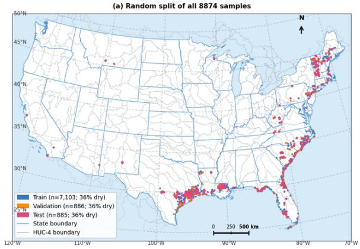

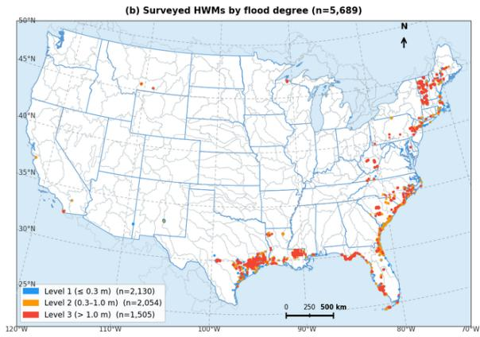

Fig. 1. Spatial distribution of the flooding dataset. (a) Spatial split of dataset: Training 80%, Validation 10%, Testing 10%, total: 8874 (5689 HWM + 3185 rain-free sample); (b) Flood degree distribution.

Flood peak elevation refers to the elevation of the flood peak trajectory, while flood height above ground represents the flood depth, that is, the diference between flood peak elevation and local ground elevation. In this study, flood depth was classified into three severity levels (0–0.3 m, 0.3–1.0 m, and ${ \mathrm { > } } 1 . 0 ~ \mathrm { m } )$ based on hazard thresholds widely adopted in the literature. Depths below 0.3 m are generally considered safe for vehicles, pedestrians, and buildings , and 0.3 m represents an established initial damage threshold (Huizinga et al., 2017; Phakonkham et al., 2021). Depths approaching 1.0 m mark the transition from low-impact nuisance flooding to damaging and potentially life-threatening inundation, at which point most furniture is submerged and electrical installations are heavily damaged (Aryal et al., 2020; Huizinga et al., 2017; Phakonkham et al., 2021; Smith et al., 2014). Depths above 2.0 m correspond to an extreme flood hazard threshold, beyond which flooding exerts severe impacts on buildings, infrastructure, agriculture, and human safety (Aryal et al., 2020; Huizinga et al., 2017; Komi et al., 2016; Phakonkham et al., 2021; Smith et al., 2014). Depths above 2.0 m were nevertheless merged into the highest class: they account for only 4.7% of surveyed HWMs (269 samples) and could not be learned reliably as a separate class in a four-class pilot, whereas the >1.0 m class retains the operational meaning of vehicles floating and ground-floor inundation. Based on the two remaining thresholds, flood degree is divided into three levels according to flood depth, as summarized in Table 1.

Table 1. Flood severity levels used by the auxiliary classification task
<table><tr><td>Flood degree</td><td>Level 1</td><td>Level 2</td><td>Level 3</td></tr><tr><td>Depth d</td><td> $d \leq 0 . 3 \mathrm { ~ m ~ }$ </td><td> $0 . 3 ~ \mathrm { m } < d \leq 1 . 0$  m</td><td> $d > 1 . 0 \mathrm { ~ m ~ }$ </td></tr></table>

Fig. 2 shows the distribution of flood peak elevation, flood height above ground, and flood degree. Flood peak elevation reflects regional topographic variation, ranging from 0.2 m to about 2,300 m $( \log _ { 1 0 } ( \mathrm { E } )$ of −0.7 to 3.4), with 87% of surveyed HWMs between 1 m and 316 m $( \log _ { 1 0 } ( \mathrm { E } )$ of 0 to 2.5) and a long right tail reflecting site-level topographic variation. Flood height above ground is more narrowly distributed: among the 4220 HWMs with a non-zero depth, 97% fall between 0.1 and 10 m $( \log _ { 1 0 } ( \mathrm { H } )$ of −1 to 1), with a median of 0.75 m and a mode just below 1 m, indicating that most flood peaks reach moderate inundation depths. Including the rain-free samples, Level 1 $( \mathrm { { d e p t h } \leq 0 . 3 ~ m } )$ accounts for 59.9% of samples, Level 2 for 23.1% and Level $3 \ : ( \mathrm { d e p t h } > 1 . 0 \ : \mathrm { m } )$ for 17.0%; among surveyed HWMs alone the shares are 37.4%, 36.1% and 26.5%, and 25.8% of HWMs (1465) record a depth of 0 m, i.e. the mark was found at ground level and the site is treated as not inundated (Level 1).

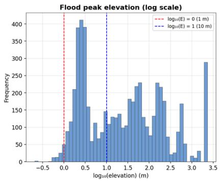

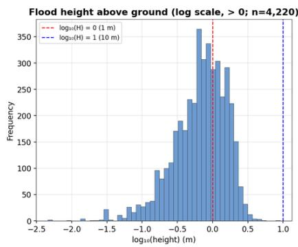

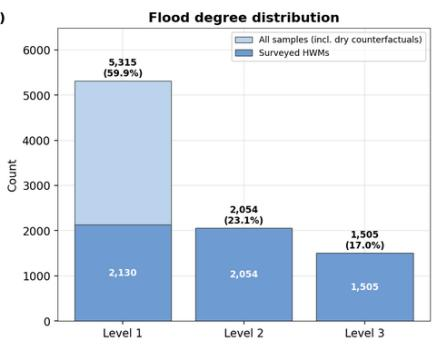  
Fig. 2. The statistical distribution of flood peak elevation, flood height above ground, and flood degree. Flood conditions are governed by both static geographic factors and dynamic hydrometeorological processes. To characterize the static geographic context, we incorporated Digital Elevation

Model (DEM) data. To represent dynamic hydrometeorological forcing, we extracted 20 meteorological variables (as shown in Table A1 in Appendix A) covering the period prior to the flood peak. Terrain captures the spatial heterogeneity of flood impact within a given event, while meteorological variables reflect the influence of varying atmospheric conditions on flood depth at a specific location. To further enrich the spatial and temporal context available for flood peak prediction, we additionally incorporate site-level embeddings from the AlphaEarth (AE) foundation model (Brown et al., 2025)as auxiliary spatial features.

AlphaEarth (AE) is a geospatial foundation model that fuses multi-modal Earth observation data, including optical imagery, SAR remote sensing, digital elevation, and climate signals, into compact, globally consistent vector representations. Each embedding encodes rich surface character istics for a discrete geographic grid cell, capturing information that extends beyond what individual spectral bands or topographic variables can provide in isolation. These embeddings ofer several key advantages for flood peak prediction. First, they encode static environmental and land-surface attributes, including terrain morphology, land cover structure, and water body distribution, which are fundamental determinants of potential inundation extent and maximum flood depth. Second, because the embeddings are produced annually from full-year image time series, they summarise the seasonal behaviour of the surface, such as vegetation phenology and typical surface wetness, which modulates runof generation and inundation. By integrating AE embeddings with time-series meteorological and topographical inputs, the model benefits from complementary spatial context and dynamic cross-modal linkages, improving the characterization of catchment conditions and enhancing flood peak prediction under extreme rainfall forcing.

For each sample, we extracted a GLO‑30 DEM tile centered on its geographic coordinates, with a spatial extent of 255 × 255 pixels at a 30‑m resolution. Meteorological variables were obtained from the Open‑Meteo API, from which we downloaded 20 core atmospheric attributes; detailed descriptions are provided in the Appendix A. Temporal context enters the model through the window position (each of the six 24-h windows has its own linear embedding, and Tier 3 includes a normalized lookback position; Section 3.2) and through the lead-time mask; the sample-level attributes time, latitude, longitude and hours before the peak are not model inputs, and geographic coordinates are used only to centre the spatial patches. Furthermore, AE satellite embeddings with a spatial extent of 255 × 255 pixels at a 10 m resolution were also retrieved, centered on the same sample coordinates.

Both spatial inputs are EO products. GLO-30 is the 30-m Copernicus DEM derived from TanDEM-X X-band interferometric SAR acquired between 2011 and 2015; it is a digital surface model, so building and canopy heights are retained, and its global RMSE is approximately 4 m (Simard et al., 2024). AlphaEarth embeddings are 64-dimensional vectors at 10-m resolution produced annually by the AlphaEarth Foundations model from optical (Sentinel-2, Landsat), radar (Sentinel-1, ALOS PALSAR-2), lidar (GEDI), elevation and climate inputs (Brown et al., 2025). Because GLO-30 is itself one of the AlphaEarth inputs, the two modalities are partly redundant; Section 4.2 quantifies the contribution of each. The DEM patch (255 × 255 pixels, ≈ 7.65 km) and the embedding patch (255 × 255 pixels, ≈ 2.55 km) are centred on the same HWM but cover diferent footprints, so the DEM branch sees catchment-scale relief while the embedding branch focuses on the local land surface. AlphaEarth embeddings are produced annually and are available from 2017 onward. No sample uses the embedding of its own flood year: each HWM is paired with the embedding of the year preceding its flood peak where one exists, and otherwise with the first year after the event (2017 for the events of 2011–2016, 2018 for the 2017 events). Rain-free samples use the embedding of their parent HWM. Test skill is not higher for samples with post-event embeddings than for samples with pre-event embeddings (macro-F1 0.613 versus 0.687 over all test samples, and 0.526 versus 0.635 over surveyed HWMs), so we find no indication that post-event

embeddings leak flood signatures, although the two groups also difer in the events they contain.   
Table 2 summarizes all inputs.

Table 2. Inputs of the benchmark, their sources and their role in TCM-Former.
<table><tr><td>Input</td><td>Product and source</td><td>Spatial resolution and footprint</td><td>Temporal coverage</td><td>Role</td></tr><tr><td colspan="3">Labels and reference data</td><td></td><td></td></tr><tr><td>High-water marks</td><td>USGS Short-Term Network (STN) Flood Event Viewer surveys</td><td>Point</td><td>39 events, 2011-2025</td><td>Labels: peak elevation and depth; sample locations</td></tr><tr><td>Peak timing</td><td>USGS peak summaries, water-level sensors and rapid-deployment gauges within 10 km of the</td><td>Point</td><td>Per event</td><td>Assigns the flood peak time (t = 0)</td></tr><tr><td>Ground elevation at the HWM</td><td>HWM USGS 3DEP lidar-based elevation</td><td>Point</td><td>Static</td><td>Anchor of the residual elevation</td></tr><tr><td>Rain-free windows</td><td>NOAA Analysis of Record for Calibration (AORC) hourly</td><td>Gridded, nearest cell</td><td>± 8-60 days around the peak</td><td>target (Section 3.3) Selects the rain-free windows</td></tr><tr><td>Model inputs</td><td>precipitation</td><td></td><td></td><td></td></tr><tr><td>Terrain</td><td>Copernicus GLO-30 DEM (TanDEM-X, 2011–2015 acquisitions)</td><td>30 m; 255 × 255 pixels (≈ 7.65 km)</td><td>Static</td><td>DEM branch</td></tr><tr><td>Land-surface embeddings</td><td>AlphaEarth Foundations, 64 bands (Google Earth Engine)</td><td>10 m; 255 × 255 pixels (≈ 2.55 km)</td><td>Annual; year preceding the event where available (see</td><td>AE branch</td></tr><tr><td>Meteorological forcing</td><td>Open-Meteo historical weather API (reanalysis-based), 20 hourly variables (Table A1)</td><td>Reanalysis grid cell nearest the site (≈ 9–25 km)</td><td>text) 144 h before the peak, masked to the lead time</td><td>Three-tier hydrometeorological descriptor (58 features per 24-h window)</td></tr></table>

## 3 Method

Accurate flood peak prediction is an inherently complex task, requiring the integration of both static geographic context and dynamic hydrometeorological forcing. As described above, the input data in our dataset comprise DEM, AE embeddings, and time-series meteorological data. To jointly exploit these complementary modalities, we developed the TerraCross-Modal Fusion Transformer (TCM-Former), a multimodal network whose primary output is flood depth and which predicts the flood peak elevation and the flood degree as auxiliary tasks. The model explicitly captures cross-modal interactions: DEM constrains terrain-driven flow pathways, AE embeddings provide complementary land-surface characteristics and spatial context at annual temporal resolution, and time-series meteorological data represent the dynamic hydrometeorological forcings that drive flood evolution.

As shown in Fig. 3, meteorological, DEM, and AlphaEarth (AE) inputs are processed by three separate feature extractors. The AE features do not explicitly represent local terrain. We therefore use cross-attention to integrate terrain information from the GLO30 DEM. The AE tokens serve as queries (Q), while the DEM tokens provide the keys (K) and values (V). The DEMenhanced AE embedding is then concatenated with the DEM branch features and the meteorological features. The concatenated features are fused by a multilayer perceptron (MLP) and passed to three prediction heads. The primary head predicts the flood-peak height above ground (flood depth); two auxiliary heads predict the flood-peak elevation residual and three-class flood-peak degree logits. The final flood-peak elevation is obtained by adding the predicted residual to the local DEM elevation. The severity class is determined by the maximum class logit.

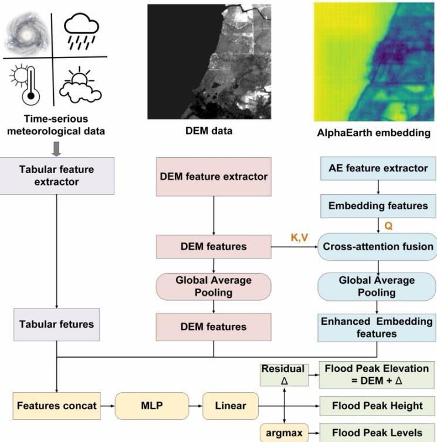  
Fig. 3. Multimodal flood prediction architecture.

## 3.1 Feature extraction and processing of DEM and AE embeddings

ViT-CoMer captures high-level, globally contextualized representations through self-attention and convolution-enhanced multi-scale feature interaction (Dosovitskiy et al., 2020)yielding semantically rich and spatially coherent abstractions. In contrast, Convolutional Neural Networks (CNNs), including DenseNet, emphasize local continuity, fine-grained spatial detail, and feature reuse through densely connected convolutional layers (Huang et al., 2017), producing representations that preserve high-resolution structural and texture-level information.

As illustrated in Fig. 4 and Fig. 5, the two spatial modalities, DEM and AE, are processed by parallel CNN and ViT-CoMer (Xia et al., 2024) branches. The CNN branch is used to extract local spatial features. For DEM, DenseNet (Huang et al., 2017) is used to capture local topographic patterns. For AE, a lightweight CNN is used to refine local spatial patterns in the pretrained embeddings. In parallel, ViT-CoMer is used to extract multi-scale contextual features. The features from the CNN and ViT-CoMer branches are then fused through cross-attention.

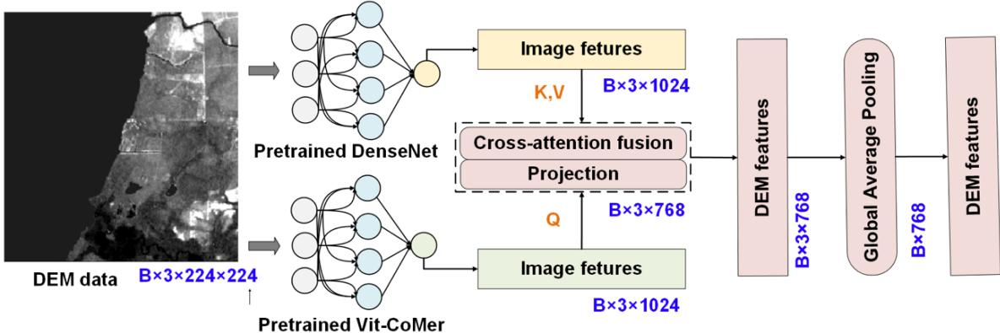

Fig. 4. Feature extraction of DEM data  
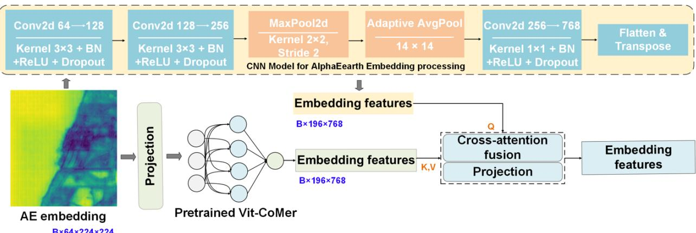  
Fig. 5. Feature extraction of AlphaEarth (AE) Embedding data

## 3.2 Feature extraction methods for time-series meteorological data

To extract informative representations from time-series meteorological data, we adopt a handcrafted three-tier hydrometeorological descriptor (a set of physically defined features) to represent the time-series meteorological data. It integrates physics-motivated domain features (Tier 1), intrawindow dynamics and coupling statistics (Tier 2), and cross-window antecedent condition descriptors (Tier 3), giving 58 features per 24-h window that characterize the forcing from within-window structure to multi-day hydrometeorological evolution. The features were compiled from established hydrometeorological indicators, such as rainfall intensity statistics, reference evapotranspiration and the antecedent precipitation index; each has an explicit physical definition and is computed analytically without model inference, so that the drivers of a prediction can be traced to hydrom eteorological processes. Two learned temporal encoders, described at the end of this section, were evaluated as alternatives.

As shown in Fig. 6, for each HWM sample, the raw meteorological records were first organized into a fixed 144-hour pre-peak sequence spanning 1–144 h before the assigned flood peak time. To simulate diferent forecast lead times, we applied lead-time-specific exclusion before feature extraction. Specifically, for an L-hour lead time, all meteorological records within 1–L h before the flood peak were removed before computing the three-tier meteorological features, and empty nearpeak windows were subsequently represented by zero-filled feature vectors. This procedure ensures that Tier-1, Tier-2, and Tier-3 features do not contain observed meteorological information from within the forecast horizon, thereby preventing target leakage. In particular, the Tier-3 cumulative

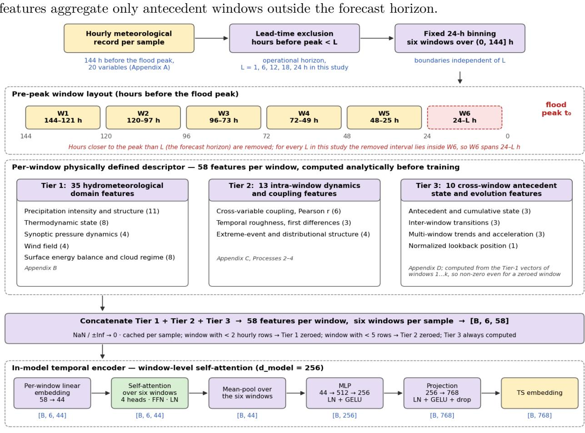  
Variables used (20): temperature\_2m, relative\_humidity\_2m, dewpoint\_2m, apparent\_temperature, precipitation, rain, snowfall, weather\_code, pressure msl, surface pressure, cloud cover, cloud cover low, cloud cover mid, cloud cover high, et0 fao evapotranspiration, vapour pressure deficit, wind speed 10m, wind speed 100m, wind direction 10m, wind gusts 10m.

Fig. 6. Feature extraction from meteorological time-series data. Meteorological records are divided into six 24-h windows and processed using three tiers of feature extraction. The extracted features are concatenated to form a 58-dimensional meteorological descriptor per window. Invalid values (NaN or ±Inf) and features from windows with insuficient observations are set to zero.

## Tier 1: Physics-based hydrometeorological domain features

Tier 1 extracts 35 physically interpretable features directly from raw meteorological observations within each 24-hour window, organized into five thematic groups: (1) precipitation intensity and structure (11 features), characterizing the magnitude, variability, and temporal organization of rainfall, including accumulated total, peak hourly rate, wet-hour count, and peak 3-hour rolling accumulation; (2) thermodynamic state (8 features), covering temperature, humidity, and vapour pressure deficit, which govern evapotranspiration demand, snowmelt potential, and near-surface atmospheric stability; (3) synoptic pressure dynamics (4 features), describing mean sea-level pressure and its trend, providing direct indicators of cyclonic development and synoptic-scale forcing; (4) wind field (4 features), capturing mean and maximum wind speed and their temporal trend, which mediate moisture transport; and (5) surface energy balance and cloud regime (8 features), including reference evapotranspiration $\mathrm { E T _ { 0 } } ,$ net water input $\mathrm { ( P \mathrm { ~ - ~ } E T _ { 0 } ) }$ , cloud cover, and WMO weather code, collectively characterizing the surface moisture state and radiation environment prior to flood onset.

These features are derived from the 20 meteorological variables in Appendix A. All Tier 1 features are computed analytically without model inference, as are the Tier 2 and Tier 3 features.

Detailed definitions of all 35 features are provided in Appendix B.

## Tier 2: Intra-window meteorological dynamics and coupling features

Tier 2 extracts 13 intra-window dynamic features from the time-series meteorological data through three complementary processes (Processes 2–4 in Appendix C; Process 1, based on the TabPFN-TS forecaster, is not part of the descriptor and is evaluated separately as a learned encoder). Process 2 encodes multivariate atmospheric coupling via Pearson correlations between six physically motivated variable pairs, characterizing whether the prevailing regime reflects organized frontal or cyclonic forcing versus isolated convection. Process 3 quantifies temporal roughness via standard deviation of first diferences, distinguishes steady stratiform rainfall from intermittent convective bursts. Process 4 characterizes extreme precipitation structure through wet streak (precipitation $> 0 . 1$ mm $\mathrm { h } ^ { - 1 } )$ ), Gini coeficient, and heavy-rain hour count (precipitation exceeding 10 mm $\mathrm { h } ^ { - 1 } )$ , which are directly relevant to soil saturation and urban drainage capacity thresholds. Full feature definitions and index mapping are provided in Appendix C.

## Tier 3: Cross-window antecedent condition and temporal evolution features

Tier 3 encodes temporal memory and multi-day hydrometeorological evolution through 10 crosswindow features, aggregated across all windows up to and including the current one. This tier is physically motivated by the well-established role of antecedent soil moisture and cumulative precipitation loading in flood generation. The 10 features span four aspects: (1) antecedent cumulative state, including accumulated precipitation, an Antecedent Precipitation Index $( \mathrm { A P I } , \ \kappa = 0 . 8 5 )$ capturing soil moisture memory with exponential decay, and net water surplus $\mathrm { ( P \mathrm { ~ - ~ } E T _ { 0 } ) }$ ; (2) inter-window transition dynamics, including window-to-window diferences in precipitation, MSLP trend, and relative humidity; (3) multi-window secular trends, including least-squares slopes of precipitation totals and MSLP; and (4) precipitation acceleration and a normalized temporal position index, enabling the model to weigh identical meteorological conditions diferently depending on their proximity to the flood event. Full mathematical definitions are provided in Appendix D.

## Learned temporal encoders evaluated for comparison

To test whether learned representations of the forcing carry information that the three-tier descriptor misses, we replaced the descriptor with two learned temporal encoders, keeping the spatial branches, fusion module, prediction heads, training protocol and lead-time masking unchanged. (1) TabPFN-TS: the pretrained TabPFN-TS forecaster (Hoo et al., 2025), which recasts forecasting as tabular regression with ${ \mathrm { T a b P F N - v 2 } } .$ , forecasts, in univariate mode, the next 6 h of each of the 20 hourly variables (Table A1) from its series within each 24-h window; the point forecasts 1, 3 and 6 h ahead and the 10% and 90% quantiles 1 and 6 h ahead are retained, giving 140 model-derived features per window, standardized with training-set statistics, in place of the 58 descriptors. (2) LSTM: a two-layer LSTM (Hochreiter and Schmidhuber, 1997) with 128 hidden units reads the standardized hourly series of all 20 variables over the 144-h record, with precipitation, rain and snowfall log-transformed and a flag marking the hours removed by the lead-time mask, and its final hidden state replaces the descriptor.

## 3.3 Cross-modal fusion and multi-task heads

For cross-modality feature fusion, after modality-specific CNN–ViT-CoMer encoding, the enhanced DEM and AE representations are further fused through cross-attention. This final spatial fusion stage integrates terrain-based flow constraints from DEM with land-surface semantic context from AE embeddings. Given that AE aggregates multi-source satellite image features over an annual temporal span, it is necessary to incorporate DEM-based terrain information in a spatially aligned manner, producing DEM-enhanced AE representations. DEM features, enhanced AE embedding features, and tabular meteorological features are then concatenated and fused through an MLPbased fusion mechanism. The fused representation is subsequently fed into task-specific prediction heads: the flood height above ground (depth) head, which gives the primary output, and two auxiliary heads for the residual flood peak elevation and the three-class flood degree.

Because flood peak elevation is strongly correlated with local ground elevation, we adopt a topographic prior residual learning strategy (DEM-anchored elevation regression). Rather than predicting absolute flood peak elevation directly, the model learns the residual between the true flood peak elevation and the ground elevation at the HWM, thereby exploiting the terrain prior while allowing the network to compensate for terrain bias. The anchor is the USGS 3DEP lidarbased ground elevation at the HWM location (Table 2), a point value that is more accurate than the GLO-30 surface model; the GLO-30 patch enters the model only through the DEM branch. The predicted flood peak elevation is then recovered by adding the predicted residual to the same 3DEP ground elevation. Residual labels are clipped to [−5, 10] m before the variance-stabilizing transform so that a few survey outliers do not dominate the fitted transform. The training objective comprises the flood height above ground (depth) loss of the primary task (Lh) and two auxiliary sub-losses, the flood peak elevation residual loss $\left( \mathrm { L } _ { r } \right)$ and the flood degree classification loss (L�). The residual label is computed according to Equation 1.

$$
\Delta _ { l a b e l } = F E _ { l a b e l } - D E M \ ( 1 )
$$

where $\Delta ^ { l a b e l }$ represents the flood peak elevation residual, $F E ^ { l a b e l }$ represents the flood peak elevation label, and ��� represents the 3DEP ground elevation at the HWM.

All models reported below use the residual formulation.

The overall training loss is a weighted combination of the three sub-losses, with equal weights assigned to each task. All regression targets are variance-stabilized and then standardized to zero mean and unit variance using training-set statistics only, so that the sub-losses are dimensionless and of comparable magnitude. And equal weights express equal relative emphasis. Mean squared error (MSE) is used as the loss function for both regression tasks (flood peak elevation residual and flood height above ground). Cross-entropy loss with inverse-frequency (balanced) class weights and label smoothing of 0.1 is used for flood degree classification. Depth accuracy, the primary measure, is evaluated with the mean absolute error (MAE) and root mean squared error (RMSE); the same metrics are used for the auxiliary residual elevation, and micro-F1 (MIF1) and macro-F1 (MAF1) scores for the auxiliary classification.

After training, the model achieving optimal performance on the validation set is selected as the final model for subsequent testing. The composite metric used for model selection across the three tasks is defined by Equation 2. For the flood-degree classification task, the MAF1 is adopted as the task metric: it is the unweighted mean of the per-class F1 scores, so that a model is rewarded only if it classifies the rare degrees as reliably as the common ones. Model selection is therefore driven by balanced performance across all three degrees rather than by the majority classes alone.

$$
M e t r i c = L v + W _ { E r } \times R M S E _ { E r } + W _ { H } \times R M S E _ { H } - W _ { D } \times M A F 1 _ { D } \ ( 2 )
$$

Where �� is the validation loss, $R M S E _ { E r }$ is the RMSE for residual based elevation, $R M S E _ { H }$ is the RMSE for flood height above ground, and $M A F _ { D }$ is the macro f1 score for flood degree classification, and $W _ { E r } , W _ { H } ,$ , and $W _ { D }$ are the corresponding task weights.

## 3.4 Evaluation protocol

All experiments were conducted on a single NVIDIA A100 or H100 GPU (80 GB) with CUDA acceleration. The implementation was developed in Python using PyTorch. Training ran for up to 100 epochs with early stopping enabled; the batch size was 16 for both training and evaluation. Gradient accumulation over 4 steps yielded an efective batch size of 64. The base learning rate was set to $5 \times 1 0 ^ { - 5 }$ , with a cosine-annealing schedule and 500 warm-up steps. A hierarchical learning rate strategy was applied, in which the classifier learning rate was set to $2 \times 1 0 ^ { - 4 }$ , four times the backbone learning rate. Optimization employed AdamW with weight decay $0 . 1 , \varepsilon = 1 \times 1 0 ^ { - 8 }$ , and a maximum gradient norm of 1.0 for clipping. The model was evaluated on the validation set every 25 optimizer steps; early stopping used a patience of 15 epochs, and the optimal checkpoint was selected according to the composite metric defined in Equation 2, with the five best checkpoints retained. The three task weights in Equation 2 were set to 0.1, 0.1 and 3, respectively, to account for the difering magnitudes of the individual indexes. All results are reported on the 885-sample test set (567 surveyed HWMs and 318 rain-free samples) as the mean over three random seeds (42, 1337 and 2024).

All metrics are reported as the mean over the three seeds; seed-to-seed standard deviations are given in the table captions. For the 6-h model, 95% confidence intervals from 2000 bootstrap resamples of the 885 test samples are 0.233–0.280 m for the depth MAE, 0.424–0.510 m for the depth RMSE, 0.702–0.753 for micro-F1 and 0.612–0.674 for macro-F1. The 318 rain-free samples have a depth of 0 m and are predicted almost exactly (depth MAE 0.015 m), so the all-sample depth error understates the error at flooded sites; where relevant we therefore also report the depth error over the 567 surveyed HWMs. Diferences between configurations are tested with Welch's t-test over seeds where stated. To anchor the metrics, Table 7 also lists two naive reference predictors evaluated on the same test set: a majority-class classifier combined with a constant depth (the training median, 0 m), and a class-prior random classifier combined with the training mean depth (0.43 m).

## 4 Experimental results

## 4.1 Prediction skill across forecast lead times

In this section, we evaluate flood depth prediction, together with the two auxiliary tasks, with the three-tier hydrometeorological descriptor across four forecast lead times (6, 12, 18 and 24 hours). Lead times shorter than 6 h are not considered. Flood peak times are taken from the nearest water-level sensor within 10 km of the mark, and flood peaks are not synchronous in space: a flow wave needs time to propagate along a river (Allen et al., 2018), and in small urban catchments the local response to intense rainfall is far faster than that of the river network (Yang et al., 2016), so a mark may reach its local maximum before or after the sensor that supplies its peak time. The size of this ofset is not quantified here, and the shortest lead time we evaluate is therefore 6 h. All meteorological inputs end L hours before the flood peak, so the prediction uses no information that would be unavailable at that time. The peak time itself is taken as given, as it would be in operation from a stage or discharge forecast. The lead time is therefore the interval between the last observation used and the peak, and the experiment measures the skill of forecasting peak depth conditional on the timing of the peak.

Performance is assessed primarily on flood height above ground (depth, H) with the MAE and RMSE, and secondarily on the two auxiliary tasks, residual flood peak elevation (Er; MAE and RMSE) and flood degree classification (micro-F1, MIF1; macro-F1, MAF1). Detailed results are reported in Table 3 and Fig. 7.

Fig. 7 summarizes the three tasks across lead times. Flood depth, the primary output, is predicted with an MAE of 0.257 m and an RMSE of 0.468 m at the 6-h lead time. The depth error changes little with the horizon: from 6 h to 24 h it increases by 0.014 m in MAE and 0.021 m in RMSE, and none of the longer lead times difers significantly from 6 h (Welch's t-test over three seeds, $\mathrm { p } = 0 . 0 8 \substack { - 0 . 1 8 } )$ . We therefore use the 6-h lead time, the shortest horizon that excludes the near-peak sensor lag, as the reference configuration in the following sections. Over the 567 surveyed

Table 3. Flood depth (primary task) and auxiliary-task skill of TCM-Former at diferent lead times with the three-tier hydrometeorological descriptor, and with the two learned temporal encoders at the 6-h lead time (mean over three seeds; s.d. $\leq 0 . 0 4$ m for errors and $\leq 0 . 0 1 8$ for F1 scores). H: flood depth (height above ground); Er: residual flood peak elevation; MIF1 and MAF1: micro- and macro-F1 of flood degree classification.
<table><tr><td rowspan="2">Extractor</td><td rowspan="2">Lead time</td><td colspan="2">Depth H (m)</td><td colspan="2">Residual  $E _ { r }$  (m)</td><td colspan="2">Severity level</td></tr><tr><td>MAE</td><td>RMSE</td><td>MAE</td><td>RMSE</td><td>MIF1</td><td>MAF1</td></tr><tr><td rowspan="4">Three-tier descriptor</td><td>6 h</td><td>0.257</td><td>0.468</td><td>0.530</td><td>0.818</td><td>0.727</td><td>0.642</td></tr><tr><td>12 h</td><td>0.280</td><td>0.486</td><td>0.528</td><td>0.805</td><td>0.718</td><td>0.643</td></tr><tr><td>18 h</td><td>0.273</td><td>0.487</td><td>0.536</td><td>0.820</td><td>0.709</td><td>0.624</td></tr><tr><td>24 h</td><td>0.271</td><td>0.489</td><td>0.543</td><td>0.816</td><td>0.717</td><td>0.639</td></tr><tr><td>TabPFN-TS</td><td>6 h</td><td>0.258</td><td>0.457</td><td>0.541</td><td>0.812</td><td>0.728</td><td>0.647</td></tr><tr><td>LSTM encoder (LSTM+CNN-ViT)</td><td>6 h</td><td>0.267</td><td>0.461</td><td>0.545</td><td>0.814</td><td>0.722</td><td>0.653</td></tr></table>

HWMs alone, where the rain-free samples no longer dilute the error, the depth MAE is 0.392 m at 6 h and 0.406–0.422 m at 12–24 h. The errors shrink towards the mean of the training depths: at 6 h the model overestimates marks shallower than 0.3 m (bias +0.19 m for marks at ground level and +0.22 m for 0–0.3 m), is nearly unbiased between 0.3 and 1.0 m (−0.05 m), and underestimates deeper flooding (−0.51 m for 1–2 m and −1.48 m for the 27 marks deeper than 2 m), so the largest absolute errors occur at the deepest sites.

The auxiliary tasks are similarly insensitive to the lead time. The residual peak-elevation error stays within 0.528–0.543 m (MAE-Er), because the residual between peak and ground elevation is governed mainly by terrain rather than by the forcing, and severity classification varies within the seed-to-seed spread (macro-F1 0.624–0.643, micro-F1 0.709–0.727).

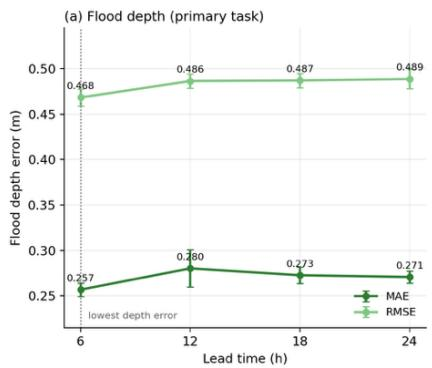

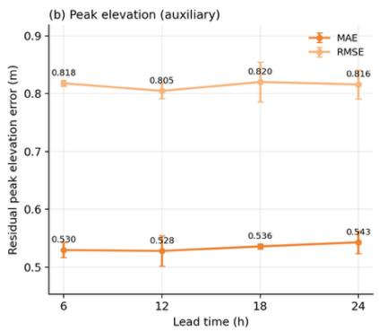

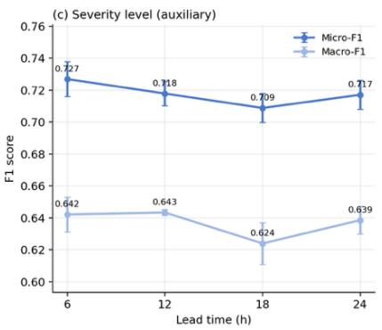  
Fig. 7. Prediction skill across lead times (885 test samples; mean $\pm \mathrm { \ s . d . }$ . over three seeds). (a) Flood depth (primary task), MAE and RMSE; the 6-h lead time gives the lowest depth error. (b) Residual flood peak elevation (auxiliary task), MAE and RMSE. (c) Flood degree classification (auxiliary task), micro-F1 and macro-F1.

Table 3 also lists two learned temporal encoders, TabPFN-TS and an LSTM, which replace the three-tier descriptor while the rest of the model is unchanged (Section 3.2). Neither changes the depth error significantly (depth MAE 0.258 and 0.267 m versus 0.257 m), and the choice of the descriptor is discussed in Section 5.3.

## 4.2 Contribution of Earth observation modalities

Modality contributions are quantified with the three-tier hydrometeorological descriptor at the 6-h lead time, the horizon with the lowest depth error in Table 3, and averaged over three seeds. Table

4 presents the depth error and the auxiliary-task skill for all seven modality combinations.

Table 4. Flood depth (primary task) and auxiliary-task skill for diferent modality combinations. MAE-H and RMSE-H: MAE and RMSE of flood depth (height above ground); MAE-Er and RMSE-Er: MAE and RMSE of the residual flood peak elevation; MIF1 and MAF1: micro- and macro-F1 of flood degree classification. 6-h lead time; mean over three seeds; errors in m.
<table><tr><td rowspan="2">Modalities</td><td colspan="2">Depth H (m)</td><td colspan="2">Residual  $E _ { r } \ \mathrm { ( m ) }$ </td><td colspan="2">Severity level</td></tr><tr><td>MAE</td><td>RMSE</td><td>MAE</td><td>RMSE</td><td>MIF1</td><td>MAF1</td></tr><tr><td>DEM, Meteo, AE</td><td>0.257</td><td>0.468</td><td>0.530</td><td>0.818</td><td>0.727</td><td>0.642</td></tr><tr><td>DEM</td><td>0.431</td><td>0.643</td><td>0.828</td><td>1.136</td><td>0.429</td><td>0.378</td></tr><tr><td>AE</td><td>0.410</td><td>0.625</td><td>0.801</td><td>1.174</td><td>0.474</td><td>0.426</td></tr><tr><td>Meteo</td><td>0.310</td><td>0.538</td><td>0.727</td><td>1.148</td><td>0.629</td><td>0.559</td></tr><tr><td>DEM, Meteo</td><td>0.269</td><td>0.485</td><td>0.550</td><td>0.848</td><td>0.724</td><td>0.644</td></tr><tr><td>AE, Meteo</td><td>0.270</td><td>0.483</td><td>0.677</td><td>0.997</td><td>0.721</td><td>0.654</td></tr><tr><td>DEM, AE</td><td>0.423</td><td>0.629</td><td>0.811</td><td>1.116</td><td>0.507</td><td>0.397</td></tr></table>

Fig. 8 compares the depth error of the seven combinations, separately for the surveyed HWMs and the rain-free samples. Meteorology separates two groups. Every combination that contains it predicts the rain-free samples almost exactly (depth MAE 0.012–0.022 m), whereas combinations without it assign 0.20–0.25 m of water to the same sites on dry days, because a flooded HWM and its rain-free sample share identical terrain and embeddings and difer only in their forcing. Over all 885 test samples, the full model reaches a depth MAE of 0.257 m. Removing the meteorological forcing raises it to 0.423 m (+65%; Welch's t-test $\mathrm { { p } < 0 . 0 0 1 ) }$ , removing both the DEM and the embeddings raises it to 0.310 m (+21%; $\mathrm { ~ p ~ = ~ 0 . 0 3 3 ) }$ , and removing only the DEM or only the embeddings raises it to 0.270 or 0.269 m $( + 5 \% ; \mathrm { p } = 0 . 3 5$ and 0.10). Expressed as Shapley values, the three inputs reduce the depth MAE from 0.416 m for a constant zero-depth prediction to 0.257 m, of which meteorology contributes 0.141 m (88%), the embeddings 0.014 m (9%) and the DEM 0.004 m (3%). The spatial inputs act where flooding occurs: they leave the rain-free samples unchanged, whereas at the 567 surveyed HWMs (including 149 marks with a surveyed depth of zero) removing both raises the depth MAE from 0.392 to 0.478 m (+22%; $\mathrm { p } = 0 . 0 2 5 )$ ; conversely, adding terrain and embeddings to the forcing lowers the depth error at the surveyed marks by 18%. The DEM and the AE embeddings are interchangeable for depth: DEM + Meteorological and AE + Meteorological reach HWM depth MAEs of 0.407 and 0.412 m, neither difers significantly from the full model $\mathrm { ( p = 0 . 0 7 }$ and 0.37), and combining both gives a further, non-significant reduction. Without meteorology, the spatial inputs, singly or together, give HWM depth MAEs of 0.525–0.535 m. The auxiliary tasks follow the same pattern for severity (macro-F1 0.64–0.65 with meteorology, below 0.43 without), but terrain is indispensable for the peak elevation: removing the DEM raises MAE-Er from 0.530 to 0.677 m. In short, the meteorological forcing carries most of the depth skill, including the separation of flooded from rain-free conditions that the paired design makes trivially learnable, and the spatial inputs reduce the depth error at the surveyed marks by about a fifth.

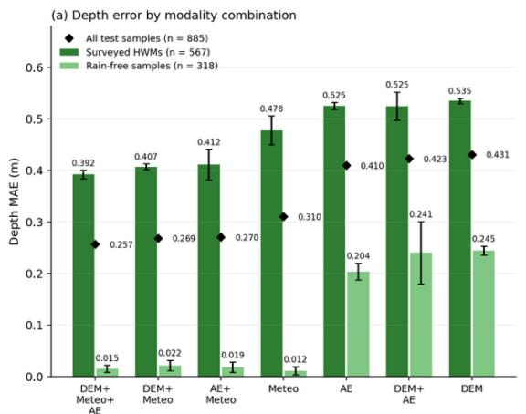

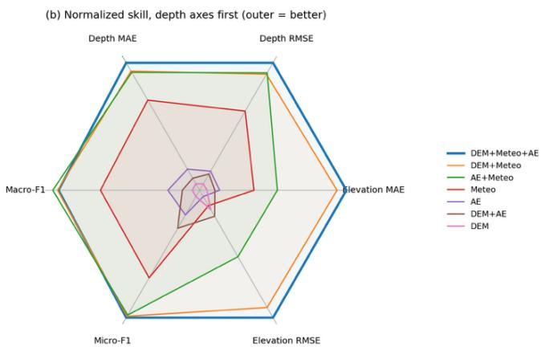  
Fig. 8. Flood depth error and overall skill of the seven modality combinations (6-h lead time; mean ± s.d. over three seeds). (a) Depth MAE on the 567 surveyed HWMs and the 318 rain-free samples (bars) and on all 885 test samples (diamonds). (b) Normalized scores of the six metrics, depth axes first; outer values are better.

To better understand the contribution of each modality, we calculated Shapley values (Lundberg and Lee, 2017; Shapley, 1953) for the depth MAE (MAE-H) and, for the auxiliary tasks, MAE-Er and MAF1, as shown in Fig. 9. The Shapley value of each modality represents its average marginal contribution across all possible modality subsets. For classification, the payof was defined as MAF1, with a majority-class predictor as the no-modality baseline. For regression, the payof was defined as the reduction in MAE relative to a no-modality baseline that predicts a constant (the training median depth and the training mean residual), so that positive Shapley values consistently indicate performance improvement. As shown in Fig. 9a, meteorology has the largest Shapley value for depth (a depth MAE reduction of 0.141 m over all samples), as it has for the auxiliary tasks (0.192 m for MAE-Er and 0.267 for MAF1), reflecting its role in separating flooded from rain-free conditions. The Shapley values of the spatial inputs for depth are small (0.004 m for the DEM and 0.014 m for the embeddings) because the average runs over subsets without meteorology, in which the rain-free samples dominate the depth error; conditional on meteorology, adding the spatial inputs reduces the depth MAE at the surveyed HWMs by 0.086 m (Fig. 8a), which is where their contribution to flood depth lies. For the auxiliary tasks the spatial inputs matter more: AE embeddings contribute more to flood degree classification (0.077 versus 0.048 for the DEM), while the DEM contributes more to the residual flood peak elevation (0.075 m versus 0.025 m).

Restricting the evaluation to the 567 surveyed HWMs (Fig. 9b) leaves meteorology dominant for depth (0.098 m, versus 0.013 m for the DEM and 0.016 m for the embeddings): even among flooded sites, the amount of water delivered by the storm sets most of the depth, and the spatial inputs adjust it locally. For the auxiliary severity task the ranking narrows on these sites (macro-F1 Shapley values of 0.158 for meteorology, 0.126 for the embeddings and 0.106 for the DEM), and meteorology alone is the weakest single input (macro-F1 0.399, versus 0.449 for the DEM and 0.494 for the embeddings), so the EO inputs carry most of the information that separates severity levels among flooded sites.

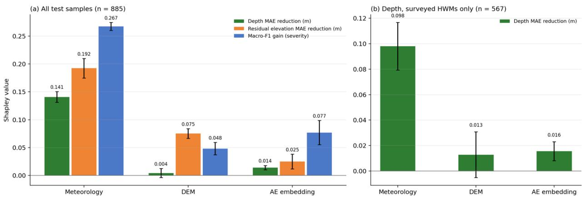  
Fig. 9. Modality Shapley values (6-h lead time; error bars: s.d. over three seeds). (a) All 885 test samples: depth MAE reduction (primary task), and residual elevation MAE reduction and macro-F1 gain (auxiliary tasks), relative to constant or majority-class predictors. (b) Depth MAE reduction over the 567 surveyed HWMs, relative to a constant prediction of the training median HWM depth (0.51 m).

## 4.3 Transferability to unseen events and regions, and baseline comparison

To test the ability of the model to generalize, we evaluated it on unseen flood events and on unseen geographic sub-regions, using the same 8874 samples (5689 HWMs from 39 flood events and 3185 rain-free samples), the three-tier hydrometeorological descriptor and the 6-h lead time. Each rainfree sample is assigned to the same partition as its parent HWM. For the event split, whole events were assigned to the validation and test sets until each held about 10% of the samples; events contributing more than 5% of all samples (e.g., 2017 Harvey) were kept in training, and among 5,000 random event orderings we selected the one whose validation and test sets best matched the 10% target and the overall share of dry samples (35.9%). The resulting test set contains 897 samples (575 HWMs) from 11 events, including 2018 Florence, 2017 Maria and 2024 Helene, and the validation set contains 892 samples from 13 events (Fig. 10).

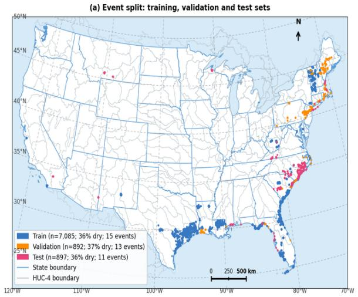

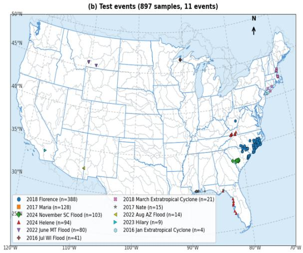  
Fig. 10. Dataset splitting with flood events isolated for each dataset. (a) The distribution of training, validation, and testing dataset; (b) The distribution of diferent flood events on testing dataset. Rain-free samples share the coordinates of their parent HWMs; the 128 test samples of 2017 Maria (Puerto Rico) lie outside the map extent.

Table 5 compares the event split with the random split. Skill decreases for unseen events: the depth MAE rises from 0.257 to 0.386 m (RMSE from 0.468 to 0.648 m), and over the surveyed

HWMs from 0.392 to 0.574 m, with depths underestimated on average (bias −0.32 m). The auxiliary tasks degrade similarly: the residual elevation MAE rises from 0.530 to 0.997 m, and macro-F1 falls from 0.642 to 0.537 (±0.012 over seeds). Fig. 10 shows that many validation and test samples are spatially separated from the training samples and, in some cases, located in diferent HUC-4 regions, so the event split tests new storms at largely new locations. The loss of skill is not confined to the magnitude of the error. Over all 897 test samples the model retains positive skill relative to a constant prediction (skill score 1 − MSE(model)/MSE(constant) of +0.14 against the training mean and +0.43 against the training median), because it still separates flooded from rain-free conditions, although the paired design makes that separation largely learnable from the forcing alone. Among the 575 surveyed marks it does not: the predicted depths occupy a narrow band, with a regression slope of 0.06 against the surveyed depth, a coeficient of determination of 0.03, a within-event correlation of 0.11 and a negative skill score (−0.20 against the training mean, −0.07 against the training median). On the random split the same quantities are a slope of 0.36, a coeficient of determination of 0.29, a within-event correlation of 0.41 and skill scores of +0.23 and +0.26. Neither the magnitude nor the ranking of depth therefore transfers to new storms, whereas within sampled events and regions both are learned. Event-level transfer thus remains far more challenging than random sample-level generalization, in which HWMs from the same event and neighbourhood occur in both training and test sets.

Table 5. Generalization of TCM-Former to unseen flood events (6-h lead time; mean over three seeds; errors in m). The random split is the test set of Table 3 (885 samples); the event split holds out 11 whole events (897 samples).
<table><tr><td rowspan="2">Dataset</td><td colspan="2">Depth H (m)</td><td colspan="2">Residual (m)  $E _ { r }$ </td><td colspan="2">Severity level</td></tr><tr><td>MAE</td><td>RMSE</td><td>MAE</td><td>RMSE</td><td>MIF1</td><td>MAF1</td></tr><tr><td>Random split</td><td>0.257</td><td>0.468</td><td>0.530</td><td>0.818</td><td>0.727</td><td>0.642</td></tr><tr><td>Event split</td><td>0.386</td><td>0.648</td><td>0.997</td><td>1.489</td><td>0.614</td><td>0.537</td></tr></table>

To investigate model transferability to unseen geographic sub-regions at varying spatial separation distances from the training data, we divide each HUC‑4 watershed into spatial cells of increasing fineness. Specifically, we evaluate four variants, 4-intra (2×2 grid), 8-intra (4×2), 16- intra (4×4), and 32-intra (8×4), each producing an increasingly fine-grained spatial partition of the same 8874 samples. In all variants, the grid boundaries are defined by quantiles of the observed sample coordinates within each watershed, so that grid cells adapt to the actual spatial distribution of measurement points rather than fixed geographic coordinates.

Within each spatial cell, a greedy algorithm is applied: cells are iteratively added to the validation set starting from the north-eastern corner of each watershed, and to the test set starting from the south-western corner, until each accumulates approximately 10% of the watershed's samples. All remaining cells are assigned to the training set. Cells containing fewer than three samples are unconditionally assigned to training to prevent degenerate splits. Rain-free samples share the coordinates of their parent HWMs and therefore fall in the same cell. The resulting test sets contain 507 (4-intra), 1127 (8-intra), 1197 (16-intra) and 1077 (32-intra) samples. Fig. 11 shows the spatial distribution of diferent splitting scenarios. This procedure guarantees that training, validation, and testing samples occupy spatially disjoint sub-regions within every HUC‑4 unit, with no geographic overlap across splits.

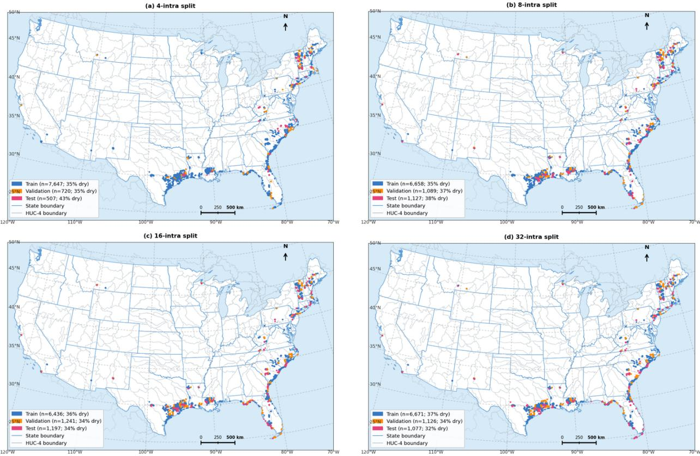  
Fig. 11. Dataset splitting with diferent spatial regions isolated for each dataset. (a) The distribution of training, validation, and testing dataset for 4-intra splitting scenario; (b) for the 8-intra splitting scenario, (c) for the 16-intra splitting scenario; (d) for the 32-intra splitting scenario. Rain-free samples share the coordinates of their parent HWMs; legend shares are the fraction of dry samples in each set.

Table 6 summarizes transferability to spatially disjoint sub-regions. All four partitions reduce skill relative to the random split, to a degree similar to the event split: the depth MAE ranges from 0.356 to 0.374 m (0.497–0.629 m over the surveyed HWMs), and macro-F1 from 0.550 to 0.577. Skill does not improve as the partition becomes finer, although finer partitions place test cells closer to training cells: the depth MAE varies without a trend (0.374, 0.359, 0.361 and 0.356 m from 4-intra to 32-intra), as does macro-F1, and micro-F1 decreases slightly from 0.655 to 0.623. The diferences between partitions (at most 0.018 m in depth MAE and 0.027 in macro-F1) are comparable to the seed-to-seed standard deviation (up to 0.038 in macro-F1), so they more likely reflect which sub-regions fall into each test set than a systematic efect of distance. Residual elevation errors (MAE-Er = 0.775–0.982 m) remain well above those of the random split (0.530 m), consistent with the DEM precision ceiling discussed in Section 5.2: a plausible explanation is that GLO-30 elevation errors are spatially correlated and can be partly learned from neighbouring HWMs in a random split, but not when whole sub-regions are held out. Together with the event split, these results indicate that the model interpolates within sampled events and regions better than it extrapolates to new ones.

We benchmark TCM-Former against two baselines at the 6-h lead time. The first is a Temporal Fusion Transformer (TFT) (Lim et al., 2021), which jointly processes static catchment properties and dynamic meteorological sequences. 146 static indicators (latitude, longitude, ground elevation, and statistics extracted from DEM and AE embeddings such as slope and elevation statistics) are provided as static covariates, while the hourly meteorological time series is processed by an LSTM encoder within the TFT framework; its elevation target is the same standardized residual used by TCM-Former. TCM-Former has a slightly lower depth MAE than TFT, 0.257 versus 0.261 m over all samples and 0.392 versus 0.407 m over the surveyed HWMs (2% and 4% lower), although neither diference is significant (Welch's t-test over three seeds, $\mathrm { p = 0 . 5 1 }$ and 0.16) and the depth RMSE of TFT is lower (0.456 versus 0.468 m; the TFT loss clips negative depths at zero and its predictions are evaluated accordingly). TFT has a 43% larger residual elevation error (MAE-Er 0.759 versus 0.530 m), a comparable macro-F1 (0.632 versus 0.642) and a lower micro-F1 (0.694 versus 0.727), indicating that flat tabular covariates support depth estimation at the surveyed sites but not the terrain-dependent peak elevation. For the primary target, the advantage of the proposed architecture over a strong tabular model given the same EO information is therefore small; its clear advantage lies in the terrain-dependent peak elevation, and the depth skill reported in this paper does not hinge on the choice of network.

Table 6. Generalization of TCM-Former to spatially disjoint sub-regions within HUC-4 watersheds (6-h lead time; mean over three seeds; errors in m).
<table><tr><td rowspan="2">Sampling</td><td colspan="2">Depth H (m)</td><td colspan="2">Residual  $E _ { r } \ \mathrm { ( m ) }$ </td><td colspan="2">Severity level</td></tr><tr><td>MAE</td><td>RMSE</td><td>MAE</td><td>RMSE</td><td>MIF1</td><td>MAF1</td></tr><tr><td>4-intra</td><td>0.374</td><td>0.649</td><td>0.982</td><td>1.423</td><td>0.655</td><td>0.550</td></tr><tr><td>8-intra</td><td>0.359</td><td>0.582</td><td>0.775</td><td>1.090</td><td>0.650</td><td>0.577</td></tr><tr><td>16-intra</td><td>0.361</td><td>0.628</td><td>0.903</td><td>1.273</td><td>0.646</td><td>0.557</td></tr><tr><td>32-intra</td><td>0.356</td><td>0.620</td><td>0.787</td><td>1.128</td><td>0.623</td><td>0.562</td></tr></table>

Table 7. Comparison of TCM-Former and baseline models at the 6-h lead time (random split; mean over three seeds; TFT depth predictions clipped at zero, as in its loss).
<table><tr><td rowspan="2">Methods</td><td rowspan="2">Lead time</td><td colspan="2">Depth H (m)</td><td colspan="2">Residual  $E _ { r }$  (m)</td><td colspan="2">Severity level</td></tr><tr><td>MAE</td><td>RMSE</td><td>MAE</td><td>RMSE</td><td>MIF1</td><td>MAF1</td></tr><tr><td>Ours (TCM-Former)</td><td>6 h</td><td>0.257</td><td>0.468</td><td>0.530</td><td>0.818</td><td>0.727</td><td>0.642</td></tr><tr><td>TFT</td><td>6 h</td><td>0.261</td><td>0.456</td><td>0.759</td><td>1.152</td><td>0.694</td><td>0.632</td></tr><tr><td>LSTM+CNN-ViT</td><td>6 h</td><td>0.267</td><td>0.461</td><td>0.545</td><td>0.814</td><td>0.722</td><td>0.653</td></tr><tr><td>Majority class + constant depth (training median)</td><td></td><td>0.416</td><td>0.744</td><td></td><td></td><td>0.599</td><td>0.250</td></tr><tr><td>Class-prior random classifier + training mean depth</td><td></td><td>0.487</td><td>0.617</td><td></td><td></td><td>0.440</td><td>0.332</td></tr></table>

To isolate the contribution of our spatial feature extraction module, we construct an ablation baseline (LSTM+CNN-ViT) that retains LSTM-based temporal modeling while replacing the flat tabular static inputs with our CNN–ViT cross-attention spatial representations. This substitution raises micro-F1 from 0.694 to 0.722 and reduces MAE-Er from 0.759 to 0.545 m, whereas the depth MAE is unchanged (0.261 versus 0.267 m): the cross-modal spatial encoding mainly benefits the terrain-dependent peak elevation.

Because LSTM+CNN-ViT shares the cross-modal spatial encoder of TCM-Former and difers from it only in the meteorological branch, it is the LSTM variant of TCM-Former evaluated in Section 4.1 (Table 3). Its skill is statistically indistinguishable from that of TCM-Former (Table 7; Welch's t-test over three seeds, $\mathrm { p } > 0 . 1$ for all six metrics), showing that the gains over TFT come from the cross-modal spatial encoding rather than from the meteorological encoder.

The naive predictors in Table 7 put these numbers in context: the two naive predictors reach depth MAEs of 0.416 m (constant training median, 0 m) and 0.487 m (training mean, 0.43 m) and macro-F1 scores of 0.250 and 0.332, against 0.257 m and 0.642 for TCM-Former.

## 4.4 Event-scale depth maps from point predictions

The post-event depth grids described in the Introduction are produced by interpolating a water surface through the surveyed marks and subtracting a lidar DEM (Watson et al., 2018). We ask whether the water surface predicted before the peak, passed through the same procedure, yields a map equivalent to the one built afterwards from the surveyed marks.

We applied the procedure to our point predictions for the held-out event, 2018 Florence, on the Lumber River at Lumberton, where the river left its floodplain and flooded the town: 28 HWMs of the event-split test set lie in the reach, 15 of them in built-up areas (impervious cover of at least 20% within 500 m), 0.7–2 km from the channel. Map A uses the surveyed peak elevation at each HWM; map B uses the predicted water surface, i.e. the 3DEP ground elevation at the mark plus the depth predicted 6 h before the peak by the event-split model (mean of three seeds). Both point sets are interpolated with a linear TIN inside the convex hull of the marks, the 3DEP 10 m bare-earth DEM (NAVD88) is subtracted, and cells with positive depth are kept when connected to a component that contains a mark. A and B therefore difer only in whether the water surface at the marks is surveyed or predicted; because the marks are known only after the event, this is a controlled comparison rather than a forecast product. As an external reference we use the NC OneMap Hurricane Florence flood extent (Schafer-Smith et al., 2020), a 20 m binary map of inland flooding obtained by random-forest classification of pre- and post-storm Sentinel-1 radar imagery with topographic, floodplain and land-cover predictors; it was trained on USGS and NCDEM highwater marks and on NOAA aerial photographs and reaches 92% accuracy on a withheld sample according to its documentation. The reference is therefore not independent of the marks, carries no depth, and inherits the weakness of radar water detection under tree canopy and between buildings, so we treat it as a reference rather than as ground truth.

Fig. 12 shows the result. The predicted map reproduces the surveyed one closely (Fig. 12a, b; extent CSI 0.85; 53 versus 49 km2 inundated inside the 84 $\mathrm { k m ^ { 2 } }$ hull; mean depth 1.20 versus 1.23 m; depth MAE 0.34 m and bias +0.05 m where both are inundated). Against the reference, which marks $4 0 . 4 ~ \mathrm { k m ^ { 2 } }$ of the hull as flooded, the two maps are equivalent (Fig. 12c): 83% of the reference flooded area is inundated in both maps, $7 \%$ in the predicted map only $( 2 . 9 \ \mathrm { k m } ^ { 2 } )$ , 3% in the surveyed map only $( 1 . 2 \ \mathrm { k m } ^ { 2 } )$ and 7% in neither $( 2 . 7 \ \mathrm { k m } ^ { 2 } )$ , giving a recall of 0.90 for B and 0.86 for A at a precision of 0.69 and 0.70 (CSI 0.64 and 0.63). Of the $1 6 . 6 ~ \mathrm { k m ^ { 2 } }$ that B inundates but the reference does not, $\mathrm { 1 3 . 7 ~ k m ^ { 2 } }$ are also inundated in $\operatorname { A } ;$ this area lies mostly in the built-up centre of Lumberton between the marks, where the reference is flooded within 60 m of 24 of the 27 wet marks but shows little water between them, so the disagreement is between a TIN that fills every low cell and a radar product that detects water poorly among buildings, and the present data cannot decide which is closer to the truth. The predicted depth in this area is moderate (median 0.55 m, mean 0.61 m, s.d. 0.43 m): 24% of its cells fall in Level 1 and 62% in Level 2, so the disagreement is not an artefact of ambiguously shallow water, and imposing a minimum depth on map B lowers its CSI monotonically (0.64 at 0 m, 0.62 at 0.3 m, 0.59 at 0.5 m) because recall falls faster than precision rises. The remaining 2.9 km2 that only B inundates is thin water at the edge of the interpolated surface (median depth 0.18 m, 80% of cells below 0.3 m). The predicted severity levels are informative about the reference (Fig. 12d): 90% of the cells predicted at Level 3 (>1.0 m) are flooded in the reference, against 54% at Level 2, 48% at Level 1 and 13% of the cells that B leaves dry. The Neuse River reach between Kinston and New Bern (29 HWMs, not shown) gives the same picture (CSI 0.91 between the maps, 0.73 for both against the reference; leave-one-out RMSE 1.10 m versus 0.69 m). The agreement between the two maps cannot, however, be read as evidence that the predictions are accurate. Replacing the predicted water surface by a constant depth of 0.50 m at the same 28 marks, the median depth of the training marks, gives a map that agrees with the surveyed one at CSI 0.86, against 0.85 for the predictions, and the same result is obtained in nine further reaches. The leave-one-out test explains why: interpolating the surveyed water surface from the remaining 27 marks already has an RMSE of 1.25 m at a held-out mark, whereas the point prediction error is 0.37 m, so the error of a map built from 28 marks over an 84 $\mathrm { k m ^ { 2 } }$ hull is dominated by the interpolation and by the lidar terrain, not by the points. At this density of marks, depth grids of the kind FEMA and the USGS produce are insensitive to point-level accuracy below about one metre, and the experiment therefore bounds what any point predictor, including ours, can contribute to such a product. An operational product would require the prediction points to be chosen before the event, for example along the river network, and cross-section-based interpolation as used by the USGS; whether a denser set of prediction points would make point accuracy matter is left to future work.

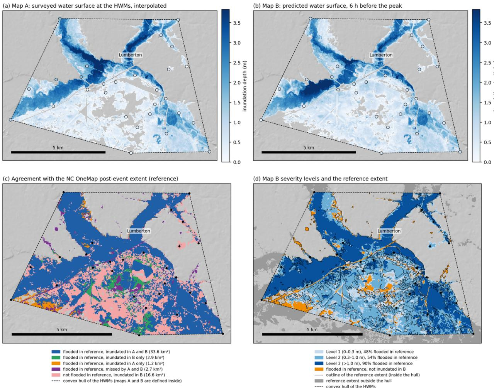  
Fig. 12. Depth maps of Hurricane Florence on the Lumber River at Lumberton built from point watersurface elevations at 28 HWMs (dots; dashed line: convex hull of the marks, inside which the maps are defined; background: 3DEP hillshade). (a) Map A: surveyed peak elevation at the HWMs, interpolated (linear TIN) and minus the 3DEP 10 m DEM; dots coloured by surveyed depth. (b) Map B: the same with the predicted water surface (3DEP ground elevation at the mark plus the depth predicted 6 h before the peak); dots coloured by predicted depth. (c) Agreement with the NC OneMap post-event extent, taken as the reference: cells flooded in the reference and inundated in both maps (blue), in B only (green), in A only (orange) or in neither (purple), and cells inundated in B but not flooded in the reference (pink); areas in

km2. (d) Severity levels of map B (Level 1: 0–0.3 m; Level 2: 0.3–1.0 m; Level $3 \colon > 1 . 0 ~ \mathrm { m } )$ with the outline of the reference extent inside the hull, the reference extent outside the hull (grey) and the reference flooded cells that B leaves dry (orange); the legend gives the share of each level that is flooded in the reference.

## 5 Discussion

## 5.1 Comparison with existing flood depth estimates

Global flood models are validated against diferent quantities from ours, which limits what a comparison can establish. For a 90-m global compound flood model, Rogers et al. (2025) report a water-surface elevation RMSE of 2.08 m against FEMA 100-year base flood elevations and 1.26 m against coastal and lake gauges; against USGS high-water marks they report results for the pluvial component in two events only, with RMSEs of 1.47 m (July 2023, north-eastern United States) and 1.04 m (Hurricane Ida, 2021). These are errors in water-surface elevation, so the quantity in our results that corresponds to them is the peak-elevation error rather than the depth error. On the event-disjoint split our peak-elevation RMSE at the surveyed marks is 1.49 m, of the same order, although our elevation is anchored on the lidar ground elevation at each mark whereas theirs is derived from the global terrain of the model. Our depth errors cannot be set against these figures, and we make no claim of an advantage over Rogers et al. (2025); the comparison serves only to place the magnitude of the errors in context.

Severity levels can be obtained either from the auxiliary classification head or by thresholding the predicted depth at the level boundaries of Table 1 (0.3 m and 1.0 m). The two give the same skill (macro-F1 $0 . 6 4 2 \pm 0 . 0 1 1$ versus $0 . 6 4 1 \pm 0 . 0 0 3 ;$ ; micro-F1 $0 . 7 2 7 \pm 0 . 0 1 1$ versus $0 . 7 3 1 \pm 0 . 0 0 3 $ Fig. 13), so the classification head adds no information beyond the predicted depth, which supports treating depth as the primary output and deriving severity from it. The depth MAE of 0.26 m at the 6-h lead time is below the width of the lowest level (0.3 m), although boundary cases near the thresholds remain uncertain, and a four-class scheme with a separate level above 2.0 m could not be learned reliably.

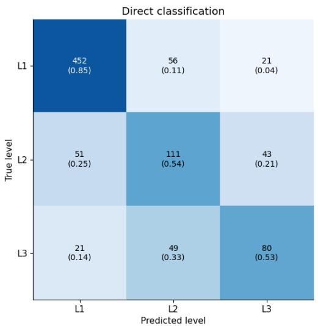

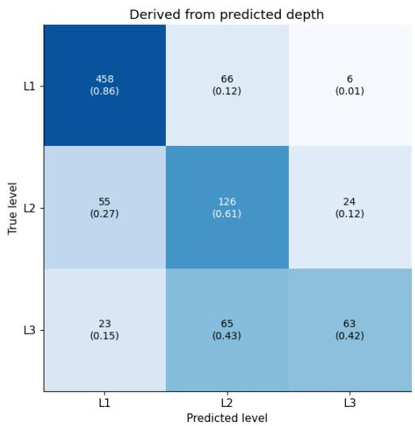  
Fig. 13. Severity levels from the auxiliary classification head and from the predicted depth. (a) Confusion matrix of the classification head. (b) Confusion matrix of the levels obtained by thresholding the predicted depth at 0.3 m and 1.0 m. 6-h lead time; counts averaged over three seeds.

## 5.2 Implicit correction of DEM error

Extent-based depth estimation computes depth as the diference between a water surface and the DEM, so the vertical error of the DEM passes into the depth unchanged. The model studied here receives the same GLO-30 surface model as its only terrain input, but it is supervised by depths surveyed in the field, so any systematic diference between the GLO-30 surface and the true ground at the marks, from canopy, buildings or the interferometric error of the product, can be learned and compensated. The data allow this to be tested directly, because the surveyed peak water-surface elevation is known at every mark. At the 567 surveyed HWMs of the random test set, diferencing the surveyed water-surface elevation with GLO-30 at the mark, which is the depth an extent-based method would return given a perfect water surface, gives a depth MAE of 0.93 m (GLO-30 converted to NAVD88, the datum of the marks, as for the model input; negative depths set to zero). With the 3DEP lidar ground instead of GLO-30 the diferenced depth has an MAE of 0.51 m, and the model reaches 0.39 m (Table 8). The diferenced depth deteriorates as the local GLO-30 error grows, from an MAE of 0.65 m where GLO-30 lies within 1 m of 3DEP (183 marks) to 1.10 m and 1.03 m where it deviates by 1–3 m and by more than 3 m (207 and 177 marks), whereas the model error stays at 0.37, 0.37 and 0.44 m. Under tree canopy (NLCD forest and woody wetland, 99 marks), where GLO-30 lies a median 5.3 m above the lidar ground, the model error is 0.45 m against 1.08 m for the diferenced depth, and in built-up areas (299 marks) it is 0.36 m against 0.87 m. Within the sampled events the depth learned from surveyed depths is therefore largely insensitive to the vertical error of the DEM it is given. This correction does not transfer to unseen events. On the event split the model error at the 575 marks (0.57 m) is lower than that of the diferenced depth (1.04 m), but equal to that of a constant prediction of the training median depth (0.57 m), and the same holds in every DEM-error and land-cover stratum; on new events the model therefore avoids the DEM error by not relying on absolute terrain rather than by correcting it, and, as Section 4.3 shows, it does not resolve depth at those marks at all. The implicit correction demonstrated here is thus a property of the model within the events and regions it has seen, not a general capability. Two caveats apply. The correction is learned from marks in surveyed regions and is therefore expected to hold where the GLO-30 error has the same causes; and the residual peak-elevation task, whose anchor is the 3DEP ground elevation, is not evidence for it, because its labels are already free of GLO-30 error.

Table 8. Depth error at the 567 surveyed HWMs of the random test set, by local GLO-30 error and land cover. Diferenced depths subtract GLO-30 (converted to NAVD88, the datum of the marks) or the 3DEP lidar ground at the mark from the surveyed water-surface elevation (WSE), with negative depths set to zero, i.e. the depth an extent-based method would return given a perfect water surface; TCM-Former predicts depth at the 6-h lead time (mean over three seeds). Land cover from NLCD 2021 (tree canopy: forest and woody wetland; built-up: developed, low to high intensity).
<table><tr><td>Subset of test HWMs</td><td>n</td><td>Median</td><td colspan="2">Depth MAE (m)</td><td></td></tr><tr><td>(random split)</td><td></td><td>|GLO-30 − 3DEP| (m)</td><td>WSE — GLO-30</td><td>WSE – 3DEP</td><td>TCM-Former</td></tr><tr><td>All HWMs</td><td>567</td><td>1.66</td><td>0.93</td><td>0.51</td><td>0.39</td></tr><tr><td>|GLO-30 − 3DEP| &lt; 1 m</td><td>183</td><td>0.55</td><td>0.65</td><td>0.39</td><td>0.37</td></tr><tr><td>|GLO-30 − 3DEP| 1–3 m</td><td>207</td><td>1.68</td><td>1.10</td><td>0.54</td><td>0.37</td></tr><tr><td>|GLO-30 − 3DEP| &gt; 3 m</td><td>177</td><td>6.47</td><td>1.03</td><td>0.61</td><td>0.44</td></tr><tr><td>Tree canopy</td><td>99</td><td>5.30</td><td>1.08</td><td>0.69</td><td>0.45</td></tr><tr><td>Built-up</td><td>299</td><td>1.28</td><td>0.87</td><td>0.44</td><td>0.36</td></tr></table>

The auxiliary peak-elevation task is the one most constrained by the terrain input. The global

RMSE of GLO-30 is approximately 4 m (Simard et al., 2024), which exceeds most flood depths in our dataset; because GLO-30 is a surface model, buildings and canopy also bias ground elevation upward. The residual target itself is anchored on the 3DEP ground elevation at the mark (Section 3.3), so this error does not enter the labels; it enters through the only terrain input of the model, the GLO-30 patch, from which the network has to infer the local ground level under canopy and buildings. This is consistent with residual errors that do not improve with spatial proximity (Table 6). Depth and severity are less afected because they are supervised by surveyed depths and can be learned from relative terrain and land-surface patterns rather than absolute elevation. Unlike hydrodynamic models, in which DEM error propagates through the governing equations (Saksena and Merwade, 2015), the learned representation can partly absorb systematic terrain bias (Bentivoglio et al., 2025).

Two practical implications follow. Operational peak-elevation products require bare-earth terrain such as lidar-based 3DEP or forest- and building-corrected global DEMs such as FABDEM (Hawker et al., 2022), whereas depth and severity are already the more transferable outputs of the framework. Because HWM campaigns report elevation more often than depth, pairing elevationonly HWMs with lidar DEMs is a direct route to more training labels.

## 5.3 Choice of the meteorological descriptor and drivers of predicted flood depth

We also tested whether learned temporal encoders extract more flood-relevant information from the forcing than the hand-crafted three-tier descriptor (Section 3.2; Table 3). Replacing the 58 descriptors per window with 140 TabPFN-TS forecast features per window gives a depth MAE of 0.258 m and a depth RMSE of 0.457 m, against 0.257 and 0.468 m for the three-tier descriptor, and an LSTM over the raw hourly series gives 0.267 and 0.461 m. For neither encoder does any of the six metrics difer significantly from the three-tier descriptor (Welch's t-test over three seeds, $\mathrm { { p } > 0 . 1 ) }$ , and the auxiliary tasks are equally unafected (residual elevation MAE 0.541 and 0.545 m versus 0.530 m; macro-F1 0.647 and 0.653 versus 0.642). When meteorology is the only input, the LSTM encoder scores higher on average on the auxiliary severity task (macro-F1 0.615 versus 0.559), but the diference is not significant $( \mathrm { p } = 0 . 1 4 )$ and disappears once terrain and embeddings are added. The learned encoders therefore do not extract information beyond what the descriptor captures: for this task the decisive information, how much water reached the site and how recently, is carried by accumulation totals, antecedent indices and storm-state indicators that can be written down explicitly. The learned features, the hidden state of the LSTM and the forecasts of the pretrained TabPFN-TS model, also have no direct physical meaning, and TabPFN-TS needs tens of seconds of model inference per sample to produce them, whereas the descriptor is computed analytically. We therefore retain the three-tier descriptor: every one of its features has an explicit physical definition, so the contribution of each feature to the predicted depth can be quantified with Shapley-value attribution and read directly in terms of hydrometeorological processes.

Shapley-value attribution (Lundberg and Lee, 2017) for the 6-h model (Fig. 14) was computed with Expected Gradients for the predicted flood depth in metres, over the 58 × 6 meteorological inputs of the 885 test samples, keeping each sample's terrain and embedding inputs fixed, and averaged over three seeds. The predicted depth is driven mainly by the water supplied to the site. The three top-ranked descriptors are Tier-3 water-balance terms of the most recent window (6–24 h before the peak): cumulative net water input, the antecedent precipitation index and cumulative precipitation, each changing the predicted depth by about 0.03 m on average and together accounting for 25% of the total attribution; together with the window totals of precipitation, liquid rainfall and net water input, the precipitation-amount and antecedent-wetness descriptors account for 45%. The second major group (31%) comprises storm-state indicators, namely the maximum wind gust, the maximum WMO weather code, cloud cover and wind speed, which separate organized storm systems, such as the tropical cyclones that dominate the dataset, from fair-weather conditions. Rainfall-intensity statistics such as the maximum 3-h accumulation contribute less (6%), as do pressure (6%) and temperature and humidity descriptors (7%). Attribution is concentrated near the peak: the window 6–24 h before the peak accounts for 66% of the total and the preceding day for 13%, whereas the three windows more than 72 h before the peak contribute 14% together. Feature rankings are stable across seeds (Spearman $\rho = 0 . 9 6 \mathrm { - } 0 . 9 7$ between seeds) and similar for HWMs and rain-free samples. The attributions of the depth and of the auxiliary severity logit are nearly collinear within each sample (median ${ \left| { \mathrm { r } } \right| } = 0 . 9 9 8 )$ , so the network routes the forcing through essentially one learned direction, an index of how much water the storm delivered, on which depth and severity both depend. Together with the modality attribution in Section 4.2, this indicates that recent water input and storm conditions carry most of the depth signal, while the spatial inputs reduce the remaining error at the surveyed marks by about a fifth.

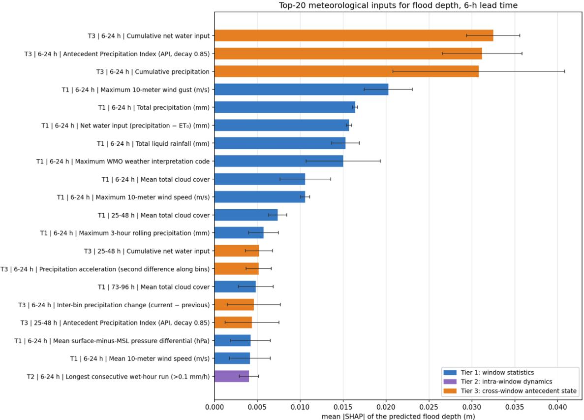  
Fig. 14. Top 20 meteorological inputs ranked by mean absolute SHAP value of the predicted flood depth at the 6-hour lead time (Expected Gradients; mean over 885 test samples and three seeds; error bars: s.d. over seeds). Labels give the tier, the 24-h window (hours before the peak; the most recent window spans 6–24 h because of the lead-time mask) and the feature. High SHAP magnitude indicates strong model sensitivity but does not necessarily imply a positive net contribution to predictive performance.

## 5.4 Limitations and outlook

Four limitations bound the present results. First, lead times are referenced to the peak time of the matched gauge within 10 km rather than to the local inundation peak at each HWM; The peak time is moreover taken from the matched sensor rather than predicted, so the skill reported here is conditional on the timing of the peak. An operational system would obtain that timing from a stage or discharge forecast, or run the model on a rolling window and issue the peak depth implied by each candidate timing; its skill would then also depend on the accuracy of the timing.the two need not coincide (Allen et al., 2018; Yang et al., 2016), which is why lead times shorter than 6 h were not evaluated (Section 4.1). The size of the ofset is not quantified here, and the nominal lead times should be read as referring to the sensor peak rather than to the local one. Second, and most importantly, depth skill does not transfer. On unseen events the model still distinguishes flooded from rain-free conditions, but among the surveyed marks the predicted depths occupy a narrow band (slope 0.06, coeficient of determination 0.03) and carry no advantage over a constant prediction (Section 4.3). One likely cause is the distribution of the labels rather than the architecture: 4650 of the 8874 samples, 52%, have a depth of exactly zero, counting the 3185 rain-free samples and the 1465 marks found at ground level, and a squared-error objective on such a target is minimised by predicting zeros accurately and shrinking everything else towards the mean. The under-dispersion of the predictions on the random split itself, where the regression slope is only 0.36, is consistent with this. A two-stage formulation, in which the classification head separates flooded from dry sites and the depth head is trained only on the marks with non-zero depth, is the natural test of whether the failure to transfer is intrinsic to the task or an artefact of the objective, and we have not yet carried it out. The training events are also concentrated in the humid eastern United States, and skill decreases for unseen events and spatially disjoint sub-regions (Tables 5 and 6), so the model currently behaves as an interpolator within sampled hydroclimates. Because samples are split at random by row, HWMs from the same event and neighbourhood occur in both training and test sets, so part of the reported skill may reflect geographic memorization; the event- and space-disjoint evaluations in Section 4.3 quantify the transferable part. Third, the rain-free samples contrast each site with itself under no rain; samples of the same site under heavy rain without inundation cannot be constructed from HWM surveys, because the absence of a mark does not establish the absence of flooding. The supervision therefore does not teach the model where water does not go under rain, which confines its use to sites comparable to the surveyed ones; this limitation stems from the availability of observed labels and is shared by every dataset built from field surveys. Fourth, the embeddings are annual and the DEM is static, so event-specific surface states such as soil moisture or pre-event inundation enter only through meteorology. Event-time EO observations, such as SAR-derived soil moisture or pre-peak Sentinel-1 water extent, are the natural next inputs, together with lidar or InSAR terrain and international HWM archives.

## 6 Conclusion

This study asked whether flood peak depth can be learned from field observations and predicted before the peak from spaceborne terrain, geospatial foundation-model embeddings and meteorological forcing. Using 5689 USGS high-water marks from 39 events, with sensor-derived peak times and site-matched rain-free windows, a cross-modal fusion network predicts depth at surveyed marks with an MAE of 0.39 m six hours before the peak and 0.41 m a day before, and 0.57 m on eleven events it has never seen. Three findings follow. First, deep-learning flood depth prediction does not depend on simulated labels: trained on observations alone, the model reaches an accuracy below the 0.3–1.0 m band that separates nuisance from damaging flooding. Second, supervision by surveyed depth corrects the vertical error of the spaceborne DEM implicitly, reducing the depth error at the surveyed marks from 0.93 m for water levels diferenced with GLO-30 to 0.39 m, which extent based depth estimation cannot do; on unseen events, however, the error at the marks (0.57 m) is no lower than that of a constant prediction. Third, predictions issued before the peak, interpolated with the procedure FEMA and the USGS apply to surveyed marks, give a depth map of a held-ou hurricane equivalent to the post-event map, but a constant water surface at the same marks does so equally well, which shows that such grids are governed by the interpolation and the terrain rather than by the accuracy of the points. Meteorological forcing carries most of the skill, and terrain and embeddings, largely interchangeable, reduce the depth error at the surveyed marks by about a fifth. Expanding HWM-based benchmarks, adopting bare-earth terrain and adding event-time EO observations are the most direct paths toward observation-supervised, EO-driven flood depth forecasting and mapping. The principal limitation is that depth skill does not transfer: on unseen events the model still separates flooded from rain-free conditions, but among the surveyed marks it does not resolve depth at all, and the strongly under-dispersed predictions suggest that the zeroinflation of the labels, rather than the architecture, may be responsible. Lead times are moreover defined relative to an observed peak.

## A The time-series factors obtained from Open-Meteo API

Table A1. The used time-series factors obtained from Open-Meteo API
<table><tr><td>Variable</td><td>Description</td></tr><tr><td>time</td><td>Hourly flood peak timestamp string</td></tr><tr><td>temperature_2m</td><td>Air temperature at 2 meters above ground</td></tr><tr><td>relative_humidity_2m</td><td>Relative humidity at 2 meters above ground</td></tr><tr><td>dewpoint_2m</td><td>Dew point temperature at 2 meters above ground</td></tr><tr><td>apparent_temperature</td><td>“Feels like&quot; temperature (derived from temperature, wind, humidity, radiation, etc.)</td></tr><tr><td>precipitation</td><td>Total precipitation (commonly rain + snow water equivalent)</td></tr><tr><td>rain</td><td>Rainfall component of precipitation</td></tr><tr><td>snowfall</td><td>Snowfall (definition/units depend on requested settings)</td></tr><tr><td>weather_code</td><td>WMO weather interpretation code (categorical weather condition)</td></tr><tr><td>pressure_msl</td><td>Mean sea level pressure</td></tr><tr><td>surface_pressure</td><td>Surface pressure at the location</td></tr><tr><td>cloud_cover</td><td>Total cloud cover</td></tr><tr><td>cloud_cover_low</td><td>Low-level cloud cover</td></tr><tr><td>et0_fao_evapotranspiration</td><td>Reference evapotranspiration (FAO-56 ET0)</td></tr><tr><td>vapour_pressure_deficit</td><td>Vapour pressure deficit (VPD; a dryness indicator)</td></tr><tr><td>wind_speed_10m</td><td>Wind speed at 10 meters above ground</td></tr><tr><td>wind_gusts_10m</td><td>Wind gust speed at 10 meters above ground</td></tr><tr><td>cloud_cover_mid</td><td>Mid-level cloud cover</td></tr><tr><td>cloud_cover_high</td><td>High-level cloud cover</td></tr><tr><td>wind_direction_1Om</td><td>Wind direction at 10 meters above ground</td></tr><tr><td>wind_speed_100m</td><td>Wind speed at 100 meters above ground</td></tr><tr><td>hours_before_peak</td><td>Time offset in hours before the flood peak time</td></tr><tr><td>days_before_peak</td><td>Time offset in days before the flood peak time</td></tr></table>

## B Detailed description of physics-motivated hydrometeorological domain features (Tier 1)

Each 144-hour lookback window is partitioned into six contiguous 24-hour bins. Within every bin, the physically defined features of the three tiers are concatenated to form a 58-dimensional tabular descriptor (indices 0–34 and 47–69; indices 35–46 hold the TabPFN-TS diagnostics of Appendix C, which are not part of the descriptor); this appendix documents Tier 1, which occupies the

35 dimensions at window indices 0–34 (0-based). The five groups below characterize the physical forcing mechanisms most directly linked to flood generation: precipitation loading, phase and intensity structure, atmospheric moisture availability, synoptic circulation strength and trend, and the surface energy balance governing pre-event soil moisture state. All features are computed analytically without model inference, as are those of Tiers 2 and 3.

Group 1 — Precipitation Intensity and Structure (11 features, indices 0–10)

This group characterizes the magnitude, variability, and temporal organization of rainfall. The eleven features are:

(1) Total precipitation — total rainfall accumulation (mm) over the 24-hour bin, representing the overall precipitation loading.

(2) Maximum hourly precipitation — peak hourly precipitation rate (mm h−1), capturing the highest instantaneous rainfall intensity within the bin.

(3) Mean hourly precipitation — mean hourly precipitation rate (mm h−1) over all hours of the bin.

(4) Standard deviation of hourly precipitation — standard deviation of the hourly precipitation series (mm h−1), encoding within-bin rainfall variability.

(5) Total liquid rainfall — total liquid-phase rainfall accumulation (mm), excluding solidphase snowfall contributions.

(6) Total snowfall water equivalent — total snowfall accumulation expressed as liquid water equivalent (mm), relevant to snowmelt-driven flood precursors.

(7) Wet-hour count — number of hours within the bin for which precipitation exceeds 0.1 mm h−1, encoding the duration of active rainfall.

(8) Heavy-rain hour count — number of hours with precipitation exceeding 5.0 mm h−1, indicative of convective or intense frontal rainfall.

(9) Mean precipitation intensity per wet hour — mean precipitation intensity conditional on wet hours (total precipitation divided by wet-hour count, mm h−1), which decouples rainfall duration from intensity.

(10) Maximum 3-hour rolling precipitation — maximum value of a 3-hour sliding-window accumulation (mm), capturing the most intense short-duration burst within the bin and particularly relevant to flash-flood triggering.

(11) Liquid-rain fraction of total precipitation — ratio of liquid rainfall to total precipitation (dimensionless, 0–1), distinguishing rainfall-driven from snowmelt-driven flood precursors.

Group 2 — Thermodynamic State (8 features, indices 11–18)

Temperature and humidity fields govern evapotranspiration demand, snowmelt potential, and near-surface atmospheric stability. The eight features are:

(12) Mean 2-meter air temperature — mean 2-m air temperature (°C) over the 24-hour bin.

(13) Minimum 2-meter air temperature — minimum 2-m air temperature (°C) within the bin, relevant to freezing-level diagnosis and phase partitioning of precipitation.

(14) Diurnal range of 2-meter air temperature — diurnal temperature range (maximum minus minimum, °C), encoding the magnitude of the daily thermal cycle and convective instability potential.

(15) Linear trend of 2-meter air temperature — least-squares linear slope of the hourly 2-m temperature series against the temporal index (°C h−1), indicating whether the bin is warming or cooling.

(16) Mean 2-meter relative humidity — mean 2-m relative humidity (%) over the bin, encoding the bulk near-surface moisture content.

(17) Minimum 2-meter relative humidity — minimum 2-m relative humidity (%) within the bin, a proxy for near-surface dryness and evaporative demand.

(18) Mean 2-meter dew-point temperature — mean 2-m dew-point temperature (°C), providing an absolute measure of atmospheric moisture content independent of temperature.

(19) Mean vapour pressure deficit — mean vapour pressure deficit (VPD, kPa) over the bin, quantifying atmospheric drying power and the upper bound on potential evapotranspiration.

Group 3 — Synoptic Pressure Dynamics (4 features, indices 19–22)

Mean sea-level pressure (MSLP) and its temporal evolution provide direct indicators of synopticscale forcing. The four features are:

(20) Mean sea-level pressure — mean MSLP (hPa) over the 24-hour bin, characterising the prevailing large-scale pressure environment.

(21) Minimum sea-level pressure — minimum MSLP (hPa) within the bin, associated with the deepest low-pressure system passing through the analysis period.

(22) Linear trend of sea-level pressure — least-squares linear slope of the hourly MSLP series $\left( \mathrm { { h P a } \mathrm { { h } ^ { - 1 } } } \right)$ ; negative values indicate deepening cyclonic development conducive to heavy rainfall.

(23) Sea-level pressure range — intra-bin MSLP range (maximum minus minimum, hPa), distinguishing the regular semi-diurnal atmospheric tide from synoptic-scale pressure falls.

Group 4 — Wind Field (4 features, indices 23–26)

Wind speed mediates moisture transport and surface roughness efects on precipitation distribution. The four features are:

(24) Mean 10-meter wind speed — mean 10-m wind speed $( \mathrm { m } \mathrm { s } ^ { - 1 } )$ over the bin, encoding the prevailing advective flow.

(25) Maximum 10-meter wind speed — maximum 10-m wind speed $( \mathrm { m } \mathrm { s } ^ { - 1 } )$ within the bin.

(26) Maximum 10-meter wind gust — maximum 10-m wind gust speed $( \mathrm { m } \mathrm { s } ^ { - 1 } )$ , particularly relevant to convective storm identification.

(27) Linear trend of 10-meter wind speed — least-squares linear slope of the hourly 10-m wind speed series $( \mathrm { m } \mathrm { s } ^ { - 1 } \mathrm { h } ^ { - 1 } )$ , indicating whether the synoptic flow is strengthening or weakening.

Group 5 — Surface Energy Balance and Cloud Regime (8 features, indices 27–34)

The remaining features characterize the radiation environment, evapotranspiration demand, and cloud regime governing surface moisture state. The eight features are:

(28) Mean total cloud cover — mean total cloud cover fraction (0–1) over the bin.

(29) Linear trend of total cloud cover — least-squares linear slope of the hourly total cloud cover series, encoding the onset or clearance of cloud systems within the bin.

(30) Total reference evapotranspiration FAO-56 ${ \pmb E } { \pmb T } _ { 0 }$ — accumulated FAO-56 reference evapotranspiration $\mathrm { E T _ { 0 } }$ (mm) over the bin, computed via the Penman–Monteith formulation and representing the potential atmospheric water demand.

(31) Net water input — net water input $\left( \mathrm { P - E T _ { 0 } , \ m m } \right)$ , computed as the diference between total precipitation and $\mathrm { E T _ { 0 } }$ accumulation, approximating the available water surplus driving infiltration excess and overland flow.

(32) Mean apparent-minus-actual 2-meter temperature excess — mean diference between apparent temperature and actual 2-m air temperature $( ^ { \circ } \mathrm { C } )$ , encoding non-linear atmospheric stress efects due to wind and humidity.

(33) Mean surface-minus-sea-level pressure diferential — mean diference between surface pressure and MSLP (hPa), reflecting orographic and boundary-layer efects on the local pressure field.

(34) Mean low-level cloud cover — mean low-level cloud cover fraction (0–1), associated with stratiform precipitation regimes.

(35) Maximum WMO weather interpretation code — maximum WMO weather code observed within the bin, providing a categorical summary of the most severe meteorological phe nomenon (e.g., thunderstorm, heavy snow, blizzard).

Together, the 35 Tier 1 features encode the physical forcing mechanisms most directly linked to flood generation. All features are computed analytically without model inference, as are those of Tiers 2 and 3.

## C Detailed description of intra-window meteorological dynamics and coupling features (Tier 2)

This appendix documents Tier 2, whose 13 physically defined features occupy window indices 47–59 (0-based) within each 24-hour bin. Tier 2 features capture dynamic intra-window behaviour (temporal predictability, meteorological variable coupling, signal volatility, and extreme-event structure) that complements the scalar summary statistics of Tier 1. The 13 features are generated by Processes 2–4, which compute explicit analytic statistics directly from the hourly Open-Meteo time series. Process 1, which applies the TabPFNTimeSeriesPredictor (TabPFN-TS) in univariate mode to three meteorological series (indices 35–46), is documented for completeness but is not part of the three-tier descriptor; the TabPFN-TS encoder compared in Sections 4.1 and 5.3 is a separate, wider feature set described in Section 3.2.

Process 1: TabPFN-TS Univariate Predictability Features (12 features, indices 35–46; not part of the three-tier descriptor)

Process 1 applies “TabPFNTimeSeriesPredictor” independently to the hourly precipitation, mean sea-level pressure, and 2-m air temperature series of each 24-hour bin. For each variable, four scalar diagnostics are extracted: a short-horizon forecast value, the trend along the prediction trace, a backtest root-mean-square error (RMSE), and a seasonal structure strength derived from the built-in sin/cos feature channels of the “FeatureTransformer”.

## P1.1 — Precipitation sub-block (indices 35–38)

(36) TabPFN-TS precipitation short-horizon forecast level — one-step / short-horizon precipitation forecast value at the prediction side of the 24-hour bin, produced by running “TabPFN TimeSeriesPredictor” on the hourly precipitation series.

(37) TabPFN-TS precipitation forecast trend — change of the short-horizon forecast along the model’s own prediction horizon (end minus start of the predicted trace), encoding the momentum of the predicted precipitation.

(38) In-bin backtest RMSE for precipitation — backtest-style RMSE evaluating the holdout tail of the bin against a linear trend fitted to the first 80% of the hourly precipitation sequence, measuring departure from a simple linear baseline.

(39) Precipitation seasonal-channel strength — seasonal structure strength for precipitation, computed as the mean standard deviation of the built-in sin/cos seasonal feature channels output by the “FeatureTransformer” module.

P1.2 — Mean sea-level pressure sub-block (indices 39–42)

(40) TabPFN-TS mean sea-level pressure short-horizon forecast level — shorthorizon TabPFN-TS forecast value for mean sea-level pressure, applying the same pipeline as the precipitation sub-block.

(41) TabPFN-TS mean sea-level pressure forecast trend — forecast trend along the TabPFN-TS prediction run for MSL pressure (end minus start of the predicted trace).

(42) In-bin backtest RMSE for mean sea-level pressure — backtest RMSE for MSL pressure, evaluating the holdout tail against a linear in-sample trend.

(43) Mean sea-level pressure seasonal-channel strength — seasonal structure strength for MSL pressure, derived from the sin/cos channel standard deviations of the “FeatureTransformer”.

P1.3 — 2-meter temperature sub-block (indices 43–46)

(44) TabPFN-TS 2-meter temperature short-horizon forecast level — short-horizon TabPFN-TS forecast value for 2-m air temperature, using the same univariate pipeline as the other two sub-blocks.

(45) TabPFN-TS 2-meter temperature forecast trend — forecast trend along the TabPFN-TS prediction run for 2-m temperature (end minus start of the predicted trace).

(46) In-bin backtest RMSE for 2-meter temperature — backtest RMSE for 2-m temperature, evaluating the holdout tail against a linear in-sample trend.

(47) 2-meter temperature seasonal-channel strength — seasonal structure strength for 2- m temperature, derived from the sin/cos channel standard deviations of the “FeatureTransformer”.

Process 2: Multivariate Meteorological Coupling (6 features, indices 47–52)

Process 2 quantifies linear co-variation between pairs of meteorological variables using Pearson correlation coeficients computed over the hourly records within the bin. These coupling features are physics-interpretable and are computed analytically without model inference. Six variable pairs are evaluated:

(48) Pearson correlation: precipitation vs mean sea-level pressure — Pearson r between hourly Total precipitation and Mean sea-level pressure, providing a direct indicator of synoptic cyclone-forced rainfall.

(49) Pearson correlation: precipitation vs relative humidity — Pearson r between hourly Total precipitation and Mean 2-meter relative humidity, encoding near-surface moisture availability during rainfall events.

(50) Pearson correlation: 2-meter temperature vs mean sea-level pressure — Pearson r between Mean 2-meter air temperature and Mean sea-level pressure, reflecting the thermal structure associated with synoptic-scale pressure systems.

(51) Pearson correlation: precipitation vs 10-meter wind speed — Pearson r between Total precipitation and Mean 10-meter wind speed, sensitive to convective versus frontal precipitation regimes.

(52) Pearson correlation: precipitation vs cloud cover — Pearson r between Total precipitation and Mean total cloud cover, characterising the temporal co-occurrence of cloud radiative forcing and surface rainfall.

(53) Pearson correlation: relative humidity vs mean sea-level pressure — Pearson r between Mean 2-meter relative humidity and Mean sea-level pressure, encoding the boundary-layer moisture response to synoptic pressure variations.

Process 3: First-Diference Volatility (3 features, indices 53–55)

Process 3 measures hour-to-hour variability by computing the standard deviation of the firstdiference series $( \sigma ( \Delta \mathrm { x } _ { t } )$ where $\Delta { \bf x } _ { t } = { \bf x } _ { t } - { \bf x } _ { t - 1 } )$ . Three scalars are produced:

(54) Sub-daily precipitation volatility — standard deviation of first diferences of the hourly Total precipitation series (mm h−1), quantifying temporal jitter and rainfall intermittency.

(55) Sub-daily mean sea-level pressure volatility — standard deviation of first diferences of the hourly Mean sea-level pressure series (hPa h−1), encoding the rapidity of synoptic pressure change.

(56) Sub-daily 2-meter temperature volatility — standard deviation of first diferences of the hourly Mean 2-meter air temperature series (°C h−1), capturing intra-bin thermal instability associated with frontal passages or radiative cycles.

Process 4: Extreme-Event and Distributional Structure (4 features, indices 56–59)

Process 4 characterizes the tail behavior and temporal clustering of precipitation. All four features are computed analytically:

(57) Precipitation 2-sigma anomaly hour count — number of hours within the bin for which Total precipitation exceeds the bin mean plus two standard deviations (mean + 2�), identi fying statistically anomalous rainfall episodes.

(58) Longest consecutive wet-hour run — length of the longest uninterrupted sequence of hours with Total precipitation exceeding 0.1 mm $\mathrm { h } ^ { - 1 }$ , encoding temporal persistence and clustering of rainfall.

(59) Hourly precipitation concentration (Gini coeficient) — Gini coeficient of the hourly Total precipitation distribution within the bin, measuring the degree of concentration or peakedness (0 = uniform distribution; values approaching 1 indicate concentration in a small number of hours).

(60) Extreme-rain hour count — number of hours with Total precipitation exceeding 10 mm h−1, capturing the occurrence frequency of extreme-intensity rainfall relevant to surface ponding and rapid runof generation.

Together, the 13 Tier 2 features complement the Tier 1 scalar statistics by encoding the dynamic, cross-variable, and distributional properties of meteorological forcing that scalar summaries cannot represent. Process 4 is particularly targeted at flood-relevant signals: the extreme-event statistics directly characterize rainfall conditions known to precede flash-flood initiation.

## D Detailed Cross-Window Evolution Descriptors (Tier 3)

This appendix documents Tier 3, which occupies the 10 dimensions at window indices 60–69 (0- based) within each 24-hour bin. Tier 3 encodes the between-bin memory, trajectory, and acceleration information that scalar within-bin summaries cannot express. The six 24-hour bins are indexed $\mathrm { ~ k ~ } = \mathrm { ~ 0 ~ , ~ . . . , ~ 5 ~ }$ from the farthest bin (k = 0, earliest antecedent period) to the nearest bin (k = 5, immediately preceding the flood peak). All 10 Tier-3 features are deterministic functions of the per-bin Tier-1 vectors of bins 0 through k and do not invoke any learned model. They are generated by four processes: antecedent/cumulative state (P1, 3 scalars), inter-bin first diferences (P2, 3 scalars), multi-bin linear trends and acceleration (P3, 3 scalars), and a normalized lookback position index (P4, 1 scalar).

## Process 1: Antecedent and Cumulative State (3 features, indices 60–62)

Process 1 captures accumulated hydrometeorological state from the start of the 144-hour lookback through the current bin. Antecedent soil moisture, which governs infiltration capacity and the runof fraction, is determined largely by the precipitation history preceding the triggering event. Three scalars are computed.

## (61) Cumulative Precipitation

The first descriptor is the Cumulative precipitation up to the current bin:

$$
E _ { i } ^ { ( 1 ) } \ = \ \sum _ { j = 1 } ^ { i } P _ { j }
$$

where $P _ { j }$ denotes the Total precipitation (Tier-1 index 0) within bin $W _ { j }$ . This variable captures total storm water input accumulated over the antecedent period, serving as a direct indicator of watershed wetting and catchment loading.

## (62) Antecedent Precipitation Index

To represent hydrological memory with temporal decay, the Antecedent Precipitation Index is computed as:

$$
E _ { i } ^ { ( 2 ) } = \sum _ { j = 1 } ^ { i } \lambda ^ { i - j } { \cal P } _ { j }
$$

where $\lambda { = } 0 . 8 5$ is the decay coeficient. This formulation, following the classical API concept in operational hydrology, assigns greater weight to recent rainfall while preserving older events’ contributions with exponentially diminishing efect.

## (63) Cumulative Net Water Input

The third descriptor aggregates Net water input $\left( \mathrm { P - E T _ { 0 } } \right)$ over preceding bins:

$$
E _ { i } ^ { ( 3 ) } \ = \ \sum _ { j = 1 } ^ { i } \left( P _ { j } - E T _ { j } \right)
$$

where $\mathrm { E T } _ { j }$ denotes total Total reference evapotranspiration FAO-56 $E T _ { 0 }$ within bin $W _ { j }$ . This descriptor better approximates the efective atmospheric water forcing than cumulative precipitation alone, by accounting for evapotranspiration losses.

## Process 2: Inter-Bin First Diferences (3 features, indices 63–65)

Process 2 encodes the bin-to-bin rate of change of key meteorological variables by computing the first diference between the current bin i and the immediately preceding bin i−1. These signed diferences allow the model to detect intensification or attenuation of flood-generating weather systems across consecutive 24-hour periods.

## (64) Inter-Bin Precipitation Change

The fourth descriptor captures changes in Total precipitation:

$$
\left\{ \begin{array} { r l } { P _ { i } - P _ { i - 1 } , } & { i > 1 } \\ { 0 , } & { i = 1 } \end{array} \right.
$$

Positive values indicate intensifying precipitation; negative values indicate recession. For the first bin $( i = 1 )$ , this feature is set to zero.

## (65) Inter-Bin Change in Sea-Level Pressure Trend

Let $T _ { i } ^ { \phantom { } \left( p \right) }$ denote the Linear trend of sea-level pressure (Tier-1 index 21) in bin $W _ { i }$ . The fifth descriptor is:

$$
\left\{ \begin{array} { r c l } { T _ { i } ^ { ( p ) } - T _ { i - 1 } ^ { ( p ) } , } & { i > 1 } \\ { 0 , } & { i = 1 } \end{array} \right.
$$

This variable captures acceleration or deceleration in synoptic pressure evolution, distinguishing a steadily deepening low (constant negative slope) from a rapidly deepening system (increasingly negative slope).

## (66) Inter-Bin Change in Mean Relative Humidity

Let $H _ { i }$ denote the Mean 2-meter relative humidity (Tier-1 index 15) in bin $W _ { i }$

$$
\left\{ \begin{array} { r l } { H _ { i } - H _ { i - 1 } , } & { i > 1 } \\ { 0 , } & { i = 1 } \end{array} \right.
$$

Increasing humidity across consecutive bins indicates the approach of a moisture-laden air mass and the pre-conditioning of the lower troposphere for sustained precipitation.

Process 3: Multi-Bin Trends and Precipitation Acceleration (3 features, indices 66–68)

Process 3 estimates the overarching trajectory of precipitation and synoptic pressure across all bins from 1 through i by fitting least-squares linear trends to the corresponding Tier-1 scalar sequences. An additional second-diference scalar captures precipitation acceleration.

## (67) Multi-Bin Linear Trend of Precipitation

The seventh descriptor is the least-squares slope of the sequence $\{ \mathrm { P _ { 1 } } , ~ \mathrm { P _ { 2 } } , ~ . . . , ~ \mathrm { P } _ { i } \}$ of Total precipitation values:

$$
E _ { i } ^ { ( 7 ) } = \ s l o p e { ( P _ { \mathrm { 1 } } , ~ P _ { \mathrm { 2 } } , ~ \dots , ~ P _ { i } ) }
$$

A positive slope indicates multi-day intensification of rainfall; a negative slope indicates attenuation. For $i = 1 ,$ , this feature is set to zero by construction.

## (68) Multi-Bin Linear Trend of Mean Sea-Level Pressure

Let $M _ { i }$ denote the Mean sea-level pressure (Tier-1 index 19) in bin $W _ { i }$ . The eighth descriptor is:

$$
E _ { i } ^ { ( 8 ) } \ = \ s l o p e ( { \overline { { M } } } _ { 1 } , \ { \overline { { M } } } _ { 2 } , \ \dots , \ { \overline { { M } } } _ { i } )
$$

Sustained negative values indicate a prolonged cyclonic deepening trajectory consistent with the approach of a major storm system.

## (69) Precipitation Acceleration

To capture second-order temporal changes, the Precipitation acceleration is defined as:

$$
\left\{ \begin{array} { r c r } { { ( P _ { i } - P _ { i - 1 } ) \ - \ ( P _ { i - 1 } - P _ { i - 2 } ) , } } & { { i \ge \ 3 } } \\ { { 0 , } } & { { i < \ 3 } } \end{array} \right.
$$

Positive values indicate that rainfall is intensifying at an increasing rate (convex trajectory); negative values indicate deceleration (concave trajectory). For $i < \mathcal { 3 } ,$ this feature is set to zero.

## Process 4: Normalized Lookback Position (1 feature, index 69)

Process 4 contributes a single positional scalar encoding the temporal location of the current bin. This serves as an explicit inductive bias: features from bins close to the flood peak carry diferent predictive significance than those from earlier bins, and the position index allows the model to learn this asymmetry without requiring separate model instances per bin.

## (70) Normalized Lookback Position

The final descriptor is:

$$
E _ { i } ^ { ( 1 0 ) } ~ = ~ \frac { i ~ - ~ 1 } { N ~ - ~ 1 }
$$

where $N = 6$ in our implementation. The value 0 corresponds to the farthest bin (earliest antecedent period, 121–144 h before the flood peak) and 1 to the nearest bin (0–24 h before the peak). This linear encoding allows the model to condition on temporal proximity without requiring positional embeddings.

## Summary of the Descriptor Set

The cross-window evolution vector for the i-th bin is:

$$
e _ { i } \ = \ \left[ E _ { i } ^ { ( 1 ) } , \ E _ { i } ^ { ( 2 ) } , \ E _ { i } ^ { ( 3 ) } , \ E _ { i } ^ { ( 4 ) } , \ E _ { i } ^ { ( 5 ) } , \ E _ { i } ^ { ( 6 ) } , \ E _ { i } ^ { ( 7 ) } , \ E _ { i } ^ { ( 8 ) } , \ E _ { i } ^ { ( 9 ) } , \ E _ { i } ^ { ( 1 0 ) } \right]
$$

These 10 descriptors are grouped into three conceptual categories:

• Cumulative-memory descriptors: Cumulative precipitation, Antecedent Precipitation Index, and Cumulative net water input.

• Transition descriptors: Inter-bin precipitation change, Inter-bin change in sealevel pressure trend, and Inter-bin change in mean relative humidity.

• Evolution-shape descriptors: Multi-bin linear trend of precipitation, Multi-bin linear trend of mean sea-level pressure, Precipitation acceleration, and Normalized lookback position.

## References

George H. Allen, Cédric H. David, Konstantinos M. Andreadis, Faisal Hossain, and James S. Famiglietti. Global estimates of river flow wave travel times and implications for low-latency satellite data. Geophysical Research Letters, 45(15):7551–7560, 2018. doi: 10.1029/2018GL077914.

Dibit Aryal, Lei Wang, Tirtha Raj Adhikari, Jing Zhou, Xiuping Li, Maheswor Shrestha, Yuanwei Wang, and Deliang Chen. A model-based flood hazard mapping on the southern slope of himalaya. Water, 12(2):540, February 2020. ISSN 2073-4441. doi: 10.3390/w12020540. URL http://dx. doi.org/10.3390/w12020540.

Daoyang Bao, Z George Xue, Matthew Hiatt, Kehui Xu, Courtney K Harris, and Jill C Trepanier. A machine learning-based prediction-to-map framework for rapid and accurate spatial flood prediction. npj Natural Hazards, 2:71, 2025. doi: 10.1038/s44304-025-00122-2.

Doug Bausch. FEMA’s recent lessons: GIS modeling and analytics. MOTF Analytics Briefing, Federal Emergency Management Agency, April 2015.

Roberto Bentivoglio, Elvin Isufi, Sebastiaan Nicolas Jonkman, and Riccardo Taormina. Multi-scale hydraulic graph neural networks for flood modelling. Natural Hazards and Earth System Sciences, 25:335–351, 2025. doi: 10.5194/nhess-25-335-2025.

Jefrey Blay and Leila Hashemi-Beni. Geospatial and deep learning approaches for modeling floodwater depth in urbanized areas. Remote Sensing, 18:60, 2025. doi: 10.3390/rs18010060.

Derrick Bonafilia, Beth Tellman, Tyler Anderson, and Erica Issenberg. Sen1floods11: a georeferenced dataset to train and test deep learning flood algorithms for sentinel-1. In 2020 IEEE/CVF Conference on Computer Vision and Pattern Recognition Workshops (CVPRW), page 835–845. IEEE, June 2020. doi: 10.1109/cvprw50498.2020.00113. URL http://dx.doi.org/10.1109/ cvprw50498.2020.00113.

Christopher F Brown, Michal R Kazmierski, Valerie J Pasquarella, William J Rucklidge, Masha Samsikova, Chenhui Zhang, Evan Shelhamer, Estefania Lahera, Olivia Wiles, and Simon Ilyushchenko. Alphaearth foundations: An embedding field model for accurate and eficient global mapping from sparse label data. arXiv preprint arXiv:2507.22291, 2025.

Sagy Cohen, G. Robert Brakenridge, Albert Kettner, Bradford Bates, Jonathan Nelson, Richard McDonald, Yu‐Fen Huang, Dinuke Munasinghe, and Jiaqi Zhang. Estimating floodwater depths from flood inundation maps and topography. JAWRA Journal of the American Water Resources Association, 54(4):847–858, August 2018. ISSN 1752-1688. doi: 10.1111/1752-1688.12609. URL http://dx.doi.org/10.1111/1752-1688.12609.

Sagy Cohen, Austin Raney, Dinuke Munasinghe, J. Derek Loftis, Andrew Molthan, Jordan Bell, Laura Rogers, John Galantowicz, G. Robert Brakenridge, Albert J. Kettner, Yu-Fen Huang,

and Yin-Phan Tsang. The floodwater depth estimation tool (fwdet v2.0) for improved remote sensing analysis of coastal flooding. Natural Hazards and Earth System Sciences, 19(9):2053– 2065, September 2019. ISSN 1684-9981. doi: 10.5194/nhess-19-2053-2019. URL http://dx.doi. org/10.5194/nhess-19-2053-2019.

Yezhen Cong, Samar Khanna, Chenlin Meng, Patrick Liu, Erik Rozi, Yutong He, Marshall Burke, David Lobell, and Stefano Ermon. Satmae: Pre-training transformers for temporal and multi spectral satellite imagery. In Advances in Neural Information Processing Systems 35, NeurIPS 2022, page 197–211. Neural Information Processing Systems Foundation, Inc. (NeurIPS), 2022. doi: 10.52202/068431-0015. URL http://dx.doi.org/10.52202/068431-0015.

Brian Cosgrove, David Gochis, Trey Flowers, Aubrey Dugger, Fred Ogden, Tom Graziano, Ed Clark, Ryan Cabell, Nick Casiday, Zhengtao Cui, Kelley Eicher, Greg Fall, Xia Feng, Katelyn Fitzgerald, Nels Frazier, Camaron George, Rich Gibbs, Liliana Hernandez, Donald Johnson, Ryan Jones, Logan Karsten, Henok Kefelegn, David Kitzmiller, Haksu Lee, Yuqiong Liu, Hassan Mashriqui, David Mattern, Alyssa McCluskey, James L. McCreight, Rachel McDaniel, Alemayehu Midekisa, Andy Newman, Linlin Pan, Cham Pham, Arezoo RafieeiNasab, Roy Rasmussen, Laura Read, Mehdi Rezaeianzadeh, Fernando Salas, Dina Sang, Kevin Sampson, Tim Schneider, Qi Shi, Gautam Sood, Andy Wood, Wanru Wu, David Yates, Wei Yu, and Yongxin Zhang. Noaa’s national water model: Advancing operational hydrology through continental‐scale modeling. JAWRA Journal of the American Water Resources Association, 60(2):247–272, January 2024. ISSN 1752- 1688. doi: 10.1111/1752-1688.13184. URL http://dx.doi.org/10.1111/1752-1688.13184.

CRED and UNDRR. The human cost of disasters: an overview of the last 20 years (2000–2019), 2020.

Alexey Dosovitskiy, Lucas Beyer, Alexander Kolesnikov, Dirk Weissenborn, Xiaohua Zhai, Thomas Unterthiner, Mostafa Dehghani, Matthias Minderer, Georg Heigold, and Sylvain Gelly. An image is worth 16x16 words: Transformers for image recognition at scale. arXiv preprint arXiv:2010.11929, 2020.

Mohammad Fereshtehpour, Mostafa Esmaeilzadeh, Reza Saleh Alipour, and Steven J. Burian. Impacts of dem type and resolution on deep learning-based flood inundation mapping. Earth Science Informatics, 17(2):1125–1145, February 2024. ISSN 1865-0481. doi: 10.1007/s12145-024-01239-0. URL http://dx.doi.org/10.1007/s12145-024-01239-0.

Niels Fraehr, Quan J Wang, Wenyan Wu, and Rory Nathan. Supercharging hydrodynamic inundation models for instant flood insight. Nature Water, 1:835–843, 2023. doi: 10.1038/ s44221-023-00132-2.

Jonathan M Frame, Frederik Kratzert, Daniel Klotz, Martin Gauch, Guy Shalev, Oren Gilon, Logan M Qualls, Hoshin V Gupta, and Grey S Nearing. Deep learning rainfall–runof predictions of extreme events. Hydrology and Earth System Sciences, 26:3377–3392, 2022. doi: 10.5194/ hess-26-3377-2022.

Laurence Hawker, Peter Uhe, Luntadila Paulo, Jeison Sosa, James Savage, Christopher Sampson, and Jefrey Neal. A 30 m global map of elevation with forests and buildings removed. Environmental Research Letters, 17(2):024016, February 2022. ISSN 1748-9326. doi: 10.1088/1748-9326/ac4d4f. URL http://dx.doi.org/10.1088/1748-9326/ac4d4f.

Sepp Hochreiter and Jürgen Schmidhuber. Long short-term memory. Neural Computation, 9(8): 1735–1780, November 1997. ISSN 1530-888X. doi: 10.1162/neco.1997.9.8.1735. URL http: //dx.doi.org/10.1162/neco.1997.9.8.1735.

Shi Bin Hoo, Samuel Müller, David Salinas, and Frank Hutter. From tables to time: Extending tabpfn-v2 to time series forecasting, 2025. URL https://arxiv.org/abs/2501.02945.

Gao Huang, Zhuang Liu, Laurens Van Der Maaten, and Kilian Q Weinberger. Densely connected convolutional networks. Proceedings of the IEEE conference on computer vision and pattern recognition, pages 4700–4708, 2017. doi: 10.1109/CVPR.2017.243.

Jan Huizinga, MOEL DE, and Wojciech Szewczyk. Global flood depth-damage functions: Methodology and the database with guidelines, 2017.

Johannes Jakubik, Sujit Roy, C. E. Phillips, Paolo Fraccaro, Denys Godwin, Bianca Zadrozny, Daniela Szwarcman, Carlos Gomes, Gabby Nyirjesy, Blair Edwards, Daiki Kimura, Naomi Simumba, Linsong Chu, S. Karthik Mukkavilli, Devyani Lambhate, Kamal Das, Ranjini Bangalore, Dario Oliveira, Michal Muszynski, Kumar Ankur, Muthukumaran Ramasubramanian, Iksha Gurung, Sam Khallaghi, Hanxi Li, Michael Cecil, Maryam Ahmadi, Fatemeh Kordi, Hamed Alemohammad, Manil Maskey, Raghu Ganti, Kommy Weldemariam, and Rahul Ramachandran. Foundation models for generalist geospatial artificial intelligence, 2023. URL https://arxiv.org/abs/2310.18660.

Kossi Komi, Barnabas Amisigo, and Bernd Diekkrüger. Integrated flood risk assessment of rural communities in the oti river basin, west africa. Hydrology, 3(4):42, November 2016. ISSN 2306- 5338. doi: 10.3390/hydrology3040042. URL http://dx.doi.org/10.3390/hydrology3040042.

Frederik Kratzert, Daniel Klotz, Guy Shalev, Günter Klambauer, Sepp Hochreiter, and Grey Nearing. Towards learning universal, regional, and local hydrological behaviors via machine learning applied to large-sample datasets. Hydrology and Earth System Sciences, 23:5089–5110, 2019. doi: 10.5194/hess-23-5089-2019.

Frederik Kratzert, Martin Gauch, Daniel Klotz, and Grey Nearing. Hess opinions: Never train a long short-term memory (lstm) network on a single basin. Hydrology and Earth System Sciences, 28:4187–4201, 2024. doi: 10.5194/hess-28-4187-2024.

Bryan Lim, Sercan Ö. Arık, Nicolas Loef, and Tomas Pfister. Temporal fusion transformers for interpretable multi-horizon time series forecasting. International Journal of Forecasting, 37(4): 1748–1764, October 2021. ISSN 0169-2070. doi: 10.1016/j.ijforecast.2021.03.012. URL http: //dx.doi.org/10.1016/j.ijforecast.2021.03.012.

Yuei-An Liou and Duc-Vinh Hoang. Improved flood depth estimation with sar image, digital elevation model, and machine learning schemes. Journal of Hydrology: Regional Studies, 53: 101775, June 2024. ISSN 2214-5818. doi: 10.1016/j.ejrh.2024.101775. URL http://dx.doi. org/10.1016/j.ejrh.2024.101775.

Scott M Lundberg and Su-In Lee. A unified approach to interpreting model predictions. Advances in neural information processing systems, 30, 2017.

Marzieh Alireza Mirhoseini. Learning surrogate rainfall-driven inundation models with few data, 2024. URL https://arxiv.org/abs/2411.19323.

Jonathan W. Musser, Kara M. Watson, and Anthony J. Gotvald. Characterization of peak streamflows and flood inundation at selected areas in north carolina following hurricane matthew, october 2016. Open-File Report 2017-1047, U.S. Geological Survey, 2017. URL http://dx.doi. org/10.3133/ofr20171047.

Brad G. Peter, Sagy Cohen, Ronan Lucey, Dinuke Munasinghe, Austin Raney, and G. Robert Brakenridge. Google earth engine implementation of the floodwater depth estimation tool (fwdetgee) for rapid and large scale flood analysis. IEEE Geoscience and Remote Sensing Letters, 19: 1–5, 2022. ISSN 1558-0571. doi: 10.1109/lgrs.2020.3031190. URL http://dx.doi.org/10.1109/ lgrs.2020.3031190.

Sengphrachanh Phakonkham, So Kazama, and Daisuke Komori. Integrated mapping of waterrelated disasters using the analytical hierarchy process under land use change and climate change issues in laos. Natural Hazards and Earth System Sciences, 21:1551–1567, 2021. doi: 10.5194/ nhess-21-1551-2021.

Justin S Rogers, Marco P Maneta, Stephan R Sain, Luke E Madaus, and Joshua P Hacker. The role of climate and population change in global flood exposure and vulnerability. Nature Communications, 16:1287, 2025. doi: 10.1038/s41467-025-56654-8.

Cynthia Rosenzweig, William D Solecki, Stephen A Hammer, and Shagun Mehrotra. Climate change and cities: First assessment report of the urban climate change research network, 2011.

Siddharth Saksena and Venkatesh Merwade. Incorporating the efect of dem resolution and accuracy for improved flood inundation mapping. Journal of Hydrology, 530:180–194, November 2015. ISSN 0022-1694. doi: 10.1016/j.jhydrol.2015.09.069. URL http://dx.doi.org/10.1016/ j.jhydrol.2015.09.069.

Danica Schafer-Smith, Soe W. Myint, Rebecca L. Muenich, Daoqin Tong, and Julie E. DeMeester. Repeated hurricanes reveal risks and opportunities for social-ecological resilience to flooding and water quality problems. Environmental Science & Technology, 54(12):7194–7204, June 2020. ISSN 1520-5851. doi: 10.1021/acs.est.9b07815. URL http://dx.doi.org/10.1021/acs.est. 9b07815.

Lloyd S Shapley. A value for n-person games, 1953.

Chaopeng Shen, Alison P Appling, Pierre Gentine, Toshiyuki Bandai, Hoshin Gupta, Alexandre Tartakovsky, Marco Baity-Jesi, Fabrizio Fenicia, Daniel Kifer, and Li Li. Diferentiable modelling to unify machine learning and physical models for geosciences. Nature Reviews Earth & Environment, 4:552–567, 2023. doi: 10.1038/s43017-023-00450-9.

Marc Simard, Michael Denbina, Charles Marshak, and Maxim Neumann. A global evaluation of radar‐derived digital elevation models: Srtm, nasadem, and glo‐30. Journal of Geophysical Research: Biogeosciences, 129(11), October 2024. ISSN 2169-8961. doi: 10.1029/2023jg007672. URL http://dx.doi.org/10.1029/2023jg007672.

GP Smith, EK Davey, and R Cox. Flood hazard wrl technical report 2014/07. Sydney: UNSW, 2014.

Marco Tedesco, Steven McAlpine, and Jeremy R. Porter. Exposure of real estate properties to the 2018 hurricane florence flooding. Natural Hazards and Earth System Sciences, 20(3):907–920, April 2020. ISSN 1684-9981. doi: 10.5194/nhess-20-907-2020. URL http://dx.doi.org/10. 5194/nhess-20-907-2020.

B. Tellman, J. A. Sullivan, C. Kuhn, A. J. Kettner, C. S. Doyle, G. R. Brakenridge, T. A. Erickson, and D. A. Slayback. Satellite imaging reveals increased proportion of population exposed to floods. Nature, 596(7870):80–86, August 2021. ISSN 1476-4687. doi: 10.1038/s41586-021-03695-w. URL http://dx.doi.org/10.1038/s41586-021-03695-w.

André Twele, Wenxi Cao, Simon Plank, and Sandro Martinis. Sentinel-1-based flood mapping: a fully automated processing chain. International Journal of Remote Sensing, 37(13):2990–3004, June 2016. ISSN 1366-5901. doi: 10.1080/01431161.2016.1192304. URL http://dx.doi.org/ 10.1080/01431161.2016.1192304.

Eugen Ursu, Aygul Minnegalieva, Puneet Rawat, Maria Chernigovskaya, Robi Tacutu, Geir Kjetil Sandve, Philippe A Robert, and Victor Greif. Training data composition determines machine learning generalization and biological rule discovery. Nature Machine Intelligence, 7:1206–1219, 2025. doi: 10.1038/s42256-025-01089-5.

HEC USACE. Hec-ras river analysis system user’s manual, version 6.0, 2021.

Kara M. Watson, Glenn R. Harwell, David S. Wallace, Toby L. Welborn, Victoria G. Stengel, and Jeremy S. McDowell. Characterization of peak streamflows and flood inundation of selected areas in southeastern texas and southwestern louisiana from the august and september 2017 flood resulting from hurricane harvey. Scientific Investigations Report 2018-5070, U.S. Geological Survey, 2018. URL http://dx.doi.org/10.3133/sir20185070.

Chunlong Xia, Xinliang Wang, Feng Lv, Xin Hao, and Yifeng Shi. Vit-comer: Vision transformer with convolutional multi-scale feature interaction for dense predictions. Proceedings of the IEEE/CVF conference on computer vision and pattern recognition, pages 5493–5502, 2024. doi: 10.1109/CVPR52733.2024.00525.

Long Yang, James A. Smith, Mary Lynn Baeck, and Yu Zhang. Flash flooding in small urban watersheds: Storm event hydrologic response. Water Resources Research, 52(6):4571–4589, 2016. doi: 10.1002/2015WR018326.