# GUILD: Guided Iterative Data Collection for Imitation Learning

Shivin Dass University of Texas at Austin

Kevin Nguyen∗ University of Texas at Austin

Rohan Yelandur∗ University of Texas at Austin

Junhong Xu University of Texas at Austin

Roberto Mart´ın-Mart´ın University of Texas at Austin

Abstract: Imitation learning policies in robotics are trained on datasets collected through costly real-world teleoperation. Often, the data-collection process is unguided, relying on the teleoperator’s intuition, resulting in data that contributes little to overall policy performance. Recent work has shown that curating such unguided datasets can substantially improve policy performance, but these approaches operate by filtering existing datasets after collection and therefore do not prevent the acquisition of uninformative data. In this work, we propose GUILD, a novel Guided Data Collection (GDC) method that actively reasons about which data should be collected to maximize downstream policy performance. We introduce an iterative framework that alternates between 1) task proposal and data collection and 2) data evaluation to close the loop. For task proposal, we leverage semantic priors from vision–language models to identify relevant environments, object configurations, and goals for data collection. However, since semantic relevance does not imply policy improvement, we perform data evaluation. By leveraging predictive data attribution we approximate how the collected trajectories influence policy performance on a target deployment setting. This signal is then used as feedback to guide subsequent data collection, closing the data collection loop. We evaluate our approach in simulation and real robot settings, demonstrating that guided data collection substantially improves sample efficiency and deployment performance compared to passive data collection strategies, multiple baselines and experienced roboticists. More info at our website.

Keywords: Guided Data Collection, Data Attribution, Imitation Learning

## 1 Introduction

Imitation learning (IL) has demonstrated a powerful paradigm for enabling robots to perform a wide range of manipulation tasks [1, 2, 3, 4]. However, successfully deploying robotic systems often requires strong performance under specific real-world conditions, where task-relevant training data may be scarce and additional data collection may be impractical or infeasible. Consider a robot operating in an end-user home, hospital, or warehouse: although these environments represent the ultimate deployment targets, collecting large-scale demonstrations directly within them is often constrained by privacy, safety, cost, or limited accessibility. In many practical settings, however, robots have access to separate training environments where interaction data is easier to acquire. For instance, while collecting demonstrations in the end-user’s home may be difficult, humans can often gather data by teleoperating robots in other apartments, mock setups, or laboratory spaces. These auxiliary environments provide scalable sources of interaction, but they remain imperfectly aligned with the target domain. As a result, the central challenge is not simply collecting more data, but deciding what data should be collected so that it transfers most effectively under distribution shift.

A common strategy in robot learning is to collect data broadly across diverse tasks and environments [5, 6, 7], under the assumption that scale alone will produce robust policies. However, recent work in machine learning [8, 9, 10] and robotics [11, 12, 13] has shown that carefully curated datasets can substantially outperform much larger unfiltered ones when targeting specific downstream domains. These findings suggest that not all demonstrations contribute equally to policy learning. Existing approaches to data curation, however, primarily operate as a post-hoc filtering mechanism: they identify useful subsets only after large datasets have already been collected [11, 13, 14]. This process is inherently inefficient, since the cost of collecting discarded data has already been incurred. In contrast, expert roboticists often rely on intuition to decide what interactions are most valuable to collect for improving downstream performance. Yet such intuition is difficult to formalize, expensive to acquire, and not always reliable. Reducing the burden of robot data collection therefore requires automated methods capable of guiding humans toward collecting the most informative demonstrations for downstream policy learning.

In this work, we study the problem of Guided Data Collection (GDC) [15]: rather than collecting data indiscriminately and filtering it afterward, GDC methods actively reason about what data to collect, where to collect it, and which interactions to prioritize in order to maximize downstream deployment performance. We focus on the practical setting where direct access to the deployment environment is unavailable, but data collection remains possible in related auxiliary environments.

To address this challenge, we formulate guided data collection as an iterative optimization problem over the data-generation process itself. We introduce GUILD (Guided Iterative Imitation Learning Data Collection), a framework that tightly couples task proposal, data collection, and data evaluation within a closed feedback loop. Given the large combinatorial space of possible environments, object configurations, and manipulation tasks, GUILD leverages semantic priors from vision–language models to define a structured proposal distribution over candidate data-collection tasks. However, semantic relevance alone does not imply downstream improvement. To address this, GUILD uses data attribution [16, 17, 18] to estimate how individual data points influence deployment-time performance on a small set of target-domain demonstrations, and uses this signal to iteratively reallocate the collection budget toward increasingly beneficial interactions. By continuously refining the data-collection process based on utility, GUILD closes the loop between data collection and down stream policy evaluation. We evaluate GUILD in both simulation and real-world robotic settings, demonstrating substantial improvements in sample efficiency and downstream policy performance compared to several baselines, passive data collection strategies and even expert roboticists.

## 2 Related Work

Data Curation and Active Data Collection in Robotics. A large body of work improves policy performance through post-hoc data curation, selecting useful subsets from pre-collected datasets. Generalist methods optimize training mixtures for heterogeneous robot data [12, 19, 20], taskspecific methods retrieve relevant trajectories for a target task [14, 21, 22, 23], and attribution-based approaches estimate the influence of demonstrations on downstream performance [11, 13]. Unlike these methods, which assume data have already been collected, we study how to decide what data to collect in the first place. Another line of work uses Bayesian optimization to actively acquire informative data [24], but these approaches typically scale only to low-dimensional parameter spaces and are primarily used for sim-to-real parameter tuning [25, 26, 27, 28, 29]. Our work is most closely related to Factored Scaling Curves (FSC) [15], which also selects environmental factors for target deployment. However, FSC requires training multiple policies per factor making it expensive to compute, whereas GUILD estimates utility using predictive data attribution from a single policy training. Furthermore, unlike FSC, we do not assume factors are predefined, instead combining predictive attribution with VLM-based task generation to efficiently explore open-ended task spaces.

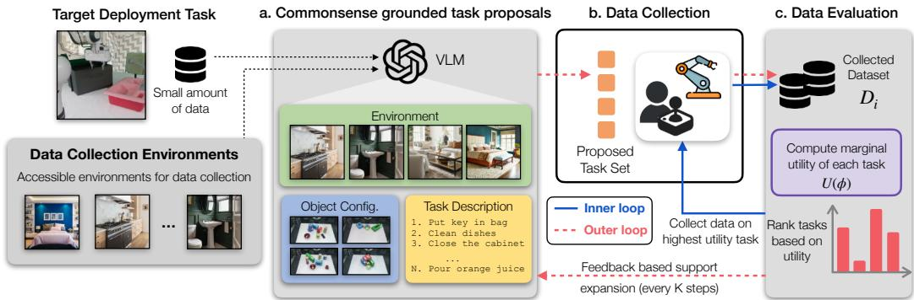  
Figure 1: Overview of GUILD Pipeline. Given a limited-access deployment setting and a set of accessible data collection environments, GUILD uses VLM priors to propose candidate scenes, object placements and tasks for data collection. Collected trajectories are then evaluated using predictive data attribution to estimate their influence on deployment-task performance. These attribution scores are used as feedback to guide subsequent data collection and task proposals—closing the loop.

Automatic Environment and Data Generation. To scale robot data collection, prior work has explored automatic generation of tasks, scenes, and demonstrations [30, 31, 32]. Earlier approaches rely on procedural heuristics to compose environments and task specifications [33, 34, 35], while more recent methods use foundation models to generate manipulation tasks and synthesize demonstrations via motion planning [36, 37, 38]. In reinforcement learning, language models have also been used to generate reward functions, domain randomization parameters, and training environments [39, 40, 41, 42]. GUILD shares its VLM-based task proposal stage with methods such as GenSim [37, 38] and Eurekaverse [42], but differs fundamentally in objective. Existing methods primarily target zero-shot generalization and therefore generate broad, undirected task distributions. In contrast, GUILD guides generation toward tasks most relevant for a target deployment setting.

Data Attribution. We build on data attribution [16, 17, 18, 43, 44, 45, 46], a body of work that predicts model behavior as a function of training data. These methods have been used to improve language-model pretraining [8] and instruction tuning [9, 47, 48], to increase worst-group robustness [49], and to remove outliers in supervised learning [50]; within robotics, they have been used to curate already-collected demonstrations [11, 13]. However, these methods operate strictly as post-hoc curation mechanisms on static, already-collected offline datasets. In contrast, GUILD embeds data attribution into an open-ended data collection loop. Rather than merely filtering existing datasets, we use attribution as a signal to guide future data acquisition.

## 3 Preliminaries

Policy Learning. Our work focuses on imitation learning, where the goal is to learn a policy π that maps states s to distributions over actions a using a collection of trajectories $\mathcal { D } = ( \tau _ { 1 } , \tau _ { 2 } \cdot \cdot \cdot \tau _ { n } )$ of state-action pairs. We will define a policy learning algorithm A (eg. stochastic gradient descent on an imitation learning objective), as a function that takes as input a dataset D and outputs an optimized policy π. We measure the performance of the policy π using a metric $\mathcal { M } : \pi  \mathbb { R } .$ , which is a function mapping policies to a scalar value. The most common choice of metric is success rate—the fraction of times rolling out the policy results in the policy completing a given task—but our notation is general and can also capture other choices of M.

Guided Data Collection. In Guided Data Collection (GDC) [15], we are given (i) an initial dataset D, (ii) a learning algorithm A, and (iii) a target metric $\mathcal { M } .$ The goal is to collect an additional dataset $\mathcal { D } ^ { \prime }$ under a fixed budget $k = | \mathcal { D } ^ { \prime } |$ such that training on $\mathcal { D } \cup \mathcal { D } ^ { \prime }$ maximizes downstream policy performance under M. We model data collection through a parameterized generator

$$
\tau \sim \mathcal { G } ( \phi ) ,
$$

where $\phi$ specifies tasks (or interchangeably task parameters) such as scene configuration, object placements, and task goals. While our setting uses human teleoperators as data collectors, the formulation also captures scripted controllers, motion planners, or autonomous policies.

Importantly, effective transfer across domains typically requires collecting data from a diverse set of tasks and environments [5, 11, 51]. Consequently, instead of optimizing a single task parameter $\phi ,$ we optimize a distribution over task parameters $p _ { \theta } ( \phi )$ for data collection. Given a budget k, we sample $\phi \sim p _ { \theta } ( \phi )$ and collect a dataset $\mathcal { D } _ { \theta } ^ { \prime }$ . The Guided Data Collection objective is therefore:

$$
\underset { \theta } { \arg \operatorname* { m a x } } \ \mathcal { M } \left( \mathcal { A } \left( \mathcal { D } \cup \mathcal { D } _ { \theta } ^ { \prime } \right) \right) .\tag{1}
$$

This formulation treats data collection itself as an optimization problem, where the learner actively allocates a limited collection budget toward the tasks and environments that most improve downstream deployment performance. We focus on a practical setting where the target environment is only sparsely accessible for data collection, e.g., robots deployed in end-user homes but trained on data collected in auxiliary environments such as laboratory apartments or mock kitchens. As a result, the training and deployment distributions may differ substantially. GUILD seeks to allocate the collection budget toward tasks and environments that best improve deployment-time performance under this distribution shift, assuming access to a small target dataset $\mathcal { D } _ { \mathrm { t a r g } }$ for evaluation.

Data Attribution. Data attribution studies the problem of estimating how individual training examples influence downstream model behavior. Let $f ( \mathcal { D } ) = \mathcal { M } ( \mathcal { A } ( \mathcal { D } ) )$ denote the performance of a policy trained on a dataset D. Since directly evaluating $f ( \mathcal D )$ requires training and evaluating a policy, which is computationally expensive, data attribution methods instead seek to learn a cheaper surrogate ${ \widehat { f } } ( { \mathcal { D } } ) \approx f ( { \mathcal { D } } )$ that predicts downstream performance as a function of the training data. There are several ways of computing $\widehat { f } \ [ 1 6 , 1 7 , 4 5 ]$ and in Section 4.2, we explore one such option and discuss how we use it to define the marginal utility of a task, i.e. the effect of adding an additional trajectory from a task to the downstream policy performance on the target task.

## 4 GUILD: Guided Iterative Imitation Learning Data Collection

Directly optimizing the GDC objective in Eq. 1 is intractable due to the large, open-ended space of collection parameters $\phi .$ GUILD instead approximates the optimal collection distribution $p _ { \theta ^ { * } } ( \phi )$ through an iterative closed-loop procedure that alternates between: (1) expanding the support of the collection distribution with semantically plausible task parameters, and (2) updating the sampling mass over this support using attributionbased utility estimates.

The first component (Section 4.1) uses vision– language models (VLMs) to propose a candidate task set $\mathcal { T } ~ = ~ \{ \phi _ { 1 } , \phi _ { 2 } , \ldots , \phi _ { n } \}$ , defining the current support of $p _ { \theta } ( \phi )$ Rather than directly optimizing policy performance, the VLM proposes task parameters that are semantically grounded in the target domain and feasible within the available data collection environments. The second component (Section 4.2) uses predictive data attribution to estimate the marginal utility of demonstrations collected from each task, providing a local signal for shifting the empirical collection distribution toward $p _ { \theta ^ { * } } ( \phi )$

Algorithm 1 GUILD Pseudocode   
Input: target context $_ { c _ { \mathrm { t a r g } } , }$ target dataset $\mathcal { D } _ { \mathrm { t a r g } } ,$   
data collector/generator G, learner ${ \mathcal { A } } ,$ metric $\widehat { \mathcal { M } }$   
Hyperparameters: outer iterations N, inner iter  
ations K, batch size $b ,$ number of new tasks m   
▷ Initial task proposal   
T0 ← VLM-PROPOSE(ctarg, m)   
D ← COLLECTUNIFORM(G, T0)   
▷ Outer loop   
for i ← 0 to N − 1 do   
▷ Inner loop   
for j ← 0 to K − 1 do   
I ← ATTRIBUTION $( \mathcal { A } , \widehat { \mathcal { M } } , \mathcal { D } , \mathcal { D } _ { \mathrm { t a r g } } )$   
▷ Compute marginal task utilities   
for all $\mathbf { \bar { \boldsymbol { \phi } } } \in \mathcal { T } _ { i }$ do   
$\begin{array} { r l } { \lfloor } & { { } U ( \phi )  \mathbb { E } _ { \tau _ { k } \sim \mathcal { D } _ { \phi } } [ \mathcal { T } _ { k } ] } \end{array}$   
ϕ∗ ← arg maxϕ∈T U(ϕ)   
B ← COLLECT(G, ϕ∗, b)   
D ← D ∪ B   
▷ Feedback-driven support expansion   
Tnew ← VLM-PROPOSEctarg, RANK(Ti, U), m   
D ← D ∪ COLLECTUNIFORM(G, Tnew)   
Ti+1 ← Ti ∪ Tnew   
▷ Final policy training   
return final dataset $\mathcal { D } _ { N }$ and policy $\boldsymbol { \mathcal { A } } ( \mathcal { D } _ { N } )$

GUILD operates at two timescales. An outer loop (indexed by i) periodically expands the support of the collection distribution by generating new task candidates $\mathcal { T } _ { i } .$ , while an inner loop (indexed by $j )$ performs multiple rounds of attribution-guided data collection with fixed support. During these inner-loop updates, GUILD allocates collection effort toward higher-utility tasks before expanding the support again. By alternating between support expansion, data collection, and evaluation, GUILD refines the collected data distribution toward tasks predicted to maximally improve deployment performance. An overview is shown in Figure 1, with pseudocode in Algorithm 1.

## 4.1 Task-Parameter-Space Exploration via Commonsense-Grounded Proposals

The space of possible task parameters $\phi$ is too large to enumerate exhaustively. GUILD therefore uses a VLM to generate a semantically grounded candidate task set $\mathcal { T } _ { i } = \{ \phi _ { 1 } , \phi _ { 2 } , . . . , \phi _ { n } \}$ , defining the current support of the collection distribution $p _ { \theta } ( \phi )$ , i.e. the tasks considered for subsequent data collection. This support-expansion stage forms the outer loop of GUILD: $\mathcal { T } _ { i }$ is generated once per outer-loop iteration and is fixed during several subsequent rounds of attribution-guided collection in the inner-loop.

Given target-domain context—video demonstrations, language descriptions, and available training assets (e.g., environments and objects)—the VLM proposes feasible task parameters specifying the collection environment, scene configuration, and manipulation task. The VLM does not determine how much data should be collected from each task; instead, it identifies promising regions of the open-ended task space, while attribution-based evaluation later determines their utility.

Initialization. At the first outer-loop iteration $( i = 0 )$ , GUILD generates an initial task set $\mathcal { T } _ { 0 }$ and uniformly samples from it to collect a seed dataset $\mathcal { D } _ { 0 } \sim \mathcal { G } ( \mathcal { T } _ { 0 } )$ . This initialization provides broad coverage over semantically plausible tasks and establishes the initial data distribution. The resulting dataset $\mathcal { D } _ { 0 }$ serves as the starting point for attribution-based utility estimation.

Feedback-driven support expansion. After every K inner-loop collection iterations, GUILD expands the support of the collection distribution by querying the VLM for additional task parameters $\mathcal { T } _ { \mathrm { n e w } } .$ updating the support as $\mathcal { T } _ { i } = \mathcal { T } _ { i - 1 } \cup \mathcal { T } _ { \mathrm { n e w } }$ . To guide this expansion, the VLM receives both the original target-domain context and a ranked list of previously evaluated task parameters derived from attribution-based utility estimates. This provides grounded feedback and biases exploration toward regions semantically related to high-utility tasks, adding support for promising new tasks outside the ones previously explored. In this way, the VLM expands the support of $p _ { \theta } ( \phi )$ , while attribution determines how collection effort is allocated within it. Similar to initialization, we add a uniform seed dataset for $T _ { \mathrm { n e w } }$ to our dataset. We ablate the feedback-driven support expansion mechanism in Appendix $\mathrm { C . 4 }$ and show that including the feedback mechanism matches or improves the performance over a no-feedback control across all tasks.

## 4.2 Data Evaluation via Predictive Attribution

After each collection round, GUILD updates the collection distribution over the current task set by estimating which tasks are most likely to improve deployment-time performance if additional demonstrations are collected from them. Rather than using attribution purely for post-hoc dataset curation, GUILD interprets attribution scores as local estimates of how the empirical data distribu tion should shift towards the optimal collection distribution $p _ { \theta ^ { * } } ( \phi )$

Learning attribution model. Recall from Section 3 that data attribution methods learn a surrogate ${ \widehat { f } } ( { \mathcal { D } } ) \approx f ( { \mathcal { D } } )$ that predicts downstream policy performance as a function of the training dataset. GUILD uses this surrogate to estimate how small changes in the composition of the collected data affect target-domain performance. We instantiate this using MAGIC [17], which leverages metagradients to efficiently approximate the surrogate. Following [9, 17], we parameterize the dataset using weights $\mathbf { w } \in [ 0 , 1 ] ^ { n }$ , where $w _ { k }$ specifies the contribution of trajectory $\tau _ { k }$ during training. A value of $w _ { k } = 1$ corresponds to fully including $\tau _ { k }$ in training, while $w _ { k } = 0$ excludes it entirely. Treating w as meta-parameters, a first-order Taylor expansion gives:

$$
\begin{array} { r } { \mathcal { M } ( \mathcal { A } ( \mathbf { w } ) ) \approx \mathcal { M } ( \mathcal { A } ( \mathbf { w } _ { 0 } ) ) + \nabla _ { \mathbf { w } } \mathcal { M } ( \mathcal { A } ( \mathbf { w } _ { 0 } ) ) ^ { \top } ( \mathbf { w } - \mathbf { w } _ { 0 } ) , } \end{array}\tag{2}
$$

where $\mathbf { w } _ { 0 } = \mathbf { 1 }$ corresponds to training on the full dataset. The gradient $\mathcal { T } = \nabla _ { \mathbf { w } } \mathcal { M } ( \mathcal { A } ( \mathbf { w } _ { 0 } ) )$ measures how infinitesimal changes in trajectory weights affect downstream policy performance, with each entry $\mathcal { T } _ { k }$ acting as a trajectory-level attribution score for trajectory $\tau _ { k }$ . Recent work [9] shows how I can be efficiently computed. Directly evaluating M requires expensive policy rollouts in the target environment. Following Dass et al. [11], we substitute M in Eq. 2 with an offline proxy metric based on the validation loss over a small target dataset: $\begin{array} { r } { \widehat { \mathcal { M } } ( \pi , { \mathcal { D } } _ { \mathrm { t a r g } } ) = \sum _ { ( s , a ) \in { \mathcal { D } } _ { \mathrm { t a r g } } } { \mathcal { L } } ( \pi ( s ) , a ) } \end{array}$ which provides an efficient surrogate for learning the attribution model.

Marginal Task Utility. Since demonstrations are collected by selecting task parameters ϕ, GUILD aggregates trajectory-level attribution scores into a task parameter-level utility. Let $\mathcal { D } _ { \phi } \subset \mathcal { D }$ denote the set of trajectories collected under task parameter ϕ. GUILD defines the marginal utility of ϕ as

$$
U ( \phi ) = \frac { 1 } { | \mathcal { D } _ { \phi } | } \sum _ { \tau _ { k } \in \mathcal { D } _ { \phi } } \mathcal { T } _ { k } .\tag{3}
$$

Intuitively, $U ( \phi )$ approximates the expected marginal benefit of collecting an additional trajectory from task parameter $\phi ,$ under the current dataset composition. This utility provides a one-step approximation to the update direction for the data collection distribution towards the optimal distribution of task parameters $p _ { \theta ^ { * } } ( \phi )$ : task parameters with higher utility should receive more sampling mass, while task parameters with low or negative utility should receive less.

Batched Iterative Collection. The attribution model is local to the current dataset composition; repeatedly collecting from a high-utility task may reduce its marginal value as that region becomes sufficiently covered. GUILD therefore performs batched iterative collection, recomputing utilities after each update. At inner-loop iteration $j ,$ GUILD estimates attribution scores using the current dataset $\mathcal { D } _ { j }$ , computes task utilities $U ( \phi )$ for each supported task parameters $\phi \in \mathcal { T } _ { i }$ , and selects task parameters with the highest marginal utility:

$$
\phi _ { j } ^ { * } \in \arg \operatorname* { m a x } _ { \phi \in \mathcal { T } _ { i } } U ( \phi ) .\tag{4}
$$

A small batch of demos $B _ { j }$ is then collected with $\phi _ { j } ^ { * }$ and added to the dataset: $\mathcal { D } _ { j + 1 } = \mathcal { D } _ { j } \cup B _ { j }$ The support $\mathcal { T } _ { i }$ remains fixed during these inner-loop updates, allowing GUILD to locally optimize allocation of collection effort over the current task set. This update shifts the empirical collection distribution toward task parameters that locally approximate $p _ { \theta ^ { * } } ( \phi )$ under the current attribution estimate. Utilities are then recomputed on the updated dataset before the next collection round. We also discuss a soft-selection strategy in Appendix C.3.

The batch size controls the tradeoff between compute cost and adaptivity: smaller batch allow GUILD to more frequently recompute attribution scores and respond to changes in marginal utility, while larger batches reduce computation at the cost of less precise distribution updates. After K inner-loop updates, GUILD returns to the support-expansion stage (Section 4.1) to propose new task parameters beyond the current support.

## 5 Experiments

Training Details. We train a language-conditioned Octo [52] policy on the collected datasets, initial izing from the pretrained checkpoint released by the authors. Following prior work [6, 11, 22, 51], we co-train the policy with the target-task demonstrations $\mathcal { D } _ { \mathrm { t a r g } }$ using a 50/50 sampling mixture.

Baselines. We compare GUILD with the following baselines: Random, which samples tasks by randomly selecting objects and semantically valid placements and collects data uniformly across them; VLM-Uniform, STRAP [14] and Factored Scaling Curves (FSC) [15], all use the same VLM (GPT 5.2 [53]) task proposer as Section 4.1; VLM-Uniform samples uniformly from the proposed tasks without evaluation; STRAP evaluates task relevance using DINOv2 [54] embedding similarity; and FSC estimates task utility by training policies on varying amounts of task-specific data and measuring the resulting scaling behavior. See Appendix D for implementation details.

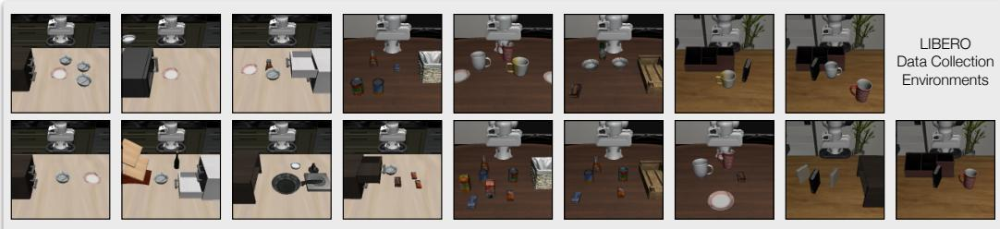

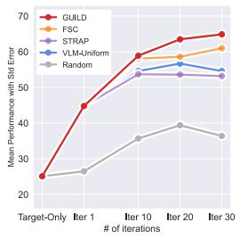  
Average

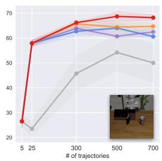  
book-caddy

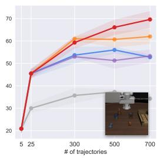  
soup-butter-tray

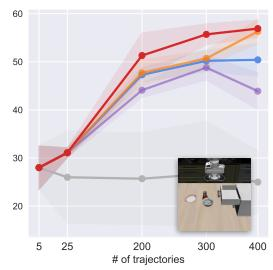  
bowl-ketchup-drawer  
Figure 2: LIBERO guided data collection. We generate data using various strategies and train policies across different points of the process. GUILD either matches or surpasses the next best baseline. For each method on each task, we train 3 different data collection seeds. For every evaluation, we train 5 policies, measure their performance over 100 rollouts and average their performances. The means and standard error are computed across the 3 seeds of data collection process.

## 5.1 Results

## Can GUILD efficiently guide data collection?

We first evaluate GUILD on LIBERO, using 17 environments from LIBERO-90 (Figure 2, top). We select three target tasks from distinct scenes and, for each target, collect training data exclusively from the remaining 16 scenes using scripted pick-and-place policies. Figure 2 (bottom) plots policy success rate vs. number of collected trajectories. Random performs substantially worse than all other methods, while VLM-Uniform significantly better, demonstrating that VLM-based semantic priors can alone provide a strong signal for task generation. Incorporating principled data evaluation further improves performance: both FSC and GUILD outperform STRAP and no-evaluation baselines. Across all tasks and collection budgets, GUILD consistently matches or exceeds the strongest baseline, demonstrating the effectiveness of attribution-guided data collection.

We observe a similar trend in the real world, where we construct 6 environments spanning two layouts each of kitchens, bathrooms, and offices (Figure 3, top). To avoid recollecting data for every method, we first build an offline dataset containing 49 tasks across these environments (Appendix G.3), which we refer to as the Closed-World setting. Here, task selection is restricted to the existing dataset, and data collection corresponds to sampling trajectories from datasets of the selected tasks. We evaluate on 4 target tasks, holding out one environment as the deployment domain and using the remaining environments for data collection. Policies are trained on the selected datasets and evaluated over 20 rollouts. Results in Figure 3 (solid bars) mirror simulation: GUILD achieves the best performance under the same collection budget. Notably, it also outperforms an All-Data baseline trained on the entire dataset, including data from the target environment, showing that targeted collection can be more effective than indiscriminately scaling dataset size.

## Can GUILD guide data collection in open-world settings?0.04

Our primary goal is to deploy GUILD in Open-World settings, where the system is not restricted to selecting from a fixed task pool, but can instead freely specify environments, object configurations,0.02 and task goals. We hypothesize that this additional flexibility amplifies the benefits of guided data0.02 collection by enabling more targeted exploration of the task space. Since evaluating multiple methods in this setting would require recollecting large real-world datasets, we compare only GUILDOurs (Open) Expert 2 and VLM-Uniform, shown as the textured bars Ours (Open) Expert 2 (Open)and VLM-Uniform (Open) Expert 1 in Figure 3, respectively. We observe two key trends. First, including data evaluation for GDC provides substantial gains over relying solely on VLM-generated task proposals: GUILD consistently outperforms VLM-Uniform across all evaluated tasks, improving average performance by approximately 25%. Second, both methods perform better in the Open-World setting than in the corresponding Closed-World setting, supporting our hypothesis that finer control over task specification leads to more effective data collection.

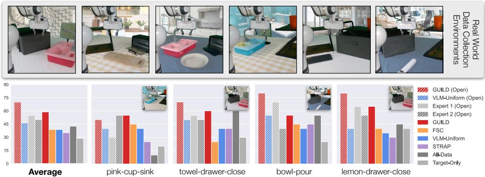  
Figure 3: Real world guided data collection. We evaluate the policies trained on the data generated by different strategies. GUILD consistently achieves the highest success under the same data collection budget, highlighting its efficacy in guiding data collection towards useful tasks for the deployment setting.

## How does GUILD compare to human-guided data collection?

Finally, we compare GUILD against humans, which remains the dominant paradigm for real-world robot data collection. In LIBERO, we survey 8 roboticist with varying levels of robotics experience (ranging from 1-5+ years), providing them the same information available to the GDC methods and asking them to propose tasks and allocate a fixed collection budget across them. Averaged results across the three tasks in LIBERO are shown in Figure 4 (task-wise results and additional discussion provided in Appendix C.2). While different humans have differing affinity for guiding data collection, the Average Human indicates the mean human performance, showing that on average, humans stay below the overall performance gains of GUILD.

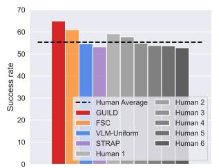  
Figure 4: Human Comparison. Avg. performance on 3 LIBERO tasks of datasets collected via various methods and humans.

This suggests that attribution-based data evaluation provides a stronger signal for guiding collection of useful training data. Another interesting observation is that VLM-Uniform closely matches the performance of the Average Human, suggesting that modern VLMs capture much of the commonsense reasoning used by human experts and provide a strong prior for initializing the GDC process.

We observe a similar trend in the real world, where we compare against 2 human experts (4-5 years of robotics experience) in the Open-World setting. Their individual performances are shown in Fig-rs (Open) Expert 2 (Open) Ours VLM-Uniform All-Data ure 3 as Expert 2 (Open) Ours VLM-Uniform All-DataandM-Uniform (Open) Expert 1 (Open) FSC STRAP. Consistent with simulation, GUILD achieves higher average performanceTarget-Only (Open) Expert 1 (Open) FSC STRAP Target-Onlyacross tasks. We additionally observe that human-designed collection strategies are often inconsistent across tasks—eg. Expert 1 on towel-drawer-close vs. pink-cup-sink task— whereas GUILD provides a more reliable and systematic mechanism for guiding data collection.

## 5.2 Qualitative Analysis: What Data Does GUILD Collect?

Figure 5 visualizes the final data composition for each real-world target task collected by GUILD in the Open-World setting. For each target, the auxiliary tasks are unique to that setting and are ordered from highest to lowest collected data. Each bar denotes the number of trajectories collected for an auxiliary task, while its color indicates the outer-loop iteration in which that task was introduced. We additionally visualize representative high-allocation auxiliary tasks for each target. We observe that GUILD prioritizes auxiliary tasks that preserve relevant semantic and behavioral structure with the target task, such as similar objects, receptacles, or manipulation patterns.

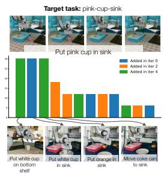

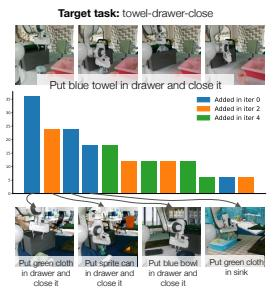

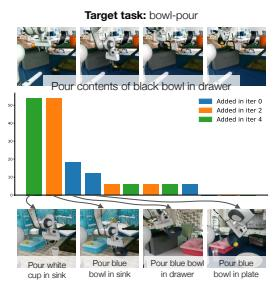

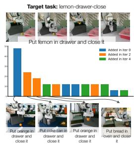  
Figure 5: Real-world qualitative analysis. For each target task, we visualize the final allocation of collected trajectories across auxiliary tasks (middle), and tasks with the highest data allocation auxiliary tasks (bottom). Bar colors indicate the outer-loop iteration in which each auxiliary task was introduced.

Useful tasks are discovered throughout the collection process. The color coding in Figure 5 provides a view into when useful tasks are introduced during iterative data collection. Useful tasks are not necessarily contained in the initial proposal set: tasks introduced during later supportexpansion rounds can still receive a substantial fraction of the final collection budget. For example, for pink-cup-sink, one of the highest-allocation tasks is introduced at a later support-expansion stage, while for bowl-pour, two of the largest allocations correspond to tasks introduced after initialization. This suggests that iterative support expansion is important: later proposals can introduce new high-utility tasks that were absent from the initial candidate set. Similar analysis in simulation mirrors this observation (Appendix C.1).

Nature of the final data composition. We also observe that the shape of the final data distribution varies substantially across target tasks. For bowl-pour, and lemon-drawer-close the collection budget is relatively concentrated, with a small number of auxiliary tasks receiving a large fraction of the total allocation. In contrast, the final distributions for pink-cup-sink, and towel-drawer-close are more distributed, with substantial collection effort allocated across several auxiliary tasks rather than collapsing onto a single task. This illustrate that useful collection strategies can take qualitatively different forms depending on the target: in some cases, a small number of tasks dominate, while in others, performance benefits from a broader mixture of auxiliary tasks. This further motivates treating data collection as an adaptive allocation problem rather than relying on a fixed heuristic such as uniform sampling or selecting a single highly ranked task.

## 6 Conclusion and Limitations

We introduced GUILD, an iterative framework for Guided Data Collection that combines VLMbased task generation with predictive data attribution to actively decide what robot data to collect next. Across simulation and real-world experiments, GUILD substantially improves data efficiency over passive collection strategies, several baselines, and even experienced roboticists, highlighting the importance of treating data collection itself as an optimization problem. We conclude by highlighting a few limitations of GUILD and potential avenues of future work. First, while modern VLMs provide strong task priors, they can still generate unoriginal or infeasible tasks; in practice, these failures can often be mitigated through weak human supervision. Second, GUILD introduces a tradeoff between adaptivity and computational cost: smaller collection batches yield more accurate utility estimates but require more frequent attribution recomputation. A promising direction is to adaptively determine both batch sizes and attribution update schedules. Finally, our framework discretizes the task space through VLM-generated proposals before attribution-based evaluation. Extending attribution methods to continuous parameterizations could enable finer-grained exploration and broader application of such approaches.

## Acknowledgments

This work was conducted in the Robot Interactive Intelligence (RobIn) Lab at The University of Texas at Austin and supported in part by the National Science Foundation (CAREER Award FAIN 2543745), the NVIDIA Academic Grant Program and TACC resources, and Amazon. Any opinions, findings, and conclusions or recommendations expressed in this material are those of the authors and do not necessarily reflect the views of the National Science Foundation or the other sponsors.

## References

[1] A. Brohan, N. Brown, J. Carbajal, Y. Chebotar, J. Dabis, C. Finn, K. Gopalakrishnan, K. Hausman, A. Herzog, J. Hsu, et al. Rt-1: Robotics transformer for real-world control at scale. arXiv preprint arXiv:2212.06817, 2022.

[2] J. Bjorck, F. Castaneda, N. Cherniadev, X. Da, R. Ding, L. Fan, Y. Fang, D. Fox, F. Hu, ˜ S. Huang, et al. Gr00t n1: An open foundation model for generalist humanoid robots. arXiv preprint arXiv:2503.14734, 2025.

[3] K. Black, N. Brown, D. Driess, A. Esmail, M. Equi, C. Finn, N. Fusai, L. Groom, K. Hausman, B. Ichter, et al. π0: A vision-language-action flow model for general robot control. arXiv preprint arXiv:2410.24164, 2024.

[4] H. Fang, J. Duan, D. Clay, S. Wang, S. Liu, W. Huang, X. Fan, W.-C. Tsai, S. Chen, Y. R. Wang, et al. Molmoact2: Action reasoning models for real-world deployment. arXiv preprint arXiv:2605.02881, 2026.

[5] A. O’Neill, A. Rehman, A. Maddukuri, A. Gupta, A. Padalkar, A. Lee, A. Pooley, A. Gupta, A. Mandlekar, A. Jain, et al. Open x-embodiment: Robotic learning datasets and rt-x models: Open x-embodiment collaboration 0. In 2024 IEEE International Conference on Robotics and Automation (ICRA), pages 6892–6903. IEEE, 2024.

[6] A. Khazatsky, K. Pertsch, S. Nair, A. Balakrishna, S. Dasari, S. Karamcheti, S. Nasiriany, M. K. Srirama, L. Y. Chen, K. Ellis, et al. Droid: A large-scale in-the-wild robot manipulation dataset. arXiv preprint arXiv:2403.12945, 2024.

[7] H. R. Walke, K. Black, T. Z. Zhao, Q. Vuong, C. Zheng, P. Hansen-Estruch, A. W. He, V. Myers, M. J. Kim, M. Du, et al. Bridgedata v2: A dataset for robot learning at scale. In Conference on Robot Learning, pages 1723–1736. PMLR, 2023.

[8] L. Engstrom, A. Feldmann, and A. Madry. DsDm: Model-aware dataset selection with datamodels. In R. Salakhutdinov, Z. Kolter, K. Heller, A. Weller, N. Oliver, J. Scarlett, and F. Berkenkamp, editors, Proceedings of the 41st International Conference on Machine Learning, volume 235 of Proceedings of Machine Learning Research, pages 12491–12526. PMLR, 21–27 Jul 2024. URL https://proceedings.mlr.press/v235/engstrom24a. html.

[9] L. Engstrom, A. Ilyas, B. Chen, A. Feldmann, W. Moses, and A. Madry. Optimizing ml training with metagradient descent. arXiv preprint arXiv:2503.13751, 2025.

[10] J. Li, A. Fang, G. Smyrnis, M. Ivgi, M. Jordan, S. Gadre, H. Bansal, E. Guha, S. Keh, K. Arora, et al. Datacomp-lm: In search of the next generation of training sets for language models. Advances in Neural Information Processing Systems, 37:14200–14282, 2024.

[11] S. Dass, A. Khaddaj, L. Engstrom, A. Madry, A. Ilyas, and R. Mart´ın-Mart´ın. Datamil: Selecting data for robot imitation learning with datamodels. In International Conference on Learning Representations, volume 2026, pages 1311–1336, 2026.

[12] J. Hejna, C. A. Bhateja, Y. Jiang, K. Pertsch, and D. Sadigh. Remix: Optimizing data mixtures for large scale imitation learning. In Conference on Robot Learning, pages 145–164. PMLR, 2025.

[13] C. Agia, R. Sinha, J. Yang, R. Antonova, M. Pavone, H. Nishimura, M. Itkina, and J. Bohg. Cupid: Curating data your robot loves with influence functions. arXiv preprint arXiv:2506.19121, 2025.

[14] M. Memmel, J. Berg, B. Chen, A. Gupta, and J. Francis. Strap: Robot sub-trajectory retrieval for augmented policy learning. In International Conference on Learning Representations, volume 2025, pages 63813–63832, 2025.

[15] L. Zha, A. Badithela, M. Zhang, J. Lidard, J. Bao, E. Zhou, D. Snyder, A. Z. Ren, D. Shah, and A. Majumdar. Guiding data collection via factored scaling curves. arXiv preprint arXiv:2505.07728, 2025.

[16] A. Ilyas, S. M. Park, L. Engstrom, G. Leclerc, and A. Madry. Datamodels: Understanding predictions with data and data with predictions. In International Conference on Machine Learning, pages 9525–9587. PMLR, 2022.

[17] A. Ilyas and L. Engstrom. Magic: Near-optimal data attribution for deep learning, 2025.

[18] A. Ilyas, K. Georgiev, L. Engstrom, and S. M. Park. Data attribution at scale. Tutorial at ICML 2024, 2024. URL https://ml-data-tutorial.org.

[19] Y. Zhang, Y. Xie, H. Liu, R. Shah, M. Wan, L. Fan, and Y. Zhu. Scizor: A self-supervised approach to data curation for large-scale imitation learning. arXiv preprint arXiv:2505.22626, 2025.

[20] J. Hejna, S. Mirchandani, A. Balakrishna, A. Xie, A. Wahid, J. Tompson, P. Sanketi, D. Shah, C. Devin, and D. Sadigh. Robot data curation with mutual information estimators. arXiv preprint arXiv:2502.08623, 2025.

[21] M. Du, S. Nair, D. Sadigh, and C. Finn. Behavior retrieval: Few-shot imitation learning by querying unlabeled datasets. arXiv preprint arXiv:2304.08742, 2023.

[22] L.-H. Lin, Y. Cui, A. Xie, T. Hua, and D. Sadigh. Flowretrieval: Flow-guided data retrieval for few-shot imitation learning. arXiv preprint arXiv:2408.16944, 2024.

[23] S. Kumar, S. Dass, G. Pavlakos, and R. Mart´ın-Mart´ın. Collage: Adaptive fusion-based retrieval for augmented policy learning. In 9th Annual Conference on Robot Learning, 2025.

[24] P. I. Frazier. A tutorial on bayesian optimization. arXiv preprint arXiv:1807.02811, 2018.

[25] A. Rai, R. Antonova, S. Song, W. Martin, H. Geyer, and C. Atkeson. Bayesian optimization using domain knowledge on the atrias biped. In 2018 IEEE International Conference on Robotics and Automation (ICRA), pages 1771–1778. IEEE, 2018.

[26] A. Rai, R. Antonova, F. Meier, and C. G. Atkeson. Using simulation to improve sampleefficiency of bayesian optimization for bipedal robots. Journal of machine learning research, 20(49):1–24, 2019.

[27] F. Ramos, R. C. Possas, and D. Fox. Bayessim: adaptive domain randomization via probabilistic inference for robotics simulators. arXiv preprint arXiv:1906.01728, 2019.

[28] B. Mehta, M. Diaz, F. Golemo, C. J. Pal, and L. Paull. Active domain randomization. In Conference on Robot Learning, pages 1162–1176. PMLR, 2020.

[29] F. Muratore, C. Eilers, M. Gienger, and J. Peters. Data-efficient domain randomization with bayesian optimization. IEEE Robotics and Automation Letters (RA-L), 6(2):911–918, 2021.

[30] A. Mandlekar, S. Nasiriany, B. Wen, I. Akinola, Y. Narang, L. Fan, Y. Zhu, and D. Fox. Mimicgen: A data generation system for scalable robot learning using human demonstrations. arXiv preprint arXiv:2310.17596, 2023.

[31] C. Li, M. Xu, A. Bahety, H. Yin, Y. Jiang, H. Huang, J. Wong, S. Garlanka, C. Gokmen, R. Zhang, et al. Momagen: Generating demonstrations under soft and hard constraints for multi-step bimanual mobile manipulation. arXiv preprint arXiv:2510.18316, 2025.

[32] S. Dass, K. Pertsch, H. Zhang, Y. Lee, J. J. Lim, and S. Nikolaidis. Pato: Policy assisted teleoperation for scalable robot data collection. arXiv preprint arXiv:2212.04708, 2022.

[33] L. Dai, H. Wang, W. Wan, and H. Su. Manitaskgen: A comprehensive task generator for benchmarking and improving vision-language agents on embodied decision-making. arXiv preprint arXiv:2505.20726, 2025.

[34] M. Deitke, E. VanderBilt, A. Herrasti, L. Weihs, K. Ehsani, J. Salvador, W. Han, E. Kolve, A. Kembhavi, and R. Mottaghi. Procthor: Large-scale embodied ai using procedural generation. Advances in Neural Information Processing Systems, 35:5982–5994, 2022.

[35] A. Shukla, S. Tao, and H. Su. Maniskill-hab: A benchmark for low-level manipulation in home rearrangement tasks. In International Conference on Learning Representations, volume 2025, pages 15288–15317, 2025.

[36] R. Gong, X. Zhang, J. Shang, M. V. Minniti, J. Patel, V. Pepe, R. Yan, A. Gundogdu, I. Kapelyukh, A. Abbas, et al. Anytask: an automated task and data generation framework for advancing sim-to-real policy learning. arXiv preprint arXiv:2512.17853, 2025.

[37] L. Wang, Y. Ling, Z. Yuan, M. Shridhar, C. Bao, Y. Qin, B. Wang, H. Xu, and X. Wang. Gensim: Generating robotic simulation tasks via large language models. arXiv preprint arXiv:2310.01361, 2023.

[38] P. Hua, M. Liu, A. Macaluso, Y. Lin, W. Zhang, H. Xu, and L. Wang. Gensim2: Scaling robot data generation with multi-modal and reasoning llms. In Conference on Robot Learning, pages 5030–5066. PMLR, 2025.

[39] Y. J. Ma, W. Liang, G. Wang, D.-A. Huang, O. Bastani, D. Jayaraman, Y. Zhu, J. Fan, et al. Eureka: Human-level reward design via coding large language models. In International conference on learning Representations, volume 2024, pages 26516–26560, 2024.

[40] J. Ma, W. Liang, H.-J. Wang, Y. Zhu, L. Fan, O. Bastani, and D. Jayaraman. Dreureka: Language model guided sim-to-real transfer. RSS, 2024.

[41] Y. Wang, Z. Xian, F. Chen, T.-H. Wang, Y. Wang, K. Fragkiadaki, Z. Erickson, D. Held, and C. Gan. Robogen: Towards unleashing infinite data for automated robot learning via generative simulation. arXiv preprint arXiv:2311.01455, 2023.

[42] W. Liang, S. Wang, H.-J. Wang, O. Bastani, D. Jayaraman, and Y. J. Ma. Eurekaverse: Environment curriculum generation via large language models. arXiv preprint arXiv:2411.01775, 2024.

[43] P. W. Koh and P. Liang. Understanding black-box predictions via influence functions. In International conference on machine learning, pages 1885–1894. PMLR, 2017.

[44] Z. Hammoudeh and D. Lowd. Training data influence analysis and estimation: A survey. Machine Learning, 113(5):2351–2403, 2024.

[45] S. M. Park, K. Georgiev, A. Ilyas, G. Leclerc, and A. Madry. TRAK: Attributing model behavior at scale. In Arxiv preprint arXiv:2303.14186, 2023.

[46] T. A. Chang, D. Rajagopal, T. Bolukbasi, L. Dixon, and I. Tenney. Scalable influence and fact tracing for large language model pretraining. In The Thirteenth International Conference on Learning Representations, 2024.

[47] M. Xia, S. Malladi, S. Gururangan, S. Arora, and D. Chen. Less: selecting influential data for targeted instruction tuning. In Proceedings of the 41st International Conference on Machine Learning, pages 54104–54132, 2024.

[48] Z. Liu, A. Karbasi, and T. Rekatsinas. Tsds: Data selection for task-specific model finetuning. In The Thirty-eighth Annual Conference on Neural Information Processing Systems, 2024.

[49] S. Jain, K. Hamidieh, K. Georgiev, A. Ilyas, M. Ghassemi, and A. Madry. Improving subgroup robustness via data selection. Advances in Neural Information Processing Systems, 37:94490– 94511, 2024.

[50] J. Lin, A. Zhang, M. Lecuyer, J. Li, A. Panda, and S. Sen. Measuring the effect of training´ data on deep learning predictions via randomized experiments. In International Conference on Machine Learning, pages 13468–13504. PMLR, 2022.

[51] A. Maddukuri, Z. Jiang, L. Y. Chen, S. Nasiriany, Y. Xie, Y. Fang, W. Huang, Z. Wang, Z. Xu, N. Chernyadev, et al. Sim-and-real co-training: A simple recipe for vision-based robotic manipulation. arXiv preprint arXiv:2503.24361, 2025.

[52] Octo Model Team, D. Ghosh, H. Walke, K. Pertsch, K. Black, O. Mees, S. Dasari, J. Hejna, C. Xu, J. Luo, T. Kreiman, Y. Tan, L. Y. Chen, P. Sanketi, Q. Vuong, T. Xiao, D. Sadigh, C. Finn, and S. Levine. Octo: An open-source generalist robot policy. In Proceedings of Robotics: Science and Systems, Delft, Netherlands, 2024.

[53] A. Singh, A. Fry, A. Perelman, A. Tart, A. Ganesh, A. El-Kishky, A. McLaughlin, A. Low, A. Ostrow, A. Ananthram, et al. Openai gpt-5 system card. arXiv preprint arXiv:2601.03267, 2025.

[54] M. Oquab, T. Darcet, T. Moutakanni, H. Vo, M. Szafraniec, V. Khalidov, P. Fernandez, D. Haziza, F. Massa, A. El-Nouby, et al. Dinov2: Learning robust visual features without supervision. arXiv preprint arXiv:2304.07193, 2023.

[55] R. S. Sutton, A. G. Barto, et al. Reinforcement learning: An introduction, volume 1. MIT press Cambridge, 1998.

[56] J. Bae, W. Lin, J. Lorraine, and R. Grosse. Training data attribution via approximate unrolled differentiation. CoRR, 2024.

[57] D. A. Calian, G. Farquhar, I. Kemaev, L. M. Zintgraf, M. Hessel, J. Shar, J. Oh, A. Gyorgy,¨ T. Schaul, J. Dean, et al. Datarater: Meta-learned dataset curation. arXiv preprint arXiv:2505.17895, 2025.

[58] S. Dass, W. Ai, Y. Jiang, S. Singh, J. Hu, R. Zhang, P. Stone, B. Abbatematteo, and R. Mart´ın-Mart´ın. Telemoma: A modular and versatile teleoperation system for mobile manipulation. arXiv preprint arXiv:2403.07869, 2024.

[59] G. Comanici, E. Bieber, M. Schaekermann, I. Pasupat, N. Sachdeva, I. Dhillon, M. Blistein, O. Ram, D. Zhang, E. Rosen, et al. Gemini 2.5: Pushing the frontier with advanced reasoning, multimodality, long context, and next generation agentic capabilities. arXiv preprint arXiv:2507.06261, 2025.

## A Method Details

## A.1 VLM Task Proposer

Recall from Section 4.1 that GUILD uses a vision–language model (VLM) to propose task parameters (ϕ) that are likely to yield useful training data for a target deployment task. The prompts used in each experimental setting are provided in Appendix F. Given a video and language description of the target task, together with the available training assets (e.g., scenes and manipulable objects), the VLM proposes candidate task parameters. Appendix F also includes the prompt used during feedback-driven support expansion, where a ranked list of previously evaluated tasks is provided to guide future proposals. The corresponding inputs and outputs for each setting are provided in Appendix G.

Outer-Loop Schedule (K). As described in the main text, the VLM is periodically queried to expand the support of the collection distribution. Rather than using a fixed schedule, we generate tasks more aggressively during the early stages of Guided Data Collection and taper off later. Since the VLM defines the support over which evaluation-guided collection operates, early support expansion helps mitigate poor initial proposals and reduces the risk of allocating significant collection budget to uninformative tasks. In LIBERO, we perform 30 iterations of Guided Data Collection and expand the task set after iterations {2, 4, 8, 16}. In the real-world experiments, we perform 20 iterations and expand the task set after iterations {3, 9}.

Explore-Exploit Task Generation. During initial experiments, we found that conditioning task generation solely on evaluation-ranked tasks (exploit) often caused the VLM to repeatedly propose similar tasks, reducing diversity in the candidate pool. To mitigate this, we adopt an explore-exploit strategy inspired by reinforcement learning [55]. At each support-expansion step, when proposing m new tasks, a subset is generated using evaluation-ranked tasks (exploitation), while the remainder is generated using only the original target-task context (exploration), analogous to the initializa tion procedure. This strategy encourages diversity while still leveraging attribution feedback. In LIBERO, if i denotes the outer-loop iteration (1-indexed), then i of the m proposed tasks are generated via exploitation and the remaining m − i via exploration. Consequently, early iterations emphasize exploration when attribution estimates are noisy, while later iterations gradually shift toward exploitation as more reliable utility estimates become available. In real world, i + 1 tasks were generated via exploitation and m − i − 1 via exploration.

On the Bowl-ketchup-drawer task, using only exploitation achieved 50.7 ± 2.1% average success over three independently collected datasets, whereas explore-exploit improved performance to 56.9 ± 1.8%. We did not observe significant differences on the remaining LIBERO tasks.

## A.2 Data Attribution – Computing Metagradients

As discussed in Section 4.2, we use MAGIC [17] to compute the attribution model. Eq. 2 is reproduced below for convenience,

$$
\mathcal { M } ( \mathcal { A } ( \mathbf { w } ) ) \approx \mathcal { M } ( \mathcal { A } ( \mathbf { w } _ { 0 } ) ) + \nabla _ { \mathbf { w } } \mathcal { M } ( \mathcal { A } ( \mathbf { w } _ { 0 } ) ) ^ { \top } ( \mathbf { w } - \mathbf { w } _ { 0 } ) .
$$

There we discussed that computing $\mathcal { T } = \nabla _ { \mathbf { w } } \mathcal { M } ( \mathcal { A } ( \mathbf { w } _ { 0 } ) )$ is the main challenge, requiring the computation of metagradients with respect to the data weights w which are the meta-parameters of the training process. Computing metagradients has traditionally been notoriously difficult, and consequently most prior works in data attribution have focused on approximating I [43, 45, 56].

Recent advances, however, have shown that these metagradients can be computed both exactly and efficiently for modern deep learning systems [9, 57]. We use the REPLAY method of Engstrom et al. [9], which computes the effect of each training trajectory on the final policy by differentiating through the policy training process itself.

Intuitively, training a policy can be viewed as a long sequence of optimization steps, where each gradient update is influenced by the training data. Since the final policy depends on all of these updates, measuring how a trajectory affects deployment performance requires tracing its influence through the entire training process. A na¨ıve implementation would save the policy after every optimization step and then work backwards through this sequence of saved models to compute the metagradients. For modern policies, however, storing hundreds of intermediate models can require an impractical amount of memory.

REPLAY [9] avoids this issue by storing only a small number of checkpoints during training. Let $s _ { i }$ denote a saved model checkpoint at iteration i. When an intermediate model at iteration $j$ is needed for metagradient computation, REPLAY reconstructs it by re-executing the optimization updates between the most recent saved checkpoint $s _ { i }$ and iteration $j ,$ where $i < j ,$ , rather than storing every intermediate model. As a result, exact metagradients can be computed with memory requirements being practical. As a result, we can efficiently compute the attribution $\mathcal { T }$ which quantifies how increasing or decreasing the weight of each trajectory would affect the target-domain evaluation metric. We refer the reader to [9] and [17] for more details.

## A.2.1 Relationship between Utility and Downstream Performance

A central assumption in GUILD is that the attribution-based marginal utility $U ( \phi )$ provides a useful signal for deciding where to allocate additional data-collection effort. Intuitively, if $U ( \phi )$ captures how beneficial data from task $\phi$ is for the target task, then datasets containing a larger proportion of high-utility data should tend to produce policies with stronger downstream performance. We therefore study whether the utility estimates produced by GUILD are associated with the eventual success of policies trained on different collected datasets.

To obtain datasets with different compositions, we use the datasets collected by the different datacollection baselines in our LIBERO experiments. For each dataset, we compute the utility of its constituent tasks and average these values to obtain a single dataset-level utility score. We then compare this score against the success rate of the pol-

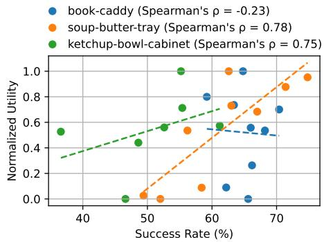  
Figure 6: Relationship between estimated utility and downstream policy performance. Each point corresponds to a dataset collected by one of the evaluated datacollection strategies. We plot the dataset’s mean task utility against the success rate of the policy trained on that dataset.

icy trained on the corresponding dataset by computing Spearman’s rank correlation for each task.   
Figure 6 shows this relationship separately for each target task.

We observe a strong positive relationship for ketchup-bowl-cabinet and soup-butter-tray, with correlations of $\rho ~ = ~ 0 . 7 5$ and $\rho ~ = ~ 0 . 7 8$ , respectively. In these settings, datasets assigned higher average utility by our attribution model also result in policies with higher downstream success. For book-caddy, the correlation is weakly negative (−0.23); notably, the evaluated datasets occupy a comparatively narrow range of success rates, making differences in downstream performance less pronounced. Overall, despite noise from stochastic policy evaluation and attribution estimation, these results provide evidence that the utility signal used by GUILD is meaningfully associated with downstream policy performance and can serve as a useful signal for guiding data collection.

## B Training and Evaluation Details

## B.1 LIBERO

Environment and Data Collection. Task-specific hyperparameters are reported in Table 1. For each target task, we use the remaining 16 environments from the LIBERO-90 suite as data collection environments. Demonstrations are generated using a scripted policy that takes a pick object and place region as input and outputs an expert trajectory.

Table 1: Task-specific hyperparameters for Guided Data Collection. Data collection iterations denote the total number of inner-loop collection iterations. Outer-loop schedule specifies the innerloop iterations at which support expansion is performed (Appendix A.1). m denotes the number of new task parameters proposed during each outer-loop iteration, and initial task demos denotes the number of demonstrations collected when a new task is introduced. Batch size (b) specifies the number of demonstrations collected during each inner-loop iteration using attribution-guided task selection.
<table><tr><td></td><td>No. of Training Envs</td><td>No. of Target Demos</td><td>No. of Data Collection Iter.</td><td>Outer-loop Schedule</td><td>No. of tasks Every Iter. (m)</td><td>Batch size (b)</td><td>No. of Initial Task Demos</td></tr><tr><td></td><td></td><td></td><td></td><td></td><td></td><td></td><td></td></tr><tr><td>LIBERO Book-Caddy</td><td>16</td><td>3</td><td>30</td><td>[2,4,8,16]</td><td>5</td><td>20</td><td>5</td></tr><tr><td>Soup-butter-tray</td><td>16</td><td>5</td><td>30</td><td>[2,4,8,16]</td><td>5</td><td>20</td><td>5</td></tr><tr><td>Bowl-ketchup-drawer</td><td>16</td><td>5</td><td>30</td><td>[2,4,8,16]</td><td>5</td><td>10</td><td>5</td></tr><tr><td>Real World</td><td></td><td></td><td></td><td></td><td></td><td></td><td></td></tr><tr><td>pink-cup-sink</td><td></td><td>15</td><td>20</td><td>[3,9]</td><td></td><td>6</td><td>6</td></tr><tr><td>towel-drawer-close</td><td>555</td><td>30</td><td>20</td><td>[3,9]</td><td>44</td><td>6</td><td>6</td></tr><tr><td>bowl-pour</td><td></td><td>20</td><td>20</td><td>[3, 9]</td><td>3</td><td>6</td><td>6</td></tr><tr><td>lemon-drawer-close</td><td>5</td><td>50</td><td>20</td><td>[3, 9]</td><td>4</td><td>6</td><td>6</td></tr></table>

Task Parameterization (ϕ). In LIBERO, each target task is paired with 16 data-collection scenes selected from the LIBERO-90 suite. These scenes vary in background, table texture, and available manipulation objects. The input to GUILD and all baselines consists of this set of scenes together with the objects available in each scene (see Appendix G.1). The algorithm then proposes a set of tasks $\{ \phi _ { i } \} _ { i = 1 } ^ { n }$ , where each task is parameterized as

$$
\phi _ { i } = ( S , o , r ) .
$$

Here, S is a discrete index identifying the scene, o denotes the object to manipulate, and r denotes the target receptacle or placement region. We also allow r = null, corresponding to a pick-only task involving object o. A summary of the parameterization is provided in Table 2.

Method Details. Following Algorithm 1, GUILD first uses the target-task context and available training environments to generate an initial set of m candidate tasks. An initial set of demonstrations is generated for each proposed task (Table 1 last column) using the scripted policy, after which the attribution module estimates a marginal utility score for every task. GUILD then allocates the next batch of the collection budget to the highest-utility task (which is generated by the scripted policy) and recomputes utilities on the updated dataset. This inner-loop process alternates between data evaluation and data collection. We perform a total of 30 inner-loop iterations in the simulation tasks. Periodically, according to the outer-loop schedule in Table 1, the VLM expands the task set by proposing new tasks conditioned on the ranked list of previously evaluated tasks.

Policy Training and Evaluation. After collecting a guided dataset D, we fine-tune a languageconditioned Octo [52] policy initialized from the publicly released Octo-Small checkpoint. Following prior work, we co-train on the target dataset $\mathcal { D } _ { \mathrm { t a r g } }$ and collected dataset D using a mixing ratio $\alpha = 0 . 5$ for 10k gradient steps. Policies are evaluated on the target task using 100 rollouts and results are averaged across 5 training seeds. We repeat the entire data collection and evaluation procedure with 3 different seeds; Figure 2 reports the mean across collection seeds, with error bars indicating standard error.

## B.2 Real World

Environment and Data Collection. We construct six real-world environments, shown in Table 6. To create distinct scenes, we vary appliance types and placements, table textures (using different tablecloths), and background appearances using a green screen that is replaced with scene-specific imagery during data collection and evaluation. Demonstrations are collected via human teleoperation [58]. During data collection, for each trajectory, we place 1–3 distractor objects and randomly perturb object poses to increase scene diversity.

Table 2: Task-parameter spaces used across experimental settings. We summarize the components of the task parameter ϕ that may be varied by the task proposer in each setting. Scene selection and object configuration indicate whether these components are explicitly chosen during task generation, while the task specification describes how the manipulation objective is represented. The candidate-space column indicates whether proposals are restricted to a fixed task set or generated within a structured/open-ended space.
<table><tr><td>Setting</td><td>Scene Selection</td><td>Object Configuration</td><td>Task Specification</td><td>Candidate Space</td></tr><tr><td>LIBERO</td><td>√</td><td>X</td><td>Pick object / place region</td><td>Structured</td></tr><tr><td>Real-World (Closed-World)</td><td>X</td><td>X</td><td>Selection from provided task list</td><td>Fixed</td></tr><tr><td>Real-World (Open-World)</td><td>了</td><td>√</td><td>Natural-language instruction</td><td>Open-ended</td></tr></table>

Task Parameterization (ϕ). In the real-world Open-World setting, each target task has five scenes available for data collection. The scenes vary in background and table texture, and each contains a fixed set of scene-specific objects that cannot be repositioned, representing realistic environments, such as kitchens, in which fixtures like sinks or dishwashers remain fixed. In addition, we provide a separate set of movable objects that can be placed within the scene (see Appendix G.2). GUILD and all baselines take as input the available scenes and movable objects, and output a set of tasks $\{ \phi _ { i } \} _ { i = 1 } ^ { n }$ parameterized as

$$
\phi _ { i } = ( S , { \mathcal { C } } , { \mathcal { T } } ) .
$$

Here, S is a discrete index identifying the scene, C is a free-form language description of the scene configuration, specifying the relative placement of movable objects, e.g., place the blue bowl with a lemon inside it on the table, centered between the pink sink and the white plate or keep the toaster oven door open and place the green towel on the table between the pink sink and the white plate. Together, S and C define the scene configuration. Finally, T is a free-form language instruction specifying the task to perform, e.g., pour the contents of the blue bowl onto the white plate or put the green towel in the toaster oven and close the oven door.

In the real- Closed-World setting, the candidate task set is fixed in advance (Appendix G.3). The algorithms are given this set of tasks as input and output the indices of the tasks selected for data collection.

Method Details. We evaluate GUILD in both Closed-World and Open-World settings. In the Closed-World setting, we first collect an offline dataset consisting of 49 tasks (Appendix G) distributed across the six environments. Here, the task space is fixed and data collection is simulated by selecting tasks from this dataset. The VLM task proposer is therefore restricted to choosing which existing tasks should receive additional collection budget. Following Algorithm 1, GUILD allocates demonstrations to tasks based on their estimated marginal utilities, periodically expanding the candidate task set from the pool of available tasks according to the outer-loop schedule in Table 1.

In the Open-World setting, tasks are not restricted to a predefined dataset. Instead, the VLM proposes complete task specifications, including the scene, object configuration, and task description. These task specifications are then provided to a human teleoperator, who collects demonstrations accordingly. As in simulation, GUILD alternates between attribution-based utility estimation and data collection, while periodically expanding the candidate task set using feedback-driven support expansion.

Policy Training and Evaluation. After obtaining a guided dataset D, we fine-tune a languageconditioned Octo policy by co-training on $\mathcal { D } _ { \mathrm { t a r g } }$ and D with a mixing ratio $\alpha = 0 . 5$ for 25k gradient steps. Policies are evaluated in the target environment using 20 rollouts from a fixed set of 20 initial object configurations shared across all methods to ensure fair comparison.

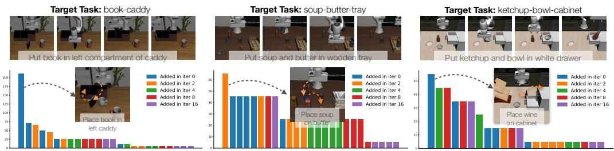  
Figure 7: Data Composition of data collected via GUILD. We demonstrate the composition of the final datasets from each of the LIBERO tasks. Top. A visualization of the target task for which Put book in left compartment of caddythe data is collected. Bottom. Final data composition plot, where each bar shows the number of trajectories collected for a particular task.

## B.3 Human Experiment Details

To evaluate human-guided data collection, we surveyed participants with varying levels of robotics experience. The least experienced participant had approximately one year of robotics experience, while the most experienced participants had more than five years of research experience in robot learning and manipulation. To construct human-proposed datasets, we provided participants with the same information available to the automated methods, including the target-task context, descrip tions of the available training environments, and the total data collection budget. Participants were instructed to design a data collection strategy that would maximize performance on the target task while respecting the specified budget constraints. Importantly, participants did not have access to attribution scores, baseline results, or any additional feedback beyond the initial information provided to the automated methods.

For each target task, participants proposed a set of tasks within the same parameter space used by GUILD. For example, in the Real Open-World setting, each proposal specified a collection environment, object configuration, task description, and the amount of collection budget allocated to that task. The proposed datasets were then collected using the same data-collection process employed for the automated methods (scripted policies in simulation and human teleoperation in the real world). Finally, all human-guided datasets were evaluated using the identical policy training and evaluation protocol described for each of our settings. This ensures that differences in performance arise solely from the data collection strategy rather than the learning or evaluation procedure.

## C Additional Results

## C.1 Real-World Qualitative Results

In Figure 7, we visualize the final data composition for each LIBERO target task for which we perform Guided Data Collection using GUILD and notice largely similar trends as we did in real world (Section 5.2). We observe that the resulting mixtures are highly target-dependent and nonuniform. For book-caddy, the auxiliary task place book in left caddy is extremely similar to the target task and receives by far the largest fraction of the collection budget, showing that GUILD can identify and exploit a particularly relevant source of data when one is available. In contrast, the final distributions for soup-butter-tray and ketchup-bowl-cabinet are more distributed, with substantial collection effort allocated across several auxiliary tasks rather than collapsing onto a single task. We also observe that useful tasks need not appear in the initial proposal set: for soup-butter-tray, the highest-allocation auxiliary task is introduced at a later supportexpansion stage, while for ketchup-bowl-cabinet, several of the highest-allocation tasks are also proposed later in the iterative collection process. Together, these results illustrate that useful collection strategies can take different forms across targets and that iterative support expansion can uncover high-utility tasks beyond the initial candidate set.

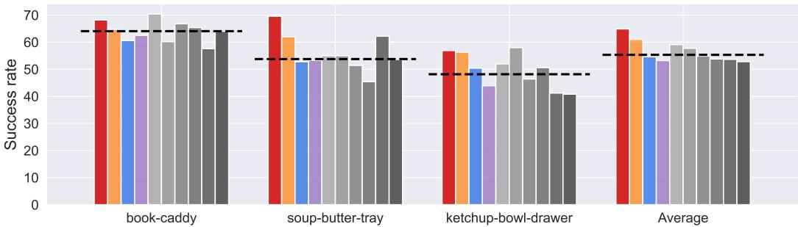  
Figure 8: Task-wise human-guided data collection comparison on LIBERO

## C.2 Human-Guided Data Collection Results

We present the task-wise human-guided data collection results for LIBERO in Figure 8. In addition to our analysis in Section 5, we also observe substantial variability in human performance across tasks: participants who perform well on one task often do not achieve similar performance on others. This suggests that effective data collection requires reasoning about task transfer in ways that can be difficult to do consistently, even for experienced roboticists. In contrast, GUILD provides a systematic mechanism for evaluating data utility and achieves strong performance across all tasks. As a result, while individual experts may occasionally outperform GUILD on specific tasks, GUILD consistently exceeds the average expert performance and provides a more reliable strategy for guided data collection.

## C.3 Hard vs. Soft Sampling

In Section 4.2, we described our attribution-guided collection strategy. Given task utilities $U ( \phi )$ GUILD selects the highest-utility task parameters,

$$
\phi _ { j } ^ { * } \in \arg \operatorname* { m a x } _ { \phi \in \mathcal { T } _ { i } } U ( \phi ) ,
$$

and asks a teleoperator to collect a batch of b demonstrations from that task. We refer to this strategy as hard-sampling, since all collection effort is allocated to the currently best task. An alternative approach is to convert task utilities into a sampling distribution and collect demonstrations probabilistically, which we refer to as soft-sampling. Given utilities $U ( \phi )$ , we first discard tasks with negative utility (or positive utility when $\mathcal { M }$ is a minimizing objective like loss), ensuring that collection effort is not allocated to clearly harmful tasks. We then define a sampling distribution using a softmax:

$$
p ( \phi ) = \frac { \exp ( U ( \phi ) / T ) } { \sum _ { \phi ^ { \prime } \in \mathcal { T } _ { i } } \exp ( U ( \phi ^ { \prime } ) / T ) } ,
$$

where T is a temperature parameter. Demonstrations are then collected by sampling tasks according to $p ( \phi )$ . A comparison between hard- and soft-sampling in LIBERO is shown in Table 3, named GUILD and GUILD (soft-sampling) respectively. We find that hard- and soft-sampling achieve broadly similar performance, suggesting that both are viable strategies for allocating collection effort. Soft-sampling provides a natural mechanism for interpolating between exploration and exploitation through the temperature parameter T. However, its performance is sensitive to the choice of T: larger values spread collection effort across many tasks, while smaller values resemble hard sampling. In practice, selecting an appropriate temperature may require task-specific tuning, hence, we adopt hard-sampling throughout the paper due to its simplicity, robustness, and strong empirical performance.

## C.4 Feedback based Support Expansion

While our main experiments highlight the importance of data evaluation through attribution as a guidance signal for data collection, here we evaluate whether VLMs are able to interpret this signa and propose new tasks that are more relevant for the deployment task. As described in Section 4.1, in each support-expansion step, we provide the VLM with a ranked list of previously proposed tasks, where the ranking is derived from the task utilities estimated during the data evaluation stage. This feedback allows the VLM to learn from earlier proposals and generate new task parameters that are more relevant to the target deployment task. We refer to this mechanism as feedback-driven support expansion.

Table 3: Mean performance with standard error of policies trained on the final aggregated dataset by GUILD, GUILD (soft-sampling), GUILD (no-feedback) and GUILD (gemini) for simulation tasks. The evaluation methodology is the same as our main experiments described in Appendix B.
<table><tr><td>Tasks</td><td></td><td>book-caddy soup-butter-tray</td><td>bowl-ketchup-drawer</td><td>Average</td></tr><tr><td>GUILD</td><td> $6 8 . 2 \pm 1 . 3$ </td><td> $6 9 . 6 \pm 3 . 6$ </td><td> $5 6 . 9 \pm 1 . 8$ </td><td>64.9</td></tr><tr><td>GUILD (soft-sampling)</td><td> $6 6 . 1 \pm 0 . 5$ </td><td> $6 3 . 2 \pm 2 . 3$ </td><td> $5 4 . 7 \pm 4 . 5$ </td><td>61.3</td></tr><tr><td>GUILD (no-feedback)</td><td> $6 5 . 5 \pm 1 . 1$ </td><td> $5 5 . 3 \pm 3 . 9$ </td><td> $5 6 . 9 \pm 1 . 7$ </td><td>59.2</td></tr><tr><td>GUILD (gemini)</td><td> $6 7 . 2 \pm 2 . 0$ </td><td> $5 2 . 2 \pm 1 . 5$ </td><td> $6 3 . 8 \pm 0 . 6$ </td><td>61.1</td></tr></table>

To evaluate the usefulness of this feedback, we ablate it in Table 3. GUILD denotes the full pipeline, while GUILD (no-feedback) removes feedback-driven support expansion and instead generates new tasks using only the original target-task context. The results show that attribution-based feedback consistently matches or improves performance across all tasks. While the magnitude of the improvement varies, feedback is particularly beneficial on the soup-butter-tray task, where removing it reduces performance by approximately 15%. In contrast, both variants achieve similar performance on bowl-ketchup-drawer, suggesting that the VLM’s commonsense priors alone are sufficient to discover useful tasks in this setting. Overall, these results indicate that VLMs can effectively incorporate attribution-based feedback, enabling more targeted exploration of the task space and improving the quality of future task proposals.

## C.5 Impact of the VLM Used

Throughout our experiments, we use GPT-5.2 [53] for task proposal and feedback-driven support expansion. Here, we study the sensitivity of GUILD to the choice of VLM by replacing GPT-5.2 with Gemini-2.5-Flash [59] in our LIBERO experiments, while keeping all other hyperparameters fixed. We report the results in Table 3 as GUILD (gemini).

We observe that the choice of VLM can substantially affect task-wise performance. On soup-butter-tray, Gemini achieves approximately 17% lower success than GPT-5.2. In contrast, on bowl-ketchup-drawer, Gemini improves performance by approximately 7%, outperforming the best GPT-5.2-based variant evaluated for this task. These results suggest that different VLMs induce different task-proposal distributions, which can meaningfully affect the downstream data collected by GUILD. Nevertheless, averaged across the LIBERO tasks, the Gemini variant remains competitive with GPT-5.2, indicating that GUILD is not tied to a particular VLM. More broadly, improvements in the task-proposal model may provide an additional avenue for improving guided data collection.

## C.6 Stage-wise results for Real world tasks

We measure stage-wise success rates for the real-world evaluations, shown in Figure 9. The stages for each task are listed below,

• pink-cup-sink: pick pink cup → place in sink

• towel-drawer-close: pick towel → place it in the open drawer → close drawer

• bowl-pour: grasp black bowl → pour its contents in the drawer

• lemon-drawer-close: pick lemon → place it in the open drawer → close drawer

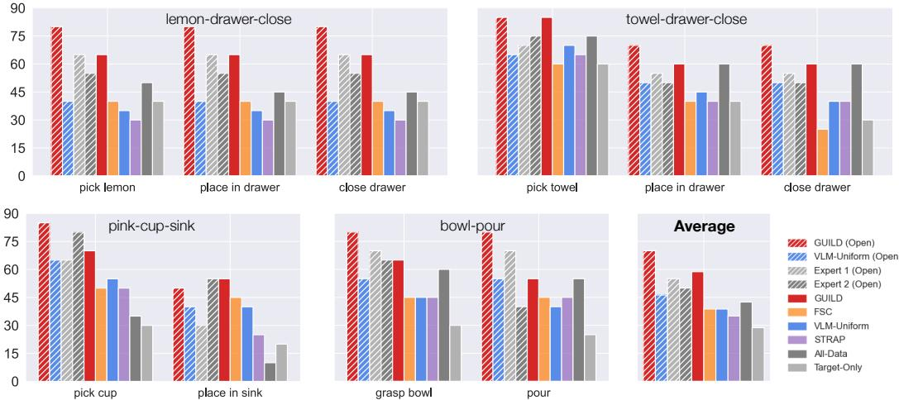  
Figure 9: Stage-wise real world results. We perform 20 rollouts of a policy on a task and measure the progress of the policy at different stages. The success rates are absolute for each stage, counting it as a fail even if the policy fails in an earlier stage.

For bowl-pour and lemon-drawer-close, performance is largely determined by the first stage of the task: once the target object is successfully grasped, policies typically complete the remaining stages. In contrast, pink-cup-sink and towel-drawer-close require successful execution of later-stage interactions. For pink-cup-sink, failures primarily arise during placement, where policies may collide with the rim of the sink, drop the cup, or place it in the drying rack. For towel-drawer-close, the bottleneck is placing the deformable towel into the drawer; if the towel unfolds, policies often fail to recover before attempting to close the drawer. These results highlight that the evaluation suite spans a range of failure modes, from object acquisition to precise placement and deformable-object manipulation. Across all tasks, GUILD maintains strong performance throughout the task progression and consistently outperforms the baselines, suggesting that its gains are not tied to a particular setting.

## D Baseline Implementation

Implementation details for all baselines are provided below.

• Random and VLM-Uniform. Both Random and VLM-Uniform are passive data collection strategies that uniformly allocate collection effort across a set of candidate tasks. We instantiate Random only in LIBERO, where task proposals are generated by randomly selecting a training environment, pick object, and placement region, while ensuring the resulting task is feasible. In contrast, VLM-Uniform uses the same VLM-based task proposer as GUILD to initialize the task set. For both methods, no data evaluation is performed. During each collection iteration, demonstrations are requested from the task with the fewest collected trajectories (ties broken randomly), resulting in approximately uniform coverage of the task set. Comparing Random and VLM-Uniform isolates the value of commonsense-guided task initialization independent of attribution-based guidance.

• STRAP [14]. STRAP uses the same VLM-generated task proposals as GUILD, but replaces attribution-based evaluation with visual similarity estimation. We use the official implementation (https://github.com/WEIRDLabUW/STRAP), which embeds trajectory segments using DINOv2 [54] and computes similarity to the target-task demonstrations using Dynamic Time Warping. The resulting similarity scores are normalized into a sampling distribution over tasks, with more similar tasks receiving a larger share of the collection budget. These scores also induce a ranking over tasks, which we use during feedback-driven support expansion (Section 4.1) to guide future VLM task proposals.

• FSC [15]. Factored Scaling Curves (FSC) follows the same high-level pipeline as STRAP and GUILD but uses scaling-curve analysis to estimate task utility. For each task ϕ, FSC samples N datasets of increasing size from $\mathcal { D } _ { \phi } \left( N = 4 \right.$ in all experiments), trains a policy on each subset, and evaluates its performance. The resulting performance-versus-data-size curve is used to estimate a scaling factor, which serves as the task utility. Tasks with larger scaling factors receive additional collection budget, and the induced ranking is used during support expansion.

FSC is considerably more expensive than GUILD. For M tasks, each iteration requires training $M \times N$ policies, compared to a single policy for GUILD. To reduce this cost, we follow Zha et al. [15] and use the Group-t variant, which partitions tasks into groups of size t. We use $t ~ = ~ 5$ for LIBERO and $t \ = \ 4$ for the real-world experiments (except bowl-pour, where $t = 3 )$ . Since online evaluation of every trained policy is prohibitively expensive, we adopt FSC’s offline evaluation variant. Specifically, we measure cosine similarity between embeddings of the training and target datasets. In Octo [52], this corresponds to the final transformer class token as the policy embedding. These modifications make FSC computationally feasible within our iterative Guided Data Collection framework.

## E Metagradient Hyperparameters and Training Cost

At each iteration of Guided Data Collection, we estimate the metagradient I for each trajectory in the current training dataset and aggregate these scores to compute task-level marginal utilities. The hyperparameters used for this computation are summarized in Table 4.

Following Engstrom et al. [9], each metagradient computation consists of a warmup phase of $N _ { w }$ optimization steps followed by a metagradient phase of

Table 4: Hyperparameters for computing metagradients.
<table><tr><td>Hyperparameter</td><td>LIBERO</td><td>Real-World</td></tr><tr><td>Policy architecture Warmup steps  $N _ { w }$ </td><td>Octo-Small Adaptive</td><td>Octo-Small</td></tr><tr><td>Metagradient steps  $N _ { m }$ </td><td>Adaptive</td><td>Adaptive Adaptive</td></tr><tr><td>Max step bound C</td><td>500</td><td>300</td></tr><tr><td>Batch size B</td><td>512</td><td>512</td></tr><tr><td>Optimizer</td><td>Adam</td><td></td></tr><tr><td>Learning-rate scheduler</td><td>Cosine</td><td>Adam Cosine</td></tr></table>

$N _ { m }$ steps. Since the dataset grows throughout the collection process, we adapt both quantities based on the number of optimization steps in one epoch,

$$
E = \left\lfloor { \frac { | { \mathcal { D } } | } { B } } \right\rfloor .
$$

where D is the dataset and $\boldsymbol { B }$ is the batch size. We first choose the metagradient horizon based on dataset size: $N _ { m } = 5 0$ when $E < 5 0 , N _ { m } = 7 5$ when $5 0 \leq E < 7 5$ , and $N _ { m } = 1 0 0$ otherwise. We then set the warmup length as

$$
N _ { w } = \operatorname* { m i n } ( C - N _ { m } , 1 0 E ) ,
$$

where $C$ is the maximum number of policy-training steps. If $N _ { m } < E$ , which happens in certain cases, we set $N _ { m } = E$ ensuring that the metagradient phase spans at least one full epoch. Thus, for small datasets we differentiate through multiple epochs, while for larger datasets the metagradient horizon grows with the dataset size. The warmup phase scales up to approximately ten epochs, subject to the overall policy-training budget.

Training Cost. Each metagradient computation and utility-estimation step takes approximately 10–15 minutes on four NVIDIA A5000 GPUs. In comparison, data collection itself takes only a few minutes per iteration in simulation and approximately 15–30 minutes per iteration in the real world, depending on the task. Including attribution and data collection together, the complete GUILD loop takes approximately 7–8 hours for 30 LIBERO iterations and 10–15 hours for 20 real-world open-world iterations.

## F Prompts used for VLM task-proposer

We provide the prompts used for task proposals for each of our settings below. In each prompt the common elements are black, the elements that appear only in initializing prompt are blue and the elements that only appear in feedback-driven support expansion are red. The input assets for each of the settings are provided in Appendix G.

## F.1 LIBERO

LIBERO Combined Task Proposal Prompt   
You are helping generate training data for robot learning for a given DEPLOYMENT TASK.   
The DEPLOYMENT TASK is provided below and you need to create similar tasks in training   
environments.   
DEPLOYMENT TASK Description: <target task description>   
DEPLOYMENT TASK video frames: [Frame images 1/6 – 6/6]   
Your goal is to generate training scenarios that are similar to the DEPLOYMENT TASK but   
adapted to the training environment and available objects.   
Following are the TRAINING SCENES:   
TRAINING SCENE 1 (ID: 1)   
Available pick objects: <list ofpick objectsfor SCENE 1>   
Available place regions: <list ofplace regionsfor SCENE 1>   
Visual example (first frame): [Image]   
TRAINING SCENE 2 (ID: 2)   
Available pick objects: <list ofpick objectsfor SCENE 2>   
Available place regions: <list ofplace regionsfor SCENE 2>   
Visual example (first frame): [Image]   
Based on previous training results, here is a RANKING of how well previously selected tasks   
helped improve the performance of the deployment task – ordered from best (Rank 1) to worst   
(Rank M). Use this ranking to guide your selection of new training scenarios but DON’T repeat   
any of the existing ranked tasks in your proposals.   
RANKING OF PREVIOUS TRAINING TASKS:   
RANK 1/M:   
Scene ID: <scene id>   
Task Description: <task description>   
RANK 2/M:   
Scene ID: <scene id>   
Task Description: <task description>   
Please generate M different training scenarios that capture the essence of the deployment task   
but are adapted to the training scene.   
For each scenario, provide:   
1. Scene ID: The scene where the given scenario should take place   
2. Task Description: Describe a pick or pick-place task involving an object and a region   
Format your response exactly as follows:   
SCENARIO 1:   
SCENE ID: [SELECTED SCENE ID]

TASK DESCRIPTION: [Pick <obj1> / Pick <obj1> and place in <obj2>] REASON: [brief explanation]

SCENARIO 2:

SCENE ID: [SELECTED SCENE ID]

TASK DESCRIPTION: [Pick <obj1> / Pick <obj1> and place in <obj2>]

REASON: [brief explanation]

Continue for all N scenarios.

## Guidelines:

• Use objects available in the selected scene that are similar to those in deployment

• Keep the core manipulation skill/behavior similar to the deployment task

• Only use the OBJECTS/REGIONS available in the selected scene

• Ensure tasks are feasible given the training scene setup

• Make sure the task is a single PICK or PICK-PLACE task only

• Try to suggest diverse training scenarios

• Prefer training scenarios similar (but not repeating) to higher-ranked tasks, as they have proven more effective in improving deployment performance

• IMPORTANT: DON’T REPEAT any of the existing RANKED TASKS in your proposals. Propose new tasks, using similar objects in different scenes or different objects in the same scene.

• Ensure that TASK DESCRIPTION uses only objects chosen from the available objects in the selected training scene

## F.2 Real (Open-World)

## Real (Open) World Combined Task Proposal Prompt

You are helping generate training data for robot learning for a given DEPLOYMENT TASK. The DEPLOYMENT TASK is provided below and you need to create similar tasks in training environments.

DEPLOYMENT TASK Description: <target task description>

Your goal is to generate training scenarios that are similar to the DEPLOYMENT TASK but adapted to the training environment and available objects.

TRAINING ENVIRONMENTS:

\- Available objects: <list ofavailable objects>

\- Following are the TRAINING SCENES:

TRAINING SCENE 1 (ID: 1)

Visual example: [Image]

TRAINING SCENE 2 (ID: 2)

Visual example: [Image]

Based on previous training results, here is a RANKING of how well previously selected tasks helped improve the performance of the deployment task – ordered from best (Rank 1) to worst (Rank M). Use this ranking to guide your selection of new training scenarios but DON’T repeat any of the existing ranked tasks in your proposals.

RANKING OF PREVIOUS TRAINING TASKS:

RANK 1/M:

Scene ID: <scene id>

Task Description: <task description> Object Placement: <object placement> RANK 2/M:   
Scene ID: <scene id>   
Task Description: <task description> Object Placement: <object placement>

Please generate N different training scenarios that capture the essence of the deployment task but are adapted to the training environment and available objects.

1. Scene ID: Which training scene to use (from the list of training scenes provided)

2. Object Placement: Which objects from the available list to place and where in the training scene

3. Task Description: What task the robot should perform (similar to deployment but adapted)

4. Reason: A brief explanation of why this scenario is relevant for training the deployment task

Format your response exactly as follows:

SCENARIO 1:

Scene ID: [ID of the selected training scene] Object Placement: [specific description of object placement in training scene] Task Description: [task description adapted for training environment] Reason: [brief explanation of relevance for training deployment task]

SCENARIO 2:   
Scene ID: [ID of the selected training scene]   
Object Placement: [specific description of object placement in training scene]   
Task Description: [task description adapted for training environment]   
Reason: [brief explanation of relevance for training deployment task]

And so on... Continue for all N scenarios.

Here are some EXAMPLES of how to adapt deployment tasks to training scenarios based on the training scenes and available objects. Use these examples as a guide for how to format your response and construct the sentence structure of the suggestions, while keeping the core manipulation skill/behavior similar to the deployment task.

Object Placement: Place the bread on the cutting board Task Description: Put the bread in the oven

Object Placement: Place the green towel on the table between cutting board and oven Task Description: Drape green towel on the top of the wooden shelf

Object Placement: Place the blue bowl on the top of the wooden shelf Task Description: Put blue bowl in the bottom region of the wooden shelf

Object Placement: Keep drawer closed and place white cup in the middle of the table Task Description: Open drawer and place white cup in it

Object Placement: Keep drawer open and place the sprite can on the right side of the table Task Description: Put sprite can in drawer and close it

Object Placement: Place the white cup in the oven and fill it with some colored paper balls Task Description: Pour the contents of white cup into the sink

Object Placement: Place the black bowl in the sink and leave the drawer open Task Description: Put black bowl in drawer

Object Placement: Place the green towel in the middle of the table (right side of the blue sink)   
Task Description: Hang the green towel on the towel hanger =EXAMPLES END

## Guidelines:

• Try to use objects from the available list that are similar to those in deployment

• Adapt the task to work with the training scene layout and available objects

• Make sure to not change the object placements of objects that already exist in the training scene

• Keep the core manipulation skill/behavior similar to the deployment task

• Align the sentence structure of the object placement and task description with the examples provided above

• Ensure tasks are feasible given the training scene setup

• IMPORTANT: suggest diverse training scenarios involving a variety of scenes, objects and skills, that may not immediately seem useful but cover useful behaviors

• IMPORTANT: DON’T REPEAT any of the existing ranked tasks in your proposals. Propose new tasks using similar objects in different scenes or different objects in the same scene

Before proposing any new tasks, for each scene, list out the items you can identify. This will help ensure you are aware of the available items in each scene and can refer to them in your proposals.

## F.3 Real (Closed-World)

## Real (Closed) World Combined Task Proposal Prompt

You are helping generate training data for robot learning for a given DEPLOYMENT TASK. The DEPLOYMENT TASK is provided below and you need to create similar tasks in training environments.

DEPLOYMENT TASK Description: <target task description>

DEPLOYMENT TASK video frames: [Frame images 1/5 – 5/5]

Your goal is to select the top-N TRAINING TASKS that would be most beneficial for learning the DEPLOYMENT TASK from the provided list below. Consider the following properties when picking tasks:

1. Similar manipulation skills/behaviors

2. Similar object interactions

3. Similar task structure or sub-goals

4. Transferable skills that could help with the deployment task

TRAINING TASK OPTIONS:

TRAINING TASK 1 (ID: 1):

Task Description: <task description>

Visual example (first frame): [Image]

TRAINING TASK 2 (ID: 2):

Task Description: <task description>

Visual example (first frame): [Image]

Based on previous training results, here is a RANKING of how well previously selected tasks helped improve the performance of the deployment task – ordered from best (Rank 1) to worst

(Rank M). Use this ranking to guide your selection of new training tasks but DON’T repeat any of the existing ranked tasks in your proposals.

RANKING OF PREVIOUS TRAINING TASKS:

PREVIOUS TRAINING TASK 1 (RANK 1/M): Task Description: <task description> Visual example (first frame): [Image]

PREVIOUS TRAINING TASK 2 (RANK 2/M):

Task Description: <task description>

Visual example (first frame): [Image]

Please select the top-N training tasks that would be most beneficial for learning the deployment task. Provide your reasoning for each selection and give them in the ranking order of most to least beneficial.

Format your response exactly as follows:

SELECTED TASKS:

1. Task ID: [ID] - Reason: [brief explanation]

2. Task ID: [ID] - Reason: [brief explanation]

M. Task ID: [ID] - Reason: [brief explanation]

Make sure to only select 3 unique tasks (no duplicates) and use the exact Task ID numbers from above.

Guidelines:

• Propose tasks that could help improve the performance of the DEPLOYMENT TASK

• Pay attention to the scene layout, objects in the scene and how those would affect the robot’s motion

• Try to suggest diverse training tasks

• Use the exact Task ID numbers from the TRAINING TASK list when selecting tasks

• Prefer training scenarios that are similar to higher-ranked tasks, as they have proven more effective in improving deployment performance

• DON’T REPEAT any of the existing ranked tasks in your proposals

## G Training Environment Assets

## G.1 LIBERO

<table><tr><td>Scene Image</td><td>Pick Objects</td><td>Place Objects</td></tr><tr><td>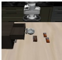</td><td>akita_black_bowl_1, butter_1, butter_2, chocolate_pudding_1</td><td>wooden_cabinet_1_top_side, wooden_cabinet_1_top_region, akita_black_bowl_1, butter_1, butter_2, chocolate_pudding_1</td></tr><tr><td>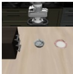</td><td>akita_black_bowl_1, plate_1</td><td>wooden_cabinet_1_top_side, wooden_cabinet_1_top_region, akita_black_bowl_1, plate_1</td></tr><tr><td>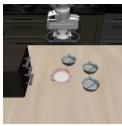</td><td>akita_black_bowl_1, akita_black_bowl_2, akita_black_bowl_3, plate_1</td><td>wooden_cabinet_1_top_side, wooden_cabinet_1_top_region, akita_black_bowl_1, akita_black_bowl_2, akita_black_bowl_3, plate_1</td></tr><tr><td></td><td>akita_black_bowl_1, wine_bottle_1</td><td>white_cabinet_1_top_side, white_cabinet_1_top_region, white_cabinet_1_bottom_region, wine_rack_1_top_region, akita_black_bowl_1, wine_bottle_1</td></tr><tr><td>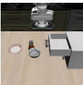</td><td>akita_black_bowl_1. plate_1, ketchup_1</td><td>white_cabinet_1_top_side, white_cabinet_1_top_region, white_cabinet_1_bottom_region, akita_black_bowl_1, plate_1, ketchup-1</td></tr><tr><td>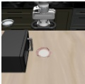</td><td>white_bowl_1, plate_1</td><td>microwave_1_top_side, plate_1</td></tr><tr><td>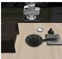</td><td>white_bowl_1</td><td>flat_stove_1_cook_region, wooden_two_layer_shelf_1_top_side, chefmate_8_frypan_1</td></tr><tr><td>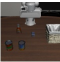</td><td>alphabet_soup-1, cream_cheese_1, tomato_sauce_1, ketchup_1</td><td>basket_1_contain_region, alphabet_soup_1, cream_cheese_1, tomato_sauce_1, ketchup_1</td></tr><tr><td>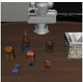</td><td>alphabet_soup_1, cream_cheese_1, tomato_sauce_1, ketchup-1, orange_juice_1, milk_1, butter_1</td><td>basket_1_contain_region, alphabet_soup_1, cream_cheese_1, tomato_sauce_1, ketchup_1, orange_juice_1, milk_1, butter_1</td></tr><tr><td>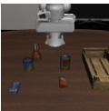</td><td>alphabet_soup_1, cream_cheese_1, tomato_sauce_1, ketchup-1, butter_1</td><td>wooden_tray_1_contain_region, alphabet_soup_1, cream_cheese_1, tomato_sauce_1, ketchup_1, butter_1</td></tr><tr><td>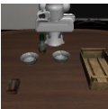</td><td>akita_black_bowl_1, akita_black_bowl_2, chocolate_pudding-1</td><td>wooden_tray_1_contain_region, akita_black_bowl_1, akita_black_bowl_2. new_salad_dressing-1, chocolate_pudding-1</td></tr><tr><td>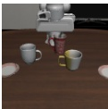</td><td>porcelain_mug-1, red_coffee_mug-1, white_yellow_mug-1, plate_1, plate_2</td><td>living_room_table_plate_left_region, living_room_table_plate_right_region, porcelain_mug-1, red_coffee_mug-1, white_yellow_mug-1, plate_1, plate_2</td></tr><tr><td>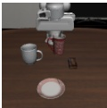</td><td>porcelain_mug_1, red_coffee_mug-1, plate_1, chocolate_pudding-1</td><td>living_room_table_plate_left_region, living_room_table_plate_right_region, porcelain_mug-1, red_coffee_mug-1, plate_1, chocolate_pudding-1</td></tr><tr><td></td><td>black_book_1, red_coffee_mug-1</td><td>desk_caddy_1_right_contain_region, desk_caddy_1_left_contain_region, black_book_1, red_coffee_mug-1</td></tr><tr><td>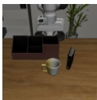</td><td>black_book_1, white_yellow_mug-1</td><td>study_table_desk_caddy_right_region, desk_caddy_1_right_contain_region, desk_caddy_1_left_contain_region, black_book_1, white_yellow_mug_1</td></tr><tr><td>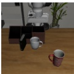</td><td>black_book_1, red_coffee_mug-1, porcelain_mug_1</td><td>study_table_desk_caddy_right_region, desk_caddy_1_right_contain_region, desk_caddy_1_left_contain_region, black_book_1, red_coffee_mug-1, porcelain_mug-1</td></tr><tr><td>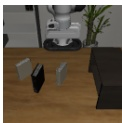</td><td>black_book_1, yellow_book_1, yellow_book_2</td><td>wooden_two_layer_shelf_1_top_side, black_book_1, yellow_book_1, yellow_book_2</td></tr></table>

## G.2 Real (Open-World)

In the Real Open-World setting, the VLM task proposer is provided with the set of available scenes listed in Table 6, together with the following movable objects: black bowl, blue bowl, blue towel, bread, coke can, green towel, lemon, orange, pink cup, sprite can, and white cup. Given these assets, the VLM proposes task parameters specifying the collection environment, object configuration, and task description. We exclude both the target scene and target object from the assets available to the VLM. For example, when evaluating the lemon-drawer-close task in scene b1, the scene b1 and the object lemon are removed from the lists of available training scenes and objects, respectively.

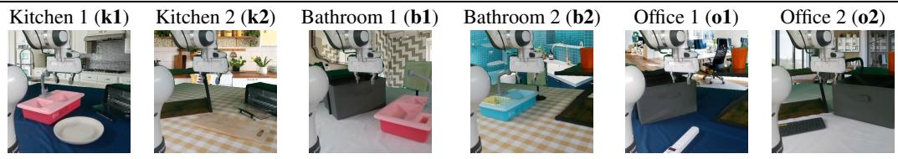  
Table 6: Real world scene list

## G.3 Real (Closed-World)

In the Real Closed-World setting, we pre-collect a dataset containing 49 diverse tasks, listed below. The Scene IDs correspond to the environments shown in Table 6. For a target task in a particular scene, all tasks from that scene are excluded from the Guided Data Collection process and may not be selected by the task proposer. List of all tasks is provided in the table below.

The All-Data baseline is trained on the target-task demonstrations together with the entire precollected dataset, including tasks from the target scene. This differs from all other methods, which are restricted from using data originating from the target environment.

<table><tr><td>Scene ID</td><td>Initial Object Placement</td><td>Task</td></tr><tr><td>k1</td><td>White cup was placed on the plate</td><td>Put white cup in the sink</td></tr><tr><td>k1</td><td>Bread was placed on the plate</td><td>Put bread in the oven</td></tr><tr><td>k1</td><td>Black bowl was placed in the oven</td><td>Put black bowl in the sink</td></tr><tr><td>k1</td><td>Orange was placed on the plate</td><td>Put orange in the oven</td></tr><tr><td>k1</td><td>Coke can was placed in the drying rack</td><td>Put coke can on the plate</td></tr><tr><td>k1</td><td>White cup was placed in the oven and filled with some colored paper balls</td><td>Pour the contents of white cup into the sink</td></tr><tr><td>k1</td><td>Black bowl was placed on the plate and blue bowl was placed in the drying rack</td><td>Stack the black bowl on blue bowl</td></tr><tr><td>k1</td><td>Blue towel was placed in the sink</td><td>Put the blue towel next to plate</td></tr><tr><td>k1</td><td>Orange was placed in the oven</td><td>Put orange on plate</td></tr><tr><td>k2</td><td>Bread was placed on the cutting board</td><td>Put the bread in the oven</td></tr><tr><td>k2</td><td>Lemon was placed on the cutting board</td><td>Put the lemon in the oven</td></tr><tr><td>k2</td><td>Blue bowl was placed in the oven</td><td>Put blue bowl in the bottom region of the shelf</td></tr><tr><td>k2</td><td>Coke can was placed on the cutting board</td><td>Put coke can in the bottom region of the shelf</td></tr><tr><td>k2</td><td>Sprite can was placed in the bottom region of the shelf</td><td>Put sprite can on the cutting board</td></tr><tr><td>k2</td><td>Green towel was placed on the table between cutting board and oven</td><td>Drape green towel on the top shelf</td></tr><tr><td>k2</td><td>Bread was placed on cutting board and blue bowl was placed in the middle of the table</td><td>Put the bread in blue bowl</td></tr><tr><td>k2</td><td>Pink cup was placed on the cutting board</td><td>Put pink cup on the bottom shelf</td></tr><tr><td>k2</td><td>Lemon was placed in the oven</td><td>Put lemon on cutting board</td></tr><tr><td>b1</td><td>Drawer was left slightly open</td><td>Open the drawer</td></tr><tr><td>b1</td><td>Drawer was left open (not fully)</td><td>Close the drawer</td></tr><tr><td>b1</td><td>Blue towel was placed in the middle of the table (left side of the sink)</td><td>Hang the blue towel on the towel hanger</td></tr><tr><td>b1</td><td>Pink cup was placed in the middle of the table</td><td>Put pink cup in the sink</td></tr><tr><td>b1</td><td>Black bowl was placed in the sink and drawer was left open</td><td>Put black bowl in drawer</td></tr><tr><td>b1</td><td>Black bowl was placed in the middle of the table and filled with colored paper</td><td>Pour the contents of black bowl in the sink</td></tr><tr><td>b1</td><td>balls Drawer was left open (not fully) and pink cup was placed in the middle of</td><td>Put pink cup in drawer and close it</td></tr><tr><td>b1</td><td>the table Lemon was placed on top of the drawer and drawer was left slightly open</td><td>Slide the lemon into the drawer</td></tr><tr><td>b2</td><td>Green towel was placed in the middle of the table (right side of the blue sink)</td><td>Hang the green towel on the towel hanger</td></tr><tr><td>b2</td><td>Green towel was placed in the middle</td><td>Put green towel on top of the shelf</td></tr><tr><td>b2</td><td>of the table (right side of the blue sink) Coke can was placed on the right side of the table (before the shelf)</td><td>Put coke can on top of the shelf</td></tr><tr><td>b2</td><td>Pink cup was placed in the middle of the table</td><td>Put pink cup in the sink</td></tr><tr><td>b2</td><td>Black bowl was placed in the middle of the table and filled with colored paper balls</td><td>Pour the contents of black bowl in sink</td></tr><tr><td>b2</td><td>Black bowl was placed in the middle of the table and blue bowl was placed in the drying rack</td><td>Stack the black bowl on blue bowl</td></tr><tr><td>b2</td><td>Blue bowl was placed on the right side of the table and orange was placed on top of the shelf</td><td>Put orange in blue bowl</td></tr><tr><td>b2</td><td>Green towel was hung on the towel hanger</td><td>Slide the green towel in sink</td></tr><tr><td>01</td><td>Drawer was left slightly open</td><td>Open the drawer</td></tr><tr><td>01 01</td><td>Drawer was left open (not fully)</td><td>Close the drawer</td></tr><tr><td></td><td>Sprite can was placed on the right side of the table (before the shelf)</td><td>Put sprite can on top of the shelf</td></tr><tr><td>o1</td><td>Blue towel was placed on the right side of the table (before the shelf)</td><td>Put blue towel in the drawer</td></tr><tr><td>o1</td><td>White cup was placed in the middle of the table and drawer was left open</td><td>Put white cup in the drawer and close it</td></tr><tr><td>01</td><td>Orange was kept on top of the shelf and drawer was left open</td><td>Put orange in drawer and close</td></tr><tr><td>01</td><td>Drawer was left slightly open and white cup was placed in the middle of the table</td><td>Open drawer and place white cup in it</td></tr><tr><td>01</td><td>Both bowls were placed next to each other in the middle of the table</td><td>Stack black bowl on blue bowl</td></tr><tr><td>01</td><td>Black bowl was placed in the middle of the table and drawer was left open</td><td>Put black bowl in drawer and close it</td></tr><tr><td>02</td><td>Drawer was left slightly open</td><td>Open the drawer</td></tr><tr><td>02</td><td>Drawer was left open (not fully)</td><td>Close the drawer</td></tr><tr><td>02</td><td>Coke can was placed on the right side of the table (before the drawer)</td><td>Put the coke can in the bottom region of the shelf</td></tr><tr><td>02</td><td>Pink cup was placed in the middle of the table and drawer was left open</td><td>Put pink cup in drawer and close it</td></tr><tr><td>02</td><td>Green towel was placed on the top shelf</td><td>Put green towel in the drawer</td></tr><tr><td>02</td><td>Lemon was kept on the bottom shelf and drawer was left open</td><td>Put lemon in drawer and close it</td></tr><tr><td>02</td><td>Drawer was left slightly open and pink cup was placed in the middle of the</td><td>Open drawer and place pink cup in it</td></tr><tr><td>02</td><td>table Black bowl was kept on the bottom shelf and drawer was left open</td><td>Black bowl in drawer and close it</td></tr></table>